# CAPÍTULO 01 — MATEMÁTICA DE BASE PARA QUEM PARTE DO ZERO: NÚMEROS, FRAÇÕES, DECIMAIS, POTÊNCIAS, RAÍZES, PORCENTAGEM, REGRA DE TRÊS, EQUAÇÕES, PROGRESSÕES, EXPONENCIAIS E LOGARITMOS, CÁLCULO MENTAL E TABELAS FINANCEIRAS DA PROVA

:::INCIDENCIA
Edital SEFAZ/SC 01/2026 — Matemática Financeira, Estatística e Raciocínio Lógico (base de todos os pontos de cálculo). Nível A+.
Lote do banco: 58 questões (FCC 44, FGV 14), quase todas de 2024 a 2026.
O que mais cai: porcentagem (aumentos e descontos sucessivos, "quanto falta para recuperar"), problemas com frações ("fração do que sobrou"), regra de três, equações e sistemas de 1º grau montados a partir de um texto, progressões.
:::

:::ESQUEMA O que você vai aprender e o que precisa saber antes
Pré-requisito: nenhum. Este capítulo é o "kit de sobrevivência" de toda a apostila; os capítulos seguintes remetem a ele sempre que precisarem de uma ferramenta básica.
Roteiro:
- 01.1 Os números e as quatro operações: sinais, ordem das operações, expressões numéricas.
- 01.2 Frações: simplificar, somar, multiplicar, dividir, "fração de", "fração do que sobrou".
- 01.3 Números decimais e a ponte fração ↔ decimal ↔ porcentagem; arredondamento.
- 01.4 Porcentagem: o conceito mais cobrado da prova; fator multiplicativo, aumentos e descontos sucessivos, variação percentual.
- 01.5 Razão, proporção e regra de três simples e composta.
- 01.6 Potências, raízes e notação científica.
- 01.7 Equações do 1º e do 2º grau e sistemas de duas equações.
- 01.8 Progressões aritmética (PA) e geométrica (PG): o esqueleto dos juros simples e compostos.
- 01.9 Função exponencial e logaritmos: como achar "em quanto tempo" com os logaritmos que a prova fornece.
- 01.10 Cálculo mental, estimativa e leitura das tabelas financeiras fornecidas pela FCC.
:::

Antes de começar, uma palavra de tranquilidade. A matemática da prova de Conhecimentos Gerais não exige talento especial: exige um pequeno conjunto de ferramentas usadas com segurança. Quase todas as questões de juros, descontos, estatística e probabilidade dos capítulos seguintes se resolvem com as operações deste capítulo. Por isso ele é longo e detalhado: cada minuto investido aqui economiza horas depois.

A prova é feita SEM calculadora. Isso significa duas coisas. Primeiro, você precisa saber fazer as contas à mão, com organização. Segundo, a FCC sabe disso e monta as questões com números "amigáveis" ou fornece no enunciado os valores difíceis (por exemplo, "considere 1,05³ = 1,157625" ou "log 2 = 0,30"). Ao longo do capítulo, você verá como aproveitar esses dados.

## 01.1 Os números e as quatro operações

### 01.1.1 Os conjuntos numéricos

A ideia é simples: os números foram sendo "ampliados" à medida que surgiam necessidades práticas. Primeiro, contar coisas (processos no gabinete: 0, 1, 2, 3...). Depois, registrar dívidas e saldos negativos (uma conta bancária com saldo de −200). Depois, dividir coisas em partes (meia pizza, um quarto da herança). Por fim, medir grandezas que não cabem em nenhuma fração exata (a diagonal de um quadrado de lado 1).

Cada ampliação ganhou um nome e um símbolo:

- ℕ, números naturais: 0, 1, 2, 3, 4, ... Servem para contar.
- ℤ, números inteiros: ..., −3, −2, −1, 0, 1, 2, 3, ... São os naturais mais os negativos. Servem para saldos, temperaturas abaixo de zero, prejuízos.
- ℚ, números racionais: todos os que podem ser escritos como uma fração a/b, com a e b inteiros e b diferente de zero. Exemplos: 1/2, −3/4, 0,75 (que é 3/4), 0,333... (que é 1/3), e também os próprios inteiros (5 = 5/1).
- ℝ, números reais: os racionais mais os irracionais, que são números cuja parte decimal é infinita e NÃO se repete, como √2 = 1,41421356... e π = 3,14159265... Os reais preenchem toda a reta numérica.

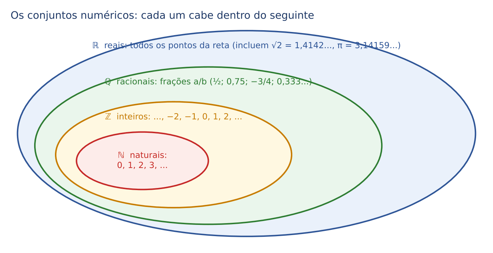

Note que cada conjunto cabe dentro do seguinte: todo natural é inteiro, todo inteiro é racional, todo racional é real. Em símbolos: ℕ ⊂ ℤ ⊂ ℚ ⊂ ℝ (o símbolo ⊂ se lê "está contido em").

A reta numérica é a imagem mental mais útil. O zero fica no meio; à direita, os positivos, crescendo; à esquerda, os negativos. Quanto mais à direita, maior o número. Por isso −2 é MAIOR que −5 (está mais à direita), embora "5" pareça maior: quem deve 2 reais está em melhor situação do que quem deve 5.

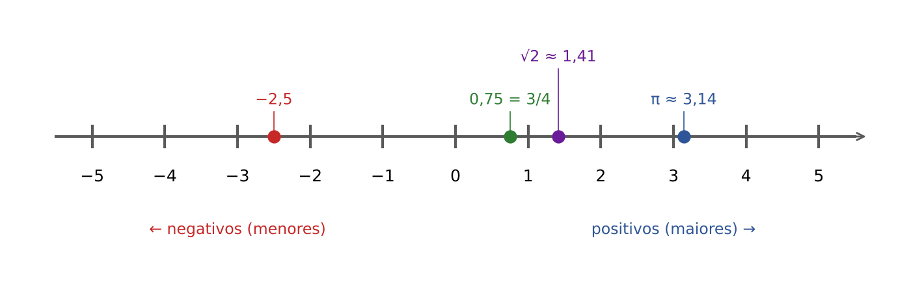

:::DICA Para que serve saber isso na prova?
A FCC raramente pergunta "a que conjunto pertence tal número". O que importa é saber operar com negativos, frações e decimais com segurança. A classificação só aparece em questões de lógica e de conjuntos (Cap. 21).
:::

### 01.1.2 As quatro operações e as regras de sinais

Somar e subtrair com negativos fica fácil se você pensar em dinheiro: positivo é crédito, negativo é dívida.

- 5 + (−3): tenho 5 e assumo uma dívida de 3. Resultado: 2.
- −5 + 3: devo 5 e recebo 3. Continuo devendo 2. Resultado: −2.
- −5 − 3: devo 5 e assumo mais uma dívida de 3. Resultado: −8.
- 5 − (−2): subtrair uma dívida é o mesmo que perdoá-la, ou seja, ganhar. 5 − (−2) = 5 + 2 = 7.

A regra prática: dois sinais seguidos se juntam assim: "− −" vira "+"; "+ −" e "− +" viram "−".

Para multiplicar e dividir, a regra de sinais é uma tabela de quatro casos:

| Sinal do 1º número | Sinal do 2º número | Sinal do resultado | Exemplo |
|---|---|---|---|
| + | + | + | 3 × 4 = 12 |
| + | − | − | 3 × (−4) = −12 |
| − | + | − | −8 ÷ 2 = −4 |
| − | − | + | (−3) × (−4) = 12 |

Memorize como "sinais iguais dão mais; sinais diferentes dão menos". Isso vale SÓ para multiplicação e divisão. Na soma, −3 + (−4) = −7 (duas dívidas somadas continuam sendo dívida).

:::ATENCAO Divisão por zero
Nenhum número pode ser dividido por zero: a operação não existe. Já zero dividido por qualquer número diferente de zero é zero (0 ÷ 5 = 0). Na prova, isso aparece quando uma fórmula teria denominador zero: aquela hipótese está excluída.
:::

### 01.1.3 A ordem das operações

Quando uma expressão mistura várias operações, existe uma ordem obrigatória, como a ordem de julgamento das questões preliminares antes do mérito. Fazer na ordem errada dá resultado errado, e a FCC coloca esse resultado errado entre as alternativas.

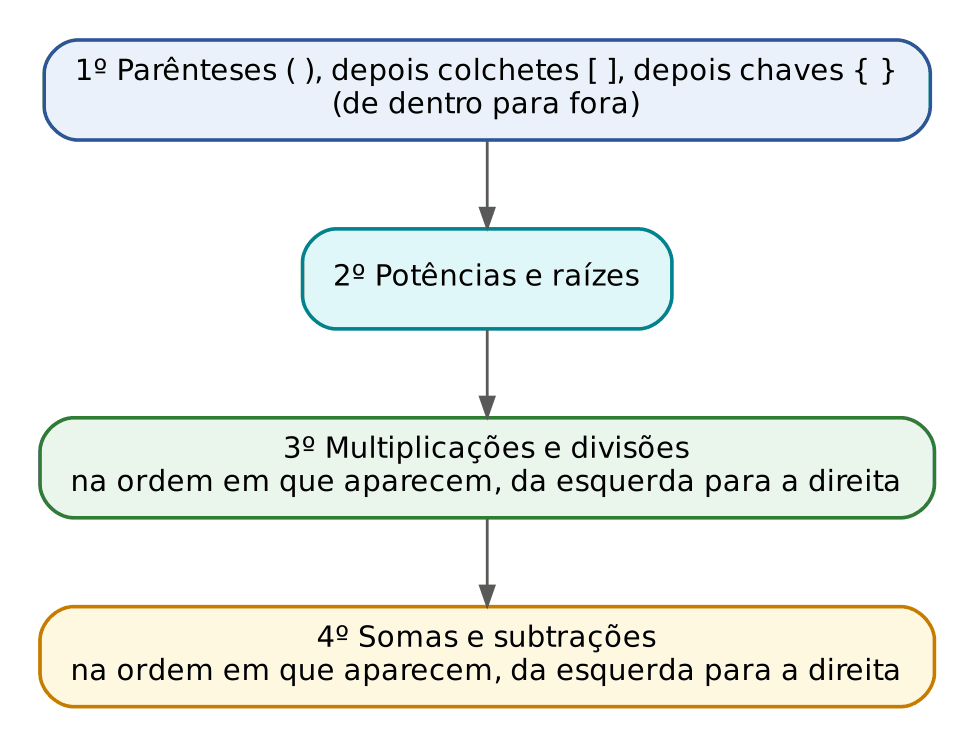

Exemplo pequeno, feito à mão: 2 + 3 × 4.

- Primeiro a multiplicação: 3 × 4 = 12.
- Depois a soma: 2 + 12 = 14.

Se você somasse primeiro (2 + 3 = 5 e 5 × 4 = 20), erraria. O 20 só é correto quando há parênteses: (2 + 3) × 4 = 5 × 4 = 20.

Outro exemplo: 20 − 12 ÷ 4 × 2.

- Multiplicações e divisões vêm antes, na ordem em que aparecem, da esquerda para a direita. A primeira é 12 ÷ 4 = 3.
- Depois, 3 × 2 = 6.
- Por fim, a subtração: 20 − 6 = 14.

Mais um, com potência: 10 − 2² × 3.

- Potência primeiro: 2² = 2 × 2 = 4 (potências são explicadas em 01.6).
- Multiplicação: 4 × 3 = 12.
- Subtração: 10 − 12 = −2.

:::PEGADINHA −3² não é o mesmo que (−3)²
Em −3², a potência vale só para o 3 (o sinal fica de fora): −3² = −(3 × 3) = −9. Em (−3)², o parêntese manda elevar o −3 inteiro: (−3) × (−3) = 9. A FCC adora alternativas com o sinal trocado.
:::

:::PASSO Como resolver qualquer expressão numérica
1. Localize o parêntese mais interno e resolva o que está dentro dele, seguindo a ordem: potências, depois multiplicações e divisões, depois somas e subtrações.
2. Substitua o parêntese pelo resultado e repita com colchetes e, depois, com chaves.
3. Escreva cada passo numa linha nova. Não tente "economizar linhas": é ali que nascem os erros de sinal.
4. Ao final, confira o sinal do resultado e compare com as alternativas.
:::

:::EXEMPLO Expressão com colchetes
Calcule 50 − [3 × (8 − 2)² ÷ 4].
- Parêntese mais interno: 8 − 2 = 6.
- Potência: 6² = 36.
- Dentro do colchete, multiplicação e divisão da esquerda para a direita: 3 × 36 = 108; depois 108 ÷ 4 = 27.
- Fora do colchete: 50 − 27 = 23.
:::

:::QUESTAO FCC 2025 — TRT 1ª Região — Analista Judiciário, TI (Q3478909)
Pede-se o valor de 120 ÷ {√9 × [−9 + 17 ÷ (−2 + 5)]} − [7 × (−3) − 16 ÷ (−2) + 2]. Gabarito oficial: E (−1).
Resolução, de dentro para fora, primeiro o bloco da esquerda:
- Parêntese interno: −2 + 5 = 3.
- Dentro do colchete, divisão antes da soma: 17 ÷ 3 = 17/3. Não se assuste com a fração; deixe-a assim.
- −9 + 17/3: escreva −9 como −27/3 (multiplicamos em cima e embaixo por 3, ver 01.2). −27/3 + 17/3 = −10/3.
- √9 = 3 (raiz quadrada: o número que, multiplicado por ele mesmo, dá 9).
- Chaves: 3 × (−10/3) = −10.
- 120 ÷ (−10) = −12 (sinais diferentes, resultado negativo).
Agora o colchete da direita:
- 7 × (−3) = −21.
- 16 ÷ (−2) = −8; como há um sinal de menos antes, temos − (−8) = +8.
- −21 + 8 + 2 = −11.
Resultado final: −12 − (−11) = −12 + 11 = −1.
Por que as outras alternativas seduzem: quem esquece que "menos com menos dá mais" em − 16 ÷ (−2) chega a −21 − 8 + 2 = −27 e a um resultado absurdo; quem calcula −9 + 17 antes da divisão também se perde. O 0, o 1 e o 2 nascem de erros de sinal.
:::

:::QUESTAO FCC 2025 — TRT 1ª Região — Analista Judiciário, Área Judiciária (Q3445883)
Com x = 3 e y = 4, pede-se o valor de 6x² + 5xy² + y. Gabarito oficial: D (298).
Resolução. Na álgebra, letras juntas significam multiplicação: 6x² = 6 × x²; 5xy² = 5 × x × y².
- 6x² = 6 × 3² = 6 × 9 = 54.
- 5xy² = 5 × 3 × 4². Atenção: o expoente 2 está só no y. 4² = 16; 5 × 3 × 16 = 15 × 16 = 240.
- y = 4.
- Soma: 54 + 240 + 4 = 298.
Armadilha: quem eleva (xy) inteiro ao quadrado faz 5 × (3 × 4)² = 5 × 144 = 720, resultado sem alternativa; quem calcula 6x² como (6x)² = 324 também erra. A potência vale só para o que está imediatamente antes dela.
:::

:::PRATIQUE exercícios elaborados para esta apostila
1. Calcule 7 − 3 × 2 + 8 ÷ 4.
2. Calcule (−2)³ + 3 × (−4).
3. Calcule 100 ÷ {5 × [12 − (3 + 1)² ÷ 2]}.
4. (Estilo FCC) Compare −3² e (−3)². Qual é a diferença entre eles?
Resoluções:
1. Multiplicação e divisão primeiro: 3 × 2 = 6 e 8 ÷ 4 = 2. Fica 7 − 6 + 2. Da esquerda para a direita: 7 − 6 = 1; 1 + 2 = 3. Resposta: 3.
2. (−2)³ = (−2) × (−2) × (−2). Os dois primeiros dão +4; 4 × (−2) = −8. Depois 3 × (−4) = −12. Soma: −8 + (−12) = −20. Resposta: −20.
3. Parêntese: 3 + 1 = 4. Potência: 4² = 16. Divisão: 16 ÷ 2 = 8. Colchete: 12 − 8 = 4. Chaves: 5 × 4 = 20. Por fim, 100 ÷ 20 = 5. Resposta: 5.
4. −3² = −9 (o expoente pega só o 3) e (−3)² = +9. A diferença é 9 − (−9) = 18.
:::

## 01.2 Frações

### 01.2.1 O que é uma fração

Uma fração descreve "partes de um inteiro". Em 3/4, o número de baixo (denominador) diz em quantas partes iguais o inteiro foi dividido; o número de cima (numerador) diz quantas dessas partes estamos tomando. Pense numa pizza cortada em 4 fatias: 3/4 são três fatias.

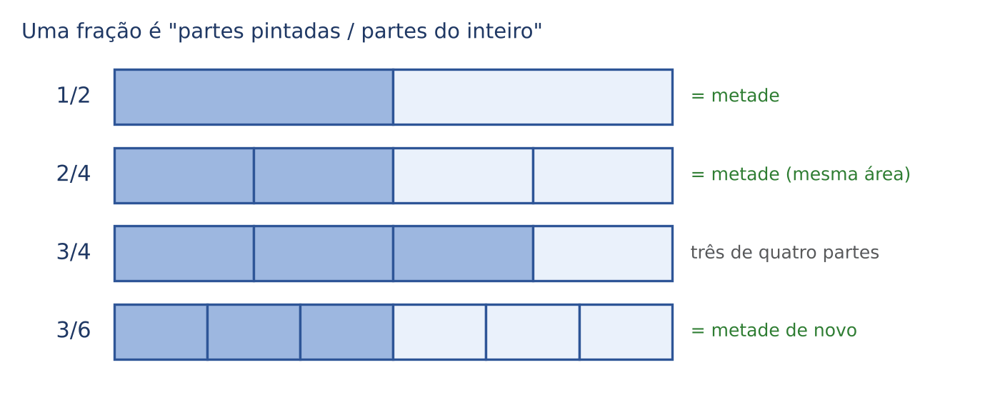

A figura mostra algo essencial: 1/2, 2/4 e 3/6 representam a MESMA quantidade. São frações equivalentes. Isso acontece porque multiplicar (ou dividir) o numerador e o denominador pelo mesmo número não muda o valor da fração: é como cortar cada fatia ao meio, o que dobra o número de fatias tomadas e o número total de fatias, mas a quantidade de pizza continua a mesma.

Uma fração também é uma divisão: 3/4 significa 3 ÷ 4 = 0,75. Essa ponte com os decimais será usada a todo momento (01.3).

### 01.2.2 Simplificar

Simplificar é dividir em cima e embaixo pelo mesmo número, até não dar mais. Exemplo: 18/24.

- 18 e 24 são pares: divida ambos por 2. Fica 9/12.
- 9 e 12 são múltiplos de 3: divida ambos por 3. Fica 3/4.
- 3 e 4 não têm divisor comum (além do 1). Pronto: 18/24 = 3/4.

Você poderia ter dividido tudo de uma vez por 6, que é o maior divisor comum de 18 e 24 (o MDC; o cálculo sistemático de MDC e MMC está no Cap. 21). Mas, na prova, dividir aos poucos é mais seguro.

:::DICA Testes rápidos de divisibilidade
- Por 2: o número termina em 0, 2, 4, 6 ou 8.
- Por 3: a soma dos algarismos é múltiplo de 3 (ex.: 1.236 → 1 + 2 + 3 + 6 = 12, múltiplo de 3).
- Por 4: o número formado pelos dois últimos algarismos é divisível por 4 (ex.: 1.316 → 16, que é 4 × 4; logo 1.316 é divisível por 4).
- Por 5: termina em 0 ou 5.
- Por 6: é divisível por 2 E por 3 ao mesmo tempo (ex.: 1.236 é par e a soma dos algarismos dá 12; logo é divisível por 6).
- Por 9: a soma dos algarismos é múltiplo de 9.
- Por 10: termina em 0.
:::

### 01.2.3 Somar e subtrair frações

Só se somam "fatias do mesmo tamanho". Com denominadores iguais, basta somar os numeradores: 1/7 + 3/7 = 4/7. Com denominadores diferentes, primeiro transformamos as frações em equivalentes com o mesmo denominador.

Exemplo à mão: 1/4 + 1/6.

- Procuramos um número que seja múltiplo de 4 e de 6 ao mesmo tempo. O menor é 12 (o MMC).
- 1/4 vira 3/12 (multiplicamos em cima e embaixo por 3, porque 4 × 3 = 12).
- 1/6 vira 2/12 (multiplicamos em cima e embaixo por 2, porque 6 × 2 = 12).
- 3/12 + 2/12 = 5/12.

Se você não achar o MMC de cabeça, há uma fórmula que sempre funciona: multiplique os denominadores entre si e faça o "produto cruzado" em cima.

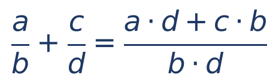

Na fórmula, a e c são os numeradores, b e d são os denominadores, e o ponto (·) significa multiplicação. Aplicando a 1/4 + 1/6: (1 × 6 + 1 × 4)/(4 × 6) = (6 + 4)/24 = 10/24, que simplificado (dividindo por 2) dá 5/12. Mesmo resultado, só que com números maiores no meio do caminho.

A subtração é igual, trocando o sinal. Exemplo: 2/3 − 1/5.

- Denominador comum: 15.
- 2/3 = 10/15 (multiplicamos por 5 em cima e embaixo).
- 1/5 = 3/15 (multiplicamos por 3 em cima e embaixo).
- 10/15 − 3/15 = 7/15.

Para somar um inteiro e uma fração, escreva o inteiro como fração: 1 − 3/8 = 8/8 − 3/8 = 5/8. Esse "1 − fração" é muito usado em problemas do tipo "gastou 3/8; quanto sobrou?".

### 01.2.4 Multiplicar e dividir frações

Multiplicar é mais fácil do que somar: numerador vezes numerador, denominador vezes denominador. Dividir é multiplicar pela fração "virada de cabeça para baixo" (o inverso).

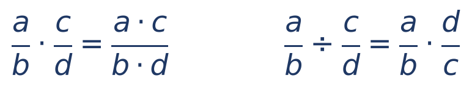

Em palavras: a/b vezes c/d dá (a × c)/(b × d); a/b dividido por c/d é a/b vezes d/c.

Exemplos:

- 2/3 × 9/10 = 18/30. Simplificando por 6: 3/5.
- Atalho: antes de multiplicar, "corte" fatores comuns em cima e embaixo. Em 2/3 × 9/10, o 9 de cima e o 3 de baixo se dividem por 3 (ficam 3 e 1); o 2 de cima e o 10 de baixo se dividem por 2 (ficam 1 e 5). Sobra 1/1 × 3/5 = 3/5. Números menores, menos erros.
- 3/4 ÷ 1/2 = 3/4 × 2/1 = 6/4 = 3/2. Faz sentido: em 3/4 de pizza cabem 1,5 "meias pizzas".

Frações de números inteiros seguem a mesma lógica, porque "de" significa "vezes". Exemplo: 3/5 de 400.

- 3/5 × 400 = (3 × 400)/5.
- Melhor dividir primeiro: 400 ÷ 5 = 80 (um quinto de 400).
- Depois multiplicar: 3 × 80 = 240.

:::DICA "De" é vezes
Em toda a matemática de prova, a palavra "de" depois de uma fração ou porcentagem significa multiplicação: "2/3 de 900" = 2/3 × 900 = 600; "20% de 50" = 0,20 × 50 = 10.
:::

Para comparar duas frações (qual é maior?), multiplique em cruz. Exemplo: 3/4 ou 5/7? Faça 3 × 7 = 21 e 5 × 4 = 20. Como 21 > 20, a fração do 21 (3/4) é a maior. O símbolo > se lê "maior que" e < se lê "menor que".

### 01.2.5 "Fração do que sobrou": o problema preferido da FCC

Este é o ponto que mais derruba candidatos. Quando o enunciado diz "deu 1/3 a A e 1/5 DO QUE SOBROU a B", a segunda fração não incide sobre o total, mas sobre o resto.

:::EXEMPLO Herança dividida em etapas
Uma herança de 12.000 reais: 1/4 vai para A; 1/3 do que sobrou vai para B; o resto fica com C. Quanto recebe C?
- A recebe 1/4 de 12.000 = 12.000 ÷ 4 = 3.000.
- Sobram 12.000 − 3.000 = 9.000.
- B recebe 1/3 de 9.000 (não de 12.000!) = 9.000 ÷ 3 = 3.000.
- C fica com 9.000 − 3.000 = 6.000.
Atalho com frações: depois de A, sobram 3/4; depois de B, sobram 2/3 desse resto. C fica com 3/4 × 2/3 = 6/12 = 1/2 de 12.000 = 6.000.
:::

:::PASSO Como resolver problemas de "fração do que sobrou"
1. Para cada etapa, escreva a fração que SOBRA (1 − fração gasta).
2. Multiplique as frações que sobram, em sequência.
3. O resultado é a fração do total que restou no final.
4. Se o enunciado dá o valor final e pede o total, divida o valor final por essa fração (01.7 mostra por quê).
:::

:::QUESTAO FCC 2025 — TRT 1ª Região — Analista Judiciário, TI (Q3478911)
Prêmio de 15.000 reais: 1/3 dado à esposa e 1/5 do que sobrou dado à filha. Quanto sobrou para o premiado? Gabarito oficial: C (8.000 reais).
Resolução:
- Depois da esposa sobram 2/3 (porque 1 − 1/3 = 2/3): 2/3 de 15.000 = 15.000 ÷ 3 × 2 = 5.000 × 2 = 10.000.
- A filha leva 1/5 desses 10.000 = 2.000; sobram 4/5 de 10.000 = 8.000.
- Atalho: 2/3 × 4/5 = 8/15; 8/15 de 15.000 = 8.000.
Alternativa sedutora: quem aplica 1/5 sobre o total soma 1/3 + 1/5 = 8/15 de presentes e chega a 7.000 (alternativa B). É exatamente o erro de não ler "do que sobrou".
:::

:::QUESTAO FCC 2025 — TRT 15ª Região — Analista Judiciário, Área Administrativa (Q3303214)
Numa peça infantil, 1/6 do público era de adultos e 2/5 das crianças eram meninos. Que fração do público eram meninas? Gabarito oficial: D (1/2).
Resolução:
- Crianças: 1 − 1/6 = 5/6 do público.
- Meninas: 1 − 2/5 = 3/5 das crianças.
- Meninas no público: 3/5 × 5/6. Corte o 5 de cima com o 5 de baixo: 3/6 = 1/2.
Armadilha: a alternativa 2/3 aparece para quem soma ou subtrai frações em vez de multiplicar; a alternativa 1/3 nasce de aplicar 2/5 (meninos) no lugar de 3/5 (meninas): 2/5 × 5/6 = 1/3, que é a fração de MENINOS.
:::

:::QUESTAO FCC 2025 — TRT 15ª Região — Analista Judiciário, Contabilidade (Q3288560)
Uma garrafa cheia enche 6 copos. Após um lanche, das garrafas abertas sobraram 15 vazias, 3 com suco para 2 copos cada e 2 com suco para 1 copo cada. Que fração do suco das garrafas abertas foi consumida? Gabarito oficial: A (14/15).
Resolução. A ideia é medir tudo em "copos", que é a unidade comum.
- Garrafas abertas: 15 + 3 + 2 = 20. Volume total: 20 × 6 = 120 copos.
- Sobrou: 3 × 2 + 2 × 1 = 6 + 2 = 8 copos.
- Consumido: 120 − 8 = 112 copos.
- Fração consumida: 112/120. Simplificando por 8: 14/15.
Armadilha: a pergunta é sobre o VOLUME das garrafas abertas, não sobre o número de garrafas; quem calcula 15/20 (garrafas vazias sobre abertas) chega a 3/4, que nem está entre as alternativas.
:::

:::QUESTAO FCC 2026 — CPU-PE — Gestor Governamental (Q3871916)
Na compra de uma poltrona, pagaram-se 850 reais no ato, que eram 1/3 do preço; na semana seguinte, 1/4 do que ainda se devia; na entrega, o restante mais 120 reais de frete. Quanto se pagou na entrega? Gabarito oficial: B (1.395 reais).
Resolução:
- Se 850 é 1/3 do preço, o preço é 3 × 850 = 2.550.
- Ainda devia: 2.550 − 850 = 1.700.
- Pagou 1/4 de 1.700 = 425. Ficou devendo 1.700 − 425 = 1.275.
- Na entrega: 1.275 + 120 = 1.395.
Armadilha: a alternativa C (1.275) é o saldo sem o frete; a A (1.155) nasce de subtrair o frete em vez de somar.
:::

:::QUESTAO FCC 2025 — TRT 6ª Região — Analista Judiciário, Área Judiciária (Q3214691)
Numa turma, 1/3 vai de ônibus, 1/4 caminhando e os demais de condução própria. Num dia chuvoso, todos foram, mas metade dos que caminham foi de ônibus. Nesse dia, 22 alunos foram de ônibus. Quantos alunos há na turma? Gabarito oficial: B (48).
Resolução. Chame de n o número de alunos (o uso de uma letra para o valor desconhecido é explicado em 01.7).
- Ônibus no dia chuvoso: os de sempre (1/3 de n) mais metade dos que caminham (1/2 de 1/4 = 1/8 de n).
- Fração total: 1/3 + 1/8. Denominador comum 24: 8/24 + 3/24 = 11/24.
- Logo, 11/24 de n = 22. Se 11 partes valem 22, cada parte de 24 vale 2. O total (24 partes) vale 24 × 2 = 48.
Conferência: 1/3 de 48 = 16; 1/8 de 48 = 6; 16 + 6 = 22. Certo.
:::

:::QUESTAO FCC 2024 — Fórum, processos por matéria (Q3088334)
Num fórum, 1/5 dos processos são trabalhistas, 1/7 ambientais e o resto regulatórios ou tributários. Há 260 ambientais e pelo menos 100 tributários. Qual o número MÁXIMO de regulatórios? Gabarito oficial: A (1.096).
Resolução:
- Se 1/7 do total é 260, o total é 7 × 260 = 1.820.
- Trabalhistas: 1/5 de 1.820 = 364.
- Sobram para regulatórios e tributários: 1.820 − 364 − 260 = 1.196.
- Para maximizar os regulatórios, os tributários devem ser o mínimo possível: 100. Regulatórios: 1.196 − 100 = 1.096.
Armadilha: a alternativa E (1.196) esquece os 100 tributários; a C (1.560) esquece os trabalhistas (1.820 − 260).
:::

:::PRATIQUE exercícios elaborados para esta apostila
1. Calcule 5/6 − 1/4.
2. Quanto é 3/8 de 2.400 reais?
3. (Estilo FCC) Um servidor gasta 2/5 do salário com aluguel e 1/3 do restante com alimentação. Sobram 3.000 reais. Qual é o salário?
4. Calcule (2/3 + 1/6) ÷ 5/4.
Resoluções:
1. Denominador comum 12: 5/6 = 10/12 e 1/4 = 3/12. 10/12 − 3/12 = 7/12.
2. 2.400 ÷ 8 = 300 (um oitavo); 3 × 300 = 900 reais.
3. Depois do aluguel sobram 3/5. A alimentação leva 1/3 desse resto; sobram 2/3 dele. Fração final: 3/5 × 2/3 = 6/15 = 2/5 do salário. Se 2/5 do salário valem 3.000, um quinto vale 3.000 ÷ 2 = 1.500 e o salário (5/5) vale 5 × 1.500 = 7.500 reais. Conferência: aluguel 3.000; restam 4.500; alimentação 1.500; sobram 3.000. Certo.
4. Parêntese: 2/3 = 4/6; 4/6 + 1/6 = 5/6. Divisão: 5/6 ÷ 5/4 = 5/6 × 4/5 = 20/30 = 2/3.
:::

## 01.3 Números decimais e a ponte fração ↔ decimal ↔ porcentagem

### 01.3.1 O que é a vírgula

No sistema decimal, cada casa vale dez vezes a casa da direita. Em 352,47: 3 centenas, 5 dezenas, 2 unidades, 4 décimos (4/10) e 7 centésimos (7/100). A vírgula separa a parte inteira da parte "quebrada". No padrão brasileiro, a vírgula é decimal e o ponto separa os milhares (1.234,56).

Transformar fração em decimal é dividir: 3/8 = 3 ÷ 8 = 0,375. Algumas divisões nunca terminam e repetem um padrão (dízimas periódicas): 1/3 = 0,333...; 2/3 = 0,666... Na prova, a FCC costuma escolher números que dão divisões exatas ou pede resposta aproximada.

Transformar decimal em fração é "ler" o decimal: 0,25 são 25 centésimos = 25/100 = 1/4; 0,0375 são 375 décimos de milésimo = 375/10.000, que, simplificando (dividindo por 125), dá 3/80.

### 01.3.2 Tabela de conversões que vale decorar

Estas equivalências aparecem o tempo todo e poupam contas:

| Fração | Decimal | Porcentagem |
|---|---|---|
| 1/2 | 0,5 | 50% |
| 1/3 | 0,333... | 33,33...% |
| 2/3 | 0,666... | 66,66...% |
| 1/4 | 0,25 | 25% |
| 3/4 | 0,75 | 75% |
| 1/5 | 0,2 | 20% |
| 1/8 | 0,125 | 12,5% |
| 3/8 | 0,375 | 37,5% |
| 1/10 | 0,1 | 10% |
| 1/20 | 0,05 | 5% |
| 1/25 | 0,04 | 4% |
| 1/50 | 0,02 | 2% |
| 1/100 | 0,01 | 1% |

### 01.3.3 Operações com decimais

Somar e subtrair: alinhe as vírgulas, uma embaixo da outra, completando com zeros. 12,5 + 3,75 = 12,50 + 3,75 = 16,25.

Multiplicar: ignore as vírgulas, multiplique como se fossem inteiros e, no fim, devolva ao resultado tantas casas decimais quanto a soma das casas dos fatores.

:::EXEMPLO Quanto é 1,05 × 1,05?
- Sem vírgulas: 105 × 105.
- 105 × 100 = 10.500; 105 × 5 = 525; somando: 10.500 + 525 = 11.025.
- Casas decimais: 1,05 tem duas; o outro 1,05 tem duas; total, quatro.
- Devolvendo quatro casas a 11025: 1,1025.
Este número (1,05² = 1,1025) é o montante de 1 real aplicado a 5% ao período por dois períodos em juros compostos (Cap. 3).
:::

Dividir: o truque é eliminar a vírgula do divisor (o número que divide), multiplicando os dois números pela mesma potência de 10. Isso não muda o resultado, pela mesma razão que frações equivalentes têm o mesmo valor.

- 3,6 ÷ 0,12: multiplique ambos por 100 (para o 0,12 virar 12). Fica 360 ÷ 12 = 30.
- 1.360 ÷ 0,8: multiplique ambos por 10. Fica 13.600 ÷ 8 = 1.700.

:::DICA Multiplicar e dividir por 10, 100, 1.000
Multiplicar por 10 anda com a vírgula uma casa para a direita (3,75 × 10 = 37,5); por 100, duas casas (3,75 × 100 = 375). Dividir por 10 anda uma casa para a esquerda (37,5 ÷ 10 = 3,75); por 100, duas casas (37,5 ÷ 100 = 0,375). É exatamente o que se faz ao transformar porcentagem em decimal: 5% = 5 ÷ 100 = 0,05.
:::

### 01.3.4 Arredondamento

Para arredondar para k casas decimais, olhe a casa seguinte (a k + 1): se for 5 ou mais, some 1 à última casa mantida; se for 4 ou menos, apenas corte. Exemplos: 2,3456 com duas casas: a terceira casa é 5, então 2,35. E 1,26824 com duas casas: a terceira é 8, então 1,27; com três casas: a quarta é 2, então 1,268.

:::ATENCAO Arredonde só no final
Arredondar no meio da conta acumula erro. Num cálculo com várias etapas, carregue pelo menos quatro casas decimais e arredonde só a resposta. Se as alternativas forem próximas (por exemplo, 4,50 e 4,55), isso faz diferença.
:::

:::QUESTAO FGV 2024 — Prefeitura de São Lourenço da Mata — Professor de Matemática (Q2449555)
A distância Terra-Sol é de cerca de 8,3 minutos-luz; a distância Terra-Lua, de cerca de 1,3 segundos-luz. Qual número melhor aproxima a razão entre elas? Gabarito oficial: E (383,07).
Resolução. Para comparar, use a MESMA unidade: transforme minutos em segundos.
- 8,3 minutos = 8,3 × 60 segundos = 498 segundos (8 × 60 = 480; 0,3 × 60 = 18; 480 + 18 = 498).
- Razão: 498 ÷ 1,3. Multiplique ambos por 10 para tirar a vírgula: 4.980 ÷ 13 ≈ 383,08.
Armadilha: a alternativa A (6,38) é 8,3 ÷ 1,3, sem converter minutos em segundos. Unidades diferentes são o erro mais comum em razões.
:::

:::PRATIQUE exercícios elaborados para esta apostila
1. Calcule 2,4 × 0,35.
2. Calcule 7,2 ÷ 0,08.
3. Escreva 5/8 como decimal e como porcentagem.
4. Escreva 0,0375 como fração irredutível (que não pode mais ser simplificada).
Resoluções:
1. 24 × 35 = 840. Casas decimais: uma (2,4) + duas (0,35) = três. Resultado: 0,840 = 0,84.
2. Multiplique ambos por 100: 720 ÷ 8 = 90.
3. 5 ÷ 8 = 0,625. Para porcentagem, multiplique por 100: 62,5%.
4. 0,0375 = 375/10.000. Divida por 25: 15/400. Divida por 5: 3/80.
:::

## 01.4 Porcentagem

### 01.4.1 A ideia

"Por cento" significa "a cada cem". Dizer que 30% dos processos do gabinete são de família é dizer que, a cada 100 processos, 30 são de família. Portanto, uma porcentagem é apenas uma fração com denominador 100: 30% = 30/100 = 0,30.

Esta é a regra que você vai usar em TODA a apostila: para fazer conta com porcentagem, transforme-a em decimal, dividindo por 100 (andando duas casas com a vírgula para a esquerda).

- 30% = 0,30.
- 5% = 0,05.
- 2,5% = 0,025.
- 0,5% = 0,005.
- 120% = 1,20.

### 01.4.2 Os três problemas básicos

Todo problema de porcentagem é uma variação da mesma igualdade:

- parte = taxa × todo

em que "taxa" é a porcentagem já escrita em decimal, "todo" é o valor de referência (a BASE, sobre a qual a porcentagem incide) e "parte" é o pedaço correspondente. Conhecendo dois desses valores, acha-se o terceiro.

Primeiro problema: calcular x% de um valor. Quanto é 15% de 3.200?

- parte = 0,15 × 3.200 = 480.
- À mão, sem multiplicar decimais: 10% de 3.200 é 320 (basta dividir por 10); 5% é a metade disso, 160; 15% = 320 + 160 = 480.

Segundo problema: que porcentagem uma parte representa do todo. Dos 180 processos, 45 são de família; que porcentagem é essa?

- taxa = parte ÷ todo = 45 ÷ 180 = 0,25.
- Em porcentagem (multiplicando por 100): 25%.

Terceiro problema: achar o todo a partir da parte. Se 30% de um valor são 240, qual é o valor?

- todo = parte ÷ taxa = 240 ÷ 0,30.
- Multiplicando ambos por 100 para tirar a vírgula: 24.000 ÷ 30 = 800.
- Conferência: 30% de 800 = 0,30 × 800 = 240. Certo.

:::DICA Decomponha a porcentagem em pedaços fáceis
10% = dividir por 10. 1% = dividir por 100. 5% = metade de 10%. 50% = metade. 25% = um quarto. 20% = um quinto. Exemplo: 35% de 1.240 = 30% + 5% = 372 + 62 = 434 (10% = 124; 30% = 372; 5% = 62).
:::

:::QUESTAO FCC 2024 — TRT 20ª Região — Técnico Judiciário (Q3169910)
No mesmo exame, o candidato A acertou 85% das questões e B acertou 90%. B acertou duas questões a mais do que A. Quantas questões tinha o exame? Gabarito oficial: D (40).
Resolução:
- A diferença entre eles é 90% − 85% = 5% do total.
- Esses 5% correspondem a 2 questões. Logo, 0,05 × total = 2.
- Total = 2 ÷ 0,05 = 200 ÷ 5 = 40.
Conferência: 85% de 40 = 34; 90% de 40 = 36; diferença 2. Certo.
:::

:::QUESTAO FCC 2026 — CPU-PE — Gestor Governamental (Q3871921)
Num clube, 40% dos sócios são homens; entre os homens, 35% têm mais de 25 anos; há 224 homens com mais de 25 anos. Quantas são as sócias? Gabarito oficial: D (960).
Resolução. "Porcentagem de porcentagem" se multiplica (o "de" é vezes):
- Homens com mais de 25 anos: 35% de 40% do total = 0,35 × 0,40 = 0,14 do total.
- 0,14 × total = 224, logo total = 224 ÷ 0,14 = 22.400 ÷ 14 = 1.600.
- Mulheres: 100% − 40% = 60%; 0,60 × 1.600 = 960.
Armadilha: a alternativa A (1.600) é o total de sócios, não o de sócias; a C (640) é o número de homens.
:::

:::QUESTAO FCC 2024 — TRT 7ª Região — Analista Judiciário, Arquitetura (Q3481526)
Numa biblioteca, 50% dos livros estão em português e 10% do total são de capa dura; dos livros em português, 8% têm capa dura. Pede-se a porcentagem de livros de capa dura entre os escritos em inglês ou francês. Gabarito oficial: C (12%).
Resolução. Quando não há número, suponha um total de 100 livros: as porcentagens viram quantidades.
- Português: 50 livros; inglês ou francês: os outros 50.
- Capa dura no total: 10 livros.
- Capa dura em português: 8% de 50 = 4.
- Capa dura em inglês ou francês: 10 − 4 = 6.
- Entre os 50 livros em inglês ou francês: 6 ÷ 50 = 0,12 = 12%.
Armadilha: 6% (6 em relação ao total de 100) não está entre as alternativas, mas é o raciocínio de quem esquece de mudar a BASE. A pergunta é "dos livros em inglês ou francês".
:::

:::QUESTAO FCC 2026 — TJ-CE — Analista Judiciário, Sistemas da Informação (Q4240092)
Um novo sistema foi liberado para 1.500 funcionários; 1.200 o usaram. Na pesquisa de satisfação (CSAT), 600 de 800 respondentes se disseram satisfeitos. Na pesquisa NPS, com 600 respostas, houve 300 promotores, 180 neutros e 120 detratores. Pedem-se a taxa de adoção, o CSAT e o NPS. Gabarito oficial: D (80%, 75% e 30).
Resolução. Cada indicador é uma porcentagem com sua própria base:
- Adoção: 1.200 ÷ 1.500 = 12 ÷ 15 = 4 ÷ 5 = 0,80 = 80%.
- CSAT (índice de satisfação): 600 ÷ 800 = 6 ÷ 8 = 0,75 = 75%.
- NPS (*Net Promoter Score*, "saldo de promotores"): porcentagem de promotores menos porcentagem de detratores, sobre os respondentes do NPS. Promotores: 300 ÷ 600 = 50%. Detratores: 120 ÷ 600 = 20%. NPS = 50 − 20 = 30 (expresso como número, sem o símbolo %).
Armadilhas: a alternativa E (125% e 133%) inverte as divisões (todo ÷ parte); a A acerta adoção e CSAT, mas subtrai os NEUTROS em vez dos detratores: (300 − 180) ÷ 600 = 20%.
:::

### 01.4.3 O fator multiplicativo: a ferramenta mais importante do capítulo

Imagine um débito de 2.000 reais acrescido de multa de 20%. O jeito "longo" é calcular a multa (0,20 × 2.000 = 400) e somar (2.000 + 400 = 2.400). O jeito "curto" é perceber que o débito final é 100% do original MAIS 20%, isto é, 120% do original:

- 2.000 × 1,20 = 2.400.

O número 1,20 é o fator de aumento. Do mesmo modo, um desconto de 8% deixa 92% do preço; o fator de desconto é 0,92.

- Aumento de i: multiplique por (1 + i). Exemplos: +12% → × 1,12; +5% → × 1,05; +100% → × 2.
- Desconto (ou redução) de i: multiplique por (1 − i). Exemplos: −8% → × 0,92; −30% → × 0,70; −50% → × 0,5.

Aqui, i é a taxa escrita em decimal (12% = 0,12). Toda a matemática financeira dos Capítulos 2 a 8 é construída sobre essa ideia: o montante de juros compostos, M = C × (1 + i)ⁿ, é apenas a aplicação repetida do fator (1 + i).

### 01.4.4 Aumentos e descontos sucessivos

Quando há várias variações em sequência, cada uma incide sobre o valor JÁ alterado pela anterior. Por isso não se somam as porcentagens: multiplicam-se os fatores.

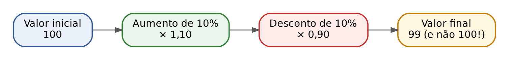

Exemplo clássico: um preço de 100 sobe 10% e depois cai 10%. Volta a 100? Não.

- Depois do aumento: 100 × 1,10 = 110.
- Depois do desconto: 110 × 0,90 = 99. O desconto de 10% incidiu sobre 110, e 10% de 110 (11) é mais que os 10 do aumento.
- Fator acumulado: 1,10 × 0,90 = 0,99, ou seja, queda de 1%.

Outro: aumentos sucessivos de 20% e 30%.

- Fator acumulado: 1,20 × 1,30 = 1,56.
- Aumento total: 1,56 − 1 = 0,56 = 56% (e não 50%).

:::PASSO Como resolver qualquer problema de variações sucessivas
1. Transforme cada variação em fator: aumento de i → (1 + i); desconto de i → (1 − i).
2. Multiplique todos os fatores.
3. Subtraia 1 do resultado: se der positivo, houve aumento; se der negativo, redução.
4. Multiplique por 100 para voltar à porcentagem.
:::

:::QUESTAO FGV 2026 — Descontos compostos sobre um preço P (Q3846024)
Sobre o preço P incidem, em sequência, descontos de 15% e de 5%. Por quanto se deve multiplicar P para obter o preço final? Gabarito oficial: E (323/400).
Resolução:
- Fatores: 1 − 0,15 = 0,85 e 1 − 0,05 = 0,95.
- Produto: 0,85 × 0,95. Sem vírgulas: 85 × 95 = 8.075 (85 × 100 = 8.500 menos 85 × 5 = 425). Quatro casas decimais: 0,8075.
- Em fração: 0,8075 = 8.075/10.000. Dividindo por 25: 323/400.
Armadilha: a alternativa B (4/5 = 0,80) é a de quem soma os descontos (15% + 5% = 20%); o desconto efetivo é 1 − 0,8075 = 19,25%.
:::

:::QUESTAO FCC 2024 — SEPLAN-PI — Analista Governamental, Engenharia Civil (Q3550517)
Um plano prevê crescimento de 20% ao ano, cada ano sobre o anterior, por quatro anos. Qual o aumento total em relação ao valor inicial? Gabarito oficial: E (107,36%).
Resolução:
- Fator anual: 1,20. Em quatro anos: 1,2 × 1,2 × 1,2 × 1,2 = 1,2⁴.
- Calcule por etapas: 1,2² = 1,44; 1,2⁴ = 1,44² = 1,44 × 1,44.
- 144 × 144 = 20.736 (144 × 100 = 14.400; 144 × 44 = 6.336; soma 20.736). Quatro casas decimais: 2,0736.
- Aumento: 2,0736 − 1 = 1,0736 = 107,36%.
Armadilha: a alternativa B (172,80%) nasce de 1,2³ = 1,728, isto é, de contar só três anos e ainda ler o fator como se fosse a variação. A soma simples (4 × 20% = 80%) nem aparece entre as alternativas. Este é o mesmo raciocínio dos juros compostos (Cap. 3).
:::

:::QUESTAO FCC 2024 — SEPLAN-PI — Analista Governamental, Arquitetura (Q3549548)
Uma dívida é paga trimestralmente; cada pagamento é 20% do saldo devedor do momento. Após um ano (quatro trimestres), quanto resta da dívida inicial? Gabarito oficial: E (40,96%).
Resolução. Pagar 20% do saldo equivale a aplicar um desconto de 20%: o saldo é multiplicado por 0,80 a cada trimestre.
- Em quatro trimestres: 0,8⁴ = 0,8² × 0,8² = 0,64 × 0,64.
- 64 × 64 = 4.096; quatro casas decimais: 0,4096 = 40,96%.
Armadilha: a alternativa D (60,08%) e a "intuitiva" 20% (100% − 4 × 20%) ignoram que cada pagamento incide sobre um saldo cada vez menor.
:::

### 01.4.5 Variação percentual e o "efeito base"

A variação percentual responde à pergunta "quanto mudou, em proporção ao valor de partida?":

- variação = (valor novo − valor antigo) ÷ valor antigo

O denominador é SEMPRE o valor antigo (a base). Exemplo: um tributo passou de 80 para 92 reais.

- Diferença: 92 − 80 = 12.
- Variação: 12 ÷ 80 = 0,15 = 15%.

Consequência importante: uma perda e o ganho necessário para recuperá-la não têm a mesma porcentagem, porque as bases são diferentes.

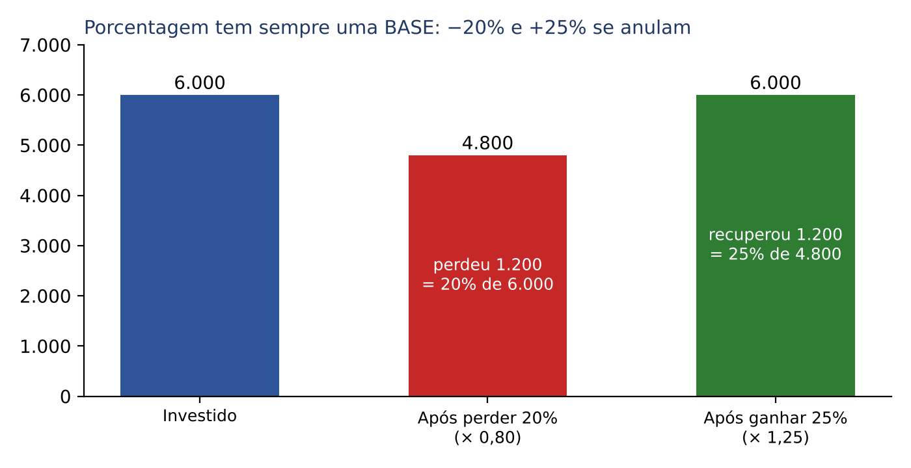

:::QUESTAO FCC 2025 — TRT 2ª Região — Oficial de Justiça Avaliador Federal (Q3660486)
Maria investiu 6.000 reais e perdeu 20%. Que variação positiva é necessária para recuperar o valor inicial? Gabarito oficial: D (25%).
Resolução:
- Depois da perda: 6.000 × 0,80 = 4.800.
- Para voltar a 6.000, falta ganhar 1.200.
- Sobre a nova base: 1.200 ÷ 4.800 = 0,25 = 25%.
- Atalho sem números: o fator de recuperação é 1 ÷ 0,80 = 1,25, isto é, +25%.
Armadilha: a alternativa B (20%) é a resposta "intuitiva" que ignora a mudança de base. A FCC SEMPRE coloca essa alternativa.
:::

Para "desfazer" um aumento ou um desconto, divida pelo fator, nunca subtraia a porcentagem. Se um preço, já aumentado em 25%, é 500 reais, o preço original é 500 ÷ 1,25 = 400 (e não 500 − 25% de 500 = 375).

:::QUESTAO FGV 2024 — Loja de eletrodomésticos (Q3048140)
Com desconto de 10%, a cafeteira passa a custar o dobro do liquidificador; o cliente paga 675 reais pelos dois. Qual o preço original da cafeteira? Gabarito oficial: C (entre 497 e 501 reais; o valor exato é 500).
Resolução. Chame de c o preço original da cafeteira.
- Com desconto: 0,9c. O liquidificador custa metade disso: 0,45c.
- Total: 0,9c + 0,45c = 1,35c = 675.
- c = 675 ÷ 1,35 = 67.500 ÷ 135 = 500.
:::

:::QUESTAO FGV 2024 — Prefeitura de Nova Iguaçu — Analista Tributário (Q3038820)
Uma dívida seria paga no futuro com 30% de juros; antecipada a quitação, o credor deu 10% de desconto sobre o valor futuro, e pagaram-se 37.908 reais. Qual o valor original? Gabarito oficial: B (entre 32.000 e 32.500 reais; exato 32.400).
Resolução:
- Fator total: 1,30 (juros) × 0,90 (desconto) = 1,17.
- Original × 1,17 = 37.908; original = 37.908 ÷ 1,17 = 3.790.800 ÷ 117 = 32.400.
- Conferência: 32.400 × 1,3 = 42.120; 42.120 × 0,9 = 37.908. Certo.
Armadilha: quem faz "+30% − 10% = +20%" divide por 1,20 e acha 31.590 (alternativa A).
:::

### 01.4.6 Pontos percentuais, médias de taxas e porcentagem "sobre o preço de venda"

Pontos percentuais (p.p.) medem a diferença entre duas porcentagens. Se a inadimplência de um tributo passou de 10% para 12%, ela subiu 2 pontos percentuais, mas subiu 20% em termos relativos (2 ÷ 10 = 0,20). A banca troca uma coisa pela outra.

Quando um total é formado por partes que variam de modo diferente, a variação do total é a média das variações, PONDERADA pelo peso de cada parte (a média ponderada é estudada no Cap. 9). O caminho mais seguro é calcular o antes e o depois em reais.

:::QUESTAO FCC 2025 — TRF 4ª Região — Técnico Judiciário, Desenvolvimento de Sistemas (Q3538627)
Uma passagem de 1.200 reais = tarifa 950 + bagagem 130 + taxa de aeroporto 120. A taxa sobe 10%, a tarifa 5% e a bagagem se mantém. O aumento percentual total fica entre: gabarito oficial E (4,5% e 5,0%).
Resolução:
- Aumento da taxa: 10% de 120 = 12.
- Aumento da tarifa: 5% de 950 = 47,5 (10% é 95; metade, 47,5).
- Aumento total: 12 + 47,5 = 59,5.
- Sobre 1.200: 59,5 ÷ 1.200 ≈ 0,0496 = 4,96%.
- Estimativa rápida: 1% de 1.200 é 12; 59,5 é um pouco menos que 5 × 12 = 60, logo um pouco menos que 5%.
Armadilha: quem tira a média simples (10% + 5% + 0%) ÷ 3 = 5% fica na fronteira errada; quem soma 10% + 5% = 15% nem encontra alternativa.
:::

:::QUESTAO FCC 2026 — SEFAZ-CE — Auditor Fiscal da Receita Estadual (Q4221362)
Num consórcio de 80 empresas, 60 recebem 30 mil reais por dia e 20 recebem 20 mil. Renegociado, o primeiro grupo passa a 23 mil e o segundo a 21 mil. O custo diário: gabarito oficial E (tem variação entre 17% e 19%).
Resolução (valores em mil reais):
- Antes: 60 × 30 + 20 × 20 = 1.800 + 400 = 2.200.
- Depois: 60 × 23 + 20 × 21 = 1.380 + 420 = 1.800.
- Variação: (1.800 − 2.200) ÷ 2.200 = −400 ÷ 2.200 = −4 ÷ 22 ≈ −0,1818 = −18,18%.
O custo DIMINUI cerca de 18,2%, o que está entre 17% e 19%. Repare que a alternativa E fala apenas em "variação", sem sinal; as alternativas C e D (diminuição de menos de 10% ou de mais de 20%) são as de quem faz contas apressadas, como dividir 400 por 1.800 (22,2%).
Questão de prova de Auditor Fiscal de 2026: mostra que a FCC cobra porcentagem básica mesmo nas provas fiscais.
:::

:::QUESTAO FCC 2024 — SEAD-PI — Analista Governamental, Engenharia Civil (Q3737622)
Promoções: produto 1 "leve 4, pague 3", com custo unitário promocional de 15 reais; produto 2 "leve 3, pague 2", com custo unitário promocional de 20 reais. Na compra de uma unidade de cada, qual a economia em relação ao preço normal? Gabarito oficial: B (30%).
Resolução. O "custo unitário promocional" é o que se paga dividido pelo que se leva.
- Produto 1: paga 3 preços normais e leva 4. 3 × p₁ ÷ 4 = 15, logo p₁ = 15 × 4 ÷ 3 = 20.
- Produto 2: paga 2 e leva 3. 2 × p₂ ÷ 3 = 20, logo p₂ = 20 × 3 ÷ 2 = 30.
- Preço normal das duas unidades: 20 + 30 = 50. Promocional: 15 + 20 = 35.
- Economia: 15 ÷ 50 = 0,30 = 30%.
Armadilha: calcular a economia sobre o preço promocional (15 ÷ 35 ≈ 43%) ou tirar a média das economias individuais (25% e 33,3%) leva a valores errados.
:::

:::QUESTAO FCC 2025 — TRT 6ª Região — Técnico Judiciário (Q3216574)
Cada caixa de sabonetes custa 254,40 reais e tem 12 embalagens de 4 sabonetes. Acima de 100 caixas, há 5% de desconto no total. Pedido: 6.000 sabonetes. Quanto se paga? Gabarito oficial: D (30.210 reais).
Resolução:
- Sabonetes por caixa: 12 × 4 = 48.
- Caixas: 6.000 ÷ 48 = 125 (48 × 125 = 6.000). Como 125 > 100, há desconto.
- Sem desconto: 125 × 254,40 = 31.800 (254,40 × 100 = 25.440; × 25 = 6.360; soma 31.800).
- Com desconto: 31.800 × 0,95 = 31.800 − 1.590 = 30.210.
Armadilha: a alternativa C (31.800) é o valor sem desconto, para quem não confere a condição "mais de 100 caixas".
:::

:::QUESTAO FGV 2026 — DATAPREV — Analista de TI, Análise de Negócio (Q4388953)
Numa rotina de ETL (extração, transformação e carga de dados, ver Cap. 23), extraem-se 120.000 + 80.000 registros; 10% são duplicados e eliminados; 5% dos restantes são rejeitados; dos válidos, 30% atualizam registros existentes e os demais são novos. Quantos registros novos? Gabarito oficial: B (119.700).
Resolução com fatores:
- Total: 200.000.
- Sem duplicados: × 0,90 = 180.000.
- Válidos: × 0,95 = 171.000.
- Novos (70% dos válidos): × 0,70 = 119.700.
Armadilha: a alternativa E (171.000) é o total de válidos; a C (126.000) é 70% de 180.000, isto é, de quem esquece a etapa de validação (5% rejeitados).
:::

:::QUESTAO FGV 2026 — DATAPREV — Analista de TI, Gestão Econômico-Financeira (Q4391153)
Custo de um serviço: 2.000 reais. Despesas de 35%, tributos de 10% e lucro desejado de 15%, todos SOBRE O PREÇO DE VENDA. Qual o preço? Gabarito oficial: E (5.000 reais).
Resolução. Chame o preço de P. Do preço, 35% + 10% + 15% = 60% vão para despesas, tributos e lucro; os 40% restantes cobrem o custo.
- 0,40 × P = 2.000.
- P = 2.000 ÷ 0,40 = 5.000.
- Conferência: 35% de 5.000 = 1.750; 10% = 500; 15% = 750; custo 2.000. Soma: 5.000. Certo.
Armadilha: a alternativa B (3.200) é 2.000 × 1,60, aplicando os 60% SOBRE O CUSTO. Quando a porcentagem é "sobre o preço de venda", divide-se pelo complemento (1 − 0,60).
:::

:::PRATIQUE exercícios elaborados para esta apostila
1. Quanto é 35% de 1.240 reais?
2. Um produto passou de 250 para 290 reais. Qual foi a variação percentual?
3. Um preço sofre aumentos sucessivos de 10% e 20% e, depois, desconto de 25%. Qual a variação total?
4. Após desconto de 20%, um bem custa 1.360 reais. Qual era o preço original?
5. (Estilo FCC) A arrecadação de um município caiu 40% num ano. Quanto precisa crescer no ano seguinte para voltar ao nível original?
Resoluções:
1. 10% = 124; 30% = 372; 5% = 62; 35% = 372 + 62 = 434 reais.
2. Diferença 290 − 250 = 40. Variação: 40 ÷ 250 = 0,16 = 16%.
3. Fatores: 1,10 × 1,20 × 0,75. 1,10 × 1,20 = 1,32; 1,32 × 0,75 = 0,99. Variação: 0,99 − 1 = −0,01, isto é, queda de 1%.
4. Preço original × 0,80 = 1.360; original = 1.360 ÷ 0,8 = 13.600 ÷ 8 = 1.700 reais.
5. Fator da queda: 0,60. Para voltar: 1 ÷ 0,60 = 1,666..., isto é, crescimento de cerca de 66,7%. Com números: 100 cai para 60; para voltar a 100 faltam 40, e 40 ÷ 60 = 2/3 ≈ 66,7%.
:::

## 01.5 Razão, proporção e regra de três

### 01.5.1 Razão e proporção

Razão é a comparação entre dois números por divisão. "A razão entre servidores e processos é 1 para 50" significa 1/50. Velocidade (km por hora), consumo (km por litro), densidade demográfica (habitantes por km²) e escala de mapa são razões.

Proporção é a igualdade entre duas razões. Exemplo: 3/4 = 15/20 (as duas valem 0,75). A propriedade fundamental das proporções é a multiplicação em cruz: se a/b = c/d, então a × d = b × c. Ela permite achar um termo desconhecido.

- 3/4 = x/20.
- Em cruz: 4 × x = 3 × 20, isto é, 4x = 60.
- Dividindo os dois lados por 4: x = 15.

Duas grandezas são diretamente proporcionais quando, dobrando uma, a outra também dobra (mais cópias, mais custo). São inversamente proporcionais quando, dobrando uma, a outra cai pela metade (mais servidores, menos dias para concluir a mesma tarefa).

Dividir um valor em partes proporcionais a certos números é repartir "por cotas". Exemplo: dividir 1.200 reais em partes proporcionais a 2 e 3. Some as cotas: 2 + 3 = 5. Cada cota vale 1.200 ÷ 5 = 240. As partes são 2 × 240 = 480 e 3 × 240 = 720. (Problemas mais elaborados de divisão proporcional estão no Cap. 21.)

:::QUESTAO FGV 2024 — Prefeitura de São Lourenço da Mata — Professor de Matemática (Q3052550)
Três quartos de M são iguais à quinta parte de N. Que expressão representa a relação? Gabarito oficial: C (15M − 4N = 0).
Resolução:
- Tradução: (3/4) × M = (1/5) × N.
- Para tirar os denominadores, multiplique os dois lados por 20 (múltiplo de 4 e de 5): 20 × 3M/4 = 15M; 20 × N/5 = 4N.
- 15M = 4N, ou, passando 4N para o outro lado, 15M − 4N = 0.
:::

### 01.5.2 Regra de três simples

Regra de três é a técnica de montar uma proporção a partir de um problema. O nome vem de que se conhecem três valores e se busca o quarto.

Exemplo direto: 3 kg de café custam 21 reais; quanto custam 5 kg?

| Quilos | Reais |
|---|---|
| 3 | 21 |
| 5 | x |

- Mais quilos, mais reais: diretamente proporcional. A proporção é montada como está: 3/5 = 21/x.
- Em cruz: 3x = 5 × 21 = 105.
- x = 105 ÷ 3 = 35 reais.
- Raciocínio alternativo, pela unidade: 1 kg custa 21 ÷ 3 = 7; 5 kg custam 5 × 7 = 35.

Exemplo inverso: 6 servidores concluem uma tarefa em 10 dias; em quantos dias 4 servidores a concluem?

- Menos servidores, mais dias: inversamente proporcional.
- Para montar a proporção, INVERTA uma das colunas: 6/4 = x/10 (repare que a coluna dos servidores foi escrita de cabeça para baixo).
- Em cruz: 4x = 60; x = 15 dias.
- Raciocínio pela unidade: a tarefa exige 6 × 10 = 60 "servidores-dia"; com 4 servidores, 60 ÷ 4 = 15 dias.

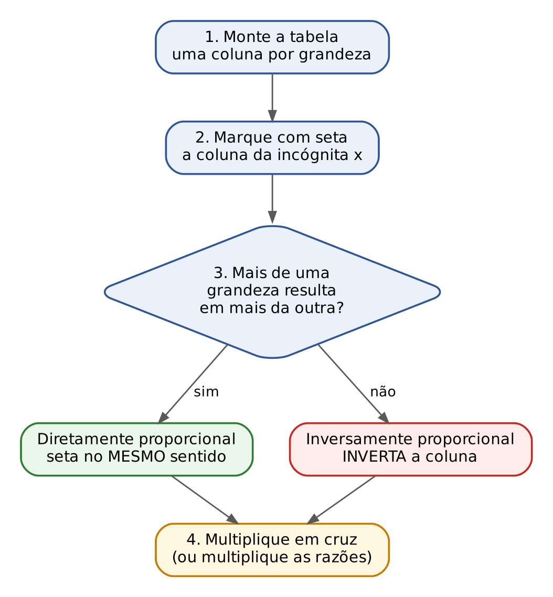

:::QUESTAO FCC 2025 — TRT 6ª Região — Analista Judiciário, Área Judiciária (Q3214690)
Com 16 litros, Tânia percorreu 200 km. Mantido o consumo, quanto percorre com 34 litros? Gabarito oficial: C (425 km).
Resolução. Mais litros, mais quilômetros (direta).
- Consumo: 200 ÷ 16 = 12,5 km por litro.
- 34 × 12,5 = 425 km (34 × 12 = 408; 34 × 0,5 = 17; soma 425).
:::

:::QUESTAO FCC 2025 — TRT 6ª Região — Analista Judiciário, TI (Q3216474)
Uma família consome 5 litros de leite a cada 9 dias. Em três semanas, consome aproximadamente: gabarito oficial D (11,7 litros).
Resolução:
- Três semanas = 21 dias (atenção à conversão de unidade).
- 5/9 = x/21; 9x = 105; x = 105 ÷ 9 = 11,666... ≈ 11,7 litros.
Armadilha: as alternativas próximas (11,5 e 11,9) punem o arredondamento errado; 11,666... arredonda para 11,7.
:::

:::QUESTAO FCC 2025 — TRT 1ª Região — Analista Judiciário, TI (Q3478907)
Um servidor atende 18 pessoas em 90 minutos, em média. Em quanto tempo atende 24? Gabarito oficial: A (2h00min).
Resolução:
- Por pessoa: 90 ÷ 18 = 5 minutos.
- 24 × 5 = 120 minutos = 2 horas.
Armadilha: quem converte 120 minutos como "1h20" ou mistura base decimal com base 60 marca alternativas erradas. Uma hora tem 60 minutos, não 100.
:::

:::QUESTAO FCC 2024 — TRT 7ª Região — Analista Judiciário, Arquitetura (Q3481525)
Uma torneira totalmente aberta enche 50 litros em 1 minuto e meio. Meio aberta, a vazão cai à metade. Quanto tempo leva para encher 125 litros? Gabarito oficial: D (7,5 minutos).
Resolução:
- Totalmente aberta: 50 litros em 1,5 min. Para 125 litros (2,5 vezes mais): 1,5 × 2,5 = 3,75 min.
- Com metade da vazão, o tempo dobra (inversa): 3,75 × 2 = 7,5 minutos.
Armadilha: a alternativa C (3,5) e a "3,75" (sem alternativa) esquecem a meia abertura; quem divide por 2 em vez de multiplicar acha 1,875.
:::

### 01.5.3 Regra de três composta

Quando há três ou mais grandezas, compara-se cada uma, isoladamente, com a grandeza da incógnita, mantendo as outras fixas. As diretas entram como estão; as inversas entram invertidas. Depois, multiplicam-se as razões.

:::EXEMPLO Processos por servidores e dias
8 servidores analisam 120 processos em 5 dias. Quantos processos 10 servidores analisam em 6 dias?
- Incógnita: processos.
- Servidores × processos: mais servidores, mais processos (direta). Razão: 10/8.
- Dias × processos: mais dias, mais processos (direta). Razão: 6/5.
- x = 120 × (10/8) × (6/5).
- 120 × 10/8 = 1.200 ÷ 8 = 150.
- 150 × 6/5 = 900 ÷ 5 = 180 processos.
:::

:::EXEMPLO Com uma grandeza inversa
12 máquinas, trabalhando 8 horas por dia, fazem uma encomenda em 15 dias. Em quantos dias 10 máquinas, trabalhando 9 horas por dia, fazem a mesma encomenda?
- Incógnita: dias.
- Máquinas × dias: menos máquinas, mais dias (inversa). Razão invertida: 12/10.
- Horas por dia × dias: mais horas, menos dias (inversa). Razão invertida: 8/9.
- x = 15 × (12/10) × (8/9) = 15 × 96 ÷ 90 = 1.440 ÷ 90 = 16 dias.
:::

:::QUESTAO FGV 2024 — Acampamento militar (Q3028396)
50 soldados consomem 20 kg de feijão em 5 dias. Quanto consomem 60 soldados em 15 dias? Gabarito oficial: C (72 kg).
Resolução. Ambas as grandezas são diretas em relação ao feijão.
- x = 20 × (60/50) × (15/5) = 20 × 1,2 × 3 = 72 kg.
- Pela unidade: cada soldado consome 20 ÷ (50 × 5) = 0,08 kg por dia; 60 × 15 × 0,08 = 72.
:::

:::QUESTAO FCC 2024 — TRT 20ª Região — Analista Judiciário, TI (Q3171836)
Com 3 galões, um pintor dá uma demão em 165 m². Quantos galões são necessários para duas demãos em 275 m²? Gabarito oficial: E (10).
Resolução:
- Duas demãos em 275 m² equivalem a uma demão em 2 × 275 = 550 m².
- 3 × 550 ÷ 165 = 1.650 ÷ 165 = 10 galões.
Armadilha: quem esquece as duas demãos acha 5 (sem alternativa) e quem arredonda mal 275/165 marca 9 ou 11.
:::

:::PRATIQUE exercícios elaborados para esta apostila
1. Se 4 cópias custam 1,20 real, quanto custam 15 cópias?
2. Cinco servidores digitalizam um acervo em 12 dias. Em quantos dias 3 servidores o fariam?
3. (Estilo FCC) 6 auditores, trabalhando 6 horas por dia, analisam 90 notas fiscais em 5 dias. Quantas notas 8 auditores, trabalhando 5 horas por dia, analisam em 10 dias?
4. Divida 9.000 reais em partes proporcionais a 2, 3 e 4.
Resoluções:
1. Por cópia: 1,20 ÷ 4 = 0,30. 15 × 0,30 = 4,50 reais.
2. Inversa. Total de trabalho: 5 × 12 = 60 servidores-dia. Com 3: 60 ÷ 3 = 20 dias.
3. Todas diretas em relação às notas: x = 90 × (8/6) × (5/6) × (10/5). 90 × 8/6 = 120; 120 × 5/6 = 100; 100 × 10/5 = 200 notas.
4. Cotas: 2 + 3 + 4 = 9; cada cota vale 9.000 ÷ 9 = 1.000. Partes: 2.000, 3.000 e 4.000 reais.
:::

## 01.6 Potências, raízes e notação científica

### 01.6.1 O que é uma potência

Potência é uma multiplicação repetida. Em 2⁵, o 2 é a base (o número que se repete) e o 5 é o expoente (quantas vezes ele aparece na multiplicação):

- 2⁵ = 2 × 2 × 2 × 2 × 2 = 32.
- 10³ = 10 × 10 × 10 = 1.000.
- 1,1² = 1,1 × 1,1 = 1,21.
- (−2)³ = (−2) × (−2) × (−2) = −8 (expoente ímpar mantém o sinal negativo).
- (−2)⁴ = 16 (expoente par torna o resultado positivo).

Lê-se "dois elevado à quinta", "dez ao cubo" (expoente 3), "um vírgula um ao quadrado" (expoente 2).

Por que isso importa para um auditor? Porque os juros compostos são potências: 1.000 reais aplicados a 10% ao mês por 3 meses viram 1.000 × 1,1 × 1,1 × 1,1 = 1.000 × 1,1³ = 1.331 reais (Cap. 3).

### 01.6.2 As propriedades das potências

As propriedades decorrem diretamente da definição; basta escrever as multiplicações por extenso para perceber cada uma.

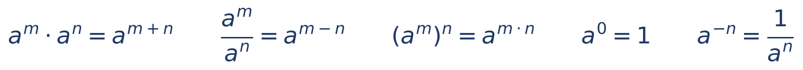

Leitura de cada propriedade (a é a base; m e n são expoentes):

- Multiplicação de potências de mesma base: conserve a base e SOME os expoentes. 2³ × 2⁴ = (2 × 2 × 2) × (2 × 2 × 2 × 2) = 2⁷ = 128.
- Divisão de potências de mesma base: conserve a base e SUBTRAIA os expoentes. 5⁶ ÷ 5⁴ = 5² = 25 (quatro dos seis cincos de cima se cancelam com os de baixo).
- Potência de potência: MULTIPLIQUE os expoentes. (3²)³ = 3² × 3² × 3² = 3⁶ = 729.
- Expoente zero: qualquer número diferente de zero elevado a zero vale 1. Por quê? 5³ ÷ 5³ = 1 (um número dividido por ele mesmo) e, pela regra da divisão, 5³ ÷ 5³ = 5⁰. Logo 5⁰ = 1.
- Expoente negativo: é o inverso da potência positiva. 2⁻³ = 1/2³ = 1/8 = 0,125. E 10⁻² = 1/100 = 0,01.

Há ainda duas regras sobre produtos e frações: (2 × 5)³ = 2³ × 5³ = 8 × 125 = 1.000; (2/3)² = 2²/3² = 4/9.

:::DICA O expoente negativo é o "desconto" da matemática financeira
Nos Capítulos 3, 5 e 6 você verá (1 + i)⁻ⁿ, que é 1 ÷ (1 + i)ⁿ. É o fator que traz um valor futuro para o presente (valor atual). Exemplo: (1,1)⁻² = 1 ÷ 1,21 ≈ 0,8264.
:::

:::PEGADINHA (a + b)² não é a² + b²
(2 + 3)² = 5² = 25, mas 2² + 3² = 4 + 9 = 13. O certo é (a + b)² = a² + 2ab + b², o "quadrado da soma": (2 + 3)² = 4 + 2 × 2 × 3 + 9 = 4 + 12 + 9 = 25. Essa fórmula é a base do cálculo de 1,05² sem calculadora: (1 + 0,05)² = 1 + 2 × 0,05 + 0,05² = 1 + 0,1 + 0,0025 = 1,1025.
:::

Dois "produtos notáveis" que você vai usar:

- (a + b)² = a² + 2ab + b².
- (a + b) × (a − b) = a² − b². Exemplo de cálculo mental: 21 × 19 = (20 + 1) × (20 − 1) = 400 − 1 = 399.

### 01.6.3 Potências de 10 e notação científica

Potências de 10 são "contadores de zeros": 10⁴ = 10.000 (quatro zeros); 10⁻³ = 0,001 (a vírgula anda três casas para a esquerda). A notação científica escreve qualquer número como (número entre 1 e 10) × (potência de 10):

- 256.000 = 2,56 × 10⁵ (a vírgula andou cinco casas para a esquerda).
- 0,00042 = 4,2 × 10⁻⁴ (a vírgula andou quatro casas para a direita).

Para multiplicar números em notação científica, multiplique as partes "da frente" e some os expoentes: (3 × 10⁴) × (2 × 10⁻⁶) = 6 × 10⁻² = 0,06. Para dividir, divida as partes da frente e subtraia os expoentes: (4 × 10⁶) ÷ (8 × 10²) = 0,5 × 10⁴ = 5 × 10³ = 5.000.

Na prova, a notação científica aparece em questões de ordem de grandeza ("aproximadamente quantos bilhões") e em leituras de dados (Cap. 23 e 24).

### 01.6.4 Raízes

A raiz é a operação inversa da potência. A raiz quadrada de 49 (√49) é o número positivo que, elevado ao quadrado, dá 49: 7, porque 7² = 49. A raiz cúbica de 27 (∛27) é 3, porque 3³ = 27. O número pequeno sobre o símbolo da raiz é o índice; quando não aparece, é 2 (raiz quadrada).

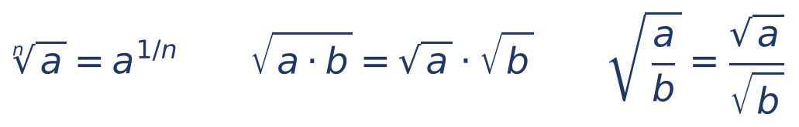

Leitura: a raiz de índice n de a é o mesmo que a elevado a 1/n (expoente fracionário); a raiz de um produto é o produto das raízes; a raiz de uma fração é a raiz do numerador sobre a raiz do denominador.

Exemplos:

- √0,25 = 0,5, porque 0,5 × 0,5 = 0,25.
- √1,1025 = 1,05 (vimos em 01.3 que 1,05² = 1,1025).
- 8^(2/3): primeiro a raiz cúbica de 8, que é 2; depois o quadrado: 2² = 4.
- √50 = √(25 × 2) = √25 × √2 = 5 × 1,414 ≈ 7,07.

Raízes que vale memorizar: √2 ≈ 1,414; √3 ≈ 1,732; √5 ≈ 2,236; √10 ≈ 3,162.

:::EXEMPLO Estimar uma raiz sem calculadora
√200 está entre 14 e 15, porque 14² = 196 e 15² = 225. Como 200 está bem mais perto de 196, a raiz está perto de 14: cerca de 14,1. (O valor exato é 14,142...) Para alternativas do tipo "entre 14 e 15", isso basta.
:::

:::EXEMPLO A raiz na matemática financeira
Uma aplicação rendeu 44% em dois anos, em juros compostos. Qual a taxa anual? Se a taxa anual é i, então (1 + i)² = 1,44. Tirando a raiz quadrada dos dois lados: 1 + i = √1,44 = 1,2. Logo i = 0,2 = 20% ao ano. Esta é a ideia da taxa equivalente, estudada no Cap. 4.
:::

:::PRATIQUE exercícios elaborados para esta apostila
1. Calcule 3⁴ × 3⁻².
2. Calcule 0,2³.
3. Calcule 1,03² sem calculadora.
4. Calcule √1,1025.
5. (Estilo FCC) Calcule (4 × 10⁶) ÷ (8 × 10²) e escreva o resultado por extenso.
Resoluções:
1. Mesma base: some os expoentes: 4 + (−2) = 2. 3² = 9.
2. 0,2 × 0,2 = 0,04; 0,04 × 0,2 = 0,008. (Pela regra das casas: 2 × 2 × 2 = 8, com três casas decimais.)
3. (1 + 0,03)² = 1 + 2 × 0,03 + 0,03² = 1 + 0,06 + 0,0009 = 1,0609.
4. 1,05, porque 1,05² = 1,1025.
5. 4 ÷ 8 = 0,5; 10⁶ ÷ 10² = 10⁴. Resultado: 0,5 × 10⁴ = 5.000.
:::

## 01.7 Equações e sistemas

### 01.7.1 A ideia: a balança

Uma equação é uma igualdade com um valor desconhecido, que se representa por uma letra (x, y, n, P...). Pense numa balança de pratos em equilíbrio: tudo o que você fizer de um lado deve fazer também do outro, para manter o equilíbrio. O objetivo é deixar a letra sozinha de um lado.

Exemplo à mão: 3x + 5 = 20.

- Tire 5 dos dois lados: 3x + 5 − 5 = 20 − 5, isto é, 3x = 15.
- Divida os dois lados por 3: x = 15 ÷ 3 = 5.
- Conferência (sempre!): 3 × 5 + 5 = 15 + 5 = 20. Certo.

A regra prática "passa para o outro lado com a operação inversa" é só um resumo disso: o que está somando passa subtraindo; o que está multiplicando passa dividindo.

### 01.7.2 Equação do 1º grau

É aquela em que a letra aparece com expoente 1 (sem x², x³...). O roteiro:

:::PASSO Como resolver uma equação do 1º grau
1. Se houver frações, multiplique todos os termos dos dois lados pelo MMC dos denominadores, para eliminá-las.
2. Elimine parênteses, aplicando a multiplicação (distributiva): 3 × (x + 2) = 3x + 6.
3. Junte os termos com x de um lado e os números do outro.
4. Divida pelo número que multiplica o x.
5. Confira, substituindo o valor encontrado na equação original.
:::

:::EXEMPLO Equação com frações
x/3 + x/4 = 14.
- MMC de 3 e 4: 12. Multiplique todos os termos por 12: 12 × x/3 = 4x; 12 × x/4 = 3x; 12 × 14 = 168.
- 4x + 3x = 168, isto é, 7x = 168.
- x = 168 ÷ 7 = 24.
- Conferência: 24/3 + 24/4 = 8 + 6 = 14. Certo.
:::

:::EXEMPLO Do texto para a equação
Um servidor recebeu reajuste de 30% e passou a ganhar 3.900 reais. Qual era o salário antes?
- Chame o salário antigo de x. Com o reajuste: x + 0,3x = 1,3x.
- 1,3x = 3.900; x = 3.900 ÷ 1,3 = 39.000 ÷ 13 = 3.000 reais.
:::

O passo mais difícil, para quem vem do Direito, é TRADUZIR o texto em equação. Algumas traduções frequentes:

| No enunciado | Na equação |
|---|---|
| o dobro de um número | 2x |
| a metade de um número | x/2 |
| três quartos de M | (3/4) × M |
| um número aumentado de 20% | 1,2x |
| a soma de dois números é 50 | x + y = 50 |
| A tem 8 a mais que B | A = B + 8 |
| a idade de A daqui a 5 anos | A + 5 |

:::QUESTAO FCC 2026 — CPU-PE — Gestor Governamental (Q3871990)
Uma lata cheia de areia pesa 870 g; com três quartos de areia, 735 g. Quanto pesa a lata vazia? Gabarito oficial: E (330 g).
Resolução. Chame de L a lata e de A a areia que a enche.
- L + A = 870 e L + (3/4)A = 735.
- A diferença entre as duas situações é 1/4 de areia: 870 − 735 = 135. Logo (1/4)A = 135 e A = 540.
- L = 870 − 540 = 330 g.
Armadilha: a alternativa D (135) é o quarto de areia; a C (540) é a areia cheia.
:::

:::QUESTAO FCC 2026 — CPU-PE — Gestor Governamental (Q3871918)
Sérgio ganha 1.750 reais por semana e economiza a mesma quantia por semana. Depois de algum tempo, havia ganhado 29.750 reais; do que economizou, gastou 500 e restam 1.540. Quanto economizou por semana? Gabarito oficial: C (120 reais).
Resolução:
- Número de semanas: 29.750 ÷ 1.750 = 17 (1.750 × 17 = 29.750).
- Total economizado: 1.540 + 500 = 2.040.
- Por semana: 2.040 ÷ 17 = 120.
Armadilha: quem divide só 1.540 por 17 acha cerca de 90,6 (sem alternativa); quem subtrai os 500 em vez de somar acha cerca de 61.
:::

:::QUESTAO FCC 2025 — TRT 15ª Região — Analista Judiciário, Segurança do Trabalho (Q3406653)
O salão custa 1.560 reais de aluguel mais 35 reais por pessoa; cada pessoa paga 65 reais. Quantas pessoas são necessárias para cobrir o aluguel? Gabarito oficial: B (52).
Resolução. Chame de n o número de pessoas.
- Arrecadação: 65n. Despesas: 1.560 + 35n.
- 65n = 1.560 + 35n. Tirando 35n dos dois lados: 30n = 1.560.
- n = 1.560 ÷ 30 = 52.
- Interpretação: cada pessoa "sobra" 30 reais (65 − 35) para o aluguel.
Armadilha: a alternativa C (24) é 1.560 ÷ 65, que esquece a refeição.
:::

:::QUESTAO FCC 2025 — TRT 6ª Região — Técnico Judiciário (Q3216578)
Uma biblioteca gastou 624 reais; 15 livros de preço igual custaram 240 reais; cada manual custou o dobro de cada livro. Quantos manuais? Gabarito oficial: E (12).
Resolução:
- Preço do livro: 240 ÷ 15 = 16. Manual: 32.
- Gasto com manuais: 624 − 240 = 384.
- Quantidade: 384 ÷ 32 = 12.
:::

:::QUESTAO FCC 2026 e 2025 — Trens com passageiros (Q3872148; no mesmo sentido, Q3295804)
Q3872148 (FCC 2026): um trem sai com 45 adultos e algumas crianças; numa escala sobem 39 crianças e 39 adultos, e ninguém desce. Depois da escala, os adultos são 2/5 do total. Quantas crianças havia antes da escala? Gabarito oficial: A (87).
Resolução:
- Adultos depois: 45 + 39 = 84.
- 84 são 2/5 do total; 1/5 é 42; o total é 5 × 42 = 210.
- Crianças depois: 210 − 84 = 126. Antes da escala: 126 − 39 = 87.
Armadilha: a alternativa B (126) é o número de crianças DEPOIS da escala.
Q3295804 (FCC 2025, TRT 15ª Região): mesma estrutura, com 300 mulheres, 260 homens e 260 mulheres embarcando e mulheres = 2/5 do total depois. Mulheres depois: 560 = 2/5 do total → total 1.400; homens depois 840; homens que partiram de Paris: 840 − 260 = 580. Gabarito oficial: A (580).
:::

### 01.7.3 Sistemas de duas equações

Quando há duas incógnitas, precisamos de duas equações. Há dois métodos.

Método da adição: some (ou subtraia) as equações para que uma letra desapareça. Exemplo: x + y = 50 e x − y = 10.

- Somando as duas: (x + y) + (x − y) = 50 + 10, isto é, 2x = 60. Logo x = 30.
- Voltando à primeira: 30 + y = 50, logo y = 20.

Método da substituição: isole uma letra numa equação e substitua na outra. Exemplo: 2x + 3y = 27 e x + y = 11.

- Da segunda: x = 11 − y.
- Substituindo na primeira: 2 × (11 − y) + 3y = 27, isto é, 22 − 2y + 3y = 27, ou 22 + y = 27. Logo y = 5.
- x = 11 − 5 = 6. Conferência: 2 × 6 + 3 × 5 = 12 + 15 = 27. Certo.

:::QUESTAO FCC 2024 — TRT 7ª Região — Analista Judiciário, Arquitetura (Q3481523)
Café + salgado = 12,80; chá + salgado = 11,30; dois cafés + salgado = 17,30. Qual o preço do chá? Gabarito oficial: B (3,00 reais).
Resolução:
- Compare a primeira e a terceira compras: a diferença é exatamente um café. 17,30 − 12,80 = 4,50 = café.
- Salgado: 12,80 − 4,50 = 8,30.
- Chá: 11,30 − 8,30 = 3,00.
Armadilha: a alternativa A (3,50) e a C (4,50, o preço do café) punem quem responde a pergunta errada.
:::

:::QUESTAO FCC 2024 — TRT 7ª Região — Analista Judiciário, Arquitetura (Q3481522)
Numa balança em equilíbrio, de um lado 4 pacotes de açúcar e 2 de aveia; do outro, 3 de açúcar e 6 de aveia. Cada pacote de aveia pesa 300 g. Quanto pesa o de açúcar? Gabarito oficial: A (1.200 g).
Resolução. Chame de a o pacote de açúcar.
- 4a + 2 × 300 = 3a + 6 × 300.
- Tirando 3a dos dois lados e 600 dos dois lados: a = 1.800 − 600 = 1.200 g.
- Pela balança: retirando 3 açúcares e 2 aveias de cada prato, sobra 1 açúcar de um lado e 4 aveias do outro: 4 × 300 = 1.200.
:::

:::QUESTAO FCC 2025 — TRT 15ª Região — Analista Judiciário, Engenharia Civil (Q3406713)
Um time fez 86 pontos em 40 cestas (de 3, 2 ou 1 ponto); foram 12 cestas de 3. Quantas foram de 1 ponto? Gabarito oficial: D (6).
Resolução:
- Pontos das cestas de 3: 12 × 3 = 36. Restam 86 − 36 = 50 pontos em 40 − 12 = 28 cestas.
- Chame de d as cestas de 2 e de u as de 1: d + u = 28 e 2d + u = 50.
- Subtraindo a primeira da segunda: d = 22. Logo u = 28 − 22 = 6.
:::

:::QUESTAO FCC 2025 — TRT 1ª Região — Oficial de Justiça Avaliador Federal (Q3469409)
João comprou 1 memória externa, 3 teclados e 1 monitor por 1.359 reais; Maria comprou 3 memórias, 7 teclados e 3 monitores por 3.951 reais. Quanto custam juntos 1 memória, 1 teclado e 1 monitor? Gabarito oficial: B (1.233 reais).
Resolução. São três incógnitas e só duas equações, mas a pergunta não exige cada preço, só a soma m + t + M.
- Multiplique a compra de João por 3: 3m + 9t + 3M = 4.077.
- Subtraia a compra de Maria: (3m + 9t + 3M) − (3m + 7t + 3M) = 4.077 − 3.951, isto é, 2t = 126. Logo t = 63.
- Da compra de João: m + M = 1.359 − 3 × 63 = 1.359 − 189 = 1.170.
- m + t + M = 1.170 + 63 = 1.233.
Lição: quando faltam equações, a FCC está pedindo uma COMBINAÇÃO das incógnitas, que se obtém combinando as equações.
:::

:::QUESTAO FCC 2025 — TRF 4ª Região — Técnico Judiciário (Q3538938)
André tem 41.000 reais depositados e deposita 4.000 por ano; Luís tem 33.000 e deposita 6.000 por ano. No ano em que os totais de cada um se igualarem, quanto haverá ao todo? Gabarito oficial: D (114.000 reais).
Resolução. Chame de n o número de anos.
- André: 41.000 + 4.000n. Luís: 33.000 + 6.000n.
- Igualando: 41.000 + 4.000n = 33.000 + 6.000n; 8.000 = 2.000n; n = 4.
- Cada um terá 41.000 + 16.000 = 57.000. Total: 114.000.
Armadilha: as demais alternativas são os totais de outros anos: 104.000 é o total após 3 anos (41.000 + 33.000 + 3 × 10.000) e 84.000, após 1 ano. Quem erra o n por um ano cai nelas.
:::

### 01.7.4 Equação do 2º grau

É a equação em que a incógnita aparece ao quadrado: ax² + bx + c = 0, com a diferente de zero. Exemplo: x² − 5x + 6 = 0 (aqui a = 1, b = −5, c = 6). Uma equação do 2º grau pode ter duas soluções (raízes), uma ou nenhuma (nos reais).

Casos simples, sem fórmula:

- Sem o termo b: x² = 49. As soluções são x = 7 e x = −7 (os dois ao quadrado dão 49).
- Sem o termo c: x² − 4x = 0. Coloque x em evidência: x × (x − 4) = 0. Um produto só é zero se um dos fatores for zero: x = 0 ou x = 4.

Caso geral: a fórmula de Bhaskara.

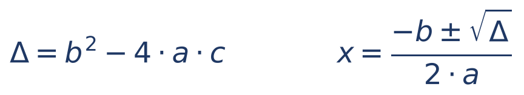

Cada símbolo: a, b e c são os números da equação (a multiplica x², b multiplica x, c é o número solto); Δ (delta) é o "discriminante"; o símbolo ± significa que se faz a conta duas vezes, uma com + e outra com −. Se Δ é positivo, há duas raízes; se é zero, uma; se é negativo, nenhuma raiz real.

:::EXEMPLO Bhaskara passo a passo
x² − 5x + 6 = 0, com a = 1, b = −5, c = 6.
- Δ = (−5)² − 4 × 1 × 6 = 25 − 24 = 1.
- √Δ = 1.
- x = (−(−5) ± 1) ÷ (2 × 1) = (5 ± 1) ÷ 2.
- Com +: 6 ÷ 2 = 3. Com −: 4 ÷ 2 = 2.
- Conferência para x = 3: 9 − 15 + 6 = 0. Certo.
Atalho de soma e produto: as raízes somam −b/a = 5 e multiplicam c/a = 6. Que dois números somam 5 e multiplicam 6? 2 e 3.
:::

:::DICA Na matemática financeira, descarte a raiz negativa
(1 + i)² = 1,21 dá 1 + i = 1,1 ou 1 + i = −1,1. Uma taxa de juros não faz 1 + i negativo; só a primeira serve: i = 0,1 = 10%.
:::

:::QUESTAO FCC 2026 — ARTESP — Analista de Suporte à Regulação (Q3910526)
Maria estudou D dias; a cada dia estudou 5 minutos a mais que no anterior; no terceiro dia estudou 40 minutos; no total, 2.250 minutos. Quantos dias? Gabarito oficial: A (25).
Resolução (usa a soma da PA, que será vista em 01.8, e Bhaskara):
- Primeiro dia: 40 − 2 × 5 = 30 minutos. Último dia: 30 + (D − 1) × 5.
- Soma: (primeiro + último) × D ÷ 2 = 2.250, ou seja, [30 + 30 + 5(D − 1)] × D = 4.500.
- Simplificando o colchete: 60 + 5D − 5 = 55 + 5D. Logo (55 + 5D) × D = 4.500, isto é, 5D² + 55D − 4.500 = 0.
- Dividindo tudo por 5: D² + 11D − 900 = 0.
- Δ = 11² − 4 × 1 × (−900) = 121 + 3.600 = 3.721; √3.721 = 61 (61 × 61 = 3.721).
- D = (−11 + 61) ÷ 2 = 50 ÷ 2 = 25 (a raiz negativa, −36, não serve: dias não são negativos).
Atalho de prova: teste as alternativas. Com D = 25: último dia 30 + 24 × 5 = 150; soma (30 + 150) × 25 ÷ 2 = 180 × 12,5 = 2.250. Certo.
:::

:::PRATIQUE exercícios elaborados para esta apostila
1. Resolva 5x − 7 = 2x + 8.
2. Resolva (x − 2)/3 = (x + 4)/5.
3. Resolva x² − 7x + 10 = 0.
4. (Estilo FCC) O ingresso de adulto custa o dobro do de criança. Três adultos e quatro crianças pagaram 150 reais. Quanto custa o ingresso de criança?
5. Resolva 2x² + 3x − 2 = 0.
Resoluções:
1. Tire 2x dos dois lados: 3x − 7 = 8. Some 7: 3x = 15. x = 5.
2. Em cruz: 5 × (x − 2) = 3 × (x + 4), isto é, 5x − 10 = 3x + 12. Tire 3x e some 10: 2x = 22. x = 11.
3. Soma 7 e produto 10: as raízes são 2 e 5. (Por Bhaskara: Δ = 49 − 40 = 9; x = (7 ± 3) ÷ 2, isto é, 5 ou 2.)
4. Criança: c; adulto: 2c. 3 × 2c + 4c = 150, isto é, 10c = 150; c = 15 reais (adulto 30).
5. a = 2, b = 3, c = −2. Δ = 9 − 4 × 2 × (−2) = 9 + 16 = 25; √25 = 5. x = (−3 ± 5) ÷ 4: com +, 2 ÷ 4 = 1/2; com −, −8 ÷ 4 = −2.
:::

## 01.8 Progressões aritmética e geométrica

### 01.8.1 Progressão aritmética (PA): somar sempre o mesmo número

Uma PA é uma sequência em que cada termo é o anterior MAIS uma constante, chamada razão (r). Exemplos: 3, 7, 11, 15, ... (r = 4); 100, 90, 80, ... (r = −10). Uma aplicação de 1.000 reais a juros simples de 2% ao mês cresce em PA: 1.000; 1.020; 1.040; 1.060... (r = 20). É por isso que os juros simples são "lineares" (Cap. 2).

Para achar um termo qualquer, não é preciso listar todos: do 1º ao n-ésimo termo, a razão foi somada (n − 1) vezes. Para somar todos os termos, use a fórmula ao lado, que vem da observação de que o primeiro mais o último é igual ao segundo mais o penúltimo, e assim por diante.

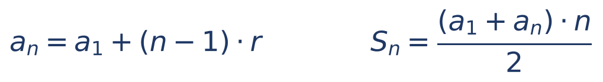

Cada símbolo: aₙ é o termo de posição n (o "n-ésimo" termo); a₁ é o primeiro termo; r é a razão; n é a quantidade de termos (ou a posição); Sₙ é a soma dos n primeiros termos.

:::EXEMPLO PA 3, 7, 11, 15, ...
- Razão: 7 − 3 = 4.
- 10º termo: a₁₀ = 3 + (10 − 1) × 4 = 3 + 36 = 39.
- Soma dos 10 primeiros: S₁₀ = (3 + 39) × 10 ÷ 2 = 42 × 5 = 210.
- Curiosidade útil: a soma 1 + 2 + ... + 100 = (1 + 100) × 100 ÷ 2 = 5.050.
:::

:::QUESTAO FCC 2025 — Prefeitura de São Paulo — Auditor Municipal de Controle Interno (Q3281775)
Uma sequência de inteiros vai de −150 a 800 e contém −93, 40, 97, 229 e 439. Excluindo um desses cinco números, ela passa a ser uma PA. Quantos termos terá? Gabarito oficial: C (51).
Resolução. Numa PA que começa em −150, a distância de qualquer termo até −150 é um múltiplo da razão.
- Distâncias até −150: −93 → 57; 40 → 190; 97 → 247; 229 → 379; 439 → 589; 800 → 950.
- Procure um divisor comum: 57 = 3 × 19; 190 = 10 × 19; 247 = 13 × 19; 589 = 31 × 19; 950 = 50 × 19. Mas 379 ÷ 19 ≈ 19,95 não é inteiro. Logo o intruso é 229 e a razão é 19.
- Número de termos: de −150 a 800 são 950 ÷ 19 = 50 "passos", portanto 50 + 1 = 51 termos.
Atenção ao "+1": de −150 a 800 há 50 passos de 19, mas 51 termos (como numa cerca: 50 vãos exigem 51 estacas). Esquecer o +1 é o erro clássico em PA.
:::

### 01.8.2 Progressão geométrica (PG): multiplicar sempre pelo mesmo número

Uma PG é uma sequência em que cada termo é o anterior MULTIPLICADO por uma constante, a razão q. Exemplos: 2, 6, 18, 54, ... (q = 3); 1.000; 1.100; 1.210; 1.331... (q = 1,1). Uma aplicação a juros compostos de 10% ao período cresce em PG: é por isso que a PG é a espinha dorsal dos Capítulos 3 a 8.

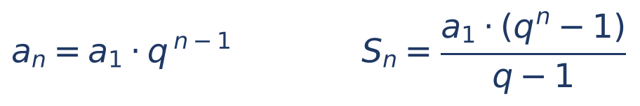

Cada símbolo: aₙ é o termo de posição n; a₁ é o primeiro; q é a razão (o fator); Sₙ é a soma dos n primeiros termos (fórmula válida para q diferente de 1).

:::EXEMPLO PG 2, 6, 18, 54, ...
- Razão: 6 ÷ 2 = 3.
- 6º termo: a₆ = 2 × 3⁵ = 2 × 243 = 486.
- Soma dos 6 primeiros: S₆ = 2 × (3⁶ − 1) ÷ (3 − 1) = 2 × (729 − 1) ÷ 2 = 728.
:::

Quando a razão está entre 0 e 1 (os termos vão diminuindo), a soma de infinitos termos se aproxima de um valor fixo: S = a₁ ÷ (1 − q). Exemplo: 1/2 + 1/4 + 1/8 + ... = (1/2) ÷ (1 − 1/2) = 1. Esse resultado sustenta a fórmula das perpetuidades (Cap. 6).

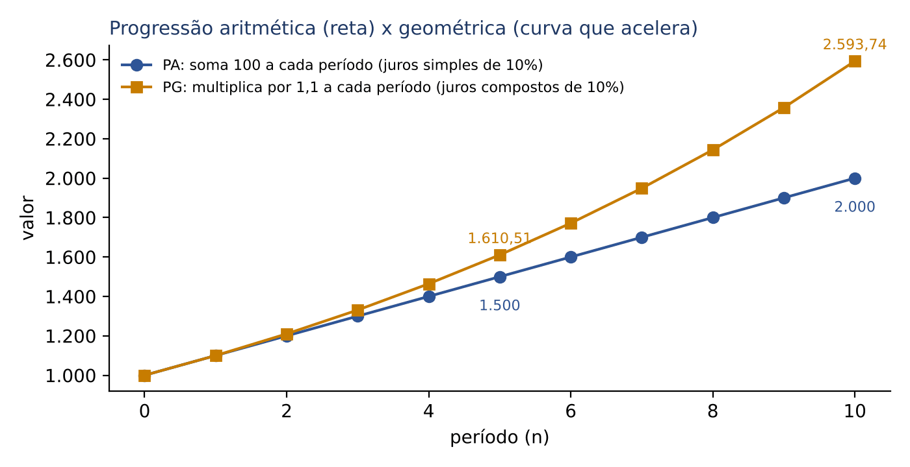

A figura mostra a diferença essencial: a PA cresce em linha reta (soma fixa a cada período); a PG cresce em curva que acelera (o acréscimo é cada vez maior, porque incide sobre um valor cada vez maior). Nos primeiros períodos, quase não se distinguem; com o tempo, a PG dispara. É exatamente a comparação entre juros simples e compostos.

:::QUESTAO FCC 2026 — Cultivo de amebas (Q4231743)
Havia 125 amebas, que dobram a cada dia. Agora há 256.000. Quantos dias se passaram? Gabarito oficial: B (11).
Resolução. É uma PG de razão 2: depois de n dias, há 125 × 2ⁿ amebas.
- 125 × 2ⁿ = 256.000.
- 2ⁿ = 256.000 ÷ 125 = 2.048.
- Potências de 2: 2¹⁰ = 1.024; 2¹¹ = 2.048. Logo n = 11.
Armadilha: a alternativa E (10) é de quem para em 2¹⁰ = 1.024. Na seção 01.9 você verá como resolver o mesmo problema com logaritmos, quando a potência não é "redonda".
:::

:::PRATIQUE exercícios elaborados para esta apostila
1. Na PA 5, 12, 19, ..., qual é o 20º termo?
2. Qual a soma dos 20 primeiros termos dessa PA?
3. Na PG 3, 6, 12, ..., qual o 8º termo e a soma dos 8 primeiros?
4. (Estilo FCC) Um salário de 4.000 reais cresce 5% ao ano, cada ano sobre o anterior. Quanto será após 3 anos? (Considere 1,05³ = 1,157625.)
Resoluções:
1. r = 7. a₂₀ = 5 + 19 × 7 = 5 + 133 = 138.
2. S₂₀ = (5 + 138) × 20 ÷ 2 = 143 × 10 = 1.430.
3. q = 2. a₈ = 3 × 2⁷ = 3 × 128 = 384. S₈ = 3 × (2⁸ − 1) ÷ (2 − 1) = 3 × 255 = 765.
4. PG de razão 1,05: 4.000 × 1,05³ = 4.000 × 1,157625 = 4.630,50 reais. (4 × 1,157625 = 4,6305; com os milhares, 4.630,50.)
:::

## 01.9 Função exponencial e logaritmos

### 01.9.1 A função exponencial

Uma grandeza cresce de forma exponencial quando, a cada período, é multiplicada pelo mesmo fator: amebas que dobram a cada dia (fator 2), uma dívida corrigida a 1% ao mês (fator 1,01), uma população que cresce 2% ao ano (fator 1,02). A fórmula geral é y = a × bˣ, em que a é o valor inicial, b é o fator por período e x é o número de períodos. O montante de juros compostos, M = C × (1 + i)ⁿ, é uma função exponencial (Cap. 3).

Quando o fator está entre 0 e 1, a grandeza decresce exponencialmente: o saldo da dívida que perde 20% a cada trimestre (fator 0,8), na questão Q3549548 (01.4.4).

Resolver uma equação exponencial é achar o expoente. Se os dois lados podem ser escritos como potências da mesma base, basta igualar os expoentes:

- 2ˣ = 32. Como 32 = 2⁵, x = 5.
- 3^(x − 1) = 81. Como 81 = 3⁴, x − 1 = 4, logo x = 5.
- 5^(2x) = 125. Como 125 = 5³, 2x = 3, logo x = 1,5.

Mas e se a equação for 1,05ⁿ = 2 (em quanto tempo um capital dobra a 5% ao período)? Não há como escrever 2 como potência "redonda" de 1,05. Para isso servem os logaritmos.

### 01.9.2 O que é um logaritmo

O logaritmo é a resposta à pergunta: "a que expoente devo elevar a base para obter este número?".

Leitura: o logaritmo de a na base b é x se, e somente se, b elevado a x dá a. Nessa notação, b é a base (positiva e diferente de 1), a é o logaritmando (positivo) e x é o logaritmo.

Exemplos:

- log₂ 8 = 3, porque 2³ = 8.
- log₁₀ 1.000 = 3, porque 10³ = 1.000.
- log₁₀ 0,01 = −2, porque 10⁻² = 0,01.
- log₃ 81 = 4, porque 3⁴ = 81.
- Em qualquer base, log 1 = 0 (porque b⁰ = 1) e log da própria base = 1 (porque b¹ = b).

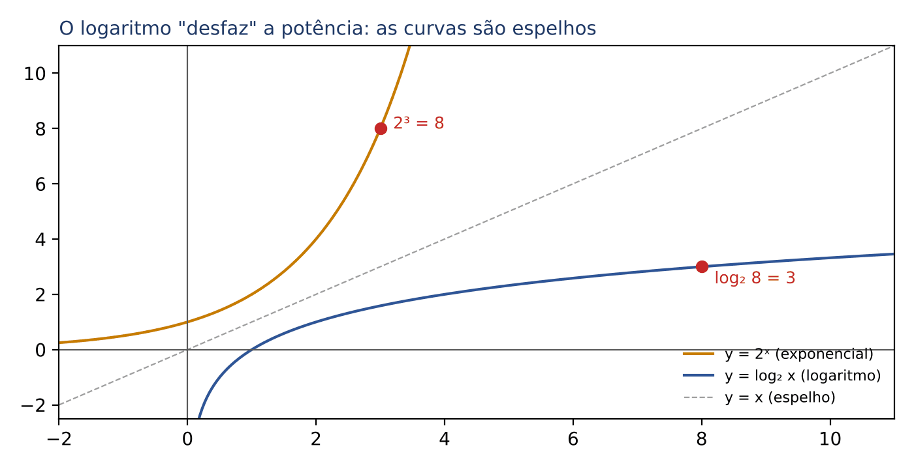

O logaritmo "desfaz" a potência, assim como a raiz desfaz o quadrado. Na figura, as duas curvas são espelhos uma da outra.

Há duas bases especiais:

- Logaritmo decimal (base 10), escrito simplesmente "log": log 100 = 2.
- Logaritmo natural (base e), escrito "ln". O número e ≈ 2,71828 é uma constante, como π, que surge naturalmente quando os juros são capitalizados de forma contínua, "a cada instante" (capitalização contínua, Cap. 4). Valores frequentes: ln 2 ≈ 0,693; ln 1,05 ≈ 0,0488.

### 01.9.3 As propriedades que transformam potências em multiplicações

O poder do logaritmo está em três propriedades, que valem em qualquer base:

Leitura: o log de um produto é a soma dos logs; o log de uma divisão é a diferença dos logs; o log de uma potência é o expoente vezes o log da base. A terceira é a mais importante para a prova: ela "desce" o expoente, que é justamente a incógnita nos problemas de prazo.

Com apenas log 2 ≈ 0,301 e log 3 ≈ 0,477 (valores que a FCC costuma fornecer), calcula-se o log de muitos números:

- log 4 = log 2² = 2 × 0,301 = 0,602.
- log 6 = log (2 × 3) = 0,301 + 0,477 = 0,778.
- log 8 = log 2³ = 3 × 0,301 = 0,903.
- log 5 = log (10 ÷ 2) = log 10 − log 2 = 1 − 0,301 = 0,699.
- log 1,2 = log (12 ÷ 10) = log 12 − 1 = log (4 × 3) − 1 = 0,602 + 0,477 − 1 = 0,079.

Mudança de base: se a prova der logaritmos decimais e você precisar de outra base, use a fórmula abaixo.

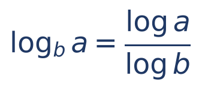

Leitura: o logaritmo de a na base b é o log de a dividido pelo log de b (ambos na mesma base, qualquer que seja ela, por exemplo a decimal ou a natural).

### 01.9.4 Como achar o prazo com logaritmos

:::PASSO Como resolver "em quanto tempo" (equação com a incógnita no expoente)
1. Isole a potência: deixe (fator)ⁿ sozinho de um lado. Exemplo: 1.000 × 1,2ⁿ = 2.000 vira 1,2ⁿ = 2.
2. Aplique log aos dois lados: log (1,2ⁿ) = log 2.
3. Desça o expoente: n × log 1,2 = log 2.
4. Divida: n = log 2 ÷ log 1,2.
5. Use os valores fornecidos pela prova e faça a divisão (ou estime).
:::

:::EXEMPLO Em quanto tempo um capital dobra a 20% ao período?
- 1,2ⁿ = 2.
- n = log 2 ÷ log 1,2 = 0,301 ÷ 0,079 ≈ 3,8 períodos.
- Interpretação: em 3 períodos ainda não dobrou (1,2³ = 1,728); em 4, já passou (1,2⁴ = 2,0736, ver Q3550517).
:::

:::EXEMPLO Com logaritmo natural fornecido
"Dados: ln 2 = 0,69 e ln 1,05 = 0,049." Em quanto tempo um capital dobra a 5% ao mês?
- 1,05ⁿ = 2, logo n = ln 2 ÷ ln 1,05 = 0,69 ÷ 0,049.
- Multiplique ambos por 1.000: 690 ÷ 49 ≈ 14,1 meses.
- Regra prática do 70: o tempo de duplicação é aproximadamente 70 dividido pela taxa em porcentagem. Aqui, 70 ÷ 5 = 14. Ótima para eliminar alternativas.
:::

:::DICA Como a FCC fornece os logaritmos
A prova traz, no enunciado ou numa tabela anexa, valores como "log 2 = 0,30; log 3 = 0,48; log 1,05 = 0,02" ou "ln 2 = 0,69". Use EXATAMENTE os valores dados (mesmo arredondados), porque o gabarito foi calculado com eles. Se a prova der log 1,1 = 0,04 e você usar 0,0414, poderá chegar a um número ligeiramente diferente das alternativas.
:::

:::PRATIQUE exercícios elaborados para esta apostila
1. Calcule log₃ 81.
2. Resolva 5^(2x) = 125.
3. Dados log 2 = 0,30 e log 3 = 0,48, calcule log 18.
4. (Estilo FCC) Em quantos períodos, no mínimo, um capital triplica a juros compostos de 10% ao período? Dados: log 3 = 0,4771 e log 1,1 = 0,0414.
Resoluções:
1. 3⁴ = 81, logo log₃ 81 = 4.
2. 125 = 5³, logo 2x = 3 e x = 1,5.
3. 18 = 2 × 3 × 3 = 2 × 3². log 18 = log 2 + 2 × log 3 = 0,30 + 0,96 = 1,26.
4. 1,1ⁿ = 3; n = 0,4771 ÷ 0,0414 = 4.771 ÷ 414 ≈ 11,5. Como 11 períodos não bastam, são necessários 12 períodos completos. Conferência por estimativa: 0,0414 × 12 = 0,4968, que já passa de 0,4771.
:::

## 01.10 Cálculo mental, estimativa e tabelas financeiras da prova

### 01.10.1 Atalhos de cálculo mental

- Multiplicar por 5: multiplique por 10 e divida por 2. 48 × 5 = 480 ÷ 2 = 240.
- Multiplicar por 25: multiplique por 100 e divida por 4. 25 × 48 = 4.800 ÷ 4 = 1.200.
- Dividir por 0,5: multiplique por 2. Dividir por 0,25: multiplique por 4. Dividir por 0,2: multiplique por 5.
- Multiplicar por 1,1: some ao número a sua décima parte. 1.331 × 1,1 = 1.331 + 133,1 = 1.464,1.
- Multiplicar por 0,9: subtraia do número a sua décima parte. 1.100 × 0,9 = 1.100 − 110 = 990.
- Multiplicar por 1,05: some ao número 5% dele (a metade de 10%). 4.000 × 1,05 = 4.000 + 200 = 4.200.
- Produtos de números próximos: 21 × 19 = 20² − 1 = 399 (01.6.2).

### 01.10.2 Potências de (1 + i) sem calculadora

Muitas questões de juros compostos exigem 1,02¹², 1,05⁴ ou 1,1³. Há três técnicas.

Primeira técnica: elevar ao quadrado repetidamente. 1,05⁴ = (1,05²)² = 1,1025². Calculando 1,1025 × 1,1025 = 1,21550625. Para 1,05⁸, eleva-se de novo ao quadrado. Cada quadrado dobra o expoente.

Segunda técnica: memorizar algumas potências.

| n | 1,1ⁿ | 1,05ⁿ | 1,02ⁿ |
|---|---|---|---|
| 1 | 1,1 | 1,05 | 1,02 |
| 2 | 1,21 | 1,1025 | 1,0404 |
| 3 | 1,331 | 1,157625 | 1,061208 |
| 4 | 1,4641 | 1,2155 | 1,0824 |
| 5 | 1,6105 | 1,2763 | 1,1041 |

Terceira técnica: a aproximação binomial, para taxas pequenas. Para i pequeno, (1 + i)ⁿ ≈ 1 + n × i. Melhor ainda, acrescentando o termo do quadrado:

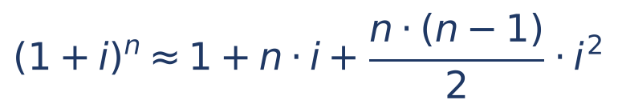

Leitura: i é a taxa em decimal; n é o número de períodos; o termo n × (n − 1) ÷ 2 × i² é a correção que capta os "juros sobre juros".

:::EXEMPLO 1,02¹² sem calculadora
- 1 + n × i = 1 + 12 × 0,02 = 1,24. (Seria o fator dos juros simples.)
- Correção: n × (n − 1) ÷ 2 = 12 × 11 ÷ 2 = 66; i² = 0,0004; 66 × 0,0004 = 0,0264.
- Aproximação: 1,24 + 0,0264 = 1,2664.
- Valor exato: 1,26824... A aproximação errou só na terceira casa decimal, o que basta para escolher entre alternativas.
:::

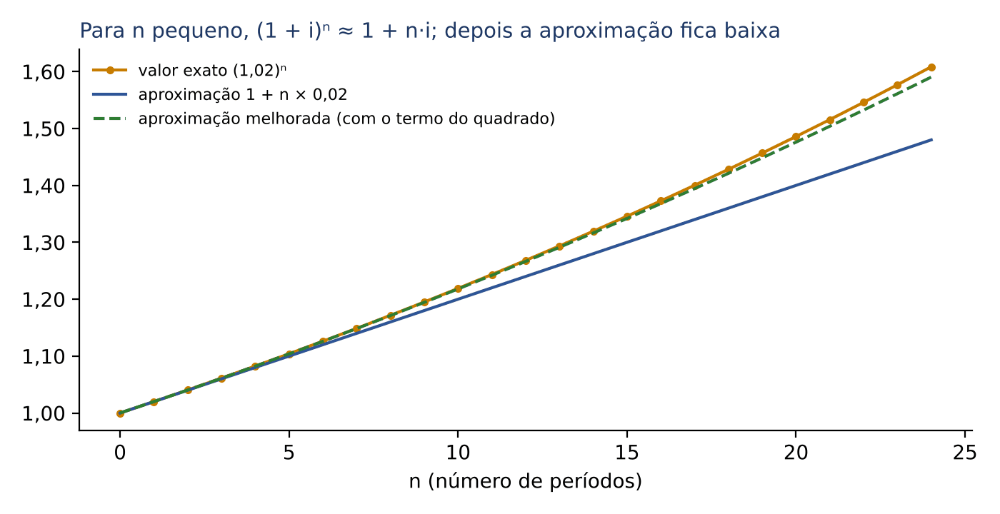

A figura mostra que a aproximação 1 + n·i (juros simples) fica cada vez mais baixa à medida que n cresce, e que o termo do quadrado corrige a maior parte da diferença. Para taxas maiores (10% ou mais) ou prazos longos, prefira os valores fornecidos pela prova.

### 01.10.3 Estimativa e eliminação de alternativas

Sem calculadora, a estimativa é uma arma. Antes de fazer a conta exata, faça a conta "redonda" e veja quantas alternativas sobram.

- Arredonde para números amigáveis: 4.987 × 1,0302 ≈ 5.000 × 1,03 = 5.150. O valor exato (5.137,6) está perto; alternativas como 4.000 ou 6.000 caem de imediato.
- Confira a ordem de grandeza: o resultado está nas centenas, milhares ou milhões?
- Teste as alternativas: em equações, substitua cada alternativa no enunciado (foi o atalho da Q3910526, em 01.7.4). Comece pela alternativa do meio, em valor: se der grande demais, as maiores também estão eliminadas.
- Desconfie da alternativa "intuitiva": somar porcentagens sucessivas, esquecer a mudança de base, esquecer o "+1" de uma PA. A FCC sempre a inclui.

### 01.10.4 As tabelas financeiras da prova

Em questões de juros compostos, rendas e amortização, a FCC costuma fornecer, no enunciado ou num anexo, tabelas com fatores já calculados. As mais comuns são a do fator de acumulação de capital, (1 + i)ⁿ, e a do fator de valor atual de uma série de pagamentos iguais (FVA), cuja fórmula é dada abaixo apenas para você reconhecê-la (o uso é ensinado no Cap. 6).

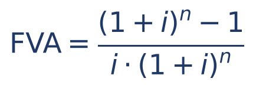

Leitura: i é a taxa por período, em decimal; n é o número de pagamentos; o FVA multiplicado pelo valor de cada parcela dá o valor à vista da série.

Trecho de uma tabela de (1 + i)ⁿ, como as que aparecem na prova (valores conferidos em Python, com quatro casas):

| n | 1% | 2% | 3% | 4% | 5% |
|---|---|---|---|---|---|
| 1 | 1,0100 | 1,0200 | 1,0300 | 1,0400 | 1,0500 |
| 2 | 1,0201 | 1,0404 | 1,0609 | 1,0816 | 1,1025 |
| 3 | 1,0303 | 1,0612 | 1,0927 | 1,1249 | 1,1576 |
| 4 | 1,0406 | 1,0824 | 1,1255 | 1,1699 | 1,2155 |
| 5 | 1,0510 | 1,1041 | 1,1593 | 1,2167 | 1,2763 |
| 6 | 1,0615 | 1,1262 | 1,1941 | 1,2653 | 1,3401 |
| 8 | 1,0829 | 1,1717 | 1,2668 | 1,3686 | 1,4775 |
| 10 | 1,1046 | 1,2190 | 1,3439 | 1,4802 | 1,6289 |
| 12 | 1,1268 | 1,2682 | 1,4258 | 1,6010 | 1,7959 |

Trecho de uma tabela de FVA:

| n | 1% | 2% | 3% | 4% | 5% |
|---|---|---|---|---|---|
| 3 | 2,9410 | 2,8839 | 2,8286 | 2,7751 | 2,7232 |
| 6 | 5,7955 | 5,6014 | 5,4172 | 5,2421 | 5,0757 |
| 10 | 9,4713 | 8,9826 | 8,5302 | 8,1109 | 7,7217 |
| 12 | 11,2551 | 10,5753 | 9,9540 | 9,3851 | 8,8633 |

:::PASSO Como usar uma tabela financeira
1. Identifique QUAL fator a tabela traz (acumulação, valor atual de um pagamento único, valor atual de série...). O título e a fórmula no cabeçalho dizem isso.
2. Confira se a taxa e o prazo estão na MESMA unidade (taxa mensal com prazo em meses). Se não estiverem, converta antes (Cap. 4).
3. Localize a linha (n) e a coluna (i) e leia o fator no cruzamento.
4. Multiplique (ou divida, conforme a fórmula) o valor do problema pelo fator.
5. Use o fator com as casas decimais dadas; não "melhore" o valor, pois o gabarito foi feito com ele.
:::

:::EXEMPLO Lendo as tabelas
1. Quanto valem 3.000 reais aplicados a 3% ao mês por 8 meses, em juros compostos? Linha 8, coluna 3%: 1,2668. Montante: 3.000 × 1,2668 = 3.800,40 reais.
2. Qual o valor à vista de 12 parcelas mensais de 500 reais, à taxa de 2% ao mês (primeira parcela daqui a um mês)? Linha 12, coluna 2% da tabela de FVA: 10,5753. Valor à vista: 500 × 10,5753 = 5.287,65 reais.
3. Quando a prova dá o fator na forma de potência negativa, "considere 1,1⁻³ = 0,7513", ela está entregando 1 ÷ 1,1³ pronto: um valor de 13.310 reais daqui a 3 períodos vale hoje 13.310 × 0,7513 ≈ 10.000 reais (o valor exato é 13.310 ÷ 1,331 = 10.000). Multiplicar pelo fator dado poupa uma divisão difícil.
:::

:::PRATIQUE exercícios elaborados para esta apostila
1. Calcule 1,04³ sem calculadora.
2. Estime 1,01²⁴ pela aproximação binomial.
3. Calcule 25 × 48 mentalmente.
4. (Estilo FCC) Usando a tabela de (1 + i)ⁿ desta seção, quanto valem 10.000 reais aplicados a 5% ao período por 6 períodos?
Resoluções:
1. 1,04² = 1 + 0,08 + 0,0016 = 1,0816. Depois, 1,0816 × 1,04 = 1,0816 + 0,043264 (que é 4% de 1,0816) = 1,124864.
2. 1 + 24 × 0,01 = 1,24. Correção: 24 × 23 ÷ 2 = 276; 276 × 0,0001 = 0,0276. Aproximação: 1,2676. (Exato: 1,2697.)
3. 25 × 48 = 4.800 ÷ 4 = 1.200.
4. Linha 6, coluna 5%: 1,3401. Montante: 10.000 × 1,3401 = 13.401 reais.
:::

## 01.11 Resumo para revisão pré-prova

| Conceito | Fórmula ou regra | Quando usar | Armadilha |
|---|---|---|---|
| Ordem das operações | parênteses → potências → × e ÷ → + e − | expressões numéricas | −3² = −9, mas (−3)² = 9 |
| Regra de sinais | sinais iguais: +; diferentes: − | × e ÷ com negativos | não vale para a soma |
| Soma de frações | denominador comum (MMC) | partes de um todo | não somar denominadores |
| Fração de fração | multiplicar as frações | "do que sobrou" | aplicar a 2ª fração sobre o total |
| Porcentagem | parte = taxa × todo | x% de y; achar o todo | esquecer de dividir por 100 |
| Fator | aumento × (1 + i); desconto × (1 − i) | qualquer variação | somar porcentagens sucessivas |
| Variação percentual | (novo − antigo) ÷ antigo | crescimento, queda, recuperação | base errada (−20% pede +25%) |
| Desfazer variação | dividir pelo fator | preço antes do aumento | subtrair a porcentagem |
| Sobre o preço de venda | preço = custo ÷ (1 − soma das %) | markup, tributos "por dentro" | multiplicar o custo por (1 + %) |
| Regra de três | direta: como está; inversa: inverter | proporções | não identificar a inversa |
| Potências | somar, subtrair, multiplicar expoentes | juros compostos | (a + b)² ≠ a² + b² |
| Raiz | ⁿ√a = a^(1/n) | taxa equivalente | esquecer que √ é a inversa do quadrado |
| Equação 1º grau | operação inversa dos dois lados | problemas com texto | não conferir a resposta |
| Bhaskara | Δ = b² − 4ac; x = (−b ± √Δ) ÷ 2a | equações com x² | aceitar raiz negativa para taxa ou prazo |
| PA | aₙ = a₁ + (n − 1)r; Sₙ = (a₁ + aₙ)n ÷ 2 | juros simples, sequências | esquecer o +1 na contagem |
| PG | aₙ = a₁qⁿ⁻¹; Sₙ = a₁(qⁿ − 1) ÷ (q − 1) | juros compostos, crescimento | usar n em vez de n − 1 |
| Logaritmo | log (aⁿ) = n log a | prazo (incógnita no expoente) | não usar os valores dados |
| Aproximação | (1 + i)ⁿ ≈ 1 + ni + n(n − 1)i² ÷ 2 | potências sem calculadora | usar com taxa alta ou prazo longo |

Formulário do capítulo:

- Porcentagem: parte = taxa × todo, com a taxa em decimal (5% = 0,05).
- Fator de aumento: (1 + i); fator de desconto: (1 − i); variações sucessivas: multiplique os fatores.
- Variação percentual: (V novo − V antigo) ÷ V antigo.
- Proporção: a/b = c/d ⇒ a × d = b × c.
- Potências: aᵐ × aⁿ = aᵐ⁺ⁿ; aᵐ ÷ aⁿ = aᵐ⁻ⁿ; (aᵐ)ⁿ = aᵐⁿ; a⁰ = 1; a⁻ⁿ = 1 ÷ aⁿ.
- Bhaskara: Δ = b² − 4ac; x = (−b ± √Δ) ÷ (2a). Soma das raízes −b/a; produto c/a.
- PA: aₙ = a₁ + (n − 1) × r; Sₙ = (a₁ + aₙ) × n ÷ 2.
- PG: aₙ = a₁ × qⁿ⁻¹; Sₙ = a₁ × (qⁿ − 1) ÷ (q − 1); PG infinita com 0 < q < 1: S = a₁ ÷ (1 − q).
- Logaritmo: o logaritmo de a na base b é x quando bˣ = a; log (a × c) = log a + log c; log (a ÷ c) = log a − log c; log aⁿ = n × log a; mudança de base: logaritmo de a na base b = log a ÷ log b.
- Prazo: (1 + i)ⁿ = k ⇒ n = log k ÷ log (1 + i). Regra do 70: duplicação em ≈ 70 ÷ (taxa em %).
- Valores úteis: log 2 ≈ 0,301; log 3 ≈ 0,477; ln 2 ≈ 0,693; e ≈ 2,718; √2 ≈ 1,414; √3 ≈ 1,732.

## 01.12 Questões do capítulo

Comentadas em box. FCC: Q3478909, Q3445883, Q3478911, Q3303214, Q3288560, Q3871916, Q3214691, Q3088334, Q3169910, Q3871921, Q3481526, Q4240092, Q3550517, Q3549548, Q3660486, Q3538627, Q4221362, Q3737622, Q3216574, Q3214690, Q3216474, Q3478907, Q3481525, Q3171836, Q3871990, Q3871918, Q3406653, Q3216578, Q3872148, Q3295804, Q3481523, Q3481522, Q3406713, Q3469409, Q3538938, Q3910526, Q3281775, Q4231743. FGV: Q2449555, Q3846024, Q3048140, Q3038820, Q4388953, Q4391153, Q3052550, Q3028396.

Outras questões do banco sobre o tema:

| Q | Banca/ano | Subtema | Gabarito |
|---|---|---|---|
| Q4086752 | FGV 2026 | média de rendimentos com pesos iguais: (−5% + x) ÷ 2 = 10% ⇒ x = 25% | E |
| Q4090621 | FGV 2026 | reajuste tarifário: 4,00 × (1 + 0,12 − 0,03) = 4,36 | B |
| Q3052558 | FGV 2024 | PA de 45 a 255 com r = 7: 31 termos; a₁₆ = 150 | D |
| Q3782881 | FGV 2025 | sistema linear de três incógnitas (dados em imagem, não disponíveis no banco) | D |
| Q3266906 | FGV 2025 | reajuste acumulado pelo INCC (tabela em imagem, não disponível) | E |
| Q3643165 | FGV 2025 | reajuste acumulado pelo INCC mês a mês (tabela em imagem, não disponível) | A |
| Q4231742 | FCC 2026 | maior aumento percentual lido em gráfico (imagem não disponível) | C |
| Q4221360 | FCC 2026 | porcentagem lida em gráfico de setores, SEFAZ-CE (imagem não disponível) | B |
| Q3910527 | FCC 2026 | equação (imagem não disponível) | C |
| Q3596192 | FCC 2025 | economia percentual em promoção (tabela em imagem, não disponível) | E |
| Q3336232 | FCC 2025 | preços com desconto à vista (imagem não disponível) | B |
| Q3089759 | FCC 2024 | expressão numérica (imagem não disponível) | E |

:::NOTA Notas de verificação
- Todas as contas dos exemplos, dos boxes PRATIQUE e das 46 questões comentadas foram conferidas em Python (frações exatas com o módulo fractions; potências, raízes, logaritmos e fatores das tabelas calculados diretamente). Os trechos das tabelas de (1 + i)ⁿ e de FVA foram gerados em Python e arredondados para quatro casas.
- Todos os gabaritos oficiais do banco conferem com as resoluções; nenhum gabarito discutível. Em Q4221362 (SEFAZ-CE), a alternativa correta fala em "variação entre 17% e 19%" sem indicar o sentido; o custo diminui 18,18%. Em Q4090621 (FGV, reajuste tarifário), adotou-se a fórmula aditiva (IRT − fator X); a fórmula multiplicativa daria 4,3456, que também aponta para a alternativa B.
- Em Q3481526, a pergunta foi interpretada como porcentagem de capa dura ENTRE os livros em inglês ou francês (12%), único caminho compatível com o gabarito.
- Em Q3737622, "custo unitário promocional" foi lido como valor pago dividido pelas unidades levadas, único caminho compatível com o gabarito (30%).
- Doze questões do lote dependem de imagens (gráficos, tabelas ou fórmulas) ausentes do banco local; foram listadas na tabela com o gabarito oficial, sem resolução.
- O lote tem 44 questões FCC; todas as 38 com dados completos foram comentadas, além de 8 FGV: 46 questões em 45 boxes (as duas questões de trem, Q3872148 e Q3295804, estão num só box). Isso supera ligeiramente o teto orientativo de 40 boxes; optou-se por não deixar nenhuma questão FCC sem comentário.
- As explicações sobre "de onde nasce" cada alternativa errada foram reconstruídas por cálculo; quando não se identificou a origem de uma alternativa, ela não foi atribuída a um erro específico.
- Não foram consultados os PDFs do Google Drive indicados no briefing: o conteúdo é matemática elementar estável, e as fontes principais foram o banco local e o próprio cálculo. Nenhuma lei é citada neste capítulo.
- O conceito de NPS (Q4240092) foi explicado na forma usual (porcentagem de promotores menos porcentagem de detratores).
- 30/10/2026: a DICA "Testes rápidos de divisibilidade" (01.2.2), à qual o Cap. 21 remete, foi completada com os testes por 4 e por 6, que o Cap. 21 menciona.
:::
