# CAPÍTULO 02 — JUROS SIMPLES: CAPITAL, TAXA, PRAZO, JUROS E MONTANTE; TAXAS PROPORCIONAIS; PRAZO MÉDIO, TAXA MÉDIA E CAPITAIS EQUIVALENTES

:::INCIDENCIA
Edital SEFAZ/SC 01/2026 — Matemática Financeira, Estatística e Raciocínio Lógico: "Juros simples. Montante e juros. Taxas equivalentes. Capitais equivalentes" (no regime simples). Nível A+.
Lote do banco: 12 questões (FCC 5, FGV 7). A FCC cobra sobretudo: achar o capital a partir do montante, converter taxa anual em mensal (taxas proporcionais), problemas encadeados (montante de uma aplicação vira capital de outra) e substituição de dívidas por pagamento único (capitais equivalentes com data focal).
:::

:::ESQUEMA O que você vai aprender e o que precisa saber antes
Pré-requisitos (Cap. 1): transformar porcentagem em decimal (5% = 0,05), multiplicar e dividir decimais, regra de três simples, resolver equação do 1º grau (isolar a incógnita) e média ponderada (aprofundada no Cap. 9).
- 2.1 A ideia de juros: o "aluguel" do dinheiro e os cinco personagens (capital, juros, taxa, prazo e montante).
- 2.2 A fórmula dos juros simples: J = C × i × n.
- 2.3 O montante: M = C × (1 + i × n) e o gráfico em linha reta.
- 2.4 Taxa e prazo na mesma unidade: taxas proporcionais, ano comercial e ano civil, juros comerciais e exatos, contagem de dias.
- 2.5 As quatro perguntas da prova: achar o capital, a taxa, o prazo ou resolver problemas encadeados.
- 2.6 Juros simples no dia a dia jurídico: juros de mora de 1% ao mês.
- 2.7 Capitais equivalentes no regime simples e a importância da data focal.
- 2.8 Taxa média e prazo médio.
:::

## 02.1 A ideia de juros: o aluguel do dinheiro

### 02.1.1 Por que existem juros

Pense num imóvel. Quem usa o apartamento de outra pessoa paga aluguel, porque o dono abriu mão de usá-lo durante aquele tempo. Com o dinheiro acontece exatamente o mesmo. Quem empresta fica sem o dinheiro por um tempo; quem toma emprestado usa um dinheiro que não é seu. A remuneração por esse uso tem nome: JUROS.

Juros, portanto, são o aluguel do dinheiro. E, como todo aluguel, dependem de três coisas: quanto se alugou (o valor emprestado), qual é o "preço" combinado por período (a taxa) e por quanto tempo durou o uso (o prazo).

A mesma lógica vale nos dois sentidos. Quando você aplica dinheiro no banco, é você quem empresta ao banco, e ele lhe paga juros. Quando você atrasa um tributo, é como se o Estado tivesse "emprestado" a você aquele valor durante o atraso, e por isso cobra juros de mora.

### 02.1.2 Os cinco personagens

Toda questão de juros simples gira em torno de cinco grandezas. Decore os nomes, porque a prova os usa sem explicar.

- Capital (C): o valor inicial, aquele que é emprestado ou aplicado no começo. Também é chamado de principal, valor presente, valor atual ou valor aplicado.
- Juros (J): o valor do "aluguel", em dinheiro. É o quanto o capital rendeu (ou custou).
- Taxa (i): o percentual de juros cobrado POR PERÍODO. "2% ao mês" quer dizer que, a cada mês, os juros correspondem a 2% do capital. A letra i vem do inglês *interest* (juro).
- Prazo (n): o número de períodos durante os quais o dinheiro ficou emprestado (meses, anos, dias). Também chamado de tempo ou período (às vezes indicado pela letra t).
- Montante (M): o valor final, que é o capital somado aos juros. Também chamado de valor futuro, valor de resgate ou valor nominal.

A relação mais básica de todas, que vale em QUALQUER regime de juros, é esta: o montante é o capital mais os juros.

- M = C + J

Dela saem duas consequências imediatas, que você vai usar o tempo todo:

- J = M − C (os juros são a diferença entre o que se recebeu no fim e o que se aplicou no começo);
- C = M − J (o capital é o montante sem os juros).

:::EXEMPLO Primeiro contato com os personagens
Você aplicou 2.000 reais e, depois de 5 meses, resgatou 2.300 reais. Quem é quem?
- Capital: C = 2.000 (o valor aplicado no início).
- Montante: M = 2.300 (o valor resgatado no fim).
- Prazo: n = 5 meses.
- Juros: J = M − C
- J = 2.300 − 2.000
- J = 300
A taxa ainda não sabemos; vamos aprender a achá-la em 02.5.
:::

### 02.1.3 Taxa percentual e taxa unitária (decimal)

A taxa aparece no enunciado em porcentagem ("3% ao mês"), mas, para fazer contas, você deve SEMPRE transformá-la em número decimal. Porcentagem quer dizer "por cem": 3% é 3 dividido por 100.

- 3% = 3 ÷ 100 = 0,03
- 12% = 12 ÷ 100 = 0,12
- 1,5% = 1,5 ÷ 100 = 0,015
- 0,8% = 0,8 ÷ 100 = 0,008
- 150% = 150 ÷ 100 = 1,5

O atalho prático: para dividir por 100, ande com a vírgula duas casas para a esquerda (completando com zeros se faltar casa). Em 1,5%, a vírgula anda duas casas e vira 0,015. Isso foi visto no Cap. 1; aqui basta lembrar a regra.

O número decimal (0,03) é chamado de taxa unitária; a forma com o símbolo % (3%) é a taxa percentual. As fórmulas deste capítulo trabalham com a taxa unitária.

:::PEGADINHA Usar "3" no lugar de "0,03"
O erro mais comum de quem está começando é colocar a taxa na fórmula como número inteiro. Se você calcular os juros de 1.000 reais a 3% ao mês por 2 meses fazendo 1.000 × 3 × 2, vai achar 6.000 reais de juros, um absurdo (seis vezes o capital em dois meses). A conta certa é 1.000 × 0,03 × 2 = 60. Use o bom senso como alarme: juros de poucos por cento ao mês, por poucos meses, são uma fração pequena do capital.
:::

### 02.1.4 O que torna os juros "simples"

Volte ao aluguel do apartamento. O aluguel mensal é calculado sobre o valor do imóvel, e não aumenta porque você já pagou meses anteriores. Nos juros simples é igual: os juros de cada período são calculados SEMPRE sobre o capital inicial. Os juros acumulados não rendem novos juros.

Veja um empréstimo de 1.000 reais a 2% ao mês, por 3 meses, no regime simples.

| Mês | Sobre que valor se calculam os juros | Juros do mês | Saldo ao fim do mês |
|---|---|---|---|
| 1 | 1.000 (capital) | 1.000 × 0,02 = 20 | 1.020 |
| 2 | 1.000 (capital, de novo) | 1.000 × 0,02 = 20 | 1.040 |
| 3 | 1.000 (capital, de novo) | 1.000 × 0,02 = 20 | 1.060 |

Repare: o saldo cresceu para 1.020 no fim do primeiro mês, mas os juros do segundo mês continuaram a ser calculados sobre 1.000, não sobre 1.020. É isso que define o regime simples. Os juros totais foram 20 + 20 + 20 = 60, e o montante final foi 1.000 + 60 = 1.060.

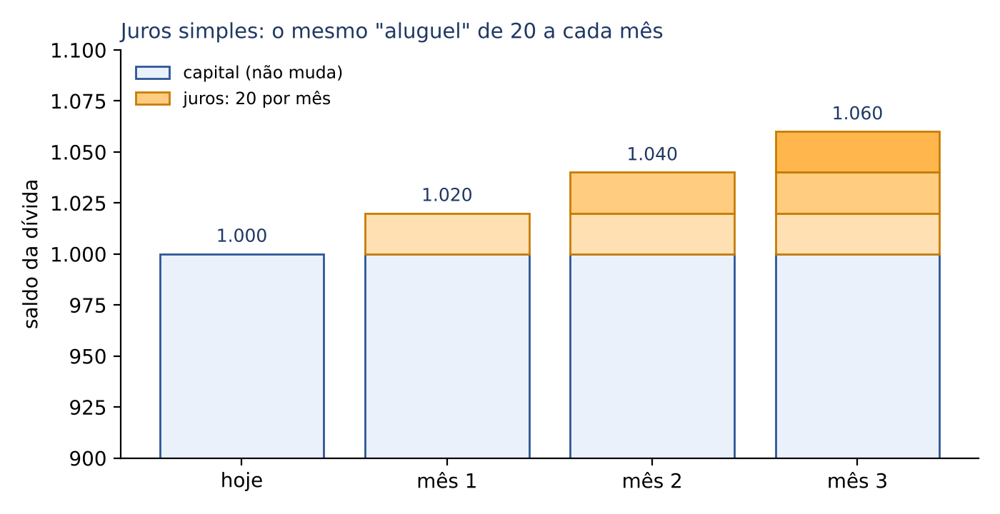

No regime de juros COMPOSTOS (Cap. 3), os juros de cada mês seriam calculados sobre o saldo do mês anterior, ou seja, haveria "juros sobre juros". Por enquanto, guarde apenas a diferença: no simples, a base de cálculo é fixa (o capital); no composto, a base cresce.

### 02.1.5 O diagrama de fluxo de caixa

Os problemas de matemática financeira ficam muito mais fáceis quando desenhados. O desenho padrão é o diagrama de fluxo de caixa: uma linha horizontal representa o tempo, e cada entrada ou saída de dinheiro é uma seta vertical. Por convenção, seta para CIMA é dinheiro que ENTRA no seu bolso; seta para BAIXO é dinheiro que SAI.

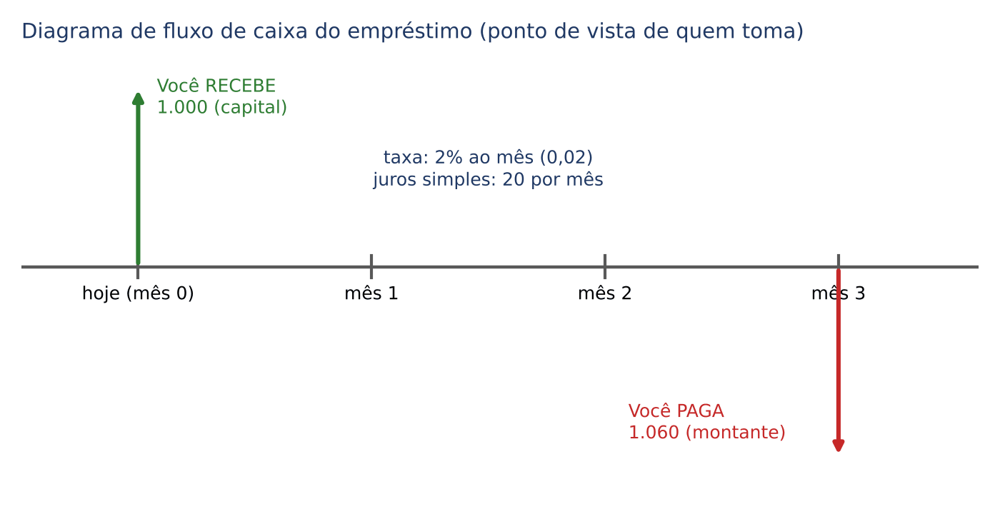

No empréstimo acima, do ponto de vista de quem toma o dinheiro: hoje entram 1.000 reais (seta para cima) e, no mês 3, saem 1.060 reais (seta para baixo). Do ponto de vista do banco, as setas seriam invertidas. Habitue-se a fazer esse rascunho em toda questão: ele organiza as datas e evita a maior parte dos erros.

## 02.2 A fórmula dos juros simples

### 02.2.1 Da tabela à fórmula

Na tabela de 02.1.4, os juros de cada mês foram 1.000 × 0,02 = 20. Como os juros são iguais todo mês, os juros de 3 meses são 3 vezes isso:

- J = 20 × 3
- J = (1.000 × 0,02) × 3
- J = 60

Trocando os números pelos nomes dos personagens, chegamos à fórmula fundamental dos juros simples:

- J = C × i × n

Em que:

- J = juros, em dinheiro (o "aluguel" total do período);
- C = capital, o valor aplicado ou emprestado no início;
- i = taxa de juros por período, na forma DECIMAL (2% = 0,02);
- n = prazo, contado na MESMA unidade de tempo da taxa (se a taxa é ao mês, n em meses; se ao ano, n em anos).

Leia a fórmula em português: "juros são o capital, vezes a taxa, vezes o tempo". O produto C × i é o juro de UM período; multiplicado por n, dá o juro de todos os períodos.

:::ATENCAO A regra de ouro: taxa e prazo na mesma unidade
A fórmula só funciona se i e n estiverem na mesma unidade de tempo. Taxa ao mês com prazo em meses; taxa ao ano com prazo em anos; taxa ao dia com prazo em dias. Se o enunciado der "taxa de 18% ao ano" e "prazo de 7 meses", você precisa converter um dos dois ANTES de aplicar a fórmula. Esse é o assunto de 02.4, e é ali que a FCC mais derruba candidatos.
:::

### 02.2.2 Exemplos resolvidos

:::EXEMPLO Juros de uma aplicação simples
Um capital de 5.000 reais é aplicado a juros simples de 3% ao mês durante 4 meses. Quanto rende de juros?
Dados: C = 5.000; i = 3% ao mês = 0,03; n = 4 meses (taxa ao mês e prazo em meses: unidades iguais, podemos seguir).
- J = C × i × n
- J = 5.000 × 0,03 × 4
- J = 150 × 4 (primeiro 5.000 × 0,03 = 150, que é o juro de UM mês)
- J = 600
Resposta: 600 reais de juros.
:::

:::EXEMPLO Taxa com casa decimal
Um empréstimo de 12.000 reais é contratado a juros simples de 1,5% ao mês, por 10 meses. Quais os juros?
Dados: C = 12.000; i = 1,5% = 0,015; n = 10.
- J = 12.000 × 0,015 × 10
- Truque: comece pelo par mais fácil. 0,015 × 10 = 0,15 (multiplicar por 10 anda uma casa da vírgula para a direita).
- J = 12.000 × 0,15
- J = 1.800
Resposta: 1.800 reais de juros.
:::

:::DICA Como multiplicar sem calculadora
Na fórmula J = C × i × n a ordem dos fatores não altera o produto (Cap. 1). Escolha a ordem que torna a conta mais fácil: em geral, multiplique primeiro a taxa pelo prazo (i × n), que dá a "taxa acumulada do período". Exemplo: 2% ao mês por 6 meses dá i × n = 0,02 × 6 = 0,12, isto é, 12% do capital no período todo. Depois é só calcular 12% do capital. Essa ideia de "taxa do período inteiro" volta o tempo todo neste capítulo.
:::

### 02.2.3 Juros como porcentagem do capital

O produto i × n tem uma interpretação muito útil: é a fração do capital que os juros representam no período inteiro. Por isso, no regime simples, basta "somar" as taxas dos períodos:

- 2% ao mês durante 6 meses = 12% no período;
- 1,5% ao mês durante 10 meses = 15% no período;
- 10% ao ano durante 3 anos = 30% no período.

Com isso, muitas questões viram uma simples porcentagem. Juros de 10.000 reais a 2% ao mês por 6 meses: 12% de 10.000 = 1.200.

:::PRATIQUE exercícios elaborados para esta apostila (fórmula dos juros)
1) Calcule os juros de 2.000 reais aplicados a juros simples de 4% ao mês durante 5 meses.
2) Um capital de 15.000 reais ficou aplicado a 2,5% ao mês, no regime simples, por 8 meses. Quanto rendeu?
3) (Estilo FCC) Uma pessoa aplicou 10.000 reais a 2% ao mês por 6 meses e, no mesmo dia, 6.000 reais a 3% ao mês por 5 meses, ambos a juros simples. Qual o total de juros recebidos?
Resolução 1:
- Taxa do período: i × n = 0,04 × 5 = 0,20 (20% do capital).
- J = 2.000 × 0,20
- J = 400
Resposta: 400 reais.
Resolução 2:
- i × n = 0,025 × 8 = 0,20 (2,5% durante 8 meses somam 20%).
- J = 15.000 × 0,20
- J = 3.000
Resposta: 3.000 reais.
Resolução 3: calcule cada aplicação separadamente e some.
- Primeira: J1 = 10.000 × 0,02 × 6
- J1 = 10.000 × 0,12
- J1 = 1.200
- Segunda: J2 = 6.000 × 0,03 × 5
- J2 = 6.000 × 0,15
- J2 = 900
- Total: J1 + J2 = 1.200 + 900 = 2.100
Resposta: 2.100 reais.
:::

## 02.3 O montante

### 02.3.1 Da soma à fórmula

O montante é o capital mais os juros (M = C + J). Se trocarmos J pela fórmula de 02.2, temos:

- M = C + J
- M = C + C × i × n (substituímos J por C × i × n)
- M = C × (1 + i × n) (colocamos C "em evidência": como C aparece nas duas parcelas, ele sai multiplicando o que sobra; dentro do parêntese fica 1, que é o que sobra da primeira parcela C, mais i × n, que sobra da segunda)

Se a passagem "colocar em evidência" não estiver clara, confira de trás para frente, aplicando a distributiva: C × (1 + i × n) = C × 1 + C × i × n = C + C × i × n. Volta exatamente ao começo.

A fórmula do montante no regime simples é, portanto:

- M = C × (1 + i × n)

Em que:

- M = montante, o valor final (capital mais juros);
- C = capital inicial;
- i = taxa por período, na forma decimal;
- n = número de períodos, na mesma unidade da taxa;
- (1 + i × n) = fator de acumulação de capital no regime simples: o número pelo qual se multiplica o capital para obter o montante.

O fator tem leitura intuitiva. O "1" representa o próprio capital (100% dele) e o "i × n" representa os juros do período (por exemplo, 12%). Assim, (1 + 0,12) = 1,12 significa "o capital inteiro mais 12% dele". É a mesma ideia de aumento percentual que você viu no Cap. 1: aumentar 12% é multiplicar por 1,12.

### 02.3.2 Exemplos resolvidos

:::EXEMPLO Montante direto
Qual o montante de 4.000 reais aplicados a juros simples de 2,5% ao mês por 6 meses?
- Taxa do período: i × n = 0,025 × 6 = 0,15
- Fator: 1 + 0,15 = 1,15
- M = 4.000 × 1,15
- M = 4.600
Conferência pelo caminho longo: J = 4.000 × 0,15 = 600; M = 4.000 + 600 = 4.600. Os dois caminhos sempre dão o mesmo resultado.
:::

:::EXEMPLO Montante com taxa anual e prazo em anos
Um capital de 1.000 reais aplicado a 10% ao ano, no regime simples. Quanto vale após 1, 2, 5 e 10 anos?
- 1 ano: M = 1.000 × (1 + 0,10 × 1) = 1.000 × 1,10 = 1.100
- 2 anos: M = 1.000 × (1 + 0,10 × 2) = 1.000 × 1,20 = 1.200
- 5 anos: M = 1.000 × (1 + 0,10 × 5) = 1.000 × 1,50 = 1.500
- 10 anos: M = 1.000 × (1 + 0,10 × 10) = 1.000 × 2,00 = 2.000
Repare que a cada ano o montante sobe sempre os mesmos 100 reais.
:::

### 02.3.3 O gráfico do montante é uma reta

Como os juros de cada período são sempre iguais (C × i), o montante cresce a passos iguais. Num gráfico com o tempo no eixo horizontal e o montante no eixo vertical, os pontos ficam alinhados: o montante no regime simples é uma RETA, que começa no capital (quando n = 0, M = C) e sobe C × i a cada período. Em linguagem matemática, o montante simples é uma função do 1º grau (ou função afim) do prazo; os juros, sozinhos, são uma função linear do prazo (começam em zero e crescem proporcionalmente).

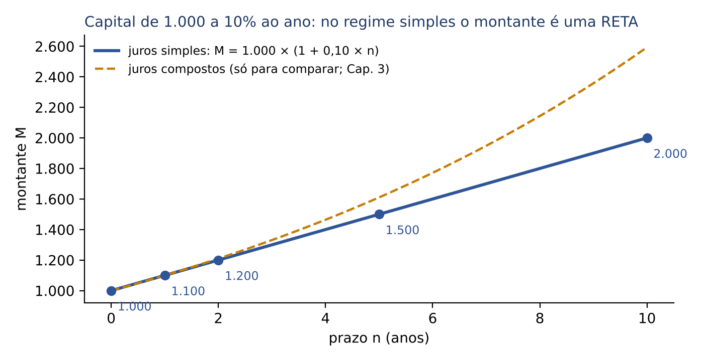

A linha tracejada mostra, apenas para comparação, o regime composto, que cresce em curva (exponencial). O detalhe de que as duas linhas coincidem no primeiro período, e de que antes dele o simples rende mais, é estudado no Cap. 3. Aqui interessa uma frase que a banca adora: "no regime de juros simples, o montante cresce linearmente" (verdadeira) ou "cresce em progressão aritmética" (também verdadeira: 1.000, 1.100, 1.200... é uma PA de razão 100, Cap. 1).

:::QUESTAO FGV 2024 — AL-PR — Analista Legislativo — Economista (Q2451623)
O problema: um investimento rende 40% ao ano, a juros simples (a questão diz "capitalizado mensalmente a juros simples", o que, no regime simples, não muda nada: os juros continuam sendo calculados sobre o capital inicial). Julgue: (I) o capital triplica após 4 anos; (II) o investimento cresce de forma linear ao longo dos anos; (III) as taxas proporcional e equivalente são distintas entre si.
Gabarito oficial: C (F – V – F), conferido no QConcursos em 30/10/2026; coincide com a resolução abaixo.
Resolução, item por item:
- (I) Montante após 4 anos: M = C × (1 + 0,40 × 4).
- 0,40 × 4 = 1,60
- M = C × 2,60. O capital vira 2,6 vezes o inicial, e não 3 vezes. FALSA.
- Para triplicar seria preciso que 1 + 0,40 × n = 3, ou seja, 0,40 × n = 2, n = 2 ÷ 0,40 = 5 anos (técnica de 02.5.3).
- (II) No regime simples o montante é uma reta (função afim do tempo): cresce linearmente. VERDADEIRA.
- (III) No regime simples, taxa proporcional e taxa equivalente COINCIDEM (ver 02.4.1): 40% ao ano equivale a 40 ÷ 12 ao mês em ambos os conceitos. FALSA.
Armadilha: o candidato que pensa em juros compostos marca (III) como verdadeira, porque nos compostos as duas taxas realmente diferem (Cap. 4).
:::

:::PRATIQUE exercícios elaborados para esta apostila (montante)
1) Qual o montante de 3.000 reais aplicados a juros simples de 3% ao mês por 10 meses?
2) Calcule o montante de 25.000 reais aplicados a 1,2% ao mês, juros simples, por 15 meses.
3) (Estilo FCC) Um capital de 20.000 reais foi aplicado a juros simples de 2% ao mês por 10 meses. Os juros representam que porcentagem do MONTANTE?
Resolução 1:
- i × n = 0,03 × 10 = 0,30
- M = 3.000 × (1 + 0,30)
- M = 3.000 × 1,30
- M = 3.900
Resposta: 3.900 reais.
Resolução 2:
- i × n = 0,012 × 15 = 0,18 (12 milésimos vezes 15 = 180 milésimos)
- M = 25.000 × 1,18
- M = 25.000 + 25.000 × 0,18 (separar facilita: 25.000 × 0,18 = 4.500)
- M = 25.000 + 4.500
- M = 29.500
Resposta: 29.500 reais.
Resolução 3: aqui está a pegadinha; a pergunta compara os juros com o MONTANTE, e não com o capital.
- J = 20.000 × 0,02 × 10 = 20.000 × 0,20 = 4.000
- M = 20.000 + 4.000 = 24.000
- J ÷ M = 4.000 ÷ 24.000 = 1/6 (simplificando por 4.000)
- 1/6 ≈ 0,1667, ou seja, cerca de 16,67%
Resposta: cerca de 16,67% do montante. Quem responde 20% calculou os juros em relação ao capital, que não foi o que se perguntou.
:::

## 02.4 Taxa e prazo na mesma unidade

### 02.4.1 Taxas proporcionais

Imagine um aluguel de 3.600 reais por ano. Quanto é por mês? 3.600 ÷ 12 = 300. E por trimestre? 300 × 3 = 900. Essa divisão "na proporção do tempo" é exatamente o que se faz com taxas no regime simples.

Duas taxas são PROPORCIONAIS quando a razão entre elas é igual à razão entre os períodos a que se referem. Na prática: 36% ao ano é proporcional a 3% ao mês, porque o ano tem 12 meses e 36 ÷ 12 = 3. É uma regra de três simples (Cap. 1):

- 12 meses ———— 36%
- 1 mês ———— x
- x = 36 ÷ 12 = 3% ao mês

A regra geral: para passar de um período MAIOR para um MENOR, DIVIDA a taxa pelo número de vezes que o menor cabe no maior; para passar do MENOR para o MAIOR, MULTIPLIQUE.

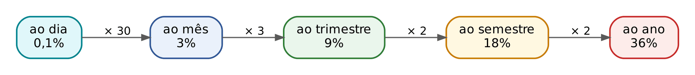

Tabela de conversões que você deve ter na ponta da língua (convenção comercial: mês de 30 dias e ano de 360 dias, ver 02.4.2):

| Para converter | Faça | Exemplo |
|---|---|---|
| ano → semestre | ÷ 2 | 24% ao ano = 12% ao semestre |
| ano → quadrimestre | ÷ 3 | 24% ao ano = 8% ao quadrimestre |
| ano → trimestre | ÷ 4 | 24% ao ano = 6% ao trimestre |
| ano → bimestre | ÷ 6 | 24% ao ano = 4% ao bimestre |
| ano → mês | ÷ 12 | 24% ao ano = 2% ao mês |
| mês → dia | ÷ 30 | 2% ao mês = 0,0667% ao dia (2/30%) |
| ano → dia (comercial) | ÷ 360 | 36% ao ano = 0,1% ao dia |
| mês → ano | × 12 | 1,5% ao mês = 18% ao ano |

Por que isso funciona no regime simples? Porque, nele, os juros de cada período são iguais. Aplicar 3% ao mês durante 12 meses gera 3% × 12 = 36% do capital; aplicar 36% ao ano durante 1 ano gera os mesmos 36%. As duas taxas produzem o MESMO montante sobre o mesmo capital e prazo. Quando duas taxas produzem o mesmo montante, dizemos que são EQUIVALENTES.

Daí a conclusão importante: no regime de juros simples, taxas proporcionais SÃO TAMBÉM equivalentes. As duas palavras descrevem a mesma taxa. No regime composto isso NÃO acontece (2% ao mês compostos não equivalem a 24% ao ano), e é por isso que o Cap. 4 dedica um capítulo inteiro às taxas equivalentes compostas.

A Q2457769 (FGV 2024 — AL-TO — Analista Legislativo), que pede as taxas anuais proporcional e equivalente a 10% ao mês no regime simples (gabarito oficial B: 120% e 120%), está comentada no Cap. 4 (04.2.4). Ela testa o mesmo ponto do item III da Q2451623 (02.3.3).

:::PEGADINHA "Taxa ao ano" com prazo em meses
A FCC raramente dá taxa e prazo na mesma unidade. O enunciado típico é "taxa de juros simples de 15% ao ano, durante 8 meses". Há dois caminhos, e ambos estão certos:
- converter a taxa: 15% ao ano ÷ 12 = 1,25% ao mês; n = 8 meses; i × n = 0,0125 × 8 = 0,10;
- converter o prazo: 8 meses = 8/12 de ano; i × n = 0,15 × 8/12 = 1,2/12 = 0,10.
O resultado é o mesmo (10% no período). O erro fatal é fazer 0,15 × 8 = 1,20, que daria 120% de juros em 8 meses.
:::

:::EXEMPLO Taxa anual, prazo em meses
Quais os juros de 10.000 reais a 18% ao ano, juros simples, por 7 meses?
Caminho 1 (converter a taxa):
- 18% ao ano ÷ 12 = 1,5% ao mês = 0,015
- J = 10.000 × 0,015 × 7
- J = 10.000 × 0,105
- J = 1.050
Caminho 2 (converter o prazo):
- 7 meses = 7/12 do ano
- J = 10.000 × 0,18 × 7/12
- J = 1.800 × 7/12 (10.000 × 0,18 = 1.800)
- J = 150 × 7 (1.800 ÷ 12 = 150)
- J = 1.050
Resposta: 1.050 reais pelos dois caminhos.
:::

### 02.4.2 Ano comercial e ano civil; prazos em dias

Quando o prazo é dado em DIAS, surge uma dúvida: quantos dias tem o ano? Há duas convenções.

- Ano comercial: 360 dias, com todos os meses de 30 dias. É a convenção usada quando nada se diz, nas questões de concurso e tradicionalmente no comércio.
- Ano civil (ou exato): 365 dias (366 nos anos bissextos), com os meses com seu número real de dias (31, 30, 28 ou 29).

Os juros calculados com o ano comercial chamam-se JUROS COMERCIAIS (ou ordinários); os calculados com o ano civil chamam-se JUROS EXATOS. Com a taxa anual i_a e o prazo de d dias:

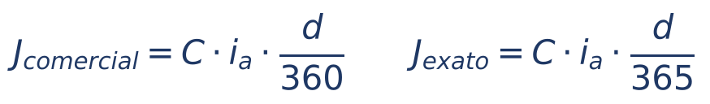

Em que:

- J_comercial = juros comerciais (ou ordinários), com ano de 360 dias;
- J_exato = juros exatos, com ano de 365 dias;
- C = capital;
- i_a = taxa ANUAL, na forma decimal;
- d = prazo em dias;
- d/360 e d/365 = o prazo convertido em "fração de ano" em cada convenção.

:::EXEMPLO Juros comerciais e exatos
Um capital de 9.000 reais é aplicado a 24% ao ano por 45 dias. Calcule os juros comerciais e os exatos.
Comerciais:
- J = 9.000 × 0,24 × 45/360
- 45/360 = 1/8 (dividindo em cima e embaixo por 45)
- J = 9.000 × 0,24 ÷ 8
- J = 2.160 ÷ 8
- J = 270
Exatos:
- J = 9.000 × 0,24 × 45/365
- J = 2.160 × 45 ÷ 365
- J = 97.200 ÷ 365
- J ≈ 266,30
Os juros comerciais são maiores, porque o mesmo número de dias representa uma fração MAIOR de um ano mais curto (45/360 é maior que 45/365).
:::

:::DICA Relação entre juros comerciais e exatos
Como os dois cálculos só diferem no denominador, J_comercial ÷ J_exato = 365 ÷ 360 = 73/72. Ou seja, os juros comerciais são 73/72 dos exatos (cerca de 1,39% maiores). Se a questão der os juros exatos e pedir os comerciais, multiplique por 73 e divida por 72. No exemplo acima: 266,30 × 73/72 ≈ 270.
:::

### 02.4.3 Como contar os dias entre duas datas

Quando o enunciado dá as DATAS (e não o número de dias), é preciso contar os dias corridos. A regra é a mesma do prazo processual que você conhece bem: exclui-se o dia do começo e inclui-se o dia do fim. Na prática, conta-se quantos dias faltam para terminar o primeiro mês, somam-se os meses inteiros do meio e, por fim, o número do dia do último mês.

Lembre os meses de 31 dias: janeiro, março, maio, julho, agosto, outubro e dezembro. Abril, junho, setembro e novembro têm 30. Fevereiro tem 28 (29 nos anos bissextos, como 2024 e 2028). O truque das juntas dos dedos ajuda: feche a mão; cada junta saliente (nó do dedo) é um mês de 31 dias e cada vale entre elas é um mês de 30 (ou fevereiro), começando por janeiro no primeiro nó.

:::PASSO Contar os dias corridos entre duas datas
1) Primeiro mês: dias do mês menos o dia de início (exclui o dia inicial). Ex.: de 20/3, março tem 31 dias, faltam 31 − 20 = 11 dias.
2) Meses intermediários inteiros: some os dias de cada um (abril 30, maio 31...).
3) Último mês: some o número do dia final (inclui o dia final). Ex.: até 30/6, somam-se 30 dias de junho.
4) Some tudo. Se o problema pedir juros "comerciais" com dias exatos (a chamada regra do banqueiro), use o número exato de dias e divida por 360.
:::

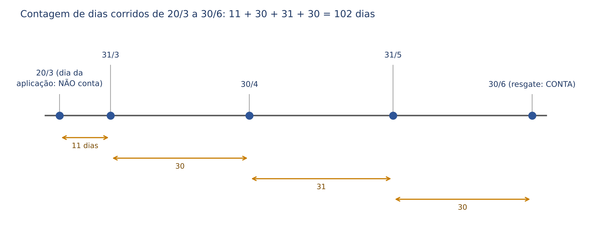

:::EXEMPLO Contagem com fevereiro
Quantos dias há de 15/1 a 10/4 de um ano comum? E de um ano bissexto?
- Janeiro: 31 − 15 = 16
- Fevereiro: 28
- Março: 31
- Abril: 10
- Total (ano comum): 16 + 28 + 31 + 10 = 85 dias
- Ano bissexto: fevereiro tem 29, total 86 dias.
:::

:::QUESTAO FGV 2025 — AGESAN-RS — Agente de Controle Financeiro — Contábil (Q3590979)
O problema: 50.000 reais recebidos em garantia foram aplicados de 20 de março a 30 de junho do mesmo ano, a juros simples de 6% ao mês. Qual o rendimento?
Gabarito: D (10.200 reais).
Resolução:
- Contagem dos dias (exclui 20/3, inclui 30/6): março 31 − 20 = 11; abril 30; maio 31; junho 30.
- Total: 11 + 30 + 31 + 30 = 102 dias.
- Taxa ao dia (mês comercial de 30 dias): 6% ÷ 30 = 0,2% ao dia = 0,002.
- J = 50.000 × 0,002 × 102
- J = 100 × 102 (50.000 × 0,002 = 100: é o juro de um dia)
- J = 10.200
Por que as outras atraem: quem conta "3 meses e 10 dias" como 100 dias acha 10.000 (não está entre as alternativas, mas leva a hesitar); quem usa só "3 meses" acha 50.000 × 0,06 × 3 = 9.000, também ausente. A alternativa E (9.600) corresponderia a 96 dias, contagem sem base. A banca combinou dias EXATOS (102) com mês COMERCIAL (30 dias), que é a regra do banqueiro.
:::

:::PRATIQUE exercícios elaborados para esta apostila (taxas proporcionais e dias)
1) Converta 1,5% ao mês, juros simples, em taxa ao ano, ao trimestre e ao dia (ano comercial).
2) Quais os juros de 6.000 reais a 30% ao ano, juros simples, por 4 meses?
3) (Estilo FCC) Um capital de 7.300 reais foi aplicado de 10/3 a 2/7 do mesmo ano, à taxa de 36% ao ano. Calcule os juros exatos e os juros comerciais (com o número exato de dias).
Resolução 1:
- Ao ano: 1,5% × 12 = 18% ao ano.
- Ao trimestre: 1,5% × 3 = 4,5% ao trimestre.
- Ao dia: 1,5% ÷ 30 = 0,05% ao dia.
Resolução 2:
- 30% ao ano ÷ 12 = 2,5% ao mês = 0,025
- J = 6.000 × 0,025 × 4
- J = 6.000 × 0,10
- J = 600
Resposta: 600 reais.
Resolução 3:
- Dias: março 31 − 10 = 21; abril 30; maio 31; junho 30; julho 2.
- Total: 21 + 30 + 31 + 30 + 2 = 114 dias.
- Juros exatos: J = 7.300 × 0,36 × 114/365
- 7.300 ÷ 365 = 20 (o capital foi escolhido para facilitar)
- J = 20 × 0,36 × 114
- J = 7,2 × 114
- J = 820,80
- Juros comerciais: J = 7.300 × 0,36 × 114/360
- 0,36 ÷ 360 = 0,001 (36% ao ano é 0,1% ao dia comercial)
- J = 7.300 × 0,001 × 114
- J = 7,3 × 114
- J = 832,20
Respostas: juros exatos de 820,80 reais e comerciais de 832,20 reais. Conferência: 820,80 × 73/72 = 832,20.
:::

## 02.5 As quatro perguntas da prova: achar C, i, n ou encadear aplicações

A fórmula J = C × i × n tem quatro letras. Se o enunciado der três, você acha a quarta. A fórmula do montante, M = C × (1 + i × n), também tem quatro letras. Toda questão de juros simples é, no fundo, uma dessas situações. Para isolar a letra procurada, usa-se a regra de equações do Cap. 1: o que está multiplicando de um lado passa dividindo para o outro.

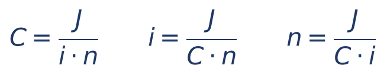

Em que, como antes: J = juros; C = capital; i = taxa decimal por período; n = prazo na unidade da taxa. Cada fórmula diz: "a letra procurada é igual aos juros divididos pelo produto das outras duas".

### 02.5.1 Achar o capital

Primeiro caso: o enunciado dá os juros.

:::EXEMPLO Capital a partir dos juros
Que capital, aplicado a juros simples de 1,5% ao mês, rende 1.350 reais de juros em 9 meses?
- J = C × i × n
- 1.350 = C × 0,015 × 9
- 1.350 = C × 0,135 (0,015 × 9 = 0,135)
- C = 1.350 ÷ 0,135 (o 0,135 que multiplicava C passa dividindo)
- C = 1.350.000 ÷ 135 (multiplicamos em cima e embaixo por 1.000 para tirar a vírgula)
- C = 10.000
Resposta: 10.000 reais. Conferência: 10.000 × 0,135 = 1.350.
:::

Segundo caso, o mais cobrado: o enunciado dá o MONTANTE. Aí se isola C na fórmula do montante.

- M = C × (1 + i × n)
- C = M ÷ (1 + i × n) (o fator que multiplicava C passa dividindo)

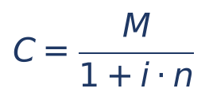

Em que: C = capital (o valor "de hoje"); M = montante (o valor "do futuro"); i = taxa decimal; n = prazo na unidade da taxa; 1 + i × n = fator de acumulação. Em palavras: para "trazer" um valor do futuro para hoje no regime simples, DIVIDA pelo fator. Esse cálculo é também chamado de valor atual a juros simples (ou desconto racional simples, nome que você verá no Cap. 5).

:::PEGADINHA Subtrair a porcentagem em vez de dividir
Se o montante é 11.842 reais e os juros foram de 24% sobre o capital, o capital NÃO é 11.842 − 24% de 11.842. Os 24% incidiram sobre o capital (desconhecido), e não sobre o montante. O certo é dividir: C = 11.842 ÷ 1,24. A FCC costuma colocar entre as alternativas o valor obtido pela subtração; ele sempre sai MENOR que o correto.
:::

:::QUESTAO FCC 2026 — SEFAZ-CE — Auditor Fiscal da Receita Estadual — Conhecimentos Gerais (Q4221358)
O problema: Manuel aplicou um capital a juros simples de 1% ao mês e obteve montante de 11.842 reais após 24 meses. Qual foi o capital aplicado?
Gabarito: C (9.550 reais).
Resolução:
- Taxa do período: i × n = 0,01 × 24 = 0,24
- Fator: 1 + 0,24 = 1,24
- C = 11.842 ÷ 1,24
- Para dividir sem calculadora, tire a vírgula multiplicando os dois números por 100: C = 1.184.200 ÷ 124.
- 124 × 9.000 = 1.116.000; sobram 1.184.200 − 1.116.000 = 68.200.
- 124 × 500 = 62.000; sobram 68.200 − 62.000 = 6.200.
- 124 × 50 = 6.200; sobra zero.
- C = 9.000 + 500 + 50 = 9.550
Atalho de prova (testar alternativas): é mais rápido multiplicar do que dividir. Teste a alternativa C: 9.550 × 1,24 = 9.550 + 9.550 × 0,24 = 9.550 + 2.292 = 11.842. Confere.
Por que as outras atraem: quem subtrai 24% do montante (11.842 × 0,76 ≈ 9.000) cai perto de E (8.950) ou de A (9.450), sem acertar nenhuma; D (10.550) é maior que o próprio montante dividido por 1,24 e não tem lógica. Se você usasse juros compostos (11.842 ÷ 1,01²⁴), acharia cerca de 9.326, que também não está entre as alternativas: o enunciado é de juros simples.
:::

:::QUESTAO FCC 2025 — SEFAZ-PI — Analista do Tesouro Estadual — Tecnologia da Informação (Q3506111)
O problema: uma pessoa precisará de 120.600 reais daqui a 8 meses. Qual o menor depósito C, hoje, num banco que paga juros simples de 10,8% ao ano? As alternativas são faixas, com C expresso em milhares de reais.
Gabarito: A (110 ≤ C < 115).
Resolução:
- Taxa ao mês: 10,8% ÷ 12 = 0,9% ao mês = 0,009.
- Taxa do período: 0,009 × 8 = 0,072.
- Fator: 1 + 0,072 = 1,072.
- C = 120.600 ÷ 1,072
- Sem vírgula: C = 120.600.000 ÷ 1.072.
- 1.072 × 100.000 = 107.200.000; sobram 13.400.000.
- 1.072 × 12.500 = 13.400.000; sobra zero.
- C = 112.500 reais, isto é, 112,5 milhares: está na faixa 110 ≤ C < 115.
Atalho por estimativa: o fator é pouco maior que 1,07; 120.600 ÷ 1,07 fica perto de 112.700. A única faixa possível é a A.
Por que as outras atraem: quem esquece de converter a taxa anual e usa 0,108 × 8 = 0,864 obtém C = 120.600 ÷ 1,864 ≈ 64.700, alternativa D (C < 105). Quem subtrai os 7,2% do montante (120.600 × 0,928 ≈ 111.900) cai, por sorte, na mesma faixa A, mas por raciocínio errado: numa questão de alternativas pontuais, erraria.
:::

:::QUESTAO FGV 2025 — AGESAN-RS — Agente de Controle Financeiro — Contábil (Q3590978)
O problema: Maria aplicou um valor a juros simples de 24% ao ano por 150 dias e resgatou 16.500 reais. Quanto aplicou?
Gabarito: A (15.000 reais).
Resolução:
- Converter: 24% ao ano = 2% ao mês; 150 dias = 5 meses comerciais.
- Taxa do período: 0,02 × 5 = 0,10.
- C = 16.500 ÷ 1,10
- C = 15.000
Conferência: 15.000 × 1,10 = 16.500.
Armadilha: quem subtrai 10% do montante acha 16.500 × 0,90 = 14.850, número próximo de B (14.750) e de E (14.000), mas errado. Se a questão usasse o ano civil (150/365), o capital seria cerca de 15.019; sem indicação, use o ano comercial.
:::

### 02.5.2 Achar a taxa

Isolando i: i = J ÷ (C × n). Se o enunciado der o montante, primeiro ache os juros (J = M − C).

:::EXEMPLO Taxa a partir dos juros
Um capital de 8.000 reais rendeu 960 reais de juros simples em 6 meses. Qual a taxa mensal?
- i = J ÷ (C × n)
- i = 960 ÷ (8.000 × 6)
- i = 960 ÷ 48.000
- i = 0,02 (divida 960 e 48.000 por 960: 1 ÷ 50 = 0,02)
- i = 2% ao mês
:::

:::EXEMPLO Taxa a partir do montante, com prazo misto
Uma aplicação de 5.000 reais resultou em 6.200 reais após 1 ano e 3 meses, no regime simples. Qual a taxa mensal e a anual?
- Prazo em meses: 12 + 3 = 15 meses.
- J = M − C = 6.200 − 5.000 = 1.200
- i = 1.200 ÷ (5.000 × 15)
- i = 1.200 ÷ 75.000
- i = 0,016 = 1,6% ao mês
- Ao ano (taxa proporcional): 1,6% × 12 = 19,2% ao ano.
:::

:::DICA Taxa pela "taxa do período"
Outra forma de pensar: os juros (1.200) são que porcentagem do capital (5.000)? 1.200 ÷ 5.000 = 0,24 = 24% no período. Como o período tem 15 meses, a taxa mensal é 24% ÷ 15 = 1,6%. Dividir a taxa do período pelo número de períodos é o caminho mais rápido.
:::

### 02.5.3 Achar o prazo

Isolando n: n = J ÷ (C × i). O prazo sai na unidade da taxa (taxa ao mês, prazo em meses).

:::EXEMPLO Prazo a partir dos juros
Em quanto tempo 4.000 reais, a juros simples de 2,5% ao mês, rendem 1.300 reais de juros?
- n = J ÷ (C × i)
- n = 1.300 ÷ (4.000 × 0,025)
- n = 1.300 ÷ 100 (4.000 × 0,025 = 100, o juro de um mês)
- n = 13 meses
Leitura intuitiva: cada mês rende 100; para render 1.300, são necessários 13 meses.
:::

Uma pergunta clássica: em quanto tempo um capital DOBRA? Dobrar significa M = 2 × C, ou seja, os juros têm de ser iguais ao próprio capital (J = C). Substituindo na fórmula:

- C = C × i × n (juros iguais ao capital)
- 1 = i × n (dividimos os dois lados por C)
- n = 1 ÷ i

Generalizando: para o capital ficar multiplicado por k (triplicar, k = 3; quadruplicar, k = 4), os juros precisam valer (k − 1) vezes o capital:

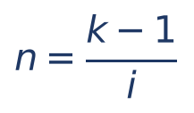

Em que: n = prazo necessário; k = quantas vezes o capital deve ser multiplicado (2 para dobrar, 3 para triplicar); i = taxa decimal por período. O prazo sai na unidade da taxa.

:::QUESTAO FGV 2025 — Prefeitura de São José dos Campos-SP — Analista em Gestão Municipal — Ciências Econômicas (Q3579926)
O problema: um capital X, aplicado a juros simples de 10% ao mês, transforma-se em 2X após t meses. Quanto vale t?
Gabarito: C (10).
Resolução:
- Dobrar: juros iguais ao capital, ou seja, i × t = 1.
- 0,10 × t = 1
- t = 1 ÷ 0,10 = 10 meses.
Intuição: 10% ao mês, somados por 10 meses, dão 100% do capital, isto é, os juros igualam o capital e o montante dobra.
:::

:::QUESTAO FGV 2026 — AL-GO — Analista de Controle Externo em Finanças e Controle (Q3880597)
O problema: um contrato de arrendamento mercantil de equipamento hospitalar foi pactuado a juros simples de 5% ao mês sobre o valor de mercado do bem; ao final, a despesa total seria o DOBRO do valor de mercado. Qual o prazo?
Gabarito: B (1 ano e 8 meses).
Resolução:
- Despesa total igual ao dobro: M = 2C, logo i × n = 1.
- n = 1 ÷ 0,05 = 20 meses.
- 20 meses = 12 + 8 = 1 ano e 8 meses.
Armadilha: a alternativa C (18 meses) e a E (1 ano e 6 meses) são o mesmo número, propositalmente; o erro mais provável é de conversão de unidade, não de fórmula. Converta sempre com calma: 20 meses é 1 ano (12) mais 8 meses.
:::

### 02.5.4 Problemas encadeados

A FCC gosta de questões em que o montante de uma aplicação se torna o capital de outra, às vezes com uma retirada no meio. A técnica é sempre a mesma: resolver de trás para a frente, uma etapa por vez, desenhando a linha do tempo.

:::QUESTAO FCC 2026 — SEFAZ-SP — Auditor Fiscal da Receita Estadual — Conhecimentos Gerais (Q3916768)
O problema: um capital foi aplicado por 8 meses a juros simples de 15% ao ano. Do montante, 10% foram usados para quitar uma dívida, e o restante foi reaplicado por 1 ano e 4 meses a juros simples de 18% ao ano. Os juros dessa segunda aplicação foram de 5.940 reais. Quais foram os juros da primeira aplicação?
Gabarito: C (2.500 reais).
Resolução, de trás para a frente:
- Etapa 1, a segunda aplicação. Prazo: 1 ano e 4 meses = 16 meses. Taxa: 18% ao ano ÷ 12 = 1,5% ao mês. Taxa do período: 0,015 × 16 = 0,24.
- J2 = C2 × 0,24
- 5.940 = C2 × 0,24
- C2 = 5.940 ÷ 0,24
- C2 = 594.000 ÷ 24 (multiplicamos por 100 em cima e embaixo)
- C2 = 24.750
- Etapa 2, o que foi reaplicado é 90% do montante M1 (10% foram para a dívida).
- 0,90 × M1 = 24.750
- M1 = 24.750 ÷ 0,90
- M1 = 27.500
- Etapa 3, a primeira aplicação. Taxa: 15% ao ano ÷ 12 = 1,25% ao mês; taxa do período: 0,0125 × 8 = 0,10.
- M1 = C1 × 1,10
- C1 = 27.500 ÷ 1,10
- C1 = 25.000
- Juros da primeira: J1 = M1 − C1 = 27.500 − 25.000 = 2.500.
Por que as outras atraem: quem esquece a retirada de 10% e trata 24.750 como o montante M1 acha C1 = 22.500 e J1 = 2.250, valor vizinho da alternativa A (2.225), que pode confundir. Quem calcula 10% A MAIS (24.750 × 1,10 = 27.225) em vez de dividir por 0,90 também se afasta do gabarito. Dividir por 0,90 e não multiplicar por 1,10 é a mesma lição da PEGADINHA de 02.5.1.
:::

:::PASSO Roteiro para qualquer questão de juros simples
1) Leia e anote os dados com as letras: C, J, M, i, n. Marque o que se pede.
2) Taxa e prazo estão na mesma unidade? Se não, converta (taxa proporcional, 02.4).
3) Transforme a taxa em decimal (3% = 0,03).
4) Calcule a taxa do período, i × n, e o fator 1 + i × n.
5) Escolha a fórmula: deu ou pediu juros, use J = C × i × n; deu ou pediu montante, use M = C × (1 + i × n).
6) Isole a letra procurada (o que multiplica passa dividindo).
7) Confira testando a alternativa: multiplicar é mais fácil que dividir.
:::

:::PRATIQUE exercícios elaborados para esta apostila (achar C, i e n)
1) Que capital, aplicado a juros simples de 2% ao mês por 7 meses, gera montante de 22.800 reais?
2) Uma aplicação de 12.500 reais tornou-se 14.000 reais em 8 meses, no regime simples. Qual a taxa mensal?
3) Em quanto tempo um capital quadruplica a juros simples de 25% ao ano?
4) (Estilo FCC) Dois capitais somam 50.000 reais. O primeiro foi aplicado a 2% ao mês e o segundo a 3% ao mês, ambos a juros simples por 10 meses. Os juros totais foram de 12.000 reais. Quanto vale cada capital?
Resolução 1:
- i × n = 0,02 × 7 = 0,14; fator 1,14.
- C = 22.800 ÷ 1,14
- C = 2.280.000 ÷ 114
- 114 × 20.000 = 2.280.000
- C = 20.000
Resposta: 20.000 reais.
Resolução 2:
- J = 14.000 − 12.500 = 1.500
- i = 1.500 ÷ (12.500 × 8)
- i = 1.500 ÷ 100.000
- i = 0,015 = 1,5% ao mês
Resolução 3:
- Quadruplicar: k = 4, juros iguais a 3 vezes o capital.
- n = (4 − 1) ÷ 0,25
- n = 3 ÷ 0,25 = 12 anos
Resolução 4: chame o primeiro capital de x; o segundo é 50.000 − x.
- Taxa do período do primeiro: 0,02 × 10 = 0,20; do segundo: 0,03 × 10 = 0,30.
- Juros totais: 0,20 × x + 0,30 × (50.000 − x) = 12.000
- 0,20x + 15.000 − 0,30x = 12.000 (distributiva: 0,30 × 50.000 = 15.000)
- −0,10x = 12.000 − 15.000 (passamos 15.000 para a direita, trocando o sinal)
- −0,10x = −3.000
- x = −3.000 ÷ (−0,10) = 30.000
- Segundo capital: 50.000 − 30.000 = 20.000
Conferência: 30.000 × 0,20 = 6.000; 20.000 × 0,30 = 6.000; total 12.000.
Resposta: 30.000 reais a 2% e 20.000 reais a 3%.
:::

## 02.6 Juros simples no dia a dia jurídico

O magistrado já faz contas de juros simples há anos, talvez sem lhes dar esse nome. A expressão "juros de mora de 1% ao mês" é a aplicação mais conhecida do regime simples no Direito brasileiro: o juro de cada mês é calculado sobre o valor do débito (o "capital"), e os juros vencidos não rendem novos juros.

:::LEI Código Tributário Nacional (Lei 5.172/1966), art. 161, § 1º
"Se a lei não dispuser de modo diverso, os juros de mora são calculados à taxa de um por cento ao mês."
:::

Duas observações de leitura, úteis também fora da matemática:

- O dispositivo é supletivo ("se a lei não dispuser de modo diverso"): a lei de cada tributo pode prever outra taxa, e na prática os entes federados costumam adotar a Selic ou índices próprios. Para resolver uma questão de matemática financeira, basta aplicar a taxa que o enunciado der.
- No Direito Civil, a taxa supletiva de juros mudou com a Lei 14.905, de 28/6/2024: pelo art. 406, § 1º, do Código Civil, a taxa legal corresponde à Selic "deduzido o índice de atualização monetária" do art. 389, parágrafo único (o IPCA, se outro índice não tiver sido convencionado nem previsto em lei específica); se o resultado for negativo, considera-se zero (§ 3º); a metodologia fica a cargo do Conselho Monetário Nacional (§ 2º). A regulamentação do CMN (Resolução CMN 5.171/2024) manda aplicar essa taxa mensal em regime de juros SIMPLES, com juro diário proporcional aos dias corridos do mês. O tema está desenvolvido na Apostila de Direito Civil, Cap. 14; aqui só interessa notar que o regime simples continua presente no cálculo judicial.

:::EXEMPLO Tributo pago com atraso
Um tributo de 4.000 reais foi pago com 75 dias de atraso. Supondo juros de mora de 1% ao mês, calculados no regime simples e proporcionais aos dias (mês de 30 dias), quanto se paga de juros? (Ignore multa e correção.)
- Taxa ao dia: 1% ÷ 30 ao dia; ou, equivalentemente, prazo em meses: 75 ÷ 30 = 2,5 meses.
- J = 4.000 × 0,01 × 2,5
- J = 40 × 2,5 (4.000 × 0,01 = 40, o juro de um mês)
- J = 100
Resposta: 100 reais de juros de mora.
:::

:::EXEMPLO Condenação judicial
Uma condenação de 50.000 reais rende juros de mora de 1% ao mês, juros simples, por 14 meses. Qual o valor dos juros e o total devido (desconsiderando a correção monetária)?
- Taxa do período: 0,01 × 14 = 0,14 (14%)
- J = 50.000 × 0,14
- J = 7.000
- Total: M = 50.000 + 7.000 = 57.000
Resposta: 7.000 reais de juros; 57.000 reais no total.
:::

:::ATENCAO Juros não são correção monetária, e multa não é juros
Na conta judicial convivem três parcelas distintas: a correção monetária (recompõe o poder de compra da moeda, não remunera nada), os juros (remuneram o tempo do atraso) e a multa (sanção, em geral um percentual único sobre o débito, que não depende do tempo). Em matemática financeira, a "taxa real" que separa inflação de juros é tema do Cap. 4. Numa questão de juros simples, só entra no cálculo o que o enunciado mandar incluir.
:::

## 02.7 Capitais equivalentes no regime simples

### 02.7.1 A ideia: comparar dinheiro de datas diferentes

Quanto vale hoje uma dívida de 1.000 reais que vence daqui a 3 meses? Menos de 1.000, porque, se você tivesse hoje um valor menor e o aplicasse até lá, chegaria aos 1.000. Dinheiro em datas diferentes não pode ser somado nem comparado diretamente: é como somar reais com dólares. Antes, é preciso "levar" todos os valores para uma MESMA data, a chamada DATA FOCAL (ou data de comparação, ou data de avaliação).

Para mover um valor no tempo, no regime simples, usa-se o fator de 02.3:

- para levar um valor para FRENTE no tempo (para uma data posterior), MULTIPLIQUE pelo fator (1 + i × t);
- para trazer um valor para TRÁS no tempo (para uma data anterior), DIVIDA pelo fator (1 + i × t).

Em que: V_antes = valor na data anterior; V_depois = valor na data posterior; i = taxa decimal por período; t = número de períodos entre as duas datas (a "distância" entre elas, na unidade da taxa).

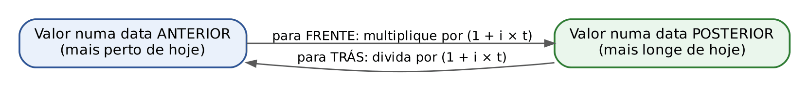

:::EXEMPLO Trazer um valor para hoje
Quanto vale hoje uma dívida de 1.000 reais que vence em 3 meses, à taxa de juros simples de 2% ao mês?
- Distância: 3 meses; fator 1 + 0,02 × 3 = 1,06.
- Valor hoje = 1.000 ÷ 1,06
- Valor hoje ≈ 943,40
Conferência: 943,40 aplicados por 3 meses a 2% viram 943,40 × 1,06 ≈ 1.000.
:::

Dois ou mais capitais (ou conjuntos de capitais) são EQUIVALENTES, numa certa taxa e numa certa data focal, quando têm o MESMO valor ao serem levados para essa data. É a base de toda renegociação de dívidas: o credor aceita trocar um conjunto de pagamentos por outro desde que, na data focal combinada, os dois conjuntos valham o mesmo.

### 02.7.2 No regime simples, a data focal muda o resultado

Aqui está o ponto mais sutil do capítulo, e as bancas o exploram: no regime de juros simples, a equivalência DEPENDE da data focal escolhida. Dois capitais equivalentes numa data podem não ser equivalentes em outra.

:::EXEMPLO A mesma dupla de capitais, três datas focais
Capital A = 1.000 reais hoje (mês 0); capital B = 1.200 reais no mês 10. Taxa de juros simples de 2% ao mês. São equivalentes?
Data focal 0 (hoje): traga B para trás 10 meses.
- Fator: 1 + 0,02 × 10 = 1,20
- B na data 0 = 1.200 ÷ 1,20 = 1.000. Igual a A: equivalentes.
Data focal 10: leve A para frente 10 meses.
- A na data 10 = 1.000 × 1,20 = 1.200. Igual a B: equivalentes.
Data focal 5: leve A para frente 5 meses e traga B para trás 5 meses.
- Fator de 5 meses: 1 + 0,02 × 5 = 1,10
- A na data 5 = 1.000 × 1,10 = 1.100,00
- B na data 5 = 1.200 ÷ 1,10 ≈ 1.090,91
- Valores diferentes: NÃO equivalentes nessa data.
:::

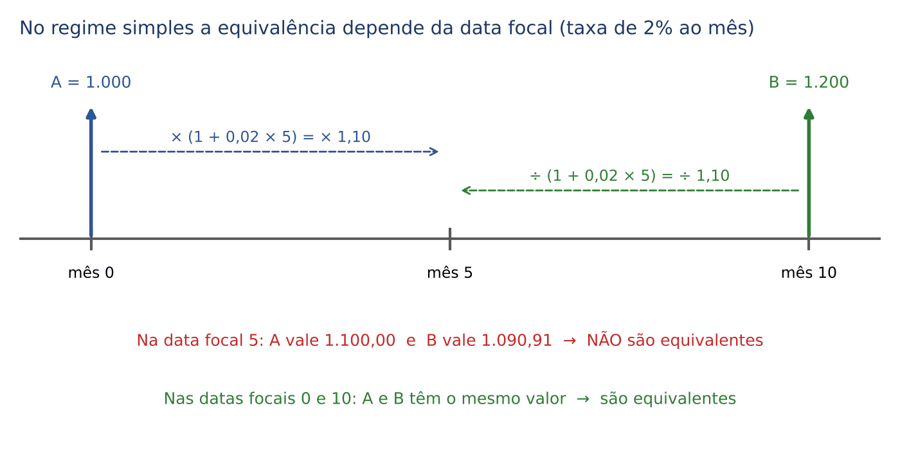

Por que isso acontece? Porque, no regime simples, "andar" 5 meses e depois mais 5 meses não é o mesmo que andar 10 meses de uma vez. Veja:

- Dois passos de 5 meses: 1,10 × 1,10 = 1,21.
- Um passo de 10 meses: 1 + 0,02 × 10 = 1,20.

Os fatores não "se encaixam": 1,21 é diferente de 1,20. Diz-se que, no regime simples, o prazo NÃO pode ser fracionado (não é cindível) sem alterar o resultado. Nos juros compostos, ao contrário, 1,02⁵ × 1,02⁵ = 1,02¹⁰ exatamente, de modo que a equivalência vale em qualquer data focal (Cap. 6).

:::DICA Qual data focal usar na prova
1) Se o enunciado indicar a data focal, use-a, sem discussão.
2) Se não indicar, use a data em que ocorre o pagamento procurado (a data do "novo" pagamento único): é o que a FCC tem feito nas questões de substituição de títulos (como nas duas questões abaixo).
3) Se a questão falar em "valor atual" ou "valor hoje", a data focal é a data zero.
Na dúvida, calcule pela convenção 2 e confira se o resultado está nas alternativas; em várias questões as convenções levam à mesma faixa de resposta.
:::

:::QUESTAO FGV 2024 — EPE — Analista de Gestão Corporativa — Finanças e Orçamentos (Q2847351)
O problema (as figuras da questão não são necessárias para a teoria): julgar três afirmações sobre equivalência. (I) Em juros simples, os prazos não podem ser fracionados sem alterar os resultados. (II) Em juros compostos, os prazos podem ser fracionados sem alterar os resultados. (III) No regime simples, os resultados divergentes decorrem da AUSÊNCIA da propriedade da incindibilidade do prazo.
Gabarito: B (I e II, apenas).
Resolução:
- (I) Correta: é exatamente o que vimos (1,10 × 1,10 = 1,21 ≠ 1,20).
- (II) Correta: nos compostos, (1 + i)ᵃ × (1 + i)ᵇ = (1 + i)ᵃ⁺ᵇ; o prazo pode ser partido à vontade.
- (III) Errada: a armadilha é de palavra. No regime simples o prazo É incindível (não pode ser cindido, isto é, dividido); portanto não há "ausência de incindibilidade". O que falta ao regime simples é a CINDIBILIDADE, a propriedade que o regime composto tem.
:::

### 02.7.3 Substituição de dívidas: o roteiro

:::PASSO Como resolver qualquer questão de capitais equivalentes no regime simples
1) Desenhe a linha do tempo com as dívidas originais de um lado (em cima) e os novos pagamentos do outro (embaixo).
2) Escolha a data focal (veja a DICA de 02.7.2).
3) Leve cada valor até a data focal: multiplique por (1 + i × t) os que estão ANTES dela; divida por (1 + i × t) os que estão DEPOIS. O t é a distância de cada valor até a data focal, e não a data original do valor.
4) Monte a equação: soma das dívidas originais na data focal = soma dos novos pagamentos na data focal.
5) Resolva para a incógnita.
:::

:::QUESTAO FCC 2026 — SEFAZ-CE — Auditor Fiscal da Receita Estadual — Conhecimentos Gerais (Q4221359)
O problema: uma pessoa deve 5.000 reais daqui a 3 meses e 12.000 reais daqui a 6 meses. Decide pagar tudo de uma vez daqui a 4 meses. Com juros simples de 2% ao mês, o pagamento único fica em que faixa?
Gabarito: A (entre 16.550 e 16.850 reais).
Resolução (data focal no mês 4, data do pagamento):
- Os 5.000 vencem no mês 3, UM mês antes da data focal: levar para frente. Fator 1 + 0,02 × 1 = 1,02.
- 5.000 × 1,02 = 5.100
- Os 12.000 vencem no mês 6, DOIS meses depois da data focal: trazer para trás. Fator 1 + 0,02 × 2 = 1,04.
- 12.000 ÷ 1,04 ≈ 11.538,46
- X = 5.100 + 11.538,46
- X ≈ 16.638,46, que está entre 16.550 e 16.850.
Conferência com outra data focal (zero): 5.000 ÷ 1,06 ≈ 4.716,98; 12.000 ÷ 1,12 ≈ 10.714,29; soma ≈ 15.431,27; levada ao mês 4 (× 1,08) ≈ 16.665,77. Também na faixa A. A diferença entre os dois resultados (cerca de 27 reais) é o efeito da data focal no regime simples; a banca construiu faixas largas exatamente para absorvê-lo.
Por que as outras atraem: a alternativa B (16.900 a 17.000) acolhe quem simplesmente soma 5.000 + 12.000 = 17.000, ignorando os juros; quem traz tudo para hoje e esquece de levar ao mês 4 obtém cerca de 15.431, abaixo de todas as faixas, sinal de que faltou uma etapa.
:::

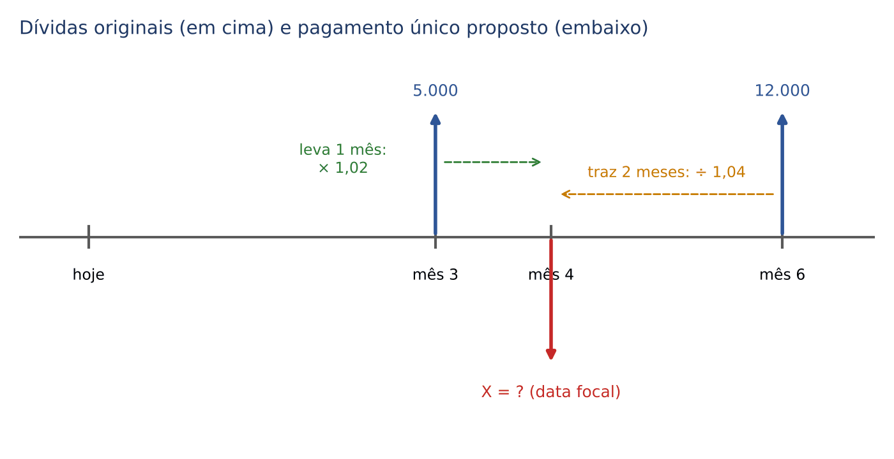

:::QUESTAO FCC 2025 — SEFAZ-PI — Analista do Tesouro Estadual — Geral (Q3507037)
O problema: dois títulos, de 30.000 reais e 50.000 reais, vencem em 2 e 4 meses. O devedor quer substituí-los por um único pagamento daqui a 6 meses, com juros simples de 24% ao ano. Qual o valor desse pagamento?
Gabarito: C (84.400 reais).
Resolução (data focal no mês 6):
- Taxa: 24% ao ano ÷ 12 = 2% ao mês.
- O título de 30.000 vence no mês 2; até o mês 6 faltam 4 meses: fator 1 + 0,02 × 4 = 1,08.
- 30.000 × 1,08 = 32.400
- O título de 50.000 vence no mês 4; até o mês 6 faltam 2 meses: fator 1 + 0,02 × 2 = 1,04.
- 50.000 × 1,04 = 52.000
- Pagamento único: 32.400 + 52.000 = 84.400.
Comparação com a data focal zero: (30.000 ÷ 1,04 + 50.000 ÷ 1,08) × 1,12 ≈ 84.159,54, valor que não está nas alternativas. A banca, portanto, adotou a data do novo pagamento como data focal, como recomendado na DICA.
Por que as outras atraem: E (85.200) nasce de usar as datas ORIGINAIS como distância (30.000 × 1,04 + 50.000 × 1,08), em vez da distância até o mês 6; B (86.400) nasce de levar a soma 80.000 inteira por 4 meses (80.000 × 1,08); A (83.200) nasce de levar ambos por 2 meses (30.000 × 1,04 + 50.000 × 1,04). Todas são erros de "distância" na linha do tempo, por isso o desenho é obrigatório.
:::

:::EXEMPLO Renegociação em duas parcelas iguais
Uma dívida de 10.000 reais vence hoje. O credor aceita substituí-la por duas parcelas iguais, nos meses 3 e 6, com juros simples de 2% ao mês e data focal zero. Qual o valor de cada parcela?
- Chame cada parcela de X.
- Parcela do mês 3 trazida a zero: X ÷ (1 + 0,02 × 3) = X ÷ 1,06
- Parcela do mês 6 trazida a zero: X ÷ (1 + 0,02 × 6) = X ÷ 1,12
- Equação: X ÷ 1,06 + X ÷ 1,12 = 10.000
- X × (1/1,06 + 1/1,12) = 10.000 (X em evidência)
- 1/1,06 ≈ 0,94340 e 1/1,12 ≈ 0,89286; soma ≈ 1,83626
- X ≈ 10.000 ÷ 1,83626
- X ≈ 5.445,87
Se a data focal fosse o mês 6, a equação seria X × 1,06 + X = 10.000 × 1,12, ou seja, 2,06 × X = 11.200, X ≈ 5.436,89. Os nove reais de diferença mostram, de novo, que no regime simples a data focal precisa estar definida.
:::

:::PRATIQUE exercícios elaborados para esta apostila (capitais equivalentes)
1) Quanto vale hoje um título de 5.500 reais que vence em 5 meses, à taxa de juros simples de 2% ao mês?
2) (Estilo FCC) Dívidas de 4.000 reais (vencimento em 2 meses) e 6.000 reais (vencimento em 5 meses) serão substituídas por um único pagamento no mês 3, com juros simples de 3% ao mês e data focal no mês 3. Qual o valor desse pagamento?
3) Com juros simples de 3% ao mês, 10.000 reais hoje e 11.500 reais no mês 5 são equivalentes na data focal 0? E na data focal 2?
Resolução 1:
- Fator: 1 + 0,02 × 5 = 1,10
- Valor hoje = 5.500 ÷ 1,10 = 5.000
Resposta: 5.000 reais.
Resolução 2:
- 4.000 vence no mês 2, 1 mês ANTES da data focal: levar para frente. 4.000 × (1 + 0,03 × 1) = 4.000 × 1,03 = 4.120.
- 6.000 vence no mês 5, 2 meses DEPOIS da data focal: trazer para trás. 6.000 ÷ (1 + 0,03 × 2) = 6.000 ÷ 1,06 ≈ 5.660,38.
- Pagamento: 4.120 + 5.660,38 = 9.780,38.
Resposta: cerca de 9.780,38 reais.
Resolução 3:
- Data focal 0: 11.500 ÷ (1 + 0,03 × 5) = 11.500 ÷ 1,15 = 10.000. Igual ao outro capital: equivalentes.
- Data focal 2: 10.000 × (1 + 0,03 × 2) = 10.000 × 1,06 = 10.600; 11.500 ÷ (1 + 0,03 × 3) = 11.500 ÷ 1,09 ≈ 10.550,46. Diferentes: não equivalentes nessa data.
:::

## 02.8 Taxa média e prazo médio

### 02.8.1 A ideia

Imagine que você tem várias aplicações, cada uma com seu capital, sua taxa e seu prazo. Duas perguntas naturais:

- Se todas tivessem a MESMA taxa (mantidos capitais e prazos), qual taxa única produziria os mesmos juros totais? Essa é a TAXA MÉDIA.
- Se todas tivessem o MESMO prazo (mantidos capitais e taxas), qual prazo único produziria os mesmos juros totais? Esse é o PRAZO MÉDIO.

As duas são médias ponderadas (Cap. 1 e Cap. 9), e o "peso" de cada aplicação é o que fica de fora quando se tira a grandeza procurada do produto C × i × n.

:::EXEMPLO Taxa média, à mão
Aplicações: 10.000 reais a 2% ao mês por 6 meses e 15.000 reais a 3% ao mês por 4 meses. Qual a taxa média?
- Juros reais da primeira: 10.000 × 0,02 × 6 = 1.200
- Juros reais da segunda: 15.000 × 0,03 × 4 = 1.800
- Juros totais: 1.200 + 1.800 = 3.000
- Com uma taxa única i_m, os juros seriam: 10.000 × i_m × 6 + 15.000 × i_m × 4 = i_m × (60.000 + 60.000) = i_m × 120.000
- Igualando: i_m × 120.000 = 3.000
- i_m = 3.000 ÷ 120.000 = 0,025 = 2,5% ao mês
Repare: 2,5% NÃO é a média simples entre 2% e 3% por coincidência; é porque os pesos C × n das duas aplicações são iguais (60.000 cada).
:::

### 02.8.2 As fórmulas

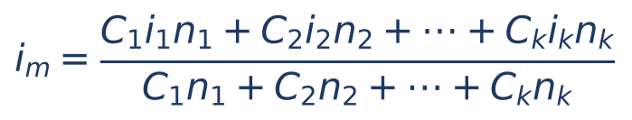

Em que:

- i_m = taxa média;
- C₁, C₂, ..., C_k = os capitais de cada aplicação (k aplicações ao todo);
- i₁, i₂, ..., i_k = as taxas de cada uma, na forma decimal e todas na mesma unidade;
- n₁, n₂, ..., n_k = os prazos de cada uma, na unidade das taxas;
- numerador = juros totais (soma dos C × i × n);
- denominador = soma dos produtos C × n (os "pesos" de cada taxa).

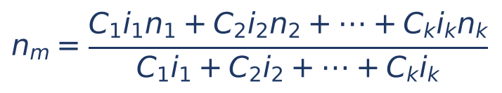

Em que:

- n_m = prazo médio;
- numerador = de novo, os juros totais (soma dos C × i × n);
- denominador = soma dos produtos C × i (os "pesos" de cada prazo, isto é, o juro de UM período de cada aplicação).

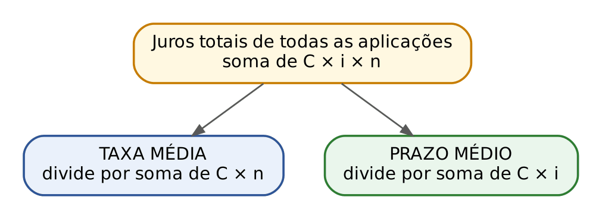

:::DICA Como lembrar sem decorar
O numerador é SEMPRE o total de juros. No denominador, coloque o produto C × i × n SEM a letra que você está procurando: procurando a taxa, tire o i (fica C × n); procurando o prazo, tire o n (fica C × i). Casos particulares que a banca usa:
- se todos os capitais e prazos forem iguais, a taxa média é a média aritmética simples das taxas;
- se todas as taxas forem iguais, o prazo médio é a média dos prazos ponderada pelos capitais (Σ C × n ÷ Σ C);
- se todos os capitais e taxas forem iguais, o prazo médio é a média aritmética simples dos prazos.
:::

:::EXEMPLO Prazo médio, à mão
Aplicações: 6.000 reais a 2% ao mês por 3 meses e 4.000 reais a 3% ao mês por 8 meses. Qual o prazo médio?
- Juros da primeira: 6.000 × 0,02 × 3 = 360
- Juros da segunda: 4.000 × 0,03 × 8 = 960
- Juros totais: 360 + 960 = 1.320
- Pesos (C × i, o juro de um mês de cada): 6.000 × 0,02 = 120; 4.000 × 0,03 = 120; soma 240.
- n_m = 1.320 ÷ 240 = 5,5 meses
Conferência: com 5,5 meses em ambas, os juros seriam 120 × 5,5 + 120 × 5,5 = 660 + 660 = 1.320. Confere.
Observe: como os pesos ficaram iguais (120), o prazo médio é a média simples de 3 e 8, ou seja, 5,5.
:::

:::EXEMPLO Taxa média com três aplicações
Aplicações a juros simples: 8.000 reais a 2% ao mês por 5 meses; 12.000 reais a 1,5% ao mês por 10 meses; 4.000 reais a 3% ao mês por 10 meses. Qual a taxa média?
- Juros: 8.000 × 0,02 × 5 = 800; 12.000 × 0,015 × 10 = 1.800; 4.000 × 0,03 × 10 = 1.200
- Juros totais: 800 + 1.800 + 1.200 = 3.800
- Pesos C × n: 8.000 × 5 = 40.000; 12.000 × 10 = 120.000; 4.000 × 10 = 40.000; soma 200.000
- i_m = 3.800 ÷ 200.000 = 0,019 = 1,9% ao mês
Repare que a média simples das taxas (2%, 1,5% e 3%) daria cerca de 2,17%, resposta errada: a aplicação de 12.000 por 10 meses pesa três vezes mais que as outras e puxa a média para 1,5%.
:::

:::PEGADINHA Média simples das taxas
A alternativa errada mais comum nas questões de taxa média é a média aritmética simples das taxas. Ela só está certa quando todos os produtos C × n são iguais. Quando capitais ou prazos diferem, sempre pondere.
:::

:::NOTA Vencimento médio (remissão)
Nos livros, aparece também o "vencimento médio": a data em que um único título, de valor igual à soma de vários títulos, pode substituí-los. Com desconto comercial simples e data focal zero, ele é a média dos prazos ponderada pelos valores nominais. O tema pertence aos descontos (Cap. 5).
:::

:::PRATIQUE exercícios elaborados para esta apostila (taxa média e prazo médio)
1) Aplicações: 5.000 reais a 1% ao mês por 12 meses e 10.000 reais a 2% ao mês por 3 meses. Qual a taxa média?
2) Três capitais de 2.000, 3.000 e 5.000 reais foram aplicados à mesma taxa de 2% ao mês, por 4, 6 e 10 meses, respectivamente. Qual o prazo médio?
3) (Estilo FCC) Aplicações: 10.000 reais a 1% ao mês por 6 meses e 5.000 reais a 4% ao mês por 3 meses. Qual o prazo médio?
Resolução 1:
- Juros: 5.000 × 0,01 × 12 = 600; 10.000 × 0,02 × 3 = 600; total 1.200.
- Pesos C × n: 5.000 × 12 = 60.000; 10.000 × 3 = 30.000; soma 90.000.
- i_m = 1.200 ÷ 90.000 = 12 ÷ 900 = 4 ÷ 300 = 0,01333...
- i_m = 4/3% ≈ 1,33% ao mês
Resolução 2: como as taxas são iguais, basta ponderar os prazos pelos capitais.
- Σ C × n = 2.000 × 4 + 3.000 × 6 + 5.000 × 10 = 8.000 + 18.000 + 50.000 = 76.000
- Σ C = 2.000 + 3.000 + 5.000 = 10.000
- n_m = 76.000 ÷ 10.000 = 7,6 meses
Resolução 3:
- Juros: 10.000 × 0,01 × 6 = 600; 5.000 × 0,04 × 3 = 600; total 1.200.
- Pesos C × i: 10.000 × 0,01 = 100; 5.000 × 0,04 = 200; soma 300.
- n_m = 1.200 ÷ 300 = 4 meses
Atenção: a média simples dos prazos daria 4,5 meses; o peso maior da segunda aplicação (200 contra 100) puxa a média para o prazo menor (3 meses).
:::

## 02.9 Bateria final de treino

As questões abaixo misturam as técnicas do capítulo, como a FCC costuma fazer. Tente resolver cada uma antes de ler a resolução, seguindo o PASSO de 02.5.4.

:::PRATIQUE exercícios elaborados para esta apostila (bateria mista)
1) Um capital foi aplicado a juros simples de 1,8% ao mês e, após 2 anos e meio, gerou montante de 61.600 reais. Qual o capital?
2) Um capital C₁ foi aplicado a 15% ao ano por 8 meses; outro capital, 5.000 reais maior que C₁, foi aplicado a 1% ao mês por 6 meses, ambos a juros simples. Os juros somados foram 3.500 reais. Quanto vale C₁?
3) Um capital aplicado a juros simples por 10 meses rendeu juros iguais a 25% do MONTANTE. Qual a taxa mensal?
4) Um capital de 18.000 reais, aplicado a 30% ao ano (juros simples comerciais), rendeu 1.050 reais. Por quantos dias ficou aplicado?
5) Uma dívida de 20.000 reais vence em 4 meses. O devedor paga 8.000 reais hoje e quer quitar o saldo no mês 6. Com juros simples de 2,5% ao mês e data focal no mês 6, quanto deve pagar no mês 6?
Resolução 1:
- Prazo: 2 anos e meio = 24 + 6 = 30 meses.
- i × n = 0,018 × 30 = 0,54; fator 1,54.
- C = 61.600 ÷ 1,54
- C = 6.160.000 ÷ 154
- 154 × 40.000 = 6.160.000
- C = 40.000
Resposta: 40.000 reais.
Resolução 2:
- Primeira: 15% ao ano por 8 meses = 1,25% × 8 = 10% no período. J₁ = 0,10 × C₁.
- Segunda: 1% × 6 = 6% no período. J₂ = 0,06 × (C₁ + 5.000) = 0,06 × C₁ + 300.
- Equação: 0,10 × C₁ + 0,06 × C₁ + 300 = 3.500
- 0,16 × C₁ = 3.500 − 300
- 0,16 × C₁ = 3.200
- C₁ = 3.200 ÷ 0,16 = 20.000
Conferência: 20.000 × 0,10 = 2.000; 25.000 × 0,06 = 1.500; total 3.500.
Resposta: 20.000 reais.
Resolução 3:
- J = 0,25 × M = M ÷ 4, e M = C + J.
- J = (C + J) ÷ 4
- 4J = C + J (multiplicamos os dois lados por 4)
- 3J = C (subtraímos J dos dois lados)
- J = C ÷ 3: os juros são um terço do capital.
- i × 10 = 1/3 (a taxa do período é 1/3)
- i = 1/30 ≈ 0,0333 = cerca de 3,33% ao mês
Resposta: 1/30 ao mês, cerca de 3,33% ao mês. Quem responde 2,5% ao mês tratou os 25% como porcentagem do capital.
Resolução 4:
- Juro de um dia: 18.000 × 0,30 ÷ 360 = 5.400 ÷ 360 = 15
- d = 1.050 ÷ 15 = 70 dias
Resposta: 70 dias.
Resolução 5:
- Dívida original no mês 6: os 20.000 vencem no mês 4, 2 meses antes: 20.000 × (1 + 0,025 × 2) = 20.000 × 1,05 = 21.000.
- Pagamento de hoje no mês 6: 8.000 × (1 + 0,025 × 6) = 8.000 × 1,15 = 9.200.
- Equação: 9.200 + X = 21.000
- X = 11.800
Resposta: 11.800 reais.
:::

## 02.10 Resumo para revisão pré-prova

| Conceito | Fórmula ou regra | Quando usar | Armadilha |
|---|---|---|---|
| Juros simples | Juros de cada período calculados sempre sobre o capital inicial | Sempre que o enunciado disser "juros simples" | Calcular juros sobre o saldo (isso é composto, Cap. 3) |
| Relação básica | M = C + J; J = M − C | Qualquer regime | Esquecer de subtrair o capital ao achar a taxa |
| Taxa unitária | 3% = 0,03; 1,5% = 0,015 | Antes de qualquer conta | Usar 3 em vez de 0,03 |
| Juros | J = C × i × n | Dado ou pedido o valor dos juros | Taxa e prazo em unidades diferentes |
| Montante | M = C × (1 + i × n) | Dado ou pedido o valor final | Confundir fator 1 + i × n com i × n |
| Gráfico | Montante = reta (função afim; PA de razão C × i) | Afirmações sobre crescimento | Dizer que cresce exponencialmente |
| Taxas proporcionais | Divida ou multiplique pela razão dos períodos (24% a.a. = 2% a.m.) | Converter unidade de taxa | No simples, proporcional = equivalente; no composto, não |
| Ano comercial x civil | 360 dias (mês de 30) x 365 dias | Prazo em dias | Sem indicação, use 360 |
| Juros comerciais x exatos | d/360 x d/365; comerciais = exatos × 73/72 | Taxa anual e prazo em dias | Exatos são os MENORES |
| Contagem de dias | Exclui o dia inicial, inclui o final | Datas no enunciado | Esquecer fevereiro de ano bissexto |
| Achar o capital | C = M ÷ (1 + i × n) ou C = J ÷ (i × n) | Dado o montante ou os juros | Subtrair a porcentagem do montante |
| Achar a taxa | i = J ÷ (C × n) | Dados C, J (ou M) e n | Taxa do período ≠ taxa por período |
| Achar o prazo | n = J ÷ (C × i); multiplicar por k: n = (k − 1) ÷ i | "Em quanto tempo dobra/triplica" | Para triplicar, juros = 2C, e não 3C |
| Encadeados | Resolver de trás para frente | Montante vira capital | Retirada de 10%: dividir por 0,90 |
| Mover valor no tempo | Para frente: × (1 + i × t); para trás: ÷ (1 + i × t) | Capitais equivalentes | t é a distância até a data focal |
| Capitais equivalentes | Mesmo valor na data focal | Substituição e renegociação de dívidas | No simples, o resultado depende da data focal |
| Data focal | A indicada; se omitida, a do novo pagamento | Substituição de títulos | Prazo simples não é cindível: 1,10 × 1,10 ≠ 1,20 |
| Taxa média | Juros totais ÷ Σ C × n | Várias aplicações, uma taxa única | Média simples das taxas |
| Prazo médio | Juros totais ÷ Σ C × i | Várias aplicações, um prazo único | Média simples dos prazos |
| Juros de mora | 1% ao mês, simples, salvo lei diversa (CTN, art. 161, § 1º) | Tributo ou débito em atraso | Somar multa ou correção como se fossem juros |

#### Formulário do capítulo

| Fórmula | Símbolos | Quando usar |
|---|---|---|
| M = C + J | M = montante; C = capital; J = juros | Sempre |
| J = C × i × n | i = taxa decimal por período; n = prazo na unidade da taxa | Juros simples |
| M = C × (1 + i × n) | 1 + i × n = fator de acumulação simples | Montante simples |
| C = M ÷ (1 + i × n) | Valor atual (trazer para hoje) | Achar o capital dado o montante |
| C = J ÷ (i × n); i = J ÷ (C × n); n = J ÷ (C × i) | Isolamento da letra procurada | Achar C, i ou n dados os juros |
| n = (k − 1) ÷ i | k = número de vezes que o capital se multiplica | Dobrar (k = 2), triplicar (k = 3) |
| J = C × i_a × d ÷ 360 | i_a = taxa anual; d = dias | Juros comerciais |
| J = C × i_a × d ÷ 365 | idem, ano civil | Juros exatos |
| V_depois = V_antes × (1 + i × t); V_antes = V_depois ÷ (1 + i × t) | t = distância entre as datas | Mover valores até a data focal |
| i_m = Σ C × i × n ÷ Σ C × n | Σ = soma de todas as aplicações | Taxa média |
| n_m = Σ C × i × n ÷ Σ C × i | idem | Prazo médio |

## 02.11 Questões do capítulo

FCC: Q4221358, Q3506111, Q3916768, Q4221359, Q3507037. FGV: Q2451623, Q3590979, Q3590978, Q3579926, Q3880597, Q2847351. Remissão: Q2457769 (comentada no Cap. 4).

:::NOTA Notas de verificação
- Contas: todos os exemplos, exercícios PRATIQUE e resoluções de questões foram conferidos em Python (incluindo as alternativas erradas atribuídas a erros típicos e as datas focais alternativas). Contagem de dias conferida com o módulo datetime (20/3 a 30/6 = 102; 15/1 a 10/4 = 85 em ano comum e 86 em bissexto; 10/3 a 2/7 = 114).
- Gabaritos: todos conferem com o gabarito oficial. Gabaritos reconferidos no QConcursos em 30/10/2026: Q2451623 (oficial C, F – V – F, idêntico à resposta deduzida pela resolução). A Q2457769 (taxas proporcional e equivalente no regime simples) tem o box titular no Cap. 4 (04.2.4), capítulo a que está atribuída no banco; aqui fica só a remissão. A Q2451623 tem o box titular neste capítulo; o Cap. 4 remete a 02.3.3. A Q2847351 depende de figuras não disponíveis no banco; foi comentada só pela teoria das afirmativas, com o gabarito oficial (B).
- Q4221359: as datas focais 4 e 0 levam ambas à faixa A (16.638,46 e 16.665,77). Q3507037: só a data focal no mês 6 reproduz o gabarito (84.400); a data focal zero dá 84.159,54, fora das alternativas. A "DICA" sobre data focal (usar a do novo pagamento quando o enunciado for omisso) é inferência a partir dessas questões, não regra declarada pela banca.
- Lei: o art. 161, § 1º, do CTN foi conferido em 30/10/2026 no Planalto (texto compilado da Lei 5.172/1966); a transcrição confere com a redação vigente. A Lei 14.905, de 28/6/2024, e os arts. 389, parágrafo único, e 406, §§ 1º a 3º, do Código Civil foram conferidos em 30/10/2026 no Planalto (texto da lei e Código Civil compilado, redação vigente); o texto foi precisado ("deduzido o índice de atualização monetária", que é o IPCA na falta de índice convencionado ou legal; resultado negativo = zero). O número da Resolução CMN 5.171/2024 foi confirmado em fontes secundárias concordantes (material da CGJ/TJRJ e escritórios de advocacia), não no sítio do Banco Central; a afirmação de que ela manda aplicar a taxa legal em regime simples com juro diário proporcional vem dessas fontes secundárias e da Apostila de Direito Civil, Cap. 14 (conferir no texto da resolução antes da publicação).
- Materiais do Drive listados no briefing (MF02, MF03, MF04, MF06, MF14, MF16) não foram consultados; o conteúdo matemático é estável e foi conferido por cálculo.
- Terminologia: "cindibilidade/incindibilidade do prazo" segue o vocabulário da Q2847351; o texto explica o conceito pelos fatores (1,10 × 1,10 ≠ 1,20).
:::
