# CAPÍTULO 03 — JUROS COMPOSTOS: MONTANTE, CAPITALIZAÇÃO, COMPARAÇÃO COM OS JUROS SIMPLES, TABELAS, LOGARITMOS E CONVENÇÕES LINEAR E EXPONENCIAL

:::INCIDENCIA
Edital SEFAZ/SC — Matemática Financeira, Estatística e Raciocínio Lógico: "Juros compostos. Montante e juros." Nível A+ (é a base de todos os capítulos financeiros seguintes).
Lote do banco: 21 questões (FCC 3, FGV 18), mais buscas por palavra-chave.
O que mais cai: montante e juros com a potência fornecida no enunciado; comparação simples x compostos; achar capital, taxa ou prazo; mistura de regimes na mesma questão; prazo não inteiro (convenção linear).
:::

:::ESQUEMA O que você vai aprender e o que precisa saber antes
Pré-requisitos: porcentagem na forma decimal (5% = 0,05), multiplicação de decimais, potências e raízes, noção de logaritmo (todos no Cap. 1); a fórmula dos juros simples, J = C × i × n, e a ideia de capital, taxa, prazo e montante (Cap. 2).
Roteiro do capítulo:
- 3.1 A ideia de "juros sobre juros", construída mês a mês, à mão.
- 3.2 A fórmula M = C × (1 + i)ⁿ, o fator de capitalização e as técnicas para calcular potências sem calculadora.
- 3.3 A regra de ouro: taxa e prazo na mesma unidade (e as questões FCC que misturam simples e compostos).
- 3.4 Simples x compostos: quem rende mais, quando e por quanto.
- 3.5 a 3.7 As três perguntas "ao contrário": achar o capital, a taxa e o prazo (com logaritmos).
- 3.8 Como usar as tabelas financeiras e os dados que a FCC dá no enunciado.
- 3.9 Prazos quebrados: convenção exponencial e convenção linear.
- 3.10 Bateria final mista; 3.11 Resumo para revisão e formulário.
:::

## 03.1 A ideia: juros sobre juros

### 03.1.1 O que muda em relação aos juros simples

No Cap. 2 você viu os juros simples: a taxa incide SEMPRE sobre o capital inicial. Se você empresta 1.000 reais a 10% ao mês, recebe 100 reais de juros por mês, todo mês, não importa quanto tempo passe. Os juros vão se acumulando "ao lado" do capital, como uma pilha separada que nunca rende nada.

Nos juros compostos, a regra muda num único ponto: ao fim de cada período, os juros do período são SOMADOS ao capital, e o período seguinte calcula juros sobre esse novo total. É por isso que se fala em "juros sobre juros". Esse ato de incorporar os juros ao capital tem um nome técnico: capitalização. Dizer que uma aplicação tem "capitalização mensal" significa que, a cada mês, os juros entram no saldo e passam a render também.

Pense na poupança, no saldo do cartão de crédito que você não paga ou num débito tributário corrigido pela taxa Selic acumulada mês a mês: o que se cobrou no mês passado entra na base do mês seguinte. Esse é o mundo dos juros compostos, e é o regime usado em praticamente todas as operações financeiras reais.

:::NOTA Ponte com o Direito: anatocismo
O que o matemático chama de "juros compostos" ou "capitalização de juros" o jurista chama de anatocismo. A Súmula 121 do STF enuncia: "É vedada a capitalização de juros, ainda que expressamente convencionada" (regra que a jurisprudência aplica ao mútuo comum). Para as instituições financeiras, a Súmula 539 do STJ diz: "É permitida a capitalização de juros com periodicidade inferior à anual em contratos celebrados com instituições integrantes do Sistema Financeiro Nacional a partir de 31/3/2000 (MP n. 1.963-17/2000, reeditada como MP n. 2.170-36/2001), desde que expressamente pactuada". E a Súmula 541 do STJ completa: "A previsão no contrato bancário de taxa de juros anual superior ao duodécuplo da mensal é suficiente para permitir a cobrança da taxa efetiva anual contratada" (ou seja, basta o contrato mostrar uma taxa anual maior que 12 vezes a mensal para que a capitalização se considere pactuada). Para a prova de Conhecimentos Gerais, nada disso é cobrado; serve só para você ligar o nome ao fenômeno: anatocismo = juros compostos.
:::

### 03.1.2 Construindo o montante mês a mês, à mão

Vamos fazer a conta mais simples possível, sem fórmula nenhuma. Você aplica 1.000 reais a 10% ao mês, juros compostos, por 4 meses. Lembre (Cap. 1): 10% = 10/100 = 0,10.

Mês 1. Os juros do mês são 10% do saldo que está aplicado (1.000):
- juros do mês 1 = 1.000 × 0,10
- juros do mês 1 = 100
- saldo no fim do mês 1 = 1.000 + 100 = 1.100

Mês 2. Agora a taxa incide sobre 1.100, e não mais sobre 1.000:
- juros do mês 2 = 1.100 × 0,10
- juros do mês 2 = 110
- saldo no fim do mês 2 = 1.100 + 110 = 1.210

Mês 3. A taxa incide sobre 1.210:
- juros do mês 3 = 1.210 × 0,10
- juros do mês 3 = 121
- saldo no fim do mês 3 = 1.210 + 121 = 1.331

Mês 4. A taxa incide sobre 1.331:
- juros do mês 4 = 1.331 × 0,10
- juros do mês 4 = 133,10
- saldo no fim do mês 4 = 1.331 + 133,10 = 1.464,10

Organizando numa tabela, ao lado do que aconteceria nos juros simples (Cap. 2), em que os juros são sempre 100 por mês:

| Mês | Saldo no início | Juros do mês (10% do saldo) | Saldo no fim (compostos) | Saldo no fim (simples) |
|---|---|---|---|---|
| 1 | 1.000,00 | 100,00 | 1.100,00 | 1.100,00 |
| 2 | 1.100,00 | 110,00 | 1.210,00 | 1.200,00 |
| 3 | 1.210,00 | 121,00 | 1.331,00 | 1.300,00 |
| 4 | 1.331,00 | 133,10 | 1.464,10 | 1.400,00 |

Repare em três coisas:

- No primeiro mês, os dois regimes dão o mesmo resultado (1.100). A diferença só aparece a partir do segundo mês, quando há juros anteriores sobre os quais cobrar juros.
- Nos compostos, os juros de cada mês CRESCEM (100, 110, 121, 133,10). Nos simples, são constantes (100, 100, 100, 100).
- A diferença entre os regimes (1.464,10 − 1.400 = 64,10 no mês 4) é exatamente o "juro sobre juro" acumulado.

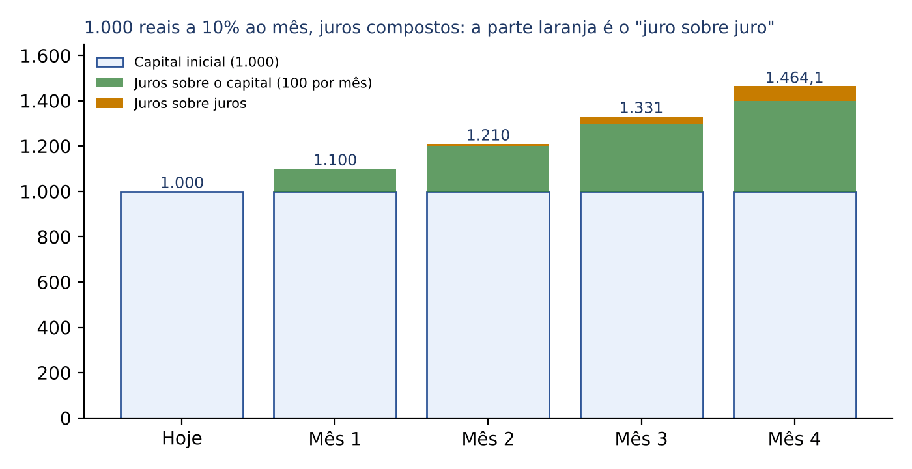

### 03.1.3 O atalho: "multiplicar por 1 + i" a cada período

Olhe de novo a passagem do mês 1 para o mês 2. Fizemos duas contas: 1.100 × 0,10 = 110 e, depois, 1.100 + 110 = 1.210. Dá para fazer numa só. Somar 10% a um valor é o mesmo que multiplicá-lo por 1,10:

- 1.100 + 1.100 × 0,10
- = 1.100 × (1 + 0,10)   (colocamos 1.100 "em evidência": ele aparece nas duas parcelas)
- = 1.100 × 1,10
- = 1.210

Esse número 1,10 (isto é, 1 + i) é o fator de capitalização de um período. Ele responde à pergunta "por quanto eu multiplico o saldo para saber o saldo um período depois?". Com taxa de 2% ao mês, o fator é 1,02; com 5%, é 1,05; com 0,5%, é 1,005; com 12%, é 1,12.

Então a tabela inteira vira uma sequência de multiplicações pelo mesmo fator:

- fim do mês 1: 1.000 × 1,1 = 1.100
- fim do mês 2: 1.000 × 1,1 × 1,1 = 1.210
- fim do mês 3: 1.000 × 1,1 × 1,1 × 1,1 = 1.331
- fim do mês 4: 1.000 × 1,1 × 1,1 × 1,1 × 1,1 = 1.464,10

Multiplicar um número por ele mesmo várias vezes é exatamente o que a potência abrevia (Cap. 1): 1,1 × 1,1 × 1,1 × 1,1 = 1,1⁴. O expoente 4 conta quantas vezes o fator aparece, isto é, quantos períodos se passaram. Daí nasce a fórmula da próxima seção.

:::DICA Fator de capitalização em uma frase
Juros simples: SOMA a mesma quantia todo período (crescimento em progressão aritmética, Cap. 1). Juros compostos: MULTIPLICA pelo mesmo fator (1 + i) todo período (crescimento em progressão geométrica, de razão 1 + i).
:::

## 03.2 A fórmula do montante e como calcular potências sem calculadora

### 03.2.1 A fórmula

Generalizando o que fizemos: um capital C, aplicado a uma taxa i por período, durante n períodos, é multiplicado n vezes pelo fator (1 + i).

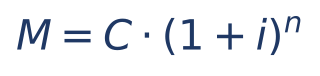

Cada símbolo:

- M = montante: o valor final, já com os juros (o que se resgata ou o que se paga no fim).
- C = capital: o valor inicial aplicado ou emprestado (também chamado de principal ou valor presente, VP).
- i = taxa de juros por período, escrita na forma decimal: 2% ao mês = 0,02; 10% ao ano = 0,10; 0,5% ao dia = 0,005.
- n = número de períodos, medido NA MESMA UNIDADE da taxa (se a taxa é mensal, n em meses; se é trimestral, n em trimestres; ver 3.3).
- (1 + i)ⁿ = fator de capitalização (ou fator de acumulação de capital) para n períodos. É o número pelo qual o capital é multiplicado.

E os juros são simplesmente o que o montante tem a mais que o capital:

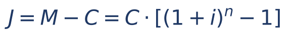

Aqui J = juros totais do período inteiro; a segunda forma só "põe C em evidência". Ela é útil quando a questão dá os juros e pede o capital (3.5): os juros são o capital vezes "o fator menos 1".

Conferindo com a tabela de 3.1.2: C = 1.000, i = 0,10, n = 4:
- M = 1.000 × (1,10)⁴
- M = 1.000 × 1,4641
- M = 1.464,10
- J = 1.464,10 − 1.000 = 464,10

:::EXEMPLO Exemplo 1 — o caso básico
Uma pessoa aplica 5.000 reais a juros compostos de 2% ao mês, por 3 meses. Qual o montante e quais os juros?
Dados: C = 5.000; i = 2% = 0,02; n = 3 (taxa mensal, prazo em meses: unidades iguais).
Primeiro o fator, 1,02³, calculado em etapas:
- 1,02² = 1,02 × 1,02 = 1,0404
- 1,02³ = 1,0404 × 1,02 = 1,061208
Agora o montante:
- M = 5.000 × 1,061208
- M = 5.306,04
Juros:
- J = 5.306,04 − 5.000
- J = 306,04
Compare com os juros simples do mesmo caso (Cap. 2): J = 5.000 × 0,02 × 3 = 300. Os compostos rendem 6,04 a mais, o "juro sobre juro" de três meses.
:::

### 03.2.2 Como calcular (1 + i)ⁿ à mão

Na FCC não há calculadora. Na maioria das questões o enunciado DÁ a potência ("considere 1,05⁴ = 1,2155"). Quando não dá, o expoente costuma ser pequeno (2 ou 3) e a conta é feita à mão. Quatro técnicas resolvem quase tudo.

Técnica 1 — multiplicar decimais como inteiros (Cap. 1). Para 1,05 × 1,05: esqueça as vírgulas, faça 105 × 105 = 11.025 e devolva as casas decimais (duas de cada fator, quatro no total): 1,1025.

- 105 × 105 = 105 × 100 + 105 × 5
- = 10.500 + 525
- = 11.025, portanto 1,05² = 1,1025

Técnica 2 — o "quadrado da soma" para fatores do tipo 1 + i. Como (1 + i)² = 1 + 2i + i², basta: 1, mais o dobro da taxa, mais o quadrado da taxa.

- 1,05² = 1 + 2 × 0,05 + 0,05² = 1 + 0,10 + 0,0025 = 1,1025
- 1,08² = 1 + 0,16 + 0,0064 = 1,1664
- 1,03² = 1 + 0,06 + 0,0009 = 1,0609
- 1,06² = 1 + 0,12 + 0,0036 = 1,1236

Técnica 3 — subir o expoente aproveitando o que já foi calculado. Potências se combinam assim (Cap. 1): multiplicando potências de mesma base, somam-se os expoentes; elevando uma potência a outra, multiplicam-se os expoentes.

- 1,05³ = 1,05² × 1,05 = 1,1025 × 1,05 = 1,157625
- 1,05⁴ = (1,05²)² = 1,1025² = 1,21550625
- 1,02¹² = (1,02⁶)² e 1,02⁶ = (1,02³)²: com 1,02³ = 1,061208, temos 1,02⁶ ≈ 1,1262 e 1,02¹² ≈ 1,1262² ≈ 1,2682

Para multiplicar 1,1025 × 1,05 sem errar, decomponha: 1,1025 × 1,05 = 1,1025 + 1,1025 × 0,05 = 1,1025 + 0,055125 = 1,157625. Multiplicar por 1,05 é "somar 5% do próprio número".

Técnica 4 — estimativa pelo binômio, para eliminar alternativas. Quando a taxa é pequena e você só precisa de um valor aproximado:

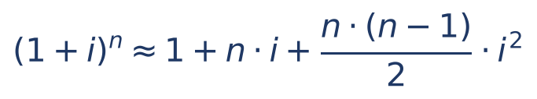

Os dois primeiros termos (1 + n × i) são exatamente o fator dos juros simples; o terceiro termo é a primeira parcela do "juro sobre juro". Exemplo: 1,02¹² ≈ 1 + 12 × 0,02 + (12 × 11 / 2) × 0,0004 = 1 + 0,24 + 66 × 0,0004 = 1 + 0,24 + 0,0264 = 1,2664. O valor exato é 1,26824...: o erro está só na terceira casa decimal, suficiente para escolher entre alternativas espaçadas.

:::DICA Ordem de grandeza mata alternativa
Antes de fazer conta longa, calcule os juros SIMPLES do mesmo caso (C × i × n). O montante composto é um pouco MAIOR que o simples quando n > 1. Qualquer alternativa abaixo do montante simples, ou muito acima dele, sai na hora.
:::

:::EXEMPLO Exemplo 2 — com a potência fornecida (estilo FCC)
Um capital de 8.000 reais é aplicado a juros compostos de 5% ao mês por 4 meses. Considere 1,05⁴ = 1,21550625. Calcule o montante.
- M = 8.000 × 1,21550625
- M = 8 × 1.215,50625   (tirei os três zeros de 8.000 e "andei" a vírgula três casas no outro fator)
- M = 9.724,05
Conferência pela estimativa: juros simples seriam 8.000 × 0,05 × 4 = 1.600, montante simples 9.600. O composto deu 9.724,05, um pouco acima: coerente.
:::

:::PASSO Como resolver qualquer questão de montante ou juros compostos
1. Anote C, i (em decimal) e n.
2. Confira se taxa e prazo estão na mesma unidade; se não, converta o PRAZO (3.3).
3. Procure no enunciado a potência (1 + i)ⁿ ou dados que a componham; se não houver, calcule pelas técnicas 1 a 3.
4. M = C × fator. Se pedir juros, J = M − C.
5. Confira pela ordem de grandeza (montante composto um pouco acima do simples).
:::

### 03.2.3 Questões de prova: montante e juros

:::QUESTAO FGV 2026 — CFC — Bacharelado em Ciências Contábeis, 2º Exame (Q4374146)
Problema: excedente de caixa de 25.000 reais aplicado a 8% ao ano, juros compostos, por 2 anos. Pede-se o montante. Gabarito oficial: D (29.160).
Resolução:
- Dados: C = 25.000; i = 0,08; n = 2 (taxa anual, prazo em anos).
- Fator: 1,08² = 1 + 2 × 0,08 + 0,08² = 1 + 0,16 + 0,0064 = 1,1664
- M = 25.000 × 1,1664
- M = 25 × 1.166,4 = 29.160
Por que as outras atraem: 29.000 seria o montante em juros SIMPLES (25.000 + 25.000 × 0,08 × 2 = 25.000 + 4.000); 27.000 é o montante de apenas 1 ano; 28.160 soma 3.160 (erro de conta no juro sobre juro). A distância de 160 entre 29.160 e 29.000 é exatamente o juro sobre juro: 25.000 × 0,08² = 160.
:::

:::QUESTAO FGV 2025 — SEFAZ-RS — Auditor do Estado (Q3154006)
Problema: empréstimo de 50.000 reais, pagamento único ao fim de 3 anos, juros de 10% ao ano com capitalização anual. Pede-se o valor da parcela única. Gabarito oficial: E (66.550).
Resolução:
- "Capitalização anual" com taxa anual: juros compostos, i = 0,10 por ano, n = 3.
- 1,1² = 1,21
- 1,1³ = 1,21 × 1,1 = 1,21 + 0,121 = 1,331
- M = 50.000 × 1,331 = 66.550
Por que as outras atraem: 65.000 é o montante em juros simples (50.000 × 1,30); 66.000 e 65.500 são "chutes" intermediários; 66.150 resulta de errar 1,1³ (por exemplo, 1,323).
:::

:::QUESTAO FGV 2024 — CFC — Bacharelado em Ciências Contábeis (Q2522945)
Problema: aplicação de 12.000 reais em 31/12/20X1, juros compostos de 2% ao mês, liquidada em 31/12/20X2. Pede-se o total de juros. Gabarito oficial: C (3.218,90).
Resolução:
- De 31/12/20X1 a 31/12/20X2 há 12 meses: n = 12.
- Fator: 1,02¹² ≈ 1,26824 (técnica 3: 1,02³ = 1,061208; ao quadrado, 1,02⁶ ≈ 1,126162; ao quadrado de novo, 1,02¹² ≈ 1,268242).
- J = C × [(1,02)¹² − 1] = 12.000 × 0,268242 ≈ 3.218,90
Por que as outras atraem: 15.218,90 é o MONTANTE (a questão pede juros: cuidado com a pergunta); 2.880 são os juros SIMPLES (12.000 × 0,02 × 12); 14.880 é o montante simples. A FCC e a FGV adoram oferecer o montante quando se pedem os juros, e vice-versa.
:::

#### Pagamentos e retiradas no meio do caminho

Quando há um pagamento parcial ou uma retirada antes do fim, NÃO tente usar a fórmula de uma vez só. Faça como um extrato bancário: (1) leve o saldo até a data da retirada, multiplicando pelo fator; (2) subtraia a retirada; (3) continue capitalizando o que sobrou. "Atualiza, abate, continua."

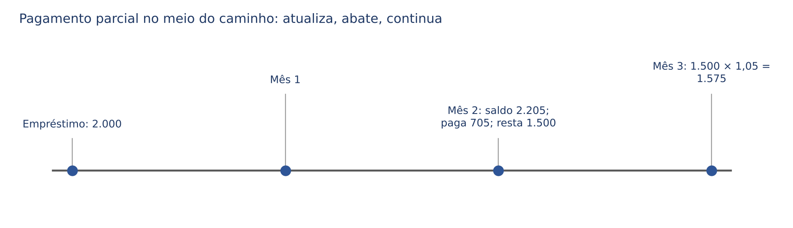

:::QUESTAO FGV 2026 — AL-RO — Analista Legislativo (Q3884935)
Problema: empréstimo de 2.000 reais a juros compostos de 5% ao mês, para devolver em 3 meses; ao fim do 2º mês, o devedor paga 705 reais; quanto deve pagar ao fim do 3º mês para quitar? Gabarito oficial: A (1.575).
Resolução (atualiza, abate, continua):
- Saldo no fim do mês 2: 2.000 × 1,05² = 2.000 × 1,1025 = 2.205
- Abate o pagamento: 2.205 − 705 = 1.500
- Capitaliza mais 1 mês: 1.500 × 1,05 = 1.500 + 75 = 1.575
Por que as outras atraem: as alternativas estão todas apertadas entre 1.575 e 1.615, para punir quem erra o raciocínio, e não a conta. Quem calcula a dívida total no mês 3 (2.000 × 1,157625 = 2.315,25) e subtrai 705 sem corrigir o pagamento chega a 1.610,25, perto de 1.615. O erro clássico é subtrair o pagamento do montante final sem corrigi-lo: o pagamento feito no mês 2 também "rende" um mês a favor do devedor (705 × 1,05 = 740,25; 2.315,25 − 740,25 = 1.575, mesma resposta pelo caminho do valor futuro).
:::

:::QUESTAO FGV 2024 — EBSERH — Analista Administrativo (Q3248829)
Problema: empréstimo de 12.000 reais a 2% ao mês sobre o saldo devedor; paga 4.000 reais em 1 mês, mais 4.000 reais em 2 meses e quita o restante no 3º mês. Pede-se o último pagamento, desprezando décimos de centavo. Gabarito oficial: E (4.493,90).
Resolução:
- Mês 1: 12.000 × 1,02 = 12.240; paga 4.000; saldo 8.240
- Mês 2: 8.240 × 1,02 = 8.240 + 164,80 = 8.404,80; paga 4.000; saldo 4.404,80
- Mês 3: 4.404,80 × 1,02 = 4.404,80 + 88,096 = 4.492,896
Desprezando décimos de centavo: 4.492,89 (ou 4.492,90 arredondando). Gabarito oficial discutível: a conta correta dá 4.492,89/4.492,90, um real abaixo da alternativa E (4.493,90). Como E é, de longe, a alternativa mais próxima (as demais estão a 85 reais ou mais), ela é a resposta; a diferença de 1 real parece erro de digitação na alternativa. Lição de prova: quando sua conta bate "quase" numa alternativa e muito longe das outras, marque-a.
:::

:::QUESTAO FGV 2026 — NAV Brasil — Contador (Q4222685)
Problema: aplicação de 100.000 reais a 6% ao mês, juros compostos; após dois meses, retira 30.000 reais; pede-se a receita de juros do mês seguinte à retirada. Gabarito oficial: C (4.941,60).
Resolução:
- Saldo após 2 meses: 100.000 × 1,06² = 100.000 × 1,1236 = 112.360
- Retirada: 112.360 − 30.000 = 82.360
- Juros do 3º mês: 82.360 × 0,06 = 4.941,60
Por que as outras atraem: 4.200 é 6% de 70.000 (quem subtrai a retirada do capital inicial, ignorando os juros já capitalizados); 4.920 é um meio-termo; 6.741,60 é 6% de 112.360 (esquece a retirada); 6.920 também ignora a retirada com outra base. Atenção à pergunta: ela quer só os juros do mês, não o saldo.
:::

:::PRATIQUE exercícios elaborados para esta apostila (montante e juros)
1. Calcule o montante de 2.000 reais a juros compostos de 3% ao mês por 2 meses.
2. Um capital de 10.000 reais fica aplicado por 3 meses a 4% ao mês, juros compostos. Calcule os juros.
3. (Estilo FCC) Aplicam-se 20.000 reais a 5% ao mês, juros compostos, por 12 meses. Considere 1,05⁶ = 1,34. Qual o montante aproximado?
4. (Estilo FCC) Uma aplicação de 50.000 reais rende 2% ao mês, juros compostos. Ao fim do 1º mês, retiram-se 10.000 reais. Qual o saldo ao fim do 3º mês?
Resoluções:
1. Fator 1,03² = 1 + 0,06 + 0,0009 = 1,0609. M = 2.000 × 1,0609 = 2.121,80.
2. 1,04² = 1 + 0,08 + 0,0016 = 1,0816; 1,04³ = 1,0816 × 1,04 = 1,0816 + 0,043264 = 1,124864. M = 10.000 × 1,124864 = 11.248,64. J = 11.248,64 − 10.000 = 1.248,64.
3. Doze meses são duas vezes seis: 1,05¹² = (1,05⁶)² = 1,34² = 1,7956. M = 20.000 × 1,7956 = 35.912. (Com o fator exato, 1,795856..., o montante seria 35.917,13; a pequena diferença vem de o enunciado ter arredondado 1,05⁶ para 1,34. Use SEMPRE o dado do enunciado.)
4. Fim do mês 1: 50.000 × 1,02 = 51.000; retira 10.000; saldo 41.000. Mais dois meses: 1,02² = 1,0404. Saldo = 41.000 × 1,0404 = 41.000 + 41.000 × 0,0404 = 41.000 + 1.656,40 = 42.656,40.
:::

## 03.3 A regra de ouro: taxa e prazo na mesma unidade

A fórmula M = C × (1 + i)ⁿ só funciona se o período da taxa e a unidade do prazo forem os mesmos. O expoente n conta "quantas vezes os juros foram incorporados"; se os juros são incorporados a cada trimestre, n tem de contar trimestres.

A forma segura de acertar a unidade é ajustar o PRAZO, não a taxa:

- Taxa de 3% ao trimestre e prazo de 1 semestre: um semestre tem 2 trimestres, então n = 2.
- Taxa de 1% ao mês e prazo de 1 ano: um ano tem 12 meses, então n = 12.
- Taxa de 10% ao ano e prazo de 18 meses: 18 meses = 1,5 ano, então n = 1,5 (prazo não inteiro: ver 3.9).
- Taxa de 2% ao mês e prazo de 90 dias: no ano comercial cada mês tem 30 dias, então n = 3.

:::PEGADINHA Taxa composta NÃO se divide nem se multiplica
Nos juros simples (Cap. 2), 3% ao trimestre equivale a 1% ao mês, porque basta dividir por 3 (taxas proporcionais). Nos compostos, NÃO: 1% ao mês, capitalizado por 3 meses, dá 1,01³ = 1,030301, ou seja, 3,0301% ao trimestre, e não 3%. Por isso a regra prática é converter o prazo para a unidade da taxa. Quando a questão OBRIGAR a converter a taxa (por exemplo, dá a taxa ao ano e pergunta a taxa ao mês), o assunto é taxa equivalente, ensinado no Cap. 4.
:::

:::ATENCAO Taxa nominal: o enunciado que diz "ao ano, capitalizada mensalmente"
Se o enunciado disser "taxa de 24% ao ano com capitalização mensal", a taxa de 24% é apenas nominal: a taxa que efetivamente se aplica é a proporcional ao período de capitalização, 24% ÷ 12 = 2% ao mês, e então n conta meses. Esse é o único caso em que se divide a taxa no regime composto, e ele é estudado em detalhe no Cap. 4. Aqui basta reconhecer a expressão "capitalização mensal (ou trimestral etc.)" e trabalhar no período dela.
:::

### 03.3.1 Questões FCC que misturam juros simples e compostos

A FCC gosta de questões em duas etapas: uma aplicação em juros simples cujo montante vira o capital de uma aplicação em juros compostos, ou um capital dividido em duas partes, cada uma num regime. Não há teoria nova: é só aplicar a fórmula certa a cada etapa, sempre ajustando o prazo à taxa.

:::QUESTAO FCC 2026 — MPE-SE — Analista do Ministério Público — Ciências Contábeis (Q3884301)
Problema: 20.000 reais aplicados por 8 meses a juros simples de 15% ao ano; o montante obtido é reaplicado por 1 semestre a juros compostos de 3% ao trimestre. Pede-se o valor dos juros da segunda aplicação. Gabarito oficial: E (1.339,80).
Resolução, etapa 1 (juros simples, Cap. 2):
- Taxa anual de 15% e prazo de 8 meses: 8 meses = 8/12 de ano.
- J₁ = 20.000 × 0,15 × 8/12
- J₁ = 20.000 × 0,15 × 2/3   (simplificamos 8/12 dividindo em cima e embaixo por 4)
- J₁ = 3.000 × 2/3 = 2.000
- M₁ = 20.000 + 2.000 = 22.000
Etapa 2 (juros compostos):
- Taxa de 3% ao trimestre; prazo de 1 semestre = 2 trimestres: n = 2.
- Fator: 1,03² = 1 + 0,06 + 0,0009 = 1,0609
- J₂ = 22.000 × (1,0609 − 1) = 22.000 × 0,0609
- J₂ = 22 × 60,9 = 1.339,80
Por que as outras atraem: 1.218 = 20.000 × 0,0609 (quem esquece a primeira etapa e aplica o fator sobre os 20.000 originais); 1.278,90 = 21.000 × 0,0609 e 1.461,60 = 24.000 × 0,0609 (montantes da primeira etapa calculados com prazo ou taxa errados). Repare que todas as alternativas são "algo × 0,0609": a FCC escolheu errar a primeira etapa, não a segunda.
:::

:::QUESTAO FCC 2026 — SEFAZ-SP — Auditor Fiscal da Receita Estadual (TI) — Conhecimentos Gerais (Q3916769)
Problema: 2/3 de um capital são aplicados a juros compostos de 3% ao trimestre durante 1 semestre, rendendo 1.827 reais de juros; o restante é aplicado a juros simples de 14,4% ao ano por 4 meses. Pede-se a soma dos dois montantes. Gabarito oficial: B (47.547).
Resolução, etapa 1 (descobrir a parte aplicada a juros compostos):
- Semestre = 2 trimestres; fator 1,03² = 1,0609; juros = parte × 0,0609.
- parte × 0,0609 = 1.827
- parte = 1.827 ÷ 0,0609   (dividimos os dois lados por 0,0609 para isolar a parte)
- parte = 1.827.000 ÷ 609   (multiplicamos em cima e embaixo por 10.000 para tirar as vírgulas)
- parte = 3.000 × 609 ÷ 609 = 30.000   (1.827.000 = 3.000 × 609: confira, 609 × 3 = 1.827)
Etapa 2 (capital total e o restante):
- Se 2/3 do capital valem 30.000, então 1/3 vale 15.000 e o capital todo vale 45.000.
- O restante (1/3) é 15.000.
Etapa 3 (juros simples sobre o restante):
- 14,4% ao ano corresponde a 1,2% ao mês (14,4 ÷ 12; nos juros simples pode-se dividir a taxa, Cap. 2).
- Em 4 meses: 1,2% × 4 = 4,8% = 0,048
- J = 15.000 × 0,048 = 720; M = 15.720
Etapa 4 (soma dos montantes):
- Montante composto: 30.000 + 1.827 = 31.827
- Soma: 31.827 + 15.720 = 47.547
Atalho de conferência: a soma dos montantes é o capital total mais todos os juros: 45.000 + 1.827 + 720 = 47.547. As demais alternativas nascem de erros na etapa 1 (tomar 1.827 ÷ 0,06 = 30.450 ou confundir 2/3 com o capital todo) ou na conversão da taxa anual; não vale a pena reconstruir cada uma: o atalho de conferência basta.
:::

:::PRATIQUE exercícios elaborados para esta apostila (unidades)
1. Qual o expoente n para: (a) 2% ao mês durante 2 anos; (b) 4% ao bimestre durante 1 semestre; (c) 10% ao semestre durante 30 meses?
2. Um capital de 40.000 reais é aplicado por 6 meses a 3% ao trimestre, juros compostos. Calcule os juros.
3. (Estilo FCC) Um capital de 30.000 reais ficou 6 meses a juros simples de 12% ao ano; o montante foi reaplicado por 2 meses a juros compostos de 5% ao mês. Calcule o montante final.
Resoluções:
1. (a) 2 anos = 24 meses, n = 24. (b) 1 semestre = 6 meses = 3 bimestres, n = 3. (c) 30 meses = 5 semestres, n = 5.
2. 6 meses = 2 trimestres; fator 1,03² = 1,0609; J = 40.000 × 0,0609 = 2.436.
3. Etapa simples: 12% ao ano por 6 meses = 6% (meio ano); J = 30.000 × 0,06 = 1.800; M₁ = 31.800. Etapa composta: 1,05² = 1,1025; M = 31.800 × 1,1025 = 31.800 + 31.800 × 0,1025 = 31.800 + 3.259,50 = 35.059,50.
:::

## 03.4 Juros simples x juros compostos: quem rende mais, quando e por quanto

### 03.4.1 A comparação em tabela e em gráfico

Volte ao capital de 1.000 reais a 10% por período:

| n (períodos) | Montante simples: 1.000 × (1 + 0,1 × n) | Montante composto: 1.000 × 1,1ⁿ | Diferença (compostos − simples) |
|---|---|---|---|
| 0 | 1.000 | 1.000,00 | 0 |
| 1 | 1.100 | 1.100,00 | 0 |
| 2 | 1.200 | 1.210,00 | 10,00 |
| 3 | 1.300 | 1.331,00 | 31,00 |
| 4 | 1.400 | 1.464,10 | 64,10 |
| 5 | 1.500 | 1.610,51 | 110,51 |

Nos simples, o montante cresce sempre 100 por período: no gráfico, é uma reta (por isso se diz que o crescimento é linear). Nos compostos, cresce cada vez mais depressa: no gráfico, é uma curva que se encurva para cima (crescimento exponencial, porque a variável n está no expoente).

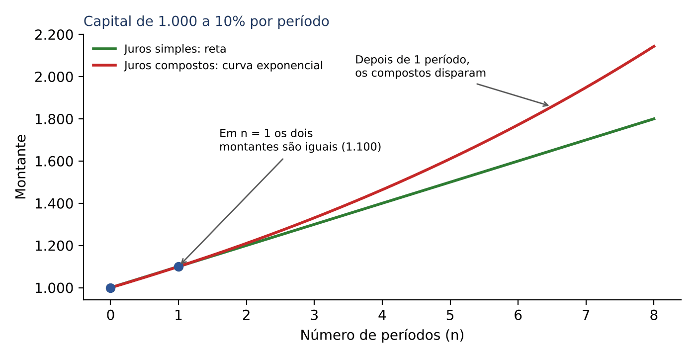

### 03.4.2 O detalhe que a banca cobra: antes de 1 período, o simples rende MAIS

As duas linhas se encontram em n = 0 (nada rendeu) e em n = 1 (um único período: os juros dos dois regimes são C × i). Entre 0 e 1, quem fica por cima é a RETA, isto é, os juros simples. Depois de 1, a curva passa por cima e nunca mais perde.

Por que o simples ganha num prazo menor que 1 período? Um exemplo com números redondos esclarece. Tome 1.000 reais a 21% ao ano, por meio ano (n = 0,5):

- Simples: 1.000 × (1 + 0,21 × 0,5) = 1.000 × 1,105 = 1.105
- Compostos: 1.000 × 1,21^0,5 = 1.000 × √1,21 = 1.000 × 1,1 = 1.100

Nos compostos, "meia capitalização" equivale à raiz quadrada do fator (porque 1,1 × 1,1 = 1,21: dois semestres de 10% compõem um ano de 21%). Dividir o fator ao meio pela raiz rende MENOS do que dividir a taxa ao meio, como faz o regime simples.

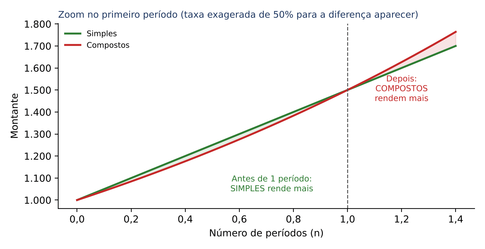

:::ESQUEMA Quem rende mais?
| Prazo (em períodos da taxa) | Comparação dos montantes |
|---|---|
| n = 0 ou n = 1 | iguais |
| 0 < n < 1 | simples > compostos |
| n > 1 | compostos > simples (e a diferença cresce cada vez mais) |
:::

Essa observação é a chave da convenção linear (3.9): para a parte fracionária do prazo, o regime simples rende mais, e por isso a convenção linear sempre dá montante maior que a exponencial.

### 03.4.3 A diferença exata para 2 períodos: C × i²

Para n = 2, a diferença entre os montantes tem uma forma muito simples. Montante composto: C × (1 + i)² = C × (1 + 2i + i²). Montante simples: C × (1 + 2i). Subtraindo:

- Diferença = C × (1 + 2i + i²) − C × (1 + 2i)
- Diferença = C × (1 + 2i + i² − 1 − 2i)   (colocamos C em evidência)
- Diferença = C × i²

Em palavras: em dois períodos, o "juro sobre juro" é o capital vezes o quadrado da taxa. Com 1.000 a 10%: 1.000 × 0,01 = 10, exatamente o que a tabela mostrou. Para três períodos, a mesma conta dá C × (3i² + i³), que não precisa ser decorada: a tabela resolve.

:::QUESTAO FGV 2025 — TCE-RR — Auditor Substituto de Conselheiro (Q3174684)
Problema: 10.000 reais aplicados a 10% ao ano por 2 anos, uma vez em juros simples e outra em juros compostos. Pede-se a diferença entre os montantes. Gabarito oficial: A (100).
Resolução pelo atalho: diferença = C × i² = 10.000 × 0,10² = 10.000 × 0,01 = 100.
Conferência pelo caminho longo: simples 10.000 × 1,2 = 12.000; compostos 10.000 × 1,21 = 12.100; diferença 100.
Por que as outras atraem: 200 é o dobro do atalho (quem multiplica C × i² pelo número de anos, sem necessidade); 300 a 500 não correspondem a nenhuma conta coerente com 2 anos e só pegam quem chuta.
:::

:::QUESTAO FCC 2026 — SEFAZ-GO — Auditor Fiscal da Receita Estadual (Q4066796)
Problema: aplicação A de 10.000 reais a juros simples de 2% ao mês; aplicação B de 10.000 reais a juros compostos de 1% ao mês; após 2 meses, pede-se a diferença entre os montantes. Gabarito oficial: E (199).
Resolução:
- A (simples): J = 10.000 × 0,02 × 2 = 400; M_A = 10.400
- B (compostos): 1,01² = 1 + 0,02 + 0,0001 = 1,0201; M_B = 10.000 × 1,0201 = 10.201
- Diferença: 10.400 − 10.201 = 199
Por que as outras atraem: aqui as TAXAS são diferentes, então o atalho C × i² não se aplica diretamente; mas ele ajuda a entender: B renderia 200 em juros simples a 1% e ganha só mais 10.000 × 0,01² = 1 de juro sobre juro, totalizando 201; A rende 400; diferença 199. Quem esquece o juro sobre juro marca 200 (não oferecido) e procura a vizinha; 100 é a diferença de um único mês de taxa (10.000 × 1%); 119, 219 e 299 não correspondem a um erro natural de raciocínio e funcionam só como distração numérica.
:::

:::QUESTAO FGV 2025 — Aplicação 1 x Aplicação 2 (Q3185951)
Problema: 5.000 reais por 2 anos; aplicação 1 a juros simples de 8% ao ano; aplicação 2 a juros compostos de 6% ao ano; pede-se quanto o montante da aplicação 1 supera o da 2. Gabarito oficial: C (182).
Resolução:
- Aplicação 1: J = 5.000 × 0,08 × 2 = 800; M₁ = 5.800
- Aplicação 2: 1,06² = 1 + 0,12 + 0,0036 = 1,1236; M₂ = 5.000 × 1,1236 = 5.618
- Diferença: 5.800 − 5.618 = 182
Raciocínio rápido: a diferença "simples contra simples" seria 5.000 × (0,08 − 0,06) × 2 = 200; o regime composto devolve à aplicação 2 um juro sobre juro de 5.000 × 0,06² = 18; a diferença cai para 200 − 18 = 182. Quem esquece o juro sobre juro procura 200 e cai em 204 ou 180, as vizinhas.
:::

:::QUESTAO FGV 2026 — PC-PI — Perito Criminal — Contabilidade e Economia (Q3849667)
Problema: dois investimentos de 100.000 reais feitos em 1/1/2025; Banco Alfa, prazo de 2 anos, 3% ao mês em juros simples; Banco Beta, prazo de 5 anos, 2% ao mês em juros compostos. Comparar a receita financeira em 31/12/2025. Gabarito oficial: D (maior no Banco Alfa).
Resolução:
- O prazo total dos contratos (2 ou 5 anos) é irrelevante: a pergunta é sobre o que se ganhou até 31/12/2025, ou seja, em 12 meses.
- Alfa: J = 100.000 × 0,03 × 12 = 36.000
- Beta: 1,02¹² ≈ 1,2682; J ≈ 100.000 × 0,2682 = 26.820
- 36.000 > 26.820: Alfa rende mais.
Estimativa sem calcular 1,02¹²: em juros simples, 2% ao mês dariam 24.000 em 12 meses; o juro sobre juro não chega a dobrar isso (pelo binômio, acrescenta cerca de 66 × 0,0004 × 100.000 = 2.640). Não há como alcançar 36.000.
Por que as outras atraem: E pega quem acha que "compostos sempre rendem mais"; isso só vale com a MESMA taxa. Com taxas diferentes, é preciso fazer a conta. A e B pegam quem se impressiona com os prazos contratuais ainda não vencidos: a receita é reconhecida pelo regime de competência, mês a mês.
:::

:::PRATIQUE exercícios elaborados para esta apostila (simples x compostos)
1. Qual a diferença entre os montantes de 4.000 reais aplicados por 2 meses a 5% ao mês, em juros compostos e em juros simples?
2. Um capital de 1.000 reais é aplicado por 6 meses a 21% ao ano. Calcule o montante em juros simples e em juros compostos. Qual é maior? Por quê?
3. (Estilo FCC) Um capital de 10.000 reais é aplicado por 3 anos a 10% ao ano. Em quanto o montante composto supera o simples?
Resoluções:
1. Atalho: C × i² = 4.000 × 0,05² = 4.000 × 0,0025 = 10. (Conferência: compostos 4.000 × 1,1025 = 4.410; simples 4.000 × 1,10 = 4.400; diferença 10.)
2. 6 meses = 0,5 ano. Simples: 1.000 × (1 + 0,21 × 0,5) = 1.105. Compostos: 1.000 × √1,21 = 1.000 × 1,1 = 1.100. O simples é maior porque o prazo é menor que 1 período da taxa (3.4.2).
3. Compostos: 10.000 × 1,331 = 13.310. Simples: 10.000 × 1,30 = 13.000. Diferença: 310. (Pela fórmula C × (3i² + i³) = 10.000 × (0,03 + 0,001) = 310.)
:::

## 03.5 Achar o capital: "trazer o dinheiro do futuro para hoje"

### 03.5.1 A ideia

Até aqui você sabia o capital e queria o montante: andava do presente para o futuro, multiplicando pelo fator. Muitas questões pedem o caminho inverso: "quanto preciso aplicar HOJE para ter 200.000 reais daqui a dois anos?", ou "quanto vale hoje uma dívida que vence em dez anos?". Andar do futuro para o presente é desfazer a multiplicação, ou seja, DIVIDIR pelo mesmo fator.

Exemplo à mão: a 5% ao mês, que capital vira 11.025 reais em 2 meses? Sabemos que 1,05² = 1,1025. Se C × 1,1025 = 11.025, então C = 11.025 ÷ 1,1025 = 10.000. Conferindo para a frente: 10.000 × 1,05 = 10.500; 10.500 × 1,05 = 11.025. Certo.

:::NOTA Ponte com o Direito: quanto vale hoje um crédito futuro
O raciocínio do valor presente é o mesmo que um credor faz ao avaliar a cessão de um crédito que só será pago no futuro (um precatório, por exemplo): o comprador paga hoje um valor menor que o de face, porque o dinheiro recebido daqui a anos vale menos do que o dinheiro na mão. A diferença entre o valor de face e o preço pago é, economicamente, o juro que o comprador exige para esperar. Matematicamente, o preço é o valor de face dividido pelo fator (1 + i)ⁿ, com a taxa que o comprador considera adequada ao risco e ao prazo.
:::

### 03.5.2 A fórmula

Partimos de M = C × (1 + i)ⁿ e dividimos os dois lados por (1 + i)ⁿ para isolar C:

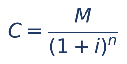

- C = capital, aqui chamado também de valor presente (VP) ou valor atual: o quanto o valor futuro "vale hoje".
- M = montante, ou valor futuro (VF): o valor na data futura.
- (1 + i)ⁿ = o mesmo fator de capitalização de 3.2. Seu inverso, 1 ÷ (1 + i)ⁿ, chama-se fator de valor atual (ou de desconto); algumas provas dão a tabela desse inverso, e então se MULTIPLICA o montante por ele (Cap. 5 e Cap. 6).

Essa operação de trazer valores ao presente é o coração do desconto racional composto (Cap. 5), da equivalência de capitais e das séries de pagamentos (Cap. 6) e do VPL (Cap. 8). Por isso vale fixá-la bem agora.

:::DICA Dividir por 1,21, 1,1025, 1,331 sem sofrer
Muitas vezes o montante do enunciado foi escolhido para dar conta exata: 26.620 ÷ 1,331 = 20.000 (porque 1,331 × 20.000 = 26.620). Teste as alternativas multiplicando-as pelo fator: multiplicar é mais fácil do que dividir. Se não der exato, estime: dividir por 1,21 é tirar um pouco menos de 1/5 do valor (1 ÷ 1,21 ≈ 0,826).
:::

:::EXEMPLO Exemplo 3 — capital a partir dos juros
Um capital aplicado a 5% ao mês, juros compostos, rendeu 1.025 reais de juros em 2 meses. Qual era o capital?
- Fórmula dos juros: J = C × [(1 + i)ⁿ − 1]
- 1.025 = C × (1,1025 − 1)
- 1.025 = C × 0,1025
- C = 1.025 ÷ 0,1025 = 10.000   (dividimos os dois lados por 0,1025; 0,1025 × 10.000 = 1.025)
:::

:::QUESTAO FGV 2026 — AL-GO — Analista Legislativo — Controle Interno (Q3880757)
Problema: um gestor quer resgatar 200.000 ao fim de dois anos, aplicando hoje a juros compostos de 10% ao ano. Quanto deve aplicar? As alternativas são expressões. Gabarito oficial: A (200.000 ÷ 1,21).
Resolução:
- C = M ÷ (1 + i)ⁿ = 200.000 ÷ 1,1² = 200.000 ÷ 1,21
Por que as outras atraem: 200.000 × 1,21 leva o valor para o FUTURO (sentido errado); 200.000 ÷ 1,44 e 200.000 × 1,44 usam 1,2² (quem soma as taxas, 10% + 10% = 20%, e eleva ao quadrado sem razão); 200.000 ÷ 1,1 desconta um ano só. Uma regra de bolso evita o sentido errado: o valor de HOJE é sempre MENOR que o valor futuro; então, para trazer ao presente, divide-se.
:::

:::QUESTAO FGV 2024 — Prefeitura de São José dos Campos — Analista em Gestão Municipal (Q2360317)
Problema: um empréstimo contratado hoje será pago com 1.000 reais ao fim de dez anos, a juros de 1% ao mês com capitalização mensal; considere 1,01¹²⁰ = 3,30. Pede-se o valor emprestado, arredondado. Gabarito oficial: D (303), conferido no QConcursos em 30/10/2026; coincide com a conta abaixo.
Resolução:
- Dez anos = 120 meses: n = 120 (taxa mensal, prazo em meses).
- C = 1.000 ÷ 1,01¹²⁰ = 1.000 ÷ 3,30
- 1.000 ÷ 3,3 = 10.000 ÷ 33 ≈ 303,03 → 303
Por que as outras atraem: 3.300 multiplica em vez de dividir; 330 e 300 erram a vírgula ou arredondam 3,30 para 3,33; 909 corresponde a 1.000 ÷ 1,1 (quem desconta 10% uma única vez, como se fosse 1% × 10 anos). O ponto da questão é perceber que 10 anos são 120 capitalizações mensais, e a potência já vem pronta.
:::

:::PRATIQUE exercícios elaborados para esta apostila (capital)
1. Que capital, aplicado a 10% ao ano por 3 anos, juros compostos, produz montante de 26.620 reais?
2. (Estilo FCC) Quanto aplicar hoje, a 2% ao mês, para ter 50.000 reais daqui a 1 ano? Considere 1,02¹² = 1,2682. Responda com a melhor aproximação inteira.
3. Um título de 60.000 reais vence em 10 meses. Usando a tabela da seção 3.8 (taxa de 4% ao mês), qual o seu valor atual?
Resoluções:
1. 1,1³ = 1,331. C = 26.620 ÷ 1,331 = 20.000 (confira: 1,331 × 20.000 = 26.620).
2. C = 50.000 ÷ 1,2682 ≈ 39.426. Estimativa para conferir: 1 ÷ 1,27 é um pouco menos que 0,8 (pois 1,25 × 0,8 = 1); 50.000 × 0,79 ≈ 39.500. Coerente.
3. Na tabela, 1,04¹⁰ = 1,4802. C = 60.000 ÷ 1,4802 ≈ 40.535,06.
:::

## 03.6 Achar a taxa

### 03.6.1 A ideia e a fórmula

Agora são conhecidos o capital, o montante e o prazo, e falta a taxa. Pela fórmula, M ÷ C é o fator total; basta descobrir que número, multiplicado por ele mesmo n vezes, dá esse fator. Isso é exatamente o que a raiz n-ésima faz (Cap. 1: a raiz desfaz a potência).

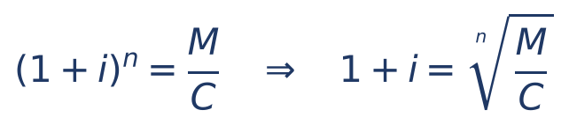

- M ÷ C = fator total do período inteiro (quanto o capital foi multiplicado).
- A raiz de índice n "reparte" esse fator igualmente entre os n períodos.
- Depois de achar 1 + i, subtraia 1 e converta para porcentagem.

Exemplo à mão: 10.000 reais viraram 14.641 reais em 4 meses. Fator total: 14.641 ÷ 10.000 = 1,4641. Precisamos de um número que, elevado à quarta, dê 1,4641. A raiz quarta é a raiz quadrada da raiz quadrada:

- √1,4641 = 1,21   (pois 1,21 × 1,21 = 1,4641)
- √1,21 = 1,1   (pois 1,1 × 1,1 = 1,21)
- 1 + i = 1,1, então i = 0,1 = 10% ao mês

:::DICA Na FCC, quase sempre é mais rápido testar as alternativas
Raízes à mão são trabalhosas. Pegue a alternativa do meio, monte o fator e eleve à potência n: se passou do fator total, a taxa é menor; se ficou abaixo, é maior. Com duas tentativas você costuma chegar lá. E memorize os quadrados e cubos mais comuns: 1,1² = 1,21; 1,2² = 1,44; 1,5² = 2,25; 1,1³ = 1,331; 1,2³ = 1,728.
:::

:::QUESTAO FGV 2026 — DATAPREV — Analista — Gestão Econômico-Financeira (Q4391155)
Problema: capital aplicado por dois meses a juros compostos, taxa mensal constante; o montante foi 2,25 vezes o capital. Pede-se a taxa mensal. Gabarito oficial: C (50% ao mês).
Resolução:
- (1 + i)² = 2,25
- 1 + i = √2,25 = 1,5   (pois 1,5 × 1,5 = 2,25)
- i = 0,5 = 50% ao mês
Por que as outras atraem: 125% é o rendimento TOTAL do bimestre (2,25 − 1), e não a taxa mensal; quem divide 125% por 2 (raciocínio de juros simples) chega a 62,5%, não oferecida, e tende a escolher a vizinha 75%; 25% e 40% não nascem de erro natural. Lembre: a taxa composta mensal é sempre MENOR que a metade do rendimento bimestral, porque parte do rendimento é juro sobre juro.
:::

### 03.6.2 O caso de um período só: compras com entrada e uma parcela

Uma situação muito cobrada: o preço à vista e um parcelamento em "entrada + uma parcela daqui a um mês". O raciocínio é: (1) quem dá entrada só está financiando o que falta, isto é, o preço à vista menos a entrada; (2) esse saldo vira a parcela em um mês; (3) com n = 1, a taxa é simplesmente parcela ÷ saldo − 1. Esse tema (a "taxa escondida" no parcelamento) é desenvolvido no Cap. 4 (ver 04.5.3); aqui ficam as duas questões do lote como aplicação de M = C × (1 + i) com n = 1.

:::QUESTAO FGV 2026 — ALERJ — Especialista Legislativo — Administração (Q3879466)
Problema: lote de cadeiras por 4.000 reais à vista, ou 800 reais de entrada e parcela única de 3.584 reais um mês depois. Pede-se a taxa mensal efetiva. Gabarito oficial: C (12%).
Resolução:
- Saldo financiado: 4.000 − 800 = 3.200
- 3.200 × (1 + i) = 3.584
- 1 + i = 3.584 ÷ 3.200 = 1,12   (3.200 × 1,12 = 3.200 + 384 = 3.584)
- i = 12% ao mês
Por que as outras atraem: 9,6% = 384 ÷ 4.000 (quem divide os juros pelo preço à vista inteiro, esquecendo que a entrada não é financiada); 24,4% e 48% não têm base; 10% é "chute redondo".
:::

:::QUESTAO FGV 2026 — Prefeitura de São José dos Campos — Professor de Matemática (Q3998759)
Problema: produto de 360 reais à vista, ou duas parcelas iguais de 216 reais, a primeira no ato e a segunda um mês depois. Pede-se a taxa mensal. Gabarito oficial: E (50%).
Resolução:
- A primeira parcela, paga no ato, funciona como entrada: saldo financiado = 360 − 216 = 144
- 144 × (1 + i) = 216
- 1 + i = 216 ÷ 144 = 1,5
- i = 50% ao mês
Por que as outras atraem: 20% = (432 − 360) ÷ 360, isto é, quem compara o total pago com o preço à vista sem descontar a entrada. Esse é o erro mais comum nesse tipo de questão: a taxa incide só sobre o que ficou devendo.
No mesmo sentido: Q3029079 (3.000 reais à vista ou duas de 1.650, uma no ato: saldo 1.350; 1.650 ÷ 1.350 ≈ 1,222; taxa ≈ 22%, gabarito D), comentada no Cap. 4.
:::

:::PRATIQUE exercícios elaborados para esta apostila (taxa)
1. Um capital de 5.000 reais virou 7.200 reais em 2 anos, juros compostos. Qual a taxa anual?
2. Um aparelho custa 1.000 reais à vista, ou 300 reais de entrada mais 742 reais em 30 dias. Qual a taxa mensal?
3. (Estilo FCC) Um capital de 8.000 reais gerou montante de 10.648 reais em 3 meses, juros compostos. A taxa mensal é: (A) 8%; (B) 9%; (C) 10%; (D) 11%; (E) 12%.
Resoluções:
1. Fator total: 7.200 ÷ 5.000 = 1,44. (1 + i)² = 1,44, então 1 + i = 1,2 e i = 20% ao ano.
2. Saldo financiado: 1.000 − 300 = 700. 742 ÷ 700 = 1,06. Taxa de 6% ao mês.
3. Fator total: 10.648 ÷ 8.000 = 1,331. Teste a alternativa do meio, 10%: 1,1³ = 1,331. Bateu: (C).
:::

## 03.7 Achar o prazo: logaritmos sem medo

### 03.7.1 O problema

Agora a incógnita está no EXPOENTE: "em quanto tempo um capital dobra a 5% ao mês?". Queremos n tal que 1,05ⁿ = 2. Não há operação básica que "desça" o expoente. Há dois caminhos: tentativa (multiplicar 1,05 por ele mesmo até passar de 2) ou logaritmo, a ferramenta inventada exatamente para isso.

### 03.7.2 O mínimo de logaritmo de que você precisa

O Cap. 1 (ver 01.9) apresenta os logaritmos com calma. Aqui, o essencial em três frases.

Primeira: o logaritmo de um número é o expoente. "log 100 = 2" quer dizer "10 elevado a 2 dá 100". "log 2 ≈ 0,301" quer dizer "10 elevado a 0,301 dá aproximadamente 2". Quando não se escreve a base, ela é 10. O "ln" (logaritmo natural, ou neperiano) usa como base o número e ≈ 2,718; as regras são as mesmas.

Segunda: o logaritmo de uma potência traz o expoente para a frente, multiplicando. Essa é a propriedade que resolve o problema do prazo:

- log(aⁿ) = n × log a

Terceira: o logaritmo transforma multiplicação em soma e divisão em subtração:

- log(a × b) = log a + log b
- log(a ÷ b) = log a − log b

Com isso a prova pode dar só log 2 e log 3 e você calcula log 6 (= log 2 + log 3), log 1,5 (= log 3 − log 2), log 4 (= 2 × log 2) etc.

### 03.7.3 A fórmula do prazo

Partimos de M = C × (1 + i)ⁿ:

- (1 + i)ⁿ = M ÷ C   (dividimos os dois lados por C)
- log[(1 + i)ⁿ] = log(M ÷ C)   (aplicamos log dos dois lados: se dois números são iguais, seus logaritmos também são)
- n × log(1 + i) = log(M ÷ C)   (propriedade da potência)
- n = log(M ÷ C) ÷ log(1 + i)   (dividimos os dois lados por log(1 + i))

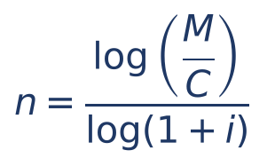

- M ÷ C = fator total (2 para "dobrar", 3 para "triplicar", 1,5 para "crescer 50%").
- log(1 + i) = logaritmo do fator de um período (a prova fornece: log 1,05, ln 1,02 etc.).
- A base do logaritmo não importa, desde que seja a MESMA em cima e embaixo: pode usar log ou ln, conforme o que a prova der.

:::EXEMPLO Exemplo 4 — em quanto tempo dobra
Em quanto tempo um capital dobra a 5% ao mês? Dados: log 2 = 0,301 e log 1,05 = 0,021.
- n = log 2 ÷ log 1,05
- n = 0,301 ÷ 0,021
- n = 301 ÷ 21   (multiplicamos em cima e embaixo por 1.000)
- n ≈ 14,33 meses
Interpretação: entre 14 e 15 meses. Se os juros só são creditados no fim de cada mês, o saldo ultrapassa o dobro no 15º mês (1,05¹⁴ ≈ 1,98 e 1,05¹⁵ ≈ 2,08). Com logaritmos mais precisos o resultado seria 14,21; a diferença vem do arredondamento dos dados, e você deve usar SEMPRE os dados da prova.
:::

:::EXEMPLO Exemplo 5 — quando o fator não é 2 nem 3
Em quanto tempo 8.000 reais viram 12.000 reais a 5% ao mês? Dados: log 2 = 0,301; log 3 = 0,477; log 1,05 = 0,0212.
- Fator total: 12.000 ÷ 8.000 = 1,5
- log 1,5 = log(3 ÷ 2) = log 3 − log 2 = 0,477 − 0,301 = 0,176
- n = 0,176 ÷ 0,0212 = 1.760 ÷ 212 ≈ 8,3 meses
:::

:::EXEMPLO Exemplo 5-A — triplicar, conferindo com a tabela
Em quanto tempo um capital triplica a 10% ao ano? Dados: log 3 = 0,48 e log 1,1 = 0,04.
- n = log 3 ÷ log 1,1
- n = 0,48 ÷ 0,04 = 48 ÷ 4 = 12 anos
Conferência pela tabela de 3.8.1 (coluna de 10%): 1,1¹¹ ≈ 2,8531 e 1,1¹² ≈ 3,1384. O capital passa do triplo entre o 11º e o 12º ano; com logaritmos mais precisos, n ≈ 11,53. O resultado "12" vem do arredondamento grosseiro dos dados (0,48 e 0,04), e é ele que a prova espera. Repare como a tabela e o logaritmo contam a mesma história por caminhos diferentes: quando a prova der os dois, use o que levar à conta mais curta.
:::

### 03.7.4 Regra do 70: o atalho para "dobrar"

Para taxas pequenas, ln(1 + i) é quase igual a i (com i em decimal), e ln 2 ≈ 0,693 ≈ 0,7. Daí:

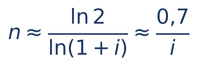

Na prática: o prazo para dobrar é aproximadamente 70 dividido pela taxa em porcentagem. A 2% ao mês, 70 ÷ 2 = 35 meses; a 5%, 70 ÷ 5 = 14; a 10%, 70 ÷ 10 = 7 (o exato é 7,27). Muitos livros usam 72 em vez de 70 ("regra do 72"), que acerta melhor para taxas entre 6% e 10%. As duas servem para eliminar alternativas.

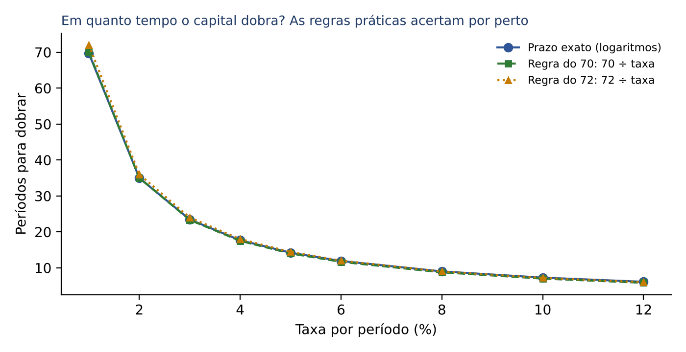

:::QUESTAO FGV 2024 — DATAPREV — Contabilidade (Q3085998)
Problema: a juros compostos de 2% ao mês, em quanto tempo um capital dobra? Use ln 2 ≈ 0,7 e ln 1,02 ≈ 0,02. Gabarito oficial: D (2 anos e 11 meses).
Resolução:
- n = ln 2 ÷ ln 1,02 = 0,7 ÷ 0,02 = 70 ÷ 2 = 35 meses
- 35 meses = 24 + 11 = 2 anos e 11 meses
Por que as outras atraem: 4 anos e 2 meses = 50 meses (quem faz 1 ÷ 0,02, como nos juros SIMPLES, em que dobrar exige juros iguais ao capital: 100% ÷ 2% = 50 meses); 3 anos e 6 meses = 42 meses; 1 ano e 10 meses = 22 meses. A questão é a regra do 70 em estado puro, e a alternativa A testa justamente a confusão com o regime simples.
:::

:::DICA Sem logaritmo: tentativa
Quando a taxa é "grande" e o prazo, curto, multiplique o fator até passar do alvo. Exemplo (Q2351960, comentada no Cap. 4): dívida a 20% ao mês, quando ultrapassa o dobro? 1,2² = 1,44; 1,2³ = 1,728; 1,2⁴ = 2,0736. Ultrapassa o dobro no 4º mês. A dificuldade dessa questão está em obter os 20% ao mês a partir de "240% ao ano capitalizados mensalmente" (taxa nominal, Cap. 4).
:::

:::PRATIQUE exercícios elaborados para esta apostila (prazo)
1. Em quantos meses 10.000 reais viram 13.310 reais a 10% ao mês, juros compostos?
2. Em quanto tempo um capital dobra a 4% ao mês? Dados: log 2 = 0,30 e log 1,04 = 0,017.
3. Em quanto tempo um capital dobra a 5% ao ano? Use ln 2 = 0,69 e ln 1,05 = 0,049.
4. (Estilo FCC) A 2% ao mês, um capital dobra em cerca de 35 meses. Em quanto tempo quadruplica?
Resoluções:
1. Fator total: 13.310 ÷ 10.000 = 1,331 = 1,1³. Logo n = 3 meses (nem precisa de logaritmo).
2. n = 0,30 ÷ 0,017 = 300 ÷ 17 ≈ 17,6 meses. (Regra do 70: 70 ÷ 4 = 17,5. Coerente.)
3. n = 0,69 ÷ 0,049 = 690 ÷ 49 ≈ 14,1 anos.
4. Quadruplicar é dobrar duas vezes: 35 + 35 = 70 meses. Pela fórmula: log 4 = 2 × log 2, então o prazo é o dobro do prazo de dobrar.
:::

## 03.8 Tabelas financeiras e dados do enunciado

### 03.8.1 A tabela do fator (1 + i)ⁿ

Muitas provas trazem, no fim do caderno ou no próprio enunciado, uma tabela do fator de capitalização: nas linhas, o número de períodos n; nas colunas, a taxa i. O cruzamento é (1 + i)ⁿ. Veja um trecho (valores com 4 casas, arredondados):

| n | 1% | 2% | 3% | 4% | 5% | 10% |
|---|---|---|---|---|---|---|
| 1 | 1,0100 | 1,0200 | 1,0300 | 1,0400 | 1,0500 | 1,1000 |
| 2 | 1,0201 | 1,0404 | 1,0609 | 1,0816 | 1,1025 | 1,2100 |
| 3 | 1,0303 | 1,0612 | 1,0927 | 1,1249 | 1,1576 | 1,3310 |
| 4 | 1,0406 | 1,0824 | 1,1255 | 1,1699 | 1,2155 | 1,4641 |
| 5 | 1,0510 | 1,1041 | 1,1593 | 1,2167 | 1,2763 | 1,6105 |
| 6 | 1,0615 | 1,1262 | 1,1941 | 1,2653 | 1,3401 | 1,7716 |
| 7 | 1,0721 | 1,1487 | 1,2299 | 1,3159 | 1,4071 | 1,9487 |
| 8 | 1,0829 | 1,1717 | 1,2668 | 1,3686 | 1,4775 | 2,1436 |
| 9 | 1,0937 | 1,1951 | 1,3048 | 1,4233 | 1,5513 | 2,3579 |
| 10 | 1,1046 | 1,2190 | 1,3439 | 1,4802 | 1,6289 | 2,5937 |
| 11 | 1,1157 | 1,2434 | 1,3842 | 1,5395 | 1,7103 | 2,8531 |
| 12 | 1,1268 | 1,2682 | 1,4258 | 1,6010 | 1,7959 | 3,1384 |
| 24 | 1,2697 | 1,6084 | 2,0328 | 2,5633 | 3,2251 | 9,8497 |

Três usos:

- Ler direto: 3.000 reais a 4% ao mês por 6 meses → fator 1,2653 → M = 3.000 × 1,2653 = 3.795,90.
- Achar o prazo "pela tabela": desça pela coluna da taxa até o fator passar do alvo. A 10%, quando o capital dobra? A coluna mostra 1,9487 em n = 7 e 2,1436 em n = 8: dobra entre o 7º e o 8º período (o exato é 7,27, ver 3.7.4).
- Achar a taxa "pela tabela": ande pela linha do prazo até achar o fator. Se 10.000 viraram 12.155 em 4 meses, o fator é 1,2155: na linha n = 4, está na coluna de 5%.

### 03.8.2 Combinar dados: somar expoentes

A tabela (ou o enunciado) quase nunca traz exatamente o expoente de que você precisa. Use a regra das potências: (1 + i)ᵃ⁺ᵇ = (1 + i)ᵃ × (1 + i)ᵇ.

- 1,05¹⁰ = 1,05⁴ × 1,05⁶ = 1,2155 × 1,3401 ≈ 1,6289
- 1,02¹⁸ = 1,02¹² × 1,02⁶ = 1,2682 × 1,1262 ≈ 1,4282
- 1,03⁸ = 1,03⁵ × 1,03³ = 1,1593 × 1,0927 ≈ 1,2668
- 1,04¹² = (1,04⁴)³ = 1,1699³ ≈ 1,6012 (o valor da tabela, 1,6010, difere na 4ª casa por causa dos arredondamentos acumulados: diferença irrelevante para a prova)

:::ATENCAO Use o dado do enunciado, mesmo arredondado
Se o enunciado diz "considere 1,05⁶ = 1,34", use 1,34, ainda que você saiba que o valor é 1,3401. As alternativas foram calculadas com o dado fornecido; usar um valor "mais preciso" pode levar a um resultado que não está entre as opções.
:::

:::QUESTAO FGV 2024 — DATAPREV — Contabilidade (Q3086000)
Enunciado (como está no banco): Bernardo tomou um empréstimo de 120.000 reais à taxa de juros compostos de 3,5% ao mês. Após 4 meses, Bernardo irá pagar de juros a quantia de: (A) 18.520; (B) 19.080; (C) 17.640; (D) 22.560; (E) 27.480. Observação do enunciado: "Se julgar necessário, use os dados da tabela a seguir".
Os dados desta questão estão em figura/tabela não reproduzida no banco de questões; por isso comentamos o MÉTODO, sem números inventados.
Método, passo a passo:
- 1) Identifique os personagens: C = 120.000; i = 3,5% ao mês = 0,035; n = 4 meses; pede-se o JURO (J), e não o montante.
- 2) Escreva a fórmula dos juros compostos: J = M − C = C × [(1 + i)ⁿ − 1] = 120.000 × (1,035⁴ − 1).
- 3) Procure na tabela fornecida pela prova o fator (1 + i)ⁿ na linha n = 4 e na coluna 3,5% (como ler a tabela: 03.8.1). É esse valor, e não um calculado por você, que deve ser usado (ver ATENCAO acima).
- 4) Subtraia 1 do fator lido (isso isola a parte que é juro) e multiplique por 120.000.
- 5) Confira a ordem de grandeza: os juros compostos devem superar um pouco os juros simples do mesmo caso, 120.000 × 0,035 × 4 = 16.800 (conta feita só com os dados do enunciado). Em prazo curto, a diferença entre os dois regimes é pequena (os "juros sobre juros" de 4 meses são poucos); por isso a resposta deve ficar pouco acima de 16.800, e a alternativa mais próxima de 16.800, por cima, é a C (17.640). D e E são grandes demais para 4 meses a 3,5%.
Gabarito oficial: C.
:::

:::PRATIQUE exercícios elaborados para esta apostila (tabela)
1. Pela tabela, calcule o montante de 15.000 reais a 3% ao mês por 10 meses.
2. Usando só as linhas n = 4 e n = 6 da tabela, calcule 1,05¹⁰ e o montante de 2.000 reais a 5% por 10 meses.
3. A que taxa (entre as da tabela) um capital de 25.000 reais vira 31.632,50 reais em 6 meses?
Resoluções:
1. Fator 1,3439. M = 15.000 × 1,3439 = 20.158,50.
2. 1,05¹⁰ = 1,2155 × 1,3401 ≈ 1,6289. M = 2.000 × 1,6289 = 3.257,80.
3. Fator total: 31.632,50 ÷ 25.000 = 1,2653. Na linha n = 6, está na coluna de 4% ao mês.
:::

## 03.9 Prazos não inteiros: convenção exponencial e convenção linear

### 03.9.1 O problema

O que acontece se o dinheiro fica aplicado 3 meses e meio a uma taxa mensal com capitalização mensal? Nos 3 meses inteiros, não há dúvida: os juros são incorporados ao fim de cada mês. Mas e no meio mês final? Há duas maneiras de tratar essa "sobra", e cada uma é uma convenção (um acordo sobre como calcular):

- Convenção exponencial: usa a fórmula dos juros compostos com o expoente quebrado, n = 3,5, como se a capitalização ocorresse continuamente ao longo do tempo.
- Convenção linear: usa juros compostos na parte inteira (3 meses) e juros SIMPLES na parte fracionária (o meio mês), sobre o montante já acumulado.

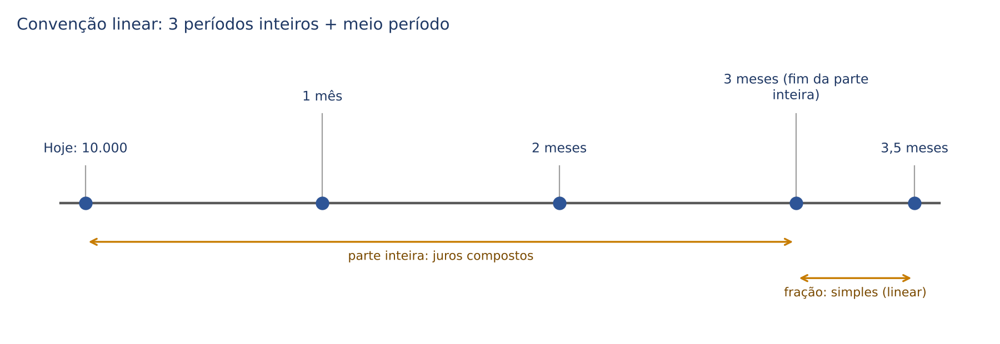

### 03.9.2 As fórmulas

Escreva o prazo como k + p/q, em que k é a parte inteira e p/q é a fração do período (por exemplo, 3,5 = 3 + 1/2; 2 anos e 3 meses = 2 + 3/12 anos; 2 meses e 10 dias = 2 + 10/30 meses).

Convenção exponencial:

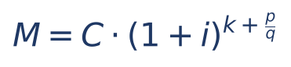

Convenção linear:

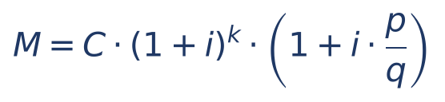

- k = parte inteira do prazo, em períodos da taxa.
- p/q = parte fracionária, também em períodos da taxa (meio mês = 1/2; 3 meses de um ano = 3/12 = 0,25; 10 dias de um mês comercial = 10/30 = 1/3).
- C × (1 + i)ᵏ = montante composto ao fim da parte inteira.
- (1 + i × p/q) = fator dos juros SIMPLES para a fração (Cap. 2): é "um mais a taxa vezes o tempo".

Na convenção linear, a conta é feita em duas etapas: primeiro o composto da parte inteira; depois, sobre esse resultado, juros simples pela fração.

### 03.9.3 Exemplo à mão e comparação

:::EXEMPLO Exemplo 6 — 10.000 reais a 10% ao mês por 3,5 meses
Parte comum: 1,1³ = 1,331, então C × 1,1³ = 10.000 × 1,331 = 13.310.
Convenção linear:
- fração = 0,5 mês; juros simples da fração: 0,10 × 0,5 = 0,05
- M = 13.310 × (1 + 0,05)
- M = 13.310 × 1,05 = 13.310 + 665,50 = 13.975,50
Convenção exponencial (considere √1,1 ≈ 1,0488):
- 1,1^3,5 = 1,1³ × 1,1^0,5 = 1,331 × √1,1   (expoente 0,5 é raiz quadrada, Cap. 1)
- M = 13.310 × 1,0488
- M ≈ 13.959,53
Comparação: a linear dá cerca de 16 reais a mais (13.975,50 contra 13.959,53). Com o fator exato, a exponencial daria 13.959,65.
:::

Por que a linear é SEMPRE maior (ou igual, quando o prazo é inteiro)? Porque na parte fracionária (menos de 1 período) os juros simples rendem mais que os compostos (3.4.2). As duas convenções coincidem nos números inteiros e, entre eles, a linear fica por cima: o gráfico da linear é formado por segmentos de reta ligando os pontos da curva exponencial.

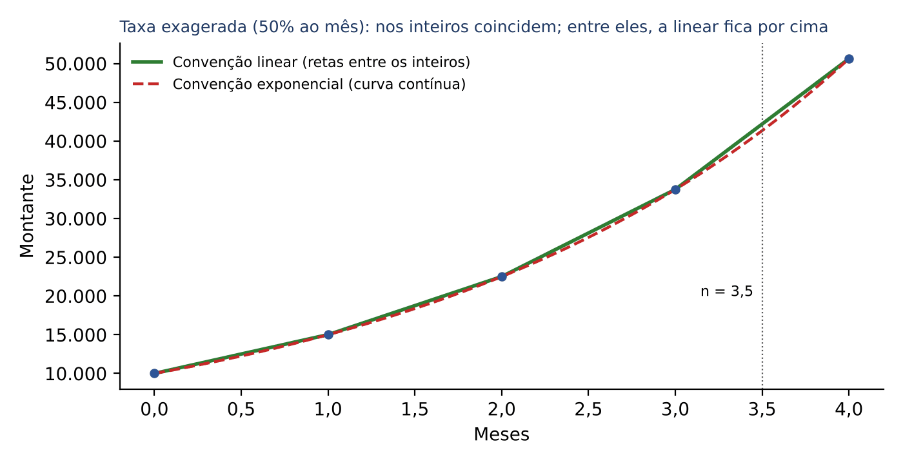

:::ESQUEMA Convenção linear x exponencial
| | Convenção exponencial | Convenção linear |
|---|---|---|
| Parte inteira do prazo | juros compostos | juros compostos |
| Parte fracionária | juros compostos (expoente quebrado) | juros simples sobre o montante da parte inteira |
| Fórmula | C × (1 + i)^(k + p/q) | C × (1 + i)ᵏ × (1 + i × p/q) |
| Montante | menor | maior (para prazo não inteiro) |
| Conta à mão | exige raiz ou dado do enunciado | só multiplicações: a preferida da FCC |
:::

:::PEGADINHA Qual convenção usar?
Se o enunciado disser "convenção linear" ou "convenção exponencial", obedeça. Se não disser nada e o prazo for fracionário, o padrão é a convenção exponencial (é a própria fórmula dos juros compostos). Mas observe as alternativas e os dados: se o enunciado só fornece potências inteiras (como 1,08³) e nenhuma raiz, o examinador quase certamente quer a linear. E não confunda a convenção linear com "juros simples": ela é composta na parte inteira.
:::

:::EXEMPLO Exemplo 7 — prazo em anos e meses (estilo FCC)
Capital de 20.000 reais, juros compostos de 20% ao ano, por 2 anos e 3 meses. Calcule o montante pelas duas convenções (considere 1,2^0,25 = 1,0466).
- Parte inteira: k = 2; 1,2² = 1,44; 20.000 × 1,44 = 28.800
- Fração: 3 meses = 3/12 = 0,25 ano
Linear:
- juros simples da fração: 0,20 × 0,25 = 0,05
- M = 28.800 × 1,05 = 28.800 + 1.440 = 30.240
Exponencial:
- M = 28.800 × 1,2^0,25 = 28.800 × 1,0466 = 30.142,08
Diferença: 30.240 − 30.142,08 = 97,92 a favor da linear.
:::

:::EXEMPLO Exemplo 8 — prazo em meses e dias (convenção linear)
Capital de 50.000 reais a 6% ao mês, por 2 meses e 10 dias, convenção linear, mês comercial de 30 dias.
- Parte inteira: 1,06² = 1,1236; 50.000 × 1,1236 = 56.180
- Fração: 10 dias = 10/30 = 1/3 de mês; juros simples: 0,06 × 1/3 = 0,02
- M = 56.180 × 1,02 = 56.180 + 1.123,60 = 57.303,60
:::

:::PASSO Como resolver qualquer questão de convenção linear
1. Converta o prazo para a unidade da taxa e separe parte inteira (k) e fração (p/q).
2. Calcule o montante composto da parte inteira: C × (1 + i)ᵏ.
3. Calcule o fator simples da fração: 1 + i × p/q.
4. Multiplique os dois resultados.
5. Se a questão pedir o capital (sabendo o montante), divida o montante pelo produto dos dois fatores.
:::

:::PRATIQUE exercícios elaborados para esta apostila (convenções)
1. Calcule o montante de 1.000 reais a 10% ao ano, por 1 ano e 6 meses, pela convenção linear e pela exponencial (considere √1,1 = 1,0488).
2. Calcule, pela convenção linear, o montante de 40.000 reais a 4% ao mês, por 3 meses e 15 dias (mês comercial).
3. (Estilo FCC) Um capital aplicado a 10% ao ano, por 2 anos e 6 meses, juros compostos com convenção linear, produziu montante de 25.410 reais. Qual o capital?
Resoluções:
1. Parte inteira: 1.000 × 1,1 = 1.100. Linear: fração 0,5 ano, fator simples 1 + 0,1 × 0,5 = 1,05; M = 1.100 × 1,05 = 1.155. Exponencial: M = 1.100 × 1,0488 = 1.153,68. A linear é maior, como esperado.
2. Parte inteira: 1,04³ = 1,124864; 40.000 × 1,124864 = 44.994,56. Fração: 15 dias = 0,5 mês; fator simples 1 + 0,04 × 0,5 = 1,02. M = 44.994,56 × 1,02 = 44.994,56 + 899,89 = 45.894,45.
3. Fator da parte inteira: 1,1² = 1,21. Fator simples da fração: 1 + 0,1 × 0,5 = 1,05. Produto: 1,21 × 1,05 = 1,2705. C = 25.410 ÷ 1,2705 = 20.000 (confira: 20.000 × 1,2705 = 25.410).
:::

:::NOTA Capitalização contínua
A convenção exponencial leva à ideia de capitalização "a todo instante", a capitalização contínua, que usa o número e e o logaritmo natural (M = C × e^(i × n)). Esse tema está no Cap. 4.
:::

## 03.10 Bateria final: o capítulo inteiro em seis exercícios

Antes do resumo, uma bateria que mistura tudo o que foi visto, na ordem em que a FCC costuma misturar. Tente resolver cada item antes de ler a resolução; se travar, a remissão indica a seção que ensina o passo.

:::PRATIQUE exercícios elaborados para esta apostila (bateria mista)
1. (Montante com dado fornecido, 3.2) Um capital de 12.000 reais é aplicado a 3% ao mês, juros compostos, por 4 meses. Considere 1,03⁴ = 1,1255. Calcule o montante e os juros.
2. (Taxa, 3.6) Qual a taxa mensal composta que faz um capital crescer 21% em 2 meses?
3. (Comparação com taxas diferentes, 3.4) A aplicação A rende 2,5% ao mês em juros simples; a B, 2% ao mês em juros compostos. Qual rende mais em 12 meses? E em 24 meses? Considere 1,02¹² = 1,2682 e 1,02²⁴ = 1,6084.
4. (Prazo com logaritmo, 3.7) Em quanto tempo um capital cresce 60% a 5% ao mês? Dados: log 2 = 0,301 e log 1,05 = 0,0212.
5. (Convenção linear, 3.9) Calcule o montante de 30.000 reais a 8% ao ano, por 3 anos e 6 meses, pela convenção linear. Considere 1,08³ = 1,259712.
6. (Pagamento parcial, 3.2) Uma dívida de 8.000 reais é corrigida a 4% ao mês, juros compostos. Ao fim do 2º mês, o devedor nada paga; ao fim do 3º mês, paga 5.000 reais. Qual o saldo devedor logo após esse pagamento? Considere 1,04³ = 1,124864.
Resoluções:
1. M = 12.000 × 1,1255 = 13.506. J = 13.506 − 12.000 = 1.506. Conferência: os juros simples seriam 12.000 × 0,03 × 4 = 1.440; os compostos ficam um pouco acima. Coerente.
2. Crescer 21% significa fator total 1,21. (1 + i)² = 1,21, então 1 + i = √1,21 = 1,1 e i = 10% ao mês. Repare: não é 10,5% (21 ÷ 2, raciocínio de juros simples).
3. Em 12 meses: A rende 2,5% × 12 = 30%; B rende 26,82% (1,2682 − 1). A rende mais. Em 24 meses: A rende 2,5% × 24 = 60%; B rende 60,84% (1,6084 − 1). B rende mais. Moral: com taxas diferentes, o regime composto pode perder no curto prazo e ganhar no longo, porque o juro sobre juro cresce com o tempo.
4. Fator total: 1,6. Para obter log 1,6 a partir de log 2: 1,6 = 16 ÷ 10 = 2⁴ ÷ 10, então log 1,6 = 4 × log 2 − log 10 = 4 × 0,301 − 1 = 1,204 − 1 = 0,204 (lembre: log 10 = 1, porque 10¹ = 10). n = 0,204 ÷ 0,0212 = 2.040 ÷ 212 ≈ 9,6 meses.
5. Parte inteira: 30.000 × 1,259712 = 37.791,36. Fração: 6 meses = 0,5 ano; fator simples 1 + 0,08 × 0,5 = 1,04. M = 37.791,36 × 1,04 = 37.791,36 + 1.511,65 = 39.303,01.
6. Saldo no fim do 3º mês, antes do pagamento: 8.000 × 1,124864 = 8.998,912 ≈ 8.998,91. Após o pagamento: 8.998,91 − 5.000 = 3.998,91. (O "nada paga no 2º mês" é só para confundir: sem pagamento, o saldo simplesmente continua capitalizando.)
:::

:::PEGADINHA Aumentos sucessivos não se somam
Um preço que sobe 10% num mês e mais 10% no outro não sobe 20%, e sim 21% (1,1 × 1,1 = 1,21). É a mesma lógica dos juros compostos: cada aumento incide sobre o valor já aumentado. E o contrário também vale: um aumento de 10% seguido de uma queda de 10% NÃO devolve o valor original (1,1 × 0,9 = 0,99, ou seja, perda de 1%). A FCC usa essa armadilha tanto em matemática financeira quanto em questões de porcentagem (Cap. 1).
:::

## 03.11 Resumo para revisão pré-prova

| Conceito | Fórmula ou regra | Quando usar | Armadilha |
|---|---|---|---|
| Juros compostos | juros de cada período incorporados ao capital (capitalização) | quase todas as operações financeiras reais | achar que os juros são iguais todo mês (isso é o simples) |
| Fator de capitalização | (1 + i)ⁿ | multiplica o capital para obter o montante | i em porcentagem em vez de decimal |
| Montante | M = C × (1 + i)ⁿ | pede valor final, valor de resgate, dívida no vencimento | prazo e taxa em unidades diferentes |
| Juros | J = M − C = C × [(1 + i)ⁿ − 1] | pede "os juros" ou "a receita financeira" | marcar o montante quando se pedem juros, e vice-versa |
| Retirada ou pagamento parcial | atualiza, abate, continua | pagamentos no meio do prazo | subtrair do montante final sem corrigir |
| Unidade | converta o PRAZO para a unidade da taxa | sempre | dividir taxa composta (3% a.t. não é 1% a.m.) |
| Simples x compostos | iguais em n = 1; simples maior se n < 1; compostos maiores se n > 1 | comparações | "compostos sempre rendem mais" (só com a mesma taxa e n > 1) |
| Diferença em 2 períodos | C × i² | mesma taxa, n = 2 | aplicar com taxas diferentes |
| Capital (valor atual) | C = M ÷ (1 + i)ⁿ | "quanto aplicar hoje", "quanto vale hoje" | multiplicar em vez de dividir |
| Taxa | 1 + i = raiz n-ésima de M ÷ C | conhecidos C, M e n | dividir o rendimento total por n (raciocínio simples) |
| Entrada + 1 parcela | i = parcela ÷ (preço à vista − entrada) − 1 | compras com entrada | esquecer de abater a entrada |
| Prazo | n = log(M ÷ C) ÷ log(1 + i) | "em quanto tempo" | usar bases diferentes em cima e embaixo |
| Regra do 70 | prazo para dobrar ≈ 70 ÷ taxa (%) | estimar e eliminar alternativas | confundir com o simples (100 ÷ taxa) |
| Tabela | (1 + i)ᵃ⁺ᵇ = (1 + i)ᵃ × (1 + i)ᵇ | expoente fora da tabela | usar valor "mais preciso" que o do enunciado |
| Convenção exponencial | M = C × (1 + i)^(k + p/q) | prazo fracionário, enunciado silente | precisar de raiz: a prova fornece |
| Convenção linear | M = C × (1 + i)ᵏ × (1 + i × p/q) | enunciado pede "linear" | aplicar juros simples ao prazo todo |

Formulário do capítulo:

- M = C × (1 + i)ⁿ — M = montante; C = capital; i = taxa por período (decimal); n = número de períodos na unidade da taxa. Use para achar o valor final.
- J = M − C = C × [(1 + i)ⁿ − 1] — J = juros totais. Use quando a questão dá ou pede os juros.
- C = M ÷ (1 + i)ⁿ — valor presente. Use para trazer valores do futuro a hoje.
- (1 + i)ⁿ = M ÷ C, então 1 + i = raiz n-ésima de (M ÷ C) — use para achar a taxa (ou teste alternativas).
- n = log(M ÷ C) ÷ log(1 + i) — use para achar o prazo; vale com log ou ln, desde que iguais.
- n para dobrar ≈ 0,7 ÷ i (i em decimal), ou 70 ÷ taxa em porcentagem — estimativa.
- (1 + i)ⁿ ≈ 1 + n × i + [n × (n − 1) ÷ 2] × i² — estimativa da potência para taxas pequenas.
- Diferença composto − simples em 2 períodos = C × i².
- Convenção linear: M = C × (1 + i)ᵏ × (1 + i × p/q); convenção exponencial: M = C × (1 + i)^(k + p/q); k = parte inteira, p/q = fração do período.

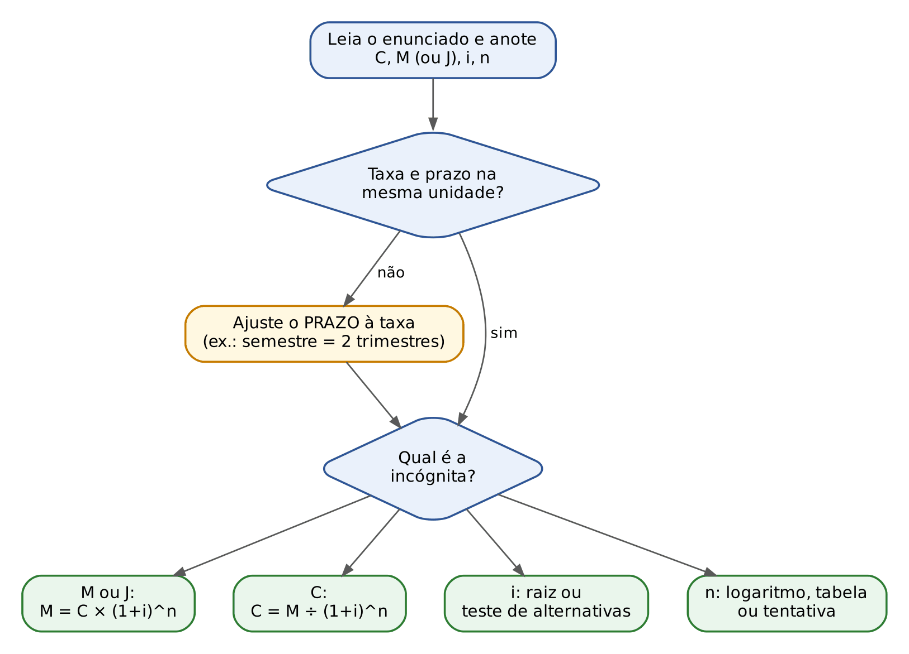

## 03.12 Questões do capítulo

FCC: Q3884301, Q3916769, Q4066796. FGV: Q2360317, Q2522945, Q3029079 (comentada no Cap. 4), Q3085998, Q3086000, Q3154006, Q3174684, Q3185951, Q3248829, Q3849667, Q3879466, Q3880757, Q3884935, Q3998759, Q4222685, Q4374146, Q4391155; Q2351960 (comentada no Cap. 4).

:::NOTA Notas de verificação
Contas: todas as contas dos exemplos, das questões comentadas, dos exercícios PRATIQUE e da bateria final (03.10) foram conferidas em Python (fatores, montantes, juros, logaritmos, convenções e a tabela de 3.8.1, gerada por programa com 4 casas).
Gabaritos: Q3248829 — a conta correta dá 4.492,89/4.492,90, um real abaixo da alternativa E (4.493,90), que é o gabarito oficial; tratado como provável erro de digitação na alternativa ("gabarito oficial discutível" apenas quanto a essa diferença de 1 real; nesta passada, só anotado). Gabaritos reconferidos no QConcursos em 30/10/2026: Q2360317 (oficial D, 303) e Q2351960 (oficial C, 4 meses), ambos idênticos às respostas antes deduzidas pela conta. Q3086000 — a tabela do enunciado não consta do banco; o box foi refeito em 30/10/2026 para comentar só o MÉTODO, sem supor o fator que a tabela trazia (retirada a reconstrução anterior do fator); gabarito oficial C mantido.
Alternativas: a origem atribuída a algumas alternativas erradas é reconstrução plausível; onde não foi possível reconstruí-la, o texto diz isso.
Direito: Súmulas 539 e 541 do STJ (Segunda Seção, j. 10/6/2015, DJe 15/6/2015) conferidas em 30/10/2026 no portal de súmulas do STJ (scon.stj.jus.br), texto literal transcrito; a redação anterior ("após 31/3/2000") foi corrigida para "a partir de 31/3/2000", como está na súmula. Súmula 121 do STF: texto conferido em 30/10/2026 apenas em fontes secundárias concordantes (o portal do STF não foi acessado); conferir no portal do STF antes da publicação. A observação "aplica ao mútuo comum" é leitura jurisprudencial, não texto da súmula.
Convenções: a regra "enunciado silente sobre prazo fracionário → convenção exponencial" é a prática didática usual (é a própria fórmula composta), não norma; o mapa do Drive (MF07, Convenção Linear e Exponencial) usa o mesmo exemplo de 10.000 reais a 10% por 3,5 meses e confirma 13.975,50 (linear).
Fontes: banco local (21 questões do capítulo e busca por palavra-chave no banco inteiro); briefing do Cap. 3; Drive MF07 (lido). Sem dados de lei ou de Santa Catarina neste capítulo.
:::
