# CAPÍTULO 04 — TAXAS DE JUROS: PROPORCIONAIS, EQUIVALENTES, NOMINAL E EFETIVA, APARENTE E REAL, TAXA OVER E CAPITALIZAÇÃO CONTÍNUA

:::INCIDENCIA
Edital SEFAZ/SC 01/2026 — Matemática Financeira, Estatística e Raciocínio Lógico: "Taxa real e taxa efetiva. Taxas equivalentes" (nos juros simples e compostos) e "Capitalização contínua". Nível A+.
Lote do banco: 19 questões atribuídas (FCC 1, FGV 18), mais 4 de capítulos vizinhos que cobram o mesmo raciocínio (todas FGV).
O que mais cai: nominal → efetiva (24% ao ano capitalizados mensalmente), taxa real pela fórmula de Fisher, taxa equivalente composta e taxa "escondida" em compras parceladas.
:::

:::ESQUEMA O que você vai aprender e o que precisa saber antes
Pré-requisitos: porcentagem na forma decimal, potências e raízes, e o uso de tabelas fornecidas pela prova (Cap. 1); juros simples e taxa proporcional (Cap. 2); montante composto M = C × (1 + i)ⁿ e logaritmos aplicados a prazo (Cap. 3).
- 04.1 A "unidade" de uma taxa e a regra de ouro: taxa e prazo na mesma unidade.
- 04.2 Taxas proporcionais (regime simples): dividir e multiplicar.
- 04.3 Taxas equivalentes (regime composto): potência para subir, raiz para descer.
- 04.4 Taxa nominal e taxa efetiva: o rótulo do contrato e a taxa verdadeira.
- 04.5 Taxa acumulada, taxa média e a taxa escondida nas compras parceladas.
- 04.6 Taxa aparente, taxa real e inflação (fórmula de Fisher).
- 04.7 Taxas à vista e a termo (estrutura a termo): uma aplicação das taxas equivalentes.
- 04.8 Taxa over: noção e cálculo.
- 04.9 Capitalização contínua e taxa instantânea.
- 04.10 Roteiro geral, resumo, formulário e questões.
:::

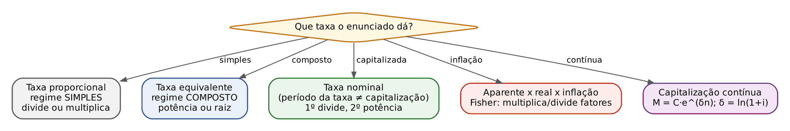

## 04.1 Antes de tudo: toda taxa tem uma "unidade"

Uma taxa de juros nunca vem sozinha. Ela sempre diz "quanto por quanto tempo". Dizer "a taxa é 2%" é tão incompleto quanto dizer "o carro andou a 80": 80 por hora? por minuto? A taxa precisa da unidade de tempo.

As abreviações que a prova usa são estas:

- a.d. = ao dia;
- a.m. = ao mês;
- a.b. = ao bimestre (2 meses);
- a.t. = ao trimestre (3 meses);
- a.q. = ao quadrimestre (4 meses);
- a.s. = ao semestre (6 meses);
- a.a. = ao ano (12 meses).

A regra de ouro, que vale para qualquer fórmula de juros (Cap. 2 e Cap. 3), é esta: a taxa e o prazo têm de estar NA MESMA UNIDADE. Se a taxa é mensal, o prazo entra em meses. Se a taxa é anual e o prazo está em meses, alguém tem de ser convertido. Este capítulo inteiro é, no fundo, o manual de como converter uma taxa de uma unidade para outra sem errar.

Por que existe mais de um jeito de converter? Porque existem dois regimes de juros, e cada um tem a sua conversão:

- no regime de juros SIMPLES (Cap. 2), os juros de cada período são calculados sempre sobre o capital inicial; a conversão é por divisão e multiplicação, e as taxas convertidas se chamam proporcionais;
- no regime de juros COMPOSTOS (Cap. 3), os juros de cada período se somam ao saldo e passam a render juros também ("juros sobre juros"); a conversão é por potência e raiz, e as taxas convertidas se chamam equivalentes.

Uma convenção que a prova adota quase sempre, salvo aviso em contrário: o mês comercial tem 30 dias e o ano comercial tem 360 dias. Assim, 1 ano = 12 meses = 360 dias; 1 semestre = 6 meses = 180 dias; 1 trimestre = 3 meses = 90 dias.

:::ATENCAO
A pergunta que você faz a si mesmo diante de QUALQUER taxa do enunciado é dupla: (1) qual é a unidade desta taxa? (2) em que regime estou, simples ou composto? Só depois disso você decide se divide, multiplica, eleva à potência ou tira a raiz.
:::

## 04.2 Taxas proporcionais (regime simples)

### 04.2.1 A ideia

Imagine um empréstimo entre parentes em que se combina: "você me paga 3% por mês sobre o que te emprestei, sempre sobre o valor original". Em um ano, quanto isso dá? São 12 meses de 3%, sempre sobre a mesma base. Logo, 12 × 3% = 36% no ano. Essa é toda a ideia de taxa proporcional: as taxas guardam entre si a mesma proporção que os prazos.

O assunto já foi ensinado no Cap. 2 (juros simples); aqui ele aparece só para ser comparado com as taxas equivalentes, que são a novidade deste capítulo.

### 04.2.2 Exemplo à mão

Empréstimo de 1.000 reais a juros simples de 3% ao mês por 12 meses:

- juros de cada mês = 1.000 × 0,03 = 30;
- juros dos 12 meses = 30 × 12 = 360.

Agora o mesmo empréstimo a juros simples de 36% ao ano, por 1 ano:

- juros = 1.000 × 0,36 × 1 = 360.

O resultado é idêntico. Por isso dizemos que 3% a.m. e 36% a.a. são proporcionais.

### 04.2.3 A regra

Duas taxas são proporcionais quando a razão entre elas é igual à razão entre os prazos a que se referem. Na prática:

- para passar de uma unidade MENOR para uma MAIOR (do mês para o ano), MULTIPLIQUE pelo número de períodos pequenos que cabem no grande: 3% a.m. × 12 = 36% a.a.;
- para passar de uma unidade MAIOR para uma MENOR (do ano para o mês), DIVIDA: 36% a.a. ÷ 12 = 3% a.m.

Escrito como fórmula, com k = número de períodos curtos dentro do período longo:

- i_L = i_C × k

Em que:

- i_L = taxa do período Longo (por exemplo, a anual);
- i_C = taxa do período Curto (por exemplo, a mensal);
- k = quantos períodos curtos cabem no longo (um ano tem 12 meses: k = 12; um semestre tem 3 bimestres: k = 3).

:::EXEMPLO Convertendo 36% ao ano para várias unidades (regime simples)
- Ao semestre: um ano tem 2 semestres; 36% ÷ 2 = 18% a.s.
- Ao trimestre: um ano tem 4 trimestres; 36% ÷ 4 = 9% a.t.
- Ao mês: 36% ÷ 12 = 3% a.m.
- Ao dia (ano comercial de 360 dias): 36% ÷ 360 = 0,1% a.d.
- Conferência no sentido inverso: 0,1% a.d. × 30 = 3% a.m.; 3% a.m. × 12 = 36% a.a.
:::

### 04.2.4 No regime simples, proporcional é o mesmo que equivalente

Taxas equivalentes, em qualquer regime, são aquelas que, aplicadas ao mesmo capital pelo mesmo prazo, produzem o MESMO montante. O exemplo de 04.2.2 mostrou que 3% a.m. e 36% a.a., a juros simples, produzem o mesmo montante em 12 meses. Logo, no regime simples, taxas proporcionais SÃO equivalentes. As duas palavras descrevem a mesma taxa.

No regime composto, isso deixa de ser verdade, como você verá em 04.3. Essa diferença é a pegadinha preferida das bancas.

:::QUESTAO FGV 2024 — AL-TO — Analista Legislativo — Ciências Econômicas (Q2457769)
Problema: no regime de juros simples, quais são as taxas anuais proporcional e equivalente a 10% ao mês? Gabarito oficial: B (120% e 120%).
Resolução passo a passo:
- Taxa proporcional anual: 10% × 12 = 120% a.a.
- Taxa equivalente anual no regime simples: como, a juros simples, proporcional e equivalente coincidem (04.2.4), também é 120% a.a.
- Conferência com um capital de 100 por 12 meses: a 10% a.m., juros = 100 × 0,10 × 12 = 120; a 120% a.a., juros = 100 × 1,20 × 1 = 120. Mesmo montante: 220.
Por que as outras atraem: a alternativa D (120% e 214%) é a resposta de quem esqueceu que a questão fala em juros SIMPLES e calculou a equivalente composta (1,10¹² ≈ 3,14, ou seja, 214%). A alternativa C inverte a ordem. A alternativa A (100%) não tem base em conta alguma.
:::

(Q2451623, FGV 2024 — AL-PR — Analista Legislativo — Economista: questão comentada no Cap. 2, 02.3.3.)

:::PRATIQUE exercícios elaborados para esta apostila
1. Em juros simples, qual é a taxa anual proporcional a 4,5% ao trimestre? E a taxa mensal?
2. Um débito de 8.000 reais foi corrigido a juros simples de 54% ao ano durante 5 meses. Quanto se pagou de juros?
3. (Estilo FCC) Um capital de 30.000 reais foi aplicado durante 8 meses à taxa de juros simples de 15% ao ano. Qual o valor dos juros?
Resolução:
1. O ano tem 4 trimestres: 4,5% × 4 = 18% a.a. O trimestre tem 3 meses: 4,5% ÷ 3 = 1,5% a.m.
2. Passo 1, pôr taxa e prazo na mesma unidade: 54% a.a. ÷ 12 = 4,5% a.m. = 0,045. Passo 2, juros simples J = C × i × n:
   - J = 8.000 × 0,045 × 5
   - J = 360 × 5
   - J = 1.800 reais.
3. Passo 1: 15% a.a. ÷ 12 = 1,25% a.m. = 0,0125. Passo 2:
   - J = 30.000 × 0,0125 × 8
   - J = 375 × 8
   - J = 3.000 reais.
   Atalho: 8 meses são 8/12 = 2/3 do ano; 15% × 2/3 = 10%; 10% de 30.000 = 3.000. Mesmo resultado, com uma conta só.
:::
## 04.3 Taxas equivalentes (regime composto)

### 04.3.1 A ideia: juros sobre juros não se somam, se multiplicam

Volte ao parente que empresta dinheiro, mas agora com uma regra diferente: "a cada mês, os juros do mês entram na dívida, e no mês seguinte você paga juros sobre tudo". Esse é o regime composto (Cap. 3), o regime dos bancos, dos cartões de crédito e da maioria das questões de prova.

Nesse regime, a taxa de dois meses NÃO é o dobro da taxa de um mês. É um pouco mais, porque no segundo mês os juros incidem também sobre os juros do primeiro.

### 04.3.2 Exemplo à mão

Dívida de 1.000 reais a juros compostos de 10% ao mês:

- fim do 1º mês: 1.000 × 1,10 = 1.100 (juros de 100);
- fim do 2º mês: 1.100 × 1,10 = 1.210 (juros de 110, porque agora a base é 1.100).

Em 2 meses, a dívida subiu de 1.000 para 1.210, isto é, 210 reais de juros, ou 21%. Logo, a taxa bimestral equivalente a 10% ao mês é 21% ao bimestre, e não 20%.

Repare na conta que fizemos: multiplicamos 1,10 por 1,10. Isso é o mesmo que 1,10² = 1,21. A taxa sai tirando o 1: 1,21 − 1 = 0,21 = 21%.

O número 1,10 tem nome: fator de capitalização (ou fator de acumulação). Ele é "1 + a taxa na forma decimal". Toda a técnica das taxas equivalentes consiste em trabalhar com FATORES, e não com as taxas diretamente:

- taxa de 10% → fator 1,10;
- taxa de 2% → fator 1,02;
- taxa de 0,5% → fator 1,005;
- taxa de 26,82% → fator 1,2682.

Para voltar do fator à taxa, subtraia 1: fator 1,061208 → taxa 0,061208 = 6,1208%.

### 04.3.3 A fórmula

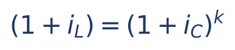

Em que:

- i_L = taxa do período Longo, na forma decimal (por exemplo, a taxa anual);
- i_C = taxa do período Curto, na forma decimal (por exemplo, a taxa mensal);
- k = quantos períodos curtos cabem no período longo (ano e mês: k = 12; trimestre e mês: k = 3; ano e semestre: k = 2);
- (1 + i_L) e (1 + i_C) são os fatores dos dois períodos.

Leitura em português: "o fator do período longo é o fator do período curto multiplicado por ele mesmo k vezes". Faz sentido: capitalizar mês a mês, 12 vezes, tem de dar o mesmo que capitalizar uma vez no ano.

Para SUBIR (do curto para o longo), use a potência. Para DESCER (do longo para o curto), use a raiz, que é a operação inversa da potência (Cap. 1):

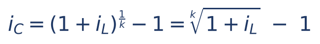

Em que a raiz de índice k (ou, o que é o mesmo, o expoente 1/k) desfaz a potência k. Por exemplo, a raiz quadrada (k = 2) de 1,21 é 1,1, porque 1,1 × 1,1 = 1,21.

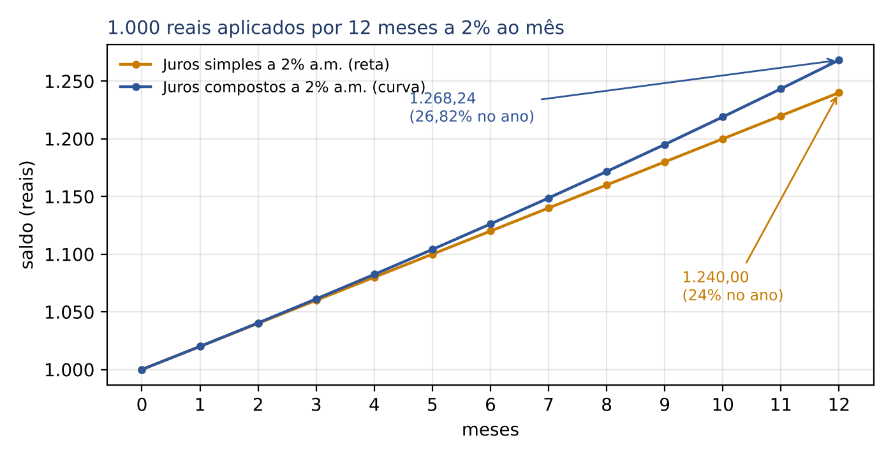

O gráfico mostra o mesmo capital a 2% ao mês nos dois regimes. Em 12 meses, a juros simples, ele vira 1.240 (24% no ano: a taxa proporcional). A juros compostos, ele vira 1.268,24 (26,82% no ano: a taxa equivalente). A distância entre as duas linhas é exatamente a diferença entre "proporcional" e "equivalente".

:::ESQUEMA Proporcional x equivalente, lado a lado
| | Taxa proporcional | Taxa equivalente |
|---|---|---|
| Regime | simples | composto |
| Para subir (mês → ano) | multiplica: 2% × 12 = 24% | potência: 1,02¹² − 1 = 26,82% |
| Para descer (ano → mês) | divide: 24% ÷ 12 = 2% | raiz: ¹²√1,24 − 1 ≈ 1,81% |
| Ao subir, qual dá mais? | dá menos | dá mais (juros sobre juros) |
| Ao descer, qual dá mais? | dá mais | dá menos |
:::

A última linha da tabela é valiosa para eliminar alternativas: subindo de unidade, a equivalente composta é SEMPRE maior que a proporcional; descendo, é SEMPRE menor. (O valor ¹²√1,24 ≈ 1,0181 foi conferido em Python; na prova, a raiz 12ª viria dada.)

### 04.3.4 Exemplos subindo de unidade (potência)

:::EXEMPLO 2% ao mês equivale a quanto ao trimestre?
- Um trimestre tem 3 meses: k = 3.
- Fator mensal: 1,02.
- Fator trimestral = 1,02³.
- 1,02² = 1,02 × 1,02 = 1,0404.
- 1,02³ = 1,0404 × 1,02 = 1,0404 + 0,020808 = 1,061208.
- Taxa trimestral = 1,061208 − 1 = 0,061208 = 6,1208% a.t. (contra 6% da proporcional).
Como multiplicar 1,0404 × 1,02 sem calculadora: multiplicar por 1,02 é somar o próprio número com 2% dele. 2% de 1,0404 é 0,020808. Somando: 1,0404 + 0,020808 = 1,061208.
:::

:::EXEMPLO 1% ao mês equivale a quanto ao ano?
- k = 12; fator anual = 1,01¹².
- Esse cálculo à mão é longo; a prova fornece o valor ("considere 1,01¹² = 1,1268").
- Taxa anual = 1,1268 − 1 = 0,1268 = 12,68% a.a. (contra 12% da proporcional).
:::

:::DICA Como estimar potências de fatores pequenos sem calculadora
Para taxas pequenas, o desenvolvimento do binômio (Cap. 1) dá uma ótima aproximação:
- (1 + i)ⁿ ≈ 1 + n × i + [n × (n − 1) ÷ 2] × i²
Exemplo: 1,02¹².
- n × i = 12 × 0,02 = 0,24.
- n × (n − 1) ÷ 2 = 12 × 11 ÷ 2 = 66.
- i² = 0,02 × 0,02 = 0,0004.
- 66 × 0,0004 = 0,0264.
- Soma: 1 + 0,24 + 0,0264 = 1,2664.
O valor exato é 1,268242. A aproximação errou só na terceira casa e já permite escolher entre alternativas como 24%, 26,8% e 28%. Lembre: o resultado verdadeiro é sempre um pouco MAIOR do que essa aproximação.
:::

### 04.3.5 Exemplos descendo de unidade (raiz)

Descer é mais difícil à mão, porque exige raiz. A prova resolve isso de três maneiras: (a) escolhe números que dão raízes exatas; (b) fornece o valor da raiz; (c) pede só a ordem de grandeza.

:::EXEMPLO Raízes exatas: 44% ao ano equivale a quanto ao semestre?
- O ano tem 2 semestres: k = 2.
- Fator anual: 1,44.
- Fator semestral = √1,44.
- Que número multiplicado por ele mesmo dá 1,44? Como 12 × 12 = 144, temos 1,2 × 1,2 = 1,44. Logo √1,44 = 1,2.
- Taxa semestral = 1,2 − 1 = 0,2 = 20% a.s. (a proporcional seria 22%).
Outros pares que a banca adora: 21% a.b. ↔ 10% a.m. (1,1² = 1,21); 33,1% a.t. ↔ 10% a.m. (1,1³ = 1,331); 69% a.a. ↔ 30% a.s. (1,3² = 1,69); 12,36% a.a. ↔ 6% a.s. (1,06² = 1,1236).
:::

:::EXEMPLO Raiz fornecida: 12% ao ano equivale a quanto ao mês?
- k = 12; fator mensal = ¹²√1,12.
- A prova diria algo como "considere 1,12^(1/12) = 1,009489".
- Taxa mensal = 1,009489 − 1 = 0,009489 ≈ 0,95% a.m. (a proporcional seria 1% a.m.).
:::

:::EXEMPLO Prazo "quebrado": 4% ao mês equivale a quanto em 45 dias?
- 45 dias são 1,5 mês. O expoente pode ser fracionário: fator = 1,04^1,5.
- 1,04^1,5 = 1,04¹ × 1,04^0,5 = 1,04 × √1,04.
- Com √1,04 ≈ 1,0198 (dado da prova), o fator é 1,04 × 1,0198.
- 1,04 × 1,0198 = 1,0198 + 0,04 × 1,0198 = 1,0198 + 0,040792 = 1,060592.
- Taxa em 45 dias ≈ 6,06%.
O expoente é sempre "prazo desejado ÷ prazo da taxa", expresso na mesma unidade: 45 dias ÷ 30 dias = 1,5.
:::

:::PASSO Como resolver qualquer conversão de taxa no regime composto
1. Escreva o fator da taxa dada: 1 + i (com i em decimal).
2. Calcule o expoente: prazo da taxa que você QUER dividido pelo prazo da taxa que você TEM (ambos na mesma unidade). Ex.: tenho mensal, quero anual: 12 ÷ 1 = 12; tenho anual, quero mensal: 1 ÷ 12.
3. Eleve o fator a esse expoente (use o dado da prova, uma raiz exata ou o binômio).
4. Subtraia 1 e converta para porcentagem.
5. Confira o sentido: subindo, a equivalente tem de ser um pouco MAIOR que a proporcional; descendo, um pouco MENOR.
:::

### 04.3.6 Questões de prova

:::QUESTAO FGV 2026 — NAV Brasil — Analista de Gestão (Q4223225)
Problema: as taxas que proporcionam o mesmo crescimento do dinheiro e que se distinguem das proporcionais são chamadas equivalentes em qual regime? Gabarito oficial: B (compostos).
Resolução: no regime simples, proporcional e equivalente coincidem (04.2.4); a figura própria da "taxa equivalente", diferente da proporcional, é a do regime composto, em que a conversão se faz por potência e raiz (04.3.3).
Por que as outras atraem: "simples" (A) atrai porque, tecnicamente, também ali há equivalência; mas lá ela se confunde com a proporcionalidade, e o enunciado pede o regime em que o conceito é próprio. "Reais", "nominais" e "brutos" são outras classificações de taxa (04.4 e 04.6), que nada têm a ver com equivalência.
:::

:::QUESTAO FGV 2025 — SEFAZ-RS — Auditor do Estado (Q3154005)
Problema: opção A, 18% ao ano com capitalização anual; opção B, 8,5% ao semestre com capitalização semestral. Qual tem a maior taxa efetiva anual? Gabarito oficial: A.
Resolução passo a passo:
- A opção A já é uma taxa efetiva anual: 18% a.a.
- Na opção B, um ano tem 2 semestres. Fator anual = 1,085².
- 1,085² = 1,085 × 1,085 = 1,085 + 0,085 × 1,085 = 1,085 + 0,092225 = 1,177225.
- Taxa efetiva anual de B = 17,7225% a.a.
- Como 18% > 17,72%, a opção A rende mais.
Por que as outras atraem: B atrai quem acha que "capitalizar mais vezes sempre ganha"; é verdade só quando se parte da MESMA taxa nominal (04.4). Aqui, 8,5% × 2 = 17% já é menor que 18%, e os juros sobre juros (0,72 ponto) não chegam a compensar. C e E atraem quem não sabe converter. D é uma generalização falsa.
:::

:::QUESTAO FGV 2025 — SEFAZ-RS — Auditor do Estado (Q3154004)
Problema: aplicar 10.000 reais por 2 anos: opção A, 12% ao ano capitalizados anualmente; opção B, 6% ao semestre capitalizados semestralmente. Qual gera maior montante? Gabarito oficial: B.
Resolução passo a passo:
- Opção A: 2 capitalizações anuais. Fator = 1,12² = 1,2544. Montante = 10.000 × 1,2544 = 12.544.
- Opção B: 2 anos = 4 semestres. Fator = 1,06⁴.
- 1,06² = 1,1236.
- 1,06⁴ = 1,1236² = 1,1236 × 1,1236 = 1,26247696.
- Montante = 10.000 × 1,26247696 ≈ 12.624,77.
- B rende cerca de 80,77 reais a mais.
Atalho: compare só UM ano. A dá 12%; B dá 1,06² − 1 = 12,36%. Como B ganha em cada ano, ganha nos dois.
Por que as outras atraem: D é a armadilha clássica de achar que 6% ao semestre "é igual" a 12% ao ano; isso só vale no regime simples. A e C invertem o efeito dos juros compostos.
:::

:::PRATIQUE exercícios elaborados para esta apostila
1. Qual a taxa bimestral equivalente a 3% ao mês?
2. Qual a taxa anual equivalente a 10% ao semestre?
3. Qual a taxa semestral equivalente a 21% ao ano?
4. (Estilo FCC) O banco A cobra 2% ao mês e o banco B cobra 26% ao ano, ambos a juros compostos. Considere 1,02¹² = 1,2682. Para quem toma empréstimo, qual é mais barato?
Resolução:
1. k = 2. Fator = 1,03² = 1,03 × 1,03 = 1,03 + 0,0309 = 1,0609. Taxa = 6,09% a.b.
2. k = 2. Fator = 1,10² = 1,21. Taxa = 21% a.a.
3. k = 2, descendo. Fator semestral = √1,21 = 1,1 (porque 1,1 × 1,1 = 1,21). Taxa = 10% a.s.
4. Ponha as duas na mesma unidade. O banco A, em um ano: 1,02¹² = 1,2682, ou seja, 26,82% a.a. O banco B: 26% a.a. Como 26% < 26,82%, o banco B é mais barato. Erro típico: comparar 2% × 12 = 24% com 26% e concluir que o banco A é mais barato (isso é usar a taxa proporcional num regime composto).
:::

## 04.4 Taxa nominal e taxa efetiva

### 04.4.1 A ideia: o rótulo e a verdade

Muitos contratos anunciam a taxa assim: "24% ao ano, com capitalização mensal". Essa frase tem uma contradição interna. Se os juros são incorporados ao saldo todo mês, a taxa que realmente atua é mensal. O "24% ao ano" é só um rótulo, uma forma de apresentação. Ele se chama taxa NOMINAL: a taxa cujo período (ano) é diferente do período de capitalização (mês).

Taxa EFETIVA é a taxa cujo período coincide com o período de capitalização. É a taxa que de fato faz o dinheiro crescer. "2% ao mês, capitalizados mensalmente" é efetiva. "26,82% ao ano, capitalizados anualmente" também é.

Uma analogia jurídica ajuda: a taxa nominal é como o valor "de face" de um título, e a taxa efetiva é o que realmente se paga. O que importa para o bolso é a efetiva.

### 04.4.2 A convenção de mercado: a nominal se divide proporcionalmente

Como transformar o rótulo em taxa verdadeira? Por convenção do mercado (e das bancas), a taxa nominal é convertida para o período de capitalização de forma PROPORCIONAL, isto é, por divisão simples:

- 24% ao ano com capitalização mensal → 24% ÷ 12 = 2% ao mês (efetiva);
- 12% ao ano com capitalização trimestral → 12% ÷ 4 = 3% ao trimestre (efetiva);
- 90% ao ano com capitalização bimestral → 90% ÷ 6 = 15% ao bimestre (efetiva).

A partir daí, qualquer outra conversão se faz por EQUIVALÊNCIA composta (04.3), porque a taxa efetiva, uma vez encontrada, vive no regime composto.

### 04.4.3 Exemplo à mão: 24% ao ano capitalizados mensalmente

Aplicação de 1.000 reais por 12 meses a "24% a.a. com capitalização mensal":

- Passo 1 (rótulo → taxa efetiva do período de capitalização): 24% ÷ 12 = 2% ao mês.
- Passo 2 (capitalizar 12 vezes): 1.000 × 1,02¹² = 1.000 × 1,268242 = 1.268,24.

Os juros do ano foram 268,24, isto é, 26,82% sobre 1.000. A taxa efetiva anual é 26,82%, e não 24%.

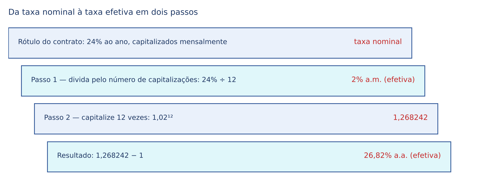

### 04.4.4 A fórmula

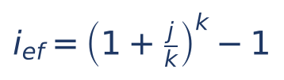

Em que:

- i_ef = taxa efetiva no período da taxa nominal (por exemplo, a efetiva anual, quando a nominal é anual);
- j = taxa nominal, na forma decimal (24% → 0,24);
- k = número de capitalizações dentro do período da taxa nominal (mensal dentro do ano: k = 12; trimestral dentro do ano: k = 4; bimestral: k = 6);
- j ÷ k = a taxa efetiva do período de capitalização (o "passo 1").

A fórmula é só a junção dos dois passos numa linha. Se você preferir fazer em dois passos, o resultado é o mesmo, e o risco de erro é menor.

:::EXEMPLO 12% ao ano capitalizados trimestralmente: qual a efetiva anual?
- Passo 1: 12% ÷ 4 = 3% ao trimestre (efetiva).
- Passo 2: 1,03⁴.
- 1,03² = 1,0609.
- 1,03⁴ = 1,0609² = 1,0609 × 1,0609 = 1,12550881.
- Taxa efetiva anual = 12,55% a.a.
:::

:::EXEMPLO 36% ao ano capitalizados mensalmente: qual a efetiva SEMESTRAL?
- Passo 1: 36% ÷ 12 = 3% ao mês (efetiva).
- Passo 2: o semestre tem 6 meses: fator = 1,03⁶ = 1,194052 (valor que a prova forneceria).
- Taxa efetiva semestral = 19,41% a.s.
Repare: a pergunta não precisa ser sobre o ano. Primeiro você acha a efetiva do período de capitalização; depois sobe ou desce para o período pedido.
:::

:::EXEMPLO Caminho inverso: qual taxa nominal anual, com capitalização semestral, corresponde à efetiva de 21% ao ano?
- Primeiro, a efetiva semestral equivalente: √1,21 = 1,1; logo 10% a.s.
- Depois, a nominal anual é a proporcional: 10% × 2 = 20% ao ano, capitalizados semestralmente.
:::

### 04.4.5 Quanto mais capitalizações, maior a efetiva

Com a MESMA taxa nominal, aumentar a frequência de capitalização aumenta a taxa efetiva. Mas o ganho vai diminuindo e tem um teto, que é a capitalização contínua (04.9).

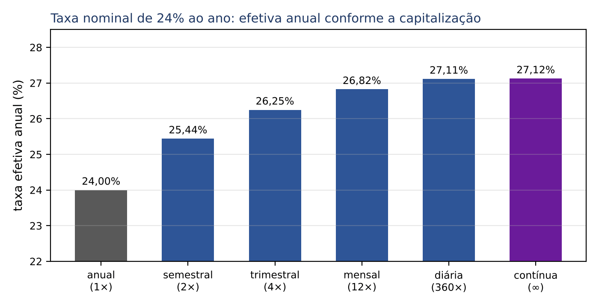

:::PEGADINHA Três armadilhas da taxa nominal
- Usar a nominal diretamente na fórmula do montante composto: M = C × 1,24 para um ano de "24% a.a. capitalizados mensalmente" está ERRADO; o certo é M = C × 1,02¹².
- Converter a nominal por equivalência: a nominal se divide por k (proporcional); 24% a.a. capitalizados mensalmente é 2% a.m., e não ¹²√1,24 − 1.
- Achar que "nominal" e "efetiva" só existem para o ano. Pode haver "15% ao trimestre capitalizados mensalmente" (nominal trimestral) ou "10% ao semestre capitalizados anualmente" (veja a Q2451624 abaixo).
:::

:::ATENCAO "Taxa nominal" tem dois sentidos
Neste item, "nominal" opõe-se a "efetiva" (é o rótulo com capitalização diferente). Em 04.6, a palavra "nominal" aparece também como sinônimo de "aparente", em oposição a "real" (descontada a inflação). Leia o contexto: se o enunciado fala em capitalização, é o sentido deste item; se fala em inflação, é o sentido de 04.6.
:::

### 04.4.6 Questões de prova

:::QUESTAO FGV 2026 — AL-GO — Analista Legislativo — Controle Interno (Q3880759)
Problema: taxa nominal de 90% ao ano, com capitalização bimestral. Qual a taxa efetiva bimestral? Gabarito oficial: C (15%).
Resolução passo a passo:
- O ano tem 6 bimestres: k = 6.
- Taxa efetiva bimestral = 90% ÷ 6 = 15% a.b.
- Não há passo 2, porque a pergunta é justamente a efetiva do período de capitalização.
Por que as outras atraem: 7,5% (A) é 90% ÷ 12, quem confundiu bimestre com mês; 30% (D) é 90% ÷ 3, quem confundiu bimestre com quadrimestre. Quem tentasse a raiz sexta de 1,90 chegaria a cerca de 11,3%, próximo a 12% (E), aplicando equivalência à nominal (a pegadinha de 04.4.5).
:::

:::QUESTAO FGV 2024 — DATAPREV — Contabilidade (Q3085997)
Problema: 15% ao trimestre com capitalização mensal. Qual a taxa efetiva trimestral, aproximadamente? Gabarito oficial: D (15,8%).
Resolução passo a passo:
- Passo 1: o trimestre tem 3 meses: 15% ÷ 3 = 5% ao mês.
- Passo 2: fator trimestral = 1,05³.
- 1,05² = 1,1025.
- 1,05³ = 1,1025 × 1,05 = 1,1025 + 0,055125 = 1,157625.
- Taxa efetiva trimestral = 15,76% ≈ 15,8%.
Por que as outras atraem: B (15%) é tomar a nominal como efetiva. A (14,1%) é impossível de saída: com a mesma nominal, capitalizar mais vezes nunca dá efetiva MENOR que a nominal (04.4.5). C (15,2%) e E (16,3%) não resultam de conta correta alguma; a estimativa pelo binômio (1 + 3 × 0,05 + 3 × 0,0025 = 1,1575) já aponta para 15,8%.
:::

:::QUESTAO FGV 2024 — Câmara de Fortaleza — Contador (Q2458804)
Problema: empréstimo contratado há 9 meses, sem amortização, com saldo capitalizado trimestralmente à taxa nominal de 24% ao ano. Para achar o valor original, o pagamento P deve ser dividido por quanto? Gabarito oficial: C (1,06³).
Resolução passo a passo:
- Passo 1: o ano tem 4 trimestres: 24% ÷ 4 = 6% ao trimestre (efetiva).
- 9 meses = 3 trimestres.
- P = C × 1,06³, logo C = P ÷ 1,06³.
- (Para conferir a ordem de grandeza: 1,06³ = 1,191016.)
Observação: no banco de questões as alternativas aparecem como "1,063", "1,069", "1,029", "1,023", porque o expoente foi perdido na digitação; leia-as como 1,06³, 1,06⁹, 1,02⁹ e 1,02³.
Por que as outras atraem: 1,06⁹ é quem usou a taxa trimestral com o prazo em meses (desrespeita a regra de ouro de 04.1); 1,02⁹ é quem dividiu 24% por 12 (capitalização mensal, que não é a do enunciado) e, com isso, achou 9 períodos; 1,24^0,75 é quem tratou 24% como efetiva anual.
:::

:::QUESTAO FGV 2024 — AL-PR — Analista Legislativo — Economista (Q2451624)
Problema: taxa nominal de 10% ao semestre, capitalizada anualmente. Qual a taxa a usar no regime composto, na unidade adequada? Gabarito oficial: C (20%, ao ano), conferido no QConcursos em 30/10/2026; coincide com a resolução pela teoria.
Resolução passo a passo:
- O período de capitalização (ano) é MAIOR que o da taxa (semestre). A unidade adequada é a da capitalização: o ano.
- Pela convenção de 04.4.2, a nominal se converte proporcionalmente: 10% ao semestre × 2 = 20% ao ano.
- Esses 20% ao ano, capitalizados anualmente, são a taxa efetiva a usar.
Por que as outras atraem: B (10%) é usar o rótulo como se fosse efetiva; 21% não aparece, mas seria o erro de aplicar equivalência (1,1² − 1) a uma taxa nominal; 5% é dividir em vez de multiplicar.
:::

:::QUESTAO FGV 2024 — Câmara Municipal de São Paulo — Contador (Q2351960)
Problema: juros rotativos de cartão de 240% ao ano, com saldo capitalizado mensalmente. Em total inadimplência, qual o tempo mínimo para a dívida ultrapassar o dobro? Gabarito oficial: C (4 meses), conferido no QConcursos em 30/10/2026; coincide com a resolução pela teoria.
Resolução passo a passo:
- Passo 1: 240% ÷ 12 = 20% ao mês (efetiva).
- Fator acumulado mês a mês:
  - 1 mês: 1,2;
  - 2 meses: 1,2 × 1,2 = 1,44;
  - 3 meses: 1,44 × 1,2 = 1,728;
  - 4 meses: 1,728 × 1,2 = 2,0736.
- O fator passa de 2 (o dobro) no 4º mês.
Por que as outras atraem: 5 meses (D) é a conta a juros simples (20% × 5 = 100%, que dá exatamente o dobro, sem ultrapassar). 3 meses (B) é parar em 1,728.
:::

:::QUESTAO FGV 2025 (Q3185952)
Problema: empréstimo de 40.000 reais, pagamento único em 1 ano. Alternativa 1: 10% ao ano nominal, capitalização semestral. Alternativa 2: 10% ao ano efetiva. Escolhida a alternativa 1, o valor presente (desconto racional composto) é maior, menor ou igual ao da preterida? Gabarito oficial: A (menor do que o da alternativa preterida).
Resolução passo a passo:
- Alternativa 1: 10% ÷ 2 = 5% ao semestre; fator anual = 1,05² = 1,1025 (efetiva de 10,25% a.a.).
- Valor presente 1 = 40.000 ÷ 1,1025 ≈ 36.281,18.
- Alternativa 2: fator anual = 1,10. Valor presente 2 = 40.000 ÷ 1,10 ≈ 36.363,64.
- Dividir pelo fator maior dá resultado menor: 36.281,18 < 36.363,64.
Por que as outras atraem: E (iguais) é o erro de tratar 10% nominal e 10% efetiva como a mesma taxa; C e D falham por ordem de grandeza (o valor fica entre 36.000 e 37.000). O desconto racional composto é assunto do Cap. 5; aqui basta saber dividir pelo fator.
:::

:::QUESTAO FGV 2025 — Prefeitura de São José dos Campos — Ciências Econômicas (Q3579928)
Problema: aplicação a 24% ao ano nominais, capitalizados mensalmente; inflação anual de 6%. Dados: 1,02¹² = 1,2682 e 1,2682 ÷ 1,06 = 1,1965. Quais as taxas efetiva, real e aparente anuais? Gabarito oficial: D (efetiva 26,82%; real 19,65%; aparente 24%).
Resolução passo a passo:
- Efetiva: 24% ÷ 12 = 2% a.m.; 1,02¹² = 1,2682; efetiva anual = 26,82%.
- Real (04.6): divide-se o fator efetivo pelo fator da inflação: 1,2682 ÷ 1,06 = 1,1965; real = 19,65%.
- "Aparente": a banca usou a palavra como sinônimo da taxa anunciada (a nominal de 24%).
Observação técnica: na terminologia de 04.6, "taxa aparente" é a taxa efetiva antes de descontar a inflação (aqui, 26,82%). O gabarito chama de "aparente" o rótulo de 24%. Fique atento: nesta questão, a combinação correta só aparece em D, e as demais alternativas trocam a efetiva por 24% ou invertem real e aparente. Na dúvida, procure a alternativa em que a efetiva é 26,82% e a real é 19,65%.
:::

:::NOTA No mesmo sentido
FGV 2025 — TCE-PE — Auditor de Controle Externo — Obras Públicas (Q3594936), afirmativa III: 12% ao ano nominais com capitalização mensal NÃO têm efetiva anual de 12% (1,01¹² ≈ 1,1268, ou seja, 12,68%); afirmativa falsa. O restante dessa questão trata de desconto comercial (Cap. 5).
:::

:::PRATIQUE exercícios elaborados para esta apostila
1. Taxa de 18% ao ano capitalizados mensalmente. Qual a efetiva trimestral?
2. Taxa de 20% ao ano capitalizados semestralmente. Qual a efetiva anual?
3. Taxa de 48% ao ano capitalizados bimestralmente. Considere 1,08⁶ = 1,5869. Qual a efetiva anual?
4. (Estilo FCC) Um capital de 50.000 reais é aplicado por 1 ano a 24% ao ano com capitalização trimestral. Considere 1,06⁴ = 1,262477. Qual o montante?
Resolução:
1. Passo 1: 18% ÷ 12 = 1,5% a.m. Passo 2: o trimestre tem 3 meses: 1,015³. 1,015² = 1,030225; 1,030225 × 1,015 = 1,030225 + 0,015453375 = 1,045678375. Efetiva trimestral ≈ 4,57%.
2. Passo 1: 20% ÷ 2 = 10% a.s. Passo 2: 1,1² = 1,21. Efetiva anual = 21%.
3. Passo 1: o ano tem 6 bimestres: 48% ÷ 6 = 8% a.b. Passo 2: 1,08⁶ = 1,5869. Efetiva anual ≈ 58,69%. Repare como a diferença para a nominal (48%) cresce quando a taxa é alta.
4. Passo 1: 24% ÷ 4 = 6% a.t. Passo 2: 1 ano = 4 trimestres. M = 50.000 × 1,06⁴ = 50.000 × 1,262477 = 63.123,85 reais. Armadilhas: 50.000 × 1,24 = 62.000 (nominal tratada como efetiva); 50.000 × 1,02¹² ≈ 63.412 (capitalização mensal, que não é a do enunciado).
:::
## 04.5 Taxa acumulada, taxa média e a taxa escondida nas compras parceladas

### 04.5.1 Taxa acumulada: multiplique os fatores

Quando uma grandeza varia várias vezes seguidas, cada variação incide sobre o valor já alterado pela anterior. É o mesmo mecanismo dos juros compostos. Por isso as taxas de vários períodos NÃO se somam: os seus fatores se MULTIPLICAM (a ideia de fator foi apresentada em 04.3.2 e o "aumentos sucessivos" de porcentagem, no Cap. 1).

Exemplo à mão: um aluguel de 1.000 reais sobe 10% num ano e 20% no ano seguinte.

- Depois do 1º reajuste: 1.000 × 1,10 = 1.100.
- Depois do 2º reajuste: 1.100 × 1,20 = 1.320.
- Aumento acumulado: 320 sobre 1.000 = 32% (e não 30%).

A regra geral:

- (1 + i_acumulada) = (1 + i₁) × (1 + i₂) × (1 + i₃) × ... × (1 + iₙ)

Em que:

- i₁, i₂, ..., iₙ = as taxas de cada período, em decimal (um aumento entra positivo; uma queda entra negativa: queda de 20% → fator 0,80);
- i_acumulada = a taxa total do período inteiro.

:::EXEMPLO Sobe 20% e depois cai 20%: volta ao início?
- Fator acumulado = 1,20 × 0,80 = 0,96.
- Taxa acumulada = 0,96 − 1 = −0,04 = −4%.
- Não volta: perde 4%. A queda de 20% incidiu sobre uma base maior (a já aumentada).
:::

:::EXEMPLO Inflação acumulada de um trimestre
Inflação mensal de 0,5%, 0,4% e 0,6%.
- Fator = 1,005 × 1,004 × 1,006.
- 1,005 × 1,004 = 1,004 + 0,005 × 1,004 = 1,004 + 0,00502 = 1,00902.
- 1,00902 × 1,006 = 1,00902 + 0,006 × 1,00902 = 1,00902 + 0,00605412 = 1,01507412.
- Inflação do trimestre ≈ 1,51%.
- A soma simples (0,5 + 0,4 + 0,6 = 1,5%) fica muito perto quando as taxas são pequenas; é uma boa estimativa para eliminar alternativas, mas o valor certo é o do produto.
:::

:::EXEMPLO Quanto precisa subir para recuperar uma queda?
A arrecadação de um tributo caiu 25%. Quanto precisa crescer para voltar ao nível anterior?
- Depois da queda, o fator é 0,75.
- Queremos 0,75 × (1 + x) = 1.
- Dividimos os dois lados por 0,75: 1 + x = 1 ÷ 0,75 = 1,3333...
- x ≈ 33,33%. Uma queda de 25% exige uma alta de um terço para ser compensada.
:::

### 04.5.2 Taxa média de vários períodos

Se a acumulada é o produto dos fatores, a taxa média por período é a taxa CONSTANTE que, repetida o mesmo número de vezes, daria o mesmo produto. Ela se acha pela raiz (é a média geométrica dos fatores; a média geométrica é estudada no Cap. 9):

- (1 + i_média)ⁿ = (1 + i₁) × (1 + i₂) × ... × (1 + iₙ)

:::EXEMPLO Dois anos: 21% e 44%. Qual a taxa média anual?
- Fator acumulado = 1,21 × 1,44 = 1,7424.
- Fator médio = √1,7424.
- Truque: 1,21 = 1,1² e 1,44 = 1,2². Logo 1,21 × 1,44 = (1,1 × 1,2)² = 1,32². Assim √1,7424 = 1,32.
- Taxa média = 32% ao ano.
- A média aritmética (21 + 44) ÷ 2 = 32,5% está ERRADA para taxas compostas: ela sempre exagera.
:::

### 04.5.3 A taxa escondida nas compras parceladas

O lojista anuncia: "à vista com desconto ou em 2 vezes sem juros". Se há desconto à vista, o parcelamento TEM juros, porque quem parcela paga mais do que o preço real do produto, que é o preço à vista. A prova pede essa taxa escondida.

Exemplo à mão: uma TV custa 1.000 reais à vista, ou 2 parcelas de 520 reais (uma no ato e outra em 30 dias).

- Quem parcela entrega 520 hoje. Como a TV vale 1.000 hoje, ficou devendo 1.000 − 520 = 480.
- Daqui a 30 dias, quita essa dívida pagando 520.
- Logo, 480 viraram 520 em um mês: 520 ÷ 480 = 1,0833.
- Taxa ≈ 8,33% ao mês.

A ideia-chave: a parcela da entrada NÃO é financiada. Ela só abate o preço à vista. Financiado é apenas o saldo que fica depois da entrada.

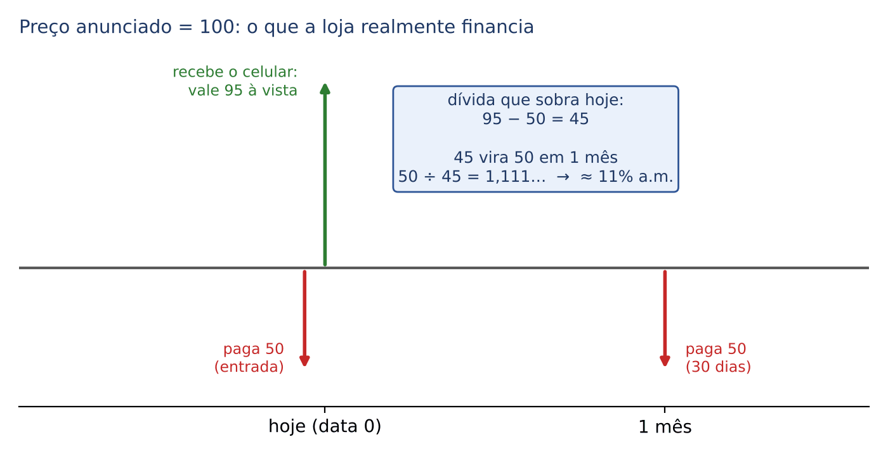

:::PASSO Taxa de juros em "entrada + 1 parcela"
1. Preço justo hoje = preço à vista (com o desconto, se houver).
2. Saldo financiado = preço à vista − entrada.
3. Fator = parcela futura ÷ saldo financiado.
4. Taxa = fator − 1.
5. Quando o enunciado não dá o preço, adote 100 como preço anunciado: as porcentagens viram números simples.
Com mais de uma parcela futura, a conta exige equivalência de capitais e valor atual de séries (Cap. 6).
:::

:::QUESTAO FCC 2026 — SEFAZ-GO — Auditor Fiscal da Receita Estadual (Q4066797)
Problema: celular à vista com 5% de desconto sobre o preço anunciado, ou em 2 parcelas iguais "sem acréscimo" (entrada e 30 dias). Qual a taxa mensal aproximada? Gabarito oficial: C (11%).
Resolução passo a passo:
- Adote preço anunciado = 100.
- À vista: 100 − 5% de 100 = 95. Este é o valor real do celular hoje.
- A prazo: 2 parcelas de 100 ÷ 2 = 50.
- Entrada: 50. Saldo financiado: 95 − 50 = 45.
- Em 30 dias paga 50 para quitar esses 45.
- Fator: 50 ÷ 45 = 1,1111...
- Taxa ≈ 11,1% ao mês → alternativa C (11%).
Por que as outras atraem: a FCC monta as alternativas com os erros típicos. 5% (não listado) seria achar que a taxa é o próprio desconto. 10% (A) sai de 5 ÷ 50 (tratar o desconto como juros sobre a parcela) ou de 50 ÷ 45 arredondado para baixo com pressa. 9% (B) é calcular 5 ÷ 55 ou 45 ÷ 50 invertido (0,9, lido como 9%). 12% (D) é arredondar para cima. A conta exata, 11,1%, deixa C como a única próxima.
:::

:::NOTA No mesmo sentido
FGV 2024 (Q3029079): celular de 3.000 reais à vista, ou 2 parcelas de 1.650 (no ato e em 1 mês). Saldo financiado = 3.000 − 1.650 = 1.350; fator = 1.650 ÷ 1.350 = 1,2222; taxa ≈ 22% a.m. (gabarito D). Armadilha: 300 ÷ 3.000 = 10% (B), que ignora que a entrada já reduziu a dívida.
:::

:::PRATIQUE exercícios elaborados para esta apostila
1. Um preço sobe 5% e depois 8%. Qual o aumento acumulado?
2. A receita de um município caiu 20% em 2025. Quanto precisa crescer em 2026 para voltar ao valor de 2024?
3. Desconto de 10% à vista ou 2 parcelas iguais sem acréscimo (entrada e 30 dias). Qual a taxa mensal?
4. (Estilo FCC) Produto à vista por 1.000 reais ou com entrada de 500 e mais uma parcela de 560 em 30 dias. Qual a taxa mensal?
Resolução:
1. Fator = 1,05 × 1,08 = 1,08 + 0,05 × 1,08 = 1,08 + 0,054 = 1,134. Aumento acumulado = 13,4% (não 13%).
2. Fator após a queda: 0,80. Precisamos de 0,80 × (1 + x) = 1, isto é, 1 + x = 1 ÷ 0,80 = 1,25. Crescimento necessário: 25%.
3. Preço anunciado 100. À vista: 90. Parcelas: 50 e 50. Saldo financiado: 90 − 50 = 40. Fator: 50 ÷ 40 = 1,25. Taxa: 25% ao mês. (Um desconto "pequeno" de 10% esconde juros altíssimos.)
4. Saldo financiado = 1.000 − 500 = 500. Fator = 560 ÷ 500 = 1,12. Taxa = 12% ao mês. Armadilha: 60 ÷ 1.000 = 6%.
:::

## 04.6 Taxa aparente, taxa real e inflação

### 04.6.1 A ideia: ficar mais rico não é ter mais dinheiro

Sua aplicação rendeu 10% no ano. No mesmo ano, os preços subiram 6%. Você ficou 10% mais rico? Não, porque o dinheiro compra menos. Ficou 4% mais rico? Também não, por um detalhe que a prova adora.

Vamos às contas, pensando numa "cesta de compras" que custava 1.000 reais no início do ano:

- Seu dinheiro: 1.000 → 1.100 (rendeu 10%).
- A cesta: 1.000 → 1.060 (inflação de 6%).
- No início, você comprava 1.000 ÷ 1.000 = 1 cesta.
- No fim, você compra 1.100 ÷ 1.060 = 1,0377 cesta.
- Seu poder de compra cresceu 3,77%, e não 4%.

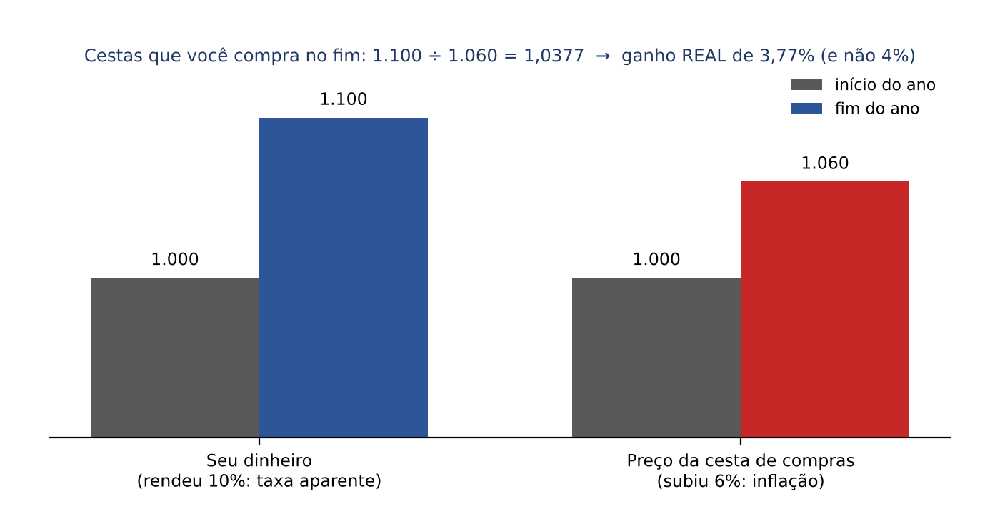

Três nomes para guardar:

- taxa APARENTE (também chamada nominal, neste contexto): o rendimento em reais, sem descontar a inflação (os 10%);
- taxa de INFLAÇÃO: quanto subiram os preços (os 6%); usa-se a letra grega π (pi) para ela;
- taxa REAL: o ganho de poder de compra, já descontada a inflação (os 3,77%).

Ponte com o mundo jurídico: é exatamente a lógica que separa correção monetária e juros na liquidação de débitos judiciais. A correção monetária repõe a inflação (preserva o poder de compra, sem ganho); os juros remuneram o credor acima disso, e por isso são, economicamente, uma taxa real. O Código Civil, na redação dada pela Lei 14.905/2024, passou a prever a atualização pelo IPCA e uma "taxa legal" de juros igual à Selic "deduzido o índice de atualização monetária" (arts. 389, parágrafo único, e 406, § 1º, do CC; se o resultado for negativo, considera-se zero, § 3º). Repare que a lei manda DEDUZIR (subtrair), o que é uma aproximação da divisão de fatores que você vai aprender a seguir.

### 04.6.2 A fórmula de Fisher

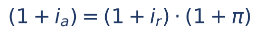

Em que:

- i_a = taxa aparente, em decimal (o que a aplicação rendeu em reais);
- i_r = taxa real, em decimal (o ganho de poder de compra);
- π = taxa de inflação do MESMO período, em decimal;
- os parênteses são FATORES: a fórmula diz que o fator aparente é o produto do fator real pelo fator da inflação.

Leitura: "o dinheiro cresce por dois motivos encadeados: porque os preços subiram (fator da inflação) e porque houve ganho de verdade (fator real)". Como em 04.5, causas encadeadas se multiplicam, não se somam.

Para achar a taxa real, divida os dois lados por (1 + π):

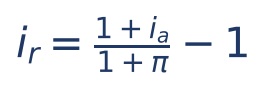

Na prática, você sempre vai fazer uma de três contas, conforme o que falta:

- falta a REAL: divida o fator aparente pelo fator da inflação;
- falta a APARENTE: multiplique o fator real pelo fator da inflação;
- falta a INFLAÇÃO: divida o fator aparente pelo fator real.

:::EXEMPLO Achar a taxa real
Aplicação rendeu 10%; inflação de 6%.
- 1 + i_r = 1,10 ÷ 1,06.
- Divisão à mão: 1,10 ÷ 1,06. Como 1,06 × 1,04 = 1,1024 (passou de 1,10), o resultado é um pouco menor que 1,04. Como 1,06 × 1,037 = 1,09922, e 1,06 × 1,038 = 1,10028, o resultado está entre 1,037 e 1,038: 1,0377.
- i_r ≈ 3,77% ao ano.
:::

:::EXEMPLO Achar a taxa aparente
Um investidor exige ganho real de 5%, e a inflação esperada é de 4%. Que taxa aparente deve ser contratada?
- 1 + i_a = 1,05 × 1,04.
- 1,05 × 1,04 = 1,04 + 0,05 × 1,04 = 1,04 + 0,052 = 1,092.
- i_a = 9,2% (e não 9%).
:::

:::EXEMPLO Achar a inflação
Aplicação rendeu 12,2% e o ganho real foi de 2%.
- 1 + π = 1,122 ÷ 1,02.
- Teste: 1,02 × 1,1 = 1,122. Logo o quociente é 1,1.
- π = 10%.
:::

:::EXEMPLO Taxa real negativa
Poupança rendeu 5%; inflação de 8%.
- 1 + i_r = 1,05 ÷ 1,08 = 0,9722.
- i_r = 0,9722 − 1 = −0,0278 ≈ −2,78%.
- O poupador PERDEU poder de compra, embora tenha "ganhado" dinheiro.
:::

:::PEGADINHA Subtrair taxas é só aproximação
- A conta "10% − 6% = 4%" é a aproximação que todo mundo faz de cabeça; ela é razoável quando as taxas são pequenas, mas é um pouco MAIOR que a real verdadeira (3,77%).
- A FCC e a FGV montam a alternativa errada com a subtração e a certa com a divisão. Na Q2511393, abaixo, a subtração dá 1,50% (alternativa D) e a divisão dá 1,44% (alternativa E, o gabarito).
- Também é erro somar para achar a aparente: 5% + 4% = 9%, quando o certo é 9,2%.
- E é erro dividir as TAXAS (10 ÷ 6) em vez dos FATORES (1,10 ÷ 1,06).
:::

:::DICA Como dividir fatores rápido na prova
- Para 1,06 ÷ 1,045, subtraia e divida a diferença pelo divisor: (1,06 − 1,045) ÷ 1,045 = 0,015 ÷ 1,045. Isso dá a taxa real diretamente, porque (1 + a) ÷ (1 + b) − 1 = (a − b) ÷ (1 + b).
- 0,015 ÷ 1,045 é "um pouco menos que 0,015": cerca de 0,0144. Taxa real ≈ 1,44%.
- A fórmula i_r = (i_a − π) ÷ (1 + π) é a forma mais rápida de fazer a conta à mão.
:::

### 04.6.3 Ganho real em reais

Às vezes a pergunta não é a taxa, mas o ganho real em dinheiro. A maneira mais limpa: compare o que você TEM no fim com o que você PRECISARIA ter no fim só para manter o poder de compra (o capital corrigido pela inflação).

- Ganho real (em reais da data final) = montante obtido − capital corrigido pela inflação.

:::QUESTAO FGV 2026 — AL-GO — Analista Legislativo — Controle Interno (Q3880760)
Problema: 5.000 reais aplicados por 1 ano a 8% ao ano; inflação do período de 3%. Qual o ganho real? Gabarito oficial: C (250).
Resolução passo a passo:
- Montante obtido: 5.000 × 1,08 = 5.400.
- Capital apenas corrigido pela inflação: 5.000 × 1,03 = 5.150.
- Ganho real, em reais do fim do ano: 5.400 − 5.150 = 250.
Observação: se fosse pedido o ganho em reais do INÍCIO do ano, a conta seria 5.000 × (1,08 ÷ 1,03 − 1) = 5.000 × 0,04854 ≈ 242,72, valor que não está entre as alternativas. O gabarito adotou a comparação em moeda do fim do período, que é a usual.
Por que as outras atraem: 400 (A) é o ganho aparente (5.400 − 5.000), sem descontar a inflação; 150 (B) é só a perda inflacionária (5.150 − 5.000); 50 (E) não tem base.
:::

### 04.6.4 Questões de prova

:::QUESTAO FGV 2026 — NAV Brasil — Contador (Q4222684)
Problema: a entidade desconta a inflação da taxa obtida na aplicação e encontra qual taxa? Gabarito oficial: A (real).
Resolução: descontada a inflação, a taxa que sobra é a real (04.6.1). Nominal (C) é justamente a taxa ANTES de descontar a inflação. "Equivalente" (E) é conceito de conversão entre unidades (04.3). "Racional" (D) remete ao desconto racional (Cap. 5). "Eficiente" (B) não é classificação de taxa.
:::

:::QUESTAO FGV 2024 — Câmara dos Deputados — Consultor Legislativo (Q2511393)
Problema: inflação acumulada de 4,5%; taxa aparente de 6%. Qual a taxa real? Gabarito oficial: E (1,44%).
Resolução passo a passo:
- 1 + i_r = 1,06 ÷ 1,045.
- Pelo atalho da DICA: i_r = (0,06 − 0,045) ÷ 1,045 = 0,015 ÷ 1,045.
- 0,015 ÷ 1,045 ≈ 0,014354.
- i_r ≈ 1,44% (arredondando para duas casas, 1,4354% vira 1,44%).
Por que as outras atraem: D (1,50%) é a subtração 6% − 4,5%; A (1,56%) fica perto do que sai de dividir 0,015 por 0,955 (≈ 1,57%, confundindo o fator da inflação com 1 − 0,045); B e C (1,54%, 1,52%) são números próximos, colocados para quem não confere a divisão.
:::

:::QUESTAO FGV 2024 — AL-PR — Analista Legislativo — Economista (Q2451626)
Problema: um investimento perdeu 20% em termos reais, mas valorizou 20% em termos nominais. Qual foi a inflação? Gabarito oficial: E (50%), conferido no QConcursos em 30/10/2026; coincide com a resolução pela teoria.
Resolução passo a passo:
- Fator aparente (nominal): 1,20. Fator real: 1 − 0,20 = 0,80.
- Pela fórmula de Fisher: 1 + π = 1,20 ÷ 0,80 = 1,5.
- π = 50%.
- Conferência: 0,80 × 1,5 = 1,20.
Por que as outras atraem: 40% (B) é somar as taxas (20 + 20), o erro de quem usa subtração; 0% (A) é achar que +20% e −20% se anulam.
:::

:::QUESTAO FGV 2024 — CFC — Bacharel em Ciências Contábeis (Q3087610)
Problema: rendimento nominal de 80% no período, do qual se deduziu imposto sobre o ganho; inflação de 5%; ganho real de 60%. Qual a alíquota do imposto? Gabarito oficial: A (15%).
Resolução passo a passo:
- Seja t a alíquota. O imposto incide só sobre o ganho (80% do capital). Ganho líquido = 0,80 × (1 − t).
- Fator aparente líquido = 1 + 0,80 × (1 − t).
- Fator real = 1,60 e fator de inflação = 1,05. Fisher: fator aparente = 1,60 × 1,05 = 1,68.
- Logo: 1 + 0,80 × (1 − t) = 1,68.
- Subtraímos 1 dos dois lados: 0,80 × (1 − t) = 0,68.
- Dividimos os dois lados por 0,80: 1 − t = 0,85.
- t = 0,15 = 15%.
Por que as outras atraem: quem ignora a inflação faz 1 + 0,80 × (1 − t) = 1,60, chega a 1 − t = 0,75 e marca 25% (alternativa inexistente, o que já denuncia o erro); quem soma 60% + 5% = 65% chega a 1 − t = 0,8125 e alíquota de 18,75%, próxima de 17,5% (B).
:::

:::QUESTAO FGV 2026 — TCE-PE — Auditor de Controle Externo (Q4288547)
Problema: receitas de 800.000 (31/12/2023), 860.000 (31/12/2024) e 930.000 (31/12/2025); inflação anual de 4,62% (2023), 4,83% (2024) e 5,48% (2025). Qual o crescimento real da receita de 31/12/2023 a 31/12/2025? Gabarito oficial: A (5,13%).
Resolução passo a passo:
- Crescimento aparente do período: 930.000 ÷ 800.000 = 1,1625 (16,25%).
- Inflação do período: só contam os anos ENTRE as duas datas, 2024 e 2025. A inflação de 2023 já estava embutida no valor de 31/12/2023.
- Fator da inflação: 1,0483 × 1,0548 ≈ 1,105747.
- Fator real: 1,1625 ÷ 1,105747 ≈ 1,0513.
- Crescimento real ≈ 5,13%.
- A receita de 31/12/2024 é um dado que distrai: não é necessária.
Por que as outras atraem: subtrair taxas dá 16,25% − 4,83% − 5,48% = 5,94% (C); quem inclui também a inflação de 2023 chega a cerca de 0,49%, valor que não aparece; as demais alternativas são variações de arredondamento e de soma de taxas.
:::

:::PRATIQUE exercícios elaborados para esta apostila
1. Uma aplicação rendeu 15% num ano em que a inflação foi de 15%. Qual a taxa real?
2. Um servidor teve reajuste de 4% num ano de inflação de 6%. Qual a variação real do salário?
3. Um credor quer ganho real de 6% ao ano e projeta inflação de 5%. Que taxa aparente deve cobrar?
4. (Estilo FCC) Uma aplicação de 20.000 reais rendeu 2.640 reais de juros em um ano, período em que a inflação foi de 10%. Qual a taxa real?
Resolução:
1. 1 + i_r = 1,15 ÷ 1,15 = 1. Taxa real = 0%. O dinheiro só acompanhou os preços.
2. 1 + i_r = 1,04 ÷ 1,06. Atalho: (0,04 − 0,06) ÷ 1,06 = −0,02 ÷ 1,06 ≈ −0,0189. Perda real ≈ 1,89%.
3. 1 + i_a = 1,06 × 1,05 = 1,05 + 0,06 × 1,05 = 1,05 + 0,063 = 1,113. Taxa aparente = 11,3%.
4. Passo 1, a taxa aparente: 2.640 ÷ 20.000 = 0,132 = 13,2%. Passo 2: 1 + i_r = 1,132 ÷ 1,10. Atalho: (0,132 − 0,10) ÷ 1,10 = 0,032 ÷ 1,10 ≈ 0,0291. Taxa real ≈ 2,91%. Armadilha: 13,2% − 10% = 3,2%.
:::
## 04.7 Taxas à vista e a termo (estrutura a termo): uma aplicação das taxas equivalentes

### 04.7.1 A ideia

No mercado de títulos públicos, cada prazo tem a sua taxa: um título de 1 ano paga uma taxa, um de 2 anos paga outra. Essas taxas "de hoje até o vencimento" chamam-se taxas à vista (em inglês, *spot rates*). O conjunto delas, prazo a prazo, é a estrutura a termo da taxa de juros (a "curva de juros").

Se eu sei quanto rende aplicar por 1 ano e quanto rende aplicar por 2 anos, sei também, por diferença, quanto o mercado está "embutindo" para o segundo ano isoladamente. Essa taxa embutida chama-se taxa a termo (ou taxa futura implícita, em inglês *forward rate*).

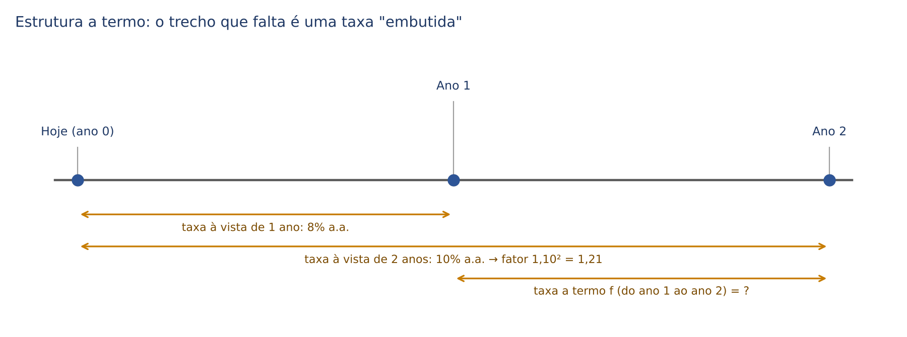

### 04.7.2 Exemplo à mão e fórmula

Taxa à vista de 1 ano: 8% a.a. Taxa à vista de 2 anos: 10% a.a. (ambas compostas anualmente).

- Aplicar 2 anos de uma vez: fator = 1,10² = 1,21.
- Aplicar 1 ano a 8% e reaplicar mais 1 ano à taxa a termo f: fator = 1,08 × (1 + f).
- Num mercado sem "almoço grátis" (sem arbitragem), os dois caminhos devem dar o mesmo: 1,08 × (1 + f) = 1,21.
- Dividimos os dois lados por 1,08: 1 + f = 1,21 ÷ 1,08 ≈ 1,1204.
- f ≈ 12,04% a.a.

A fórmula geral é a mesma ideia de multiplicar fatores (04.5.1):

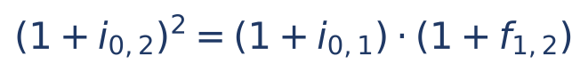

Em que:

- i₀,₂ = taxa à vista de 2 anos (de hoje até o ano 2), ao ano;
- i₀,₁ = taxa à vista de 1 ano;
- f₁,₂ = taxa a termo, do ano 1 ao ano 2.

Para outros prazos, troque os expoentes: (1 + i₀,₃)³ = (1 + i₀,₂)² × (1 + f₂,₃).

:::DICA Intuição para eliminar alternativas
Se a curva sobe (taxa de 2 anos maior que a de 1 ano), a taxa a termo é MAIOR que as duas à vista: para "puxar a média" de 8% até 10%, o segundo ano precisa render bem mais que 10%. Se a curva desce, a taxa a termo é menor que as duas.
:::

:::QUESTAO FGV 2026 — TCE-SC — Auditor Fiscal de Controle Externo — Economia (Q4089608)
Problema: títulos sem cupom de 1 e 2 anos com taxas à vista de 8% e 10% a.a. Qual afirmativa está correta? Gabarito oficial: C (a taxa a termo do 2º ano é (1,10)² ÷ 1,08 − 1, superior a 12% a.a.).
Resolução passo a passo:
- Como em 04.7.2: 1,21 ÷ 1,08 ≈ 1,1204, ou seja, cerca de 12,04% > 12%. C está correta.
- A está errada: com curva ascendente, a taxa a termo é SUPERIOR a 10% (DICA acima).
- B está errada: o preço hoje de um título que paga 100 em 2 anos é 100 ÷ 1,21 ≈ 82,64, e não 80.
- D está errada: com taxas maiores para prazos maiores, os preços dos títulos longos tendem a ser MENORES (desconta-se mais).
- E está errada: aumentar a taxa de desconto REDUZ o preço presente (divide-se por um fator maior).
:::

:::QUESTAO FGV 2024 — Prefeitura de Macaé — Analista Previdenciário — Economia (Q3048647)
Problema: taxas à vista de 5% (1 ano), 6% (2 anos) e 7% (3 anos), compostas anualmente; dados 1,06² = 1,124 e 1,07³ = 1,225. Qual a taxa implícita entre o 2º e o 3º ano? Gabarito oficial: C (9%).
Resolução passo a passo:
- (1 + f₂,₃) = 1,07³ ÷ 1,06² = 1,225 ÷ 1,124.
- Divisão à mão: 1,124 × 1,09 = 1,124 + 0,09 × 1,124 = 1,124 + 0,10116 = 1,22516, praticamente 1,225.
- f₂,₃ ≈ 9% a.a.
Por que as outras atraem: 7% (A) é tomar a taxa à vista de 3 anos como se fosse a do 3º ano isolado; 8,5% (B) e 9,5% (D) são valores vizinhos para quem estima sem fazer a divisão; 10% (E) exagera o efeito. Atalho de conferência: a aproximação linear 3 × 7% − 2 × 6% = 21% − 12% = 9% já aponta para C.
:::

:::PRATIQUE exercícios elaborados para esta apostila
1. Taxas à vista: 10% a.a. para 1 ano e 12% a.a. para 2 anos (compostas anualmente). Considere 1,12² = 1,2544. Qual a taxa a termo do 2º ano?
2. (Estilo FCC) Taxa à vista de 2 anos: 10% a.a.; taxa a termo do 3º ano: 15% a.a. Considere 1,1² = 1,21. Qual o fator de acumulação de 3 anos e, aproximadamente, a taxa à vista de 3 anos? Considere ∛1,3915 ≈ 1,1164.
Resolução:
1. 1 + f = 1,2544 ÷ 1,10. Divisão à mão: 1,10 × 1,14 = 1,254, e sobram 0,0004, que divididos por 1,10 dão cerca de 0,00036. Logo 1 + f ≈ 1,1404 e f ≈ 14,04% a.a. Conferência pela DICA: a curva sobe de 10% para 12%, então a taxa a termo tem de passar de 12%, e passa.
2. Fator de 3 anos = 1,21 × 1,15 = 1,21 + 0,15 × 1,21 = 1,21 + 0,1815 = 1,3915. Taxa à vista de 3 anos: ∛1,3915 − 1 ≈ 0,1164, ou seja, cerca de 11,64% a.a. Repare que ela fica entre 10% e 15%, mais perto de 10%, porque dois dos três anos rendem 10%.
:::

:::NOTA Questão não aproveitada
A Q2531829 (FGV 2024 — Ministério da Fazenda — Auditor Federal de Finanças e Controle) trata de estruturas a termo nominal e real com uma tabela que não consta do banco local; sem a tabela não é possível resolvê-la. As fórmulas das alternativas B e D também estão em imagem e não constam do banco; por isso não se reproduz aqui a expressão cobrada. Fica registrado só o tema da alternativa dada como correta no gabarito oficial (D): a inflação implícita (a inflação "embutida" na diferença entre a curva nominal e a curva real), que se raciocina com a fórmula de Fisher (04.6.2), comparando fatores nominais e reais para o mesmo prazo.
:::

## 04.8 Taxa over

### 04.8.1 A ideia

"Taxa over" vem de *overnight* (literalmente, "durante a noite"): o mercado em que bancos emprestam dinheiro uns aos outros por um dia útil. Como o dinheiro só rende nos dias úteis, essa taxa precisou de uma convenção própria. Hoje o seu exemplo mais conhecido é a taxa Selic, divulgada como taxa ao ano com base em 252 dias úteis.

Há duas convenções, e a prova avisa qual está usando:

- taxa over MENSAL (convenção antiga, mais cobrada em provas mais antigas): é uma taxa NOMINAL, igual à taxa efetiva de UM dia útil multiplicada por 30;
- taxa over ANUAL (convenção atual, base 252): é uma taxa EFETIVA para 252 dias úteis; para um período de du dias úteis, o fator é (1 + taxa anual)^(du/252).

### 04.8.2 Over mensal

Como a over mensal é nominal, siga o mesmo roteiro da taxa nominal (04.4), só que contando DIAS ÚTEIS:

- Passo 1: taxa por dia útil = over ÷ 30.
- Passo 2: capitalize pelo número de dias úteis do período.

Em que:

- i_per = taxa efetiva do período (por exemplo, do mês);
- over = taxa over mensal, em decimal;
- 30 = convenção fixa da taxa over mensal (não importa quantos dias tenha o mês);
- du = número de dias ÚTEIS do período (não os dias corridos).

:::EXEMPLO Over de 1,8% ao mês, em um mês com 21 dias úteis
- Passo 1: 1,8% ÷ 30 = 0,06% por dia útil = 0,0006.
- Passo 2: fator = 1,0006²¹.
- Pelo binômio (04.3.4): 1 + 21 × 0,0006 + 210 × 0,00000036 = 1 + 0,0126 + 0,0000756 = 1,0126756.
- Taxa efetiva do mês ≈ 1,27%.
Repare: a over (1,8%) é bem maior que a efetiva do mês (1,27%), porque ela "finge" que todos os 30 dias rendem, quando só 21 rendem.
:::

:::EXEMPLO Caminho inverso: efetiva de 1,5% no mês, com 20 dias úteis. Qual a over mensal?
- Fator diário = 1,015^(1/20). A prova daria o valor: 1,000745 (aproximadamente).
- Taxa por dia útil ≈ 0,0745%.
- Over mensal = 0,0745% × 30 ≈ 2,23% ao mês.
:::

### 04.8.3 Over anual (base 252)

:::EXEMPLO Taxa de 10,5% ao ano (base 252 dias úteis), por 21 dias úteis
- Expoente = 21 ÷ 252 = 1/12.
- Fator = 1,105^(1/12). A prova daria o valor: cerca de 1,008355.
- Taxa efetiva do período ≈ 0,84%.
:::

:::PEGADINHA Taxa over
- Usar dias corridos no expoente: na over, o expoente é SEMPRE o número de dias úteis.
- Tratar a over mensal como efetiva: ela é nominal (divide por 30 e capitaliza).
- Dividir a over anual por 252 e multiplicar pelos dias úteis: a over anual base 252 é efetiva e se converte por potência (du/252), não por proporção.
:::

:::PRATIQUE exercícios elaborados para esta apostila
1. A taxa over é de 3% ao mês. Qual a taxa efetiva de um dia útil?
2. (Estilo FCC) Over de 2,4% ao mês, num mês com 20 dias úteis. Considere 1,0008²⁰ = 1,0161. Qual a taxa efetiva do mês?
Resolução:
1. Over mensal é nominal: 3% ÷ 30 = 0,1% por dia útil.
2. Passo 1: 2,4% ÷ 30 = 0,08% ao dia útil = 0,0008. Passo 2: 1,0008²⁰ = 1,0161. Taxa efetiva do mês ≈ 1,61%. Armadilha: responder 2,4% (tratar a over como efetiva) ou 0,08% × 20 = 1,6% (aproximação linear; aqui quase coincide, porque a taxa diária é minúscula).
:::

## 04.9 Capitalização contínua e taxa instantânea

### 04.9.1 A ideia: capitalizar o tempo todo

Em 04.4.5 você viu que, com a mesma taxa nominal, capitalizar com mais frequência aumenta a efetiva, mas cada vez menos. O que acontece se capitalizarmos a cada hora, a cada minuto, a cada segundo, sem parar? O montante não explode: ele se aproxima de um teto. Essa situação-limite chama-se capitalização contínua.

O caso mais didático é o de 1 real a 100% ao ano nominais:

- capitalização anual: 1 × 2 = 2,000;
- semestral (50% por semestre): 1,5² = 2,250;
- trimestral (25% por trimestre): 1,25⁴ ≈ 2,441;
- mensal: (1 + 1/12)¹² ≈ 2,613;
- diária (365 vezes): ≈ 2,715;
- contínua: e = 2,71828...

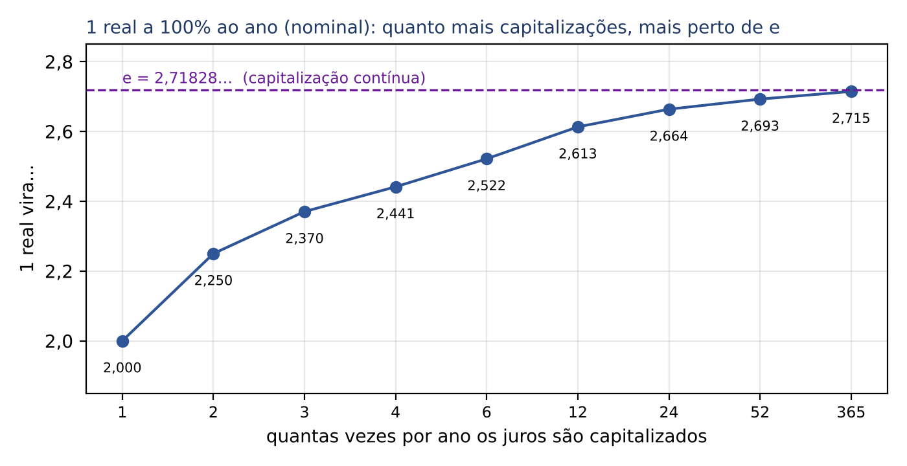

O número e (cerca de 2,718) é uma constante da matemática, como o π da geometria. Você não precisa saber de onde ele vem; precisa saber usá-lo, e a prova sempre fornece os valores das potências de e ou dos logaritmos naturais (ln) necessários (logaritmo natural é o logaritmo na base e; ver Cap. 1).

### 04.9.2 A fórmula

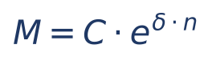

Em que:

- M = montante (valor final);
- C = capital (valor inicial);
- e = a constante 2,71828...;
- δ (letra grega delta) = taxa instantânea (ou taxa de capitalização contínua), em decimal, por unidade de tempo; é uma taxa NOMINAL, que capitaliza "a cada instante";
- n = prazo, na mesma unidade de tempo de δ.

Compare com o montante composto, M = C × (1 + i)ⁿ (Cap. 3): o fator (1 + i) foi substituído por e^δ. Daí sai a relação entre a taxa contínua e a taxa efetiva equivalente:

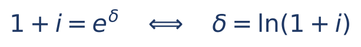

Em que:

- i = taxa efetiva equivalente, no mesmo período de δ;
- ln = logaritmo natural (a operação que desfaz o e: ln(e^x) = x).

Leitura: "para achar a efetiva, calcule e elevado à taxa contínua e subtraia 1; para achar a contínua, tire o ln do fator efetivo".

:::EXEMPLO Montante em capitalização contínua
10.000 reais a 10% ao ano, capitalização contínua, por 2 anos. Dado: e^0,2 = 1,221403.
- δ × n = 0,10 × 2 = 0,2.
- M = 10.000 × e^0,2 = 10.000 × 1,221403 = 12.214,03 reais.
- Comparação: a juros compostos de 10% a.a. efetivos, seriam 10.000 × 1,21 = 12.100. A contínua rende um pouco mais.
:::

:::EXEMPLO Taxa efetiva equivalente a uma contínua
Qual a taxa efetiva anual equivalente a 12% ao ano em capitalização contínua? Dado: e^0,12 = 1,1275.
- 1 + i = e^0,12 = 1,1275.
- i = 12,75% ao ano.
:::

:::EXEMPLO Taxa contínua equivalente a uma efetiva
Qual a taxa instantânea equivalente a 10% ao ano efetivos? Dado: ln 1,1 = 0,0953.
- δ = ln(1,10) = 0,0953.
- δ ≈ 9,53% ao ano.
- Faz sentido: a contínua precisa ser MENOR que a efetiva para chegar ao mesmo resultado, porque capitaliza mais vezes.
:::

:::EXEMPLO Tempo para dobrar
Em quanto tempo um capital dobra a 7% ao ano em capitalização contínua? Dado: ln 2 = 0,6931.
- Queremos M = 2 × C: C × e^(0,07 × n) = 2 × C.
- Dividimos os dois lados por C: e^(0,07 × n) = 2.
- Aplicamos ln aos dois lados (o ln desfaz o e): 0,07 × n = ln 2 = 0,6931.
- Dividimos por 0,07: n = 0,6931 ÷ 0,07 ≈ 9,9 anos.
- Daí vem a "regra do 70" para estimativas: tempo para dobrar ≈ 70 ÷ (taxa em %). A 7%, cerca de 10 anos.
:::

:::DICA Estimar e^x sem tabela
Para x pequeno, e^x ≈ 1 + x + x²/2. Exemplo: e^0,05 ≈ 1 + 0,05 + 0,00125 = 1,05125 (o valor exato é 1,051271). Isso basta para decidir entre alternativas.
:::

:::PEGADINHA Capitalização contínua
- Usar (1 + δ)ⁿ em vez de e^(δn): a taxa contínua é nominal e não entra no fator "1 + i".
- Esquecer de converter a unidade: δ anual exige n em anos (regra de ouro de 04.1).
- Inverter a comparação: para o mesmo montante, a taxa contínua é MENOR que a efetiva equivalente; para a mesma taxa, a contínua dá montante MAIOR.
:::

:::PRATIQUE exercícios elaborados para esta apostila
1. Um capital de 5.000 reais fica aplicado por 4 anos a 5% ao ano em capitalização contínua. Considere e^0,2 = 1,2214. Qual o montante?
2. Qual a taxa contínua anual equivalente a 21% ao ano efetivos? Considere ln 1,21 = 0,1906.
3. (Estilo FCC) Uma aplicação em capitalização contínua tem taxa de 8% ao ano. Considere ln 2 = 0,69 e ln 3 = 1,10. Em quantos anos o capital triplica?
Resolução:
1. δ × n = 0,05 × 4 = 0,2. M = 5.000 × e^0,2 = 5.000 × 1,2214 = 6.107 reais.
2. δ = ln 1,21 = 0,1906, ou seja, 19,06% ao ano. (Conferência: como 1,21 = 1,1², ln 1,21 = 2 × ln 1,1 = 2 × 0,0953 = 0,1906.)
3. e^(0,08 × n) = 3. Aplicando ln: 0,08 × n = ln 3 = 1,10. n = 1,10 ÷ 0,08 = 13,75 anos. O dado ln 2 é distração.
:::

## 04.10 Roteiro geral para qualquer questão de taxas

:::PASSO Como resolver qualquer questão de taxas
1. Leia e classifique cada taxa do enunciado: unidade (a.m., a.a....), regime (simples ou composto), e se é nominal (fala em "capitalizada" com período diferente), aparente (há inflação no enunciado), over ou contínua.
2. Se houver taxa nominal: divida pelo número de capitalizações (04.4.2) para obter a efetiva do período de capitalização.
3. Se o regime for simples: converta por multiplicação ou divisão (04.2). Se for composto: por potência ou raiz (04.3).
4. Se houver inflação: trabalhe com fatores e aplique Fisher, dividindo ou multiplicando (04.6). Nunca subtraia taxas, salvo se o enunciado mandar aproximar.
5. Se houver várias taxas em sequência: multiplique os fatores (04.5).
6. Se for capitalização contínua: use e^(δn) e ln (04.9).
7. Antes de marcar, confira a ordem de grandeza: equivalente composta subindo > proporcional; efetiva > nominal; real < aparente quando a inflação é positiva.
:::

:::PEGADINHA Resumo das armadilhas que a FCC e a FGV usam nas alternativas
- Taxa composta convertida por proporção (2% a.m. "= 24% a.a.").
- Taxa nominal tomada como efetiva (24% a.a. capitalizados mensalmente "= 24% efetivos").
- Taxa nominal convertida por equivalência (raiz em vez de divisão no passo 1).
- Taxa real por subtração (10% − 6% "= 4%").
- Aumentos sucessivos somados (10% + 20% "= 30%").
- Entrada tratada como parte do valor financiado nas compras parceladas.
- Dias corridos no lugar de dias úteis na taxa over.
:::
## 04.11 Resumo para revisão pré-prova

| Conceito | Fórmula ou regra | Quando usar | Armadilha |
|---|---|---|---|
| Taxas proporcionais | i_L = i_C × k (multiplica para subir, divide para descer) | Regime simples; passo 1 da taxa nominal | Usar em regime composto |
| Taxas equivalentes (simples) | Coincidem com as proporcionais | Juros simples | Achar que são diferentes das proporcionais |
| Taxas equivalentes (compostas) | (1 + i_L) = (1 + i_C)^k; para descer, raiz k | Converter unidade no regime composto | Multiplicar ou dividir a taxa |
| Taxa nominal | Período da taxa ≠ período de capitalização | "X% ao ano capitalizados mensalmente" | Usá-la direto como efetiva |
| Taxa efetiva | i_ef = (1 + j/k)^k − 1 | Transformar o rótulo na taxa verdadeira | Converter a nominal por raiz |
| Taxa acumulada | Produto dos fatores | Aumentos ou quedas sucessivas, inflação de vários meses | Somar as taxas |
| Taxa média | Raiz n do produto dos fatores | Taxa constante equivalente a várias taxas | Média aritmética |
| Taxa em parcelamento | Parcela futura ÷ (à vista − entrada) − 1 | "Entrada + 1 parcela" | Financiar também a entrada |
| Fisher | (1 + i_a) = (1 + i_r) × (1 + π) | Aparente, real e inflação | Subtrair taxas |
| Atalho da real | i_r = (i_a − π) ÷ (1 + π) | Divisão rápida à mão | Esquecer o denominador |
| Ganho real em reais | C × (1 + i_a) − C × (1 + π) | "Ganho real" em dinheiro | Responder o ganho aparente |
| Taxa a termo | (1 + i₀,₂)² = (1 + i₀,₁) × (1 + f₁,₂) | Estrutura a termo, taxa implícita | Usar a taxa à vista longa como se fosse a do trecho |
| Over mensal | (1 + over/30)^du − 1 | Mercado interbancário (convenção antiga) | Dias corridos; tratar como efetiva |
| Over anual (252) | (1 + taxa)^(du/252) − 1 | Selic e taxas base 252 | Dividir por 252 |
| Capitalização contínua | M = C × e^(δn) | Enunciado diz "contínua" ou "instantânea" | Usar (1 + δ)ⁿ |
| Taxa instantânea | δ = ln(1 + i); i = e^δ − 1 | Converter contínua ↔ efetiva | Esquecer que δ < i |

:::ESQUEMA Formulário do capítulo
| Fórmula | Símbolos | Use quando |
|---|---|---|
| i_L = i_C × k | i_L taxa do período longo; i_C do curto; k períodos curtos no longo | Regime simples |
| (1 + i_L) = (1 + i_C)^k | idem, em decimal | Regime composto |
| i_C = (1 + i_L)^(1/k) − 1 | idem | Descer de unidade no composto |
| i_ef = (1 + j/k)^k − 1 | j nominal; k capitalizações no período de j | Nominal → efetiva |
| 1 + i_acum = (1 + i₁)(1 + i₂)...(1 + iₙ) | iₖ taxa de cada período (queda com sinal negativo) | Taxas sucessivas |
| (1 + i_a) = (1 + i_r)(1 + π) | i_a aparente; i_r real; π inflação | Inflação |
| i_r = (i_a − π) ÷ (1 + π) | idem | Real, à mão |
| (1 + i₀,ₙ)ⁿ = (1 + i₀,ₙ₋₁)ⁿ⁻¹ × (1 + f) | taxas à vista e taxa a termo f | Estrutura a termo |
| i_per = (1 + over/30)^du − 1 | over mensal; du dias úteis | Taxa over mensal |
| M = C × e^(δn) | δ taxa contínua; n prazo; e ≈ 2,718 | Capitalização contínua |
| δ = ln(1 + i) | i efetiva equivalente | Contínua ↔ efetiva |
:::

## 04.12 Questões do capítulo

- FCC: Q4066797.
- FGV: Q4288547, Q4223225, Q4222684, Q4089608, Q3880760, Q3880759, Q3579928, Q3185952, Q3154005, Q3154004, Q3087610, Q3085997, Q3048647, Q2511393, Q2458804, Q2457769, Q2451626, Q2451624, Q2351960, Q3029079, Q3594936 (afirmativa III); Q2531829 citada, não resolvida (tabela ausente). Remissão: Q2451623 (comentada no Cap. 2, 02.3.3).

:::NOTA Notas de verificação
- Contas: todos os exemplos, exercícios PRATIQUE e questões resolvidas foram conferidos em Python (fatores, potências, raízes, divisões de Fisher, taxas a termo, over e potências de e e ln). Os valores fornecidos "pela prova" nos exemplos (por exemplo, 1,12^(1/12) = 1,009489; e^0,2 = 1,221403; ln 1,1 = 0,0953) são valores reais conferidos, arredondados.
- Gabaritos reconferidos no QConcursos em 30/10/2026: Q2451626 (oficial E), Q2451624 (oficial C) e Q2351960 (oficial C); os três coincidem com as respostas antes deduzidas pela teoria e conferidas em Python.
- Q3579928: o gabarito oficial (D) chama de "aparente" a taxa anunciada de 24%; na terminologia usual, a taxa aparente seria a efetiva de 26,82% antes de descontar a inflação. Registrado no box como ponto de atenção terminológica.
- Q3880760: o gabarito (250) mede o ganho real em moeda do fim do período; em moeda do início, seriam cerca de 242,72. Explicado no box.
- Q3594936 (FGV 2025, TCE-PE): usada só na afirmativa III (efetiva de 12% nominal mensal = 12,68%). A afirmativa II, dada como correta, chama de "taxa de juros simples de 10% ao ano" o que é, a rigor, a taxa de DESCONTO comercial (a taxa de juros simples efetiva da operação seria 12,5% ao ano); gabarito discutível, matéria do Cap. 5.
- Q2458804: as alternativas no banco perderam os expoentes ("1,063" = 1,06³ etc.); a leitura foi reconstruída pelo contexto.
- Q4066797 (FCC): a explicação da origem dos distratores (10%, 9%, 12%) é hipótese didática, não informação da banca.
- Questões repartidas com o Cap. 2: a Q2457769 (taxas anuais proporcional e equivalente a 10% ao mês no regime simples) tem o box titular aqui (04.2.4), por cobrar exatamente taxa proporcional/equivalente; o box do Cap. 2 foi reduzido a remissão. A Q2451623 tem o box titular no Cap. 2 (02.3.3); aqui ficou só a remissão.
- Q2531829: tabela e fórmulas das alternativas B e D em imagem não reproduzida no banco; o texto não reconstrói nenhuma delas e registra apenas o tema do gabarito oficial (D).
- Lei 14.905, de 28/6/2024 (arts. 389, parágrafo único, e 406, §§ 1º a 3º, do Código Civil: atualização pelo IPCA na falta de índice convencionado ou legal; taxa legal = Selic deduzido o índice de atualização monetária; resultado negativo = zero): conferido em 30/10/2026 (Planalto, texto da lei e Código Civil compilado, redação vigente).
- Taxa over: as duas convenções (over mensal = taxa por dia útil × 30; taxa anual base 252 dias úteis, como a Selic) são descritas pelo conhecimento consolidado de matemática financeira, sem fonte normativa consultada.
- Não houve material específico do Google Drive para este capítulo (briefing); nenhum arquivo do Drive foi lido.
:::
