# CAPÍTULO 05 — DESCONTOS: SIMPLES E COMPOSTOS, RACIONAL (POR DENTRO) E COMERCIAL (POR FORA)

:::INCIDENCIA
Edital SEFAZ/SC — Matemática Financeira, Estatística e Raciocínio Lógico: "Descontos: simples, composto. Desconto racional e desconto comercial". Nível A+.
Lote do banco: 15 questões (FCC 2, FGV 13), além de questões de valor presente espalhadas pelos Caps. 6 e 8.
O que mais cai: desconto comercial simples (valor líquido de um título), comparação entre racional e comercial com a mesma taxa (Dc = Dr × (1 + i·n)), taxa efetiva do desconto por fora e valor presente por desconto racional composto.
:::

:::ESQUEMA O que você vai aprender e o que precisa saber antes
Pré-requisitos: porcentagem e forma decimal das taxas, divisão por números como 1,06 e potências como 1,1² (Cap. 1); juros simples, montante M = C × (1 + i·n) e taxas proporcionais, como 2% ao mês = 24% ao ano (Cap. 2); montante composto M = C × (1 + i)ⁿ e uso de tabelas (Cap. 3); taxas equivalentes (Cap. 4).
Roteiro do capítulo:
- 5.1 A ideia de desconto e os personagens N, A, D, i e n.
- 5.2 Desconto racional simples (por dentro).
- 5.3 Desconto comercial simples (por fora).
- 5.4 Taxa efetiva do desconto comercial e taxas equivalentes entre as duas modalidades.
- 5.5 Relações entre desconto racional e comercial simples (as questões "de comparação").
- 5.6 Desconto bancário: taxa administrativa e IOF.
- 5.7 e 5.8 Descontos compostos: racional e comercial.
- 5.9 Quadro comparativo das quatro modalidades e roteiro para identificar o que o enunciado pede.
:::

## 05.1 A ideia de desconto: receber hoje o que só venceria amanhã

### 05.1.1 Uma situação do cotidiano

Imagine uma loja de materiais de construção que vendeu mercadorias a um cliente e recebeu, em troca, uma duplicata: um título de crédito em que o cliente se compromete a pagar 10.000 reais daqui a 3 meses.

Acontece que a loja precisa de dinheiro HOJE, para pagar fornecedores. Ela leva a duplicata ao banco e propõe: "fique com este título; daqui a 3 meses o senhor recebe os 10.000 reais do meu cliente; em troca, me adiante o dinheiro agora".

O banco aceita, mas não vai entregar os 10.000 reais inteiros. Ele vai ficar 3 meses sem esse dinheiro e quer ser remunerado por isso. Digamos que entregue 9.400 reais hoje. Os 600 reais de diferença são o DESCONTO.

Em uma frase: desconto é o abatimento que se faz sobre o valor de uma dívida quando ela é paga ou negociada ANTES do vencimento.

O mundo jurídico conhece bem a ideia. Quando um credor de precatório cede o seu crédito a um investidor com "deságio", recebendo hoje menos do que receberia no futuro, ele está fazendo, economicamente, uma operação de desconto. O mesmo vale para o devedor que quita antecipadamente um financiamento e obtém abatimento dos juros futuros.

### 05.1.2 Os personagens

Toda questão de desconto gira em torno de cinco grandezas. Decore os nomes, porque a FCC usa vários sinônimos:

- N = valor nominal do título. É o valor ESCRITO no título, que será pago no vencimento. Sinônimos: valor de face, valor futuro, valor de resgate, valor final. No exemplo, N = 10.000.
- A = valor atual do título. É o que se recebe (ou se paga) HOJE, na data da antecipação. Sinônimos: valor presente, valor descontado, valor líquido, valor de resgate antecipado, valor creditado ao cliente. No exemplo, A = 9.400.
- D = desconto. É a diferença entre os dois: D = N − A. No exemplo, D = 10.000 − 9.400 = 600.
- i = taxa de desconto, por período (ao mês, ao ano, ao dia). Nas contas, sempre na forma decimal: 2% = 0,02 (ver Cap. 1).
- n = prazo de antecipação: quanto tempo FALTA até o vencimento, contado da data em que o título é descontado. Não é o prazo total do título; é só o trecho antecipado.

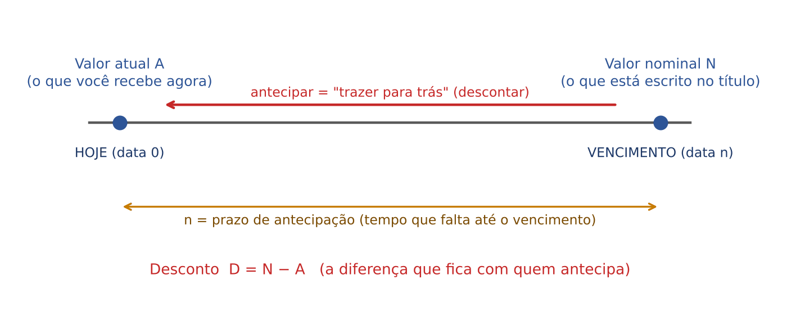

Três igualdades valem SEMPRE, em qualquer modalidade, e resolvem muita questão sozinhas:

- D = N − A (o desconto é a diferença)
- A = N − D (o atual é o nominal menos o desconto)
- N = A + D (o nominal é o atual mais o desconto)

:::ATENCAO O "valor descontado" é ambíguo
Em muitas provas, "valor descontado" significa o VALOR ATUAL (o que sobra depois do desconto, A), e não o valor do desconto (D). Leia as alternativas: se elas giram em torno de números próximos de N, pedem A; se giram em torno de números pequenos, pedem D. Em caso de dúvida, calcule os dois.
:::

### 05.1.3 Desconto é juros "ao contrário"

No Cap. 2 você aprendeu a andar no tempo PARA A FRENTE: um capital C, aplicado a juros, vira um montante M no futuro. No desconto, andamos PARA TRÁS: conhecemos o valor do futuro (N) e queremos saber quanto ele vale hoje (A).

A comparação ajuda a fixar os papéis:

| Juros (para a frente) | Desconto (para trás) |
|---|---|
| Capital C (hoje) | Valor atual A (hoje) |
| Montante M (futuro) | Valor nominal N (futuro) |
| Juros J = M − C | Desconto D = N − A |
| Prazo da aplicação | Prazo de antecipação |

Até aqui, tudo é simples. A dificuldade do capítulo está em UMA pergunta: a taxa de desconto é calculada SOBRE O QUÊ?

- Se a taxa incide sobre o valor atual A (como os juros incidem sobre o capital), o desconto é chamado RACIONAL, ou "por dentro", ou "real". É o desconto matematicamente "justo": ele é exatamente o inverso dos juros.
- Se a taxa incide sobre o valor nominal N (o valor de face, que é maior), o desconto é chamado COMERCIAL, ou "por fora", ou "bancário". É o desconto usado na prática pelos bancos, porque rende mais para quem antecipa o dinheiro.

Por que "por dentro" e "por fora"? Pense em N como uma caixa que contém A e D. No racional, a taxa é calculada sobre a parte de DENTRO da caixa (A). No comercial, é calculada sobre a caixa inteira, por FORA (N).

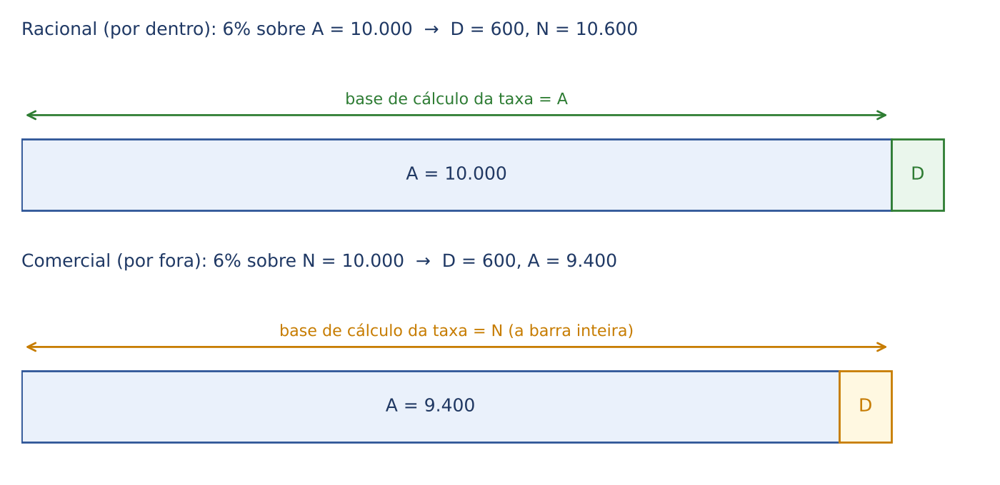

Repare na figura: com a MESMA taxa de 6%, o racional calcula 6% de 10.000 (que é A) e chega a N = 10.600; o comercial calcula 6% de 10.000 (que é N) e chega a A = 9.400. A base de cálculo muda tudo.

A segunda pergunta é a mesma do Cap. 3: o regime é SIMPLES ou COMPOSTO? Combinando as duas perguntas, surgem quatro modalidades:

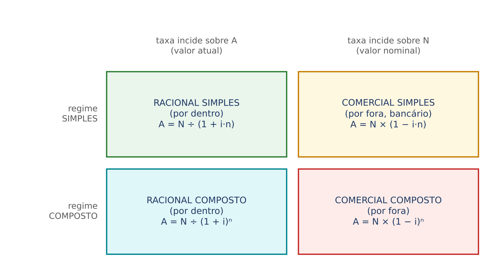

Na prática de prova, o desconto SIMPLES (racional e comercial) é o campeão de incidência; o racional composto aparece disfarçado de "valor presente" (e reaparece nos Caps. 6 e 8); o comercial composto é raro.

### 05.1.4 Prazo e taxa na mesma unidade

Como nos juros (Cap. 2), a taxa e o prazo precisam estar na MESMA unidade de tempo. Se a taxa é mensal, o prazo vai em meses; se o prazo vem em dias, converta a taxa para diária ou o prazo para meses.

Nas operações de desconto, o padrão é o ano comercial (360 dias) e o mês comercial (30 dias), salvo aviso em contrário no enunciado.

:::EXEMPLO Convertendo taxa e prazo
Taxa de 36% ao ano; título descontado 75 dias antes do vencimento.
- Taxa diária (ano comercial): 36% ÷ 360 = 0,1% ao dia = 0,001 ao dia.
- Produto i·n: 0,001 × 75 = 0,075 (ou seja, 7,5% no período).
Outra forma: 75 dias = 2,5 meses; 36% ao ano = 3% ao mês; 0,03 × 2,5 = 0,075. O resultado é o mesmo.
:::

:::DICA O produto i·n é o coração do desconto simples
Em TODAS as fórmulas do desconto simples aparece o produto i·n. Calcule-o PRIMEIRO, separadamente, e só depois entre na fórmula. Ele representa a taxa total do período de antecipação: 2% ao mês durante 3 meses dá i·n = 0,06, isto é, 6% no período.
:::

## 05.2 Desconto racional simples (por dentro)

### 05.2.1 A ideia

No desconto racional simples, o raciocínio é: "qual valor A, aplicado HOJE a juros simples pela taxa i, durante o prazo n, viraria exatamente N no vencimento?".

Em outras palavras, o valor atual racional é o CAPITAL que, a juros simples, produz o montante N. O desconto racional é, então, igual aos juros que esse capital renderia: o banco "cobra" juros sobre o dinheiro que efetivamente adianta (A). Por isso ele é chamado de "racional" ou "real": é o inverso perfeito dos juros simples.

### 05.2.2 Um exemplo à mão, antes de qualquer fórmula

Um título de 11.000 reais vence daqui a 5 meses. Ele será descontado hoje pelo critério racional simples, à taxa de 2% ao mês. Quanto o portador recebe?

Pensemos com o Cap. 2. Se eu aplicasse um capital A a 2% ao mês, por 5 meses, os juros seriam 2% × 5 = 10% de A. O montante seria A + 10% de A = 1,10 × A. Queremos que esse montante seja 11.000:

- 1,10 × A = 11.000
- A = 11.000 ÷ 1,10 (dividimos os dois lados por 1,10 para isolar A)
- A = 10.000

O desconto é D = 11.000 − 10.000 = 1.000.

Confira a "prova dos nove": 10.000 aplicados a 2% ao mês por 5 meses rendem 10.000 × 0,02 × 5 = 1.000 de juros, e 10.000 + 1.000 = 11.000. Fecha. O desconto racional (1.000) é exatamente igual aos juros simples sobre o valor atual.

:::DICA Como dividir por 1,10 (ou 1,06, ou 1,08) sem calculadora
Multiplique o dividendo e o divisor pelo mesmo número para sumir com a vírgula: 11.000 ÷ 1,10 = 1.100.000 ÷ 110 = 10.000. Do mesmo modo, 5.300 ÷ 1,06 = 530.000 ÷ 106 = 5.000. As bancas escolhem os números para a divisão ser exata: se a sua conta "não fecha", desconfie de erro de modalidade (ver Cap. 1, divisão de decimais).
:::

### 05.2.3 As fórmulas

Generalizando o que fizemos: o montante de A a juros simples é A × (1 + i·n) (fórmula do Cap. 2, com A no lugar de C). Igualando a N:

- A × (1 + i·n) = N
- A = N ÷ (1 + i·n)

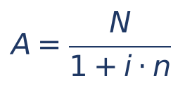

Em que:
- A = valor atual racional (o que se recebe hoje);
- N = valor nominal (o valor de face, pago no vencimento);
- i = taxa de desconto por período, na forma decimal (2% = 0,02);
- n = prazo de antecipação, na mesma unidade da taxa;
- 1 + i·n = "fator de juros simples"; dividir por ele é "tirar" os juros do valor nominal.

O desconto racional simples (Dr) pode ser calculado de duas maneiras.

Primeira maneira, a mais intuitiva: como juros simples sobre o valor atual.

- Dr = A × i × n

Segunda maneira: diretamente a partir de N. Basta trocar A por N ÷ (1 + i·n) na fórmula anterior:

- Dr = [N ÷ (1 + i·n)] × i × n
- Dr = N × i × n ÷ (1 + i·n)

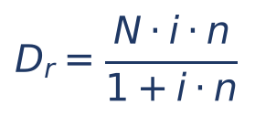

Em que Dr = desconto racional simples e os demais símbolos são os mesmos de antes. Observe que o numerador (N·i·n) é exatamente o desconto que se obteria aplicando a taxa sobre N; o denominador (1 + i·n) "corrige" isso, trazendo a base de cálculo de N para A.

Refaça o exemplo pela fórmula, para treinar: N = 11.000; i = 0,02; n = 5.
- i·n = 0,02 × 5 = 0,10
- Dr = 11.000 × 0,10 ÷ 1,10
- Dr = 1.100 ÷ 1,10
- Dr = 1.000

:::ESQUEMA As três maneiras de ver o desconto racional simples
- Como juros: Dr = A·i·n (a taxa incide sobre A).
- Como fração de N: Dr = N·i·n ÷ (1 + i·n).
- Como diferença: Dr = N − A, com A = N ÷ (1 + i·n).
Use a que for mais curta com os dados do enunciado.
:::

### 05.2.4 Exemplos resolvidos

:::EXEMPLO 1 — Calcular o valor atual
Título de 5.300 reais, descontado 4 meses antes do vencimento, desconto racional simples a 1,5% ao mês.
- i·n = 0,015 × 4 = 0,06
- 1 + i·n = 1,06
- A = 5.300 ÷ 1,06
- A = 530.000 ÷ 106 (multiplicamos ambos por 100)
- A = 5.000
- Dr = 5.300 − 5.000 = 300
Conferência: 5.000 × 0,015 × 4 = 300. Fecha.
:::

:::EXEMPLO 2 — Calcular o valor nominal a partir do atual
Um portador recebeu 12.000 reais ao descontar um título 2 meses antes do vencimento, desconto racional simples a 3% ao mês. Qual era o valor de face?
Aqui o caminho é o dos juros (para a frente): N = A × (1 + i·n).
- i·n = 0,03 × 2 = 0,06
- N = 12.000 × 1,06
- N = 12.720
- Dr = 12.720 − 12.000 = 720 (que é 12.000 × 0,06)
:::

:::EXEMPLO 3 — Calcular a taxa
Título de 7.200 reais descontado 10 meses antes do vencimento por 6.000 reais, critério racional simples. Qual a taxa mensal?
- Dr = 7.200 − 6.000 = 1.200
- Dr = A·i·n, logo 1.200 = 6.000 × i × 10
- 1.200 = 60.000 × i
- i = 1.200 ÷ 60.000 (dividimos os dois lados por 60.000)
- i = 0,02, ou seja, 2% ao mês
:::

:::EXEMPLO 4 — Calcular o prazo
Título de 26.000 reais resgatado antecipadamente por 20.000 reais; desconto racional simples de 5% ao mês. Quantos meses faltavam?
- Dr = 26.000 − 20.000 = 6.000
- 6.000 = 20.000 × 0,05 × n
- 6.000 = 1.000 × n
- n = 6 meses
:::

:::EXEMPLO 5 — Prazo em dias
Título de 10.300 reais descontado 30 dias antes do vencimento; desconto racional simples à taxa de 36% ao ano (ano comercial).
- Taxa diária: 0,36 ÷ 360 = 0,001
- i·n = 0,001 × 30 = 0,03
- A = 10.300 ÷ 1,03 = 1.030.000 ÷ 103 = 10.000
- Dr = 300
:::

:::PASSO Como resolver qualquer questão de desconto racional simples
- Etapa 1: identifique o que foi dado (N, A, D, i, n) e o que se pede.
- Etapa 2: ponha taxa e prazo na mesma unidade e calcule o produto i·n.
- Etapa 3: se tem N e quer A, DIVIDA N por (1 + i·n). Se tem A e quer N, MULTIPLIQUE A por (1 + i·n).
- Etapa 4: o desconto sai por diferença (D = N − A) ou como juros sobre A (D = A·i·n).
- Etapa 5: se a pergunta é a taxa ou o prazo, use D = A·i·n e isole a incógnita.
- Etapa 6: confira: A + A·i·n deve dar N.
:::

:::PEGADINHA Calcular a taxa sobre N no desconto racional
O erro mais comum é fazer "2% de 11.000 vezes 5" no desconto racional, obtendo 1.100. Isso é desconto COMERCIAL. No racional, a taxa incide sobre A, que você ainda não conhece: por isso é preciso DIVIDIR N por (1 + i·n). A FCC sempre coloca o valor do desconto comercial entre as alternativas de uma questão de desconto racional.
:::

### 05.2.5 Questões de prova

:::QUESTAO FGV 2024 — AL-PR — Analista Legislativo — Economista (Q2451625)
Um título tem valor atual de 2.000 reais. Antecipa-se o resgate em 10 meses, à taxa de desconto de 1% ao mês. Pedem-se o desconto racional simples e o valor de face. Gabarito oficial: B (200,00 e 2.200,00), conferido no QConcursos em 30/10/2026; coincide com a resolução abaixo.
Resolução passo a passo:
- Foi dado o valor ATUAL (A = 2.000). No racional, a taxa incide justamente sobre A, então a conta é direta.
- i·n = 0,01 × 10 = 0,10
- Dr = A·i·n = 2.000 × 0,10 = 200
- N = A + Dr = 2.000 + 200 = 2.200
Por que as outras alternativas seduzem: "222,22 e 2.222,22" nasce de aplicar a lógica do desconto COMERCIAL (N = A ÷ (1 − i·n) = 2.000 ÷ 0,90 = 2.222,22); "200,00 e 2.000,00" esquece de somar o desconto ao valor atual; "209,24 e 2.209,24" usa juros compostos (2.000 × 1,01¹⁰ ≈ 2.209,24), que não foram pedidos.
:::

### 05.2.6 Pratique

:::PRATIQUE exercícios elaborados para esta apostila (desconto racional simples)
1) Título de 4.400 reais, descontado 5 meses antes do vencimento, racional simples a 2% ao mês. Calcule A e Dr.
2) Ao descontar um título 4 meses antes do vencimento (racional simples, 2,5% ao mês), o portador recebeu 9.000 reais. Qual o valor nominal?
3) O desconto racional simples de um título foi de 360 reais, à taxa de 3% ao mês, 4 meses antes do vencimento. Qual o valor nominal?
4) (Estilo FCC) Um título de 21.200 reais é descontado 120 dias antes do vencimento, à taxa de 18% ao ano, desconto racional simples. O valor atual é: (A) 19.928; (B) 20.000; (C) 20.140; (D) 20.400; (E) 21.000.
Resoluções:
1) i·n = 0,02 × 5 = 0,10. A = 4.400 ÷ 1,10 = 440.000 ÷ 110 = 4.000. Dr = 4.400 − 4.000 = 400. Conferência: 4.000 × 0,10 = 400.
2) Foi dado A = 9.000. i·n = 0,025 × 4 = 0,10. N = 9.000 × 1,10 = 9.900. (O desconto foi 900 = 9.000 × 0,10.)
3) Dr = A·i·n, e i·n = 0,03 × 4 = 0,12. Então 360 = A × 0,12, logo A = 360 ÷ 0,12 = 36.000 ÷ 12 = 3.000. N = A + Dr = 3.000 + 360 = 3.360.
4) 18% ao ano ÷ 12 = 1,5% ao mês; 120 dias = 4 meses. i·n = 0,015 × 4 = 0,06. A = 21.200 ÷ 1,06 = 2.120.000 ÷ 106 = 20.000. Resposta (B). A alternativa (A), 19.928, é a armadilha: 21.200 × (1 − 0,06) = 19.928 é o valor atual COMERCIAL.
:::

## 05.3 Desconto comercial simples (por fora)

### 05.3.1 A ideia

No desconto comercial simples, a taxa é aplicada sobre o VALOR NOMINAL, que é o número que está escrito no título e que todos conhecem desde o início. A conta é mais fácil e, para quem antecipa o dinheiro (o banco), mais lucrativa, porque a base de cálculo (N) é maior do que o dinheiro efetivamente entregue (A).

É o desconto praticado pelos bancos na antecipação de duplicatas, cheques e notas promissórias. Por isso também se chama desconto bancário (em 5.6 veremos que, na vida real, o banco ainda acrescenta tarifas e IOF).

### 05.3.2 Um exemplo à mão

Voltemos à duplicata de 10.000 reais da seção 5.1, que vence em 3 meses. O banco cobra desconto comercial simples de 2% ao mês.

- O banco calcula 2% de 10.000 por mês: 0,02 × 10.000 = 200 por mês.
- Em 3 meses: 200 × 3 = 600. Este é o desconto.
- O valor atual é 10.000 − 600 = 9.400.

Simples assim: "x% do valor de face, por mês, vezes o número de meses".

### 05.3.3 As fórmulas

O desconto comercial simples (Dc) é a taxa aplicada sobre N, durante n períodos:

- Dc = N × i × n

O valor atual comercial é o nominal menos esse desconto:

- A = N − Dc
- A = N − N × i × n
- A = N × (1 − i·n) (colocamos N em evidência, isto é, "tiramos o N de dentro das duas parcelas")

Em que:
- Dc = desconto comercial simples;
- A = valor atual comercial (valor líquido recebido);
- N = valor nominal;
- i = taxa de desconto por período, na forma decimal;
- n = prazo de antecipação, na mesma unidade da taxa;
- 1 − i·n = fração do valor nominal que o portador recebe. Com i·n = 0,06, ele recebe 0,94 de N, isto é, 94%.

Compare com o racional, para nunca mais confundir:

| | Racional simples (por dentro) | Comercial simples (por fora) |
|---|---|---|
| A taxa incide sobre | A (valor atual) | N (valor nominal) |
| Desconto | D = A·i·n | D = N·i·n |
| Valor atual | A = N ÷ (1 + i·n) | A = N × (1 − i·n) |
| Operação com N | DIVIDIR por (1 + i·n) | MULTIPLICAR por (1 − i·n) |

:::DICA Memória visual
Racional: sinal de MAIS e DIVISÃO (A = N ÷ (1 + i·n)). Comercial: sinal de MENOS e MULTIPLICAÇÃO (A = N × (1 − i·n)). "Por dentro, divide; por fora, multiplica."
:::

### 05.3.4 Exemplos resolvidos

:::EXEMPLO 1 — Prazo em dias
Título de 8.000 reais, descontado 75 dias antes do vencimento, desconto comercial simples a 36% ao ano (ano comercial).
- i diária = 0,36 ÷ 360 = 0,001
- i·n = 0,001 × 75 = 0,075
- Dc = 8.000 × 0,075 = 600
- A = 8.000 − 600 = 7.400
:::

:::EXEMPLO 2 — Calcular o nominal a partir do valor líquido
Uma empresa recebeu 4.600 reais pelo desconto comercial simples de um título, 4 meses antes do vencimento, a 2% ao mês. Qual o valor de face?
- i·n = 0,02 × 4 = 0,08
- 1 − i·n = 0,92
- A = N × 0,92, logo 4.600 = N × 0,92
- N = 4.600 ÷ 0,92 (dividimos os dois lados por 0,92)
- N = 460.000 ÷ 92 = 5.000
Repare: aqui sim aparece uma divisão, porque estamos fazendo o caminho de volta (de A para N).
:::

:::EXEMPLO 3 — Calcular o prazo
Título de 15.000 reais descontado por 13.200 reais, desconto comercial simples de 3% ao mês. Quantos meses de antecipação?
- Dc = 15.000 − 13.200 = 1.800
- Dc = N·i·n, logo 1.800 = 15.000 × 0,03 × n
- 1.800 = 450 × n
- n = 1.800 ÷ 450 = 4 meses
:::

:::EXEMPLO 4 — Calcular a taxa
O desconto comercial simples de um título de 20.000 reais, 5 meses antes do vencimento, foi de 1.500 reais. Qual a taxa mensal?
- 1.500 = 20.000 × i × 5
- 1.500 = 100.000 × i
- i = 1.500 ÷ 100.000 = 0,015, ou seja, 1,5% ao mês
:::

### 05.3.5 O limite do desconto comercial

O gráfico abaixo mostra, para um título de 10.000 reais e taxa de 5% ao mês, o valor atual pelas duas modalidades à medida que o prazo de antecipação aumenta.

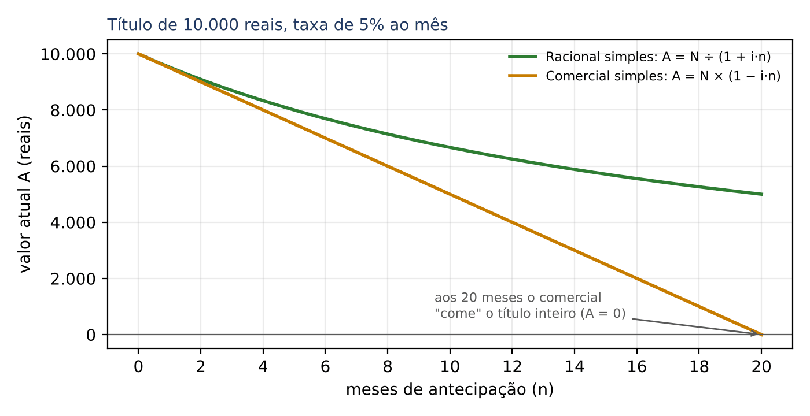

O comercial é uma RETA que desce e chega a zero quando i·n = 1 (aos 20 meses, porque 0,05 × 20 = 1). Depois disso, o valor atual seria negativo: o portador teria de PAGAR para descontar o próprio título, o que é absurdo. Por isso o desconto comercial simples só faz sentido para prazos curtos (i·n bem menor que 1). O racional, ao contrário, é uma curva que desce cada vez mais devagar e nunca chega a zero.

O gráfico também mostra a regra mais cobrada do capítulo: para a MESMA taxa e o MESMO prazo, o valor atual comercial é sempre MENOR que o racional (a reta fica abaixo da curva). Em 5.5 veremos quanto menor.

:::PEGADINHA "Taxa de desconto" não é "taxa de juros"
Quando o enunciado diz "taxa de desconto comercial de 2% ao mês", essa taxa incide sobre N. Não a use como se fosse a taxa de juros que o tomador realmente paga: a taxa efetiva é maior (ver 5.4). A FCC adora perguntar a taxa efetiva justamente porque o candidato desatento repete a taxa de desconto.
:::

### 05.3.6 Questões de prova

:::QUESTAO FGV 2024 — Prefeitura de São José dos Campos — Analista em Gestão Municipal (Q2360318)
Pede-se o desconto comercial simples de um título de 1.000 reais, com vencimento para 60 dias, à taxa de 5% ao mês. Gabarito oficial: E (100), conferido no QConcursos em 30/10/2026; coincide com a resolução abaixo.
Resolução passo a passo:
- 60 dias = 2 meses comerciais.
- i·n = 0,05 × 2 = 0,10
- Dc = N·i·n = 1.000 × 0,10 = 100
As alternativas maiores (200 a 500) só apareceriam com erro de unidade, por exemplo tomando 60 dias como se fossem vários meses a mais, ou multiplicando a taxa por um prazo errado. Questão de aquecimento: o comercial é "taxa × nominal × prazo".
:::

:::QUESTAO FGV 2024 — DATAPREV — ATI — Contabilidade (Q3086001)
Título de valor nominal 25.000 reais, descontado 3 meses antes do vencimento num banco que usa desconto bancário (por fora) à taxa de 3,3% ao mês. Pede-se o valor liberado ao cliente. Gabarito oficial: A (22.525,00).
Resolução passo a passo:
- "Bancário (por fora)" = comercial simples.
- i·n = 0,033 × 3 = 0,099
- Dc = 25.000 × 0,099 = 2.475
- A = 25.000 − 2.475 = 22.525
Atalho de conta: 25.000 × 0,099 = 25.000 × 0,1 − 25.000 × 0,001 = 2.500 − 25 = 2.475.
Se o candidato tivesse usado o racional (25.000 ÷ 1,099 ≈ 22.747,95), não acharia alternativa: sinal de que a modalidade foi bem identificada. As demais alternativas (20.525 a 21.625) correspondem a descontos maiores do que o correto, isto é, a contas com prazo ou taxa inflados.
:::

:::QUESTAO FGV 2026 — AL-GO — Analista Legislativo — Controle Externo (Q3880596)
Um município avalia um empréstimo: descontados juros simples de 8% ao ano por 18 meses, o valor líquido seria de 39.600 (em mil). Pede-se o valor total do empréstimo (o valor de face). Gabarito oficial: E (45.000).
Resolução passo a passo:
- Os juros são "descontados" do valor total na largada: é desconto comercial simples (a taxa incide sobre o valor total, N), e o valor líquido é A.
- 18 meses = 1,5 ano; i·n = 0,08 × 1,5 = 0,12
- A = N × (1 − 0,12) = N × 0,88
- 39.600 = N × 0,88
- N = 39.600 ÷ 0,88 = 3.960.000 ÷ 88 = 45.000
Conferência: 8% ao ano × 1,5 ano × 45.000 = 5.400; 45.000 − 5.400 = 39.600.
Armadilha: a alternativa C (35.360) fica perto de 39.600 ÷ 1,12 ≈ 35.357, conta de quem "desconta de novo" o valor líquido, quando deveria fazer o caminho de volta até N. E quem aplicasse o racional (39.600 × 1,12 = 44.352) não acharia alternativa.
:::

### 05.3.7 Pratique

:::PRATIQUE exercícios elaborados para esta apostila (desconto comercial simples)
1) Título de 6.000 reais, descontado 2 meses antes do vencimento, comercial simples a 2,5% ao mês. Calcule Dc e A.
2) Uma empresa recebeu 9.100 reais pelo desconto comercial simples de uma duplicata, 6 meses antes do vencimento, a 1,5% ao mês. Qual o valor de face?
3) Um título de 12.000 reais teve desconto comercial simples de 1.080 reais, à taxa de 1,8% ao mês. Quantos meses faltavam para o vencimento?
4) (Estilo FCC) Uma nota promissória de 30.000 reais é descontada 60 dias antes do vencimento, à taxa de desconto comercial simples de 4,5% ao mês. O valor líquido recebido é: (A) 27.000; (B) 27.300; (C) 27.523; (D) 28.650; (E) 28.708.
Resoluções:
1) i·n = 0,025 × 2 = 0,05. Dc = 6.000 × 0,05 = 300. A = 6.000 − 300 = 5.700.
2) i·n = 0,015 × 6 = 0,09; 1 − i·n = 0,91. 9.100 = N × 0,91, logo N = 9.100 ÷ 0,91 = 910.000 ÷ 91 = 10.000.
3) 1.080 = 12.000 × 0,018 × n. Como 12.000 × 0,018 = 216, fica 1.080 = 216 × n, e n = 1.080 ÷ 216 = 5 meses.
4) 60 dias = 2 meses; i·n = 0,045 × 2 = 0,09. Dc = 30.000 × 0,09 = 2.700. A = 30.000 − 2.700 = 27.300. Resposta (B). A alternativa (C), 27.523, é aproximadamente o valor atual RACIONAL (30.000 ÷ 1,09 ≈ 27.522,94): a pegadinha clássica de trocar a modalidade.
:::

## 05.4 Taxa efetiva do desconto comercial

### 05.4.1 A ideia: o banco anuncia uma taxa e cobra outra

Na duplicata de 10.000 reais (desconto comercial de 2% ao mês, 3 meses), o banco entregou 9.400 reais e vai receber 10.000. Pense como quem tomou um EMPRÉSTIMO: recebeu 9.400 hoje e "devolve" 10.000 daqui a 3 meses. Quanto de juros pagou, de verdade, sobre o dinheiro que recebeu?

- Juros pagos: 600.
- Dinheiro efetivamente recebido: 9.400 (e não 10.000!).
- Taxa no período: 600 ÷ 9.400 ≈ 0,0638, isto é, cerca de 6,38% em 3 meses.
- Taxa mensal, em juros simples: 6,38% ÷ 3 ≈ 2,13% ao mês.

O banco ANUNCIOU 2% ao mês, mas o custo REAL para o cliente foi de cerca de 2,13% ao mês. A diferença nasce da base de cálculo: o banco cobrou 2% sobre 10.000, mas o cliente só dispôs de 9.400.

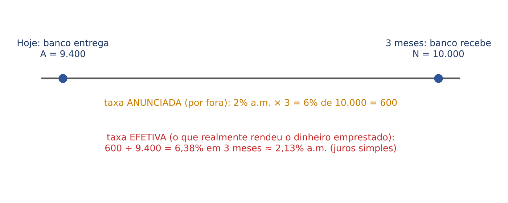

A taxa efetiva é, portanto, a taxa de juros que, aplicada sobre o valor atual (o dinheiro efetivamente liberado), reproduz o valor nominal. Em outras palavras: é a taxa do desconto RACIONAL equivalente ao comercial praticado. É por isso que a taxa racional também se chama "taxa real" ou "taxa efetiva".

### 05.4.2 As fórmulas

Para distinguir as duas taxas, chamaremos aqui de d a taxa do desconto comercial (por fora) e de i_ef a taxa efetiva (de juros, por dentro).

Primeiro, a taxa efetiva do período inteiro (de uma vez só, para os n períodos):

- i_total = desconto ÷ valor atual = Dc ÷ A
- Como Dc = N·d·n e A = N·(1 − d·n), o N se cancela:
- i_total = d·n ÷ (1 − d·n)

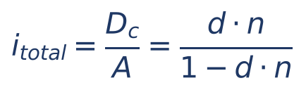

Depois, a taxa efetiva POR PERÍODO, no regime de juros simples: basta dividir a taxa total por n.

- i_ef = [d·n ÷ (1 − d·n)] ÷ n
- i_ef = d ÷ (1 − d·n) (o n do numerador se cancela com a divisão por n)

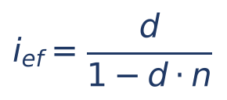

Em que:
- i_ef = taxa efetiva de juros simples por período (mensal, se d for mensal);
- i_total = taxa efetiva do período inteiro de antecipação;
- d = taxa de desconto comercial por período;
- n = prazo de antecipação;
- 1 − d·n = fração do nominal efetivamente recebida.

Conferindo no exemplo: d = 0,02; n = 3; d·n = 0,06.
- i_total = 0,06 ÷ 0,94 ≈ 0,0638 (6,38% em 3 meses)
- i_ef = 0,02 ÷ 0,94 ≈ 0,0213 (2,13% ao mês)

:::ATENCAO A taxa efetiva é sempre MAIOR que a taxa de desconto comercial
Como 1 − d·n é menor que 1, dividir d por ele aumenta o resultado. E quanto MAIOR o prazo, maior a diferença, porque 1 − d·n fica menor. Quem descontar o mesmo título a 2% ao mês por 1 mês paga efetivamente 2,04% ao mês; por 10 meses, 2,5% ao mês.
:::

:::EXEMPLO 1 — Números redondos
Desconto comercial simples a 5% ao mês, 4 meses antes do vencimento. Qual a taxa efetiva mensal (juros simples) e a do período?
- d·n = 0,05 × 4 = 0,20
- 1 − d·n = 0,80
- i_total = 0,20 ÷ 0,80 = 0,25, isto é, 25% no período
- i_ef = 0,05 ÷ 0,80 = 0,0625, isto é, 6,25% ao mês
Conferência com um título qualquer, digamos N = 1.000: o cliente recebe 800 e paga 1.000. Juros de 200 sobre 800 = 25% em 4 meses = 6,25% ao mês.
:::

### 05.4.3 O caminho inverso: taxas equivalentes entre racional e comercial

Às vezes a pergunta é a contrária: "qual taxa de desconto comercial produz o mesmo valor atual que uma taxa racional i?". Duas taxas (uma por fora, outra por dentro) são EQUIVALENTES quando, aplicadas ao mesmo título no mesmo prazo, dão o mesmo valor atual. Igualando os dois valores atuais:

- N × (1 − d·n) = N ÷ (1 + i·n)
- 1 − d·n = 1 ÷ (1 + i·n) (dividimos os dois lados por N)
- d·n = 1 − 1 ÷ (1 + i·n)
- d·n = (1 + i·n − 1) ÷ (1 + i·n) (reduzimos ao mesmo denominador; ver frações no Cap. 1)
- d·n = i·n ÷ (1 + i·n)
- d = i ÷ (1 + i·n) (dividimos os dois lados por n)

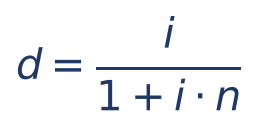

E, no sentido oposto, i = d ÷ (1 − d·n), que é a fórmula da taxa efetiva já vista. As duas fórmulas são "espelhos": uma com MAIS e outra com MENOS no denominador.

:::EXEMPLO 2 — Taxa comercial equivalente a uma racional
Um banco quer cobrar, efetivamente, 2,5% ao mês de juros simples sobre o dinheiro liberado, em operações de 4 meses. Que taxa de desconto comercial deve anunciar?
- i·n = 0,025 × 4 = 0,10
- d = 0,025 ÷ 1,10 ≈ 0,022727, ou seja, cerca de 2,27% ao mês
Conferência com N = 11.000: comercial a 2,2727% por 4 meses dá d·n = 0,0909 e A = 11.000 × (1 − 0,0909) ≈ 10.000; racional a 2,5% por 4 meses dá A = 11.000 ÷ 1,10 = 10.000. Mesmos valores atuais: as taxas são equivalentes.
:::

:::NOTA E a taxa efetiva em juros COMPOSTOS?
Algumas questões pedem a taxa efetiva mensal no regime composto. O raciocínio é o mesmo (taxa que leva A até N), mas a conta é a do Cap. 3: (1 + i)ⁿ = N ÷ A. Exemplo: desconto comercial de 10% ao mês por 2 meses; o cliente recebe 80% de N, logo N ÷ A = 1,25 e (1 + i)² = 1,25, o que dá 1 + i = √1,25 ≈ 1,118, ou seja, cerca de 11,8% ao mês (em juros simples seriam 12,5% ao mês). Leia com atenção qual regime a questão pede para a taxa efetiva; se ela não disser, e o desconto for simples, use juros simples.
:::

### 05.4.4 Questões de prova

:::QUESTAO FGV 2025 — Prefeitura de São José dos Campos — Analista em Gestão Municipal — Ciências Econômicas (Q3579927)
Título de 5.000 reais, vencendo em 90 dias. Banco 1: desconto comercial simples a 6% ao trimestre. Banco 2: desconto racional simples a 5,66% ao trimestre. Julgar: I. o desconto bancário é maior que o racional; II. o valor líquido no bancário é menor que no racional; III. as taxas são equivalentes. Gabarito oficial: C (I e II, apenas).
Resolução passo a passo (n = 1 trimestre):
- Banco 1: Dc = 5.000 × 0,06 = 300; A = 4.700.
- Banco 2: A = 5.000 ÷ 1,0566 ≈ 4.732,16; Dr ≈ 267,84.
- I: 300 > 267,84. Verdadeira.
- II: 4.700 < 4.732,16. Verdadeira (é a outra face da afirmação I).
- III: a taxa racional equivalente a 6% por fora, em 1 período, é i = d ÷ (1 − d·n) = 0,06 ÷ 0,94 ≈ 6,38%, e não 5,66%. Falsa.
A armadilha de III: 5,66% é 0,06 ÷ 1,06, isto é, a fórmula da equivalência aplicada AO CONTRÁRIO (como se 6% fosse a taxa racional e se procurasse a comercial). Quem decora "uma fórmula tem 1 + e a outra tem 1 −" sem saber qual é qual cai aqui. Regra segura: a taxa racional equivalente é SEMPRE MAIOR que a comercial; logo, uma racional de 5,66% menor que a comercial de 6% não pode ser equivalente.
:::

:::QUESTAO FGV 2025 — TCE-PE — Auditor de Controle Externo — Obras Públicas (Q3594936)
Pagamento contratual de 12.000.000 de reais daqui a 2 anos. Julgar: I. a 10% ao ano composto, o valor presente é 10.000.000; II. com desconto simples comercial de 2.400.000 sobre o valor de face, o valor presente é 9.600.000, e isso corresponde a uma "taxa de juros simples" de 10% ao ano; III. 12% ao ano com capitalização mensal equivale a 12% ao ano efetivos. Gabarito oficial: B (II, apenas).
Resolução passo a passo:
- I: VP = 12.000.000 ÷ 1,1² = 12.000.000 ÷ 1,21 ≈ 9.917.355. Para dar 10.000.000 o valor futuro teria de ser 12.100.000. Falsa.
- II: A = 12.000.000 − 2.400.000 = 9.600.000 (correto). Taxa de desconto comercial: 2.400.000 = 12.000.000 × d × 2, logo d = 2.400.000 ÷ 24.000.000 = 0,10, isto é, 10% ao ano. Considerada verdadeira.
- III: (1,01)¹² ≈ 1,1268, isto é, 12,68% ao ano efetivos (ver Cap. 4). Falsa.
Observação importante (gabarito discutível na redação): os 10% ao ano são a TAXA DE DESCONTO COMERCIAL (por fora). A taxa EFETIVA de juros simples da operação é 2.400.000 ÷ 9.600.000 = 25% em 2 anos, ou 12,5% ao ano (fórmula de 5.4.2: 0,10 ÷ (1 − 0,20) = 0,125). A banca chamou a taxa de desconto de "taxa de juros simples", o que é impreciso. Na prova, como I e III são claramente falsas, só resta a alternativa B. Moral: elimine o que é certamente falso e escolha a alternativa "menos errada".
:::

### 05.4.5 Pratique

:::PRATIQUE exercícios elaborados para esta apostila (taxa efetiva e taxas equivalentes)
1) Desconto comercial simples a 4% ao mês, 5 meses antes do vencimento. Calcule a taxa efetiva do período e a taxa efetiva mensal (juros simples).
2) Desconto comercial simples a 3% ao mês, 3 meses antes do vencimento. Qual a taxa efetiva mensal de juros simples?
3) Uma operação de 5 meses usa desconto comercial simples de 2% ao mês. Qual taxa de desconto racional simples daria o mesmo valor atual?
4) (Estilo FCC) Numa operação de desconto comercial simples de 4 meses, a taxa efetiva de juros no período foi de 25%. A taxa mensal de desconto comercial foi de: (A) 4%; (B) 5%; (C) 6,25%; (D) 6%; (E) 5,5%.
Resoluções:
1) d·n = 0,04 × 5 = 0,20; 1 − d·n = 0,80. i_total = 0,20 ÷ 0,80 = 0,25 (25% no período). i_ef = 0,04 ÷ 0,80 = 0,05 (5% ao mês).
2) d·n = 0,09; 1 − d·n = 0,91. i_ef = 0,03 ÷ 0,91 ≈ 0,03297, cerca de 3,30% ao mês.
3) A taxa racional equivalente é a própria taxa efetiva: i = d ÷ (1 − d·n) = 0,02 ÷ (1 − 0,10) = 0,02 ÷ 0,90 ≈ 0,0222, cerca de 2,22% ao mês.
4) i_total = d·n ÷ (1 − d·n) = 0,25. Chame d·n de x: x ÷ (1 − x) = 0,25, logo x = 0,25 × (1 − x) = 0,25 − 0,25x; somando 0,25x aos dois lados, 1,25x = 0,25 e x = 0,20. Então d·n = 0,20 e d = 0,20 ÷ 4 = 0,05 = 5% ao mês. Resposta (B). A alternativa (C), 6,25%, é a taxa efetiva MENSAL (25% ÷ 4), que não foi a pergunta.
:::

## 05.5 Relações entre o desconto racional e o comercial simples

As questões mais elegantes (e mais frequentes na FCC) não pedem só um desconto: comparam as duas modalidades aplicadas ao MESMO título, com a MESMA taxa e o MESMO prazo. Para elas existem três relações que valem ouro.

### 05.5.1 Um exemplo à mão para enxergar a relação

Título de 10.800 reais, 4 meses antes do vencimento, taxa de 2% ao mês. Calculemos as duas modalidades.

- i·n = 0,02 × 4 = 0,08
- Comercial: Dc = 10.800 × 0,08 = 864; A = 10.800 − 864 = 9.936
- Racional: A = 10.800 ÷ 1,08 = 1.080.000 ÷ 108 = 10.000; Dr = 10.800 − 10.000 = 800

Observe os dois descontos: 864 e 800. Divida um pelo outro: 864 ÷ 800 = 1,08. Exatamente o fator 1 + i·n! Não é coincidência.

### 05.5.2 Primeira relação: Dc = Dr × (1 + i·n)

Por que isso sempre acontece? Coloque lado a lado as duas fórmulas de desconto que você já conhece:

- Dc = N·i·n
- Dr = N·i·n ÷ (1 + i·n)

O numerador do racional é exatamente o desconto comercial. Então:

- Dr = Dc ÷ (1 + i·n)
- Dc = Dr × (1 + i·n) (multiplicamos os dois lados por (1 + i·n))

Em palavras: o desconto comercial é o desconto racional "corrigido" pelo fator de juros simples. Ou ainda: o desconto comercial é o MONTANTE do desconto racional, como se o desconto racional fosse um capital aplicado à taxa i durante n períodos.

### 05.5.3 Segunda relação: a diferença entre os descontos

Da primeira relação:

- Dc = Dr × (1 + i·n) = Dr + Dr·i·n (aplicamos a distributiva)
- Dc − Dr = Dr·i·n

Em palavras: a diferença entre os dois descontos são os JUROS simples do desconto racional. No exemplo: 864 − 800 = 64, e 800 × 0,08 = 64. Fecha.

Essa diferença é também a diferença entre os valores atuais (com sinal trocado): o racional entrega 10.000 e o comercial entrega 9.936; a diferença é 64. Questões do tipo "qual a diferença entre os valores recebidos nas duas modalidades?" são resolvidas assim.

### 05.5.4 Terceira relação: achar N a partir dos dois descontos

Se o enunciado dá os dois descontos e pede o valor nominal, use:

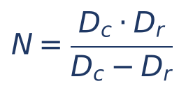

Em que N = valor nominal, Dc = desconto comercial e Dr = desconto racional (mesma taxa, mesmo prazo).

De onde vem? Da segunda relação, i·n = (Dc − Dr) ÷ Dr. Como Dc = N·i·n, temos N = Dc ÷ (i·n). Substituindo i·n:

- N = Dc ÷ [(Dc − Dr) ÷ Dr]
- N = Dc × Dr ÷ (Dc − Dr) (dividir por uma fração é multiplicar pelo inverso; ver Cap. 1)

No exemplo: N = 864 × 800 ÷ 64 = 691.200 ÷ 64 = 10.800. Fecha. É o "produto sobre a diferença".

:::ESQUEMA As três relações (mesma taxa, mesmo prazo, mesmo título)
- Dc = Dr × (1 + i·n): o comercial é sempre MAIOR que o racional.
- Dc − Dr = Dr·i·n: a diferença são os juros do desconto racional.
- N = Dc·Dr ÷ (Dc − Dr): produto sobre a diferença.
- Consequência: A comercial < A racional. O comercial favorece quem antecipa o dinheiro (o banco, o credor da operação de desconto); o racional favorece o portador do título.
:::

Reveja o gráfico de 5.3.5: a distância vertical entre a curva (racional) e a reta (comercial) é exatamente Dc − Dr, e ela cresce com o prazo.

:::PEGADINHA "O racional é calculado sobre o valor nominal"
Errado: quem é calculado sobre o valor nominal é o COMERCIAL. O racional incide sobre o valor atual. A FGV inverteu as definições numa afirmação de V ou F e muita gente marcou verdadeiro só porque a segunda parte da frase (racional dá valor presente maior) estava certa. Leia a frase inteira: um único erro torna a afirmação falsa.
:::

### 05.5.5 Questões de prova

:::QUESTAO FGV 2026 — TJ-SC — Analista Contábil-Econômico (Q4150854)
Título de 53.000 reais, descontado 3 meses antes do vencimento, taxa de 2% ao mês, juros simples. Pede-se a diferença entre os valores recebidos nas modalidades comercial e racional. Gabarito oficial: D (180,00).
Resolução passo a passo:
- i·n = 0,02 × 3 = 0,06
- Comercial: A = 53.000 × 0,94 = 49.820
- Racional: A = 53.000 ÷ 1,06 = 5.300.000 ÷ 106 = 50.000
- Diferença: 50.000 − 49.820 = 180
Pela relação de 5.5.3 (mais rápido): Dr = 3.000 (53.000 − 50.000); Dc − Dr = Dr·i·n = 3.000 × 0,06 = 180. Uma única conta, depois de achar o racional.
:::

:::QUESTAO FCC 2026 — MPE-SE — Analista do Ministério Público — Ciências Contábeis (Q3884302)
Título descontado 4 meses antes do vencimento, desconto comercial simples a 24% ao ano, valor atual de 24.840 reais. Se fosse desconto racional simples à mesma taxa, qual seria o valor atual? Gabarito oficial: D (25.000,00).
Resolução passo a passo:
- Converter a taxa: 24% ao ano ÷ 12 = 2% ao mês.
- i·n = 0,02 × 4 = 0,08
- Primeiro, achar N pelo comercial: 24.840 = N × (1 − 0,08) = N × 0,92
- N = 24.840 ÷ 0,92 = 2.484.000 ÷ 92 = 27.000
- Agora, o racional: A = 27.000 ÷ 1,08 = 2.700.000 ÷ 108 = 25.000
Conferência pelas relações: Dc = 27.000 − 24.840 = 2.160; Dr = 27.000 − 25.000 = 2.000; 2.000 × 1,08 = 2.160. Fecha.
Raciocínio de eliminação (sem conta): o valor atual racional é MAIOR que o comercial (24.840) e MENOR que o nominal. Isso já elimina 24.000 e 23.000 (menores que 24.840). Restam 25.000, 26.000 e 26.500. Como Dc − Dr = Dr × 0,08 e o desconto racional é da ordem de 2.000, a diferença entre os dois valores atuais é de apenas uns 160 reais: 24.840 + 160 = 25.000.
:::

:::QUESTAO FCC 2026 — SEFAZ-SP — Auditor Fiscal da Receita Estadual — Gestão Tributária (Q3954817)
Título 1: desconto racional simples, 4 meses antes do vencimento, 2,5% ao mês. Título 2: valor nominal igual ao DOBRO do primeiro, desconto comercial simples, 4 meses antes, 2,5% ao mês. A soma dos valores atuais é 59.600 reais. Pede-se o desconto do 2º título. Gabarito oficial: C (4.400,00).
Resolução passo a passo:
- i·n = 0,025 × 4 = 0,10 (o mesmo para os dois títulos).
- Chame de N o nominal do 1º título; o do 2º é 2N.
- Valor atual do 1º (racional): N ÷ 1,10.
- Valor atual do 2º (comercial): 2N × (1 − 0,10) = 2N × 0,90 = 1,8N.
- Equação: N ÷ 1,10 + 1,8N = 59.600.
- Multiplique tudo por 1,10 para eliminar o denominador: N + 1,98N = 65.560.
- 2,98N = 65.560, logo N = 65.560 ÷ 2,98 = 22.000.
- Nominal do 2º título: 2 × 22.000 = 44.000.
- Desconto do 2º (comercial): 44.000 × 0,10 = 4.400.
Conferência: valor atual do 1º = 22.000 ÷ 1,10 = 20.000; do 2º = 44.000 − 4.400 = 39.600; soma 59.600. Fecha.
Armadilha: a alternativa E (4.000) aparece para quem toma o VALOR ATUAL do 1º título (20.000) como se fosse o nominal, dobrando-o (40.000 × 0,10 = 4.000). Questão típica da FCC para auditor fiscal: duas modalidades na mesma equação; o segredo é escrever cada valor atual em função de uma única incógnita.
:::

:::QUESTAO FGV 2025 — AGESAN-RS — Agente de Controle Financeiro (Q3590980)
Duplicata descontada por desconto simples 4 meses antes do vencimento; o valor atual é o QUÁDRUPLO do desconto. Pede-se a taxa anual de desconto. Gabarito oficial: A (75,00%).
Resolução passo a passo, como a banca a resolveu (racional, desconto como juros sobre A):
- A = 4D, logo D ÷ A = 1/4 = 0,25.
- No racional, D = A·i·n, logo D ÷ A = i·n.
- i × 4 = 0,25, então i = 0,0625 = 6,25% ao mês.
- Anual (proporcional, ver Cap. 2): 6,25% × 12 = 75% ao ano.
E se fosse comercial? Então N = A + D = 5D, e D ÷ N = 1/5 = 0,20 = i·n; i = 0,05 ao mês = 60% ao ano, que é a alternativa E.
Por isso esta questão é instrutiva: o enunciado disse apenas "desconto simples", e as DUAS respostas estão nas alternativas. A banca adotou o racional, provavelmente porque a relação dada (atual × desconto) é a relação natural do racional (D = A·i·n). Gabarito discutível pela ambiguidade do enunciado; veja em 5.9 a regra prática para "desconto simples" sem qualificativo, que aqui levaria à alternativa E. Moral: quando o enunciado é omisso, examine as alternativas e o tipo de relação dada.
:::

:::QUESTAO FGV 2025 — TCE-RR — Auditor Substituto de Conselheiro (Q3174685)
Julgar (V/F): (1) na capitalização simples, o crescimento do montante é linear, pois os juros são calculados só sobre o capital inicial; (2) na composta, o valor presente se obtém dividindo o montante por (1 + i)ᵗ; (3) o desconto racional sempre resulta em um "valor descontado" maior que o comercial, pois considera a equivalência do capital no tempo. Gabarito oficial: B (V – V – F).
Comentário:
- (1) Verdadeira: juros simples são iguais em todos os períodos, e o montante cresce em linha reta (Cap. 2).
- (2) Verdadeira: é o desconto racional composto (ver 5.7).
- (3) Falsa para a banca. Aqui "valor descontado" foi lido como o valor do DESCONTO, e o desconto racional é MENOR que o comercial (Dr < Dc). Além disso, o "sempre" falha quando o prazo é zero (os dois descontos são nulos). Se "valor descontado" fosse lido como valor atual, a afirmação seria defensável no regime simples. É a ambiguidade avisada em 5.1.2: a banca usou o sentido de "desconto".
:::

:::QUESTAO FGV 2025 — SEFAZ-RS — Auditor do Estado (Q3154007)
Julgar (V/F): (1) o desconto racional é calculado com base no valor nominal e resulta em valor presente maior que o comercial; (2) o desconto comercial simples favorece o credor, pois incide sobre o valor nominal e ignora a equivalência do valor presente; (3) no desconto composto, o valor presente é sempre menor que no simples, qualquer que seja a taxa e o prazo. Gabarito oficial: B (F – V – F).
Comentário:
- (1) Falsa: a segunda parte é verdadeira (valor presente maior), mas a primeira está errada: o racional incide sobre o VALOR ATUAL (ver a PEGADINHA de 5.5.4).
- (2) Verdadeira: "credor" aqui é quem antecipa o dinheiro e fica com o título (o banco). Como a base é o nominal, o desconto é maior e o banco ganha mais.
- (3) Falsa por causa do "sempre". A comparação depende do prazo: com exatamente 1 período, simples e composto coincidem (o valor presente é o mesmo); no desconto racional, para prazos MENORES que 1 período, o valor presente composto é MAIOR que o simples (porque, antes de 1 período, os juros simples "rendem mais", como visto no Cap. 3, 03.4.2). Ver o gráfico e a tabela de 5.9.
:::

### 05.5.6 Pratique

:::PRATIQUE exercícios elaborados para esta apostila (relações entre racional e comercial)
1) O desconto racional simples de um título foi de 500 reais, à taxa de 3% ao mês, 2 meses antes do vencimento. Qual seria o desconto comercial simples, mesma taxa e prazo?
2) Um título tem desconto comercial simples de 1.320 reais e desconto racional simples de 1.200 reais (mesma taxa e prazo). Qual o valor nominal? Qual o produto i·n?
3) A diferença entre os descontos comercial e racional simples de um título, a 1,5% ao mês, 4 meses antes do vencimento, é de 90 reais. Qual o valor nominal?
4) (Estilo FCC) Um título descontado 5 meses antes do vencimento, a 2% ao mês, por desconto comercial simples, gerou valor atual de 19.800 reais. Pelo desconto racional simples, com a mesma taxa, o valor atual seria: (A) 19.602; (B) 19.800; (C) 20.000; (D) 20.200; (E) 21.780.
Resoluções:
1) i·n = 0,06. Dc = Dr × (1 + i·n) = 500 × 1,06 = 530.
2) N = Dc·Dr ÷ (Dc − Dr) = 1.320 × 1.200 ÷ 120 = 1.320 × 10 = 13.200. E i·n = (Dc − Dr) ÷ Dr = 120 ÷ 1.200 = 0,10. Conferência: Dc = 13.200 × 0,10 = 1.320.
3) i·n = 0,015 × 4 = 0,06. Dc − Dr = Dr·i·n, logo 90 = Dr × 0,06 e Dr = 90 ÷ 0,06 = 1.500. Dc = 1.500 × 1,06 = 1.590. N = Dc ÷ (i·n) = 1.590 ÷ 0,06 = 26.500. (Ou: N = 1.590 × 1.500 ÷ 90 = 26.500.)
4) i·n = 0,10. N = 19.800 ÷ 0,90 = 22.000. Racional: 22.000 ÷ 1,10 = 20.000. Resposta (C). Eliminação rápida: o valor racional tem de ser maior que 19.800 e menor que 22.000; (A) e (B) caem de imediato, e (E) seria 19.800 × 1,10, conta sem sentido.
:::

## 05.6 Desconto bancário: taxa administrativa e IOF

### 05.6.1 A ideia

Na vida real, o banco que desconta uma duplicata não cobra só o desconto comercial. Ele costuma acrescentar:

- uma taxa (ou tarifa) administrativa, também chamada de taxa de serviço ou de abertura de crédito (TAC), que pode ser um percentual do valor nominal, cobrado UMA VEZ só (não multiplica pelo prazo), ou um valor fixo em reais;
- o IOF (Imposto sobre Operações de Crédito, Câmbio e Seguro, ou relativas a Títulos ou Valores Mobiliários), tributo federal que incide sobre operações de crédito, inclusive o desconto de títulos.

O resultado é que o valor líquido recebido cai ainda mais, e a taxa efetiva da operação sobe.

### 05.6.2 A fórmula

Quando a taxa administrativa é um percentual h do valor nominal, cobrado de uma vez:

- Desconto comercial: N·d·n
- Despesa administrativa: N·h
- Valor líquido: A_liq = N − N·d·n − N·h = N × [1 − (d·n + h)]

Em que:
- A_liq = valor líquido creditado ao cliente;
- N = valor nominal;
- d = taxa de desconto comercial por período;
- n = prazo de antecipação;
- h = taxa administrativa, em decimal, cobrada uma única vez sobre N (não depende do prazo).

Se houver IOF ou tarifa em reais, basta subtrair cada um deles também. A regra geral, que a FGV chegou a escrever no próprio enunciado de uma questão, é: valor líquido = valor de face − juros − IOF − tarifas.

:::EXEMPLO Desconto bancário com taxa administrativa
Duplicata de 20.000 reais descontada 60 dias antes do vencimento, desconto comercial de 3% ao mês e taxa administrativa de 1% sobre o valor nominal.
- n = 2 meses; d·n = 0,03 × 2 = 0,06
- Desconto: 20.000 × 0,06 = 1.200
- Taxa administrativa: 20.000 × 0,01 = 200
- Valor líquido: 20.000 − 1.200 − 200 = 18.600
- Pela fórmula: 20.000 × [1 − (0,06 + 0,01)] = 20.000 × 0,93 = 18.600
Taxa efetiva da operação: o cliente recebeu 18.600 e o título vale 20.000; custo total de 1.400.
- i_total = 1.400 ÷ 18.600 ≈ 0,0753 (7,53% em 2 meses)
- i_ef (juros simples) ≈ 7,53% ÷ 2 ≈ 3,76% ao mês, bem acima dos 3% anunciados.
:::

:::ATENCAO A taxa administrativa NÃO se multiplica pelo prazo
Erro clássico: somar h à taxa mensal (3% + 1% = 4% ao mês) e multiplicar por 2 meses, chegando a 8%. O certo é d·n + h = 6% + 1% = 7%. A taxa administrativa é cobrada uma vez, como uma "taxa de balcão".
:::

### 05.6.3 IOF: só a noção

O IOF é um imposto federal de competência da União (Constituição, art. 153, V), regulamentado pelo Decreto 6.306, de 14/12/2007 (Regulamento do IOF). Nas operações de crédito, inclusive no desconto de títulos, a cobrança costuma combinar uma alíquota diária (proporcional ao prazo) e uma alíquota adicional fixa, ambas sobre o valor da operação.

As alíquotas concretas variam conforme o tipo de tomador e são alteradas por decreto com frequência (houve mudanças relevantes em 2025). NÃO decore números: em prova, use exatamente as alíquotas dadas no enunciado e observe sobre qual base elas incidem (em geral, o valor de face) e se são diárias (multiplicam pelo número de dias) ou fixas (cobradas uma vez).

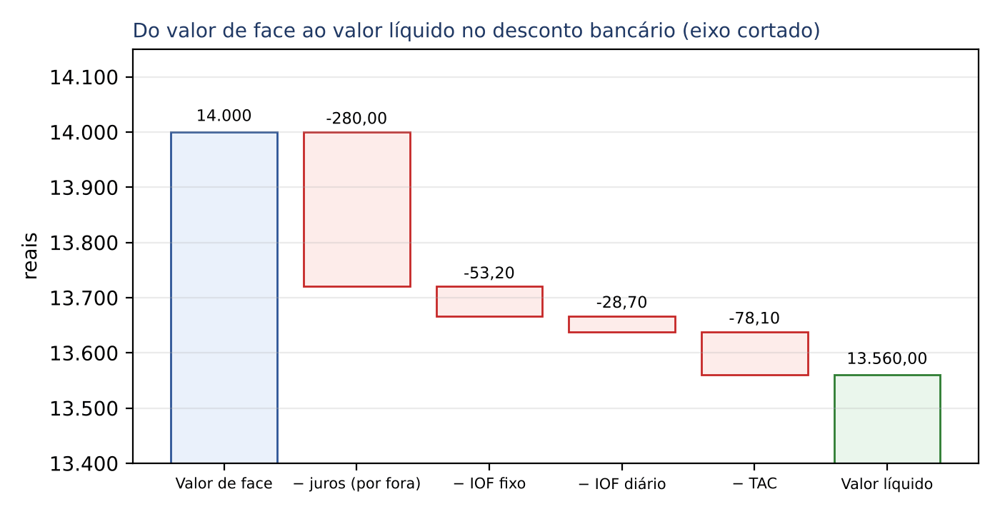

### 05.6.4 Questão de prova

:::QUESTAO FGV 2024 — Câmara Municipal de São Paulo — Consultor Técnico Legislativo — Contador (Q2351958)
Banco desconta duplicatas por fora a 1,2% ao mês (juros simples). IOF em duas alíquotas sobre o valor de face (VF): 0,38% fixa e 0,0041% ao dia. Tarifa de abertura de crédito (TAC) fixa de 78,10 reais. Valor líquido = VF − juros − IOF − TAC. Uma duplicata com vencimento em 50 dias gerou IOF fixo de 53,20 reais. Pede-se o valor líquido (mês comercial). Gabarito oficial: A (13.560,00), conferido no QConcursos em 30/10/2026; coincide com a resolução abaixo.
Resolução passo a passo:
- Achar o valor de face pelo IOF fixo: 0,0038 × VF = 53,20, logo VF = 53,20 ÷ 0,0038 = 532.000 ÷ 38 = 14.000.
- Juros (desconto por fora): 50 dias = 50/30 de mês. Juros = 14.000 × 0,012 × 50/30 = 168 × 50/30 = 8.400 ÷ 30 = 280.
- IOF diário: 14.000 × 0,000041 × 50 = 0,574 × 50 = 28,70.
- TAC: 78,10.
- Valor líquido: 14.000 − 280 − 53,20 − 28,70 − 78,10 = 13.560.
Dica de conta: some primeiro as deduções (280 + 53,20 + 28,70 + 78,10 = 440) e subtraia uma vez só: 14.000 − 440 = 13.560. As alternativas vizinhas (13.580, 13.600...) nascem de esquecer uma das parcelas ou de errar o prazo de 50 dias.
:::

### 05.6.5 Pratique

:::PRATIQUE exercícios elaborados para esta apostila (desconto bancário)
1) Título de 5.000 reais descontado 3 meses antes do vencimento, desconto comercial de 2% ao mês e taxa administrativa de 2% sobre o valor nominal. Qual o valor líquido?
2) No exercício 1, qual a taxa efetiva mensal de juros simples paga pelo cliente?
3) (Estilo FCC) Um banco desconta um título de 10.000 reais, 4 meses antes do vencimento, a 2% ao mês (comercial simples), cobrando ainda uma taxa administrativa de h% sobre o nominal. Se o cliente recebeu 9.000 reais, h vale: (A) 1%; (B) 1,5%; (C) 2%; (D) 2,5%; (E) 3%.
Resoluções:
1) d·n = 0,06; h = 0,02. A_liq = 5.000 × [1 − (0,06 + 0,02)] = 5.000 × 0,92 = 4.600.
2) Custo total: 5.000 − 4.600 = 400. i_total = 400 ÷ 4.600 ≈ 0,0870 (8,70% em 3 meses). i_ef ≈ 8,70% ÷ 3 ≈ 2,90% ao mês.
3) 9.000 = 10.000 × [1 − (0,08 + h)], logo 0,90 = 1 − 0,08 − h, e h = 1 − 0,08 − 0,90 = 0,02 = 2%. Resposta (C). Quem multiplicasse h pelo prazo (4h) acharia 0,5%, que nem está entre as alternativas: sinal de erro.
:::

## 05.7 Desconto racional composto (por dentro)

### 05.7.1 A ideia

O desconto racional composto é o inverso exato dos juros compostos do Cap. 3. A pergunta é: "qual valor A, aplicado hoje a juros COMPOSTOS à taxa i, vira N depois de n períodos?". É o desconto usado em operações de prazo mais longo e, sobretudo, é o mesmo cálculo que o mercado e a contabilidade chamam de "trazer a valor presente". Toda vez que uma questão fala em "valor presente" de um valor futuro, no regime composto, ela está pedindo um desconto racional composto.

### 05.7.2 Um exemplo à mão

Título de 12.100 reais com vencimento em 2 meses; desconto racional composto a 10% ao mês.

No Cap. 3 você aprendeu que, a juros compostos de 10% ao mês, cada mês MULTIPLICA o valor por 1,10. Para andar para trás, DIVIDIMOS por 1,10 a cada mês:

- Do mês 2 para o mês 1: 12.100 ÷ 1,10 = 11.000
- Do mês 1 para o mês 0: 11.000 ÷ 1,10 = 10.000

Valor atual: 10.000. Desconto: 12.100 − 10.000 = 2.100.

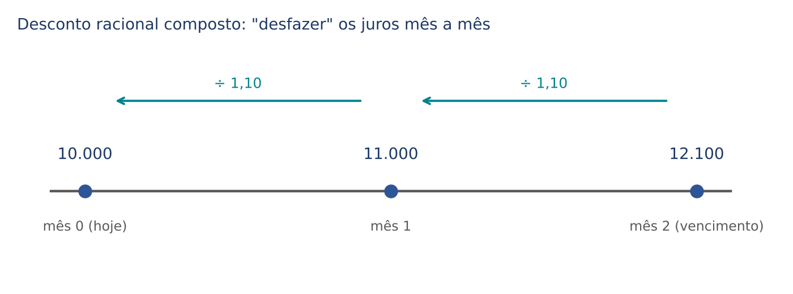

Dividir duas vezes por 1,10 é o mesmo que dividir uma vez por 1,10 × 1,10 = 1,10² = 1,21. Conferência: 12.100 ÷ 1,21 = 1.210.000 ÷ 121 = 10.000.

Compare com o racional SIMPLES, mesmos dados: i·n = 0,20 e A = 12.100 ÷ 1,20 ≈ 10.083,33. O racional composto deu valor atual MENOR (10.000), porque, para prazo maior que 1 período, os juros compostos "crescem mais" e, portanto, ao serem retirados, "tiram mais".

### 05.7.3 As fórmulas

- A × (1 + i)ⁿ = N (a juros compostos, A vira N)
- A = N ÷ (1 + i)ⁿ (dividimos os dois lados por (1 + i)ⁿ)

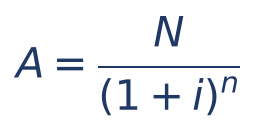

O desconto é a diferença:

- D = N − A = N − N ÷ (1 + i)ⁿ
- D = N × [1 − 1 ÷ (1 + i)ⁿ] (colocamos N em evidência)

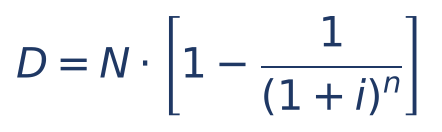

Em que:
- A = valor atual (valor presente);
- N = valor nominal (valor futuro);
- i = taxa de desconto por período, em decimal;
- n = número de períodos de antecipação (na unidade da taxa);
- (1 + i)ⁿ = fator de acumulação composto (Cap. 3);
- 1 ÷ (1 + i)ⁿ = fator de valor atual, que algumas provas fornecem em tabela.

:::DICA Como a FCC entrega as potências
Sem calculadora, ninguém calcula 1,05⁷ de cabeça. A prova dá o número pronto, de três formas:
- direto no enunciado ("considere 1,05³ = 1,157625");
- em tabela de fator de acumulação, (1 + i)ⁿ: então DIVIDA N pelo valor da tabela;
- em tabela de fator de valor atual, 1 ÷ (1 + i)ⁿ: então MULTIPLIQUE N pelo valor da tabela (é mais fácil).
Verifique sempre qual das duas tabelas foi dada: o fator de acumulação é MAIOR que 1; o de valor atual é MENOR que 1. Ver Cap. 1 e Cap. 3 para a leitura das tabelas.
:::

### 05.7.4 Exemplos resolvidos

:::EXEMPLO 1 — Potência dada no enunciado
Título de 11.576,25 reais, descontado 3 meses antes do vencimento, racional composto a 5% ao mês. Considere 1,05³ = 1,157625.
- A = 11.576,25 ÷ 1,157625
- A = 10.000 (repare: 1,157625 × 10.000 = 11.576,25)
- D = 1.576,25
:::

:::EXEMPLO 2 — Com tabela de fator de valor atual
Título de 50.000 reais, 6 meses antes do vencimento, racional composto a 2% ao mês. A prova informa: 1 ÷ 1,02⁶ = 0,887971.
- A = 50.000 × 0,887971
- A = 44.398,55
- D = 50.000 − 44.398,55 = 5.601,45
(Com o fator exato, sem arredondar, A = 44.398,57; a diferença de centavos vem do arredondamento do fator na tabela, e a prova sempre trabalha com o valor dado.)
:::

:::EXEMPLO 3 — Calcular a taxa
Um título de 14.400 reais, com vencimento em 2 meses, foi descontado por 10.000 reais (racional composto). Qual a taxa mensal?
- 10.000 × (1 + i)² = 14.400
- (1 + i)² = 1,44 (dividimos por 10.000)
- 1 + i = √1,44 = 1,2 (raiz quadrada dos dois lados; ver Cap. 1)
- i = 0,20 = 20% ao mês
:::

:::EXEMPLO 4 — Calcular o prazo (com logaritmos)
Em quanto tempo um título de 20.000 reais tem valor atual de 10.000, no desconto racional composto a 10% ao mês? Considere log 2 = 0,301 e log 1,1 = 0,0414.
- (1,1)ⁿ = 20.000 ÷ 10.000 = 2
- Aplicando logaritmo dos dois lados: n × log 1,1 = log 2 (ver logaritmos no Cap. 1 e no Cap. 3)
- n = log 2 ÷ log 1,1 = 0,301 ÷ 0,0414 ≈ 7,27 meses

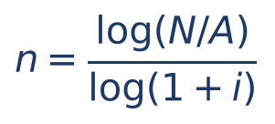

Em que log é o logaritmo decimal, N ÷ A é a razão entre o nominal e o atual e 1 + i é o fator de um período.
:::

### 05.7.5 Questões de prova

:::QUESTAO FGV 2026 — NAV Brasil — Contador (Q4222686)
Uma obrigação de 80.000 reais vence em 31/12/2026. Considerando taxa prefixada de 10% ao ano embutida no passivo, pede-se o valor presente em 31/12/2025. Gabarito oficial: B (72.727).
Resolução passo a passo:
- Prazo: 1 ano; taxa: 10% ao ano.
- A = 80.000 ÷ 1,10 = 800.000 ÷ 11 ≈ 72.727,27
Observação: com n = 1, desconto racional simples e composto dão o mesmo resultado (1 + i·1 = (1 + i)¹).
Por que as outras seduzem: 72.000 é 80.000 × 0,90, o desconto COMERCIAL (10% sobre o valor futuro); 88.889 é 80.000 ÷ 0,90, conta sem sentido econômico; 80.000 ignora o valor do dinheiro no tempo; 87.273 é 80.000 + 7.273, isto é, SOMAR o desconto em vez de subtraí-lo.
:::

:::QUESTAO FGV 2026 — TJ-SC — Analista Contábil-Econômico (Q4150851)
Projeto A: entrada única de 60.000 reais em 12 meses. Projeto B: entrada única de 30.000 reais em 6 meses. Valores presentes por desconto racional composto à mesma taxa i. Qual conclusão está correta? Gabarito oficial: B (o VP de A é maior que o de B se i for 4% ao mês).
Resolução passo a passo:
- VP_A = 60.000 ÷ (1 + i)¹² e VP_B = 30.000 ÷ (1 + i)⁶.
- VP_A > VP_B quando 60.000 ÷ (1 + i)¹² > 30.000 ÷ (1 + i)⁶.
- Multiplique os dois lados por (1 + i)¹² e divida por 30.000: 2 > (1 + i)⁶ (porque (1 + i)¹² ÷ (1 + i)⁶ = (1 + i)⁶).
- Logo, A vale mais hoje sempre que (1 + i)⁶ for menor que 2, isto é, para taxas abaixo de cerca de 12,2% ao mês.
- A 4% ao mês: 1,04⁶ ≈ 1,265, menor que 2. Então VP_A > VP_B. Alternativa B correta. (Valores: VP_A ≈ 37.475,82; VP_B ≈ 23.709,44.)
Por que as outras estão erradas: a 3% ao mês, 1,03⁶ ≈ 1,194 < 2, e A continua maior (logo a alternativa que dizia o contrário é falsa); a igualdade só ocorreria se (1 + i)⁶ = 2, e não por "proporcionalidade" entre valores e prazos; e as alternativas que afirmam que um projeto é SEMPRE maior ignoram que o resultado depende da taxa.
:::

:::NOTA No mesmo sentido
A questão FGV 2025 (Q3185952), resolvida no Cap. 4, pede o valor presente por desconto racional composto de um empréstimo sob duas taxas (nominal com capitalização semestral x efetiva anual); o ponto ali é a conversão de taxas, e o desconto é só "dividir pelo fator".
:::

### 05.7.6 Pratique

:::PRATIQUE exercícios elaborados para esta apostila (desconto racional composto)
1) Título de 8.820 reais, 2 meses antes do vencimento, racional composto a 5% ao mês. Calcule A e D.
2) Título de 26.620 reais, 3 meses antes do vencimento, racional composto a 10% ao mês. Calcule A.
3) Um título de 56.180 reais com vencimento em 2 meses foi descontado por 50.000 reais (racional composto). Qual a taxa mensal?
4) (Estilo FCC) No exercício 2, se o desconto fosse racional SIMPLES, qual seria a diferença entre os valores atuais? (A) 0; (B) 476,92; (C) 620,00; (D) 662,00; (E) 2.662,00.
Resoluções:
1) 1,05² = 1,1025. A = 8.820 ÷ 1,1025 = 8.000 (conferência: 8.000 × 1,1025 = 8.820). D = 820.
2) 1,1³ = 1,331. A = 26.620 ÷ 1,331 = 26.620.000 ÷ 1.331 = 20.000. D = 6.620.
3) (1 + i)² = 56.180 ÷ 50.000 = 1,1236. Como 1,06² = 1,1236, i = 6% ao mês.
4) Simples: i·n = 0,30; A = 26.620 ÷ 1,30 ≈ 20.476,92. Diferença: 20.476,92 − 20.000 = 476,92. Resposta (B). Com prazo maior que 1 período, o valor atual simples (racional) é maior que o composto.
:::

## 05.8 Desconto comercial composto (por fora)

### 05.8.1 A ideia e o exemplo à mão

No desconto comercial composto, a cada período a taxa é aplicada sobre o valor que restou do período anterior, como em descontos SUCESSIVOS de loja (ver Cap. 1, porcentagem). Ele é raro em prova, mas aparece em afirmações de V ou F e nos quadros comparativos.

Título de 10.000 reais, 2 meses antes do vencimento, desconto comercial composto de 10% ao mês:

- Primeiro mês: tira-se 10% de 10.000, restam 10.000 × 0,90 = 9.000
- Segundo mês: tira-se 10% de 9.000, restam 9.000 × 0,90 = 8.100

Valor atual: 8.100. Desconto: 1.900. (No comercial simples seriam 10.000 × (1 − 0,20) = 8.000; desconto de 2.000.)

### 05.8.2 As fórmulas

- A = N × (1 − d)ⁿ

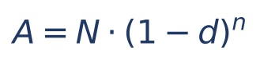

Em que A = valor atual; N = valor nominal; d = taxa de desconto comercial por período, em decimal; n = número de períodos; (1 − d) = fração que "sobra" a cada período.

O desconto é D = N − A = N × [1 − (1 − d)ⁿ].

A taxa efetiva (de juros compostos) por período é a taxa i que leva A de volta a N, um período de cada vez. Em um período: A = N × (1 − d) e N = A × (1 + i), logo (1 + i) × (1 − d) = 1, e:

- 1 + i = 1 ÷ (1 − d)
- i = 1 ÷ (1 − d) − 1 = d ÷ (1 − d)

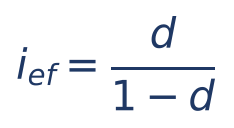

Em que i_ef = taxa efetiva de juros compostos por período e d = taxa de desconto comercial composto por período. Repare que ela NÃO depende de n (diferente do caso simples, em 5.4).

No exemplo: i_ef = 0,10 ÷ 0,90 ≈ 0,1111, isto é, 11,11% ao mês. Conferência: 8.100 × (1,1111)² ≈ 8.100 × 1,2346 ≈ 10.000.

:::EXEMPLO Com potência fornecida
Título de 50.000 reais, 3 meses antes do vencimento, desconto comercial composto a 4% ao mês. Considere 0,96³ = 0,884736.
- A = 50.000 × 0,884736 = 44.236,80
- D = 50.000 − 44.236,80 = 5.763,20
:::

:::PRATIQUE exercícios elaborados para esta apostila (desconto comercial composto)
1) Título de 20.000 reais, 2 meses antes do vencimento, comercial composto a 5% ao mês. Calcule A.
2) Qual a taxa efetiva mensal (juros compostos) de um desconto comercial composto de 20% ao mês?
3) Para N = 10.000, taxa de 10% por período e n = 2, calcule o valor atual nas quatro modalidades e ordene-os.
Resoluções:
1) 0,95² = 0,9025. A = 20.000 × 0,9025 = 18.050.
2) i = 0,20 ÷ 0,80 = 0,25 = 25% ao mês.
3) Comercial simples: 10.000 × 0,80 = 8.000. Comercial composto: 10.000 × 0,81 = 8.100. Racional composto: 10.000 ÷ 1,21 ≈ 8.264,46. Racional simples: 10.000 ÷ 1,20 ≈ 8.333,33. Ordem: comercial simples < comercial composto < racional composto < racional simples.
:::

## 05.9 Quadro comparativo das quatro modalidades e roteiro para identificar o que o enunciado pede

### 05.9.1 O quadro

| Modalidade | Taxa incide sobre | Valor atual | Desconto | Uso típico |
|---|---|---|---|---|
| Racional simples (por dentro) | A | A = N ÷ (1 + i·n) | D = A·i·n = N·i·n ÷ (1 + i·n) | questões de comparação; "taxa efetiva" |
| Comercial simples (por fora, bancário) | N | A = N × (1 − i·n) | D = N·i·n | desconto de duplicatas; a mais cobrada |
| Racional composto (por dentro) | A | A = N ÷ (1 + i)ⁿ | D = N × [1 − 1 ÷ (1 + i)ⁿ] | "valor presente"; prazos longos; Caps. 6 e 8 |
| Comercial composto (por fora) | N | A = N × (1 − i)ⁿ | D = N × [1 − (1 − i)ⁿ] | raro; afirmações teóricas |

### 05.9.2 Quem dá o maior valor atual?

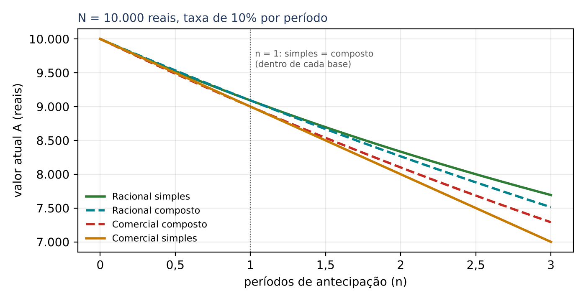

Para a MESMA taxa e o MESMO título (exemplo: N = 10.000 e 10% por período):

| Prazo | Comercial simples | Comercial composto | Racional composto | Racional simples |
|---|---|---|---|---|
| n = 0,5 | 9.500,00 | 9.486,83 | 9.534,63 | 9.523,81 |
| n = 1 | 9.000,00 | 9.000,00 | 9.090,91 | 9.090,91 |
| n = 2 | 8.000,00 | 8.100,00 | 8.264,46 | 8.333,33 |

Leia a tabela assim:
- Em QUALQUER prazo, o racional dá valor atual maior que o comercial do mesmo regime (desconto menor). É a regra que mais cai.
- Com n = 1, simples e composto coincidem dentro de cada base (racional com racional, comercial com comercial).
- Com n MAIOR que 1 (o caso comum): comercial simples < comercial composto < racional composto < racional simples.
- Com n MENOR que 1, a ordem entre simples e composto se inverte dentro de cada base (é o reflexo do que o Cap. 3, 03.4.2, mostrou para os juros). Por isso afirmações com "sempre" sobre simples x composto são falsas.

### 05.9.3 Roteiro: como identificar a modalidade

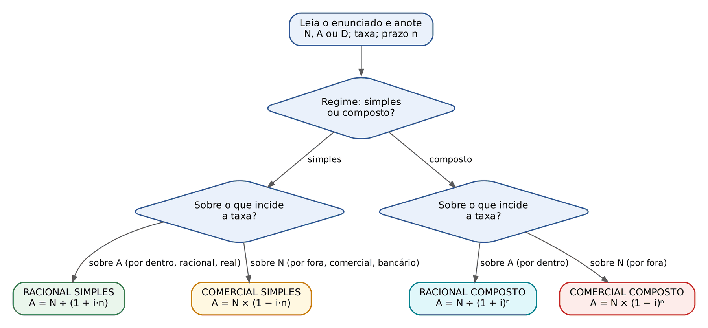

:::PASSO Como identificar o que o enunciado pede
- Etapa 1: procure as palavras-chave da BASE. "Racional", "por dentro", "real" → taxa sobre A. "Comercial", "por fora", "bancário" → taxa sobre N.
- Etapa 2: procure as palavras-chave do REGIME. "Simples", "juros simples", "linear" → simples. "Composto", "juros compostos", "valor presente" com taxa efetiva, "capitalização" → composto.
- Etapa 3: identifique o que é dado e o que é pedido (N, A, D, i, n). Lembre os sinônimos de 5.1.2: "valor de face" = N; "valor líquido", "valor liberado", "valor descontado" (no sentido de valor que sobra) = A.
- Etapa 4: ponha taxa e prazo na mesma unidade (ano comercial de 360 dias, salvo aviso).
- Etapa 5: aplique a fórmula do quadro. Se houver taxa administrativa ou IOF, subtraia-os do valor atual (5.6).
- Etapa 6: confira com o bom senso: A é menor que N; o desconto comercial é maior que o racional; nas alternativas, a armadilha costuma ser o resultado da OUTRA modalidade.
:::

:::DICA Quando o enunciado não diz a modalidade
Convenção prática difundida em materiais de preparação (inclusive no mapa de estudo do próprio leitor): "desconto simples" sem qualificativo → comercial simples; "desconto bancário" → comercial simples; "desconto composto" sem qualificativo → racional composto. Use-a como ponto de partida, mas NÃO como dogma: na Q3590980 (5.5.5), a FGV disse apenas "desconto simples" e o gabarito seguiu o racional. Antes de marcar, teste as duas modalidades e veja qual delas aparece nas alternativas; se as duas aparecerem, prefira a modalidade sugerida pela relação dada (relação entre desconto e valor ATUAL sugere racional; entre desconto e valor NOMINAL sugere comercial).
:::

:::PEGADINHA Os erros que a FCC transforma em alternativas
- Usar a modalidade errada (a alternativa vizinha é o outro desconto).
- Esquecer de converter a taxa anual em mensal, ou os dias em meses.
- Dar o desconto quando se pediu o valor atual, e vice-versa.
- Repetir a taxa de desconto quando se pediu a taxa EFETIVA.
- Multiplicar a taxa administrativa pelo prazo.
- Achar o valor nominal "subtraindo" a porcentagem do valor atual (em vez de dividir).
:::

## 05.10 Resumo para revisão pré-prova

### 05.10.1 Conceitos e armadilhas

| Conceito | Regra | Quando usar | Armadilha |
|---|---|---|---|
| Valor nominal (N) | valor de face, pago no vencimento | sempre dado ou pedido | sinônimos: valor de face, futuro, de resgate |
| Valor atual (A) | o que se recebe na antecipação | sempre | "valor descontado" pode significar A ou D: veja as alternativas |
| Desconto (D) | D = N − A | todas as modalidades | não confundir desconto com valor atual |
| Prazo (n) | tempo que FALTA até o vencimento | todas | não é o prazo total do título; converter dias (ano de 360) |
| Racional simples | taxa sobre A; A = N ÷ (1 + i·n) | "por dentro", "racional", "real" | calcular a taxa sobre N dá o comercial |
| Comercial simples | taxa sobre N; A = N × (1 − i·n) | "por fora", "comercial", "bancário" | só faz sentido se i·n < 1 |
| Relação entre os simples | Dc = Dr × (1 + i·n); Dc − Dr = Dr·i·n | comparação, mesma taxa e prazo | o comercial é SEMPRE o maior desconto (n > 0) |
| N pelos dois descontos | N = Dc·Dr ÷ (Dc − Dr) | dados Dc e Dr | "produto sobre a diferença" |
| Taxa efetiva do comercial simples | i_ef = d ÷ (1 − d·n); no período: d·n ÷ (1 − d·n) | "custo efetivo", "taxa de juros efetiva" | é MAIOR que d; cresce com o prazo |
| Taxa comercial equivalente a uma racional | d = i ÷ (1 + i·n) | "taxas equivalentes" | a racional equivalente é sempre a MAIOR |
| Desconto bancário | A_liq = N × [1 − (d·n + h)] − IOF − tarifas | taxa administrativa, IOF, TAC | h não se multiplica pelo prazo; use as alíquotas do enunciado |
| Racional composto | A = N ÷ (1 + i)ⁿ | "valor presente", "desconto composto" | ver se a tabela é de acumulação (>1) ou de valor atual (<1) |
| Comercial composto | A = N × (1 − d)ⁿ; i_ef = d ÷ (1 − d) | raro; descontos sucessivos | não confundir com 1 − d·n |
| Comparação das quatro | n > 1: com. simples < com. composto < rac. composto < rac. simples | afirmações V ou F | n = 1 iguala simples e composto; n < 1 inverte |

### 05.10.2 Formulário do capítulo

| Fórmula | O que significa cada símbolo | Quando usar |
|---|---|---|
| D = N − A | D: desconto; N: valor nominal; A: valor atual | sempre |
| A = N ÷ (1 + i·n) | i: taxa por período (decimal); n: prazo de antecipação | racional simples, de N para A |
| N = A × (1 + i·n) | idem | racional simples, de A para N |
| Dr = A·i·n = N·i·n ÷ (1 + i·n) | Dr: desconto racional simples | racional simples |
| Dc = N·i·n | Dc: desconto comercial simples | comercial simples |
| A = N × (1 − i·n) | 1 − i·n: fração recebida | comercial simples, de N para A |
| N = A ÷ (1 − i·n) | idem | comercial simples, de A para N |
| Dc = Dr × (1 + i·n) | mesma taxa, mesmo prazo | comparação |
| Dc − Dr = Dr·i·n | diferença = juros de Dr | comparação |
| N = Dc·Dr ÷ (Dc − Dr) | produto sobre a diferença | dados os dois descontos |
| i_ef = d ÷ (1 − d·n) | d: taxa comercial; i_ef: taxa efetiva mensal (juros simples) | taxa efetiva do comercial simples |
| i_total = d·n ÷ (1 − d·n) = Dc ÷ A | taxa efetiva do período inteiro | taxa efetiva no período |
| d = i ÷ (1 + i·n) | i: taxa racional | taxa comercial equivalente |
| A_liq = N × [1 − (d·n + h)] | h: taxa administrativa (uma vez) | desconto bancário |
| A = N ÷ (1 + i)ⁿ | (1 + i)ⁿ: fator de acumulação | racional composto |
| D = N × [1 − 1 ÷ (1 + i)ⁿ] | 1 ÷ (1 + i)ⁿ: fator de valor atual | racional composto |
| n = log(N ÷ A) ÷ log(1 + i) | log: logaritmo decimal | prazo no racional composto |
| A = N × (1 − d)ⁿ | d: taxa comercial composta | comercial composto |
| i_ef = d ÷ (1 − d) | taxa efetiva composta por período | comercial composto |

## 05.11 Questões do capítulo

FCC: Q3954817, Q3884302. FGV: Q4222686, Q4150854, Q4150851, Q3880596, Q3594936, Q3590980, Q3579927, Q3174685, Q3154007, Q3086001, Q2451625, Q2360318, Q2351958. Remissão: Q3185952 (comentada no Cap. 4).

:::NOTA Notas de verificação
- Contas: todas as contas dos exemplos, das questões resolvidas e dos exercícios PRATIQUE foram conferidas em Python (valores atuais, descontos, taxas efetivas, potências, logaritmos e a tabela comparativa das quatro modalidades).
- Fontes: banco local de questões (15 questões com ch = 5, mais busca por palavra-chave no banco inteiro, que só trouxe questões de valor presente já tratadas em outros capítulos); mapa "Descontos.pdf" do Google Drive do leitor (convenção sobre "desconto simples", "desconto composto" e "desconto bancário" sem qualificativo, apresentada em 5.9.3 como prática de preparação, e não como regra oficial da banca).
- Gabaritos reconferidos no QConcursos em 30/10/2026: Q2451625 (oficial B), Q2360318 (oficial E) e Q2351958 (oficial A); os três coincidem com as alternativas antes obtidas pela resolução própria, conferida em Python.
- Gabaritos discutíveis: Q3590980 (enunciado diz só "desconto simples"; o gabarito oficial, 75%, pressupõe desconto racional; pelo comercial, 60%, que também está nas alternativas); Q3594936 (a afirmação II chama de "taxa de juros simples" o que é a taxa de desconto comercial de 10% ao ano; a taxa efetiva é 12,5% ao ano; a alternativa B é a única compatível); Q3174685 (a afirmação 3 depende de ler "valor descontado" como valor do desconto).
- IOF (5.6.3): Constituição, art. 153, V, e Decreto 6.306, de 14/12/2007 (ementa: regulamenta o IOF), conferido em 30/10/2026 (Planalto, texto da CF e texto compilado do decreto, que confirma a combinação de alíquota diária com alíquota adicional nas operações de crédito, art. 7º, § 1º, e alterações em 2025, por exemplo pelo Decreto 12.499/2025). As alíquotas vigentes não foram transcritas, de propósito: o texto orienta a usar as alíquotas do enunciado.
- As alternativas citadas nos exercícios PRATIQUE "estilo FCC" são elaboradas para a apostila. Nas questões do banco, a explicação da origem das alternativas erradas só foi dada quando a conta correspondente foi reproduzida; nos demais casos, o texto diz apenas que correspondem a descontos maiores ou a erros de prazo.
:::
