# CAPÍTULO 06 — EQUIVALÊNCIA DE CAPITAIS, VALOR ATUAL E SÉRIES DE PAGAMENTOS (RENDAS)

:::INCIDENCIA
Edital SEFAZ/SC — Matemática Financeira, Estatística e Raciocínio Lógico: "capitais equivalentes", "valor atual" e "fluxo de caixa" no regime composto. Nível A+.
Lote do banco: 20 questões atribuídas ao capítulo (FCC 2, FGV 18), além de remissões a questões vizinhas dos Caps. 3, 4 e 7.
O que mais cai: trocar dívidas por um pagamento único ou por parcelas iguais; calcular a parcela de um financiamento; valor à vista de compra parcelada; séries com entrada (antecipadas) e com carência (diferidas).
:::

:::ESQUEMA O que você vai aprender e o que precisa saber antes
Pré-requisitos (revise se sentir dificuldade):
- Potências e como calcular 1,1², 1,05³ à mão; divisão por número decimal (Cap. 1).
- Soma dos termos de uma progressão geométrica, a "PG" (Cap. 1).
- Montante composto M = C × (1 + i)ⁿ (Cap. 3) e desconto racional composto, que é o mesmo cálculo feito "para trás" (Cap. 5).
- Taxas equivalentes, para quando a taxa vem ao ano e as parcelas são mensais (Cap. 4).

Roteiro do capítulo:
- 6.1 A ideia central: dinheiro tem data. Diagrama de fluxo de caixa. Levar para frente e trazer para trás.
- 6.2 Equivalência de capitais no regime composto: data focal, substituição e renegociação de dívidas.
- 6.3 Valor atual de um conjunto de pagamentos e taxa de juros embutida numa compra parcelada.
- 6.4 Séries uniformes postecipadas: o fator a(n;i), a parcela de um financiamento e o uso das tabelas.
- 6.5 Montante de uma série: o fator s(n;i) e os depósitos para formar um capital.
- 6.6 Séries antecipadas (com entrada).
- 6.7 Séries diferidas (com carência).
- 6.8 Perpetuidades.
- 6.9 Aplicações integradas: renegociação, atraso de parcelas e comparação entre à vista e a prazo.
:::

## 06.1 A ideia central: dinheiro tem data

### 06.1.1 Por que não se somam valores de datas diferentes

Imagine que alguém lhe deve 1.000 reais hoje e outros 1.000 reais daqui a um ano. Quanto ele lhe deve "no total"? A resposta ingênua é 2.000 reais. Mas pense: se ele lhe oferecesse pagar tudo agora, você aceitaria receber menos de 2.000 reais, porque os 1.000 reais que só viriam daqui a um ano, se recebidos hoje, poderiam ser aplicados e render juros.

Essa é a ideia mais importante de toda a matemática financeira: UM VALOR EM DINHEIRO SÓ TEM SENTIDO JUNTO COM A DATA EM QUE ESTÁ DISPONÍVEL. 1.000 reais hoje e 1.000 reais daqui a um ano são coisas diferentes, como 1.000 dólares e 1.000 reais são coisas diferentes. Assim como não se somam dólares com reais sem antes converter uma moeda na outra, não se somam valores de datas diferentes sem antes levá-los para a mesma data.

O mundo jurídico conhece bem essa ideia. Quando o juiz manda atualizar um débito judicial, ele está "transportando" o valor da data do vencimento para a data do pagamento, com juros e correção. Um precatório pago anos depois não vale o mesmo que o crédito na data da sentença. Na matemática financeira, o "conversor" entre datas é a taxa de juros.

:::DICA A taxa de juros é a "taxa de câmbio entre datas"
Para converter dólares em reais, você multiplica pela cotação. Para converter um valor de uma data para outra, você multiplica ou divide por (1 + i) uma vez para cada período de distância. É só isso. Todo o capítulo é a aplicação repetida dessa regra.
:::

### 06.1.2 O diagrama de fluxo de caixa

Antes de fazer qualquer conta, desenhe a situação. O diagrama de fluxo de caixa é uma linha horizontal que representa o tempo, dividida em períodos iguais (meses, anos, semestres). A data 0 é "hoje". Em cada data em que há movimento de dinheiro, desenha-se uma seta:

- seta para cima: dinheiro que ENTRA (para quem estamos olhando);
- seta para baixo: dinheiro que SAI.

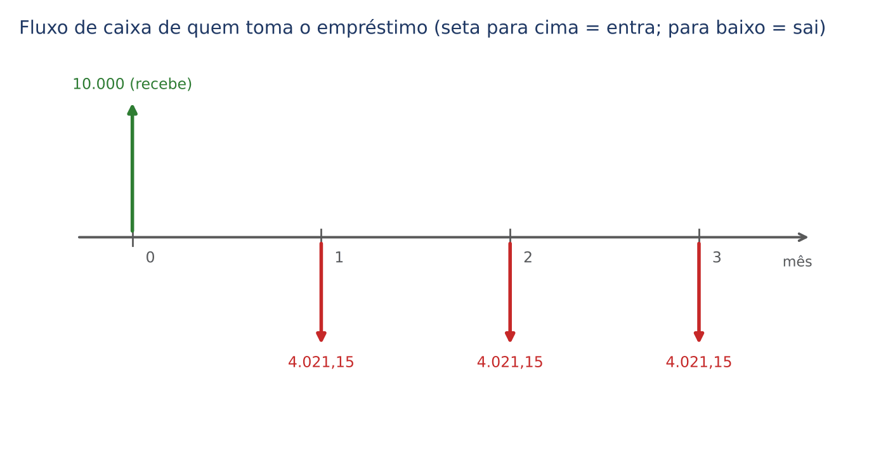

A figura mostra um empréstimo do ponto de vista de quem o toma: ele recebe 10.000 reais hoje (seta para cima na data 0) e paga três parcelas de 4.021,15 reais nos meses 1, 2 e 3 (setas para baixo). Para o banco, o desenho seria o mesmo com as setas invertidas. Mais adiante (6.4) você vai calcular essa parcela de 4.021,15 reais sozinho.

:::ATENCAO Os números embaixo da linha são DATAS, não meses de duração
"Data 3" quer dizer "final do terceiro mês", ou seja, "daqui a 3 meses". A distância entre a data 1 e a data 3 é de 2 períodos. Essa contagem de distâncias é o que define o expoente nas contas que vêm a seguir. A maioria dos erros de prova nasce de contar errado essa distância.
:::

### 06.1.3 Levar para frente e trazer para trás

No Cap. 3 você aprendeu que um capital C, aplicado a juros compostos à taxa i por n períodos, vira o montante M = C × (1 + i)ⁿ. No Cap. 5 você viu o caminho inverso (desconto racional composto): o valor atual de um título é o valor de face dividido por (1 + i)ⁿ. Aqui juntamos as duas coisas numa regra só, que vale para qualquer valor em qualquer data:

- Para LEVAR um valor para uma data FUTURA (para a direita no diagrama): MULTIPLIQUE por (1 + i)ⁿ.
- Para TRAZER um valor para uma data ANTERIOR (para a esquerda): DIVIDA por (1 + i)ⁿ.

Em ambos os casos, n é a distância, em períodos, entre a data de origem e a data de destino. E a taxa i precisa estar na mesma unidade de tempo dos períodos (taxa mensal com meses, anual com anos; se não estiver, converta com taxa equivalente, Cap. 4).

Exemplo à mão. Uma dívida de 10.000 reais vence daqui a 3 meses. A taxa é de 2% ao mês (na forma decimal, i = 0,02). Quanto vale essa dívida hoje? E quanto valerá no mês 5, se não for paga no vencimento e continuar rendendo à mesma taxa?

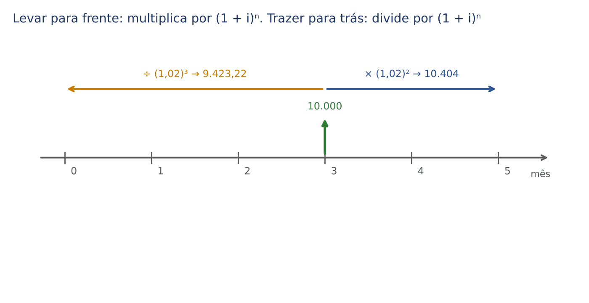

:::EXEMPLO Trazendo para hoje e levando para o mês 5
Primeiro, as potências de 1,02 (mostradas à mão, como você fará na prova):
- 1,02² = 1,02 × 1,02
- 1,02 × 1,02 = 1,02 + 0,0204 (porque 1,02 × 0,02 = 0,0204)
- 1,02² = 1,0404
- 1,02³ = 1,0404 × 1,02 = 1,0404 + 0,020808 = 1,061208

Valor hoje (data 0): a distância da data 3 até a data 0 é 3 meses, para trás; logo, dividimos por 1,02³.
- PV = 10.000 ÷ 1,061208
- PV ≈ 9.423,22

Valor no mês 5: a distância da data 3 até a data 5 é 2 meses, para frente; logo, multiplicamos por 1,02².
- F = 10.000 × 1,0404
- F = 10.404

Leitura: com a taxa de 2% ao mês, ter 9.423,22 reais hoje, 10.000 reais no mês 3 ou 10.404 reais no mês 5 é exatamente a mesma coisa. São três "fotografias" do mesmo valor em datas diferentes.
:::

A fórmula do valor presente, que você usará o tempo todo, é:

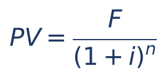

- PV = valor presente (ou valor atual), o valor na data 0; a sigla vem do inglês *present value*;
- F = valor futuro (ou valor nominal, valor de face), o valor na data n;
- i = taxa de juros por período, na forma decimal (2% = 0,02);
- n = número de períodos entre a data 0 e a data do valor F.

O número 1 ÷ (1 + i)ⁿ é chamado de fator de valor atual de um pagamento único (às vezes aparece com a sigla FVA, ou como "(1 + i) elevado a menos n", (1 + i)⁻ⁿ). Dividir por (1 + i)ⁿ é o mesmo que multiplicar por (1 + i)⁻ⁿ. Algumas provas dão o valor de (1 + i)⁻ⁿ diretamente: nesse caso, MULTIPLIQUE por ele, o que é mais fácil que dividir.

:::DICA Como dividir por 1,061208 sem calculadora
Na prova, a FCC costuma escolher números que "fecham". Antes de dividir, teste as alternativas: multiplique cada alternativa por 1,061208 e veja qual dá 10.000. Ou estime: dividir por 1,06 é tirar "cerca de 5,7%" (porque 1 ÷ 1,06 ≈ 0,943). 10.000 × 0,943 = 9.430, que aponta para a alternativa próxima de 9.423. O Cap. 1 traz as técnicas de divisão e de estimativa.
:::

:::PEGADINHA Multiplicar quando deveria dividir
O erro mais comum é "capitalizar" um valor que deveria ser "descapitalizado". Antes de fazer a conta, pergunte-se: estou indo para a direita (o valor cresce, multiplico) ou para a esquerda (o valor diminui, divido)? Um valor trazido para hoje SEMPRE fica menor; um valor levado para o futuro SEMPRE fica maior (com taxa positiva). Se o seu resultado contrariar isso, você inverteu a operação. A FCC coloca esse erro entre as alternativas.
:::

:::PRATIQUE exercícios elaborados para esta apostila
1. Quanto vale hoje uma dívida de 8.000 reais que vence daqui a 2 meses, à taxa de 10% ao mês?
2. Uma pessoa tem 3.000 reais hoje e aplica a 3% ao mês. Quanto terá daqui a 4 meses?
3. Uma dívida de 12.100 reais vence no mês 2. O devedor quer pagá-la no mês 1. Quanto deve pagar, à taxa de 10% ao mês?
4. (Estilo FCC) Um título de 21.632 reais vence daqui a 2 meses. Considerando a taxa de juros compostos de 4% ao mês, o valor que liquida o título hoje é: (A) 19.800 (B) 20.000 (C) 20.200 (D) 20.766,72 (E) 22.497,28.

Resoluções:

1. A dívida está na data 2 e queremos a data 0: dois meses para trás, então dividimos por 1,1².
- 1,1² = 1,21
- PV = 8.000 ÷ 1,21
- PV ≈ 6.611,57 reais

2. Do 0 para o 4: quatro meses para frente, multiplicamos por 1,03⁴.
- 1,03² = 1,0609
- 1,03⁴ = 1,0609 × 1,0609 = 1,12550881
- F = 3.000 × 1,12550881
- F ≈ 3.376,53 reais

3. Da data 2 para a data 1: um mês para trás, dividimos por 1,1.
- PV = 12.100 ÷ 1,1
- PV = 11.000 reais

4. Da data 2 para a data 0: dividimos por 1,04².
- 1,04² = 1,0816
- PV = 21.632 ÷ 1,0816
- Teste da alternativa B: 20.000 × 1,0816 = 21.632. Confere.
- Resposta: B. A alternativa D (20.766,72 = 21.632 × 0,96) nasce de "tirar 4% uma vez", e a E (22.497,28 = 21.632 × 1,04) de multiplicar em vez de dividir.
:::

## 06.2 Equivalência de capitais no regime composto

### 06.2.1 O que são capitais equivalentes

Dois ou mais valores, em datas diferentes, são EQUIVALENTES a uma certa taxa quando, levados para uma mesma data, resultam no mesmo valor. A data escolhida para a comparação chama-se DATA FOCAL (ou data de comparação, data de referência).

Exemplo à mão. A juros compostos de 10% ao mês, compare duas propostas de pagamento:
- Proposta A: 1.100 reais no mês 1 e 1.210 reais no mês 2.
- Proposta B: 2.000 reais hoje.

:::EXEMPLO As duas propostas, na data focal 0 e na data focal 2
Data focal 0 (trazendo tudo para hoje):
- 1.100 ÷ 1,1 = 1.000
- 1.210 ÷ 1,1² = 1.210 ÷ 1,21 = 1.000
- Proposta A na data 0: 1.000 + 1.000 = 2.000
- Proposta B na data 0: 2.000 (já está lá)
- As duas valem 2.000: são equivalentes.

Data focal 2 (levando tudo para o mês 2):
- Proposta A: 1.100 × 1,1 + 1.210 = 1.210 + 1.210 = 2.420
- Proposta B: 2.000 × 1,1² = 2.000 × 1,21 = 2.420
- De novo iguais: 2.420 = 2.420.
:::

Observe o fenômeno: as propostas foram iguais na data 0 E na data 2. Isso não é coincidência. No regime composto, SE DOIS CONJUNTOS DE VALORES SÃO EQUIVALENTES EM UMA DATA, SÃO EQUIVALENTES EM QUALQUER OUTRA. O motivo é simples: mudar a data focal é multiplicar os dois lados da igualdade pelo mesmo número (1 + i) elevado a alguma potência; e se dois números são iguais, multiplicá-los pelo mesmo número mantém a igualdade.

Consequência prática para a prova: no regime composto, VOCÊ ESCOLHE A DATA FOCAL QUE DEIXAR AS CONTAS MAIS FÁCEIS. O resultado será o mesmo.

### 06.2.2 Contraste com os juros simples

No regime simples (Cap. 2), essa propriedade NÃO vale. Veja: a juros simples de 10% ao mês, 1.000 reais hoje equivalem a 1.100 reais no mês 1 (porque 1.000 × (1 + 0,10 × 1) = 1.100). Mas leve os dois para o mês 2, também a juros simples:

- 1.000 hoje, levado ao mês 2: 1.000 × (1 + 0,10 × 2) = 1.000 × 1,2 = 1.200
- 1.100 no mês 1, levado ao mês 2: 1.100 × (1 + 0,10 × 1) = 1.100 × 1,1 = 1.210

Eram equivalentes na data 0 e deixaram de ser na data 2 (1.200 ≠ 1.210). É por isso que, nos juros simples, a questão sempre diz qual é a data focal, e o resultado depende dela (Cap. 2). Nos juros compostos, a data focal é livre.

A doutrina de matemática financeira expressa isso dizendo que, nos juros compostos, o prazo é "cindível" (pode ser fracionado: aplicar 2 meses de uma vez dá o mesmo que aplicar 1 mês, resgatar e reaplicar por mais 1 mês), enquanto, nos juros simples, o prazo é "incindível" (fracionar muda o resultado). Esse vocabulário caiu em prova:

A questão Q2847351 (FGV 2024, EPE), que pede para julgar afirmativas sobre equivalência de capitais nos juros simples e nos compostos, está comentada por inteiro no Cap. 2 (v. Cap. 2). Para este capítulo, guarde a lição central: nos juros compostos, fracionar o prazo não altera o resultado; nos simples, altera.

### 06.2.3 Roteiro para qualquer questão de equivalência

:::PASSO Como resolver qualquer questão de equivalência de capitais (regime composto)
1. Desenhe o diagrama. De um lado (por exemplo, acima da linha), as obrigações ORIGINAIS; do outro (abaixo), a PROPOSTA nova. Marque as datas.
2. Confira a unidade: taxa e períodos na mesma unidade (mês com mês, semestre com semestre). Se não, converta (Cap. 4).
3. Escolha a data focal. Boa escolha: a data do valor desconhecido (assim ele não precisa ser transportado) ou a data mais distante (assim você só multiplica, que é mais fácil que dividir).
4. Leve cada valor para a data focal: multiplique por (1 + i)ⁿ se ele estiver à esquerda da data focal; divida se estiver à direita. n é a distância até a data focal.
5. Monte a equação: soma das obrigações originais na data focal = soma da proposta na data focal.
6. Resolva e confira pelo bom senso (o pagamento único no futuro deve ser maior que a soma nominal das dívidas anteriores; um pagamento hoje deve ser menor).
:::

### 06.2.4 Substituição de várias dívidas por um pagamento único

Exemplo à mão. Uma pessoa deve 2.200 reais no mês 1 e 2.420 reais no mês 2. Propõe pagar tudo de uma vez no mês 3. Taxa: 10% ao mês. Quanto deve pagar?

:::EXEMPLO Pagamento único no mês 3 (data focal 3)
Etapa 4 do roteiro: levar as duas dívidas para o mês 3.
- 2.200 está no mês 1; distância até o mês 3: 2 meses. 2.200 × 1,1² = 2.200 × 1,21 = 2.662
- 2.420 está no mês 2; distância: 1 mês. 2.420 × 1,1 = 2.662
- Soma na data 3: 2.662 + 2.662 = 5.324

O pagamento único é 5.324 reais.

Conferência com outra data focal (data 0), para você ver que dá o mesmo:
- 2.200 ÷ 1,1 = 2.000
- 2.420 ÷ 1,21 = 2.000
- Total hoje: 4.000
- Levando 4.000 ao mês 3: 4.000 × 1,1³ = 4.000 × 1,331 = 5.324. Confere.
:::

Agora a questão FCC do lote, praticamente igual a esse exemplo:

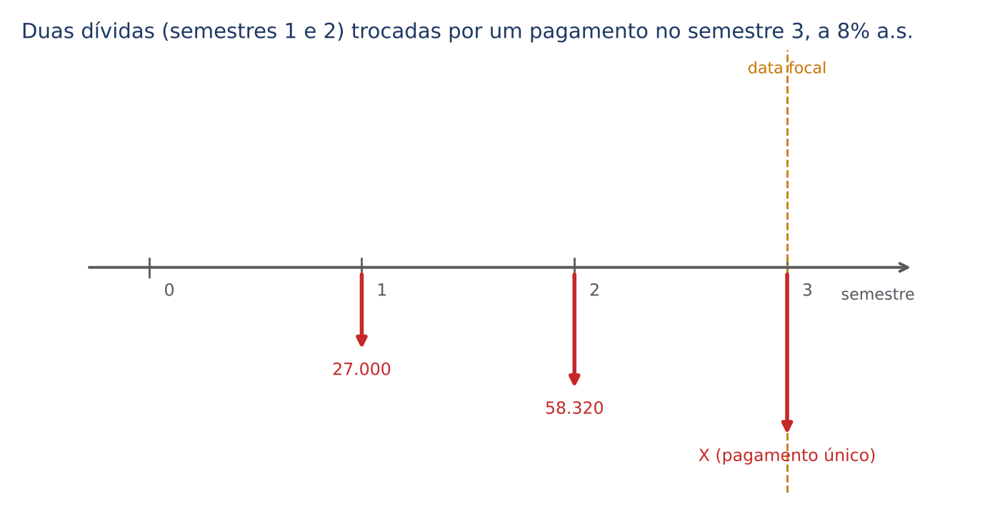

:::QUESTAO FCC 2026 — SEFAZ-SP — Auditor Fiscal da Receita Estadual (Q3954816)
Uma pessoa tem duas dívidas: 27.000 reais daqui a um semestre e 58.320 reais daqui a um ano. Propõe quitar as duas com um pagamento único daqui a um ano e meio, a juros compostos de 8% ao semestre. Pede-se o valor do pagamento único. Gabarito oficial: A (94.478,40).

Resolução:
- Unidade: a taxa é semestral, então conte em semestres. Um semestre = data 1; um ano = data 2; um ano e meio = data 3.
- Data focal: a data 3, onde está o valor procurado (X).
- 27.000 está na data 1, a 2 semestres da data 3: 27.000 × 1,08².
- 1,08² = 1,08 × 1,08 = 1,1664
- 27.000 × 1,1664 = 31.492,80
- 58.320 está na data 2, a 1 semestre da data 3: 58.320 × 1,08 = 62.985,60
- X = 31.492,80 + 62.985,60 = 94.478,40

Conta à mão de 27.000 × 1,1664: 27.000 × 1 = 27.000; 27.000 × 0,1664 = 4.492,80; soma 31.492,80. E 58.320 × 1,08 = 58.320 + 4.665,60 = 62.985,60.

Alternativas sedutoras: C (92.145,60) é o resultado de somar as duas dívidas (85.320) e capitalizar a soma por um único semestre, como se ambas estivessem na mesma data. Se você tivesse contado "um ano" como data 1 (esquecendo que a taxa é semestral), também erraria. Desenhar o diagrama evita os dois erros.
:::

### 06.2.5 A data do valor não é a da questão: cuidado com a contagem do prazo

:::QUESTAO FGV 2026 — DATAPREV — Analista (Contabilidade) (Q4389222)
Em 31/3/2026, uma entidade tinha no balanço uma obrigação de 25.000 reais com vencimento em 30/4/2026, sujeita a juros compostos de 5% ao mês. Pedia-se o valor equivalente da obrigação "em 31/12/2025". Gabarito oficial: C (23.809,52).

Resolução pelo gabarito: 23.809,52 é exatamente 25.000 ÷ 1,05, ou seja, o valor trazido UM mês para trás (de 30/4/2026 para 31/3/2026, a data do balanço).
- 25.000 ÷ 1,05 = 23.809,52

Problema: entre 31/12/2025 e 30/4/2026 há QUATRO meses, e o valor equivalente nessa data seria 25.000 ÷ 1,05⁴ ≈ 20.567,56, que não está entre as alternativas. Todas as alternativas foram montadas sobre UM mês de distância: 22.727,27 = 25.000 ÷ 1,10 (juro de dois meses no regime simples, por engano); 23.750 = 25.000 × 0,95 (desconto "por fora", Cap. 5); 26.250 = 25.000 × 1,05 (multiplicou em vez de dividir); 26.315,79 = 25.000 ÷ 0,95. Ou seja, a data "31/12/2025" do enunciado, tal como consta no banco, parece um erro de digitação da data do balanço (31/3/2026). Gabarito oficial discutível quanto à data, mas a lógica da questão é clara: trazer o valor UM período para trás, dividindo por 1,05.

Lição: confira sempre a distância entre as datas; e, se nenhuma alternativa bater, veja qual distância as alternativas "pressupõem".
:::

### 06.2.6 Renegociação: trocar dívidas por parcelas iguais

Agora o valor desconhecido aparece mais de uma vez. Exemplo à mão: uma pessoa deve 4.000 reais no mês 2 e 8.046,50 reais no mês 5. Quer trocar por dois pagamentos IGUAIS, de valor P, nos meses 1 e 3. Taxa: 10% ao mês.

:::EXEMPLO Duas dívidas trocadas por dois pagamentos iguais
Data focal: escolha o mês 3 (é a data de um dos pagamentos novos e fica "no meio" das dívidas, o que deixa as potências pequenas).

Obrigações originais no mês 3:
- 4.000 (mês 2) → um mês para frente: 4.000 × 1,1 = 4.400
- 8.046,50 (mês 5) → dois meses para trás: 8.046,50 ÷ 1,21 = 6.650
- Total: 4.400 + 6.650 = 11.050

Proposta no mês 3:
- P (mês 1) → dois meses para frente: P × 1,21
- P (mês 3) → já está na data focal: P
- Total: 1,21P + P = 2,21P

Equação (originais = proposta):
- 2,21P = 11.050
- P = 11.050 ÷ 2,21 (dividimos os dois lados por 2,21 para isolar P)
- P = 5.000

Cada pagamento será de 5.000 reais. Repare que "1,21P + P = 2,21P" é como somar 1,21 maçã com 1 maçã: dá 2,21 maçãs.
:::

:::DICA Ponha a data focal no último pagamento desconhecido
Quando a incógnita aparece em várias datas, coloque a data focal na data da ÚLTIMA parcela nova: assim, todas as parcelas novas são levadas para frente (multiplicações), e a equação fica do tipo "P × (soma de potências) = número". Multiplicar é mais seguro que dividir sem calculadora.
:::

:::PRATIQUE exercícios elaborados para esta apostila
1. Uma pessoa deve 5.000 reais no mês 1 e 5.000 reais no mês 3. Quer pagar tudo no mês 2. Taxa: 2% ao mês. Quanto paga?
2. Uma dívida de 10.000 reais, vencendo hoje, será substituída por dois pagamentos iguais nos meses 1 e 2, a 10% ao mês. Qual o valor de cada pagamento?
3. (Estilo FCC) Uma dívida de 33.275 reais vence daqui a 3 meses. O devedor propõe pagar 10.000 reais hoje e o restante daqui a 2 meses, a juros compostos de 10% ao mês. O valor a pagar daqui a 2 meses é: (A) 15.000 (B) 16.500 (C) 18.150 (D) 20.250 (E) 23.275.
4. Refaça o exercício 3 com a data focal no mês 2 e confirme que o resultado é o mesmo.

Resoluções:

1. Data focal 2.
- 5.000 (mês 1) → um mês para frente: 5.000 × 1,02 = 5.100
- 5.000 (mês 3) → um mês para trás: 5.000 ÷ 1,02 ≈ 4.901,96
- Total: 5.100 + 4.901,96 = 10.001,96 reais
- Bom senso: quase 10.000, porque o "ganho" de uma dívida compensa quase exatamente o "desconto" da outra.

2. Data focal 0.
- Original: 10.000
- Proposta: P ÷ 1,1 + P ÷ 1,21
- 1 ÷ 1,1 ≈ 0,909091 e 1 ÷ 1,21 ≈ 0,826446
- P × (0,909091 + 0,826446) = 10.000
- P × 1,735537 = 10.000
- P = 10.000 ÷ 1,735537 ≈ 5.761,90 reais
- Alternativa sem divisões difíceis: data focal 2. Original: 10.000 × 1,21 = 12.100. Proposta: 1,1P + P = 2,1P. Logo P = 12.100 ÷ 2,1 ≈ 5.761,90. Mesmo resultado, conta mais simples.

3. Data focal 0.
- Dívida original hoje: 33.275 ÷ 1,1³ = 33.275 ÷ 1,331 = 25.000
- Proposta: 10.000 hoje + X no mês 2. Em valor de hoje: 10.000 + X ÷ 1,21
- 10.000 + X ÷ 1,21 = 25.000
- X ÷ 1,21 = 15.000 (subtraímos 10.000 dos dois lados)
- X = 15.000 × 1,21 = 18.150 (multiplicamos os dois lados por 1,21)
- Resposta: C. A alternativa A (15.000) esquece de levar o saldo ao mês 2; a E (23.275) subtrai os 10.000 diretamente do valor do mês 3, misturando datas.

4. Data focal 2.
- Dívida original: 33.275 está no mês 3 → um mês para trás: 33.275 ÷ 1,1 = 30.250
- Proposta: 10.000 hoje → dois meses para frente: 10.000 × 1,21 = 12.100; mais X (já no mês 2)
- 12.100 + X = 30.250
- X = 30.250 − 12.100 = 18.150. Mesmo resultado, como garante a propriedade do regime composto.
:::

## 06.3 Valor atual de um conjunto de pagamentos

### 06.3.1 A ideia: o preço à vista é a soma dos valores atuais

Quando uma loja vende "à vista ou a prazo", o raciocínio financeiro por trás é este: o preço à vista deve ser equivalente, na data da compra, a todos os pagamentos a prazo. Em linguagem de prova: O VALOR À VISTA É A SOMA DOS VALORES ATUAIS DAS PARCELAS. É a equivalência de capitais (06.2) com a data focal fixada em 0.

Exemplo à mão. Uma compra é paga com 1.000 reais de entrada, 1.100 reais em 1 mês e 1.210 reais em 2 meses. Taxa: 10% ao mês. Qual o preço à vista equivalente?

:::EXEMPLO Preço à vista de um plano com entrada e duas parcelas
- Entrada: está na data 0, não se mexe: 1.000
- 1.100 no mês 1: 1.100 ÷ 1,1 = 1.000
- 1.210 no mês 2: 1.210 ÷ 1,21 = 1.000
- Preço à vista: 1.000 + 1.000 + 1.000 = 3.000 reais

Repare: o comprador desembolsa, no total, 3.310 reais (1.000 + 1.100 + 1.210). A diferença de 310 reais são os juros embutidos no parcelamento.
:::

A fórmula geral, para pagamentos P₁, P₂, ..., Pₙ nas datas 1, 2, ..., n, mais uma eventual entrada E na data 0, é simplesmente a soma:

- PV = E + P₁ ÷ (1 + i) + P₂ ÷ (1 + i)² + ... + Pₙ ÷ (1 + i)ⁿ

Cada parcela é dividida por (1 + i) elevado à SUA data. Não há fórmula especial quando as parcelas são diferentes: é somar, uma a uma. Quando as parcelas são IGUAIS, a soma tem um atalho, que é o fator de série (06.4).

### 06.3.2 Questões de prova

:::QUESTAO FGV 2026 — AL-RO — Analista Legislativo (Matemática) (Q3884907)
Um produto foi pago em dois pagamentos iguais de 530 reais: o primeiro no ato da compra e o segundo um mês depois. Taxa de 6% ao mês. Pede-se o valor à vista P. Gabarito oficial: D (1.030).

Resolução:
- Primeiro pagamento: data 0, vale 530
- Segundo: 530 ÷ 1,06 = 500 (confira: 500 × 1,06 = 530)
- P = 530 + 500 = 1.030

Alternativa sedutora: 1.060 (não está entre as opções) seria somar sem descontar; 1.000 (B) seria descontar as duas parcelas, esquecendo que a primeira é paga no ato.
:::

:::QUESTAO FGV 2025 — Prefeitura de Cuiabá — Auditor Público Interno (Q3152830)
Hilton pagou um artigo em 3 vezes: 120 reais no ato, 62 reais em 1 mês e 260 reais em 2 meses, a juros compostos de 4% ao mês. Pede-se a faixa em que está o valor à vista. Gabarito oficial: B (maior que 400 e menor que 440).

Resolução:
- 120 (no ato): 120
- 62 ÷ 1,04 ≈ 59,62
- 1,04² = 1,0816; 260 ÷ 1,0816 ≈ 240,38
- Soma: 120 + 59,62 + 240,38 = 420,00

Atalho de prova (a questão pede uma faixa, não o valor exato): 62 ÷ 1,04 é "um pouco menos de 62", digamos 60; 260 ÷ 1,08 é "um pouco menos de 260", digamos 240. Total ≈ 120 + 60 + 240 = 420, entre 400 e 440. Quando a pergunta é por faixa, a FCC e a FGV estão dizendo: "estime".
:::

:::QUESTAO FGV 2024 — AL-PR — Analista Legislativo (Economista) (Q2451627)
Um celular pode ser pago à vista ou com entrada de 500 reais mais duas parcelas mensais de 1.764 reais, a primeira um mês após a compra. Juros compostos de 5% ao mês. Pede-se o valor à vista. Gabarito oficial: B (3.780), conferido no QConcursos em 30/10/2026; coincide com a resolução.

Resolução:
- Entrada: 500
- 1.764 ÷ 1,05 = 1.680 (confira: 1.680 × 1,05 = 1.764)
- 1,05² = 1,1025; 1.764 ÷ 1,1025 = 1.600 (confira: 1.600 × 1,1025 = 1.764)
- Valor à vista: 500 + 1.680 + 1.600 = 3.780

Alternativas sedutoras: 3.700 e 3.280 resultam de descontos errados (por exemplo, tirar 5% e 10% "por fora": 1.764 × 0,95 + 1.764 × 0,90 = 3.263,40, que não fecha com nenhuma, mas mostra que o caminho certo é DIVIDIR). 4.028 (soma nominal) não está nas opções.
:::

### 06.3.3 A taxa embutida numa compra parcelada (remissão)

O caminho inverso, descobrir a taxa de juros de um parcelamento quando se conhecem o preço à vista e as parcelas, é tratado no Cap. 4 (04.5.3), com as questões FCC Q4066797 (celular com 5% de desconto à vista ou duas parcelas, taxa ≈ 11%) e FGV Q3029079. Aqui basta registrar o raciocínio-padrão, que é o mesmo do 06.3.1:

- Com ENTRADA + UMA parcela: tire a entrada do preço à vista; o que sobra é o valor financiado. A taxa é (parcela ÷ valor financiado) − 1. Exemplo: à vista 1.800 reais, ou 1.000 de entrada mais 1.000 em 30 dias. Financiado: 1.800 − 1.000 = 800. Taxa: 1.000 ÷ 800 − 1 = 1,25 − 1 = 0,25 = 25% ao mês.
- Com DUAS ou mais parcelas depois da compra, a equação é de 2º grau ou maior: na prova, TESTE AS ALTERNATIVAS. Exemplo: à vista 1.735,54 reais ou duas parcelas de 1.000 reais (meses 1 e 2). Testando 8%: 1.000 ÷ 1,08 + 1.000 ÷ 1,1664 ≈ 1.783,26 (alto demais). Testando 10%: 909,09 + 826,45 = 1.735,54 (confere). Taxa: 10% ao mês. Quanto MAIOR a taxa testada, MENOR o valor atual: isso diz em que direção continuar testando.

No mesmo sentido (taxa de compra com entrada e uma parcela, sem dificuldade adicional): FGV Q3998759 (à vista 360, duas de 216 → 360 − 216 = 144 financiados; 216 ÷ 144 = 1,5, taxa 50%) e FGV Q3879466 (à vista 4.000, entrada 800 e 3.584 em um mês → 3.584 ÷ 3.200 = 1,12, taxa 12%).

:::PRATIQUE exercícios elaborados para esta apostila
1. Uma compra é paga com 500 reais de entrada, 1.040 reais em 1 mês e 1.081,60 reais em 2 meses. Taxa de 4% ao mês. Qual o preço à vista?
2. Um bem custa 950 reais à vista, ou 500 reais de entrada mais 500 reais em 30 dias. Qual a taxa mensal cobrada?
3. Um bem custa 4.000 reais à vista, ou 1.000 reais de entrada mais 3.360 reais daqui a 2 meses. Qual a taxa mensal de juros compostos? (Use √1,12 ≈ 1,0583.)

Resoluções:

1. Some os valores atuais.
- Entrada: 500
- 1.040 ÷ 1,04 = 1.000
- 1.081,60 ÷ 1,0816 = 1.000
- Preço à vista: 500 + 1.000 + 1.000 = 2.500 reais

2. Entrada + uma parcela.
- Valor financiado: 950 − 500 = 450
- 450 × (1 + i) = 500
- 1 + i = 500 ÷ 450 ≈ 1,1111
- i ≈ 0,1111 ≈ 11,1% ao mês. (Esse é o "mesmo esqueleto" da FCC Q4066797, comentada no Cap. 4.)

3. Entrada + uma parcela, mas a 2 meses.
- Valor financiado: 4.000 − 1.000 = 3.000
- 3.000 × (1 + i)² = 3.360
- (1 + i)² = 3.360 ÷ 3.000 = 1,12
- 1 + i = √1,12 ≈ 1,0583
- i ≈ 5,83% ao mês. Pegadinha: dividir 12% por 2 (6%) é usar raciocínio de juros simples; no composto, a taxa mensal é um pouco menor que a metade.
:::

## 06.4 Séries uniformes postecipadas: valor atual e parcela

### 06.4.1 Vocabulário

Uma SÉRIE DE PAGAMENTOS (também chamada RENDA, RENDA CERTA ou ANUIDADE) é uma sucessão de pagamentos feitos em datas igualmente espaçadas. Cada pagamento chama-se TERMO, PARCELA ou PRESTAÇÃO, e é representado por P (ou PMT, do inglês *payment*, nome da tecla das calculadoras financeiras). Neste capítulo, nos concentramos nas séries UNIFORMES: todos os termos iguais e taxa constante.

As séries são classificadas segundo alguns critérios. Decore a tabela, porque a prova usa esses nomes sem explicá-los:

| Critério | Classificação | Significado |
|---|---|---|
| Quando cai o 1º termo | Postecipada (ou "termos vencidos") | 1º pagamento UM período após a data 0; sem entrada |
| Quando cai o 1º termo | Antecipada (ou "termos antecipados") | 1º pagamento NA data 0; "com entrada" ou "1 + n" |
| Quando cai o 1º termo | Diferida (com carência) | 1º pagamento depois de um prazo maior que um período |
| Número de termos | Temporária | Número finito de termos |
| Número de termos | Perpétua (perpetuidade) | Infinitos termos |
| Valor dos termos | Uniforme (constante) | Todos iguais |
| Valor dos termos | Variável | Termos diferentes (por exemplo, crescentes) |
| Intervalo | Periódica | Intervalos iguais entre os termos |

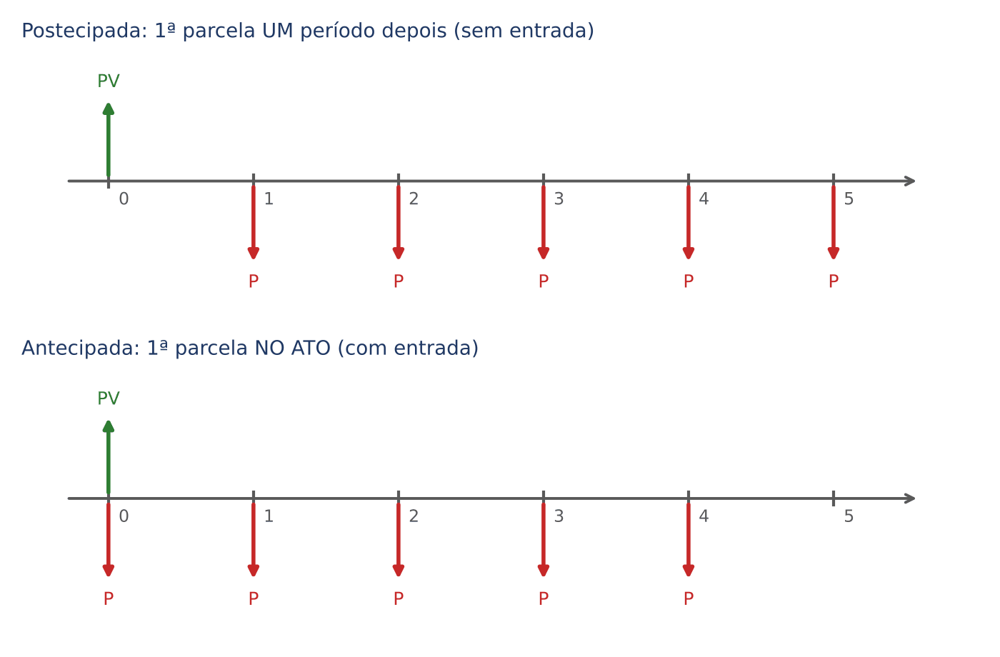

A série postecipada é o "modelo padrão": é a série dos financiamentos "em n vezes sem entrada" e dos empréstimos bancários comuns. Todas as outras são variações dela.

### 06.4.2 Exemplo à mão: o valor atual de 3 parcelas

Um bem é vendido em 3 parcelas mensais de 1.000 reais, sem entrada (a primeira em 1 mês). Taxa: 10% ao mês. Qual o valor à vista?

:::EXEMPLO Somando parcela por parcela
- 1ª parcela (mês 1): 1.000 ÷ 1,1 ≈ 909,09
- 2ª parcela (mês 2): 1.000 ÷ 1,21 ≈ 826,45
- 3ª parcela (mês 3): 1.000 ÷ 1,331 ≈ 751,31
- Soma: 909,09 + 826,45 + 751,31 = 2.486,85

O valor à vista é cerca de 2.486,85 reais. Repare que cada parcela "vale menos" que a anterior: cada uma é a anterior dividida por 1,1.
:::

Com 3 parcelas, somar uma a uma é tranquilo. Com 12, 24 ou 120 parcelas, não. O gráfico mostra o que acontece com 12 parcelas de 1.000 reais a 5% ao mês: cada barra escura é o valor atual de uma parcela; elas vão diminuindo sempre na mesma proporção (cada uma é a anterior dividida por 1,05). Somadas, dão cerca de 8.863 reais.

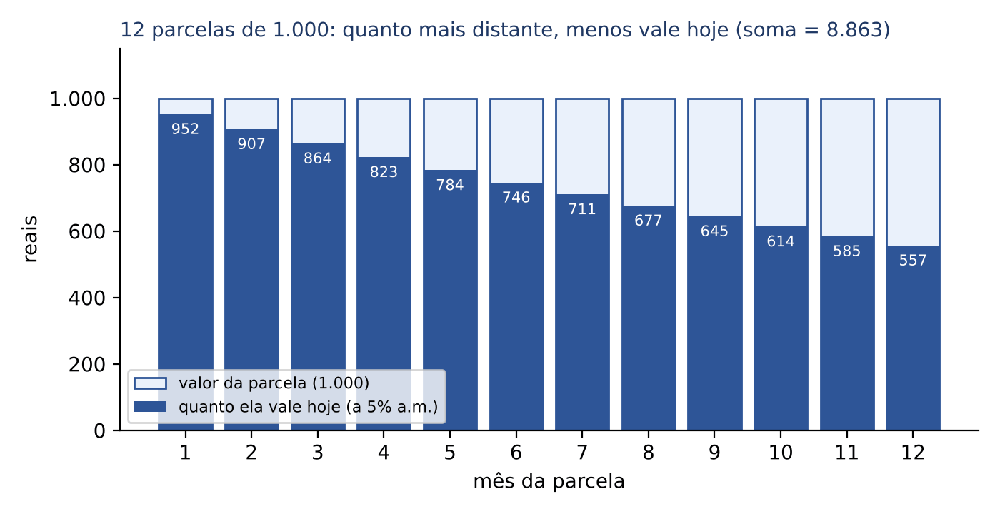

### 06.4.3 De onde vem a fórmula (a soma de uma PG)

Os valores atuais das parcelas formam uma PROGRESSÃO GEOMÉTRICA (PG): uma sequência em que cada termo é o anterior multiplicado sempre pelo mesmo número, a RAZÃO q (Cap. 1). Aqui:

- 1º termo: a₁ = P ÷ (1 + i)
- razão: q = 1 ÷ (1 + i) (cada termo é o anterior dividido por 1 + i)
- número de termos: n

A soma dos n termos de uma PG é (Cap. 1):

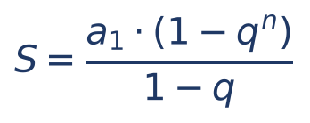

- S = soma dos termos;
- a₁ = primeiro termo;
- q = razão;
- n = número de termos.

Vamos substituir, passo a passo (esta é a única dedução do capítulo; se preferir, pule para a fórmula pronta no 06.4.4, mas vale a pena ver de onde ela vem uma vez):

- S = [P ÷ (1 + i)] × [1 − (1 + i)⁻ⁿ] ÷ [1 − 1 ÷ (1 + i)]
- O denominador: 1 − 1 ÷ (1 + i) = [(1 + i) − 1] ÷ (1 + i) = i ÷ (1 + i) (reduzimos ao mesmo denominador, como em 1 − 1/3 = 2/3)
- Então: S = [P ÷ (1 + i)] × [1 − (1 + i)⁻ⁿ] × [(1 + i) ÷ i] (dividir por uma fração é multiplicar pela fração invertida)
- O (1 + i) do começo cancela com o (1 + i) do fim: S = P × [1 − (1 + i)⁻ⁿ] ÷ i

Pronto: o valor atual de n parcelas iguais a P é P multiplicado por um número que depende só de n e de i.

### 06.4.4 A fórmula do fator de valor atual de série

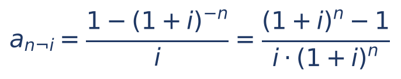

- a(n;i) (lê-se "a, n cantoneira i"; nos livros, escrito com o n e o i separados por um sinal em forma de cantoneira, a n¬i) = FATOR DE VALOR ATUAL DE UMA SÉRIE UNIFORME POSTECIPADA (também chamado fator de valor presente, FVP, ou FPV);
- n = número de parcelas;
- i = taxa por período, na forma decimal;
- (1 + i)⁻ⁿ = 1 ÷ (1 + i)ⁿ.

As duas formas da figura são a mesma coisa: a segunda se obtém multiplicando em cima e embaixo da primeira por (1 + i)ⁿ. A SEGUNDA forma é a mais útil na prova, quando a FCC fornece (1 + i)ⁿ ("considere 1,05¹² = 1,7959").

Com o fator, as duas contas mais importantes do capítulo ficam assim:

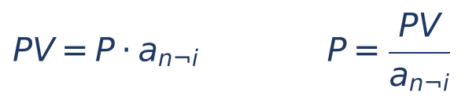

- PV = valor atual (preço à vista, valor financiado, valor do empréstimo);
- P = valor de cada parcela.

O inverso do fator, 1 ÷ a(n;i), é chamado FATOR DE RECUPERAÇÃO DE CAPITAL (FRC): ele "recupera" o capital emprestado em n parcelas. Multiplicar PV pelo FRC é o mesmo que dividir PV por a(n;i). O nome FRC aparece no Cap. 7 (Sistema Francês), que usa este mesmo cálculo para a prestação da Tabela Price.

:::EXEMPLO Conferindo o exemplo do 06.4.2 pela fórmula
n = 3; i = 0,10; (1 + i)ⁿ = 1,1³ = 1,331.
- a(3; 10%) = (1,331 − 1) ÷ (0,10 × 1,331)
- a(3; 10%) = 0,331 ÷ 0,1331
- a(3; 10%) ≈ 2,4869
- PV = 1.000 × 2,4869 ≈ 2.486,85 reais

Mesmo resultado da soma parcela a parcela.

Agora o caminho inverso, que é o que mais cai: um empréstimo de 10.000 reais, em 3 parcelas mensais iguais, a 10% ao mês. Qual a parcela?
- P = 10.000 ÷ 2,486852
- P ≈ 4.021,15 reais

É a parcela que apareceu no diagrama do 06.1.2. Total pago: 3 × 4.021,15 = 12.063,45; juros: 2.063,45.
:::

### 06.4.5 Como usar a tabela do fator (e o que fazer sem ela)

A FCC costuma fornecer o fator pronto, de um destes três jeitos:
- uma tabela com os valores de a(n;i) para alguns n e i (como a abaixo);
- o valor de (1 + i)ⁿ ou de (1 + i)⁻ⁿ, para você montar o fator;
- o próprio número do fator no enunciado ("considere que o fator de valor atual para 10 períodos a 2% é 8,98").

Tabela do fator a(n;i), com 4 casas decimais (valores calculados para esta apostila):

| n | 1% | 2% | 3% | 4% | 5% | 6% | 8% | 10% |
|---|---|---|---|---|---|---|---|---|
| 1 | 0,9901 | 0,9804 | 0,9709 | 0,9615 | 0,9524 | 0,9434 | 0,9259 | 0,9091 |
| 2 | 1,9704 | 1,9416 | 1,9135 | 1,8861 | 1,8594 | 1,8334 | 1,7833 | 1,7355 |
| 3 | 2,9410 | 2,8839 | 2,8286 | 2,7751 | 2,7232 | 2,6730 | 2,5771 | 2,4869 |
| 4 | 3,9020 | 3,8077 | 3,7171 | 3,6299 | 3,5460 | 3,4651 | 3,3121 | 3,1699 |
| 5 | 4,8534 | 4,7135 | 4,5797 | 4,4518 | 4,3295 | 4,2124 | 3,9927 | 3,7908 |
| 6 | 5,7955 | 5,6014 | 5,4172 | 5,2421 | 5,0757 | 4,9173 | 4,6229 | 4,3553 |
| 7 | 6,7282 | 6,4720 | 6,2303 | 6,0021 | 5,7864 | 5,5824 | 5,2064 | 4,8684 |
| 8 | 7,6517 | 7,3255 | 7,0197 | 6,7327 | 6,4632 | 6,2098 | 5,7466 | 5,3349 |
| 9 | 8,5660 | 8,1622 | 7,7861 | 7,4353 | 7,1078 | 6,8017 | 6,2469 | 5,7590 |
| 10 | 9,4713 | 8,9826 | 8,5302 | 8,1109 | 7,7217 | 7,3601 | 6,7101 | 6,1446 |
| 11 | 10,3676 | 9,7868 | 9,2526 | 8,7605 | 8,3064 | 7,8869 | 7,1390 | 6,4951 |
| 12 | 11,2551 | 10,5753 | 9,9540 | 9,3851 | 8,8633 | 8,3838 | 7,5361 | 6,8137 |

Como ler: localize a LINHA do número de parcelas n e a COLUNA da taxa i; o cruzamento é o fator. Exemplo: 10 parcelas a 2% → linha 10, coluna 2% → 8,9826.

:::EXEMPLO Financiamento com a tabela
Um financiamento de 50.000 reais será pago em 10 parcelas mensais iguais, a primeira em 1 mês, a 2% ao mês. Qual a parcela?
- Fator (tabela, n = 10, i = 2%): 8,9826
- P = 50.000 ÷ 8,9826
- P ≈ 5.566,33 reais

Divisão à mão por estimativa: 50.000 ÷ 9 ≈ 5.556; como 8,98 é um pouco menor que 9, o resultado é um pouco maior que 5.556. Isso basta para escolher a alternativa.
:::

:::EXEMPLO Sem tabela: a prova dá (1 + i)ⁿ
"Considere 1,05¹² = 1,7959." Um bem de 30.000 reais em 12 parcelas mensais iguais, sem entrada, a 5% ao mês. Qual a parcela?
- a(12; 5%) = (1,7959 − 1) ÷ (0,05 × 1,7959)
- a(12; 5%) = 0,7959 ÷ 0,089795
- a(12; 5%) ≈ 8,8635
- P = 30.000 ÷ 8,8635 ≈ 3.384,66 reais (com o fator exato, 8,8633, P ≈ 3.384,76)

Alternativa de cálculo, usando a primeira forma: 1 ÷ 1,7959 ≈ 0,5568; 1 − 0,5568 = 0,4432; 0,4432 ÷ 0,05 = 8,864. Pequenas diferenças na 3ª casa decimal vêm de arredondamento e não mudam a alternativa.
:::

:::DICA Três verificações de bom senso para o fator a(n;i)
1. O fator é SEMPRE MENOR que n (porque cada parcela, trazida para hoje, vale menos que P). Se você achou a(10; 2%) maior que 10, errou.
2. Com taxas pequenas, o fator é "um pouco menos que n": a(10; 2%) = 8,98, perto de 10 × (1 − 0,02 × 5,5) = 8,9. É uma estimativa útil para conferir.
3. O fator é SEMPRE MENOR que 1 ÷ i, por mais parcelas que haja: a 10%, nunca passa de 10 (veja o 06.8).
:::

:::PEGADINHA Dividir o valor pelo número de parcelas
A alternativa "valor ÷ n" (o financiamento sem juros) está quase sempre entre as opções, porque é o erro do candidato que esquece os juros. A parcela correta é SEMPRE maior que PV ÷ n. Outra armadilha: calcular os juros simples do total e dividir por n.
:::

### 06.4.6 Questões de prova: a parcela de um financiamento

:::QUESTAO FCC 2025 — SEFAZ-PI — Analista do Tesouro Estadual (Q3507039)
Uma dívida de 40.400 reais, que venceria hoje, pode ser liquidada em duas prestações iguais, em 1 e 2 meses, a juros compostos de 2% ao mês. Pede-se o valor de cada prestação. Gabarito oficial: B (20.808).

Resolução pela data focal 2 (só multiplicações, como recomendado no 06.2.6):
- Dívida levada ao mês 2: 40.400 × 1,02² = 40.400 × 1,0404 = 42.032,16
- Prestações levadas ao mês 2: P × 1,02 + P = 2,02P
- 2,02P = 42.032,16
- P = 42.032,16 ÷ 2,02 = 20.808

Conta à mão: 40.400 × 1,0404 = 40.400 + 40.400 × 0,0404 = 40.400 + 1.632,16 = 42.032,16. E 42.032,16 ÷ 2,02: teste a alternativa, 20.808 × 2,02 = 41.616 + 416,16 = 42.032,16. Confere.

Pela tabela: a(2; 2%) = 1,9416; 40.400 ÷ 1,9416 ≈ 20.808.

Alternativas sedutoras: D (20.604) = 40.400 × 1,02 ÷ 2, como se as duas prestações estivessem no mês 1; o valor 20.200 (metade da dívida, sem juros) seria a pegadinha clássica.
:::

:::QUESTAO FGV 2025 — CFC — Exame de Suficiência (Q3604043)
Empréstimo de 14.560 reais, em 3 pagamentos mensais iguais postecipados, a juros compostos de 20% ao mês. Pede-se a prestação. Gabarito oficial: C (6.912).

Resolução:
- 1,2² = 1,44; 1,2³ = 1,728
- a(3; 20%) = (1,728 − 1) ÷ (0,20 × 1,728) = 0,728 ÷ 0,3456 ≈ 2,1065
- P = 14.560 ÷ 2,1065 ≈ 6.912

Conferência sem divisões complicadas (data focal 3):
- 14.560 × 1,728 = 25.159,68
- Parcelas no mês 3: P × 1,44 + P × 1,2 + P = 3,64P
- P = 25.159,68 ÷ 3,64 = 6.912

Alternativa sedutora: A (4.853,33) = 14.560 ÷ 3, sem juros.
:::

:::QUESTAO FGV 2026 — AL-GO — Analista Legislativo (Controle Interno) (Q3880758)
Equipamentos de 5.000.000 a serem pagos em 3 prestações anuais iguais, a 10% ao ano. Pede-se a prestação. Gabarito oficial: D (2.011.263,07).

Resolução:
- a(3; 10%) = 0,331 ÷ 0,1331 ≈ 2,486852
- P = 5.000.000 ÷ 2,486852 ≈ 2.010.574,02

O valor exato é 2.010.574,02, um pouco diferente do gabarito. O gabarito sai de usar o fator arredondado (truncado) de tabela, 2,4860: 5.000.000 ÷ 2,4860 = 2.011.263,07. Como nenhuma outra alternativa está perto, a resposta é D sem dúvida. Lição: diferenças nas últimas casas vêm do arredondamento do fator; escolha a alternativa MAIS PRÓXIMA.

Alternativas sedutoras: 5.000.000 ÷ 3 = 1.666.666,67 (sem juros) não está nas opções; E (2.364.783,25) e B (2.187.357,89) não correspondem a nenhum cálculo financeiro usual com esses dados.
:::

:::QUESTAO FGV 2026 — AL-RO — Analista Legislativo (Engenharia Civil) (Q3882240)
Investimento de 1 milhão de reais, a ser recuperado em 5 parcelas anuais iguais, no fim de cada ano, com taxa interna de retorno desejada de 8% ao ano; o enunciado remete a uma tabela de aproximações. Pede-se a parcela mínima. Gabarito oficial: C (250.000 reais).
Os dados desta questão estão em figura/tabela não reproduzida no banco de questões; por isso comentamos o MÉTODO, sem números inventados.

Resolução: para o projeto "empatar" à taxa de 8%, o valor atual das 5 parcelas deve igualar o investimento.
- Passo 1: a parcela mínima P é aquela em que P × a(5; 8%) = 1.000.000, isto é, P = 1.000.000 ÷ a(5; 8%).
- Passo 2: o fator a(5; 8%) se lê na tabela da prova (que não temos). Na tabela deste capítulo (06.4), calculada pela fórmula exata, a(5; 8%) ≈ 3,9927.
- Passo 3: P ≈ 1.000.000 ÷ 3,9927 ≈ 250.456 reais, o que aponta para a alternativa C (250.000), a mais próxima; a pequena diferença deve vir da aproximação usada na tabela da prova, cujo valor não se pode afirmar sem ela.

Alternativa sedutora: A (200.000) = 1.000.000 ÷ 5, sem juros. Esta questão é também um problema de taxa interna de retorno (TIR), tema do Cap. 8, que apenas remete a este box.
:::

:::PRATIQUE exercícios elaborados para esta apostila
1. Qual o valor à vista de um bem pago em 2 parcelas mensais de 2.420 reais, sem entrada, a 10% ao mês?
2. Um empréstimo de 20.000 reais será pago em 4 parcelas mensais iguais, postecipadas, a 5% ao mês. Use a tabela. Qual a parcela?
3. Considere 1,02⁶ = 1,1262. Qual o valor atual de 6 parcelas mensais de 1.000 reais, postecipadas, a 2% ao mês?
4. (Estilo FCC) Um financiamento de 25.000 reais será liquidado em 5 prestações mensais iguais, a 1ª um mês após a contratação, a juros compostos de 3% ao mês. Dado: 1,03⁵ = 1,1593. A prestação é aproximadamente: (A) 5.000 (B) 5.150 (C) 5.458,86 (D) 5.750 (E) 5.796,50.

Resoluções:

1. Soma direta (só 2 parcelas):
- 2.420 ÷ 1,1 = 2.200
- 2.420 ÷ 1,21 = 2.000
- Valor à vista: 4.200 reais

2. Tabela: a(4; 5%) = 3,5460.
- P = 20.000 ÷ 3,5460 ≈ 5.640,24 reais
- Bom senso: maior que 20.000 ÷ 4 = 5.000. Confere.

3. Monte o fator pela segunda forma.
- a(6; 2%) = (1,1262 − 1) ÷ (0,02 × 1,1262)
- a(6; 2%) = 0,1262 ÷ 0,022524 ≈ 5,6029
- PV = 1.000 × 5,6029 ≈ 5.602,91 reais (com o fator exato, 5,6014, dá 5.601,43; a diferença vem do arredondamento de 1,02⁶ para 4 casas)

4. Monte o fator.
- a(5; 3%) = (1,1593 − 1) ÷ (0,03 × 1,1593) = 0,1593 ÷ 0,034779 ≈ 4,5803
- P = 25.000 ÷ 4,5803 ≈ 5.458,1 (com o fator exato da tabela, 4,5797, P ≈ 5.458,86)
- Resposta: C. A alternativa A (5.000) é 25.000 ÷ 5, sem juros; a D (5.750) é o juro simples de 15% sobre o total, dividido por 5 (25.000 × 1,15 ÷ 5); a E (5.796,50) é o montante composto 25.000 × 1,1593 dividido por 5.
:::

## 06.5 Montante de uma série: o fator s(n;i)

### 06.5.1 A ideia: quanto junta quem deposita todo mês

Até aqui olhamos as parcelas a partir da data 0 (quanto valem hoje). Agora olhamos a partir da data FINAL: quanto se acumula, no fim, depositando um valor fixo por período? É a situação da poupança programada, do plano de previdência, do fundo de reserva que um órgão forma para pagar uma obrigação futura.

Exemplo à mão. Depósitos de 1.000 reais no fim de cada mês, durante 3 meses, numa aplicação que rende 10% ao mês. Quanto haverá logo após o 3º depósito?

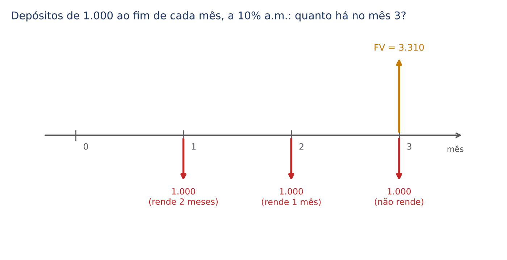

:::EXEMPLO Somando os depósitos na data final
- 1º depósito (mês 1): rende 2 meses até o mês 3: 1.000 × 1,21 = 1.210
- 2º depósito (mês 2): rende 1 mês: 1.000 × 1,1 = 1.100
- 3º depósito (mês 3): feito no próprio mês 3, não rende: 1.000
- Montante: 1.210 + 1.100 + 1.000 = 3.310 reais

Dos 3.310 reais, 3.000 são depósitos e 310 são juros.
:::

### 06.5.2 A fórmula

A soma, de novo, é uma PG (agora crescente, de razão 1 + i). O resultado é:

- s(n;i) = FATOR DE ACUMULAÇÃO (ou de valor futuro, de montante) de uma série uniforme postecipada;
- FV = valor futuro, montante da série, na data do ÚLTIMO depósito (data n); a sigla vem de *future value*;
- P = valor de cada depósito;
- n = número de depósitos; i = taxa por período.

Conferência: s(3; 10%) = (1,331 − 1) ÷ 0,10 = 0,331 ÷ 0,10 = 3,31; FV = 1.000 × 3,31 = 3.310. Confere com a soma.

Relação entre os dois fatores: o montante é o valor atual levado para a data n. Logo:

- s(n;i) = a(n;i) × (1 + i)ⁿ
- Conferência: 2,486852 × 1,331 ≈ 3,31

O inverso de s(n;i), 1 ÷ s(n;i), é o FATOR DE FORMAÇÃO DE CAPITAL (FFC): multiplicado pelo montante desejado, dá o depósito necessário para formá-lo.

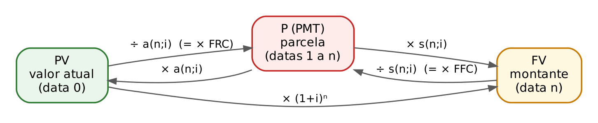

O mapa acima resume todo o 06.4 e o 06.5: do valor atual (data 0) para a parcela, divida por a(n;i); da parcela para o montante (data n), multiplique por s(n;i); do valor atual para o montante, multiplique por (1 + i)ⁿ. Os caminhos inversos usam as operações inversas.

:::ATENCAO O FV de uma série está na data do ÚLTIMO depósito
Na série postecipada, o montante s(n;i) × P é calculado no instante do último depósito, que não rende nada. Se a questão pedir o saldo UM período depois do último depósito (por exemplo, "depósitos de janeiro a dezembro; quanto haverá em 31 de janeiro do ano seguinte?"), multiplique o resultado por mais (1 + i). Leia a data pedida com atenção.
:::

Tabela do fator s(n;i), para consulta (valores calculados para esta apostila):

| n | 1% | 2% | 3% | 4% | 5% | 6% | 8% | 10% |
|---|---|---|---|---|---|---|---|---|
| 2 | 2,0100 | 2,0200 | 2,0300 | 2,0400 | 2,0500 | 2,0600 | 2,0800 | 2,1000 |
| 3 | 3,0301 | 3,0604 | 3,0909 | 3,1216 | 3,1525 | 3,1836 | 3,2464 | 3,3100 |
| 4 | 4,0604 | 4,1216 | 4,1836 | 4,2465 | 4,3101 | 4,3746 | 4,5061 | 4,6410 |
| 5 | 5,1010 | 5,2040 | 5,3091 | 5,4163 | 5,5256 | 5,6371 | 5,8666 | 6,1051 |
| 6 | 6,1520 | 6,3081 | 6,4684 | 6,6330 | 6,8019 | 6,9753 | 7,3359 | 7,7156 |
| 8 | 8,2857 | 8,5830 | 8,8923 | 9,2142 | 9,5491 | 9,8975 | 10,6366 | 11,4359 |
| 10 | 10,4622 | 10,9497 | 11,4639 | 12,0061 | 12,5779 | 13,1808 | 14,4866 | 15,9374 |
| 12 | 12,6825 | 13,4121 | 14,1920 | 15,0258 | 15,9171 | 16,8699 | 18,9771 | 21,3843 |

:::DICA O fator s é SEMPRE MAIOR que n
Cada depósito, levado ao fim, vale mais que P (exceto o último, que vale exatamente P). Logo s(n;i) > n. Se você achou s(10; 2%) menor que 10, errou. Compare: a(n;i) < n < s(n;i).
:::

:::EXEMPLO Quanto depositar para formar um capital
Um órgão precisa ter 33.100 reais daqui a 3 meses e fará 3 depósitos mensais iguais, a partir do mês 1, a 10% ao mês. Qual o depósito?
- P = FV ÷ s(3; 10%)
- P = 33.100 ÷ 3,31
- P = 10.000 reais
:::

### 06.5.3 Nomes dos fatores: a confusão de vocabulário

A prova às vezes cita os fatores pelo NOME, sem fórmula. Infelizmente, os nomes variam entre autores. A tabela registra o uso mais comum; o importante é reconhecer a FÓRMULA por trás do nome:

| Nome usual | Sigla | Fórmula | Para que serve |
|---|---|---|---|
| Fator de valor atual (de série) | FVA, FVP | a(n;i) = [1 − (1 + i)⁻ⁿ] ÷ i | parcela → valor atual |
| Fator de recuperação de capital | FRC | 1 ÷ a(n;i) | valor atual → parcela |
| Fator de acumulação de capital (de série) | FAC | s(n;i) = [(1 + i)ⁿ − 1] ÷ i | parcela → montante |
| Fator de formação de capital | FFC | 1 ÷ s(n;i) | montante → parcela (depósito) |
| Fator de acumulação de capital (pagamento único) | FAC | (1 + i)ⁿ | valor atual → valor futuro |
| Fator de valor atual (pagamento único) | FVA | 1 ÷ (1 + i)ⁿ | valor futuro → valor atual |

Repare que "fator de acumulação de capital" aparece com dois sentidos: para uma série (s) e para um pagamento único ((1 + i)ⁿ). As duas questões FGV a seguir usam o nome em sentidos diferentes.

:::QUESTAO FGV 2024 — AL-PR — Analista Legislativo (Economista) (Q2451630)
Série postecipada de 19 parcelas mensais de 100 reais, a 10% ao mês. Dado: o fator de formação de capital é 0,02. Pede-se o fator de acumulação de capital e o valor futuro. Gabarito oficial: A (50 e 5.000).

Resolução:
- Fator de acumulação (aqui, da SÉRIE) = 1 ÷ FFC = 1 ÷ 0,02 = 50
- FV = P × s = 100 × 50 = 5.000

Observação: o valor exato de s(19; 10%) é cerca de 51,16 (e o FFC exato, 0,01955); a banca arredondou o FFC para 0,02. Use o dado do enunciado, não a sua tabela.
:::

:::QUESTAO FGV 2024 — Prefeitura de São José dos Campos — Analista (Economia) (Q2360319)
Empréstimo de 5.000 reais a ser pago em uma única prestação ao fim do mês, a 10% ao mês. Pede-se o fator de recuperação do capital, o fator de acumulação do capital e o fator de formação do capital. Gabarito oficial: B (1,1; 1,1 e 1,0), conferido no QConcursos em 30/10/2026.

Resolução, com n = 1 e i = 0,10:
- FRC = 1 ÷ a(1; 10%) = 1 ÷ (1 ÷ 1,1) = 1,1 (faz sentido: para quitar 5.000 em uma parcela, paga-se 5.000 × 1,1 = 5.500)
- FFC = 1 ÷ s(1; 10%) = 1 ÷ 1 = 1,0 (com um só depósito, no fim, o montante é o próprio depósito)
- Fator de acumulação: se for o de SÉRIE, s(1; 10%) = 1,0; se for o de PAGAMENTO ÚNICO, (1,1)¹ = 1,1

A banca adotou o sentido de PAGAMENTO ÚNICO para o "fator de acumulação de capital", (1 + i)ⁿ = 1,1, uma das duas acepções da sigla FAC registradas na tabela de 06.5.3; por isso a alternativa B (1,1; 1,1; 1,0) é a correta. Nenhuma alternativa traz "1,1; 1,0; 1,0", o que confirma que o fator de série s(1; 10%) não era o pedido. A ambiguidade de nomenclatura é a mesma registrada na Q3185953: na prova, "fator de acumulação de capital" sem mais especificação = (1 + i)ⁿ.
:::

:::QUESTAO FGV 2025 — (prova não identificada no banco) (Q3185953)
Meta: acumular 20.000 reais em dois anos com depósitos anuais numa conta a 10% ao ano. Plano A: dois depósitos iguais. Plano B: 9.000 reais no 1º ano e 10.000 reais no 2º. Pede-se a afirmativa INCORRETA. Gabarito oficial: E ("o Plano B atinge o montante de 20.000").

Resolução:
- Plano A: s(2; 10%) = (1,21 − 1) ÷ 0,10 = 2,1. Depósito = 20.000 ÷ 2,1 ≈ 9.523,81 (afirmativa C, correta).
- Plano B: 9.000 depositados no fim do 1º ano rendem um ano: 9.000 × 1,1 = 9.900; mais 10.000 no fim do 2º ano. Total: 19.900. NÃO atinge 20.000: a afirmativa E é a incorreta.
- A afirmativa A (o Plano A gera montante maior) é correta: 20.000 > 19.900.
- A afirmativa B ("fator de acumulação do Plano A é 1,21") foi tida como correta pela banca, que chamou de "fator de acumulação" o (1,1)² de dois anos de capitalização. O fator de série seria 2,1. Como a questão pede a incorreta e a E é inequivocamente falsa, não há prejuízo, mas registre o uso ambíguo do nome.
:::

:::PRATIQUE exercícios elaborados para esta apostila
1. Depósitos de 500 reais no fim de cada mês, por 4 meses, a 2% ao mês. Quanto haverá logo após o 4º depósito? (Use a tabela.)
2. Uma pessoa quer ter 50.000 reais daqui a 10 meses, com 10 depósitos mensais iguais, o primeiro daqui a 1 mês, a 1% ao mês. Qual o depósito? (Use a tabela.)
3. Considere 1,05⁶ = 1,3401. Depósitos mensais de 2.000 reais, do mês 1 ao mês 6, a 5% ao mês. Qual o montante no mês 6?

Resoluções:

1. s(4; 2%) = 4,1216 (tabela).
- FV = 500 × 4,1216 = 2.060,80 reais
- À mão: 500 × 1,02³ + 500 × 1,02² + 500 × 1,02 + 500 = 530,60 + 520,20 + 510 + 500 = 2.060,80. Confere.

2. s(10; 1%) = 10,4622 (tabela).
- P = 50.000 ÷ 10,4622 ≈ 4.779,10 reais
- Bom senso: menor que 50.000 ÷ 10 = 5.000, porque os juros ajudam a formar o capital.

3. Monte o fator.
- s(6; 5%) = (1,3401 − 1) ÷ 0,05 = 0,3401 ÷ 0,05 = 6,802
- FV = 2.000 × 6,802 = 13.604 reais (com o fator exato, 6,8019, dá cerca de 13.603,83)
:::

## 06.6 Séries antecipadas (com entrada)

### 06.6.1 A ideia

Na série ANTECIPADA, o primeiro pagamento é feito NA DATA 0, no ato da compra. É o "1 + 3", o "3 vezes, a primeira no ato", a "série com entrada igual às demais parcelas". Compare com a postecipada no diagrama do 06.4.1: a série antecipada é a postecipada com TODAS as parcelas deslocadas um período para a esquerda.

Exemplo à mão. Três parcelas mensais de 1.000 reais, a primeira no ato, a 10% ao mês. Valor à vista?

:::EXEMPLO Duas maneiras de calcular
Maneira 1 (separar a entrada): a 1ª parcela está na data 0 e vale 1.000; as outras duas formam uma série postecipada de 2 termos.
- PV = 1.000 + 1.000 × a(2; 10%)
- a(2; 10%) = 1,7355 (tabela)
- PV = 1.000 + 1.735,54 = 2.735,54 reais

Maneira 2 (multiplicar por 1 + i): calcule como se fosse postecipada e multiplique por (1 + i), porque cada parcela está um período mais perto de hoje e, portanto, vale (1 + i) vezes mais.
- PV = 1.000 × a(3; 10%) × 1,1
- PV = 2.486,85 × 1,1 = 2.735,54 reais

Mesmo resultado.
:::

- PV antecipada = valor atual da série antecipada;
- a(n;i) = fator da série postecipada de n termos;
- a(n − 1; i) = fator da série postecipada de n − 1 termos (as parcelas que sobram depois da entrada).

Para a PARCELA, basta isolar P:
- P = PV ÷ [a(n;i) × (1 + i)] ou P = PV ÷ [1 + a(n − 1; i)]

:::EXEMPLO Mesmo preço, parcelas diferentes
Um aparelho custa 3.310 reais à vista. A loja oferece 3 parcelas mensais iguais, a 10% ao mês. Qual a parcela se (a) a primeira é paga em 1 mês; (b) a primeira é paga no ato?
- (a) Postecipada: P = 3.310 ÷ 2,486852 = 1.331 reais
- (b) Antecipada: P = 3.310 ÷ (2,486852 × 1,1) = 3.310 ÷ 2,735537 = 1.210 reais

A parcela antecipada é exatamente a postecipada dividida por 1,1 (1.331 ÷ 1,1 = 1.210): pagar cada parcela um mês antes "economiza" um mês de juros.
:::

O montante de uma série antecipada segue a mesma lógica: FV antecipada = P × s(n;i) × (1 + i), medido na data n (um período após o último depósito). Exemplo: depósitos de 1.000 reais no INÍCIO de cada mês, por 3 meses, a 10%: no fim do 3º mês haverá 3.310 × 1,1 = 3.641 reais.

:::PEGADINHA Antecipada não é "postecipada com uma parcela a menos"
Quem paga "1 + 3" paga QUATRO parcelas, uma à vista e três postecipadas: PV = P + P × a(3;i) = P × [1 + a(3;i)]. Quem paga "em 4 vezes, a primeira no ato" também paga quatro: o mesmo cálculo. Leia sempre: quantas parcelas, no total, e onde está a primeira.
:::

### 06.6.2 Questões de prova

:::QUESTAO FGV 2024 — AL-PR — Analista Legislativo (Economista) (Q2451631)
Pergunta teórica: o valor atual de uma série de rendas antecipadas pode ser obtido a partir de quê? Gabarito oficial: B (do valor atual da série postecipada, multiplicado por (1 + i)).

Resolução: é a Maneira 2 do exemplo. As demais alternativas estão erradas: A (os valores atuais são iguais) ignora que as parcelas antecipadas estão mais perto de hoje; C (valor futuro multiplicado pelo fator de valor atual) e D misturam fatores de pagamento único com fatores de série; E (renda multiplicada pelo fator de acumulação) dá o MONTANTE, não o valor atual.
:::

:::QUESTAO FGV 2026 — TJ-SC — Analista Contábil-Econômico (Q4150852)
Software de 60.000 reais à vista, ou 12 parcelas mensais iguais, a primeira no ato, a 4% ao mês. Dados: 1,04¹¹ = 1,54 e 1,04¹² = 1,60. Pede-se a faixa do valor da parcela. Gabarito oficial: C (entre 6.100 e 6.200).

Resolução pela Maneira 1 (usa o dado 1,04¹¹):
- a(11; 4%) = (1,54 − 1) ÷ (0,04 × 1,54) = 0,54 ÷ 0,0616 ≈ 8,7662
- 1 + a(11; 4%) ≈ 9,7662
- P = 60.000 ÷ 9,7662 ≈ 6.143,62

Resolução pela Maneira 2 (usa o dado 1,04¹²):
- a(12; 4%) = (1,60 − 1) ÷ (0,04 × 1,60) = 0,60 ÷ 0,064 = 9,375
- a × 1,04 = 9,375 × 1,04 = 9,75
- P = 60.000 ÷ 9,75 ≈ 6.153,85

Os dois caminhos dão valores ligeiramente diferentes (por causa dos arredondamentos 1,54 e 1,60), mas ambos na faixa C.

Alternativa sedutora: E (maior que 6.300). Quem trata a série como postecipada obtém 60.000 ÷ 9,375 = 6.400. É exatamente o erro de não perceber "a primeira paga no ato".
:::

:::QUESTAO FGV 2024 — Câmara dos Deputados — Consultor Legislativo (Q2511394)
Duas séries de 22 pagamentos mensais iguais a P, uma antecipada e outra postecipada, a 12% ao mês. A diferença entre seus valores atuais é 2.220 reais. Dado: 1,12²² = 12,1. Pede-se P. Gabarito oficial: B (2.420).

Resolução:
- Antecipada − postecipada = P × a × 1,12 − P × a = P × a × 0,12 (pusemos P × a em evidência: P × a × (1,12 − 1))
- a × i = [1 − (1 + i)⁻ⁿ] ÷ i × i = 1 − (1 + i)⁻ⁿ (o i do denominador cancela com o i que multiplica)
- Diferença = P × (1 − 1 ÷ 12,1) = P × (12,1 − 1) ÷ 12,1 = P × 11,1 ÷ 12,1
- P × 11,1 ÷ 12,1 = 2.220
- P = 2.220 × 12,1 ÷ 11,1
- 2.220 ÷ 11,1 = 200; 200 × 12,1 = 2.420

Interpretação que ajuda a lembrar: a diferença entre as duas séries é a primeira parcela da antecipada (P, na data 0) menos a última da postecipada trazida para hoje (P ÷ 1,12²²). De fato: 2.420 − 2.420 ÷ 12,1 = 2.420 − 200 = 2.220.
:::

:::PRATIQUE exercícios elaborados para esta apostila
1. Qual o valor atual de 4 parcelas mensais de 1.000 reais, a primeira no ato, a 2% ao mês?
2. Um bem de 10.000 reais é vendido em 5 parcelas mensais iguais, a primeira no ato, a 3% ao mês. Qual a parcela?
3. Cinco parcelas anuais de 1.000 reais, a 10% ao ano. Qual a diferença entre o valor atual da série antecipada e o da postecipada?
4. Depósitos de 1.000 reais no INÍCIO de cada mês, durante 3 meses, a 10% ao mês. Quanto haverá no fim do 3º mês?

Resoluções:

1. Maneira 1: PV = 1.000 + 1.000 × a(3; 2%).
- a(3; 2%) = 2,8839 (tabela)
- PV = 1.000 + 2.883,88 = 3.883,88 reais
- Conferência pela Maneira 2: a(4; 2%) × 1,02 = 3,8077 × 1,02 ≈ 3,8839; × 1.000 = 3.883,9.

2. Antecipada: P = 10.000 ÷ [a(5; 3%) × 1,03].
- a(5; 3%) = 4,5797
- 4,5797 × 1,03 ≈ 4,7171
- P = 10.000 ÷ 4,7171 ≈ 2.119,95 reais

3. Diferença = P × a(5; 10%) × 0,10.
- a(5; 10%) = 3,7908
- 1.000 × 3,7908 × 0,10 ≈ 379,08 reais
- Pela interpretação: 1.000 − 1.000 ÷ 1,1⁵ = 1.000 − 1.000 ÷ 1,61051 ≈ 1.000 − 620,92 = 379,08. Confere.

4. Montante antecipado: s(3; 10%) × 1,1 × 1.000.
- 3,31 × 1,1 = 3,641
- FV = 3.641 reais
:::

## 06.7 Séries diferidas (com carência)

### 06.7.1 A ideia

Na série DIFERIDA, o primeiro pagamento ocorre depois de um prazo maior que um período: "compre agora e comece a pagar daqui a 3 meses"; "financiamento com 6 meses de carência". O prazo sem pagamentos chama-se CARÊNCIA ou DIFERIMENTO.

A técnica é sempre a mesma: faça de conta que a série começa UM PERÍODO ANTES da primeira parcela. Vista dessa data, ela é uma série postecipada comum. Depois, traga esse valor até a data 0.

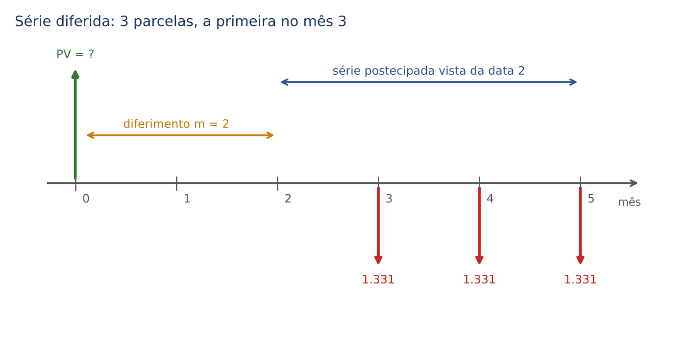

Exemplo à mão. Três parcelas mensais de 1.331 reais, a primeira no mês 3. Taxa: 10% ao mês. Valor à vista?

:::EXEMPLO Em duas etapas
Etapa 1: a primeira parcela está no mês 3; um período antes é o mês 2. Vista do mês 2, é uma série postecipada de 3 termos.
- Valor no mês 2 = 1.331 × a(3; 10%)
- = 1.331 × 2,486852 ≈ 3.310

Etapa 2: trazer do mês 2 para o mês 0 (2 períodos para trás).
- PV = 3.310 ÷ 1,1²
- PV = 3.310 ÷ 1,21 ≈ 2.735,54 reais
:::

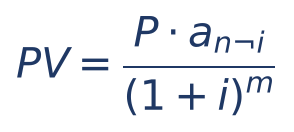

- PV = valor atual da série diferida (data 0);
- P = parcela; n = número de parcelas; i = taxa;
- m = número de períodos de diferimento = data da primeira parcela MENOS 1.

### 06.7.2 Quanto vale m: a armadilha da palavra "carência"

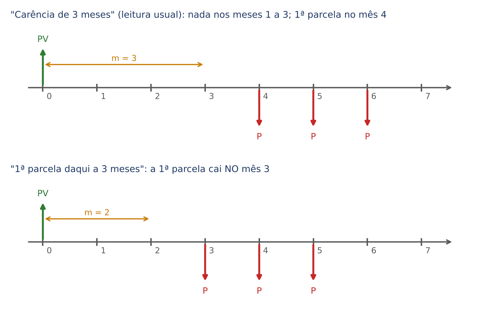

A banca descreve o diferimento de formas diferentes, e você precisa traduzir para "em que data cai a 1ª parcela":
- "1ª parcela daqui a 3 meses" ou "1ª parcela no 3º mês": a 1ª está na data 3; m = 2.
- "Carência de 3 meses" (sem mais detalhes): na leitura usual, nos meses 1, 2 e 3 nada se paga e a 1ª parcela cai no mês 4; m = 3. Mas alguns enunciados usam "carência de 3 meses" para dizer que a 1ª parcela vence ao fim do 3º mês. Na dúvida, procure no enunciado a data da 1ª parcela; e, se a ambiguidade persistir, calcule as duas leituras e veja qual está nas alternativas.

:::DICA O caminho alternativo: capitalizar a dívida até um período antes da 1ª parcela
Em vez de trazer a série para a data 0, leve a DÍVIDA até a data m (um período antes da primeira parcela) e use a fórmula postecipada a partir dali. É o que acontece na vida real: durante a carência, os juros vão se incorporando ao saldo. Exemplo: empréstimo de 10.000 reais, 3 parcelas mensais iguais, a primeira no mês 4, a 10% ao mês.
- Saldo no mês 3: 10.000 × 1,1³ = 10.000 × 1,331 = 13.310
- P = 13.310 ÷ a(3; 10%) = 13.310 ÷ 2,486852 ≈ 5.352,15 reais
:::

### 06.7.3 Questões de prova

:::QUESTAO FGV 2026 — AL-RO — Consultor Legislativo (Orçamento) (Q3882016)
Autarquia toma 420.000 reais a juros compostos efetivos de 21% ao ano, para pagar em duas parcelas SEMESTRAIS iguais e consecutivas, a primeira exatamente um ano após a liberação. A capitalização acompanha a periodicidade das parcelas. Pede-se a parcela. Gabarito oficial: D (266.200).

Resolução:
- Taxa semestral equivalente a 21% ao ano (Cap. 4): (1 + i)² = 1,21, logo 1 + i = 1,1 e i = 10% ao semestre.
- Datas em semestres: a 1ª parcela (um ano) está no semestre 2; a 2ª, no semestre 3. Diferimento m = 1.
- Caminho da DICA: leve a dívida ao semestre 1: 420.000 × 1,1 = 462.000.
- A partir do semestre 1, série postecipada de 2 termos: P = 462.000 ÷ a(2; 10%) = 462.000 ÷ 1,735537 ≈ 266.200.

Conferência sem divisão difícil (data focal 3):
- Dívida: 420.000 × 1,1³ = 420.000 × 1,331 = 559.020
- Parcelas: P × 1,1 + P = 2,1P
- P = 559.020 ÷ 2,1 = 266.200

Alternativas sedutoras: B (242.000) é a resposta SEM a carência (parcelas nos semestres 1 e 2): 420.000 × 1,21 ÷ 2,1 = 242.000. C (254.100) = 242.000 × 1,05 e E (279.510) = 266.200 × 1,05 vêm de confundir a taxa semestral com metade da anual (10,5%) em parte da conta. A (231.000) = 420.000 × 1,1 ÷ 2, sem juros entre as parcelas.
:::

:::QUESTAO FGV 2024 — Câmara Municipal de São Paulo — Consultor (Contador) (Q2351957)
Produto de 993 reais à vista, ou 3 prestações mensais iguais, a primeira exatos dois meses após a compra. Juros compostos de 120% ao ano com capitalização mensal. Pede-se a prestação. Gabarito oficial: B (439,23), conferido no QConcursos em 30/10/2026; coincide com a resolução.

Resolução:
- "120% ao ano com capitalização mensal" é taxa NOMINAL (Cap. 4): a taxa efetiva mensal é 120% ÷ 12 = 10% ao mês.
- 1ª parcela na data 2: diferimento m = 1.
- Leve o preço ao mês 1: 993 × 1,1 = 1.092,30
- P = 1.092,30 ÷ a(3; 10%) = 1.092,30 ÷ 2,486852 ≈ 439,23

Alternativa: com m = 2 (primeira no mês 3), daria 993 × 1,21 ÷ 2,486852 ≈ 483,15, que não está nas opções; sem carência, 993 ÷ 2,486852 ≈ 399,30, também fora. As alternativas, todas entre 438 e 443, foram feitas para punir arredondamentos grosseiros: faça a conta com o fator 2,4869 e escolha a mais próxima.
:::

:::PRATIQUE exercícios elaborados para esta apostila
1. Quatro parcelas mensais de 1.000 reais, a primeira no mês 3, a 2% ao mês. Qual o valor atual?
2. Empréstimo de 20.000 reais em 2 parcelas mensais iguais, a primeira no mês 3, a 5% ao mês. Qual a parcela?
3. (Estilo FCC) Um bem é vendido em 3 parcelas mensais de 1.331 reais, a primeira 3 meses após a compra, a juros compostos de 10% ao mês. O valor à vista é: (A) 2.486,85 (B) 2.735,54 (C) 3.000 (D) 3.310 (E) 3.993.

Resoluções:

1. m = 3 − 1 = 2.
- Valor no mês 2: 1.000 × a(4; 2%) = 1.000 × 3,8077 = 3.807,73
- PV = 3.807,73 ÷ 1,02² = 3.807,73 ÷ 1,0404 ≈ 3.659,87 reais

2. m = 2. Leve a dívida ao mês 2.
- 20.000 × 1,05² = 20.000 × 1,1025 = 22.050
- P = 22.050 ÷ a(2; 5%) = 22.050 ÷ 1,8594 ≈ 11.858,66 reais (com o fator exato, 1,859410, dá 11.858,60)

3. É o exemplo do 06.7.1.
- Valor no mês 2: 1.331 × 2,486852 ≈ 3.310
- PV = 3.310 ÷ 1,21 ≈ 2.735,54
- Resposta: B. A alternativa D (3.310) para no meio do caminho (valor na data 2, sem trazer à data 0); a A (2.486,85) é o fator a(3; 10%) multiplicado por 1.000, um número "parecido" posto ali para confundir quem decora fatores sem montar o diagrama; a E (3.993) é a soma nominal das parcelas, sem juros.
:::

## 06.8 Perpetuidades

### 06.8.1 A ideia: viver só dos juros

Uma PERPETUIDADE (ou renda perpétua) é uma série de pagamentos iguais que nunca termina. Parece abstrato, mas a ideia é cotidiana: quem tem um capital aplicado e retira, todo mês, EXATAMENTE os juros do mês, pode fazer isso para sempre, porque o capital nunca diminui.

Exemplo à mão. Quanto alguém precisa ter aplicado, a 0,5% ao mês, para retirar 2.000 reais por mês para sempre, começando daqui a um mês?

:::EXEMPLO O capital que gera 2.000 reais por mês
Raciocínio: os juros do mês devem ser exatamente 2.000 reais.
- Juros do mês = capital × taxa
- C × 0,005 = 2.000
- C = 2.000 ÷ 0,005 (dividimos os dois lados por 0,005)
- C = 400.000 reais

Conferência: 400.000 × 0,005 = 2.000 de juros no mês 1; retirados os 2.000, o capital volta a 400.000; no mês 2, de novo 2.000 de juros; e assim para sempre.
:::

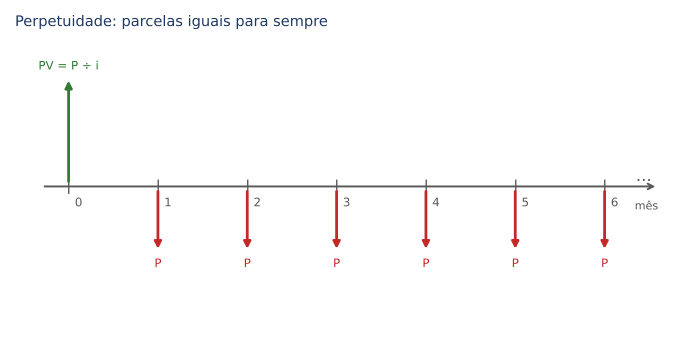

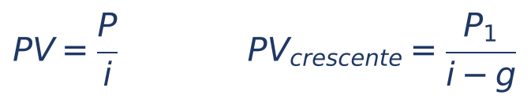

- PV = valor atual da perpetuidade (o capital que a "sustenta");
- P = valor de cada termo, sendo o primeiro UM período após a data 0 (perpetuidade postecipada);
- i = taxa por período, na forma decimal;
- P₁ e g aparecem na segunda fórmula, explicada no 06.8.3.

Por que a fórmula é tão simples? Lembre que a(n;i) = [1 − (1 + i)⁻ⁿ] ÷ i. Quando n cresce sem parar, (1 + i)⁻ⁿ = 1 ÷ (1 + i)ⁿ fica cada vez mais perto de zero (um número dividido por outro enorme). Então o fator se aproxima de (1 − 0) ÷ i = 1 ÷ i. O gráfico mostra isso a 10%: com 40 parcelas o fator já é 9,78; com 100, cerca de 9,9993; o limite é 10.

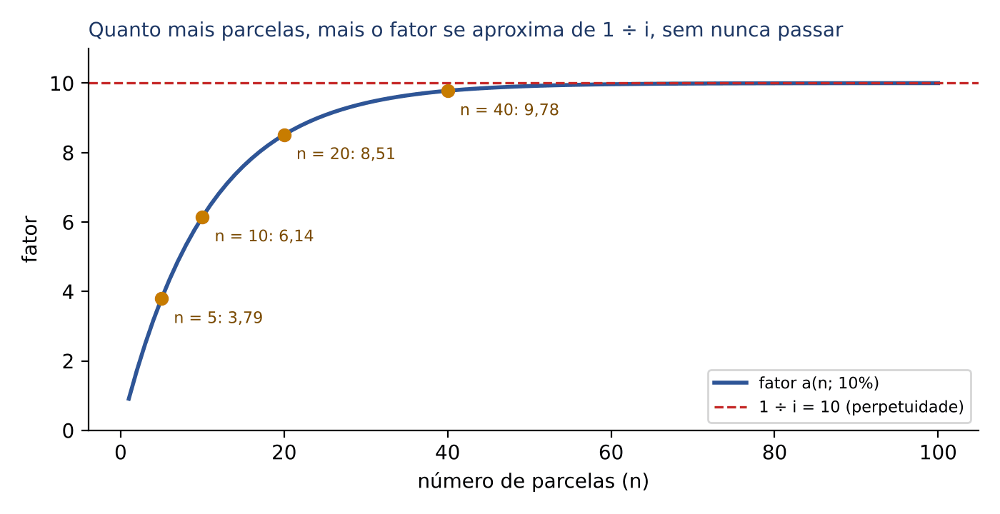

Uma consequência útil: uma série muito longa (100 parcelas, 30 anos de parcelas mensais) tem valor atual muito próximo ao de uma perpetuidade. Algumas questões aproveitam isso para simplificar a conta.

### 06.8.2 Variações: perpetuidade antecipada e diferida

- Perpetuidade ANTECIPADA (primeiro termo na data 0): PV = P + P ÷ i. É o primeiro pagamento, imediato, mais uma perpetuidade postecipada a partir dele. Também se escreve PV = (P ÷ i) × (1 + i).
- Perpetuidade DIFERIDA (primeiro termo na data m + 1): calcule P ÷ i, que é o valor na data m, e traga para a data 0, dividindo por (1 + i)ᵐ. A lógica é a mesma das séries diferidas (06.7).

:::EXEMPLO Uma bolsa de estudos perpétua
Uma fundação quer pagar uma bolsa de 30.000 reais por ano, para sempre, com uma aplicação que rende 6% ao ano.
- (a) Primeira bolsa daqui a um ano: PV = 30.000 ÷ 0,06 = 500.000 reais.
- (b) Primeira bolsa hoje (antecipada): PV = 30.000 + 500.000 = 530.000 reais.
- (c) Primeira bolsa daqui a 3 anos (diferida, m = 2): o valor na data 2 é 500.000; trazendo à data 0, 500.000 ÷ 1,06² = 500.000 ÷ 1,1236 ≈ 444.998,22 reais.
:::

O raciocínio também serve para avaliar bens pela renda que produzem. Exemplo: um imóvel que rende aluguel líquido de 3.000 reais por mês, numa economia em que a taxa de referência é 1% ao mês, "vale" pela renda 3.000 ÷ 0,01 = 300.000 reais. É a lógica que está por trás, por exemplo, de avaliações de empresas e de imóveis pelo método da renda.

:::ATENCAO A taxa e o termo precisam ter a mesma periodicidade
Aluguel MENSAL exige taxa MENSAL. Se a prova der 12% ao ano e aluguel mensal, converta a taxa para mensal (Cap. 4) antes de dividir. Dividir 3.000 por 0,12 dá 25.000 reais, um absurdo que a FCC adora pôr entre as alternativas.
:::

### 06.8.3 Noção: perpetuidade crescente

Quando os termos crescem a uma taxa constante g por período (por exemplo, um dividendo que cresce 2% ao ano), e g é MENOR que i, o valor atual é PV = P₁ ÷ (i − g), em que P₁ é o PRIMEIRO termo (pago um período após a data 0). É o chamado modelo de Gordon, usado em finanças. Exemplo: bolsa inicial de 30.000 reais crescendo 2% ao ano, taxa de 6%: PV = 30.000 ÷ (0,06 − 0,02) = 30.000 ÷ 0,04 = 750.000 reais. Fica aqui só como noção: o edital fala em "rendas" e não menciona séries variáveis, e o banco de questões não traz perpetuidades crescentes.

:::PRATIQUE exercícios elaborados para esta apostila
1. Qual o capital necessário para retirar 1.500 reais por mês, para sempre, a 0,75% ao mês, começando daqui a um mês?
2. Uma doação de 1.000.000 de reais, aplicada a 8% ao ano, sustentará qual prêmio anual perpétuo?
3. Uma perpetuidade de 1.000 reais por mês, com o primeiro termo hoje, a 2% ao mês. Qual o valor atual?
4. Um imóvel de 240.000 reais é alugado por 1.800 reais líquidos por mês. Qual a taxa mensal de retorno implícita, vista como perpetuidade?

Resoluções:

1. PV = 1.500 ÷ 0,0075 = 200.000 reais. (Dividir por 0,0075 é multiplicar por 10.000 e dividir por 75: 15.000.000 ÷ 75 = 200.000.)
2. P = PV × i = 1.000.000 × 0,08 = 80.000 reais por ano.
3. Antecipada: PV = 1.000 + 1.000 ÷ 0,02 = 1.000 + 50.000 = 51.000 reais.
4. i = P ÷ PV = 1.800 ÷ 240.000 = 0,0075 = 0,75% ao mês.
:::

## 06.9 Aplicações integradas: renegociação, atraso e comparação de propostas

As questões mais trabalhosas combinam tudo o que vimos: uma parte à vista, uma série, um atraso, uma antecipação. O roteiro do 06.2.3 continua valendo; a única novidade é que, quando houver parcelas iguais e consecutivas, você pode usar o fator em vez de transportar parcela por parcela.

:::PASSO Roteiro para questões de financiamento e renegociação
1. Desenhe o diagrama com TODAS as datas e valores (entrada, parcelas, atrasos, pagamento final).
2. Identifique blocos: pagamentos isolados (transporte com (1 + i)ⁿ) e séries de parcelas iguais (fator a ou s).
3. Para cada série, pergunte: onde está a 1ª parcela? Se estiver na data 1, postecipada; na data 0, antecipada; depois da data 1, diferida.
4. Escolha a data focal (de preferência a data do valor desconhecido ou a última data) e transporte tudo para ela.
5. Monte "o que se devia = o que se paga" na data focal, resolva e confira pelo bom senso.
:::

### 06.9.1 Entrada mais parcelas

:::EXEMPLO Preço, entrada e saldo parcelado
Um veículo custa 10.000 reais. O comprador dá 2.000 reais de entrada e financia o restante em 4 parcelas mensais iguais, a primeira em 1 mês, a 3% ao mês. Qual a parcela?
- Saldo financiado: 10.000 − 2.000 = 8.000 (a entrada está na data 0 e abate diretamente o preço à vista)
- a(4; 3%) = 3,7171 (tabela)
- P = 8.000 ÷ 3,7171 ≈ 2.152,22 reais
:::

:::PEGADINHA Aplicar a série sobre o preço cheio
O erro típico é calcular P = 10.000 ÷ 3,7171 (ignorando a entrada) ou descontar a entrada depois de calcular as parcelas. A entrada é dinheiro na data 0: sai do valor à vista ANTES de qualquer fator.
:::

### 06.9.2 Parcelamento de um débito (exemplo hipotético)

Um contribuinte tem um débito de 20.000 reais e o parcela em 5 prestações mensais iguais, a primeira em 1 mês, a 1% ao mês (dados hipotéticos, só para o cálculo; os programas reais de parcelamento tributário têm regras próprias de atualização, que não são objeto deste capítulo).
- a(5; 1%) = 4,8534 (tabela)
- P = 20.000 ÷ 4,8534 ≈ 4.120,80 reais

### 06.9.3 Renegociação de uma série por outra

:::EXEMPLO Três parcelas trocadas por duas
Um devedor tem 3 parcelas de 1.000 reais nos meses 1, 2 e 3. Propõe trocá-las por 2 parcelas iguais nos meses 2 e 4. Taxa: 10% ao mês. Qual o valor das novas parcelas?
- Valor atual da dívida original: 1.000 × a(3; 10%) = 2.486,85
- Valor atual da proposta: P ÷ 1,1² + P ÷ 1,1⁴ = P × (0,826446 + 0,683013) = 1,509459P
- 1,509459P = 2.486,85
- P ≈ 1.647,51 reais

Bom senso: o devedor vai pagar 3.295,02 em vez de 3.000, porque, em média, está pagando mais tarde.
:::

### 06.9.4 Atraso e antecipação de parcelas

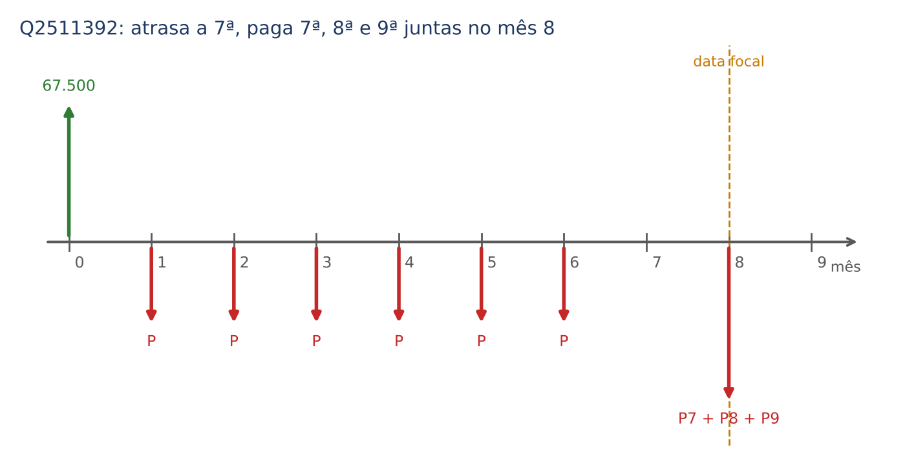

:::QUESTAO FGV 2024 — Câmara dos Deputados — Consultor Legislativo (Q2511392)
Empréstimo de 67.500 reais em 9 parcelas mensais iguais, a primeira um mês após a contratação, a juros compostos de 8% ao mês. O tomador pagou as seis primeiras em dia, não pagou a 7ª e, na data da 8ª, pagou a 8ª, a 7ª (em atraso) e a 9ª (antecipada), quitando a dívida. Dado: 1,08⁹ = 2,00. Pede-se o total desembolsado no último pagamento. Gabarito oficial: C (32.464).

Resolução:
- Parcela: a(9; 8%) = (2 − 1) ÷ (0,08 × 2) = 1 ÷ 0,16 = 6,25; P = 67.500 ÷ 6,25 = 10.800.
- Data focal: mês 8.
- 7ª parcela (mês 7), atrasada um mês: 10.800 × 1,08 = 11.664
- 8ª parcela (mês 8), em dia: 10.800
- 9ª parcela (mês 9), antecipada um mês: 10.800 ÷ 1,08 = 10.000
- Total: 11.664 + 10.800 + 10.000 = 32.464

Alternativas sedutoras: pagar as três "pelo valor de face" daria 32.400 (fora das opções, mas próximo); as alternativas A, B, D e E ficam em torno de 32.000 a 33.000 justamente para punir quem esquece de cobrar juros da atrasada ou de descontar a antecipada.
:::

### 06.9.5 Comparar à vista e a prazo

:::QUESTAO FGV 2025 — SEDUC-SP — Gestão e Negócios (Q3706245)
Fogão: 2.000 reais à vista ou 3 parcelas de 771,75 reais (juros compostos). A compradora tem 2.000 reais aplicados a 2% ao mês. Julgar: (I) o parcelamento tem taxa maior que a da aplicação; (II) manter a aplicação por 3 meses renderia mais que o total de juros do parcelamento; (III) comprar à vista é mais vantajoso. Gabarito oficial: A (V – F – V).

Resolução:
- I. Valor atual das 3 parcelas à taxa da aplicação (2%): 771,75 × a(3; 2%) = 771,75 × 2,8839 ≈ 2.225,64. Como isso é MAIOR que 2.000, a taxa embutida no parcelamento é maior que 2% (quanto maior a taxa, menor o valor atual; para "baixar" de 2.225,64 a 2.000, a taxa precisa subir). Verdadeira. (A taxa embutida fica em torno de 7,7% ao mês, se as parcelas forem postecipadas; o enunciado não diz se há entrada, mas a conclusão vale nos dois casos.)
- II. Rendimento da aplicação em 3 meses: 2.000 × 1,02³ − 2.000 = 2.000 × 1,061208 − 2.000 = 122,42. Juros do parcelamento: 3 × 771,75 − 2.000 = 2.315,25 − 2.000 = 315,25. O rendimento é MENOR. Falsa.
- III. Se o parcelamento cobra mais que a aplicação rende, vale mais resgatar e pagar à vista. Verdadeira.

Lição: para comparar propostas, traga tudo a valor presente com a taxa de oportunidade de quem decide (a taxa que o dinheiro dele rende). Esse raciocínio é a base do valor presente líquido do Cap. 8.
:::

:::PRATIQUE exercícios elaborados para esta apostila
1. Um bem de 5.000 reais é vendido com 1.000 reais de entrada e duas parcelas mensais iguais (meses 1 e 2), a 4% ao mês. Qual a parcela?
2. Um devedor tem 5 parcelas mensais de 5.000 reais: duas já vencidas (há 2 meses e há 1 mês) e três a vencer (daqui a 1, 2 e 3 meses). Quer quitar tudo hoje. Taxa: 2% ao mês. Quanto paga?
3. (Estilo FCC) Um empréstimo de 10.000 reais é pago em 4 parcelas mensais de 2.820 reais, a primeira em 1 mês. Usando a tabela do 06.4.5, a taxa mensal está mais próxima de: (A) 3% (B) 4% (C) 5% (D) 6% (E) 8%.

Resoluções:

1. Saldo financiado: 5.000 − 1.000 = 4.000.
- a(2; 4%) = 1,8861
- P = 4.000 ÷ 1,8861 ≈ 2.120,78 reais

2. Data focal 0.
- Vencida há 2 meses: 5.000 × 1,02² = 5.000 × 1,0404 = 5.202
- Vencida há 1 mês: 5.000 × 1,02 = 5.100
- Três a vencer: 5.000 × a(3; 2%) = 5.000 × 2,8839 ≈ 14.419,42
- Total: 5.202 + 5.100 + 14.419,42 = 24.721,42 reais

3. O fator implícito é 10.000 ÷ 2.820 ≈ 3,5461.
- Na linha n = 4 da tabela: 3% → 3,7171; 4% → 3,6299; 5% → 3,5460; 6% → 3,4651.
- O mais próximo de 3,5461 é 3,5460: taxa de 5%. Resposta: C.
- Técnica: com a tabela, a taxa de um financiamento se descobre procurando, na linha de n, o fator igual a PV ÷ P. É a mesma técnica de "localizar a taxa" da TIR (Cap. 8).
:::

## 06.10 Resumo para revisão pré-prova

| Conceito | Fórmula ou regra | Quando usar | Armadilha |
|---|---|---|---|
| Transporte de um valor | Para frente: × (1 + i)ⁿ Para trás: ÷ (1 + i)ⁿ | Sempre que um valor muda de data | Multiplicar quando deveria dividir; contar mal a distância n |
| Equivalência (composto) | Soma das originais = soma da proposta, na mesma data focal | Troca de dívidas, renegociação | Somar valores de datas diferentes |
| Data focal (composto) | Qualquer uma: o resultado não muda | Escolha a que simplifica (a do valor desconhecido ou a última) | No regime simples a data focal importa (Cap. 2) |
| Preço à vista | Entrada + soma dos valores atuais das parcelas | Compras parceladas | Descontar a parcela paga no ato |
| Série postecipada | PV = P × a(n;i) P = PV ÷ a(n;i) | Parcelas iguais, 1ª em 1 período | Dividir PV por n (esquece os juros) |
| Montante de série | FV = P × s(n;i) | Depósitos para formar capital | FV está na data do último depósito |
| Série antecipada | PV = P × a(n;i) × (1 + i) = P × [1 + a(n − 1;i)] | 1ª parcela no ato | Tratar como postecipada (parcela fica maior) |
| Série diferida | PV = P × a(n;i) ÷ (1 + i)ᵐ, m = data da 1ª − 1 | Carência | Errar m (carência de 3 meses: 1ª no mês 4) |
| Perpetuidade | PV = P ÷ i (antecipada: + P) | Renda sem fim, avaliação pela renda | Taxa e termo em periodicidades diferentes |
| Taxa de uma compra com entrada e 1 parcela | (parcela ÷ saldo financiado) − 1 | "1 + 1" | Esquecer de tirar a entrada (Cap. 4) |
| Taxa com várias parcelas | Procure na tabela, linha n, o fator PV ÷ P; ou teste as alternativas | Taxa desconhecida | Taxa maior → valor atual menor |

Formulário do capítulo:

| Fórmula | Símbolos | Uso |
|---|---|---|
| PV = F ÷ (1 + i)ⁿ | F = valor na data n; i = taxa decimal; n = períodos | Trazer um valor único para hoje |
| a(n;i) = [1 − (1 + i)⁻ⁿ] ÷ i = [(1 + i)ⁿ − 1] ÷ [i × (1 + i)ⁿ] | n = número de parcelas | Fator de valor atual de série postecipada |
| FRC = 1 ÷ a(n;i) | — | Parcela de um empréstimo: P = PV × FRC |
| s(n;i) = [(1 + i)ⁿ − 1] ÷ i | — | Fator de montante de série postecipada |
| FFC = 1 ÷ s(n;i) | — | Depósito para formar um montante |
| s(n;i) = a(n;i) × (1 + i)ⁿ | — | Relação entre os fatores |
| PV antecipada = P × a(n;i) × (1 + i) | — | Série com 1ª parcela no ato |
| PV diferida = P × a(n;i) ÷ (1 + i)ᵐ | m = data da 1ª parcela − 1 | Série com carência |
| PV perpetuidade = P ÷ i | P = termo; 1º termo em 1 período | Renda perpétua |
| PV perpetuidade crescente = P₁ ÷ (i − g) | g = crescimento por período, g < i | Noção (modelo de Gordon) |

Desigualdades que servem de conferência: a(n;i) < n < s(n;i); a(n;i) < 1 ÷ i; parcela > PV ÷ n.

## 06.11 Questões do capítulo

FCC: Q3954816, Q3507039; remissão: Q4066797 (comentada no Cap. 4).
FGV: Q4389222, Q4150852, Q3884907, Q3882240, Q3882016, Q3880758, Q3706245, Q3604043, Q3185953, Q3152830, Q2847351, Q2511394, Q2511392, Q2451631, Q2451630, Q2451627, Q2360319, Q2351957; citadas "no mesmo sentido": Q3998759, Q3879466, Q3029079 (esta comentada no Cap. 4).

:::NOTA Notas de verificação
- Contas: todas as contas dos exemplos, dos exercícios PRATIQUE, das tabelas de fatores a(n;i) e s(n;i) e das resoluções das questões foram conferidas em Python (fatores calculados pelas fórmulas exatas e arredondados a 4 casas). Diferenças na última casa decimal, quando o enunciado fornece potências arredondadas (1,05¹² = 1,7959; 1,03⁵ = 1,1593; 1,02⁶ = 1,1262), estão indicadas no próprio texto.
- Q4389222 (FGV): gabarito oficial C (23.809,52) corresponde a UM mês de desconto (25.000 ÷ 1,05), mas o enunciado, tal como está no banco, pede o valor "em 31/12/2025", quatro meses antes do vencimento (o que daria cerca de 20.567,56, fora das alternativas). Provável erro de data no enunciado (31/3/2026); gabarito discutível quanto à data. Confirmar no caderno original, se possível.
- Q3880758 (FGV): o valor exato da prestação é 2.010.574,02; o gabarito (2.011.263,07) resulta do fator truncado 2,4860. Sem prejuízo para a resposta.
- Gabaritos reconferidos no QConcursos em 30/10/2026: Q2451627 (oficial B, 3.780), Q2351957 (oficial B, 439,23) e Q2360319 (oficial B, 1,1; 1,1 e 1,0); os três coincidem com as respostas antes deduzidas pela resolução. Na Q2360319, o gabarito confirma a leitura de "fator de acumulação de capital" como fator de pagamento único (1,1).
- Q3185953 (FGV): a banca considerou correta a afirmativa de que "o fator de acumulação do Plano A é 1,21", nome usado para (1,1)², e não para o fator de série (2,1). Uso de nomenclatura ambíguo, sem efeito sobre o gabarito (E).
- Q2847351 (FGV): as figuras da questão não constam do banco; a resolução se baseia apenas no texto das afirmativas e nos exemplos do próprio capítulo. O box titular está no Cap. 2 (02.7); foi mantido também aqui, de forma consciente, porque o tema cobrado é a equivalência de capitais (data focal e cindibilidade do prazo), objeto do 06.2.2.
- Q3706245 (FGV): o enunciado não diz se a 1ª parcela é no ato; a taxa embutida é de cerca de 7,7% ao mês (postecipada) ou 16,7% (antecipada); a conclusão (V – F – V) não muda.
- Q3882240 (FGV): box titular aqui (valor atual de série); o Cap. 8 só remete. A tabela de aproximações da prova não consta do banco: em 30/10/2026 retirou-se a afirmação de que a questão aproximava o fator por 4, por não ser conferível; o comentário usa o fator exato da tabela do capítulo. Q4066797 e Q3029079 são comentadas no Cap. 4 (04.5.3); aqui só há remissão.
- Nomenclatura dos fatores (FVA, FRC, FAC, FFC): varia entre autores; a tabela do 06.5.3 registra o uso mais comum, sem fonte bibliográfica específica conferida.
- Leitura de "carência de m meses" (06.7.2): apresentada como leitura usual, com o alerta de que há enunciados que a usam em sentido diverso.
- Perpetuidade crescente (modelo de Gordon): incluída só como noção; não consta do edital de forma expressa nem do banco.
- Exemplo de parcelamento de débito (06.9.2): dados hipotéticos; não descreve nenhum programa real de parcelamento tributário.
- Drive do usuário: lidos os mapas "Rendas Uniformes" (MF10) e "Equivalência de Capitais" (MF09); o conector devolveu apenas trechos, que confirmam a abordagem (data focal livre no regime composto; perpetuidade A = P ÷ i). O mapa de PA e PG (RL16) não foi lido; a soma da PG foi remetida ao Cap. 1.
- Sem leis no capítulo; não se aplica conferência no Planalto.
:::
