# CAPÍTULO 07 — SISTEMAS DE AMORTIZAÇÃO: SAC, SISTEMA FRANCÊS (PRICE) E SISTEMA MISTO (SAM)

:::INCIDENCIA
Edital SEFAZ/SC — Matemática Financeira, Estatística e Raciocínio Lógico: "Amortizações. Sistema francês. Sistema de amortização constante. Sistema misto." Nível A+.
Lote do banco: 25 questões (FCC 5, FGV 20). O que mais cai na FCC: o valor de UMA prestação específica do SAC (a 10ª, a 40ª, a 60ª), o saldo devedor da Price depois de k pagamentos e a prestação do SAM com o fator de recuperação de capital dado no enunciado.
:::

:::ESQUEMA O que você vai aprender e o que precisa saber antes
Pré-requisitos: porcentagem e taxa na forma decimal (Cap. 1); progressão aritmética e geométrica (Cap. 1); juros compostos e potências de (1 + i) (Cap. 3); taxa proporcional e taxa equivalente, para entender a Tabela Price "de taxa nominal" (Cap. 4); valor atual de uma série de prestações iguais, o fator a(n;i) e o fator de recuperação de capital (Cap. 6). Este capítulo USA a série uniforme do Cap. 6; não a reensina, só a relembra em duas linhas.
Roteiro:
- 7.1 A engrenagem de qualquer financiamento: saldo devedor, juros, amortização e prestação (e o sistema americano, o mais simples de todos).
- 7.2 SAC: amortização constante, planilha completa e atalhos para achar a k-ésima prestação sem montar a planilha.
- 7.3 Sistema francês (Price): prestação constante, planilha completa, amortizações em PG e saldo devedor pelo valor atual.
- 7.4 Sistema misto (SAM): a média do SAC com a Price.
- 7.5 Comparação dos sistemas: gráficos, total de juros e as afirmativas teóricas que a banca adora.
- 7.6 Outros sistemas e a ponte com o Direito: SACRE, carência e a Tabela Price no SFH.
- 7.7 Roteiro geral para qualquer questão de amortização.
- 7.8 Resumo para revisão pré-prova e formulário.
:::

## 07.1 A engrenagem de qualquer financiamento

### 07.1.1 A ideia em linguagem comum

Imagine que o senhor pegou 60.000 reais emprestados no banco para trocar de carro. O banco não quer o dinheiro de volta de uma só vez; combina que o senhor pagará em parcelas mensais. Cada parcela que sai da sua conta tem DUAS finalidades ao mesmo tempo:

- remunerar o banco pelo uso do dinheiro naquele mês (são os JUROS, o "aluguel" do dinheiro);
- devolver um pedaço do dinheiro emprestado (é a AMORTIZAÇÃO, palavra que vem de "matar aos poucos" a dívida).

Amortizar, portanto, é devolver o principal em pedaços. Um "sistema de amortização" é apenas uma REGRA que diz como cada parcela se divide entre juros e devolução do principal. Há várias regras possíveis; a prova cobra três (SAC, Price e SAM) e, às vezes, menciona outras (americano, SACRE).

A ponte com o mundo jurídico é imediata: quando um contrato bancário chega ao gabinete com pedido de revisão, a planilha de evolução do débito que o perito junta é exatamente a planilha que este capítulo ensina a montar e a ler. A coluna "amortização" mostra quanto do principal foi efetivamente quitado; a coluna "juros" mostra a remuneração do banco em cada mês.

### 07.1.2 O vocabulário (decore estes cinco nomes)

- Valor financiado (VF), também chamado principal, valor do empréstimo, PV ou D₀: o dinheiro que o devedor recebe hoje, na data zero.
- Saldo devedor (SD): quanto do principal ainda falta devolver em determinado momento. Logo depois da contratação, o saldo é o próprio valor financiado. Escreveremos SDₖ para o saldo IMEDIATAMENTE DEPOIS do pagamento da k-ésima prestação (SD₀ = VF).
- Juros do período (Jₖ): a remuneração do mês k, calculada SEMPRE sobre o saldo devedor do começo do mês, isto é, sobre o saldo que ficou depois do pagamento anterior.
- Amortização do período (Aₖ): a parte da prestação k que abate o principal.
- Prestação (Pₖ): o valor total pago na data k. Também é chamada de parcela, pagamento ou PMT.

Mais dois termos aparecem nos enunciados:

- Taxa de juros (i): a taxa do período, escrita na forma decimal para as contas (2% ao mês = 0,02; ver Cap. 1). Nos sistemas de amortização, os juros são sempre compostos, porque incidem a cada período sobre o saldo que ainda resta.
- Número de prestações (n): quantas parcelas o contrato prevê.

### 07.1.3 As três regras que valem para TODOS os sistemas

Todo sistema de amortização, sem exceção, obedece a três regras. O que muda de um sistema para outro é só QUAL das grandezas é fixada (no SAC, a amortização; na Price, a prestação).

- Regra 1 (juros): Jₖ = i × SDₖ₋₁. Os juros do mês são a taxa multiplicada pelo saldo devedor do início do mês.
- Regra 2 (composição da prestação): Pₖ = Jₖ + Aₖ. A prestação é a soma dos juros com a amortização. Daí também Aₖ = Pₖ − Jₖ.
- Regra 3 (saldo): SDₖ = SDₖ₋₁ − Aₖ. O saldo novo é o saldo velho menos a amortização. Repare: os juros NÃO abatem a dívida; só a amortização abate.

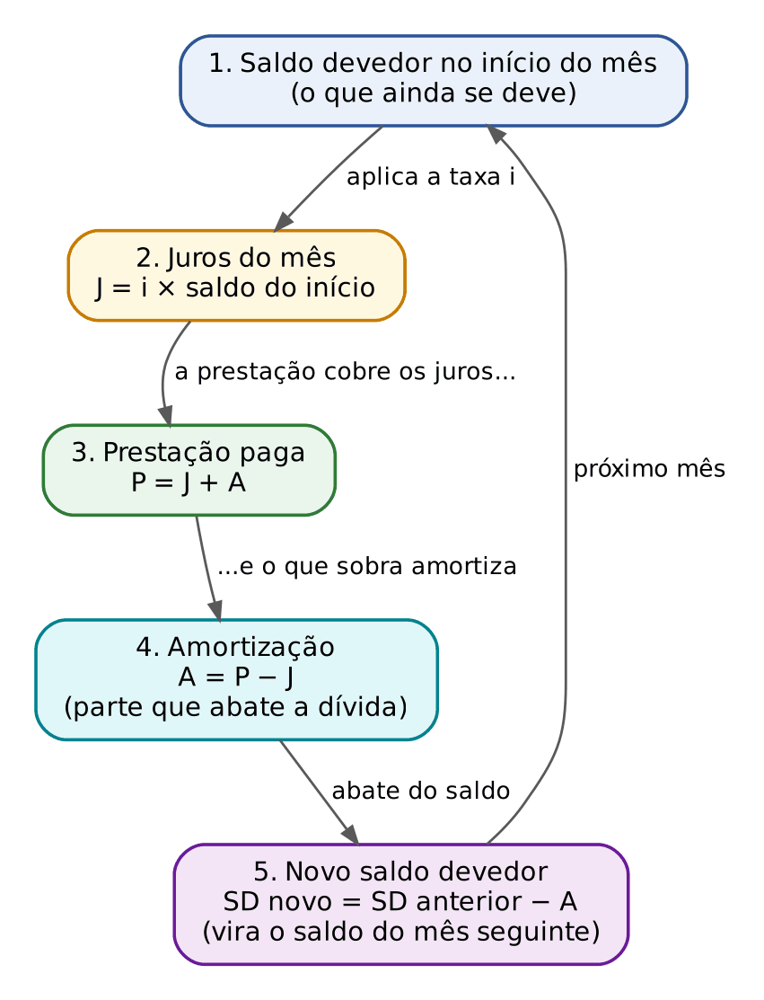

Uma consequência que a banca explora: como a dívida inteira precisa ser devolvida, a SOMA de todas as amortizações é igual ao valor financiado. E a soma de todas as prestações é o valor financiado mais o total de juros.

- A₁ + A₂ + ... + Aₙ = VF
- P₁ + P₂ + ... + Pₙ = VF + total de juros

:::EXEMPLO Um sistema "livre": as três regras funcionando à mão
O senhor tomou 1.000 reais a 10% ao mês e combinou com o credor devolver o principal assim: 500 reais no 1º mês, 300 no 2º e 200 no 3º, pagando sempre, junto, os juros do mês. Montemos a planilha.
Mês 1:
- saldo do início = 1.000
- juros = 0,10 × 1.000 = 100
- amortização combinada = 500
- prestação = 100 + 500 = 600
- novo saldo = 1.000 − 500 = 500
Mês 2:
- juros = 0,10 × 500 = 50 (repare: os juros caíram porque o saldo caiu)
- amortização = 300
- prestação = 50 + 300 = 350
- novo saldo = 500 − 300 = 200
Mês 3:
- juros = 0,10 × 200 = 20
- amortização = 200
- prestação = 20 + 200 = 220
- novo saldo = 200 − 200 = 0 (dívida quitada)
| Mês (k) | Saldo no início | Juros Jₖ | Amortização Aₖ | Prestação Pₖ | Saldo após o pagamento SDₖ |
|---|---|---|---|---|---|
| 0 | — | — | — | — | 1.000 |
| 1 | 1.000 | 100 | 500 | 600 | 500 |
| 2 | 500 | 50 | 300 | 350 | 200 |
| 3 | 200 | 20 | 200 | 220 | 0 |
| Total | — | 170 | 1.000 | 1.170 | — |
Confira as duas somas: amortizações 500 + 300 + 200 = 1.000 (o valor financiado); prestações 600 + 350 + 220 = 1.170 = 1.000 + 170 de juros.
:::

:::PASSO Como montar qualquer planilha de amortização
- Etapa 1: desenhe a tabela com as colunas Mês | Juros | Amortização | Prestação | Saldo devedor, e escreva na linha 0 o saldo inicial (o valor financiado).
- Etapa 2: em cada linha, calcule PRIMEIRO os juros: taxa × saldo da linha de cima.
- Etapa 3: preencha a coluna que o sistema fixa (no SAC, a amortização; na Price, a prestação) e obtenha a outra pela Regra 2 (P = J + A).
- Etapa 4: calcule o novo saldo: saldo de cima menos a amortização.
- Etapa 5: no fim, confira: o último saldo deve ser zero e a soma das amortizações deve dar o valor financiado.
:::

:::ATENCAO Juros sobre o saldo de CIMA
O erro número um do iniciante é calcular os juros do mês k sobre o saldo que fica DEPOIS do pagamento do próprio mês k. Os juros do mês 3 incidem sobre o saldo que existia no começo do mês 3, ou seja, o saldo após a 2ª prestação (SD₂). Pense no aluguel: paga-se pelo tempo em que o imóvel ficou com o inquilino; os juros pagam o tempo em que o dinheiro ficou com o devedor durante aquele mês.
:::

### 07.1.4 O diagrama de fluxo de caixa e a convenção "postecipada"

Os enunciados dizem quase sempre que "a primeira prestação vence um mês após a contratação". Isso é o que se chama de prestações POSTECIPADAS (pagas no FIM de cada período, ver Cap. 6). No diagrama, a seta para cima na data 0 é o dinheiro que o devedor recebe; as setas para baixo, nas datas 1, 2, 3..., são as prestações que ele paga.

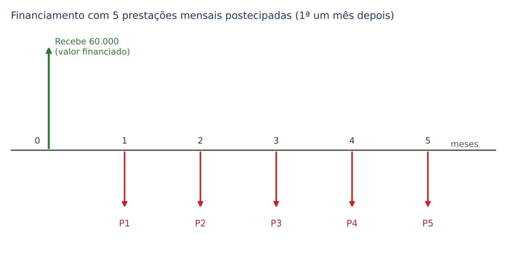

Se nada for dito, presuma prestações postecipadas, sem carência e sem entrada. Quando há entrada (como na questão do imóvel vendido com 25% de entrada, em 7.2), o valor financiado é o preço MENOS a entrada. Quando há carência, veja 7.6.2.

### 07.1.5 O sistema mais simples de todos: o sistema americano

Antes do SAC e da Price, vale conhecer o sistema americano, porque ele mostra a engrenagem em estado puro. Nele, o devedor paga, ao fim de cada período, SÓ os juros; o principal inteiro é devolvido de uma vez, junto com a última prestação. Como nada é amortizado no meio do caminho, o saldo devedor fica parado e os juros são sempre iguais.

:::EXEMPLO Sistema americano: 10.000 reais, 2% ao mês, 4 meses
- juros de cada mês = 0,02 × 10.000 = 200 (o saldo não muda, então os juros não mudam)
- prestações 1, 2 e 3 = 200 cada (só juros; amortização zero)
- prestação 4 = 200 de juros + 10.000 de amortização = 10.200
- total de juros = 4 × 200 = 800
| Mês | Juros | Amortização | Prestação | Saldo devedor |
|---|---|---|---|---|
| 0 | — | — | — | 10.000 |
| 1 | 200 | 0 | 200 | 10.000 |
| 2 | 200 | 0 | 200 | 10.000 |
| 3 | 200 | 0 | 200 | 10.000 |
| 4 | 200 | 10.000 | 10.200 | 0 |
:::

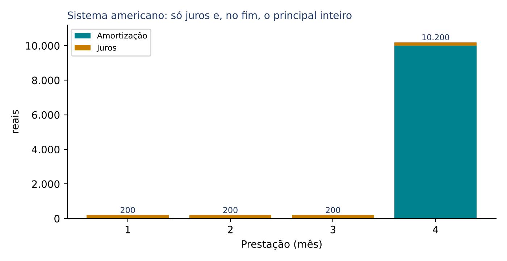

É o modelo de muitos títulos públicos com cupom: o investidor recebe juros periódicos e o principal no vencimento. Como o devedor precisará juntar o principal para o último pagamento, é comum que ele faça depósitos periódicos numa aplicação, o chamado fundo de amortização (em inglês, *sinking fund*); o cálculo desse depósito é o montante de uma série uniforme (Cap. 6). Nas provas, basta saber que no sistema americano: juros constantes, amortização zero até o fim e o principal integral na última data.

:::PRATIQUE 7.1 — exercícios elaborados para esta apostila
1) Um empréstimo de 5.000 reais a 3% ao mês teve a 1ª prestação de 1.150 reais. Quanto dessa prestação foi juros, quanto foi amortização e qual o saldo devedor depois do pagamento?
2) Um empréstimo de 20.000 reais pelo sistema americano, a 1,5% ao mês, por 6 meses. Qual o valor das prestações 1 a 5, o da 6ª e o total de juros?
3) (Estilo FCC) Dívida de 8.000 reais a 5% ao mês. A 1ª prestação foi de 1.000 reais e a 2ª, por dificuldade do devedor, foi de apenas 300 reais. Qual o saldo devedor depois da 2ª prestação?
Resolução 1:
- juros = 0,03 × 5.000 = 150
- amortização = 1.150 − 150 = 1.000
- saldo = 5.000 − 1.000 = 4.000
Resolução 2:
- juros mensais = 0,015 × 20.000 = 300; as prestações 1 a 5 são de 300 reais cada (só juros).
- 6ª prestação = 300 + 20.000 = 20.300.
- total de juros = 6 × 300 = 1.800.
Resolução 3:
- mês 1: juros = 0,05 × 8.000 = 400; amortização = 1.000 − 400 = 600; saldo = 8.000 − 600 = 7.400.
- mês 2: juros = 0,05 × 7.400 = 370; amortização = 300 − 370 = −70 (NEGATIVA: a prestação nem cobriu os juros).
- saldo = 7.400 − (−70) = 7.400 + 70 = 7.470. A dívida AUMENTOU. É a "amortização negativa", tema conhecido nos litígios do SFH (ver 7.6.3).
:::

## 07.2 Sistema de Amortização Constante (SAC)

### 07.2.1 A ideia

No SAC, a regra é a mais intuitiva possível: o principal é dividido em partes IGUAIS, uma para cada prestação. Se o senhor deve 60.000 reais e vai pagar em 5 meses, devolve 12.000 de principal por mês, sempre. Em cima desses 12.000, paga os juros do mês.

Como o saldo devedor cai sempre o mesmo tanto (12.000 por mês), os juros, que são calculados sobre esse saldo, também caem sempre o mesmo tanto. Resultado: as prestações começam altas e vão DIMINUINDO, de forma regular. É o sistema mais usado no financiamento habitacional brasileiro e é a "estrela" das questões da FCC.

### 07.2.2 Exemplo completo feito à mão

:::EXEMPLO SAC: 60.000 reais, 2% ao mês, 5 prestações mensais postecipadas
Passo 1, a amortização constante:
- A = 60.000 ÷ 5
- A = 12.000
Passo 2, mês a mês (juros sobre o saldo de cima; prestação = juros + 12.000; saldo novo = saldo de cima − 12.000):
- mês 1: J₁ = 0,02 × 60.000 = 1.200; P₁ = 12.000 + 1.200 = 13.200; SD₁ = 60.000 − 12.000 = 48.000
- mês 2: J₂ = 0,02 × 48.000 = 960; P₂ = 12.000 + 960 = 12.960; SD₂ = 48.000 − 12.000 = 36.000
- mês 3: J₃ = 0,02 × 36.000 = 720; P₃ = 12.000 + 720 = 12.720; SD₃ = 36.000 − 12.000 = 24.000
- mês 4: J₄ = 0,02 × 24.000 = 480; P₄ = 12.000 + 480 = 12.480; SD₄ = 24.000 − 12.000 = 12.000
- mês 5: J₅ = 0,02 × 12.000 = 240; P₅ = 12.000 + 240 = 12.240; SD₅ = 12.000 − 12.000 = 0
| Mês (k) | Juros Jₖ | Amortização Aₖ | Prestação Pₖ | Saldo devedor SDₖ |
|---|---|---|---|---|
| 0 | — | — | — | 60.000 |
| 1 | 1.200 | 12.000 | 13.200 | 48.000 |
| 2 | 960 | 12.000 | 12.960 | 36.000 |
| 3 | 720 | 12.000 | 12.720 | 24.000 |
| 4 | 480 | 12.000 | 12.480 | 12.000 |
| 5 | 240 | 12.000 | 12.240 | 0 |
| Total | 3.600 | 60.000 | 63.600 | — |
Observe as quatro colunas:
- amortização: constante (12.000);
- saldo devedor: cai 12.000 por mês (60.000, 48.000, 36.000...), em linha reta;
- juros: caem 240 por mês (1.200, 960, 720, 480, 240); 240 é exatamente 0,02 × 12.000, ou seja, i × A;
- prestação: também cai 240 por mês (13.200, 12.960, 12.720...).
:::

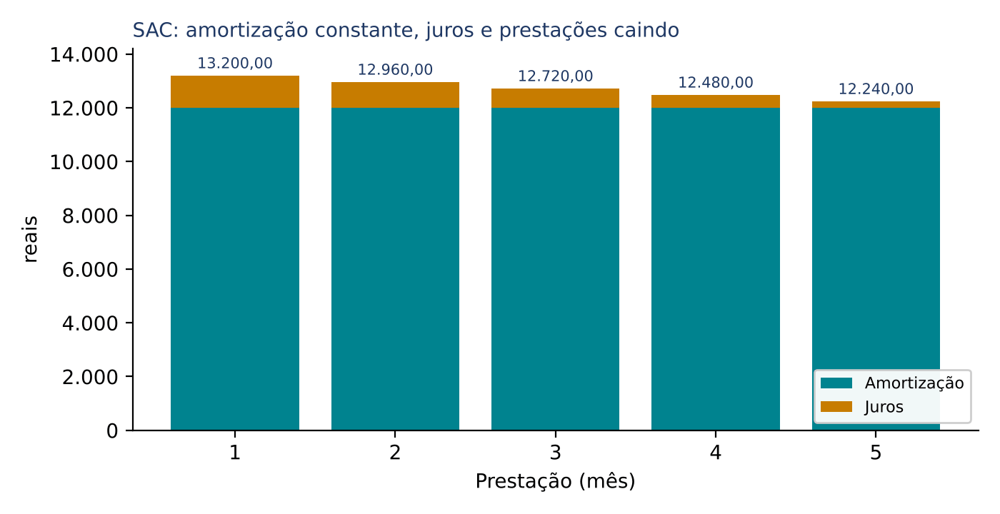

### 07.2.3 Por que os juros caem sempre o mesmo valor: as progressões do SAC

Relembre o Cap. 1: uma progressão aritmética (PA) é uma sequência em que se soma sempre o mesmo número (a razão) para ir de um termo ao seguinte. No SAC:

- o saldo devedor forma uma PA de razão −A (cai A por mês);
- os juros formam uma PA de razão −i × A (porque cada mês o saldo tem A a menos, e os juros são i vezes o saldo, então os juros têm i × A a menos);
- as prestações formam uma PA de razão −i × A (a prestação é A, fixo, mais os juros, que caem i × A).

No exemplo: razão das prestações = −0,02 × 12.000 = −240. Saber isso já resolve muitas questões: se o enunciado dá duas prestações consecutivas do SAC, a diferença entre elas é i × A.

### 07.2.4 As fórmulas para achar qualquer linha sem montar a planilha

A FCC gosta de pedir a 40ª ou a 60ª prestação de um financiamento de 120 meses. Ninguém monta 60 linhas na prova. Precisamos de fórmulas diretas. Vamos construí-las, sem pular passos.

Primeira: a amortização constante.

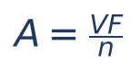

- A = amortização de cada mês (sempre a mesma);
- VF = valor financiado;
- n = número de prestações.

Segunda: o saldo devedor ANTES de pagar a k-ésima prestação. Até ali, já foram pagas k − 1 prestações, e cada uma tirou A do saldo. Então:

- SDₖ₋₁ = VF − (k − 1) × A

Como VF = n × A (o principal é n pedaços de tamanho A), dá para escrever de forma ainda mais simples:

- SDₖ₋₁ = n × A − (k − 1) × A
- SDₖ₋₁ = A × [n − (k − 1)]
- SDₖ₋₁ = A × (n − k + 1)

Traduzindo: o saldo antes da k-ésima prestação é "o número de amortizações que ainda faltam, contando a própria k-ésima" vezes A. Antes da 1ª prestação faltam n pedaços; antes da última falta 1 pedaço.

Terceira: os juros da k-ésima prestação (Regra 1):

- Jₖ = i × SDₖ₋₁
- Jₖ = i × A × (n − k + 1)

Quarta: a k-ésima prestação (Regra 2: amortização mais juros):

- Pₖ = A + i × A × (n − k + 1)

Colocando A em evidência (isto é, "tirando A de dentro" das duas parcelas):

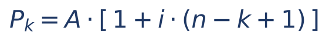

- Pₖ = valor da prestação número k;
- A = amortização constante (VF ÷ n);
- i = taxa do período na forma decimal;
- n = número total de prestações;
- k = a posição da prestação que se quer (1ª, 2ª, ..., n-ésima);
- (n − k + 1) = quantas amortizações ainda faltam pagar, incluída a k-ésima.

Dois casos particulares que caem muito:

- primeira prestação (k = 1): P₁ = A × (1 + i × n), que é o mesmo que P₁ = A + i × VF (amortização mais juros sobre a dívida inteira);
- última prestação (k = n): Pₙ = A × (1 + i), isto é, a amortização acrescida dos juros de um mês sobre ela, porque antes da última só resta um pedaço A de saldo.

Confira com o exemplo de 60.000 reais: P₁ = 12.000 × (1 + 0,02 × 5) = 12.000 × 1,10 = 13.200; P₅ = 12.000 × 1,02 = 12.240. Bate com a planilha.

Quinta: o saldo DEPOIS da k-ésima prestação (o que os enunciados chamam de "saldo devedor imediatamente após o pagamento da k-ésima"):

- SDₖ = VF − k × A = A × (n − k)

Sexta: o total de juros do contrato. Os juros formam uma PA que vai de i × A × n (na 1ª) até i × A × 1 (na última). A soma de uma PA é (primeiro + último) × quantidade ÷ 2 (Cap. 1):

- total de juros = (i × A × n + i × A) × n ÷ 2
- total de juros = i × A × (n + 1) × n ÷ 2

Como A × n = VF:

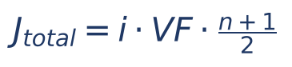

- J total = soma de todos os juros pagos no contrato;
- i = taxa do período; VF = valor financiado; n = número de prestações.

Confira: 0,02 × 60.000 × (5 + 1) ÷ 2 = 1.200 × 6 ÷ 2 = 3.600. Bate com a planilha.

:::DICA O atalho mais rápido para a k-ésima prestação do SAC
Na prova, faça em três linhas:
- A = VF ÷ n
- saldo antes da k-ésima = VF − (k − 1) × A
- Pₖ = A + i × (esse saldo)
Exemplo relâmpago: 120.000 reais, 60 prestações, 2% ao mês, 40ª prestação. A = 2.000; saldo antes da 40ª = 120.000 − 39 × 2.000 = 42.000; P₄₀ = 2.000 + 0,02 × 42.000 = 2.000 + 840 = 2.840. (É uma questão real da FCC, comentada a seguir.)
:::

:::PEGADINHA O "k − 1" que a FCC transforma em alternativa
Para os juros da k-ésima prestação, use o saldo depois de k − 1 pagamentos, não depois de k. A FCC sempre coloca nas alternativas o valor que resulta do erro de usar o saldo depois de k pagamentos (prestação menor do que a certa) e, às vezes, o erro oposto, de usar k − 2 (prestação maior). Se a sua resposta estiver "um degrau" acima ou abaixo de outra alternativa, desconfie e recontinue a contagem.
:::

### 07.2.5 Questões de prova sobre o SAC

:::QUESTAO FGV 2026 — AL-RO — Analista Legislativo (Q3884927)
A questão descreve a prestação do SAC como soma de amortização (devolução de parte do saldo) e juros (custo do dinheiro sobre o saldo que falta) e pergunta o que acontece com as prestações ao longo do tempo. Gabarito oficial: A.
Resolução: no SAC a amortização é constante e o saldo devedor cai sempre; logo os juros, calculados sobre esse saldo, diminuem; como a prestação é amortização fixa mais juros decrescentes, a prestação diminui. É exatamente a alternativa A: prestações cada vez menores, porque a amortização se mantém constante e os juros diminuem.
- B erra ao inverter: no SAC os juros não são constantes (isso ocorre no sistema americano) e a amortização não diminui.
- C descreve prestação constante, que é a característica da Price, e ainda erra ao dizer que juros e amortização são constantes.
- D e E dizem que as prestações crescem, o que contraria a queda do saldo.
:::

:::QUESTAO FGV 2024 — DATAPREV — Contabilidade (Q3085996)
Geladeira de 5.000 reais financiada em 10 prestações mensais pelo SAC, a 5% ao mês, primeira em 30 dias. Pede-se a 2ª prestação. Gabarito oficial: B (725 reais).
Resolução:
- A = 5.000 ÷ 10 = 500
- saldo antes da 2ª = 5.000 − 1 × 500 = 4.500
- J₂ = 0,05 × 4.500 = 225
- P₂ = 500 + 225 = 725
Por que as outras atraem: 750 é a 1ª prestação (500 + 0,05 × 5.000 = 500 + 250) e 700 é a 3ª (500 + 0,05 × 4.000 = 500 + 200). A banca pôs nas alternativas os termos vizinhos da PA de razão −0,05 × 500 = −25. Quem conta errado o número de pagamentos cai neles.
:::

:::QUESTAO FGV 2026 — DATAPREV — Gestão Econômico-Financeira (Q4391156)
Financiamento de 120.000 reais em 6 prestações mensais pelo SAC, a 1,5% ao mês, primeira um mês após a contratação. Pede-se a 4ª prestação. Gabarito oficial: B (20.900 reais).
Resolução:
- A = 120.000 ÷ 6 = 20.000
- saldo antes da 4ª = 120.000 − 3 × 20.000 = 60.000
- J₄ = 0,015 × 60.000 = 900
- P₄ = 20.000 + 900 = 20.900
Pelo atalho: P₄ = 20.000 × [1 + 0,015 × (6 − 4 + 1)] = 20.000 × (1 + 0,045) = 20.000 × 1,045 = 20.900.
As alternativas são, todas, prestações deste mesmo contrato: 21.800 (1ª), 21.500 (2ª), 21.200 (3ª), 20.900 (4ª) e 20.600 (5ª). A razão é −0,015 × 20.000 = −300. Só acerta quem conta corretamente quantas amortizações já foram pagas antes da 4ª (três).
:::

:::QUESTAO FGV 2026 — CFC — Exame de Suficiência (Q4079134)
Financiamento de 240.000 reais para renovação de frota, em 30 pagamentos mensais postecipados pelo SAC, a 4% ao mês. Pede-se o 5º pagamento. Gabarito oficial: C (16.320 reais).
Resolução:
- A = 240.000 ÷ 30 = 8.000
- saldo antes do 5º = 240.000 − 4 × 8.000 = 240.000 − 32.000 = 208.000
- J₅ = 0,04 × 208.000 = 8.320
- P₅ = 8.000 + 8.320 = 16.320
Alternativas sedutoras: 8.320 é só a parcela de juros (esqueceu de somar a amortização); 17.600 é a 1ª prestação (8.000 + 0,04 × 240.000 = 8.000 + 9.600); 16.000 seria o resultado de quem toma os juros sobre um saldo errado (8.000 + 8.000, juros sobre 200.000, isto é, depois de 5 pagamentos em vez de 4).
:::

:::QUESTAO FGV 2026 — AL-RO — Consultor Legislativo, Orçamento (Q3882017)
Empresa pública toma 600.000 reais pelo SAC, a 2% ao mês, em 100 prestações mensais sem carência; após dois anos e meio de pagamentos pontuais, quer saber o valor da 31ª prestação. Gabarito oficial: B (14.400 reais).
Resolução:
- dois anos e meio = 30 meses, então já foram pagas 30 prestações; a próxima é a 31ª (o enunciado confirma).
- A = 600.000 ÷ 100 = 6.000
- saldo antes da 31ª = 600.000 − 30 × 6.000 = 600.000 − 180.000 = 420.000
- J₃₁ = 0,02 × 420.000 = 8.400
- P₃₁ = 6.000 + 8.400 = 14.400
Armadilhas: 18.000 é a 1ª prestação (6.000 + 0,02 × 600.000 = 6.000 + 12.000); 14.520 resulta de usar o saldo depois de 29 pagamentos (600.000 − 29 × 6.000 = 426.000; 0,02 × 426.000 = 8.520; 6.000 + 8.520), o erro do "k − 2".
:::

:::QUESTAO FCC 2025 — SEFAZ-PI — Analista do Tesouro Estadual (Q3506122)
Dívida de 120.000 reais em 60 prestações mensais pelo SAC, a 2% ao mês, primeira um mês após o empréstimo. Pede-se a 40ª prestação. Gabarito oficial: B (2.840 reais).
Resolução:
- A = 120.000 ÷ 60 = 2.000
- saldo antes da 40ª (depois de 39 pagamentos) = 120.000 − 39 × 2.000 = 120.000 − 78.000 = 42.000
- J₄₀ = 0,02 × 42.000 = 840
- P₄₀ = 2.000 + 840 = 2.840
Conferência pelo atalho: P₄₀ = 2.000 × [1 + 0,02 × (60 − 40 + 1)] = 2.000 × (1 + 0,02 × 21) = 2.000 × 1,42 = 2.840.
Como a FCC montou as alternativas: 2.800 é o erro de usar o saldo depois de 40 pagamentos (40.000 × 0,02 = 800); 2.880 é o erro de usar o saldo depois de 38 pagamentos (44.000 × 0,02 = 880); 2.760 e 2.720 são as prestações 43ª e 45ª. Todas são termos da PA de razão −40 (0,02 × 2.000). Moral: a conta é fácil; o ponto da questão é contar certo.
:::

:::QUESTAO FCC 2026 — SEFAZ-SP — Auditor Fiscal da Receita Estadual (Q3916773)
Imóvel de 800.000 reais vendido com 25% de entrada e o restante em 120 prestações mensais pelo SAC, a 2% ao mês, a primeira um mês depois da entrada. Pede-se a soma da 10ª com a 60ª prestação. Gabarito oficial: C (27.200 reais).
Resolução:
Passo 1, o valor financiado (a entrada não é financiada):
- entrada = 0,25 × 800.000 = 200.000
- VF = 800.000 − 200.000 = 600.000
Passo 2, a amortização:
- A = 600.000 ÷ 120 = 5.000
Passo 3, a 10ª prestação:
- saldo antes da 10ª = 600.000 − 9 × 5.000 = 600.000 − 45.000 = 555.000
- J₁₀ = 0,02 × 555.000 = 11.100
- P₁₀ = 5.000 + 11.100 = 16.100
Passo 4, a 60ª prestação:
- saldo antes da 60ª = 600.000 − 59 × 5.000 = 600.000 − 295.000 = 305.000
- J₆₀ = 0,02 × 305.000 = 6.100
- P₆₀ = 5.000 + 6.100 = 11.100
Passo 5, a soma:
- 16.100 + 11.100 = 27.200
Atalho elegante: a soma de dois termos de uma PA pode ser feita de uma vez. P₁₀ + P₆₀ = 2 × 5.000 + 0,02 × (555.000 + 305.000) = 10.000 + 0,02 × 860.000 = 10.000 + 17.200 = 27.200.
Armadilhas: esquecer a entrada e financiar 800.000 leva a uma amortização "quebrada" (6.666,67) e a uma soma que não está em nenhuma alternativa, sinal claro de erro; usar os saldos depois de 10 e de 60 pagamentos (550.000 e 300.000) dá 16.000 + 11.000 = 27.000, que também não consta. Quando nada bate, revise a entrada e a contagem.
:::

:::QUESTAO FGV 2026 — CFC — Bacharelado em Ciências Contábeis (Q4374145)
Empréstimo de 500.000 reais pelo SAC, 40 parcelas mensais postecipadas, 2% ao mês sobre o saldo anterior. Uma das parcelas vale 18.250 reais; qual é ela? Gabarito oficial: B (18º pagamento).
Aqui a pergunta é ao contrário: dá-se a prestação e pede-se a posição k.
Resolução:
- A = 500.000 ÷ 40 = 12.500
- os juros da parcela procurada = 18.250 − 12.500 = 5.750
- esses juros são 2% do saldo antes dela: 0,02 × saldo = 5.750, logo saldo = 5.750 ÷ 0,02 = 287.500
- quantas amortizações faltam (incluída a dela): 287.500 ÷ 12.500 = 23
- pela fórmula, faltam n − k + 1 = 40 − k + 1 = 41 − k; então 41 − k = 23
- k = 41 − 23 = 18
Conferência: P₁₈ = 12.500 + 0,02 × (500.000 − 17 × 12.500) = 12.500 + 0,02 × 287.500 = 12.500 + 5.750 = 18.250.
As alternativas vizinhas (17º e 19º) são o tropeço do "+1": quem escreve "faltam n − k" em vez de "n − k + 1" chega a 40 − k = 23 e k = 17. Confira sempre substituindo o k encontrado na fórmula, como acima.
:::

:::QUESTAO FGV 2024 — Prefeitura de Nova Iguaçu — Auditor Fiscal do Tesouro Municipal (Q3039599)
SAC com 5 prestações mensais postecipadas. A penúltima prestação é de 6.156 reais, dos quais 456 reais são juros. Taxa constante. Em que faixa está a primeira prestação? Gabarito oficial: C (entre 6.800 e 6.850 reais).
Resolução:
Passo 1, a amortização (igual em todas):
- A = 6.156 − 456 = 5.700
Passo 2, a taxa. A penúltima é a 4ª. Antes dela faltavam 2 amortizações (a 4ª e a 5ª), então o saldo era 2 × 5.700 = 11.400. Os juros de 456 são i vezes esse saldo:
- i × 11.400 = 456
- i = 456 ÷ 11.400 = 0,04 (4% ao mês)
Passo 3, o valor financiado e a 1ª prestação:
- VF = 5 × 5.700 = 28.500
- J₁ = 0,04 × 28.500 = 1.140
- P₁ = 5.700 + 1.140 = 6.840 (entre 6.800 e 6.850)
Quem divide 456 pelo saldo errado (por exemplo, 5.700, imaginando que o saldo antes da penúltima era de um pedaço só) acha 8% e chega a 5.700 + 0,08 × 28.500 = 7.980, fora de todas as faixas.
:::

:::PRATIQUE 7.2 — exercícios elaborados para esta apostila
1) SAC: 30.000 reais, 10 prestações mensais, 1% ao mês. Calcule a 1ª e a última prestação e o total de juros.
2) SAC: 90.000 reais, 36 prestações mensais, 1,5% ao mês. a) Qual a 13ª prestação? b) Qual o total de juros? c) Qual prestação vale 3.100 reais?
3) (Estilo FCC) Num SAC à taxa de 2% ao mês, a 1ª prestação foi de 7.200 reais e a 2ª, de 7.080 reais. Qual o valor financiado e o número de prestações?
Resolução 1:
- A = 30.000 ÷ 10 = 3.000
- P₁ = 3.000 + 0,01 × 30.000 = 3.000 + 300 = 3.300
- P₁₀ = A × (1 + i) = 3.000 × 1,01 = 3.030
- total de juros = 0,01 × 30.000 × (10 + 1) ÷ 2 = 300 × 11 ÷ 2 = 3.300 ÷ 2 = 1.650
Resolução 2:
- a) A = 90.000 ÷ 36 = 2.500; saldo antes da 13ª = 90.000 − 12 × 2.500 = 90.000 − 30.000 = 60.000; J₁₃ = 0,015 × 60.000 = 900; P₁₃ = 2.500 + 900 = 3.400.
- b) total de juros = 0,015 × 90.000 × 37 ÷ 2 = 1.350 × 37 ÷ 2 = 49.950 ÷ 2 = 24.975.
- c) juros da parcela = 3.100 − 2.500 = 600; saldo antes dela = 600 ÷ 0,015 = 40.000; amortizações que faltavam = 40.000 ÷ 2.500 = 16; 37 − k = 16 (porque n − k + 1 = 36 − k + 1 = 37 − k); k = 21. É a 21ª prestação.
Resolução 3:
- a diferença entre duas prestações consecutivas do SAC é i × A: 7.200 − 7.080 = 120, então 0,02 × A = 120 e A = 120 ÷ 0,02 = 6.000.
- os juros da 1ª prestação incidem sobre a dívida inteira: J₁ = 7.200 − 6.000 = 1.200; 0,02 × VF = 1.200; VF = 1.200 ÷ 0,02 = 60.000.
- número de prestações: n = VF ÷ A = 60.000 ÷ 6.000 = 10.
:::

## 07.3 Sistema Francês de Amortização (Tabela Price)

### 07.3.1 A ideia

No sistema francês a regra é outra: todas as prestações são IGUAIS. É o carnê da loja de eletrodomésticos e o financiamento de veículo: "10 vezes de 576 reais". O devedor gosta da previsibilidade.

Mas se a prestação é fixa e os juros mudam todo mês, o que se ajusta é a amortização. Veja a lógica, sem fórmula:

- no começo, o saldo é grande, então os juros são grandes e "comem" boa parte da prestação; sobra pouco para amortizar;
- a cada mês o saldo cai um pouco, os juros diminuem e sobra um pouco mais para amortizar;
- no fim, os juros são pequenos e quase toda a prestação é amortização.

Resumo: na Price, a prestação é constante, os juros são decrescentes e as amortizações são crescentes. É o espelho do SAC, onde a amortização é constante e a prestação é decrescente.

### 07.3.2 Exemplo à mão com duas prestações

:::EXEMPLO Price: 1.000 reais, 10% ao mês, 2 prestações iguais
Qual deve ser a prestação P? A ideia (Cap. 6) é que o valor financiado hoje tem de ser EQUIVALENTE às duas prestações futuras. Levemos tudo para a data 2 (a data da última prestação), porque assim não aparecem divisões:
- os 1.000 reais de hoje, levados à data 2, valem 1.000 × 1,1² = 1.000 × 1,21 = 1.210;
- a 1ª prestação, paga na data 1, rende um mês até a data 2: vale P × 1,1;
- a 2ª prestação já está na data 2: vale P.
Igualando o que o credor emprestou ao que recebe, na mesma data:
- 1.210 = 1,1 × P + P
- 1.210 = 2,1 × P
- P = 1.210 ÷ 2,1
- P = 576,19 (arredondado ao centavo)
Agora a planilha, com as três regras de 7.1.3:
- mês 1: J₁ = 0,10 × 1.000 = 100; A₁ = 576,19 − 100 = 476,19; SD₁ = 1.000 − 476,19 = 523,81
- mês 2: J₂ = 0,10 × 523,81 = 52,38; A₂ = 576,19 − 52,38 = 523,81; SD₂ = 523,81 − 523,81 = 0
| Mês | Juros | Amortização | Prestação | Saldo devedor |
|---|---|---|---|---|
| 0 | — | — | — | 1.000,00 |
| 1 | 100,00 | 476,19 | 576,19 | 523,81 |
| 2 | 52,38 | 523,81 | 576,19 | 0,00 |
| Total | 152,38 | 1.000,00 | 1.152,38 | — |
Repare: a amortização cresceu de 476,19 para 523,81. E 523,81 ÷ 476,19 = 1,10. A amortização cresceu exatamente 10%, a taxa de juros. Isso não é coincidência (ver 7.3.5).
:::

### 07.3.3 A fórmula da prestação (relembrando o Cap. 6)

Com muitas prestações, o raciocínio é o mesmo: o valor financiado é o VALOR ATUAL da série de n prestações iguais. Isso foi deduzido no Cap. 6; aqui basta usar o resultado.

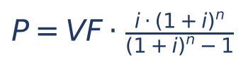

- P = valor de cada prestação (todas iguais);
- VF = valor financiado (o valor atual da série, na data zero);
- i = taxa do período na forma decimal;
- n = número de prestações;
- a fração que multiplica VF chama-se fator de recuperação de capital (FRC): diz quanto de prestação corresponde a cada 1 real financiado.

A mesma fórmula aparece de outros dois jeitos, conforme o dado que a prova fornece:

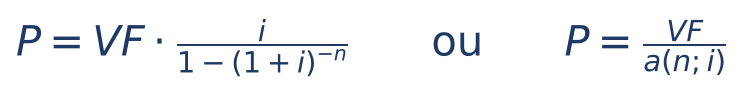

- (1 + i)⁻ⁿ = 1 ÷ (1 + i)ⁿ (potência de expoente negativo é "um dividido pela potência", Cap. 1);
- a(n;i) (lê-se "a de n, i") é o fator de valor atual da série do Cap. 6 (06.4), aquele que aparece nas tabelas financeiras; o fator de recuperação de capital é o seu inverso: FRC = 1 ÷ a(n;i). Em outros livros você poderá ver o mesmo fator escrito com outra notação (por exemplo, "a, n, cantoneira, i"); nesta apostila usamos sempre a(n;i) e s(n;i), como no Cap. 6.

:::DICA Como a prova entrega os números (sem calculadora)
A FCC nunca exige calcular (1,025)¹⁰ à mão. Ela fornece um destes dados, e cada um pede uma conta diferente:
- o FRC pronto ("o fator de recuperação de capital para 2,5% e 10 meses é 0,11426"): P = VF × FRC;
- o fator de valor atual a(n;i), ou uma tabela dele: P = VF ÷ a(n;i);
- uma potência ("considere 1,16⁵ = 2,1" ou "considere 1,1⁻³ = 0,75"): monte a(n;i) = [1 − (1 + i)⁻ⁿ] ÷ i e divida;
- a própria prestação ("cada prestação é de 15.320 reais"): aí a questão quer outra coisa (amortização, saldo), e você nem precisa do fator.
Com 2 ou 3 prestações, o mais rápido é o método do 7.3.2: leve tudo para a data da última prestação e resolva uma equação de primeiro grau.
:::

### 07.3.4 A planilha completa e o gráfico

Usemos o mesmo financiamento do SAC (60.000 reais, 2% ao mês, 5 prestações), para comparar. O fator de valor atual é a(5; 2%) = 4,71346 (dado de tabela).

- P = 60.000 ÷ 4,71346
- P = 12.729,50

:::EXEMPLO Price: 60.000 reais, 2% ao mês, 5 prestações de 12.729,50
- mês 1: J₁ = 0,02 × 60.000 = 1.200,00; A₁ = 12.729,50 − 1.200,00 = 11.529,50; SD₁ = 60.000 − 11.529,50 = 48.470,50
- mês 2: J₂ = 0,02 × 48.470,50 = 969,41; A₂ = 12.729,50 − 969,41 = 11.760,09; SD₂ = 48.470,50 − 11.760,09 = 36.710,41
- mês 3: J₃ = 0,02 × 36.710,41 = 734,21; A₃ = 12.729,50 − 734,21 = 11.995,29; SD₃ = 36.710,41 − 11.995,29 = 24.715,12
- mês 4: J₄ = 0,02 × 24.715,12 = 494,30; A₄ = 12.729,50 − 494,30 = 12.235,20; SD₄ = 24.715,12 − 12.235,20 = 12.479,92
- mês 5: J₅ = 0,02 × 12.479,92 = 249,60; A₅ = 12.729,50 − 249,60 = 12.479,90; SD₅ = 12.479,92 − 12.479,90 = 0,02 (resíduo de arredondamento; na prática, zero)
| Mês | Juros | Amortização | Prestação | Saldo devedor |
|---|---|---|---|---|
| 0 | — | — | — | 60.000,00 |
| 1 | 1.200,00 | 11.529,50 | 12.729,50 | 48.470,50 |
| 2 | 969,41 | 11.760,09 | 12.729,50 | 36.710,41 |
| 3 | 734,21 | 11.995,29 | 12.729,50 | 24.715,12 |
| 4 | 494,30 | 12.235,20 | 12.729,50 | 12.479,92 |
| 5 | 249,60 | 12.479,90 | 12.729,50 | 0 |
| Total | 3.647,52 | 59.999,98 | 63.647,50 | — |
Compare com o SAC do mesmo contrato (7.2.2): lá o total de juros foi 3.600; aqui, 3.647,52. A Price cobra MAIS juros no total, porque devolve o principal mais devagar no começo (o saldo fica mais alto por mais tempo). A taxa é a mesma; o que muda é sobre quanto dinheiro ela incide.
:::

:::ATENCAO Centavos de diferença não são erro
Na Price, a planilha carrega arredondamentos de centavo que se acumulam; por isso o último saldo dá 0,02 em vez de zero e a soma das amortizações dá 59.999,98 ou 60.000,02, conforme o arredondamento. As alternativas da FCC são feitas com os mesmos arredondamentos do gabarito; diferenças de centavos entre a sua conta e uma alternativa indicam a resposta certa, não um erro de raciocínio.
:::

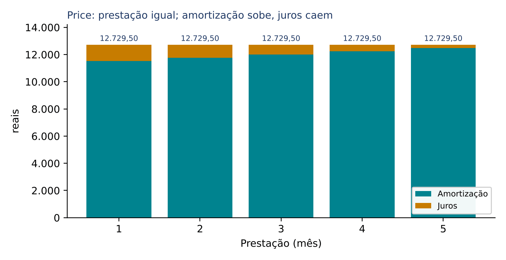

### 07.3.5 Os atalhos da Price (achar uma linha sem montar a planilha)

Primeiro atalho, a primeira linha. Os juros do mês 1 incidem sobre a dívida toda:

- J₁ = i × VF
- A₁ = P − i × VF

Segundo atalho, as amortizações formam uma PG de razão (1 + i). Por quê? Compare dois meses seguidos. De um mês para o outro, o saldo caiu exatamente a amortização Aₖ; então os juros caíram i × Aₖ. Como a prestação é a mesma, o que os juros deixaram de levar foi para a amortização:

- Aₖ₊₁ = Aₖ + i × Aₖ
- Aₖ₊₁ = Aₖ × (1 + i)

Ou seja, cada amortização é a anterior vezes (1 + i): uma progressão geométrica (Cap. 1). No exemplo: 11.529,50 × 1,02 = 11.760,09, que é A₂. Daí a fórmula do termo geral:

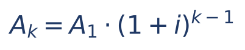

- Aₖ = amortização da prestação k;
- A₁ = amortização da 1ª prestação (P − i × VF);
- (1 + i)ᵏ⁻¹ = o fator de crescimento aplicado k − 1 vezes.

Terceiro atalho, os juros de qualquer prestação: Jₖ = P − Aₖ.

Quarto atalho, o saldo devedor depois da k-ésima prestação. Há dois caminhos.

- Caminho 1 (pela soma das amortizações): SDₖ = VF − (A₁ + A₂ + ... + Aₖ). Bom quando k é pequeno (2, 3 ou 4 amortizações).
- Caminho 2 (pelo valor atual do que falta): o saldo devedor é a quantia que, paga hoje, quitaria a dívida; e a dívida que resta são as n − k prestações ainda não pagas. Logo o saldo é o valor atual dessas prestações restantes:

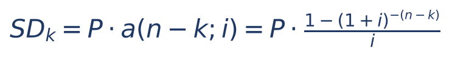

- SDₖ = saldo devedor logo depois de pagar a k-ésima prestação;
- P = prestação;
- n − k = número de prestações que ainda faltam;
- a(n − k;i) = fator de valor atual para n − k prestações (tabela, Cap. 6).

Confira com o exemplo: depois da 2ª prestação faltam 3; a(3; 2%) = 2,88388; SD₂ = 12.729,50 × 2,88388 = 36.710,35, praticamente os 36.710,41 da planilha (a diferença de centavos vem dos arredondamentos do fator e das linhas).

Quinto atalho, o total de juros: soma das prestações menos o valor financiado. Na Price, como as prestações são iguais: total de juros = n × P − VF. No exemplo: 5 × 12.729,50 − 60.000 = 63.647,50 − 60.000 = 3.647,50 (a planilha soma 3.647,52 por causa dos 2 centavos de resíduo).

:::DICA O atalho de ouro: A₁ = P ÷ (1 + i)ⁿ
Juntando as fórmulas, aparece um resultado curioso e muito útil: a 1ª amortização é a prestação "descontada" por n períodos.
- J₁ = i × VF, e VF = P × [1 − (1 + i)⁻ⁿ] ÷ i; então J₁ = P × [1 − (1 + i)⁻ⁿ]
- A₁ = P − J₁ = P − P + P × (1 + i)⁻ⁿ = P × (1 + i)⁻ⁿ
- logo A₁ = P ÷ (1 + i)ⁿ
E, de modo geral, Aₖ = P ÷ (1 + i)ⁿ⁻ᵏ⁺¹; em particular, a última amortização é Aₙ = P ÷ (1 + i). Não é preciso decorar a dedução, só a fórmula. Exemplo: 12.729,50 ÷ 1,10408 = 11.529,5, que é a A₁ da planilha. Quando a prova dá (1 + i)ⁿ e a prestação, a 1ª amortização sai com uma divisão só.
:::

### 07.3.6 Sistema francês e "Tabela Price": são a mesma coisa?

Na prática das provas, sim: "sistema francês", "sistema Price" e "Tabela Price" são usados como sinônimos (prestações iguais). Tecnicamente, a Tabela Price é o caso particular do sistema francês em que o contrato fixa uma taxa NOMINAL anual com capitalização mensal (por exemplo, "12% ao ano, Tabela Price"); a taxa mensal usada nas contas é a proporcional, 12% ÷ 12 = 1% ao mês, e a taxa efetiva anual acaba sendo maior do que 12% (1,01¹² − 1 ≈ 12,68% ao ano; ver Cap. 4 sobre taxa nominal e efetiva). Se o enunciado disser "taxa de 24% ao ano, Tabela Price, prestações mensais", use 2% ao mês.

### 07.3.7 Questões de prova sobre a Price

:::QUESTAO FGV 2024 — Sistema francês (Q2568082)
Afirmativas para julgar: I. todas as prestações têm o mesmo valor; II. é comum em financiamentos de bens de consumo; III. a prestação é o valor financiado vezes um coeficiente K dado por uma fórmula em função de i e n. Gabarito oficial: E (I, II e III).
Resolução: I é a definição do sistema; II é fato de mercado (carnês e crediário usam prestação fixa); III descreve P = VF × FRC, sendo K o fator de recuperação de capital de 7.3.3. Observação: no texto do banco a fórmula do coeficiente K não foi reproduzida (era imagem); presume-se que fosse a do FRC, o que é coerente com o gabarito.
:::

:::QUESTAO FGV 2026 — NAV Brasil — Analista de Gestão (Q4223226)
Financiamento de 5.000 reais pela Tabela Price, 10% ao ano, 4 anos, prestações anuais de 1.577,35 reais. Pede-se a amortização contida na 1ª prestação. Gabarito oficial: B (1.077,35 reais).
Resolução:
- J₁ = 0,10 × 5.000 = 500
- A₁ = 1.577,35 − 500 = 1.077,35
As alternativas são as peças da planilha: 500 é J₁; 1.185,09 é praticamente A₂ (1.077,35 × 1,1 = 1.185,085); 1.303,60 é praticamente A₃ (1.077,35 × 1,21 = 1.303,59); 1.577,35 é a própria prestação. Quem confunde a ordem das parcelas cai numa delas.
:::

:::QUESTAO FCC 2025 — SEFAZ-PI — Analista do Tesouro Estadual (Q3506121)
Dívida de 10.000 reais em 6 prestações mensais iguais de 1.846 reais, a 3% ao mês, sistema francês, primeira um mês após a contratação. Pede-se o saldo devedor logo após a 1ª prestação. Gabarito oficial: C (8.454 reais).
Resolução:
- J₁ = 0,03 × 10.000 = 300
- A₁ = 1.846 − 300 = 1.546
- SD₁ = 10.000 − 1.546 = 8.454
Armadilhas: 9.700 é o erro de abater os juros em vez da amortização (10.000 − 300); quem abate a prestação inteira (10.000 − 1.846 = 8.154) esquece que os juros não reduzem a dívida e chega a um número que nem está entre as alternativas, embora fique perto da B (8.146). A regra que mata a questão: o saldo só cai pela AMORTIZAÇÃO (Regra 3).
:::

:::QUESTAO FGV 2025 — TCE-PE — Auditor de Controle Externo (Q3594937)
Financiamento de 10.000.000 de reais pelo sistema Price, 2 anos, 10% ao ano, parcelas anuais. Pedem-se a prestação e a 1ª amortização, aproximadas. Gabarito oficial: D (5.760.000 e 4.760.000 reais).
Resolução pelo método da data final (7.3.2):
- 10.000.000 × 1,1² = 10.000.000 × 1,21 = 12.100.000
- 12.100.000 = 1,1 × P + P = 2,1 × P
- P = 12.100.000 ÷ 2,1 ≈ 5.761.905 (aproximadamente 5.760.000)
- J₁ = 0,10 × 10.000.000 = 1.000.000
- A₁ = 5.761.905 − 1.000.000 = 4.761.905 (aproximadamente 4.760.000)
Atalho por eliminação: em todas as alternativas exceto a B, prestação menos amortização dá 1.000.000 (os juros do 1º ano), então esse teste só elimina a B. O teste decisivo é a equação 2,1 × P = 12.100.000: 5.500.000 × 2,1 = 11.550.000; 5.680.000 × 2,1 = 11.928.000; 5.760.000 × 2,1 = 12.096.000 (quase exato); 5.860.000 × 2,1 = 12.306.000. Só a D serve. A alternativa A é a armadilha de quem divide 11.000.000 (principal mais um ano de juros simples) por 2.
:::

:::QUESTAO FGV 2024 — Câmara Municipal de São Paulo — Consultor Técnico Legislativo (Q2351959)
Empréstimo quitado em 5 pagamentos anuais postecipados de 6.720 reais pela Tabela Price, a 16% ao ano; considere 1,16⁵ = 2,1. Pede-se a amortização contida na 1ª prestação. Gabarito oficial: E (3.200 reais), conferido no QConcursos em 30/10/2026; coincide com os cálculos abaixo.
Resolução pelo atalho de ouro (7.3.5):
- A₁ = P ÷ (1 + i)ⁿ = 6.720 ÷ 1,16⁵ = 6.720 ÷ 2,1 = 3.200
Resolução pelo caminho longo (para conferir):
- VF = 6.720 × [1 − 1 ÷ 2,1] ÷ 0,16
- 1 − 1 ÷ 2,1 = (2,1 − 1) ÷ 2,1 = 1,1 ÷ 2,1
- 6.720 × 1,1 = 7.392; 7.392 ÷ 2,1 = 3.520; 3.520 ÷ 0,16 = 22.000. O empréstimo foi de 22.000 reais.
- J₁ = 0,16 × 22.000 = 3.520
- A₁ = 6.720 − 3.520 = 3.200
As alternativas vizinhas (3.000 a 3.150) não têm origem em erro identificável; a conta exata cai em 3.200.
:::

:::QUESTAO FCC 2026 — SEFAZ-SP — Auditor Fiscal da Receita Estadual (Q3916772)
Empréstimo em 16 prestações mensais iguais de 15.320 reais, sistema Price, 2,5% ao mês, primeira um mês após. A amortização contida na 2ª prestação é de 10.578 reais. Pede-se o saldo devedor imediatamente após a 3ª prestação. Gabarito oficial: E (168.259,55 reais).
Esta é a questão-modelo da FCC: não dá o valor emprestado; você o descobre.
Passo 1, a 1ª amortização (as amortizações crescem multiplicando por 1,025; para voltar, divide-se):
- A₁ = 10.578 ÷ 1,025 = 10.320 (confira: 10.320 × 1,025 = 10.320 + 258 = 10.578)
Passo 2, os juros da 1ª e o valor emprestado:
- J₁ = 15.320 − 10.320 = 5.000
- J₁ = 0,025 × VF, então VF = 5.000 ÷ 0,025 = 200.000
Passo 3, a 3ª amortização:
- A₃ = 10.578 × 1,025 = 10.578 + 264,45 = 10.842,45
Passo 4, o saldo depois de 3 pagamentos (caminho 1 de 7.3.5):
- soma das amortizações = 10.320 + 10.578 + 10.842,45 = 31.740,45
- SD₃ = 200.000 − 31.740,45 = 168.259,55
Como dividir 10.578 por 1,025 sem calculadora: teste o resultado multiplicando. 10.000 × 1,025 = 10.250; faltam 328; 328 ÷ 1,025 ≈ 320; tente 10.320 × 1,025 = 10.578. Exato.
Alternativa sedutora: 179.102,55 lembra o saldo depois de apenas 2 pagamentos (200.000 − 10.320 − 10.578 = 179.102). É o erro de parar uma linha antes.
:::

:::PRATIQUE 7.3 — exercícios elaborados para esta apostila
1) Price: 2.000 reais, 5% ao mês, 2 prestações. Calcule a prestação e monte a planilha.
2) Price com 24 prestações mensais de 4.000 reais, a 2% ao mês. Dado a(24; 2%) = 18,9139, calcule o valor financiado, a 1ª amortização e a 2ª amortização.
3) (Estilo FCC) Na Price, a 4% ao mês, cada prestação é de 5.000 reais e a 1ª amortização foi de 3.000 reais. Qual o valor financiado e o saldo logo após a 3ª prestação?
4) Na Price, faltam 3 prestações de 1.000 reais, a 2% ao mês. Qual o saldo devedor hoje, logo após o pagamento da última prestação vencida? Use a(3; 2%) = 2,88388.
Resolução 1:
- levando tudo para a data 2: 2.000 × 1,05² = 2.000 × 1,1025 = 2.205
- 2.205 = 1,05 × P + P = 2,05 × P; P = 2.205 ÷ 2,05 = 1.075,61
- mês 1: J₁ = 0,05 × 2.000 = 100; A₁ = 1.075,61 − 100 = 975,61; SD₁ = 2.000 − 975,61 = 1.024,39
- mês 2: J₂ = 0,05 × 1.024,39 = 51,22; A₂ = 1.075,61 − 51,22 = 1.024,39; SD₂ = 0
- conferência: A₂ ÷ A₁ = 1.024,39 ÷ 975,61 ≈ 1,05 (a PG de razão 1 + i).
Resolução 2:
- VF = P × a(24; 2%) = 4.000 × 18,9139 = 75.655,60
- J₁ = 0,02 × 75.655,60 = 1.513,11; A₁ = 4.000 − 1.513,11 = 2.486,89
- A₂ = 2.486,89 × 1,02 = 2.536,63
Resolução 3:
- J₁ = 5.000 − 3.000 = 2.000; VF = 2.000 ÷ 0,04 = 50.000
- A₂ = 3.000 × 1,04 = 3.120; A₃ = 3.120 × 1,04 = 3.244,80
- soma = 3.000 + 3.120 + 3.244,80 = 9.364,80
- SD₃ = 50.000 − 9.364,80 = 40.635,20
Resolução 4:
- o saldo é o valor atual das 3 prestações restantes: SD = 1.000 × 2,88388 = 2.883,88
- conferência por partes: 1.000 ÷ 1,02 + 1.000 ÷ 1,02² + 1.000 ÷ 1,02³ = 980,39 + 961,17 + 942,32 = 2.883,88.
:::

## 07.4 Sistema de Amortização Misto (SAM)

### 07.4.1 A ideia

O SAM é um meio-termo: a prestação de cada mês é a MÉDIA ARITMÉTICA (a soma dividida por dois) da prestação que o SAC cobraria naquele mês com a prestação que a Price cobraria, para o mesmo valor, a mesma taxa e o mesmo prazo. Foi pensado para suavizar a prestação inicial alta do SAC sem chegar ao total de juros mais alto da Price.

- Pₖ do SAM = prestação k no sistema misto;
- Pₖ do SAC = prestação k calculada como se o contrato fosse SAC (7.2.4);
- P da Price = a prestação constante calculada como se o contrato fosse Price (7.3.3).

A média vale também para as outras colunas: a amortização do SAM é a média das amortizações dos dois sistemas, os juros são a média dos juros e o saldo é a média dos saldos. Na prova, porém, quase sempre se pede só a prestação.

### 07.4.2 Exemplo completo

:::EXEMPLO SAM: 60.000 reais, 2% ao mês, 5 prestações
Já temos as duas planilhas (7.2.2 e 7.3.4). Basta tirar a média, linha a linha:
- P₁ = (13.200 + 12.729,50) ÷ 2 = 25.929,50 ÷ 2 = 12.964,75
- P₂ = (12.960 + 12.729,50) ÷ 2 = 25.689,50 ÷ 2 = 12.844,75
- P₃ = (12.720 + 12.729,50) ÷ 2 = 25.449,50 ÷ 2 = 12.724,75
- P₄ = (12.480 + 12.729,50) ÷ 2 = 25.209,50 ÷ 2 = 12.604,75
- P₅ = (12.240 + 12.729,50) ÷ 2 = 24.969,50 ÷ 2 = 12.484,75
| Mês | Prestação SAC | Prestação Price | Prestação SAM | Juros SAM (média) |
|---|---|---|---|---|
| 1 | 13.200,00 | 12.729,50 | 12.964,75 | 1.200,00 |
| 2 | 12.960,00 | 12.729,50 | 12.844,75 | 964,71 |
| 3 | 12.720,00 | 12.729,50 | 12.724,75 | 727,11 |
| 4 | 12.480,00 | 12.729,50 | 12.604,75 | 487,15 |
| 5 | 12.240,00 | 12.729,50 | 12.484,75 | 244,80 |
Repare: as prestações do SAM caem 120 por mês, metade dos 240 do SAC. Isso é geral: como a parte Price é constante, a prestação do SAM forma uma PA de razão −i × A ÷ 2. O total de juros do SAM (3.623,76) também fica no meio: entre o SAC (3.600) e a Price (3.647,52).
:::

:::PASSO Como resolver qualquer questão de SAM
- Etapa 1: calcule a prestação constante da Price (com o FRC, o a(n;i) ou a potência dados), ou pegue-a pronta do enunciado.
- Etapa 2: calcule a k-ésima prestação do SAC pelo atalho de 7.2.4 (A = VF ÷ n; saldo antes da k-ésima; Pₖ = A + i × saldo).
- Etapa 3: tire a média das duas.
- Variante "de trás para frente": se o enunciado dá a prestação do SAM e a do SAC, a da Price é 2 × SAM − SAC (porque SAM = (SAC + Price) ÷ 2, logo 2 × SAM = SAC + Price).
:::

### 07.4.3 Questões de prova sobre o SAM

:::QUESTAO FCC 2025 — SEFAZ-PI — Analista do Tesouro Estadual (Q3506123)
Empréstimo de 50.000 reais em 10 prestações mensais pelo sistema misto, a 2,5% ao mês, primeira um mês após. Dado o FRC para 2,5% e 10 meses igual a 0,11426, pede-se a 6ª prestação. Gabarito oficial: E (5.669 reais).
Resolução:
Etapa 1, Price:
- P = 50.000 × 0,11426 = 5.713
Etapa 2, SAC, 6ª prestação:
- A = 50.000 ÷ 10 = 5.000
- saldo antes da 6ª = 50.000 − 5 × 5.000 = 25.000
- J₆ = 0,025 × 25.000 = 625
- P₆ do SAC = 5.000 + 625 = 5.625
Etapa 3, média:
- (5.713 + 5.625) ÷ 2 = 11.338 ÷ 2 = 5.669
Como a FCC montou as alternativas: 5.713 (B) é só a Price; 5.625 (D) é só o SAC; 5.731,50 (C) é a média com a 5ª prestação do SAC (5.750) e 5.606,50 (A) é a média com a 7ª (5.500): os dois erros de contagem.
:::

:::QUESTAO FGV 2026 — DATAPREV — Gestão Econômico-Financeira (Q4391158)
Financiamento de 136.500 reais em 3 prestações mensais pelo SAM, a 20% ao mês; a prestação da Price para as mesmas condições é de 64.800 reais. Pede-se a 3ª prestação do SAM. Gabarito oficial: B (59.700 reais).
Resolução:
- A = 136.500 ÷ 3 = 45.500
- 3ª prestação do SAC = A × (1 + i) = 45.500 × 1,2 = 54.600 (antes da última só resta um pedaço de saldo)
- SAM = (54.600 + 64.800) ÷ 2 = 119.400 ÷ 2 = 59.700
Armadilhas: 54.600 (A) é só o SAC; 64.800 (D) é só a Price; 68.800 (E) é a 1ª prestação do SAM [(72.800 + 64.800) ÷ 2, com a 1ª do SAC = 45.500 + 0,2 × 136.500 = 45.500 + 27.300 = 72.800]; 63.700 (C) é a 2ª prestação do SAC (45.500 + 0,2 × 91.000 = 45.500 + 18.200).
:::

:::QUESTAO FGV 2024 — Câmara de Fortaleza — Contador (Q2458803)
Empréstimo de 80.000 reais em 5 pagamentos mensais postecipados, a 8% ao mês. Pelo SAM, a 2ª prestação seria de 20.578,26 reais. Se fosse contratado pela Price, qual seria a 4ª prestação? Gabarito oficial: B (20.036,52 reais).
A pegadinha está em "4ª prestação": na Price todas são iguais. Basta achar a prestação da Price.
- A = 80.000 ÷ 5 = 16.000
- 2ª do SAC = 16.000 + 0,08 × (80.000 − 16.000) = 16.000 + 0,08 × 64.000 = 16.000 + 5.120 = 21.120
- Price = 2 × SAM − SAC = 2 × 20.578,26 − 21.120 = 41.156,52 − 21.120 = 20.036,52
Quem tenta calcular a "4ª prestação" da Price como se fosse diferente das outras perde tempo; quem calcula a 4ª prestação do SAC (16.000 + 0,08 × 32.000 = 18.560) cai fora das alternativas.
:::

:::QUESTAO FGV 2024 — Câmara Municipal de São Paulo — Consultor Técnico Legislativo (Q2351962)
Empréstimo em 6 pagamentos anuais postecipados, a 7% ao ano. Pelo SAC, a 3ª prestação seria de 3.200 reais; pelo SAM, de 3.175 reais; considere 1,07⁶ = 1,5. Em que faixa está o valor do empréstimo? Gabarito oficial: E (entre 14.800 e 15.200 reais), conferido no QConcursos em 30/10/2026; coincide com os cálculos abaixo.
Caminho 1, só com o SAC (o mais rápido):
- P₃ = A × [1 + 0,07 × (6 − 3 + 1)] = A × (1 + 0,28) = 1,28 × A
- 1,28 × A = 3.200, logo A = 3.200 ÷ 1,28 = 2.500
- VF = 6 × 2.500 = 15.000
Caminho 2, pela Price (confirma o resultado):
- Price = 2 × 3.175 − 3.200 = 6.350 − 3.200 = 3.150
- a(6; 7%) = [1 − 1 ÷ 1,5] ÷ 0,07 = (1 ÷ 3) ÷ 0,07 = 1 ÷ 0,21
- VF = 3.150 × (1 ÷ 0,21) = 3.150 ÷ 0,21 = 15.000
Os dois caminhos dão 15.000. Lição de prova: às vezes o enunciado traz dados de sobra; use o caminho que pede menos conta.
:::

:::PRATIQUE 7.4 — exercícios elaborados para esta apostila
1) Empréstimo de 40.000 reais em 4 prestações mensais pelo SAM, a 5% ao mês. Dado o FRC(4; 5%) = 0,282012, calcule a 1ª prestação.
2) No mesmo contrato, calcule a 3ª prestação do SAM.
3) (Estilo FCC) Num contrato, a k-ésima prestação seria de 9.500 reais pelo SAC e de 9.000 reais pelo SAM. Qual a prestação pela Price?
Resolução 1:
- Price: P = 40.000 × 0,282012 = 11.280,48
- SAC: A = 40.000 ÷ 4 = 10.000; P₁ = 10.000 + 0,05 × 40.000 = 10.000 + 2.000 = 12.000
- SAM: (12.000 + 11.280,48) ÷ 2 = 23.280,48 ÷ 2 = 11.640,24
Resolução 2:
- SAC: saldo antes da 3ª = 40.000 − 2 × 10.000 = 20.000; P₃ = 10.000 + 0,05 × 20.000 = 11.000
- SAM: (11.000 + 11.280,48) ÷ 2 = 22.280,48 ÷ 2 = 11.140,24
- conferência pela PA: a razão do SAM é −0,05 × 10.000 ÷ 2 = −250; de P₁ a P₃ são dois passos: 11.640,24 − 500 = 11.140,24.
Resolução 3:
- Price = 2 × 9.000 − 9.500 = 18.000 − 9.500 = 8.500
:::

## 07.5 Comparação entre os sistemas

### 07.5.1 O que muda e o que não muda

Para comparar com nitidez, usemos um contrato mais longo: 100.000 reais, 5% ao mês, 20 prestações mensais. Calculando como nas seções anteriores:

- SAC: A = 100.000 ÷ 20 = 5.000; P₁ = 5.000 + 0,05 × 100.000 = 10.000; P₂₀ = 5.000 × 1,05 = 5.250;
- Price: P = 8.024,26 (pela fórmula do FRC, com 1,05²⁰ ≈ 2,6533);
- SAM: P₁ = (10.000 + 8.024,26) ÷ 2 = 9.012,13; P₂₀ = (5.250 + 8.024,26) ÷ 2 = 6.637,13.

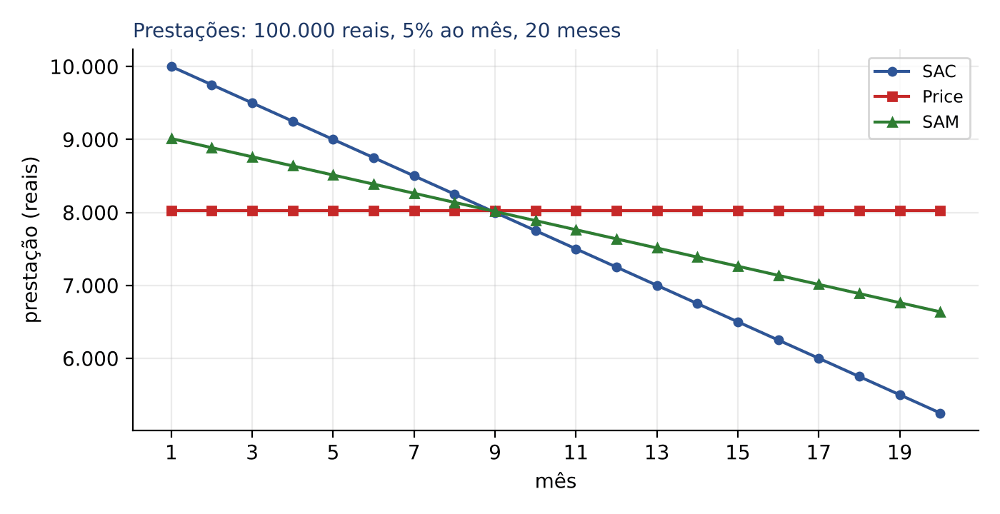

Leitura do gráfico:

- a reta azul (SAC) começa no alto e desce em linha reta (PA decrescente);
- a reta vermelha (Price) é horizontal (prestação constante);
- a verde (SAM) desce com metade da inclinação do SAC, sempre entre as duas;
- as três se cruzam no mesmo ponto (por volta da 9ª prestação, neste contrato): antes dele, o SAC cobra mais que a Price; depois, menos. O SAM cruza ali porque é a média: quando SAC e Price coincidem, a média também coincide.

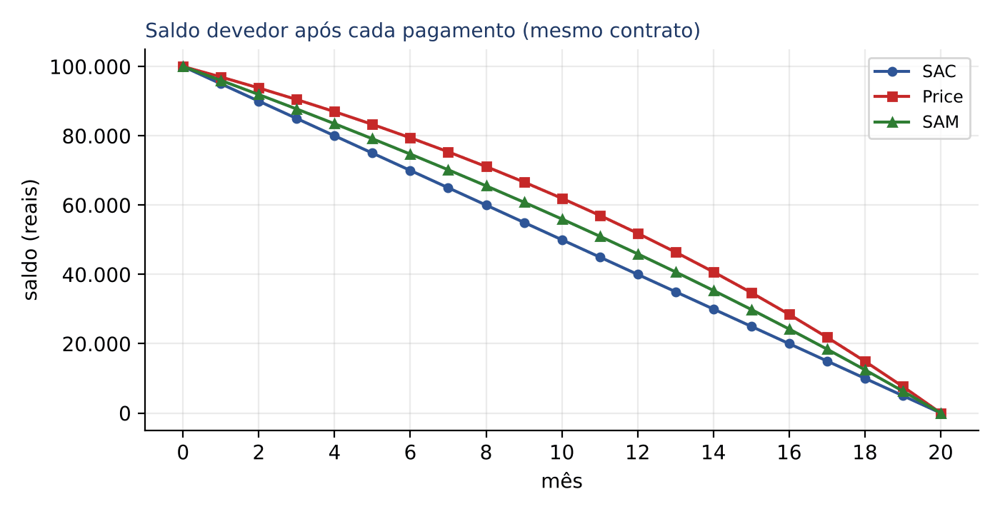

O saldo do SAC cai em linha reta; o da Price é uma curva que cai devagar no começo e rápido no fim (porque a amortização cresce). Depois de 10 pagamentos, o saldo do SAC é 50.000 (metade), enquanto o da Price ainda é 61.961,20. Como o saldo da Price fica mais alto por mais tempo, os juros da Price são maiores em todos os meses (salvo o 1º, em que são iguais):

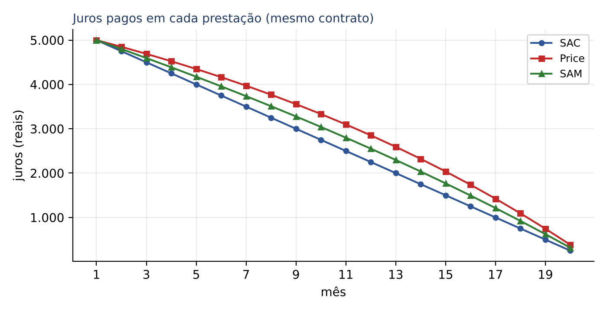

Totais de juros neste contrato:

- SAC: 0,05 × 100.000 × 21 ÷ 2 = 5.000 × 21 ÷ 2 = 52.500;
- Price: 20 × 8.024,26 − 100.000 = 160.485,20 − 100.000 = 60.485,20 (o valor exato, sem arredondar a prestação, é 60.485,17);
- SAM: (52.500 + 60.485,17) ÷ 2 ≈ 56.492,59.

Ordem que sempre vale (mesmo valor, mesma taxa positiva, mesmo prazo, mais de uma prestação): total de juros do SAC < SAM < Price. Isso NÃO significa que a Price seja "mais cara" no sentido financeiro: todos os sistemas cobram a mesma taxa sobre o saldo; a Price paga mais juros porque o devedor fica mais tempo com mais dinheiro do banco. A valor presente, à taxa do contrato, todos os sistemas equivalem exatamente ao valor financiado.

| Característica | SAC | Price (francês) | SAM | Americano |
|---|---|---|---|---|
| Amortização | constante (VF ÷ n) | crescente, PG de razão (1 + i) | média das duas (crescente) | zero até o fim; VF na última |
| Juros | decrescentes, PA de razão −i × A | decrescentes (mais devagar) | média (decrescentes) | constantes (i × VF) |
| Prestação | decrescente, PA de razão −i × A | constante | decrescente, PA de razão −i × A ÷ 2 | constante (só juros) e a última com o principal |
| Saldo devedor | cai em linha reta | cai em curva (devagar no início) | entre os dois | constante até a última |
| 1ª prestação | a maior das três | a menor das três | intermediária | só juros |
| Última prestação | a menor: A × (1 + i) | igual às demais | intermediária | a maior: VF × (1 + i) |
| Total de juros | o menor | o maior (dos três) | intermediário | o maior de todos |

:::PEGADINHA Afirmações falsas que a banca repete
- "Todos os sistemas geram o mesmo total de juros": FALSO (SAC < SAM < Price).
- "No SAC, os juros são constantes": FALSO (constante é a amortização; juros constantes são do sistema americano).
- "Na Price, a amortização é constante": FALSO (constante é a prestação; a amortização cresce).
- "Na Price, a 1ª prestação é maior que no SAC": FALSO (é menor; a prestação do SAC só fica abaixo da Price da metade do prazo em diante, aproximadamente).
- "No SAM, a prestação é a média geométrica...": FALSO; é a média ARITMÉTICA.
:::

### 07.5.2 Questões de prova comparativas

:::QUESTAO FGV 2025 — SEFAZ-RS — Auditor do Estado (Q3154009)
Empréstimo de 12.000 reais em 3 parcelas anuais a 10% ao ano, pelo SAC (opção A) ou pelo sistema francês (opção B); considere 1,1⁻³ = 0,75. Qual conclusão é correta, considerando a 1ª parcela e a evolução das parcelas? Gabarito oficial: D.
Resolução numérica:
- SAC: A = 12.000 ÷ 3 = 4.000; P₁ = 4.000 + 0,10 × 12.000 = 4.000 + 1.200 = 5.200
- Francês: P = 12.000 × 0,10 ÷ (1 − 0,75) = 1.200 ÷ 0,25 = 4.800
A 1ª parcela do SAC (5.200) é maior que a do francês (4.800); as do SAC decrescem e as do francês são iguais. É a alternativa D.
- A erra: diz que a 1ª do francês é maior.
- B inverte: no SAC os juros também decrescem; em nenhum dos dois os juros são constantes.
- C inverte o comportamento das parcelas.
- E ignora que os sistemas distribuem o principal de modo diferente.
Nota: com 1,1⁻³ exato (0,7513), a prestação francesa seria 4.825,38; a banca arredondou para facilitar a conta, o que não muda a conclusão.
:::

:::QUESTAO FGV 2025 — Comparação SAC × Price (Q3185954)
Mesmo empréstimo de 12.000 reais, 3 parcelas anuais, 10% ao ano. Julgar: I. no SAC as parcelas diminuem; II. na Price as parcelas são fixas; III. a 1ª parcela do SAC é maior que a 1ª da Price. Gabarito oficial: E (I, II e III).
Resolução: I e II são as definições; III foi provada na questão anterior (5.200 contra cerca de 4.825). Regra geral: a 1ª do SAC é A + i × VF; a da Price é menor porque, para manter as prestações iguais, ela "empurra" parte da amortização para o futuro.
:::

:::QUESTAO FGV 2025 — TCE-RR — Auditor Substituto de Conselheiro (Q3174687)
Julgar quatro afirmativas sobre Price, SAC e SAM. Gabarito oficial: D (I, II e III).
- I (Price: parcelas fixas, amortização crescente, juros decrescentes): correta.
- II (SAC: parcela decrescente porque a amortização é fixa e os juros caem): correta.
- III (SAM: média aritmética das parcelas do SAC e da Price): correta.
- IV (todos garantem o mesmo total de juros): ERRADA. No exemplo de 7.5.1: 52.500 no SAC, cerca de 56.493 no SAM e cerca de 60.485 na Price.
:::

:::QUESTAO FGV 2024 — AL-TO — Analista Legislativo, Economia (Q2457770)
Verdadeiro ou falso: (1) no SAC os juros decrescem, a cada período, um valor constante igual a i × VA (VA = valor da amortização); (2) na Price as amortizações crescem em PG de razão (1 + i); (3) a última prestação do SAC é VA × (1 + i). Gabarito oficial: A (V – V – V).
- (1) Verdadeira: a razão da PA dos juros do SAC é −i × A (7.2.3). O enunciado fala em "taxa constante igual a i × VA", querendo dizer diminuição de valor constante.
- (2) Verdadeira: Aₖ₊₁ = Aₖ × (1 + i) (7.3.5).
- (3) Verdadeira: antes da última, o saldo é um único pedaço A; os juros são i × A; a prestação é A + i × A = A × (1 + i).
:::

:::QUESTAO FGV 2024 — AL-PR — Analista Legislativo, Economista (Q2451628)
Financiamento de 100.000 reais, 10 meses, 5% ao mês. Em quais sistemas a 1ª e a última prestações são, respectivamente, maiores? Gabarito oficial: D (constante e francês), conferido no QConcursos em 30/10/2026; coincide com os cálculos abaixo.
Resolução:
- SAC: A = 10.000; P₁ = 10.000 + 5.000 = 15.000; P₁₀ = 10.000 × 1,05 = 10.500
- Price: P = 100.000 × FRC(10; 5%) ≈ 12.950,46 (constante)
- 1ª prestação maior: SAC (15.000 contra 12.950,46); última maior: Price (12.950,46 contra 10.500). Alternativa D: "constante e francês".
Mesmo sem o valor da Price, a regra de 7.5.1 resolve: o SAC começa acima e termina abaixo.
:::

:::PRATIQUE 7.5 — exercícios elaborados para esta apostila
Julgue certo ou errado, justificando.
1) Para o mesmo contrato, o saldo devedor depois da metade das prestações é maior na Price do que no SAC.
2) Se a taxa de juros for zero, SAC e Price produzem a mesma planilha.
3) No SAM, a amortização de cada mês é constante.
4) Num SAC de 10 prestações, a diferença entre a 3ª e a 4ª prestação é igual à diferença entre a 8ª e a 9ª.
Resolução:
1) Certo. No SAC, depois de n ÷ 2 pagamentos, o saldo é exatamente metade da dívida; na Price, as amortizações iniciais são menores, então se amortizou menos que a metade e o saldo é maior (no exemplo de 7.5.1: 50.000 contra 61.961,20).
2) Certo. Com i = 0 não há juros; a prestação da Price seria VF ÷ n, que é também a amortização do SAC; as duas planilhas coincidem. (Situação teórica, útil para entender que a diferença entre os sistemas nasce dos juros.)
3) Errado. A amortização do SAM é a média de uma constante (SAC) com uma sequência crescente (Price); logo é crescente.
4) Certo. No SAC as prestações formam uma PA; toda diferença entre termos consecutivos é a mesma razão, i × A.
:::

## 07.6 Outros sistemas e a ponte com o Direito

### 07.6.1 SACRE (Sistema de Amortização Crescente)

O SACRE apareceu em questão da FGV e merece uma noção. A prestação é calculada como a 1ª do SAC (amortização VF ÷ n mais juros sobre o saldo) e mantida FIXA por um subperíodo (por exemplo, 12 meses ou, na questão abaixo, 3 anos); ao fim do subperíodo, é recalculada da mesma forma sobre o saldo que restou. Dentro de cada subperíodo a prestação não muda e os juros caem, então a amortização cresce: daí o nome.

:::QUESTAO FGV 2024 — SACRE (Q3157875)
Empréstimo de 360.000 reais em 30 pagamentos anuais, a 10% ao ano, pelo SACRE com subperíodos de 3 anos (as três primeiras prestações iguais, recalculadas a partir da 4ª). Pede-se quanto o 3º pagamento amortiza. Gabarito oficial: E (14.520 reais).
Resolução:
Passo 1, a prestação do primeiro subperíodo (como a 1ª do SAC):
- A do SAC = 360.000 ÷ 30 = 12.000
- juros do 1º ano = 0,10 × 360.000 = 36.000
- prestação = 12.000 + 36.000 = 48.000 (fixa nos anos 1, 2 e 3)
Passo 2, planilha dos três primeiros anos (prestação fixa; juros sobre o saldo; amortização = prestação − juros):
- ano 1: J = 36.000; A = 48.000 − 36.000 = 12.000; saldo = 360.000 − 12.000 = 348.000
- ano 2: J = 0,10 × 348.000 = 34.800; A = 48.000 − 34.800 = 13.200; saldo = 348.000 − 13.200 = 334.800
- ano 3: J = 0,10 × 334.800 = 33.480; A = 48.000 − 33.480 = 14.520
A armadilha principal é 13.200 (alternativa C), a amortização do 2º ano: erro de contagem. Repare que, dentro do subperíodo, as amortizações crescem 10% ao ano (12.000; 13.200; 14.520), exatamente como na Price: com prestação fixa, a amortização sempre cresce à razão (1 + i).
:::

### 07.6.2 Carência

Carência é um prazo inicial sem pagamento de amortização. Há duas modalidades, e o enunciado diz qual:

- carência com pagamento dos juros: durante a carência, o devedor paga só os juros (como no sistema americano); o saldo não muda e, terminada a carência, aplica-se o sistema contratado sobre o valor original;
- carência com capitalização dos juros: nada é pago; os juros se incorporam ao saldo, que cresce a juros compostos (Cap. 3). Exemplo: 10.000 reais, 2% ao mês, 2 meses de carência capitalizada: saldo ao fim da carência = 10.000 × 1,02² = 10.000 × 1,0404 = 10.404. É sobre 10.404 que se monta a planilha (SAC, Price ou SAM), com a 1ª prestação no mês seguinte.

Na Price com carência capitalizada, o mesmo resultado se obtém pela série diferida do Cap. 6.

### 07.6.3 A Tabela Price no Judiciário e no SFH (noção)

Para o magistrado, a planilha deste capítulo é a ferramenta para ler laudos periciais em ações revisionais. Três observações de matemática, com remissão ao tratamento jurídico:

- na Price há sempre juros sobre o saldo, que é o que se deve; matematicamente, a prestação fixa é calculada com juros compostos (a fórmula do FRC usa potências de 1 + i), e por isso a discussão sobre se a Tabela Price "embute capitalização" é recorrente; a orientação do STJ no Tema 572 dos recursos repetitivos (Corte Especial, Relator Ministro Luis Felipe Salomão, j. 3/12/2014) é a de que a existência de capitalização na Tabela Price é questão de fato e não de direito, a depender da interpretação do contrato e de prova técnica; o tema está exposto na Apostila de Direito Civil, Cap. 22, item 22.3.4;
- "amortização negativa" é a situação do PRATIQUE 7.1, exercício 3: a prestação paga é menor do que os juros do mês, a diferença se incorpora ao saldo e a dívida cresce; nos contratos do SFH com prestação reajustada por índice diferente do que corrige o saldo, isso ocorria com frequência (ver Apostila de Direito Civil, Cap. 22, itens 22.3.4 e 22.7);
- o SAC, por ter juros totais menores e saldo que cai em linha reta, tornou-se o sistema mais usado no financiamento habitacional; a Price continua dominante no crédito ao consumo e de veículos.

## 07.7 Roteiro geral para qualquer questão de amortização

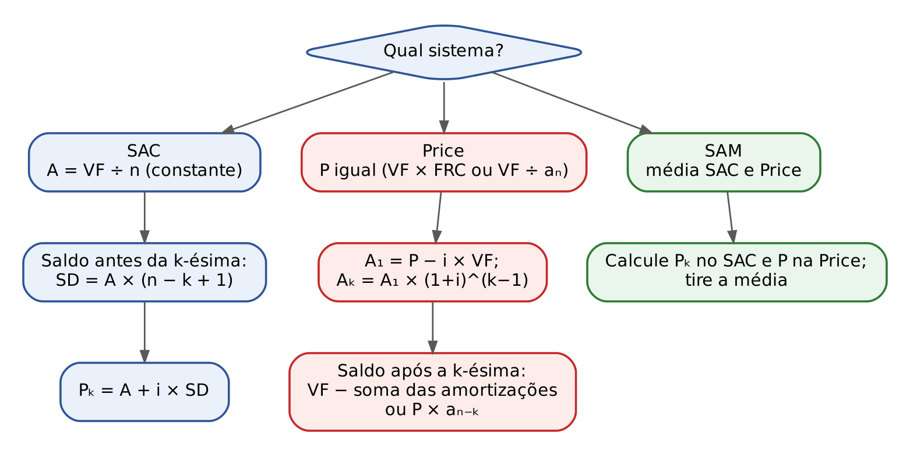

:::PASSO Como resolver qualquer questão de amortização
- Etapa 1, identifique o sistema e o valor financiado. Desconte a entrada; verifique se há carência; confirme se as prestações são postecipadas ("a 1ª vence um mês após").
- Etapa 2, ajuste a taxa ao período das prestações (taxa mensal para prestações mensais; se vier taxa nominal anual "Tabela Price", divida por 12; ver Cap. 4).
- Etapa 3, SAC: A = VF ÷ n; saldo antes da k-ésima = VF − (k − 1) × A; Pₖ = A + i × saldo. Se a questão der uma prestação e pedir a posição, faça o caminho inverso (Q4374145).
- Etapa 4, Price: P = VF × FRC (ou VF ÷ a(n;i)); A₁ = P − i × VF (ou P ÷ (1 + i)ⁿ); Aₖ = A₁ × (1 + i)ᵏ⁻¹; saldo depois da k-ésima = VF − soma das amortizações ou P × a(n − k;i). Se a questão der uma amortização intermediária, volte dividindo por (1 + i) até A₁ e ache VF por J₁ = P − A₁ = i × VF (Q3916772).
- Etapa 5, SAM: calcule as duas prestações e tire a média; ou use Price = 2 × SAM − SAC.
- Etapa 6, antes de marcar: confira se a sua resposta não é a prestação vizinha (erro de contagem), só os juros ou só a amortização. A FCC monta as alternativas exatamente com esses números.
:::

## 07.8 Resumo para revisão pré-prova

| Conceito | Fórmula ou regra | Quando usar | Armadilha |
|---|---|---|---|
| Juros do período (qualquer sistema) | Jₖ = i × SDₖ₋₁ | sempre: juros sobre o saldo de antes do pagamento | usar o saldo depois do próprio pagamento |
| Composição da prestação | Pₖ = Jₖ + Aₖ | sempre | achar que a prestação inteira abate a dívida |
| Saldo devedor | SDₖ = SDₖ₋₁ − Aₖ | sempre | abater os juros ou a prestação em vez da amortização |
| Soma das amortizações | A₁ + ... + Aₙ = VF | conferência; saldo da Price por subtração | esquecer de descontar a entrada do VF |
| Sistema americano | juros i × VF em todas; VF na última | enunciado "paga só os juros" | confundir com SAC ("juros constantes") |
| SAC: amortização | A = VF ÷ n | toda questão de SAC | — |
| SAC: k-ésima prestação | Pₖ = A + i × [VF − (k − 1) × A] = A × [1 + i × (n − k + 1)] | "qual a 40ª prestação" | contar k em vez de k − 1 pagamentos |
| SAC: 1ª e última | P₁ = A + i × VF; Pₙ = A × (1 + i) | atalhos | — |
| SAC: progressões | prestações e juros em PA de razão −i × A | duas prestações dadas: diferença = i × A | — |
| SAC: total de juros | i × VF × (n + 1) ÷ 2 | "total de juros pagos" | dividir por n em vez de 2 |
| Price: prestação | P = VF × FRC = VF ÷ a(n;i) | toda questão de Price | usar taxa nominal anual sem converter |
| Price: 1ª amortização | A₁ = P − i × VF = P ÷ (1 + i)ⁿ | "amortização da 1ª prestação" | confundir A₁ com J₁ |
| Price: amortizações | Aₖ = A₁ × (1 + i)ᵏ⁻¹ (PG) | amortização dada no meio: dividir por (1 + i) para voltar | somar i em vez de multiplicar por (1 + i) |
| Price: saldo | SDₖ = VF − (A₁ + ... + Aₖ) = P × a(n − k;i) | "saldo após a k-ésima" | parar uma linha antes |
| Price: total de juros | n × P − VF | "total de juros" | — |
| SAM | Pₖ = (Pₖ do SAC + P da Price) ÷ 2; Price = 2 × SAM − SAC | toda questão de SAM | usar a prestação do SAC de outro mês |
| Comparação | 1ª prestação: SAC > SAM > Price; última: Price > SAM > SAC; total de juros: SAC < SAM < Price | questões teóricas | "todos têm o mesmo total de juros" (falso) |
| SACRE | prestação = 1ª do SAC, fixa por subperíodo; amortização cresce à razão (1 + i) dentro dele | questão que cite SACRE | — |
| Carência | juros pagos: saldo constante; capitalizada: saldo × (1 + i)ᶜ | contratos com carência | começar a planilha sobre o VF original quando houve capitalização |

#### Formulário do capítulo

- Regras gerais: Jₖ = i × SDₖ₋₁; Pₖ = Jₖ + Aₖ; SDₖ = SDₖ₋₁ − Aₖ. Símbolos: i = taxa do período em decimal; SD = saldo devedor; J = juros; A = amortização; P = prestação; k = número da prestação.
- SAC: A = VF ÷ n; SDₖ = A × (n − k); Jₖ = i × A × (n − k + 1); Pₖ = A × [1 + i × (n − k + 1)]; total de juros = i × VF × (n + 1) ÷ 2. Símbolos: VF = valor financiado; n = número de prestações.
- Price: P = VF × i × (1 + i)ⁿ ÷ [(1 + i)ⁿ − 1] = VF × i ÷ [1 − (1 + i)⁻ⁿ] = VF ÷ a(n;i); A₁ = P − i × VF = P ÷ (1 + i)ⁿ; Aₖ = A₁ × (1 + i)ᵏ⁻¹; Jₖ = P − Aₖ; SDₖ = P × a(n − k;i); total de juros = n × P − VF. Símbolos: a(n;i) = fator de valor atual da série (Cap. 6); FRC = 1 ÷ a(n;i).
- SAM: Pₖ = (Pₖ do SAC + P da Price) ÷ 2; razão das prestações = −i × A ÷ 2.
- Americano: Jₖ = i × VF em todos os períodos; Pₙ = VF × (1 + i).

## 07.9 Questões do capítulo

FCC (5): Q3506121, Q3506122, Q3506123, Q3916772, Q3916773. FGV (20): Q2351959, Q2351962, Q2451628, Q2457770, Q2458803, Q2568082, Q3039599, Q3085996, Q3154009, Q3157875, Q3174687, Q3185954, Q3594937, Q3882017, Q3884927, Q4079134, Q4223226, Q4374145, Q4391156, Q4391158.

:::NOTA Notas de verificação
- Contas: todas as planilhas, exemplos, exercícios PRATIQUE e resoluções de questões foram conferidos em Python (incluindo arredondamento linha a linha da Price de 60.000 reais, cujo resíduo final é 0,02, e os totais de juros dos três sistemas no contrato de 100.000 reais, 5% ao mês, 20 meses).
- Gabaritos: as 22 questões com gabarito oficial no banco foram resolvidas e coincidiram com ele. Gabaritos reconferidos no QConcursos em 30/10/2026: Q2451628 (oficial D), Q2351962 (oficial E) e Q2351959 (oficial E); os três coincidem com as respostas antes obtidas pelos cálculos do capítulo.
- Q2568082: a fórmula do coeficiente K na afirmativa III não consta do texto do banco (era imagem); presumiu-se o FRC, coerente com o gabarito E.
- Q3594937 e Q3154009: os enunciados usam valores aproximados (a banca arredondou 1,1⁻³ para 0,75); as conclusões não mudam.
- Explicações sobre a origem das alternativas erradas são reconstruções feitas por cálculo; quando não foi possível identificar a origem de uma alternativa, isso foi dito.
- Busca por palavra-chave no banco inteiro (amortização, Price, SAC, saldo devedor, sistema francês) não revelou outras questões de sistemas de amortização fora do lote do capítulo; a Q3549548 (FCC 2024, pagamentos de 20% do saldo) está classificada no Cap. 1 e não foi usada aqui.
- Fonte do Drive consultada: MF11 (Planos de Amortização, mapa de SAC, Price, SAM, sistema americano e fundo de amortização), usada para o roteiro e para incluir o sistema americano.
- Notação harmonizada com o Cap. 6 em 30/10/2026: fator de valor atual da série a(n;i) e de montante s(n;i); FRC = 1 ÷ a(n;i) (as figuras ch07_f_frc_neg e ch07_f_price_sd foram refeitas com a nova notação). Remissões aos Caps. 1, 3 e 4 feitas pelo título dos capítulos: conferir números de seção na revisão final.
- Ponte jurídica (7.6.3): Tema 572 do STJ conferido em 30/10/2026 (tese, órgão julgador, relator e data, por repositório de temas repetitivos e notícia do Conjur de 16/12/2014; o portal do STJ não foi acessado diretamente). A remissão aos itens 22.3.4 e 22.7 da Apostila de Direito Civil, Cap. 22, não foi reconferida. A afirmação de que o SAC é o sistema mais usado no financiamento habitacional e a Price no crédito ao consumo é descrição de prática de mercado, sem dado estatístico conferido.
- SACRE (7.6.1): descrito na forma em que a questão da FGV o define (prestação fixa por subperíodo, recalculada como 1ª prestação do SAC); variações contratuais reais não foram pesquisadas.
:::
