# CAPÍTULO 09 — ESTATÍSTICA DESCRITIVA I: POPULAÇÃO E AMOSTRA, VARIÁVEIS, TABELAS, GRÁFICOS E MEDIDAS DE POSIÇÃO

:::INCIDENCIA
Edital SEFAZ/SC 2026 — Matemática Financeira, Estatística e Raciocínio Lógico: "Estatística Descritiva: gráficos, tabelas, medidas de posição (média, moda, mediana, quartis, mínimo e máximo)". Nível A+.
Lote do banco: 71 questões atribuídas ao capítulo (FCC 15, FGV 56), de 2024 a 2026.
O que mais cai na FCC: propriedades da média (corrigir um valor errado, incluir ou excluir elementos, juntar grupos), mediana e moda de listas curtas, classificação de variáveis e cálculo em tabelas de frequência por classes.
:::

:::ESQUEMA O que você vai aprender e o que precisa saber antes
Pré-requisitos (todos no Cap. 1): operações com decimais e frações, porcentagem (5% = 0,05), regra de três e arredondamento. Nada mais. Este capítulo começa do zero.
Roteiro do capítulo:
- 09.1 e 09.2: o vocabulário básico (população, amostra, censo, variável) e a classificação das variáveis, que a FCC cobra em questões teóricas.
- 09.3: como transformar uma pilha de números em uma tabela de frequências (simples e por classes).
- 09.4: os gráficos (barras, setores, histograma, polígono, ogiva, ramo e folhas) e os gráficos enganosos.
- 09.5 a 09.7: as médias (aritmética simples, ponderada, de dados agrupados; noção de geométrica e harmônica) e as propriedades que resolvem metade das questões de prova.
- 09.8 e 09.9: mediana e moda, em lista e em tabela, inclusive as fórmulas de interpolação (mediana) e de Czuber e King (moda).
- 09.10 e 09.11: a relação entre média, mediana e moda e as separatrizes (quartis, decis, percentis), com mínimo e máximo.
- 09.12: a questão "combinada" da SEFAZ-SP 2026 (média e mediana de duas tabelas juntas) e o roteiro geral de prova.
As medidas de dispersão (variância, desvio-padrão), a assimetria em detalhe e o boxplot ficam para o Cap. 10.
:::

## 09.1 O que é Estatística: população, amostra, censo e as duas grandes partes da disciplina

### 09.1.1 A ideia em linguagem comum

Imagine que o gabinete recebeu 3.000 processos no ano e o senhor quer saber "quanto tempo, em geral, um processo fica concluso". Ninguém consegue olhar 3.000 números de uma vez e tirar uma conclusão. A Estatística é o conjunto de técnicas para fazer duas coisas com números: primeiro, ORGANIZAR e RESUMIR (uma tabela, um gráfico, um número que represente o "típico", como a média); depois, quando só se examinou uma parte dos casos, GENERALIZAR para o todo com segurança conhecida.

A primeira tarefa é a Estatística Descritiva, objeto deste capítulo e do Cap. 10. A segunda é a Estatística Inferencial, objeto dos Caps. 14 a 16. A ponte entre as duas é a probabilidade (Caps. 12 e 13).

### 09.1.2 Os termos que a prova usa

- População (ou universo): o conjunto de TODOS os elementos que interessam ao estudo. Exemplo: todas as notas fiscais eletrônicas emitidas em Santa Catarina em 2025. Atenção: "população" em Estatística não significa pessoas; pode ser um conjunto de notas, processos, lâmpadas ou dias.
- Amostra: uma PARTE da população, efetivamente examinada. Exemplo: 400 notas fiscais sorteadas para auditoria.
- Censo: o exame de TODOS os elementos da população. Quando se faz censo, não há amostra (e não há erro de amostragem).
- Elemento (ou unidade): cada membro da população (cada nota fiscal, cada contribuinte).
- Variável: a característica observada em cada elemento (o valor da nota, o município do emitente, o CFOP).
- Dado: o valor que a variável assumiu em um elemento (a nota n. 123 vale 1.250,00).
- Parâmetro: um número que resume a POPULAÇÃO (a média de todas as notas, geralmente desconhecida). Estatística (ou estimador): um número calculado na AMOSTRA (a média das 400 notas sorteadas), usado para estimar o parâmetro.

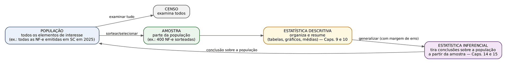

:::DICA Ponte com o Direito
A lógica é a mesma da prova por amostragem em uma perícia contábil: o perito não confere todos os lançamentos, examina uma amostra e, a partir dela, conclui sobre o todo. Descrever a amostra (quantos lançamentos irregulares, qual o valor médio) é Estatística Descritiva; afirmar que "no conjunto da escrituração, a irregularidade está entre 2% e 4%" é Estatística Inferencial.
:::

:::PEGADINHA Notação: letra grega para população, letra latina para amostra
A convenção que a FCC usa sem avisar: média da população = μ (lê-se "mi"); média da amostra = x̄ (lê-se "xis barra"). Tamanho da população = N (maiúsculo); tamanho da amostra = n (minúsculo). Desvio-padrão da população = σ ("sigma"); da amostra = s. Neste capítulo, como só descrevemos dados, a conta da média é igual nos dois casos; a diferença de fórmula aparece na variância (Cap. 10).
:::

:::QUESTAO FGV 2026 — PC-PI (Q3849668)
Situação: uma entidade aplicou teste de inglês a seus gerentes e queria saber: I) a média das notas dos gerentes; II) a distribuição de frequência de cada nota dos gerentes; III) a proficiência dos diretores, que têm características semelhantes às dos gerentes. Pergunta-se o que a estatística DESCRITIVA consegue fornecer. Gabarito oficial: B (I e II, somente).
Resolução: a média (I) e a tabela de frequências (II) apenas resumem os dados efetivamente coletados, dos gerentes: são descrição. O item III pretende concluir algo sobre OUTRO grupo (os diretores), que não foi examinado, a partir dos dados dos gerentes: isso é generalização, terreno da inferência (e, mesmo assim, só seria legítimo se os gerentes fossem uma amostra adequada dos diretores, o que não são). Por isso III fica de fora.
Alternativas sedutoras: "E" (I, II e III) atrai quem pensa que "semelhança" autoriza a extrapolação; é justamente o salto que a Descritiva não dá.
:::

## 09.2 Variáveis: qualitativas e quantitativas, discretas e contínuas, níveis de mensuração

### 09.2.1 A ideia: que tipo de resposta a pergunta produz?

Pense num cadastro de contribuintes do ICMS. Para cada contribuinte há várias "colunas": município, regime de apuração, faixa de risco fiscal, número de autos de infração, valor devido. Cada coluna é uma variável. Classificar a variável é responder a uma pergunta muito simples: a resposta que ela dá é um RÓTULO (uma qualidade) ou um NÚMERO que mede ou conta algo?

- Se é rótulo (Florianópolis, Joinville; "Simples Nacional", "regime normal"; "baixo, médio, alto"), a variável é QUALITATIVA (também chamada categórica).
- Se é número que mede ou conta (3 autos; 12.450,37 reais), a variável é QUANTITATIVA (numérica).

### 09.2.2 As quatro caixas

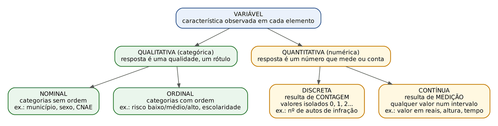

Qualitativa nominal: as categorias são apenas nomes, sem ordem natural. Exemplos: município, sexo, estado civil, CNAE, cor do veículo, meio de comunicação usado. Teste prático: se eu embaralhar a ordem das categorias numa tabela, perde-se algum sentido? Se NÃO, é nominal.

Qualitativa ordinal: as categorias têm uma ordem natural, mas a "distância" entre elas não é medida. Exemplos: classificação de risco (baixo, médio, alto), escolaridade (fundamental, médio, superior), conceito (A, B, C), estágio de uma doença, nível do cargo (médio, superior)... Teste prático: faz sentido dizer "maior que" ou "vem antes de"? Se SIM, e os valores não são números de verdade, é ordinal.

Quantitativa discreta: o número vem de uma CONTAGEM; os valores possíveis são isolados (0, 1, 2, 3...), sem nada no meio. Exemplos: número de filhos, número de autos de infração, número de processos distribuídos por dia, número de atendimentos. Teste prático: a pergunta começa com "quantos?" Então é discreta.

Quantitativa contínua: o número vem de uma MEDIÇÃO; entre dois valores possíveis sempre cabe outro (com instrumento mais preciso, sempre há mais casas decimais). Exemplos: altura, peso, tempo, distância, temperatura, valor em reais, renda, área de um imóvel. Teste prático: a pergunta é "quanto mede, pesa, dura ou vale?" Então é contínua.

:::ATENCAO Dinheiro é contínuo para a banca
Rigorosamente, valores em reais andam de centavo em centavo, o que os tornaria discretos. Mas as bancas (FCC e FGV) tratam valor monetário, renda e salário como quantitativa CONTÍNUA, porque se trata de uma medida que, para fins práticos, pode assumir qualquer valor num intervalo. Na prova, marque contínua.
:::

:::PEGADINHA Número não é sinônimo de quantitativa
- CEP, número de CPF, número da OAB, código do município, número da camisa do jogador: são números usados como RÓTULOS. Não faz sentido somá-los ou tirar sua média. São qualitativas nominais.
- Uma variável quantitativa pode ser transformada em qualitativa ordinal quando se registra apenas a faixa: idade em anos é quantitativa; "faixa etária (0 a 5 anos, 6 a 10 anos...)" é qualitativa ordinal. O inverso também ocorre: atribuir 1, 2, 3 a "baixo, médio, alto" não torna a variável quantitativa.
- Discreta não quer dizer "número inteiro" nem contínua quer dizer "número com vírgula". O que decide é a origem: contagem (discreta) ou medição (contínua). Uma média de filhos de 1,4 não torna "número de filhos" contínua.
:::

### 09.2.3 Níveis (escalas) de mensuração: nominal, ordinal, intervalar e de razão

A FCC de 2026 (SEFAZ-SP) cobrou também a escala de mensuração. São quatro degraus, cada um com mais "poder" que o anterior:

| Escala | O que permite | Exemplo do Fisco | Exemplo clássico |
|---|---|---|---|
| Nominal | só dizer igual ou diferente | município de domicílio | estado civil |
| Ordinal | igual ou diferente e também ordenar | risco baixo, médio, alto | escolaridade |
| Intervalar | ordenar e medir diferenças; o zero é arbitrário (não significa "ausência") | ano-calendário | temperatura em graus Celsius |
| Razão | tudo isso e ainda dividir ("o dobro de"); o zero é absoluto (significa "nada") | valor dos autos em reais; número de autos | peso, altura, renda |

O teste da escala de razão: faz sentido dizer "o dobro"? Um débito de 20.000 reais é o dobro de um de 10.000 reais, e zero real significa ausência de débito: razão. Já 20 graus Celsius NÃO é "o dobro do calor" de 10 graus, e 0 grau Celsius não é ausência de temperatura: intervalar. Na prática de prova, quase toda grandeza econômica (valor, quantidade, tempo, peso) é de razão; intervalar aparece em temperatura em Celsius, datas e anos.

:::QUESTAO FCC 2026 — SEFAZ-SP — Auditor Fiscal da Receita Estadual (TI) (Q3926892)
Situação: um painel de monitoramento de contribuintes do ICMS registra quatro variáveis: município de domicílio tributário; classificação de risco fiscal (baixo, médio, alto, definida por comitê); valor total, em reais, dos autos de infração nos últimos 12 meses; quantidade de autos no mesmo período. Pede-se a classificação mais adequada (qualitativa ou quantitativa; discreta ou contínua; escala nominal, ordinal ou de razão). Gabarito oficial: B.
Resolução, variável por variável, com o teste prático:
- Município: é rótulo, e não há ordem natural entre Lages e Chapecó. Qualitativa nominal.
- Risco (baixo, médio, alto): é rótulo, mas com ordem natural. Qualitativa ordinal.
- Valor dos autos em reais: medida monetária, tratada como contínua; zero significa ausência de autuação e 20.000 é o dobro de 10.000. Quantitativa contínua, escala de razão.
- Quantidade de autos: "quantos?", logo contagem, discreta; zero autos é ausência e 4 é o dobro de 2. Quantitativa discreta, escala de razão.
Essa é exatamente a combinação da alternativa B.
Por que as outras falham: A põe o valor em escala intervalar (erro: o zero do dinheiro é absoluto); C chama o risco de nominal (ignora a ordem); D põe a quantidade de autos em escala nominal (contagem nunca é nominal); E chama o município de ordinal (não há ordem entre municípios).
:::

:::QUESTAO FGV 2025 — CNU (Q3642186)
Situação: num painel com a quantidade de atendimentos ao público ao longo do tempo, que tipo de variável representa "quantidade de atendimentos"? Gabarito oficial: B (discreta).
Resolução: "quantidade de" responde a "quantos?": é contagem, logo quantitativa discreta. Ordinal, nominal e categórica são tipos qualitativos (não servem para número de atendimentos); contínua é para medições.
No mesmo sentido: Q2496464 (FGV 2024, TJ-MS; dentre altura, escolaridade, idade, peso e salário, a única qualitativa é escolaridade, que é ordinal) e Q2496468 (FGV 2024, TJ-MS; altura é contínua porque assume valores reais num intervalo).
:::

:::QUESTAO FGV 2025 — TCE (Q3154554)
Situação: para prever gastos com passagens aéreas, um analista usou: 1) distância entre origem e destino; 2) se o servidor é de nível médio ou superior; 3) se o servidor tem direito a bagagem ou não. Classificação, na ordem? Gabarito oficial: A (quantitativa contínua; qualitativa ordinal; qualitativa nominal).
Resolução: distância é medição (contínua). Nível médio ou superior tem ordem natural (ordinal). Ter ou não ter bagagem é um "sim/não" sem ordem: nominal (variáveis de duas categorias, "sim/não", são chamadas dicotômicas ou binárias, e são nominais).
Alternativa sedutora: E (contínua, nominal, nominal) erra só o item 2; quem não percebe a hierarquia "médio < superior" cai nela.
:::

:::QUESTAO FGV 2024 — EPE (Q3261648)
Situação: avaliar três afirmações. I) Discretas assumem número finito ou infinito contável de valores, e "somente fazem sentido valores inteiros". II) Idade em anos completos é quantitativa contínua; informada apenas por faixa etária, passa a ser qualitativa ordinal. III) Número de filhos, de bactérias por litro de leite e de cigarros por dia são contínuas. Gabarito oficial: A (I e II).
Resolução: III é falsa porque as três variáveis são contagens ("quantos filhos", "quantas bactérias", "quantos cigarros"): discretas. I é verdadeira no essencial (valores contáveis). II reproduz a ideia da faixa etária como ordinal, correta; a banca tratou a idade como contínua (porque o tempo de vida é medição), ainda que "anos completos" seja uma idade arredondada. Para a prova: idade, como tempo, é contínua; idade em faixas é ordinal.
:::

:::QUESTAO FGV 2024 — TJ-MS (Q2496463)
Situação: qual afirmação descreve corretamente a relação entre variáveis quantitativas e qualitativas? Gabarito oficial: A (quantitativas podem ser obtidas a partir de qualitativas em situações particulares).
Resolução: a afirmação correta é a única que não generaliza indevidamente. Exemplo de situação particular: a partir da variável qualitativa "possui débito inscrito em dívida ativa? (sim/não)", obtém-se a quantitativa "número de contribuintes com débito" (uma contagem). As demais estão erradas: B confunde tipo de variável com população e amostra; C inverte objetivo e subjetivo e é falsa de qualquer modo; D é falsa (há quantitativas discretas, e qualitativas não são "discretas" nem "contínuas"); E é falsa (contínuas admitem qualquer valor real).
:::

:::PRATIQUE exercícios elaborados para esta apostila
1) Classifique: (a) CFOP da operação; (b) número de notas fiscais emitidas por dia; (c) faturamento mensal da empresa; (d) porte da empresa (micro, pequena, média, grande); (e) temperatura de armazenagem de vacinas, em graus Celsius.
2) Um analista codificou o regime de tributação como 1 = Simples Nacional, 2 = Lucro Presumido, 3 = Lucro Real e calculou a "média do regime" = 1,8. O que há de errado?
3) (estilo FCC) Indique a escala de mensuração de cada variável: (a) ano de abertura da empresa; (b) tempo, em dias, entre a notificação e a impugnação; (c) faixa de risco (baixo, médio, alto).
Resolução:
1) (a) O CFOP é um código numérico que funciona como rótulo (não se soma CFOP): qualitativa nominal. (b) "Quantas notas?": quantitativa discreta. (c) Valor em reais, medição: quantitativa contínua. (d) Categorias com ordem natural: qualitativa ordinal. (e) Medição: quantitativa contínua (e, na escala, intervalar, porque 0 grau Celsius não é ausência de temperatura).
2) Os números 1, 2 e 3 são rótulos de uma variável qualitativa nominal (nem sequer há uma ordem "natural" de mérito entre regimes). A média de rótulos não tem significado algum: se a codificação fosse 3, 1, 2, a "média" mudaria sem que nada nos dados tivesse mudado. Para variável nominal, a única medida de posição que faz sentido é a moda (09.9).
3) (a) Ano: intervalar (o "ano zero" é convenção; 2020 não é "o dobro" de 1010 em nenhum sentido útil). (b) Tempo em dias: razão (zero dia significa ausência de tempo; 30 dias é o dobro de 15). (c) Ordinal.
:::

## 09.3 Organizando os dados: dados brutos, rol e tabelas de frequência

### 09.3.1 Dados brutos e rol

Dados brutos são os valores na ordem em que foram coletados, sem nenhum tratamento. Exemplo: o número de processos distribuídos ao gabinete em 20 dias úteis:

2, 1, 3, 2, 0, 2, 1, 4, 2, 3, 1, 2, 0, 3, 2, 1, 4, 2, 3, 1

Rol é a mesma lista posta em ordem crescente (ou decrescente):

0, 0, 1, 1, 1, 1, 1, 2, 2, 2, 2, 2, 2, 2, 3, 3, 3, 3, 4, 4

Só de ordenar já se vê muito: o menor valor (mínimo) é 0, o maior (máximo) é 4, e o valor 2 é o mais frequente. A diferença entre o máximo e o mínimo chama-se amplitude total: AT = 4 − 0 = 4.

:::DICA Ordene sempre, e risque ao ordenar
Na prova, a primeira coisa a fazer com uma lista solta é escrever o rol. Para não esquecer nenhum número, vá riscando no enunciado cada valor que transcrever e, no fim, CONTE quantos números o rol tem: tem de dar o mesmo total do enunciado. Um número esquecido muda a mediana e é exatamente o erro que gera uma das alternativas.
:::

### 09.3.2 Tabela de frequência simples (dados não agrupados em classes)

Quando há poucos valores diferentes repetidos muitas vezes, em vez de escrever o rol inteiro, escrevemos cada valor UMA vez e, ao lado, quantas vezes ele aparece. Isso é a frequência.

Cada coluna da tabela tem um nome, e a prova usa esses nomes sem explicar:

- xᵢ: cada valor diferente da variável (o índice i só numera as linhas: x₁ = 0, x₂ = 1...).
- fᵢ = frequência absoluta simples: quantas vezes o valor apareceu.
- n = Σfᵢ: o total de observações (a soma de todas as frequências). O símbolo Σ (letra grega "sigma" maiúscula) significa "some tudo".
- frᵢ = frequência relativa: a fração do total, frᵢ = fᵢ / n (pode ser dada em decimal ou em %).
- Fᵢ = frequência absoluta acumulada: quantas observações há ATÉ aquela linha, inclusive (soma das fᵢ de cima até ela).
- Frᵢ = frequência relativa acumulada: Fᵢ / n.

:::EXEMPLO Montando a tabela dos 20 dias de distribuição
Contando no rol: o valor 0 aparece 2 vezes; o 1, 5 vezes; o 2, 7 vezes; o 3, 4 vezes; o 4, 2 vezes. Total: 2 + 5 + 7 + 4 + 2 = 20 (confere com os 20 dias).
| Processos por dia (xᵢ) | fᵢ | frᵢ | Fᵢ | Frᵢ |
|---|---|---|---|---|
| 0 | 2 | 2/20 = 0,10 (10%) | 2 | 10% |
| 1 | 5 | 5/20 = 0,25 (25%) | 2 + 5 = 7 | 35% |
| 2 | 7 | 7/20 = 0,35 (35%) | 7 + 7 = 14 | 70% |
| 3 | 4 | 4/20 = 0,20 (20%) | 14 + 4 = 18 | 90% |
| 4 | 2 | 2/20 = 0,10 (10%) | 18 + 2 = 20 | 100% |
| Total | 20 | 1,00 (100%) | — | — |
Como ler a linha do 2: em 7 dias foram distribuídos exatamente 2 processos (fᵢ); isso é 35% dos dias (frᵢ); em 14 dias foram distribuídos ATÉ 2 processos, isto é, 0, 1 ou 2 (Fᵢ); e 70% dos dias tiveram no máximo 2 processos (Frᵢ).
Duas conferências que salvam questões: a coluna fᵢ soma n; a coluna frᵢ soma 1 (100%); e a última Fᵢ é igual a n.
:::

:::DICA Frequência acumulada responde "até" e "pelo menos"
- "Quantos dias tiveram no máximo 2 processos?" → acumulada até a linha do 2: F = 14.
- "Quantos dias tiveram pelo menos 3 processos?" → total menos a acumulada até a linha anterior: 20 − 14 = 6 (que é 4 + 2).
A FGV (Q3261649, EPE 2024) pediu exatamente "quantos funcionários estão há pelo menos 3 anos no emprego": basta somar as frequências das linhas de 3 anos em diante, ou fazer total menos acumulada até 2 anos.
:::

### 09.3.3 Tabela de frequência por classes (dados agrupados)

Quando a variável é contínua (valores em reais, dias de atraso, idades) ou tem muitos valores diferentes, uma linha por valor geraria uma tabela enorme. Agrupamos então os valores em faixas, chamadas CLASSES.

Exemplo que nos acompanhará pelo capítulo inteiro: a Secretaria levantou os dias de atraso no recolhimento do ICMS de 40 contribuintes e organizou assim:

| Dias de atraso (classe) | fᵢ |
|---|---|
| 0 ├ 10 | 4 |
| 10 ├ 20 | 10 |
| 20 ├ 30 | 14 |
| 30 ├ 40 | 8 |
| 40 ├ 50 | 4 |
| Total | 40 |

O símbolo ├ é lido "fechado à esquerda, aberto à direita": a classe 10 ├ 20 inclui o 10 e NÃO inclui o 20 (o 20 vai para a classe seguinte). Assim nenhum valor é contado duas vezes. Outras notações que aparecem: [10; 20) significa o mesmo; ┤ é o inverso (aberto à esquerda, fechado à direita); |—| fecha os dois lados.

Os elementos de cada classe:

- Limite inferior (l_inf ou lᵢ): o número à esquerda (na classe 10 ├ 20, é 10).
- Limite superior (L_sup ou Lᵢ): o número à direita (é 20).
- Amplitude da classe (h): L_sup − l_inf = 20 − 10 = 10. Aqui todas as classes têm amplitude 10 (o caso normal de prova).
- Ponto médio (xᵢ ou PMᵢ): o centro da classe, (l_inf + L_sup)/2 = (10 + 20)/2 = 15. Ele será o "representante" de todos os valores da classe nos cálculos de média.
- Amplitude total da distribuição: último limite superior menos primeiro limite inferior = 50 − 0 = 50.

Completando a tabela com as colunas da seção anterior:

| Classe | Ponto médio xᵢ | fᵢ | frᵢ | Fᵢ | Frᵢ |
|---|---|---|---|---|---|
| 0 ├ 10 | 5 | 4 | 10% | 4 | 10% |
| 10 ├ 20 | 15 | 10 | 25% | 14 | 35% |
| 20 ├ 30 | 25 | 14 | 35% | 28 | 70% |
| 30 ├ 40 | 35 | 8 | 20% | 36 | 90% |
| 40 ├ 50 | 45 | 4 | 10% | 40 | 100% |
| Total | — | 40 | 100% | — | — |

As contas das frequências relativas: 4/40 = 0,10; 10/40 = 0,25; 14/40 = 0,35; 8/40 = 0,20; 4/40 = 0,10. As acumuladas: 4; 4 + 10 = 14; 14 + 14 = 28; 28 + 8 = 36; 36 + 4 = 40.

:::ATENCAO O preço de agrupar
Ao agrupar, perdemos a informação de quais eram os valores exatos: sabemos que 14 contribuintes atrasaram entre 20 e 30 dias, mas não quantos dias cada um. Por isso, todos os cálculos com dados agrupados (média pelo ponto médio, mediana por interpolação) são APROXIMAÇÕES baseadas numa hipótese: a de que os valores se espalham por igual dentro da classe. Quando a FCC escreve "assuma distribuição uniforme dentro das classes" ou "utilize o método da interpolação linear", é essa hipótese que ela está autorizando.
:::

:::NOTA Quantas classes fazer?
Não há número obrigatório. Os livros citam a regra de Sturges (k ≈ 1 + 3,3 × log n, em que k é o número de classes e n o número de dados) e a regra prática k ≈ √n. Com n = 40, √40 ≈ 6,3 e Sturges dá cerca de 6; usamos 5 classes, o que é razoável. A FCC raramente pede essa conta; quando pede, fornece o logaritmo.
:::

:::QUESTAO FGV 2024 — EPE (Q3261645)
Situação: numa cidade de 1.764.835 eleitores, uma pesquisa de segundo turno com uma AMOSTRA de eleitores apresentou as intenções de voto (candidato A, candidato B, indecisos, brancos e nulos) em uma tabela de frequências absolutas (não reproduzida no banco de questões). Pedem-se as frequências relativas de A, de B e a soma das de indecisos com brancos e nulos. Gabarito oficial: B (64,7%, 26,1% e 9,2%).
Resolução do método: frequência relativa = frequência absoluta da categoria dividida pelo total da AMOSTRA (não pelo total de eleitores da cidade). A soma das três respostas tem de dar 100%: 64,7 + 26,1 + 9,2 = 100. Só a alternativa B cumpre isso, o que permite acertar a questão mesmo sem a tabela.
A armadilha: as alternativas A, C, D e E nascem de dividir pela população (1.764.835) ou de escrever a fração decimal como se fosse porcentagem. Regra: as frequências relativas de todas as categorias SEMPRE somam 1 (ou 100%).
:::

:::QUESTAO FCC 2026 — SEFAZ-CE — Auditor Fiscal da Receita Estadual (Q4221357)
Enunciado (como está no banco): "A cantina de uma repartição pública entrevistou um grupo de usuários e perguntou sobre seu prato preferido dentre pizza, pasta, risoto e verdura. O resultado encontra-se na tabela a seguir. Apesar de a tabela não ter sido preenchida completamente, o gerente lembrou que 5% dos entrevistados preferem verdura. O número de usuários que indicaram Pizza como seu prato preferido foi" (A) 86; (B) 96; (C) 16; (D) 46; (E) 106.
Os dados desta questão estão em figura/tabela não reproduzida no banco de questões; por isso comentamos o MÉTODO, sem números inventados.
Método, passo a passo (vale para qualquer tabela incompleta):
- Passo 1: a categoria cuja porcentagem é conhecida liga a parte ao todo. Se a verdura tem v pessoas e isso é 5% do total, então total n = v / 0,05 = 20 × v (dividir por 0,05 é o mesmo que multiplicar por 20).
- Passo 2: com o total, a categoria que falta sai por diferença: pizza = n − (pasta + risoto + verdura).
- Passo 3: confira que as frequências relativas somam 100%.
Gabarito oficial: E (106).
:::

:::EXEMPLO Tabela incompleta com uma porcentagem conhecida (dados nossos, não os da prova)
Se 8 pessoas preferem verdura e isso é 5% do total:
- total = 8 / 0,05 = 8 × 20 = 160
- se pasta e risoto somam 50, pizza = 160 − 50 − 8 = 102
- conferência: 102 + 50 + 8 = 160, isto é, 100% dos entrevistados
:::

:::PRATIQUE exercícios elaborados para esta apostila
1) Número de dependentes declarados por 20 servidores: 0, 1, 1, 2, 0, 3, 1, 2, 2, 1, 0, 1, 4, 2, 1, 3, 1, 0, 2, 1. Monte a tabela com fᵢ, frᵢ, Fᵢ e Frᵢ.
2) Na tabela do exercício 1, quantos servidores têm pelo menos 2 dependentes? Que porcentagem tem no máximo 1?
3) Numa tabela de renda, uma classe é 1.500 ├ 2.500 reais. Qual a amplitude e o ponto médio? O valor 2.500 pertence a essa classe?
4) (estilo FCC) Numa tabela de 5 classes de mesma amplitude, a primeira classe começa em 12 e o ponto médio da terceira classe é 32. Qual a amplitude de cada classe e o limite superior da última?
Resolução:
1) Rol: 0, 0, 0, 0, 1, 1, 1, 1, 1, 1, 1, 1, 2, 2, 2, 2, 2, 3, 3, 4. Contagem: 0 → 4 vezes; 1 → 8; 2 → 5; 3 → 2; 4 → 1; total 4 + 8 + 5 + 2 + 1 = 20.
| xᵢ | fᵢ | frᵢ | Fᵢ | Frᵢ |
|---|---|---|---|---|
| 0 | 4 | 4/20 = 20% | 4 | 20% |
| 1 | 8 | 8/20 = 40% | 12 | 60% |
| 2 | 5 | 5/20 = 25% | 17 | 85% |
| 3 | 2 | 2/20 = 10% | 19 | 95% |
| 4 | 1 | 1/20 = 5% | 20 | 100% |
2) Pelo menos 2: 5 + 2 + 1 = 8 servidores (ou 20 − 12 = 8). No máximo 1: Fr da linha do 1 = 60%.
3) Amplitude: 2.500 − 1.500 = 1.000. Ponto médio: (1.500 + 2.500)/2 = 4.000/2 = 2.000. O 2.500 NÃO pertence a ela (a classe é aberta à direita); vai para a classe 2.500 ├ 3.500.
4) Chame de h a amplitude. As classes são 12 ├ 12 + h; 12 + h ├ 12 + 2h; 12 + 2h ├ 12 + 3h... O ponto médio da terceira é o seu início mais meia amplitude: 12 + 2h + h/2 = 12 + 2,5h. Igualando a 32:
- 12 + 2,5h = 32
- 2,5h = 32 − 12 (passamos o 12 para o outro lado, subtraindo)
- 2,5h = 20
- h = 20 / 2,5 = 8
O limite superior da quinta classe é 12 + 5 × 8 = 12 + 40 = 52. Conferência: classes 12 ├ 20, 20 ├ 28, 28 ├ 36 (ponto médio 32, confere), 36 ├ 44, 44 ├ 52.
:::

## 09.4 Gráficos estatísticos

### 09.4.1 Para que serve cada gráfico

O gráfico é a tabela desenhada. A regra de ouro para escolher o gráfico é olhar o TIPO DE VARIÁVEL (09.2): variável qualitativa pede gráfico de barras, colunas ou setores; variável quantitativa agrupada em classes pede histograma, polígono de frequência ou ogiva; dados ao longo do tempo pedem gráfico de linhas.

Gráfico de colunas (barras verticais) ou de barras (horizontais): cada categoria é um retângulo, e a ALTURA (ou o comprimento) é proporcional à frequência. As barras ficam SEPARADAS por espaços, porque as categorias são distintas e não há continuidade entre elas. Serve para variáveis qualitativas (nominais ou ordinais) e para quantitativas discretas com poucos valores. Barras horizontais são preferíveis quando os nomes das categorias são longos.

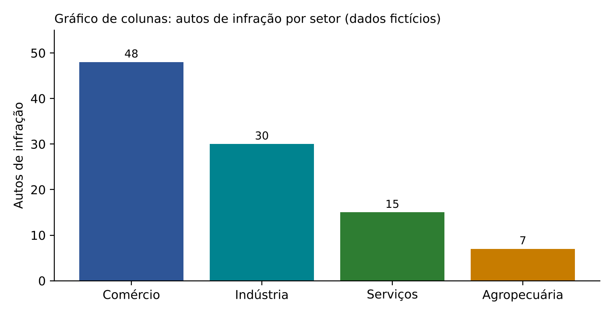

Gráfico de setores ("pizza"): um círculo dividido em fatias proporcionais às frequências relativas. Mostra a composição de um TODO (partes que somam 100%). O círculo tem 360 graus, então o ângulo de cada fatia é:

- ângulo = 360° × frequência relativa

Com os dados acima (100 autos no total): o comércio tem 48 autos, isto é, 48% = 0,48; o ângulo é 360 × 0,48 = 172,8 graus. Para a agropecuária, 360 × 0,07 = 25,2 graus.

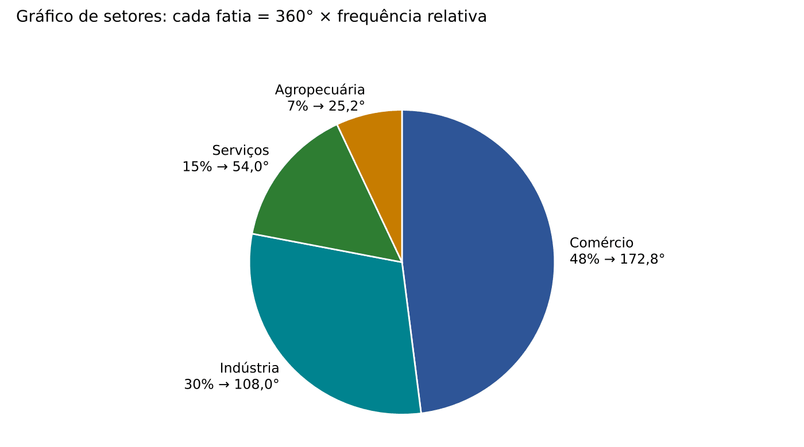

:::DICA Contas de setor sem calculadora
- 25% do círculo = 90° (um quarto); 50% = 180°; 75% = 270°; 10% = 36°; 1% = 3,6°; 5% = 18°.
- Do ângulo para a porcentagem: divida por 360. Um setor de 54° corresponde a 54/360 = 0,15 = 15%. Truque: 54/360 = 6/40 = 3/20 = 15/100 (simplificamos por 9 e depois por 2, e multiplicamos em cima e embaixo por 5).
- Do ângulo para o número de pessoas: (ângulo / 360) × total.
:::

Gráfico de linhas: pontos ligados por segmentos, com o tempo no eixo horizontal. É o gráfico da arrecadação mês a mês, da inflação ao longo do ano, de séries temporais em geral.

Histograma: é o gráfico próprio da distribuição de frequência POR CLASSES de uma variável quantitativa. Parece um gráfico de colunas, mas com duas diferenças essenciais: (1) as colunas ficam ENCOSTADAS umas nas outras, porque as classes são contíguas (onde uma termina, começa a outra); (2) a base de cada retângulo é a amplitude da classe, marcada no eixo horizontal, que é uma escala numérica.

Polígono de frequência: a linha que liga os pontos médios dos topos das colunas do histograma. Para "fechar" o polígono no eixo horizontal, acrescenta-se uma classe fictícia de frequência zero antes da primeira e outra depois da última (por isso a linha vermelha da figura começa em −5 e termina em 55).

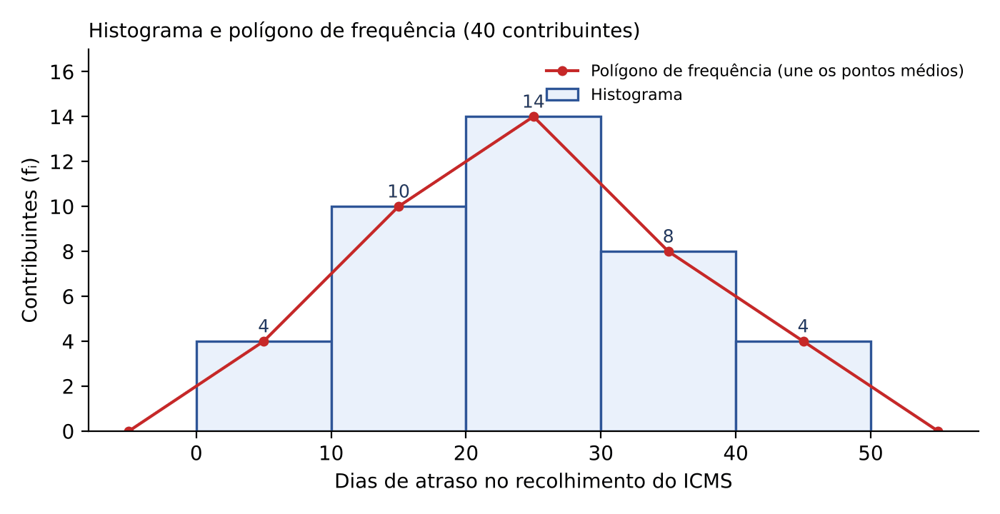

:::ATENCAO Histograma: quem é proporcional à frequência é a ÁREA
No histograma, quem representa a frequência é a ÁREA de cada retângulo (base × altura). Quando todas as classes têm a mesma amplitude (mesma base), a área é proporcional à altura e tanto faz falar em área ou altura. Quando as amplitudes são diferentes, a altura deve ser a densidade de frequência (fᵢ dividida pela amplitude hᵢ), para que uma classe larga não pareça mais populosa do que é. Questões que dizem "a área de cada barra é proporcional à frequência" estão CORRETAS.
:::

Ogiva (ou polígono de frequência acumulada): a linha que liga, no limite SUPERIOR de cada classe, a frequência acumulada até ali. Começa em zero, no limite inferior da primeira classe, e termina em n (ou 100%) no limite superior da última. É sempre crescente (nunca desce). Serve para ler visualmente a mediana e as separatrizes: onde a curva atinge a metade dos dados (20 de 40), ali está a mediana.

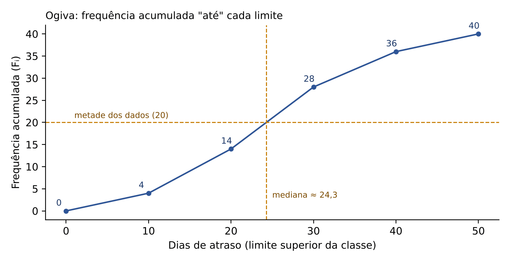

Ramo e folhas (*stem-and-leaf*): um "meio-termo" entre tabela e gráfico, que organiza os dados sem perder os valores exatos. Cada número é partido em duas partes: o ramo (os algarismos da esquerda, por exemplo as dezenas) e a folha (o último algarismo, as unidades). Exemplo com as idades 18, 23, 25, 26, 31, 32, 32, 37, 40, 45:

| Ramo (dezenas) | Folhas (unidades) |
|---|---|
| 1 | 8 |
| 2 | 3 5 6 |
| 3 | 1 2 2 7 |
| 4 | 0 5 |

Leitura: a linha "3 │ 1 2 2 7" representa 31, 32, 32 e 37. Girado de lado, o diagrama tem o formato de um histograma, mas cada valor continua visível, o que permite calcular a mediana e a moda exatamente.

Gráfico de dispersão: pontos num plano com duas variáveis quantitativas (uma em cada eixo); serve para ver relação entre elas e é o tema do Cap. 16. Boxplot (diagrama de caixa): resumo com mínimo, quartis e máximo, ideal para enxergar *outliers* (valores atípicos); é tema do Cap. 10. Pictograma usa figuras (bonequinhos, moedas); cartograma usa mapas.

:::ESQUEMA Qual gráfico usar
| Situação | Gráfico indicado |
|---|---|
| Variável qualitativa (comparar categorias) | barras ou colunas |
| Composição de um todo (partes de 100%) | setores |
| Evolução no tempo | linhas |
| Variável quantitativa agrupada em classes | histograma (e polígono de frequência) |
| Frequências acumuladas, leitura de mediana e quartis | ogiva |
| Poucos dados, mantendo os valores exatos | ramo e folhas |
| Relação entre duas variáveis quantitativas | dispersão (Cap. 16) |
| Identificar *outliers* e comparar grupos | boxplot (Cap. 10) |
:::

### 09.4.2 Gráficos enganosos

Um gráfico pode ter dados corretos e, ainda assim, induzir o leitor a erro. A técnica mais comum é truncar o eixo vertical (fazê-lo começar em um valor diferente de zero). No gráfico abaixo, os dados são os mesmos dos dois lados: 52% contra 48%.

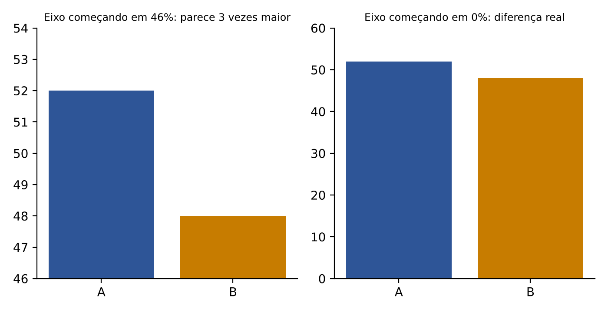

À esquerda, com o eixo começando em 46%, a barra de A tem altura visual 52 − 46 = 6 e a de B, 48 − 46 = 2: A "parece" três vezes maior. À direita, com o eixo começando em zero, vê-se a realidade: uma diferença de 4 pontos percentuais. Outros truques: escalas diferentes em gráficos postos lado a lado, figuras em três dimensões que aumentam o volume em vez da altura, setores que não somam 100%.

:::QUESTAO FGV 2026 — SEDUC-SP (Q4248259)
Situação: numa reportagem, um gráfico de barras compara 52% (candidato A) com 48% (candidato B), com o eixo vertical de 46% a 54%, de modo que a barra de A parece ter o triplo da altura da de B. Um estudante diz que "não há problema, pois os dados são verdadeiros". A afirmação do estudante está correta ou errada? Gabarito oficial: D (errada: os dados estão corretos, mas o truncamento do eixo distorce a percepção da diferença).
Resolução: é exatamente o caso da figura acima. A altura visual de A é 52 − 46 = 6 e a de B é 48 − 46 = 2, razão 6/2 = 3, quando a razão real é 52/48 ≈ 1,08. Os dados não foram alterados (por isso C, que diz haver "dados incorretos", está errada), mas a representação engana.
Por que as outras estão erradas: A diz que a fidelidade depende só dos dados (falso: a escala também importa); B diz que o truncamento "não compromete a interpretação" (é justamente o que compromete); E diz que gráficos de barras são proibidos para percentuais eleitorais (não há regra nesse sentido).
:::

:::QUESTAO FGV 2025 — SEFAZ-RS (Q3154014)
Situação: julgar três afirmações sobre histogramas: (1) é construído a partir de dados qualitativos; (2) com classes de mesma amplitude, a área de cada barra é proporcional à frequência absoluta da classe; (3) se a curva de frequência é simétrica e unimodal, média, mediana e moda coincidem. Gabarito oficial: D (F, V, V).
Resolução: (1) é falsa: o histograma é para variáveis QUANTITATIVAS agrupadas em classes; para qualitativas usa-se barras ou setores. (2) é verdadeira: área = base × altura; se as bases são iguais e a altura é a frequência, a área é proporcional à frequência. (3) é verdadeira e será vista em 09.10: numa distribuição simétrica com um só pico, os três "centros" coincidem.
:::

:::QUESTAO FGV 2024 — EPE (Q2847407)
Situação: um analista recebeu dados de consumo de energia de indústrias já organizados em distribuição de frequência. Qual o gráfico mais adequado? Gabarito oficial: D (histograma).
Resolução: consumo de energia é variável quantitativa contínua; organizada em distribuição de frequência (classes), o gráfico próprio é o histograma. Dispersão exige duas variáveis; série temporal exige o tempo no eixo; barras são para categorias; boxplot resume, mas não mostra a distribuição de frequências classe a classe.
:::

:::QUESTAO FGV 2026 — MPE-ES (Q4218185)
Situação: em mapas temáticos, qual critério de classificação divide os registros em classes com a MESMA FREQUÊNCIA (mesma quantidade de registros em cada classe)? Gabarito oficial: A (quantis).
Resolução: os quantis (ou separatrizes, 09.11) são justamente os pontos que dividem os dados ordenados em partes com o mesmo número de elementos: quartis em 4 partes de 25%, quintis em 5 partes de 20%. "Intervalos iguais" fazem classes de mesma AMPLITUDE (não de mesma frequência); "quebras naturais" procuram agrupamentos nos dados; "desvio-padrão" e "escala logarítmica" usam outros critérios.
:::

:::QUESTAO FCC 2026 — Auditor (prova não identificada no banco) (Q4231740)
Enunciado (como está no banco): "Considere: A partir do gráfico de barras, podemos construir um intervalo que é dado pela média de gols da Alemanha por jogo, mais ou menos a amplitude do número de gols. Aproximando o valor da média com duas casas decimais, esse intervalo é dado por" (A) [-2,43; 8,57]; (B) [-3,43; 8,57]; (C) [-2,43; 9,57]; (D) [-3,43; 9,57]; (E) [3,43; 8,57].
Os dados desta questão estão em figura/tabela não reproduzida no banco de questões; por isso comentamos o MÉTODO, sem números inventados.
Método, passo a passo:
- Passo 1, ler o gráfico de barras: cada barra corresponde a um jogo, e a altura da barra é o número de gols marcados naquele jogo. Anote os valores e conte quantos jogos há.
- Passo 2, média de gols por jogo: some os gols de todos os jogos e divida pelo número de jogos (09.6); arredonde a duas casas decimais, como manda o enunciado.
- Passo 3, amplitude: maior número de gols num jogo menos o menor número de gols num jogo (máximo − mínimo, 09.11.1).
- Passo 4, montar o intervalo: limite inferior = média − amplitude; limite superior = média + amplitude.
- Passo 5, conferir: o intervalo "média ± amplitude" é simétrico em torno da média, ou seja, a média é exatamente o ponto do meio entre os dois limites. Esse teste ajuda a descartar alternativas incoerentes, mas não dispensa a leitura do gráfico.
Atenção ao sinal: se a amplitude for maior que a média, o limite inferior sai NEGATIVO. Isso é possível, mesmo que não existam "gols negativos": o intervalo é só uma conta. Erros típicos que a FCC transforma em alternativas: errar a subtração com resultado negativo, esquecer o sinal de menos e somar à média o valor máximo em vez da amplitude.
Gabarito oficial: B ([-3,43; 8,57]).
:::

:::PRATIQUE exercícios elaborados para esta apostila
1) Numa pesquisa com 720 contribuintes, 25% preferem atendimento presencial. Qual o ângulo desse setor?
2) No mesmo gráfico, o setor "atendimento por telefone" mede 54°. Quantos contribuintes o escolheram?
3) Por que as colunas de um histograma ficam encostadas e as de um gráfico de barras, não?
Resolução:
1) Ângulo = 360 × 0,25 = 90 graus (um quarto do círculo).
2) Fração do círculo: 54/360 = 0,15 (15%). Pessoas: 0,15 × 720 = 108. Conta sem calculadora: 10% de 720 = 72; 5% = 36; 15% = 72 + 36 = 108.
3) No histograma o eixo horizontal é uma escala numérica contínua, dividida em classes contíguas (o fim de uma é o início da outra); um espaço entre colunas sugeriria valores impossíveis ou ausentes. No gráfico de barras, as categorias são separadas por natureza (comércio, indústria), e o espaço indica isso.
:::

## 09.5 Medidas de posição: a média aritmética simples

### 09.5.1 A ideia: um número que represente o conjunto

As medidas de posição (ou de tendência central) respondem à pergunta "qual é o valor típico?". São três as principais: a média, a mediana e a moda. Começamos pela mais usada.

A média aritmética é a "divisão igualitária": somamos todos os valores e repartimos igualmente entre todos. Se cinco servidores fizeram 2, 3, 3, 4 e 13 horas extras no mês, o total é 25 horas; se fossem distribuídas igualmente, cada um faria 25 / 5 = 5 horas. A média é 5.

Exemplo à mão, com o porquê de cada passo:
- soma: 2 + 3 + 3 + 4 + 13 = 25
- quantidade de valores: 5
- média = 25 / 5 = 5

### 09.5.2 A fórmula

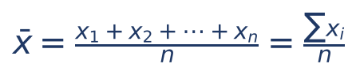

O que significa cada símbolo:
- x̄ ("xis barra"): a média aritmética (da amostra; para a população escreve-se μ, mas a conta é a mesma).
- x₁, x₂, ..., xₙ: os valores observados (o primeiro, o segundo, até o último).
- n: quantos valores há.
- Σxᵢ: a soma de todos os valores (o Σ manda somar).

Uma forma de escrever que resolve quase todas as questões de prova é a fórmula "de trás para a frente":

- soma = média × quantidade, ou seja, Σxᵢ = n × x̄

Ela diz que, se você sabe a média e a quantidade, você sabe a SOMA. E a soma é o que se altera quando um valor entra, sai ou é corrigido.

### 09.5.3 A média como ponto de equilíbrio

Coloque os valores numa régua, como pesos iguais sobre uma gangorra. A média é o ponto onde a gangorra fica em equilíbrio.

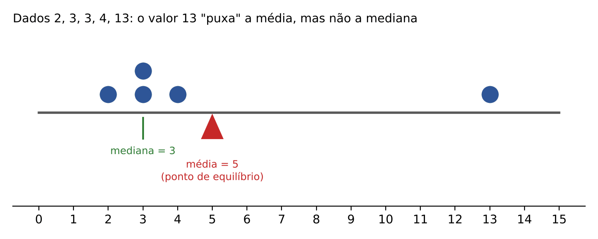

Daí sai a primeira propriedade: a soma dos desvios em relação à média é zero. Desvio é a diferença entre cada valor e a média (xᵢ − x̄). No exemplo: (2 − 5) + (3 − 5) + (3 − 5) + (4 − 5) + (13 − 5) = −3 − 2 − 2 − 1 + 8 = −8 + 8 = 0. Os desvios negativos (à esquerda) compensam exatamente os positivos (à direita).

E sai também o grande defeito da média: ela é sensível a valores extremos. O 13, sozinho, empurrou a média para 5, embora quatro dos cinco servidores tenham feito 4 horas ou menos. Um valor muito distante dos demais chama-se *outlier* (valor atípico).

### 09.5.4 As propriedades da média que a prova cobra

Propriedade 1 — somar uma constante. Se somarmos (ou subtrairmos) o mesmo número k a todos os valores, a média fica somada (ou subtraída) de k. Exemplo: abono de 200 reais a todos os servidores aumenta a média salarial em exatamente 200 reais.

Propriedade 2 — multiplicar por uma constante. Se multiplicarmos (ou dividirmos) todos os valores por k, a média fica multiplicada (ou dividida) por k. Exemplo: reajuste de 10% em todos os salários é multiplicar cada um por 1,10; a média também fica multiplicada por 1,10 (aumenta 10%).

Propriedade 3 — combinação das duas. Reajuste de 10% e, depois, abono de 200: nova média = 1,10 × média antiga + 200. A ordem importa: abono primeiro e reajuste depois dá 1,10 × (média + 200).

Propriedade 4 — a soma dos desvios em relação à média é zero (visto acima).

Propriedade 5 — a média minimiza a soma dos QUADRADOS dos desvios. Se você escolher um número m qualquer e calcular Σ(xᵢ − m)², o menor resultado possível ocorre quando m é a média. Com os dados 1, 2 e 6 (média 3): usando m = 3, (1 − 3)² + (2 − 3)² + (6 − 3)² = 4 + 1 + 9 = 14; usando m = 2 (que é a mediana), (1 − 2)² + (2 − 2)² + (6 − 2)² = 1 + 0 + 16 = 17, maior. Já a soma dos desvios em valor ABSOLUTO, Σ|xᵢ − m|, é mínima na MEDIANA: com m = 2 dá 1 + 0 + 4 = 5; com m = 3 dá 2 + 1 + 3 = 6.

:::ATENCAO Quem é afetado e quem não é
As propriedades 1 e 2 valem também para a mediana e para a moda (todas as medidas de posição "andam junto" com os dados). O que muda de comportamento são as medidas de DISPERSÃO: somar uma constante NÃO altera o desvio-padrão; multiplicar por k multiplica o desvio-padrão por k. Isso é tema do Cap. 10, e a FCC adora misturar as duas coisas na mesma questão.
:::

:::QUESTAO FCC 2026 — SEFAZ-MT — Fiscal de Tributos Estaduais (Q3947195)
Enunciado (como está no banco): "Considere uma amostra x₁,..., xn. Sabendo-se que nessa amostra a moda < mediana < média aritmética, então o valor m que minimiza será" (A) o valor mínimo da amostra; (B) o valor máximo da amostra; (C) a mediana amostral; (D) a moda amostral; (E) a média aritmética da amostra.
Os dados desta questão estão em figura/tabela não reproduzida no banco de questões; por isso comentamos o MÉTODO, sem números inventados. No caso, o que falta é a própria expressão a ser minimizada, que estava em figura.
Método, passo a passo:
- Passo 1, identificar a expressão que a prova manda minimizar (na figura).
- Passo 2, aplicar a propriedade correspondente (propriedade 5, acima): se a expressão for a soma dos QUADRADOS dos desvios, Σ(xᵢ − m)², o valor que a minimiza é a MÉDIA; se for a soma dos desvios em MÓDULO, Σ|xᵢ − m|, o valor que a minimiza é a MEDIANA. Guarde o par: quadrado ↔ média; módulo ↔ mediana.
- Passo 3, perceber a distração: a informação "moda < mediana < média" indica assimetria positiva (09.10), mas não muda qual medida minimiza cada tipo de soma; essas propriedades valem para qualquer forma dos dados.
Gabarito oficial: E (a média aritmética da amostra). Sem a figura, não é possível afirmar aqui qual expressão a prova trazia; registre apenas que o gabarito oficial aponta a média, que é a medida que minimiza a soma dos quadrados dos desvios. A alternativa C (mediana) seria a resposta se a expressão fosse a soma dos desvios em módulo.
:::

:::QUESTAO FCC 2025 — TRT 6ª Região — Técnico Judiciário (Q3216575)
Situação: os pesos de 8 remadoras são 63, 60, 57, 66, 62, 65, 69 e 58 kg. Se cada uma ganhar 2% de peso corporal, qual será o novo peso médio? Gabarito oficial: B (63,75).
Resolução:
- soma: 63 + 60 + 57 + 66 + 62 + 65 + 69 + 58 = 500
- média atual: 500 / 8 = 62,5
- ganho de 2% em cada peso = multiplicar cada peso por 1,02; pela propriedade 2, a média também fica multiplicada por 1,02
- nova média: 62,5 × 1,02 = 62,5 + 62,5 × 0,02 = 62,5 + 1,25 = 63,75
Atalho: não precisa recalcular os 8 pesos novos; basta aplicar o reajuste à média.
Alternativas sedutoras: E (62,50) é a média antiga, para quem esquece o ganho; D (63,00) vem de somar 0,5 kg (confundindo 2% com algo como "2% de 25"); A (61,75) vem de subtrair em vez de somar.
:::

### 09.5.5 Corrigir, incluir e excluir valores: o método da soma

Este é o tipo de questão de média que MAIS cai na FCC. O roteiro é sempre o mesmo.

:::PASSO Roteiro "a média mudou porque um valor entrou, saiu ou foi corrigido"
1. Transforme a média em SOMA: soma = média × quantidade.
2. Ajuste a soma: some o valor que entrou; subtraia o que saiu; para uma correção, subtraia o valor errado e some o certo (ou some a diferença certo − errado).
3. Ajuste a quantidade: +1 para cada valor que entrou, −1 para cada um que saiu; numa correção, a quantidade NÃO muda.
4. Nova média = nova soma / nova quantidade.
:::

:::EXEMPLO Saída de um valor
Um grupo de 25 contribuintes deve, em média, 8.000 reais. Um deles, que devia 20.000 reais, quitou o débito e saiu do grupo. Qual a nova média dos 24 restantes?
- soma antiga = 25 × 8.000 = 200.000
- nova soma = 200.000 − 20.000 = 180.000
- nova quantidade = 25 − 1 = 24
- nova média = 180.000 / 24 = 7.500
Leitura: saiu alguém acima da média, então a média caiu (de 8.000 para 7.500 reais). Essa checagem de sentido elimina alternativas: se sai um valor maior que a média, a média tem de cair; se entra um valor maior que a média, ela tem de subir; se entra um valor IGUAL à média, ela não muda.
:::

:::QUESTAO FCC 2026 — SEFAZ-SP — AFRE (TI) (Q3916775)
Situação: um conjunto de dados fiscais tem n observações, soma 180 e média 15. Após auditoria, descobre-se que um valor registrado como 27 deveria ser 3. Qual a nova média? Gabarito oficial: D (13).
Resolução pelo roteiro:
- quantidade: n = soma / média = 180 / 15 = 12
- correção: nova soma = 180 − 27 + 3 = 156 (tiramos o errado, pusemos o certo; a diferença é −24)
- quantidade não muda: 12
- nova média = 156 / 12 = 13
Atalho: a correção reduziu a soma em 24; espalhando por 12 valores, a média cai 24 / 12 = 2; logo 15 − 2 = 13.
Alternativas sedutoras: E (14) vem de dividir 24 por algo errado ou de subtrair só metade; C (12) confunde a média com o n; A (10) vem de dividir a nova soma por 15 (a média antiga, em vez da quantidade).
:::

:::QUESTAO FCC 2026 — ARTESP — Analista (Q3910528)
Situação: João calculou a média de 40 números e obteve 38, mas usou 56 no lugar de 36. Qual a média correta? Gabarito oficial: C (37,5).
Resolução:
- soma errada = 40 × 38 = 1.520
- soma correta = 1.520 − 56 + 36 = 1.500
- média correta = 1.500 / 40 = 37,5
Atalho: o erro foi 56 − 36 = 20 a mais na soma; dividido por 40, a média estava 20/40 = 0,5 acima. Correta: 38 − 0,5 = 37,5.
Alternativa sedutora: A (36,5) vem de subtrair 20/40 duas vezes ou de dividir 20 por 20; B (37) vem de arredondar a correção para 1.
:::

:::QUESTAO FCC 2024 — SEPLAN-PI — Analista Governamental (Q3549550)
Situação: num lote de 50 sacos de frutas, exatamente 15 pesam 12 kg cada; o peso médio de todos os 50 é 9,2 kg. Qual o peso médio dos outros 35? Gabarito oficial: D (8).
Resolução:
- peso total dos 50: 50 × 9,2 = 460 kg (conta à mão: 50 × 9 = 450 e 50 × 0,2 = 10; 450 + 10 = 460)
- peso dos 15 sacos conhecidos: 15 × 12 = 180 kg
- peso dos 35 restantes: 460 − 180 = 280 kg
- média dos 35: 280 / 35 = 8 kg
Checagem de sentido: os 15 sacos estão acima da média geral (12 > 9,2), então os demais têm de estar abaixo dela. Isso elimina de cara 11 e 10,2 (alternativas A e E).
:::

:::QUESTAO FCC 2024 — TRT 7ª Região — Analista Judiciário (Q3481521)
Situação: para ser aprovado, Álvaro precisa somar pelo menos 56 pontos em 8 avaliações de 0 a 10. Fez 5 provas com média 6,4. Qual a menor nota que ele pode tirar em uma das 3 avaliações restantes? Gabarito oficial: C (4).
Resolução:
- pontos já obtidos: 5 × 6,4 = 32
- pontos que faltam: 56 − 32 = 24, em 3 provas
- para que UMA das notas seja a menor possível, as outras duas devem ser as maiores possíveis: 10 e 10, somando 20
- nota mínima da terceira: 24 − 20 = 4
Alternativa sedutora: D (8) é a média necessária nas três (24 / 3 = 8), que responde a outra pergunta ("que média ele precisa?"). A pergunta pede a MENOR nota possível em UMA delas.
:::

:::QUESTAO FGV 2025 — TCE-PI (Q3154440)
Situação: a média das idades de 11 pessoas é 38,4. Junta-se ao grupo uma pessoa de 54 anos. Qual a nova média? Gabarito oficial: D (39,7).
Resolução:
- soma antiga: 11 × 38,4 = 422,4 (11 × 38 = 418; 11 × 0,4 = 4,4; 418 + 4,4 = 422,4)
- nova soma: 422,4 + 54 = 476,4
- nova quantidade: 12
- nova média: 476,4 / 12 = 39,7
Atalho sem dividir números grandes: o recém-chegado está 54 − 38,4 = 15,6 acima da média; esse excesso se reparte por 12 pessoas: 15,6 / 12 = 1,3. Nova média = 38,4 + 1,3 = 39,7.
:::

:::DICA O atalho do "excesso repartido"
Quando entra um valor v num grupo de n valores com média x̄, a nova média é x̄ + (v − x̄)/(n + 1). Na questão acima: 38,4 + (54 − 38,4)/12 = 38,4 + 1,3 = 39,7. Para correção de um valor (sem mudar a quantidade): nova média = x̄ + (certo − errado)/n. Tudo isso é o roteiro da soma em versão compacta; use o que achar mais seguro.
:::

:::QUESTAO FGV 2026 — TJ-SC (Q4150853)
Situação: uma lista de 4 números positivos e distintos tem média 7,0 e mediana 7,5. Retirando-se o menor, a média dos 3 restantes passa a 8,0. Qual a diferença entre o maior e o menor? Gabarito oficial: E (5,0).
Resolução: chame os números, em ordem crescente, de a < b < c < d.
- soma dos 4: 4 × 7 = 28
- soma dos 3 maiores (b, c, d): 3 × 8 = 24
- menor: a = 28 − 24 = 4
- mediana de 4 números = média dos dois do meio (09.8): (b + c)/2 = 7,5, logo b + c = 15
- maior: d = 24 − (b + c) = 24 − 15 = 9
- diferença: d − a = 9 − 4 = 5
:::

:::QUESTAO FGV 2025 — TCE-RR (Q3188259)
Situação: a média salarial de 4 amigos é 10.500 reais. Um deles vai embora, e a média dos 3 que ficaram é 5.000 reais, valor que também é a mediana desses 3. O menor salário dos 4 é 1.000 reais. Qual afirmação é correta? Gabarito oficial: B (a soma dos três maiores salários é 41.000 reais).
Resolução:
- soma dos 4: 4 × 10.500 = 42.000
- soma dos 3 que ficaram: 3 × 5.000 = 15.000
- salário de quem saiu: 42.000 − 15.000 = 27.000 (é o maior de todos)
- o menor (1.000) está entre os que ficaram; a mediana dos 3 (o do meio) é 5.000; o terceiro é 15.000 − 1.000 − 5.000 = 9.000
- os 4 salários: 1.000; 5.000; 9.000; 27.000
- três maiores: 5.000 + 9.000 + 27.000 = 41.000
Alternativas erradas: A e E (maior salário 28.000 ou 36.000; é 27.000); C (soma dos 4 é 42.000, não 40.000); D (soma dos 3 que ficaram é 15.000, não 18.000).
:::

:::PRATIQUE exercícios elaborados para esta apostila
1) Calcule a média de 4, 7, 9, 10 e 15.
2) A média de 6 números é 12. Acrescentando-se um sétimo número, a média passa a 13. Qual é esse número?
3) Os salários de um setor têm média de 4.000 reais. Todos recebem reajuste de 10% e, em seguida, um abono de 200 reais. Qual a nova média?
4) (estilo FCC) A média de 30 processos é de 120 dias de tramitação. Descobriu-se que um processo de 45 dias foi lançado como 405 dias e que outro, de 300 dias, nem fora incluído. Qual a média correta dos 31 processos?
Resolução:
1) Soma: 4 + 7 + 9 + 10 + 15 = 45; média = 45 / 5 = 9.
2) Soma dos 6: 6 × 12 = 72. Soma dos 7: 7 × 13 = 91. Número acrescentado: 91 − 72 = 19. Checagem: entrou um valor acima da média antiga (19 > 12), e a média subiu, coerente.
3) Reajuste: 4.000 × 1,10 = 4.400. Abono: 4.400 + 200 = 4.600 reais (propriedades 2 e 1).
4) Soma lançada: 30 × 120 = 3.600. Correção do erro: 3.600 − 405 + 45 = 3.240. Inclusão do processo esquecido: 3.240 + 300 = 3.540. Quantidade: 31. Média = 3.540 / 31 ≈ 114,19 dias (31 × 114 = 3.534; sobram 6; 6/31 ≈ 0,19).
:::

## 09.6 Média ponderada, média de dados em tabela e média de grupos

### 09.6.1 A ideia: quando os valores não "pesam" igual

Em concurso público, a prova discursiva costuma ter peso maior que a objetiva. Se o candidato tirou 6 numa prova de peso 2, 8 numa de peso 3 e 7 numa de peso 5, a média simples (6 + 8 + 7)/3 = 7 não reflete a regra do edital. É preciso contar cada nota tantas vezes quanto o seu peso: é como se a nota 6 aparecesse 2 vezes, a 8 aparecesse 3 vezes e a 7 aparecesse 5 vezes, num total de 2 + 3 + 5 = 10 "notas".

Exemplo à mão:
- produtos nota × peso: 6 × 2 = 12; 8 × 3 = 24; 7 × 5 = 35
- soma dos produtos: 12 + 24 + 35 = 71
- soma dos pesos: 2 + 3 + 5 = 10
- média ponderada: 71 / 10 = 7,1

### 09.6.2 A fórmula

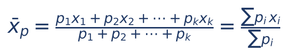

O que significa cada símbolo:
- x̄ₚ: a média ponderada.
- x₁, x₂, ..., xₖ: os valores (as notas).
- p₁, p₂, ..., pₖ: os pesos de cada valor (podem ser números de vezes, créditos, quantidades, porcentagens).
- Σpᵢxᵢ: a soma dos produtos "valor × peso"; Σpᵢ: a soma dos pesos.

Quando os pesos são porcentagens que somam 100%, a divisão final é por 1 e some: média = Σ(porcentagem em decimal × valor). Isso é muito útil em questões de "10% fizeram isso, 20% fizeram aquilo".

### 09.6.3 Média em tabela de frequência: a frequência é o peso

Numa tabela de frequência, cada valor xᵢ aparece fᵢ vezes. Logo, a média é uma média ponderada em que os pesos são as frequências:

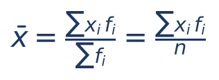

O que significa cada símbolo:
- xᵢ: o valor da linha (na tabela simples) ou o PONTO MÉDIO da classe (na tabela por classes).
- fᵢ: a frequência da linha.
- n = Σfᵢ: o total de observações.

:::EXEMPLO Média na tabela simples (20 dias de distribuição, 09.3.2)
| xᵢ | fᵢ | xᵢ × fᵢ |
|---|---|---|
| 0 | 2 | 0 |
| 1 | 5 | 5 |
| 2 | 7 | 14 |
| 3 | 4 | 12 |
| 4 | 2 | 8 |
| Total | 20 | 39 |
Média = 39 / 20 = 1,95 processo por dia.
O erro clássico é somar a coluna xᵢ (0 + 1 + 2 + 3 + 4 = 10) e dividir por 5 linhas, obtendo 2. Isso ignora que o 2 apareceu 7 vezes e o 4, só 2 vezes.
:::

:::EXEMPLO Média na tabela por classes (40 contribuintes, 09.3.3)
Cada classe é representada pelo seu ponto médio.
| Classe | Ponto médio xᵢ | fᵢ | xᵢ × fᵢ |
|---|---|---|---|
| 0 ├ 10 | 5 | 4 | 20 |
| 10 ├ 20 | 15 | 10 | 150 |
| 20 ├ 30 | 25 | 14 | 350 |
| 30 ├ 40 | 35 | 8 | 280 |
| 40 ├ 50 | 45 | 4 | 180 |
| Total | — | 40 | 980 |
Média ≈ 980 / 40 = 24,5 dias de atraso.
É uma aproximação: supõe que os 14 contribuintes da classe 20 ├ 30 atrasaram, em média, 25 dias (o centro da classe).
:::

:::DICA Atalho da mudança de variável (para tabelas com números "feios")
Pelas propriedades 1 e 2 (09.5.4), podemos transformar os pontos médios em números pequenos, calcular a média e desfazer a transformação. Na tabela acima, faça yᵢ = (xᵢ − 25)/10: os pontos médios 5, 15, 25, 35, 45 viram −2, −1, 0, 1, 2. Média de y: (−2 × 4 − 1 × 10 + 0 × 14 + 1 × 8 + 2 × 4)/40 = (−8 − 10 + 0 + 8 + 8)/40 = −2/40 = −0,05. Desfazendo: x̄ = 25 + 10 × (−0,05) = 25 − 0,5 = 24,5. A FCC usa muito essa técnica, inclusive em enunciados que já trazem a variável transformada.
:::

### 09.6.4 Média de grupos reunidos

Quando dois grupos se juntam, a média do grupo total NÃO é a média das duas médias (a não ser que os grupos tenham o mesmo tamanho). É uma média ponderada pelos tamanhos:

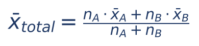

O que significa cada símbolo: nA e nB são os tamanhos dos grupos; x̄A e x̄B, as médias de cada um. Em palavras: somas de cada grupo (tamanho × média) somadas, divididas pelo total de pessoas.

:::EXEMPLO Duas turmas
Turma A: 20 alunos, média 7. Turma B: 30 alunos, média 6.
- soma A: 20 × 7 = 140
- soma B: 30 × 6 = 180
- média geral: (140 + 180) / (20 + 30) = 320 / 50 = 6,4
A média das médias, (7 + 6)/2 = 6,5, está ERRADA: a turma B, maior, puxa a média para perto de 6.
:::

:::QUESTAO FCC 2026 — SEFAZ-CE — Auditor Fiscal da Receita Estadual (Q4221363)
Situação: uma equipe de 10 vendedores fechava, em média, 3,6 contratos por semana. Após fusão com outra equipe de 20 vendedores, a média geral dos 30 subiu para 5. Mantida a produtividade de cada equipe, qual a média dos 20 novos vendedores? Gabarito oficial: D (5,7).
Resolução:
- soma da equipe original: 10 × 3,6 = 36
- soma das duas equipes: 30 × 5 = 150
- soma dos 20 novos: 150 − 36 = 114
- média dos novos: 114 / 20 = 5,7
Armadilha: tratar 5 como "média das duas médias", (3,6 + x)/2 = 5, daria x = 6,4, valor que nem consta das alternativas; os grupos têm tamanhos diferentes, e a média geral é ponderada. Checagem: o grupo maior (20) deve ter média mais próxima de 5 do que o grupo menor; 5,7 está a 0,7 de 5, e 3,6 está a 1,4 de 5. Como 20 é o dobro de 10, a distância do grupo maior tem de ser a metade: 1,4 / 2 = 0,7. Confere.
:::

:::QUESTAO FCC 2024 — SEPLAN-PI — Analista Governamental (Q3550519)
Situação: num evento beneficente, a doação sugerida era de 300 reais. 10% dos participantes não doaram; 20% doaram o valor integral; do restante, metade doou um terço do sugerido e a outra metade, dois terços. Qual o valor médio das doações? Gabarito oficial: C (165).
Resolução, como média ponderada com pesos em porcentagem:
- restante: 100% − 10% − 20% = 70%; metade de 70% = 35% para cada grupo
- um terço de 300 = 100; dois terços de 300 = 200
- média = 0,10 × 0 + 0,20 × 300 + 0,35 × 100 + 0,35 × 200
- média = 0 + 60 + 35 + 70
- média = 165
Alternativa sedutora: E (150) é a média simples dos quatro valores possíveis, (0 + 300 + 100 + 200)/4, ignorando os pesos. Observe também que o gabarito considera TODOS os participantes no denominador (inclusive os 10% que doaram zero); excluir quem não doou daria 165/0,9 ≈ 183,3, valor que não está entre as alternativas.
:::

:::PRATIQUE exercícios elaborados para esta apostila
1) Um candidato tirou 7 na prova objetiva (peso 4) e 8 na discursiva (peso 6). Qual a média final?
2) Calcule a média da tabela: classes 0 ├ 4 (5 casos), 4 ├ 8 (10 casos), 8 ├ 12 (5 casos).
3) (estilo FCC) Em um órgão, 60% dos servidores são analistas, com salário médio de 9.000 reais, e 40% são técnicos, com média de 5.000 reais. Qual a média geral? Se a média geral fosse 7.800 reais, qual seria a proporção de analistas?
Resolução:
1) (7 × 4 + 8 × 6)/(4 + 6) = (28 + 48)/10 = 76/10 = 7,6.
2) Pontos médios: 2, 6 e 10. Produtos: 2 × 5 = 10; 6 × 10 = 60; 10 × 5 = 50. Soma: 120. Média: 120/20 = 6.
3) Média geral = 0,60 × 9.000 + 0,40 × 5.000 = 5.400 + 2.000 = 7.400 reais. Para a média 7.800: chame de p a proporção de analistas (técnicos: 1 − p).
- 9.000p + 5.000(1 − p) = 7.800
- 9.000p + 5.000 − 5.000p = 7.800 (distribuímos o 5.000)
- 4.000p = 2.800 (juntamos os termos com p e passamos o 5.000 para o outro lado)
- p = 2.800 / 4.000 = 0,7 = 70%
:::

## 09.7 Média geométrica e média harmônica (noção e quando usar)

### 09.7.1 Média geométrica: para taxas de crescimento

Uma aplicação rendeu 60% num ano e perdeu 10% no ano seguinte. Qual o rendimento "médio" anual? A média aritmética diria (60% − 10%)/2 = 25% ao ano. Teste: 100 reais com 25% ao ano por dois anos viram 100 × 1,25 × 1,25 = 156,25. Mas o que realmente aconteceu foi 100 × 1,60 × 0,90 = 144. A média aritmética erra.

O certo é procurar a taxa que, aplicada duas vezes, dá o mesmo resultado: (1 + i)² = 1,60 × 0,90 = 1,44. Então 1 + i = √1,44 = 1,2, e i = 20% ao ano. Conferência: 100 × 1,2 = 120; 120 × 1,2 = 144. Esse 1,2 é a média geométrica dos fatores 1,60 e 0,90.

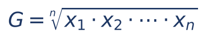

O que significa cada símbolo: G é a média geométrica; multiplica-se os n valores e extrai-se a raiz de índice n (raiz quadrada para 2 valores, cúbica para 3; ver Cap. 1). Só se aplica a valores positivos. Uso: taxas de crescimento, índices, fatores de correção encadeados (a mesma lógica da taxa equivalente do Cap. 4).

Exemplo simples: a média geométrica de 2 e 8 é √(2 × 8) = √16 = 4.

### 09.7.2 Média harmônica: para "por unidade" com quantidades fixas

Um oficial de justiça vai a uma diligência a 60 km/h e volta, pelo mesmo caminho, a 40 km/h. Qual a velocidade média? Não é 50 km/h. Suponha que a distância seja de 120 km (escolhemos um múltiplo de 60 e de 40 para facilitar). Ida: 120/60 = 2 horas. Volta: 120/40 = 3 horas. Total: 240 km em 5 horas, ou seja, 240/5 = 48 km/h. Esse 48 é a média harmônica de 60 e 40.

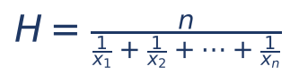

O que significa cada símbolo: H é a média harmônica; divide-se a quantidade de valores (n) pela soma dos inversos dos valores (1/x₁ + 1/x₂ + ...). Conferência: 2 / (1/60 + 1/40) = 2 / (2/120 + 3/120) = 2 / (5/120) = 2 × 120/5 = 48. Uso: velocidades médias em trechos de mesma distância, preço médio quando se gasta o MESMO VALOR em cada compra, produtividade em tarefas de mesmo tamanho.

### 09.7.3 A desigualdade das médias

Para quaisquer valores positivos: média harmônica ≤ média geométrica ≤ média aritmética. As três são iguais somente quando todos os valores são iguais. Com 2 e 8: H = 2/(1/2 + 1/8) = 2/(5/8) = 16/5 = 3,2; G = 4; média aritmética = (2 + 8)/2 = 5. Confere: 3,2 ≤ 4 ≤ 5.

:::DICA Use a desigualdade para eliminar alternativas
Se uma alternativa diz que a média geométrica de valores diferentes é maior que a aritmética, ou que as três médias coincidem para valores que não são todos iguais, está errada sem nenhuma conta.
:::

:::QUESTAO FGV 2024 — TJ-MS (Q2496462)
Situação: pesos de uma amostra: 50, 60, 70, 80 e 90 kg. Qual afirmação é correta? Gabarito oficial: C (a média aritmética coincide com a mediana).
Resolução: média = (50 + 60 + 70 + 80 + 90)/5 = 350/5 = 70; mediana (valor central do rol, 09.8) = 70. Coincidem, porque os dados são simétricos em torno de 70. A e B são falsas pela desigualdade das médias (os valores não são todos iguais, então G e H são menores que 70; na conta, G ≈ 68,5 e H ≈ 67,1). D é falsa porque não há moda (nenhum valor se repete). E (coeficiente de variação) é tema do Cap. 10.
:::

:::QUESTAO FGV 2024 — TJ-AP (Q2450790)
Situação: "quem está com a cabeça no gelo e os pés no forno não está bem". Para concluir que a pessoa está bem, mede-se a temperatura na cabeça (gelo), nos pés (forno) e nas axilas. Qual estimador leva a essa conclusão? Gabarito oficial: D (mediana).
Resolução pela teoria: com três medidas, uma muito baixa, uma muito alta e uma normal (axilas), a medida que "ignora" os extremos e escolhe o valor do meio é a MEDIANA, que resulta na temperatura das axilas. A média aritmética misturaria gelo e forno (exatamente o que o ditado critica); a moda não existe (três valores diferentes); as médias geométrica e harmônica também são puxadas pelos extremos. Resposta: mediana (alternativa D), que é o gabarito oficial, conferido no QConcursos em 30/10/2026 e coincidente com a resposta pela teoria.
:::

:::NOTA Número-índice de Paasche (questão de fronteira)
A FGV (Q2360316, Prefeitura de São José dos Campos 2024; gabarito oficial A, conferido no QConcursos em 30/10/2026) perguntou como se calcula o índice de preços de Paasche. A resposta teórica é: média HARMÔNICA dos preços relativos (preço atual / preço base), ponderada pela participação de cada produto na despesa do período ATUAL (alternativa A, o gabarito oficial). As alternativas D e E falam em quantidades relativas, que levam a índices de QUANTIDADE, não de preços; B descreve o Laspeyres; C descreve a finalidade de um índice de custo de vida, não a fórmula de Paasche. Já o índice de Laspeyres é a média ARITMÉTICA dos preços relativos ponderada pela participação na despesa do período BASE. Números-índices não constam expressamente do edital da SEFAZ/SC; fica só o registro.
:::

:::PRATIQUE exercícios elaborados para esta apostila
1) Calcule as médias aritmética, geométrica e harmônica de 2 e 8 e confira a desigualdade.
2) Um fiscal comprou 600 reais de material num mês, a 20 reais a unidade, e 600 reais no mês seguinte, a 30 reais a unidade. Qual o preço médio por unidade?
3) Um índice subiu 21% num ano e 0% no outro. A taxa média anual (geométrica) é maior, menor ou igual a 10,5%?
Resolução:
1) Aritmética 5; geométrica √16 = 4; harmônica 2/(1/2 + 1/8) = 2/(4/8 + 1/8) = 2/(5/8) = 16/5 = 3,2. Ordem: 3,2 < 4 < 5.
2) Gastou o mesmo valor em cada compra: média harmônica. Unidades: 600/20 = 30 e 600/30 = 20, total 50 unidades por 1.200 reais. Preço médio: 1.200/50 = 24 reais. (Pela fórmula: 2/(1/20 + 1/30) = 2/(3/60 + 2/60) = 2/(5/60) = 120/5 = 24.) A média aritmética, 25, estaria errada.
3) Fatores: 1,21 e 1,00. Média geométrica: √(1,21 × 1) = √1,21 = 1,1, ou seja, 10% ao ano, MENOR que a média aritmética de 10,5%. Conferência: 1,1 × 1,1 = 1,21.
:::

## 09.8 Mediana

### 09.8.1 A ideia: o valor do meio

A mediana é o valor que fica exatamente no meio dos dados ORDENADOS: metade dos valores está abaixo dela, metade acima. Imagine os servidores em fila, do que ganha menos para o que ganha mais; a mediana é o salário de quem está no meio da fila.

Vantagem decisiva: a mediana NÃO é afetada pelos valores extremos. Na figura da gangorra (09.5.3), os dados 2, 3, 3, 4, 13 têm média 5, mas mediana 3. Se o 13 virasse 1.300, a média dispararia e a mediana continuaria 3. Por isso se diz que a mediana é uma medida resistente (ou robusta). É a medida preferida para renda, salários, valores de imóveis e tempos de tramitação, em que poucos casos extremos distorcem a média.

### 09.8.2 Mediana de uma lista (dados brutos)

:::PASSO Roteiro da mediana em lista
1. Ordene os dados (rol) e conte quantos são (n).
2. Se n é ÍMPAR, a mediana é o valor que está na posição (n + 1)/2.
3. Se n é PAR, há dois valores no meio, nas posições n/2 e n/2 + 1; a mediana é a média desses dois.
:::

:::EXEMPLO n ímpar e n par
Dados: 12, 5, 9, 3, 7, 15, 10 (7 valores).
- rol: 3, 5, 7, 9, 10, 12, 15
- posição: (7 + 1)/2 = 4ª
- mediana = 9 (três valores abaixo, três acima)
Acrescentando o valor 20 (8 valores):
- rol: 3, 5, 7, 9, 10, 12, 15, 20
- posições centrais: 8/2 = 4ª e 4ª + 1 = 5ª, que são 9 e 10
- mediana = (9 + 10)/2 = 9,5
Note que a mediana de uma quantidade par de valores pode não ser um dos dados.
:::

:::PEGADINHA Os três erros clássicos da mediana
- Não ordenar: pegar o valor do meio da lista como veio. As bancas montam listas desordenadas justamente para isso.
- Confundir a POSIÇÃO com o VALOR: (n + 1)/2 = 4 significa "o quarto valor do rol", não "a mediana é 4".
- Esquecer um valor ao ordenar: a mediana se desloca uma posição e cai na alternativa errada. Conte o rol.
:::

:::QUESTAO FCC 2024 — TRT 7ª Região — Analista Judiciário (Q3089763)
Situação: as idades de 19 entrevistados são 23, 32, 45, 28, 27, 43, 18, 26, 25, 19, 26, 20, 41, 40, 21, 32, 29, 37, 32. Quanto a moda difere da mediana? Gabarito oficial: E (4 anos).
Resolução:
- rol (19 valores): 18, 19, 20, 21, 23, 25, 26, 26, 27, 28, 29, 32, 32, 32, 37, 40, 41, 43, 45
- n = 19 (ímpar); posição da mediana: (19 + 1)/2 = 10ª
- contando: 1ª 18, 2ª 19, 3ª 20, 4ª 21, 5ª 23, 6ª 25, 7ª 26, 8ª 26, 9ª 27, 10ª 28 → mediana = 28
- moda: o valor que mais se repete (09.9) é 32 (três vezes; o 26 aparece duas)
- diferença: 32 − 28 = 4
Alternativas sedutoras: D (5) aparece para quem toma o 26 como moda ou erra a posição (27, 9ª posição, dá 32 − 27 = 5); C (3) aparece para quem toma a 11ª posição (29).
:::

:::QUESTAO FGV 2025 — TRT 24ª Região (Q3349644)
Situação: idades de 13 funcionários: 35, 50, 48, 59, 32, 26, 28, 30, 62, 57, 21, 31, 38. Mediana? Gabarito oficial: E (35).
Resolução: rol: 21, 26, 28, 30, 31, 32, 35, 38, 48, 50, 57, 59, 62. Posição (13 + 1)/2 = 7ª. Contando: 21, 26, 28, 30, 31, 32, 35 → mediana 35.
No mesmo sentido (listas de tamanho ímpar): Q3349737 (FGV 2025; 13 notas, mediana 6,1, a 7ª do rol), Q3593733 (FGV 2025; 17 valores contábeis, mediana 186, a 9ª do rol), Q2566522 (FGV 2024; 17 idades, mediana 35, a 9ª do rol).
:::

:::QUESTAO FGV 2025 — CPRM (Q3757790)
Situação: 12 amostras de teor de ferro: 15,2; 9,3; 7,6; 11,9; 10,4; 9,6; 20,4; 9,4; 11,5; 16,2; 9,4; 8,3. Mediana amostral? Gabarito oficial: B (10,0).
Resolução:
- rol: 7,6; 8,3; 9,3; 9,4; 9,4; 9,6; 10,4; 11,5; 11,9; 15,2; 16,2; 20,4
- n = 12 (par): posições centrais 6ª e 7ª, que são 9,6 e 10,4
- mediana = (9,6 + 10,4)/2 = 20/2 = 10,0
Alternativas sedutoras: C (9,7) e E (9,5) nascem de pegar valores do meio sem ordenar ou de errar a posição; A (10,7) aproxima a média de outra dupla.
:::

:::QUESTAO FGV 2025 — Prefeitura (ouvidoria) (Q3578665)
Situação: mensagens recebidas por uma ouvidoria em 10 dias: 6, 5, 8, 10, 6, 13, 5, 8, 6, 8. Diferença entre média e mediana? Gabarito oficial: B (0,5).
Resolução:
- soma: 6 + 5 + 8 + 10 + 6 + 13 + 5 + 8 + 6 + 8 = 75; média = 75/10 = 7,5
- rol: 5, 5, 6, 6, 6, 8, 8, 8, 10, 13; posições centrais 5ª e 6ª: 6 e 8; mediana = (6 + 8)/2 = 7
- diferença: 7,5 − 7 = 0,5
No mesmo sentido: Q3052436 (FGV 2024; amostra 12, 8, 10, 9, 15, 6, 7, 9, 10, 6: média 92/10 = 9,2, mediana (9 + 9)/2 = 9, diferença 0,2).
:::

:::QUESTAO FGV 2026 — AL-RO (Q3884917)
Situação: salários de 5 colaboradores de uma startup: 3.000, 3.000, 4.000, 5.000 e 35.000 reais. Qual afirmação é correta? Gabarito oficial: E (a mediana é inferior à média, porque a mediana é resistente a valores extremos, enquanto a média é "puxada" para cima pelo salário de 35.000).
Resolução: média = (3.000 + 3.000 + 4.000 + 5.000 + 35.000)/5 = 50.000/5 = 10.000; mediana = 3º valor = 4.000; moda = 3.000.
Por que as outras falham: A diz que a média é 8.000 e é a melhor representante (a média é 10.000 e é a PIOR representante aqui, distorcida pelo *outlier*); B diz que a distribuição é simétrica (média 10.000 e mediana 4.000 são bem diferentes); C inverte tudo (digitar 350.000 alteraria drasticamente a MÉDIA, e a mediana continuaria 4.000); D diz que a moda é 4.000 (é 3.000; 4.000 é a mediana).
:::

### 09.8.3 Mediana quando dados entram no conjunto

Uma questão típica: conhece-se a mediana de um grupo e acrescentam-se alguns valores. A nova mediana pode ser determinada?

O raciocínio é sempre "contar quantos valores ficam de cada lado". Se acrescentarmos UM valor abaixo da mediana e UM acima, o "meio" da fila não se move: a mediana não muda. Se os valores acrescentados ficarem todos do mesmo lado, o meio se desloca e, sem conhecer os dados originais, normalmente não se sabe o novo valor.

:::QUESTAO FGV 2024 — EBSERH (Q3248825)
Situação: a mediana de 20 idades é 37. Juntam-se duas pessoas, de 40 e de 25 anos. Nova mediana? Gabarito oficial: D (37).
Resolução: com 20 valores, a mediana 37 é a média do 10º e do 11º do rol. Entra um valor abaixo de 37 (25) e um acima (40). Agora são 22 valores, com mediana na média do 11º e do 12º; como entrou um valor de cada lado, esses são exatamente os antigos 10º e 11º. A mediana continua 37.
Rigor: o raciocínio pressupõe que 25 fique abaixo do antigo 10º valor e que 40 fique acima do antigo 11º, o que a banca presume implicitamente. No mesmo sentido: Q3238409 (FGV 2025; dez idades com média 6 e mediana 6; acrescentando 4 e 14 anos, a média vira (60 + 4 + 14)/12 = 78/12 = 6,5 e a mediana continua 6; gabarito D).
:::

:::QUESTAO FGV 2025 — SEFAZ-PR (Q3363353)
Situação: 36 funcionários têm idade média 42 e mediana 41. Incorporam-se 4 novos, com 38, 38, 42 e 50 anos. O que se pode afirmar sobre a nova média e a nova mediana dos 40? Gabarito oficial: D (a média continua 42 e nada se pode afirmar sobre a mediana).
Resolução:
- soma antiga: 36 × 42 = 1.512
- soma dos novos: 38 + 38 + 42 + 50 = 168 (cuja média é 168/4 = 42, igual à média do grupo)
- nova média: (1.512 + 168)/40 = 1.680/40 = 42
- mediana: entraram três valores abaixo de 41 ou acima? 38 e 38 ficam abaixo; 42 e 50 ficam acima. Dois de cada lado. Parece que a mediana não mudaria, mas ela era a média do 18º e 19º valores (36 valores) e agora é a média do 20º e 21º (40 valores); quais são esses valores depende de como os dados antigos se distribuem perto de 41 (por exemplo, se havia valores entre 38 e 41). Sem os dados originais, nada se pode afirmar com certeza.
Alternativa sedutora: A ou C (mediana "continua 41"). A FGV quis exatamente testar se o candidato se contenta com o "dois de cada lado" sem verificar as posições.
:::

### 09.8.4 Mediana em tabela de frequência simples

Use a coluna de frequência acumulada para achar a posição.

:::EXEMPLO Os 20 dias de distribuição (09.3.2)
n = 20 (par): posições centrais 10ª e 11ª. Pela coluna Fᵢ: até o valor 0 há 2 observações; até o 1, 7; até o 2, 14. Logo, da 8ª à 14ª posição o valor é 2. A 10ª e a 11ª valem 2. Mediana = (2 + 2)/2 = 2.
Regra prática: procure a primeira linha cuja frequência acumulada ALCANÇA ou ULTRAPASSA a posição procurada.
:::

### 09.8.5 Mediana em dados agrupados por classes: a interpolação

Quando os dados estão em classes, sabemos em que classe está a mediana, mas não o valor exato. Supondo que os valores se espalham por igual dentro da classe, fazemos uma regra de três.

Exemplo dos 40 contribuintes. Passo a passo:
- posição da mediana nos dados agrupados: n/2 = 40/2 = 20º valor (nos dados agrupados, a convenção usual, e a da FCC, é n/2, e não (n + 1)/2)
- frequências acumuladas: 4, 14, 28, 36, 40; a primeira que alcança 20 é 28, da classe 20 ├ 30 (a classe mediana)
- antes dessa classe já foram contados 14 contribuintes; faltam 20 − 14 = 6 para chegar ao 20º
- a classe tem 14 contribuintes espalhados por 10 dias de amplitude; os 6 que faltam ocupam 6/14 da classe
- 6/14 de 10 dias = (6/14) × 10 ≈ 4,29 dias
- mediana ≈ 20 + 4,29 = 24,29 dias

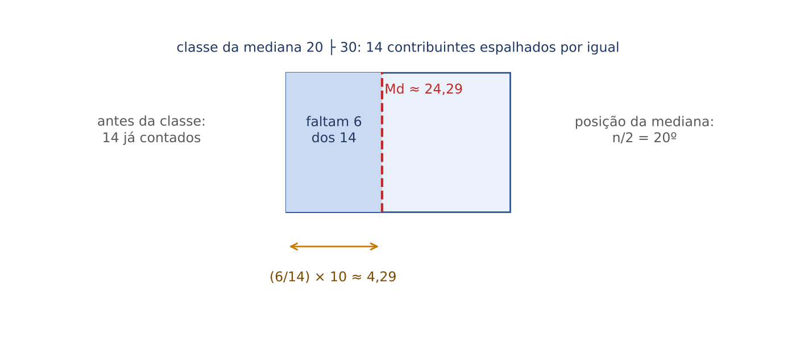

A fórmula que resume essa conta:

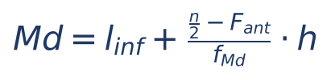

O que significa cada símbolo:
- l_inf: limite inferior da classe mediana (20).
- n/2: a posição da mediana (20).
- F_ant: frequência acumulada ATÉ a classe ANTERIOR à classe mediana (14).
- f_Md: frequência simples da classe mediana (14).
- h: amplitude da classe mediana (10).
Na fórmula: Md = 20 + (20 − 14)/14 × 10 = 20 + 6/14 × 10 = 20 + 60/14 ≈ 20 + 4,29 = 24,29.

:::PEGADINHA F_ant é a acumulada da classe ANTERIOR
O erro mais comum é usar, no lugar de F_ant, a acumulada da própria classe mediana (28) ou a frequência simples da classe anterior (10). Use a acumulada até o fim da classe anterior: 14, que é quantos dados ficaram "antes" da classe.
:::

:::DICA Conferência pela ogiva e por estimativa
A mediana tem de estar dentro da classe mediana (entre 20 e 30). E, como 6 é menos da metade de 14, ela fica na primeira metade da classe (entre 20 e 25). Na ogiva (09.4.1), a linha horizontal na altura 20 cruza a curva em torno de 24,3. Essas checagens eliminam alternativas sem fazer a divisão.
:::

:::PRATIQUE exercícios elaborados para esta apostila
1) Mediana de 14, 3, 8, 21, 9, 5, 17.
2) Mediana de 14, 3, 8, 21, 9, 5, 17, 30.
3) Na tabela por classes 0 ├ 10 (8 casos), 10 ├ 20 (10 casos), 20 ├ 30 (2 casos), calcule a média e a mediana.
4) (estilo FCC) Um grupo de 9 auditores tem mediana salarial de 15.000 reais, e nenhum outro auditor do grupo ganha exatamente 15.000 reais. Contratam-se 2 auditores, com salários de 12.000 e 22.000 reais. Qual a nova mediana?
Resolução:
1) Rol: 3, 5, 8, 9, 14, 17, 21 (7 valores). Posição (7 + 1)/2 = 4ª. Mediana = 9.
2) Rol: 3, 5, 8, 9, 14, 17, 21, 30 (8 valores). Posições 4ª e 5ª: 9 e 14. Mediana = (9 + 14)/2 = 23/2 = 11,5.
3) Média: pontos médios 5, 15, 25; produtos 5 × 8 = 40; 15 × 10 = 150; 25 × 2 = 50; soma 240; média 240/20 = 12. Mediana: posição 20/2 = 10ª; acumuladas 8, 18, 20; classe mediana 10 ├ 20; F_ant = 8; f_Md = 10; Md = 10 + (10 − 8)/10 × 10 = 10 + 2 = 12.
4) Com 9 valores, a mediana 15.000 é o 5º do rol (4 abaixo, 4 acima). Entram 12.000 (abaixo de 15.000) e 22.000 (acima): agora são 11 valores, 5 abaixo e 5 acima do salário de 15.000, que passa a ser o 6º do rol, exatamente a posição (11 + 1)/2 = 6ª. Nova mediana: 15.000 reais. Aqui não importa onde os novos valores caem em relação aos outros salários; importa apenas de que lado do valor mediano (que é um dado, porque n é ímpar) eles ficam.
:::

## 09.9 Moda

### 09.9.1 A ideia: o valor da "maioria"

A moda é o valor que aparece MAIS VEZES. É a única medida de posição que serve para variáveis qualitativas nominais: o município com mais contribuintes autuados, o CFOP mais usado, o tipo de ação mais distribuída. Ninguém calcula a "média dos municípios", mas todo mundo entende "o município mais frequente".

Classificação pelo número de modas:
- amodal: nenhum valor se repete (ou todos se repetem igualmente). Exemplo: 21, 42, 29, 15 não tem moda.
- unimodal: uma moda. Exemplo: 2, 2, 2, 3, 5 tem moda 2.
- bimodal: duas modas. Exemplo: 5, 5, 6, 6, 6, 8, 8, 8, 10, 13 tem modas 6 e 8 (cada uma três vezes).
- multimodal: três ou mais modas.

Propriedades: a moda, quando existe, é sempre um dos valores observados (diferentemente da média e da mediana, que podem não ser); não é afetada por valores extremos; pode não existir ou não ser única.

:::QUESTAO FCC 2025 — TRT 6ª Região — Analista Judiciário (Q3216475)
Situação: um setor tem 5 empregados: 4 assistentes ganham 5.000 reais cada e o supervisor ganha 15.000 reais. Qual a diferença entre a média e a moda dos salários? Gabarito oficial: B (2.000 reais).
Resolução:
- soma: 4 × 5.000 + 15.000 = 20.000 + 15.000 = 35.000
- média: 35.000 / 5 = 7.000
- moda: 5.000 (aparece 4 vezes)
- diferença: 7.000 − 5.000 = 2.000
Alternativas sedutoras: A (7.000) é a própria média; C (5.000) é a própria moda. O erro de raciocínio mais comum é calcular a média só com os 2 valores distintos, (5.000 + 15.000)/2 = 10.000, o que daria diferença de 5.000 (alternativa C); a média tem de considerar as 5 pessoas.
:::

:::QUESTAO FGV 2024 — EPE (Q3259435)
Situação: o conjunto {21, 42, 29, 15, 27, 36, 25, 45} tem média 30. Julgar: I) a amplitude é igual à média; II) a mediana é 28; III) a moda é 45. Gabarito oficial: B (I e II).
Resolução:
- rol: 15, 21, 25, 27, 29, 36, 42, 45
- I) amplitude = 45 − 15 = 30 = média. Verdadeira.
- II) n = 8: posições 4ª e 5ª, 27 e 29; mediana = (27 + 29)/2 = 28. Verdadeira.
- III) nenhum valor se repete: o conjunto é AMODAL. Falsa (45 é o máximo, não a moda).
No mesmo sentido: Q3782895 (FGV 2025; ocorrências 2, 2, 2, 3, 5: média 14/5 = 2,8, moda 2, mediana 2 (3º valor); a alternativa correta, B, traz ainda um desvio-padrão ≈ 1,3, que é o desvio-padrão amostral, assunto do Cap. 10).
:::

:::QUESTAO FGV 2025 — Prefeitura de São José dos Campos (Q3579921)
Situação: notas de 10 alunos: 0, 4, 6, 6, 7, 8, 9, 9, 9, 10. Qual afirmativa é correta? Gabarito oficial: B (a mediana é maior do que a média).
Resolução:
- soma: 0 + 4 + 6 + 6 + 7 + 8 + 9 + 9 + 9 + 10 = 68; média = 68/10 = 6,8
- mediana: posições 5ª e 6ª, 7 e 8; (7 + 8)/2 = 7,5
- moda: 9 (três vezes)
- logo média (6,8) < mediana (7,5) < moda (9): mediana maior que média
Por que as outras falham: A (as três iguais) e D (média igual à mediana) são falsas pelas contas; C diz que a moda é menor que a mediana (é maior: 9 > 7,5); E diz que a moda é o valor MENOS frequente (é o mais frequente). Observe que o zero, um valor baixo isolado, puxa a média para baixo: é a assimetria negativa de 09.10.
:::

:::QUESTAO FGV 2024 — Concurso não identificado no banco (Q2351908)
Situação: amostra de 7 inteiros positivos: 3, 3, 6, 3, x, 5, 11. A média também é inteira. Sendo S a soma da moda, da mediana e da média, qual o menor valor possível de S? Gabarito oficial: B (12).
Resolução:
- soma conhecida: 3 + 3 + 6 + 3 + 5 + 11 = 31; soma total: 31 + x
- média inteira: 31 + x tem de ser múltiplo de 7; os múltiplos de 7 acima de 31 são 35, 42, 49... logo x = 4, 11, 18...
- x = 4: rol 3, 3, 3, 4, 5, 6, 11; média 35/7 = 5; mediana (4º valor) 4; moda 3; S = 3 + 4 + 5 = 12
- x = 11: rol 3, 3, 3, 5, 6, 11, 11; média 42/7 = 6; mediana 5; moda 3; S = 14 (maior)
- valores maiores de x só aumentam a média, e a mediana fica em 5: S cresce
Menor S possível: 12 (alternativa B, o gabarito oficial, conferido no QConcursos em 30/10/2026; a resolução, refeita em Python, coincide). A alternativa A (11) é inatingível, porque S = 12 já é o mínimo; C (13) e E (15) não correspondem a nenhum x válido; D (14) é o valor para x = 11, não o menor.
:::

### 09.9.2 Moda em tabela de frequência

Na tabela simples, a moda é o valor da linha com MAIOR fᵢ. Nos 20 dias de distribuição (09.3.2), o valor 2 tem a maior frequência (7): moda = 2.

Na tabela por classes, primeiro se identifica a classe modal (a de maior frequência; no exemplo dos 40 contribuintes, 20 ├ 30, com 14). Depois, há três maneiras de "escolher um ponto" dentro dela, e a prova diz qual usar:

Moda bruta: o ponto médio da classe modal. No exemplo: (20 + 30)/2 = 25. É a mais simples e a que se usa quando o enunciado não especifica outra.

Moda de Czuber: leva em conta as classes vizinhas. Se a classe ANTERIOR tem frequência bem maior que a POSTERIOR, a moda "escorrega" para a esquerda, e vice-versa.

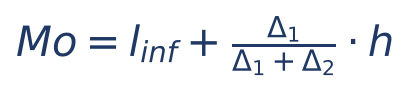

O que significa cada símbolo:
- l_inf: limite inferior da classe modal (20).
- Δ₁ (delta 1): frequência da classe modal MENOS a da classe anterior (14 − 10 = 4).
- Δ₂ (delta 2): frequência da classe modal MENOS a da classe posterior (14 − 8 = 6).
- h: amplitude da classe modal (10).
Conta: Mo = 20 + 4/(4 + 6) × 10 = 20 + 4/10 × 10 = 20 + 4 = 24.

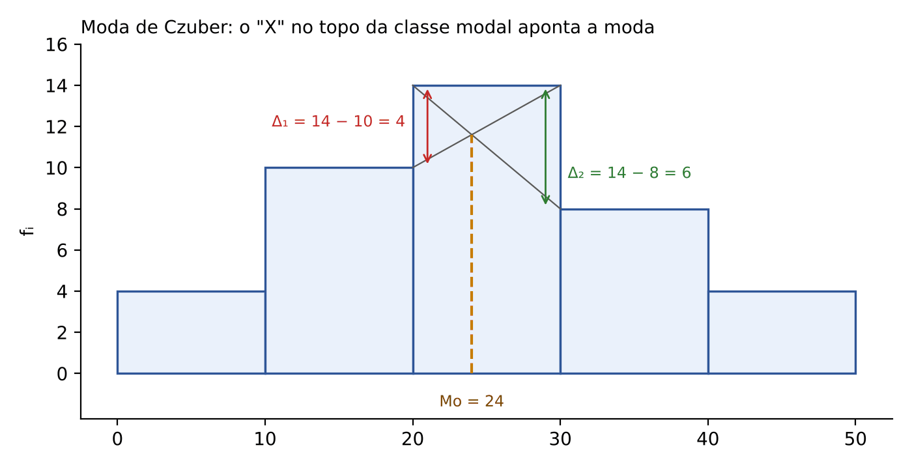

Interpretação geométrica: no histograma, trace as duas diagonais que formam um "X" sobre o topo da classe modal (cada uma liga um canto da coluna modal ao topo da coluna vizinha). O cruzamento das diagonais aponta a moda de Czuber.

Moda de King: usa só as frequências das vizinhas, numa espécie de "cabo de guerra": a classe vizinha mais populosa atrai a moda para o seu lado.

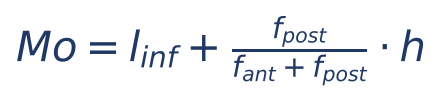

O que significa cada símbolo: f_ant é a frequência da classe anterior à modal (10); f_post é a da posterior (8). Atenção: no numerador vai a frequência POSTERIOR. Conta: Mo = 20 + 8/(10 + 8) × 10 = 20 + 80/18 ≈ 20 + 4,44 = 24,44.

Moda de Pearson (empírica): para distribuições moderadamente assimétricas, Mo ≈ 3 × Md − 2 × x̄. No exemplo: 3 × 24,29 − 2 × 24,5 ≈ 72,86 − 49 = 23,86. Só use se o enunciado pedir.

:::PEGADINHA King parece "ao contrário"
Na fórmula de King, a frequência da classe POSTERIOR vai no numerador. Raciocínio: se a classe posterior é mais populosa, ela "puxa" a moda para a direita, e a parcela somada ao limite inferior tem de ser maior. Quem coloca f_ant no numerador erra o lado. Em Czuber, ao contrário, quem vai no numerador é Δ₁, a diferença em relação à ANTERIOR: quanto mais a modal supera a anterior, mais a moda se afasta do início da classe.
:::

:::ESQUEMA As modas da tabela de 40 contribuintes
| Método | Conta | Resultado |
|---|---|---|
| Bruta | (20 + 30)/2 | 25 |
| Czuber | 20 + 4/(4 + 6) × 10 | 24 |
| King | 20 + 8/(10 + 8) × 10 | ≈ 24,44 |
| Pearson | 3 × 24,29 − 2 × 24,5 | ≈ 23,86 |
Todas ficam dentro da classe modal (20 a 30), salvo Pearson, que é uma aproximação e pode, em casos extremos, sair dela.
:::

:::PRATIQUE exercícios elaborados para esta apostila
1) Determine a moda de: (a) 4, 7, 7, 9, 12; (b) 1, 2, 3, 4; (c) 5, 5, 8, 8, 9.
2) Tabela: 0 ├ 10 (5), 10 ├ 20 (11), 20 ├ 30 (7), 30 ├ 40 (2). Calcule a moda bruta, a de Czuber e a de King.
3) (estilo FCC) Na tabela do exercício 2, se a frequência da classe 0 ├ 10 passasse de 5 para 9, a moda de Czuber aumentaria ou diminuiria?
Resolução:
1) (a) 7 (unimodal); (b) amodal; (c) 5 e 8 (bimodal).
2) Classe modal: 10 ├ 20 (frequência 11). Bruta: (10 + 20)/2 = 15. Czuber: Δ₁ = 11 − 5 = 6; Δ₂ = 11 − 7 = 4; Mo = 10 + 6/(6 + 4) × 10 = 10 + 6 = 16. King: Mo = 10 + 7/(5 + 7) × 10 = 10 + 70/12 ≈ 10 + 5,83 = 15,83.
3) Δ₁ passaria a 11 − 9 = 2, e Δ₂ continuaria 4: Mo = 10 + 2/(2 + 4) × 10 = 10 + 3,33 ≈ 13,33. Diminuiria: a classe anterior ficou mais populosa e "puxou" a moda para a esquerda.
:::

## 09.10 Relação entre média, mediana e moda (e um primeiro olhar sobre a assimetria)

Quando o histograma é simétrico e tem um só pico, média, mediana e moda coincidem, no centro. Quando há uma "cauda" longa para um lado, a média é a mais puxada para a cauda (é a medida sensível a extremos), a mediana fica no meio do caminho e a moda fica no pico.

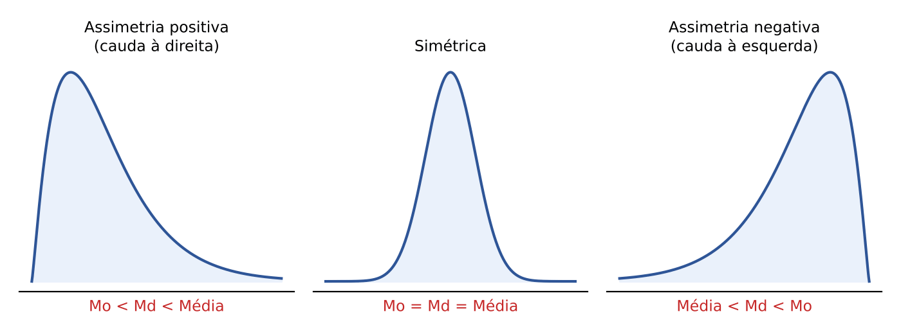

- Cauda à direita (assimetria positiva): moda < mediana < média. Exemplo típico: renda, salários, valor de débitos tributários (muitos valores pequenos e poucos enormes).
- Simétrica: moda = mediana = média.
- Cauda à esquerda (assimetria negativa): média < mediana < moda. Exemplo: notas de uma prova fácil (a maioria alta e alguns zeros).

Os coeficientes que medem a assimetria (Pearson, Bowley) e a curtose estão no Cap. 10. Aqui basta a regra de posição: a média "corre atrás da cauda".

:::PEGADINHA A recíproca não é garantida
"Se média = mediana = moda, a distribuição é simétrica" é afirmação que a teoria não garante em todos os casos (há distribuições assimétricas com as três medidas iguais), e em distribuições com mais de uma moda a ordem entre as medidas pode não seguir padrão algum. Na prova, a regra vale no sentido "forma → ordem das medidas". Quando a questão inverte o sentido, desconfie de palavras como "sempre" e "necessariamente".
:::

:::QUESTAO FCC 2025 — Prefeitura de São Paulo — Auditor Municipal de Controle Interno (Q3281780)
Situação: uma tabela registra, durante 64 dias, quantos processos de certo tipo foram autuados por dia; as quantidades de dias em que foram autuados 2 e 4 processos são desconhecidas (x e y), sabendo-se que x − y = 5. Pede-se a relação correta entre as medidas de posição. Gabarito oficial: B (a média supera a mediana, mas é inferior à moda).
Observação: a tabela com as demais frequências não foi reproduzida no banco de questões; por isso não é possível refazer os números. O método é o seguinte:
- Passo 1, achar as incógnitas: a soma de todas as frequências é 64. Isso dá uma equação com x + y; junto com x − y = 5, forma um sistema. Somando as duas equações, sai 2x; subtraindo, sai 2y (sistemas: Cap. 1).
- Passo 2, média: Σxᵢfᵢ / 64.
- Passo 3, mediana: n = 64 é par; posições 32ª e 33ª, localizadas pela frequência acumulada.
- Passo 4, moda: a linha de maior frequência.
- Passo 5, comparar com cada alternativa, inclusive as porcentagens (D e E pedem "média = 84% da moda" e "mediana = 80% da média": basta multiplicar e comparar).
Repare que a relação do gabarito (mediana < média < moda) não segue nenhuma das três ordens "típicas" da figura acima: as tabelas de prova, com poucos valores discretos, frequentemente fogem do padrão, e por isso é preciso CALCULAR, nunca presumir a ordem.
:::

## 09.11 Separatrizes: quartis, decis e percentis; mínimo e máximo

### 09.11.1 A ideia: cortar a fila em partes iguais

A mediana corta os dados ordenados em duas metades. As separatrizes generalizam a ideia:

- Quartis (Q₁, Q₂, Q₃): cortam em 4 partes, cada uma com 25% dos dados. Q₁ deixa 25% abaixo; Q₂ é a mediana (50%); Q₃ deixa 75% abaixo.
- Decis (D₁ a D₉): cortam em 10 partes de 10%. D₅ é a mediana.
- Percentis (P₁ a P₉₉): cortam em 100 partes de 1%. P₅₀ é a mediana; P₂₅ = Q₁; P₇₅ = Q₃; P₁₀ = D₁.
- Quantil é o nome genérico (o quantil 0,5 é a mediana; o quantil 0,25 é Q₁).

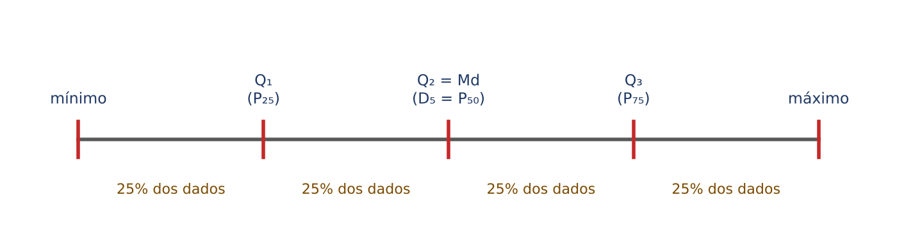

Mínimo e máximo, que o edital cita expressamente, são os extremos do rol: o menor e o maior valor. Com eles, os três quartis formam o "resumo dos cinco números" (mínimo, Q₁, mediana, Q₃, máximo), que é a base do boxplot (Cap. 10). Duas medidas de dispersão nascem aqui: a amplitude total (máximo − mínimo) e a amplitude interquartil (AIQ = Q₃ − Q₁), que mede a largura dos 50% centrais (ambas desenvolvidas no Cap. 10).

Uso prático muito comum: "o percentil 90 do tempo de tramitação é 400 dias" significa que 90% dos processos tramitam em até 400 dias, e só 10% demoram mais. Na pediatria, "peso no percentil 75" quer dizer que a criança pesa mais que 75% das crianças da mesma idade.

### 09.11.2 Quartis em dados brutos

Há mais de um método nos livros, e eles podem dar resultados um pouco diferentes. Os dois mais usados:

Método das metades (o mais simples): ache a mediana; Q₁ é a mediana da metade inferior e Q₃ é a mediana da metade superior. Quando n é ímpar, a mediana não entra em nenhuma das metades.

Método da posição: Qₖ está na posição k × (n + 1)/4 do rol; se a posição não for inteira, interpola-se entre os dois valores vizinhos.

:::EXEMPLO Onze valores (os dois métodos coincidem)
Rol: 3, 5, 6, 8, 9, 10, 12, 14, 15, 18, 20 (n = 11).
- mediana: posição (11 + 1)/2 = 6ª → 10
- metades (sem a mediana): 3, 5, 6, 8, 9 e 12, 14, 15, 18, 20
- Q₁ = mediana de 3, 5, 6, 8, 9 = 6; Q₃ = mediana de 12, 14, 15, 18, 20 = 15
- pelo método da posição: Q₁ na posição 1 × 12/4 = 3ª → 6; Q₃ na posição 3 × 12/4 = 9ª → 15. Iguais.
- mínimo 3, máximo 20; amplitude 17; amplitude interquartil 15 − 6 = 9.
:::

:::EXEMPLO Oito valores (os métodos divergem)
Rol: 2, 4, 5, 7, 9, 10, 12, 15 (n = 8). Mediana = (7 + 9)/2 = 8.
- método das metades: Q₁ = mediana de 2, 4, 5, 7 = (4 + 5)/2 = 4,5; Q₃ = mediana de 9, 10, 12, 15 = (10 + 12)/2 = 11
- método da posição: Q₁ na posição 9/4 = 2,25, isto é, 25% do caminho entre o 2º (4) e o 3º (5) valor: 4 + 0,25 × (5 − 4) = 4,25; Q₃ na posição 27/4 = 6,75: 10 + 0,75 × (12 − 10) = 11,5
Na prova: siga a convenção do ATENCAO abaixo.
:::

:::ATENCAO Convenção de quartis adotada nesta apostila (Caps. 9 e 10)
Em dados brutos (a lista de valores), esta apostila usa o MÉTODO DAS METADES: ordene os dados, ache a mediana (Q₂) e tome Q₁ como a mediana da metade inferior e Q₃ como a mediana da metade superior. Se n é ímpar, a mediana fica fora das duas metades; se n é par, cada metade tem n ÷ 2 dados. A mesma convenção e os mesmos nomes (Q₁, Q₂, Q₃, amplitude interquartil ou AIQ = Q₃ − Q₁, também chamada distância ou desvio interquartil) são usados no Cap. 10, no boxplot.
Por que este método: é o que as questões da FGV do banco usam; algumas o descrevem no próprio enunciado (Q3171962: dividir a lista ordenada de 14 valores em dois grupos de sete e tomar o termo central de cada grupo), e ele reproduz os gabaritos oficiais das questões de quartil em dados brutos conferidas no Cap. 10 (Q3185955, Q3786841, Q4375145).
E a FCC? O banco desta apostila não traz questão da FCC que calcule quartil em dados brutos, de modo que não é possível afirmar, com base nele, qual método a FCC adota nesse caso. Em dados agrupados em classes, o cálculo é a interpolação com a posição p × n (09.11.3), igual à da mediana.
Há métodos alternativos: o da posição k × (n + 1)/4, mostrado acima, e os dos programas de computador (planilhas e linguagens como o Python têm opções próprias de interpolação). Em amostras pequenas, eles podem dar valores um pouco diferentes dos do método das metades.
Regra de prova: (1) se o enunciado disser como achar o quartil, siga o enunciado; (2) na falta de instrução, use o método das metades e confira se o resultado está nas alternativas; (3) se não estiver, teste o método da posição. Questões bem elaboradas costumam usar dados em que os métodos coincidem.
:::

### 09.11.3 Separatrizes em dados agrupados

É a mesma interpolação da mediana (09.8.5), trocando a posição n/2 pela posição p × n, em que p é a fração desejada (0,25 para Q₁; 0,75 para Q₃; 0,10 para D₁; 0,90 para P₉₀).

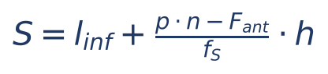

O que significa cada símbolo:
- S: a separatriz procurada (Q₁, D₉, P₉₀...).
- p × n: a posição (por exemplo, para Q₁ com n = 40, 0,25 × 40 = 10ª).
- l_inf, F_ant, f_S, h: limite inferior, frequência acumulada anterior, frequência e amplitude da classe que contém essa posição.

:::EXEMPLO Quartis e percentis dos 40 contribuintes
Acumuladas: 4 (até 10), 14 (até 20), 28 (até 30), 36 (até 40), 40 (até 50).
- Q₁: posição 0,25 × 40 = 10ª; a primeira acumulada que alcança 10 é 14, classe 10 ├ 20; Q₁ = 10 + (10 − 4)/10 × 10 = 10 + 6 = 16 dias
- Q₃: posição 0,75 × 40 = 30ª; classe 30 ├ 40 (acumulada 36); Q₃ = 30 + (30 − 28)/8 × 10 = 30 + 2,5 = 32,5 dias
- D₁: posição 0,10 × 40 = 4ª; classe 0 ├ 10; D₁ = 0 + (4 − 0)/4 × 10 = 10 dias (exatamente no fim da primeira classe)
- P₉₀: posição 0,90 × 40 = 36ª; classe 30 ├ 40; P₉₀ = 30 + (36 − 28)/8 × 10 = 30 + 10 = 40 dias
- amplitude interquartil: 32,5 − 16 = 16,5 dias
Leitura: um quarto dos contribuintes atrasou até 16 dias; três quartos, até 32,5 dias; 90%, até 40 dias.
:::

:::QUESTAO FGV 2026 — AL-RO (Q3883531)
Situação: sobre a mediana m de uma variável aleatória X, julgar: I) m é o quantil 0,5; II) m é qualquer número que satisfaz P[X ≤ m] ≤ ½ e P[X ≥ m] ≥ ½; III) (texto não reproduzido no banco). Gabarito oficial: C (I e III).
Resolução: I é verdadeira: a mediana é o quantil 0,5 (o percentil 50, o segundo quartil). II é falsa por causa do primeiro sinal: a definição correta exige P[X ≤ m] ≥ ½ E P[X ≥ m] ≥ ½ (pelo menos metade da probabilidade de cada lado, contando o próprio m). Com "≤ ½" no primeiro termo, a definição fica errada. Como o item III não foi reproduzido no banco, registre apenas que o gabarito o considera correto. (P[X ≤ m] se lê "probabilidade de X ser menor ou igual a m"; probabilidade é o tema dos Caps. 12 e 13.)
:::

:::PRATIQUE exercícios elaborados para esta apostila
1) Rol: 1, 3, 4, 6, 8, 9, 11. Encontre mínimo, Q₁, mediana, Q₃ e máximo pelo método das metades.
2) Na tabela 0 ├ 10 (8), 10 ├ 20 (10), 20 ├ 30 (2), calcule Q₁, Q₃ e D₉.
3) (estilo FCC) Numa distribuição por classes com n = 200, o percentil 30 está em qual posição? Se a classe 40 ├ 50 tem acumulada anterior 50 e frequência 20, e contém essa posição, quanto vale P₃₀?
Resolução:
1) n = 7; mediana na 4ª posição: 6. Metade inferior: 1, 3, 4 → Q₁ = 3. Metade superior: 8, 9, 11 → Q₃ = 9. Mínimo 1; máximo 11.
2) n = 20; acumuladas 8, 18, 20. Q₁: posição 5ª, classe 0 ├ 10: 0 + (5 − 0)/8 × 10 = 50/8 = 6,25. Q₃: posição 15ª, classe 10 ├ 20: 10 + (15 − 8)/10 × 10 = 10 + 7 = 17. D₉: posição 18ª, classe 10 ├ 20: 10 + (18 − 8)/10 × 10 = 10 + 10 = 20 (fim exato da classe).
3) Posição: 0,30 × 200 = 60ª. P₃₀ = 40 + (60 − 50)/20 × 10 = 40 + 10/20 × 10 = 40 + 5 = 45.
:::

## 09.12 Juntando tudo: a questão "combinada" e o roteiro geral

### 09.12.1 Duas tabelas reunidas

A FCC, na prova de Auditor da SEFAZ-SP de 2026, juntou duas distribuições por classes e pediu a soma da média com a mediana da distribuição combinada. É uma questão longa, mas que só exige o que já vimos, desde que se evite uma armadilha.

:::QUESTAO FCC 2026 — SEFAZ-SP — Auditor Fiscal da Receita Estadual (Gestão Tributária) (Q3954822)
Enunciado (como está no banco): "Um auditor está combinando os dados de inadimplência (dias em atraso) de duas carteiras de crédito para obter a mediana e a média. Assuma distribuição uniforme dentro das classes. Na carteira combinada, o intervalo que contém a soma (S) da mediana com a média é" (A) 62 < S < 63; (B) 63 < S < 64; (C) 59 < S < 60; (D) 60 < S < 61; (E) 61 < S < 62.
Os dados desta questão estão em figura/tabela não reproduzida no banco de questões; por isso comentamos o MÉTODO, sem números inventados. O exemplo que vem logo depois deste box usa dados nossos, apenas para ilustrar o roteiro; não são os da prova.
Método, passo a passo:
- Passo 1: some as frequências das duas carteiras CLASSE A CLASSE (as classes têm de ser as mesmas).
- Passo 2: média da combinada pelos pontos médios (09.6.3).
- Passo 3: mediana da combinada por interpolação (09.8.5), com n/2 da combinada.
- Passo 4: some e localize o intervalo.
A armadilha: a mediana da carteira combinada NÃO é a média das medianas das duas carteiras. A média combinada, por sua vez, é a média PONDERADA das médias (pelos tamanhos), e só coincide com a média simples das médias se as carteiras tiverem o mesmo número de contratos.
Gabarito oficial: B (63 < S < 64).
:::

:::EXEMPLO Carteiras A e B (dados nossos)
| Dias de atraso | Ponto médio | Carteira A | Carteira B | Combinada |
|---|---|---|---|---|
| 0 ├ 30 | 15 | 10 | 5 | 15 |
| 30 ├ 60 | 45 | 20 | 10 | 30 |
| 60 ├ 90 | 75 | 10 | 25 | 35 |
| Total | — | 40 | 40 | 80 |
Média da combinada:
- 15 × 15 = 225; 45 × 30 = 1.350; 75 × 35 = 2.625
- soma: 225 + 1.350 + 2.625 = 4.200
- média: 4.200 / 80 = 52,5 dias
Mediana da combinada:
- posição: 80/2 = 40ª; acumuladas 15, 45, 80 → classe 30 ├ 60
- Md = 30 + (40 − 15)/30 × 30 = 30 + 25 = 55 dias
S = 52,5 + 55 = 107,5.
Conferência da armadilha: a mediana de A é 30 + (20 − 10)/20 × 30 = 45 e a de B é 60 + (20 − 15)/25 × 30 = 66; a média das medianas seria (45 + 66)/2 = 55,5, diferente de 55. Já as médias são 45 (A) e 60 (B); como as carteiras têm o mesmo tamanho (40 cada), a média combinada coincide com (45 + 60)/2 = 52,5. Se os tamanhos fossem diferentes, nem isso valeria.
:::

### 09.12.2 Roteiro geral para qualquer questão de medidas de posição

:::PASSO Como atacar qualquer questão deste capítulo
1. Identifique o formato dos dados: lista solta, tabela simples ou tabela por classes. Isso decide o método (09.8, 09.9, 09.11).
2. Lista solta: escreva o rol e CONTE os elementos.
3. Média: some (ou use Σxᵢfᵢ com pontos médios) e divida pelo total; se a questão fala em valor que entra, sai ou é corrigido, use o roteiro da soma (09.5.5).
4. Mediana: posição (n + 1)/2 na lista; n/2 nos dados agrupados, com interpolação.
5. Moda: maior frequência; em classes, use o método que o enunciado pedir (bruta, Czuber ou King).
6. Separatrizes: posição p × n e a mesma interpolação da mediana.
7. Antes de marcar, faça as checagens de sentido: a média de um grupo fica entre o menor e o maior valor; a mediana fica dentro da classe mediana; se entrou um valor acima da média, a média subiu; a cauda puxa a média.
:::

## 09.13 Resumo para revisão pré-prova

| Conceito | Fórmula ou regra | Quando usar | Armadilha |
|---|---|---|---|
| População x amostra | população: todos; amostra: parte; censo: exame de todos | vocabulário de toda a Estatística | parâmetro (μ, σ, N) é da população; estatística (x̄, s, n) é da amostra |
| Qualitativa nominal | rótulo sem ordem | município, CFOP, sexo, sim/não | código numérico (CEP, CPF) continua nominal |
| Qualitativa ordinal | rótulo com ordem | risco baixo/médio/alto, escolaridade, faixa etária | dar números às categorias não as torna quantitativas |
| Quantitativa discreta | contagem ("quantos?") | nº de autos, de filhos, de atendimentos | média 1,4 filhos não torna a variável contínua |
| Quantitativa contínua | medição | valor em reais, tempo, peso, altura | dinheiro é tratado como contínuo |
| Escala de razão x intervalar | razão: zero absoluto, "o dobro" faz sentido; intervalar: zero arbitrário | valores e quantidades (razão); Celsius e anos (intervalar) | valor em reais é razão, não intervalar |
| Frequências | fᵢ; frᵢ = fᵢ/n; Fᵢ acumulada; Frᵢ = Fᵢ/n | montar e ler tabelas | Σfrᵢ = 100%; última Fᵢ = n |
| Classe | amplitude h = L − l; ponto médio (l + L)/2 | dados agrupados | 10 ├ 20 inclui o 10 e exclui o 20 |
| Gráficos | barras (qualitativa), setores (partes de um todo; ângulo = 360° × fr), histograma (classes; colunas encostadas), polígono (pontos médios), ogiva (acumulada) | escolher o gráfico | histograma não é para qualitativa; eixo truncado engana |
| Média simples | x̄ = Σxᵢ/n; soma = n × x̄ | valor típico sem extremos | sensível a *outliers* |
| Propriedades da média | +k → média + k; ×k → média × k; Σ(xᵢ − x̄) = 0; Σ(xᵢ − m)² mínima em m = x̄ | reajustes, abonos, correções | módulo mínimo é na mediana; desvio-padrão não muda com +k (Cap. 10) |
| Entrou, saiu, corrigiu | nova média = (soma ± valores)/(nova quantidade) | questão mais frequente da FCC | correção não muda a quantidade |
| Média ponderada | Σpᵢxᵢ / Σpᵢ | pesos, porcentagens, tabelas (peso = fᵢ) | não dividir pelo número de linhas |
| Média de grupos | (nA·x̄A + nB·x̄B)/(nA + nB) | fusões, turmas | média das médias só se nA = nB |
| Média geométrica | raiz n-ésima do produto | taxas de crescimento encadeadas | H ≤ G ≤ média aritmética |
| Média harmônica | n / Σ(1/xᵢ) | velocidade em trechos iguais, mesmo gasto por compra | não é a média aritmética das velocidades |
| Mediana (lista) | posição (n + 1)/2; n par: média dos dois centrais | renda, dados com extremos | ordenar antes; posição não é valor |
| Mediana (classes) | Md = l + (n/2 − F_ant)/f_Md × h | tabela por classes | F_ant é a acumulada da classe anterior |
| Moda | valor mais frequente; bruta = ponto médio da classe modal | qualitativas; "valor da maioria" | pode não existir ou ser múltipla |
| Czuber | Mo = l + Δ₁/(Δ₁ + Δ₂) × h | quando pedida | Δ₁ = f_modal − f_ant; Δ₂ = f_modal − f_post |
| King | Mo = l + f_post/(f_ant + f_post) × h | quando pedida | f_post no numerador |
| Assimetria e medidas | positiva: Mo < Md < x̄; simétrica: iguais; negativa: x̄ < Md < Mo | interpretar | a média corre atrás da cauda; tabelas pequenas podem fugir do padrão |
| Separatrizes | posição p × n; S = l + (p·n − F_ant)/f_S × h | quartis, decis, percentis | Q₂ = D₅ = P₅₀ = mediana; métodos de lista podem divergir |
| Mínimo, máximo, cinco números | mínimo, Q₁, Md, Q₃, máximo | resumo e boxplot (Cap. 10) | amplitude = máx − mín; interquartil = Q₃ − Q₁ |

:::ESQUEMA Formulário do capítulo
- Média: x̄ = Σxᵢ / n (x̄ média; xᵢ valores; n quantidade). Soma = n × x̄.
- Média em tabela: x̄ = Σxᵢfᵢ / Σfᵢ (xᵢ valor ou ponto médio; fᵢ frequência).
- Média ponderada: x̄ₚ = Σpᵢxᵢ / Σpᵢ (pᵢ pesos).
- Média de grupos: (nA·x̄A + nB·x̄B)/(nA + nB).
- Geométrica: G = (x₁ · x₂ · ... · xₙ)^(1/n). Harmônica: H = n / (1/x₁ + ... + 1/xₙ). H ≤ G ≤ x̄.
- Mediana em lista: posição (n + 1)/2.
- Mediana em classes: Md = l_inf + (n/2 − F_ant)/f_Md × h.
- Separatriz em classes: S = l_inf + (p·n − F_ant)/f_S × h (p = 0,25; 0,75; 0,10...).
- Moda de Czuber: Mo = l_inf + Δ₁/(Δ₁ + Δ₂) × h. Moda de King: Mo = l_inf + f_post/(f_ant + f_post) × h. Pearson: Mo ≈ 3Md − 2x̄.
- Setor: ângulo = 360° × frᵢ. Ponto médio: (l + L)/2. Amplitude da classe: L − l.
:::

## 09.14 Questões do capítulo

FCC (15): Q4231740, Q3954822, Q3947195, Q3926892, Q3281780, Q3089763, Q4221363, Q4221357, Q3916775, Q3910528, Q3550519, Q3549550, Q3481521, Q3216575, Q3216475.

FGV (comentadas em box ou citadas no texto): Q3849668, Q3642186, Q2496464, Q2496468, Q3154554, Q3261648, Q2496463, Q3261645, Q3261649, Q4248259, Q3154014, Q2847407, Q4218185, Q3154440, Q4150853, Q3188259, Q2496462, Q2450790, Q2360316, Q3349644, Q3349737, Q3593733, Q2566522, Q3757790, Q3578665, Q3052436, Q3884917, Q3248825, Q3238409, Q3363353, Q3259435, Q3782895, Q3579921, Q2351908, Q3883531.

Outras questões do banco sobre o tema (dependem de tabela ou figura não reproduzida no banco, ou pertencem a outro capítulo):

| Q | Banca/ano | Subtema | Gabarito |
|---|---|---|---|
| Q4391286 | FGV 2026 | média, mediana, moda e correlação em tabela | C |
| Q4389072 | FGV 2026 | mesma tabela (versão com gabarito distinto) | E |
| Q4375143 | FGV 2026 | mediana em tabela de escolaridade | D |
| Q4357936 | FGV 2026 | mediana e moda em tabela com média dada (17,5) | A |
| Q4220331 | FGV 2026 | média de lançamentos de dado (esperança 3,5) e média amostral | C |
| Q3757800 | FGV 2025 | frequência relativa de classe | C |
| Q3723225 | FGV 2025 | histograma e desvio-padrão (pêndulo) | A |
| Q3719709 | FGV 2025 | leitura de histograma (mortalidade) | D |
| Q3660446 | FGV 2025 | previsão por reta de regressão (Cap. 16) | C |
| Q3261649 | FGV 2024 | frequências relativas e acumuladas | B |
| Q3260781 | FGV 2024 | classificação de variáveis (gabarito do banco incoerente) | A |
| Q3259552 | FGV 2024 | gráfico de setores e porcentagens | E |
| Q3259430 | FGV 2024 | ordem entre média, mediana e moda em tabela | E |
| Q3157874 | FGV 2024 | quartis, regra de *outliers* e média (Cap. 10) | B |
| Q3154557 | FGV 2025 | mediana e amplitude interquartil em tabela | C |
| Q3154555 | FGV 2025 | média de atributos lida em gráfico | D |
| Q3154439 | FGV 2025 | mediana de sinistros mensais em tabela | B |
| Q3154012 | FGV 2025 | frequência relativa acumulada | E |
| Q3088043 | FGV 2024 | mediana do número de filhos em tabela | A |
| Q3088042 | FGV 2024 | média de gols da equipe por jogo (total de gols / 10 jogos) | B |
| Q3086054 | FGV 2024 | média, moda e mediana em tabela de pesos | D |
| Q2360315 | FGV 2024 | mediana e amplitude do IPCA mensal de 2023 (a tabela do IPCA não consta do banco) | C |

:::NOTA Notas de verificação
- Contas: todas as contas dos exemplos, dos exercícios PRATIQUE e das questões resolvidas foram refeitas em Python (médias, medianas, modas, interpolações de mediana e separatrizes, modas de Czuber e King, médias geométrica e harmônica, exemplo das carteiras combinadas).
- Questões cujo enunciado depende de tabela, gráfico ou figura que o banco local não reproduz: Q4231740, Q3954822, Q3281780, Q4221357 e Q3947195 (todas FCC) foram comentadas apenas pelo método, com o gabarito oficial, sem números que não constem do enunciado do banco; não foi possível conferir as contas da prova. Revisão de 30/10/2026: retirados de Q4231740 os dados reconstruídos (que não constavam do banco); retirado de Q3947195 o pressuposto sobre a expressão a minimizar (a figura com essa expressão não está no banco; o box explica o método para cada hipótese); o exemplo numérico ilustrativo de Q4221357 passou para um box EXEMPLO próprio, identificado como dados nossos.
- Q3883531: o item III não consta do banco; comentados só os itens I e II.
- Gabaritos reconferidos no QConcursos em 30/10/2026: Q2351908 (B), Q2450790 (D), Q2360316 (A) e Q2360315 (C). Nas três primeiras, a resposta que a apostila deduzira pela teoria coincide com o gabarito oficial. Q2360315 continua sem resolução no texto, porque a tabela do IPCA de janeiro a julho de 2023 não consta do banco; registra-se apenas o gabarito oficial (C: mediana 0,53 e amplitude 0,92).
- Gabarito discutível: Q3260781 (FGV 2024, EPE), cujo gabarito no banco (A: 3 – 1 – 2) classifica "número de aprovados" como contínua e "estado civil" como discreta, o que contraria a teoria; possivelmente erro de transcrição da ordem dos itens ou questão anulada. Não foi comentada em box. Em Q3261648, a banca tratou "idade em anos completos" como contínua, ponto discutível (idade arredondada em anos inteiros pode ser vista como discreta); a apostila segue a banca.
- Métodos: a convenção n/2 para a posição da mediana e p × n para separatrizes em dados agrupados, e as fórmulas de Czuber e King, são as usuais nos manuais de Estatística para concursos; os métodos de quartil em dados brutos variam entre autores (apresentados dois); a apostila adota o método das metades nos Caps. 9 e 10 (ATENCAO em 09.11.2), porque é o que reproduz os gabaritos da FGV do banco; o banco não tem questão FCC de quartil em dados brutos.
- Os materiais do Google Drive listados no briefing (mapas mentais ES01 a ES25) não foram abertos; o conteúdo é de Estatística básica estável, e não houve dado legal ou estatístico oficial a conferir neste capítulo.
:::
