# CAPÍTULO 10 — ESTATÍSTICA DESCRITIVA II: MEDIDAS DE DISPERSÃO, ASSIMETRIA, CURTOSE E BOXPLOT

:::INCIDENCIA
Edital SEFAZ/SC 01/2026 — Matemática Financeira, Estatística e Raciocínio Lógico: "medidas de variabilidade (variância, desvio-padrão, amplitude)" e quartis. Nível A+.
Lote do banco: 59 questões (FCC 4, FGV 55). O que mais cai: efeito de somar ou multiplicar constantes sobre média, variância, desvio-padrão e CV (a FCC adora); cálculo de variância populacional x amostral; leitura de boxplot e detecção de outliers.
Na FCC, as questões de dispersão costumam ser teóricas com alternativas-armadilha sobre propriedades; na FGV, contas curtas com dados pequenos.
:::

:::ESQUEMA O que você vai aprender e o que precisa saber antes
Pré-requisitos: média, mediana, moda, quartis e percentis (Cap. 9); frações, potências, raiz quadrada e porcentagem na forma decimal (Cap. 1).
Roteiro do capítulo:
- 10.1 Por que a média não basta: a ideia de dispersão.
- 10.2 Amplitude total e 10.3 desvio médio: as medidas mais simples.
- 10.4 Variância (populacional e amostral, fórmula prática) e 10.5 desvio-padrão.
- 10.6 Dados agrupados em tabela de frequências e em classes.
- 10.7 Coeficiente de variação: a dispersão relativa.
- 10.8 O que acontece com cada medida quando somamos ou multiplicamos constantes (o tema preferido da FCC), inclusive juntar grupos.
- 10.9 Escore z (padronização); 10.10 assimetria; 10.11 curtose; 10.12 boxplot e outliers.
- 10.13 Resumo e formulário.
:::

## 10.1 Por que a média não basta: a ideia de dispersão

No Cap. 9 você aprendeu a resumir um conjunto de números em um só valor "típico": a média, a mediana ou a moda. Esse resumo é útil, mas esconde uma informação essencial: os números estão todos perto desse valor típico ou espalhados para longe dele?

Imagine dois gabinetes de um tribunal. Em cinco dias, o Gabinete A despachou 9, 10, 10, 10 e 11 processos por dia. O Gabinete B despachou 2, 6, 10, 14 e 18. Some cada lista: 9 + 10 + 10 + 10 + 11 = 50 e 2 + 6 + 10 + 14 + 18 = 50. Dividindo por 5 dias, os dois têm média de 10 processos por dia.

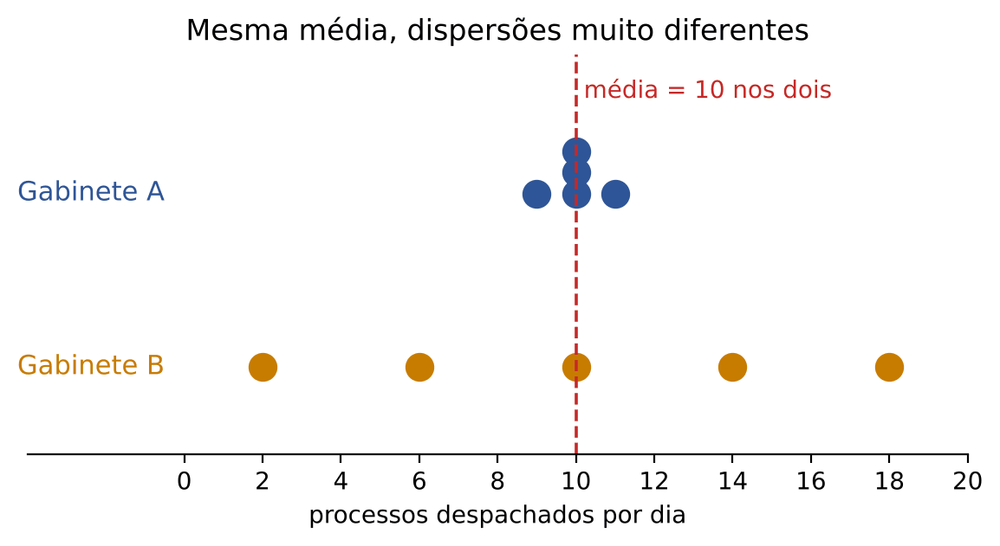

Pela média, os gabinetes são idênticos. Mas qualquer chefe de secretaria diria que são muito diferentes: o A é regular, previsível; o B oscila entre dias quase parados e dias de mutirão. Essa diferença tem nome: DISPERSÃO (ou variabilidade). Medidas de dispersão são números que dizem o quanto os dados se espalham.

Uma ponte com o Direito ajuda a fixar. Dois juízes podem ter a mesma pena média aplicada em crimes de furto simples; mas, se um deles aplica penas muito parecidas em casos parecidos e o outro varia muito, o segundo tem maior dispersão, e isso é relevante para a segurança jurídica. A média mede "onde" os dados estão; a dispersão mede "o quanto eles discordam entre si".

Neste capítulo veremos, em ordem de sofisticação:

- amplitude total: distância entre o maior e o menor valor;
- desvio médio: distância média de cada dado até a média;
- variância e desvio-padrão: a medida "oficial" de dispersão, a mais cobrada;
- coeficiente de variação: a dispersão em termos relativos (percentuais);
- e, depois, as medidas de FORMA (assimetria e curtose) e o boxplot, que mostra tudo isso em um desenho.

:::ATENCAO
Dispersão nunca é negativa. Todas as medidas deste capítulo valem zero quando os dados são todos iguais (não há espalhamento nenhum) e crescem conforme os dados se afastam uns dos outros. Se, numa conta de variância, você obtiver número negativo, houve erro.
:::

## 10.2 Amplitude total

### 10.2.1 A ideia e a conta

A medida mais simples de dispersão é a AMPLITUDE TOTAL (AT): pegue o maior valor e subtraia o menor.

- AT = valor máximo − valor mínimo

No exemplo dos gabinetes:

- Gabinete A: AT = 11 − 9 = 2
- Gabinete B: AT = 18 − 2 = 16

O B espalha oito vezes mais, pela amplitude. Simples e rápido.

:::EXEMPLO Amplitude dos tempos de atendimento
Os tempos (em minutos) de seis atendimentos no balcão de uma agência da Fazenda foram 12, 7, 25, 9, 14 e 10.
- Maior valor: 25.
- Menor valor: 7.
- AT = 25 − 7
- AT = 18 minutos.
Note que não foi preciso ordenar todos os dados: basta achar o maior e o menor.
:::

### 10.2.2 Vantagens e defeitos

A vantagem é a rapidez. O defeito é grave: a amplitude só olha para DOIS números (os extremos) e ignora todos os demais. Veja:

- Conjunto X: 1, 50, 50, 50, 50, 50, 99. AT = 99 − 1 = 98.
- Conjunto Y: 1, 10, 30, 50, 70, 90, 99. AT = 99 − 1 = 98.

As amplitudes são iguais, mas em X quase todos os dados estão concentrados em 50, enquanto em Y estão espalhados por todo o intervalo. A amplitude também é muito sensível a um único valor estranho (um erro de digitação, um contribuinte gigantesco no meio de pequenos): basta um dado anômalo para inflá-la.

Por isso existe uma versão "protegida" da amplitude, que descarta os extremos: a AMPLITUDE INTERQUARTIL (AIQ), que é a distância entre o terceiro e o primeiro quartil (AIQ = Q₃ − Q₁). Ela mede o espalhamento dos 50% de dados centrais e será a base do boxplot (ver 10.12). Você aprendeu a calcular quartis no Cap. 9.

:::QUESTAO FGV 2025 — Prefeitura de São José dos Campos — Analista em Gestão Municipal (Q3579922)
Problema: dadas as idades 18, 21, 20, 19, 22 e 20 de seis alunos, pede-se a afirmativa correta sobre medidas de dispersão. Gabarito oficial: D.
Resolução, alternativa por alternativa:
- A diz que a amplitude é zero porque média e mediana são iguais. Errado: amplitude não tem nada a ver com média e mediana. Aqui, AT = 22 − 18 = 4.
- B diz que a variância é sempre menor que o desvio-padrão. Errado: o desvio-padrão é a raiz da variância (ver 10.5); se a variância for 4, o desvio é 2 (variância maior); só quando a variância está entre 0 e 1 é que ela fica menor que sua raiz.
- C diz que o desvio-padrão é "sempre menor que a amplitude" e justifica pelo fato de medir dispersão em relação à média. A justificativa não sustenta a conclusão; e, se todos os dados forem iguais, desvio e amplitude valem ambos zero (não há "menor").
- D diz que a amplitude ignora a distribuição dos dados e considera apenas os extremos. CERTO: é exatamente o defeito visto acima.
- E descreve a variância como "soma dos desvios dividida por n". Errado: a soma dos desvios em relação à média é sempre zero (ver 10.3); a variância usa os desvios ELEVADOS AO QUADRADO.
:::

:::PRATIQUE exercícios elaborados para esta apostila
1. Calcule a amplitude total de 12, 15, 9, 20 e 14.
2. Os salários de um setor vão de 3.000 reais a 9.500 reais. Qual a amplitude total?
3. (Estilo FCC) Uma população tem amplitude total igual a 40. Cada valor é multiplicado por 1,1 e, em seguida, somado a 100. Qual a nova amplitude?
Resolução:
1. Maior valor 20, menor valor 9. AT = 20 − 9 = 11.
2. AT = 9.500 − 3.000 = 6.500 reais.
3. Somar 100 a todos empurra o maior e o menor valor igualmente, e a diferença entre eles não muda. Multiplicar por 1,1 multiplica também a diferença. Logo:
  - nova AT = 1,1 × 40
  - nova AT = 44.
  O "+100" é distrator: a FCC costuma incluí-lo para quem soma 100 à amplitude (resposta errada 144). A regra geral está em 10.8.
:::

## 10.3 Desvios em relação à média e desvio médio

### 10.3.1 O que é um desvio

Para usar TODOS os dados, e não só os extremos, a ideia natural é medir a distância de cada dado até o centro. Essa distância, com sinal, se chama DESVIO:

- desvio de um dado = dado − média

Vamos trabalhar com um exemplo que nos acompanhará até 10.5. Oito auditores lavraram, num mês, as seguintes quantidades de autos de infração (multas): 2, 4, 4, 4, 5, 5, 7 e 9.

Primeiro, a média:

- soma = 2 + 4 + 4 + 4 + 5 + 5 + 7 + 9
- soma = 40
- média = 40 ÷ 8
- média = 5

Agora o desvio de cada auditor (dado menos 5):

| Auditor | Multas (x) | Desvio (x − 5) |
|---|---|---|
| A1 | 2 | −3 |
| A2 | 4 | −1 |
| A3 | 4 | −1 |
| A4 | 4 | −1 |
| A5 | 5 | 0 |
| A6 | 5 | 0 |
| A7 | 7 | +2 |
| A8 | 9 | +4 |
| Soma | 40 | 0 |

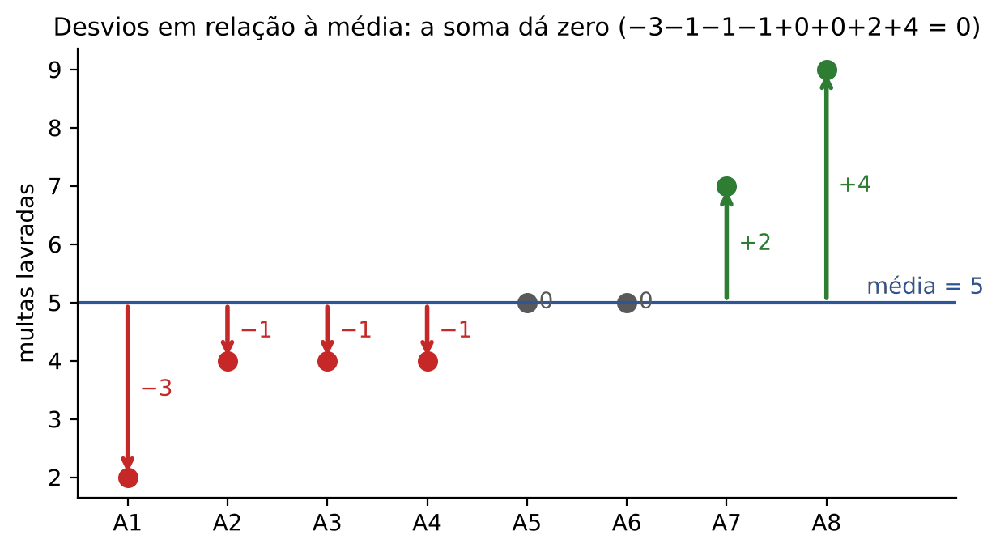

Repare na última linha: a soma dos desvios deu ZERO. Isso não é coincidência; acontece SEMPRE. A média é justamente o ponto de equilíbrio dos dados: o que sobra de um lado compensa exatamente o que falta do outro (−3 −1 −1 −1 = −6 de um lado; +2 +4 = +6 do outro).

:::DICA Propriedade que cai: a soma dos desvios em relação à média é zero
Por que sempre zero? Somar os desvios é somar todos os dados e subtrair a média n vezes: (x₁ + x₂ + ... + xₙ) − n × média. Como média = soma ÷ n, temos n × média = soma; logo, a diferença é soma − soma = 0.
Consequência prática: a "média dos desvios" é sempre zero e, portanto, INÚTIL como medida de dispersão. Precisamos nos livrar dos sinais. Há dois jeitos: tirar o valor absoluto (desvio médio, a seguir) ou elevar ao quadrado (variância, em 10.4).
:::

### 10.3.2 Desvio médio absoluto

O jeito mais intuitivo de eliminar o sinal é ignorá-lo: usar o valor absoluto (o "módulo"), que é a distância sem sinal. O módulo de −3 é 3; o módulo de +4 é 4; escreve-se |−3| = 3.

O DESVIO MÉDIO (DM), também chamado desvio absoluto médio, é a média dessas distâncias:

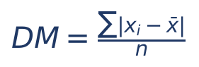

Em que:
- DM = desvio médio;
- Σ (letra grega sigma maiúscula) = "some tudo o que vem depois, para todos os dados";
- xᵢ = cada dado (x₁ é o primeiro, x₂ o segundo, e assim por diante);
- x̄ (lê-se "x barra") = a média dos dados;
- |xᵢ − x̄| = a distância do dado até a média, sem sinal;
- n = quantidade de dados.

Aplicando ao exemplo das multas:

- distâncias: 3, 1, 1, 1, 0, 0, 2, 4
- soma = 3 + 1 + 1 + 1 + 0 + 0 + 2 + 4
- soma = 12
- DM = 12 ÷ 8
- DM = 1,5

Interpretação em português: em média, cada auditor está a 1,5 multa de distância da média do grupo.

:::PASSO Como calcular o desvio médio
1. Calcule a média (some e divida por n).
2. Subtraia a média de cada dado.
3. Jogue fora os sinais (tome o módulo).
4. Some as distâncias.
5. Divida pela quantidade de dados.
:::

:::EXEMPLO Desvio médio dos dois gabinetes
Gabinete A (9, 10, 10, 10, 11), média 10:
- distâncias: 1, 0, 0, 0, 1
- soma = 2
- DM = 2 ÷ 5 = 0,4
Gabinete B (2, 6, 10, 14, 18), média 10:
- distâncias: 8, 4, 0, 4, 8
- soma = 24
- DM = 24 ÷ 5 = 4,8
O B tem desvio médio 12 vezes maior (4,8 ÷ 0,4 = 12). Agora a comparação usa todos os dados, não só os extremos.
:::

:::NOTA Curiosidade útil: média minimiza quadrados, mediana minimiza módulos
Duas propriedades aparecem em questões teóricas. (1) A soma dos QUADRADOS dos desvios, Σ(xᵢ − m)², é a menor possível quando m é a MÉDIA. (2) A soma dos MÓDULOS dos desvios, Σ|xᵢ − m|, é a menor possível quando m é a MEDIANA. Por isso alguns livros definem também o "desvio médio em relação à mediana". Salvo aviso em contrário, na prova o desvio médio é calculado em relação à média.
:::

:::QUESTAO FGV 2025 — Notas de 10 alunos: mediana, desvio interquartil e desvio médio (Q3185955)
Problema: as notas de dez alunos foram 7, 8, 6, 9, 10, 5, 7, 8, 6 e 9. Pede-se, nessa ordem, a mediana, o desvio (amplitude) interquartil e o desvio absoluto médio. Gabarito oficial: B (7,5; 3,0; 1,3).
Passo 1 — ordenar: 5, 6, 6, 7, 7, 8, 8, 9, 9, 10.
Passo 2 — mediana: com 10 dados (número par), a mediana é a média dos dois do meio, o 5º e o 6º: (7 + 8) ÷ 2 = 7,5.
Passo 3 — quartis pelo método das metades (Cap. 9): metade inferior 5, 6, 6, 7, 7, cujo meio é 6, então Q₁ = 6; metade superior 8, 8, 9, 9, 10, cujo meio é 9, então Q₃ = 9. AIQ = 9 − 6 = 3.
Passo 4 — média: soma = 75; 75 ÷ 10 = 7,5.
Passo 5 — distâncias até 7,5: 2,5; 1,5; 1,5; 0,5; 0,5; 0,5; 0,5; 1,5; 1,5; 2,5. Soma = 13. DM = 13 ÷ 10 = 1,3.
Alternativas sedutoras: A traz AIQ 2,0 (nasce de erro na localização dos quartis, por exemplo tomar Q₁ = 7 e Q₃ = 9); C traz DM 1,5 (erro de soma); D e E trazem mediana 8,0 (quem não ordena os dados ou pega só um valor central).
:::

:::PRATIQUE exercícios elaborados para esta apostila
1. Calcule o desvio médio de 3, 5 e 7.
2. Calcule o desvio médio de 10, 12, 14, 16 e 18.
3. Calcule o desvio médio de 1, 1, 2, 4 e 7.
Resolução:
1. Média = (3 + 5 + 7) ÷ 3 = 15 ÷ 3 = 5. Distâncias: 2, 0, 2. Soma = 4. DM = 4 ÷ 3 ≈ 1,33.
2. Média = 70 ÷ 5 = 14. Distâncias: 4, 2, 0, 2, 4. Soma = 12. DM = 12 ÷ 5 = 2,4.
3. Média = 15 ÷ 5 = 3. Distâncias: |1 − 3| = 2; 2; |2 − 3| = 1; |4 − 3| = 1; |7 − 3| = 4. Soma = 2 + 2 + 1 + 1 + 4 = 10. DM = 10 ÷ 5 = 2.
:::

## 10.4 Variância

### 10.4.1 A ideia: elevar os desvios ao quadrado

Vimos que os desvios somam zero porque os positivos cancelam os negativos. O desvio médio resolveu isso com o módulo. A estatística, porém, prefere outro truque: ELEVAR CADA DESVIO AO QUADRADO. Todo número ao quadrado é positivo ou zero ((−3)² = 9; (+3)² = 9), então nada mais se cancela.

Há ainda um bônus: o quadrado "pune" mais os desvios grandes. Um desvio de 1 vira 1; um desvio de 4 vira 16. Assim, dados muito afastados pesam bastante, o que costuma ser desejável (um contribuinte que foge muito do padrão deve chamar a atenção).

A VARIÂNCIA é a média dos quadrados dos desvios. Vamos fazer à mão com as multas dos oito auditores (média 5):

| Auditor | x | Desvio (x − 5) | Desvio ao quadrado |
|---|---|---|---|
| A1 | 2 | −3 | 9 |
| A2 | 4 | −1 | 1 |
| A3 | 4 | −1 | 1 |
| A4 | 4 | −1 | 1 |
| A5 | 5 | 0 | 0 |
| A6 | 5 | 0 | 0 |
| A7 | 7 | +2 | 4 |
| A8 | 9 | +4 | 16 |
| Soma | 40 | 0 | 32 |

- soma dos quadrados dos desvios = 9 + 1 + 1 + 1 + 0 + 0 + 4 + 16
- soma dos quadrados dos desvios = 32
- variância = 32 ÷ 8
- variância = 4

Se os oito auditores forem TODOS os auditores que interessam (a população inteira), a variância é 4.

### 10.4.2 A fórmula da variância populacional

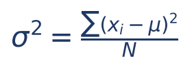

Em que:
- σ² (lê-se "sigma ao quadrado") = variância da população;
- xᵢ = cada dado;
- μ (lê-se "mi") = média da população (é a mesma ideia de x̄; os estatísticos usam letras gregas quando falam da população inteira);
- (xᵢ − μ)² = o desvio de cada dado, elevado ao quadrado;
- Σ = some esses quadrados para todos os dados;
- N = número de elementos da população.

Em palavras: "a variância é a média dos quadrados dos desvios em relação à média". A FGV costuma escrever essa frase no próprio enunciado, como lembrete (por exemplo, Q3088044 e Q4375144).

:::PASSO Como calcular a variância de uma lista curta
1. Calcule a média.
2. Calcule o desvio de cada dado (dado − média).
3. Eleve cada desvio ao quadrado.
4. Some os quadrados.
5. Divida por N (população) ou por n − 1 (amostra; ver 10.4.3).
Monte sempre a tabela de três colunas (x, desvio, quadrado): ela evita esquecer um dado e deixa a conta conferível.
:::

:::ATENCAO A unidade da variância é "ao quadrado"
Se os dados estão em multas, a variância está em "multas ao quadrado"; se estão em reais, em "reais ao quadrado". Isso não tem interpretação intuitiva, e é por isso que, em 10.5, tiraremos a raiz quadrada para voltar à unidade original. A FCC às vezes escreve a unidade, como "a variância, em (SM)², é igual a" (Q3281781): o "²" é só esse lembrete.
:::

### 10.4.3 Variância da amostra: por que dividir por n − 1

Até aqui supusemos que tínhamos a população inteira. Mas, na prática, quase sempre temos uma AMOSTRA (Cap. 9: uma parte da população, usada para conhecer o todo). Um auditor não examina todas as notas fiscais de um ano; sorteia algumas.

Quando o objetivo é estimar a variância da população a partir de uma amostra, a fórmula muda num detalhe: divide-se por n − 1 em vez de n.

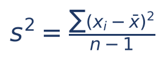

Em que:
- s² = variância amostral (letra latina s, porque é calculada na amostra);
- x̄ = média da amostra;
- n = tamanho da amostra;
- n − 1 = tamanho da amostra menos um (chamado "graus de liberdade").

Com as multas, se os oito auditores fossem uma amostra sorteada de um universo maior:

- s² = 32 ÷ (8 − 1)
- s² = 32 ÷ 7
- s² ≈ 4,57

O numerador (32) é o mesmo; só o divisor muda. Como 7 é menor que 8, a variância amostral é sempre um pouco MAIOR que a populacional calculada com os mesmos números.

#### Por que n − 1? Uma explicação intuitiva

Há duas formas de entender, sem nenhuma demonstração formal.

Primeira: a média da amostra "puxa" os desvios para baixo. Os desvios da amostra são medidos em relação à média DA PRÓPRIA AMOSTRA, x̄, e não em relação à média verdadeira da população, μ, que não conhecemos. Ocorre que x̄ é, por construção, o ponto que deixa a soma dos quadrados dos desvios MENOR possível (ver a nota em 10.3). Então os desvios medidos a partir de x̄ são, em regra, um pouco menores do que seriam se medidos a partir de μ. Dividir por algo menor que n (isto é, por n − 1) compensa exatamente essa subestimação.

Segunda: graus de liberdade. Como os desvios em relação à média somam zero (10.3), se você conhece n − 1 deles, o último está determinado: é o número que faz a soma dar zero. Só n − 1 desvios são "livres". Dividimos a soma dos quadrados pelo número de desvios livres.

:::EXEMPLO Vendo o n − 1 funcionar na prática
População: duas notas fiscais, uma de 0 real e outra de 10 reais. Média μ = 5. Variância verdadeira: desvios −5 e +5; quadrados 25 e 25; soma 50; σ² = 50 ÷ 2 = 25.
Agora sorteamos amostras de 2 notas, com reposição. As quatro amostras possíveis são igualmente prováveis: (0, 0), (0, 10), (10, 0), (10, 10).
- Amostras (0, 0) e (10, 10): média igual ao próprio valor, desvios zero, soma dos quadrados 0.
- Amostras (0, 10) e (10, 0): média 5, desvios −5 e +5, soma dos quadrados 50.
Dividindo por n = 2: as quatro variâncias são 0, 25, 25 e 0. Média delas: (0 + 25 + 25 + 0) ÷ 4 = 12,5. Subestima a verdade (25) pela metade.
Dividindo por n − 1 = 1: as quatro variâncias são 0, 50, 50 e 0. Média delas: (0 + 50 + 50 + 0) ÷ 4 = 25. Acerta em média.
É isso que se quer dizer quando se afirma que s² (com n − 1) é um estimador NÃO VIESADO (ou não viciado, ou não polarizado) da variância populacional, e que a versão com n é VIESADA (viciada, polarizada). O tema é aprofundado no Cap. 14.
:::

:::PEGADINHA Qual divisor usar na prova?
- "Variância da população", "dados de todos os funcionários", "considere uma população": divida por N.
- "Variância amostral", "amostra", "estimativa não viesada": divida por n − 1.
- "Estimativa de máxima verossimilhança" (estimador que, sob distribuição normal, divide por n): divida por n, mesmo sendo amostra (Q3786836).
- Enunciado que define a variância como "a média dos quadrados dos desvios": divida por n (é uma média).
- A FGV usa a fórmula "pode ser igual a" quando só uma das duas versões está nas alternativas: calcule as duas e veja qual aparece (Q4283044).
Para n grande (100, 1.000), a diferença entre as duas versões é desprezível; para n pequeno (5, 6), é grande.
:::

:::QUESTAO FGV 2024 — TCE-GO — Analista de Controle Externo (Q2524688)
Problema: amostra de idades 20, 21, 19, 20, 20; pede-se a variância amostral. Gabarito oficial: A (0,50).
- Média: soma = 100; 100 ÷ 5 = 20.
- Desvios: 0, +1, −1, 0, 0.
- Quadrados: 0, 1, 1, 0, 0. Soma = 2.
- s² = 2 ÷ (5 − 1) = 2 ÷ 4 = 0,50.
Alternativa sedutora: dividir por 5 dá 0,40, que não está entre as opções; as demais (0,56; 0,60; 0,62; 0,64) não nascem de nenhuma conta correta.
No mesmo sentido, com dados ainda menores: Q3349738 (FGV 2025 — TRT-24ª Região), número de filhos 0, 1, 1, 2, 0, 2, média 1; quadrados dos desvios 1, 0, 0, 1, 1, 1; soma 4; s² = 4 ÷ 5 = 0,8 (gabarito A). Quem divide por 6 obtém 0,67, que não está nas alternativas.
:::

:::QUESTAO FGV 2026 — TCE-PE — Analista de Controle Externo (Q4283044)
Problema: idades de 5 equipamentos (anos de uso): 4, 6, 9, 10, 11. A variância "pode ser igual a". Gabarito oficial: B (6,8).
- Média: 4 + 6 + 9 + 10 + 11 = 40; 40 ÷ 5 = 8.
- Desvios: −4, −2, +1, +2, +3.
- Quadrados: 16, 4, 1, 4, 9. Soma = 34.
- Dividindo por n = 5: 34 ÷ 5 = 6,8.
- Dividindo por n − 1 = 4: 34 ÷ 4 = 8,5.
Só 6,8 está entre as alternativas; daí o "pode ser". Lição: quando o enunciado não diz qual divisor, calcule as duas versões.
:::

:::QUESTAO FGV 2025 — CGE-SP — Auditor Estadual de Controle (Q3786836)
Problema: salários (em milhares de reais) de cinco trabalhadores: 3,2; 2,8; 5,2; 4,2; 4,6. Pede-se a variância "pela estimativa de máxima verossimilhança". Gabarito oficial: B (0,78).
- Média: 3,2 + 2,8 + 5,2 + 4,2 + 4,6 = 20,0; 20 ÷ 5 = 4,0.
- Desvios: −0,8; −1,2; +1,2; +0,2; +0,6.
- Quadrados: 0,64; 1,44; 1,44; 0,04; 0,36. Soma = 3,92.
- Máxima verossimilhança divide por n: 3,92 ÷ 5 = 0,784 ≈ 0,78.
Alternativa sedutora: C (0,97 ≈ 3,92 ÷ 4 = 0,98) é a variância amostral não viesada; é a resposta de quem ignora a expressão "máxima verossimilhança".
:::

:::QUESTAO FGV 2026 — MPE-ES — Agente Técnico — Estatístico (Q4220355)
Problema: um algoritmo soma 100 valores de uma amostra, divide por 100 (média ma), depois soma os quadrados de (valor − ma) numa variável S e calcula S1 = S ÷ 99 e S2 = S ÷ 100. Pergunta-se o que são S1 e S2. Gabarito oficial: C (variância não polarizada e variância polarizada).
Leitura do algoritmo: S é a soma dos quadrados dos desvios em relação à média amostral. S1 divide por n − 1 = 99: é a versão NÃO polarizada (não viesada). S2 divide por n = 100: é a versão polarizada (viesada).
Atenção: a alternativa D ("variância amostral não polarizada e variância amostral polarizada") diz substancialmente o mesmo com a palavra "amostral"; a banca preferiu C. As alternativas A, B e E trocam a ordem ou os rótulos. Registre a regra: n − 1 = não viesada; n = viesada.
:::

### 10.4.4 A fórmula prática: média dos quadrados menos quadrado da média

Calcular cada desvio dá trabalho quando a média é "quebrada" (por exemplo, 7,63). Há um atalho algébrico que evita os desvios:

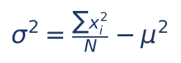

Em que:
- Σxᵢ² = soma dos quadrados dos próprios dados (eleve cada dado ao quadrado e some);
- Σxᵢ² ÷ N = média dos quadrados;
- μ² = quadrado da média.

Em palavras, que vale decorar: VARIÂNCIA = MÉDIA DOS QUADRADOS MENOS QUADRADO DA MÉDIA.

Conferindo com as multas (2, 4, 4, 4, 5, 5, 7, 9; média 5):

- quadrados dos dados: 4, 16, 16, 16, 25, 25, 49, 81
- soma dos quadrados = 4 + 16 + 16 + 16 + 25 + 25 + 49 + 81
- soma dos quadrados = 232
- média dos quadrados = 232 ÷ 8 = 29
- quadrado da média = 5² = 25
- variância = 29 − 25
- variância = 4

O mesmo 4 de antes, sem calcular nenhum desvio.

Para a variância AMOSTRAL, a versão prática é:

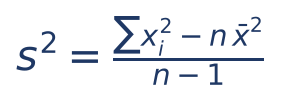

Com as multas: s² = (232 − 8 × 25) ÷ 7 = (232 − 200) ÷ 7 = 32 ÷ 7 ≈ 4,57. Note que 232 − 200 = 32 é exatamente a soma dos quadrados dos desvios que obtivemos na tabela. Esse é o "porquê" do atalho: Σ(xᵢ − x̄)² = Σxᵢ² − n × x̄².

:::DICA Linguagem de "momentos"
Em questões mais técnicas, a banca fala em MOMENTOS. Não se assuste:
- 1º momento (ordinário, ou "em relação à origem") = média dos dados = E(X), a média ou "esperança".
- 2º momento ordinário = média dos quadrados = E(X²).
- 2º momento CENTRAL (em relação à média) = média dos quadrados dos desvios = variância.
- 3º momento central: ligado à assimetria (10.10). 4º momento central: ligado à curtose (10.11).
Logo, a fórmula prática se escreve: Var(X) = E(X²) − [E(X)]². Isso funciona igual para dados e para variáveis aleatórias (Cap. 13).
:::

:::QUESTAO FGV 2024 — Prefeitura de São José dos Campos — Analista (Ciências Econômicas) (Q2360313)
Problema: uma variável X tem E(X) = 4 e E(X²) = 25. Qual o desvio-padrão? Gabarito oficial: A (3), conferido no QConcursos em 30/10/2026; coincide com a conta.
- Var(X) = E(X²) − [E(X)]²
- Var(X) = 25 − 4²
- Var(X) = 25 − 16
- Var(X) = 9
- Desvio-padrão = √9 = 3 (ver 10.5).
Alternativas sedutoras: 9 (B) é a variância, não o desvio; √21 (C) nasce de 25 − 4 (esqueceu de elevar a média ao quadrado); √29 (D) nasce de 25 + 4.
:::

:::QUESTAO FGV 2026 — MPE-ES — Agente Técnico — Estatístico (Q4220337)
Problema: três variáveis. X tem 1º momento ordinário 5 e 2º momento ordinário 1 (e 3º momento central 2). Y tem 1º momento ordinário 2, 2º momento ordinário 7 e 3º momento central 0. Z tem 1º momento ordinário 3 e 2º momento ordinário 9. Gabarito oficial: E (Z é, quase certamente, maior ou igual a zero).
- Var(X) = 1 − 5² = 1 − 25 = −24. Variância negativa é impossível: os dados de X são INCONSISTENTES.
- Var(Y) = 7 − 2² = 7 − 4 = 3 (e não 5): alternativa A errada. Terceiro momento central zero indica simetria, mas não garante distribuição normal: B errada.
- X é inconsistente; não se pode afirmar que é simétrica: C errada.
- Var(Z) = 9 − 3² = 9 − 9 = 0. Variância zero significa que Z não varia: vale sempre 3. Os dados de Z são CONSISTENTES; logo D (que diz que X e Z são inconsistentes) está errada. E como Z vale sempre 3, Z é (quase certamente) maior ou igual a zero: E correta.
Lição: variância nunca é negativa e só é zero quando todos os valores são iguais.
:::

:::QUESTAO FGV 2024 — TJ-RR — Analista Judiciário — Estatística (Q3088044)
Problema: número de filhos de 20 casais: 0, 2, 3, 1, 0, 1, 1, 2, 1, 0, 4, 0, 1, 1, 2, 3, 2, 1, 0, 1. O enunciado define variância como "a média dos quadrados dos desvios em torno da média". Gabarito oficial: A (1,21).
Passo 1 — contar quantas vezes aparece cada valor: zero aparece 5 vezes; 1 aparece 8 vezes; 2 aparece 4 vezes; 3 aparece 2 vezes; 4 aparece 1 vez (total 20).
Passo 2 — soma dos dados: 0 × 5 + 1 × 8 + 2 × 4 + 3 × 2 + 4 × 1 = 0 + 8 + 8 + 6 + 4 = 26. Média = 26 ÷ 20 = 1,3.
Passo 3 — soma dos quadrados (fórmula prática): 0² × 5 + 1² × 8 + 2² × 4 + 3² × 2 + 4² × 1 = 0 + 8 + 16 + 18 + 16 = 58. Média dos quadrados = 58 ÷ 20 = 2,9.
Passo 4 — variância = 2,9 − 1,3² = 2,9 − 1,69 = 1,21.
Como o enunciado definiu variância como MÉDIA, divide-se por n = 20. Quem divide por 19 obtém cerca de 1,27, que não está nas opções. Esse é o mesmo raciocínio dos dados agrupados (10.6).
:::

:::PRATIQUE exercícios elaborados para esta apostila
1. Calcule a variância populacional e a amostral de 2, 4, 6, 8.
2. Uma amostra tem os valores 10, 12 e 14. Calcule s².
3. Numa população de 5 elementos, Σx = 40 e Σx² = 330. Calcule a variância populacional e a amostral (se fosse amostra).
4. (Estilo FGV) E(X) = 3 e E(X²) = 13. Qual a variância de X?
Resolução:
1. Média = 20 ÷ 4 = 5. Desvios: −3, −1, +1, +3. Quadrados: 9, 1, 1, 9; soma 20. Populacional: 20 ÷ 4 = 5. Amostral: 20 ÷ 3 ≈ 6,67.
2. Média = 36 ÷ 3 = 12. Desvios: −2, 0, +2. Quadrados: 4, 0, 4; soma 8. s² = 8 ÷ (3 − 1) = 8 ÷ 2 = 4.
3. Média = 40 ÷ 5 = 8. Média dos quadrados = 330 ÷ 5 = 66. Variância populacional = 66 − 8² = 66 − 64 = 2. Amostral: (330 − 5 × 64) ÷ 4 = (330 − 320) ÷ 4 = 10 ÷ 4 = 2,5.
4. Var(X) = 13 − 3² = 13 − 9 = 4.
:::

## 10.5 Desvio-padrão

### 10.5.1 A ideia: voltar à unidade original

A variância das multas deu 4 "multas ao quadrado". Para voltar a falar em "multas", tiramos a raiz quadrada. O resultado é o DESVIO-PADRÃO:

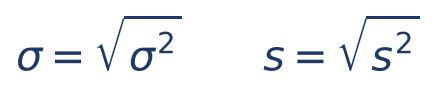

Em que:
- σ (sigma) = desvio-padrão da população = raiz da variância populacional σ²;
- s = desvio-padrão da amostra = raiz da variância amostral s².

Com as multas:

- desvio-padrão populacional: σ = √4 = 2 multas;
- desvio-padrão amostral: s = √4,57 ≈ 2,14 multas.

Interpretação: o desvio-padrão é uma espécie de "distância típica" dos dados até a média. Dizer que a média é 5 multas e o desvio-padrão é 2 multas significa que, tipicamente, os auditores ficam a cerca de 2 multas para cima ou para baixo da média.

:::DICA Raiz quadrada sem calculadora (revisão do Cap. 1)
Para estimar √4,57: procure dois números cujos quadrados "cercam" 4,57.
- 2,1² = 4,41 (pouco).
- 2,2² = 4,84 (muito).
- Logo, √4,57 está entre 2,1 e 2,2. Como 4,57 fica um pouco mais perto de 4,41 (diferença 0,16) que de 4,84 (diferença 0,27), a raiz fica um pouco abaixo de 2,15: cerca de 2,14.
Na prova, quase sempre basta saber entre que alternativas a raiz está. Se a variância é 1,04, a raiz é um pouco mais que 1 (1,02² = 1,0404). Se é 8, a raiz fica entre 2,8 (2,8² = 7,84) e 2,9 (2,9² = 8,41).
:::

:::ATENCAO Desvio-padrão x variância
- Variância: unidade ao quadrado; difícil de interpretar; boa para contas.
- Desvio-padrão: mesma unidade dos dados; fácil de interpretar.
- Para comparar dispersões de conjuntos com a MESMA unidade e médias parecidas, tanto faz usar um ou outro (quem tem maior variância tem maior desvio). Com unidades ou médias diferentes, use o coeficiente de variação (10.7).
- Se a variância está entre 0 e 1, o desvio-padrão é MAIOR que ela (√0,25 = 0,5). Se é maior que 1, o desvio é menor (√9 = 3).
:::

### 10.5.2 A regra empírica para distribuições em forma de sino

Quando os dados têm o formato de sino (a distribuição normal, estudada no Cap. 13), há uma regra prática muito usada para interpretar o desvio-padrão:

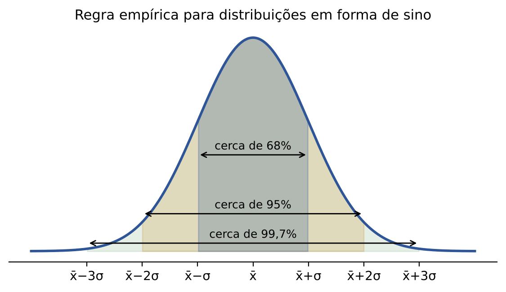

- cerca de 68% dos dados ficam a até 1 desvio-padrão da média;
- cerca de 95% ficam a até 2 desvios-padrão;
- cerca de 99,7% ficam a até 3 desvios-padrão.

Exemplo: se as notas de uma prova seguem o formato de sino, com média 60 e desvio-padrão 10, cerca de 95% dos candidatos tiraram entre 40 (60 − 2 × 10) e 80 (60 + 2 × 10). Valores além de 3 desvios-padrão são raríssimos e costumam ser tratados como suspeitos (outliers), ideia retomada em 10.9.

:::QUESTAO FGV 2024 — Prefeitura de Macaé — Professor de Matemática (Q3050885)
Problema: A = {1, 2, 5, 8} e B = {2, 3, 5, 6}. Compare médias e desvios-padrão. Gabarito oficial: E (médias iguais; desvio de A maior).
- Média de A: (1 + 2 + 5 + 8) ÷ 4 = 16 ÷ 4 = 4.
- Média de B: (2 + 3 + 5 + 6) ÷ 4 = 16 ÷ 4 = 4.
- Desvios de A: −3, −2, +1, +4; quadrados 9, 4, 1, 16; soma 30.
- Desvios de B: −2, −1, +1, +2; quadrados 4, 1, 1, 4; soma 10.
- Com o mesmo divisor (4), a variância de A (7,5) é o triplo da de B (2,5); logo o desvio-padrão de A é maior.
Atalho: nem era preciso dividir. Com o mesmo número de dados e a mesma média, quem tem maior soma de quadrados dos desvios tem maior desvio-padrão. Olhando os conjuntos, A vai de 1 a 8 e B de 2 a 6: A é visivelmente mais espalhado.
:::

:::QUESTAO FGV 2026 — Prefeitura de São José dos Campos — Professor de Matemática (Q3998734)
Problema: notas de dez candidatos: 7, 7, 7, 7, 7, 7, 7, 8, 9, 10. Desvio-padrão? Gabarito oficial: D (1,02).
- Soma: 7 × 7 + 8 + 9 + 10 = 49 + 27 = 76. Média = 76 ÷ 10 = 7,6.
- Desvios: −0,6 (sete vezes), +0,4, +1,4, +2,4.
- Quadrados: 0,36 (sete vezes) = 2,52; 0,16; 1,96; 5,76.
- Soma = 2,52 + 0,16 + 1,96 + 5,76 = 10,40.
- Variância (população, divisor 10) = 1,04.
- Desvio-padrão = √1,04 ≈ 1,02 (porque 1,02² = 1,0404).
Alternativa sedutora: E (1,05) fica perto da versão amostral, √(10,40 ÷ 9) = √1,156 ≈ 1,07, mas não coincide; 0,92, 0,95 e 0,98 nascem de erros de soma. Como o enunciado trata "as notas dos dez candidatos" (todos), usa-se o divisor 10.
:::

:::QUESTAO FGV 2024 — Prefeitura de Vitória — Analista em Gestão Pública (Q3044127)
Problema: amostra de idades 24, 25, 25, 26, 26, 26, 26, 26, 27, 27, 28. Desvio-padrão aproximado? Gabarito oficial: B (1,1).
- Média: os dados são simétricos em torno de 26 (um 24 e um 28; dois 25 e dois 27; cinco 26). Média = 26, sem conta.
- Desvios: −2, −1, −1, 0, 0, 0, 0, 0, +1, +1, +2.
- Quadrados: 4, 1, 1, 0, 0, 0, 0, 0, 1, 1, 4. Soma = 12.
- Amostral: s² = 12 ÷ 10 = 1,2; s = √1,2 ≈ 1,095 ≈ 1,1.
- Populacional: 12 ÷ 11 ≈ 1,09; raiz ≈ 1,04 ≈ 1,0.
Com qualquer divisor, a resposta mais próxima é 1,1. Truque de prova: dados simétricos dão a média de graça.
:::

:::QUESTAO FGV 2026 — PC-PI — Oficial Investigador (Q3846801)
Problema: trinta estudantes fizeram uma prova de 10 questões valendo 1 ponto cada. A média é M e o desvio-padrão é D. Se M = 0 ou M = 10, quanto vale D? Gabarito oficial: A (0).
Raciocínio: as notas vão de 0 a 10. Se a média é 0, ninguém pode ter tirado mais que 0 (senão a média subiria); todos tiraram 0. Se a média é 10, todos tiraram 10 (a nota máxima). Em ambos os casos, as 30 notas são iguais, não há dispersão, e D = 0.
:::

:::QUESTAO FGV 2025 — Prefeitura de São José dos Campos — Analista em Saúde (Q3579027)
Problema: pede-se a afirmativa correta sobre estatística em estudos de saúde. Gabarito oficial: D.
- A: estatística descritiva não serve "apenas para testar hipóteses"; ela DESCREVE dados (testes são inferência, Cap. 15). Errada.
- B: o valor-p não mede a magnitude do efeito (Cap. 15). Errada.
- C: em distribuições assimétricas, a mediana costuma ser preferível à média (10.10). Errada.
- D: o desvio-padrão mede a dispersão dos valores em relação à média. CERTA.
- E: variância não é medida de tendência central e não é "o valor mais frequente" (isso é a moda). Errada.
:::

:::PRATIQUE exercícios elaborados para esta apostila
1. A variância de um conjunto é 0,49. Qual o desvio-padrão?
2. Qual o desvio-padrão de 5, 5, 5, 5?
3. Calcule o desvio-padrão populacional e o amostral de 6, 8, 10, 12, 14, estimando as raízes sem calculadora.
4. Notas com formato de sino têm média 70 e desvio-padrão 5. Entre que notas estão cerca de 95% dos candidatos?
Resolução:
1. σ = √0,49 = 0,7 (porque 0,7 × 0,7 = 0,49). Repare: aqui o desvio é maior que a variância.
2. Todos iguais: média 5, desvios zero, variância 0, desvio-padrão 0.
3. Média = 50 ÷ 5 = 10. Desvios: −4, −2, 0, +2, +4. Quadrados: 16, 4, 0, 4, 16; soma 40.
  - Populacional: σ² = 40 ÷ 5 = 8; σ = √8. Como 2,8² = 7,84 e 2,9² = 8,41, σ ≈ 2,83.
  - Amostral: s² = 40 ÷ 4 = 10; s = √10. Como 3,1² = 9,61 e 3,2² = 10,24, s ≈ 3,16.
4. Cerca de 95% ficam a até 2 desvios da média: 70 − 2 × 5 = 60 e 70 + 2 × 5 = 80. Entre 60 e 80.
:::

## 10.6 Variância e desvio-padrão em dados agrupados

### 10.6.1 Tabela de frequências simples (valores repetidos)

Muitas vezes os dados chegam já resumidos numa tabela: cada valor e quantas vezes ele aparece (a FREQUÊNCIA, f). No Cap. 9 você calculou a média ponderada desses dados. A variância segue a mesma lógica: cada quadrado de desvio é multiplicado pela frequência do valor.

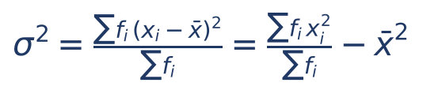

Em que:
- xᵢ = cada valor distinto da tabela;
- fᵢ = frequência (quantas vezes xᵢ aparece);
- Σfᵢ = soma das frequências = n, o total de dados;
- x̄ = média ponderada = Σfᵢxᵢ ÷ Σfᵢ;
- a segunda igualdade é a fórmula prática (média ponderada dos quadrados menos quadrado da média).

Para a variância amostral, troca-se o divisor Σfᵢ por Σfᵢ − 1.

:::EXEMPLO Autuações por contribuinte
Numa amostra de 20 contribuintes fiscalizados, contou-se o número de autuações de cada um:
| Autuações (x) | Contribuintes (f) | f × x | f × x² |
|---|---|---|---|
| 0 | 2 | 0 | 0 |
| 1 | 5 | 5 | 5 |
| 2 | 6 | 12 | 24 |
| 3 | 5 | 15 | 45 |
| 4 | 2 | 8 | 32 |
| Total | 20 | 40 | 106 |
Como montar a coluna f × x²: primeiro eleve x ao quadrado, depois multiplique pela frequência (para x = 3: 3² = 9; 9 × 5 = 45).
- Média = 40 ÷ 20 = 2.
- Média dos quadrados = 106 ÷ 20 = 5,3.
- Variância (tratando os 20 como população) = 5,3 − 2² = 5,3 − 4 = 1,3.
- Desvio-padrão = √1,3 ≈ 1,14 (porque 1,14² ≈ 1,30).
- Se quiser a amostral: a soma dos quadrados dos desvios é 106 − 20 × 4 = 26; s² = 26 ÷ 19 ≈ 1,37.
:::

### 10.6.2 Dados agrupados em classes (intervalos)

Quando a tabela traz intervalos ("de 4 a 8 minutos: 5 atendimentos"), não sabemos os valores exatos. A convenção é representar cada classe pelo seu PONTO MÉDIO (a média dos limites: classe 4 a 8 tem ponto médio (4 + 8) ÷ 2 = 6), como no Cap. 9, e aplicar a fórmula acima usando o ponto médio no lugar de xᵢ. O resultado é uma aproximação.

:::EXEMPLO Tempo de atendimento em classes
| Classe (minutos) | Ponto médio (x) | f | f × x | Desvio (x − 10) | f × desvio² |
|---|---|---|---|---|---|
| 0 a 4 | 2 | 1 | 2 | −8 | 1 × 64 = 64 |
| 4 a 8 | 6 | 4 | 24 | −4 | 4 × 16 = 64 |
| 8 a 12 | 10 | 10 | 100 | 0 | 0 |
| 12 a 16 | 14 | 4 | 56 | +4 | 4 × 16 = 64 |
| 16 a 20 | 18 | 1 | 18 | +8 | 1 × 64 = 64 |
| Total | | 20 | 200 | | 256 |
- Média = 200 ÷ 20 = 10 minutos.
- Variância (população) = 256 ÷ 20 = 12,8.
- Desvio-padrão = √12,8 ≈ 3,58 minutos (3,5² = 12,25 e 3,6² = 12,96).
- Variância amostral = 256 ÷ 19 ≈ 13,47.
Atalho de prova: quando as amplitudes das classes são iguais, os desvios dos pontos médios são múltiplos da amplitude (aqui, múltiplos de 4). Muitos livros ensinam a "mudança de variável" (dividir os desvios por 4, fazer contas com −2, −1, 0, 1, 2 e, no final, multiplicar a variância por 4² = 16). Isso é a propriedade de 10.8 aplicada: com −2, −1, 0, 1, 2 a soma ponderada dos quadrados é 4 + 4 + 0 + 4 + 4 = 16; 16 ÷ 20 = 0,8; 0,8 × 16 = 12,8.
:::

:::PRATIQUE exercícios elaborados para esta apostila
1. Valores 1, 2 e 3 com frequências 2, 5 e 3. Calcule média, variância (população) e desvio-padrão.
2. Classes 0 a 10, 10 a 20 e 20 a 30, com frequências 5, 10 e 5. Calcule média e variância (população) usando pontos médios.
Resolução:
1. n = 2 + 5 + 3 = 10. Σfx = 1 × 2 + 2 × 5 + 3 × 3 = 2 + 10 + 9 = 21; média = 21 ÷ 10 = 2,1. Σfx² = 1 × 2 + 4 × 5 + 9 × 3 = 2 + 20 + 27 = 49; média dos quadrados = 4,9. Variância = 4,9 − 2,1² = 4,9 − 4,41 = 0,49. Desvio-padrão = √0,49 = 0,7.
2. Pontos médios: 5, 15, 25. Σfx = 25 + 150 + 125 = 300; média = 300 ÷ 20 = 15. Desvios: −10, 0, +10; quadrados 100, 0, 100. Soma ponderada = 5 × 100 + 10 × 0 + 5 × 100 = 1.000. Variância = 1.000 ÷ 20 = 50. Desvio-padrão = √50 ≈ 7,07.
:::

## 10.7 Coeficiente de variação: a dispersão relativa

### 10.7.1 O problema: desvio-padrão "grande" ou "pequeno"?

Um desvio-padrão de 500 reais é muito ou pouco? Depende. Se a média salarial é 5.000 reais, 500 é 10% dela: dispersão modesta. Se a média é 1.000 reais, 500 é metade dela: dispersão enorme. O desvio-padrão, sozinho, não responde; é preciso compará-lo com a média.

Outra situação: como comparar a dispersão do peso (em quilos) com a da altura (em centímetros) de servidores? As unidades são diferentes; comparar desvios-padrão seria comparar quilos com centímetros.

A solução é o COEFICIENTE DE VARIAÇÃO (CV): o desvio-padrão dividido pela média, geralmente expresso em porcentagem.

Em que:
- CV = coeficiente de variação (também chamado "desvio-padrão relativo");
- σ = desvio-padrão (use s se for amostra);
- x̄ = média;
- multiplicar por 100% apenas transforma a fração em porcentagem (0,10 = 10%).

O CV não tem unidade (reais divididos por reais), por isso permite comparar qualquer coisa com qualquer coisa. Quanto MAIOR o CV, MAIS heterogêneo (disperso) o conjunto em termos relativos.

:::EXEMPLO Qual setor é mais heterogêneo?
- Setor A: média salarial 5.000 reais, desvio-padrão 500 reais. CV = 500 ÷ 5.000 = 0,10 = 10%.
- Setor B: média salarial 2.000 reais, desvio-padrão 400 reais. CV = 400 ÷ 2.000 = 0,20 = 20%.
O desvio-padrão de A é maior (500 contra 400), mas, em termos relativos, o B é mais disperso: seus salários variam 20% em torno da média, contra 10% no A.
:::

:::NOTA Classificações usuais do CV
Livros e bancas usam faixas aproximadas para qualificar a dispersão, mas elas não são universais. Uma muito difundida: CV até 15%, baixa dispersão; de 15% a 30%, média; acima de 30%, alta. Outros autores falam em "dados homogêneos" quando o CV é inferior a 25% ou 30%. Na prova, use a classificação dada no enunciado; se não houver, raciocine por eliminação (ver Q3281646 abaixo).
:::

:::DICA Variância relativa
Alguns materiais chamam de "variância relativa" o quadrado do CV, isto é, σ² ÷ x̄². Mas há questões (Q2515498, abaixo) em que a banca usou a expressão como sinônimo do próprio CV. Se cair, teste as duas leituras e veja qual aparece nas alternativas.
:::

:::QUESTAO FCC 2025 — Prefeitura de São Paulo — Analista de Planejamento e Desenvolvimento Organizacional (Q3281646)
Problema: dados de consultas mensais nos postos de saúde: média 350, mediana 300, desvio-padrão 80, CV 22,86%. Pede-se a interpretação correta. Gabarito oficial: D (o CV sugere variabilidade baixa em relação à média).
Conferindo o CV: 80 ÷ 350 ≈ 0,2286 = 22,86%.
- A ("altíssima variabilidade"): errada; o desvio é menos de um quarto da média. Nenhuma convenção usual chama 22,86% de "altíssima".
- B: afirma que a mediana é maior que a média. É o contrário: a média (350) é maior que a mediana (300), o que sugere assimetria POSITIVA, cauda à direita (10.10). Errada.
- C: o desvio-padrão sozinho não basta para interpretar a dispersão relativa; é justamente para isso que existe o CV. Errada.
- D: CERTA no gabarito. Pela classificação de três faixas exposta acima, 22,86% seria dispersão "média"; mas, entre as alternativas, é a única defensável (a variabilidade é pequena perto da média, e é isso que a FCC quis dizer).
- E: a diferença entre média e mediana é muito relevante, pois indica assimetria. Errada.
Lição FCC: muitas alternativas trocam o sentido de uma relação (B) ou fazem afirmações absolutas ("sozinho é suficiente", "irrelevante"); desconfie delas.
:::

:::QUESTAO FGV 2024 — TJ-AP — Analista Judiciário — Estatístico (Q2450797)
Problema: um grupo tem desvio-padrão salarial de 1 mil reais. Após aumento linear (igual para todos) de 2,5 mil reais, o CV passou a 0,08. Qual foi o aumento percentual médio? Gabarito oficial: E (25%).
Passo 1 — somar a mesma quantia a todos NÃO muda o desvio-padrão (10.8). Continua 1 mil.
Passo 2 — novo CV = desvio ÷ nova média: 0,08 = 1 ÷ nova média. Logo, nova média = 1 ÷ 0,08 = 12,5 mil. (Dividir por 0,08 é o mesmo que multiplicar por 100 e dividir por 8: 100 ÷ 8 = 12,5.)
Passo 3 — média antiga = 12,5 − 2,5 = 10 mil.
Passo 4 — aumento percentual médio = 2,5 ÷ 10 = 0,25 = 25%.
Alternativa sedutora: 20% (D) nasce de 2,5 ÷ 12,5, isto é, calcular o aumento sobre a média NOVA em vez da antiga.
:::

:::QUESTAO FGV 2024 — INPE — Tecnologista (Q2515498)
Problema: em uma década, a média de desmatamento aumentou 60% e a variância quadruplicou. O que acontece com a "variância relativa"? Gabarito oficial: E (aumentou 25%).
- A nova média é 1,6 vez a antiga (aumentar 60% é multiplicar por 1,6).
- Variância × 4 significa desvio-padrão × 2 (√4 = 2).
- CV novo ÷ CV antigo = 2 ÷ 1,6 = 1,25: aumento de 25%.
Gabarito discutível quanto à terminologia: se "variância relativa" fosse o quadrado do CV (σ² ÷ x̄²), a razão seria 4 ÷ 1,6² = 4 ÷ 2,56 = 1,5625, aumento de 56,25%, valor que não está entre as alternativas. A banca, portanto, usou "variância relativa" como CV.
:::

:::QUESTAO FGV 2026 — PC-PI — Perito Criminal (Q3847212)
Problema: teores de álcool na gasolina: 29%, 30%, 28%, 29,5% e 28,5% (o enunciado fala em "quatro amostras", mas lista cinco valores; trabalhe com os cinco). Pede-se o desvio-padrão amostral s e o CV. Gabarito oficial: E (s = 0,79; CV = 2,7%).
- Média: 29 + 30 + 28 + 29,5 + 28,5 = 145; 145 ÷ 5 = 29.
- Desvios: 0; +1; −1; +0,5; −0,5.
- Quadrados: 0; 1; 1; 0,25; 0,25. Soma = 2,5.
- s² = 2,5 ÷ 4 = 0,625. s = √0,625 ≈ 0,79 (0,79² = 0,6241).
- CV = 0,79 ÷ 29 ≈ 0,027 = 2,7%.
Alternativas sedutoras: s = 0,70 nasce de √(2,5 ÷ 5) = √0,5 ≈ 0,71 (divisor n); CV = 2,4% nasce de 0,70 ÷ 29. O "dado" do enunciado (uma raiz aproximada) parece ter vindo truncado na transcrição; não é necessário.
:::

:::PRATIQUE exercícios elaborados para esta apostila
1. Média 200 e desvio-padrão 30. Qual o CV?
2. Grupo A: média 50, desvio 10. Grupo B: média 500, desvio 50. Qual é relativamente mais disperso?
3. Uma população tem média 80 e CV de 25%. Qual a variância?
4. (Estilo FGV) Um grupo tem desvio-padrão 3. Somam-se 5 unidades a todos os valores e o CV passa a 0,15. Qual era a média original e de quanto foi o aumento percentual médio?
Resolução:
1. CV = 30 ÷ 200 = 0,15 = 15%.
2. CV de A = 10 ÷ 50 = 0,20 = 20%. CV de B = 50 ÷ 500 = 0,10 = 10%. O A é relativamente mais disperso, embora tenha desvio-padrão menor.
3. Desvio = 0,25 × 80 = 20. Variância = 20² = 400.
4. Somar 5 não muda o desvio: continua 3. Nova média = 3 ÷ 0,15 = 20. Média original = 20 − 5 = 15. Aumento percentual = 5 ÷ 15 ≈ 0,333 ≈ 33,3%.
:::

## 10.8 Propriedades: o que acontece quando mexemos em todos os dados

Este é o tema campeão da FCC em estatística descritiva. A banca descreve uma mudança aplicada a TODOS os dados (um abono fixo, um reajuste percentual, uma conversão de unidade) e pergunta o que acontece com média, mediana, variância, desvio-padrão e CV. Não é preciso decorar uma tabela: basta entender duas imagens.

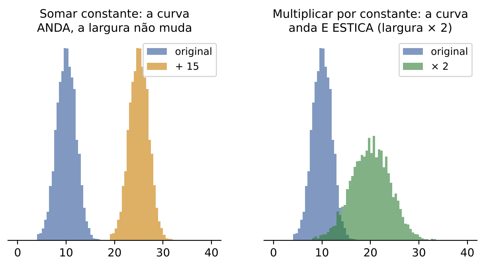

### 10.8.1 Somar (ou subtrair) uma constante: o conjunto ANDA

Se todos ganham um abono de 500 reais, a fila inteira de salários se desloca 500 reais para a direita, sem mudar as distâncias entre as pessoas.

Exemplo: 2, 4, 9 (média 5). Somando 10 a cada um: 12, 14, 19 (média 15).

- Medidas de POSIÇÃO (média, mediana, moda, quartis, mínimo, máximo) também andam: ficam somadas da constante. Média: 5 → 15.
- Medidas de DISPERSÃO não mudam: as distâncias entre os dados são as mesmas. Amplitude: 9 − 2 = 7 e 19 − 12 = 7. Desvios em relação à média: −3, −1, +4 nos dois casos. Logo, desvio médio, variância, desvio-padrão e amplitude interquartil ficam IGUAIS.
- O CV MUDA, porque o desvio fica igual mas a média muda: somar constante positiva diminui o CV; subtrair aumenta.

### 10.8.2 Multiplicar (ou dividir) por uma constante: o conjunto ANDA E ESTICA

Um reajuste de 10% multiplica cada salário por 1,10. Agora as distâncias entre as pessoas também são multiplicadas por 1,10.

Exemplo: 2, 4, 9 (média 5). Multiplicando por 2: 4, 8, 18 (média 10).

- Posição: multiplicada pela constante. Média 5 → 10.
- Amplitude, desvio médio, desvio-padrão, AIQ: multiplicados pela constante. Amplitude 7 → 14.
- VARIÂNCIA: multiplicada pela constante AO QUADRADO, porque a variância é feita de desvios ao quadrado. Desvios −3, −1, +4 viram −6, −2, +8; quadrados 9, 1, 16 viram 36, 4, 64, isto é, cada quadrado ficou 4 vezes maior (2² = 4).
- CV: NÃO muda (desvio e média são multiplicados pelo mesmo número, que se cancela na divisão).

### 10.8.3 Regra geral: Y = a + b × X

Juntando tudo, se cada dado novo é Y = a + b × X (multiplica por b e soma a), então:

| Medida | Efeito | Exemplo: reajuste de 5% mais abono de 200 (Y = 200 + 1,05X) |
|---|---|---|
| Média, mediana, moda, quartis, mínimo, máximo | a + b × (valor antigo) | média 4.000 → 200 + 1,05 × 4.000 = 4.400 |
| Amplitude, AIQ, desvio médio, desvio-padrão | multiplicam por b (em valor absoluto; o "a" não entra) | desvio 300 → 1,05 × 300 = 315 |
| Variância | multiplica por b² (o "a" não entra) | 90.000 → 1,1025 × 90.000 = 99.225 |
| CV | inalterado se só multiplica (a = 0); muda se soma | 300 ÷ 4.000 = 7,5% → 315 ÷ 4.400 ≈ 7,16% |
| Forma (coeficientes de assimetria e curtose, 10.10 e 10.11) | inalterada (com b positivo) | o desenho da distribuição só muda de lugar e de escala |

:::PEGADINHA As armadilhas preferidas da FCC
- "Aumento de 10% para todos: a nova variância é a anterior multiplicada por 1,10." ERRADO: é multiplicada por 1,10² = 1,21. (O desvio-padrão, sim, fica multiplicado por 1,10.)
- "Abono fixo de 500 reais: média e desvio-padrão aumentam 500." ERRADO: só a média aumenta 500; o desvio fica igual.
- "Aumento de 5%: o CV aumenta 5%." ERRADO: o CV não muda com multiplicação.
- "Aumento de 10%: a média aumenta 10% e o desvio-padrão não se altera." ERRADO: o desvio também aumenta 10%.
- "Somando uma constante, a média e o desvio-padrão ficam somados da constante." ERRADO pela metade: só a média.
Frase-resumo: SOMA MEXE NA POSIÇÃO; MULTIPLICAÇÃO MEXE EM TUDO (e na variância, ao quadrado).
:::

:::QUESTAO FCC 2025 — Prefeitura de São Paulo — Analista de Planejamento e Desenvolvimento Organizacional (Q3281585)
Problema: população dos salários de todos os funcionários de um setor; pede-se a afirmação correta sobre medidas de posição e variabilidade. Gabarito oficial: D.
- A: somando uma constante, "a média e seu desvio-padrão" ficam somados da constante. Errada: o desvio-padrão não muda.
- B: aumento de 10% faz a variância ser multiplicada por 1,10. Errada: por 1,10² = 1,21.
- C: "a mediana pertence ao conjunto". Errada: com número PAR de dados, a mediana é a média dos dois centrais e pode não ser nenhum dos salários (com 3.000 e 4.000 no centro, a mediana é 3.500). A segunda parte (pode ser inferior ou superior à média) é verdadeira, mas a primeira derruba a alternativa.
- D: a moda, quando existe, sempre pertence ao conjunto (é o valor que MAIS aparece, logo é um dos dados), e a população pode ter mais de uma moda (bimodal, multimodal). CERTA.
- E: aumento de 5% faz o CV aumentar 5%. Errada: o CV não muda.
:::

:::QUESTAO FCC 2026 — MPE-SE — Analista do Ministério Público — Ciências Contábeis (Q3884303)
Problema: população dos 100 salários de uma empresa; pede-se a afirmação correta. Gabarito oficial: A.
- A: admitem-se mais 10 empregados, cada um ganhando exatamente a média de P; a nova média dos 110 é igual à de P. CERTA. Seja m a média: a soma antiga é 100m; acrescentam-se 10 salários iguais a m, somando 10m; nova soma = 110m; nova média = 110m ÷ 110 = m.
- B: se mediana = moda, então a média também é igual a elas. Errada. Contraexemplo: 1, 2, 2, 3, 10. Moda = 2; mediana (o 3º de 5) = 2; média = 18 ÷ 5 = 3,6.
- C: aumento de 10% eleva a média em 10% e "o desvio-padrão não se altera". Errada: o desvio também sobe 10%.
- D: "a mediana é sempre inferior à média e superior à moda". Errada: isso só ocorre em distribuições assimétricas à direita (10.10); não é "sempre".
- E: abono de 500 reais eleva média e desvio-padrão em 500. Errada: o desvio não muda.
:::

### 10.8.4 Acrescentar ou juntar dados: o efeito sobre a variância

A FCC também gosta de "incluir mais funcionários" na população. Dois casos.

Caso 1 — os novos valores são iguais à média. A média não muda (Q3884303, acima). A SOMA dos quadrados dos desvios também não muda, porque os novos dados têm desvio zero. Mas o divisor aumenta. Resultado: a variância DIMINUI.

:::QUESTAO FCC 2025 — Prefeitura de São Paulo — Auditor Municipal de Controle Interno (Q3281781)
Problema: população P1 de 40 salários com média 5 salários mínimos (SM) e CV de 10%. Admitem-se 10 funcionários ganhando 5 SM cada, formando P2 com 50 pessoas. Qual a variância de P2, em SM²? Gabarito oficial: E (0,20).
Passo 1 — desvio-padrão de P1: CV = desvio ÷ média, então desvio = 0,10 × 5 = 0,5 SM.
Passo 2 — variância de P1: 0,5² = 0,25.
Passo 3 — soma dos quadrados dos desvios de P1: variância = soma ÷ 40, logo soma = 0,25 × 40 = 10.
Passo 4 — os 10 novos ganham exatamente a média (5 SM): desvio zero, quadrado zero. A média de P2 continua 5, e a soma dos quadrados continua 10.
Passo 5 — variância de P2 = 10 ÷ 50 = 0,20.
Alternativas sedutoras: 0,25 (B) é a variância antiga, de quem acha que "nada muda"; 0,01 (A) nasce de usar o CV ao quadrado (0,1² = 0,01) como se fosse a variância; 0,05 (C) é 0,25 ÷ 5.
:::

Caso 2 — juntar dois grupos com médias diferentes. A variância do grupo reunido NÃO é a média das variâncias: soma-se uma parcela que mede o quanto as médias dos grupos diferem entre si.

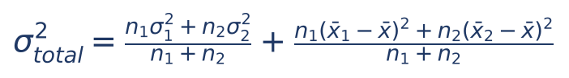

Em que:
- n₁ e n₂ = tamanhos dos grupos; σ₁² e σ₂² = variâncias (populacionais) de cada grupo;
- x̄₁ e x̄₂ = médias dos grupos; x̄ = média geral, (n₁x̄₁ + n₂x̄₂) ÷ (n₁ + n₂);
- a primeira fração é a "média das variâncias" (variação DENTRO dos grupos);
- a segunda é a "variância das médias" (variação ENTRE os grupos).

:::EXEMPLO Juntando duas equipes de fiscalização
Equipe 1: 30 auditores, média 10 autuações, variância 4. Equipe 2: 20 auditores, média 15, variância 9.
- Média geral = (30 × 10 + 20 × 15) ÷ 50 = (300 + 300) ÷ 50 = 600 ÷ 50 = 12.
- Dentro dos grupos = (30 × 4 + 20 × 9) ÷ 50 = (120 + 180) ÷ 50 = 300 ÷ 50 = 6.
- Entre os grupos: desvios das médias em relação a 12: 10 − 12 = −2 e 15 − 12 = +3; quadrados 4 e 9. [30 × (−2)² + 20 × 3²] ÷ 50 = (30 × 4 + 20 × 9) ÷ 50 = (120 + 180) ÷ 50 = 6. (Coincidência: 2² = 4 e 3² = 9 são os mesmos números das variâncias.)
- Variância total = 6 + 6 = 12.
Quem simplesmente tira a média das variâncias acha 6 e erra pela metade. Ideia que sobrevive mesmo sem a fórmula: reunir grupos com médias diferentes AUMENTA a dispersão.
:::

:::QUESTAO FGV 2026 — TJ-SC — Analista Contábil-Econômico (Q4150850)
Problema: salários com média 4.000 reais e desvio-padrão 300 reais. Cenário A: aumento fixo de 200 reais para todos. Cenário B: aumento de 5% para todos. Gabarito oficial: A (no cenário A, média 4.200; no B, desvio 315).
- Cenário A (soma): média 4.000 + 200 = 4.200; desvio continua 300.
- Cenário B (multiplicação por 1,05): média 1,05 × 4.000 = 4.200; desvio 1,05 × 300 = 315.
Curiosidade: os dois cenários dão a mesma média, mas o B aumenta a dispersão. As alternativas B a E trocam esses efeitos.
No mesmo sentido: Q4248266 (FGV 2026 — SEDUC-SP): média 6,0 e desvio 1,50; somando 2 a todos os valores, média 8,0 e desvio 1,50 (gabarito B).
:::

:::QUESTAO FGV 2025 — CNU — Bloco 7 (Q3645105)
Problema: tempos de atendimento com média 12, mediana 10, desvio-padrão 6, mínimo 3 e máximo 32 minutos. Uma etapa nova aumentaria cada atendimento em 20%. Gabarito oficial: E (manteria as proporções e não alteraria o formato da distribuição).
Multiplicar tudo por 1,2: média 14,4; mediana 12; desvio 7,2; mínimo 3,6; máximo 38,4. O CV continua 6 ÷ 12 = 7,2 ÷ 14,4 = 0,5. A forma (assimetria) é a mesma: a média continua acima da mediana.
- B: o desvio-padrão não diminui; aumenta. Errada.
- C: a mediana não se iguala à média (12 contra 14,4). Errada.
- D: a posição relativa média/mediana se mantém; não muda a assimetria. Errada.
- A: em termos ABSOLUTOS, as distâncias até os extremos aumentam 20% (de 32 − 12 = 20 para 38,4 − 14,4 = 24); a banca, porém, considerou correta apenas E, que descreve a essência da transformação (escala proporcional, forma preservada). Ver nota de verificação.
:::

:::QUESTAO FGV 2024 — EPE — Analista de Pesquisa Energética (Q3259432)
Problema: a média mensal do consumo de gás diminuiu 25% de um ano para o seguinte. O que se pode dizer da variabilidade? Gabarito oficial: E (não há alteração na variabilidade).
Raciocínio pretendido pela banca: a informação dada diz respeito apenas à MÉDIA; ela não permite concluir que a variância caiu 25% (A), subiu 50% (B), ou que o desvio mudou (C, D). Se a queda viesse de multiplicar tudo por 0,75, o desvio cairia 25% e a variância cairia para 0,75² = 0,5625 da original (queda de 43,75%), valores que também não batem com A a D.
Gabarito discutível: a afirmação "não há alteração" só seria verdadeira se a queda resultasse de subtrair uma constante de todos os meses; o enunciado não diz isso. Na prova, a alternativa que "não inventa" mudança foi a escolhida.
:::

:::PRATIQUE exercícios elaborados para esta apostila
1. Uma população tem média 50 e desvio-padrão 4. Cada valor é transformado em Y = 2X + 10. Dê a nova média, o novo desvio e a nova variância.
2. Temperaturas em graus Celsius têm média 20 e desvio 5. Converta para Fahrenheit (F = 1,8C + 32) e compare os CVs.
3. (Estilo FCC) Salários com variância 40.000 recebem reajuste de 20%. Qual a nova variância e o novo desvio-padrão?
4. (Estilo FCC) Uma população de 20 valores tem média 8 e variância 5. Acrescentam-se 5 valores iguais a 8. Qual a nova variância?
Resolução:
1. Média: 2 × 50 + 10 = 110. Desvio: 2 × 4 = 8 (o +10 não entra). Variância: 8² = 64 (ou 2² × 16 = 64).
2. Média: 1,8 × 20 + 32 = 36 + 32 = 68. Desvio: 1,8 × 5 = 9. CV em Celsius: 5 ÷ 20 = 25%. CV em Fahrenheit: 9 ÷ 68 ≈ 13,2%. O CV mudou porque houve soma (o +32): por isso o CV só é confiável para variáveis com zero "verdadeiro" (salário, peso), não para temperatura.
3. Multiplicar por 1,2: variância × 1,2² = × 1,44. Nova variância = 40.000 × 1,44 = 57.600. Desvio antigo = √40.000 = 200; novo = 1,2 × 200 = 240 (confira: 240² = 57.600).
4. Soma dos quadrados dos desvios = 5 × 20 = 100. Os novos valores têm desvio zero. Nova variância = 100 ÷ 25 = 4.
:::

## 10.9 Padronização: o escore z

### 10.9.1 A ideia: medir distâncias em "desvios-padrão"

Um candidato tirou 70 na prova objetiva e 80 na discursiva. Em qual foi melhor? Comparar 70 com 80 não adianta: as provas têm médias e dispersões diferentes. Suponha que a objetiva teve média 60 e desvio-padrão 5, e a discursiva média 72 e desvio-padrão 8.

- Na objetiva, ele ficou 70 − 60 = 10 pontos acima da média. Como o desvio-padrão é 5, isso equivale a 10 ÷ 5 = 2 desvios-padrão acima.
- Na discursiva, ficou 80 − 72 = 8 pontos acima. Com desvio de 8, isso é 8 ÷ 8 = 1 desvio-padrão acima.

Relativamente ao grupo, o desempenho na objetiva foi melhor. O número de desvios-padrão que separa um dado da média é o ESCORE Z (ou escore padronizado):

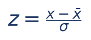

Em que:
- z = escore padronizado (quantos desvios-padrão o dado está acima, se positivo, ou abaixo, se negativo, da média);
- x = o dado;
- x̄ = a média (μ, na notação da população);
- σ = o desvio-padrão.

:::DICA Propriedades do escore z (consequência direta de 10.8)
Transformar TODOS os dados em z é subtrair a média (o conjunto anda até ficar centrado em zero) e dividir pelo desvio (o conjunto encolhe até ter desvio 1). Logo, os escores z de qualquer conjunto têm SEMPRE média 0 e desvio-padrão 1 (variância 1). A forma da distribuição não muda. É a mesma operação que você fará com a tabela da normal padrão no Cap. 13.
Volta do z para x: x = x̄ + z × σ.
:::

:::ATENCAO Escore z e outliers
Um uso prático: dados com |z| maior que 3 (mais de 3 desvios-padrão longe da média) costumam ser sinalizados como possíveis outliers (valores atípicos), sobretudo quando os dados têm formato de sino (lembre a regra empírica de 10.5). Em auditoria, é um filtro clássico: uma nota fiscal com valor muito acima do padrão do contribuinte "acende a luz". O boxplot (10.12) oferece outro critério, baseado em quartis, que não depende do formato de sino.
:::

:::QUESTAO FGV 2024 — Ministério da Fazenda — Auditor Federal de Finanças e Controle (TI) (Q2534660)
Problema: na detecção de outliers em Big Data usa-se Z = (x − µ) ÷ σ. O que significam µ e σ? Gabarito oficial: D (média aritmética; desvio-padrão).
Exatamente o escore z. As alternativas trocam σ por variância (B, E), ou µ por mediana (C). Lembre: o denominador é o DESVIO-PADRÃO, para que z fique na unidade "número de desvios"; dividir pela variância misturaria unidades.
:::

:::PRATIQUE exercícios elaborados para esta apostila
1. Média 70, desvio 10. Qual o z de x = 85?
2. Média 50, desvio 4. Que valor tem z = −2?
3. Ana tirou 7 numa prova (média 5, desvio 1); Bruno tirou 80 noutra (média 60, desvio 15). Quem foi relativamente melhor?
Resolução:
1. z = (85 − 70) ÷ 10 = 15 ÷ 10 = 1,5.
2. x = 50 + (−2) × 4 = 50 − 8 = 42.
3. Ana: z = (7 − 5) ÷ 1 = 2. Bruno: z = (80 − 60) ÷ 15 = 20 ÷ 15 ≈ 1,33. Ana foi relativamente melhor.
:::

## 10.10 Assimetria

### 10.10.1 A ideia: a distribuição "pende" para um lado?

Até aqui medimos onde os dados estão (posição) e o quanto se espalham (dispersão). Falta a FORMA. Desenhe o histograma (Cap. 9) e pergunte: os dois lados são espelhos um do outro? Se sim, a distribuição é SIMÉTRICA. Se um dos lados tem uma "cauda" mais comprida, é ASSIMÉTRICA.

Exemplo cotidiano: a renda da população. A maioria ganha valores modestos; poucos ganham fortunas. O histograma tem um pico à esquerda e uma cauda longa à direita (os poucos muito ricos). Isso é assimetria À DIREITA, também chamada POSITIVA. O nome segue a CAUDA, não o pico: a cauda longa aponta para os valores grandes (positivos).

O contrário, cauda longa para a esquerda, é a assimetria À ESQUERDA, ou NEGATIVA. Exemplo: notas de uma prova fácil (quase todos tiram notas altas; alguns poucos tiram notas muito baixas).

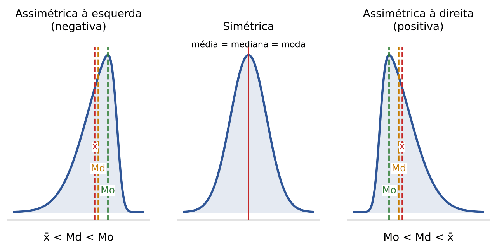

### 10.10.2 A regra de ouro: média, mediana e moda

A média é "puxada" pelos valores extremos (Cap. 9); a mediana resiste a eles; a moda fica no pico. Por isso:

| Forma | Relação | Exemplo |
|---|---|---|
| Simétrica | média = mediana = moda | 4, 5, 5, 5, 6 |
| Assimétrica à direita (positiva) | moda < mediana < média | renda, valor de autuações, tempo de processo |
| Assimétrica à esquerda (negativa) | média < mediana < moda | nota em prova fácil, idade de óbito |

Memorize assim: a MÉDIA vai para o lado da CAUDA. Se a média é maior que a mediana, a cauda está à direita (positiva); se menor, à esquerda (negativa).

:::EXEMPLO A média puxada pela cauda
Prazos (em dias) de cinco processos: 10, 12, 12, 14, 52.
- Moda = 12 (aparece duas vezes).
- Mediana = 12 (o 3º de cinco, em ordem).
- Média = (10 + 12 + 12 + 14 + 52) ÷ 5 = 100 ÷ 5 = 20.
Moda (12) ≤ mediana (12) < média (20): o único processo de 52 dias puxou a média para a direita. Assimetria positiva. Por isso, em dados assimétricos, a MEDIANA representa melhor o "processo típico".
:::

:::PEGADINHA Três cuidados
- A regra "média > mediana indica assimetria positiva" é a leitura usual de prova, mas não é uma lei matemática absoluta: distribuições bimodais ou discretas podem fugir do padrão. Por isso, as bancas às vezes escrevem "pode apresentar" (Q3174688, abaixo).
- Mediana igual à moda NÃO garante que a média também seja igual (contraexemplo em Q3884303, 10.8).
- Assimetria nada tem a ver com o tamanho do CV ou do desvio-padrão (Q3154013, abaixo).
:::

### 10.10.3 Medindo a assimetria: os coeficientes

Para dizer não só o sentido, mas a intensidade da assimetria, usam-se coeficientes. Os mais cobrados são os de Pearson:

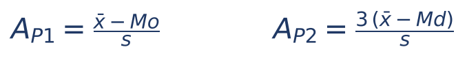

Em que:
- A_P1 = primeiro coeficiente de Pearson, que usa a moda (Mo);
- A_P2 = segundo coeficiente de Pearson, que usa a mediana (Md) e tem o fator 3;
- x̄ = média; s = desvio-padrão.

Leitura: coeficiente zero indica simetria; positivo, assimetria à direita; negativo, à esquerda. Uma escala usual em livros brasileiros: valor absoluto menor que 0,15, distribuição praticamente simétrica; entre 0,15 e 1, assimetria moderada; acima de 1, forte.

Por que o fator 3 no segundo? Pearson observou que, em distribuições moderadamente assimétricas, vale aproximadamente a relação empírica:

- média − moda ≈ 3 × (média − mediana), que se costuma escrever Mo ≈ 3 × Md − 2 × x̄.

Ou seja, a moda fica cerca de três vezes mais longe da média do que a mediana. Trocar (x̄ − Mo) por 3 × (x̄ − Md) é útil quando a moda é difícil de achar.

:::EXEMPLO Calculando os coeficientes de Pearson
Uma variável tem média 45, mediana 38, moda 32 e desvio-padrão 20.
- A_P1 = (45 − 32) ÷ 20 = 13 ÷ 20 = 0,65.
- A_P2 = 3 × (45 − 38) ÷ 20 = 3 × 7 ÷ 20 = 21 ÷ 20 = 1,05.
Ambos positivos: assimetria à direita. Os dois coeficientes não precisam dar o mesmo número (só coincidem quando a relação empírica vale com exatidão).
:::

Há ainda um coeficiente que usa só quartis, o de Bowley (ou coeficiente quartílico de assimetria):

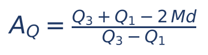

Em que Q₁ e Q₃ são o primeiro e o terceiro quartis e Md a mediana. A ideia: numa distribuição simétrica, a mediana fica exatamente no meio da caixa, isto é, Q₃ − Md = Md − Q₁, e o numerador vale zero. Se a metade de cima da caixa é mais comprida, o coeficiente é positivo. O resultado sempre fica entre −1 e +1.

Exemplo: Q₁ = 20, Md = 25, Q₃ = 40. A_Q = (40 + 20 − 2 × 25) ÷ (40 − 20) = (60 − 50) ÷ 20 = 10 ÷ 20 = 0,5. Assimetria positiva: da mediana até Q₃ há 15 unidades; de Q₁ até a mediana, só 5.

Por fim, a medida "teórica" de assimetria é o COEFICIENTE DE MOMENTO: o 3º momento central (média dos CUBOS dos desvios) dividido pelo cubo do desvio-padrão, a₃ = m₃ ÷ s³. O cubo preserva o sinal dos desvios: desvios grandes positivos (cauda à direita) dominam e tornam o resultado positivo. Basta saber que o terceiro momento mede assimetria e vale zero em distribuições simétricas.

:::DICA Como "consertar" uma assimetria à direita
Dados muito assimétricos à direita (renda, valores de transações, concentrações em exames) costumam ser transformados pelo LOGARITMO (Cap. 1) antes de certas análises: o log "encolhe" os valores grandes muito mais que os pequenos (log 10 = 1; log 1.000 = 3) e aproxima a distribuição da simetria. Raiz quadrada tem efeito parecido, mais fraco. A padronização (escore z) NÃO muda a forma (10.9).
:::

:::QUESTAO FGV 2024 — TJ-MS — Técnico de Nível Superior — Estatístico (Q2496465)
Problema: as idades de 1.000 pessoas têm distribuição positivamente assimétrica. Qual afirmação é correta? Gabarito oficial: A (a média será maior que a mediana).
- A: assimetria positiva = cauda à direita = média puxada para a direita, acima da mediana. CERTA.
- B: "a moda poderá ser um valor com frequência igual a cinco" é afirmação solta, que nada tem a ver com assimetria (e, com 1.000 pessoas, nada a garante).
- C: o intervalo interquartil não é "simétrico em torno da média"; na assimetria positiva, nem em torno da mediana.
- D: o 3º quartil não é "o terceiro dado"; é o valor que deixa 75% dos dados abaixo (Cap. 9).
- E: o percentil 50 é a MEDIANA, não a moda.
:::

:::QUESTAO FGV 2025 — TCE-RR — Auditor Substituto de Conselheiro (Q3174688)
Problema: quatro afirmações (V/F) sobre média, mediana e moda. Gabarito oficial: A (V – V – V – V).
- Média maior que a mediana: assimetria à direita (positiva). V, segundo a leitura usual.
- Distribuição simétrica: média, mediana e moda coincidem. V (supondo distribuição unimodal, que é o que a banca tem em mente).
- Distribuição multimodal: a relação entre as três medidas pode não seguir padrão. V.
- Mediana maior que a média: "pode" indicar assimetria à esquerda. V (note o "pode").
:::

:::QUESTAO FGV 2025 — Assimetria positiva acentuada (Q3758079)
Problema: média 45, mediana 38, moda 32, assimetria positiva acentuada. Três afirmações. Gabarito oficial: E (I, II e III corretas).
- I: moda < mediana < média é coerente com assimetria positiva. Certo (32 < 38 < 45).
- II: em dados assimétricos, a mediana representa melhor o centro, pois resiste aos valores extremos. Certo.
- III: a diferença entre média e mediana sugere valores extremos na cauda direita. Certo: são eles que puxam a média.
Com esses números, os coeficientes de Pearson seriam positivos (calculados no exemplo de 10.10.3, com desvio 20).
:::

:::QUESTAO FGV 2025 — SEFAZ-RS — Auditor do Estado (Q3154013)
Problema: julgar três afirmativas. Gabarito oficial: E (F – F – F).
- I: "se a média for menor que a mediana, o CV será necessariamente maior que 100%". Falso: a relação média/mediana fala de assimetria, não do tamanho da dispersão relativa. Exemplo: 1, 9, 9, 10 tem média 7,25, mediana 9 e desvio bem menor que a média.
- II: "em distribuições simétricas, a amplitude interquartil e o desvio-padrão são iguais". Falso: na distribuição normal, por exemplo, a AIQ vale cerca de 1,35 desvio-padrão.
- III: "correlação de Pearson zero indica que as variáveis não possuem qualquer tipo de relação". Falso: indica ausência de relação LINEAR; pode haver relação curva (Cap. 16).
:::

:::QUESTAO FGV 2025 — EBSERH — Residência Multiprofissional (Q3719702)
Problema: insulina com forte assimetria à direita; que transformação corrige a assimetria? Gabarito oficial: B (logaritmos).
Ver a DICA acima: o logaritmo comprime a cauda direita. Padronização (D) não altera a forma; potenciação (C) acentuaria a cauda direita; inversão (A) inverte a ordem e é usada em casos especiais; a raiz quadrada (E) ajuda, mas é a transformação mais fraca e não a clássica para assimetria forte.
:::

:::PRATIQUE exercícios elaborados para esta apostila
1. Média 30, mediana 30, moda 30. Como é a distribuição?
2. Média 52, mediana 50, moda 46, desvio 8. Calcule os dois coeficientes de Pearson e classifique.
3. (Relação empírica) Mediana 40 e média 44. Estime a moda.
4. Q₁ = 10, Md = 18, Q₃ = 22. Calcule o coeficiente de Bowley.
Resolução:
1. Simétrica (as três medidas coincidem).
2. A_P1 = (52 − 46) ÷ 8 = 6 ÷ 8 = 0,75. A_P2 = 3 × (52 − 50) ÷ 8 = 6 ÷ 8 = 0,75. Positivos e entre 0,15 e 1: assimetria positiva moderada.
3. Mo ≈ 3 × 40 − 2 × 44 = 120 − 88 = 32.
4. A_Q = (22 + 10 − 2 × 18) ÷ (22 − 10) = (32 − 36) ÷ 12 = −4 ÷ 12 ≈ −0,33. Negativo: assimetria à esquerda (a mediana está mais perto de Q₃).
:::

## 10.11 Curtose

### 10.11.1 A ideia: o grau de achatamento

A curtose descreve outro aspecto da forma: o quanto a distribuição é "pontuda" (com pico alto e caudas pesadas) ou "achatada" (com topo largo), em comparação com a curva normal, tomada como referência.

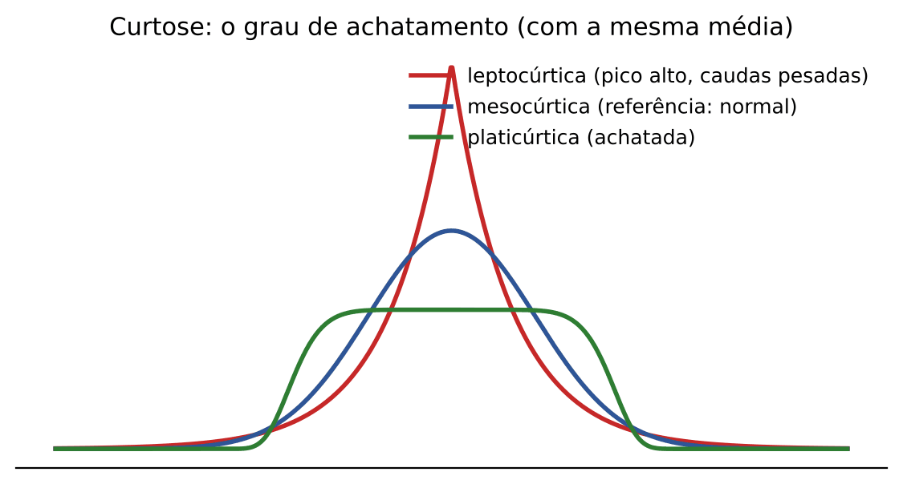

- LEPTOCÚRTICA: mais "afilada" que a normal; muitos dados concentrados no centro e caudas mais pesadas (do grego *leptós*, delgado).
- MESOCÚRTICA: igual à normal (*mésos*, meio).
- PLATICÚRTICA: mais achatada que a normal; dados espalhados de modo mais uniforme (*platýs*, chato, largo, como em "platô").

Truque de memória: PLATI lembra "prato" (raso, chato); LEPTO lembra "lápis" apontado.

### 10.11.2 O coeficiente percentílico de curtose

O coeficiente mais cobrado em provas brasileiras usa quartis e percentis (Cap. 9):

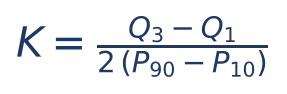

Em que:
- K = coeficiente percentílico de curtose;
- Q₃ − Q₁ = amplitude interquartil (o miolo de 50% dos dados);
- P90 − P10 = distância entre o percentil 90 e o percentil 10 (o miolo de 80% dos dados).

Referência: para a distribuição normal, K ≈ 0,263. Então:

- K = 0,263: mesocúrtica;
- K < 0,263: leptocúrtica (o miolo de 50% é estreito em comparação com o de 80%: pico concentrado e caudas longas);
- K > 0,263: platicúrtica (o miolo de 50% é largo: distribuição achatada).

:::EXEMPLO Classificando pela curtose percentílica
Q₁ = 20, Q₃ = 40, P10 = 10, P90 = 60.
- Q₃ − Q₁ = 40 − 20 = 20.
- P90 − P10 = 60 − 10 = 50.
- K = 20 ÷ (2 × 50) = 20 ÷ 100 = 0,20.
Como 0,20 < 0,263, a distribuição é leptocúrtica.
:::

:::DICA O coeficiente de momento e o "excesso de curtose"
A medida teórica é o 4º momento central (média dos desvios elevados à QUARTA potência) dividido pelo desvio-padrão à quarta: a₄ = m₄ ÷ s⁴. Para a normal, a₄ = 3. Logo: a₄ = 3, mesocúrtica; a₄ > 3, leptocúrtica; a₄ < 3, platicúrtica. Muitos programas (inclusive planilhas) informam o "excesso de curtose", a₄ − 3, cuja referência passa a ser zero (positivo = lepto; negativo = plati).
Atenção à inversão de sentido entre os coeficientes: no percentílico, MENOR que a referência é lepto; no de momento, MAIOR que a referência é lepto.
Resumo dos momentos: 1º (ordinário) = média; 2º central = variância; 3º central = assimetria; 4º central = curtose.
:::

:::QUESTAO FGV 2024 — TJ-MS — Técnico de Nível Superior — Estatístico (Q2496461)
Problema: histograma de notas, simétrico e concentrado em torno da moda. Que medida afere o grau de achatamento? Gabarito oficial: B (curtose).
Assimetria (A) mede o "pender" para um lado; mediana, média e moda (C, D, E) são medidas de posição. Achatamento = curtose.
:::

:::QUESTAO FGV 2024 — TJ-MS — Técnico de Nível Superior — Estatístico (Q2496472)
Problema: qual associação entre momentos e características da distribuição é correta? Gabarito oficial: D (o quarto momento se relaciona com a curtose).
Pela DICA acima: 1º, posição (média); 2º, dispersão (variância); 3º, assimetria; 4º, curtose. A troca o 1º pela variância; B, o 2º pela assimetria; C, o 3º pela moda; E inventa um 5º momento ligado à mediana.
:::

:::QUESTAO FGV 2024 — EPE — Analista de Pesquisa Energética (Q3259434)
Problema: três itens sobre análise exploratória. Gabarito oficial: A (apenas I).
- I: o coeficiente de curtose (percentílico) é adimensional e depende da diferença entre os percentis 90 e 10. Certo: está no denominador; e, como é uma divisão de distâncias na mesma unidade, não tem unidade.
- II: correlação nula implica independência. Errado: indica só ausência de relação linear (Cap. 16).
- III: o conjunto com maior desvio-padrão "possui maior dispersão". Errado como regra geral: com médias ou unidades diferentes, a comparação correta é pelo CV (10.7).
:::

:::PRATIQUE exercícios elaborados para esta apostila
1. Q₁ = 30, Q₃ = 50, P10 = 20, P90 = 60. Classifique a curtose.
2. Q₁ = 20, Q₃ = 60, P10 = 10, P90 = 80. Classifique.
3. Um programa informa a₄ = 3. E se informasse "excesso de curtose = −0,8"?
Resolução:
1. K = (50 − 30) ÷ [2 × (60 − 20)] = 20 ÷ 80 = 0,25. Menor que 0,263: leptocúrtica (por pouco).
2. K = (60 − 20) ÷ [2 × (80 − 10)] = 40 ÷ 140 ≈ 0,286. Maior que 0,263: platicúrtica.
3. a₄ = 3: mesocúrtica. Excesso negativo (a₄ = 3 − 0,8 = 2,2 < 3): platicúrtica.
:::

## 10.12 Boxplot (diagrama de caixa) e outliers

### 10.12.1 A ideia: o resumo dos cinco números em um desenho

O boxplot (do inglês *box plot*, "gráfico de caixa"; também chamado diagrama de caixa e bigodes) resume um conjunto de dados em CINCO NÚMEROS, todos vindos do Cap. 9:

- o menor valor (mínimo);
- o primeiro quartil (Q₁): 25% dos dados abaixo dele;
- a mediana (Md ou Q₂): 50% abaixo;
- o terceiro quartil (Q₃): 75% abaixo;
- o maior valor (máximo).

A "caixa" vai de Q₁ a Q₃ e tem um traço na mediana; os "bigodes" (ou hastes) saem da caixa em direção aos extremos. Valores muito afastados aparecem como pontos isolados: são os OUTLIERS (valores discrepantes, atípicos).

A largura da caixa é a AMPLITUDE INTERQUARTIL (AIQ = Q₃ − Q₁), que contém os 50% de dados centrais. É a medida de dispersão do boxplot, robusta (não se deixa contaminar por valores extremos, ao contrário da amplitude total e do desvio-padrão).

### 10.12.2 As cercas: o critério de 1,5 × AIQ

Para decidir quem é outlier, constroem-se duas "cercas" (limites):

- cerca inferior = Q₁ − 1,5 × AIQ;
- cerca superior = Q₃ + 1,5 × AIQ.

Qualquer dado abaixo da cerca inferior ou acima da superior é outlier. Os bigodes vão até o dado MAIS EXTREMO QUE AINDA ESTÁ DENTRO das cercas (não até a cerca em si).

Alguns autores distinguem ainda outliers MODERADOS (entre 1,5 e 3 AIQ além dos quartis) e EXTREMOS (além de 3 AIQ: abaixo de Q₁ − 3 × AIQ ou acima de Q₃ + 3 × AIQ).

:::EXEMPLO Montando um boxplot à mão
Dias para despacho de 15 processos, já ordenados: 2, 3, 4, 4, 5, 5, 6, 7, 7, 8, 9, 10, 12, 14, 30.
Passo 1 — mediana: com 15 dados, é o 8º: Md = 7.
Passo 2 — quartis pelo método das metades (excluindo a mediana, pois n é ímpar): metade inferior 2, 3, 4, 4, 5, 5, 6, cujo dado central (4º) é 4, então Q₁ = 4; metade superior 7, 8, 9, 10, 12, 14, 30, cujo dado central é 10, então Q₃ = 10.
Passo 3 — AIQ = 10 − 4 = 6.
Passo 4 — cercas: inferior = 4 − 1,5 × 6 = 4 − 9 = −5; superior = 10 + 1,5 × 6 = 10 + 9 = 19.
Passo 5 — outliers: nenhum dado abaixo de −5; acima de 19, só o 30. Como 3 × AIQ = 18 e 10 + 18 = 28, o 30 é também outlier EXTREMO.
Passo 6 — bigodes: o inferior vai até 2 (menor dado); o superior vai até 14 (maior dado que não é outlier). O 30 aparece como ponto isolado.
:::

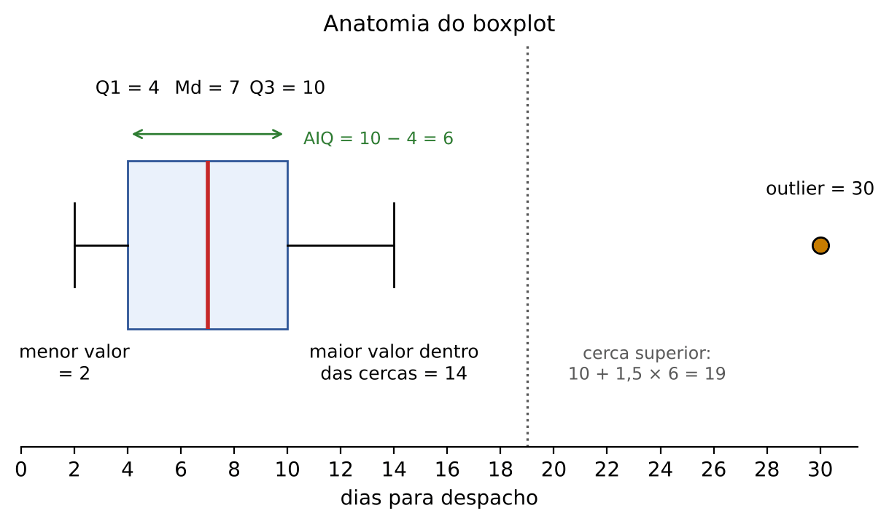

:::ATENCAO Convenções de quartil
Esta apostila adota, nos Caps. 9 e 10, o MÉTODO DAS METADES para quartis em dados brutos (ver o ATENCAO "Convenção de quartis" em 09.11.2): ordenados os dados, Q₁ é a mediana da metade inferior e Q₃ a da metade superior; se n é ímpar, a mediana fica fora das duas metades; se n é par, cada metade tem n ÷ 2 dados. É o método das questões da FGV deste lote (algumas o descrevem no próprio enunciado, como a Q3171962), e ele reproduz os gabaritos oficiais de Q3185955, Q3786841 e Q4375145. O banco não traz questão da FCC que calcule quartil em dados brutos; em dados agrupados em classes, vale a interpolação com a posição p × n (09.11.3). Há métodos alternativos (o da posição k × (n + 1)/4 e os dos programas de computador), que podem dar valores um pouco diferentes em amostras pequenas. Regra de prova: siga a instrução do enunciado; na falta dela, use o método das metades e confira nas alternativas; se não bater, teste o método da posição.
:::

### 10.12.3 Lendo um boxplot

Um boxplot permite responder, só de olhar:

- POSIÇÃO: onde está a mediana (o traço dentro da caixa)?
- DISPERSÃO: a caixa é larga ou estreita (AIQ)? Os bigodes são longos?
- ASSIMETRIA: a mediana está no meio da caixa? Os bigodes têm o mesmo comprimento? Se a parte de cima da caixa e o bigode de cima são mais longos, há assimetria à direita (positiva); se os de baixo, à esquerda.
- OUTLIERS: há pontos isolados além dos bigodes?

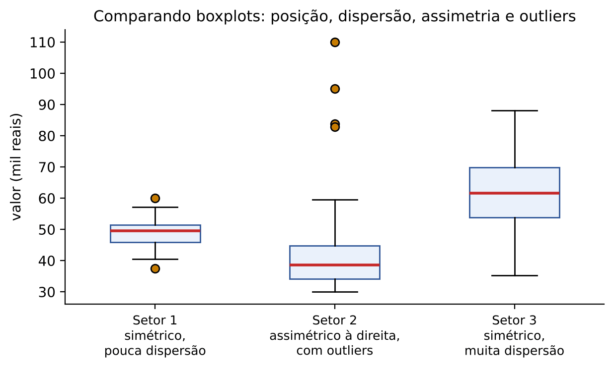

Na figura: o Setor 1 é simétrico (mediana no meio da caixa) e pouco disperso (caixa estreita); o Setor 2 é assimétrico à direita (mediana perto da base da caixa, bigode e outliers para cima); o Setor 3 é simétrico, mas muito disperso, e tem a maior mediana.

:::PEGADINHA O que o boxplot NÃO mostra
O boxplot clássico NÃO mostra a média, nem a moda, nem o desvio-padrão. Ele é feito com quartis, mediana e extremos. (Alguns programas acrescentam um símbolo para a média, mas isso não faz parte da definição.) Também não mostra quantos dados há, nem se a distribuição tem dois picos.
:::

:::DICA Outlier não é sinônimo de erro
Um outlier pode ser erro de digitação, mas também pode ser o dado mais importante do conjunto: na fiscalização, a empresa cujas vendas declaradas destoam de todo o setor é exatamente quem se quer encontrar. Por isso não se excluem outliers automaticamente: investiga-se a causa. Para detectá-los, usam-se gráficos (boxplot, dispersão), critérios estatísticos (cercas de 1,5 × AIQ, escore z) e técnicas de aprendizado de máquina (Cap. 25).
:::

:::QUESTAO FGV 2025 — Marcas de frenagem (Q3171962)
Problema: distâncias (m): 19, 22, 20, 18, 23, 30, 22, 18, 21, 19, 24, 18, 21, 20. O enunciado manda ordenar, dividir em dois grupos de sete e tomar o termo central de cada grupo como Q₁ e Q₃; outlier é o que fica fora de Q₁ − 1,5 × (Q₃ − Q₁) e Q₃ + 1,5 × (Q₃ − Q₁). Gabarito oficial: B (um único outlier, maior que Q₃).
Passo 1 — ordenar os 14 valores: 18, 18, 18, 19, 19, 20, 20, 21, 21, 22, 22, 23, 24, 30.
Passo 2 — grupo inferior (7 primeiros): 18, 18, 18, 19, 19, 20, 20; central (4º) = 19. Q₁ = 19.
Passo 3 — grupo superior (7 últimos): 21, 21, 22, 22, 23, 24, 30; central = 22. Q₃ = 22.
Passo 4 — AIQ = 22 − 19 = 3; 1,5 × 3 = 4,5.
Passo 5 — cercas: 19 − 4,5 = 14,5 e 22 + 4,5 = 26,5.
Passo 6 — abaixo de 14,5: nenhum. Acima de 26,5: só o 30. Um único outlier, acima de Q₃.
:::

:::QUESTAO FGV 2026 — PC-PR — Agente de Polícia Judiciária (Q4375145)
Problema: número de delitos anteriores de 21 investigados, ordenados: 1, 1, 1, 1, 1, 1, 2, 2, 3, 3, 3, 3, 4, 4, 4, 5, 5, 5, 6, 8, 12. Outlier fora de (Q₁ − 1,5D; Q₃ + 1,5D), D = distância interquartil. Gabarito oficial: B (1 outlier).
Passo 1 — mediana: 21 dados, o 11º: valor 3.
Passo 2 — metade inferior (10 primeiros): 1, 1, 1, 1, 1, 1, 2, 2, 3, 3; meio = média do 5º e do 6º = (1 + 1) ÷ 2 = 1. Q₁ = 1.
Passo 3 — metade superior (10 últimos, do 12º ao 21º): 3, 4, 4, 4, 5, 5, 5, 6, 8, 12; meio = (5 + 5) ÷ 2 = 5. Q₃ = 5.
Passo 4 — D = 5 − 1 = 4; 1,5 × 4 = 6.
Passo 5 — cercas: 1 − 6 = −5 e 5 + 6 = 11.
Passo 6 — acima de 11: apenas o 12. Um outlier. (O 8 está dentro da cerca; quem usa 1 × D em vez de 1,5 × D acha 9 como cerca e conta dois outliers, a alternativa C.)
:::

:::QUESTAO FGV 2025 — CGE-SP — Auditor Estadual de Controle (Q3786841)
Problema: 20 observações (em salários mínimos): 1, 8, 8, 9, 10, 10, 10, 10, 12, 15, 15, 16, 16, 18, 20, 20, 29, 30, 30, 38. Outliers fora de (Q₁ − 1,5D; Q₃ + 1,5D). Gabarito oficial: E (apenas o 38).
Passo 1 — n = 20 (par): metade inferior = 10 primeiros; metade superior = 10 últimos.
Passo 2 — metade inferior: 1, 8, 8, 9, 10, 10, 10, 10, 12, 15; meio = (5º + 6º) ÷ 2 = (10 + 10) ÷ 2 = 10. Q₁ = 10.
Passo 3 — metade superior: 15, 16, 16, 18, 20, 20, 29, 30, 30, 38; meio = (5º + 6º) ÷ 2 = (20 + 20) ÷ 2 = 20. Q₃ = 20.
Passo 4 — D = 20 − 10 = 10; 1,5 × 10 = 15.
Passo 5 — cercas: 10 − 15 = −5 e 20 + 15 = 35.
Passo 6 — abaixo de −5: nenhum (o 1 NÃO é outlier). Acima de 35: só o 38.
Alternativas sedutoras: B (1 e 38) nasce da impressão visual de que o 1 está "longe"; D (29, 30, 30 e 38) nasce de errar Q₃ ou usar cerca menor. Moral: faça a conta das cercas, não confie no olho.
:::

:::QUESTAO FGV 2024 — EPE — Analista de Pesquisa Energética (Q3259433)
Problema: quais medidas constam do boxplot? Gabarito oficial: B (o 1º, o 2º e o 3º quartis).
O boxplot mostra os quartis (o 2º quartil é a mediana), os extremos e os outliers. As demais alternativas incluem a média ou a moda, que o boxplot clássico não mostra (ver PEGADINHA acima).
No mesmo sentido: Q3363359 (FGV 2025 — SEFAZ-PR — Auditor Fiscal): o gráfico mais adequado para identificar outliers numa variável numérica é o boxplot (gabarito D). Barras servem para categorias; histograma mostra forma, mas não marca outliers; dispersão relaciona duas variáveis; mapa de calor mostra intensidades em grade.
:::

:::QUESTAO FGV 2025 — Prefeitura do Rio de Janeiro — Gestor de Segurança Municipal (Q3782941)
Problema: num dos cinco boxplots de tempo de resposta por bairro, há muitos pontos fora dos limites (outliers). O que isso indica? Gabarito oficial: C (maior variabilidade nos tempos de resposta desse bairro).
- A: outliers não dizem nada sobre igualdade de médias entre bairros.
- B e D: outliers não provam erro de coleta nem erro de construção do gráfico (ver DICA: outlier não é sinônimo de erro).
- E: não indicam rapidez; ao contrário, pontos altos indicam atendimentos demorados.
- C: muitos valores distantes do miolo revelam maior variabilidade. CERTA.
:::

:::QUESTAO FGV 2024 — TJ-RR — Analista Judiciário — Ciência de Dados (Q3090101)
Problema: três afirmações sobre outliers, com um boxplot de retornos mensais de ações (figura não reproduzida no banco). Gabarito oficial: D (II e III).
- I: "outliers nunca devem ser removidos, pois sempre carregam informação e não distorcem resultados". Falsa: outliers PODEM distorcer médias, desvios e modelos; a decisão de mantê-los ou não depende da investigação da causa. As palavras "nunca" e "sempre" denunciam o erro.
- II: no gráfico, o valor 14% aparece isolado, além do bigode, como outlier. Verdadeira segundo a figura da prova.
- III: além da inspeção visual, há métodos estatísticos e de aprendizado de máquina para detectar outliers. Verdadeira.
:::

:::QUESTAO FGV 2024 — EPE — Analista de Pesquisa Energética (Q3258886)
Problema: três afirmações sobre outliers. Gabarito oficial: B (I e II).
- I: gráficos são uma das melhores formas de identificar outliers. Verdadeira.
- II: ajustar a distribuição estatística mais próxima dos dados e usar métodos estatísticos para detectar pontos discrepantes é mais complexo, mas preciso. Verdadeira.
- III: outliers podem ser simplesmente excluídos porque o tratamento "não tem impacto nos negócios". Falsa: o tratamento de outliers tem impacto direto nas conclusões.
:::

:::PRATIQUE exercícios elaborados para esta apostila
1. Dados ordenados: 3, 5, 6, 7, 8, 9, 10, 11, 12, 13, 30. Calcule Md, Q₁, Q₃, AIQ, as cercas e identifique outliers.
2. Q₁ = 20 e Q₃ = 32. Quais as cercas de outlier moderado (1,5 × AIQ) e extremo (3 × AIQ)? Um valor 60 é outlier de que tipo?
3. Num boxplot, a mediana está muito perto de Q₁ e o bigode superior é muito mais longo que o inferior. Que tipo de assimetria há? A média deve estar acima ou abaixo da mediana?
Resolução:
1. n = 11; Md = 6º dado = 9. Metade inferior (5 primeiros): 3, 5, 6, 7, 8, então Q₁ = 6. Metade superior (5 últimos): 10, 11, 12, 13, 30, então Q₃ = 12. AIQ = 12 − 6 = 6; 1,5 × 6 = 9. Cercas: 6 − 9 = −3 e 12 + 9 = 21. Outlier: 30.
2. AIQ = 32 − 20 = 12. Moderado: 1,5 × 12 = 18; cercas 20 − 18 = 2 e 32 + 18 = 50. Extremo: 3 × 12 = 36; cercas 20 − 36 = −16 e 32 + 36 = 68. O 60 está acima de 50 e abaixo de 68: outlier moderado.
3. Assimetria à direita (positiva). A média deve ficar acima da mediana (puxada pela cauda direita).
:::

## 10.13 Resumo para revisão pré-prova

### 10.13.1 Quadro geral

| Conceito | Fórmula ou regra | Quando usar | Armadilha |
|---|---|---|---|
| Amplitude total | máximo − mínimo | Noção rápida de espalhamento | Ignora os dados do meio; sensível a outliers |
| Amplitude interquartil (AIQ) | Q₃ − Q₁ | Dispersão robusta; base do boxplot | Depende da convenção de quartil |
| Desvio | xᵢ − x̄ | Base de todas as medidas | A soma dos desvios em relação à média é SEMPRE zero |
| Desvio médio | Σ (módulos dos desvios) ÷ n | Quando o enunciado pede "desvio (absoluto) médio" | Não esquecer o módulo |
| Variância populacional | Σ(xᵢ − μ)² ÷ N = média dos quadrados − quadrado da média | Dados de toda a população; "média dos quadrados dos desvios" | Unidade ao quadrado; nunca negativa |
| Variância amostral | Σ(xᵢ − x̄)² ÷ (n − 1) | Amostra; "não viesada" | Máxima verossimilhança divide por n |
| Desvio-padrão | √variância | Interpretar a dispersão na unidade original | Entre 0 e 1, é MAIOR que a variância |
| Dados agrupados | Σfᵢ(xᵢ − x̄)² ÷ Σfᵢ (classes: ponto médio) | Tabelas de frequência | Multiplicar o quadrado pela frequência |
| Coeficiente de variação | σ ÷ x̄ | Comparar dispersões com médias ou unidades diferentes | Maior desvio não significa maior dispersão relativa |
| Soma de constante | Posição soma; dispersão igual; CV muda | Abonos, acréscimos fixos | Desvio-padrão NÃO muda |
| Multiplicação por constante | Posição e desvio × b; variância × b²; CV igual | Reajustes percentuais, conversão de unidade | Variância × b², não × b |
| Novos dados iguais à média | Média igual; soma de quadrados igual; variância diminui | "Admissão de funcionários ganhando a média" | A variância não fica igual |
| Juntar grupos | Média das variâncias + variância das médias | Reunir populações | Não é só a média das variâncias |
| Escore z | (x − x̄) ÷ σ | Comparar posições em escalas diferentes; outliers (z acima de 3 ou abaixo de −3) | Divide-se pelo desvio, não pela variância |
| Assimetria | Positiva: Mo < Md < x̄; negativa: x̄ < Md < Mo | Forma da distribuição | O nome segue a CAUDA |
| Pearson | (x̄ − Mo) ÷ s; 3(x̄ − Md) ÷ s | Medir intensidade da assimetria | Fator 3 no segundo |
| Bowley | (Q₃ + Q₁ − 2Md) ÷ (Q₃ − Q₁) | Assimetria só com quartis | Fica entre −1 e +1 |
| Curtose percentílica | (Q₃ − Q₁) ÷ [2(P90 − P10)]; normal ≈ 0,263 | Achatamento | Menor que 0,263 = lepto |
| Curtose de momento | m₄ ÷ s⁴; normal = 3 | Achatamento (teoria) | Maior que 3 = lepto (sentido inverso) |
| Boxplot | Cercas Q₁ − 1,5AIQ e Q₃ + 1,5AIQ | Outliers, comparação de grupos | Não mostra média nem moda |

### 10.13.2 Formulário

| Fórmula | Símbolos | Quando usar |
|---|---|---|
| AT = máx − mín | máx e mín: maior e menor dados | Amplitude total |
| DM = Σ (módulo de xᵢ − x̄) ÷ n | xᵢ: dados; x̄: média; n: quantidade | Desvio médio |
| σ² = Σ(xᵢ − μ)² ÷ N | μ: média da população; N: tamanho | Variância da população |
| σ² = Σxᵢ² ÷ N − μ² | Σxᵢ²: soma dos quadrados dos dados | Atalho: média dos quadrados menos quadrado da média |
| s² = Σ(xᵢ − x̄)² ÷ (n − 1) = (Σxᵢ² − n x̄²) ÷ (n − 1) | n − 1: graus de liberdade | Variância amostral não viesada |
| Var(X) = E(X²) − [E(X)]² | E: média ("esperança") | Questões com momentos |
| σ = √σ²; s = √s² | | Desvio-padrão |
| σ² = Σfᵢ(xᵢ − x̄)² ÷ Σfᵢ | fᵢ: frequência; xᵢ: valor ou ponto médio | Dados agrupados |
| CV = σ ÷ x̄ (× 100%) | | Dispersão relativa |
| Y = a + bX: média a + b x̄; σ_Y = b × σ_X (b sem sinal); σ²_Y = b² σ²_X | a: constante somada; b: constante multiplicada | Transformações |
| σ²_total = (n₁σ₁² + n₂σ₂²) ÷ (n₁ + n₂) + [n₁(x̄₁ − x̄)² + n₂(x̄₂ − x̄)²] ÷ (n₁ + n₂) | índices 1 e 2: grupos; x̄: média geral | Juntar grupos |
| z = (x − x̄) ÷ σ; x = x̄ + zσ | | Padronização |
| A_P1 = (x̄ − Mo) ÷ s; A_P2 = 3(x̄ − Md) ÷ s; Mo ≈ 3Md − 2x̄ | Mo: moda; Md: mediana | Assimetria de Pearson |
| A_Q = (Q₃ + Q₁ − 2Md) ÷ (Q₃ − Q₁) | Q₁, Q₃: quartis | Assimetria de Bowley |
| K = (Q₃ − Q₁) ÷ [2(P90 − P10)] | P10, P90: percentis | Curtose percentílica (normal ≈ 0,263) |
| Cercas: Q₁ − 1,5 × AIQ e Q₃ + 1,5 × AIQ (extremos: 3 × AIQ) | AIQ = Q₃ − Q₁ | Outliers no boxplot |

## 10.14 Questões do capítulo

FCC (comentadas): Q3281585, Q3281646, Q3281781, Q3884303.
FGV (comentadas): Q2360313, Q2450797, Q2496461, Q2496465, Q2496472, Q2515498, Q2524688, Q2534660, Q3044127, Q3050885, Q3088044, Q3090101, Q3154013, Q3171962, Q3174688, Q3185955, Q3258886, Q3259432, Q3259433, Q3259434, Q3349738, Q3363359, Q3579027, Q3579922, Q3645105, Q3719702, Q3758079, Q3782941, Q3786836, Q3786841, Q3846801, Q3847212, Q3998734, Q4150850, Q4220337, Q4220355, Q4248266, Q4283044, Q4375145.

#### Outras questões do banco sobre o tema

As questões abaixo dependem de figura ou tabela que não foi transcrita no banco local (boxplots, histogramas, tabelas de dados) ou pertencem mais propriamente a capítulos posteriores. Resolva-as no caderno de questões, aplicando os roteiros deste capítulo.

| Q | Banca/ano | Subtema | Gabarito |
|---|---|---|---|
| Q2517664 | FGV 2024 | Leitura de boxplots comparativos (salários por setor) | D |
| Q3154441 | FGV 2025 | Boxplots: maior mediana e menor AIQ | A |
| Q3258887 | FGV 2024 | Boxplot: AIQ, outlier e mediana (V/F) | B |
| Q3757794 | FGV 2025 | Boxplots por horário: dispersão e outliers | E |
| Q2535780 | FGV 2024 | Distância interquartil de 52 idades | D |
| Q4375144 | FGV 2026 | Variância como média dos quadrados dos desvios (11 pessoas) | B |
| Q3248824 | FGV 2024 | Menor desvio-padrão entre notas de jurados | B |
| Q3347614 | FGV 2024 | Média, moda e variância de glicemias | C |
| Q3052437 | FGV 2024 | Coeficiente de variação de amostra de 20 valores | B |
| Q3154556 | FGV 2025 | Variabilidade relativa (CV) de três funcionários | B |
| Q3363354 | FGV 2025 | Maior CV entre cinco amostras de salários | A |
| Q3185956 | FGV 2025 | Classe modal, amplitude e CV (1,8 ÷ 4,3 ≈ 41,86%) | B |
| Q3259431 | FGV 2024 | Assimetria e curtose a partir de tabela de frequências | A |
| Q3758083 | FGV 2025 | Interpretação de histograma (assimetria positiva) | B |
| Q2571729 | FGV 2024 | Desvio-padrão da média amostral com correção de população finita (ver Cap. 14) | A |
| Q3643574 | FGV 2025 | Erro-padrão da média das diferenças (ver Cap. 14) | A |

:::NOTA Notas de verificação
- Contas: todos os exemplos, exercícios PRATIQUE e resoluções de questões foram conferidos em Python (numpy e scipy), inclusive variâncias populacionais e amostrais, fórmulas práticas, dados agrupados, variância combinada, coeficientes de Pearson, Bowley e curtose percentílica (valor de referência da normal, 0,2632, recalculado pela inversa da normal), cercas de boxplot e quartis pelo método das metades.
- Material do Drive consultado: "Medidas de Dispersão" (ES10), que define variância relativa como o quadrado do CV; daí a observação sobre a Q2515498.
- Gabaritos discutíveis: Q2515498 (a banca tratou "variância relativa" como CV; com a definição CV², a resposta seria +56,25%, ausente das opções); Q3259432 (a afirmação "não há alteração na variabilidade" só se sustenta se a queda da média decorreu da subtração de uma constante, o que o enunciado não diz); Q3645105 (a alternativa A é literalmente verdadeira em termos absolutos; a banca considerou só E); Q4220355 (alternativas C e D dizem substancialmente o mesmo; gabarito C); Q3281646 (22,86% seria dispersão "média" na classificação de três faixas; D é a única defensável).
- Gabaritos reconferidos no QConcursos em 30/10/2026: Q2360313 (A), que coincide com a resposta obtida pela conta (Var = 25 − 16 = 9; desvio 3).
- Q3847212: o enunciado fala em "quatro amostras", mas lista cinco valores, e o "dado" de raiz parece truncado; resolvida com os cinco valores, coerente com o gabarito E.
- Q3786841: o gabarito E (só o 38) foi reproduzido com o método das metades (Q₁ = 10; Q₃ = 20).
- Convenção de quartis harmonizada com o Cap. 9 em 30/10/2026: método das metades nos dois capítulos (ATENCAO em 09.11.2 e em 10.12), mesma notação (Q₁, Q₂, Q₃, AIQ); o banco não tem questão FCC de quartil em dados brutos.
- Q3090101: a afirmação II depende da figura da prova, não disponível; seguiu-se o gabarito oficial.
- Faixas de classificação do CV (15% e 30%) e do coeficiente de Pearson (0,15 e 1): convenções usuais de livros didáticos brasileiros, não universais; registradas como tais no texto.
- Remissões a outros capítulos (Cap. 9 para quartis e convenções; Cap. 13, 14, 15, 16 e 25) feitas pelos títulos do briefing, pois esses capítulos ainda não estavam gravados quando este foi escrito; conferir a numeração das seções na montagem final.
- 16 questões do lote dependem de figuras ou tabelas ausentes no banco local e foram apenas listadas, com o gabarito oficial.
:::
