# CAPÍTULO 11 — TÉCNICAS DE CONTAGEM E ANÁLISE COMBINATÓRIA

:::INCIDENCIA
Edital SEFAZ/SC — Matemática Financeira, Estatística e Raciocínio Lógico: "Técnicas de Contagem e Análise Combinatória: Combinações Simples, Arranjos e Permutação com e sem repetição". Nível A.
Lote do banco: 41 questões (FCC 9, FGV 32). O que mais cai: princípio multiplicativo com restrições (algarismos distintos, zero na frente), filas com pessoas juntas ou separadas, anagramas com letras repetidas e comissões (combinações) com condições.
A FCC costuma pedir contas pequenas, sem fórmula pronta: quem domina o "preencher casa por casa" resolve quase tudo.
:::

:::ESQUEMA O que você vai aprender e o que precisa saber antes
Pré-requisitos: multiplicação e divisão de números inteiros, simplificação de frações (cortar fatores iguais em cima e embaixo) e potências (10⁴ = 10 × 10 × 10 × 10). Tudo isso está no Cap. 1.
Roteiro do capítulo:
- 11.1 Por que contar sem listar: a árvore de possibilidades.
- 11.2 O princípio fundamental da contagem (multiplicativo), o princípio aditivo e o truque do complementar.
- 11.3 Fatorial: a ferramenta de cálculo do capítulo.
- 11.4 a 11.6 Permutações: simples (filas), com repetição (anagramas) e circulares (mesa redonda).
- 11.7 e 11.8 Arranjos e combinações: a pergunta decisiva "a ordem importa?".
- 11.9 e 11.10 Combinações com repetição, números binomiais e triângulo de Pascal (noções).
- 11.11 Outras técnicas que a banca cobra no mesmo tema: casa dos pombos e enumeração organizada.
- Este capítulo é a base do Cap. 12 (probabilidade): lá, quase toda probabilidade é "casos favoráveis ÷ casos possíveis", e os dois números são contados com as técnicas daqui.
:::

## 11.1 Contar sem listar: a ideia e a árvore de possibilidades

Análise combinatória é o nome solene de uma pergunta simples: DE QUANTAS MANEIRAS algo pode acontecer? Quantas senhas de 4 dígitos existem? De quantas formas posso compor uma comissão de 3 servidores escolhidos entre 8? Quantas filas diferentes 5 pessoas podem formar para uma foto?

Quando as possibilidades são poucas, basta listá-las. Quando são milhares, listar é inviável, e precisamos de um método para CONTAR sem escrever cada caso. Todo o capítulo é isso: técnicas para contar listas que ninguém precisa escrever.

Comece com um caso pequeno. Você tem 2 camisas (branca e azul) e 3 calças (preta, cinza e jeans). Quantos trajes diferentes (camisa + calça) é possível montar?

A forma mais segura de responder, quando os números são pequenos, é desenhar uma árvore de possibilidades: do ponto de partida saem tantos "galhos" quantas são as escolhas da primeira etapa; de cada galho saem tantos galhos quantas são as escolhas da segunda etapa, e assim por diante. Cada caminho do início até uma "folha" (a ponta final) é uma possibilidade.

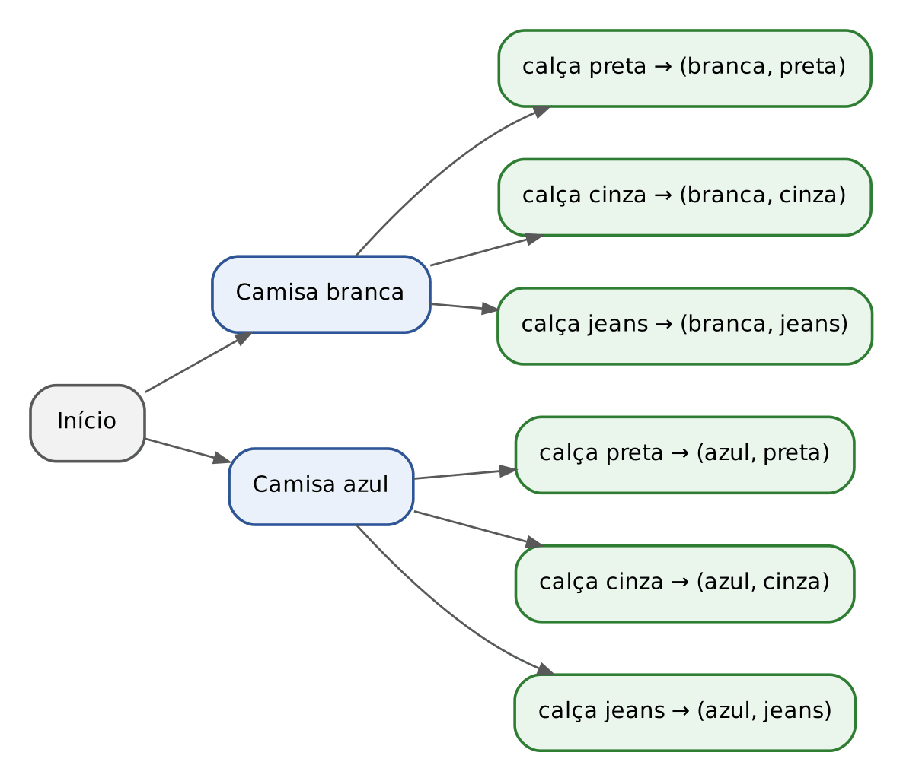

Conte as folhas: são 6. Repare POR QUE são 6: cada uma das 2 camisas se combina com cada uma das 3 calças, então temos 3 galhos de calça para a camisa branca e outros 3 para a azul, isto é, 3 + 3 = 2 × 3 = 6. Essa observação é o coração do capítulo, e vira regra na seção seguinte.

:::DICA A árvore é o seu "plano B" na prova
Quando você não souber qual fórmula usar, ou desconfiar da conta, desenhe a árvore (ou uma lista organizada) para um pedaço do problema. Ela nunca erra, só é lenta. Muitas questões da FGV e algumas da FCC têm respostas pequenas (4, 5, 8, 12) exatamente para premiar quem lista com método.
:::

## 11.2 O princípio fundamental da contagem

### 11.2.1 O princípio multiplicativo: "e" vira multiplicação

A ideia: se uma tarefa é feita em etapas sucessivas, e a primeira etapa pode ser feita de m maneiras, e, PARA CADA uma delas, a segunda pode ser feita de n maneiras, então as duas etapas juntas podem ser feitas de m × n maneiras. Com mais etapas, multiplica-se tudo.

Em linguagem de prova: quando o enunciado descreve escolhas que acontecem uma E outra E outra, multiplicamos o número de opções de cada escolha. É o chamado princípio fundamental da contagem (PFC), ou princípio multiplicativo.

O modo mais prático de usá-lo é o método das "casas" (ou "tracinhos"): desenhe um tracinho para cada etapa, escreva em cada tracinho quantas opções existem naquela etapa e multiplique.

:::EXEMPLO Trajes, senhas e placas
1) 4 camisas, 3 calças e 2 pares de sapatos. Etapas: camisa E calça E sapato.
- Trajes = 4 × 3 × 2
- Trajes = 12 × 2
- Trajes = 24
2) Senha de 4 dígitos, cada dígito de 0 a 9, PODENDO repetir (por exemplo, 0077). Cada casa tem 10 opções, porque o dígito usado antes continua disponível.
- Senhas = 10 × 10 × 10 × 10
- Senhas = 10⁴
- Senhas = 10.000
3) A mesma senha, mas com dígitos TODOS DIFERENTES. A primeira casa tem 10 opções; a segunda, 9 (não pode repetir o primeiro); a terceira, 8; a quarta, 7.
- Senhas = 10 × 9 × 8 × 7
- Senhas = 90 × 8 × 7
- Senhas = 720 × 7
- Senhas = 5.040
4) Placa no padrão Mercosul de carro (letra, letra, letra, número, letra, número, número), com 26 letras e 10 algarismos possíveis, admitindo repetição.
- Placas = 26 × 26 × 26 × 10 × 26 × 10 × 10
- Placas = 26⁴ × 10³
- Placas = 456.976 × 1.000
- Placas = 456.976.000
:::

Note a diferença entre os itens 2 e 3: COM repetição, o número de opções fica igual em todas as casas; SEM repetição, cai uma unidade a cada casa. Grande parte das questões gira em torno dessa distinção, e o enunciado sempre diz qual é o caso com palavras como "distintos", "diferentes", "sem repetir" ou, ao contrário, "podendo repetir".

#### Comece pela casa mais exigente

Algumas casas têm restrições próprias. O exemplo clássico: em um número de 3 algarismos, o primeiro algarismo NÃO pode ser 0 (o "número" 047 é, na verdade, o número de dois algarismos 47).

Regra de ouro: preencha PRIMEIRO a casa com restrição, depois as livres. Quantos números de 3 algarismos distintos existem?

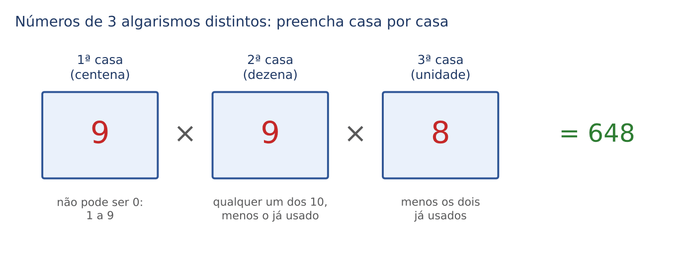

- Centena: 9 opções (de 1 a 9; o zero está proibido).
- Dezena: 9 opções. São 10 algarismos (0 a 9), menos o que já foi usado na centena. Atenção: o zero VOLTA a ser permitido aqui.
- Unidade: 8 opções (10 menos os dois já usados).
- Total = 9 × 9 × 8
- Total = 81 × 8
- Total = 648

:::PEGADINHA O zero e a ordem de preenchimento
Se você começar pela unidade sem pensar, cai em armadilha. Exemplo: números PARES de 3 algarismos distintos formados com 0, 1, 2, 3, 4 e 5. A unidade precisa ser par (0, 2 ou 4) e a centena não pode ser 0. As duas restrições se chocam: se a unidade for 0, a centena tem 5 opções; se a unidade for 2 ou 4, a centena tem só 4 (não pode 0 nem o algarismo da unidade). Quando as restrições se chocam, separe em CASOS (ver 11.2.2). A resposta é 52 (resolvida no PRATIQUE desta seção).
:::

:::QUESTAO FGV 2024 — prova não identificada no banco (Q2566521)
Problema: com os algarismos 0, 1, 2, 3, 4 e 5, quantos números de 3 algarismos podem ser formados? Gabarito oficial: D (180).
Resolução. O enunciado NÃO pede algarismos distintos; logo, pode repetir (por exemplo, 255 ou 500).
- Centena: 5 opções (1, 2, 3, 4 ou 5; o zero na frente não forma número de 3 algarismos).
- Dezena: 6 opções (qualquer um dos seis, inclusive repetido).
- Unidade: 6 opções.
- Total = 5 × 6 × 6
- Total = 5 × 36
- Total = 180
Por que as outras atraem: 216 = 6 × 6 × 6 (esqueceu que o zero não pode iniciar o número); 120 = 6 × 5 × 4 (tratou como algarismos distintos E deixou o zero na frente); 100 = 5 × 5 × 4 seria a resposta com algarismos distintos, que não está entre as opções, sinal de que a banca queria a repetição permitida.
:::

:::QUESTAO FGV 2025 — prova não identificada no banco (Q3238404)
Problema: palíndromo (ou capicua) é o número que se lê igual de trás para a frente, como 8778 ou 108801. Quantos palíndromos de 6 algarismos existem? Gabarito oficial: B (900).
Resolução. Um palíndromo de 6 algarismos tem a forma a b c c b a: os três últimos algarismos são a cópia, invertida, dos três primeiros. Então só escolhemos livremente os três primeiros; os outros três ficam determinados (1 opção cada).
- 1º algarismo (a): 9 opções (de 1 a 9; não pode ser 0).
- 2º algarismo (b): 10 opções (de 0 a 9, pode repetir).
- 3º algarismo (c): 10 opções.
- 4º, 5º e 6º: 1 opção cada (são cópias).
- Total = 9 × 10 × 10 × 1 × 1 × 1
- Total = 900
As alternativas grandes (8.100, 18.000, 180.000) atraem quem escolhe livremente mais de três algarismos. A chave é perceber que metade do número é "cópia" da outra metade.
:::

:::QUESTAO FCC 2024 — TRT 7ª Região — Analista Judiciário, Arquitetura (Q3481524)
Problema: quantos números ímpares, com todos os algarismos distintos, são maiores que 100 e menores que 300? Gabarito oficial: E (72).
Resolução. Os números estão entre 101 e 299; logo, têm 3 algarismos e a centena é 1 ou 2. A unidade deve ser ímpar (1, 3, 5, 7 ou 9). A centena e a unidade "conversam" entre si (se a centena for 1, a unidade não pode ser 1), então separamos em dois casos.
Caso 1: centena = 1.
- Unidade: ímpar e diferente de 1, ou seja, 3, 5, 7 ou 9: 4 opções.
- Dezena: 10 algarismos menos os 2 já usados: 8 opções.
- Subtotal = 1 × 8 × 4 = 32
Caso 2: centena = 2.
- Unidade: qualquer ímpar (1, 3, 5, 7, 9): 5 opções (o 2 é par, não há conflito).
- Dezena: 8 opções.
- Subtotal = 1 × 8 × 5 = 40
Total = 32 + 40 = 72.
Note que preenchemos a dezena (casa livre) por último, embora ela esteja no meio do número: a ordem de preenchimento é a ordem das restrições, não a ordem de leitura. A alternativa 32 corresponde a quem só fez o caso 1; 56 e 82 aparecem quando se erra o número de opções da dezena.
:::

:::QUESTAO FCC 2024 — TRT 7ª Região — Analista Judiciário, Área Administrativa (Q3089761)
Problema: quantos números entre 99 e 1000 (isto é, de 3 algarismos) têm todos os algarismos distintos e o algarismo das unidades igual à soma dos outros dois? Gabarito oficial: D (32).
Resolução. Chame os algarismos de centena a, dezena b e unidade c, com c = a + b. Como c é um algarismo, a + b não pode passar de 9.
Passo 1: a dezena não pode ser 0. Se b = 0, então c = a + 0 = a, e a unidade repetiria a centena (algarismos não seriam distintos).
Passo 2: então a vai de 1 a 8 e b vai de 1 a 9, com a + b ≤ 9. Conte, para cada a, quantos b servem:
- a = 1: b de 1 a 8 → 8 opções
- a = 2: b de 1 a 7 → 7
- a = 3: 6; a = 4: 5; a = 5: 4; a = 6: 3; a = 7: 2; a = 8: 1
- Soma = 8 + 7 + 6 + 5 + 4 + 3 + 2 + 1 = 36
Passo 3: retire os casos em que a = b (algarismos repetidos): a = b = 1 (número 112), 2 (224), 3 (336) e 4 (448). São 4 casos.
- Total = 36 − 4 = 32
Passo 4: confirme que c nunca repete a ou b: como a e b valem pelo menos 1, c = a + b é maior que cada um deles.
O valor 36 (não oferecido) é o resultado de quem esquece o passo 3; as alternativas 48 e 64 surgem de contagens descuidadas que admitem a dezena 0 ou repetições. Em questões assim, a tabela "para cada a, quantos b" é mais segura que qualquer fórmula.
:::

### 11.2.2 O princípio aditivo: "ou" de casos separados vira soma

A ideia: se uma escolha pode ser feita OU de um jeito (com m opções) OU de outro jeito (com n opções), e os dois jeitos não se sobrepõem (nenhuma opção está nos dois grupos), o total de opções é m + n.

Exemplo do cotidiano: no restaurante do fórum, o prato do dia é uma massa (3 opções) OU uma carne (4 opções), e você escolhe UM prato. Total = 3 + 4 = 7 escolhas. Compare: se você escolhesse uma massa E uma carne, seriam 3 × 4 = 12 combinações.

Na prática da prova, o princípio aditivo aparece quando separamos o problema em CASOS, como fizemos no Q3481524: cada caso é contado com o princípio multiplicativo, e os casos são somados. Regra de bolso:

- "E" (etapas que acontecem juntas): MULTIPLICA.
- "OU" (situações que se excluem): SOMA.

:::QUESTAO FGV 2025 — prova não identificada no banco (Q3171956)
Problema: um perito tem 4 amostras de itens distintos: 5 fibras de tecido, 3 fios de cabelo, 2 fragmentos de vidro e 1 porção de solo. Deve escolher 3 itens, cada um de uma amostra diferente. Quantos trios diferentes são possíveis? Gabarito oficial: C (61).
Resolução. Primeiro decidimos QUAIS 3 amostras participam (isso é "ou": um caso exclui o outro); dentro de cada caso, escolhemos um item de cada amostra ("e": multiplica).
- Fibra, cabelo e vidro: 5 × 3 × 2 = 30
- Fibra, cabelo e solo: 5 × 3 × 1 = 15
- Fibra, vidro e solo: 5 × 2 × 1 = 10
- Cabelo, vidro e solo: 3 × 2 × 1 = 6
- Total = 30 + 15 + 10 + 6 = 61
Repare como as alternativas são vizinhas (59 a 63): a banca pune quem esquece um caso ou erra uma multiplicação. Listar os casos em ordem fixa (deixando de fora, a cada vez, uma amostra diferente) garante que nenhum fique para trás.
:::

### 11.2.3 O truque do complementar: conte o que NÃO serve e subtraia

A ideia: às vezes é muito mais fácil contar os casos RUINS do que os bons. Aí, contamos o total sem restrição e subtraímos os casos ruins:

- Casos bons = Total − Casos ruins

Sinais no enunciado de que o complementar ajuda: "pelo menos um", "não podem ficar juntos", "nem todos", "ao menos um par".

:::EXEMPLO Senhas com pelo menos um dígito repetido
Quantas senhas de 4 dígitos (0 a 9) têm PELO MENOS um dígito repetido?
Contar diretamente seria um pesadelo (um par repetido, dois pares, três iguais, quatro iguais...). Pelo complementar:
- Total (pode repetir) = 10⁴ = 10.000 (ver 11.2.1)
- Ruins = sem nenhuma repetição = 10 × 9 × 8 × 7 = 5.040
- Bons = 10.000 − 5.040
- Bons = 4.960
:::

:::QUESTAO FGV 2026 — Prefeitura de Salvador — Coordenador Pedagógico (Q4350640)
Problema: códigos de 3 algarismos distintos escolhidos em {1, 2, 3, 4, 5}; o código só é válido se o produto dos três algarismos for PAR. Quantos códigos válidos existem? Gabarito oficial: E (54).
Resolução. Um produto de inteiros é par quando pelo menos um fator é par (basta um 2 ou um 4 na multiplicação). O caso ruim é o produto ímpar: todos os três algarismos ímpares.
Passo 1: total de códigos com 3 algarismos distintos escolhidos entre 5:
- Total = 5 × 4 × 3 = 60
Passo 2: códigos ruins (só ímpares). Os ímpares disponíveis são 1, 3 e 5 (três algarismos) e o código usa os três, em alguma ordem:
- Ruins = 3 × 2 × 1 = 6
Passo 3: válidos = 60 − 6 = 54.
A alternativa 6 é exatamente o número de ruins (quem resolveu a pergunta ao contrário). 27 aparece quando se divide por 2 achando que "metade é par".
:::

:::QUESTAO FGV 2026 — ALERJ — Especialista Legislativo, Administração Geral (Q3879463)
Problema: agendar um treinamento escolhendo um dia (segunda, quarta ou sexta), um turno (manhã ou tarde) e um instrutor (Ana, Bruno ou Cléa). Bruno não pode às sextas; Cléa não pode pela manhã. De quantas maneiras se pode agendar? Gabarito oficial: B (13).
Resolução pelo complementar.
Passo 1: total sem restrições = 3 dias × 2 turnos × 3 instrutores = 18.
Passo 2: casos proibidos por causa de Bruno: Bruno na sexta, em qualquer turno = 1 × 2 × 1 = 2.
Passo 3: casos proibidos por causa de Cléa: Cléa pela manhã, em qualquer dia = 3 × 1 × 1 = 3.
Passo 4: verifique se algum caso foi proibido duas vezes. Para isso, o mesmo agendamento teria de ter Bruno E Cléa como instrutor, o que é impossível. Então não há sobreposição.
Passo 5: válidos = 18 − 2 − 3 = 13.
Conferência direta: Ana pode em todos os 6 horários; Bruno em 4 (segunda e quarta, manhã e tarde); Cléa em 3 (as três tardes). Total = 6 + 4 + 3 = 13. A alternativa 12 nasce de tirar 6 casos (2 × 3) em vez de 2 + 3; 15 e 16, de descontar só uma das restrições.
:::

#### Quando os casos ruins se sobrepõem: inclusão e exclusão

No Q3879463 não havia sobreposição. Quando há, cuidado: se você soma dois grupos que têm elementos em comum, conta esses elementos duas vezes. A correção é:

- n(A ou B) = n(A) + n(B) − n(A e B)

Em palavras: some os dois grupos e tire uma vez a parte comum, que foi contada em dobro. É a mesma ideia do diagrama de Venn (Cap. 21). Ela será aplicada no Q3406128 (11.4), depois que soubermos contar filas.

:::PRATIQUE exercícios elaborados para esta apostila
1) Quantos números de 4 algarismos distintos existem?
2) Quantos números pares de 3 algarismos distintos podem ser formados com 0, 1, 2, 3, 4 e 5?
3) Um sistema exige senha de 2 letras (26 opções cada, podendo repetir) seguidas de 2 dígitos (10 opções cada, podendo repetir). Quantas senhas existem?
4) (estilo FCC) Quantos números de 3 algarismos, maiores que 400, têm algarismos distintos e terminam em 5?
Resoluções:
1) Primeira casa: 9 (de 1 a 9). Segunda: 9 (o zero volta, menos o já usado). Terceira: 8. Quarta: 7.
- Total = 9 × 9 × 8 × 7
- Total = 81 × 56
- Total = 4.536
2) A unidade precisa ser par (0, 2 ou 4), e a centena não pode ser 0. Separe em casos.
Caso A, unidade 0: centena tem 5 opções (1 a 5); dezena tem 4 (6 algarismos menos os 2 usados). Subtotal = 5 × 4 = 20.
Caso B, unidade 2 ou 4 (2 opções): centena tem 4 opções (não pode 0 nem o algarismo da unidade); dezena tem 4 (6 menos os 2 usados). Subtotal = 2 × 4 × 4 = 32.
- Total = 20 + 32 = 52
3) Total = 26 × 26 × 10 × 10 = 676 × 100 = 67.600.
4) Comece pelas casas com restrição.
- Unidade: fixada em 5 (1 opção).
- Centena: para o número passar de 400, a centena pode ser 4, 5, 6, 7, 8 ou 9. Atenção ao 4: 405, 415, 465 são maiores que 400, então a centena 4 SERVE. O 5 sai, porque já está na unidade. Sobram 4, 6, 7, 8 e 9: 5 opções.
- Dezena: 10 algarismos menos os 2 usados: 8 opções.
- Total = 5 × 8 × 1 = 40
A armadilha do item 4 é descartar a centena 4 por impulso e responder 4 × 8 = 32. A FCC adora limites como "maior que 400".
:::

## 11.3 Fatorial: a ferramenta de cálculo do capítulo

Quando contamos filas de pessoas todas diferentes, o método das casas produz sempre o mesmo padrão: n × (n − 1) × (n − 2) × ... × 1. Por exemplo, 5 pessoas em fila: 5 × 4 × 3 × 2 × 1. Esse produto aparece tanto que ganhou nome e símbolo: FATORIAL, indicado por um ponto de exclamação.

- n! = n × (n − 1) × (n − 2) × ... × 2 × 1 (lê-se "n fatorial")

Em que n é um número inteiro positivo. Por convenção, 0! = 1 (aceite como regra; ela faz as fórmulas funcionarem nos casos-limite, como "escolher 0 itens de um grupo", que pode ser feito de 1 única maneira: não escolhendo nada).

:::ESQUEMA Tabela dos fatoriais que vale a pena saber de cor
| n | n! | como obter do anterior |
|---|---|---|
| 0 | 1 | convenção |
| 1 | 1 | 1 × 0! |
| 2 | 2 | 2 × 1! |
| 3 | 6 | 3 × 2! |
| 4 | 24 | 4 × 3! |
| 5 | 120 | 5 × 4! |
| 6 | 720 | 6 × 5! |
| 7 | 5.040 | 7 × 6! |
| 8 | 40.320 | 8 × 7! |
| 9 | 362.880 | 9 × 8! |
| 10 | 3.628.800 | 10 × 9! |
:::

A última coluna mostra a propriedade mais útil: n! = n × (n − 1)!. Por exemplo, 7! = 7 × 6! = 7 × 720 = 5.040. E também podemos "parar" o fatorial no meio: 10! = 10 × 9 × 8!.

#### Simplificar antes de calcular

Na prova sem calculadora, NUNCA calcule fatoriais grandes por inteiro quando houver divisão. Abra o fatorial maior até chegar ao menor e corte.

:::EXEMPLO Divisões de fatoriais
1) 10! ÷ 8!
- 10! = 10 × 9 × 8!
- 10! ÷ 8! = (10 × 9 × 8!) ÷ 8!
- Corta-se 8! em cima e embaixo: = 10 × 9
- = 90
2) 7! ÷ (3! × 4!)
- Abra o 7! até o 4!: 7! = 7 × 6 × 5 × 4!
- Corte o 4!: = (7 × 6 × 5) ÷ 3!
- 3! = 6, então = (7 × 6 × 5) ÷ 6
- Corte o 6: = 7 × 5
- = 35
:::

:::PEGADINHA Fatorial não se distribui
(2 × 3)! NÃO é 2! × 3!. Veja: (2 × 3)! = 6! = 720, enquanto 2! × 3! = 2 × 6 = 12. Também (5 − 2)! = 3! = 6, que é diferente de 5! − 2! = 120 − 2 = 118. Sempre faça primeiro a conta dentro dos parênteses e só depois o fatorial.
:::

## 11.4 Permutações simples: filas com todos os elementos

### 11.4.1 A ideia e a fórmula

Permutar é trocar de lugar. Uma permutação simples é cada um dos modos de ORDENAR todos os n elementos de um conjunto, todos diferentes entre si: pessoas numa fila, processos numa pauta, livros numa prateleira, letras distintas de uma palavra.

Exemplo à mão: de quantas maneiras 3 processos (A, B, C) podem ser ordenados na pauta? Listando: ABC, ACB, BAC, BCA, CAB, CBA. São 6.

Pelo método das casas: o 1º lugar tem 3 candidatos; escolhido o primeiro, o 2º lugar tem 2; o 3º lugar fica com o último, 1 opção. Total = 3 × 2 × 1 = 6 = 3!.

- Pₙ = n!

Em que:
- Pₙ = número de permutações (ordenações) de n elementos distintos;
- n = quantidade de elementos, todos diferentes, todos usados.

Assim, 5 processos na pauta: P₅ = 5! = 120 ordens possíveis. Os anagramas da palavra ROMA (todas as letras diferentes) são P₄ = 4! = 24. "Anagrama" é qualquer reordenação das letras, tenha ou não sentido (AMOR, MORA, RAMO e também OARM).

### 11.4.2 Permutações com restrições: as quatro técnicas

As questões quase nunca pedem só n!. Elas impõem condições. Há quatro técnicas que resolvem praticamente todas:

- FIXAR: alguém tem lugar certo. Coloque-o lá primeiro e permute só os demais.
- BLOCO: alguns devem ficar JUNTOS. Amarre-os num bloco, permute o bloco com os demais e, depois, permute os de dentro do bloco.
- SEPARADOS: alguns NÃO podem ficar juntos. Faça Total − Juntos (complementar) ou use as lacunas.
- ANTES/DEPOIS: A deve vir antes de B. Por simetria, em exatamente metade das filas A está antes de B: Total ÷ 2.

#### Técnica do bloco

Seis livros devem ficar na prateleira com três deles (A, B, C) sempre juntos. Amarre A, B e C com um elástico: o "pacote" vira um único objeto.

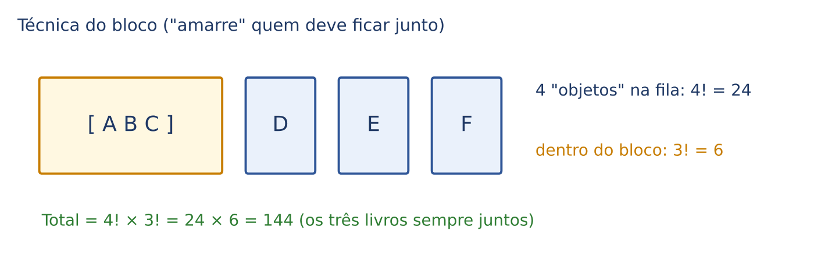

- Objetos a ordenar: o bloco [ABC], D, E e F, ou seja, 4 objetos: 4! = 24 ordens.
- Dentro do bloco, A, B e C podem estar em qualquer ordem (ABC, ACB, BAC...): 3! = 6.
- Total = 24 × 6 = 144 (princípio multiplicativo: ordenar os objetos E ordenar o interior do bloco).

#### Técnica das lacunas (ninguém lado a lado)

Quando várias pessoas não podem ficar vizinhas, primeiro posicione os "outros" (ou as cadeiras vazias) e depois coloque as pessoas restritas nos VÃOS entre eles, uma por vão. Veja a figura, que resolve o Q3049039 adiante.

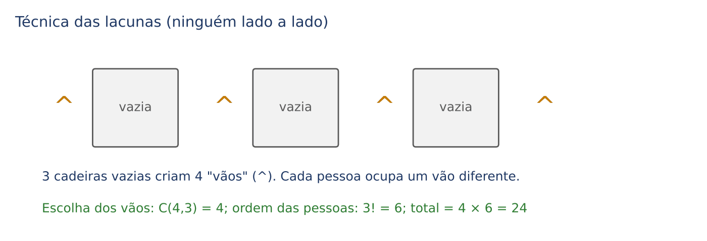

#### Antes e depois: a simetria

De quantas maneiras 5 processos podem ser ordenados com o processo A julgado antes do processo B? Para cada fila em que A vem antes de B, existe uma fila "gêmea" (troque A e B de lugar) em que B vem antes de A. As filas se dividem em pares; metade de cada tipo.

- Total = 5! ÷ 2
- Total = 120 ÷ 2
- Total = 60

:::QUESTAO FCC 2026 — prova não identificada no banco (Q3976702)
Problema: Ana, Bernardo, Carla, Diego e Ema vão posar em fila para uma foto. Ana e Carla ficam nos extremos e Ema exatamente no centro. Quantas fotos distintas são possíveis? Gabarito oficial: A (4).
Resolução pela técnica de FIXAR. Posições: 1, 2, 3, 4, 5.
Passo 1: extremos (posições 1 e 5) para Ana e Carla. Ana pode estar na 1 e Carla na 5, ou o contrário: 2 maneiras.
Passo 2: centro (posição 3): Ema, 1 maneira.
Passo 3: sobram as posições 2 e 4 para Bernardo e Diego: 2! = 2 maneiras.
- Total = 2 × 1 × 2 = 4
Alternativas sedutoras: 2 (esqueceu que Ana e Carla podem trocar de extremo, ou que Bernardo e Diego podem trocar); 8 e 16 (multiplicou por fatores a mais).
:::

:::QUESTAO FCC 2026 — prova não identificada no banco (Q3872151)
Problema: quatro irmãos (Ana, Bete e os gêmeos Daniel e Diego, que usam roupas distintas, portanto são distinguíveis na foto) sentam-se em fila; os gêmeos querem ficar lado a lado. De quantas maneiras? Gabarito oficial: E (12).
Resolução pela técnica do BLOCO.
Passo 1: amarre os gêmeos: [Daniel-Diego]. Objetos: o bloco, Ana e Bete = 3 objetos. Ordens: 3! = 6.
Passo 2: dentro do bloco, Daniel à esquerda ou Diego à esquerda: 2! = 2.
- Total = 6 × 2 = 12
A observação "usam roupas distintas" existe justamente para dizer que trocar Daniel e Diego produz foto diferente (por isso o × 2). Quem esquece o interior do bloco marca 6 (que não está entre as opções); 24 seria o total sem restrição (4!).
:::

:::QUESTAO FCC 2024 — SEPLAN-PI — Analista Governamental, Infraestrutura (Q3549547)
Problema: seis livros devem ser arrumados numa prateleira com três deles sempre juntos. Quantas arrumações são possíveis? Gabarito oficial: E (144).
Resolução: é exatamente o exemplo da figura do bloco. Bloco + 3 livros soltos = 4 objetos: 4! = 24. Interior do bloco: 3! = 6. Total = 24 × 6 = 144.
Alternativas: 120 = 5! (confusão no número de objetos); 72 = metade de 144 (erro no interior do bloco); 720 = 6! (sem restrição) não foi oferecida, mas é o primeiro número a calcular se você quiser conferir que a resposta precisa ser menor que ele.
:::

:::QUESTAO FGV 2024 — prova não identificada no banco (Q2375658)
Problema: quantos anagramas da sigla DNIT têm as letras D e T separadas (não juntas)? Gabarito oficial: C (12).
Resolução pelo complementar.
Passo 1: total de anagramas de 4 letras distintas: 4! = 24.
Passo 2: anagramas com D e T juntas (bloco): objetos [DT], N, I = 3 objetos: 3! = 6; interior do bloco: 2 (DT ou TD). Juntas = 6 × 2 = 12.
Passo 3: separadas = 24 − 12 = 12.
Curiosidade útil: em 4 posições em fila, há 3 pares de posições vizinhas (1-2, 2-3, 3-4) e 6 pares no total; por isso juntas e separadas deram metade cada. Isso NÃO vale em geral: com mais letras, "separadas" é a maioria.
:::

:::QUESTAO FGV 2025 — SEPLAN-SE — Especialista em Políticas Públicas e Gestão Governamental (Q3406128)
Problema: seis pessoas de idades diferentes formam fila. Em quantas filas a mais nova é a primeira OU a mais velha é a última? Gabarito oficial: A (216).
Resolução pela inclusão e exclusão (11.2.3).
Passo 1: filas com a mais nova em primeiro: fixe-a, permute as outras 5: 5! = 120.
Passo 2: filas com a mais velha em último: também 5! = 120.
Passo 3: filas com as duas coisas ao mesmo tempo (contadas duas vezes nos passos 1 e 2): fixe as duas e permute as 4 restantes: 4! = 24.
- Resposta = 120 + 120 − 24
- Resposta = 240 − 24
- Resposta = 216
A alternativa 240 é a armadilha clássica: somar os dois grupos sem descontar a interseção.
:::

:::QUESTAO FGV 2024 — prova não identificada no banco (Q3049039)
Problema: uma fileira tem 6 cadeiras; Ana, Bia e Caio vão ocupar 3 delas sem que duas dessas pessoas fiquem em cadeiras adjacentes. De quantas formas isso pode ser feito? Gabarito oficial: D (24).
Resolução pela técnica das lacunas (figura acima).
Passo 1: imagine primeiro as 3 cadeiras que ficarão vazias, em fila. Entre elas e nas pontas há 4 vãos: _ V _ V _ V _.
Passo 2: cada pessoa ocupa um vão diferente; assim, entre duas pessoas sempre haverá ao menos uma cadeira vazia. Escolher 3 dos 4 vãos: os grupos possíveis são {1,2,3}, {1,2,4}, {1,3,4} e {2,3,4}, ou seja, 4 escolhas (em 11.8 isso será C(4,3)).
Passo 3: em cada escolha, as 3 pessoas podem ser distribuídas de 3! = 6 maneiras.
- Total = 4 × 6 = 24
Conferência por lista das posições ocupadas (cadeiras de 1 a 6): {1,3,5}, {1,3,6}, {1,4,6}, {2,4,6}. São 4 conjuntos, cada um com 6 ordens. A alternativa 4 esquece que as pessoas são distintas.
:::

:::PRATIQUE exercícios elaborados para esta apostila
1) Quantos anagramas tem a palavra PROVA? Quantos começam por vogal?
2) Quantos anagramas de PROVA têm P e R juntas? E separadas?
3) (estilo FCC) Sete processos serão pautados em sequência; o processo X deve ser julgado antes do processo Y (não necessariamente imediatamente antes). Quantas pautas são possíveis?
Resoluções:
1) Cinco letras distintas: 5! = 120. Começando por vogal: a 1ª casa recebe O ou A (2 opções); as 4 letras restantes se permutam: 4! = 24. Total = 2 × 24 = 48.
2) Juntas: bloco [PR] + O, V, A = 4 objetos: 4! = 24; interior: 2. Juntas = 24 × 2 = 48. Separadas = 120 − 48 = 72.
3) Total sem restrição: 7! = 5.040. Por simetria, metade tem X antes de Y: 5.040 ÷ 2 = 2.520.
:::

## 11.5 Permutações com repetição: anagramas com letras iguais

### 11.5.1 A ideia: o excesso que precisa ser descontado

Quantos anagramas tem a palavra ARARA? Se as letras fossem todas diferentes (A₁, R₁, A₂, R₂, A₃), seriam 5! = 120. Mas os três A são iguais: trocar A₁ com A₂ não muda a palavra. Cada anagrama "verdadeiro" foi contado várias vezes.

Quantas vezes? Os 3 A podem ser trocados entre si de 3! = 6 modos, e os 2 R de 2! = 2 modos, sem que a palavra mude. Então cada anagrama verdadeiro apareceu 6 × 2 = 12 vezes na contagem de 120.

- Anagramas de ARARA = 120 ÷ 12 = 10

Confira listando: AAARR, AARAR, AARRA, ARAAR, ARARA, ARRAA, RAAAR, RAARA, RARAA, RRAAA. São 10.

### 11.5.2 A fórmula

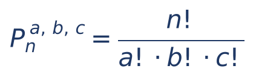

Em que:
- n = número total de elementos (letras, pastas, objetos);
- a, b, c = quantas vezes cada elemento repetido aparece (um fatorial no denominador para cada grupo de iguais; elementos que aparecem uma só vez dariam 1! = 1 e podem ser omitidos);
- o numerador conta como se tudo fosse diferente; o denominador desconta as trocas entre iguais.

:::EXEMPLO BANANA e CASCA
1) BANANA: 6 letras; A aparece 3 vezes; N, 2 vezes; B, 1 vez.
- Anagramas = 6! ÷ (3! × 2!)
- = 720 ÷ (6 × 2)
- = 720 ÷ 12
- = 60
2) CASCA: 5 letras; C 2 vezes; A 2 vezes; S 1 vez.
- Anagramas = 5! ÷ (2! × 2!)
- = 120 ÷ 4
- = 30
:::

### 11.5.3 O mesmo raciocínio para distribuir objetos em grupos com nome

Uma aplicação que a FCC usou na SEFAZ-CE em 2026: distribuir objetos DISTINTOS em grupos com "nome" (auditor André, quarto 1, equipe X) de tamanhos fixados. O truque é transformar a distribuição numa palavra: escreva os objetos em fila (processo 1, processo 2...) e, embaixo de cada um, a letra do grupo que o recebe. Cada distribuição corresponde a uma "palavra" com as letras dos grupos, e vice-versa.

Exemplo: 7 processos para André (3), Bruno (2) e Carlos (2). Uma distribuição é, por exemplo, AABCACB (processo 1 para André, processo 2 para André, processo 3 para Bruno...). Contar distribuições = contar anagramas de AAABBCC.

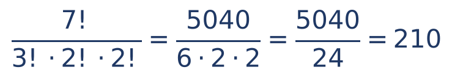

A conta passo a passo: 7! = 5.040; 3! × 2! × 2! = 6 × 2 × 2 = 24; 5.040 ÷ 24 = 210. O mesmo resultado sai por combinações (11.8): escolher os 3 de André entre 7, depois os 2 de Bruno entre os 4 que sobraram (Carlos fica com o resto).

:::QUESTAO FCC 2026 — SEFAZ-CE — Auditor Fiscal da Receita Estadual, Conhecimentos Gerais (Q4221364)
Problema: sete processos de auditoria serão distribuídos entre André (3 processos), Bruno (2) e Carlos (2). De quantas maneiras distintas? Gabarito oficial: B (210).
Resolução: é o exemplo acima. Anagramas de AAABBCC = 7! ÷ (3! × 2! × 2!) = 5.040 ÷ 24 = 210.
Por que as outras atraem:
- 35: só escolheu os 3 processos de André (C(7,3) = 35, ver 11.8) e esqueceu de distribuir os 4 restantes entre Bruno e Carlos.
- 105: dividiu 210 por 2, como se Bruno e Carlos fossem "iguais". Não são: o grupo de Bruno e o de Carlos têm dono, então trocar os lotes deles gera distribuição nova.
- 70 e 140: combinações truncadas no meio.
Esta questão é da prova irmã mais próxima da sua (Auditor estadual, FCC, 2026). Guarde o modelo.
:::

:::QUESTAO FGV 2025 — SEFAZ-PR — Auditor Fiscal (Q3363345)
Problema: sete amigos (A a G) reservaram três quartos diferentes: um para 3 pessoas e dois para 2 pessoas cada. Quantas distribuições distintas são possíveis? Gabarito oficial: D (210).
Resolução. Os quartos são diferentes (têm número), logo funcionam como grupos com nome, exatamente como André, Bruno e Carlos: 7! ÷ (3! × 2! × 2!) = 210.
Se os dois quartos duplos fossem considerados iguais (sem identificação), teríamos de dividir por 2! e a resposta seria 105, que é a alternativa sedutora. O enunciado diz "quartos diferentes": não divida.
:::

:::QUESTAO FGV 2024 — prova não identificada no banco (Q3043777)
Problema: de um grupo de 10 pessoas (entre elas Paulo e Selma), serão formadas 3 equipes, com 5, 3 e 2 pessoas. Quantas repartições distintas são possíveis? Gabarito oficial: C (2.520).
Resolução. As equipes têm tamanhos diferentes, então cada uma é identificável pelo tamanho (não há como confundir a equipe de 5 com a de 3). Use a fórmula:
- Total = 10! ÷ (5! × 3! × 2!)
- Abra 10! até 5!: 10! = 10 × 9 × 8 × 7 × 6 × 5!
- Corte 5!: = (10 × 9 × 8 × 7 × 6) ÷ (3! × 2!)
- Numerador: 10 × 9 = 90; 90 × 8 = 720; 720 × 7 = 5.040; 5.040 × 6 = 30.240
- Denominador: 6 × 2 = 12
- = 30.240 ÷ 12 = 2.520
Os nomes Paulo e Selma não interferem na conta: são um "ruído" do enunciado (talvez remanescente de outro item da mesma prova). Ignorar dados inúteis também é habilidade de prova.
:::

### 11.5.4 Repetição combinada com restrições

As técnicas do bloco, do complementar e das lacunas continuam valendo quando há letras repetidas; só que agora cada contagem usa a fórmula com fatoriais no denominador.

:::QUESTAO FGV 2025 — prova não identificada no banco (Q3776557)
Problema: com as 5 letras da sigla ALEAM, quantas sequências podem ser escritas com L e M separadas? Gabarito oficial: E (36).
Resolução pelo complementar.
Passo 1: total. São 5 letras com A repetido 2 vezes: 5! ÷ 2! = 120 ÷ 2 = 60.
Passo 2: L e M juntas. Bloco [LM] + A, E, A = 4 objetos, com A repetido 2 vezes: 4! ÷ 2! = 24 ÷ 2 = 12. Interior do bloco (LM ou ML): × 2. Juntas = 12 × 2 = 24.
Passo 3: separadas = 60 − 24 = 36.
Alternativas: 24 é o número de juntas; 32 e 20 vêm de esquecer o 2! do A repetido em um dos passos.
:::

:::QUESTAO FGV 2025 — prova não identificada no banco (Q3578666)
Problema: em 6 quadradinhos em linha serão colocadas quatro letras A e duas letras B, uma por quadradinho, sem que as duas letras B fiquem juntas. Quantas disposições? Gabarito oficial: E (10).
Observação: a figura não consta do banco; adotamos os 6 quadradinhos em fila, que é a leitura compatível com o gabarito.
Resolução.
- Total: 6! ÷ (4! × 2!) = 720 ÷ (24 × 2) = 720 ÷ 48 = 15.
- B juntas: bloco [BB] + 4 letras A = 5 objetos, com A repetido 4 vezes: 5! ÷ 4! = 5. (O bloco BB não tem "interior" a permutar, porque as duas letras são iguais.)
- Separadas = 15 − 5 = 10.
Alternativa 15: o total, sem a restrição.
:::

:::QUESTAO FGV 2026 — AL-RO — Analista Legislativo, Matemática (Q3884933)
Problema: um técnico enfileira 7 pastas: 3 vermelhas, 2 amarelas e 2 verdes; pastas da mesma cor são indistinguíveis; as duas verdes não podem ficar adjacentes. Quantas fileiras? Gabarito oficial: C (150).
Resolução 1 (complementar).
- Total: 7! ÷ (3! × 2! × 2!) = 5.040 ÷ 24 = 210.
- Verdes juntas: bloco [VV] + 3 vermelhas + 2 amarelas = 6 objetos: 6! ÷ (3! × 2!) = 720 ÷ 12 = 60.
- Separadas = 210 − 60 = 150.
Resolução 2 (lacunas), para conferir: enfileire primeiro as 5 pastas não verdes: 5! ÷ (3! × 2!) = 120 ÷ 12 = 10 fileiras. Elas criam 6 vãos (4 entre elas e 2 nas pontas). Coloque cada verde num vão diferente: escolher 2 vãos entre 6 = 15 modos (como as verdes são iguais, a ordem entre elas não importa; ver 11.8). Total = 10 × 15 = 150.
Alternativas: 210 (ignorou a regra), 60 (respondeu as juntas), 420 (esqueceu um 2! no denominador).
:::

## 11.6 Permutações circulares: a mesa redonda

### 11.6.1 A ideia

Cinco desembargadores vão se sentar a uma mesa redonda. Numa FILA, há 5! = 120 ordens. Numa RODA, porém, o que importa é quem está à direita e à esquerda de quem: se todos se levantarem e andarem uma cadeira no sentido horário, a disposição é "a mesma", porque cada um continua com os mesmos vizinhos.

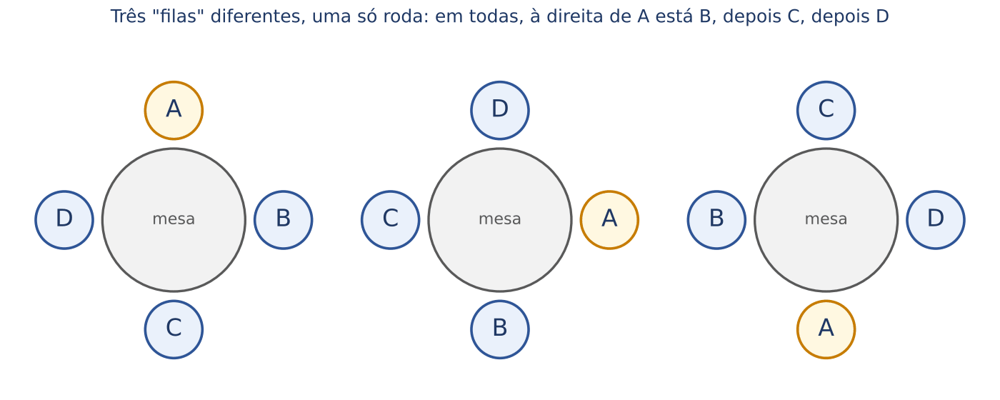

Na figura, as três "filas" lidas a partir do topo (ABCD, DABC, CDAB) são uma única roda. Com 4 pessoas, cada roda corresponde a 4 filas (uma para cada pessoa que poderia estar no topo). Por isso:

- Rodas com 4 pessoas = 4! ÷ 4 = 24 ÷ 4 = 6 = 3!

O jeito mais intuitivo de chegar à fórmula: FIXE uma pessoa numa cadeira qualquer (ela serve de referência, e assim as rotações deixam de contar). As outras n − 1 pessoas se permutam livremente nas cadeiras restantes:

- PCₙ = (n − 1)!

Em que PCₙ = número de permutações circulares de n elementos distintos. Para os 5 desembargadores: PC₅ = 4! = 24.

:::ATENCAO Quando a roda NÃO é circular de verdade
A fórmula (n − 1)! vale quando só importam as posições RELATIVAS (quem está ao lado de quem). Se as cadeiras forem numeradas ou distinguíveis (cadeira da presidência, cabeceira, janela), a mesa volta a funcionar como fila: n!. E, em colares e chaveiros que podem ser virados do avesso, a roda e sua imagem no espelho são a mesma peça, e divide-se ainda por 2: (n − 1)! ÷ 2. Leia o enunciado procurando a frase que define "disposição diferente".
:::

:::EXEMPLO Roda com bloco
Seis pessoas em mesa redonda, com A e B sempre juntos. Amarre A e B: são 5 objetos na roda: PC₅ = 4! = 24. Interior do bloco (A à direita de B ou à esquerda): × 2. Total = 24 × 2 = 48.
:::

:::QUESTAO FGV 2025 — prova não identificada no banco (Q3362145)
Problema: mesa circular com 6 cadeiras iguais; pai, mãe e dois filhos ocupam 4 cadeiras, 2 ficam vazias; pai e mãe não podem ficar em cadeiras vizinhas. Disposições são diferentes se pelo menos dois membros estiverem em posições relativas diferentes. Quantas disposições? Gabarito oficial: D (36).
Resolução. "Posições relativas" e "cadeiras iguais" indicam que rotações não contam: fixe o pai numa cadeira, como referência.
Passo 1: a mãe. Das 5 cadeiras restantes, 2 são vizinhas do pai e estão proibidas. Sobram 3 opções.
Passo 2: o 1º filho escolhe entre as 4 cadeiras ainda livres: 4 opções.
Passo 3: o 2º filho: 3 opções. (As 2 que sobrarem ficam vazias.)
- Total = 3 × 4 × 3 = 36
Por que não usar (n − 1)! diretamente? Porque há cadeiras vazias. A técnica de fixar uma pessoa funciona sempre que as rotações são equivalentes, mesmo com lugares vazios. As alternativas 18 e 72 são a metade e o dobro da resposta: armadilhas para quem divide por 2 achando que se trata de colar, ou multiplica por 2 sem motivo.
:::

:::PRATIQUE exercícios elaborados para esta apostila
1) De quantos modos 7 pessoas podem sentar-se a uma mesa redonda (só importam as posições relativas)?
2) Quantos anagramas tem a palavra PAPEL? Quantos deles começam com P?
3) (estilo FCC) Nove documentos distintos serão distribuídos entre três analistas, cada um com 3 documentos. De quantas maneiras?
Resoluções:
1) PC₇ = 6! = 720.
2) Total: 5 letras com P repetido 2 vezes: 5! ÷ 2! = 120 ÷ 2 = 60. Começando com P: fixe um P na 1ª casa; sobram A, P, E, L, todas distintas: 4! = 24.
3) Analistas têm nome, então são grupos distinguíveis: 9! ÷ (3! × 3! × 3!). Conta: 9! = 362.880; 3! × 3! × 3! = 6 × 6 × 6 = 216; 362.880 ÷ 216 = 1.680.
:::

## 11.7 Arranjos simples: escolher parte e ordenar

### 11.7.1 A ideia

Nas permutações, TODOS os elementos entram na fila. Muitas vezes, porém, escolhemos só ALGUNS e a ordem entre os escolhidos importa. Exemplo: entre 8 servidores do gabinete, escolher um presidente, um vice e um secretário para a comissão de inventário. Os cargos são diferentes; logo, Ana presidente e Bruno vice é diferente de Bruno presidente e Ana vice.

Pelo método das casas, sem fórmula nenhuma:

- Presidente: 8 opções.
- Vice: 7 opções (qualquer um, menos o presidente).
- Secretário: 6 opções.
- Total = 8 × 7 × 6
- Total = 56 × 6
- Total = 336

Esse tipo de contagem (escolher p elementos de n distintos, em ordem, sem repetir) chama-se ARRANJO SIMPLES de n elementos tomados p a p.

### 11.7.2 A fórmula

O produto 8 × 7 × 6 é um fatorial "interrompido": começa em 8 e para depois de 3 fatores. Para escrevê-lo com fatoriais, note que 8! = 8 × 7 × 6 × 5!, então 8 × 7 × 6 = 8! ÷ 5!. Em geral:

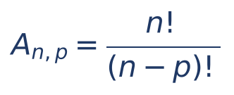

Em que:
- A(n, p) ou Aₙ,ₚ = número de arranjos (escolhas ordenadas);
- n = total de elementos disponíveis (8 servidores);
- p = quantos são escolhidos (3 cargos);
- n − p = os que sobram (5), cujo fatorial é cortado.

Na prática, a fórmula serve só para reconhecer o nome. Para CALCULAR, use as casas: A(n, p) = n × (n − 1) × ... com exatamente p fatores. Por exemplo, num pódio (ouro, prata e bronze) de uma corrida com 10 atletas: A(10, 3) = 10 × 9 × 8 = 720.

:::DICA Arranjo é só o princípio multiplicativo sem repetição
Se você domina o método das casas (11.2), não precisa memorizar a fórmula do arranjo: as senhas de dígitos distintos, os números com algarismos distintos e os cargos de comissão são todos arranjos. Arranjo COM repetição (senha podendo repetir dígitos) é simplesmente nᵖ: 10⁴ = 10.000 senhas de 4 dígitos.
:::

## 11.8 Combinações simples: escolher parte sem ordem

### 11.8.1 A ideia: a ordem não importa

Agora, entre os mesmos 8 servidores, escolha uma COMISSÃO de 3 membros, sem cargos. O grupo {Ana, Bruno, Carla} é o mesmo grupo que {Carla, Ana, Bruno}: trocar a ordem não cria comissão nova.

Raciocínio em duas etapas:

- Se a ordem importasse, seriam A(8, 3) = 336 escolhas (11.7).
- Mas cada comissão de 3 pessoas aparece nessa contagem tantas vezes quantas são as ordens de 3 pessoas: 3! = 6 vezes (ABC, ACB, BAC, BCA, CAB, CBA).
- Então: comissões = 336 ÷ 6 = 56.

Esse é o segredo da combinação: É O ARRANJO DIVIDIDO PELAS ORDENS DOS ESCOLHIDOS.

### 11.8.2 A fórmula

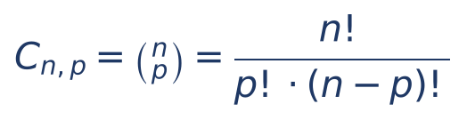

Em que:
- C(n, p), também escrito Cₙ,ₚ ou com os números empilhados entre parênteses (o "número binomial", lido "n escolhe p"), é o número de grupos de p elementos que se formam com n elementos distintos, sem importar a ordem;
- n = total disponível; p = tamanho do grupo;
- p! no denominador desconta as ordens dentro do grupo; (n − p)! desconta a parte do fatorial que não foi usada.

Para calcular à mão, use a versão "curta": no numerador, p fatores decrescentes a partir de n; no denominador, p!.

:::EXEMPLO Como calcular combinações sem calculadora
1) C(6, 2):
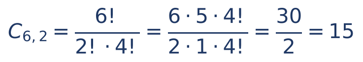
Ou direto pela versão curta: (6 × 5) ÷ (2 × 1) = 30 ÷ 2 = 15.
2) C(8, 3) = (8 × 7 × 6) ÷ (3 × 2 × 1) = 336 ÷ 6 = 56.
3) C(10, 7): pela propriedade abaixo, C(10, 7) = C(10, 3) = (10 × 9 × 8) ÷ 6 = 720 ÷ 6 = 120.
4) C(60, 6), o número de apostas simples possíveis na Mega-Sena: (60 × 59 × 58 × 57 × 56 × 55) ÷ 720 = 50.063.860. (Não se espera que você faça essa conta na prova; a banca fornece o número, como no Q2450796 adiante.)
:::

Duas propriedades poupam muito trabalho:

- Combinações complementares: C(n, p) = C(n, n − p). Escolher os 7 que entram é o mesmo que escolher os 3 que ficam de fora. Sempre use o MENOR dos dois números.
- Casos extremos: C(n, 0) = 1 (só há um modo de não escolher ninguém), C(n, n) = 1 (só um modo de escolher todos) e C(n, 1) = n.

#### O caso mais frequente: C(n, 2), os pares

C(n, 2) = n × (n − 1) ÷ 2 conta PARES sem ordem, e aparece disfarçado em muitas situações: apertos de mão entre n pessoas, jogos de turno único num torneio em que todos jogam contra todos, segmentos de reta ligando n pontos, ligações telefônicas entre n gabinetes. Com 10 times: C(10, 2) = 10 × 9 ÷ 2 = 45 jogos.

### 11.8.3 A pergunta decisiva: a ordem importa?

O teste prático é sempre o mesmo: pegue UM resultado possível, troque a ordem de dois elementos escolhidos e pergunte se surgiu um resultado NOVO.

- Comissão {Ana, Bruno, Carla} → {Bruno, Ana, Carla}: mesma comissão. A ordem não importa: COMBINAÇÃO.
- Presidente Ana, vice Bruno → presidente Bruno, vice Ana: outra diretoria. A ordem importa: ARRANJO.
- Senha 123 → 213: outra senha. ARRANJO (ou PFC).
- Aposta da Mega-Sena 05-12-33-41-50-58 → 12-05-...: mesma aposta. COMBINAÇÃO.
- Amostra de 3 notas fiscais para auditoria: mesma amostra em qualquer ordem. COMBINAÇÃO.

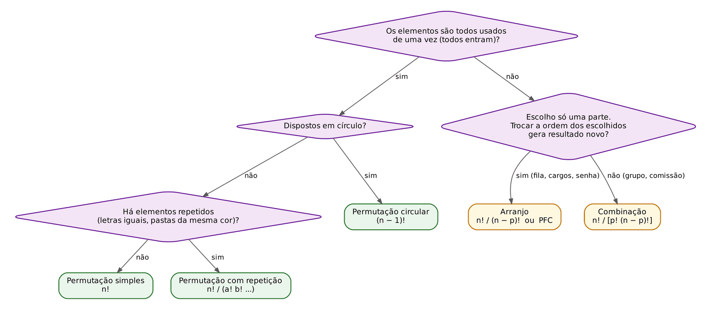

:::PASSO Como resolver qualquer questão de contagem
1. Leia o enunciado e identifique O QUE está sendo contado (filas? grupos? senhas? distribuições?).
2. Todos os elementos entram? Se sim, é permutação (simples, com repetição ou circular). Se só uma parte entra, faça o teste da troca de ordem: arranjo (ordem importa) ou combinação (não importa).
3. Pode repetir? Senhas e números "podendo repetir" multiplicam sempre o mesmo número de opções.
4. Há restrições? Escolha a técnica: preencher primeiro a casa restrita, fixar, bloco, lacunas, simetria (metade), separar em casos (somar) ou complementar (total menos ruins).
5. Se a resposta for pequena (alternativas até uns 30), confira listando de modo organizado.
6. Antes de marcar, compare com o total sem restrição: o resultado com restrição precisa ser MENOR que ele.
:::

### 11.8.4 Comissões com condições

Quando a comissão precisa ter composição definida ("2 mulheres e 1 homem"), escolha cada parte separadamente e multiplique (princípio multiplicativo). Quando aparecer "pelo menos", pense no complementar ou separe em casos.

:::EXEMPLO Comissões em um gabinete com 5 homens e 4 mulheres
1) Comissão de 3 com exatamente 2 mulheres: escolha as 2 mulheres E 1 homem.
- C(4, 2) = (4 × 3) ÷ 2 = 6
- C(5, 1) = 5
- Total = 6 × 5 = 30
2) Comissão de 3 com pelo menos 1 mulher, pelo complementar.
- Total sem restrição: C(9, 3) = (9 × 8 × 7) ÷ 6 = 504 ÷ 6 = 84
- Ruins (nenhuma mulher, só homens): C(5, 3) = (5 × 4 × 3) ÷ 6 = 60 ÷ 6 = 10
- Bons = 84 − 10 = 74
:::

:::PEGADINHA O erro do "escolhe um garantido e depois o resto"
Para "pelo menos 1 mulher", é tentador fazer: escolho 1 mulher (4 modos) e depois 2 pessoas quaisquer entre as 8 restantes (C(8, 2) = 28), total 4 × 28 = 112. ERRADO: a comissão {Maria, Joana, Pedro} é contada duas vezes (uma com Maria como "a garantida", outra com Joana). Por isso o resultado passa do certo (74). Use o complementar ou separe em casos ("exatamente 1", "exatamente 2"...).
:::

:::QUESTAO FGV 2025 — prova não identificada no banco (Q3754734)
Problema: numa reunião com 6 pessoas, será formado um subgrupo de 2, 3, 4 ou 5 pessoas para uma auditoria. Quantos grupos diferentes são possíveis? Gabarito oficial: C (56).
Resolução. Subgrupo não tem ordem: combinações. Os tamanhos se excluem ("ou"): soma.
- C(6, 2) = (6 × 5) ÷ 2 = 15
- C(6, 3) = (6 × 5 × 4) ÷ 6 = 20
- C(6, 4) = C(6, 2) = 15
- C(6, 5) = C(6, 1) = 6
- Total = 15 + 20 + 15 + 6 = 56
Atalho (ver 11.10): todos os subconjuntos de 6 pessoas são 2⁶ = 64; tire o vazio (1), os de 1 pessoa (6) e o grupo inteiro (1): 64 − 8 = 56. A alternativa 64 é o total de subconjuntos; 57 inclui indevidamente um dos casos excluídos.
:::

:::QUESTAO FGV 2025 — prova não identificada no banco (Q3579011)
Problema: numa folha há 16 pontos azuis e 4 verdes. Cada par de pontos azuis é ligado por um segmento azul; todos os outros pares (verde-verde e verde-azul) por segmentos verdes. Quantos segmentos verdes? Gabarito oficial: D (70).
Resolução pelo complementar. Todo par de pontos gera exatamente um segmento.
- Todos os pares: C(20, 2) = (20 × 19) ÷ 2 = 380 ÷ 2 = 190
- Pares azul-azul: C(16, 2) = (16 × 15) ÷ 2 = 240 ÷ 2 = 120
- Verdes = 190 − 120 = 70
Conferência direta: verde-verde C(4, 2) = 6; verde-azul 4 × 16 = 64; total 6 + 64 = 70. A alternativa 64 esquece os segmentos verde-verde.
:::

:::QUESTAO FGV 2025 — prova não identificada no banco (Q3362146)
Problema: 10 times disputam um torneio em que cada um joga uma única vez contra cada outro. Vitória vale 3 pontos ao vencedor e 0 ao perdedor; empate vale 1 ponto a cada time. A soma final dos pontos de todos os times foi 122. Quantas partidas terminaram empatadas? Gabarito oficial: C (13).
Resolução.
Passo 1: número de partidas = pares de times = C(10, 2) = 45.
Passo 2: cada partida com vencedor distribui 3 pontos no total (3 + 0); cada empate distribui 2 (1 + 1). Se não houvesse empates: 45 × 3 = 135 pontos.
Passo 3: cada empate "perde" 1 ponto em relação a uma partida com vencedor. Faltaram 135 − 122 = 13 pontos; logo, houve 13 empates.
Conferência: 32 partidas com vencedor × 3 = 96; 13 empates × 2 = 26; 96 + 26 = 122.
:::

:::QUESTAO FGV 2024 — TJ-AP — Analista Judiciário, Estatístico (Q2450796)
Problema: na Mega-Sena, a chance de acertar com uma aposta simples de 6 números é de 1 em 50.063.860. Marcando 8 números, a chance passa a ser de 1 em quanto? Gabarito oficial: C (1.787.995).
Resolução.
Passo 1: quem marca 8 números concorre com todos os grupos de 6 contidos nesses 8, ou seja, equivale a C(8, 6) apostas simples.
- C(8, 6) = C(8, 2) = (8 × 7) ÷ 2 = 28
Passo 2: a chance fica 28 vezes maior: 1 em 50.063.860 ÷ 28.
Passo 3: a divisão, sem calculadora, pode ser feita em duas etapas, porque 28 = 4 × 7:
- 50.063.860 ÷ 4 = 12.515.965
- 12.515.965 ÷ 7 = 1.787.995
Atalho de prova: 50 milhões ÷ 28 dá "um pouco menos de 2 milhões" (pois 28 × 2 milhões = 56 milhões). Só a alternativa C está nessa faixa. Armadilhas: 40.320 = 8! (usou fatorial no lugar da combinação); 7.151.980 = 50.063.860 ÷ 7 e 6.257.983 ≈ 50.063.860 ÷ 8 (dividiram pelo número errado).
:::

:::QUESTAO FGV 2024 — Prefeitura de Nova Iguaçu — Auditor Fiscal do Tesouro Municipal (Q3039600)
Problema: equipe com 6 enfermeiros e 4 médicos; o plantão diário tem 3 pessoas: 1 médico e 2 enfermeiros. Certo médico e certo enfermeiro não querem trabalhar juntos. Respeitada essa preferência, quantos trios distintos? Gabarito oficial: A (55).
Resolução.
Passo 1: trios sem restrição: 1 médico entre 4 E 2 enfermeiros entre 6.
- 4 × C(6, 2) = 4 × 15 = 60
Passo 2: trios proibidos: contêm o médico X e o enfermeiro Y; falta escolher o outro enfermeiro entre os 5 restantes: 1 × 1 × 5 = 5.
Passo 3: permitidos = 60 − 5 = 55.
A alternativa 60 ignora a restrição; as alternativas maiores (85, 105, 115) não respeitam a composição 1 médico + 2 enfermeiros (só para comparar, 3 pessoas quaisquer entre 10 dariam C(10, 3) = 120).
:::

:::QUESTAO FGV 2025 — prova não identificada no banco (Q3174747)
Problema: os números 1, 2, 3 e 4 devem ser colocados em quadradinhos da figura (sobrando dois vazios), em ordem crescente da esquerda para a direita. De quantas maneiras? Gabarito oficial: C (15).
Observação: a figura não consta do banco; pelo enunciado (4 números e 2 vazios), são 6 quadradinhos em linha.
Resolução. A exigência "ordem crescente" elimina qualquer liberdade de ordenação: uma vez escolhidas as 4 casas que receberão números, só há UM jeito de preenchê-las (1, 2, 3, 4 da esquerda para a direita). Então basta escolher as 4 casas entre 6, sem ordem:
- C(6, 4) = C(6, 2) = 15
A alternativa 30 = 15 × 2 e a 20 = C(6, 3) são as armadilhas. Lição: "em ordem crescente" transforma um arranjo numa combinação.
:::

### 11.8.5 Dividir pessoas em grupos

Já vimos (11.5.3) a distribuição em grupos COM NOME (André, Bruno, Carlos; quartos numerados). Pelas combinações, a conta é feita em etapas: escolha o primeiro grupo entre todos, o segundo entre os que sobraram, e assim por diante. Para os 7 processos de André (3), Bruno (2) e Carlos (2): C(7, 3) × C(4, 2) × C(2, 2) = 35 × 6 × 1 = 210, o mesmo resultado.

Se os grupos de MESMO TAMANHO não tiverem nome (duas duplas quaisquer, dois times sem identificação), cada divisão é contada uma vez para cada ordem desses grupos iguais, e é preciso dividir por esse número de ordens (2! para dois grupos iguais, 3! para três).

:::QUESTAO FGV 2025 — Prefeitura de Canaã dos Carajás — Enfermeiro (Q3287441)
Problema: de 5 atletas (A a E), formam-se duas duplas que jogam uma contra a outra; o atleta restante não joga. Quantas formas distintas? Gabarito oficial: A (15).
Resolução.
Passo 1: quem fica de fora: 5 opções.
Passo 2: dividir os 4 restantes em 2 duplas SEM nome (o jogo "{A,B} contra {C,D}" é o mesmo que "{C,D} contra {A,B}"). Pegue um atleta qualquer dos 4; seu parceiro pode ser qualquer um dos outros 3; a outra dupla fica determinada: 3 maneiras.
Conferência pela fórmula: C(4, 2) = 6 escolhas para "a primeira dupla", divididas por 2! porque as duas duplas não têm nome: 6 ÷ 2 = 3.
- Total = 5 × 3 = 15
A alternativa 30 = 5 × 6 é o erro de não dividir por 2.
:::

:::QUESTAO FGV 2026 — prova não identificada no banco (Q3880030)
Problema: bolas numeradas de 1 a 7 serão colocadas nas caixas A (4 bolas) e B (3 bolas). As bolas 1 e 2 ficam em caixas diferentes; as bolas 3 e 4 ficam na mesma caixa. Quantas distribuições? Gabarito oficial: D (8).
Resolução por casos (onde ficam 3 e 4).
Caso 1: 3 e 4 na caixa A. A precisa de mais 2 bolas: uma entre {1, 2} (2 opções, e a outra vai para B) e uma entre {5, 6, 7} (3 opções). Subtotal = 2 × 3 = 6. A caixa B fica com o restante (3 bolas), sem escolha.
Caso 2: 3 e 4 na caixa B. B precisa de mais 1 bola, que deve ser 1 ou 2 (porque uma delas tem de ir para B): 2 opções. A recebe a outra entre 1 e 2, mais 5, 6 e 7 (4 bolas). Subtotal = 2.
- Total = 6 + 2 = 8
:::

:::QUESTAO FGV 2025 — SEEC-RN — Professor de Matemática (Q3165607)
Problema: seis pessoas (A a F) serão separadas em um grupo de 4 e outro de 2. A e B ficam em grupos diferentes; E e F ficam no mesmo grupo. Quantas formas? Gabarito oficial: B (4).
Resolução.
Passo 1: como A e B estão em grupos diferentes, o grupo de 2 contém exatamente um deles.
Passo 2: E e F não cabem no grupo de 2 (o grupo de 2 já tem A ou B, só sobra uma vaga). Logo, E e F estão no grupo de 4.
Passo 3: o grupo de 2 é formado por um entre {A, B} (2 opções) e um entre {C, D} (2 opções). O grupo de 4 recebe o resto.
- Total = 2 × 2 = 4
Conferência: {A, C}, {A, D}, {B, C}, {B, D} são os grupos de 2 possíveis.
:::

:::PRATIQUE exercícios elaborados para esta apostila
1) Entre 10 servidores, de quantos modos escolher um relator e um revisor? E uma dupla de trabalho, sem funções?
2) Seis pontos estão sobre uma circunferência. Quantos triângulos com vértices nesses pontos existem?
3) Quantas diagonais tem um hexágono (polígono de 6 lados)?
4) (estilo FCC) Deseja-se formar comissões de 4 pessoas escolhidas entre 6 homens e 5 mulheres, com pelo menos 2 mulheres. Quantas comissões são possíveis?
Resoluções:
1) Relator e revisor são funções diferentes (a ordem importa): A(10, 2) = 10 × 9 = 90. Dupla sem funções: C(10, 2) = 90 ÷ 2 = 45.
2) Um triângulo é um grupo de 3 vértices, sem ordem (como 3 pontos sobre a circunferência nunca estão alinhados, todo trio forma triângulo): C(6, 3) = (6 × 5 × 4) ÷ 6 = 120 ÷ 6 = 20.
3) Todo par de vértices forma um lado ou uma diagonal. Pares: C(6, 2) = 15. Lados: 6. Diagonais = 15 − 6 = 9.
4) Separe em casos ("pelo menos 2" = exatamente 2, 3 ou 4 mulheres) e some.
- 2 mulheres e 2 homens: C(5, 2) × C(6, 2) = 10 × 15 = 150
- 3 mulheres e 1 homem: C(5, 3) × C(6, 1) = 10 × 6 = 60
- 4 mulheres: C(5, 4) = 5
- Total = 150 + 60 + 5 = 215
Conferência pelo complementar: C(11, 4) = 330; sem mulheres: C(6, 4) = 15; com 1 mulher: 5 × C(6, 3) = 5 × 20 = 100; 330 − 15 − 100 = 215.
:::

## 11.9 Combinações com repetição (noção)

### 11.9.1 A ideia: distribuir objetos IGUAIS

Até aqui, os elementos escolhidos eram distintos e cada um podia ser escolhido no máximo uma vez. Há problemas em que se escolhem quantidades de "tipos", podendo repetir o tipo: comprar 2 bolas de sorvete entre 3 sabores (pode ser duas de chocolate); distribuir 4 bônus idênticos entre 4 servidores (um pode ganhar mais de um).

O truque visual é o das ESTRELAS E BARRAS: os objetos idênticos são estrelas; para separá-los em n tipos (ou pessoas), usam-se n − 1 barras divisórias. Cada fileira de estrelas e barras corresponde a uma distribuição.

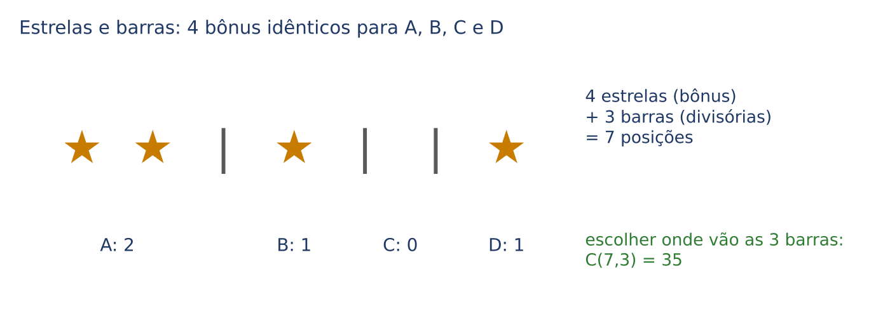

Na figura, ★★|★||★ significa: 2 bônus para A, 1 para B, 0 para C e 1 para D. Contar distribuições é contar fileiras com 4 estrelas e 3 barras, ou seja, escolher quais das 7 posições recebem as barras: C(7, 3) = 35.

### 11.9.2 A fórmula

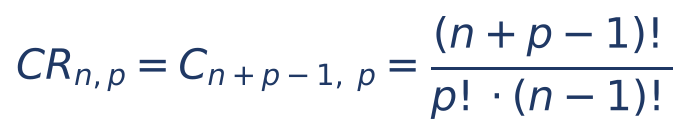

Em que:
- n = número de tipos (sabores, pessoas, caixas) que podem receber;
- p = número de objetos idênticos a distribuir (ou de escolhas, podendo repetir o tipo);
- n + p − 1 = total de símbolos na fileira (p estrelas e n − 1 barras).

Exemplo à mão: 2 bolas de sorvete entre 3 sabores (chocolate, morango, creme). Pela fórmula: C(3 + 2 − 1, 2) = C(4, 2) = 6. Listando: CC, MM, RR (cremes), CM, CR, MR. São 6.

:::ATENCAO "Cada um recebe pelo menos um"
Se cada pessoa deve receber ao menos 1 objeto, dê 1 a cada uma ANTES e distribua livremente o que sobrar. Exemplo: 6 bombons idênticos para 3 crianças, cada uma com pelo menos 1. Dê 1 a cada criança; sobram 3 bombons para 3 crianças: C(3 + 3 − 1, 3) = C(5, 3) = C(5, 2) = 10.
:::

:::QUESTAO FGV 2026 — AL-RO — Analista Legislativo, Matemática (Q3884904)
Problema: 4 bônus idênticos serão sorteados entre 4 colaboradores (A, B, C, D); um mesmo colaborador pode receber mais de um bônus, desde que não fique com todos. Quantas distribuições? Gabarito oficial: B (31).
Resolução.
Passo 1: sem a restrição, é combinação com repetição: 4 estrelas (bônus) e 3 barras (para separar 4 pessoas): C(7, 3) = (7 × 6 × 5) ÷ 6 = 35.
Passo 2: casos proibidos: alguém com os 4 bônus. São 4 casos (A tudo, B tudo, C tudo, D tudo).
Passo 3: permitidos = 35 − 4 = 31.
A alternativa 35 é o total sem a restrição; 24 = 4! e 32 = 2⁵ não têm relação com o problema e atraem quem usa fórmula às cegas.
:::

## 11.10 Números binomiais e triângulo de Pascal (noção)

O número C(n, p), escrito com n sobre p entre parênteses, chama-se NÚMERO BINOMIAL. Dispondo os binomiais em linhas (linha 0: C(0, 0); linha 1: C(1, 0) e C(1, 1); linha 2: C(2, 0), C(2, 1), C(2, 2)...), obtém-se o TRIÂNGULO DE PASCAL.

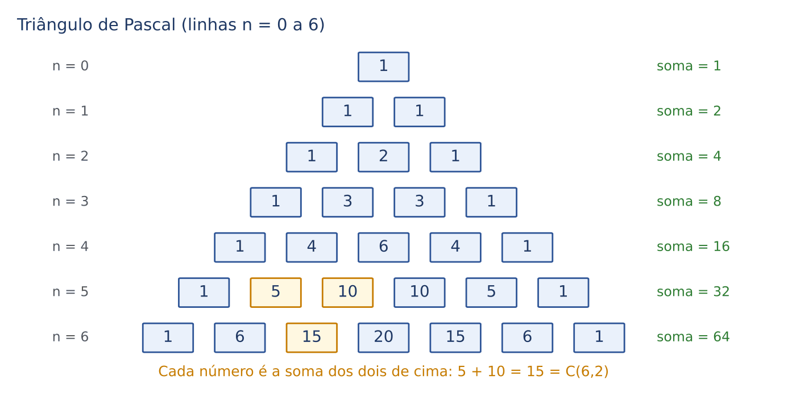

Três propriedades, todas visíveis na figura:

- Bordas iguais a 1: C(n, 0) = C(n, n) = 1.
- Simetria: cada linha se lê igual dos dois lados, porque C(n, p) = C(n, n − p).
- Relação de Stifel: cada número é a soma dos dois que estão acima dele. Por exemplo, na linha 6, C(6, 2) = 15 = 5 + 10 = C(5, 1) + C(5, 2). É a forma mais rápida de construir o triângulo sem conta alguma.

E uma quarta, a mais cobrada: a SOMA DE CADA LINHA é 2ⁿ. A linha 6 soma 1 + 6 + 15 + 20 + 15 + 6 + 1 = 64 = 2⁶. A razão é intuitiva: um conjunto de n elementos tem 2ⁿ subconjuntos, porque cada elemento "entra ou não entra" (2 opções cada, princípio multiplicativo), e a linha n do triângulo apenas separa esses subconjuntos pelo tamanho (0 elementos, 1, 2...).

- Número de subconjuntos de um conjunto com n elementos = 2ⁿ (inclui o vazio e o próprio conjunto).

Os binomiais recebem esse nome porque são os coeficientes do desenvolvimento de (a + b)ⁿ; por exemplo, (a + b)² = 1a² + 2ab + 1b², coeficientes 1, 2, 1 da linha 2. Esse uso (binômio de Newton) não está no escopo do edital e não é cobrado pela FCC nas provas do lote; para a distribuição binomial, que usa C(n, k), ver Cap. 13.

:::QUESTAO FGV 2025 — Prefeitura do Rio de Janeiro — Gestor de Segurança Municipal (Q3782882)
Problema: num setor com 7 funcionários, uma irregularidade foi cometida por um grupo de mais de um funcionário. Quantos são os grupos possíveis de culpados? Gabarito oficial: C (120).
Resolução. Os culpados formam um subconjunto dos 7, com 2 ou mais pessoas.
- Todos os subconjuntos: 2⁷ = 128
- Tire o vazio (nenhum culpado): 1
- Tire os de 1 pessoa (o grupo tem "mais de um"): 7
- Grupos = 128 − 1 − 7 = 120
Armadilhas: 128 (todos os subconjuntos), 127 (tirou só o vazio).
:::

:::QUESTAO FGV 2024 — prova não identificada no banco (Q2449557)
Problema: uma sala tem 6 portas fechadas; o guia abrirá algumas para a saída do grupo, mas uma das portas não pode ser aberta. De quantas maneiras a sala pode ser aberta? Gabarito oficial: D (31).
Resolução. Sobram 5 portas utilizáveis; cada uma é aberta ou não (2 opções): 2⁵ = 32 combinações de portas. Uma delas é "nenhuma porta aberta", que não abre a sala. Logo, 32 − 1 = 31.
A alternativa 32 inclui o caso de nenhuma porta aberta.
:::

:::PRATIQUE exercícios elaborados para esta apostila
1) Quantas soluções em inteiros não negativos (0, 1, 2...) tem a equação x + y + z = 5?
2) Calcule C(10, 7) pela propriedade das complementares.
3) Um conjunto tem 5 elementos. Quantos subconjuntos ele tem? Quantos têm pelo menos 2 elementos?
Resoluções:
1) São 5 unidades idênticas (estrelas) distribuídas entre 3 variáveis (2 barras): C(5 + 3 − 1, 5) = C(7, 5) = C(7, 2) = (7 × 6) ÷ 2 = 21.
2) C(10, 7) = C(10, 3) = (10 × 9 × 8) ÷ (3 × 2 × 1) = 720 ÷ 6 = 120.
3) Subconjuntos: 2⁵ = 32. Pelo menos 2 elementos: 32 − 1 (vazio) − 5 (unitários) = 26.
:::

## 11.11 Outras técnicas cobradas no mesmo tema

As bancas classificam como "análise combinatória" algumas questões que não pedem fórmula alguma, e sim uma contagem bem organizada ou um raciocínio de "pior caso". Vale conhecê-las, porque costumam ser rápidas para quem tem método.

### 11.11.1 Princípio da casa dos pombos (o pior caso)

A ideia: se 5 pombos entram em 4 casinhas, alguma casinha fica com pelo menos 2 pombos. Em prova, a pergunta típica é "qual o MENOR número de retiradas que GARANTE (dá certeza de) tal resultado?". A técnica é imaginar o azar máximo: o pior caso possível em que o resultado ainda NÃO aconteceu; a resposta é esse número mais 1.

Exemplo: numa gaveta há meias brancas, pretas e azuis, misturadas. Quantas meias tirar, no escuro, para garantir um par da mesma cor? Pior caso: tirar uma de cada cor (3 meias) sem formar par. A 4ª meia, seja qual for, repete uma cor. Resposta: 4.

:::QUESTAO FGV 2026 — AL-RO — Analista Legislativo, Matemática (Q3884925)
Problema: uma máquina oferece 4 tipos de bebida; cada colaborador retira uma. Após qual retirada se tem CERTEZA de que pelo menos 5 pessoas escolheram o mesmo tipo? Gabarito oficial: D (17).
Resolução pelo pior caso. O azar máximo é a distribuição mais "equilibrada" possível sem chegar a 5 em nenhum tipo: 4 pessoas em cada um dos 4 tipos, isto é, 4 × 4 = 16 retiradas sem atingir o objetivo. A 17ª retirada cai obrigatoriamente num tipo que já tem 4, formando 5.
- Retirada que garante = 4 × 4 + 1 = 17
Armadilhas: 16 (esqueceu o +1), 20 (= 4 × 5, que seria o caso de todos os tipos chegarem a 5) e 5 (achou que bastava 5 pessoas).
:::

### 11.11.2 Enumeração organizada (caminhos, quadros, sequências)

Quando a resposta é pequena e as regras são irregulares, a melhor técnica é LISTAR, mas com um critério fixo de ordem que impeça esquecer ou repetir casos: comece sempre pela primeira escolha possível, esgote seus desdobramentos e só depois passe à seguinte (é a árvore de 11.1, escrita em forma de lista).

:::QUESTAO FGV 2024 — Prefeitura de São José dos Campos — Analista em Gestão Municipal, TI (Q2380744)
Problema: um parque tem 5 bebedouros (A a E) ligados por 8 caminhos: 1 (A-B), 2 (A-C), 3 e 4 (dois caminhos distintos A-D), 5 (B-D), 6 (C-D), 7 (C-E), 8 (D-E). Quantos percursos de exatamente 3 caminhos começam em B e terminam em C? Gabarito oficial: A (5).
Resolução por árvore.
Passo 1: de B só saem os caminhos 1 (para A) e 5 (para D).
Passo 2: saindo pelo caminho 1, estamos em A. Precisamos chegar a C em 2 passos. De A: pelo 2 vamos direto a C, mas sobraria um passo (e de C não há como "ficar" em C); pelo 3 ou pelo 4 chegamos a D, e de D o caminho 6 leva a C. Percursos: 1-3-6 e 1-4-6.
Passo 3: saindo pelo caminho 5, estamos em D. De D para C em 2 passos: D→A (pelo 3 ou pelo 4) e A→C (pelo 2): 5-3-2 e 5-4-2; D→E (pelo 8) e E→C (pelo 7): 5-8-7. (D→C direto pelo 6 deixaria um passo sobrando.)
- Total = 2 + 3 = 5
O detalhe que derruba candidatos: os caminhos 3 e 4 são distintos, então cada travessia A-D vale por duas.
:::

:::QUESTAO FGV 2024 — PC-SC — Psicólogo Policial Civil (Q2365373)
Problema: quatro cidades C1 a C4 ligadas por 5 caminhos (C1-C2, C1-C3, C1-C4, C2-C3, C3-C4; não há caminho C2-C4). Um passeio pode repetir cidades. Quantos passeios de tamanho 3 (3 caminhos) começam em C1 e terminam em C4? Gabarito oficial: C (5).
Resolução. Do C1 se vai a C2, C3 ou C4; depois, precisamos estar numa cidade vizinha de C4 (C1 ou C3) no 2º passo.
- C1→C2→C1→C4 e C1→C2→C3→C4: 2 passeios
- C1→C3→C1→C4: 1 (C3→C4→C4 não existe, pois não há caminho de C4 para ela mesma)
- C1→C4→C1→C4 e C1→C4→C3→C4: 2
- Total = 2 + 1 + 2 = 5
O gabarito oficial, conferido no QConcursos em 30/10/2026, é C (5), e coincide com a resolução (conferida por enumeração completa em computador). As alternativas A (3) e B (4) esquecem passeios que voltam a C1 ou que passam por C4 antes do último passo; D (6) e E (7) contam passeios inexistentes, como os que usariam a ligação C2-C4.
:::

:::QUESTAO FCC 2025 — TRT 2ª Região (SP) — Analista Judiciário, Contabilidade (Q3596191)
Problema (como está no banco): os números 1, 2, 3, 4, 5, 6 e 7 devem ser colocados nos quadradinhos da figura de forma que os números cresçam da esquerda para a direita e de cima para baixo. Considere todos os números que podem aparecer no quadradinho cinza. A soma desses números é: (A) 12; (B) 13; (C) 11; (D) 10; (E) 9. Gabarito oficial: A (12).
Os dados desta questão estão em figura/tabela não reproduzida no banco de questões; por isso comentamos o MÉTODO, sem números inventados.
Método pelo raciocínio de "quem é obrigatoriamente menor e quem é obrigatoriamente maior" que o quadradinho cinza:
- Passo 1: com a figura à vista, marque todas as casas que ficam à ESQUERDA do cinza na mesma linha e todas as que ficam ACIMA dele na mesma coluna; acrescente as casas que estão à esquerda ou acima dessas (a exigência de crescimento se propaga em cadeia). Todas essas casas recebem números obrigatoriamente MENORES que o do cinza.
- Passo 2: faça o mesmo para a DIREITA e para BAIXO: todas as casas alcançadas por esse caminho recebem números obrigatoriamente MAIORES que o do cinza.
- Passo 3: limites. Se há k casas obrigatoriamente menores, o cinza vale no mínimo k + 1 (os k menores ocupam, no mínimo, 1, 2, ..., k). Se há m casas obrigatoriamente maiores, o cinza vale no máximo 7 − m.
- Passo 4: para cada valor entre esses limites, monte um preenchimento completo que respeite as duas regras (linhas crescendo para a direita, colunas crescendo para baixo). É uma verificação rápida, mas não pode ser pulada: um valor só entra na soma se houver pelo menos um preenchimento válido com ele no cinza.
- Passo 5: some os valores possíveis e compare com as alternativas.
Seguindo esse roteiro sobre a figura da prova original, chega-se ao gabarito oficial A (12). As casas "livres" (nem obrigatoriamente menores nem obrigatoriamente maiores) são a fonte do erro típico: quem as esquece no Passo 4 acaba admitindo ou excluindo valores indevidamente.
:::

### 11.11.3 Análise de casos em problemas de dados cruzados

Duas questões FCC do lote (classificadas pelo banco neste capítulo) são, na verdade, problemas de raciocínio com equações simples, do tipo estudado no Cap. 20. O que elas têm de "combinatória" é a técnica: testar, de modo organizado, cada caso possível e descartar os que geram contradição. Resolvemos aqui para que o lote fique completo.

:::QUESTAO FCC 2025 — Prefeitura de São Paulo — Auditor Municipal de Controle Interno (Q3281779)
Problema: 6 corretores formam 3 duplas fixas. Em janeiro, Alberto vendeu mais que todos; vendeu o triplo do parceiro de Denis e 1 seguro a mais que o próprio Denis. Breno, Cosme e Elvis venderam 9, 12 e 3. O total foi 65, e Flávio integrou a dupla vencedora. Em quanto as vendas da dupla de Breno superaram as do parceiro de Elvis? Gabarito oficial: E (3).
Resolução.
Passo 1: Alberto + Denis + Flávio = 65 − (9 + 12 + 3) = 65 − 24 = 41.
Passo 2: quem é o parceiro de Denis? Não é Alberto (se fosse, Alberto = 3 × Alberto, impossível). Teste os demais, lembrando que Alberto = 3 × (parceiro de Denis) e Denis = Alberto − 1:
- Parceiro Breno (9): Alberto = 27, Denis = 26, Flávio = 41 − 53 < 0. Impossível.
- Parceiro Cosme (12): Alberto = 36, Denis = 35, Flávio negativo. Impossível.
- Parceiro Elvis (3): Alberto = 9, Denis = 8, Flávio = 41 − 17 = 24. Mas Alberto deveria ser o maior vendedor e Flávio teria 24 > 9. Impossível.
- Parceiro Flávio (F): Alberto = 3F e Denis = 3F − 1. Então 3F + (3F − 1) + F = 41, ou seja, 7F − 1 = 41, 7F = 42, F = 6. Alberto = 18, Denis = 17. Alberto é o maior (18 > 17 > 12 > 9 > 3). Consistente.
Passo 3: a dupla Denis-Flávio fez 17 + 6 = 23 e foi a vencedora (Flávio está nela). As outras duplas, formadas com Alberto (18), Breno (9), Cosme (12) e Elvis (3), precisam ter menos de 23: Alberto + Breno = 27 e Alberto + Cosme = 30 estão excluídas; sobra Alberto + Elvis = 21, e então Breno + Cosme = 21.
Passo 4: dupla de Breno = 21; parceiro de Elvis = Alberto = 18. Diferença = 21 − 18 = 3.
:::

:::QUESTAO FCC 2026 — SEFAZ-MT — Fiscal de Tributos Estaduais (Q3947148)
Problema: três equipes têm pilotas principais Ana (60 pontos), Bia (48) e Cris (66); as segundas pilotas, Duda, Elis e Fran, somam 85 pontos. Ana tem 18 pontos a mais que sua companheira; Duda tem um terço dos pontos de sua companheira de equipe; Elis tem metade dos pontos de uma das outras segundas pilotas. Sendo x a soma de Cris com sua companheira e y a soma de Bia com a sua, quanto vale x − y? Gabarito oficial: D (19).
Resolução.
Passo 1: a companheira de Ana tem 60 − 18 = 42 pontos.
Passo 2: Duda não é companheira de Ana (um terço de 60 = 20 ≠ 42). Teste os dois casos restantes:
- Duda com Bia: Duda = 48 ÷ 3 = 16; a terceira segunda pilota (com Cris) = 85 − 42 − 16 = 27. As segundas pilotas teriam 42, 16 e 27; Elis seria 42 ou 27, e nenhum deles é metade de outro valor da lista (21 e 13,5 não aparecem). Impossível.
- Duda com Cris: Duda = 66 ÷ 3 = 22; a companheira de Bia = 85 − 42 − 22 = 21. Valores: 42, 22 e 21. Elis = 21 = metade de 42. Consistente: Elis com Bia e Fran com Ana.
Passo 3: x = Cris + Duda = 66 + 22 = 88; y = Bia + Elis = 48 + 21 = 69; x − y = 88 − 69 = 19.
:::

### 11.11.4 Outras questões do banco sobre o tema

| Q | banca/ano | subtema | gabarito |
|---|---|---|---|
| Q3880408 | FGV 2026 | permutações em ordem crescente (os 24 números com 3, 4, 6 e 8; o 15º é 6438) | D |
| Q3114594 | FGV 2024 | enumeração de permutações com condição de soma (1º + 4º = 2º + 3º) | D |
| Q3362141 | FGV 2025 | contagem de inversões de uma permutação (PJRM em relação a MPRJ) | C |

## 11.12 Resumo para revisão pré-prova

| Conceito | Fórmula/regra | Quando usar | Armadilha |
|---|---|---|---|
| Princípio multiplicativo | multiplique as opções de cada etapa | escolhas sucessivas ("e"): senhas, placas, números | preencha primeiro a casa restrita (zero na frente, par no fim) |
| Princípio aditivo | some os casos | situações que se excluem ("ou"); separar em casos | casos não podem se sobrepor |
| Complementar | bons = total − ruins | "pelo menos um", "não juntos", "nem todos" | conferir se os ruins não foram contados duas vezes |
| Inclusão e exclusão | n(A ou B) = n(A) + n(B) − n(A e B) | duas condições ligadas por "ou" | esquecer de tirar a interseção (Q3406128: 240 em vez de 216) |
| Fatorial | n! = n × (n − 1) × ... × 1; 0! = 1 | base de todas as fórmulas | (a × b)! ≠ a! × b!; simplifique antes de multiplicar |
| Permutação simples | n! | ordenar TODOS os elementos distintos | — |
| Bloco | (objetos com o bloco)! × (interior do bloco)! | elementos que ficam juntos | esquecer o interior; interior de letras iguais vale 1 |
| Lacunas | posicione os outros, distribua os restritos nos vãos | ninguém lado a lado | número de vãos = outros + 1 |
| Antes/depois | total ÷ 2 | A antes de B (não necessariamente colado) | "imediatamente antes" é bloco, não metade |
| Permutação com repetição | n! ÷ (a! × b! × ...) | anagramas com letras iguais; objetos iguais | um fatorial para cada grupo de iguais |
| Distribuição em grupos com nome | n! ÷ (a! × b! × ...) ou C × C × ... | processos para auditores, pessoas em quartos numerados | grupos iguais SEM nome: dividir pelo fatorial do número desses grupos |
| Permutação circular | (n − 1)! | mesa redonda, só posições relativas | cadeiras distinguíveis: n!; colar virável: ÷ 2 |
| Arranjo simples | n! ÷ (n − p)! = n × (n − 1) × ... (p fatores) | escolher p e ORDENAR (cargos, pódio, senha sem repetir) | não confundir com combinação: faça o teste da troca |
| Combinação simples | n! ÷ [p! × (n − p)!] | escolher p SEM ordem (comissão, amostra, aposta) | C(n, p) = C(n, n − p); "em ordem crescente" vira combinação |
| Pares | C(n, 2) = n × (n − 1) ÷ 2 | apertos de mão, jogos, segmentos | diagonais = C(n, 2) − n |
| Combinação com repetição | C(n + p − 1, p) | p objetos IGUAIS para n pessoas/tipos | "pelo menos 1 para cada": dê 1 a cada antes |
| Subconjuntos | 2ⁿ | "algumas", "qualquer grupo" de tamanho livre | tirar o vazio e/ou os unitários quando o enunciado exigir |
| Casa dos pombos | pior caso + 1 | "garantir", "ter certeza" | esquecer o +1 |

:::ESQUEMA Formulário do capítulo
| Fórmula | Símbolos | Use quando |
|---|---|---|
| Pₙ = n! | n = elementos distintos, todos usados | fila com todos |
| n! ÷ (a! b! c!) | a, b, c = repetições de cada elemento | anagramas com letras repetidas; grupos com nome |
| PCₙ = (n − 1)! | n = pessoas na roda | mesa redonda |
| A(n, p) = n! ÷ (n − p)! | n = disponíveis; p = escolhidos em ordem | cargos, pódio, senha sem repetir |
| nᵖ | n opções em cada uma das p casas | senha podendo repetir |
| C(n, p) = n! ÷ [p! (n − p)!] | n = disponíveis; p = tamanho do grupo | grupos sem ordem |
| C(n + p − 1, p) | n = tipos; p = objetos iguais | distribuir objetos iguais |
| 2ⁿ | n = elementos do conjunto | contar todos os subconjuntos |
:::

## 11.13 Questões do capítulo

FCC (9): Q4221364, Q3976702, Q3872151, Q3947148, Q3596191, Q3281779, Q3549547, Q3481524, Q3089761. FGV (32): Q4350640, Q3884933, Q3884925, Q3884904, Q3880408, Q3880030, Q3879463, Q3782882, Q3776557, Q3754734, Q3579011, Q3578666, Q3406128, Q3363345, Q3362146, Q3362145, Q3362141, Q3287441, Q3238404, Q3174747, Q3171956, Q3165607, Q3114594, Q3049039, Q3043777, Q3039600, Q2566521, Q2450796, Q2449557, Q2380744, Q2375658, Q2365373.

:::NOTA Notas de verificação
- Contas: todas as resoluções de questões, exemplos e exercícios PRATIQUE foram conferidas em Python, em regra por enumeração exaustiva (força bruta) além da fórmula; todos os 41 gabaritos oficiais (40 do banco original e Q2365373, reconferida em 30/10/2026) coincidiram com a resolução.
- Gabaritos reconferidos no QConcursos em 30/10/2026: Q2365373 (C), que coincide com a alternativa obtida pela resolução e por enumeração completa.
- Figuras ausentes do banco: Q3596191 (FCC, TRT-2) é comentada só pelo MÉTODO, com o gabarito oficial (A, 12), porque o quadro da questão não está reproduzido no banco; a versão anterior, que trazia um quadro reconstruído, foi retirada em 30/10/2026. Q3578666 foi lida como seis quadradinhos em fila e Q3174747 como seis quadradinhos (quatro números e dois vazios) em fila, leituras compatíveis com os gabaritos oficiais; conferir a disposição com as provas originais.
- Q3043777: o enunciado menciona Paulo e Selma sem usá-los na pergunta; a resolução seguiu a pergunta tal como está no banco (gabarito 2.520 confirmado).
- Q3281779 e Q3947148 (FCC) não são de combinatória em sentido estrito (problemas de raciocínio do tipo do Cap. 20); foram resolvidas aqui porque o banco as atribuiu a este capítulo.
- Os comentários sobre a origem das alternativas erradas são reconstruções didáticas prováveis, não informações da banca.
- Placa Mercosul (exemplo 4 de 11.2.1): o formato LLLNLNN para automóveis é informação de conhecimento geral, usada só como ilustração do cálculo; não conferida em norma do Contran.
- Materiais do Drive indicados no briefing (ES11, ES12, RL03, RL20) não foram abertos; o conteúdo é matemática estável e o lote de questões orientou a ênfase.
- Sem normas jurídicas neste capítulo (seção de normas omitida, conforme as instruções).
:::
