# CAPÍTULO 14 — AMOSTRAGEM E INFERÊNCIA ESTATÍSTICA

:::INCIDENCIA
Edital SEFAZ/SC 01/2026 — Matemática Financeira, Estatística e Raciocínio Lógico: "Inferência estatística. Amostragem: amostras casuais e não casuais. Processos de amostragem, incluindo estimativa pontual de parâmetros. Intervalos de confiança".
Nível A. Lote do banco: 85 questões (FCC 8, FGV 77).
O que mais cai na FCC: intervalo de confiança para a média com σ conhecido, tamanho da amostra para proporção (p = 0,5), interpretação do nível de confiança e identificação do tipo de amostragem.
:::

:::ESQUEMA O que você vai aprender e o que precisa saber antes
Pré-requisitos: raiz quadrada e potências (Cap. 1); média, variância e desvio-padrão (Caps. 9 e 10); distribuição normal e uso da tabela da normal padrão Z (Cap. 13).
Roteiro do capítulo:
- 14.1 A lógica da inferência: população, amostra, parâmetro, estimador e estimativa.
- 14.2 Técnicas de amostragem: probabilísticas (casuais) e não probabilísticas (não casuais).
- 14.3 Distribuição amostral da média e erro-padrão.
- 14.4 Teorema Central do Limite e Lei dos Grandes Números.
- 14.5 Estimação pontual e propriedades dos estimadores.
- 14.6 a 14.9 Intervalos de confiança: média com σ conhecido (z), interpretação do nível de confiança, média com σ desconhecido (t de Student) e proporção.
- 14.10 Margem de erro e tamanho da amostra.
:::

## 14.1 A lógica da inferência: da amostra para a população

### 14.1.1 A ideia, em linguagem comum

Imagine que o Fisco catarinense queira saber qual é o valor médio das notas fiscais eletrônicas emitidas por bares e restaurantes do Estado num ano. São milhões de documentos. Examinar todos (fazer um censo) é caro e demorado. A saída é examinar só uma parte deles, uma amostra, e a partir dela tirar uma conclusão sobre o todo.

Esse "salto" da parte para o todo chama-se inferência estatística. É exatamente o que faz o cozinheiro que prova uma colher da sopa para saber se a panela inteira está salgada: ele não bebe a panela toda. Mas a colher só serve se a sopa foi bem mexida; se ele provar só a superfície, onde o sal ainda não se dissolveu, vai concluir errado. Na estatística, "mexer a sopa" é escolher a amostra de forma adequada, e é disso que trata a teoria da amostragem (14.2).

O mundo jurídico conhece bem essa lógica. Quando o juiz decide com base em prova indiciária, ele parte de fatos conhecidos para concluir sobre um fato desconhecido, e sabe que a conclusão é provável, não certa. A inferência estatística faz o mesmo, com uma vantagem: ela MEDE quanto de incerteza existe na conclusão (é para isso que servem a margem de erro e o nível de confiança, que veremos a partir de 14.6).

### 14.1.2 O vocabulário básico

O Cap. 9 já apresentou população e amostra. Aqui precisamos de quatro palavras a mais, que a banca adora confundir.

- População (ou universo): o conjunto de TODOS os elementos que interessam. Exemplo: todas as notas fiscais de restaurantes emitidas em Santa Catarina em 2025. Seu tamanho é indicado por N (maiúsculo).
- Amostra: a parte da população efetivamente observada. Seu tamanho é indicado por n (minúsculo).
- Parâmetro: um número que descreve a POPULAÇÃO. Exemplo: o valor médio verdadeiro de todas as notas, chamado μ (letra grega "mi"). O parâmetro é um valor fixo, mas desconhecido (se fosse conhecido, não precisaríamos de amostra).
- Estatística (ou estimador): uma FÓRMULA calculada com os dados da amostra. Exemplo: "some os valores das notas sorteadas e divida por n", isto é, a média amostral x̄ (lê-se "x barra"). Como cada amostra sorteada dá um resultado diferente, o estimador é uma variável aleatória: ele varia de amostra para amostra.
- Estimativa: o NÚMERO concreto que o estimador produziu numa amostra específica. Exemplo: "nesta amostra de 400 notas, a média foi 87,40 reais".

Uma analogia ajuda a separar estimador de estimativa. O estimador é como o método de cálculo previsto em lei para apurar um tributo (a "regra"); a estimativa é o valor apurado num caso concreto (o "resultado"). A banca costuma apresentar um número obtido numa amostra e perguntar como ele se chama: a resposta é estimativa.

Convenção de símbolos que usaremos no capítulo inteiro:

| O que se mede | Na população (parâmetro) | Na amostra (estimador) |
|---|---|---|
| Média | μ ("mi") | x̄ ("x barra") |
| Variância | σ² ("sigma ao quadrado") | s² |
| Desvio-padrão | σ ("sigma") | s |
| Proporção | p | p̂ ("p chapéu") |
| Tamanho | N | n |

:::DICA Regra mnemônica
Letras gregas (μ, σ) e a letra p "pura" são da população; letras latinas com enfeite (x̄, s, p̂) são da amostra. O "chapéu" (^) sempre significa "valor estimado".
:::

### 14.1.3 Erro amostral e erro não amostral

Mesmo uma amostra perfeitamente sorteada quase nunca reproduz a população com exatidão. Se a média verdadeira das notas é 85 reais, uma amostra pode dar 87,40 e outra 83,10. Essa diferença inevitável, que nasce apenas do fato de termos olhado uma parte e não o todo, é o erro amostral. Ele não é "culpa" de ninguém, e a boa notícia é que pode ser medido e reduzido aumentando a amostra.

Já o erro não amostral nasce de falhas de procedimento: questionário mal redigido, digitação errada, entrevistado que mente, lista de população incompleta, escolha viciada dos elementos. Esse erro NÃO diminui com o aumento da amostra (uma amostra enorme e viciada continua viciada) e não é medido pelas fórmulas deste capítulo.

:::QUESTAO FGV 2024 — TJ-AP — Analista Judiciário — Estatístico (Q2450791)
Um pesquisador quer estimar o tempo médio de espera na fila de um supermercado. Coletou dados de 100 clientes, cujo tempo total de espera somou 75 minutos. A questão pergunta que nome recebe o valor de 45 segundos obtido como média amostral: censo, estimador, estimativa, parâmetro ou população.
Gabarito oficial: C (estimativa), conferido no QConcursos em 30/10/2026; coincide com a resposta pela teoria.
Resolução:
- Primeiro, conferimos o número: 75 minutos ÷ 100 clientes = 0,75 minuto por cliente.
- Convertendo para segundos: 0,75 × 60 = 45 segundos. O número bate com o enunciado.
- Esse 45 é o valor concreto que a fórmula "soma ÷ n" produziu nesta amostra. Valor concreto obtido numa amostra = estimativa.
Por que as outras estão erradas: "estimador" é a fórmula (a média amostral como regra), não o número; "parâmetro" seria o tempo médio verdadeiro de TODOS os clientes, que é desconhecido; "censo" seria observar todos os clientes; "população" é o conjunto de todos os clientes.
:::

:::QUESTAO FGV 2024 — EPE — Analista de Pesquisa Energética (Q3262441)
Uma variável X tem variância populacional conhecida de 123 u² e média desconhecida. Uma amostra de 300 elementos deu média 34 u e variância 52 u². Julgar: I. o valor esperado de X não depende do tamanho da amostra; II. a estimativa do valor esperado de X é 34 u; III. a variância de X é 52 u².
Gabarito: D (I e II, apenas).
Resolução:
- I. O valor esperado de X é o parâmetro μ, a média da população. Ele é um número fixo; não muda se a amostra tiver 10 ou 300 elementos. Correto.
- II. A média amostral, 34 u, é a estimativa de μ. Correto.
- III. Errado: a variância de X (populacional) foi DADA no enunciado: 123 u². O 52 u² é a variância da AMOSTRA, apenas uma estimativa. A banca testou se você confunde parâmetro com estimativa.
:::

:::QUESTAO FGV 2024 — INPE — Tecnologista (Q2518892)
Julgar três afirmações sobre conclusões obtidas por amostragem: I. concepção inadequada do procedimento experimental é fonte de erro aleatório; II. a amostragem aleatória permite avaliar o grau de precisão dos resultados a partir dos próprios dados; III. a confiabilidade dos resultados depende exclusivamente do dimensionamento da amostra.
Gabarito: A (II, apenas).
Resolução:
- I. Errada. Procedimento mal concebido gera erro SISTEMÁTICO (não amostral, um viés), e não erro aleatório.
- II. Correta. Só quando a amostra é sorteada podemos usar a teoria das probabilidades para calcular o erro-padrão e a margem de erro com os próprios dados.
- III. Errada. A palavra "exclusivamente" denuncia: a confiabilidade depende também da forma de seleção, da qualidade da coleta, do questionário etc.
:::

No mesmo sentido (estatística inferencial = estimar parâmetros por intervalos e testes): Q3579030 (FGV 2025, gabarito B).

## 14.2 Técnicas de amostragem

### 14.2.1 A grande divisão: casuais e não casuais

O edital fala em "amostras casuais e não casuais". São os mesmos conceitos que os livros chamam de probabilísticas e não probabilísticas.

- Amostragem probabilística (casual, aleatória): cada elemento da população tem uma probabilidade CONHECIDA e NÃO NULA de ser escolhido, e a escolha é feita por sorteio. Só ela permite calcular o erro amostral e construir intervalos de confiança; por isso só ela autoriza, com rigor, estender (extrapolar) os resultados para a população.
- Amostragem não probabilística (não casual): a escolha depende de um critério humano (conveniência, opinião do especialista, cotas). Pode ser útil, barata e rápida, mas não permite medir o erro com as fórmulas deste capítulo.

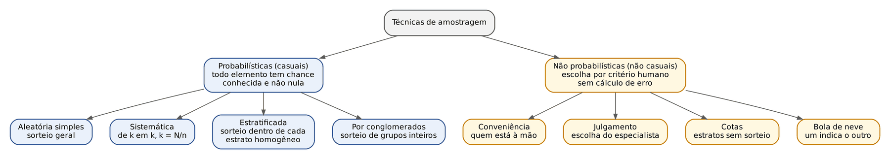

### 14.2.2 Amostragem aleatória simples (AAS)

Ideia: numeram-se todos os elementos da população e sorteiam-se n deles, como num sorteio de loteria. Definição de prova: todos os elementos têm a MESMA probabilidade de serem escolhidos e todas as amostras possíveis de tamanho n têm a mesma probabilidade de ocorrer.

Ela pode ser feita:
- com reposição: o elemento sorteado "volta para a urna" e pode sair de novo; as observações são independentes. Equivale, na prática, a uma população infinita.
- sem reposição: o elemento sorteado não volta. É o que se faz na vida real (ninguém fiscaliza a mesma nota duas vezes). Quando a amostra é uma fração grande da população, isso pede uma correção (o fator de população finita, ver 14.3.4).

Exemplo do Fisco: a lista das 5.000 empresas de um setor é numerada de 1 a 5.000 e um programa de computador sorteia 200 números.

### 14.2.3 Amostragem sistemática

Ideia: com a população ordenada numa lista, escolhe-se um elemento a cada k posições. O "passo" k é o intervalo de amostragem:

- k = N ÷ n (tamanho da população dividido pelo tamanho da amostra).

Sorteia-se apenas o PRIMEIRO elemento, entre 1 e k; os demais vêm de k em k.

:::EXEMPLO Amostra sistemática de notas fiscais
Um auditor tem 1.200 notas numeradas e quer uma amostra de 60.
- Passo: k = 1.200 ÷ 60 = 20.
- Ele sorteia um número de 1 a 20 para começar; saiu o 7.
- A amostra é: 7, 27, 47, 67, 87, ... (sempre somando 20), até a 60ª nota, que é a de número 7 + 59 × 20 = 7 + 1.180 = 1.187.
:::

:::PEGADINHA Periodicidade escondida
A sistemática é prática, mas perigosa quando a lista tem um ciclo que coincide com o passo. Se as notas estão em ordem de dia e o passo é 7, o auditor pode acabar examinando só as notas de domingo. A FCC e a FGV gostam de perguntar a "condição" da sistemática: população ordenada e sem periodicidade coincidente com o passo.
:::

### 14.2.4 Amostragem estratificada

Ideia: quando a população é formada por grupos MUITO DIFERENTES entre si, mas internamente parecidos (homogêneos), divide-se a população nesses grupos, chamados estratos, e sorteia-se uma parte DENTRO DE CADA estrato. Assim, nenhum grupo relevante fica de fora por azar do sorteio.

Exemplo: para estimar o ICMS médio recolhido, o Fisco separa as empresas em três estratos (grandes, médias e pequenas), porque o recolhimento de uma grande empresa não tem nada a ver com o de uma pequena. Em seguida, sorteia empresas em cada estrato.

Formas de dividir a amostra entre os estratos (a "alocação"):
- Uniforme: o mesmo número de elementos em cada estrato. Útil quando se quer COMPARAR os estratos entre si.
- Proporcional: cada estrato contribui com a mesma fração da população que ele representa.
- Ótima (de Neyman): leva em conta o tamanho do estrato E a sua variabilidade (desvio-padrão); estratos mais heterogêneos recebem mais elementos. É a que dá a menor variância do estimador (a variância da alocação ótima é menor ou igual à da proporcional).

:::EXEMPLO Alocação proporcional e uniforme
Uma população de 1.200 contribuintes tem 600 do comércio, 400 da indústria e 200 de serviços. A amostra total será de 60.
Alocação proporcional: a fração amostral é 60 ÷ 1.200 = 0,05 (5%); aplica-se 5% a cada estrato.
- Comércio: 600 × 0,05 = 30.
- Indústria: 400 × 0,05 = 20.
- Serviços: 200 × 0,05 = 10.
- Conferência: 30 + 20 + 10 = 60.
Alocação uniforme: 60 ÷ 3 = 20 em cada estrato.
:::

### 14.2.5 Amostragem por conglomerados

Ideia: a população está naturalmente dividida em grupos (conglomerados), como bairros, municípios, escolas ou lotes de documentos. Sorteiam-se alguns GRUPOS INTEIROS e observam-se todos os elementos dos grupos sorteados (em um estágio). É usada quando não existe uma lista completa dos elementos, mas existe a lista dos grupos, ou quando o custo de deslocamento é alto.

Exemplo: em vez de sortear 300 estabelecimentos espalhados pelos 295 municípios catarinenses, sorteiam-se 10 municípios e visitam-se todos os estabelecimentos desses 10.

A diferença com a estratificada é a pegadinha mais frequente do tema, e a figura abaixo resume:

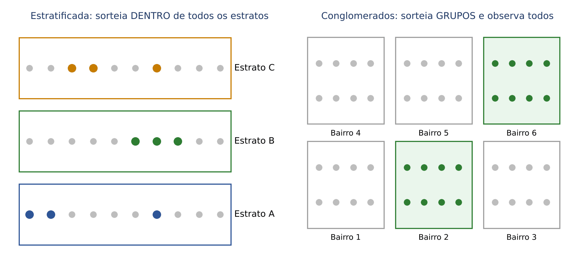

| | Estratificada | Por conglomerados |
|---|---|---|
| Dentro de cada grupo | elementos parecidos (homogêneos) | elementos variados (cada grupo é uma "miniatura" da população) |
| Entre os grupos | grupos diferentes entre si | grupos parecidos entre si |
| O que se sorteia | elementos DENTRO de TODOS os grupos | ALGUNS grupos inteiros |
| Objetivo principal | precisão (reduzir a variância) | economia (custo e logística) |

Quando o sorteio é feito em várias etapas (sorteiam-se municípios; dentro deles, bairros; dentro deles, domicílios), fala-se em amostragem em múltiplos estágios. E a "amostragem múltipla" (ou sequencial) é aquela retirada em etapas sucessivas, em que o resultado de uma etapa decide se a próxima é necessária.

### 14.2.6 Técnicas não probabilísticas

- Por conveniência (acidental): escolhem-se os elementos mais fáceis de alcançar. Exemplo: entrevistar quem passa na frente do fórum.
- Por julgamento (intencional): o especialista escolhe os elementos que considera "típicos" ou mais relevantes. Exemplo: o auditor escolhe as 20 notas de maior valor.
- Por cotas: parece a estratificada, porque se fixa quantos elementos de cada grupo entram (tantas mulheres, tantos jovens), MAS sem sorteio: o entrevistador escolhe livremente quem preenche cada cota. É a "estratificada sem sorteio".
- Bola de neve: cada participante indica o próximo. Útil para populações ocultas (por exemplo, grupos de difícil acesso).

:::PEGADINHA As três trocas favoritas da banca
- Cotas é NÃO probabilística, embora lembre a estratificada (a diferença é a ausência de sorteio).
- Sistemática é PROBABILÍSTICA (há sorteio do ponto de partida), embora pareça "mecânica".
- Estratificada sorteia dentro de todos os grupos; conglomerados sorteia grupos e observa todos os elementos deles.
:::

:::QUESTAO FCC 2025 — Prefeitura de São Paulo — Auditor Municipal de Controle Interno (Q3281782)
A população é formada pelos elementos de todos os bairros de uma grande cidade, e cada bairro é tratado como uma subpopulação. Sorteiam-se 10 bairros por AAS sem reposição e observam-se TODOS os elementos dos 10 bairros sorteados. Pergunta-se o nome do procedimento.
Gabarito: D (por conglomerados).
Resolução:
- O sorteio recaiu sobre GRUPOS (bairros), e não sobre elementos individuais.
- Dentro dos grupos sorteados, observou-se tudo.
- Essas duas marcas definem a amostragem por conglomerados em um estágio.
Por que as outras estão erradas: estratificada exigiria sortear elementos dentro de TODOS os bairros; sistemática exigiria um passo k numa lista ordenada; "determinística" não é técnica de amostragem; conveniência não tem sorteio.
:::

:::QUESTAO FGV 2024 — EPE — Analista de Pesquisa Energética (Q3262444)
Um pesquisador escolheu duas técnicas: a primeira probabilística e a segunda não probabilística, nessa ordem. Qual par está correto?
Gabarito: B (sistemática e por cota).
Resolução:
- Teste cada par com a pergunta "há sorteio?".
- A) conglomerado e AAS: as duas são probabilísticas. Errado.
- B) sistemática (probabilística) e cota (não probabilística). Certo.
- C) julgamento (não probabilística) vem primeiro. Ordem invertida.
- D) AAS e sistemática: as duas probabilísticas.
- E) cota e julgamento: as duas não probabilísticas.
No mesmo sentido: Q3337419 (FGV 2025: integra o grupo não probabilístico a amostragem por cotas, gabarito A).
:::

:::QUESTAO FGV 2025 — TCE-RR — Auditor Substituto de Conselheiro (Q3174691)
Associar: 1. AAS; 2. estratificada; 3. sistemática; 4. conglomerados às descrições, na ordem: (a) numeração de todos e seleção aleatória direta; (b) divisão em subgrupos homogêneos e amostragem proporcional em cada um; (c) ponto de partida aleatório e intervalos regulares; (d) divisão em grupos e seleção aleatória de grupos inteiros.
Gabarito: A (1 – 2 – 3 – 4).
Resolução: (a) é a AAS; (b) "subgrupos homogêneos" e sorteio em cada um é estratificada; (c) "intervalos regulares" é sistemática; (d) "grupos inteiros" é conglomerado.
No mesmo sentido: Q3260833 (FGV 2024, associação semelhante incluindo amostragem múltipla, gabarito A); Q3349643 (FGV 2025, definição de AAS: todos os elementos e todas as amostras com igual probabilidade, gabarito C); Q4283083 (FGV 2026, intervalo de amostragem N ÷ n é sistemática, gabarito E); Q4375147 e Q4220346 (FGV 2026, subgrupos homogêneos com sorteio dentro de cada um: estratificada, gabarito A em ambas); Q2450827 (FGV 2024, segmentação de pesquisa eleitoral por faixa etária e região: estratificada, gabarito B).
:::

:::QUESTAO FGV 2024 — TJ-RR — Analista Judiciário — Estatística (Q3088067)
Julgar como V ou F quatro afirmações sobre amostragem estratificada: (1) ela especifica quantos elementos serão retirados de cada estrato, havendo três tipos usuais (uniforme, proporcional e ótima); (2) na uniforme, sorteia-se o mesmo número em cada estrato; (3) na proporcional, o número sorteado é proporcional ao tamanho do estrato; (4) na ótima, o número é proporcional ao tamanho do estrato e também à variabilidade (desvio-padrão) da variável no estrato.
Gabarito: E (V – V – V – V).
Resolução: todas reproduzem as definições de 14.2.4. A afirmação (4) descreve a alocação de Neyman: n de cada estrato proporcional a N do estrato × σ do estrato.
:::

:::QUESTAO FGV 2025 — Prefeitura do Rio de Janeiro — Gestor de Segurança Municipal (Q3782904)
Julgar: I. no plano por conglomerados em um estágio pode-se fazer alocação uniforme, proporcional ou ótima; II. no plano estratificado, a variância da alocação ótima é menor ou igual à da proporcional; III. para dimensionar a AAS que estima uma proporção, o cálculo conservador usa p = 0,5.
Gabarito: B (II e III, apenas).
Resolução:
- I. Errada: alocação (uniforme, proporcional, ótima) é conceito da estratificada, porque é lá que se sorteia dentro de cada grupo. No conglomerado sorteiam-se grupos inteiros.
- II. Correta: a alocação ótima é, por construção, a que minimiza a variância.
- III. Correta: p = 0,5 maximiza p × (1 − p); veremos isso em 14.10.3.
No mesmo sentido: Q3883562 (FGV 2026, quatro afirmativas corretas sobre estratificada, gabarito E).
:::

:::QUESTAO FGV 2026 — TCE-PE — Auditor de Controle Externo (Q4288530)
Para auditar escolas que receberam verba de modernização, um sistema de sorteio eletrônico escolheu 10 escolas para vistoria presencial. Qual o método e qual a consequência?
Gabarito: A (aleatória simples, podendo extrapolar os resultados para toda a população).
Resolução: houve sorteio direto entre todas as escolas, sem estratos nem grupos nem passo: AAS. Por ser probabilística, ela permite inferir para a população (com a margem de erro correspondente). A alternativa E ("ao acaso") é armadilha: "ao acaso", sem sorteio formal, costuma designar a amostragem acidental, que é não probabilística.
:::

:::PRATIQUE exercícios elaborados para esta apostila
1. Uma pesquisa de satisfação entrevista os primeiros 50 contribuintes que chegam ao posto de atendimento. Que técnica é essa? É probabilística?
2. Numa lista de 2.400 processos, quer-se uma amostra sistemática de 80. Qual o passo? Se o primeiro sorteado foi o 13, qual o 3º processo da amostra?
3. Uma população de 1.200 empresas tem 600 do comércio, 400 da indústria e 200 de serviços. Com amostra de 90 e alocação proporcional, quantas empresas de cada setor entram?
4. (estilo FCC) Para estimar o número médio de empregados por estabelecimento, sortearam-se 8 dos 40 distritos industriais de uma região e foram visitados todos os estabelecimentos dos 8 distritos. Que técnica foi usada e qual a sua principal vantagem?
Resolução:
1. Conveniência (quem está à mão). Não é probabilística: os que chegam primeiro podem ser diferentes dos demais (por exemplo, aposentados com mais tempo livre).
2. Passo: k = 2.400 ÷ 80 = 30. Sequência: 13; 13 + 30 = 43; 43 + 30 = 73. O 3º processo é o de número 73.
3. Fração amostral: 90 ÷ 1.200 = 0,075. Comércio: 600 × 0,075 = 45. Indústria: 400 × 0,075 = 30. Serviços: 200 × 0,075 = 15. Conferência: 45 + 30 + 15 = 90.
4. Por conglomerados (sorteio de grupos inteiros e observação de todos os elementos). Vantagem: economia de custo e de deslocamento, além de dispensar a lista completa de estabelecimentos.
:::

## 14.3 Distribuição amostral da média e erro-padrão

### 14.3.1 A ideia: a média amostral também "sorteia" um valor

Este é o conceito mais importante do capítulo, e vale a pena ir devagar.

Se dez auditores sortearem, cada um, a sua própria amostra de 100 notas fiscais, cada um obterá uma média diferente: 84,10; 86,50; 85,20; 83,90... Essas médias não são caóticas. Elas se espalham em torno da média verdadeira μ, e se espalham MENOS do que as notas individuais, porque numa média os valores altos e baixos se compensam. A distribuição de todas as médias possíveis chama-se distribuição amostral da média.

### 14.3.2 Exemplo feito à mão

Tome uma população minúscula de três valores: 2, 4 e 6.

Primeiro, os parâmetros da população (ver Cap. 10 para variância):
- μ = (2 + 4 + 6) ÷ 3 = 12 ÷ 3 = 4.
- Desvios em relação a 4: −2, 0, +2. Quadrados: 4, 0, 4. Soma: 8.
- σ² = 8 ÷ 3 ≈ 2,67 (variância populacional: divide-se por N = 3).

Agora sorteamos amostras de tamanho n = 2, com reposição. Há 3 × 3 = 9 amostras possíveis, todas igualmente prováveis. Para cada uma calculamos a média:

| Amostra | Média | Amostra | Média | Amostra | Média |
|---|---|---|---|---|---|
| (2, 2) | 2 | (4, 2) | 3 | (6, 2) | 4 |
| (2, 4) | 3 | (4, 4) | 4 | (6, 4) | 5 |
| (2, 6) | 4 | (4, 6) | 5 | (6, 6) | 6 |

Média das 9 médias:
- Soma: 2 + 3 + 4 + 3 + 4 + 5 + 4 + 5 + 6 = 36.
- 36 ÷ 9 = 4. Exatamente μ.

Variância das 9 médias (em torno de 4):
- Desvios: −2, −1, 0, −1, 0, +1, 0, +1, +2.
- Quadrados: 4, 1, 0, 1, 0, 1, 0, 1, 4. Soma: 12.
- 12 ÷ 9 = 4/3 ≈ 1,33.

Compare: a variância da população era 8/3; a das médias é 4/3, ou seja, a METADE. E a amostra tinha n = 2. Não é coincidência.

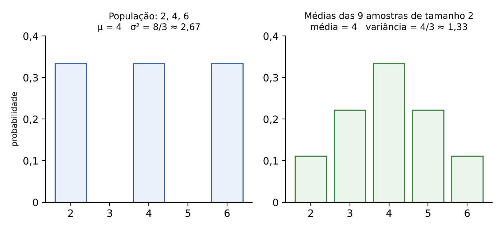

### 14.3.3 As duas regras gerais

O exemplo revela as duas regras que valem sempre (para amostras aleatórias com reposição ou de população muito grande):

- 1ª regra: a média das médias amostrais é a própria média da população. Em símbolos: E(x̄) = μ. (E( ) significa "valor esperado", a média de longo prazo, ver Cap. 13.)
- 2ª regra: a variância da média amostral é a variância da população dividida por n. Em símbolos: Var(x̄) = σ² ÷ n.

Tirando a raiz quadrada da 2ª regra, obtemos o desvio-padrão da média amostral, que recebe um nome próprio, erro-padrão (EP):

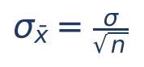

- σ_x̄ (ou EP): erro-padrão da média; mede o quanto a média amostral costuma se afastar de μ.
- σ: desvio-padrão da POPULAÇÃO (dos valores individuais).
- n: tamanho da amostra.
- √n: raiz quadrada de n (ver Cap. 1). Por isso, para reduzir o erro-padrão à METADE, é preciso QUADRUPLICAR a amostra (√4 = 2); para reduzi-lo a um décimo, multiplicar n por 100.

:::EXEMPLO Calculando o erro-padrão
População com desvio-padrão σ = 12 reais; amostra de n = 36 notas.
- √36 = 6.
- EP = 12 ÷ 6 = 2.
Se a amostra passar a 144 notas (quatro vezes maior):
- √144 = 12.
- EP = 12 ÷ 12 = 1. O erro-padrão caiu à metade.
:::

:::PEGADINHA Variância ou desvio-padrão?
A FCC costuma dar a VARIÂNCIA populacional ("variância igual a 2,56") e uma das alternativas sempre nasce de quem usa 2,56 direto como se fosse σ. Antes de tudo, tire a raiz: σ = √2,56 = 1,6. E se a pergunta for sobre a VARIÂNCIA da média, não tire raiz nenhuma: Var(x̄) = σ² ÷ n.
:::

### 14.3.4 População finita e amostragem sem reposição

Quando a amostragem é SEM reposição e a amostra é uma fração considerável da população (a regra prática dos livros é n maior que 5% de N), o erro-padrão fica um pouco menor, porque cada elemento retirado "diminui" a incerteza restante. Multiplica-se então o erro-padrão pelo fator de correção para população finita (FCP):

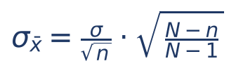

- N: tamanho da população; n: tamanho da amostra.
- Se n = N (censo), o fator vale zero: não há erro amostral nenhum, como deveria ser.
- Se N é enorme perto de n, o fator é praticamente 1 e pode ser ignorado.

:::ATENCAO Quando aplicar o FCP na prova
Aplique quando o enunciado disser "sem reposição" e der o tamanho N da população, sendo n uma fração relevante dela. Se disser "com reposição", "população infinita" ou "muito grande", não aplique. As questões da FCC do lote dizem expressamente "com reposição", exatamente para dispensar o fator. Ver, em 14.6, a questão Q3642031, em que o gabarito oficial ignorou o fator.
:::

### 14.3.5 Padronizando a média amostral

Se a média amostral tem média μ e desvio-padrão σ/√n, podemos transformá-la num escore Z da normal padrão (a mesma padronização do Cap. 13, agora com o erro-padrão no denominador):

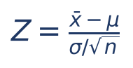

- x̄: valor da média amostral que nos interessa.
- μ: média da população.
- σ/√n: erro-padrão.
- Z: quantos erros-padrão a média amostral está acima (Z positivo) ou abaixo (Z negativo) de μ.

:::EXEMPLO Probabilidade sobre a média
Os débitos de ICMS de um setor têm média μ = 100 mil reais e desvio-padrão σ = 15 mil reais. Sorteiam-se 25 débitos. Qual a probabilidade de a média da amostra passar de 106 mil reais? Use P(Z < 2) = 0,9772.
- Erro-padrão: √25 = 5; EP = 15 ÷ 5 = 3.
- Z = (106 − 100) ÷ 3 = 6 ÷ 3 = 2.
- P(x̄ > 106) = P(Z > 2) = 1 − 0,9772 = 0,0228, ou seja, cerca de 2,28%.
Repare: um débito INDIVIDUAL acima de 106 seria comum (Z = 6 ÷ 15 = 0,4); uma MÉDIA de 25 débitos acima de 106 é rara. A média é muito mais estável que os valores isolados.
:::

:::QUESTAO FGV 2025 — Prefeitura do Rio de Janeiro — Gestor de Segurança Municipal (Q3782892)
População normal com média 5 e desvio-padrão 2. Qual a variância da distribuição amostral das médias para amostras de tamanho 5?
Gabarito: E (0,8).
Resolução:
- Variância da população: σ² = 2² = 4.
- Var(x̄) = σ² ÷ n = 4 ÷ 5 = 0,8.
Alternativas sedutoras: 0,4 nasce de dividir o desvio-padrão (2) por 5; 1 nasce de dividir 5 (a média) por 5; 2 é o próprio desvio-padrão.
:::

:::QUESTAO FGV 2025 — CNU — Bloco 5 (Q3643572)
Um analista do INSS quer que o erro-padrão da média amostral seja 5% do desvio-padrão populacional, em AAS com reposição. Qual o tamanho mínimo da amostra?
Gabarito: D (400 casos).
Resolução:
- Exigência: σ ÷ √n = 0,05 × σ.
- Dividimos os dois lados por σ (que é positivo): 1 ÷ √n = 0,05.
- Invertendo os dois lados: √n = 1 ÷ 0,05 = 20.
- Elevando ao quadrado: n = 20² = 400.
Alternativa sedutora: 20 não aparece, mas quem esquece de elevar ao quadrado e "chuta" proporcionalmente marca 100 ou 200.
:::

:::QUESTAO FGV 2025 — CNU — Bloco 5 (Q3643573)
Tempo de deslocamento normal, μ = 60 min, σ = 20 min. Três AAS: 25, 100 e 400 pessoas. Quer-se a probabilidade de a média amostral ficar entre 58 e 62 minutos (afastamento máximo de 2 minutos). Qual afirmação está certa?
Gabarito: C (na amostra 3, Z = 2,0, maior probabilidade).
Resolução:
- Amostra 1: EP = 20 ÷ √25 = 20 ÷ 5 = 4; Z = 2 ÷ 4 = 0,5.
- Amostra 2: EP = 20 ÷ √100 = 20 ÷ 10 = 2; Z = 2 ÷ 2 = 1,0.
- Amostra 3: EP = 20 ÷ √400 = 20 ÷ 20 = 1; Z = 2 ÷ 1 = 2,0.
- Quanto maior Z, maior a área central entre −Z e +Z: cerca de 38% (Z = 0,5), 68% (Z = 1) e 95% (Z = 2). A maior amostra dá a maior probabilidade.
Por que D está errada: o intervalo de ±2 minutos é fixo, mas o erro-padrão muda com n; logo Z muda.
:::

:::QUESTAO FGV 2026 — AL-RO — Analista Legislativo — Estatística (Q3883534)
X tem média desconhecida e variância 25. Com AAS de 225 elementos, qual a probabilidade de a média amostral não se afastar de μ por mais de 0,5?
Gabarito: B (87%).
Resolução:
- σ = √25 = 5; √225 = 15; EP = 5 ÷ 15 = 1/3.
- Z = 0,5 ÷ (1/3) = 0,5 × 3 = 1,5.
- Pela tabela da normal (Cap. 13), P(Z < 1,5) = 0,9332; a área entre −1,5 e +1,5 é 2 × 0,9332 − 1 = 0,8664, cerca de 87%.
:::

## 14.4 Teorema Central do Limite e Lei dos Grandes Números

### 14.4.1 Lei dos Grandes Números (LGN)

Ideia: quanto maior a amostra, mais a média amostral se aproxima da média verdadeira. Jogue uma moeda honesta 10 vezes e pode sair 7 caras (70%); jogue 10.000 vezes e a proporção de caras ficará muito perto de 50%. Isso não quer dizer que sairão EXATAMENTE 5.000 caras, nem que uma sequência de coroas "atrai" caras; quer dizer que a PROPORÇÃO converge para 50% à medida que n cresce.

É a LGN que dá base ao seguro, à loteria e à própria amostragem: no longo prazo, a média observada estabiliza no valor esperado.

### 14.4.2 Teorema Central do Limite (TCL)

Ideia: qualquer que seja a forma da distribuição da população (simétrica, torta, com picos, uniforme), a distribuição das MÉDIAS de amostras grandes tem a forma de sino (normal). A regra prática dos livros é n ≥ 30.

A figura mostra o fenômeno com um dado. O resultado de UM lançamento é uniforme (cada face com 1/6), sem nenhuma cara de sino. Mas a média de 2 lançamentos já forma um "telhado"; a de 5 lançamentos, um sino; a de 30, um sino estreito em torno de 3,5.

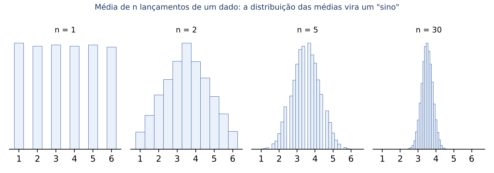

Enunciado de prova: se X₁, X₂, ..., Xₙ são independentes, com mesma distribuição, média μ e variância σ² finita, então, para n grande, x̄ tem distribuição aproximadamente normal com média μ e variância σ²/n. Se a população JÁ for normal, a média amostral é normal para QUALQUER n, mesmo pequeno.

Por que o TCL é tão importante? Porque nos permite usar a tabela da normal para fazer inferência sobre a média sem conhecer a distribuição da população. É ele que sustenta os intervalos de confiança de 14.6 e os testes do Cap. 15.

### 14.4.3 A versão para a SOMA

Se a média de n valores é aproximadamente normal, a soma também é (a soma é só a média multiplicada por n). Para a soma S = X₁ + X₂ + ... + Xₙ:
- média da soma: n × μ;
- variância da soma: n × σ²;
- desvio-padrão da soma: σ × √n.

:::PEGADINHA Média e soma se comportam ao contrário
O desvio-padrão da MÉDIA é σ DIVIDIDO por √n (diminui com n). O desvio-padrão da SOMA é σ MULTIPLICADO por √n (aumenta com n). Questões de "peso total das bagagens" ou "arrecadação total" pedem a soma.
:::

:::EXEMPLO Arrecadação total de 49 contribuintes
O imposto anual pago por contribuinte de um grupo tem média 300 reais e desvio-padrão 70 reais. Qual a probabilidade de 49 contribuintes sorteados pagarem, juntos, mais de 15.680 reais? Use P(Z < 2) = 0,9772.
- Média da soma: 49 × 300 = 14.700.
- Desvio-padrão da soma: 70 × √49 = 70 × 7 = 490.
- Z = (15.680 − 14.700) ÷ 490 = 980 ÷ 490 = 2.
- P(S > 15.680) = 1 − 0,9772 = 0,0228 (2,28%).
:::

:::QUESTAO FGV 2024 — DATAPREV — ATI (Q3086073)
O peso da bagagem por passageiro tem média 20 kg e desvio-padrão 5 kg. Voo lotado com 100 passageiros. Aproximando a soma pela normal, qual a probabilidade de o peso total passar de 2.100 kg?
Gabarito: D (2,28%).
Resolução:
- Média da soma: 100 × 20 = 2.000 kg.
- Desvio-padrão da soma: 5 × √100 = 5 × 10 = 50 kg.
- Z = (2.100 − 2.000) ÷ 50 = 100 ÷ 50 = 2.
- P(Z > 2) = 1 − 0,9772 = 0,0228 = 2,28%.
Alternativas sedutoras: 97,72% é P(Z < 2), o complemento; 0,9772% é erro de vírgula; 4,55% é a área das DUAS caudas (|Z| > 2), quando só interessa a de cima.
:::

:::QUESTAO FGV 2024 — TCE-PA — Auditor de Controle Externo (Q2607671)
Somam-se 9 observações independentes de uma normal com média 0 e variância 1. Qual o valor mais próximo da probabilidade de a soma ser maior que 1,8?
Gabarito: C (0,27).
Resolução:
- Média da soma: 9 × 0 = 0. Desvio-padrão da soma: 1 × √9 = 3.
- Z = (1,8 − 0) ÷ 3 = 0,6.
- Pela tabela, P(Z < 0,6) = 0,7257; logo P(Z > 0,6) = 1 − 0,7257 = 0,2743 ≈ 0,27.
Armadilha: quem usa desvio-padrão 9 (soma das variâncias, sem raiz) obtém Z = 0,2 e probabilidade perto de 0,42 (alternativa A).
:::

:::QUESTAO FGV 2024 — TJ-AP — Analista Judiciário — Estatístico (Q2450815)
Alturas de pinheiros com variância conhecida. Qual afirmação sobre o TCL e a LGN está correta?
Gabarito: E (pela LGN, em grandes amostras a média amostral converge para a média populacional à medida que n aumenta).
Resolução, alternativa por alternativa:
- A) Errada: o que diminui com n é a variância da MÉDIA amostral, não a variância das alturas (a população não muda porque a amostra cresceu).
- B) Errada: o TCL fala em normalidade aproximada para n GRANDE, não "independentemente do tamanho" (só seria assim se a população já fosse normal).
- C) Errada: a média se APROXIMA de μ, não se afasta.
- D) Errada: a LGN fala em convergência quando n cresce, não em igualdade para qualquer n.
- E) Correta: é o enunciado da LGN.
:::

:::QUESTAO FGV 2024 — TJ-AP — Analista Judiciário — Estatístico (Q2450810)
Ainda sobre TCL e LGN, qual afirmação é correta?
Gabarito: C (o TCL permite inferência sobre a média mesmo sem conhecer a distribuição da população).
Resolução: A e B trocam "aumenta" por "diminui" (o TCL vale quando n AUMENTA); D atribui à LGN uma tendência do desvio-padrão para o valor esperado, o que não faz sentido; E é falsa porque LGN e TCL são resultados complementares sobre a média amostral (a LGN diz para onde ela vai; o TCL diz com que forma ela se distribui em torno desse ponto).
:::

:::QUESTAO FGV 2026 — MPE-ES — Agente Técnico — Estatístico (Q4220335)
Julgar: (1) pela LGN, a média amostral da renda tende à média populacional quando n aumenta; (2) pelo TCL, conforme n aumenta, a distribuição DA RENDA tende à normal; (3) pelo TCL, a variância DA RENDA diminui com o aumento de n.
Gabarito: C (V – F – F).
Resolução: (1) é a LGN. (2) e (3) cometem o mesmo erro: atribuem à variável original (a renda de cada pessoa) o que vale para a MÉDIA amostral. A distribuição da renda continua assimétrica; o que fica normal e com variância menor é a distribuição de x̄.
No mesmo sentido: Q2496479 (FGV 2024, 100 moedas honestas: espera-se "em torno de" 50 caras, gabarito D) e Q2496480 (FGV 2024, "teorema do macaco infinito" ilustra a Lei dos Grandes Números, gabarito D).
:::

:::PRATIQUE exercícios elaborados para esta apostila
1. População com σ = 12. Qual o erro-padrão da média para n = 16? E para n = 64?
2. População com variância 50. Qual a variância da média amostral para n = 10?
3. Valores de autos de infração têm média 100 e desvio-padrão 15 (mil reais). Para amostras de 25 autos, qual a probabilidade de a média passar de 106? E de um auto isolado passar de 106? Use P(Z < 2) = 0,9772 e P(Z < 0,4) = 0,6554.
4. (estilo FCC) O tempo de atendimento tem distribuição desconhecida, com média 12 minutos e desvio-padrão 6 minutos. Numa amostra de 36 atendimentos, qual a probabilidade de a média ficar entre 11 e 13 minutos? Use P(Z < 1) = 0,8413.
Resolução:
1. n = 16: √16 = 4; EP = 12 ÷ 4 = 3. n = 64: √64 = 8; EP = 12 ÷ 8 = 1,5. Quadruplicar n dividiu o EP por 2.
2. Var(x̄) = 50 ÷ 10 = 5 (sem raiz, porque se pede a variância).
3. Média: EP = 15 ÷ √25 = 15 ÷ 5 = 3; Z = (106 − 100) ÷ 3 = 2; P = 1 − 0,9772 = 0,0228. Auto isolado: Z = 6 ÷ 15 = 0,4; P = 1 − 0,6554 = 0,3446.
4. Pelo TCL (n = 36 é grande), x̄ é aproximadamente normal. EP = 6 ÷ √36 = 6 ÷ 6 = 1. Z para 13: (13 − 12) ÷ 1 = 1; para 11: −1. P(−1 < Z < 1) = 2 × 0,8413 − 1 = 0,6826, cerca de 68%.
:::

## 14.5 Estimação pontual e propriedades dos estimadores

### 14.5.1 A ideia

Estimar "pontualmente" é dar UM número como melhor palpite para o parâmetro: "a média é 87,40". É como a sentença que fixa um valor de indenização: um ponto só, sem faixa. Os estimadores pontuais mais usados são:
- para a média μ: a média amostral x̄;
- para a proporção p: a proporção amostral p̂ = x ÷ n (x = número de "sucessos" na amostra);
- para a variância σ²: a variância amostral s², com divisão por n − 1.

Mas como saber se um estimador é "bom"? A banca cobra quatro qualidades, que se entendem bem com a imagem do tiro ao alvo: o alvo é o parâmetro; cada tiro é a estimativa de uma amostra.

- Não viesado (não tendencioso, não viciado): em média, acerta o centro do alvo. Em símbolos, E(T) = θ, isto é, o valor esperado do estimador T é igual ao parâmetro θ ("teta", símbolo genérico de parâmetro). Viés = E(T) − θ.
- Eficiente (de variância mínima): os tiros ficam agrupados, com pouca dispersão. Entre dois estimadores não viesados, o mais eficiente é o de MENOR variância.
- Consistente: à medida que n cresce, o estimador se aproxima do parâmetro (converge em probabilidade), com viés e variância tendendo a zero.
- Suficiente: aproveita toda a informação relevante que a amostra contém sobre o parâmetro.

Uma medida que junta viés e dispersão é o erro quadrático médio: EQM = variância + viés². O bom estimador tem EQM pequeno.

:::ESQUEMA Bom estimador
Desejável: viés zero (ou pequeno), variância pequena, consistência, suficiência e EQM pequeno.
Indesejável: ser tendencioso, ter variância grande, ter EQM grande, piorar com o aumento de n.
:::

### 14.5.2 Testando se um estimador é não viesado

Roteiro: calcule o valor esperado do estimador usando a regra E(Xᵢ) = μ para cada observação e veja se o resultado é μ. Para estimadores do tipo "combinação de observações", basta SOMAR OS COEFICIENTES: se a soma for 1, o estimador é não viesado para μ.

:::EXEMPLO Três estimadores para μ com amostra X₁, X₂
- T₁ = (X₁ + X₂) ÷ 2: coeficientes 1/2 e 1/2; soma 1. E(T₁) = μ. Não viesado.
- T₂ = X₁: coeficiente 1. Também não viesado (mas usa só metade da informação).
- T₃ = (2X₁ + X₂) ÷ 2: coeficientes 1 e 1/2; soma 1,5. E(T₃) = 1,5μ. Viesado.
Qual é mais eficiente entre T₁ e T₂? Var(T₁) = σ² ÷ 2 (regra de 14.3.3 com n = 2); Var(T₂) = σ². T₁ tem metade da variância: é mais eficiente.
:::

### 14.5.3 Por que s² divide por n − 1

Se dividíssemos a soma dos quadrados dos desvios por n, a variância amostral SUBESTIMARIA sistematicamente σ², porque os desvios são medidos em torno de x̄ (que é "puxada" para perto dos próprios dados) e não em torno do μ verdadeiro. A divisão por n − 1 (a "correção de Bessel") remove esse viés:

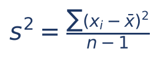

- xᵢ: cada valor da amostra; x̄: a média amostral; Σ: "some todos".
- n − 1: os graus de liberdade. Intuição: uma vez calculada x̄, só n − 1 desvios estão "livres", porque a soma de todos os desvios é sempre zero; o último é determinado pelos demais.

:::EXEMPLO Variância com n − 1 e com n
Amostra: 3, 5, 7, 9.
- x̄ = (3 + 5 + 7 + 9) ÷ 4 = 24 ÷ 4 = 6.
- Desvios: −3, −1, +1, +3. Quadrados: 9, 1, 1, 9. Soma: 20.
- s² (não viesado) = 20 ÷ (4 − 1) = 20 ÷ 3 ≈ 6,67.
- Versão com divisão por n (estimador de máxima verossimilhança, viesado): 20 ÷ 4 = 5.
- Relação entre as duas: 5 = 6,67 × (3 ÷ 4). Em geral, versão por n = s² × (n − 1) ÷ n.
:::

### 14.5.4 Métodos de obter estimadores (noções)

- Máxima verossimilhança (MV): escolhe o valor do parâmetro que torna MAIS PROVÁVEL a amostra observada. Resultados que caem: para Bernoulli, o estimador de MV de p é a média amostral (a proporção de "1"); para Poisson, o de λ é a média amostral; para a normal, o de μ é x̄ e o de σ² é a variância com divisão por n (viesada). Para a exponencial de parâmetro λ, o de MV é 1 ÷ x̄ (e NÃO x̄).
- Método dos momentos: iguala os momentos da amostra (média, média dos quadrados) aos da população. Para a média populacional, dá x̄, o mesmo do método dos mínimos quadrados.
- Mínimos quadrados: escolhe o valor que minimiza a soma dos quadrados dos desvios; a média é o valor que minimiza Σ(xᵢ − m)².
- Inferência bayesiana: parte de uma distribuição "a priori" para o parâmetro (conhecimento prévio), observa os dados e atualiza essa distribuição, obtendo a distribuição "a posteriori" (a mesma lógica do Teorema de Bayes, Cap. 12).

Sob população normal, x̄ é não viesado, de variância uniformemente mínima, de máxima verossimilhança, consistente e suficiente para μ; além disso, x̄ e s² são independentes.

:::QUESTAO FGV 2025 — TCE-PI — Auditor de Controle Externo (Q3154445)
Um bom estimador de um parâmetro θ deve ser: (A) não tendencioso e com variância grande; (B) tendencioso e com variância pequena; (C) não tendencioso e com variância pequena; (D) tendencioso e com variância grande; (E) com tendência pequena compensada por variância grande.
Gabarito: C.
Resolução: é o alvo acertado no centro (sem viés) e com tiros agrupados (variância pequena).
No mesmo sentido: Q2524691 (FGV 2024: das três propriedades, só "variância pequena" é desejável; tendenciosidade e EQM máximo não, gabarito B) e Q2518277 (FGV 2024: as propriedades mais desejáveis são não tendenciosidade e variância mínima, gabarito A).
:::

:::QUESTAO FGV 2024 — TJ-AP — Analista Judiciário — Estatístico (Q2450826)
Sobre propriedades dos estimadores, qual afirmação é correta?
Gabarito: D (suficiência: toda a informação relevante da amostra para estimar o parâmetro).
Resolução, alternativa por alternativa:
- A) Errada: eficiência é a MENOR variância entre os não viesados.
- B) Errada: robustez é ser POUCO sensível a violações dos pressupostos.
- C) Errada: viés surge justamente quando o estimador, em média, sobrestima ou subestima o parâmetro.
- D) Correta.
- E) Errada: consistência ocorre quando n AUMENTA, não quando se reduz.
:::

:::QUESTAO FGV 2026 — AL-RO — Analista Legislativo — Estatística (Q3883540)
Com amostra X₁, X₂, X₃, X₄ de média μ, quais estimadores são não tendenciosos? T₁ = (X₁ + X₂ + X₃ + X₄)/4; T₂ = (2X₁ − 3X₂ + 3X₃ − 2X₄)/4; T₃ = (X₁ + 2X₂ + 3X₃ + 4X₄)/10; T₄ = X₁.
Gabarito: D (T₁, T₃ e T₄; a alternativa os chama de "X1, X3 e X4").
Resolução (somando os coeficientes):
- T₁: 1/4 + 1/4 + 1/4 + 1/4 = 1. Não viesado.
- T₂: (2 − 3 + 3 − 2) ÷ 4 = 0 ÷ 4 = 0. E(T₂) = 0 × μ = 0. Viesado.
- T₃: (1 + 2 + 3 + 4) ÷ 10 = 10 ÷ 10 = 1. Não viesado.
- T₄: coeficiente 1. Não viesado.
:::

:::QUESTAO FGV 2025 — CGE-SP — Auditor Estadual de Controle (Q3786839)
População normal; X̄ é a média amostral e S² a variância amostral usual (divisão por n − 1). Julgar: I. X̄ é estimador não tendencioso de μ; II. S² é estimador tendencioso de σ²; III. X̄ e S² são correlacionados.
Gabarito: A (I, apenas).
Resolução:
- I. Correta: E(x̄) = μ (14.3.3).
- II. Errada: com divisão por n − 1, S² é NÃO tendencioso (14.5.3).
- III. Errada: na população normal, x̄ e s² são independentes, logo não correlacionados.
:::

:::QUESTAO FGV 2024 — TJ-MS — Estatístico (Q2496484)
A variância corrigida por Bessel (divisão por n − 1) de uma amostra de tamanho 4 vale 3. Quanto vale o estimador de máxima verossimilhança (divisão por n)?
Gabarito: C (9/4).
Resolução:
- A soma dos quadrados dos desvios é a mesma nas duas versões. Da versão corrigida: SQ ÷ 3 = 3, logo SQ = 9.
- Versão de MV: SQ ÷ n = 9 ÷ 4 = 9/4 = 2,25.
:::

:::QUESTAO FGV 2024 — TJ-RR — Analista Judiciário — Estatística (Q3088060)
Amostra de uma Bernoulli(p): 1 1 0 0 0 1 0 1 0 1 0 0 0 0 1 0 1 1 1 0 1 1 0 0 1. Qual a estimativa de máxima verossimilhança de p?
Gabarito: D (0,48).
Resolução:
- O estimador de MV de p é a proporção de "1" (a média amostral).
- Contando os "1": são 12 entre 25 observações.
- p̂ = 12 ÷ 25 = 0,48.
No mesmo sentido: Q3349752 (FGV 2025: média amostral é o estimador de MV na Bernoulli e na Poisson, mas não na exponencial, gabarito C); Q2535784 (FGV 2024: na normal, x̄ é não tendencioso de variância uniformemente mínima, de MV e suficiente, gabarito E); Q4220339 (FGV 2026: para a média, momentos e mínimos quadrados dão o mesmo estimador, gabarito C); Q4218171 (FGV 2026: priori, dados e posteriori descrevem a inferência bayesiana, gabarito B).
:::

:::PRATIQUE exercícios elaborados para esta apostila
1. Numa amostra de 200 declarações, 30 tinham inconsistência. Qual a estimativa pontual da proporção de declarações inconsistentes?
2. Amostra: 2, 4, 9. Calcule x̄, s² (com n − 1) e a versão com divisão por n.
3. Para amostra X₁, X₂, X₃, o estimador T = (X₁ + X₂ + 2X₃) ÷ 4 é não viesado para μ? E T' = (X₁ + X₂ + X₃) ÷ 2?
4. (estilo FCC) T₁ = (X₁ + X₂ + X₃) ÷ 3 e T₂ = (X₁ + X₃) ÷ 2 são não viesados para μ. Qual é mais eficiente e por quê?
Resolução:
1. p̂ = 30 ÷ 200 = 0,15 (15%).
2. x̄ = (2 + 4 + 9) ÷ 3 = 15 ÷ 3 = 5. Desvios: −3, −1, +4. Quadrados: 9, 1, 16. Soma: 26. s² = 26 ÷ 2 = 13. Versão por n: 26 ÷ 3 ≈ 8,67.
3. T: coeficientes 1/4 + 1/4 + 2/4 = 4/4 = 1; não viesado. T': coeficientes 1/2 + 1/2 + 1/2 = 3/2; E(T') = 1,5μ; viesado.
4. Var(T₁) = σ² ÷ 3; Var(T₂) = σ² ÷ 2. Como σ²/3 é menor que σ²/2, T₁ é mais eficiente (usa as três observações).
:::

## 14.6 Intervalo de confiança para a média com σ conhecido

### 14.6.1 A ideia: trocar o ponto por uma faixa

A estimativa pontual quase nunca acerta exatamente o parâmetro. Se a amostra deu média 50, é muito improvável que μ seja exatamente 50,000; o mais honesto é dizer "μ está provavelmente entre 48 e 52". Essa faixa é o intervalo de confiança (IC).

Imagem útil: pescar um peixe parado num lago turvo. Uma lança (estimativa pontual) quase sempre erra; uma rede (intervalo) tem boa chance de pegar o peixe. Quanto mais larga a rede, mais segura a pesca, mas menos precisa a informação sobre onde o peixe está. O tamanho da rede é escolhido pelo nível de confiança.

O raciocínio vem direto de 14.3 e 14.4. Sabemos que x̄ se distribui como uma normal centrada em μ, com desvio-padrão σ/√n. Na normal padrão, 95% da área fica entre −1,96 e +1,96. Logo, em 95% das amostras, x̄ cai a menos de 1,96 erros-padrão de μ. Invertendo a frase: em 95% das amostras, μ está a menos de 1,96 erros-padrão de x̄.

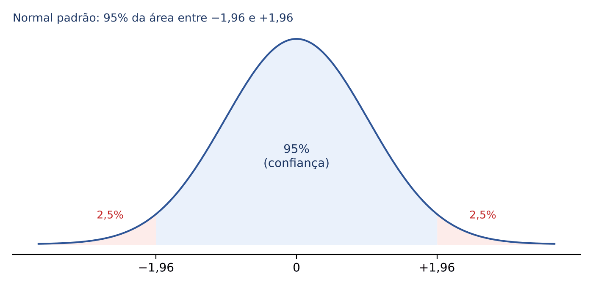

### 14.6.2 Exemplo feito à mão

Uma amostra de 100 processos deu tempo médio de tramitação x̄ = 50 dias. Sabe-se, de levantamentos anteriores, que σ = 10 dias. Construa o IC de 95%.
- Erro-padrão: √100 = 10; EP = 10 ÷ 10 = 1 dia.
- Margem de erro: E = 1,96 × 1 = 1,96 dia.
- Limite inferior: 50 − 1,96 = 48,04.
- Limite superior: 50 + 1,96 = 51,96.
- IC de 95% para μ: [48,04; 51,96] dias.

### 14.6.3 A fórmula

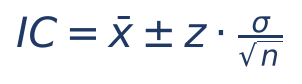

- x̄: média da amostra (o centro do intervalo).
- ±: "mais ou menos": subtraia para obter o limite inferior e some para obter o superior.
- z: valor crítico da normal padrão para o nível de confiança desejado (por exemplo, 1,96 para 95%).
- σ: desvio-padrão da POPULAÇÃO (conhecido); se o enunciado der a variância, tire a raiz.
- n: tamanho da amostra.
- A parte z × σ/√n é a margem de erro E (ou "erro máximo de estimativa"). A amplitude (largura total) do intervalo é 2 × E.

### 14.6.4 De onde vem o z (e a pegadinha da tabela)

O nível de confiança (1 − α) é a área central; o que sobra, α, divide-se em DUAS caudas iguais de α/2. Por isso o z procurado é aquele que deixa, à sua esquerda, a área 1 − α/2.

| Confiança | α (total fora) | Cada cauda (α/2) | Procure na tabela P(Z < z) = | z |
|---|---|---|---|---|
| 90% | 0,10 | 0,05 | 0,95 | 1,645 (a FCC costuma dar 1,64) |
| 95% | 0,05 | 0,025 | 0,975 | 1,96 |
| 99% | 0,01 | 0,005 | 0,995 | 2,575 (as bancas costumam dar 2,58) |

:::PEGADINHA O enunciado dá dois valores de z
A FCC escreve, por exemplo: "considere P(Z < 1,64) = 0,95 e P(Z < 1,96) = 0,975" e pede o intervalo de 95%. Quem vê "0,95" ao lado de 1,64 cai na armadilha. Para 95% de confiança BILATERAL, cada cauda tem 2,5%, e a área à esquerda do z é 0,975: o z certo é 1,96. A alternativa feita com 1,64 sempre está lá.
:::

:::PASSO Como resolver qualquer questão de IC para a média com σ conhecido
1. Identifique x̄, σ (se vier variância, tire a raiz) e n.
2. Calcule o erro-padrão: σ ÷ √n.
3. Escolha o z pelo nível de confiança (tabela acima; cuidado com a pegadinha da área 1 − α/2).
4. Margem de erro: E = z × EP.
5. Limites: x̄ − E e x̄ + E.
6. Se o enunciado disser "sem reposição" e der N com n relevante, multiplique o EP pelo fator de 14.3.4.
:::

### 14.6.5 O que alarga e o que estreita o intervalo

- Mais confiança (de 95% para 99%): z maior, intervalo MAIS LARGO. Não existe almoço grátis: mais segurança custa menos precisão.
- Amostra maior: √n maior, intervalo MAIS ESTREITO. Quadruplicar n corta a margem de erro pela metade.
- População mais dispersa (σ maior): intervalo MAIS LARGO.
- A média amostral não afeta a largura: só muda o centro.

:::DICA Lendo um intervalo pronto
Dado um intervalo [L; U] construído com a fórmula simétrica:
- centro (x̄) = (L + U) ÷ 2;
- margem de erro E = (U − L) ÷ 2.
Isso resolve, de cabeça, as questões em que a FCC dá um intervalo e muda só o tamanho da amostra ou o nível de confiança.
:::

:::QUESTAO FCC 2025 — Prefeitura de São Paulo — Auditor Municipal de Controle Interno (Q3281787)
Tempo de atendimento normal, com variância populacional 2,56 (min²). Amostra com reposição de 64 atendimentos, média 15 min. IC de 95%, dados P(Z < 1,64) = 95% e P(Z < 1,96) = 97,5%. Pede-se o limite SUPERIOR.
Gabarito: B (15,3920).
Resolução:
- σ = √2,56 = 1,6.
- √64 = 8; EP = 1,6 ÷ 8 = 0,2.
- 95% bilateral: área à esquerda 0,975, logo z = 1,96.
- E = 1,96 × 0,2 = 0,392.
- Limite superior: 15 + 0,392 = 15,392.
Alternativas sedutoras: 15,6272 (A) nasce de usar a VARIÂNCIA 2,56 como se fosse σ (1,96 × 2,56 ÷ 8 = 0,6272). Quem usa 1,64 obtém 15,328, que não está entre as opções; as demais são distratores.
:::

:::QUESTAO FCC 2025 — Prefeitura de São Paulo — Analista de Planejamento (Q3281588)
Salários (em salários mínimos) normais com variância populacional 2,25. Amostra com reposição de 100 empregados, média 4,8. Dados P(Z < 1,64) = 0,95 e P(Z < 1,96) = 0,975. IC de 95% para a média.
Gabarito: E ([4,506; 5,094]).
Resolução:
- σ = √2,25 = 1,5.
- √100 = 10; EP = 1,5 ÷ 10 = 0,15.
- z = 1,96 (área à esquerda 0,975).
- E = 1,96 × 0,15 = 0,294.
- Limites: 4,8 − 0,294 = 4,506 e 4,8 + 0,294 = 5,094.
Alternativa sedutora: A, [4,554; 5,046], é exatamente o intervalo calculado com 1,64 (1,64 × 0,15 = 0,246). É a pegadinha da tabela, montada de propósito.
:::

:::QUESTAO FCC 2024 — SEAD-PI e SEPLAN-PI — Analista Governamental (Q3737626 e Q3550520)
Alturas de praticantes de boxe normais, σ = 9 cm. Com amostra de 64 atletas, o IC foi [163,16; 166,84]. Repete-se o estudo com amostra QUATRO VEZES MAIOR, obtendo a mesma média. Mantida a confiança, qual o novo intervalo? (As duas provas trouxeram a mesma questão.)
Gabarito: A ([164,08; 165,92]) nas duas.
Resolução (sem precisar descobrir o z):
- Centro: (163,16 + 166,84) ÷ 2 = 330 ÷ 2 = 165.
- Margem antiga: (166,84 − 163,16) ÷ 2 = 3,68 ÷ 2 = 1,84.
- A margem é z × σ ÷ √n. Com n quatro vezes maior, √n fica √4 = 2 vezes maior, e a margem cai à metade: 1,84 ÷ 2 = 0,92.
- Novo intervalo: 165 − 0,92 = 164,08 e 165 + 0,92 = 165,92.
Alternativas sedutoras: C repete o intervalo antigo (quem acha que n não muda nada); D, [161,16; 168,84], DOBRA a margem (erro de sentido: amostra maior estreita, não alarga); E divide a margem por 11,5, sem lógica; B desloca o centro.
:::

:::QUESTAO FGV 2024 — Prefeitura de Vitória — Analista em Gestão Pública — Estatístico (Q3052444)
Amostra de 25 de uma normal com variância σ² = 100; média amostral 60; P(Z < 1,96) = 0,975. IC de 95%.
Gabarito: C ((56,08; 63,92)).
Resolução:
- σ = √100 = 10; √25 = 5; EP = 10 ÷ 5 = 2.
- E = 1,96 × 2 = 3,92.
- Limites: 60 − 3,92 = 56,08 e 60 + 3,92 = 63,92.
No mesmo sentido (mesma estrutura, todas com gabarito A): Q3052435 (FGV 2024, σ² = 4, n = 25, x̄ = 5,48: EP 0,4, E 0,784, IC (4,70; 6,26)); Q3786838 (FGV 2025, σ² = 400, n = 100, x̄ = 250: EP 2, E 3,92, IC (246; 254)); Q3593185 (FGV 2025, σ² = 16, n = 100, x̄ = 30: EP 0,4, E 0,784, IC (29,2; 30,8)). E Q3154444 (FGV 2025) pede só a fórmula: (x̄ − z s/√n; x̄ + z s/√n), alternativa D.
:::

:::QUESTAO FGV 2025 — CNU — Bloco 2 (Q3642031)
Amostra aleatória de 625 famílias extraída de 2.500 famílias participantes; nota média 7,2; variância populacional 1,44; IC de 95% para a média.
Gabarito oficial: D ([7,10; 7,30]).
Resolução pela fórmula sem correção (a que o gabarito adotou):
- σ = √1,44 = 1,2; √625 = 25; EP = 1,2 ÷ 25 = 0,048.
- E = 1,96 × 0,048 = 0,09408 ≈ 0,094.
- Limites: 7,2 − 0,094 = 7,106 e 7,2 + 0,094 = 7,294, aproximadamente [7,11; 7,29]; a alternativa mais próxima é D, [7,10; 7,30].
Ponto discutível: a amostra é 25% da população (625 de 2.500) e, sendo naturalmente sem reposição, caberia o fator de população finita: √[(2.500 − 625) ÷ (2.500 − 1)] ≈ 0,866. Com ele, E ≈ 0,094 × 0,866 ≈ 0,0815, e o IC seria ≈ [7,12; 7,28], que é a alternativa E. O gabarito oficial ignorou a correção. Na prova, se o enunciado não falar em reposição nem em correção, siga a fórmula simples, mas desconfie quando a alternativa "corrigida" também aparecer.
:::

:::PRATIQUE exercícios elaborados para esta apostila
1. Amostra de 36 restituições de IPVA: média 200 reais; σ = 30 reais. IC de 95% e de 99% (use 1,96 e 2,58).
2. Um IC de 95% para μ, com σ conhecido, foi [12,3; 13,7]. Qual a média amostral e a margem de erro? E qual seria o intervalo com amostra quatro vezes maior e mesma média?
3. (estilo FCC) População normal com variância 144. Amostra de 144 elementos, com reposição, média 80. Dados P(Z < 1,64) = 0,95 e P(Z < 1,96) = 0,975, determine o IC de 90%.
Resolução:
1. EP = 30 ÷ √36 = 30 ÷ 6 = 5. 95%: E = 1,96 × 5 = 9,8; IC = [190,2; 209,8]. 99%: E = 2,58 × 5 = 12,9; IC = [187,1; 212,9]. O de 99% é mais largo.
2. x̄ = (12,3 + 13,7) ÷ 2 = 26 ÷ 2 = 13. E = (13,7 − 12,3) ÷ 2 = 1,4 ÷ 2 = 0,7. Com n quadruplicado, E = 0,7 ÷ 2 = 0,35; IC = [12,65; 13,35].
3. σ = √144 = 12; EP = 12 ÷ √144 = 12 ÷ 12 = 1. Para 90% bilateral, cada cauda tem 5%, e a área à esquerda é 0,95: z = 1,64. E = 1,64 × 1 = 1,64. IC = [78,36; 81,64].
:::

## 14.7 Interpretação correta do nível de confiança

Esta é a parte mais cobrada em questões teóricas, e a interpretação é sutil.

O parâmetro μ é FIXO (não é sorteado). O que varia de amostra para amostra é o INTERVALO. Assim, "95% de confiança" significa: se repetíssemos o procedimento (sortear uma amostra e construir o intervalo) muitas vezes, cerca de 95% dos intervalos obtidos conteriam o verdadeiro μ, e cerca de 5% não conteriam. A confiança é uma propriedade do MÉTODO, não de um intervalo específico.

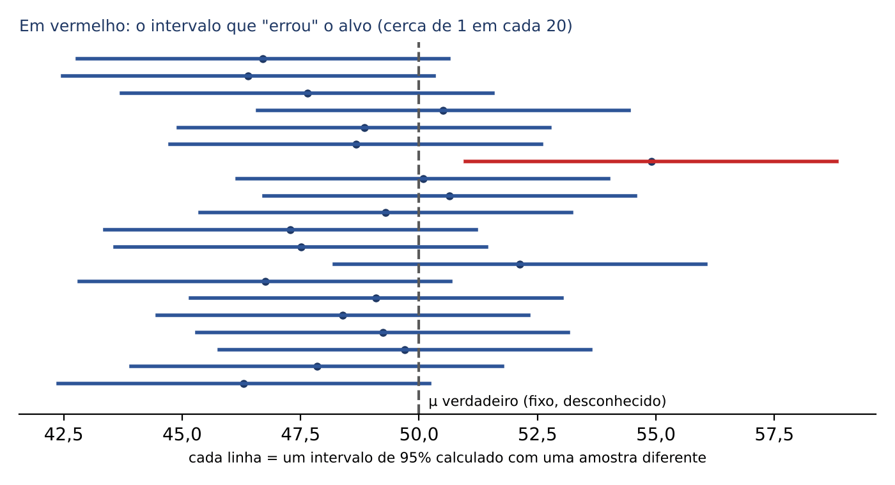

A analogia judicial ajuda: o nível de confiança é como a taxa de acerto de um procedimento probatório bem desenhado. Dizer que o procedimento acerta em 95% dos casos não autoriza dizer que, NESTE processo, há 95% de chance de a decisão estar certa; ou acertou, ou não.

:::PEGADINHA As interpretações ERRADAS mais comuns
- "95% da população está dentro do intervalo." Errado: o IC é sobre a MÉDIA (ou a proporção), não sobre os indivíduos. Um IC para a renda MÉDIA de 3.500 a 4.200 reais nada diz sobre quantas pessoas ganham entre esses valores.
- "A média populacional é o ponto médio do intervalo." Errado: o ponto médio é a média AMOSTRAL; a populacional é desconhecida.
- "Há 95% de probabilidade de μ estar neste intervalo já calculado." Rigorosamente errado na interpretação clássica (μ não é aleatório). Algumas questões da FGV, porém, aceitam a fórmula solta "o nível de confiança indica a probabilidade de o intervalo conter o verdadeiro valor" (ver Q3174692, adiante). Na dúvida, prefira sempre a alternativa da "repetição do procedimento".
- "Os resultados estão corretos para 95% dos entrevistados." Errado: não tem sentido.
:::

:::QUESTAO FCC 2025 — TRT 15ª Região — Analista Judiciário — Comunicação Social (Q3303195)
Pesquisa eleitoral de segundo turno: candidato Azul com 52%, Amarelo com 48%, margem de erro de 3 pontos, confiança de 95%. O que isso significa?
Gabarito: E (se fossem ouvidas 100 amostras diferentes com os mesmos critérios, em cerca de 95 delas os resultados ficariam entre 49% e 55% para o Azul e entre 45% e 51% para o Amarelo).
Resolução:
- Faixas: Azul 52 − 3 = 49 a 52 + 3 = 55; Amarelo 48 − 3 = 45 a 48 + 3 = 51.
- A alternativa E traduz a ideia de repetição do procedimento (95 de cada 100). A redação da banca é um pouco livre, mas é a única que capta o sentido do nível de confiança.
Por que as outras estão erradas:
- A) Confiança não é "acerto em 95% dos entrevistados".
- B) Confunde nível de confiança com faixas de probabilidade de acerto (92% a 98%), somando e subtraindo a margem do próprio 95%.
- C) A margem de erro não é variação do TAMANHO da amostra.
- D) Errada: as faixas se sobrepõem (49 a 55 contra 45 a 51; entre 49 e 51 há empate técnico); não se pode afirmar que o Azul "dificilmente será alcançado".
:::

:::QUESTAO FGV 2026 — DATAPREV — Analista de TI (Q4389071 e Q4391285)
Pesquisa revelou IC de 95% para a renda MÉDIA da população local de 3.500 a 4.200 reais. Qual afirmação é correta? (A mesma questão saiu em duas provas, com as alternativas em ordem diferente.)
Gabarito oficial: E na Q4389071 ("se o procedimento fosse repetido muitas vezes, aproximadamente 95% dos intervalos conteriam a verdadeira renda média"). Na Q4391285, o banco registra gabarito B ("aproximadamente 2,5% da população ganha acima de 4.200 reais"), o que é discutível: ali a alternativa correta pela teoria é a E, de mesmo texto.
Resolução:
- A alternativa da repetição do procedimento é a interpretação correta (14.7).
- "95% da população ganha entre 3.500 e 4.200" e "2,5% ganha acima de 4.200" confundem intervalo para a MÉDIA com faixa de rendas INDIVIDUAIS.
- "A renda média é 3.850" confunde o centro do intervalo (média amostral) com o parâmetro.
- "No máximo 5% tem renda inferior a 3.500" repete o mesmo erro.
:::

:::QUESTAO FGV 2025 — TCE-RR — Auditor Substituto de Conselheiro (Q3174692)
Julgar: I. na estimação pontual busca-se um único valor como melhor estimativa; II. o IC fornece uma estimativa por intervalo, com um nível de confiança que indica a probabilidade de o intervalo conter o verdadeiro valor do parâmetro; III. H₀ não é rejeitada se o valor-p for maior que α; IV. o erro tipo I ocorre quando H₀ não é rejeitada mas deveria ter sido.
Gabarito: D (I, II e III, apenas).
Resolução: I é a definição de 14.5. II foi aceita pela banca na redação "solta" comentada em 14.7. III e IV são de testes de hipóteses (Cap. 15): III está certa; IV descreve o erro tipo II, não o tipo I.
No mesmo sentido: Q3185959 (FGV 2025: estimativa pontual NÃO é obtida por intervalo; erro tipo I é rejeitar H₀ verdadeira; gabarito D, F – V – F).
:::

:::QUESTAO FGV 2026 — HU Brasil — Medicina do Sono (Q4318818)
Metanálise: razão de chances (OR) de resposta da amitriptilina contra a mirtazapina = 0,97, com IC de 95% de 0,77 a 1,21. Qual conclusão é correta?
Gabarito: B (não há diferença estatisticamente significativa, porque o IC inclui 1,0).
Resolução: numa razão (OR, risco relativo), o valor 1 significa "nenhuma diferença". Se o intervalo contém o 1, os dados são compatíveis com ausência de diferença. A alternativa C erra ao tratar "ausência de significância" como prova de equivalência ("ausência de prova não é prova de ausência"). A mesma lógica vale para diferenças de médias: se o IC da diferença contém o zero, não há diferença significativa (ligação com o Cap. 15).
:::

## 14.8 Intervalo para a média com σ desconhecido: a t de Student

### 14.8.1 A ideia

Na vida real quase nunca se conhece σ, o desvio-padrão da população. A solução natural é usar no lugar dele o desvio-padrão da amostra, s. Mas s também varia de amostra para amostra; isso acrescenta incerteza, e o intervalo precisa ficar um pouco mais largo. Para isso, troca-se o z da normal por um valor t, tirado da distribuição t de Student.

A t de Student tem forma de sino, simétrica em torno de zero, como a normal, mas com caudas "mais pesadas" (mais área longe do centro). Sua forma depende dos graus de liberdade (gl), que aqui valem n − 1 (a mesma ideia de 14.5.3: um grau de liberdade foi "gasto" no cálculo de x̄). Com poucos graus de liberdade, as caudas são bem pesadas; à medida que n cresce, a t se aproxima da normal.

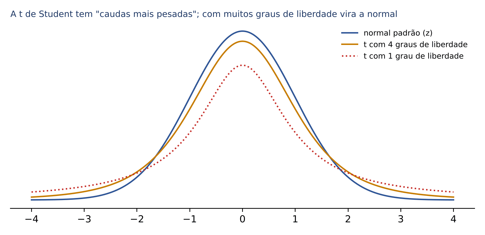

### 14.8.2 A fórmula

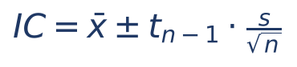

- x̄: média amostral.
- t com n − 1 graus de liberdade: valor da tabela t para o nível de confiança desejado (bilateral).
- s: desvio-padrão da AMOSTRA (calculado com n − 1).
- n: tamanho da amostra.
- Pressuposto: população (aproximadamente) normal, sobretudo quando a amostra é pequena.

Alguns valores de t para 95% de confiança bilateral (2,5% em cada cauda), para você sentir a diferença em relação a 1,96:

| Graus de liberdade (n − 1) | 4 | 8 | 9 | 14 | 15 | 24 | 29 | muitos |
|---|---|---|---|---|---|---|---|---|
| t (95%) | 2,776 | 2,306 | 2,262 | 2,145 | 2,131 | 2,064 | 2,045 | 1,96 |

A prova dará o valor de t, ou uma tabela da t. Para lê-la: (1) calcule gl = n − 1 (linha); (2) para 95% bilateral, procure a coluna de 0,025 em cada cauda (algumas tabelas trazem a coluna "0,05 bilateral"); o cruzamento é o t.

:::ATENCAO z ou t?
- σ (populacional) conhecido: use z, qualquer que seja n (com população normal ou n grande).
- σ desconhecido e substituído por s: use t com n − 1 graus de liberdade. Com amostra grande (regra prática n ≥ 30), t ≈ z e muitas questões aceitam z.
- Pistas no enunciado: "variância populacional igual a..." indica z; "desvio-padrão amostral", "variância desconhecida", "t de Student" indicam t.
:::

:::EXEMPLO IC com t
Amostra de 16 contribuintes: atraso médio x̄ = 20 dias, desvio-padrão amostral s = 4 dias; população suposta normal. IC de 95%, dado t₁₅ = 2,131.
- gl = 16 − 1 = 15.
- EP estimado: s ÷ √n = 4 ÷ 4 = 1.
- E = 2,131 × 1 = 2,131.
- IC: 20 − 2,131 = 17,869 e 20 + 2,131 = 22,131; isto é, [17,869; 22,131] dias.
- Compare: com z = 1,96 o intervalo seria [18,04; 21,96], mais estreito. A t "paga" a incerteza sobre σ.
:::

:::QUESTAO FGV 2026 — PC-PI — Perito Criminal (Q3850464)
Inventário florestal de 150 hectares, com 15 parcelas retangulares de 20 m × 50 m; quer-se erro amostral máximo de 10% com 95% de confiança. Média 15 m³/ha, desvio-padrão amostral 4 m³/ha, t = 2. Qual afirmação é correta sobre a fração amostrada e o erro?
Gabarito: B (fração de 1% e erro amostral superior a 10%).
Resolução:
- Área de cada parcela: 20 × 50 = 1.000 m². Como 1 hectare = 10.000 m², cada parcela tem 0,1 ha.
- Área amostrada: 15 × 0,1 = 1,5 ha. Fração: 1,5 ÷ 150 = 0,01 = 1%.
- EP estimado: 4 ÷ √15 ≈ 4 ÷ 3,873 ≈ 1,033.
- Margem: E = 2 × 1,033 ≈ 2,066 m³/ha.
- Erro relativo (em % da média): 2,066 ÷ 15 ≈ 0,138 = 13,8%, maior que os 10% admitidos (e menor que 20%).
:::

:::NOTA Noção: intervalo para a variância (qui-quadrado)
Para estimar a VARIÂNCIA de uma população normal usa-se a distribuição qui-quadrado com n − 1 graus de liberdade, que é assimétrica (por isso o intervalo não é "estimativa ± margem"). Limites: (n − 1)s² dividido pelo qui-quadrado da cauda superior (dá o limite inferior) e (n − 1)s² dividido pelo qui-quadrado da cauda inferior (dá o limite superior). Exemplo do banco, Q2517671 (FGV 2024, gabarito D): n = 8, s = 8; (n − 1)s² = 7 × 64 = 448; o qui-quadrado com 7 gl que deixa 2,5% acima é cerca de 16,01; limite inferior = 448 ÷ 16,01 ≈ 27,98, ou seja, 28. O tema é cobrado sobretudo em provas para estatístico; para a FCC basta saber que se usa a qui-quadrado.
:::

:::PRATIQUE exercícios elaborados para esta apostila
1. Amostra de 9 obras públicas: atraso médio 30 dias, s = 6 dias, população normal. IC de 95% com t₈ = 2,306.
2. No exercício 1, qual seria a margem de erro se, por engano, se usasse z = 1,96? O intervalo correto é mais largo ou mais estreito?
3. Quantos graus de liberdade tem a t num IC para a média com amostra de 25 elementos?
Resolução:
1. EP = 6 ÷ √9 = 6 ÷ 3 = 2. E = 2,306 × 2 = 4,612. IC = [30 − 4,612; 30 + 4,612] = [25,388; 34,612].
2. Com z: E = 1,96 × 2 = 3,92. O intervalo correto (com t) é mais largo, porque 2,306 é maior que 1,96.
3. gl = 25 − 1 = 24.
:::

## 14.9 Intervalo de confiança para a proporção

### 14.9.1 A ideia

Muitas perguntas do Fisco não são "quanto, em média?", mas "que porcentagem?": que porcentagem das notas tem erro? Que porcentagem das empresas está inadimplente? Que porcentagem dos eleitores vota no candidato X?

Cada elemento é um "sim" (1) ou "não" (0), uma Bernoulli (Cap. 13). A proporção amostral p̂ = x ÷ n é a média desses zeros e uns; por isso, pelo TCL, ela também é aproximadamente normal em amostras grandes, com média p e variância p(1 − p) ÷ n.

### 14.9.2 Exemplo feito à mão e fórmula

Uma amostra de 400 notas fiscais tem 80 com inconsistência. IC de 95% para a proporção de notas inconsistentes.
- p̂ = 80 ÷ 400 = 0,2.
- 1 − p̂ = 0,8.
- Erro-padrão: √(0,2 × 0,8 ÷ 400) = √(0,16 ÷ 400) = √0,0004 = 0,02.
- E = 1,96 × 0,02 = 0,0392.
- IC: 0,2 − 0,0392 = 0,1608 e 0,2 + 0,0392 = 0,2392; ou seja, entre cerca de 16,1% e 23,9%.

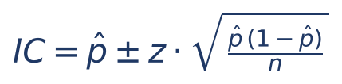

- p̂: proporção observada na amostra (x ÷ n), em forma decimal.
- 1 − p̂: proporção dos "não".
- n: tamanho da amostra.
- z: o mesmo da tabela de 14.6.4.
- Como p é desconhecido, usa-se p̂ no lugar dele dentro da raiz.
- Condição usual: amostra grande o bastante (regra prática: n × p̂ e n × (1 − p̂) pelo menos 5).

:::DICA Raiz sem calculadora
Arrume os números para ter quadrados perfeitos: 0,16 ÷ 400 = 0,0004, e √0,0004 = 0,02 (porque 0,02 × 0,02 = 0,0004). As bancas escolhem dados que "fecham": 0,36 × 0,64 = 0,2304, e √0,2304 = 0,48; 0,25 × 0,75 = 0,1875.
:::

:::QUESTAO FGV 2024 — Prefeitura de Vitória — Analista em Gestão Pública — Estatístico (Q3052445)
AAS de 100 indivíduos: 36 com a característica A. IC de 95% para p, usando a estimativa no lugar de p; P(Z < 1,96) = 0,975.
Gabarito: B ((0,266; 0,454)).
Resolução:
- p̂ = 36 ÷ 100 = 0,36; 1 − p̂ = 0,64.
- p̂(1 − p̂) = 0,36 × 0,64 = 0,2304; ÷ 100 = 0,002304.
- √0,002304 = 0,048 (porque √0,2304 = 0,48 e √100 = 10).
- E = 1,96 × 0,048 = 0,09408 ≈ 0,094.
- Limites: 0,36 − 0,094 = 0,266 e 0,36 + 0,094 = 0,454.
Alternativas: A, B, C e D são centradas em 0,36 e mudam só a margem (0,056; 0,094; 0,15; 0,158); E nem é simétrica em torno de 0,36. Basta, portanto, calcular a margem para identificar a resposta.
:::

:::QUESTAO FGV 2026 — AL-RO — Analista Legislativo — Estatística (Q3883543)
Em população muito grande, AAS de 400 eleitores: 144 favoráveis. IC de 95% para p.
Gabarito: E ((0,31; 0,41)).
Resolução:
- p̂ = 144 ÷ 400 = 0,36.
- EP = √(0,36 × 0,64 ÷ 400) = 0,48 ÷ 20 = 0,024.
- E = 1,96 × 0,024 ≈ 0,047.
- Limites: 0,36 − 0,047 = 0,313 e 0,36 + 0,047 = 0,407, que arredondam para (0,31; 0,41).
Repare na comparação com a questão anterior: mesma proporção (0,36), amostra 4 vezes maior (400 contra 100), margem pela metade (0,047 contra 0,094).
:::

:::PRATIQUE exercícios elaborados para esta apostila
1. Em 300 notas auditadas, 75 tinham erro. IC de 95% para a proporção de notas com erro.
2. Numa enquete com 100 servidores, 50 aprovaram o novo sistema. Qual a margem de erro de 95%?
3. (estilo FCC) Para a mesma proporção amostral, quantas vezes é preciso aumentar a amostra para reduzir a margem de erro de 6 para 2 pontos percentuais?
Resolução:
1. p̂ = 75 ÷ 300 = 0,25. p̂(1 − p̂) = 0,25 × 0,75 = 0,1875; ÷ 300 = 0,000625; √0,000625 = 0,025. E = 1,96 × 0,025 = 0,049. IC = [0,201; 0,299], cerca de 20% a 30%.
2. p̂ = 0,5. EP = √(0,5 × 0,5 ÷ 100) = √0,0025 = 0,05. E = 1,96 × 0,05 = 0,098, quase 10 pontos percentuais.
3. A margem cai de 6 para 2, isto é, fica 3 vezes menor. Como a margem é proporcional a 1 ÷ √n, √n precisa ficar 3 vezes maior, e n, 3² = 9 vezes maior.
:::

## 14.10 Margem de erro e tamanho da amostra

### 14.10.1 A ideia: decidir antes de sortear

Antes de mandar a equipe a campo, o gestor precisa responder: quantos elementos devo examinar? Amostra pequena demais dá margem de erro inaceitável; amostra grande demais desperdiça dinheiro e tempo de auditores. A resposta sai da própria fórmula da margem de erro, "virada ao contrário": em vez de calcular E a partir de n, fixamos o E desejado e calculamos n.

### 14.10.2 Tamanho da amostra para estimar uma média

Partimos de E = z × σ ÷ √n e isolamos n, passo a passo:
- Multiplicamos os dois lados por √n: E × √n = z × σ.
- Dividimos os dois lados por E: √n = z × σ ÷ E.
- Elevamos os dois lados ao quadrado: n = (z × σ ÷ E)².

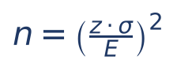

- n: tamanho mínimo da amostra.
- z: valor da normal para a confiança desejada (1,645; 1,96; 2,575).
- σ: desvio-padrão populacional (conhecido de estudos anteriores ou de amostra piloto); se vier a variância, use σ = √variância, ou lembre que σ² entra direto no numerador quando se abre o quadrado: n = z² × σ² ÷ E².
- E: margem de erro tolerada, na MESMA unidade da variável.

:::EXEMPLO Quantos processos examinar
Quer-se estimar o tempo médio de tramitação com margem de erro de 2 dias e 95% de confiança; sabe-se que σ = 20 dias.
- z × σ ÷ E = 1,96 × 20 ÷ 2 = 39,2 ÷ 2 = 19,6.
- n = 19,6² = 384,16.
- Arredondamos PARA CIMA: n = 385 processos.
:::

:::ATENCAO Sempre arredonde para cima
O n calculado é o MÍNIMO. Se der 384,16, com 384 a margem ficaria um pouquinho acima da tolerada; por isso o tamanho é 385, mesmo que a parte decimal seja pequena. As alternativas da banca às vezes trazem o valor arredondado para baixo como armadilha.
:::

### 14.10.3 Tamanho da amostra para estimar uma proporção

Mesma manobra com a margem da proporção, E = z × √[p(1 − p) ÷ n]:

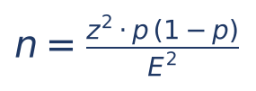

- p: proporção esperada (de estudo anterior ou piloto), em forma decimal.
- E: margem de erro em forma decimal (3 pontos percentuais = 0,03).
- z: como antes.

E se não se sabe nada sobre p? Usa-se o pior caso, p = 0,5, porque o produto p(1 − p) é máximo quando p = 0,5 (vale 0,25). Isso garante o tamanho suficiente qualquer que seja o p verdadeiro. É a abordagem "conservadora" ou de "máxima variabilidade".

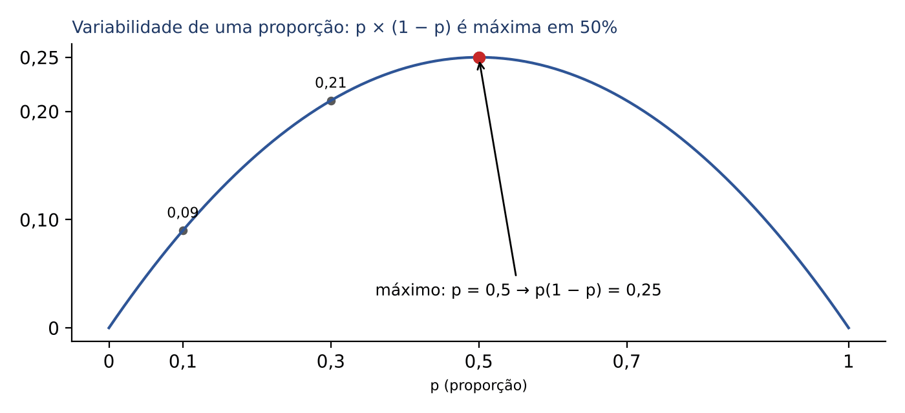

Com p = 0,5 a fórmula simplifica para n = z² × 0,25 ÷ E², ou n = (z ÷ 2E)².

:::EXEMPLO Pesquisa com margem de 3 pontos
Margem de 3% (0,03), 95% de confiança, sem informação sobre p.
- z² = 1,96² = 3,8416.
- p(1 − p) = 0,5 × 0,5 = 0,25.
- Numerador: 3,8416 × 0,25 = 0,9604.
- E² = 0,03² = 0,0009.
- n = 0,9604 ÷ 0,0009 = 1.067,1, arredondado para 1.068.
Se um estudo anterior indicar p ≈ 0,1: numerador 3,8416 × 0,1 × 0,9 = 3,8416 × 0,09 = 0,345744; n = 0,345744 ÷ 0,0009 = 384,16, arredondado para 385. Saber algo sobre p economizou quase dois terços da amostra.
:::

:::ESQUEMA Valores clássicos com p = 0,5 e 95% de confiança
| Margem de erro | Cálculo | n mínimo |
|---|---|---|
| 5% | 0,9604 ÷ 0,0025 = 384,16 | 385 |
| 3% | 0,9604 ÷ 0,0009 = 1.067,1 | 1.068 |
| 2% | 0,9604 ÷ 0,0004 = 2.401 | 2.401 |
| 1% | 0,9604 ÷ 0,0001 = 9.604 | 9.604 |
Repare: dividir a margem por 2 multiplica a amostra por 4; dividir por 5 multiplica por 25.
:::

### 14.10.4 E o tamanho da população?

Surpresa para muitos: quando a população é grande, o tamanho da amostra praticamente NÃO depende de N. Uma pesquisa com 2.401 entrevistas tem a mesma margem de erro para uma cidade de 1 milhão de habitantes ou para o país inteiro. O que importa é a confiança, a margem e a variabilidade.

Se a população for pequena (finita), corrige-se o n calculado (chamado n₀) pela fórmula:

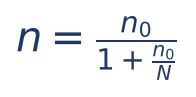

- n₀: tamanho calculado pelas fórmulas acima (população infinita).
- N: tamanho da população.

:::EXEMPLO Correção para população finita
n₀ = 385 e a população tem N = 1.000 contratos.
- n₀ ÷ N = 385 ÷ 1.000 = 0,385.
- Denominador: 1 + 0,385 = 1,385.
- n = 385 ÷ 1,385 ≈ 277,98, arredondado para 278 contratos.
:::

:::PASSO Como resolver qualquer questão de tamanho de amostra
1. Média ou proporção? (Pista: "desvio-padrão/variância" indica média; "porcentagem/proporção/inadimplentes/com erro" indica proporção.)
2. Identifique z pela confiança (cuidado com a tabela unilateral ou bilateral).
3. Escreva a margem E na forma decimal (proporção) ou na unidade da variável (média).
4. Proporção sem informação: use p = 0,5.
5. Aplique a fórmula e arredonde PARA CIMA.
6. População pequena e informada: aplique a correção finita.
:::

:::QUESTAO FCC 2026 — SEFAZ-SP — Auditor Fiscal da Receita Estadual (Q3916779)
Auditoria sobre o percentual de notas fiscais com inconsistência numa empresa que emite mais de 5 milhões de notas por ano. Sem informação prévia, adota-se máxima variabilidade. Margem de 2% e confiança de 95% (a prova forneceu tabela da normal). Tamanho mínimo da amostra?
Gabarito: B (2.401).
Resolução:
- Máxima variabilidade: p = 0,5; p(1 − p) = 0,25.
- 95%: z = 1,96; z² = 3,8416.
- Numerador: 3,8416 × 0,25 = 0,9604.
- E² = 0,02² = 0,0004.
- n = 0,9604 ÷ 0,0004 = 2.401.
- População de 5 milhões: grande o bastante para dispensar correção.
Atalho: n = (z ÷ 2E)² = (1,96 ÷ 0,04)² = 49² = 2.401.
:::

:::QUESTAO FCC 2026 — SEFAZ-GO — Auditor Fiscal da Receita Estadual (Q4066790)
Estimar a proporção de empresas inadimplentes de modo que a proporção amostral difira da verdadeira por menos de 2%, com probabilidade superior a 90%. Dado: z = 1,64. Menor tamanho da amostra?
Gabarito: B (1.681).
Resolução:
- Não há informação sobre p: p = 0,5.
- Atalho: z ÷ 2E = 1,64 ÷ (2 × 0,02) = 1,64 ÷ 0,04 = 41.
- n = 41² = 1.681.
- Conferência pela fórmula completa: 1,64² × 0,25 ÷ 0,0004 = 2,6896 × 0,25 ÷ 0,0004 = 0,6724 ÷ 0,0004 = 1.681.
Por que 1,64 serve para 90%: em 90% bilateral, cada cauda tem 5% e a área à esquerda é 0,95, que corresponde a z ≈ 1,64 (a notação "Z0,90" do enunciado é pouco precisa, mas o valor está certo). Quem usasse 1,96 chegaria a 2.401, que não está entre as opções.
:::

:::QUESTAO FGV 2025 — TRT 24ª Região — Analista Judiciário — Estatística (Q3349763)
Proporção sem informação prévia (pior caso), 95% de confiança, diferença máxima de 5%. Tamanho mínimo?
Gabarito: B (385).
Resolução: n = 1,96² × 0,25 ÷ 0,05² = 0,9604 ÷ 0,0025 = 384,16, arredondado para cima: 385.
No mesmo sentido: Q3883556 (FGV 2026, 99% e margem de 1%, com z = 2,58: 2,58² × 0,25 ÷ 0,0001 = 6,6564 × 0,25 ÷ 0,0001 = 16.641, gabarito D); Q3852107 (FGV 2026, p = 0,6 de estudo prévio, margem de 5%, 95%: 3,8416 × 0,6 × 0,4 ÷ 0,0025 = 3,8416 × 0,24 ÷ 0,0025 ≈ 368,8, arredondado para 369, alternativa mais próxima 370, gabarito E).
:::

:::QUESTAO FGV 2026 — AL-RO — Analista Legislativo — Estatística (Q3883541)
Média com variância 100; confiança de ao menos 90%; afastamento máximo de 0,4 unidade. Tamanho mínimo?
Gabarito: D (1.681).
Resolução:
- σ = √100 = 10; z (90%) = 1,64.
- z × σ ÷ E = 1,64 × 10 ÷ 0,4 = 16,4 ÷ 0,4 = 41.
- n = 41² = 1.681.
:::

:::QUESTAO FGV 2024 — TJ-MS — Estatístico (Q2496481)
Estimar o número médio de processos com 99% de confiança (z = 2,58), σ = 10 processos e margem de 1 processo. Menor tamanho?
Gabarito: E (666).
Resolução:
- z × σ ÷ E = 2,58 × 10 ÷ 1 = 25,8.
- n = 25,8² = 665,64, arredondado para cima: 666.
Alternativas sedutoras: 258 (D) é z × σ × 10, sem elevar ao quadrado; 26 (B) é só 25,8 arredondado, esquecendo o quadrado.
:::

:::QUESTAO FGV 2025 — Prefeitura do Rio de Janeiro — Gestor de Segurança Municipal (Q3782902)
Média de incidentes por unidade; variância populacional 10; margem de 0,2 incidente com 95%; 1.000.000 de unidades. Tamanho mínimo?
Gabarito: A (961).
Resolução:
- Com a variância direto: n = z² × σ² ÷ E² = 3,8416 × 10 ÷ 0,04 = 38,416 ÷ 0,04 = 960,4, arredondado para 961.
- O milhão de unidades é irrelevante: população enorme, a correção finita praticamente não muda nada (960,4 ÷ 1,00096 ≈ 959,5, ainda arredondado para 960 ou 961, a alternativa é a mesma).
Armadilha: 2.401 (C) é o número "decorado" da proporção com margem de 2%, que não se aplica aqui.
:::

:::QUESTAO FGV 2024 — Prefeitura de Vitória — Analista em Gestão Pública — Estatístico (Q3052447)
Garantir, com 99% (P(Z < 2,58) = 0,995), que a média amostral não se afaste da populacional por mais de 5% do desvio-padrão populacional. Tamanho mínimo aproximado?
Gabarito oficial: D (2.622).
Resolução:
- E = 0,05σ. Então z × σ ÷ E = 2,58 × σ ÷ (0,05σ) = 2,58 ÷ 0,05 = 51,6 (o σ se cancela).
- n = 51,6² = 2.662,56, arredondado para 2.663.
- Nenhuma alternativa traz 2.663; a mais próxima é D (2.622). Ponto discutível: o gabarito parece ter sido calculado com outra aproximação (ou há erro de digitação no número da alternativa). Na prova, marque a alternativa mais próxima.
:::

:::QUESTAO FGV 2024 — INPE — Tecnologista (Q2519595)
Pesquisa de satisfação com nível de significância de 5% e amostra de 2.401 indivíduos (z = 1,96). Qual o erro amostral?
Gabarito: B (2%).
Resolução (o caminho inverso, com p = 0,5):
- EP = √(0,25 ÷ 2.401) = 0,5 ÷ 49 (porque √2.401 = 49).
- E = 1,96 × 0,5 ÷ 49 = 0,98 ÷ 49 = 0,02 = 2%.
:::

:::QUESTAO FGV 2026 — MPE-ES — Agente Técnico — Estatístico (Q4220347)
Auditoria de 5.000 contratos por AAS para estimar a proporção com indícios de superfaturamento. Qual afirmação sobre o tamanho da amostra está correta?
Gabarito: D (se a população fosse infinita ou muito grande, o tamanho dependeria essencialmente da confiança e do erro tolerável, tornando-se praticamente independente de N).
Resolução, alternativa por alternativa:
- A) Errada: a fórmula da proporção usa z.
- B) Errada: aumentar a confiança de 95% para 99% AUMENTA z e, portanto, a amostra.
- C) Errada: n é inversamente proporcional ao QUADRADO da margem; margem maior, amostra menor.
- D) Correta (14.10.4).
- E) Errada: sem informação, usa-se p = 0,5, que MAXIMIZA a variância e dá a amostra mais segura; p = 0,1 subdimensionaria a amostra.
:::

:::QUESTAO FGV 2024 — TJ-AP — Analista Judiciário — Estatístico (Q2450794)
Pesquisa divulga 30% de intenção de voto para um candidato, margem de 2 pontos e confiança de 95%; nas urnas, ele teve 25%. Qual afirmação é correta?
Gabarito oficial: D (a distribuição pode ser modelada como binomial para qualquer número de entrevistados).
Resolução:
- D) O número de entrevistados que declaram voto no candidato, numa amostra aleatória com reposição, é uma binomial para qualquer n (é a aproximação NORMAL que exige n grande). Por isso C está errada e D certa.
- E) Errada, e a conta é instrutiva: n é proporcional a 1 ÷ E². Passar a margem de 2 para 5 multiplica n por (2 ÷ 5)² = 0,16; ou seja, o número de entrevistados cairia 84%, e não 60%.
- A e B) O resultado fora do intervalo pode simplesmente ser um dos 5% de intervalos que "erram", ou refletir mudança real de opinião até a eleição ou erro não amostral; não autoriza concluir que a confiança ou a margem divulgadas eram falsas.
:::

:::QUESTAO FGV 2026 — MPE-ES — Agente Técnico — Estatístico (Q4220356)
Variância conhecida 16; quer-se erro absoluto inferior a 2,533 com confiança de cerca de 94,26%. A prova deu uma tabela da normal (P(Z < z) para z de 1,5 a 1,9). Tamanho necessário?
Gabarito: A (9).
Resolução:
- Confiança bilateral de 0,9426: cada cauda tem (1 − 0,9426) ÷ 2 = 0,0287; área à esquerda = 0,9713, que corresponde a z = 1,9 na tabela.
- σ = √16 = 4.
- √n = z × σ ÷ E = 1,9 × 4 ÷ 2,533 = 7,6 ÷ 2,533 ≈ 3,0.
- n = 3² = 9.
:::

:::PRATIQUE exercícios elaborados para esta apostila
1. Estimar o valor médio de restituições com margem de 3 reais e 95% de confiança, sabendo que σ = 15 reais. Tamanho mínimo?
2. Estimar a proporção de contribuintes satisfeitos, sem informação prévia, com margem de 4% e 95%. Tamanho mínimo?
3. Repita o exercício 2 sabendo que a proporção de insatisfeitos costuma ser de 20%, com margem de 5%.
4. (estilo FCC) No exercício 2, a população é de apenas 2.000 servidores. Qual o tamanho corrigido?
Resolução:
1. z × σ ÷ E = 1,96 × 15 ÷ 3 = 29,4 ÷ 3 = 9,8. n = 9,8² = 96,04, arredondado para 97.
2. n = 3,8416 × 0,25 ÷ 0,04² = 0,9604 ÷ 0,0016 = 600,25, arredondado para 601.
3. p(1 − p) = 0,2 × 0,8 = 0,16. n = 3,8416 × 0,16 ÷ 0,0025 = 0,614656 ÷ 0,0025 = 245,86, arredondado para 246.
4. n₀ = 601; n₀ ÷ N = 601 ÷ 2.000 = 0,3005; n = 601 ÷ 1,3005 ≈ 462,1, arredondado para 463.
:::

## 14.11 Resumo para revisão pré-prova

| Conceito | Fórmula ou regra | Quando usar | Armadilha |
|---|---|---|---|
| Parâmetro x estimador x estimativa | parâmetro descreve a população (fixo); estimador é a fórmula amostral (aleatório); estimativa é o número obtido | questões conceituais | chamar o número obtido na amostra de "parâmetro" ou "estimador" |
| Amostragem probabilística | sorteio; probabilidade conhecida e não nula | permite calcular erro e extrapolar | sistemática É probabilística |
| AAS | todos os elementos e todas as amostras com igual probabilidade | lista completa da população | "ao acaso" sem sorteio formal é outra coisa |
| Sistemática | passo k = N ÷ n; sorteia-se só o início | lista ordenada | periodicidade na lista |
| Estratificada | estratos homogêneos; sorteio em TODOS; alocação uniforme, proporcional ou ótima | grupos diferentes entre si | confundir com conglomerados e com cotas |
| Conglomerados | sorteiam-se GRUPOS inteiros | economia, falta de lista dos elementos | alocação ótima não é conceito de conglomerado |
| Não probabilísticas | conveniência, julgamento, cotas, bola de neve | pesquisas exploratórias | cotas = "estratificada sem sorteio" |
| Distribuição da média | E(x̄) = μ; Var(x̄) = σ² ÷ n; EP = σ ÷ √n | qualquer questão sobre x̄ | usar variância no lugar de σ; esquecer a raiz de n |
| População finita | EP × √[(N − n) ÷ (N − 1)] | sem reposição, n maior que 5% de N | aplicar quando a questão diz "com reposição" |
| Padronização da média | Z = (x̄ − μ) ÷ (σ/√n) | probabilidades sobre x̄ | dividir por σ em vez de σ/√n |
| Soma de n variáveis | média n μ; desvio-padrão σ √n | "peso total", "arrecadação total" | dividir por √n (isso é a média) |
| TCL | x̄ ≈ normal para n grande (n ≥ 30), qualquer população | justificar uso da normal | dizer que a VARIÁVEL original vira normal |
| LGN | x̄ converge para μ quando n cresce | conceito | dizer que sairá EXATAMENTE o valor esperado |
| Não viesado | E(T) = θ; com combinações, soma dos coeficientes = 1 | comparar estimadores | s² com n é viesado; com n − 1, não |
| Eficiente / consistente / suficiente | menor variância / converge com n grande / usa toda a informação | conceito | consistência quando n DIMINUI |
| IC média, σ conhecido | x̄ ± z σ ÷ √n | variância populacional dada | usar 1,64 para 95% |
| IC média, σ desconhecido | x̄ ± t(n − 1) s ÷ √n | s amostral, população normal | gl = n, em vez de n − 1 |
| IC proporção | p̂ ± z √[p̂(1 − p̂) ÷ n] | porcentagens | esquecer de dividir por n dentro da raiz |
| Interpretação | 95% dos intervalos construídos assim contêm μ | questões teóricas | "95% da população está no intervalo" |
| Tamanho (média) | n = (z σ ÷ E)² | planejamento | não elevar ao quadrado; arredondar para baixo |
| Tamanho (proporção) | n = z² p(1 − p) ÷ E²; sem informação p = 0,5 | planejamento | usar p pequeno para "economizar" |
| Correção finita do n | n = n₀ ÷ (1 + n₀ ÷ N) | população pequena | aplicar em população enorme (irrelevante) |

Formulário do capítulo:

| Fórmula | Símbolos | Quando usar |
|---|---|---|
| EP = σ ÷ √n | σ desvio-padrão populacional; n tamanho da amostra | dispersão da média amostral |
| EP finito = (σ ÷ √n) × √[(N − n) ÷ (N − 1)] | N tamanho da população | sem reposição, população pequena |
| Z = (x̄ − μ) ÷ (σ ÷ √n) | x̄ média amostral; μ média populacional | probabilidade sobre a média |
| s² = Σ(xᵢ − x̄)² ÷ (n − 1) | xᵢ cada observação | estimar σ² sem viés |
| IC = x̄ ± z × σ ÷ √n | z: 1,645 (90%), 1,96 (95%), 2,575 (99%) | média, σ conhecido |
| IC = x̄ ± t × s ÷ √n | t com n − 1 graus de liberdade | média, σ desconhecido |
| IC = p̂ ± z × √[p̂(1 − p̂) ÷ n] | p̂ = x ÷ n | proporção |
| E = z × σ ÷ √n; amplitude = 2E | E margem de erro | ler e montar intervalos |
| n = (z × σ ÷ E)² | E na unidade da variável | tamanho para a média |
| n = z² × p(1 − p) ÷ E²; com p = 0,5: n = (z ÷ 2E)² | E e p em decimal | tamanho para a proporção |
| n = n₀ ÷ (1 + n₀ ÷ N) | n₀ tamanho para população infinita | população finita |

## 14.12 Questões do capítulo

FCC (comentadas): Q3281782, Q3281787, Q3281588, Q3737626, Q3550520, Q3303195, Q3916779, Q4066790.

FGV (comentadas em box ou citadas "no mesmo sentido"): Q2450791, Q3262441, Q2518892, Q3579030, Q3262444, Q3337419, Q3174691, Q3260833, Q3349643, Q4283083, Q4375147, Q4220346, Q2450827, Q3088067, Q3782904, Q3883562, Q4288530, Q3782892, Q3643572, Q3643573, Q3883534, Q3086073, Q2607671, Q2450815, Q2450810, Q4220335, Q2496479, Q2496480, Q3154445, Q2524691, Q2518277, Q2450826, Q3883540, Q3786839, Q2496484, Q3088060, Q3349752, Q2535784, Q4220339, Q4218171, Q3052444, Q3052435, Q3786838, Q3593185, Q3154444, Q3642031, Q4389071, Q4391285, Q3174692, Q3185959, Q4318818, Q3850464, Q2517671, Q3052445, Q3883543, Q3349763, Q3883556, Q3852107, Q3883541, Q2496481, Q3782902, Q3052447, Q2519595, Q4220347, Q2450794, Q4220356.

Outras questões do banco sobre o tema (não comentadas em box; várias tiveram dados numéricos ou fórmulas perdidos na extração do banco):

| Q | Banca/ano | Subtema | Gabarito |
|---|---|---|---|
| Q3088059 | FGV 2024 | IC de 95% para a média, n = 400 (dados da amostra ausentes no banco) | C |
| Q3883542 | FGV 2026 | IC de 95% para a média com variância desconhecida, n = 25 (t de Student; dados ausentes) | A |
| Q3349751 | FGV 2025 | IC de 99% para a média com variância desconhecida, n = 25 (t de Student; dados ausentes) | A |
| Q3088058 | FGV 2024 | propriedades de x̄ e S² (não viés, variância mínima, máxima verossimilhança) | B |
| Q2450798 | FGV 2024 | variância pelo método dos momentos (dados ausentes) | E |
| Q3883548 | FGV 2026 | soma dos quadrados de variáveis normais padronizadas: qui-quadrado com n graus de liberdade | B |
| Q4220194 | FGV 2026 | não viés, consistência e Teorema de Gauss-Markov (MQO deixa de ser BLUE com endogeneidade) | D |
| Q3643571 | FGV 2025 | comparação de variâncias: amostra por julgamento x estratificada (tabela ausente) | D |
| Q3758071 | FGV 2025 | plano amostral exploratório espacial: malha regular cobrindo toda a área (amostragem sistemática no espaço) | A |
| Q3785583 | FGV 2025 | avaliação de impacto: necessidade de contrafactual (grupo de comparação) | E |
| Q2441240 | FGV 2024 | gráfico de controle da média (constante A2), controle estatístico de qualidade (os tempos dos servidores não constam do banco) | E |

:::NOTA Notas de verificação
Contas: todas as contas dos exemplos, das questões resolvidas e dos exercícios PRATIQUE foram conferidas em Python (scipy), inclusive os valores da normal (P(Z < 0,4) = 0,6554; 0,6 = 0,7257; 1 = 0,8413; 1,5 = 0,9332; 2 = 0,9772) e da t de Student (t de 95% bilateral com 4, 8, 9, 14, 15, 24 e 29 graus de liberdade) e o qui-quadrado de 7 graus de liberdade (16,01). As figuras de 14.4 (TCL com dados) e 14.7 (20 intervalos) são simulações ilustrativas; no gráfico de 14.7, um dos intervalos foi deslocado de propósito para mostrar um intervalo que "erra" o parâmetro.
Gabaritos discutíveis: (1) Q4391285 (FGV 2026, DATAPREV): o banco registra gabarito B ("2,5% da população ganha acima de 4.200 reais"), interpretação incorreta do IC; a mesma questão na Q4389071 tem gabarito E, que é o correto pela teoria; convém conferir o gabarito definitivo. (2) Q3642031 (FGV 2025, CNU): o gabarito D ignora o fator de população finita (amostra de 25% da população); com o fator, a resposta seria E. (3) Q3052447 (FGV 2024): a conta dá 2.662,56 (2.663), e o gabarito é 2.622, a alternativa mais próxima; possível erro de digitação na alternativa.
Gabaritos reconferidos no QConcursos em 30/10/2026: Q2450791 (C, coincidente com a resposta teórica, "estimativa") e Q2441240 (E; a tabela de tempos não consta do banco, de modo que a questão fica só na tabela, sem resolução).
Ressalvas: a regra prática "n ≥ 30" para o TCL e "n maior que 5% de N" para o fator de população finita são convenções de manual, não teoremas. Os enunciados das questões foram parafraseados com os mesmos dados; algumas questões do banco perderam dados na extração e foram apenas listadas na tabela acima. Materiais do Drive consultados: mapas "Intervalos de Confiança" e "Estimadores" (ES21 e ES20), coerentes com o texto. Não há normas jurídicas neste capítulo.
:::
