# CAPÍTULO 16 — CORRELAÇÃO E REGRESSÃO LINEAR SIMPLES

:::INCIDENCIA
Edital SEFAZ/SC — Matemática Financeira, Estatística e Raciocínio Lógico: "Correlação e regressão linear simples". Nível A.
Lote do banco: 49 questões atribuídas (FCC 8, FGV 41), mais 1 FCC e algumas FGV encontradas por busca de palavra-chave.
O que mais cai na FCC: achar o intercepto ou a inclinação da reta a partir das médias (a = ȳ − b·x̄), fazer previsões com a reta, converter covariância em correlação, interpretar R² e lembrar que correlação não é causalidade.
:::

:::ESQUEMA O que você vai aprender e o que precisa saber antes
Pré-requisitos: média aritmética (Cap. 9); variância e desvio-padrão, inclusive a diferença entre divisor n e n − 1 (Cap. 10); raiz quadrada, frações e a equação da reta y = a + bx (Cap. 1); a ideia de teste de hipóteses e de valor-p (Cap. 15), só para a seção 16.6.
Roteiro do capítulo:
- 16.1 A ideia: duas variáveis que "andam juntas" e o diagrama de dispersão.
- 16.2 Covariância: o primeiro termômetro da relação, com o sinal dos quadrantes.
- 16.3 Coeficiente de correlação de Pearson: o termômetro padronizado, de −1 a +1; correlação não é causalidade.
- 16.4 A reta de mínimos quadrados: como calcular a e b, interpretar e prever.
- 16.5 Resíduos, decomposição da variação (SQT = SQReg + SQRes), coeficiente de determinação R² e erro padrão.
- 16.6 O modelo estatístico, suas hipóteses e o diagnóstico pelos resíduos.
- 16.7 Para além da reta simples (noções que a FCC já cobrou).
- 16.8 Resumo para revisão pré-prova.
:::

## 16.1 A ideia: duas variáveis que andam juntas

Até aqui, na Estatística, olhamos UMA variável de cada vez: a média dos salários, a variância das notas, a proporção de contribuintes inadimplentes. Neste capítulo olhamos DUAS variáveis ao mesmo tempo, medidas nos mesmos elementos, e perguntamos: quando uma sobe, a outra tende a subir, a descer ou não liga?

Exemplos do cotidiano e da Administração tributária:

- Quanto maior a área de uma loja, maior tende a ser o faturamento.
- Quanto maior o consumo de energia elétrica de uma fábrica, maior tende a ser a sua produção (e o imposto devido sobre ela).
- Quanto maior a quilometragem de um carro usado, menor tende a ser o preço.
- Altura de uma pessoa e o último dígito do seu CPF: não há relação nenhuma.

Os dados vêm em PARES. Para cada elemento (cada loja, cada fábrica, cada carro), anotamos dois números: o valor de X e o valor de Y. Escrevemos (x₁, y₁), (x₂, y₂), ..., (xₙ, yₙ), onde n é o número de pares.

### 16.1.1 Quem é X e quem é Y

Na regressão (seção 16.4), os papéis não são simétricos:

- X = variável explicativa, também chamada independente, preditora ou regressora. É a que usamos para prever.
- Y = variável explicada, também chamada dependente ou resposta. É a que queremos prever.

Exemplo: queremos estimar a receita de vendas (Y) de uma empresa a partir do custo das mercadorias vendidas (X). O custo é a "pista"; a receita é o que se quer descobrir.

Na correlação (seção 16.3), os papéis não importam: a correlação entre X e Y é a mesma que entre Y e X.

### 16.1.2 O diagrama de dispersão

A ferramenta visual para enxergar a relação entre duas variáveis QUANTITATIVAS é o diagrama de dispersão (também chamado gráfico de dispersão). Cada par (xᵢ, yᵢ) vira um ponto: x no eixo horizontal, y no eixo vertical. Olhando a "nuvem" de pontos, vemos três coisas:

- A direção: se a nuvem sobe da esquerda para a direita, a relação é positiva (as variáveis variam no mesmo sentido); se desce, é negativa (variam em sentidos opostos).
- A forma: se os pontos se arrumam em torno de uma reta, a relação é linear; se fazem uma curva, não é.
- A força: quanto mais os pontos se apertam em torno da reta, mais forte é a relação; quanto mais espalhados, mais fraca.

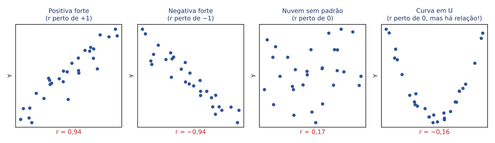

Repare no quarto quadro: há uma relação clara entre X e Y (uma curva em U), mas não é uma relação LINEAR. Guarde esta imagem: ela vai explicar uma das pegadinhas preferidas das bancas (seção 16.3.4).

:::ATENCAO
Diagrama de dispersão não é histograma nem gráfico de Pareto. O histograma (Cap. 9) mostra a distribuição de UMA variável; o diagrama de Pareto ordena causas por frequência; o diagrama de dispersão é o que mostra a associação entre DUAS variáveis quantitativas.
:::

:::QUESTAO FGV 2026 — TJ-SC — Enfermeiro (Q4150574)
Uma equipe quer verificar se há associação entre o número de procedimentos realizados num laboratório e o número de acidentes com materiais perfurocortantes. Pergunta-se qual ferramenta faz essa análise. Gabarito oficial: C (diagrama de dispersão).
Resolução: as duas variáveis são quantitativas (contagens) e o objetivo é ver se andam juntas. A ferramenta é o diagrama de dispersão: cada período vira um ponto (procedimentos; acidentes).
Por que as outras estão erradas: o gráfico de Pareto (A) ordena categorias de problemas pela frequência; o histograma (B) descreve uma única variável; o diagrama de afinidades (D) agrupa ideias qualitativas; o fluxograma (E) desenha as etapas de um processo.
:::

:::QUESTAO FGV 2024 — EPE — Analista de Pesquisa Energética (Q3258885)
Três afirmações sobre gráficos de dispersão, para julgar V ou F: (1) quanto MAIOR a dispersão dos pontos, MAIOR a correlação; (2) aglomeração crescente indica correlação positiva, como temperatura e venda de sorvetes; (3) riqueza do país e taxa de natalidade, em que países mais ricos têm natalidade menor, geram correlação negativa. Gabarito oficial: A (F – V – V).
Resolução: a primeira está invertida. Quanto MAIS espalhados os pontos em torno da reta, MAIS FRACA a correlação; quanto mais apertados, mais forte. A segunda e a terceira descrevem corretamente a direção positiva (sobem juntas) e negativa (uma sobe, a outra desce).
:::

## 16.2 Covariância: o primeiro termômetro

### 16.2.1 A ideia, com um exemplo à mão

Vamos usar, ao longo de todo o capítulo, um mesmo exemplo pequeno. Um auditor visitou cinco supermercados de bairro e anotou, em cada um, o número de caixas registradoras (X) e o faturamento médio diário, em mil reais (Y):

| Supermercado | X (caixas) | Y (faturamento, mil reais) |
|---|---|---|
| A | 1 | 2 |
| B | 2 | 4 |
| C | 3 | 5 |
| D | 4 | 4 |
| E | 5 | 5 |

Primeiro passo: as médias (Cap. 9).

- x̄ = (1 + 2 + 3 + 4 + 5) ÷ 5
- x̄ = 15 ÷ 5
- x̄ = 3
- ȳ = (2 + 4 + 5 + 4 + 5) ÷ 5
- ȳ = 20 ÷ 5
- ȳ = 4

Segundo passo: a pergunta-chave. Quando um supermercado está ACIMA da média em caixas, ele também está acima da média em faturamento? Para responder, medimos o quanto cada valor se afasta da sua média (o "desvio", como no Cap. 10) e MULTIPLICAMOS os dois desvios de cada supermercado.

Por que multiplicar? Por causa da regra de sinais:

- Os dois acima da média: (+) × (+) = positivo.
- Os dois abaixo da média: (−) × (−) = positivo.
- Um acima e outro abaixo: (+) × (−) = negativo.

Ou seja, cada ponto "vota": produto positivo é um voto a favor de "andam no mesmo sentido"; produto negativo é voto a favor de "andam em sentidos opostos". O gráfico abaixo traça uma linha vertical em x̄ = 3 e uma horizontal em ȳ = 4, dividindo o plano em quatro quadrantes: pontos nos quadrantes verdes votam positivo; nos vermelhos, negativo.

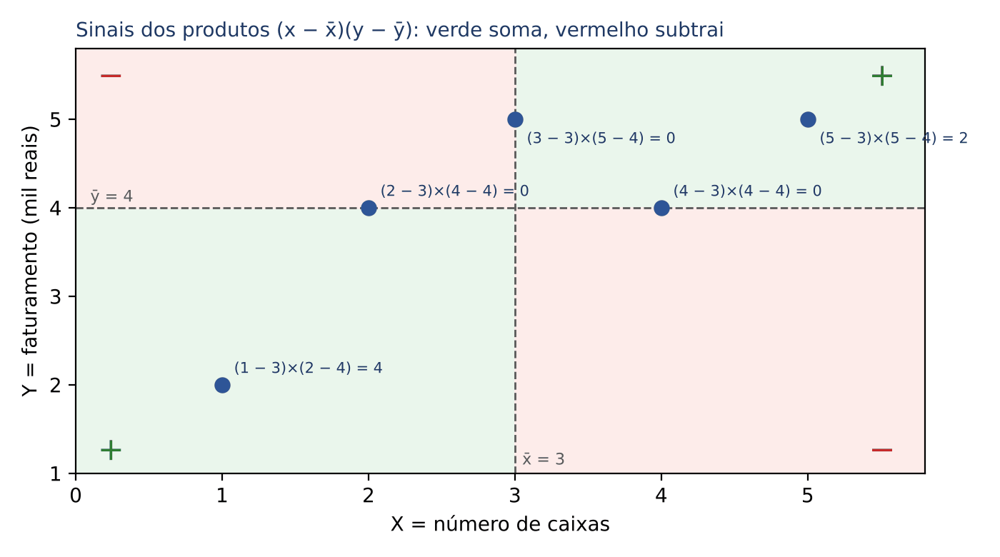

Vamos à tabela auxiliar (a FCC adora este formato; monte-a sempre que a questão der os dados brutos):

| X | Y | x − x̄ | y − ȳ | (x − x̄)·(y − ȳ) |
|---|---|---|---|---|
| 1 | 2 | 1 − 3 = −2 | 2 − 4 = −2 | (−2)·(−2) = 4 |
| 2 | 4 | 2 − 3 = −1 | 4 − 4 = 0 | (−1)·0 = 0 |
| 3 | 5 | 3 − 3 = 0 | 5 − 4 = 1 | 0·1 = 0 |
| 4 | 4 | 4 − 3 = 1 | 4 − 4 = 0 | 1·0 = 0 |
| 5 | 5 | 5 − 3 = 2 | 5 − 4 = 1 | 2·1 = 2 |
| Soma | | 0 | 0 | 6 |

A soma dos produtos é 6, positiva: predominam os votos "mesmo sentido". Note de passagem que as colunas de desvios somam zero, sempre (propriedade da média vista no Cap. 9). Isso serve de conferência: se a soma dos desvios não deu zero, há erro de conta.

Terceiro passo: tirar uma média desses produtos, para que o resultado não cresça só porque há muitos pontos. Essa média é a covariância.

- Se os cinco supermercados são TODA a população de interesse, dividimos por n: cov = 6 ÷ 5 = 1,2.
- Se são uma AMOSTRA de um universo maior, dividimos por n − 1 (pelo mesmo motivo da variância amostral, Cap. 10): cov = 6 ÷ 4 = 1,5.

### 16.2.2 A fórmula

Chamaremos a soma dos produtos dos desvios de Sxy (lê-se "esse xis ípsilon"). A notação é muito usada nas provas e economiza tempo.

O que cada símbolo significa:

- Σ (sigma maiúsculo) = "some para todos os pares, do primeiro ao último".
- xᵢ e yᵢ = os valores do i-ésimo par (i vai de 1 até n).
- x̄ e ȳ = as médias de X e de Y.
- Sxy = soma dos produtos dos desvios (no exemplo, 6).
- n = número de pares (no exemplo, 5).
- cov(X, Y) = covariância entre X e Y; aparece também como Cov(X, Y), sxy ou σxy.

Pelo mesmo raciocínio, chamaremos de Sxx a soma dos quadrados dos desvios de X, e de Syy a de Y. São exatamente os numeradores das variâncias do Cap. 10: var(X) = Sxx ÷ (n − 1) na amostra, ou Sxx ÷ n na população. Repare: a variância é a covariância de uma variável com ela mesma, porque (x − x̄)·(x − x̄) = (x − x̄)².

### 16.2.3 O atalho das somas (quando a prova dá Σx, Σy, Σxy...)

Muitas questões não dão a tabela, mas somas prontas: Σx, Σy, Σxy, Σx², Σy². Nesse caso, use as fórmulas de atalho, que dão o mesmo resultado sem calcular desvio por desvio:

Cada símbolo:

- Σxᵢyᵢ = soma dos produtos x·y de cada par (multiplique x por y em cada linha e some).
- Σxᵢ² = soma dos quadrados dos x (eleve cada x ao quadrado e some).
- n·x̄·ȳ = número de pares vezes a média de x vezes a média de y.

:::EXEMPLO Conferindo o atalho no exemplo dos supermercados
Calculamos as somas:
- Σxy = 1·2 + 2·4 + 3·5 + 4·4 + 5·5
- Σxy = 2 + 8 + 15 + 16 + 25
- Σxy = 66
- Σx² = 1 + 4 + 9 + 16 + 25 = 55
- Σy² = 4 + 16 + 25 + 16 + 25 = 86
Aplicamos o atalho:
- Sxy = 66 − 5·3·4 = 66 − 60 = 6 (bate com a tabela)
- Sxx = 55 − 5·3² = 55 − 5·9 = 55 − 45 = 10
- Syy = 86 − 5·4² = 86 − 5·16 = 86 − 80 = 6
Esses três números (Sxy = 6, Sxx = 10, Syy = 6) vão nos acompanhar pelo capítulo inteiro.
:::

Há ainda uma terceira forma, usada quando a questão fala em "variáveis aleatórias" e esperanças (Cap. 13): cov(X, Y) = E[XY] − E[X]·E[Y]. Em palavras: a média dos produtos menos o produto das médias. É a versão "populacional" do atalho (divida o atalho por n e chegará a ela).

### 16.2.4 Como ler a covariância, e o seu grande defeito

- Covariância positiva: as variáveis tendem a andar no mesmo sentido.
- Covariância negativa: tendem a andar em sentidos opostos.
- Covariância perto de zero: não há tendência LINEAR clara.

O defeito: o tamanho da covariância depende das unidades de medida. Se o faturamento fosse anotado em reais, e não em mil reais, cada desvio de Y ficaria 1.000 vezes maior e a covariância também (1,5 viraria 1.500), sem que a relação entre caixas e faturamento mudasse nada. Por isso a covariância diz o SINAL da relação, mas o seu NÚMERO não diz se a relação é forte ou fraca. Para isso existe a correlação (seção 16.3).

### 16.2.5 Propriedades que caem em prova

Considere a e c como constantes multiplicadoras e b e d como constantes somadas.

- Somar constantes não muda a covariância: cov(X + b, Y + d) = cov(X, Y). Somar 10 a todos os x desloca a nuvem, mas os desvios em relação à média continuam iguais.
- Multiplicar por constantes multiplica a covariância pelas DUAS constantes: cov(aX, cY) = a·c·cov(X, Y).
- Juntando: cov(aX + b, cY + d) = a·c·cov(X, Y).
- Simetria: cov(X, Y) = cov(Y, X).
- Se X e Y são independentes, cov(X, Y) = 0. A recíproca NÃO vale (seção 16.3.4).

:::QUESTAO FGV 2024 — MF — Auditor Federal de Finanças e Controle (Q2535785)
Dados: E[X] = 5, Var(X) = 4, E[Y] = 4, Var(Y) = 9 e E[XY] = 18. Pede-se o coeficiente de correlação. Gabarito oficial: B (−1/3).
Resolução, passo a passo (a fórmula de r está na seção 16.3, mas a conta é curta e vale ver já):
- cov(X, Y) = E[XY] − E[X]·E[Y]
- cov(X, Y) = 18 − 5·4
- cov(X, Y) = 18 − 20 = −2
- Desvios-padrão: σx = √4 = 2 e σy = √9 = 3.
- r = cov ÷ (σx·σy) = −2 ÷ (2·3) = −2 ÷ 6 = −1/3
Alternativas sedutoras: quem inverte a subtração (20 − 18 = 2) marca D (1/3), com o sinal errado; quem esquece de tirar a raiz das variâncias divide −2 por 4·9 = 36 e não encontra resposta nas alternativas. O sinal negativo vem de E[XY] ser MENOR que E[X]·E[Y].
:::

:::PRATIQUE exercícios elaborados para esta apostila (covariância)
1) Amostra de três pares: X = 2, 4, 6 e Y = 1, 3, 8. Calcule Sxy, a covariância amostral e a covariância populacional.
2) Sabe-se que cov(X, Y) = 5. Quanto vale cov(3X + 2, −2Y + 1)?
3) Para duas variáveis aleatórias, E[X] = 2, E[Y] = 3 e E[XY] = 7,5. Calcule cov(X, Y) e diga o sentido da relação.
Resolução 1:
- x̄ = (2 + 4 + 6) ÷ 3 = 12 ÷ 3 = 4; ȳ = (1 + 3 + 8) ÷ 3 = 12 ÷ 3 = 4.
- Desvios de X: −2, 0, 2. Desvios de Y: −3, −1, 4.
- Produtos: (−2)·(−3) = 6; 0·(−1) = 0; 2·4 = 8.
- Sxy = 6 + 0 + 8 = 14.
- Covariância amostral = 14 ÷ (3 − 1) = 14 ÷ 2 = 7.
- Covariância populacional = 14 ÷ 3 ≈ 4,67.
Resolução 2:
- As constantes somadas (+2 e +1) não interferem.
- As multiplicadoras (3 e −2) multiplicam a covariância: 3·(−2)·5 = −30.
Resolução 3:
- cov = E[XY] − E[X]·E[Y] = 7,5 − 2·3 = 7,5 − 6 = 1,5.
- Positiva: X e Y tendem a variar no mesmo sentido.
:::

## 16.3 Coeficiente de correlação de Pearson

### 16.3.1 A ideia: padronizar a covariância

Vimos que a covariância muda conforme a unidade de medida. A solução é dividi-la pelo "tamanho natural" da variação de cada variável, que é o desvio-padrão (Cap. 10). Ao dividir pelos dois desvios-padrão, as unidades se cancelam e sobra um número puro, sempre entre −1 e +1. Esse número é o coeficiente de correlação linear de Pearson, indicado por r (na amostra) ou pela letra grega ρ, "rô" (na população).

Imagem mental: a covariância é como medir a febre em uma escala que muda de hospital para hospital; o r é o termômetro padronizado, em que todo mundo lê a mesma escala.

### 16.3.2 A fórmula

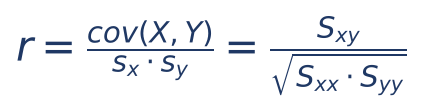

Cada símbolo:

- r = coeficiente de correlação (número puro, sem unidade).
- cov(X, Y) = covariância entre X e Y (seção 16.2).
- sx e sy = desvios-padrão de X e de Y.
- Sxy, Sxx, Syy = as somas de produtos e de quadrados de desvios (seções 16.2.2 e 16.2.3).

A segunda forma (com as somas S) é a mais prática: o divisor n ou n − 1 aparece em cima e embaixo e se cancela. Por isso, o r dá o MESMO resultado quer você trate os dados como amostra, quer como população, desde que use o MESMO divisor na covariância e nas variâncias.

:::EXEMPLO O r dos supermercados, de dois jeitos
Jeito 1, pelas somas (Sxy = 6, Sxx = 10, Syy = 6):
- r = 6 ÷ √(10·6)
- r = 6 ÷ √60
- Sem calculadora: 7,7² = 59,29 e 7,8² = 60,84, logo √60 fica entre 7,7 e 7,8, perto de 7,75 (ver Cap. 1 sobre raízes aproximadas).
- r ≈ 6 ÷ 7,75 ≈ 0,77
Jeito 2, pela covariância amostral e pelos desvios-padrão amostrais:
- cov = 6 ÷ 4 = 1,5
- var(X) = 10 ÷ 4 = 2,5 e var(Y) = 6 ÷ 4 = 1,5
- sx·sy = √2,5·√1,5 = √(2,5·1,5) = √3,75 ≈ 1,936
- r = 1,5 ÷ 1,936 ≈ 0,77
Os dois jeitos dão r ≈ 0,77: correlação positiva e razoavelmente forte entre número de caixas e faturamento.
:::

:::DICA Quando a prova dá r², ou dá números "redondos"
Muitas vezes a FCC escolhe números para que a raiz seja exata: por exemplo, variâncias 25 e 36 (desvios 5 e 6) ou 16 e 9 (desvios 4 e 3). Se a raiz não sair exata, desconfie de conta errada ou procure trabalhar com r² (que dispensa a raiz): no exemplo, r² = 6² ÷ (10·6) = 36 ÷ 60 = 0,6.
:::

### 16.3.3 Como interpretar o valor de r

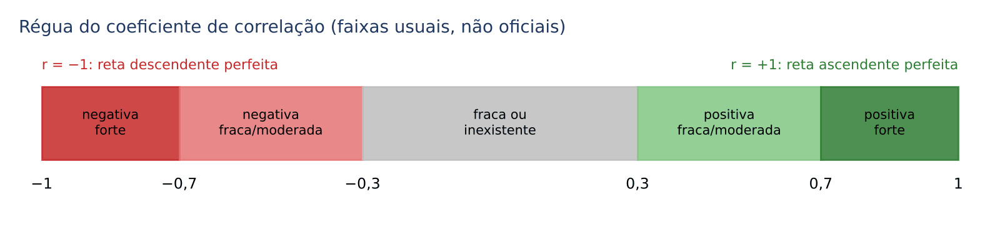

- O SINAL indica a direção: r > 0, relação positiva (sobem juntas); r < 0, relação negativa (uma sobe, a outra desce).
- O MÓDULO (o valor sem sinal, |r|) indica a força da relação LINEAR: quanto mais perto de 1, mais os pontos se alinham numa reta.
- r = +1 ou r = −1: todos os pontos estão exatamente sobre uma reta (correlação perfeita).
- r = 0: não há relação LINEAR (o que não quer dizer que não haja relação nenhuma).

As faixas do desenho (0,3 e 0,7) são convenções de livros, não regras oficiais; cada autor usa as suas. Numa questão, fique com a lógica geral: r = −0,9 é uma correlação FORTE (negativa), mais forte do que r = 0,5. O sinal não mede força.

:::PEGADINHA Correlação negativa não é "pouca correlação"
r = −0,92 indica relação forte, só que inversa. Afirmações do tipo "valores de r negativos significam pouca correlação" estão erradas. A força está no módulo.
:::

### 16.3.4 Propriedades do r (as bancas cobram todas)

- Sempre −1 ≤ r ≤ 1.
- É adimensional: não tem unidade, não muda se trocarmos metros por centímetros ou reais por mil reais.
- É simétrico: r(X, Y) = r(Y, X).
- Somar constantes ou multiplicar por constantes POSITIVAS não muda o r. Multiplicar UMA das variáveis por constante NEGATIVA inverte o sinal do r (o módulo continua igual). Em fórmula: r(aX + b, cY + d) = r(X, Y) se a·c > 0, e = −r(X, Y) se a·c < 0.
- Consequência: se Y é função linear exata de X (Y = aX + b), então r = +1 (se a > 0) ou r = −1 (se a < 0).
- Independência implica r = 0. Mas r = 0 NÃO implica independência: só diz que não há relação LINEAR. Lembre o quarto quadro da figura da seção 16.1.2: a curva em U tem r perto de zero, e Y depende totalmente de X.
- O r é sensível a valores extremos (outliers): um único ponto muito afastado pode aumentar ou destruir a correlação (ver seção 16.6.3).

:::EXEMPLO r = 0 com dependência total
Tome X = −2, −1, 0, 1, 2 e Y = X², isto é, Y = 4, 1, 0, 1, 4.
- x̄ = 0 e ȳ = (4 + 1 + 0 + 1 + 4) ÷ 5 = 10 ÷ 5 = 2.
- Desvios de X: −2, −1, 0, 1, 2. Desvios de Y: 2, −1, −2, −1, 2.
- Produtos: (−2)·2 = −4; (−1)·(−1) = 1; 0·(−2) = 0; 1·(−1) = −1; 2·2 = 4.
- Sxy = −4 + 1 + 0 − 1 + 4 = 0, logo r = 0.
E, no entanto, conhecido X, sabemos Y com certeza. A relação existe; só não é uma reta.
:::

:::QUESTAO FGV 2025 — CGE-SP — Auditor Estadual de Controle (Q3786840)
Se Y = 2X + 3, qual é o coeficiente de correlação entre X e Y? Gabarito oficial: D (1).
Resolução: Y é função linear exata de X, com coeficiente 2, positivo. Todos os pontos (x, y) caem sobre a reta y = 2x + 3, que sobe. Logo r = +1.
Alternativas sedutoras: B (2/3) e E (3/2) misturam os coeficientes 2 e 3 da equação, que não têm nada a ver com o r; E é impossível, porque r nunca passa de 1. A (0) confunde "não aleatório" com "sem correlação".
:::

:::QUESTAO FCC 2025 — Prefeitura de São Paulo — Analista de Planejamento e Desenvolvimento Organizacional (Q3281589)
Enunciado como está no banco: "A partir de 10 pares de observações (Xi, Yi) com i = 1, 2, 3... 10, escolhidos aleatoriamente, referentes a duas variáveis X e Y, foram obtidas as respectivas variâncias amostrais [quadro não reproduzido]. Se a covariância de X e Y apresenta um valor igual a 24, então o respectivo coeficiente de correlação é igual a". Alternativas: A 0,60; B 0,80; C 0,75; D 0,40; E 0,64. Gabarito oficial: B (0,80).
Os dados desta questão estão em figura/tabela não reproduzida no banco de questões; por isso comentamos o MÉTODO, sem números inventados.
Método, passo a passo:
- Passo 1: anote, no quadro da prova, a variância amostral de X e a de Y.
- Passo 2: tire a raiz quadrada de cada uma para obter os desvios-padrão sx e sy (a FCC costuma escolher variâncias que são quadrados perfeitos, para a raiz sair "redonda" sem calculadora).
- Passo 3: multiplique os dois desvios-padrão: sx × sy.
- Passo 4: aplique r = cov ÷ (sx × sy), com cov = 24.
- Passo 5: confira o resultado: r tem de estar entre −1 e +1 e ter o mesmo sinal da covariância (aqui, positiva).
Alternativas sedutoras: quem divide a covariância pelo produto das VARIÂNCIAS, e não dos desvios-padrão, chega a um número muito menor; quem eleva o resultado ao quadrado marca E (0,64 é o quadrado de 0,80, ou seja, seria o r², não o r). Atenção também: as variâncias, a covariância e o r têm de usar o mesmo divisor (aqui, todas amostrais).
:::

:::QUESTAO FGV 2024 — DATAPREV — Analista de Tecnologia da Informação (Q3086056)
Quatro semanas de dados de uma loja: horas de divulgação e número de clientes (a tabela vinha em imagem). Pede-se o r de Pearson. Gabarito oficial: C (1).
Resolução: quando o gabarito é 1, os quatro pares formam uma reta crescente exata, isto é, cada hora a mais de divulgação corresponde sempre ao mesmo acréscimo de clientes. Teste rápido para a prova: calcule a variação de Y dividida pela variação de X entre pares consecutivos; se der sempre o mesmo número positivo, r = +1; se der sempre o mesmo número negativo, r = −1. Não é preciso fazer a fórmula toda.
:::

### 16.3.5 Correlação não é causalidade

Este é o ponto conceitual mais cobrado de todo o capítulo. O r mede se duas variáveis variam JUNTAS. Não diz POR QUÊ. Pode haver três explicações para uma correlação forte:

- X causa Y (por exemplo, mais horas de estudo, notas mais altas).
- Y causa X (causalidade reversa). Bairros mais violentos recebem mais vigilantes; quem olha só a correlação pode concluir, ao contrário, que vigilantes "geram" ocorrências.
- Uma terceira variável causa as duas (variável de confusão, ou omitida). A correlação entre X e Y, nesse caso, chama-se correlação espúria.

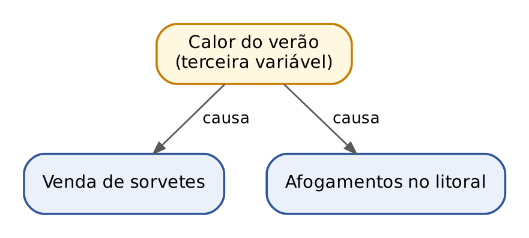

O exemplo clássico: nas cidades litorâneas, as vendas de sorvete e os afogamentos têm correlação positiva. Proibir sorvete não salva ninguém: o verão (calor, praia cheia) é que aumenta as duas coisas.

Ponte com o Direito: a correlação é como um indício. Indícios convergentes podem sugerir um fato, mas não dispensam a prova do nexo causal; para afirmar causalidade, a Estatística exige desenho de pesquisa adequado (experimentos controlados, controle de variáveis de confusão, precedência temporal, mecanismo plausível), assim como o juiz exige o nexo, e não a mera coincidência temporal.

Duas diferenças que a FGV gosta de cobrar:

- A correlação é SIMÉTRICA (r(X, Y) = r(Y, X)); a causalidade é ASSIMÉTRICA (há uma variável que é causa e outra que é efeito).
- Correlação forte, mesmo com significância estatística (valor-p pequeno, Cap. 15) e mesmo com a causa vindo antes no tempo, NÃO basta para provar causalidade.

:::QUESTAO FCC 2026 — SEFAZ-SP — Auditor Fiscal da Receita Estadual (Q3916790)
Numa rede social, alguém mostrou um gráfico da OCDE com o PIB per capita dos países e as notas de matemática dos jovens no PISA 2022, com uma linha de tendência crescente, e afirmou: (A1) quanto melhor o desempenho em matemática, maior o PIB per capita, e a correlação é clara; (A2) para o Brasil deixar o subdesenvolvimento, o caminho inequívoco é investir em educação matemática. Pergunta-se o que o gráfico, isoladamente, sustenta. Gabarito oficial: C (sustenta A1, mas não A2, porque correlação não garante causalidade).
Resolução: A1 é uma afirmação de ASSOCIAÇÃO ("quanto maior um, maior o outro"), e é isso que um diagrama de dispersão com tendência crescente mostra. A2 é uma afirmação CAUSAL ("investir em X vai produzir Y"). O gráfico não exclui a causalidade reversa (países ricos podem investir mais em escola) nem variáveis de confusão (instituições, renda familiar, saúde).
Por que as outras estão erradas: A e B negam A1 com argumentos falsos (os pontos não precisam estar todos sobre a linha para haver correlação; uma correlação forte admite dispersão em torno da reta). D usa um fato externo ao gráfico. E tenta salvar A2 com outro argumento causal que o gráfico não demonstra.
:::

:::QUESTAO FGV 2025 — Prefeitura do Rio de Janeiro — Gestor de Segurança Municipal (Q3782899)
Pesquisador encontra correlação positiva entre o número de vigilantes num bairro e o número de ocorrências; sabe-se que bairros mais perigosos recebem mais vigilantes. Pede-se a classificação. Gabarito oficial: B (correlação espúria, causada por variável omitida).
Resolução: a periculosidade do bairro é a terceira variável que explica as duas coisas (e há também causalidade reversa: ocorrências atraem vigilantes). A não pode ser: a questão diz justamente que a causalidade é no outro sentido. Homocedasticidade (C) é um pressuposto sobre a variância dos erros (seção 16.6). D e E são termos sem pertinência ao caso.
No mesmo sentido: Q3782901 (FGV 2025), gabarito D: a análise causal é assimétrica (identifica causa e efeito), enquanto a correlação é simétrica; as demais alternativas erram ao dizer que correlação de 0,90 significante prova causalidade (A), que precedência temporal mais correlação forte bastam (B), que é preciso afastar variáveis de confusão para calcular uma correlação (C) e que relação causal forte implicaria correlação nula (E).
:::

:::QUESTAO FGV 2026 — Concurso não identificado no banco (Q4279844)
Três afirmações sobre o coeficiente de correlação ρ: (I) a correlação é forte se |ρ| > 0,7, e valores menores que 0,7 ou negativos significam pouca correlação; (II) se |ρ| > 0,8, há causalidade; (III) o coeficiente usual mede o grau de dependência linear. Gabarito oficial: A (só III).
Resolução: I erra ao dizer que valores negativos significam pouca correlação (ρ = −0,9 é forte); II confunde correlação com causalidade; III é a definição correta.
No mesmo sentido: Q3782891 (FGV 2025), gabarito B: é falso que correlação nula implique independência (I); é verdadeiro que o coeficiente de variação é adimensional e mede a dispersão relativa à média (II, Cap. 10); é falso que a mediana seja fortemente influenciada por outliers e a média seja robusta (III; é o contrário). E Q3154013 (FGV 2025, SEFAZ-RS), gabarito E (F – F – F): r = 0 não significa ausência de qualquer relação, só de relação linear; as outras duas afirmações, sobre média menor que a mediana e sobre amplitude interquartil igual ao desvio-padrão, são falsas pelo Cap. 10 (numa normal, por exemplo, a amplitude interquartil vale cerca de 1,35 desvio-padrão).
:::

:::QUESTAO FGV 2025 — EBSERH — Residência Multiprofissional (Q3719700)
Com 300 pacientes, a correlação entre índice de massa corporal e triglicerídeos foi r = 0,85, com valor-p < 0,0001. Pede-se a conclusão correta. Gabarito oficial: E (forte correlação positiva).
Resolução: 0,85 é positivo e próximo de 1, portanto forte e positiva; o valor-p minúsculo indica que é muito improvável obter uma correlação desse tamanho se a correlação verdadeira fosse zero (Cap. 15), isto é, é estatisticamente significativa. B e C erram a leitura do valor-p (valor-p baixo indica significância, não o contrário); D erra o sinal.
Observação: a alternativa E fala em variáveis "diretamente proporcionais", expressão imprecisa (correlação forte não é proporcionalidade exata), mas era a única compatível com os dados.
No mesmo sentido: Q3758080 (FGV 2025), gabarito B: diante de saída de computador com correlação negativa forte e valor-p abaixo de 5%, estão corretas a leitura de "correlação negativa forte" e de "significativa a 5%", e está errado concluir que uma variável causa a outra.
:::

:::QUESTAO FGV 2026 — AMAZUL — Tecnólogo em Fabricação Mecânica (Q3853103)
Diagrama de dispersão de 10 dias, com temperatura das máquinas e peças rejeitadas (o gráfico está em figura não reproduzida no banco; o comentário se apoia só no texto das afirmações e no gabarito). Quatro afirmações: (1) há correlação positiva forte; (2) pode-se ajustar y = a + bx com y = temperatura e x = peças rejeitadas, para prever as peças rejeitadas; (3) a temperatura é necessariamente a causa e outros fatores podem ser ignorados; (4) a regressão pode quantificar o impacto da temperatura no índice de rejeição. Gabarito oficial: B (V – F – F – V).
Resolução: (2) é falsa porque troca os papéis: se queremos PREVER as peças rejeitadas, elas são o Y (variável dependente), e a temperatura é o X. (3) é falsa porque correlação não prova causalidade, e muito menos autoriza ignorar outros fatores. (1) e (4) descrevem corretamente o gráfico e o uso da regressão.
:::

:::PRATIQUE exercícios elaborados para esta apostila (correlação)
1) Numa amostra, cov(X, Y) = 12, sx = 3 e sy = 5. Calcule r.
2) Numa amostra, Sxy = −18, Sxx = 9 e Syy = 64. Calcule r e interprete.
3) A correlação entre a nota de um candidato numa prova (X) e o número de horas de estudo (Y) é 0,6. A banca converte as notas pela regra U = 2X + 10, e um pesquisador registra V = −5Y (horas "negativas", por convenção do seu programa). Quanto vale r(U, V)?
4) Sem fazer a fórmula toda, determine r para X = 1, 2, 3, 4 e Y = 10, 8, 6, 4.
Resolução 1:
- r = 12 ÷ (3·5) = 12 ÷ 15 = 0,8 (positiva e forte).
Resolução 2:
- √Sxx = √9 = 3 e √Syy = √64 = 8.
- r = −18 ÷ (3·8) = −18 ÷ 24 = −0,75.
- Correlação negativa, de intensidade forte: quando X cresce, Y tende a diminuir.
Resolução 3:
- O "+10" não muda nada. O "2" é positivo e não muda o sinal. O "−5" é negativo e inverte o sinal.
- r(U, V) = −0,6.
Resolução 4:
- De um par para o seguinte, X aumenta 1 e Y diminui 2, sempre. Os pontos estão sobre a reta y = 12 − 2x, decrescente.
- r = −1.
:::

## 16.4 A reta de regressão por mínimos quadrados

### 16.4.1 A ideia: resumir a nuvem por uma reta e usá-la para prever

A correlação diz SE há relação linear e QUÃO forte ela é. A regressão vai além: desenha a reta que melhor representa a nuvem de pontos e permite responder perguntas como "quanto se espera que fature um supermercado com 4 caixas?".

Antes, uma revisão rápida da equação da reta (Cap. 1): ŷ = a + b·x.

- ŷ (lê-se "ípsilon chapéu") = valor de Y PREVISTO pela reta para um dado x. O chapéu indica "estimado", para não confundir com o y observado.
- a = intercepto, coeficiente linear ou constante: é o valor de ŷ quando x = 0, o ponto onde a reta corta o eixo vertical.
- b = inclinação, coeficiente angular ou coeficiente de regressão: é QUANTO ŷ muda quando x aumenta UMA unidade. Se b = 0,6, cada unidade a mais de x acrescenta 0,6 à previsão de y; se b = −2, cada unidade a mais de x tira 2.

Exemplo à mão: na reta ŷ = 10 + 3x, para x = 0 temos ŷ = 10; para x = 1, ŷ = 13; para x = 2, ŷ = 16. Cada passo de 1 em x soma 3 em ŷ: é a inclinação.

### 16.4.2 Qual reta? O critério dos mínimos quadrados

Por uma nuvem de pontos passam infinitas retas. Precisamos de um critério para escolher "a melhor". Para cada ponto, a diferença entre o y observado e o ŷ previsto pela reta chama-se resíduo:

- eᵢ = yᵢ − ŷᵢ (resíduo do i-ésimo ponto: observado menos previsto).

Resíduo positivo: o ponto está ACIMA da reta (a reta subestimou). Resíduo negativo: está ABAIXO (a reta superestimou). Graficamente, o resíduo é a distância VERTICAL do ponto à reta, medida na direção de Y, porque é Y que queremos prever.

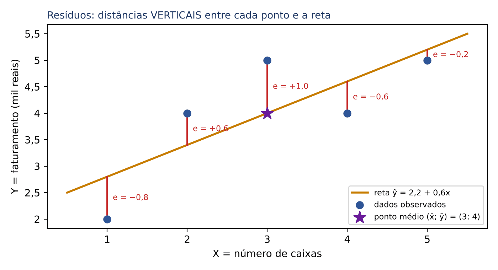

Ideia ingênua: escolher a reta que torna a soma dos resíduos a menor possível. Não funciona: resíduos positivos e negativos se cancelam, e muitas retas ruins dariam soma zero. A solução é elevar cada resíduo ao quadrado (tudo vira positivo, e erros grandes pesam mais) e somar. O método dos mínimos quadrados (MMQ, ou MQO, "mínimos quadrados ordinários") escolhe a reta que torna MÍNIMA a soma dos quadrados dos resíduos:

- SQRes = e₁² + e₂² + ... + eₙ² = Σ(yᵢ − ŷᵢ)², o menor possível.

A dedução da fórmula usa cálculo diferencial e não é cobrada. O que se cobra é o resultado.

### 16.4.3 As fórmulas de b e de a

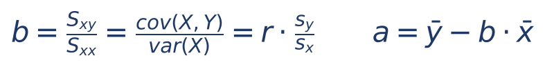

Cada símbolo:

- b = inclinação estimada; a = intercepto estimado.
- Sxy e Sxx = somas de produtos e de quadrados de desvios (seção 16.2).
- cov(X, Y) e var(X) = covariância e variância de X, ambas com o MESMO divisor (n − 1 ou n; ele se cancela).
- r, sx, sy = correlação e desvios-padrão.
- x̄ e ȳ = médias.

Leia a primeira fórmula em português: "a inclinação é a covariância dividida pela variância de X". Atenção: dividida pela variância de X, a explicativa, e não de Y.

A fórmula de a vem de um fato muito útil: a reta de mínimos quadrados SEMPRE passa pelo ponto das médias (x̄; ȳ). Se ȳ = a + b·x̄, basta isolar a:

- ȳ = a + b·x̄
- subtraímos b·x̄ dos dois lados: ȳ − b·x̄ = a
- a = ȳ − b·x̄

Quando a prova dá as somas brutas (Σx, Σy, Σxy, Σx², n), a fórmula de b pode ser escrita diretamente nelas (basta multiplicar em cima e embaixo do atalho da seção 16.2.3 por n):

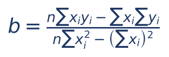

:::EXEMPLO A reta dos supermercados, completa
Dados (seção 16.2.1): x̄ = 3, ȳ = 4, Sxy = 6, Sxx = 10.
Passo 1, a inclinação:
- b = Sxy ÷ Sxx
- b = 6 ÷ 10
- b = 0,6
Passo 2, o intercepto:
- a = ȳ − b·x̄
- a = 4 − 0,6·3
- a = 4 − 1,8
- a = 2,2
Passo 3, a reta: ŷ = 2,2 + 0,6x.
Conferência pela fórmula das somas (Σx = 15, Σy = 20, Σxy = 66, Σx² = 55, n = 5):
- numerador: 5·66 − 15·20 = 330 − 300 = 30
- denominador: 5·55 − 15² = 275 − 225 = 50
- b = 30 ÷ 50 = 0,6 (confere)
Conferência pela correlação: sy ÷ sx = √1,5 ÷ √2,5 = √0,6 ≈ 0,775; b = r·(sy ÷ sx) ≈ 0,775·0,775 ≈ 0,6 (confere).
:::

### 16.4.4 Interpretar os coeficientes e prever

Na reta ŷ = 2,2 + 0,6x:

- b = 0,6: cada caixa registradora a mais está ASSOCIADA, em média, a 0,6 mil reais (600 reais) a mais de faturamento diário. Note as unidades: b sempre tem a unidade de Y dividida pela de X (mil reais por caixa).
- a = 2,2: seria o faturamento previsto para um supermercado com ZERO caixas. Não faz sentido prático (um supermercado sem caixa não fatura), e nem há dados perto de x = 0. O intercepto muitas vezes é só um "ajuste de altura" da reta, sem interpretação real. Quando x = 0 faz sentido (por exemplo, produção zero), a é o valor esperado de Y nessa situação, como o custo fixo de uma fábrica.

Prever é substituir x na reta:

- Para x = 4: ŷ = 2,2 + 0,6·4 = 2,2 + 2,4 = 4,6 mil reais.
- Para x = 20: ŷ = 2,2 + 0,6·20 = 2,2 + 12 = 14,2 mil reais. Mas cuidado: os dados só iam de 1 a 5 caixas. Usar a reta muito fora da faixa observada chama-se EXTRAPOLAÇÃO e é arriscado, porque nada garante que a relação continue linear lá fora (um hipermercado com 20 caixas tem outra lógica de negócio).

:::ATENCAO "Associado a", e não "causa"
A inclinação b mede quanto Y varia, EM MÉDIA, quando X varia uma unidade, nos dados observados. Não prova que aumentar X vá CAUSAR o aumento de Y (seção 16.3.5). Instalar mais caixas num supermercado vazio não aumenta o faturamento: provavelmente são os supermercados com mais clientes que instalam mais caixas.
:::

### 16.4.5 Relações entre b e r que resolvem questões em segundos

- b e r têm SEMPRE o mesmo sinal (os dois dependem do sinal de Sxy). Reta crescente, correlação positiva; reta decrescente, correlação negativa.
- b = r·(sy ÷ sx). Se as duas variáveis têm o mesmo desvio-padrão, b = r.
- b ≠ r em geral: b tem unidade e pode ser qualquer número (b = 250 é possível); r está sempre entre −1 e 1.
- A regressão de X sobre Y (prever X a partir de Y) é OUTRA reta, com inclinação b' = Sxy ÷ Syy. Vale b·b' = r². No exemplo: b' = 6 ÷ 6 = 1 e b·b' = 0,6·1 = 0,6 = r². Por isso, não "inverta" a equação ŷ = a + bx para prever X: o resultado não é a reta de mínimos quadrados de X sobre Y.

:::PASSO Como resolver qualquer questão de reta de regressão
1) Identifique quem é Y (o que se quer prever) e quem é X (o que se usa para prever).
2) Calcule as médias: x̄ = Σx ÷ n e ȳ = Σy ÷ n. Muitas questões dão SOMAS e esperam que você divida por n.
3) Se a questão já dá b (ou a), use o ponto das médias: ȳ = a + b·x̄, e isole a incógnita.
4) Se precisa calcular b: use Sxy ÷ Sxx (com desvios ou com o atalho das somas), ou cov ÷ var(X), ou r·sy ÷ sx, conforme os dados dados.
5) Calcule a = ȳ − b·x̄.
6) Para prever, substitua o x pedido em ŷ = a + b·x.
7) Confira: o sinal de b bate com o sinal de r? A reta passa por (x̄; ȳ)?
:::

:::QUESTAO FCC 2025 — SEFAZ-PI — Analista do Tesouro Estadual (Q3506134)
Regressão yᵢ = b₀ + b₁xᵢ + eᵢ, com média de x igual a 10, média de y igual a 50 e b₁ estimado igual a 4. Pede-se o intercepto b₀. Gabarito oficial: C (10).
Resolução:
- A reta passa pelo ponto das médias: ȳ = b₀ + b₁·x̄.
- 50 = b₀ + 4·10
- 50 = b₀ + 40
- b₀ = 50 − 40 = 10
Alternativa sedutora: D (40) é o valor de b₁·x̄, que quem se distrai marca no lugar de b₀.
:::

:::QUESTAO FGV 2026 — MPE-ES — Cientista de Dados (Q4218172)
Modelo do tempo de tramitação de procedimentos (Y, em dias) em função do número de apensos (X), com intercepto 15 e coeficiente angular 5. Pede-se a estimativa para X = 8. Gabarito oficial: C (55 dias).
Resolução: ŷ = 15 + 5·8 = 15 + 40 = 55.
Alternativas sedutoras: A (40) esquece o intercepto (só 5·8); D (120) multiplica 15 por 8.
No mesmo sentido: Q3660446 (FGV 2025), gabarito C: com ŷ = 100 − 0,25x, para x = 300 horas, ŷ = 100 − 75 = 25; para x = 50, ŷ = 100 − 12,5 = 87,5.
:::

:::QUESTAO FCC 2026 — SEFAZ-SP — Auditor Fiscal da Receita Estadual (Q3916780)
Modelo de custo total (Y) em função da produção (X), Ŷ = b₀ + b₁X, ajustado com 20 observações: ΣX = 400 e ΣY = 10.000; o custo fixo (custo com produção zero) é 100. Pede-se o custo previsto para produção de 30 unidades. Gabarito oficial: C (700).
Resolução:
- Médias: x̄ = 400 ÷ 20 = 20 e ȳ = 10.000 ÷ 20 = 500.
- "Custo com produção zero" é o intercepto: b₀ = 100 (aqui o intercepto tem sentido prático).
- Ponto das médias: 500 = 100 + b₁·20.
- Subtraímos 100 dos dois lados: 400 = b₁·20.
- Dividimos por 20: b₁ = 20.
- Reta: Ŷ = 100 + 20X.
- Previsão: Ŷ = 100 + 20·30 = 100 + 600 = 700.
Alternativa sedutora: D (850) vem de calcular b₁ = ȳ ÷ x̄ = 500 ÷ 20 = 25, esquecendo de descontar o intercepto, e depois fazer 100 + 25·30 = 850.
:::

:::QUESTAO FCC 2026 — MPE-SE — Analista do Ministério Público (Q3884300)
Modelo Yᵢ = α + βtᵢ + εᵢ para o salário (em salários mínimos) em função do tempo de experiência (anos), estimado com 100 empregados: α estimado = 2, soma dos salários = 400 SM e média dos tempos = 2,5 anos. Pede-se o salário previsto para 8 anos de experiência. Gabarito oficial: C (8,4).
Resolução:
- Média dos salários: ȳ = 400 ÷ 100 = 4.
- Ponto das médias: 4 = 2 + β·2,5.
- Subtraímos 2: 2 = β·2,5.
- Dividimos por 2,5: β = 2 ÷ 2,5 = 0,8.
- Previsão: Ŷ = 2 + 0,8·8 = 2 + 6,4 = 8,4.
Armadilha: a questão dá a SOMA dos salários e a MÉDIA dos tempos. Quem usa 400 como se fosse média chega a β = 159,2 e a um absurdo; leia com atenção o que é soma e o que é média.
:::

:::QUESTAO FCC 2025 — Prefeitura de São Paulo — Auditor Municipal de Controle Interno (Q3281789)
Para prever a receita tributária de um município, usa-se Yₜ = α + βt, em que t = 1 corresponde a 2015, t = 2 a 2016, e assim por diante; com os dados de 2015 a 2024, a soma das receitas foi 370 bilhões de reais e α estimado = 15. Pede-se o acréscimo anual da receita. Gabarito oficial: C (4,0).
Resolução:
- O "acréscimo anual" é a inclinação β (quanto Y muda quando t aumenta 1 ano).
- De 2015 a 2024 são 10 anos: t vai de 1 a 10, logo n = 10.
- t̄ = (1 + 2 + ... + 10) ÷ 10 = 55 ÷ 10 = 5,5 (a soma de 1 a 10 é 10·11 ÷ 2 = 55, fórmula da progressão aritmética do Cap. 1).
- ȳ = 370 ÷ 10 = 37.
- Ponto das médias: 37 = 15 + β·5,5.
- Subtraímos 15: 22 = β·5,5.
- β = 22 ÷ 5,5 = 4.
Armadilhas: usar os anos (2015, 2016...) no lugar de t; contar 9 anos em vez de 10; tomar t̄ = 5 em vez de 5,5.
:::

:::QUESTAO FGV 2025 — SEFAZ-RS — Auditor do Estado (Q3154015)
Cinco estudantes; x = horas de estudo, y = nota. Dados: Σx = 30, Σy = 300, Σxy = 1.900, Σx² = 220, Σy² = 18.250. Pede-se a reta de regressão de y em x. Gabarito oficial: A (y = 45 + 2,5x).
Resolução pela fórmula das somas (n = 5):
- numerador: 5·1.900 − 30·300 = 9.500 − 9.000 = 500
- denominador: 5·220 − 30² = 1.100 − 900 = 200
- b = 500 ÷ 200 = 2,5
- Médias: x̄ = 30 ÷ 5 = 6 e ȳ = 300 ÷ 5 = 60.
- a = 60 − 2,5·6 = 60 − 15 = 45.
Observação: Σy² não é usado para a reta; serviria para calcular r ou R².
:::

:::QUESTAO FGV 2024 — TJ-AP — Analista Judiciário, Estatístico (Q2450825)
Pede-se a afirmação correta sobre os estimadores de mínimos quadrados de Yᵢ = α + βXᵢ + εᵢ. Gabarito oficial: A (o estimador de β é a covariância entre X e Y dividida pela variância de X).
Resolução: é exatamente a fórmula b = cov(X, Y) ÷ var(X). B divide pela variância de Y (errado). C soma em vez de subtrair (o certo é a = ȳ − b·x̄). D e E trocam os nomes: α é o coeficiente LINEAR (intercepto); β é o ANGULAR (inclinação).
No mesmo sentido: Q2496490 (FGV 2024), gabarito E: covariância dividida pela variância de x (sob erros normais, o estimador de máxima verossimilhança da inclinação coincide com o de mínimos quadrados). Q3883553 e Q3088068 (FGV) pedem a mesma fórmula, com alternativas em imagem.
:::

:::QUESTAO FGV 2026 — MPE-ES — Agente Técnico, Estatístico (Q4220340)
Pede-se a afirmativa correta sobre métodos de estimação e regressão. Gabarito oficial: C (na regressão linear, o método dos mínimos quadrados estima os parâmetros minimizando a soma dos quadrados dos resíduos).
Resolução: C é a definição da seção 16.4.2. D é falsa: a correlação entre os y observados e os ŷ ajustados deve ser ALTA (o seu quadrado é o próprio R², seção 16.5), não nula. E é falsa: o MQO estima também o intercepto. A e B tratam de modelos lineares generalizados e de máxima verossimilhança, que não exigem resposta normal nem contínua.
No mesmo sentido, com ressalva: Q3261008 (FGV 2024), gabarito oficial B (I e II): I (α e β são parâmetros da reta teórica, estimados pela amostra) e II (sob erros normais, a máxima verossimilhança conduz aos mínimos quadrados) estão corretas. A afirmação III ("minimizar a soma dos resíduos ao quadrado") foi considerada errada pela banca, provavelmente lendo-a como "(soma dos resíduos)²", que é sempre zero; na leitura natural, é a própria definição do método. Gabarito discutível.
:::

:::PRATIQUE exercícios elaborados para esta apostila (reta de regressão)
1) Numa regressão, x̄ = 4, ȳ = 20 e b = 3. Encontre a e preveja y para x = 10.
2) Ajuste a reta para X = 1, 2, 3, 4 e Y = 3, 5, 4, 8, usando a tabela de desvios.
3) Com n = 5, Σx = 20, Σy = 50, Σxy = 240 e Σx² = 120, encontre a reta.
4) Sabe-se que r = 0,5, sx = 2, sy = 6, x̄ = 10 e ȳ = 30. Encontre a reta de Y sobre X.
Resolução 1:
- a = ȳ − b·x̄ = 20 − 3·4 = 20 − 12 = 8.
- ŷ = 8 + 3·10 = 8 + 30 = 38.
Resolução 2:
- x̄ = 10 ÷ 4 = 2,5; ȳ = (3 + 5 + 4 + 8) ÷ 4 = 20 ÷ 4 = 5.
- Desvios de X: −1,5; −0,5; 0,5; 1,5. Desvios de Y: −2; 0; −1; 3.
- Produtos: (−1,5)·(−2) = 3; (−0,5)·0 = 0; 0,5·(−1) = −0,5; 1,5·3 = 4,5. Sxy = 3 + 0 − 0,5 + 4,5 = 7.
- Quadrados dos desvios de X: 2,25; 0,25; 0,25; 2,25. Sxx = 5.
- b = 7 ÷ 5 = 1,4.
- a = 5 − 1,4·2,5 = 5 − 3,5 = 1,5.
- Reta: ŷ = 1,5 + 1,4x.
Resolução 3:
- numerador: 5·240 − 20·50 = 1.200 − 1.000 = 200
- denominador: 5·120 − 20² = 600 − 400 = 200
- b = 200 ÷ 200 = 1
- x̄ = 20 ÷ 5 = 4; ȳ = 50 ÷ 5 = 10; a = 10 − 1·4 = 6.
- Reta: ŷ = 6 + x.
Resolução 4:
- b = r·(sy ÷ sx) = 0,5·(6 ÷ 2) = 0,5·3 = 1,5.
- a = 30 − 1,5·10 = 30 − 15 = 15.
- Reta: ŷ = 15 + 1,5x.
:::

## 16.5 Resíduos, decomposição da variação e coeficiente de determinação

### 16.5.1 Os resíduos do exemplo

Com a reta ŷ = 2,2 + 0,6x, calculamos a previsão e o resíduo de cada supermercado:

| X | Y observado | ŷ = 2,2 + 0,6x | e = y − ŷ | e² |
|---|---|---|---|---|
| 1 | 2 | 2,2 + 0,6 = 2,8 | 2 − 2,8 = −0,8 | 0,64 |
| 2 | 4 | 2,2 + 1,2 = 3,4 | 4 − 3,4 = 0,6 | 0,36 |
| 3 | 5 | 2,2 + 1,8 = 4,0 | 5 − 4,0 = 1,0 | 1,00 |
| 4 | 4 | 2,2 + 2,4 = 4,6 | 4 − 4,6 = −0,6 | 0,36 |
| 5 | 5 | 2,2 + 3,0 = 5,2 | 5 − 5,2 = −0,2 | 0,04 |
| Soma | 20 | 20 | 0 | 2,40 |

Duas propriedades aparecem na tabela e valem SEMPRE na reta de mínimos quadrados com intercepto:

- A soma dos resíduos é zero (e, portanto, a média dos resíduos também é zero). Os erros para cima compensam os erros para baixo.
- A soma dos ŷ é igual à soma dos y (20 = 20): a média das previsões é a média dos dados.

A soma dos quadrados dos resíduos é SQRes = 2,40. Nenhuma outra reta produz soma menor para esses cinco pontos: é isso que "mínimos quadrados" garante.

### 16.5.2 A ideia da decomposição: quanto da variação a reta explica?

Pense assim: se não tivéssemos X, a melhor previsão para o faturamento de qualquer supermercado seria a média ȳ = 4. O erro dessa previsão "ingênua" é o desvio total, y − ȳ. Com a reta, a previsão melhora para ŷ. Então o desvio total se divide em duas partes:

- desvio total (y − ȳ) = parte explicada pela reta (ŷ − ȳ) + parte não explicada, o resíduo (y − ŷ).

Veja no supermercado A (x = 1, y = 2): desvio total 2 − 4 = −2; parte explicada 2,8 − 4 = −1,2; resíduo 2 − 2,8 = −0,8. E −2 = −1,2 + (−0,8).

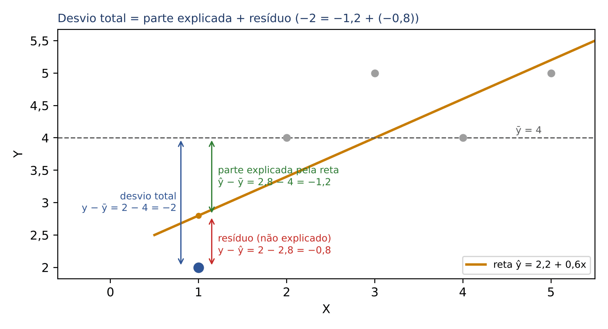

Elevando ao quadrado e somando para todos os pontos, vale a mesma divisão (por uma propriedade algébrica do método, os "termos cruzados" se anulam):

- SQT = SQReg + SQRes

Cada sigla:

- SQT = soma dos quadrados total = Σ(yᵢ − ȳ)² = Syy. Mede toda a variação de Y.
- SQReg = soma dos quadrados da regressão (ou "explicada", ou "do modelo") = Σ(ŷᵢ − ȳ)². Mede a variação que a reta explica. Atalho: SQReg = b·Sxy = b²·Sxx.
- SQRes = soma dos quadrados dos resíduos (ou "dos erros", ou "não explicada") = Σ(yᵢ − ŷᵢ)².

No exemplo:

- SQT = Syy = 6
- SQReg = b·Sxy = 0,6·6 = 3,6
- SQRes = 6 − 3,6 = 2,4 (confere com a tabela)

:::PEGADINHA As siglas mudam de livro para livro
"SQR" pode significar soma dos quadrados da REGRESSÃO em um material e soma dos quadrados dos RESÍDUOS em outro; "SQE" pode ser a "explicada" ou a "do erro". Nunca decore a sigla: leia a definição no enunciado. A FGV (Q2450829) usou SQE = explicada e SQR = resíduos; muitos livros usam o contrário. O que nunca muda: total = explicada + não explicada.
:::

### 16.5.3 O coeficiente de determinação R²

O R² é a FRAÇÃO da variação total de Y que a reta explica:

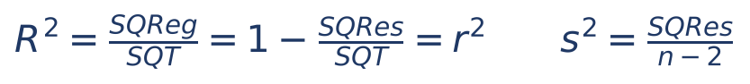

Cada símbolo:

- R² = coeficiente de determinação, entre 0 e 1 (ou entre 0% e 100%).
- SQReg, SQRes, SQT = as somas de quadrados da seção 16.5.2.
- r² = quadrado do coeficiente de correlação de Pearson. Na regressão linear SIMPLES (uma só variável X), R² = r².
- s² = variância residual estimada, explicada na seção 16.5.4.

No exemplo: R² = 3,6 ÷ 6 = 0,6. Conferindo: r² = 0,7746² ≈ 0,6. Leitura: 60% da variação do faturamento entre os supermercados é explicada (linearmente) pelo número de caixas; os outros 40% ficam por conta de fatores não incluídos (localização, mix de produtos, gerência) e do acaso.

Como interpretar:

- R² = 1: todos os pontos sobre a reta; a reta explica tudo.
- R² = 0: a reta não explica nada (é horizontal, ŷ = ȳ).
- De r para R²: eleve ao quadrado (r = 0,9 → R² = 0,81; r = −0,9 → R² = 0,81 também).
- De R² para r: tire a raiz e ponha o SINAL de b (R² = 0,64 com reta decrescente → r = −0,8).

:::PEGADINHA R² não é r, e R² alto não prova nada sozinho
Com r = 0,5, o R² é só 0,25: a reta explica um quarto da variação. Uma correlação "média" explica bem menos do que parece. Ao contrário, R² alto não prova causalidade, não garante que o modelo é o correto (uma curva pode ter R² alto numa reta) e não é sinal de "manipulação de dados".
:::

### 16.5.4 O erro padrão da estimativa

O R² é uma medida RELATIVA (fração). Há também uma medida na UNIDADE de Y, que diz "de quanto a reta costuma errar": o erro padrão da estimativa (ou erro padrão da regressão), s.

- s² = SQRes ÷ (n − 2), e s = √s².

Por que n − 2? Porque estimamos dois parâmetros (a e b) a partir dos dados, e cada parâmetro estimado "consome" um grau de liberdade (mesma lógica do n − 1 da variância amostral, Cap. 10, em que se estima uma média).

No exemplo:

- s² = 2,4 ÷ (5 − 2) = 2,4 ÷ 3 = 0,8
- s = √0,8 ≈ 0,894 mil reais, cerca de 894 reais.

Leitura prática: se os resíduos forem aproximadamente normais (Cap. 13), cerca de 95% dos pontos ficam a até 2 erros padrão da reta. Um valor observado que se afaste MUITO mais do que isso da previsão merece atenção; um que se afaste um erro padrão é perfeitamente comum.

### 16.5.5 A tabela de análise de variância (ANOVA) da regressão

Os programas de computador apresentam a decomposição numa tabela padronizada, que as bancas às vezes mostram com campos em branco para você completar:

| Fonte de variação | Graus de liberdade | Soma de quadrados | Quadrado médio | F |
|---|---|---|---|---|
| Regressão | 1 | SQReg | QMReg = SQReg ÷ 1 | QMReg ÷ QMRes |
| Resíduos | n − 2 | SQRes | QMRes = SQRes ÷ (n − 2) = s² | |
| Total | n − 1 | SQT | | |

Regras para completar: as somas de quadrados se somam (SQT = SQReg + SQRes); os graus de liberdade também se somam (1 + (n − 2) = n − 1); cada quadrado médio é a soma de quadrados dividida pelos seus graus de liberdade. O quadrado médio dos resíduos é a própria variância residual s².

No exemplo dos supermercados (n = 5):

| Fonte | gl | SQ | QM | F |
|---|---|---|---|---|
| Regressão | 1 | 3,6 | 3,6 | 3,6 ÷ 0,8 = 4,5 |
| Resíduos | 3 | 2,4 | 2,4 ÷ 3 = 0,8 | |
| Total | 4 | 6,0 | | |

A estatística F serve para testar se a reta explica alguma coisa de verdade (hipótese nula: β = 0); a ideia do teste está na seção 16.6.4.

:::QUESTAO FCC 2026 — SEFAZ-CE — Auditor Fiscal da Receita Estadual (Q4221361)
Um auditor usa a regressão Ŷ = 25.000 + 1,4X para estimar a receita bruta de vendas (Y) de uma varejista a partir do custo das mercadorias vendidas (X), com base em 24 meses: R² = 0,92 e erro padrão da estimativa de 10.000 reais. No período auditado, o contribuinte declarou custo de 50.000 reais e receita de 105.000 reais. Gabarito oficial: A (como a receita declarada está dentro de dois erros padrão da estimativa, o auditor deve aceitar o valor sem testes adicionais).
Resolução:
- Receita prevista: Ŷ = 25.000 + 1,4·50.000 = 25.000 + 70.000 = 95.000 reais.
- Resíduo: 105.000 − 95.000 = 10.000 reais, exatamente UM erro padrão.
- Um afastamento de um erro padrão é comum (seção 16.5.4); está bem dentro da faixa de dois erros padrão. A declaração é compatível com o modelo.
Por que as outras estão erradas:
- B: r = √0,92 ≈ 0,96 (e não 0,85), e isso indica relação FORTE, não fraca.
- C: R² alto indica bom ajuste; não é, por si, indício de manipulação.
- D: o cálculo de 95.000 reais está certo, mas uma diferença de 1 erro padrão não caracteriza ponto fora da curva (outlier).
- E: inverte os papéis. O 1,4 é o acréscimo esperado na RECEITA (Y) para cada 1 real a mais de CUSTO (X), e não o contrário.
Observação: a redação de A ("deve aceitar sem testes adicionais") é forte para a prática de auditoria, que não se esgota num modelo estatístico; mas, entre as alternativas, é a única tecnicamente coerente. Registre a lógica: resíduo pequeno em relação ao erro padrão, valor compatível.
:::

:::QUESTAO FGV 2024 — TJ-AP — Analista Judiciário, Estatístico (Q2450829)
Dadas a soma quadrática total (SQT), a explicada (SQE) e a dos resíduos (SQR), pede-se a fórmula do R². Gabarito oficial: B (SQE ÷ SQT).
Resolução: R² é a fração explicada: parte explicada dividida pelo total. Com a notação desta questão, SQE ÷ SQT. Seria igualmente correto 1 − SQR ÷ SQT, que não aparecia entre as alternativas (a alternativa A usa 1 − SQE ÷ SQT, que dá a fração NÃO explicada). Veja a pegadinha das siglas na seção 16.5.2.
No mesmo sentido: Q2450814 (FGV 2024), gabarito A: o valor esperado (média) do resíduo é zero.
:::

:::QUESTAO FGV 2024 — Prefeitura de Cuiabá — Auditor Fiscal Tributário (Q3158069)
Dois conjuntos de dados do mesmo tamanho, C1 e C2, recebem o mesmo método de regressão; o erro quadrático médio (EQM, em inglês *mean squared error*, MSE) de C1 é menor. Julgue: (1) o EQM varia entre 0 e 1; (2) C1 está mais bem ajustado; (3) para melhorar o ajuste de C2, é preciso aumentar o seu tamanho. Gabarito oficial: A (F – V – F).
Resolução: o EQM é a média dos quadrados dos resíduos, na unidade de Y ao quadrado; pode ser qualquer número não negativo (quem fica entre 0 e 1 é o R²). Menor EQM, com o mesmo tamanho, indica erros menores, logo melhor ajuste. Aumentar a amostra não garante melhor ajuste: se a relação não é linear, mais dados não consertam o modelo.
:::

:::PRATIQUE exercícios elaborados para esta apostila (R², resíduos e erro padrão)
1) A correlação entre duas variáveis é r = −0,9. Qual o R² da regressão simples? Interprete.
2) Numa regressão simples, SQT = 200 e SQRes = 50, e a reta é decrescente. Calcule SQReg, R² e r.
3) Com n = 12 pares, SQRes = 40. Calcule a variância residual e o erro padrão da estimativa.
4) Para a reta ŷ = 1,5 + 1,4x, ajustada aos dados X = 1, 2, 3, 4 e Y = 3, 5, 4, 8 (PRATIQUE da seção 16.4), calcule os resíduos, SQRes, SQT, SQReg, R² e s².
Resolução 1:
- R² = (−0,9)² = 0,81. A reta explica 81% da variação de Y.
Resolução 2:
- SQReg = 200 − 50 = 150.
- R² = 150 ÷ 200 = 0,75.
- r = −√0,75 ≈ −0,87 (sinal negativo porque a reta é decrescente; √0,75 ≈ 0,866, pois 0,866² ≈ 0,75).
Resolução 3:
- s² = 40 ÷ (12 − 2) = 40 ÷ 10 = 4.
- s = √4 = 2.
Resolução 4:
- Previsões: 1,5 + 1,4 = 2,9; 1,5 + 2,8 = 4,3; 1,5 + 4,2 = 5,7; 1,5 + 5,6 = 7,1.
- Resíduos: 3 − 2,9 = 0,1; 5 − 4,3 = 0,7; 4 − 5,7 = −1,7; 8 − 7,1 = 0,9. Soma: 0,1 + 0,7 − 1,7 + 0,9 = 0 (confere).
- SQRes = 0,01 + 0,49 + 2,89 + 0,81 = 4,2.
- SQT = Syy: desvios de Y em relação a ȳ = 5 são −2, 0, −1, 3; quadrados 4, 0, 1, 9; SQT = 14.
- SQReg = 14 − 4,2 = 9,8 (conferência: b·Sxy = 1,4·7 = 9,8).
- R² = 9,8 ÷ 14 = 0,7.
- s² = 4,2 ÷ (4 − 2) = 4,2 ÷ 2 = 2,1.
:::

## 16.6 O modelo estatístico, suas hipóteses e o diagnóstico

### 16.6.1 Da reta da amostra ao modelo da população

Até aqui, a reta foi uma descrição dos dados que temos. Quando tratamos os dados como AMOSTRA de uma população (Cap. 14), escrevemos o modelo teórico:

- Yᵢ = α + β·Xᵢ + εᵢ

Cada símbolo:

- α e β (alfa e beta) = intercepto e inclinação VERDADEIROS da população, desconhecidos (também escritos β₀ e β₁).
- εᵢ (épsilon) = erro aleatório: tudo o que afeta Y além de X (fatores omitidos, acaso, erro de medida).
- a e b (ou α̂ e β̂, com chapéu) = as estimativas de α e β calculadas com a amostra pelos mínimos quadrados.
- O resíduo eᵢ (seção 16.4.2) é a "versão observável" do erro εᵢ.

A distinção é a mesma do Cap. 14 entre parâmetro (μ) e estimativa (x̄).

### 16.6.2 As hipóteses (pressupostos) do modelo clássico

Para que as estimativas tenham boas propriedades e para que os testes e intervalos funcionem, supõe-se:

- Linearidade: a relação média entre X e Y é uma reta (linear nos parâmetros).
- Erros com média zero: E(εᵢ) = 0 (o modelo não erra sistematicamente para cima ou para baixo; "erros não enviesados").
- Homocedasticidade: todos os erros têm a MESMA variância σ² (a dispersão em torno da reta é igual em toda a faixa de X). O contrário chama-se heterocedasticidade.
- Independência (ausência de autocorrelação): os erros não são correlacionados entre si (o erro de um mês não "puxa" o do mês seguinte).
- Normalidade dos erros: εᵢ tem distribuição normal. É necessária para os testes t e F e para os intervalos de confiança em amostras pequenas; não é necessária para calcular a reta.
- X não aleatório (fixo, medido sem erro), na formulação clássica, ou, de modo mais geral, X não correlacionado com o erro.

Sob as hipóteses de média zero, homocedasticidade e independência (sem exigir normalidade), os estimadores de mínimos quadrados são os melhores estimadores lineares não viesados (teorema de Gauss-Markov; em inglês, BLUE, *best linear unbiased estimator*).

:::QUESTAO FGV 2026 — AL-RO — Analista Legislativo, Estatística (Q3883554)
Avalie se são pressupostos do modelo Y = α + βX + ε: (I) erros não correlacionados; (II) erros com média 0 e variância comum σ²; (III) erros com distribuição normal. Gabarito oficial: E (I, II e III).
Resolução: os três estão na lista da seção 16.6.2 (II reúne média zero e homocedasticidade).
No mesmo sentido: Q2450813 (FGV 2024), gabarito E: pede o que NÃO é pressuposto, e a resposta é "erros autocorrelacionados" (o pressuposto é o contrário). Q3261647 (FGV 2024), gabarito E (V – F – V): o diagrama quilometragem × preço de carros usados sugere relação linear (V), mas NEGATIVA, e não positiva (F); a quilometragem é a explicativa, tratada como medida sem erro, e o preço é a dependente (V).
:::

### 16.6.3 Diagnóstico pelos resíduos

Como saber se as hipóteses valem? Olhando os resíduos. O gráfico mais usado põe os valores ajustados ŷ (ou o próprio X) no eixo horizontal e os resíduos no vertical. Se tudo estiver bem, os resíduos formam uma faixa horizontal sem padrão, em torno de zero. Padrões indicam problemas:

- Curva (resíduos positivos nas pontas e negativos no meio, ou o inverso): a relação não é linear.
- Funil (a dispersão aumenta ou diminui com ŷ): heterocedasticidade.
- Sequência de resíduos do mesmo sinal ao longo do tempo: autocorrelação.
- Um ponto isolado muito longe da faixa: outlier (valor atípico).
- Histograma ou gráfico de probabilidade normal dos resíduos torto: não normalidade.

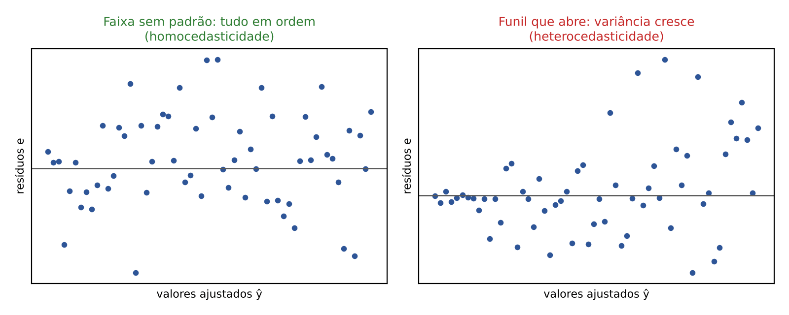

Atenção especial aos pontos "estranhos":

- Outlier: ponto com resíduo grande (longe da reta na vertical).
- Ponto de alta alavancagem (*leverage*): ponto com valor de X muito afastado dos demais.
- Ponto influente: aquele cuja retirada muda MUITO a reta. Em geral, é um ponto de alta alavancagem que não segue o padrão dos outros.

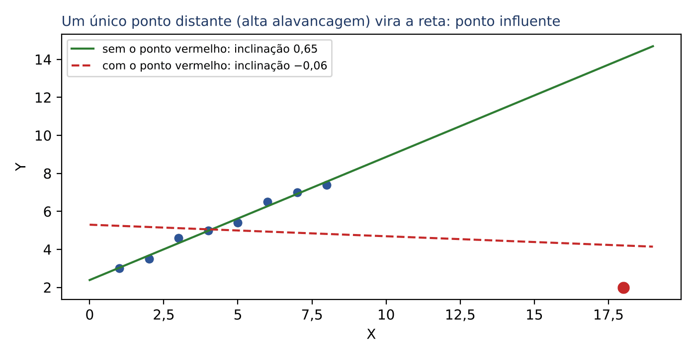

No desenho, oito pontos alinhados dão inclinação de cerca de 0,65; acrescentando um único ponto distante (vermelho), a inclinação vira cerca de −0,06, quase zero e com o sinal trocado. Na auditoria, isso tem duplo sentido: o ponto pode ser um erro de digitação (que contamina o modelo) ou justamente o contribuinte que merece ser fiscalizado.

:::QUESTAO FCC 2026 — SEFAZ-MT — Fiscal de Tributos Estaduais (Q3947194)
Após uma regressão por mínimos quadrados ordinários, o gráfico de resíduos contra valores ajustados mostra um padrão de funil (cone): a variabilidade dos resíduos cresce à medida que os valores ajustados aumentam. Pede-se o diagnóstico. Gabarito oficial: B (heterocedasticidade).
Resolução: a hipótese de variância constante dos erros (homocedasticidade) foi violada; a variância muda com o nível de Y, o que é a definição de heterocedasticidade. É comum em dados fiscais: empresas grandes têm erros de previsão, em reais, muito maiores do que as pequenas.
Por que as outras estão erradas: erro de especificação funcional (A) aparece como CURVA nos resíduos; normalidade (C) não é um defeito; multicolinearidade (D) é correlação entre variáveis EXPLICATIVAS na regressão múltipla (não existe na simples, que tem um só X); autocorrelação (E) aparece como dependência entre resíduos sucessivos, típica de séries no tempo.
No mesmo sentido: Q3088071 (FGV 2024), gabarito E: a análise de resíduos detecta não linearidade, não normalidade, heterocedasticidade, correlação entre os erros e outliers (todos os cinco itens).
:::

:::QUESTAO FGV 2025 — Prefeitura do Rio de Janeiro — Gestor de Segurança Municipal (Q3782900)
Numa regressão do número de incidentes de segurança sobre as horas de treinamento, um único funcionário com incidentes muito acima do padrão, quando retirado, faz o coeficiente das horas de treinamento mudar drasticamente. Gabarito oficial: B (ponto influente, com alta alavancagem, que altera substancialmente o ajuste).
Resolução: a marca do ponto influente é exatamente esta: retirá-lo muda muito a reta (seção 16.6.3). A ("sem influência") contradiz o enunciado; C ("observação típica") também; D erra ao dizer que o ponto "melhora a eficiência"; E fala em baixa alavancagem e multicolinearidade, sem pertinência numa regressão com uma só explicativa.
:::

### 16.6.4 Testes de hipóteses na regressão (noção)

A reta da amostra sempre tem algum b diferente de zero, mesmo que, na população, X não tenha nada a ver com Y. Para decidir se a relação é "real", testa-se (Cap. 15):

- H₀: β = 0 (X não tem efeito linear sobre Y) contra H₁: β ≠ 0.

Há dois caminhos, que na regressão SIMPLES dão a mesma conclusão:

- Teste t: t = b ÷ EP(b), em que EP(b) = s ÷ √Sxx é o erro padrão da inclinação; compara-se com a tabela t de Student com n − 2 graus de liberdade. Serve para testar UM coeficiente.
- Teste F: F = QMReg ÷ QMRes (tabela ANOVA da seção 16.5.5); compara-se com a tabela F de Snedecor. Serve para testar o modelo como um todo (na regressão múltipla, um CONJUNTO de coeficientes). Na regressão simples, F = t².

No exemplo dos supermercados: EP(b) = 0,894 ÷ √10 ≈ 0,894 ÷ 3,162 ≈ 0,283; t = 0,6 ÷ 0,283 ≈ 2,12; e t² ≈ 4,5 = F (confere com a ANOVA). Com 3 graus de liberdade, o valor crítico bilateral a 5% da tabela t é cerca de 3,18; como 2,12 < 3,18, NÃO rejeitamos H₀. Com só cinco supermercados, a relação observada (r ≈ 0,77) ainda poderia ser obra do acaso. Lição: correlação razoável em amostra minúscula não é prova; o tamanho da amostra pesa.

O intervalo de confiança para β segue a lógica do Cap. 14: b ± t·EP(b). Se o intervalo contém o zero, o efeito não é significante ao nível correspondente.

:::QUESTAO FGV 2024 — TJ-AP — Analista Judiciário, Estatístico (Q2450816 e Q2450817)
Duas questões em sequência: qual teste usar para a significância de UM coeficiente de uma regressão múltipla (Q2450816), e qual usar para um CONJUNTO de parâmetros (Q2450817). Gabaritos oficiais: C (t de Student) e D (F de Fisher-Snedecor), respectivamente.
Resolução: um coeficiente, teste t (estimativa dividida pelo seu erro padrão); vários coeficientes ao mesmo tempo, teste F (compara a variação explicada com a não explicada, como na tabela ANOVA).
:::

## 16.7 Para além da reta simples (noções que as bancas já cobraram)

O edital fala em regressão linear SIMPLES, mas as provas para auditor, sobretudo nas áreas de dados, já trouxeram vizinhos próximos. Basta reconhecê-los (os aspectos de aprendizado de máquina estão no Cap. 25).

- Regressão linear múltipla: várias explicativas ao mesmo tempo (Y = β₀ + β₁X₁ + β₂X₂ + ... + ε). Cada coeficiente mede o efeito de uma variável mantidas as outras constantes. Problema próprio: multicolinearidade, isto é, explicativas fortemente correlacionadas entre si, o que torna os coeficientes instáveis. Como acrescentar variáveis nunca reduz o R², usa-se o R² ajustado, que penaliza o excesso de variáveis.
- Regressão logística: quando Y é categórica binária (sim ou não: fraude ou não fraude, promovido ou não), modela-se a PROBABILIDADE do evento, sempre entre 0 e 1. Não serve para prever um valor contínuo.
- Regularização (Ridge e Lasso): versões da regressão que "encolhem" os coeficientes para evitar modelos instáveis quando há muitas variáveis ou multicolinearidade. O Ridge (penalização L2) reduz os coeficientes, mas não os zera; o Lasso (penalização L1) pode zerar alguns, fazendo seleção de variáveis.
- Métricas de erro de previsão: EQM ou MSE (média dos quadrados dos erros; sensível a outliers; unidade de Y ao quadrado), REQM ou RMSE (raiz do MSE; mesma unidade de Y), EMA ou MAE (média dos erros em valor absoluto; "em média, o modelo erra 18 dias"). O R² é métrica de regressão, não de classificação.

:::QUESTAO FCC 2026 — SEFAZ-SP — Auditor Fiscal da Receita Estadual (Q3916782)
Uma equipe quer explicar o tempo de processamento de operações fiscais a partir de 27 variáveis, com suspeita de multicolinearidade, e compara Ridge e Lasso. Gabarito oficial: E (o Lasso tende a fazer seleção de variáveis, zerando alguns coeficientes; o Ridge apenas encolhe os coeficientes, sem eliminá-los).
Resolução: é a diferença clássica (L1 zera; L2 encolhe). A inverte os papéis; B erra ao dizer que ambos sempre zeram; C erra ao afirmar que sempre geram modelos mais complexos (a regularização simplifica); D erra ao atribuir L2 aos dois (o Lasso usa L1).
:::

:::QUESTAO FGV 2025 — CGE-SP — Auditor Estadual de Controle, Tecnologia da Informação (Q3781122)
Afirmativas sobre classificação binária e regressão: (I) em classificação com base desbalanceada, deve-se priorizar o R² sobre a acurácia; (II) na regressão, o MSE é muito sensível a outliers e o RMSE tem a mesma unidade da variável-alvo; (III) a regressão logística estima probabilidade de evento e não serve para prever valor contínuo. Gabarito oficial: D (II e III).
Resolução: I é falsa porque R² é métrica de regressão, não de classificação (em bases desbalanceadas usam-se precisão, sensibilidade, F1 e similares, Cap. 25). II e III estão corretas pelos conceitos da seção 16.7.
No mesmo sentido: Q3660470 (FGV 2025), gabarito A (só I: regressão linear e logística diferem pelo tipo de variável prevista; II descreve a logística, e não a linear; III exige tamanhos iguais sem base); Q2450812 (FGV 2024), gabarito E (regressão logística para prever a probabilidade de promoção); Q3869748 (FGV 2026, TJ-RJ), gabarito A (média das diferenças absolutas é o MAE); Q2518873 (FGV 2024), gabarito A (ausência de multicolinearidade é pressuposto próprio da regressão múltipla).
:::

:::NOTA Outras questões do banco sobre o tema
Questões não comentadas em box, por dependerem de quadro ou gráfico não reproduzido no banco, por estarem fora do nível do edital ou por repetirem pontos já vistos.

| Q | Banca/ano | Subtema | Gabarito |
|---|---|---|---|
| Q3337111 | FGV 2025 | Reta por MQO a partir de estatísticas em quadro (ŷ = 1 + 2x) | C |
| Q3188261 | FGV 2025 | Reta a partir de somas de desvios em quadro (ŷ = −0,2 + 2,5x) | A |
| Q2450811 | FGV 2024 | Previsão de potência por cilindrada, tabela em imagem | C |
| Q3349759 | FGV 2025 | Completar tabela ANOVA e obter s² | B |
| Q3883536 | FGV 2026 | Correlação a partir de distribuição conjunta (resultado 0) | C |
| Q4220196 | FGV 2026 | Variância e covariância a partir de distribuição conjunta | A |
| Q4389072 e Q4391286 | FGV 2026 | Tabela idade de alfabetização × renda; mesmas alternativas, gabaritos diferentes (E e C), provavelmente por tabelas diferentes nas duas provas | E; C |
| Q3363361 | FGV 2025 | Leitura de mapa de calor de correlações | E |
| Q2517674 | FGV 2024 | Intervalo de confiança para a inclinação (t com 18 gl) | B |
| Q2517675 | FGV 2024 | Covariância entre os estimadores de β₀ e β₁ (nível avançado) | D |
| Q4220194 | FGV 2026 | Teorema de Gauss-Markov e propriedades dos estimadores | D |
| Q2512357 | FGV 2024 | Condições de consistência do MQO | C |
| Q3349761 e Q3088069 | FGV 2025/2024 | Solução matricial b = (X'X)⁻¹X'Y (regressão múltipla) | A; D |
| Q4220348 | FGV 2026 | Estimador de regressão × estimador de razão em amostragem de auditoria | E |
| Q2517676 | FGV 2024 | Modelo autorregressivo AR(1) (séries temporais) | E |
| Q3593193 | FGV 2025 | Mineração de dados, correlação sem causalidade | E |
:::

## 16.8 Resumo para revisão pré-prova

| Conceito | Fórmula ou regra | Quando usar | Armadilha |
|---|---|---|---|
| Diagrama de dispersão | Um ponto por par (x; y) | Ver direção, forma e força da relação entre duas variáveis quantitativas | Não confundir com histograma ou Pareto; pontos mais espalhados = relação MAIS FRACA |
| Covariância | Sxy ÷ (n − 1) na amostra; Sxy ÷ n na população; E[XY] − E[X]E[Y] | Dá o SINAL da relação; insumo de r e de b | Depende da unidade; o tamanho não mede força |
| Atalhos das somas | Sxy = Σxy − n·x̄·ȳ; Sxx = Σx² − n·x̄²; Syy = Σy² − n·ȳ² | Quando a prova dá Σx, Σy, Σxy, Σx², Σy² | Confundir Σx² (soma dos quadrados) com (Σx)² (quadrado da soma) |
| Propriedades da covariância | cov(aX + b, cY + d) = a·c·cov(X, Y) | Mudança de unidade ou de escala | Constantes somadas não alteram nada |
| Correlação de Pearson | r = cov ÷ (sx·sy) = Sxy ÷ √(Sxx·Syy) | Medir força e direção da relação LINEAR | Mesmo divisor em tudo; −1 ≤ r ≤ 1; negativo não é "fraco" |
| Propriedades de r | Adimensional, simétrico; não muda com somas e multiplicações positivas; troca o sinal com multiplicação negativa; Y = aX + b → r = ±1 | Questões de transformação de variáveis | r = 0 não implica independência (só ausência de relação linear) |
| Causalidade | Correlação ≠ causalidade; correlação espúria por variável omitida; causalidade reversa | Questões conceituais e de interpretação de gráficos | Nem valor-p pequeno nem precedência temporal provam causa |
| Reta de mínimos quadrados | ŷ = a + bx, minimizando Σ(y − ŷ)² | Prever Y a partir de X | Resíduo é distância VERTICAL |
| Inclinação | b = Sxy ÷ Sxx = cov ÷ var(X) = r·sy ÷ sx; ou (nΣxy − ΣxΣy) ÷ (nΣx² − (Σx)²) | Calcular a reta | Dividir pela variância de X, não de Y |
| Intercepto | a = ȳ − b·x̄ (a reta passa por (x̄; ȳ)) | Achar a ou b quando o outro e as médias são dados | Prova dá SOMAS: dividir por n antes |
| Interpretação | b = variação média de Y por unidade de X; a = Y previsto para X = 0 | Questões de interpretação | b mede associação, não causa; a pode não ter sentido; extrapolação é arriscada |
| Resíduos | e = y − ŷ; Σe = 0 | Diagnóstico e erro padrão | Positivo = ponto acima da reta |
| Decomposição | SQT = SQReg + SQRes; SQT = Syy; SQReg = b·Sxy | Completar ANOVA; calcular R² | As siglas variam (SQR, SQE): leia a definição |
| Coeficiente de determinação | R² = SQReg ÷ SQT = 1 − SQRes ÷ SQT = r² (regressão simples) | Fração da variação de Y explicada pela reta | r = 0,5 dá R² = 0,25; de R² para r, use o sinal de b |
| Erro padrão da estimativa | s² = SQRes ÷ (n − 2) = QMRes | Medir o erro típico na unidade de Y | n − 2, não n − 1 |
| ANOVA da regressão | gl: 1, n − 2, n − 1; QM = SQ ÷ gl; F = QMReg ÷ QMRes | Testar se a reta explica algo | Na simples, F = t² |
| Pressupostos | Linearidade; erros com média 0, variância constante, independentes, normais | Questões teóricas e de diagnóstico | Funil = heterocedasticidade; multicolinearidade só na múltipla |
| Pontos atípicos | Outlier (resíduo grande); alavancagem (X extremo); influente (muda a reta) | Interpretar gráficos e saídas | Um só ponto pode inverter o sinal de b |
| Testes | t = b ÷ EP(b) para um coeficiente; F para o conjunto | Significância da relação | Amostra pequena: r razoável pode não ser significante |

:::ESQUEMA Formulário do capítulo
- x̄ = Σx ÷ n e ȳ = Σy ÷ n (médias).
- Sxy = Σ(x − x̄)(y − ȳ) = Σxy − n·x̄·ȳ (soma dos produtos dos desvios).
- Sxx = Σ(x − x̄)² = Σx² − n·x̄²; Syy = Σ(y − ȳ)² = Σy² − n·ȳ² (somas dos quadrados dos desvios).
- cov(X, Y) = Sxy ÷ (n − 1) (amostra) ou Sxy ÷ n (população); cov = E[XY] − E[X]·E[Y] (variáveis aleatórias).
- r = cov ÷ (sx·sy) = Sxy ÷ √(Sxx·Syy); −1 ≤ r ≤ 1.
- b = Sxy ÷ Sxx = cov ÷ var(X) = r·sy ÷ sx (inclinação: variação média de Y por unidade de X).
- a = ȳ − b·x̄ (intercepto: ŷ quando x = 0).
- ŷ = a + b·x (previsão); e = y − ŷ (resíduo).
- SQT = Syy; SQReg = b·Sxy; SQRes = SQT − SQReg = Σe².
- R² = SQReg ÷ SQT = 1 − SQRes ÷ SQT = r² (fração explicada).
- s² = SQRes ÷ (n − 2); s = √s² (erro padrão da estimativa).
- EP(b) = s ÷ √Sxx; t = b ÷ EP(b), com n − 2 graus de liberdade; F = QMReg ÷ QMRes = t² (regressão simples).
:::

## 16.9 Questões do capítulo

FCC (comentadas): Q4221361, Q3947194, Q3916790, Q3916780, Q3916782, Q3884300, Q3506134, Q3281789, Q3281589.
FGV (comentadas ou citadas em box): Q4150574, Q3258885, Q2535785, Q3786840, Q3086056, Q3782899, Q3782901, Q4279844, Q3782891, Q3154013, Q3719700, Q3758080, Q3853103, Q4218172, Q3660446, Q3154015, Q2450825, Q2496490, Q3883553, Q3088068, Q4220340, Q3261008, Q2450829, Q2450814, Q3158069, Q3883554, Q2450813, Q3261647, Q3088071, Q3782900, Q2450816, Q2450817, Q3781122, Q3660470, Q2450812, Q3869748, Q2518873.
FGV (só na tabela "Outras questões"): Q3337111, Q3188261, Q2450811, Q3349759, Q3883536, Q4220196, Q4389072, Q4391286, Q3363361, Q2517674, Q2517675, Q4220194, Q2512357, Q3349761, Q3088069, Q4220348, Q2517676, Q3593193.

:::NOTA Notas de verificação
- Contas: todos os exemplos (supermercados: médias, Sxy = 6, Sxx = 10, Syy = 6, b = 0,6, a = 2,2, r ≈ 0,775, R² = 0,6, resíduos, SQRes = 2,4, s² = 0,8, F = 4,5, t ≈ 2,12 e t crítico ≈ 3,18 com 3 gl), os exercícios PRATIQUE e as resoluções numéricas das questões (Q4221361, Q3916780, Q3884300, Q3506134, Q3281789, Q2535785, Q3154015, Q4218172, Q3660446) foram conferidos em Python. As figuras foram geradas com matplotlib e graphviz e revistas visualmente.
- Fontes: banco local de questões (49 com ch = 16 e busca por palavra-chave no banco inteiro); mapa "Regressão Linear Simples" do Drive (ES24), usado para conferir a nomenclatura da ANOVA (nele, SQM = modelo e SQR = resíduos, o que motivou a pegadinha das siglas). Os demais PDFs do Drive (ES01 a ES03) não foram abertos, por desnecessários.
- Q3281589 (FCC): as variâncias amostrais estavam em quadro não reproduzido no banco; o box traz o enunciado do banco, o método e o gabarito oficial, sem números reconstruídos (revisão de 30/10/2026, que retirou as variâncias supostas 25 e 36). Conferir no enunciado original antes de publicar.
- Q3086056, Q3853103 e outras com gráfico ou tabela em imagem foram resolvidas apenas pelo que o texto e o gabarito permitem inferir.
- Q4221361 (FCC): gabarito oficial A; redação discutível ("deve aceitar sem testes adicionais"), mas as demais alternativas têm erros objetivos. Mantido o gabarito, com ressalva no box.
- Q3261008 (FGV): gabarito oficial B; a afirmação III, na leitura natural, descreve corretamente os mínimos quadrados. Gabarito discutível, registrado no box.
- Q4389072 e Q4391286 (FGV): enunciados e alternativas idênticos com gabaritos diferentes; provavelmente tabelas distintas em provas diferentes. Não comentadas.
- As faixas de interpretação de r (0,3 e 0,7) são convenção didática, sem fonte normativa; o texto adverte isso.
- O capítulo remete ao Cap. 1 (raízes, reta, soma de PA), Cap. 9 e 10 (média, variância), Cap. 13 (esperança, normal), Cap. 14 e 15 (estimação e testes) e Cap. 25 (aprendizado de máquina); as numerações de seção desses capítulos não foram citadas, porque os capítulos ainda não estavam gravados em /home/claude/cg/ch/ quando este foi escrito.
:::
