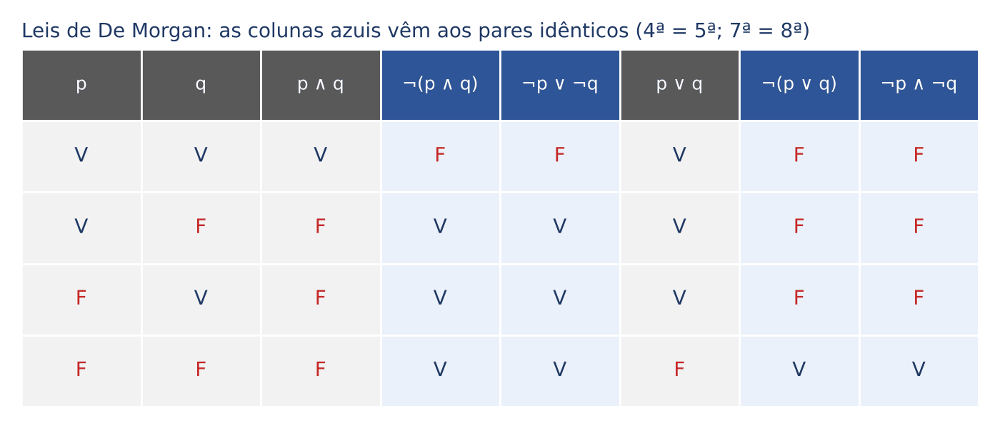
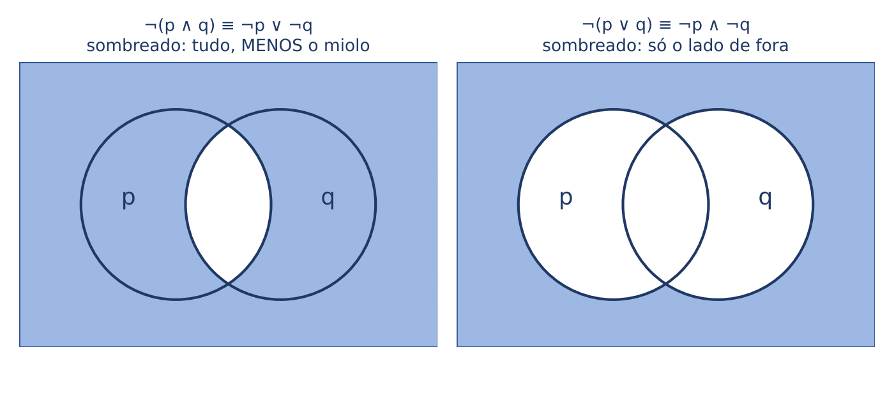
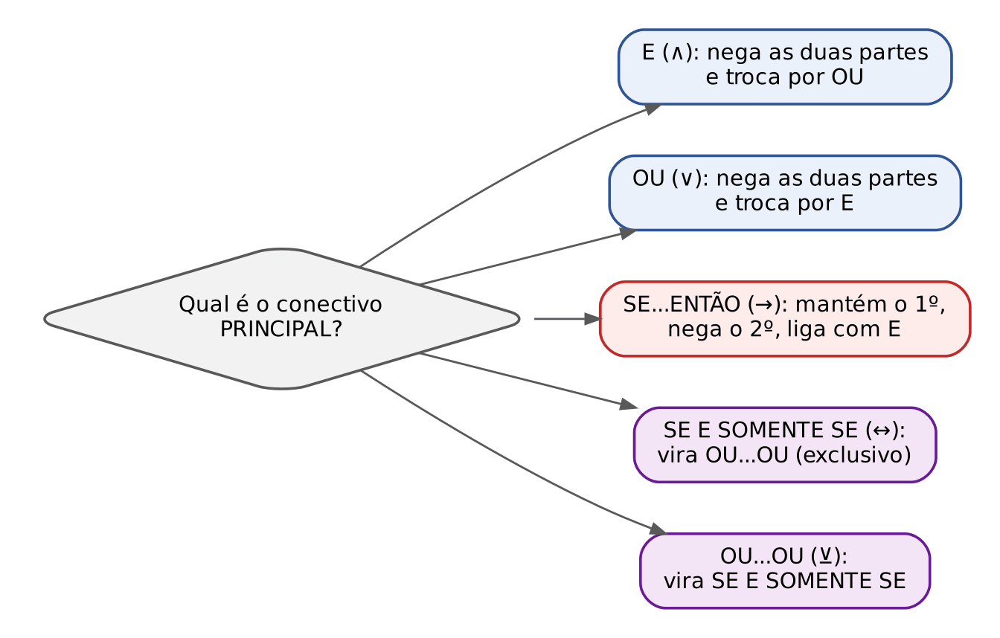
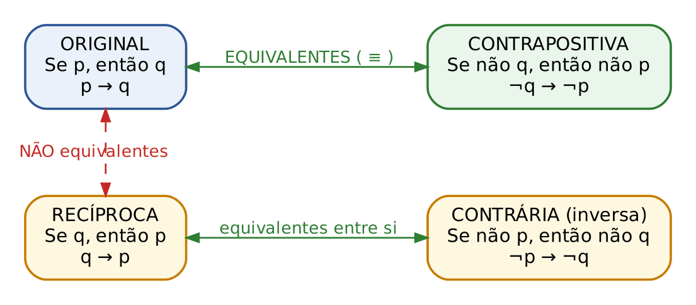
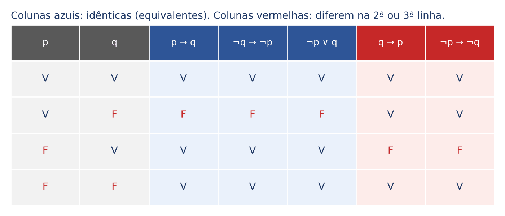
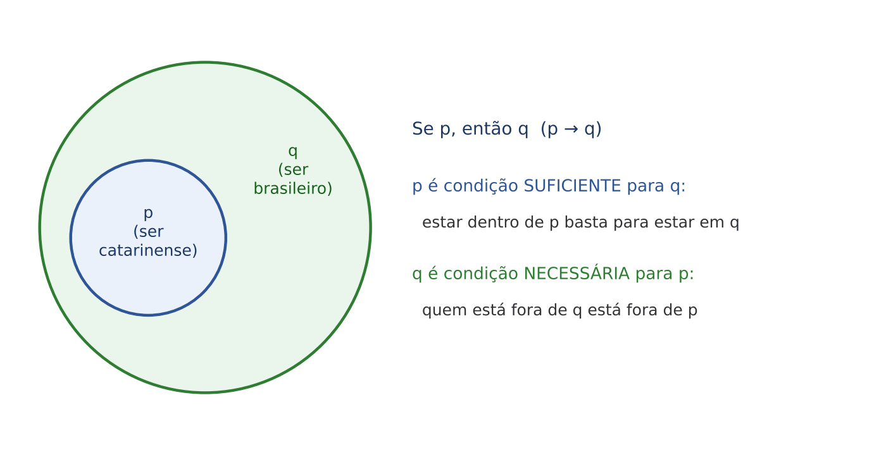
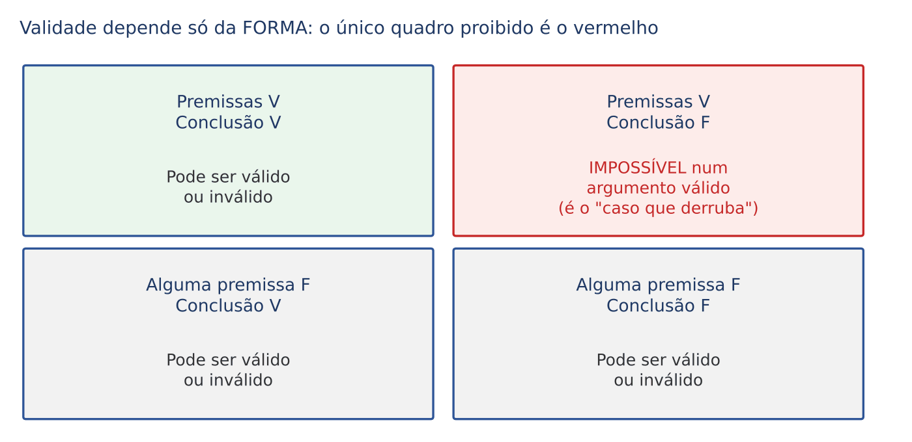
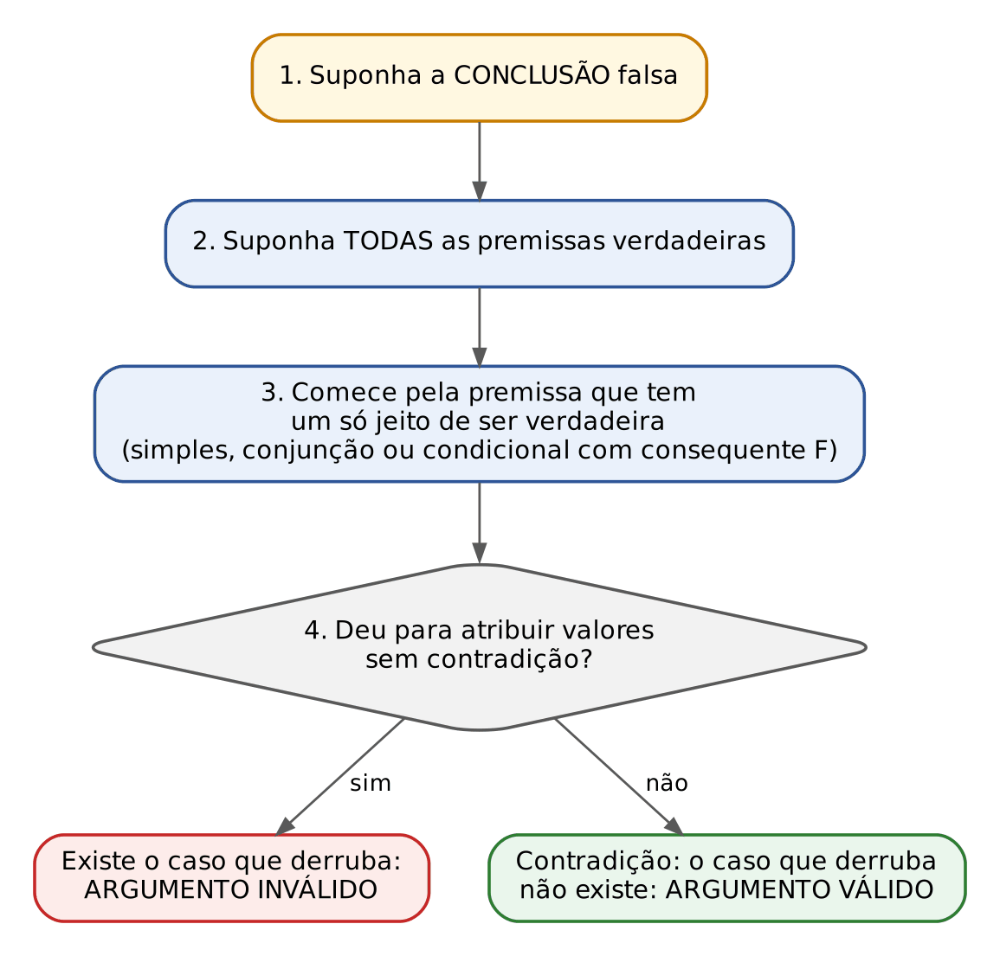
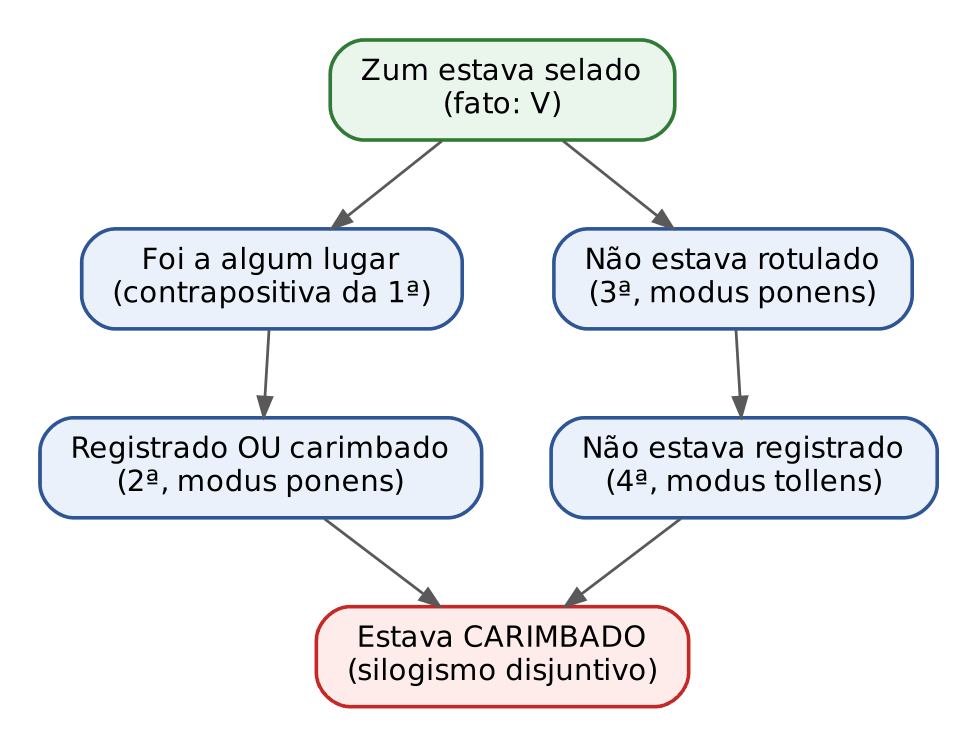

# CAPÍTULO 18 — LÓGICA PROPOSICIONAL II: EQUIVALÊNCIAS, NEGAÇÕES, CONDICIONAL E ARGUMENTOS VÁLIDOS

:::INCIDENCIA
Edital SEFAZ/SC 01/2026 — Matemática Financeira, Estatística e Raciocínio Lógico, ponto de Raciocínio Lógico ("compreensão do processo lógico que, a partir de um conjunto de hipóteses, conduz, de forma válida, a conclusões determinadas"). Nível A+.
Lote do banco: 43 questões (FCC 2, FGV 41), todas comentadas ou listadas neste capítulo.
O que mais cai: equivalência da condicional (contrapositiva e "não p ou q"), negação da condicional (p e não q), De Morgan, "considere falsa a sentença", argumento válido x inválido e deduções em cadeia (a especialidade da FCC).
:::

:::ESQUEMA O que você vai aprender e o que precisa saber antes
Pré-requisitos (Cap. 17): o que é proposição; os cinco conectivos (não, e, ou, ou...ou, se...então, se e somente se) e as palavras do português que os expressam; as tabelas-verdade de cada conectivo; a ordem de precedência; tautologia, contradição e contingência. Se alguma dessas palavras soar estranha, volte ao Cap. 17 antes de prosseguir: este capítulo USA aquelas tabelas o tempo todo.
Roteiro deste capítulo:
- 18.1 O que é "ser equivalente" e como testar (a tabela-verdade e o "caso que derruba").
- 18.2 O catálogo de equivalências básicas: dupla negação, comutativa, associativa, distributiva, absorção, bicondicional e ou exclusivo.
- 18.3 Como negar qualquer proposição: leis de De Morgan e a tabela de negações.
- 18.4 A condicional por dentro: contrapositiva, recíproca e contrária; "se...então" escrito com "ou"; negação da condicional; condição suficiente e necessária; condicionais com antecedente composto; o que se conclui de uma condicional FALSA.
- 18.5 Argumentos: premissas, conclusão, validade x verdade; regras de inferência (modus ponens, modus tollens, silogismos); falácias formais; métodos da tabela-verdade e da conclusão falsa.
- 18.6 Dedução encadeada: as questões de "se...então" em cadeia e as de "exatamente uma afirmação é falsa".
- 18.7 Resumo para revisão pré-prova, com o formulário do capítulo.
:::

Uma palavra de ânimo antes de começar. Este é o capítulo de lógica em que o Direito mais ajuda. Equivalência é o que o senhor faz quando reconhece que duas redações diferentes de um dispositivo têm o mesmo alcance. Negação é o que faz o réu que contesta especificamente um fato. Argumento válido é o silogismo da sentença: premissa maior (a norma), premissa menor (o fato) e conclusão (o dispositivo). A diferença é que, aqui, tudo é mecânico: há regras fixas, e quem as aplica com calma acerta sempre. Não é preciso "ter jeito para matemática"; é preciso seguir o roteiro.

Uma convenção de símbolos, recapitulada do Cap. 17, para não haver dúvida:

| Símbolo | Lê-se | Exemplo em português |
|---|---|---|
| ¬p | não p | "O contribuinte NÃO pagou" |
| p ∧ q | p e q | "Pagou E entregou a declaração" |
| p ∨ q | p ou q (inclusivo: um, outro ou ambos) | "Pagou OU parcelou" |
| p ⊻ q | ou p ou q (exclusivo: exatamente um) | "OU é segunda OU é terça" |
| p → q | se p, então q | "SE pagou, ENTÃO recebe a certidão" |
| p ↔ q | p se e somente se q | "Recebe a certidão SE E SOMENTE SE está em dia" |
| ≡ | "é equivalente a" | p → q ≡ ¬q → ¬p |

## 18.1 Equivalência lógica: o que é e como testar

### 18.1.1 A ideia em linguagem comum

Pense em duas placas na porta de um cartório. A primeira diz: "Se você não trouxe documento, não será atendido". A segunda diz: "Se você foi atendido, então trouxe documento". As palavras são diferentes, a ordem é diferente, mas qualquer pessoa sensata percebe que as duas placas proíbem exatamente a mesma coisa: ser atendido sem documento. Em qualquer situação concreta que se imagine, ou as duas placas são respeitadas, ou as duas são desrespeitadas.

É isso que a lógica chama de equivalência. Duas proposições são logicamente equivalentes quando, em TODAS as situações possíveis, têm o mesmo valor lógico: quando uma é verdadeira, a outra também é; quando uma é falsa, a outra também é. Elas "dizem a mesma coisa com outras palavras".

Analogia jurídica: são duas redações de um mesmo dispositivo com idêntico âmbito de incidência. Não basta que coincidam no caso dos autos; é preciso que coincidam em QUALQUER caso que se possa imaginar.

Escrevemos A ≡ B (lê-se "A é equivalente a B").

### 18.1.2 Primeiro teste: a tabela-verdade lado a lado

Como ter certeza de que duas proposições coincidem "em todas as situações"? As situações possíveis são justamente as linhas da tabela-verdade (Cap. 17: com 2 proposições simples há 4 linhas; com 3, há 8; com n, há 2ⁿ). Então o teste é:

:::PASSO Como testar se duas proposições são equivalentes pela tabela-verdade
1. Identifique as proposições simples envolvidas (p, q, r...).
2. Monte as linhas com todas as combinações de V e F (4 linhas para duas letras; 8 para três).
3. Calcule, linha a linha, o valor da primeira proposição.
4. Calcule, linha a linha, o valor da segunda.
5. Compare as duas colunas. Se forem IDÊNTICAS em todas as linhas, são equivalentes. Se diferirem em UMA linha que seja, não são.
:::

:::EXEMPLO As duas placas do cartório
Sejam p = "você trouxe documento" e q = "você foi atendido". A primeira placa é ¬p → ¬q ("se não trouxe, não é atendido"). A segunda é q → p ("se foi atendido, trouxe").
Relembrando a regra da condicional (Cap. 17): A → B só é FALSA quando A é verdadeira e B é falsa ("a promessa quebrada"); em todos os outros casos é verdadeira.
Linha 1: p = V, q = V.
- ¬p = F, ¬q = F; então ¬p → ¬q é "F → F", que é V.
- q → p é "V → V", que é V.
Linha 2: p = V, q = F.
- ¬p = F, ¬q = V; "F → V" é V.
- q → p é "F → V", que é V.
Linha 3: p = F, q = V.
- ¬p = V, ¬q = F; "V → F" é F.
- q → p é "V → F", que é F.
Linha 4: p = F, q = F.
- ¬p = V, ¬q = V; "V → V" é V.
- q → p é "F → F", que é V.
Colunas: (V, V, F, V) e (V, V, F, V). Idênticas: as placas são equivalentes.
:::

### 18.1.3 Segundo teste, mais rápido: procurar o "caso que derruba"

Na prova, montar tabelas de 8 linhas para cada alternativa consome tempo demais. Há um atalho que usa a mesma ideia ao contrário: para mostrar que duas proposições NÃO são equivalentes, basta achar UMA situação em que uma é verdadeira e a outra é falsa. É como um contraexemplo na argumentação jurídica: uma única hipótese em que as duas redações levam a resultados diferentes já prova que elas não têm o mesmo alcance.

O jeito mais eficiente de procurar esse caso é partir da situação em que a proposição "mais exigente" é falsa. Cada conectivo tem uma "situação de falsidade" característica (Cap. 17):

| Conectivo | Quando é FALSO | Quantas linhas falsas (em 4) |
|---|---|---|
| p ∧ q | basta uma parte ser F | 3 |
| p ∨ q | só quando as duas são F | 1 |
| p → q | só quando p = V e q = F | 1 |
| p ↔ q | quando p e q têm valores diferentes | 2 |
| p ⊻ q | quando p e q têm valores iguais | 2 |

Repare: a disjunção e a condicional têm uma ÚNICA linha falsa. Por isso são as mais fáceis de "atacar": você força aquela linha e vê o que acontece com a outra proposição.

:::EXEMPLO O caso que derruba: p → q é equivalente a q → p?
p → q só é falsa em uma situação: p = V e q = F.
Nessa situação, q → p fica "F → V", que é VERDADEIRA.
Achamos uma situação em que uma é falsa e a outra é verdadeira. Logo, NÃO são equivalentes. Não foi preciso montar a tabela inteira.
Em português: "Se é catarinense, então é brasileiro" é verdadeira; "Se é brasileiro, então é catarinense" é falsa (um gaúcho é brasileiro sem ser catarinense). Os dois enunciados não dizem a mesma coisa.
:::

:::DICA O atalho de prova para "assinale a equivalente"
Em vez de verificar se cada alternativa é equivalente, procure o caso que torna a proposição do enunciado FALSA (em geral há um só) e teste as alternativas NELE: a equivalente tem de ser falsa nesse mesmo caso. Elimine as alternativas que ficarem verdadeiras. Normalmente sobram uma ou duas, e você confere a sobrevivente em mais uma linha.
:::

### 18.1.4 Equivalência não é a mesma coisa que "ter o mesmo valor no caso concreto"

Uma confusão comum: "Brasília é a capital do Brasil" e "Florianópolis é a capital de Santa Catarina" são ambas verdadeiras, mas NÃO são logicamente equivalentes. Coincidem no mundo real, mas não por força da forma: nada na estrutura de uma obriga a outra. Equivalência lógica é coincidência em TODAS as linhas da tabela, isto é, em todas as combinações imagináveis de valores das proposições simples.

Outra forma de dizer o mesmo, que algumas bancas usam: A ≡ B quando a bicondicional A ↔ B é uma tautologia (Cap. 17: tautologia é a proposição verdadeira em todas as linhas). De fato, A ↔ B é V exatamente quando A e B têm o mesmo valor; se isso ocorre em todas as linhas, A ↔ B é sempre V.

## 18.2 O catálogo das equivalências básicas

Nesta seção estão as equivalências que se usam como "ferramentas" para transformar uma frase em outra. Para cada uma: a ideia, um exemplo em português e, quando não for óbvia, a conferência pela tabela. As equivalências da condicional, que são as campeãs de prova, ficam para a seção 18.4, e as negações (De Morgan) para a 18.3.

### 18.2.1 Dupla negação

Negar duas vezes é afirmar: ¬(¬p) ≡ p.

- "Não é verdade que o réu não compareceu" ≡ "O réu compareceu".
- "Não é verdade que a empresa não recolheu o ICMS" ≡ "A empresa recolheu o ICMS".

:::PEGADINHA Negação não é antônimo
"Não é verdade que o processo não é rápido" equivale a "o processo é rápido", e NÃO a "o processo é lento". Do mesmo modo, a negação de "João é alto" é "João NÃO é alto" (ele pode ser de estatura média), e não "João é baixo". Antônimos são "contrários" que podem ser ambos falsos ao mesmo tempo; a negação lógica é o único enunciado que é falso quando o original é verdadeiro e verdadeiro quando o original é falso. A FCC e a FGV adoram oferecer o antônimo como alternativa.
:::

O mesmo vale para desigualdades, que caem muito:

| Afirmação | Negação correta | Armadilha (não é negação) |
|---|---|---|
| x > 5 | x ≤ 5 | x < 5 (esquece o "igual") |
| x ≥ 5 | x < 5 | x ≤ 5 |
| x = 5 | x ≠ 5 | — |
| "no máximo 3 pessoas" (≤ 3) | "pelo menos 4" (≥ 4), ou "mais de 3" | "pelo menos 3" |
| "superior a 80%" | "menor ou igual a 80%" | "inferior a 80%" |
| "todos estão abertos" | "pelo menos um está fechado" | "todos estão fechados" (Cap. 19) |

O raciocínio da tabela: um número qualquer ou é maior que 5, ou não é. Se não é maior que 5, ele é menor que 5 OU igual a 5. Por isso a negação de "> 5" é "≤ 5": ela precisa cobrir TODOS os casos que a afirmação original deixou de fora, inclusive o próprio 5.

### 18.2.2 Comutativas: a ordem não importa no "e", no "ou" e no "se e somente se"

- p ∧ q ≡ q ∧ p: "Pagou e declarou" ≡ "Declarou e pagou".
- p ∨ q ≡ q ∨ p: "Pagou ou parcelou" ≡ "Parcelou ou pagou".
- p ↔ q ≡ q ↔ p.
- p ⊻ q ≡ q ⊻ p.

:::ATENCAO A condicional NÃO é comutativa
p → q NÃO é equivalente a q → p (vimos o contraexemplo do catarinense em 18.1.3). Trocar a ordem do "se...então" é o erro mais explorado em toda a lógica de concursos; a seção 18.4 trata disso em detalhe.
:::

### 18.2.3 Associativas: com o mesmo conectivo, os parênteses não importam

- (p ∧ q) ∧ r ≡ p ∧ (q ∧ r): "pagou, declarou e regularizou" pode ser agrupado de qualquer modo.
- (p ∨ q) ∨ r ≡ p ∨ (q ∨ r).

Atenção: isso só vale quando o conectivo é o MESMO dos dois lados. Misturando "e" com "ou", os parênteses mudam o sentido, como mostra o primeiro exercício do PRATIQUE abaixo.

### 18.2.4 Distributivas: o "e" sobre o "ou" e o "ou" sobre o "e"

A ideia vem da álgebra da escola: 2 × (3 + 4) = 2 × 3 + 2 × 4. O "multiplicador" de fora entra em cada parcela. Na lógica, isso funciona nos dois sentidos:

- p ∧ (q ∨ r) ≡ (p ∧ q) ∨ (p ∧ r)
- p ∨ (q ∧ r) ≡ (p ∨ q) ∧ (p ∨ r)

Exemplo em português: "O servidor é auditor e trabalha em Florianópolis ou em Joinville" ≡ "O servidor é auditor e trabalha em Florianópolis, ou é auditor e trabalha em Joinville". A condição "é auditor" se aplica às duas alternativas.

:::EXEMPLO Conferindo a primeira distributiva numa linha "perigosa"
Vamos testar a linha p = F, q = V, r = V (as outras sete foram conferidas da mesma forma).
Lado esquerdo: p ∧ (q ∨ r).
- q ∨ r = V ∨ V = V.
- p ∧ V = F ∧ V = F.
Lado direito: (p ∧ q) ∨ (p ∧ r).
- p ∧ q = F ∧ V = F.
- p ∧ r = F ∧ V = F.
- F ∨ F = F.
Os dois lados dão F. Feito o mesmo nas oito linhas, as colunas coincidem: a equivalência vale.
:::

### 18.2.5 Idempotência e absorção (as "simplificações")

- Idempotência: p ∧ p ≡ p e p ∨ p ≡ p. Dizer duas vezes não acrescenta nada.
- Absorção: p ∨ (p ∧ q) ≡ p e p ∧ (p ∨ q) ≡ p.

A absorção parece estranha, mas é intuitiva. "O contribuinte está inadimplente, ou está inadimplente e foi autuado": se está inadimplente, a frase já é verdadeira; se não está, as duas partes são falsas. O "e foi autuado" não acrescenta nada; a frase toda vale exatamente o mesmo que "está inadimplente".

Essas simplificações aparecem em questões de expressões lógicas "de computador" (como a Q2493239, abaixo) e em questões que pedem para simplificar uma frase longa.

### 18.2.6 Bicondicional e ou exclusivo: as formas equivalentes

A bicondicional p ↔ q ("p se e somente se q") é uma condicional nos dois sentidos. Daí as equivalências:

- p ↔ q ≡ (p → q) ∧ (q → p). É a própria definição: "ida e volta".
- p ↔ q ≡ (p ∧ q) ∨ (¬p ∧ ¬q). Em português: ou as duas acontecem, ou nenhuma acontece.
- p ↔ q ≡ ¬p ↔ ¬q. Negar os dois lados não muda nada.

Exemplo: "A certidão é emitida se e somente se não há débito" ≡ "Se não há débito, a certidão é emitida, e se a certidão é emitida, não há débito" ≡ "Ou não há débito e a certidão é emitida, ou há débito e a certidão não é emitida" ≡ "A certidão NÃO é emitida se e somente se HÁ débito".

O ou exclusivo p ⊻ q ("ou p ou q") é verdadeiro quando exatamente uma das partes acontece:

- p ⊻ q ≡ (p ∧ ¬q) ∨ (¬p ∧ q).
- p ⊻ q ≡ ¬(p ↔ q). O ou exclusivo é a negação da bicondicional (retomado em 18.3.4).

:::QUESTAO FGV 2024 — TJ-MS — Técnico de Nível Superior, Analista de Sistemas (Q2493239)
Problema (paráfrase): em linguagem de programação, um teste lógico é C = not(A and not(B)) or (A and B), em que "not" é a negação, "and" é o "e" e "or" é o "ou". Pede-se a expressão equivalente a C. Alternativas: (A) A or not(B); (B) A and not(B); (C) not(A) and B; (D) not(A) or not(B); (E) not(A and not(B)).
Gabarito oficial: E.
Resolução passo a passo:
- Traduza para nossos símbolos: C = ¬(A ∧ ¬B) ∨ (A ∧ B).
- Chame X = ¬(A ∧ ¬B). Quando X é verdadeiro? Quando NÃO acontece "A verdadeiro e B falso". Ou seja, X só é falso na linha A = V, B = F.
- Agora a parte (A ∧ B): ela só é verdadeira na linha A = V, B = V.
- Nessa linha (A = V, B = V), X também já é verdadeiro (porque não é o caso A = V, B = F).
- Logo, acrescentar "ou (A ∧ B)" não muda nada: a parte (A ∧ B) só é verdadeira onde X já era verdadeiro. É a ideia da absorção (18.2.5).
- Conclusão: C ≡ X = not(A and not(B)), alternativa E.
Conferência pela única linha falsa: C é falso só quando A = V e B = F (aí X = F e A ∧ B = F). A alternativa E também é falsa só nessa linha. As demais falham: (A) A or not(B) é V em A = V, B = F; (B) é V justamente nessa linha; (C) é F na linha A = F, B = F, em que C é V; (D) é F em A = V, B = V, em que C é V.
Por que as erradas seduzem: a (B) é o que sobra quando se esquece o "not" de fora; a (D) nasce de aplicar De Morgan e esquecer de "desnegar" o B.
:::

:::PRATIQUE exercícios elaborados para esta apostila
1. "Não é verdade que o auditor não assinou o termo." Reescreva sem negação.
2. As proposições (p ∨ q) ∧ r e p ∨ (q ∧ r) são equivalentes?
3. Simplifique: "A nota fiscal foi cancelada, ou a nota foi cancelada e o emitente foi notificado."
4. (Estilo FCC) "Ou a remessa sai na segunda, ou sai na terça" é equivalente a qual destas: (a) "A remessa sai na segunda se e somente se sai na terça"; (b) "A remessa sai na segunda se e somente se não sai na terça"; (c) "A remessa sai na segunda e na terça"?
Resolução:
1. Dupla negação: ¬(¬p) ≡ p. Resposta: "O auditor assinou o termo."
2. Procure o caso que derruba. Tente p = V e r = F (q qualquer, digamos q = F).
- Primeira: (p ∨ q) ∧ r = (V ∨ F) ∧ F = V ∧ F = F.
- Segunda: p ∨ (q ∧ r) = V ∨ (F ∧ F) = V ∨ F = V.
- Uma é F e a outra é V: NÃO são equivalentes. Moral: misturando "e" com "ou", a posição dos parênteses muda o sentido.
3. Com p = "a nota foi cancelada" e q = "o emitente foi notificado", a frase é p ∨ (p ∧ q). Pela absorção, equivale a p: "A nota fiscal foi cancelada."
4. "Ou...ou" é o exclusivo: exatamente uma das duas acontece. Teste as linhas.
- Se sai na segunda (V) e não na terça (F): o exclusivo é V. A opção (b), "segunda ↔ não terça", fica "V ↔ V" = V. A opção (a), "V ↔ F", dá F. A opção (c) dá F.
- Já se eliminam (a) e (c). Conferindo (b) nas demais linhas: segunda F e terça V dá exclusivo V e "F ↔ F" = V; ambas V dá exclusivo F e "V ↔ F" = F; ambas F dá exclusivo F e "F ↔ V" = F. Colunas idênticas.
- Resposta: (b). Regra útil: p ⊻ q ≡ p ↔ ¬q.
:::

## 18.3 Negação de proposições: leis de De Morgan e a tabela de negações

### 18.3.1 O que é negar, e o "teste da contestação"

Negar uma proposição é escrever outra que seja verdadeira exatamente quando a original é falsa, e falsa exatamente quando a original é verdadeira. Em termos de tabela: a coluna da negação é a coluna original com todos os V trocados por F e vice-versa.

Para a proposição simples, basta antepor "não" ou "não é verdade que": a negação de "O contribuinte pagou" é "O contribuinte não pagou".

O desafio está nas compostas. Aqui vale uma imagem jurídica, o "teste da contestação": imagine que a proposição é uma alegação da inicial, e o senhor é o réu que precisa contestá-la com o MÍNIMO necessário para torná-la falsa. O que exatamente precisa ser verdade para que a alegação caia? A resposta a essa pergunta é a negação.

### 18.3.2 Negação da conjunção ("e"): basta uma das partes falhar

Situação: o edital de um concurso diz "O candidato aprovado tem diploma E tem três anos de prática jurídica". Quando essa afirmação é falsa a respeito de um candidato? Basta que lhe falte UM dos requisitos: ou não tem diploma, ou não tem os três anos (ou falta tudo).

Exemplo à mão. "A camiseta é branca e a bermuda é preta." Para desmentir, basta mostrar que a camiseta não é branca, OU que a bermuda não é preta. Então:

- ¬(p ∧ q) ≡ ¬p ∨ ¬q

Em que: p e q são as duas partes; ¬p e ¬q são suas negações; o "e" virou "ou".

Regra prática (primeira lei de De Morgan): nega-se cada parte e troca-se o "e" por "ou".

### 18.3.3 Negação da disjunção ("ou"): as duas partes têm de falhar

Situação: "O contribuinte pagou à vista OU parcelou". Para essa alegação ser falsa, não basta mostrar que ele não pagou à vista (ele pode ter parcelado). É preciso que ele NÃO tenha pago à vista E NÃO tenha parcelado.

- ¬(p ∨ q) ≡ ¬p ∧ ¬q

Regra prática (segunda lei de De Morgan): nega-se cada parte e troca-se o "ou" por "e".

Em português, ¬p ∧ ¬q costuma aparecer como "nem p, nem q": "não pagou à vista nem parcelou". Fique atento a essa forma, que a FGV usa muito nas alternativas.

A tabela confirma as duas leis linha a linha: as colunas ¬(p ∧ q) e ¬p ∨ ¬q são idênticas (F, V, V, V), e as colunas ¬(p ∨ q) e ¬p ∧ ¬q também (F, F, F, V).

Para quem prefere imagens, o diagrama abaixo representa p e q como dois círculos (a região onde p é verdadeira e a região onde q é verdadeira). O "e" é o miolo comum aos dois círculos; o "ou" é a área total dos dois círculos.

- À esquerda: negar o "e" é pintar tudo, MENOS o miolo. Isso é a área "fora de p" somada à área "fora de q", isto é, ¬p ∨ ¬q.
- À direita: negar o "ou" é pintar só o lado de fora dos dois círculos, a área que está ao mesmo tempo fora de p E fora de q, isto é, ¬p ∧ ¬q.

:::PEGADINHA Os três erros clássicos na negação do "e" e do "ou"
1. Negar as partes e ESQUECER de trocar o conectivo: negar "pagou e declarou" como "não pagou e não declarou". Errado: isso é só uma das maneiras de a frase ser falsa, não a negação.
2. Trocar o conectivo e esquecer de negar uma das partes: "não pagou ou declarou".
3. Usar antônimos em vez de negações: negar "a camiseta é branca e a bermuda é preta" como "a camiseta é preta ou a bermuda é branca".
A FCC e a FGV montam as alternativas exatamente com esses três erros.
:::

:::QUESTAO FGV 2025 — AGESAN-RS — Agente de Controle Financeiro, Contábil (Q3590936)
Problema (paráfrase): pede-se a negação de "A camiseta é branca e a bermuda é preta". Alternativas: (A) camiseta preta e bermuda branca; (B) camiseta não branca e bermuda preta; (C) camiseta branca e bermuda não preta; (D) camiseta preta ou bermuda branca; (E) camiseta não branca ou bermuda não preta.
Gabarito oficial: E.
Resolução:
- p = "a camiseta é branca"; q = "a bermuda é preta". A frase é p ∧ q.
- De Morgan: ¬(p ∧ q) ≡ ¬p ∨ ¬q.
- ¬p = "a camiseta não é branca"; ¬q = "a bermuda não é preta"; conectivo "ou".
- Resposta: "A camiseta não é branca ou a bermuda não é preta" (E).
Por que as outras erram: (A) e (D) usam antônimos de cores (pegadinha 3); (B) e (C) negam só uma parte e mantêm o "e": são apenas DUAS das três situações que tornam a frase falsa, não a negação completa.
:::

:::QUESTAO FGV 2024 — Negação da disjunção (Q2566519)
Problema (paráfrase): negar "Paulo gosta de futebol ou João gosta de basquetebol". Alternativas: (A) Paulo gosta e João não gosta; (B) Paulo não gosta ou João gosta; (C) "Paulo pode gostar e João pode não gostar"; (D) Paulo não gosta e João gosta; (E) "Nem Paulo gosta de futebol nem João gosta de basquetebol".
Gabarito oficial: E.
Resolução:
- p = "Paulo gosta de futebol"; q = "João gosta de basquetebol"; a frase é p ∨ q.
- De Morgan: ¬(p ∨ q) ≡ ¬p ∧ ¬q: "Paulo não gosta de futebol e João não gosta de basquetebol".
- Em português corrente: "Nem Paulo gosta de futebol, nem João gosta de basquetebol" (E).
Por que as outras erram: (A) e (D) negam só uma parte; (B) mantém o "ou"; (C) usa "pode", que não é linguagem de proposição (não tem valor V ou F definido).
No mesmo sentido: Q3238413 (FGV 2025, negar "Maria sabe cozinhar ou falar inglês": "Maria não sabe cozinhar nem falar inglês", gabarito D).
:::

:::QUESTAO FGV 2026 — Negação de conjunção com parte negativa (Q3881972)
Problema (paráfrase): negar "Gilmar é médico e não fará o exame". Alternativas: (A) não é médico e não fará; (B) não é médico e fará; (C) se não é médico, então fará; (D) "Gilmar não é médico ou fará o exame"; (E) é médico ou não fará.
Gabarito oficial: D.
Resolução:
- p = "Gilmar é médico"; q = "Gilmar fará o exame". A frase é p ∧ ¬q.
- De Morgan: ¬(p ∧ ¬q) ≡ ¬p ∨ ¬(¬q).
- Dupla negação: ¬(¬q) ≡ q.
- Resultado: ¬p ∨ q = "Gilmar não é médico ou fará o exame" (D).
Ponto de atenção: a parte que já era negativa ("não fará") vira positiva ("fará"). Muita gente "nega" acrescentando outro "não" e escreve "não não fará", ou deixa como estava.
Curiosidade útil: a alternativa (C), "Se não é médico, então fará", é ¬p → q, que equivale a p ∨ q (ver 18.4.3), e não a ¬p ∨ q. Já a frase "Se Gilmar é médico, então fará o exame" (p → q) seria equivalente ao gabarito; voltaremos a isso.
:::

:::QUESTAO FGV 2025 — Negação de "não p e q" (Q3362138)
Problema (paráfrase): Renato disse "Eu não passei pelo bar e fui para a academia"; a esposa diz que isso não é verdade, e ela está certa. Pede-se a conclusão correta. Alternativas: (A) não passou pelo bar e não foi para a academia; (B) passou e foi; (C) passou e não foi; (D) "Renato passou pelo bar ou não foi para a academia"; (E) passou ou foi.
Gabarito oficial: D.
Resolução:
- b = "passou pelo bar"; a = "foi para a academia". A fala de Renato é ¬b ∧ a, e ela é FALSA.
- Se é falsa, a verdade é a sua negação: ¬(¬b ∧ a) ≡ b ∨ ¬a.
- "Renato passou pelo bar ou não foi para a academia" (D).
Por que (B) e (C) seduzem: elas descrevem situações que TORNAM a fala falsa, mas cada uma é só uma das possibilidades. A questão pede o que é CERTO concluir; só a disjunção (D) cobre todas as possibilidades.
:::

:::QUESTAO FGV 2026 — Negação com "no máximo" (Q3846028)
Problema (paráfrase): Maria afirmou "O carro de João é azul ou verde e há, no máximo, 3 pessoas no carro", e a afirmação é falsa. Pede-se a conclusão. Alternativas: (A) não é azul nem verde, e há pelo menos 3 pessoas; (B) é azul e verde, ou há no máximo 3; (C) "não é azul, nem verde, ou há, pelo menos, 4 pessoas no carro"; (D) é azul ou verde, mas há mais do que 4 pessoas; (E) não é azul ou não é verde, ou há no mínimo 3.
Gabarito oficial: C.
Resolução:
- a = "é azul"; v = "é verde"; m = "há no máximo 3 pessoas". A frase é (a ∨ v) ∧ m. O conectivo PRINCIPAL é o "e" (ele liga o bloco das cores ao bloco das pessoas).
- Negação do "e" (De Morgan): ¬(a ∨ v) ∨ ¬m.
- Negação do bloco das cores (De Morgan de novo): ¬(a ∨ v) ≡ ¬a ∧ ¬v = "não é azul nem verde".
- Negação de "no máximo 3" (≤ 3): "mais de 3", isto é, "pelo menos 4" (≥ 4), porque o número de pessoas é inteiro.
- Resultado: "não é azul nem verde, OU há pelo menos 4 pessoas" (C).
Por que as outras erram: (A) usa "e" no lugar do "ou" principal e erra a negação de "no máximo 3" (pelo menos 3 inclui o próprio 3, que satisfazia a afirmação); (E) aplica De Morgan errado no bloco das cores ("não é azul OU não é verde"); (D) troca para "mais do que 4".
:::

### 18.3.4 A tabela de negações (para decorar e para entender)

As duas leis de De Morgan resolvem o "e" e o "ou". Para os outros conectivos, a regra sai do mesmo "teste da contestação": pergunte quando a proposição é falsa.

| Proposição | Quando é falsa | Negação | Em português |
|---|---|---|---|
| p | quando p é F | ¬p | "não p" |
| p ∧ q | uma parte F | ¬p ∨ ¬q | "não p ou não q" |
| p ∨ q | as duas F | ¬p ∧ ¬q | "nem p nem q" |
| p → q | p V e q F | p ∧ ¬q | "p e não q" |
| p ↔ q | valores diferentes | p ⊻ q, ou p ↔ ¬q | "ou p ou q" |
| p ⊻ q | valores iguais | p ↔ q | "p se e somente se q" |

A linha da condicional merece a seção seguinte inteira (18.4.4), por ser a mais cobrada. Por ora, guarde a imagem: a negação de uma promessa ("Se ganhar, viajo") é a promessa quebrada ("Ganhou e não viajou").

O fluxograma abaixo é o roteiro mental para qualquer negação: primeiro identifique o conectivo principal (aquele que "manda" na frase, Cap. 17); depois aplique a regra desse conectivo; se dentro das partes houver outros conectivos, repita o processo nelas.

:::QUESTAO FGV 2024 — Negação com desigualdades (Q2456237)
Problema (paráfrase): negar "Se y ≠ 0, então x > 2 e x ≤ 5". Alternativas: (A) se y = 0, então x > 2 e x ≤ 5; (B) se y = 0, então x < 2 ou x ≥ 5; (C) y = 0 e x ≤ 2 ou x > 5; (D) "y ≠ 0 e x ≤ 2 ou x > 5"; (E) y ≠ 0 e x ≤ 2 e x > 5.
Gabarito oficial: D.
Resolução:
- O conectivo principal é o "se...então": antecedente "y ≠ 0"; consequente "x > 2 e x ≤ 5".
- Negação da condicional (tabela acima): mantém o antecedente, liga com "e", nega o consequente. Fica: y ≠ 0 e ¬(x > 2 e x ≤ 5).
- Negação do "e" (De Morgan): ¬(x > 2) ou ¬(x ≤ 5).
- Negação das desigualdades: ¬(x > 2) é x ≤ 2; ¬(x ≤ 5) é x > 5.
- Resultado: y ≠ 0 e (x ≤ 2 ou x > 5). É a alternativa (D), lida com o "ou" dentro do segundo bloco.
Por que as outras erram: (A) e (B) mantêm a forma de condicional (a negação de condicional NUNCA é condicional); (C) nega o antecedente; (B) erra as desigualdades (< 2 e ≥ 5 deixam de fora x = 2 e incluem x = 5 indevidamente); (E) usa "e" entre x ≤ 2 e x > 5, o que é impossível de ocorrer.
Observação: a alternativa (D) não traz parênteses; a leitura correta é y ≠ 0 e (x ≤ 2 ou x > 5). A banca contou com o bom senso do candidato, e as demais estão claramente erradas.
:::

:::PRATIQUE exercícios elaborados para esta apostila
1. Negue: "O processo foi distribuído e o relator foi sorteado."
2. Negue: "Pago o IPVA ou recebo multa."
3. Negue: "x ≥ 10 e y < 3."
4. Negue: "Ou João é fiscal, ou Maria é fiscal."
5. (Estilo FCC) Sabe-se que é falsa a afirmação "A empresa recolheu o ICMS ou não entregou a declaração". Então é verdade que: (a) a empresa não recolheu o ICMS e não entregou a declaração; (b) a empresa não recolheu o ICMS e entregou a declaração; (c) a empresa recolheu o ICMS e entregou a declaração?
Resolução:
1. Conjunção: nega as partes, troca "e" por "ou". "O processo não foi distribuído ou o relator não foi sorteado."
2. Disjunção: nega as partes, troca "ou" por "e". "Não pago o IPVA e não recebo multa" (ou: "nem pago o IPVA, nem recebo multa").
3. Conjunção de desigualdades: ¬(x ≥ 10) é x < 10; ¬(y < 3) é y ≥ 3; troca "e" por "ou". Resposta: "x < 10 ou y ≥ 3."
4. A negação do "ou...ou" é a bicondicional: "João é fiscal se e somente se Maria é fiscal" (os dois são, ou nenhum é).
5. Com r = "recolheu" e d = "entregou a declaração", a frase é r ∨ ¬d, e é FALSA. Uma disjunção só é falsa quando as duas partes são falsas: r = F e ¬d = F, isto é, d = V. Então a empresa NÃO recolheu e ENTREGOU a declaração. Resposta: (b), que é exatamente o resultado de De Morgan: ¬(r ∨ ¬d) ≡ ¬r ∧ ¬(¬d) ≡ ¬r ∧ d. A (a) esquece que a parte "não entregou" já era negativa e, por isso, ao ser negada, vira "entregou" (ela diz que a declaração NÃO foi entregue, mas vimos que d = V); a (c) contradiz r = F.
:::

## 18.4 A condicional e suas formas

A condicional ("se...então") é, de longe, o tema mais cobrado deste capítulo: no lote do banco, mais da metade das questões gira em torno dela. Vale a pena dominá-la por completo.

### 18.4.1 Relembrando: a condicional é uma promessa

Do Cap. 17: p → q só é falsa quando p é verdadeira e q é falsa. A melhor imagem é a de uma promessa. O pai diz ao filho: "Se você passar no vestibular, então eu lhe dou um carro".

- Passou e ganhou o carro (V → V): promessa cumprida. Verdadeira.
- Passou e não ganhou (V → F): promessa quebrada. FALSA.
- Não passou e ganhou mesmo assim (F → V): o pai não mentiu; prometeu algo para o caso de aprovação e nada disse sobre o caso contrário. Verdadeira.
- Não passou e não ganhou (F → F): nada a reclamar. Verdadeira.

Nomes que vamos usar: em p → q, p é o antecedente (a "hipótese", a condição) e q é o consequente (o "resultado", a "tese").

Analogia jurídica: a norma "se praticar o fato gerador, então deve o tributo" só é violada se alguém praticar o fato gerador e o tributo não for devido. Ela nada diz sobre quem não praticou o fato gerador: essa pessoa pode dever o tributo por outra razão.

### 18.4.2 As quatro formas: contrapositiva, recíproca e contrária

A partir de uma condicional p → q, trocando a ordem e/ou negando as partes, obtêm-se quatro frases:

| Nome | Forma | Exemplo ("Se é catarinense, então é brasileiro") | Equivale à original? |
|---|---|---|---|
| Original | p → q | Se é catarinense, então é brasileiro. | — |
| Contrapositiva | ¬q → ¬p | Se não é brasileiro, então não é catarinense. | SIM |
| Recíproca | q → p | Se é brasileiro, então é catarinense. | NÃO |
| Contrária (ou inversa) | ¬p → ¬q | Se não é catarinense, então não é brasileiro. | NÃO |

Por que a contrapositiva é equivalente? Use a imagem da promessa: a única maneira de violar p → q é ter p sem q. A contrapositiva ¬q → ¬p também só é violada quando ¬q é V e ¬p é F, isto é, quando q é F e p é V: exatamente o mesmo caso. As duas proíbem a mesma situação; logo, dizem a mesma coisa.

Por que a recíproca não é? q → p é violada quando q é V e p é F (um brasileiro que não é catarinense). Essa situação é perfeitamente compatível com a original. São proibições diferentes.

Observe ainda, no quadro, que a recíproca e a contrária são equivalentes ENTRE SI (uma é a contrapositiva da outra), mas nenhuma das duas equivale à original.

A tabela mostra a coisa por inteiro: p → q, ¬q → ¬p e ¬p ∨ q (que veremos em 18.4.3) têm a mesma coluna (V, F, V, V). A recíproca e a contrária têm outra coluna (V, V, F, V).

:::PASSO Como escrever a contrapositiva sem errar
1. Identifique o antecedente (o que vem depois do "se") e o consequente (o que vem depois do "então").
2. Negue o consequente e coloque-o como novo antecedente.
3. Negue o antecedente e coloque-o como novo consequente.
4. Se alguma parte já tinha "não", a negação o retira (dupla negação). Se alguma parte tinha "e" ou "ou", aplique De Morgan (18.3).
Fórmula curta: "inverte e nega os dois" (p → q ≡ ¬q → ¬p).
:::

:::PEGADINHA Recíproca e contrária são as alternativas-isca
Em toda questão de "assinale a equivalente a se p, então q", espere encontrar entre as alternativas a recíproca ("se q, então p") e a contrária ("se não p, então não q"). Elas SOAM certas, e na linguagem do dia a dia muitas vezes são usadas como se fossem equivalentes ("se chover, não vou" costuma ser entendido como "se não chover, vou"). Na lógica, não são.
:::

:::QUESTAO FGV 2025 — TCE-PE — Analista de Gestão, Julgamento (Q3593040)
Problema (paráfrase): pede-se a contrapositiva de "se você falou comigo, então eu respondi a você". Alternativas: (A) se eu respondi, você não falou; (B) se eu respondi, você falou; (C) se você falou, eu não respondi; (D) se você não falou, eu não respondi; (E) "se eu não respondi a você, então você não falou comigo".
Gabarito oficial: E.
Resolução:
- p = "você falou comigo"; q = "eu respondi a você".
- Contrapositiva: ¬q → ¬p = "Se eu não respondi a você, então você não falou comigo" (E).
Identificando as iscas: (B) é a recíproca (q → p); (D) é a contrária (¬p → ¬q); (C) é a negação disfarçada de condicional; (A) é q → ¬p, sem relação.
:::

:::QUESTAO FGV 2025 — Prefeitura de Canaã dos Carajás — Enfermeiro (Q3287448)
Problema (paráfrase): "Se hoje é terça-feira, então hoje eu não trabalho." Pede-se a equivalente. Alternativas: (A) se não é terça, trabalho; (B) se não é terça, não trabalho; (C) se não trabalho, é terça; (D) "Se hoje eu trabalho, então hoje não é terça-feira"; (E) é terça e não trabalho.
Gabarito oficial: D.
Resolução:
- p = "hoje é terça-feira"; o consequente é ¬t, com t = "hoje eu trabalho". A frase é p → ¬t.
- Contrapositiva: nega-se o consequente: ¬(¬t) = t ("trabalho"); nega-se o antecedente: ¬p ("não é terça").
- Resultado: t → ¬p = "Se hoje eu trabalho, então hoje não é terça-feira" (D).
Iscas: (A) é a contrária; (C) é a recíproca; (E) é a conjunção, que afirma muito mais do que a condicional.
No mesmo sentido: Q3085839 (FGV 2024, "Se Cesar é fã de futebol, então assiste a muitos jogos" ≡ "Se Cesar não assiste a muitos jogos, então não é fã de futebol", gabarito D); Q3578662 (FGV 2025, "Se um cão ladra, então não morde" ≡ "Se um cão morde, então não ladra", gabarito C).
:::

:::QUESTAO FGV 2025 — O que decorre de "Se tomo café, não durmo" (Q3185913)
Problema (paráfrase): considere verdadeira "Se tomo café, não durmo". Quais destas decorrem logicamente? I. Se dormi, então não tomei café. II. Se não tomo café, então durmo. III. Se não dormi, então tomei café. Alternativas: (A) apenas I; (B) apenas II; (C) apenas II e III; (D) apenas I e III; (E) I, II e III.
Gabarito oficial: A.
Resolução:
- c = "tomo café"; d = "durmo". A frase é c → ¬d.
- I: d → ¬c. Nega-se o consequente (¬(¬d) = d) e o antecedente (¬c): é a contrapositiva. Decorre.
- II: ¬c → d. Nega os dois SEM inverter: é a contrária. Não decorre. Caso que derruba: não tomei café (c = F) e não dormi (d = F). A original "F → V" é V; a II "V → F" é F.
- III: ¬d → c. Inverte SEM negar: é a recíproca. Não decorre. Caso que derruba: não tomei café e não dormi. A original é V; a III, "V → F", é F.
- Só a I: alternativa (A).
:::

:::QUESTAO FGV 2026 — Contrapositiva com mudança de referência temporal (Q3846023)
Problema (paráfrase): na segunda-feira, João disse: "Se Maria viajou ontem, então estou de plantão depois de amanhã". Pede-se uma afirmação equivalente, mas dita na terça-feira. Alternativas: (A) se não estou de plantão depois de amanhã, Maria não viajou ontem; (B) "Se eu não estou de plantão amanhã, então Maria não viajou anteontem"; (C) se estou de plantão amanhã, Maria viajou anteontem; (D) se Maria não viajou anteontem, não estou de plantão amanhã; (E) se estou de plantão depois de amanhã, Maria viajou ontem.
Gabarito oficial: B.
Resolução em duas etapas:
- Etapa 1, os dias concretos. Dito na segunda: "ontem" = domingo; "depois de amanhã" = quarta. A frase é: "Se Maria viajou no domingo, João está de plantão na quarta".
- Etapa 2, reescrever do ponto de vista da terça. Na terça, domingo é "anteontem" e quarta é "amanhã". A frase fica: "Se Maria viajou anteontem, então estou de plantão amanhã".
- Etapa 3, procurar entre as alternativas essa frase ou sua contrapositiva. Contrapositiva: "Se não estou de plantão amanhã, então Maria não viajou anteontem" (B).
Iscas: (A) e (E) não fazem a mudança de dias (usam as palavras da segunda-feira); (C) é a recíproca; (D) é a contrária. Essa questão mistura o tema deste capítulo com orientação temporal (Cap. 22).
:::

Quando o antecedente ou o consequente tem "todo", "algum", "nenhum", a contrapositiva exige negar quantificadores. O assunto é do Cap. 19; aqui basta a regra mínima: a negação de "todos são X" é "pelo menos um não é X" (ou "algum não é X"); a negação de "pelo menos um é X" é "nenhum é X". A banca da FGV usa isso dentro de condicionais:

:::QUESTAO FGV 2024 — Prefeitura de Nova Iguaçu — Auditor Fiscal do Tesouro Municipal (Q3039594)
Problema (paráfrase): "Se hoje é domingo, então pelo menos uma padaria está fechada." Pede-se a equivalente. Alternativas: (A) "Se todas as padarias estão abertas, então hoje não é domingo"; (B) se todas estão fechadas, não é domingo; (C) se não é domingo, todas estão abertas; (D) se não é domingo, todas estão fechadas; (E) é domingo e nenhuma está fechada.
Gabarito oficial: A.
Resolução:
- Antecedente: "hoje é domingo". Consequente: "pelo menos uma padaria está fechada".
- Negação do consequente: o contrário de "pelo menos uma está fechada" é "nenhuma está fechada", isto é, "todas estão abertas".
- Contrapositiva: "Se todas as padarias estão abertas, então hoje não é domingo" (A).
Iscas: (B) usa o antônimo ("todas fechadas") em vez da negação; (C) é a contrária; (E) é a NEGAÇÃO da frase (p ∧ ¬q), não uma equivalente.
:::

:::QUESTAO FGV 2024 — Contrapositiva com "todos" e "ao menos um" (Q2456233)
Problema (paráfrase): é verdadeira a frase "Se todos os alunos da Escola Aristarco gostam de matemática, então ao menos um deles ganha medalha na Olimpíada". Pede-se o que é correto afirmar. Alternativas: (A) se nenhum gosta, nenhum ganha medalha; (B) se todos ganham medalha, todos gostam; (C) se algum ganha medalha, todos gostam; (D) se nenhum ganha medalha, nenhum gosta; (E) "se nenhum aluno ganha medalha, então algum desses alunos não gosta de Matemática".
Gabarito oficial: E.
Resolução:
- Negação do consequente: "ao menos um ganha medalha" vira "nenhum ganha medalha".
- Negação do antecedente: "todos gostam de matemática" vira "algum não gosta" (pelo menos um não gosta).
- Contrapositiva: "Se nenhum ganha medalha, então algum aluno não gosta de matemática" (E).
Isca principal: (D) nega o "todos" com "nenhum", o erro mais comum com quantificadores (Cap. 19). (B) e (C) são variações da recíproca.
:::

:::QUESTAO FGV 2025 — Prefeitura do Rio de Janeiro — Gestor de Segurança Municipal (Q3782887)
Problema (paráfrase): "Se ninguém é culpado pela falsificação, então João foi detido ou Maria foi informada." Pede-se a equivalente. Alternativas: (A) se há alguém culpado, João não foi detido ou Maria não foi informada; (B) se há alguém culpado, João não foi detido nem Maria foi informada; (C) se João foi detido ou Maria foi informada, ninguém é culpado; (D) se João não foi detido nem Maria foi informada, todos são culpados; (E) "Se João não foi detido, nem Maria foi informada, então há alguém culpado pela falsificação".
Gabarito oficial: E.
Resolução:
- Antecedente: n = "ninguém é culpado". Consequente: j ∨ m.
- Negação do consequente (De Morgan): ¬j ∧ ¬m = "João não foi detido, nem Maria foi informada".
- Negação do antecedente: o contrário de "ninguém é culpado" é "alguém é culpado" (pelo menos um).
- Contrapositiva: "Se João não foi detido, nem Maria foi informada, então há alguém culpado" (E).
Iscas: (D) erra a negação de "ninguém" (o contrário de "ninguém" é "alguém", e não "todos"); (C) é a recíproca; (A) e (B) são formas da contrária.
:::

### 18.4.3 A condicional escrita com "ou": p → q ≡ ¬p ∨ q

Esta é a segunda equivalência mais cobrada. A ideia: "Se você passar, eu lhe dou um carro" é a mesma coisa que "Ou você não passa, ou eu lhe dou um carro". As duas frases só são falsas quando você passa e não ganha o carro.

Em geral:

- p → q ≡ ¬p ∨ q

Em que: p é o antecedente, ¬p é sua negação, q é o consequente, ∨ é o "ou".

Conferência pela única linha falsa: p → q é F só em p = V, q = F. Nessa linha, ¬p ∨ q = F ∨ F = F. Nas outras três linhas, ¬p ∨ q tem ao menos uma parte V, logo é V. Colunas idênticas (veja também a tabela colorida da seção 18.4.2).

Regra prática, em três palavras: "NEGA o primeiro, MANTÉM o segundo, troca por OU" (o famoso "NEyMar": NEga, Mantém, ou).

Ela funciona também ao contrário, e isso cai muito: dada uma disjunção, transforme-a em condicional.

- p ∨ q ≡ ¬p → q. "Pago ou recebo multa" ≡ "Se não pago, recebo multa".
- ¬p ∨ q ≡ p → q. "Não pago ou recebo multa" ≡ "Se pago, recebo multa".

:::PASSO Como converter entre "se...então" e "ou"
Da condicional para a disjunção: nega o antecedente, mantém o consequente, liga com "ou".
Da disjunção para a condicional: escolha uma das partes, NEGUE-a e coloque-a como antecedente; a outra parte fica como consequente, sem alteração.
Atenção: numa disjunção, qualquer das partes pode virar antecedente (o "ou" é comutativo). "A ∨ B" ≡ "¬A → B" ≡ "¬B → A". Por isso a banca às vezes escolhe a parte "menos óbvia" para começar.
:::

:::QUESTAO FGV 2025 — "Se não está chovendo, Milton saiu para caminhar" (Q3657986)
Problema (paráfrase): pede-se a equivalente a "Se não está chovendo, então Milton saiu para caminhar". Alternativas: (A) se Milton saiu, não está chovendo; (B) se está chovendo, Milton não saiu; (C) Milton não saiu ou está chovendo; (D) está chovendo e Milton saiu; (E) "Está chovendo ou Milton saiu para caminhar".
Gabarito oficial: E.
Resolução:
- c = "está chovendo"; m = "Milton saiu para caminhar". A frase é ¬c → m.
- Nega o antecedente: ¬(¬c) = c ("está chovendo"). Mantém o consequente: m. Liga com "ou".
- Resultado: c ∨ m = "Está chovendo ou Milton saiu para caminhar" (E).
Iscas: (A) é a recíproca; (B) é a contrária; (C) é ¬m ∨ c, que equivale a m → c, e esta é a contrapositiva de ¬c → ¬m (a contrária, disfarçada); (D) é conjunção.
No mesmo sentido: Q3044085 (FGV 2024, "Se bebe leite, não gosta de vinho" ≡ "Não bebe leite ou não gosta de vinho", gabarito A); Q2375605 (FGV 2024, Prefeitura de São José dos Campos, Técnico Tributário, "Se Temístocles é professor, então Demóstenes é orador" ≡ "Temístocles não é professor ou Demóstenes é orador", gabarito E); Q4282402 (FGV 2026, TCE-PE, "Se o orçamento for aprovado com restrições, a auditoria revisará os contratos" ≡ "O orçamento não foi aprovado com restrições ou a auditoria revisará os contratos", gabarito A).
:::

:::QUESTAO FGV 2026 — Negação de "superior a 80%" dentro da equivalência (Q4375773)
Problema (paráfrase): regra de um centro de processamento: "Se a taxa de ocupação dos servidores for superior a 80%, então as rotinas não prioritárias serão transferidas para o período noturno". Pede-se a equivalente. Alternativas: (A) a taxa é inferior a 80% ou as rotinas serão transferidas; (B) "a taxa é menor ou igual a 80% ou as rotinas serão transferidas"; (C) a taxa é menor ou igual a 80% e as rotinas serão transferidas; (D) a taxa é superior a 80% ou as rotinas não serão transferidas; (E) se as rotinas forem transferidas, a taxa será superior a 80%.
Gabarito oficial: B.
Resolução:
- p = "a taxa é superior a 80%" (> 80%); q = "as rotinas serão transferidas". A frase é p → q ≡ ¬p ∨ q.
- ¬p: o contrário de "> 80%" é "≤ 80%" ("menor ou igual a 80%").
- Resultado: "A taxa é menor ou igual a 80% ou as rotinas serão transferidas" (B).
A grande isca é a (A): "inferior a 80%" deixa de fora o caso de a taxa ser exatamente 80%. Se a taxa for 80% e as rotinas não forem transferidas, a regra original é verdadeira (80% não é superior a 80%), mas a alternativa (A) é falsa (80% não é inferior a 80%, e as rotinas não foram transferidas). As demais: (C) troca "ou" por "e"; (D) é p ∨ ¬q, isto é, q → p (recíproca disfarçada); (E) é a recíproca explícita.
:::

:::QUESTAO FGV 2025 — Disjunção de três partes vira condicional (Q3607381)
Problema (paráfrase): pede-se a equivalente a "Paula não é administradora ou Raquel é economista ou Ricardo não é advogado". Alternativas: (A) se Paula é administradora, Raquel não é economista ou Ricardo é advogado; (B) se Paula é administradora, Raquel não é economista e Ricardo é advogado; (C) se Paula é administradora, Raquel é economista e Ricardo não é advogado; (D) "Se Paula é administradora e Raquel não é economista, então Ricardo não é advogado"; (E) se Paula é administradora e Raquel não é economista, Ricardo é advogado.
Gabarito oficial: D.
Resolução:
- p = "Paula é administradora"; r = "Raquel é economista"; s = "Ricardo é advogado". A frase é ¬p ∨ r ∨ ¬s.
- Agrupe as duas primeiras partes: (¬p ∨ r) ∨ ¬s.
- Pela regra "A ∨ B ≡ ¬A → B", com A = (¬p ∨ r) e B = ¬s: ¬(¬p ∨ r) → ¬s.
- De Morgan no antecedente: ¬(¬p ∨ r) ≡ p ∧ ¬r.
- Resultado: (p ∧ ¬r) → ¬s = "Se Paula é administradora e Raquel não é economista, então Ricardo não é advogado" (D).
Conferência pelo caso que derruba: (D) só é falsa com p = V, r = F e s = V. Nesse caso, a frase original vira F ∨ F ∨ F = F. Coincidem.
Iscas: (E) erra o consequente (deveria ser "não é advogado"); (A), (B) e (C) tentam usar só "Paula" como antecedente e erram no consequente. Uma alternativa correta com só "Paula" no antecedente seria: "Se Paula é administradora, então Raquel é economista OU Ricardo não é advogado".
:::

:::QUESTAO FGV 2024 — Condicional com desigualdades (Q2484655)
Problema (paráfrase): pede-se a equivalente a "Se X ≤ 6 e Y > 4, então X − Y ≤ 2". Alternativas: (A) se X > 6 e Y ≤ 4, então X − Y > 2; (B) se X − Y ≤ 2, então X ≤ 6 e Y > 4; (C) se X > 6 ou Y ≤ 4, então X − Y > 2; (D) "X > 6 ou Y ≤ 4 ou X − Y ≤ 2"; (E) "X > 6 e Y ≤ 4 ou X − Y ≤ 2".
Gabarito oficial: D.
Resolução:
- A frase é (a ∧ b) → c, com a = "X ≤ 6", b = "Y > 4", c = "X − Y ≤ 2".
- p → q ≡ ¬p ∨ q, com p = (a ∧ b): ¬(a ∧ b) ∨ c.
- De Morgan: ¬a ∨ ¬b ∨ c.
- Negando as desigualdades: ¬a = "X > 6"; ¬b = "Y ≤ 4".
- Resultado: "X > 6 ou Y ≤ 4 ou X − Y ≤ 2" (D).
Iscas: (E) erra De Morgan (mantém o "e" entre as negações); (A) e (C) são formas da contrária; (B) é a recíproca.
:::

### 18.4.4 A negação da condicional: p ∧ ¬q

Voltemos à promessa: "Se meu time ganhar o campeonato, então vou viajar". Como desmentir essa frase? Não adianta mostrar que o time perdeu (aí a promessa nem foi posta à prova). A única forma de provar que ela é falsa é mostrar o caso da promessa quebrada: o time ganhou E eu não viajei.

- ¬(p → q) ≡ p ∧ ¬q

Em que: p é o antecedente, mantido como está; ¬q é a negação do consequente; o conectivo vira "e".

Regra prática: "MANTÉM o primeiro, NEGA o segundo, troca por E".

Conferência pela tabela: p → q tem a coluna (V, F, V, V). A negação deve ter a coluna oposta: (F, V, F, F). Calcule p ∧ ¬q nas quatro linhas:

- p = V, q = V: V ∧ F = F.
- p = V, q = F: V ∧ V = V.
- p = F, q = V: F ∧ F = F.
- p = F, q = F: F ∧ V = F.

Coluna (F, V, F, F): é exatamente a oposta. Confirmado.

Outra forma de chegar ao mesmo resultado, juntando o que já sabemos: p → q ≡ ¬p ∨ q (18.4.3); negando com De Morgan, ¬(¬p ∨ q) ≡ ¬(¬p) ∧ ¬q ≡ p ∧ ¬q.

:::ATENCAO A negação de uma condicional NUNCA é uma condicional
Toda alternativa do tipo "Se..., então..." está errada quando a questão pede a NEGAÇÃO de uma condicional. A negação é sempre uma conjunção ("e", "mas", "porém", "embora"). Esse único filtro elimina, em geral, duas ou três alternativas de uma vez.
:::

:::QUESTAO FGV 2026 — Negação de diretriz pedagógica (Q4350709)
Problema (paráfrase): diretriz "Se o estudante participa das atividades de monitoria, então ele melhora seu desempenho nas avaliações regulares". Pede-se a negação. Alternativas: (A) "O estudante participa das atividades de monitoria e não melhora seu desempenho"; (B) não participa e não melhora; (C) não participa ou melhora; (D) se melhora, então participa; (E) se não participa, então não melhora.
Gabarito oficial: A.
Resolução:
- p = "participa da monitoria"; q = "melhora o desempenho".
- ¬(p → q) ≡ p ∧ ¬q = "participa e não melhora" (A).
Iscas: (D) e (E) são condicionais (eliminadas pelo filtro do ATENCAO); (C) é ¬p ∨ q, que é a EQUIVALENTE da diretriz, não a negação; (B) nega as duas partes.
No mesmo sentido: Q4282403 (FGV 2026, TCE-PE, "Se o colaborador acessar por rede pública, a autenticação em dois fatores será obrigatória"; negação: "acessou por rede pública e a autenticação não será obrigatória", gabarito A); Q2564183 (FGV 2024, "Se meu time ganhar o campeonato, então vou viajar"; negação: "meu time ganha e eu não viajo", gabarito E); Q3005740 (FGV 2024, "Se x > 0, então y > 3"; negação: "x > 0 e y ≤ 3", gabarito B).
:::

:::QUESTAO FGV 2025 — Negação de condicional com consequente negativo (Q3238405)
Problema (paráfrase): negar "Se luto, não perco". Alternativas: (A) não luto e perco; (B) "Luto e perco"; (C) se luto, posso perder; (D) se não luto, perco; (E) se não luto, não perco.
Gabarito oficial: B.
Resolução:
- l = "luto"; p = "perco". A frase é l → ¬p.
- Negação: mantém o antecedente (l), nega o consequente (¬(¬p) = p), liga com "e".
- Resultado: l ∧ p = "Luto e perco" (B).
Iscas: (A) nega o antecedente, que deveria ser mantido; (C), (D) e (E) são condicionais. A (C) usa "posso", que nem é proposição.
:::

### 18.4.5 Condição suficiente e condição necessária

As bancas gostam de escrever a condicional sem "se...então", usando as palavras "suficiente" e "necessária". O Cap. 17 (17.6.4 e 17.6.5) já apresentou essas expressões; aqui vamos entender por que elas funcionam e como manipulá-las.

Em p → q:

- p é condição SUFICIENTE para q: basta p acontecer para que q aconteça. Ser catarinense é suficiente para ser brasileiro.
- q é condição NECESSÁRIA para p: sem q, não há p. Ser brasileiro é necessário para ser catarinense (quem não é brasileiro não pode ser catarinense; isso é a contrapositiva).

Na figura, o círculo de p está dentro do de q. Estar dentro do círculo pequeno é suficiente para estar dentro do grande. Estar dentro do grande é necessário (mas não suficiente) para estar no pequeno.

Analogia jurídica: a capacidade civil é condição necessária para a validade do contrato, mas não suficiente (é preciso também objeto lícito, forma prescrita ou não defesa em lei). A frase lógica é: "Se o contrato é válido, então o agente é capaz" (válido → capaz).

Tabela de tradução, com p → q em todos os casos:

| Como aparece na prova | Antecedente (p) | Consequente (q) |
|---|---|---|
| Se p, então q | p | q |
| p é suficiente para q | p | q |
| q é necessário para p | p | q |
| p somente se q / p só se q | p | q |
| Quando p, q / Sempre que p, q / Toda vez que p, q | p | q |
| Basta p para que q | p | q |
| É preciso q para que p / Sem q, não há p | p | q |
| q, se p / q, caso p | p | q |

:::PEGADINHA "Somente se" é diferente de "se"
"Recebo a certidão SE pago" é pago → certidão.
"Recebo a certidão SOMENTE SE pago" é certidão → pago (pagar é necessário para a certidão).
O "somente se" aponta para o CONSEQUENTE. E "se e somente se" é a bicondicional, nos dois sentidos.
:::

:::QUESTAO FGV 2025 — Obra rara na biblioteca (Q3754730)
Problema (paráfrase): numa biblioteca, a presença de alguma obra rara no salão de leitura é suficiente para garantir que os bibliotecários João e Maria acompanharão a visitação. Pede-se a conclusão correta. Alternativas: (A) João e Maria não acompanharem é necessário para garantir que não há obra rara; (B) "o fato de João ou Maria não acompanharem a visitação é suficiente para se garantir que não há qualquer obra rara no salão"; (C) João ou Maria não acompanharem é necessário para garantir que não há obra rara; (D) a ausência de obra rara é suficiente para garantir a dispensa de João e Maria; (E) só João e Maria trabalham com obras raras.
Gabarito oficial: B.
Resolução:
- r = "há obra rara no salão"; j = "João acompanha"; m = "Maria acompanha".
- "r é suficiente para (j e m)": r → (j ∧ m).
- Contrapositiva: ¬(j ∧ m) → ¬r. De Morgan: (¬j ∨ ¬m) → ¬r.
- Em palavras: "João ou Maria não acompanharem é SUFICIENTE para garantir que não há obra rara" (B).
Iscas: (C) troca "suficiente" por "necessário": seria ¬r → (¬j ∨ ¬m), que é a contrária. (A) usa "e" e "necessário": erro duplo. (D) é a contrária ("sem obra rara, dispensa"), que não decorre. (E) extrapola o enunciado.
:::

:::QUESTAO FGV 2024 — "Quem acertar todas... vai receber conceito A" (Q2349759)
Problema (paráfrase): o professor disse "Quem acertar todas as questões da parte de múltipla escolha vai receber conceito A no Teste". Pede-se a conclusão correta sobre Gustavo. Alternativas: (A) se recebeu A, acertou todas; (B) se recebeu A, acertou pelo menos uma; (C) "se Gustavo não recebeu conceito A, então ele errou pelo menos uma das questões"; (D) se não recebeu A, errou todas; (E) se errou pelo menos uma, não recebeu A.
Gabarito oficial: C (conferido no QConcursos em 30/10/2026).
Resolução:
- A frase é uma condicional: "acertou todas" → "recebe A".
- Contrapositiva: "não recebeu A" → "não acertou todas". A negação de "acertou todas" é "errou pelo menos uma" (Cap. 19).
- Resultado: (C).
Iscas: (A) é a recíproca; (E) é a contrária; (D) erra a negação do "todas" (diz "errou todas"); (B) também se apoia na recíproca.
:::

### 18.4.6 Condicionais com antecedente ou consequente composto

Muitas questões trazem frases como "Se chover e ventar, o evento é adiado". Três equivalências resolvem quase tudo:

1. Antecedente com "e" (exportação): (p ∧ q) → r ≡ p → (q → r). "Se chover e ventar, adia" ≡ "Se chover, então, se ventar, adia". E como q → r ≡ ¬q ∨ r, também: (p ∧ q) → r ≡ p → (¬q ∨ r).
2. Antecedente com "ou": (p ∨ q) → r ≡ (p → r) ∧ (q → r). "Se chover ou ventar, adia" ≡ "Se chover, adia; e se ventar, adia". Faz sentido: qualquer das duas causas basta.
3. Consequente com "e": p → (q ∧ r) ≡ (p → q) ∧ (p → r). "Se pagar, recebe a certidão e o selo" ≡ "Se pagar, recebe a certidão; e se pagar, recebe o selo".

:::PEGADINHA O "e" no antecedente NÃO se separa como o "ou"
(p ∧ q) → r NÃO é equivalente a (p → r) ∧ (q → r). "Se chover e ventar, adia" não permite concluir "se chover, adia": pode chover sem vento, e aí a regra nada diz. Caso que derruba: p = V, q = F, r = F. A original é "F → F" = V; a outra é "(V → F) ∧ (F → F)" = F ∧ V = F.
:::

Em qualquer caso, há um recurso universal: a contrapositiva com De Morgan, ou a conversão para "ou". Por exemplo, (p ∧ q) → r ≡ ¬(p ∧ q) ∨ r ≡ ¬p ∨ ¬q ∨ r (foi o caminho da Q2484655).

:::QUESTAO FGV 2026 — Borracha, lápis e caderno (Q3881977)
Problema (paráfrase): pede-se a equivalente a "Se a borracha é vermelha e o lápis é preto, então o caderno é azul". Alternativas: (A) "Se a borracha é vermelha, então o lápis não é preto ou o caderno é azul"; (B) se a borracha não é vermelha ou o lápis não é preto, o caderno não é azul; (C) se o caderno não é azul, a borracha não é vermelha e o lápis não é preto; (D) se o caderno não é azul, a borracha é vermelha ou o lápis é preto; (E) se a borracha é vermelha, o lápis é preto e o caderno é azul.
Gabarito oficial: A.
Resolução:
- b = "borracha vermelha"; l = "lápis preto"; c = "caderno azul". A frase é (b ∧ l) → c.
- Exportação: b → (l → c).
- Converta l → c em "ou": ¬l ∨ c.
- Resultado: b → (¬l ∨ c) = "Se a borracha é vermelha, então o lápis não é preto ou o caderno é azul" (A).
Iscas: (B) é a contrária com De Morgan; (C) é a contrapositiva com De Morgan ERRADO (o certo seria "a borracha não é vermelha OU o lápis não é preto"); (D) nega o consequente mas esquece de negar as partes do antecedente; (E) mistura as partes.
:::

:::QUESTAO FGV 2026 — Antecedente com "ou" (Q4375096)
Problema (paráfrase): pede-se a equivalente a "Se Carlos não estava de plantão ou a viatura estava em manutenção, então a operação foi adiada". Alternativas: (A) "Se a operação não foi adiada, então Carlos estava de plantão e a viatura não estava em manutenção"; (B) igual à A, com "ou"; (C) se a operação foi adiada, então Carlos não estava de plantão ou a viatura estava em manutenção; (D) a operação foi adiada se e somente se Carlos não estava de plantão e a viatura estava em manutenção; (E) se Carlos estava de plantão e a viatura não estava em manutenção, a operação não foi adiada.
Gabarito oficial: A.
Resolução:
- c = "Carlos estava de plantão"; v = "viatura em manutenção"; a = "operação adiada". A frase é (¬c ∨ v) → a.
- Contrapositiva: ¬a → ¬(¬c ∨ v).
- De Morgan: ¬(¬c ∨ v) ≡ c ∧ ¬v.
- Resultado: "Se a operação não foi adiada, então Carlos estava de plantão e a viatura não estava em manutenção" (A).
Iscas: (B) erra De Morgan (mantém o "ou"); (C) é a recíproca; (E) é a contrária; (D) é bicondicional.
:::

:::QUESTAO FGV 2026 — Prefeitura de Salvador — Coordenador Pedagógico (Q4350637)
Problema (paráfrase): regra de bolsas: "Se o estudante mantém média acima de oito e não possui ocorrências disciplinares, então recebe o desconto integral". Pede-se a equivalente. Alternativas: (A) "Se o estudante não recebe o desconto integral, então ele não mantém a média acima de oito ou possui ocorrências disciplinares"; (B) se não mantém a média e possui ocorrências, não recebe o desconto; (C) se recebe o desconto, mantém a média e não possui ocorrências; (D) não recebe o desconto ou não mantém a média e possui ocorrências; (E) mantém a média, não possui ocorrências e não recebe o desconto.
Gabarito oficial: A.
Resolução:
- m = "média acima de oito"; o = "possui ocorrências"; d = "recebe desconto". A frase é (m ∧ ¬o) → d.
- Contrapositiva: ¬d → ¬(m ∧ ¬o).
- De Morgan: ¬(m ∧ ¬o) ≡ ¬m ∨ o (o "não possui" negado vira "possui").
- Resultado: "Se não recebe o desconto, então não mantém a média acima de oito ou possui ocorrências" (A).
Iscas: (B) é a contrária com De Morgan errado; (C) é a recíproca; (E) é a NEGAÇÃO da regra (m ∧ ¬o ∧ ¬d); (D) mistura conectivos.
:::

### 18.4.7 Quando a condicional é FALSA: o que se pode concluir

O Cap. 17 (17.11) já mostrou como a condicional falsa fixa os valores das letras. Aqui o foco são as questões em que, fixados os valores, as alternativas exigem as equivalências e negações deste capítulo. Um tipo de questão que a FGV e a FCC adoram: "Sabe-se que a sentença 'Se A, então B' é FALSA. É correto concluir que...". A chave é lembrar que a condicional falsa tem UMA ÚNICA situação possível: antecedente verdadeiro e consequente falso. Isso fixa os valores de todas as proposições simples, e as alternativas viram contas.

:::PASSO Roteiro para "considere falsa a condicional"
1. Escreva: antecedente = V; consequente = F.
2. Desmonte cada lado. Antecedente com "e" verdadeiro: as duas partes são V. Consequente com "ou" falso: as duas partes são F. (Se o antecedente tiver "ou", ou o consequente tiver "e", pode haver mais de uma possibilidade: anote todas.)
3. Com os valores de cada letra, calcule o valor de cada alternativa.
4. A correta é a que dá V (em TODAS as possibilidades, se houver mais de uma).
:::

:::QUESTAO FGV 2025 — "Se Maria é alta, então Pedro é alto ou Laura não é alta" é falsa (Q3362143)
Problema (paráfrase): é falsa a sentença do título. Pede-se a conclusão correta. Alternativas: (A) "se Maria é alta, então Pedro não é alto e Laura é alta"; (B) se Pedro não é alto, então Maria não é alta; (C) se Pedro não é alto e Laura é alta, então Maria não é alta; (D) se Laura é alta, então Pedro é alto; (E) se Laura é alta, então Maria não é alta.
Gabarito oficial: A.
Resolução:
- Condicional falsa: antecedente V e consequente F.
- Antecedente: "Maria é alta" = V.
- Consequente: "Pedro é alto ou Laura não é alta" = F. Um "ou" falso tem as duas partes falsas: "Pedro é alto" = F e "Laura não é alta" = F, logo "Laura é alta" = V.
- Valores: Maria alta V; Pedro alto F; Laura alta V.
- (A): antecedente V; consequente "Pedro não é alto (V) e Laura é alta (V)" = V. "V → V" = V. CORRETA.
- (B): "Pedro não é alto" (V) → "Maria não é alta" (F): V → F = F.
- (C): "(V e V)" → F: F.
- (D): "Laura é alta" (V) → "Pedro é alto" (F): F.
- (E): V → "Maria não é alta" (F): F.
- Resposta: (A).
:::

:::QUESTAO FGV 2024 — Calça, camisa, sapato e cinto (Q3028394)
Problema (paráfrase): é falsa a sentença "Se a calça é verde e a camisa é rosa, então o sapato é branco ou o cinto é marrom". Alternativas: (A) a camisa não é rosa ou o cinto é marrom; (B) a calça é verde e o sapato é branco; (C) se o sapato não é branco, a camisa não é rosa; (D) se o cinto não é marrom, o sapato é branco; (E) "se a calça não é verde, então o cinto é marrom".
Gabarito oficial: E.
Resolução:
- Antecedente V: "calça verde e camisa rosa" = V, logo calça verde = V e camisa rosa = V.
- Consequente F: "sapato branco ou cinto marrom" = F, logo sapato branco = F e cinto marrom = F.
- (A): "camisa não é rosa" (F) ou "cinto marrom" (F) = F.
- (B): V e F = F.
- (C): "sapato não branco" (V) → "camisa não rosa" (F) = F.
- (D): "cinto não marrom" (V) → "sapato branco" (F) = F.
- (E): "calça não verde" (F) → "cinto marrom" (F). Condicional com antecedente FALSO é sempre verdadeira: F → F = V.
- Resposta: (E).
Lição: uma condicional cujo antecedente é falso é verdadeira "de graça". A FGV escondeu o gabarito numa alternativa que parece absurda.
:::

:::QUESTAO FGV 2024 — Prefeitura de São José dos Campos — Técnico Tributário (Q2375598)
Problema (paráfrase): A, B e C são inteiros positivos distintos e P: "se A é par, então B é ímpar ou C não é primo". P é falsa. Pede-se o que é certo. Alternativas: (A) A + B + C é ímpar; (B) A + B + C é par; (C) A × B × C é ímpar; (D) A × B × C é par; (E) A × B é ímpar.
Gabarito oficial: D.
Resolução:
- P falsa: antecedente V ("A é par") e consequente F.
- Consequente "B é ímpar ou C não é primo" falso: "B é ímpar" = F (B é par) e "C não é primo" = F (C é primo).
- Então A é par, B é par, C é primo.
- Produto: qualquer produto com um fator par é par (multiplicar por um número par dá sempre resultado par). A × B × C é par: (D) certa.
- (E): A × B é produto de dois pares, logo par, e não ímpar. (C) é falsa pelo mesmo motivo.
- Soma: depende de C. Se C = 2 (único primo par), a soma é par + par + par = par; se C for um primo ímpar, como 3, a soma é par + par + ímpar = ímpar. Exemplo: A = 4, B = 6, C = 2 dá soma 12 (par); A = 4, B = 6, C = 3 dá soma 13 (ímpar). Não é "certo" nem (A) nem (B).
- Resposta: (D).
:::

:::PRATIQUE exercícios elaborados para esta apostila
1. Escreva a contrapositiva, a recíproca, a contrária e a forma com "ou" de: "Se o tributo foi pago, então a certidão é emitida."
2. Negue: "Se o contribuinte é optante do Simples, então não recolhe ICMS por substituição."
3. "A certidão é emitida somente se o tributo foi pago." Qual é a condição necessária e qual é a suficiente? Escreva a contrapositiva.
4. "Se chover ou ventar, a audiência externa é adiada." Hoje choveu e não ventou. A audiência é adiada?
5. (Estilo FCC) É falsa a afirmação "Se Ana é auditora e Bia é analista, então Caio é perito". Então é necessariamente verdade que: (a) se Bia é analista, Caio é perito; (b) Ana é auditora ou Caio é perito; (c) Ana não é auditora ou Bia não é analista?
Resolução:
1. p = "o tributo foi pago"; q = "a certidão é emitida".
- Contrapositiva (equivalente): "Se a certidão não é emitida, então o tributo não foi pago."
- Recíproca (não equivalente): "Se a certidão é emitida, então o tributo foi pago."
- Contrária (não equivalente): "Se o tributo não foi pago, então a certidão não é emitida."
- Com "ou" (equivalente): "O tributo não foi pago ou a certidão é emitida."
2. Mantém o antecedente, nega o consequente, liga com "e": "O contribuinte é optante do Simples e recolhe ICMS por substituição." (O "não recolhe", negado, vira "recolhe".)
3. "Somente se" aponta para o consequente: a frase é "certidão emitida → tributo pago". Pagar o tributo é condição NECESSÁRIA para a certidão; a emissão da certidão é condição SUFICIENTE para concluir que o tributo foi pago. Contrapositiva: "Se o tributo não foi pago, então a certidão não é emitida."
4. (c ∨ v) → a ≡ (c → a) ∧ (v → a). Choveu (c = V): pela parte c → a, a audiência é adiada. Conferência: antecedente "V ou F" = V; para a condicional ser verdadeira com antecedente V, o consequente tem de ser V. Sim, é adiada.
5. Condicional falsa: antecedente V e consequente F. Ana auditora = V; Bia analista = V; Caio perito = F.
- (a): V → F = F.
- (b): V ou F = V.
- (c): F ou F = F.
- Resposta: (b).
:::

## 18.5 Argumentos: validade x verdade

### 18.5.1 O que é um argumento

Argumento é um conjunto de afirmações em que uma delas (a conclusão) se pretende extraída das outras (as premissas). É exatamente a estrutura do silogismo judicial:

- Premissa 1 (norma): "Se o contribuinte não recolhe o imposto no prazo, então incide multa de mora."
- Premissa 2 (fato): "O contribuinte não recolheu o imposto no prazo."
- Conclusão (dispositivo): "Logo, incide multa de mora."

As palavras que anunciam a conclusão: "logo", "portanto", "então", "conclui-se que", "por isso", "segue-se que". As premissas costumam vir antes, às vezes introduzidas por "sabe-se que", "considerando que", "como".

### 18.5.2 Válido não é o mesmo que verdadeiro

Este é o ponto conceitual mais importante do capítulo, e a FGV o cobra diretamente (Q4282399, adiante).

Um argumento é VÁLIDO quando é IMPOSSÍVEL que todas as premissas sejam verdadeiras e a conclusão seja falsa. Em outras palavras: SE as premissas forem verdadeiras, a conclusão será obrigatoriamente verdadeira. A validade é uma propriedade da FORMA (do encadeamento), e não do conteúdo.

Exemplo de argumento válido com premissa falsa:

- Premissa 1: "Todo catarinense é jogador de futebol." (falsa)
- Premissa 2: "Carlos é catarinense."
- Conclusão: "Carlos é jogador de futebol."

A forma é impecável: se as duas premissas fossem verdadeiras, a conclusão seria inevitável. O problema está no conteúdo da premissa 1, não no raciocínio. O argumento é válido, mas não é "bom" (os lógicos chamam de "sólido", ou "correto", o argumento válido com premissas verdadeiras).

Exemplo de argumento inválido com tudo verdadeiro:

- Premissa 1: "Se é catarinense, é brasileiro." (verdadeira)
- Premissa 2: "Pedro, nascido em Porto Alegre, é brasileiro." (verdadeira)
- Conclusão: "Pedro é catarinense." (falsa; e, mesmo que por acaso fosse verdadeira, o argumento continuaria inválido, porque a forma não a garante)

A forma permite premissas verdadeiras e conclusão falsa; por isso é inválida.

O quadro resume: das quatro combinações entre "premissas" e "conclusão", só UMA é proibida num argumento válido: premissas todas verdadeiras e conclusão falsa. As outras três podem ocorrer tanto em argumentos válidos quanto em inválidos.

:::DICA Na prova, a pergunta é sempre sobre a FORMA
Quando a questão pergunta se o argumento é válido, IGNORE se as premissas são verdadeiras no mundo real. Suponha-as verdadeiras e pergunte: "a conclusão é obrigatória?". Alternativas que justificam a validade ou a invalidade com "as premissas são verdadeiras" ou "na prática, a premissa é falsa" estão quase sempre erradas.
:::

### 18.5.3 As regras de inferência (as "formas válidas" que se devem reconhecer de olho)

Há meia dúzia de formas válidas que aparecem o tempo todo. Reconhecê-las poupa o trabalho de testar.

| Nome | Premissas | Conclusão | Em português |
|---|---|---|---|
| Modus ponens (afirmação do antecedente) | p → q; p | q | Se pago, recebo. Paguei. Logo, recebo. |
| Modus tollens (negação do consequente) | p → q; ¬q | ¬p | Se pago, recebo. Não recebi. Logo, não paguei. |
| Silogismo hipotético (encadeamento) | p → q; q → r | p → r | Se pago, recebo a certidão; se recebo a certidão, participo da licitação. Logo, se pago, participo. |
| Silogismo disjuntivo | p ∨ q; ¬p | q | Pagou ou parcelou. Não pagou. Logo, parcelou. |
| Dilema construtivo | p → q; r → s; p ∨ r | q ∨ s | Se concluir o balanço, o Tribunal recebe o demonstrativo; se finalizar o relatório, a secretaria libera recursos; fará um dos dois. Logo, ocorrerá um dos resultados. |
| Simplificação | p ∧ q | p | Pagou e declarou. Logo, pagou. |
| Conjunção | p; q | p ∧ q | Pagou. Declarou. Logo, pagou e declarou. |
| Adição | p | p ∨ q | Pagou. Logo, pagou ou parcelou. |

Os nomes latinos: *modus ponens* significa, aproximadamente, "modo que afirma"; *modus tollens*, "modo que nega". O que importa na prova é reconhecer o desenho.

Uma observação sobre o silogismo disjuntivo com "ou...ou" (exclusivo): de "ou p ou q" e "p", conclui-se "não q" (exatamente um ocorre). Com o "ou" inclusivo, isso NÃO vale: de "p ou q" e "p", nada se conclui sobre q (podem ocorrer os dois).

### 18.5.4 As falácias formais: as duas formas inválidas que imitam as válidas

As bancas apresentam, ao lado do modus ponens e do modus tollens, os seus "falsificados":

| Nome | Premissas | "Conclusão" | Caso que derruba |
|---|---|---|---|
| Afirmação do consequente | p → q; q | p | p = F, q = V: premissas verdadeiras, conclusão falsa |
| Negação do antecedente | p → q; ¬p | ¬q | p = F, q = V: premissas verdadeiras, conclusão falsa |

Exemplo da afirmação do consequente: "Se choveu, a rua está molhada. A rua está molhada. Logo, choveu." Inválido: a rua pode estar molhada porque alguém a lavou.

Exemplo da negação do antecedente: "Se choveu, a rua está molhada. Não choveu. Logo, a rua não está molhada." Inválido pelo mesmo motivo.

Repare: a afirmação do consequente é usar a RECÍPROCA como se fosse equivalente; a negação do antecedente é usar a CONTRÁRIA. São os mesmos erros da seção 18.4.2, agora na forma de argumento.

:::ESQUEMA Teste rápido diante de uma condicional p → q e uma segunda premissa
- A segunda premissa AFIRMA o antecedente (p)? Conclua q (modus ponens). Válido.
- A segunda premissa NEGA o consequente (¬q)? Conclua ¬p (modus tollens). Válido.
- A segunda premissa afirma o consequente (q)? Nada se conclui sobre p. Concluir p é falácia.
- A segunda premissa nega o antecedente (¬p)? Nada se conclui sobre q. Concluir ¬q é falácia.
Memória: "afirma o primeiro ou nega o segundo" funciona; "afirma o segundo ou nega o primeiro" não funciona.
:::

:::QUESTAO FGV 2026 — TCE-PE — Analista de Gestão, Administração (Q4282399)
Problema (paráfrase): argumento: "Sempre que um projeto ultrapassa o prazo, é reavaliado pelo comitê. O projeto Nexus foi reavaliado pelo comitê. Logo, o projeto Nexus ultrapassou o prazo." Considerando só a estrutura lógica, ele é: (A) válido, pois as premissas são verdadeiras e a conclusão decorre; (B) válido, independentemente da conclusão, pois as premissas são verdadeiras; (C) "inválido, pois a premissa 1 estabelece que o atraso implica a reavaliação, mas não permite concluir, a partir da reavaliação, que o projeto tenha ultrapassado o prazo"; (D) inválido, pois a premissa 1 é falsa na prática; (E) inválido, pois não se sabe se as premissas são verdadeiras.
Gabarito oficial: C.
Resolução:
- p = "ultrapassou o prazo"; q = "foi reavaliado". "Sempre que p, q" é p → q.
- Segunda premissa: q (afirma o consequente). Conclusão: p.
- É a falácia da afirmação do consequente. Caso que derruba: o projeto foi reavaliado por outro motivo (q = V) sem ter atrasado (p = F). As duas premissas ficam verdadeiras e a conclusão, falsa.
- Resposta: (C), que descreve exatamente esse defeito.
Iscas: (A) e (B) confundem validade com verdade das premissas; (D) e (E) declaram a invalidade pelo motivo errado (conteúdo, e não forma). Ver a DICA de 18.5.2.
:::

:::QUESTAO FGV 2025 — TCE-PE — Analista de Gestão, Administração (Q3593317)
Problema (paráfrase): uma regra de inferência tem a estrutura "Caso ocorra P, necessariamente ocorrerá Q. Como Q não ocorreu, conclui-se que P não ocorreu". Pede-se o exemplo que aplica corretamente essa regra. Alternativas: (A) se chove, a rua fica molhada; a rua está molhada; logo, choveu; (B) "Se estudo, então passo na prova. Não passei na prova. Logo, não estudei"; (C) se João vai ao cinema, Maria fica em casa; João não foi; logo, Maria não ficou; (D) se Ana lê o livro, faz o resumo; fez o resumo; logo, leu; (E) se o alarme toca, há incêndio; há incêndio; logo, o alarme tocou.
Gabarito oficial: B.
Resolução:
- A estrutura descrita é o modus tollens: p → q; ¬q; logo ¬p.
- (B): estudo → passo; não passei; logo, não estudei. Exatamente o modus tollens.
- (A), (D) e (E) são afirmação do consequente (inválidas); (C) é negação do antecedente (inválida).
:::

:::QUESTAO FGV 2025 — TCE-PE — Analista de Gestão, Julgamento (Q3593042)
Problema (paráfrase): analise três argumentos. I. Se o responsável aprovou a ordem de pagamento, a transferência é enviada; a transferência não foi enviada; logo, o responsável não aprovou. II. Se o analista concluir o balanço, o Tribunal recebe o demonstrativo; se finalizar o relatório, a secretaria libera recursos; ele fará pelo menos uma das tarefas; logo, ocorrerá pelo menos um dos resultados. III. Ou o agente entregou o plano, ou revisou a matriz; não entregou o plano; logo, não revisou a matriz. São válidos: (A) I, II e III; (B) "I e II, apenas"; (C) I e III; (D) II e III; (E) I, apenas.
Gabarito oficial: B.
Resolução:
- I: p → q; ¬q; logo ¬p. Modus tollens: VÁLIDO.
- II: p → q; r → s; p ∨ r; logo q ∨ s. Dilema construtivo: VÁLIDO. Raciocínio: se ele concluir o balanço, o Tribunal recebe; se finalizar o relatório, a secretaria libera; como fará pelo menos um, pelo menos um resultado ocorre.
- III: "ou e, ou r" (exclusivo); ¬e. Pelo silogismo disjuntivo, a conclusão correta seria r ("revisou a matriz"). A conclusão "não revisou" é o OPOSTO do que se segue: INVÁLIDO. Caso que derruba: e = F, r = V. As premissas são verdadeiras ("ou...ou" com exatamente um V; "não entregou" V) e a conclusão "não revisou" é falsa.
- Válidos: I e II (B).
:::

:::QUESTAO FGV 2025 — O perito e a transação suspeita (Q3171964)
Problema (paráfrase): fatos apurados: (1) se o gerente tivesse aprovado a transação suspeita, ela teria sido registrada no sistema até o dia 15; (2) a transação não foi registrada até o dia 15; (3) se a transação não foi registrada até o dia 15, o gerente não a aprovou. Pede-se a conclusão correta do perito. Alternativas: (A) o gerente aprovou, mas alguém falhou no registro; (B) a transação foi registrada após o dia 15; (C) não é possível determinar se o gerente aprovou; (D) o gerente não aprovou, mas alguém a registrou depois do dia 15; (E) "o gerente não aprovou a transação suspeita".
Gabarito oficial: E.
Resolução:
- a = "o gerente aprovou"; r = "foi registrada até o dia 15".
- Pelas premissas (1) e (2): a → r e ¬r; modus tollens: ¬a.
- Pelas premissas (3) e (2): ¬r → ¬a e ¬r; modus ponens: ¬a. Os dois caminhos dão o mesmo resultado.
- Conclusão: o gerente não aprovou (E).
Iscas: (A) contradiz a conclusão; (B) e a segunda parte de (D) afirmam fatos sobre os quais as premissas nada dizem (registro APÓS o dia 15); (C) ignora o modus tollens.
:::

### 18.5.5 Método da tabela-verdade para testar a validade

Quando a forma não é uma das conhecidas, há dois métodos seguros. O primeiro é o da tabela-verdade:

:::PASSO Testar validade pela tabela-verdade
1. Traduza premissas e conclusão para símbolos.
2. Monte a tabela com todas as linhas (2ⁿ, sendo n o número de proposições simples).
3. Calcule uma coluna para cada premissa e uma para a conclusão.
4. Marque as linhas em que TODAS as premissas são V (as "linhas críticas").
5. Se em todas as linhas críticas a conclusão for V, o argumento é válido. Se em ALGUMA linha crítica a conclusão for F, é inválido (essa linha é o caso que derruba).
:::

:::EXEMPLO Negação do antecedente pela tabela
Argumento: p → q; ¬p; logo ¬q.
Linha 1 (p = V, q = V): p → q = V; ¬p = F. Não é crítica (uma premissa F).
Linha 2 (p = V, q = F): p → q = F. Não é crítica.
Linha 3 (p = F, q = V): p → q = V; ¬p = V. CRÍTICA. Conclusão ¬q = F.
Linha 4 (p = F, q = F): p → q = V; ¬p = V. CRÍTICA. Conclusão ¬q = V.
Na linha 3 as premissas são V e a conclusão é F: INVÁLIDO.
:::

O método é infalível, mas trabalhoso: com 3 letras são 8 linhas; com 4, 16. Na prova, use-o só com 2 ou 3 letras.

### 18.5.6 Método da conclusão falsa (o "caso que derruba", sistematizado)

A ideia é procurar diretamente a única situação proibida num argumento válido: premissas verdadeiras e conclusão falsa. Se essa situação puder ser construída sem contradição, o argumento é inválido; se a tentativa levar a uma contradição, a situação é impossível, e o argumento é válido. É uma espécie de "prova por absurdo", como na contraprova processual: tenta-se demonstrar que o fato pode ter ocorrido de outro modo; se não se consegue, a conclusão se impõe.

O método funciona melhor quando a conclusão é uma condicional, uma disjunção ou uma proposição simples (porque cada uma dessas tem UMA só maneira de ser falsa).

:::EXEMPLO Método da conclusão falsa com três premissas
Argumento: P1: p → q. P2: q → r. P3: ¬r. Conclusão: ¬p.
Passo 1. Supor a conclusão falsa: ¬p = F, logo p = V.
Passo 2. Supor as premissas verdadeiras.
Passo 3. P3 (¬r = V) dá r = F.
Passo 4. P1 (p → q) com p = V: para ser V, o consequente tem de ser V. Então q = V.
Passo 5. P2 (q → r) com q = V e r = F: "V → F" = F. Mas supusemos P2 verdadeira. CONTRADIÇÃO.
Conclusão: é impossível ter premissas V e conclusão F. O argumento é VÁLIDO (é um silogismo hipotético seguido de modus tollens).
:::

:::EXEMPLO Método da conclusão falsa que encontra o caso que derruba
Argumento: P1: p → q. P2: r → q. P3: q. Conclusão: p ∨ r.
Passo 1. Conclusão falsa: p ∨ r = F, logo p = F e r = F.
Passo 2. P3: q = V.
Passo 3. P1: F → V = V. Sem problema.
Passo 4. P2: F → V = V. Sem problema.
Conseguimos: p = F, q = V, r = F torna todas as premissas V e a conclusão F. O argumento é INVÁLIDO. (É uma afirmação do consequente "em dobro".)
:::

:::PRATIQUE exercícios elaborados para esta apostila
1. Classifique e diga se é válido: "Se o contribuinte é inadimplente, o nome vai para a dívida ativa. O contribuinte é inadimplente. Logo, o nome vai para a dívida ativa."
2. Classifique: "Se é feriado, o fórum fecha. O fórum fechou. Logo, é feriado."
3. Teste pelo método da conclusão falsa: P1: p ∨ q. P2: p → r. P3: ¬r. Conclusão: q.
4. (Estilo FCC) "Ou o auditor foi a Joinville, ou foi a Blumenau. Ele foi a Joinville." O que se conclui? E se a primeira frase fosse "O auditor foi a Joinville ou a Blumenau"?
Resolução:
1. Forma: p → q; p; logo q. Modus ponens: VÁLIDO.
2. Forma: p → q; q; logo p. Afirmação do consequente: INVÁLIDO. O fórum pode ter fechado por outro motivo (uma pane elétrica, por exemplo).
3. Conclusão falsa: q = F. P3: r = F. P2 (p → r) com r = F: para ser V, p tem de ser F. P1 (p ∨ q) = F ∨ F = F, contra a suposição de que é V. CONTRADIÇÃO: o argumento é VÁLIDO. (Modus tollens em P2 e P3 dá ¬p; silogismo disjuntivo em P1 dá q.)
4. Com o "ou...ou" exclusivo: exatamente um destino. Foi a Joinville, logo NÃO foi a Blumenau. Com o "ou" inclusivo: nada se conclui sobre Blumenau (pode ter ido às duas cidades).
:::

## 18.6 Dedução encadeada: as questões de "se...então" em cadeia

### 18.6.1 O formato da FCC

A FCC tem um tipo de questão característico: cinco ou seis frases curtas, quase todas condicionais, sobre o mesmo personagem (às vezes com nomes engraçados), e um único FATO (uma proposição simples, ou uma conjunção). Pede-se o que se pode concluir. A tentação é montar uma tabela-verdade gigante; não faça isso. O método certo é puxar o fio a partir do fato, como quem desenrola um novelo.

:::PASSO Como resolver qualquer questão de dedução encadeada
1. Considere TODAS as frases verdadeiras (é o que a questão pressupõe, salvo aviso).
2. Encontre o ponto de partida: a proposição simples (ou a conjunção) afirmada como fato. Ela tem valor certo.
3. Procure as condicionais em que esse fato aparece:
   - se ele confirma o ANTECEDENTE, conclua o consequente (modus ponens);
   - se ele nega o CONSEQUENTE, conclua a negação do antecedente (modus tollens).
4. Cada nova conclusão vira um novo fato: volte ao passo 3 com ela.
5. Disjunções: quando uma parte se revela falsa, a outra é verdadeira (silogismo disjuntivo).
6. Pare quando tiver valor para todas as letras (ou para as que aparecem nas alternativas). Teste as alternativas com esses valores.
Atenção: o fato NUNCA autoriza o caminho "afirmo o consequente, concluo o antecedente" nem "nego o antecedente, concluo a negação do consequente" (18.5.4).
:::

:::QUESTAO FCC 2025 — Prefeitura de São Paulo — Analista de Planejamento e Desenvolvimento Organizacional, TIC (Q3281583)
Problema (paráfrase): sobre Zum, sabe-se que: (1) se Zum não vai a lugar algum, então não está selado; (2) se Zum vai a algum lugar, então está registrado ou está carimbado; (3) sempre que Zum está selado, não está rotulado; (4) se Zum está registrado, então está rotulado. Ontem, Zum estava selado. Pede-se o que se conclui sobre ontem. Alternativas: (A) "foi a algum lugar e estava carimbado"; (B) foi a algum lugar e estava registrado; (C) não foi a lugar algum ou estava rotulado; (D) não foi a lugar algum e estava selado; (E) não foi a lugar algum ou estava registrado.
Gabarito oficial: A.
Resolução, puxando o fio a partir do fato:
- Letras: v = "vai a algum lugar"; s = "selado"; r = "registrado"; c = "carimbado"; o = "rotulado".
- Fato: s = V.
- Frase (1): ¬v → ¬s. Temos ¬s = F, isto é, o consequente é falso. Modus tollens: o antecedente ¬v é falso, logo v = V (Zum foi a algum lugar). Outra maneira de ver: a contrapositiva de (1) é "se está selado, vai a algum lugar".
- Frase (3): s → ¬o. O antecedente s é V. Modus ponens: ¬o = V, logo o = F (não estava rotulado).
- Frase (4): r → o. O consequente o é F. Modus tollens: r = F (não estava registrado).
- Frase (2): v → (r ∨ c). O antecedente v é V. Modus ponens: r ∨ c = V.
- Como r = F, pelo silogismo disjuntivo, c = V (estava carimbado).
- Valores: v = V; s = V; o = F; r = F; c = V.
- Testando: (A) v ∧ c = V ∧ V = V. (B) v ∧ r = V ∧ F = F. (C) ¬v ∨ o = F ∨ F = F. (D) ¬v ∧ s = F ∧ V = F. (E) ¬v ∨ r = F ∨ F = F.
- Resposta: (A).
:::

O diagrama mostra os dois "fios" que saem do fato: um passa pela frase (1) e chega à (2); o outro passa pela (3) e pela (4). Os dois se encontram no silogismo disjuntivo, que entrega a resposta.

### 18.6.2 Quando nem todas as frases são verdadeiras: "exatamente uma é falsa"

Variante muito usada pela FCC (e que se aproxima das questões de verdades e mentiras do Cap. 20): dá-se uma lista de afirmações e avisa-se que exatamente uma (ou exatamente duas) é falsa. Às vezes vem também uma restrição numérica ("exatamente duas pessoas estavam de folga").

:::PASSO Roteiro para "exatamente uma afirmação é falsa"
1. Procure a afirmação "mais rígida": a conjunção ou a proposição simples (fixa valores de uma vez).
2. Hipótese 1: ela é VERDADEIRA. Extraia os valores e use as demais (todas verdadeiras, exceto uma) e a restrição numérica. Veja quantas ficam falsas.
3. Hipótese 2: ela é a FALSA. Então todas as outras são verdadeiras: deduza em cadeia e veja se há contradição.
4. Fica a hipótese que respeita "exatamente uma falsa" e a restrição numérica. Confira cada afirmação no fim.
:::

:::QUESTAO FCC 2026 — SEFAZ-MT — Fiscal de Tributos Estaduais (Q3947145)
Problema (paráfrase): André, Breno, Carla, Denise e Érica fazem a manutenção de um data center, em turnos com exatamente 3 pessoas presentes. Num turno, Érica estava presente e anotou: (1) Breno não está de folga ou Carla está de folga; (2) André não está de folga e Denise está de folga; (3) ou Breno não está de folga, ou Denise não está de folga; (4) se Carla está de folga, então Denise não está de folga; (5) André não está de folga se, e somente se, Breno não está de folga. Exatamente uma anotação é falsa. Pede-se o que é verdadeiro. Alternativas: (A) se Carla está de folga, André está de folga ou Denise não está; (B) Breno não está de folga se e somente se Carla não está; (C) André ou Breno estavam de folga; (D) "Carla e Denise estavam de folga"; (E) ou André está de folga, ou Carla não está.
Gabarito oficial: D.
Resolução:
- Restrição numérica: 5 pessoas, 3 presentes, logo 2 de folga. Érica está presente; então, entre André, Breno, Carla e Denise, exatamente 2 estão de folga e 2 trabalham.
- A anotação mais rígida é a (2), uma conjunção.
- Hipótese 1: (2) é verdadeira. Então André trabalha e Denise está de folga.
  - A (5) só pode ser falsa se for ela a única falsa; vamos supô-la verdadeira: "André não está de folga" é V, logo "Breno não está de folga" é V. Breno trabalha.
  - Trabalham André e Breno; como exatamente 2 estão de folga, ficam de folga Carla e Denise.
  - Confira as demais: (1) "Breno não está de folga (V) ou ..." = V. (3) "ou Breno não está de folga (V), ou Denise não está de folga (F)": exatamente uma V, então V. (4) "Carla de folga (V) → Denise não está de folga (F)" = F. (5) V ↔ V = V.
  - Apenas a (4) é falsa: exatamente uma, como exige o enunciado. Hipótese consistente.
- Hipótese 2: (2) é a falsa; as outras quatro são verdadeiras.
  - (5): André e Breno estão na mesma situação (ambos trabalham ou ambos de folga).
  - Se ambos estão de folga, Carla e Denise trabalham; então (1) fica "Breno não está de folga (F) ou Carla está de folga (F)" = F. Seriam duas falsas, (1) e (2). Impossível.
  - Se ambos trabalham, Carla e Denise estão de folga; mas então (2) ("André não está de folga e Denise está de folga") é VERDADEIRA, contra a hipótese, e (4) é falsa. Impossível.
- Só sobra a Hipótese 1: Carla e Denise de folga; André e Breno trabalhando.
- Testando: (A) "Carla de folga (V) → André de folga (F) ou Denise não está de folga (F)": V → F = F. (B) "Breno não está de folga (V) ↔ Carla não está de folga (F)" = F. (C) "André de folga (F) ou Breno de folga (F)" = F. (D) "Carla e Denise de folga" = V. (E) "ou André de folga (F), ou Carla não está de folga (F)": exclusivo com as duas partes F = F.
- Resposta: (D).
Cuidado com a linguagem: todas as anotações falam em "estar de folga". Traduza cada uma com a mesma letra (por exemplo, a = "André está de folga") para não se confundir com "não está de folga" (= está trabalhando).
:::

:::DICA Sem calculadora e sem tabela gigante
Nessas questões, uma tabela-verdade completa teria 16 linhas (4 pessoas) ou 32 (5 letras). O método das hipóteses resolve em duas tentativas, porque começa pela afirmação que mais restringe. Comece SEMPRE pela conjunção ou pela proposição simples; a bicondicional é a segunda melhor escolha (ela "amarra" duas letras).
:::

Na linha da Q3947145 há várias questões FCC no banco classificadas no Cap. 20 (verdades e mentiras e associações), que usam o mesmo roteiro com restrições numéricas; lá elas são comentadas.

:::PRATIQUE exercícios elaborados para esta apostila
1. Sabe-se que: se Ana viaja, Bia fica no escritório; se Bia fica no escritório, Caio não sai; se Ana não viaja, Davi trabalha. Caio saiu. O que se conclui sobre Ana, Bia e Davi?
2. Sabe-se que: se o fiscal encontra divergência, lavra o auto; se lavra o auto, o contribuinte é notificado; o contribuinte não foi notificado. Conclua sobre a divergência.
3. (Estilo FCC) Sobre um processo, três afirmações, das quais exatamente uma é falsa: I. "Foi julgado e não foi publicado." II. "Não foi julgado." III. "Foi julgado se e somente se foi publicado." O processo foi julgado? Foi publicado?
Resolução:
1. Fato: Caio saiu (c = V).
- "Se Bia fica, Caio não sai": o consequente ("Caio não sai") é F. Modus tollens: Bia NÃO fica.
- "Se Ana viaja, Bia fica": o consequente é F. Modus tollens: Ana NÃO viaja.
- "Se Ana não viaja, Davi trabalha": o antecedente é V. Modus ponens: Davi TRABALHA.
- Conclusão: Ana não viajou, Bia não ficou no escritório e Davi trabalhou.
2. Silogismo hipotético: divergência → auto → notificação, logo divergência → notificação. Não houve notificação; modus tollens: não houve auto; modus tollens de novo: o fiscal NÃO encontrou divergência.
3. j = "foi julgado"; p = "foi publicado". I = j ∧ ¬p; II = ¬j; III = j ↔ p.
- I e II não podem ser ambas verdadeiras (I exige j = V; II exige j = F). Então a falsa é I ou II, e a III é verdadeira.
- Se a falsa fosse II: j = V; I verdadeira exige p = F; III (j ↔ p) fica V ↔ F = F. Seriam duas falsas. Impossível.
- Logo a falsa é I: II verdadeira dá j = F; III verdadeira (j ↔ p) exige p = F. Conferência: I = F ∧ V = F (a única falsa); II = V; III = F ↔ F = V.
- Resposta: o processo não foi julgado nem publicado.
:::

## 18.7 Resumo para revisão pré-prova

#### Quadro geral

| Conceito | Regra | Quando usar | Armadilha |
|---|---|---|---|
| Equivalência | Mesma coluna em TODAS as linhas da tabela | "Assinale a equivalente" | Coincidir no caso concreto não basta |
| Caso que derruba | Uma linha em que uma é V e a outra F prova a não equivalência (ou a invalidade) | Eliminar alternativas rapidamente | Testar só linhas "confortáveis" |
| Dupla negação | ¬(¬p) ≡ p | Frases com "não é verdade que não" | Negar com antônimo |
| Negação de desigualdade | ¬(x > a) é x ≤ a | "superior", "no máximo", "pelo menos" | Esquecer o "igual" |
| De Morgan (e) | ¬(p ∧ q) ≡ ¬p ∨ ¬q | Negar conjunção | Esquecer de trocar por "ou" |
| De Morgan (ou) | ¬(p ∨ q) ≡ ¬p ∧ ¬q ("nem...nem") | Negar disjunção | Negar só uma parte |
| Contrapositiva | p → q ≡ ¬q → ¬p | Equivalente de condicional | Recíproca e contrária NÃO equivalem |
| Condicional como "ou" | p → q ≡ ¬p ∨ q; p ∨ q ≡ ¬p → q | Alternativas sem "se...então" | Negar o segundo em vez do primeiro |
| Negação da condicional | ¬(p → q) ≡ p ∧ ¬q | "A negação de se..." | Alternativas com "se...então" estão erradas |
| Suficiente / necessária | Em p → q: p suficiente, q necessária | Frases sem "se...então" | "Somente se" aponta para o consequente |
| Antecedente com "e" | (p ∧ q) → r ≡ p → (q → r) ≡ ¬p ∨ ¬q ∨ r | Condicionais compostas | Não se separa em (p → r) ∧ (q → r) |
| Antecedente com "ou" | (p ∨ q) → r ≡ (p → r) ∧ (q → r) | "Se chover ou ventar..." | — |
| Bicondicional | p ↔ q ≡ (p → q) ∧ (q → p) ≡ ¬p ↔ ¬q | "Se e somente se" | Negação é o "ou...ou" |
| Condicional falsa | Antecedente V, consequente F | "Considere falsa a sentença" | Condicional com antecedente F é sempre V |
| Validade | Impossível premissas V e conclusão F | "O argumento é válido?" | Confundir validade com verdade |
| Modus ponens / tollens | de p → q e p, conclui-se q; de p → q e ¬q, conclui-se ¬p | Deduções | Afirmar o consequente; negar o antecedente |
| Silogismos | de p → q e q → r, conclui-se p → r; de p ∨ q e ¬p, conclui-se q | Cadeias e disjunções | Com "ou" inclusivo, afirmar uma parte não nega a outra |
| Conclusão falsa | Supor conclusão F e premissas V; contradição = válido | Argumentos sem forma conhecida | Começar por premissa com várias possibilidades |
| Dedução encadeada | Partir do fato e puxar o fio | FCC: "Ontem, Zum estava selado..." | Montar tabela gigante |

#### Formulário do capítulo

| Fórmula | Significado de cada símbolo | Quando usar |
|---|---|---|
| ¬(¬p) ≡ p | ¬ = não; ≡ = equivale | Simplificar dupla negação |
| p ∧ (q ∨ r) ≡ (p ∧ q) ∨ (p ∧ r) | ∧ = e; ∨ = ou | Distribuir o "e" |
| p ∨ (q ∧ r) ≡ (p ∨ q) ∧ (p ∨ r) | idem | Distribuir o "ou" |
| p ∨ (p ∧ q) ≡ p; p ∧ (p ∨ q) ≡ p | absorção | Simplificar expressões |
| ¬(p ∧ q) ≡ ¬p ∨ ¬q | De Morgan | Negar "e" |
| ¬(p ∨ q) ≡ ¬p ∧ ¬q | De Morgan | Negar "ou" |
| p → q ≡ ¬q → ¬p | contrapositiva | Equivalente de condicional |
| p → q ≡ ¬p ∨ q | condicional como disjunção | Equivalente sem "se" |
| ¬(p → q) ≡ p ∧ ¬q | negação da condicional | Negar "se...então" |
| p ↔ q ≡ (p → q) ∧ (q → p) | ↔ = se e somente se | Desmontar bicondicional |
| ¬(p ↔ q) ≡ p ⊻ q ≡ p ↔ ¬q | ⊻ = ou...ou | Negar bicondicional |
| ¬(p ⊻ q) ≡ p ↔ q | — | Negar "ou...ou" |
| (p ∧ q) → r ≡ p → (q → r) | exportação | Antecedente com "e" |
| (p ∨ q) → r ≡ (p → r) ∧ (q → r) | — | Antecedente com "ou" |
| p → (q ∧ r) ≡ (p → q) ∧ (p → r) | — | Consequente com "e" |

## 18.8 Questões do capítulo

FCC: Q3281583, Q3947145. FGV: Q2349759, Q2375598, Q2375605, Q2456233, Q2456237, Q2484655, Q2493239, Q2564183, Q2566519, Q3005740, Q3028394, Q3039594, Q3044085, Q3085839, Q3171964, Q3185913, Q3238405, Q3238413, Q3287448, Q3362138, Q3362143, Q3578662, Q3590936, Q3593040, Q3593042, Q3593317, Q3607381, Q3657986, Q3754730, Q3782887, Q3846023, Q3846028, Q3881972, Q3881977, Q4282399, Q4282402, Q4282403, Q4350637, Q4350709, Q4375096, Q4375773.

#### Outras questões do banco sobre o tema (citadas "no mesmo sentido", sem box próprio)

| Q | Banca/ano | Subtema | Gabarito |
|---|---|---|---|
| Q3238413 | FGV 2025 | Negação da disjunção (De Morgan) | D |
| Q3085839 | FGV 2024 | Contrapositiva | D |
| Q3578662 | FGV 2025 | Contrapositiva | C |
| Q3044085 | FGV 2024 | Condicional como disjunção | A |
| Q2375605 | FGV 2024 | Condicional como disjunção | E |
| Q4282402 | FGV 2026 | Condicional como disjunção | A |
| Q4282403 | FGV 2026 | Negação da condicional | A |
| Q2564183 | FGV 2024 | Negação da condicional | E |
| Q3005740 | FGV 2024 | Negação da condicional | B |

:::NOTA Notas de verificação
Contas e lógica: todas as equivalências, negações, testes de validade, resoluções das 34 questões comentadas, das 9 citadas "no mesmo sentido" e todos os exercícios PRATIQUE foram conferidos em Python por enumeração completa das tabelas-verdade (e, na Q2375598, por varredura de inteiros de 1 a 29). Todas as resoluções coincidem com o gabarito oficial.
Gabaritos reconferidos no QConcursos em 30/10/2026: Q2349759 (oficial C, coincidente com a resposta deduzida pela contrapositiva).
Q2456237: a alternativa D (gabarito) não tem parênteses; foi lida como y ≠ 0 e (x ≤ 2 ou x > 5). Na leitura literal pela precedência usual ("e" antes de "ou") ela não seria equivalente; registrado no box. Gabarito mantido.
Q3947145 (FCC, SEFAZ-MT): solução única conferida por enumeração (Carla e Denise de folga; anotação 4 falsa).
Fontes: banco local (43 questões do lote ch = 18; 2 FCC e 41 FGV); Drive RL06 (Negações e Equivalências), lido só para conferir o elenco de regras (o texto extraído veio fragmentado). Não houve norma jurídica a conferir. Questões FCC de temas vizinhos (Q3281778, negação de condicional com quantificadores; Q4395370 e Q3281582, "exatamente duas/uma falsa") ficaram para outros capítulos (Q4395370 tem box titular no Cap. 17, 17.13; as demais seguem a classificação do banco, Caps. 19 e 20).
Remissões: Cap. 17 (tabelas-verdade, precedência, palavras dos conectivos; 17.6.4 e 17.11 conferidas no sumário do Cap. 17 já gravado), Cap. 19 (negação de quantificadores), Cap. 20 (verdades e mentiras), Cap. 22 (orientação temporal).
Nomenclatura: "contrária" e "inversa" são usadas como sinônimos para ¬p → ¬q, como na maioria dos materiais de concurso; alguns autores reservam "contrária" para outra relação. Mnemônico "NEyMar" é recurso didático de cursinho, sem fonte formal.
:::
