# CAPÍTULO 21 — RACIOCÍNIO MATEMÁTICO E SEQUENCIAL: CONJUNTOS E DIAGRAMAS DE VENN, PROBLEMAS ARITMÉTICOS, MMC E MDC, RAZÃO E PROPORÇÃO, SEQUÊNCIAS DE NÚMEROS, LETRAS E FIGURAS

:::INCIDENCIA
Edital SEFAZ/SC 01/2026 — Matemática Financeira, Estatística e Raciocínio Lógico: "raciocínio matemático" e "raciocínio sequencial". Nível A+.
Lote do banco: 163 questões (FCC 73, FGV 90).
O que mais cai na FCC: problemas aritméticos "de enunciado" (montar e resolver uma equação), diagramas de Venn com 2 e 3 conjuntos, razões e divisão proporcional e sequências com padrão escondido (intercaladas, em blocos, de algarismos).
:::

:::ESQUEMA O que você vai aprender e o que precisa saber antes
Pré-requisitos (todos no Cap. 1): frações e suas operações (01.2), porcentagem (01.4), razão, proporção e regra de três (01.5), equações e sistemas de 1º grau (01.7) e progressões aritmética e geométrica (01.8). A linguagem de "e", "ou" e "não" vem do Cap. 17; o princípio da casa dos pombos está no Cap. 11 (11.11.1); filas e posições ("quantos estão entre fulano e beltrano") estão no Cap. 20 (20.3).
Roteiro do capítulo:
- 21.1 Conjuntos: a linguagem, as operações e a ponte com a lógica.
- 21.2 Diagramas de Venn com dois conjuntos: pesquisas e o método "de dentro para fora".
- 21.3 Diagramas de Venn com três conjuntos, "apenas um ou os três" e a interseção mínima.
- 21.4 Múltiplos, divisores, primos, MMC e MDC: encontros periódicos, divisão em partes iguais e problemas de resto.
- 21.5 Razão, proporção e divisão proporcional (direta, inversa, composta e regra de sociedade).
- 21.6 Problemas aritméticos: traduzir o texto em equação, falsa suposição, idades, trabalho conjunto (torneiras), encontros e problemas de máximo e mínimo.
- 21.7 Sequências de números, letras e figuras: como descobrir o padrão e como achar um termo distante.
- 21.8 Resumo para revisão pré-prova, com formulário.
:::

Uma palavra antes de começar. Este capítulo é o mais "cotidiano" da parte de matemática: quase nenhuma questão exige fórmula complicada. O que a FCC testa aqui é a capacidade de ORGANIZAR a informação do enunciado: desenhar o diagrama certo, escolher a letra certa para a incógnita, perceber o padrão de uma sequência. É muito parecido com o trabalho de quem relata um processo: separar os fatos incontroversos, organizá-los numa ordem que faça sentido e só então decidir. Por isso, mais do que decorar, você vai aprender ROTEIROS (boxes PASSO) e vai vê-los funcionar em dezenas de questões reais.

## 21.1 Conjuntos: a linguagem e as operações

### 21.1.1 A ideia

Um conjunto é simplesmente uma coleção de coisas bem definida: dá para dizer, sem dúvida, se um objeto está dentro ou fora dela. "Os processos conclusos no gabinete hoje" é um conjunto: cada processo está ou não está concluso. "Os processos difíceis" não é um conjunto matemático, porque "difícil" depende de opinião.

As coisas que formam o conjunto chamam-se elementos. Escrevemos o conjunto entre chaves, com os elementos separados por vírgula, e damos a ele uma letra maiúscula:

- A = {2, 4, 6, 8} é o conjunto dos números pares de 1 a 9.
- V = {a, e, i, o, u} é o conjunto das vogais.

A ordem em que os elementos são escritos não importa, e elementos repetidos contam uma vez só: {1, 2, 3} e {3, 1, 2, 2} são o mesmo conjunto.

### 21.1.2 Os símbolos, um a um

Os símbolos assustam mais do que merecem. Cada um é só uma abreviatura de uma frase em português:

| Símbolo | Lê-se | Exemplo (A = {2, 4, 6, 8}) |
|---|---|---|
| ∈ | "pertence a" (elemento dentro do conjunto) | 4 ∈ A |
| ∉ | "não pertence a" | 5 ∉ A |
| ⊂ | "está contido em" (conjunto dentro de conjunto) | {2, 4} ⊂ A |
| ⊄ | "não está contido em" | {2, 5} ⊄ A |
| ∅ ou { } | conjunto vazio (sem elementos) | o conjunto dos números pares entre 2 e 4, excluídos os extremos, é ∅ |
| n(A) | número de elementos de A (também chamado cardinalidade) | n(A) = 4 |
| U | conjunto universo: "todos" os elementos de que se está falando | numa pesquisa, U = todos os entrevistados |

A diferença entre ∈ e ⊂ é a pegadinha clássica de nomenclatura. ∈ liga um ELEMENTO a um conjunto (4 ∈ A). ⊂ liga um CONJUNTO a outro conjunto ({4} ⊂ A). Escrever "4 ⊂ A" é errado, assim como escrever "{4} ∈ A" (a menos que o conjunto A tenha, entre seus elementos, o próprio conjunto {4}, coisa que só aparece em questões de pegadinha).

Dois fatos que a banca gosta de perguntar:

- O conjunto vazio está contido em qualquer conjunto (∅ ⊂ A, sempre), e todo conjunto está contido em si mesmo (A ⊂ A).
- Um conjunto com n elementos tem 2ⁿ subconjuntos (contando o vazio e o próprio conjunto). O motivo: para montar um subconjunto, cada elemento responde a uma pergunta de "sim ou não" ("entra ou não entra?"); com n elementos são n perguntas de 2 respostas cada, e o princípio multiplicativo (Cap. 11) dá 2 × 2 × ... × 2 = 2ⁿ.

:::EXEMPLO Os subconjuntos de {a, b, c}
O conjunto tem 3 elementos, logo tem 2³ = 2 × 2 × 2 = 8 subconjuntos. Listando todos, para conferir:
- nenhum elemento: ∅
- um elemento: {a}, {b}, {c}
- dois elementos: {a, b}, {a, c}, {b, c}
- três elementos: {a, b, c}
Total: 1 + 3 + 3 + 1 = 8. Se a questão pedir subconjuntos "não vazios", tire o ∅: sobram 7.
:::

### 21.1.3 As quatro operações

Com dois conjuntos A e B dentro de um universo U, podemos formar novos conjuntos. Vamos usar o mesmo exemplo para todas as operações:

- U = {1, 2, 3, 4, 5, 6, 7, 8, 9, 10}
- A = {1, 2, 3, 4, 5}
- B = {4, 5, 6, 7}

União (A ∪ B): reúne tudo o que está em A OU em B (ou nos dois). Junte as duas listas e não repita os comuns: A ∪ B = {1, 2, 3, 4, 5, 6, 7}.

Interseção (A ∩ B): só o que está em A E em B ao mesmo tempo. Procure os elementos repetidos nas duas listas: A ∩ B = {4, 5}. Quando a interseção é vazia, os conjuntos são chamados disjuntos (não têm nada em comum).

Diferença (A − B): o que está em A, mas NÃO está em B. Parta de A e risque o que também está em B: A − B = {1, 2, 3}. Atenção: a ordem importa. B − A = {6, 7} (parta de B e risque o que está em A).

Complementar de A (Aᶜ, também escrito A' ou Ā): tudo o que está no universo e fora de A. Aᶜ = U − A = {6, 7, 8, 9, 10}.

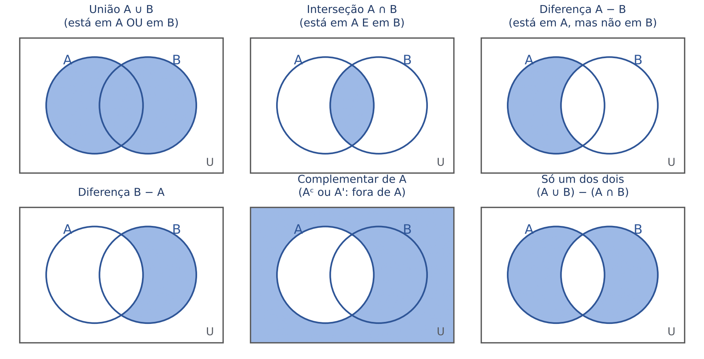

A figura acima é o "dicionário visual" do capítulo. O retângulo é o universo; cada círculo é um conjunto; a parte sombreada é o resultado da operação. Repare no último quadro: "só um dos dois" (ou A ou B, mas não ambos) é a união menos a interseção. Esse conjunto aparece muito em pesquisas ("quantos leem apenas um dos jornais?").

### 21.1.4 A ponte com a lógica

Se você estudou os Caps. 17 e 18, já conhece estas operações com outros nomes:

| Conjuntos | Lógica | Palavra do enunciado |
|---|---|---|
| A ∪ B (união) | p ∨ q (disjunção) | "ou", "pelo menos um" |
| A ∩ B (interseção) | p ∧ q (conjunção) | "e", "ambos", "os dois" |
| Aᶜ (complementar) | ¬p (negação) | "não", "fora de" |
| A ⊂ B (inclusão) | p → q (condicional) | "todo A é B" |

As leis de De Morgan (Cap. 18) valem igualmente para conjuntos: o complementar da união é a interseção dos complementares, (A ∪ B)ᶜ = Aᶜ ∩ Bᶜ ("quem não está em nenhum dos dois está fora de A E fora de B"); e o complementar da interseção é a união dos complementares, (A ∩ B)ᶜ = Aᶜ ∪ Bᶜ.

Também vale a propriedade distributiva, que a FGV cobra para "testar" se o candidato sabe operar: A ∪ (B ∩ C) = (A ∪ B) ∩ (A ∪ C) e A ∩ (B ∪ C) = (A ∩ B) ∪ (A ∩ C). Para não decorar, teste com um elemento: se x está em A, ele está nos dois lados das igualdades; se x não está em A, ele precisa estar em B e em C para estar no lado esquerdo da primeira igualdade, e o mesmo acontece no lado direito. Um desenho com três círculos, sombreando os dois lados, resolve qualquer dúvida (é o método da questão FGV Q3049037, na tabela do fim do capítulo).

:::DICA Conjuntos descritos por uma propriedade
Muitas questões não listam os elementos: descrevem o conjunto ("os múltiplos de 3 entre 10 e 30"). O primeiro passo é SEMPRE listar os elementos por extenso. Com a lista na mão, união, interseção e diferença viram trabalho de conferência, como cotejar duas listas de processos.
:::

:::QUESTAO FCC 2026 — Controlador Interno (Q3872146)
O problema. São dados três conjuntos de números entre 10 e 30, inclusive: A, dos múltiplos de 3; B, dos múltiplos de 4; C, dos múltiplos de 6. Pede-se o número de elementos que estão em A ou em C e, ao mesmo tempo, estão em B. Gabarito oficial: D (2).
Resolução.
1. Liste os elementos (múltiplos: some de 3 em 3, de 4 em 4, de 6 em 6, a partir do primeiro que passa de 10):
  - A = {12, 15, 18, 21, 24, 27, 30}
  - B = {12, 16, 20, 24, 28}
  - C = {12, 18, 24, 30}
2. "Estão em A ou em C" é a união: A ∪ C = {12, 15, 18, 21, 24, 27, 30} (todo elemento de C já estava em A, porque todo múltiplo de 6 é múltiplo de 3).
3. "E estão em B" é a interseção com B: (A ∪ C) ∩ B = elementos de A ∪ C que aparecem também na lista de B = {12, 24}.
4. São 2 elementos.
Por que as outras erram: 3 (A) nasce de contar também o 30 ou o 16 por descuido; 4 (E) é contar B ∩ A e B ∩ C separadamente e somar (12, 24, 12, 24), repetindo elementos. Na união e na interseção, elemento repetido conta uma vez só.
:::

:::PRATIQUE exercícios elaborados para esta apostila
1. Sendo A = {2, 4, 6, 8, 10} e B = {3, 6, 9}, determine A ∪ B, A ∩ B e A − B.
2. Quantos subconjuntos não vazios tem o conjunto {1, 2, 3, 4}?
3. (estilo FCC) Seja A o conjunto dos múltiplos de 4 entre 1 e 40 e B o conjunto dos múltiplos de 6 entre 1 e 40. Quantos elementos tem A ∩ B? E A ∪ B?

Resolução.
1. União: junte as listas sem repetir: A ∪ B = {2, 3, 4, 6, 8, 9, 10}. Interseção: o único número que aparece nas duas listas é o 6: A ∩ B = {6}. Diferença: parta de A e risque o 6: A − B = {2, 4, 8, 10}.
2. O conjunto tem 4 elementos, logo tem 2⁴ subconjuntos:
  - 2⁴ = 2 × 2 × 2 × 2 = 16
  - tirando o vazio: 16 − 1 = 15 subconjuntos não vazios.
3. Liste:
  - A = {4, 8, 12, 16, 20, 24, 28, 32, 36, 40}: n(A) = 10
  - B = {6, 12, 18, 24, 30, 36}: n(B) = 6
  - comuns: {12, 24, 36}, que são os múltiplos de 12 (o MMC de 4 e 6, ver 21.4): n(A ∩ B) = 3
  - na união, os comuns contam uma vez: n(A ∪ B) = 10 + 6 − 3 = 13.
Repare que a conta do item 3 já antecipa a fórmula da próxima seção.
:::

## 21.2 Diagramas de Venn com dois conjuntos

### 21.2.1 A ideia: não contar duas vezes

Imagine um gabinete com 40 servidores. Uma enquete mostra que 25 falam inglês e 18 falam espanhol. Quantos falam pelo menos uma das duas línguas? A tentação é somar: 25 + 18 = 43. Mas 43 é mais do que o total de servidores! O erro é óbvio: quem fala AS DUAS línguas foi contado duas vezes, uma no grupo do inglês e outra no grupo do espanhol.

Suponha que 8 falem as duas. Então, para contar cada pessoa uma vez só, somamos os dois grupos e descontamos uma vez os 8 contados em dobro:

- falam pelo menos uma língua = 25 + 18 − 8
- = 43 − 8
- = 35

E os que não falam nenhuma das duas são o que sobra do total: 40 − 35 = 5.

Essa é toda a teoria dos diagramas de Venn. O resto é organização.

### 21.2.2 A fórmula e as quatro regiões

Com dois conjuntos, o retângulo do universo fica dividido em quatro regiões que não se sobrepõem:

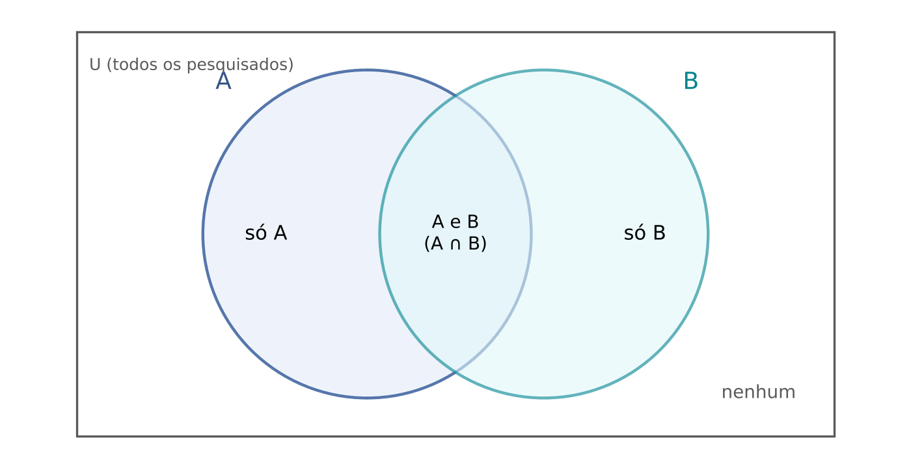

- "só A": está em A e não está em B;
- "A e B": a interseção;
- "só B": está em B e não está em A;
- "nenhum": fora dos dois círculos.

A fórmula da união é a conta do exemplo:

n(A ∪ B) = n(A) + n(B) − n(A ∩ B)

- n(A ∪ B) = número de elementos que estão em pelo menos um dos dois conjuntos;
- n(A) e n(B) = totais de cada conjunto (atenção: o total de A INCLUI quem também está em B);
- n(A ∩ B) = número de elementos comuns, que a soma n(A) + n(B) contou duas vezes.

E, se houver universo, n(nenhum) = n(U) − n(A ∪ B).

A fórmula serve para qualquer uma das quatro quantidades: sabendo três delas, isola-se a quarta. Exemplo: numa pesquisa, 60% leem o jornal A, 50% leem o jornal B e 20% não leem nenhum dos dois. Qual a porcentagem que lê os dois?

- quem lê pelo menos um: 100% − 20% = 80%
- 80 = 60 + 50 − x (x = porcentagem que lê os dois)
- 80 = 110 − x
- x = 110 − 80 = 30%

Repare: a soma 60% + 50% = 110% passou de 100%. Sempre que a soma dos grupos passar do total, a diferença é, no mínimo, o tamanho da interseção. Essa observação será a chave da interseção mínima (21.3.4).

### 21.2.3 O método de dentro para fora

A fórmula resolve as questões simples. Para as demais, o método mais seguro é preencher o diagrama região por região, começando pelo centro.

:::PASSO Como resolver qualquer questão de diagrama de Venn
1. Desenhe um círculo para cada característica dentro de um retângulo (o total). Dê nome curto a cada círculo.
2. Comece pela região mais interna cujo valor é conhecido (a interseção de todos os conjuntos).
3. Vá para fora: em cada círculo, o "só A" é o total de A MENOS tudo o que já foi escrito dentro de A.
4. Por último, "nenhum" = total − soma de todas as regiões de dentro.
5. Releia a pergunta: ela quer "só A", "pelo menos um", "apenas um", "exatamente dois", "nenhum"? Some só as regiões pedidas.
6. Se faltar um número, chame-o de x, escreva cada região em função de x e use a informação que sobrou para montar a equação.
:::

Aplicando ao exemplo do gabinete:

- centro (inglês e espanhol): 8
- só inglês: 25 − 8 = 17
- só espanhol: 18 − 8 = 10
- nenhum: 40 − (17 + 8 + 10) = 40 − 35 = 5
- apenas uma das línguas: 17 + 10 = 27

:::PEGADINHA "Gostam de A" não é "gostam só de A"
O número que o enunciado dá para um conjunto ("25 falam inglês") é o TOTAL do círculo, incluindo a interseção. O erro mais comum é escrever 25 na região "só inglês". A FCC sempre coloca nas alternativas o resultado desse erro. Quando o enunciado quer dar a região exclusiva, ele diz "apenas", "somente", "só" ou "mas não".
:::

### 21.2.4 Vocabulário das perguntas

| A pergunta diz | Regiões que você soma |
|---|---|
| "pelo menos um", "algum dos dois", "A ou B" | só A + A e B + só B |
| "os dois", "ambos", "A e B" | A e B |
| "apenas um", "exatamente um", "um só" | só A + só B |
| "no máximo um" | só A + só B + nenhum |
| "nenhum", "nem A nem B" | nenhum |
| "A, mas não B" | só A |

:::QUESTAO FCC 2026 — Câmara de Presidente Prudente — Controlador Interno (Q4395371)
O problema. Num seminário com menos de 100 participantes, cada um era economista ou contador: 78 economistas e 26 contadores. As 12 pessoas com as duas formações eram todas funcionárias da empresa ABC, que mandou 23 funcionários ao evento. Entre os contadores que não são economistas, 11 não são funcionários da ABC. Pede-se o algarismo das unidades do número de participantes que são apenas economistas. Gabarito oficial: C (6).
Resolução.
1. Centro: economistas e contadores = 12.
2. Só economistas: 78 − 12 = 66.
3. Só contadores: 26 − 12 = 14.
4. Conferência do total: 66 + 12 + 14 = 92, que é menor do que 100, como diz o enunciado.
5. A pergunta é "apenas economistas" = 66. O algarismo das unidades é 6.
Por que as outras erram. A banca colocou uma camada extra de informação (quem é funcionário da ABC) que NÃO é necessária para a pergunta feita. Quem a usa encontra outros números: dos 14 só contadores, 11 não são da ABC, logo 3 são; os funcionários da ABC são 12 + 3 + (economistas só, da ABC) = 23, o que dá 8 economistas exclusivos da ABC. A alternativa E (8) é exatamente esse número, a resposta de quem confundiu "apenas economistas" com "apenas economistas funcionários da ABC". Lição: leia a pergunta antes de usar todos os dados.
:::

:::QUESTAO FCC 2025 — Prefeitura de São Paulo — Auditor Municipal de Controle Interno (Q3281774)
O problema. Numa sala com menos de 67 pessoas só há advogados (40) e engenheiros (27); portanto há gente com as duas formações. No total, 31 usam óculos. Entre os engenheiros que não são advogados, 7 não usam óculos. Todos os que têm as duas formações usam óculos. Entre os advogados, 15 usam óculos. Pede-se a diferença entre o número de advogados que não são engenheiros e usam óculos e o número de engenheiros que não são advogados e não usam óculos. Gabarito oficial: D (4).
Resolução. Chame de x o número de pessoas com as duas formações.
1. Óculos entre os advogados: 15. Esse grupo inclui os x com as duas formações (todos usam óculos). Logo, advogados exclusivos com óculos = 15 − x.
2. Óculos no total: 31 = (óculos entre advogados) + (óculos entre engenheiros exclusivos). Logo, engenheiros exclusivos com óculos = 31 − 15 = 16.
3. Engenheiros exclusivos = com óculos + sem óculos = 16 + 7 = 23.
4. Mas engenheiros exclusivos também = total de engenheiros − x = 27 − x. Então:
  - 27 − x = 23
  - x = 27 − 23 = 4
5. Advogados exclusivos com óculos: 15 − 4 = 11.
6. Diferença pedida: 11 − 7 = 4.
Conferência: total de pessoas = 40 + 27 − 4 = 63, menos de 67, como manda o enunciado.
O que a FCC explora: a informação "menos de 67" só serve para avisar que há interseção (se não houvesse, seriam 40 + 27 = 67 pessoas). Quem usa 15 como "advogados exclusivos com óculos" (sem tirar o x) chega a 15 − 7 = 8, que não está entre as alternativas, e costuma chutar.
:::

:::QUESTAO FCC 2025 — SEDU-ES — Agente de Suporte Educacional (Q3336234)
O problema. Numa lanchonete, 39 pessoas fizeram pedidos: 10 pediram só hambúrguer, 15 só cachorro-quente e 2 só suco de laranja. Os que pediram hambúrguer com suco foram o dobro dos que pediram cachorro-quente com suco. Quantos pedidos de suco houve? Gabarito oficial: E (14).
Resolução.
1. Regiões já conhecidas: 10 + 15 + 2 = 27 pessoas.
2. Sobram 39 − 27 = 12 pessoas, que pediram um lanche COM suco (as únicas combinações mencionadas).
3. Seja k o número de "cachorro-quente com suco"; então "hambúrguer com suco" = 2k.
  - k + 2k = 12
  - 3k = 12
  - k = 4, e 2k = 8
4. Pedidos de suco = só suco + hambúrguer com suco + cachorro-quente com suco = 2 + 8 + 4 = 14.
Armadilha: a alternativa B (12) é esquecer as 2 pessoas que pediram apenas suco; a D (10) é somar só 8 + 2.
:::

:::PRATIQUE exercícios elaborados para esta apostila
1. Numa turma de 50 alunos, 30 estudam Direito Civil, 25 estudam Direito Penal e 10 não estudam nenhum dos dois. Quantos estudam os dois?
2. Entre 200 contribuintes fiscalizados, 120 tinham IPVA atrasado, 90 tinham ICMS atrasado e 40 tinham os dois atrasados. Quantos não tinham nenhum dos dois atrasados? Quantos tinham exatamente um atrasado?
3. (estilo FGV) Os conjuntos A e B têm o mesmo número de elementos. A ∪ B tem 20 elementos e A ∩ B tem 4. Quantos elementos tem A?

Resolução.
1. Quem estuda pelo menos um: 50 − 10 = 40. Pela fórmula, com x = os dois:
  - 40 = 30 + 25 − x
  - 40 = 55 − x
  - x = 55 − 40 = 15
2. Pelo menos um atrasado: 120 + 90 − 40 = 170. Nenhum: 200 − 170 = 30. Exatamente um: só IPVA = 120 − 40 = 80; só ICMS = 90 − 40 = 50; total 80 + 50 = 130.
3. Seja n(A) = n(B) = x.
  - 20 = x + x − 4
  - 20 = 2x − 4
  - 2x = 24 (somamos 4 aos dois lados)
  - x = 12 (dividimos os dois lados por 2)
:::

## 21.3 Diagramas de Venn com três conjuntos

### 21.3.1 As oito regiões

Com três círculos, o retângulo fica dividido em oito regiões:

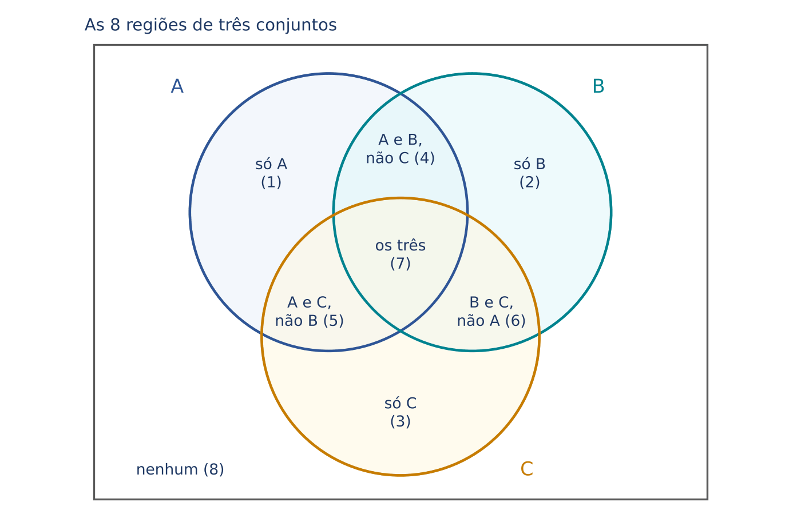

- três regiões "só um" (1, 2 e 3);
- três regiões "exatamente dois" (4, 5 e 6): cada uma é a interseção de dois conjuntos SEM o terceiro;
- uma região central "os três" (7);
- a região de fora, "nenhum" (8).

O roteiro do 21.2.3 continua valendo, com uma etapa a mais: depois do centro, preenchem-se as três regiões "exatamente dois", e só então as "só um".

### 21.3.2 Exemplo resolvido à mão

Uma equipe de auditoria examinou 100 empresas e anotou três tipos de irregularidade: fraude documental (F), atraso de entrega de declarações (D) e omissão de receita (O). Os totais foram: F = 50, D = 57, O = 50. As interseções: F e D = 30, F e O = 25, D e O = 32. As três irregularidades juntas: 20. Quantas empresas não tinham nenhuma das três? Quantas tinham exatamente uma?

1. Centro (as três): 20.
2. Regiões "exatamente dois": cada interseção dada inclui o centro, então desconte os 20:
  - F e D, sem O: 30 − 20 = 10
  - F e O, sem D: 25 − 20 = 5
  - D e O, sem F: 32 − 20 = 12
3. Regiões "só um": total do círculo menos tudo o que já está dentro dele:
  - só F: 50 − (10 + 5 + 20) = 50 − 35 = 15
  - só D: 57 − (10 + 12 + 20) = 57 − 42 = 15
  - só O: 50 − (5 + 12 + 20) = 50 − 37 = 13
4. Pelo menos uma irregularidade: 15 + 15 + 13 + 10 + 5 + 12 + 20 = 90.
5. Nenhuma: 100 − 90 = 10.
6. Exatamente uma: 15 + 15 + 13 = 43.

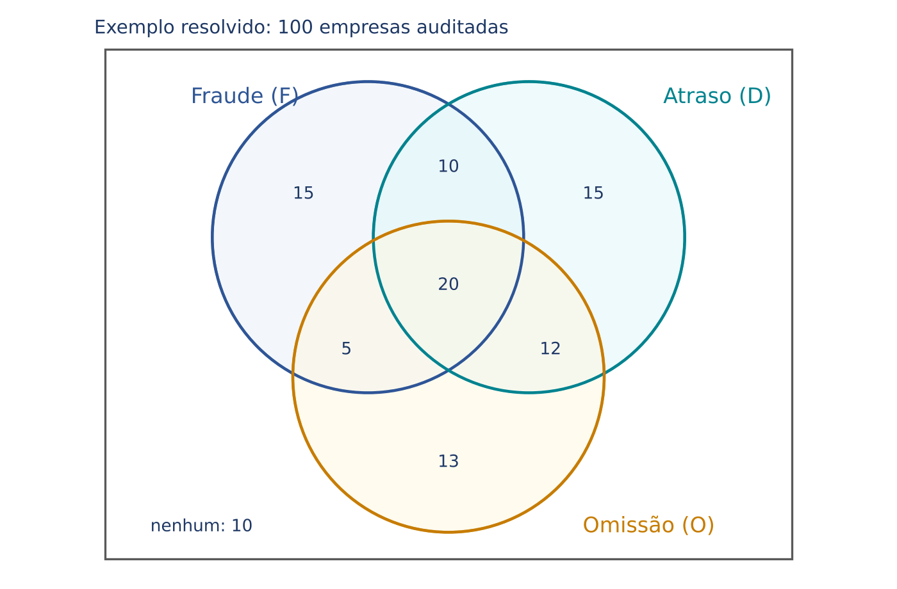

### 21.3.3 A fórmula da união de três conjuntos

Quando a questão pergunta apenas "quantos estão em pelo menos um" (ou "em nenhum"), existe um atalho:

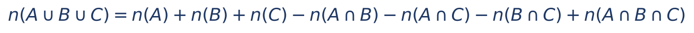

O que cada parte faz:

- n(A) + n(B) + n(C): soma os três totais. Quem está em exatamente dois conjuntos foi contado 2 vezes; quem está nos três foi contado 3 vezes.
- − n(A ∩ B) − n(A ∩ C) − n(B ∩ C): desconta as interseções duas a duas. Quem está em dois conjuntos volta a ser contado 1 vez. Mas quem está nos três aparece nas três interseções e foi descontado 3 vezes: passou de 3 para 0.
- + n(A ∩ B ∩ C): devolve uma vez quem está nos três, que volta a contar 1 vez.

Conferindo no exemplo da auditoria:

- n(F ∪ D ∪ O) = 50 + 57 + 50 − 30 − 25 − 32 + 20
- = 157 − 87 + 20
- = 90

É o mesmo 90 que achamos região por região.

:::ATENCAO Interseção "total" ou "exatamente"?
A fórmula usa as interseções TOTAIS (n(A ∩ B) inclui quem também está em C). Muitas questões, porém, dão "gostam de A e B, mas não de C" ou "apenas de A e B": isso é a região "exatamente dois". Antes de usar a fórmula, converta: interseção total = exatamente dois + os três. Na dúvida, abandone a fórmula e preencha o diagrama.
:::

:::QUESTAO FCC 2025 — TRT 6ª Região (PE) — Técnico Judiciário, Área Administrativa (Q3216576)
O problema. Num bairro de 70 famílias, 30 têm cachorro, 18 têm gato e 13 têm pássaro; 3 têm cachorro e gato; 8 têm cachorro e pássaro; nenhuma família tem gato e pássaro juntos. Quantas famílias não têm animal? Gabarito oficial: A (20).
Resolução.
1. "Nenhum gato convive com pássaro" significa que G ∩ P = ∅. Em particular, ninguém tem os três animais: n(C ∩ G ∩ P) = 0.
2. Fórmula:
  - n(C ∪ G ∪ P) = 30 + 18 + 13 − 3 − 8 − 0 + 0
  - = 61 − 11
  - = 50
3. Sem animal: 70 − 50 = 20.
Armadilha: quem soma 30 + 18 + 13 = 61 e esquece as interseções obtém 70 − 61 = 9, que nem está entre as alternativas, e passa a "ajustar" as contas até cair numa delas; quem desconta só uma das interseções obtém 70 − 58 = 12 ou 70 − 53 = 17, também ausentes. Toda informação de interseção dada (inclusive a "zero") entra na conta, uma vez cada.
:::

:::QUESTAO FCC 2025 — TRT 6ª Região (PE) — Analista Judiciário, Tecnologia da Informação (Q3216476)
O problema. Numa pesquisa de estilos musicais: 40% gostam de samba, 75% de rock e 53% de música clássica; 35% gostam de samba e rock; 30% de rock e clássica; 5% gostam APENAS de samba e clássica; 10% gostam dos três. Que porcentagem não gosta de nenhum? Gabarito oficial: E (2%).
Resolução (de dentro para fora, em %).
1. Centro: 10.
2. Exatamente dois:
  - samba e rock, sem clássica: 35 − 10 = 25
  - rock e clássica, sem samba: 30 − 10 = 20
  - samba e clássica, sem rock: 5 (já veio "apenas", NÃO se desconta o centro)
3. Só um:
  - só samba: 40 − (25 + 5 + 10) = 40 − 40 = 0
  - só rock: 75 − (25 + 20 + 10) = 75 − 55 = 20
  - só clássica: 53 − (5 + 20 + 10) = 53 − 35 = 18
4. Pelo menos um: 0 + 20 + 18 + 25 + 20 + 5 + 10 = 98.
5. Nenhum: 100 − 98 = 2%.

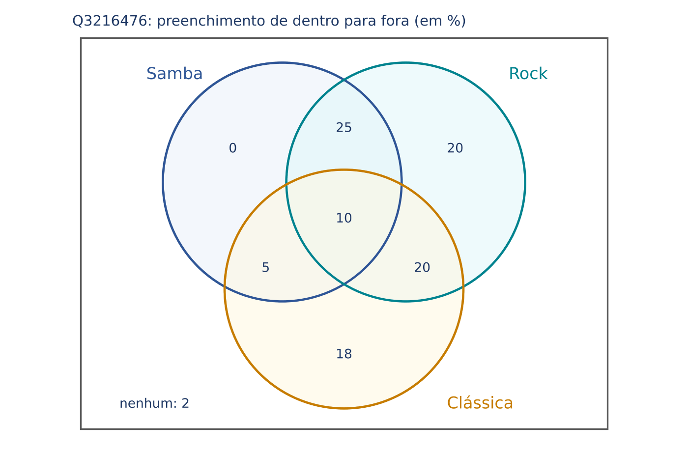

Onde está a armadilha: o "apenas" do samba com clássica. Quem desconta o centro também desse dado escreve 5 − 10 = −5 (região negativa: sinal de erro) ou usa 5 como interseção total na fórmula; com a fórmula e 5 + 10 = 15 como interseção total samba-clássica, a conta fica certa: 40 + 75 + 53 − 35 − 30 − 15 + 10 = 98.
:::

:::QUESTAO FCC 2026 — CPU-PE — Gestor Governamental (Q3871988)
O problema. Pesquisa com 100 universitários sobre comida italiana (I), asiática (A) e indiana (N): 54 gostam de italiana; 9 gostam APENAS de asiática; 16 gostam de italiana e asiática, mas não de indiana; 13 de asiática e indiana, mas não de italiana; 10 de italiana e indiana, mas não de asiática; 5 gostam das três; 11 não gostam de nenhuma. Quantos gostam de apenas um tipo? Gabarito oficial: C (45).
Resolução. Aqui a banca já entregou quase todas as regiões exclusivas.
1. Centro: 5. Exatamente dois: 16 (I e A), 13 (A e N), 10 (I e N). Só asiática: 9. Nenhum: 11.
2. Só italiana: 54 − (16 + 10 + 5) = 54 − 31 = 23.
3. Só indiana: é a única região que falta; use o total.
  - dentro dos círculos: 100 − 11 = 89
  - regiões conhecidas: 23 + 9 + 16 + 13 + 10 + 5 = 76
  - só indiana: 89 − 76 = 13
4. Apenas um tipo: 23 + 9 + 13 = 45.
Armadilhas: 32 (D) é 23 + 9, esquecendo a indiana, cujo total o enunciado nem deu; 36 (A) é somar 23 + 13 sem a asiática. Quando falta o total de um conjunto, a região que falta sai do TOTAL GERAL.
:::

### 21.3.4 Dois casos especiais que a FCC adora

Caso 1: "cada um escolheu apenas um ou os três". Às vezes o enunciado diz que ninguém ficou com exatamente dois itens. Então só existem dois tipos de pessoa: as de um item (chame de s) e as de três itens (chame de t). Duas contas diferentes ajudam:

- contando PESSOAS: s + t = total de pessoas;
- contando ESCOLHAS (somando os totais de cada item): cada pessoa de um item contribui com 1 escolha, e cada pessoa dos três contribui com 3. Logo s + 3t = soma dos totais.

Subtraindo a primeira da segunda, some o s: 2t = soma dos totais − total de pessoas.

:::QUESTAO FCC 2026 — SEFAZ-MT — Fiscal de Tributos Estaduais (Q3947146)
O problema. Os 33 primeiros clientes de uma loja compraram pelo menos um entre perfume, loção e creme; alguns compraram só um produto e os demais compraram os três. Compraram perfume 10, loção 15 e creme 20. Quantos compraram os três? Gabarito oficial: B (6).
Resolução.
1. Pessoas: s + t = 33.
2. Escolhas: s + 3t = 10 + 15 + 20 = 45.
3. Subtraindo a primeira equação da segunda: (s + 3t) − (s + t) = 45 − 33, isto é, 2t = 12.
4. t = 12 ÷ 2 = 6.
Conferência: s = 33 − 6 = 27 compraram um só produto; escolhas = 27 + 3 × 6 = 27 + 18 = 45. Confere.
Armadilha: a alternativa E (4) sai de dividir 12 por 3 ("três produtos"); a C (2) e a D (3) vêm de usar a fórmula da união com interseções inventadas. No mesmo sentido: FCC 2024, PIAUÍPREV (Q3884595): 12 amigos, pratos escolhidos por 8, 5 e 7, ninguém com exatamente dois pratos: 2t = 20 − 12 = 8, t = 4 (gabarito D).
:::

Caso 2: a interseção mínima. A pergunta é: "no mínimo, quantos estão nos três (ou nos dois)?" Volte à observação do 21.2.2: se 70% leram o jornal A e 60% leram o jornal B, as duas fatias somam 130%, e o "excesso" de 30% sobre os 100% só pode ser gente que está nas duas. Logo pelo menos 30% leram os dois (pode ser mais, se houver muita sobreposição, mas nunca menos).

Com mais conjuntos, a ideia é a mesma: pense em quem FALHOU em cada item. Se 75% acertaram a questão 1, então 25% erraram. Para ter o MÍNIMO de pessoas acertando tudo, a banca imagina que os que erraram cada questão são pessoas DIFERENTES (assim o máximo de gente erra alguma). A fórmula que resume essa ideia:

- x mínimo = menor valor possível da interseção de todos os grupos;
- p₁, p₂, ..., pₖ = porcentagens de cada grupo;
- k = número de grupos.

Se a conta der zero ou negativa, a interseção mínima é zero.

:::QUESTAO FCC 2026 — MPE-AP — Analista Ministerial, Administração (Q3888393)
O problema. Num concurso, 75% acertaram a 1ª questão, 55% a 2ª e 80% a 3ª. No mínimo, que porcentagem acertou as três? Gabarito oficial: A (10%).
Resolução pelo raciocínio dos que erraram.
1. Erraram a 1ª: 100 − 75 = 25%. Erraram a 2ª: 100 − 55 = 45%. Erraram a 3ª: 100 − 80 = 20%.
2. No pior caso, são grupos de pessoas diferentes: 25 + 45 + 20 = 90% erraram alguma questão.
3. Os outros 100 − 90 = 10%, no mínimo, acertaram as três.
Pela fórmula: (75 + 55 + 80) − (3 − 1) × 100 = 210 − 200 = 10%.
Armadilhas: 55% seria o MÁXIMO (ninguém acerta as três mais do que acertou a mais difícil); 25% (C) é calcular só com duas questões. Leia "no mínimo" e "no máximo" com cuidado.
:::

:::PRATIQUE exercícios elaborados para esta apostila
1. Numa pesquisa com 120 pessoas: 60 usam o aplicativo A, 50 usam o B, 40 usam o C; 20 usam A e B, 15 usam A e C, 10 usam B e C, e 5 usam os três. Quantas não usam nenhum?
2. Num tribunal, 40 servidores fizeram cursos de capacitação; cada um fez apenas um curso ou os três cursos oferecidos. As matrículas foram 30, 20 e 14. Quantos fizeram os três?
3. (estilo FCC) Num levantamento, 80% das empresas usam nota fiscal eletrônica, 70% usam escrituração digital e 90% usam certificado digital. No mínimo, que porcentagem usa os três?
4. Usando os dados do exercício 1, quantas pessoas usam exatamente dois aplicativos?

Resolução.
1. Fórmula: 60 + 50 + 40 − 20 − 15 − 10 + 5 = 150 − 45 + 5 = 110 usam pelo menos um. Nenhum: 120 − 110 = 10.
2. Pessoas: s + t = 40. Matrículas: s + 3t = 30 + 20 + 14 = 64. Subtraindo: 2t = 64 − 40 = 24, logo t = 12.
3. (80 + 70 + 90) − 2 × 100 = 240 − 200 = 40%. Pelo raciocínio dos que "falham": 20% + 30% + 10% = 60% podem ser empresas diferentes; restam 40%.
4. Exatamente dois = cada interseção menos o centro: (20 − 5) + (15 − 5) + (10 − 5) = 15 + 10 + 5 = 30.
:::

## 21.4 Múltiplos, divisores, primos, MMC e MDC

### 21.4.1 Múltiplos e divisores

Os múltiplos de um número são os resultados da sua tabuada: múltiplos de 6 são 0, 6, 12, 18, 24, ... (6 × 0, 6 × 1, 6 × 2, ...). Os divisores de um número são os que o dividem "sem sobrar nada" (resto zero): os divisores de 12 são 1, 2, 3, 4, 6 e 12.

As duas ideias são o avesso uma da outra: "12 é múltiplo de 3" é o mesmo que "3 é divisor de 12" (12 = 3 × 4, e 12 ÷ 3 = 4, resto 0).

Para saber depressa se um número divide outro, use os testes de divisibilidade (por 2, 3, 4, 5, 6, 9 e 10), já ensinados no Cap. 1 (DICA "Testes rápidos de divisibilidade", em 01.2.2). O mais útil aqui: um número é divisível por 3 (ou por 9) quando a soma dos seus algarismos é divisível por 3 (ou por 9). Exemplo: 2.010 → 2 + 0 + 1 + 0 = 3, divisível por 3.

### 21.4.2 Números primos e fatoração

Um número primo é o que tem exatamente dois divisores: 1 e ele mesmo. Os primeiros primos são 2, 3, 5, 7, 11, 13, 17, 19, 23, 29, 31, 37, 41, 43, 47... O 1 NÃO é primo (tem um divisor só), e o 2 é o único primo par.

Todo número maior que 1 pode ser escrito como produto de primos, de uma única maneira (fora a ordem). Isso se chama fatoração. É como "decompor" o número nos seus tijolos. O método: divida sempre pelo menor primo possível, até chegar a 1.

:::EXEMPLO Fatorando 360
- 360 ÷ 2 = 180
- 180 ÷ 2 = 90
- 90 ÷ 2 = 45 (45 é ímpar: o 2 não serve mais)
- 45 ÷ 3 = 15
- 15 ÷ 3 = 5
- 5 ÷ 5 = 1
Os divisores usados foram 2, 2, 2, 3, 3, 5. Logo 360 = 2 × 2 × 2 × 3 × 3 × 5 = 2³ × 3² × 5.
:::

A fatoração resolve, de uma vez, um tipo de questão muito comum: "o produto de duas idades é tal número". Os fatores primos são as únicas peças com que se podem montar as duas idades.

Um bônus: o número de divisores de um número sai da fatoração. Some 1 a cada expoente e multiplique os resultados. Exemplo: 72 = 2³ × 3², então tem (3 + 1) × (2 + 1) = 4 × 3 = 12 divisores (1, 2, 3, 4, 6, 8, 9, 12, 18, 24, 36, 72). O motivo: cada divisor escolhe quantos "2" levar (0, 1, 2 ou 3: quatro opções) e quantos "3" levar (0, 1 ou 2: três opções), e o princípio multiplicativo dá 4 × 3.

:::QUESTAO FCC 2024 — TRT 20ª Região (SE) — Técnico Judiciário, Área Administrativa (Q3169911)
O problema. O produto das idades de José e de seu pai é 2.010. O pai tem menos de 100 anos. Qual a soma das idades? Gabarito oficial: C (97).
Resolução.
1. Fatore 2.010:
  - 2.010 ÷ 2 = 1.005
  - 1.005 ÷ 3 = 335 (soma dos algarismos de 1.005 = 6, divisível por 3)
  - 335 ÷ 5 = 67
  - 67 é primo (não é divisível por 2, 3, 5 nem 7, e 8 × 8 = 64 já passa perto de 67, então não é preciso testar mais).
  - 2.010 = 2 × 3 × 5 × 67
2. O 67 tem de estar na idade de alguém. Se fosse multiplicado por qualquer outro fator, passaria de 100 (67 × 2 = 134). Como o pai tem menos de 100 anos e é o mais velho, o pai tem 67 e José tem 2 × 3 × 5 = 30.
3. Soma: 67 + 30 = 97.
Armadilha: as alternativas 77, 87, 107 e 117 diferem de 97 por múltiplos de 10, para pegar quem soma errado de cabeça. Confira sempre: 67 × 30 = 2.010.
:::

:::QUESTAO FCC 2025 — TRT 2ª Região (SP) — Analista Judiciário, Área Judiciária (Q3627571)
O problema. Foram escritos na lousa alguns números naturais diferentes entre si e maiores que 1. O produto dos menores é 8 e o produto dos maiores é 45. Qual a soma dos números escritos? Gabarito oficial: D (20).
Resolução.
1. "Os menores" e "os maiores" são grupos com pelo menos dois números cada, e todo número do primeiro grupo é menor do que todo número do segundo.
2. Produto 8 com números distintos maiores que 1: só 2 × 4 (8 = 2 × 2 × 2, e 2 × 2 × 2 repetiria o 2).
3. Produto 45 com números distintos maiores que 1: 3 × 15 ou 5 × 9 (45 = 3 × 3 × 5).
4. A opção 3 × 15 não serve: 3 é menor que 4, e os "maiores" têm de ser todos maiores que os "menores". Logo os números são 2, 4, 5 e 9.
5. Soma: 2 + 4 + 5 + 9 = 20.
No mesmo sentido (pequenas fatorações com condições): FCC 2025, TRT 2ª Região (Q3848775): três inteiros positivos distintos com soma 9 e produto 15 só podem ser 1, 3 e 5 (15 = 3 × 5, e o terceiro fator é 1); maior + menor = 5 + 1 = 6 (gabarito B).
:::

### 21.4.3 MMC: o mínimo múltiplo comum

A ideia, com um exemplo do dia a dia. Dois ônibus saem juntos do terminal às 7h00. O ônibus A sai a cada 12 minutos e o B a cada 18 minutos. Quando voltam a sair juntos?

- O ônibus A sai nos minutos 0, 12, 24, 36, 48, 60, 72, ... (múltiplos de 12).
- O ônibus B sai nos minutos 0, 18, 36, 54, 72, ... (múltiplos de 18).
- Os minutos comuns às duas listas são 0, 36, 72, ... O primeiro depois do zero é 36.

Então voltam a sair juntos às 7h36, e depois a cada 36 minutos. O número 36 é o menor múltiplo comum (diferente de zero) de 12 e 18: o MMC(12, 18).

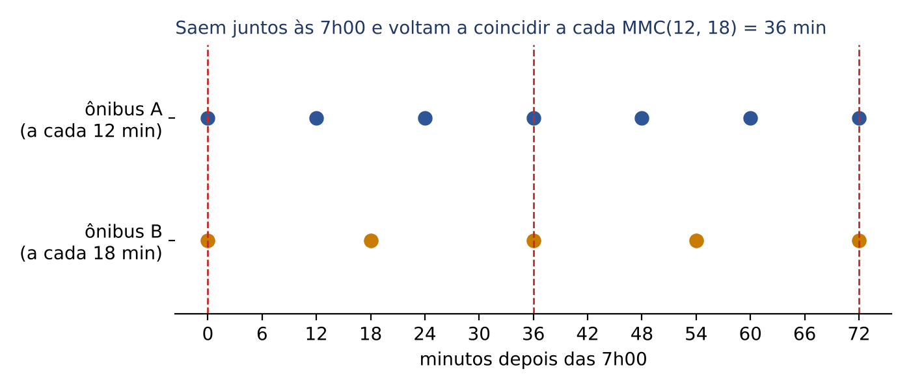

Listar múltiplos funciona com números pequenos. Para os demais, use a fatoração simultânea: escreva os números lado a lado e divida-os ao mesmo tempo pelos primos, do menor para o maior. Quem não for divisível pelo primo da vez "desce" igual. Quando tudo virar 1, multiplique os primos da coluna da direita.

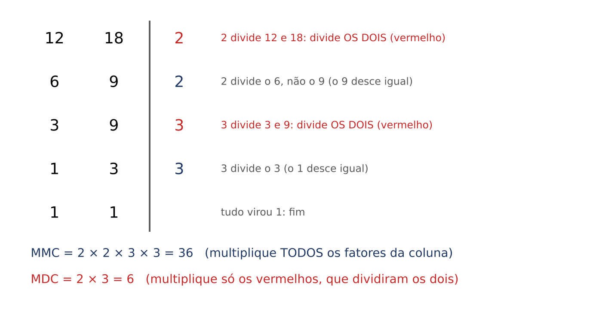

- MMC(12, 18) = 2 × 2 × 3 × 3 = 36.

Quando usar o MMC: sempre que a pergunta for "quando os eventos voltam a coincidir?", "qual o menor número que é divisível por todos estes?", "qual o menor total que pode ser repartido em grupos de 3, de 4 e de 5?". Palavras-gatilho: "simultaneamente", "novamente juntos", "coincidir", "menor quantidade que dá para dividir exatamente".

### 21.4.4 MDC: o máximo divisor comum

A ideia, com outro exemplo. Um gabinete tem 48 processos de família e 36 de sucessões. Quer montar lotes com o MESMO número de processos, o MAIOR possível, sem misturar matérias e sem sobrar processo. Qual o tamanho do lote?

- O tamanho do lote precisa dividir 48 (para não sobrar processo de família): 1, 2, 3, 4, 6, 8, 12, 16, 24, 48.
- E precisa dividir 36: 1, 2, 3, 4, 6, 9, 12, 18, 36.
- Divisores comuns: 1, 2, 3, 4, 6, 12. O maior é 12.

Lotes de 12 processos: 48 ÷ 12 = 4 lotes de família e 36 ÷ 12 = 3 lotes de sucessões, 7 lotes ao todo. O 12 é o MDC(48, 36).

Na tabela de fatoração simultânea, o MDC é o produto apenas dos primos que dividiram TODOS os números ao mesmo tempo (os vermelhos da figura). Para 12 e 18: o 2 da primeira linha dividiu os dois, e o 3 da terceira linha dividiu os dois. MDC(12, 18) = 2 × 3 = 6.

Quando usar o MDC: "dividir em partes iguais, do maior tamanho possível", "cortar em pedaços iguais, sem sobra, os maiores possíveis", "o menor número de pacotes iguais". Palavras-gatilho: "maior possível", "sem sobras", "mesmo tamanho".

:::DICA MMC ou MDC? O teste do "maior ou menor"
- O resultado tem de ser MAIOR que os números dados (um tempo comum, um total)? É MMC. Os ônibus de 12 e 18 minutos coincidem num tempo maior: 36.
- O resultado tem de ser MENOR que os números dados (um pedaço, um lote)? É MDC. Os processos de 48 e 36 vão para lotes menores: 12.
E uma relação útil para conferir (vale para DOIS números):

Com 12 e 18: 36 × 6 = 216 e 12 × 18 = 216. Confere.
:::

:::EXEMPLO Três eventos periódicos
Três auditorias de rotina são feitas, respectivamente, a cada 4, 6 e 10 dias. Se as três ocorreram juntas hoje, daqui a quantos dias voltarão a coincidir?
- Fatoração simultânea de 4, 6 e 10:
  - divide por 2: 2, 3, 5
  - divide por 2: 1, 3, 5
  - divide por 3: 1, 1, 5
  - divide por 5: 1, 1, 1
- MMC = 2 × 2 × 3 × 5 = 60.
Voltam a coincidir daqui a 60 dias.
:::

:::EXEMPLO Pedaços iguais, os maiores possíveis
Dois rolos de tecido medem 84 m e 120 m. Quer-se cortá-los em pedaços iguais, do maior comprimento possível, sem sobra. Qual o comprimento de cada pedaço e quantos pedaços serão?
- Fatoração simultânea de 84 e 120:
  - divide por 2 (os dois): 42, 60
  - divide por 2 (os dois): 21, 30
  - divide por 2 (só o 30): 21, 15
  - divide por 3 (os dois): 7, 5
  - divide por 5 (só o 5): 7, 1
  - divide por 7 (só o 7): 1, 1
- MDC = só os que dividiram os dois = 2 × 2 × 3 = 12 m.
- Pedaços: 84 ÷ 12 = 7 e 120 ÷ 12 = 10, total 17 pedaços.
:::

### 21.4.5 Problemas de resto

Toda divisão de números inteiros tem quatro personagens: dividendo = divisor × quociente + resto, com o resto sempre menor que o divisor. Exemplo: 17 ÷ 5 dá quociente 3 e resto 2, porque 17 = 5 × 3 + 2.

Uma família de questões diz: "quando divido N por 3, sobram 2; quando divido por 5, sobra 1". A técnica é listar os candidatos de uma das condições e testar a outra:

- números que deixam resto 1 na divisão por 5: 1, 6, 11, 16, 21, 26, ...
- desses, os que deixam resto 2 na divisão por 3: 11 (11 = 3 × 3 + 2), 26 (26 = 3 × 8 + 2), 41, ...

Repare: as soluções 11, 26, 41 vão de 15 em 15, e 15 = MMC(3, 5). Isso sempre acontece: achada a primeira solução, as demais se obtêm somando o MMC dos divisores.

Um caso particular muito cobrado é o de resto IGUAL em todas as divisões: "N dividido por 4 e por 6 deixa resto 1". Então N − 1 é divisível por 4 e por 6, isto é, N − 1 é múltiplo de MMC(4, 6) = 12, e N = 12k + 1 (13, 25, 37, 49, 61, ...).

:::QUESTAO FCC 2025 — TRT 1ª Região (RJ) — Analista Judiciário, Tecnologia da Informação (Q3478910)
O problema. Bruno dividiu suas bolinhas de gude em grupos de 3 e sobraram 2; depois, em grupos de 5, e sobrou 1. Qual o menor número de bolinhas que ele precisa adquirir para poder dividir o total em grupos de 3 ou em grupos de 5 sem sobra? Gabarito oficial: B (4).
Resolução.
1. Candidatos com resto 1 por 5: 1, 6, 11, 16, 21, 26, ...
2. Testando o resto por 3: 11 deixa resto 2. Então Bruno tem 11 bolinhas, ou 26, ou 41... (11 + múltiplos de 15).
3. Para que o total possa ser dividido em grupos de 3 e TAMBÉM em grupos de 5 (o gabarito oficial lê o "ou" como "qualquer das duas divisões deve ser possível"), o novo total tem de ser múltiplo de MMC(3, 5) = 15.
4. Do 11 até o próximo múltiplo de 15 faltam 15 − 11 = 4. Com 26 bolinhas, faltariam 30 − 26 = 4 também (o resto em relação a 15 é sempre 11).
5. Resposta: 4.
Observação: se o "ou" fosse lido como "basta uma das divisões", bastaria 1 bolinha (11 + 1 = 12, divisível por 3), que é a alternativa D. O gabarito oficial adotou a leitura de que as duas formas de agrupar devem funcionar; na prova, quando o enunciado fala de uma quantidade que deve "poder" ser dividida de duas maneiras, a FCC costuma querer as duas.
:::

:::PRATIQUE exercícios elaborados para esta apostila
1. Calcule o MMC e o MDC de 24 e 36.
2. Três fiscais fazem plantão a cada 3, 4 e 6 dias, respectivamente. Estiveram de plantão juntos em 1/3. Em que data voltarão a estar juntos?
3. Uma sala retangular mede 360 cm por 480 cm. Quer-se cobri-la com lajotas quadradas iguais, as maiores possíveis, sem cortar nenhuma. Qual o lado da lajota e quantas serão usadas?
4. (estilo FCC) Um número entre 50 e 70 deixa resto 1 quando dividido por 4 e também quando dividido por 6. Que número é esse?

Resolução.
1. Fatoração simultânea de 24 e 36:
  - por 2 (os dois): 12, 18
  - por 2 (os dois): 6, 9
  - por 2 (só o 6): 3, 9
  - por 3 (os dois): 1, 3
  - por 3 (só o 3): 1, 1
  - MMC = 2 × 2 × 2 × 3 × 3 = 72; MDC = 2 × 2 × 3 = 12. Conferência: 72 × 12 = 864 = 24 × 36.
2. MMC(3, 4, 6): por 2 → 3, 2, 3; por 2 → 3, 1, 3; por 3 → 1, 1, 1. MMC = 2 × 2 × 3 = 12. Doze dias depois de 1/3: 13/3.
3. O lado tem de dividir 360 e 480, e ser o maior possível: MDC(360, 480) = 120 cm (360 = 3 × 120 e 480 = 4 × 120, e 3 e 4 não têm divisor comum além de 1). Cabem 3 lajotas num sentido e 4 no outro: 3 × 4 = 12 lajotas.
4. N − 1 é múltiplo de MMC(4, 6) = 12. Os múltiplos de 12 perto do intervalo são 48, 60 e 72; somando 1: 49, 61, 73. Entre 50 e 70, só 61. Conferência: 61 = 4 × 15 + 1 = 6 × 10 + 1.
:::

## 21.5 Razão, proporção e divisão proporcional

### 21.5.1 Revisão rápida e o método da constante k

Razão é uma divisão que compara duas grandezas ("3 homens para cada 5 mulheres" é a razão 3/5, ou 3 : 5). Proporção é a igualdade de duas razões. A propriedade fundamental (produto dos meios igual ao produto dos extremos) e a regra de três foram ensinadas no Cap. 1 (01.5). Aqui o foco é outro: os PROBLEMAS de razão da FCC, que quase sempre se resolvem com uma única ideia, a constante de proporcionalidade.

Quando o enunciado diz "a razão entre Bia e Carlos é 3 : 4", traduza assim: Bia tem 3 partes e Carlos tem 4 partes, de um mesmo tamanho desconhecido k.

- Bia = 3k
- Carlos = 4k

A partir daí, o problema vira uma equação com uma incógnita só (o k). É o método mais seguro e serve para todos os casos desta seção.

:::EXEMPLO Razão e total
Num setor com 64 servidores, a razão entre homens e mulheres é 3 : 5. Quantos são os homens? Se entrarem mais 6 homens, qual será a nova razão?
- Homens = 3k, mulheres = 5k.
- 3k + 5k = 64, isto é, 8k = 64, logo k = 8.
- Homens: 3 × 8 = 24. Mulheres: 5 × 8 = 40.
- Com mais 6 homens: 30 homens para 40 mulheres. Razão 30/40; dividindo em cima e embaixo por 10: 3/4.
:::

### 21.5.2 Divisão diretamente proporcional

Dividir um valor em partes diretamente proporcionais a certos números é repartir "por cotas": quem tem número maior recebe mais, na mesma proporção.

Exemplo: dividir 1.000 reais entre Ana, Bruno e Carla em partes diretamente proporcionais a 2, 3 e 5.

- As partes são 2k, 3k e 5k.
- 2k + 3k + 5k = 1.000, isto é, 10k = 1.000, logo k = 100 (cada cota vale 100 reais).
- Ana: 2 × 100 = 200. Bruno: 3 × 100 = 300. Carla: 5 × 100 = 500.
- Conferência: 200 + 300 + 500 = 1.000.

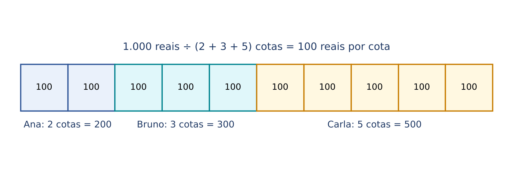

### 21.5.3 Divisão inversamente proporcional

Na divisão inversamente proporcional, quem tem número MAIOR recebe MENOS. Exemplo típico: uma tarefa dividida entre servidores em partes inversamente proporcionais ao número de faltas; ou um prêmio dividido inversamente à idade (o mais novo recebe mais).

A regra: ser inversamente proporcional a a, b e c é o mesmo que ser diretamente proporcional aos inversos 1/a, 1/b e 1/c.

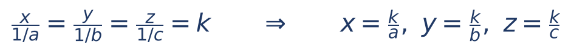

- x, y e z = as partes;
- a, b e c = os números aos quais as partes são inversamente proporcionais;
- k = a constante. Repare que, aqui, cada parte vezes o seu número dá sempre o mesmo k: x × a = y × b = z × c. É o "teste" da proporção inversa.

Como trabalhar com frações cansa, há um truque: multiplique os inversos pelo MMC dos denominadores, para virarem números inteiros.

:::EXEMPLO Dividir 1.300 reais em partes inversamente proporcionais a 2, 3 e 4
1. Inversos: 1/2, 1/3 e 1/4.
2. MMC(2, 3, 4) = 12. Multiplicando cada inverso por 12:
  - 12 × 1/2 = 6
  - 12 × 1/3 = 4
  - 12 × 1/4 = 3
3. Agora a divisão é DIRETAMENTE proporcional a 6, 4 e 3: as partes são 6k, 4k e 3k.
4. 6k + 4k + 3k = 1.300, isto é, 13k = 1.300, logo k = 100.
5. Partes: 600, 400 e 300 reais.
Teste da proporção inversa: 600 × 2 = 1.200; 400 × 3 = 1.200; 300 × 4 = 1.200. O produto é sempre o mesmo: está certo. E quem tinha o menor número (2) recebeu a maior parte.
:::

:::PEGADINHA Inversamente proporcional a DOIS números: basta inverter a razão
Quando são só duas partes, "inversamente proporcional a 3 e 5" é o mesmo que "diretamente proporcional a 5 e 3". Mas com TRÊS ou mais números, não basta inverter a ordem: inversamente a 2, 3 e 4 NÃO é diretamente a 4, 3 e 2 (com 1.300 reais, a divisão por 4, 3 e 2 daria 9 cotas de cerca de 144,44 e partes de cerca de 577,78, 433,33 e 288,89, e não as corretas 600, 400 e 300). Use os inversos e o MMC.
:::

### 21.5.4 Divisão composta e regra de sociedade

Às vezes a parte de cada um depende de dois fatores ao mesmo tempo: diretamente de um e inversamente de outro, ou diretamente de dois. A regra é multiplicar os fatores diretos e dividir pelos inversos, e só depois repartir.

Exemplo: um bônus de 2.400 reais será dividido entre dois servidores em partes diretamente proporcionais ao número de processos baixados (30 e 40) e inversamente proporcionais ao número de faltas (3 e 2).

- Servidor 1: 30 ÷ 3 = 10.
- Servidor 2: 40 ÷ 2 = 20.
- Divisão diretamente proporcional a 10 e 20 (ou, simplificando, 1 e 2): partes k e 2k.
- k + 2k = 2.400, isto é, 3k = 2.400, logo k = 800.
- Servidor 1: 800 reais. Servidor 2: 1.600 reais.

Regra de sociedade: o lucro de uma sociedade se divide em partes diretamente proporcionais ao capital investido E ao tempo de permanência de cada sócio. Multiplica-se capital × tempo de cada sócio e reparte-se pelo resultado.

:::EXEMPLO Regra de sociedade
A investiu 20.000 reais por 12 meses; B investiu 30.000 reais por 6 meses. O lucro foi de 14.000 reais. Quanto cabe a cada um?
- A: 20.000 × 12 = 240.000. B: 30.000 × 6 = 180.000.
- Razão 240.000 : 180.000; dividindo os dois por 60.000: 4 : 3.
- Partes 4k e 3k: 7k = 14.000, logo k = 2.000.
- A recebe 8.000 reais; B recebe 6.000 reais.
:::

### 21.5.5 Encadear razões e razões que mudam

Duas situações aparecem toda hora na FCC.

Encadear razões: "2 mexericas para cada 3 limões e 4 limões para cada 5 laranjas". As duas razões falam dos limões, mas com números diferentes (3 e 4). Para juntá-las, faça os limões terem o mesmo número nas duas: o MMC(3, 4) = 12.

- mexericas : limões = 2 : 3 = 8 : 12 (multiplicamos os dois termos por 4)
- limões : laranjas = 4 : 5 = 12 : 15 (multiplicamos os dois termos por 3)
- logo mexericas : limões : laranjas = 8 : 12 : 15.

Razão que muda: o enunciado dá uma razão, depois alguém tira ou acrescenta algo, e dá uma nova razão. Escreva as quantidades com k, aplique a mudança e iguale à nova razão, resolvendo a equação pela propriedade fundamental (produto cruzado).

:::QUESTAO FCC 2026 — MPE-AP — Analista Ministerial, Psicologia (Q3964558)
O problema. Numa barraca há 2 mexericas para cada 3 limões e 4 limões para cada 5 laranjas. Qual a menor quantidade possível de frutas na barraca? Gabarito oficial: E (35).
Resolução.
1. Encadeando as razões (feito acima): mexericas : limões : laranjas = 8 : 12 : 15.
2. Os números 8, 12 e 15 não têm divisor comum além de 1 (8 só tem o fator 2; 15 não tem o fator 2), então essa é a menor combinação inteira.
3. Total mínimo: 8 + 12 + 15 = 35.
Armadilhas: 70 é o dobro de 35 (uma combinação possível, mas não a menor); quem não iguala os limões e tenta usar 2 : 3 e 4 : 5 ao mesmo tempo não consegue montar números inteiros coerentes. A palavra "menor" pede a razão na forma mais simples.
:::

:::QUESTAO FCC 2026 — Controlador Interno (Q4231741)
O problema. Bia e Carlos dividiram um prêmio na razão 3 : 4. Carlos deu 40.000 reais à irmã, e as quantias de Bia e Carlos passaram a ter a razão 6 : 7. Qual foi o prêmio total? Gabarito oficial: A (560.000 reais).
Resolução.
1. Bia = 3k e Carlos = 4k. O prêmio total é 7k.
2. Depois da doação, Carlos tem 4k − 40.000. Bia continua com 3k.
3. Nova razão:
  - 3k / (4k − 40.000) = 6/7
  - 7 × 3k = 6 × (4k − 40.000) (produto cruzado)
  - 21k = 24k − 240.000
  - 240.000 = 24k − 21k (passamos 21k para a direita e 240.000 para a esquerda)
  - 240.000 = 3k
  - k = 80.000
4. Prêmio total: 7k = 7 × 80.000 = 560.000 reais.
Conferência: Bia 240.000; Carlos 320.000 − 40.000 = 280.000; 240.000/280.000 = 24/28 = 6/7. Confere.
Armadilha: 240.000 (E) é o valor de 3k, a parte de Bia. Responda o que se pediu: o TOTAL, 7k.
:::

:::QUESTAO FCC 2026 — ARTESP — Analista de Suporte à Regulação (Q3910525)
O problema. Uma urna tem 90 fichas vermelhas, verdes ou amarelas. Um quinto são amarelas; há 7 vermelhas para cada 5 verdes. Retiram-se 10 vermelhas. Qual passa a ser a razão entre as vermelhas e o total? Gabarito oficial: B (2/5).
Resolução.
1. Amarelas: 90 ÷ 5 = 18. Vermelhas e verdes: 90 − 18 = 72.
2. Vermelhas = 7k e verdes = 5k: 12k = 72, logo k = 6. Vermelhas: 42; verdes: 30.
3. Depois da retirada: vermelhas 42 − 10 = 32; total 90 − 10 = 80.
4. Razão: 32/80. Dividindo por 16: 2/5.
Armadilha: quem esquece de tirar as 10 fichas também do TOTAL faz 32/90 (não simplifica para nenhuma alternativa); quem não tira as amarelas faz vermelhas = 7/12 de 90 = 52,5 (número não inteiro: sinal de erro).
:::

:::QUESTAO FCC 2026 — Câmara de Presidente Prudente — Controlador Interno (Q4395367)
O problema. Um terreno de 5.225 m² foi preparado por 3 pessoas, em partes inversamente proporcionais às suas idades em meses. A mais velha preparou 1.260 m². A idade da mais nova é 6/7 da idade da segunda mais nova. A diferença entre as idades das duas mais velhas é de 171 meses. Entre que valores está a idade da pessoa mais velha? Gabarito oficial: B (entre 500 e 550 meses).
Resolução. Chame as idades de a (mais nova), b (do meio) e c (mais velha).
1. As duas mais novas preparam juntas 5.225 − 1.260 = 3.965 m².
2. As idades a e b estão na razão 6 : 7. Como a divisão é INVERSA, as partes de a e de b estão na razão 7 : 6 (a mais nova recebe mais). Partes: 7u e 6u.
  - 7u + 6u = 3.965
  - 13u = 3.965
  - u = 305
  - parte de b: 6 × 305 = 1.830 m²; parte de a: 7 × 305 = 2.135 m².
3. Teste da proporção inversa (parte × idade é constante) entre b e c:
  - 1.830 × b = 1.260 × c
  - dividindo os dois lados por 30: 61 × b = 42 × c
4. Use a diferença: c = b + 171.
  - 61b = 42 × (b + 171)
  - 61b = 42b + 7.182
  - 19b = 7.182 (passamos 42b para a esquerda)
  - b = 378
5. Idade da mais velha: c = 378 + 171 = 549 meses, que está entre 500 e 550.
Conferência: a = 6/7 × 378 = 324. Produtos parte × idade: 2.135 × 324 = 691.740; 1.830 × 378 = 691.740; 1.260 × 549 = 691.740. Iguais: a divisão é mesmo inversamente proporcional.
Cuidado com o sentido: na divisão inversa, o mais velho fica com a MENOR parte, e a mais nova (6/7 da idade da segunda) fica com a maior; trocar a razão 7 : 6 por 6 : 7 no passo 2 leva a idades que não satisfazem a conferência.
:::

:::QUESTAO FCC 2025 — SEDU-ES — Agente de Suporte Educacional (Q3336230)
O problema. A massa básica de uma padaria usa farinha, gordura e água na proporção 3 : 2 : 1 (em gramas). Um padeiro fez 240 g da mistura habitual; outro, por engano, fez 240 g na proporção 4 : 3 : 1. As duas massas foram misturadas. Qual a proporção da nova mistura? Gabarito oficial: A (24 : 17 : 7).
Resolução.
1. Massa habitual, 240 g em 3 + 2 + 1 = 6 partes: cada parte 240 ÷ 6 = 40 g. Farinha 120, gordura 80, água 40.
2. Massa errada, 240 g em 4 + 3 + 1 = 8 partes: cada parte 240 ÷ 8 = 30 g. Farinha 120, gordura 90, água 30.
3. Somando: farinha 240, gordura 170, água 70.
4. Dividindo tudo por 10: 24 : 17 : 7.
Armadilha: somar as razões termo a termo (3 + 4 : 2 + 3 : 1 + 1 = 7 : 5 : 2) está ERRADO, porque as partes de cada mistura têm tamanhos diferentes (40 g e 30 g). Em misturas, transforme razões em quantidades antes de somar.
:::

:::QUESTAO FCC 2026 — Controlador Interno (Q3976704)
O problema. Os pontos A, B, C e D estão, nessa ordem, numa reta. A distância de A a B é 1/5 da distância de B a D; a distância de A a C é 7/11 da distância de C a D. Qual a razão entre AB e BC? Gabarito oficial: B (3/4).
Resolução. Chame de T o comprimento total AD.
1. AB : BD = 1 : 5, e AB + BD = T. Então AB tem 1 parte de 6: AB = T/6.
2. AC : CD = 7 : 11, e AC + CD = T. Então AC tem 7 partes de 18: AC = 7T/18.
3. BC = AC − AB = 7T/18 − T/6. Para subtrair, ponha o mesmo denominador: T/6 = 3T/18. BC = 7T/18 − 3T/18 = 4T/18.
4. AB/BC = (3T/18) ÷ (4T/18) = 3/4.
Dica: para fugir das frações, escolha T = 18 (o MMC de 6 e 18). AB = 3, AC = 7, BC = 4, e a razão é 3/4 na hora.
:::

:::QUESTAO FCC 2026 — Câmara de Presidente Prudente — Controlador Interno (Q4395366)
O problema. Todos os atletas de um clube fizeram dois exames, E1 e E2, em três dias. No 1º dia, cada atleta fez um único exame, e a razão entre exames E1 e E2 foi 2/7. No 2º dia, 43 atletas fizeram E1 e 35 fizeram E2, e a razão acumulada passou a 5/16. No 3º dia, fizeram exame todos os que ainda só tinham feito um. Qual o algarismo das unidades do número de atletas que fizeram exame no 3º dia? Gabarito oficial: A (1).
Resolução.
1. 1º dia: E1 = 2k e E2 = 7k. Como cada atleta fez exatamente um exame, o clube tem 2k + 7k = 9k atletas.
2. Acumulado após o 2º dia: E1 = 2k + 43 e E2 = 7k + 35.
  - (2k + 43)/(7k + 35) = 5/16
  - 16 × (2k + 43) = 5 × (7k + 35)
  - 32k + 688 = 35k + 175
  - 688 − 175 = 35k − 32k
  - 513 = 3k
  - k = 171
3. Atletas: 9 × 171 = 1.539.
4. No 2º dia, 43 + 35 = 78 atletas fizeram o segundo exame. Os que ainda devem um exame: 1.539 − 78 = 1.461.
5. Algarismo das unidades: 1.
Conferência: (342 + 43)/(1.197 + 35) = 385/1.232; dividindo por 77: 5/16. Confere.
:::

:::QUESTAO FCC 2025 — SEDU-ES — Agente de Suporte Educacional (Q3336231)
O problema. Numa escola, 2/3 dos estudantes são meninos e há 136 meninas. Um quarto dos estudantes tem computador, e 1/6 dos que têm computador são meninos. Quantas meninas têm computador? Gabarito oficial: A (85).
Resolução.
1. Meninas = 1 − 2/3 = 1/3 do total. Se 1/3 do total é 136, o total é 136 × 3 = 408.
2. Com computador: 408 ÷ 4 = 102.
3. Meninos com computador: 102 ÷ 6 = 17. Meninas com computador: 102 − 17 = 85.
Armadilha: a alternativa B (17) é o número de MENINOS com computador; a D (102) é o total com computador. A FCC sempre põe nas alternativas os números intermediários da conta.
:::

:::PRATIQUE exercícios elaborados para esta apostila
1. Uma herança de 72.000 reais será dividida entre três herdeiros em partes diretamente proporcionais a 2, 3 e 4. Quanto recebe cada um?
2. Divida 4.000 reais em partes inversamente proporcionais a 3 e 5.
3. Num cartório, a razão entre escreventes e auxiliares é 3 : 5, e há 64 servidores. Quantos são os escreventes?
4. (estilo FCC) Dois sócios montaram um negócio: A entrou com 40.000 reais e ficou 8 meses; B entrou com 60.000 reais e ficou 4 meses. O lucro foi de 21.000 reais. Quanto cabe a cada um?

Resolução.
1. Partes 2k, 3k e 4k: 9k = 72.000, logo k = 8.000. Herdeiros: 16.000, 24.000 e 32.000 reais.
2. Com duas partes, basta inverter: proporcional a 5 e 3. Partes 5k e 3k: 8k = 4.000, logo k = 500. Partes: 2.500 (para quem tem o número 3) e 1.500 reais (para quem tem o 5). Teste: 2.500 × 3 = 7.500 = 1.500 × 5.
3. 3k + 5k = 64, logo 8k = 64 e k = 8. Escreventes: 3 × 8 = 24.
4. A: 40.000 × 8 = 320.000. B: 60.000 × 4 = 240.000. Razão 320.000 : 240.000 = 4 : 3 (dividindo por 80.000). 7k = 21.000, k = 3.000. A recebe 12.000 reais e B, 9.000 reais.
:::

## 21.6 Problemas aritméticos

### 21.6.1 Traduzir o português para a matemática

A maior parte das questões "de enunciado" da FCC é um pequeno sistema de equações disfarçado de historinha. O trabalho é de tradutor: cada frase vira uma igualdade. A técnica de resolver equações e sistemas está no Cap. 1 (01.7); aqui está o dicionário e os roteiros.

| O enunciado diz | Escreva |
|---|---|
| "o dobro de x", "o triplo de x" | 2x, 3x |
| "a metade de x", "a terça parte de x" | x/2, x/3 |
| "x tem 5 a mais que y", "x excede y em 5" | x = y + 5 |
| "x tem 5 a menos que y" | x = y − 5 |
| "x é o dobro de y" | x = 2y (cuidado: NÃO é 2x = y) |
| "a razão entre x e y é 2/7" | x/y = 2/7, ou x = 2k e y = 7k |
| "x e y somam 48" | x + y = 48 |
| "2/3 de x" | (2/3) × x |
| "x aumentado de 20%" | 1,2 × x (Cap. 1, 01.4.3) |

:::PASSO Roteiro para qualquer problema de enunciado
1. Leia a PERGUNTA primeiro e sublinhe o que ela pede (às vezes é o valor inicial, às vezes o final, às vezes uma soma).
2. Escolha UMA letra para a quantidade principal e tente escrever as outras em função dela (assim o sistema vira uma equação só).
3. Traduza cada frase do enunciado numa igualdade, na ordem em que os fatos acontecem (antes da troca, depois da troca...).
4. Resolva a equação, passo a passo.
5. Confira, substituindo o valor encontrado no enunciado original.
6. Volte à pergunta: ela pede exatamente o número que você achou, ou outro calculado a partir dele?
:::

:::QUESTAO FCC 2026 — SEFAZ-CE — Auditor Fiscal da Receita Estadual (Q4221368)
O problema. Rafaela e Simone devem fazer, juntas, 48 auditorias. Rafaela repassou metade das suas para Simone, e Simone repassou 12 para Rafaela. Ao final, Rafaela ficou com o dobro de Simone. Quantas auditorias Simone tinha no início? Gabarito oficial: D (8).
Resolução. Seja R o número inicial de Rafaela e S o de Simone.
1. Total: R + S = 48, logo R = 48 − S.
2. Primeira troca: Rafaela dá R/2. Rafaela fica com R/2; Simone fica com S + R/2.
3. Segunda troca: Simone dá 12. Rafaela fica com R/2 + 12; Simone fica com S + R/2 − 12.
4. Ao final, Rafaela = 2 × Simone:
  - R/2 + 12 = 2 × (S + R/2 − 12)
  - R/2 + 12 = 2S + R − 24 (distribuímos o 2)
  - 12 + 24 = 2S + R − R/2 (juntamos números à esquerda e letras à direita)
  - 36 = 2S + R/2
5. Substitua R = 48 − S:
  - 36 = 2S + (48 − S)/2
  - 72 = 4S + 48 − S (multiplicamos tudo por 2 para tirar o denominador)
  - 72 − 48 = 3S
  - 24 = 3S
  - S = 8
Conferência: R = 40. Rafaela dá 20: fica 20; Simone fica 28. Simone dá 12: Rafaela 32, Simone 16. E 32 é o dobro de 16. Confere.
Atalho de prova: testar as alternativas. Com S = 8, a conferência acima fecha na primeira tentativa. Em questões de "quanto tinha no início", testar alternativas a partir da do meio costuma ser mais rápido que montar a equação.
:::

:::QUESTAO FCC 2025 — SEFAZ-PI — Analista do Tesouro Estadual (Q3506138)
O problema. Bezerros serão transportados em caminhões. Com 2 bezerros por caminhão, sobram 13 bezerros; com 3 por caminhão, sobram 3 caminhões vazios. Quantos são os bezerros? Gabarito oficial: E (57).
Resolução. Seja c o número de caminhões.
1. Primeira arrumação: bezerros = 2c + 13 (todos os caminhões com 2, mais 13 de fora).
2. Segunda arrumação: só c − 3 caminhões são usados, com 3 bezerros cada: bezerros = 3 × (c − 3).
3. Igualando: 2c + 13 = 3c − 9, logo 13 + 9 = 3c − 2c, isto é, c = 22.
4. Bezerros: 2 × 22 + 13 = 44 + 13 = 57.
Conferência: 3 × (22 − 3) = 3 × 19 = 57. Confere.
Armadilha: "sobram 3 caminhões" NÃO é "sobram 3 bezerros". Quem escreve 3c + 3 chega a c = 10 e 33 bezerros, que não está nas alternativas, e se perde.
:::

:::QUESTAO FCC 2026 — Câmara de Presidente Prudente — Controlador Interno (Q4395368)
O problema. Uma universidade tem 4.350 alunos, parte dos quais pratica esportes. Numa competição houve 680 inscritos: inscreveram-se 40% dos que praticam esportes e 15% dos demais. Quantos inscritos não praticam esportes? Gabarito oficial: E (636).
Resolução. Seja x o número de alunos que praticam esportes; os demais são 4.350 − x.
1. 0,40 × x + 0,15 × (4.350 − x) = 680
2. 0,40x + 652,5 − 0,15x = 680 (0,15 × 4.350 = 652,5)
3. 0,25x = 680 − 652,5 = 27,5
4. x = 27,5 ÷ 0,25 = 110
5. Não praticantes: 4.350 − 110 = 4.240. Inscritos entre eles: 0,15 × 4.240 = 636.
Conferência: inscritos praticantes 0,40 × 110 = 44; 44 + 636 = 680. Confere.
Dica de cálculo sem calculadora: 0,15 × 4.240 = 10% + 5% = 424 + 212 = 636.
:::

:::QUESTAO FCC 2025 — TRT 1ª Região (RJ) — Analista Judiciário, Área Judiciária (Q3445885)
O problema. Num escritório há 16 advogados, cada um responsável por 3, 4 ou 6 processos. Os que têm 3 ou 4 processos somam 36 processos; o total é 72. Quantos advogados têm 3 processos? Gabarito oficial: A (4).
Resolução. Sejam x, y e z os advogados com 3, 4 e 6 processos.
1. Processos dos de 6: 72 − 36 = 36. Logo 6z = 36 e z = 6.
2. Advogados restantes: x + y = 16 − 6 = 10, logo y = 10 − x.
3. Processos dos de 3 e 4: 3x + 4y = 36.
  - 3x + 4 × (10 − x) = 36
  - 3x + 40 − 4x = 36
  - −x = −4, logo x = 4
4. Conferência: y = 6; 3 × 4 + 4 × 6 = 12 + 24 = 36. Confere.
Armadilha: a alternativa B (6) é o número de advogados com 6 processos (ou com 4); o z é achado primeiro e chama a atenção.
:::

### 21.6.2 O método da falsa suposição

Há um tipo de problema que aparece em toda prova: duas espécies de coisas, cada uma com um "peso" diferente, e são dados o número total de coisas e o "peso" total. O exemplo clássico é o das galinhas e coelhos (cabeças e patas). Dá para resolver com sistema, mas há um raciocínio mais rápido.

Exemplo: um caixa tem 20 notas, de 10 e de 50 reais, que somam 520 reais. Quantas são de 50?

1. Finja que TODAS são do tipo mais barato (10 reais): daria 20 × 10 = 200 reais.
2. Faltam 520 − 200 = 320 reais para o total verdadeiro.
3. Cada vez que você troca uma nota de 10 por uma de 50, o total sobe 50 − 10 = 40 reais.
4. Trocas necessárias: 320 ÷ 40 = 8. Logo há 8 notas de 50 (e 12 de 10).
5. Conferência: 8 × 50 + 12 × 10 = 400 + 120 = 520.

:::QUESTAO FCC 2025 — TRF 4ª Região — Técnico Judiciário, Desenvolvimento de Sistemas (Q3538624)
O problema. Uma costureira faz, num dia, exatamente 7 panos de prato OU exatamente 6 aventais (nunca os dois no mesmo dia). Em 7 dias fez 45 peças. Quantos aventais fez? Gabarito oficial: C (24).
Resolução por falsa suposição.
1. Se os 7 dias fossem de panos: 7 × 7 = 49 peças.
2. Mas foram 45: sobram 49 − 45 = 4 peças "a mais" na suposição.
3. Cada dia trocado de panos para aventais tira 7 − 6 = 1 peça.
4. Dias de avental: 4 ÷ 1 = 4. Aventais: 4 × 6 = 24.
Conferência: 3 dias de panos (21 peças) + 4 dias de aventais (24 peças) = 45. Confere.
Armadilha: a alternativa A (6) é a produção diária de aventais; responder "4" (dias) também seria erro, mas a FCC não pôs o 4 nas alternativas. A pergunta é o número de AVENTAIS.
:::

:::QUESTAO FCC 2026 — CPU-PE — Gestor Governamental (Q3871991)
O problema. Calças de lã custam 170 reais, de algodão 150 reais e camisetas 52 reais. Num sábado, quem comprava calça de lã ganhava uma camiseta. A loja arrecadou 5.816 reais, vendeu 34 calças e deu 15 camisetas de brinde (todos os compradores de calça de lã levaram o brinde). Quantas camisetas foram VENDIDAS? Gabarito oficial: B (8).
Resolução.
1. 15 brindes = 15 calças de lã (uma por compradora). As outras 34 − 15 = 19 calças são de algodão.
2. Arrecadação com calças: 15 × 170 + 19 × 150 = 2.550 + 2.850 = 5.400.
3. Sobra para camisetas vendidas: 5.816 − 5.400 = 416.
4. Camisetas vendidas: 416 ÷ 52 = 8.
Armadilha: o dado "15 camisetas de brinde" serve para descobrir as calças de lã; as camisetas de brinde não geram receita. Quem soma 15 + 8 = 23 erra a pergunta.
:::

:::QUESTAO FCC 2026 — Controlador Interno (Q3872152)
O problema. Dez sanduíches custam 54 reais. 100 g de bombons mais 100 g de bolo custam o mesmo que 5 sanduíches, e 100 g de bombons custam o mesmo que 125 g de bolo. Susana levou um número inteiro de reais; depois de comprar 7 sanduíches, o que sobrou dava para 100 g de bombons, mas não para 150 g de bolo. Quanto ela pode ter levado? Gabarito oficial: B (53, 54 ou 55 reais; a alternativa traz um erro de digitação, "555", que não altera o gabarito).
Resolução.
1. Sanduíche: 54 ÷ 10 = 5,40. Cinco sanduíches: 27.
2. Seja b o preço de 100 g de bolo. Então 125 g de bolo custam 1,25b, e esse é o preço de 100 g de bombons.
  - bombons + bolo = 27
  - 1,25b + b = 27
  - 2,25b = 27
  - b = 12 (100 g de bolo); bombons: 1,25 × 12 = 15 (100 g)
3. 150 g de bolo: 1,5 × 12 = 18.
4. Sete sanduíches: 7 × 5,40 = 37,80.
5. A sobra s satisfaz 15 ≤ s < 18. O valor levado é 37,80 + s:
  - mínimo: 37,80 + 15 = 52,80
  - abaixo de 37,80 + 18 = 55,80
6. Inteiros entre 52,80 e 55,80: 53, 54 e 55.
:::

### 21.6.3 Problemas de idades

Uma única verdade resolve quase todos: a DIFERENÇA de idade entre duas pessoas nunca muda. Se o pai tem 30 anos a mais que o filho hoje, terá 30 anos a mais daqui a 10 anos e tinha 30 anos a mais há 5 anos. O que muda são as razões ("o triplo", "o dobro").

O método mais seguro é a tabela "passado, presente, futuro":

| | há x anos | hoje | daqui a y anos |
|---|---|---|---|
| Pai | P − x | P | P + y |
| Filho | F − x | F | F + y |

:::EXEMPLO Quando o pai terá o triplo da idade do filho?
Um pai tem 40 anos e o filho 10. Daqui a quantos anos o pai terá o triplo da idade do filho?
- Daqui a x anos: pai 40 + x; filho 10 + x.
- 40 + x = 3 × (10 + x)
- 40 + x = 30 + 3x
- 40 − 30 = 3x − x
- 10 = 2x, logo x = 5.
Conferência: daqui a 5 anos, 45 e 15; 45 = 3 × 15.
:::

:::QUESTAO FCC 2025 — SEFAZ-PI — Analista do Tesouro Estadual (Q3506139)
O problema. João e Maria são irmãos e têm mais irmãos e irmãs. O número de irmãos de João é igual ao número de irmãs dele. O número de irmãs de Maria é a metade do número de irmãos dela. Quantos são, ao todo, os irmãos e irmãs? Gabarito oficial: A (7).
Resolução. Este problema não é de idade, mas usa a mesma disciplina de tabela. Seja h o número de homens e m o de mulheres na família de filhos.
1. João não é irmão de si mesmo: seus irmãos são h − 1 e suas irmãs são m. Logo h − 1 = m.
2. Maria não é irmã de si mesma: suas irmãs são m − 1 e seus irmãos são h. Logo m − 1 = h/2.
3. Substitua h = m + 1 na segunda: m − 1 = (m + 1)/2, logo 2m − 2 = m + 1, e m = 3. Então h = 4.
4. Total: 4 + 3 = 7.
Armadilha: quem esquece de tirar a própria pessoa da contagem escreve h = m e m = h/2, o que leva a m = m/2, isto é, m = 0: um absurdo (Maria seria mulher sem existir mulher na família). "Irmãos de João" não incluem João.
:::

### 21.6.4 Trabalho conjunto: as torneiras

A ideia. Uma torneira enche um tanque em 3 horas; outra enche o mesmo tanque em 6 horas. Abertas juntas, em quanto tempo enchem?

O erro intuitivo é somar (9 horas) ou tirar a média (4,5 horas). Mas duas torneiras juntas têm de ser MAIS RÁPIDAS que a mais rápida delas! O raciocínio certo é pensar no que cada uma faz em 1 hora:

- a primeira enche 1/3 do tanque por hora;
- a segunda enche 1/6 do tanque por hora;
- juntas: 1/3 + 1/6 = 2/6 + 1/6 = 3/6 = 1/2 do tanque por hora;
- se enchem metade por hora, enchem o tanque inteiro em 2 horas.

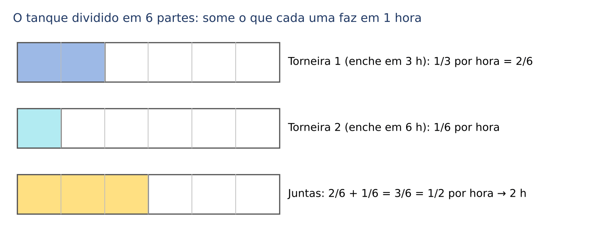

A fórmula resume isso:

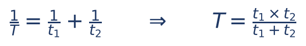

- T = tempo das duas trabalhando juntas;
- t₁ e t₂ = tempo de cada uma trabalhando sozinha;
- 1/T, 1/t₁ e 1/t₂ = o que cada uma faz numa unidade de tempo (a "velocidade de trabalho").

A versão "produto sobre soma" (T = t₁ × t₂ ÷ (t₁ + t₂)) vale só para DUAS torneiras. Com 3 ou mais, some as frações.

Ralos e vazamentos: um ralo trabalha "contra". Sua fração entra com sinal de menos. Exemplo: uma torneira enche em 4 horas e um ralo esvazia em 6 horas. Juntos: 1/4 − 1/6 = 3/12 − 2/12 = 1/12 por hora; o tanque enche em 12 horas.

O mesmo raciocínio vale para servidores que despacham processos, impressoras, equipes que asfaltam estradas: qualquer "trabalho" que se faz em ritmo constante.

:::QUESTAO FCC 2024 — TRF 3ª Região — Técnico Judiciário, Área Administrativa (Q2564649)
O problema. Duas equipes vão asfaltar uma estrada, cada uma a sua metade, partindo uma de cada cidade, ao mesmo tempo. Uma asfalta 300 m por dia e terminará sua metade em 16 dias; a outra asfalta 200 m por dia. Em quantos dias a estrada estará pronta? Gabarito oficial: C (24).
Resolução.
1. Metade da estrada: 300 × 16 = 4.800 m.
2. A equipe lenta leva 4.800 ÷ 200 = 24 dias para a sua metade.
3. As equipes trabalham em paralelo: a estrada fica pronta quando a mais lenta terminar, em 24 dias.
Armadilha: 40 (E) é somar 16 + 24, como se trabalhassem uma depois da outra. Aqui não é caso de "juntar velocidades", porque cada equipe tem a SUA metade: vale o tempo da mais lenta.
:::

:::QUESTAO FCC 2025 — Prefeitura de São Paulo — Analista de Planejamento (Q3281580)
O problema. As caixas de dois depósitos, A e B, foram levadas a um caminhão; o depósito B tinha 3/4 das caixas de A; cada pessoa carrega sempre o mesmo número de caixas por hora. Na 1ª hora, um grupo de n pessoas trabalhou em A. Na 2ª hora, metade do grupo trabalhou em A e metade em B, e A ficou vazio. Depois, 5 pessoas trabalharam mais 4 horas para esvaziar B. Quanto vale n? Gabarito oficial: D (32).
Resolução. A unidade de medida é "o que uma pessoa carrega em uma hora" (uma "pessoa-hora").
1. Depósito A: n pessoas-hora (1ª hora) + n/2 pessoas-hora (2ª hora) = 1,5n.
2. Depósito B = 3/4 de A = 0,75 × 1,5n = 1,125n.
3. Em B trabalharam n/2 pessoas-hora (2ª hora) + 5 × 4 = 20 pessoas-hora (depois).
  - n/2 + 20 = 1,125n
  - 20 = 1,125n − 0,5n = 0,625n
  - n = 20 ÷ 0,625 = 32
Conferência: A = 48 pessoas-hora; B = 36 = 3/4 de 48; em B: 16 + 20 = 36. Confere.
Dica: 0,625 = 5/8, então n = 20 × 8/5 = 32. Conhecer as frações dos oitavos (Cap. 1, tabela de conversões) poupa tempo.
:::

### 21.6.5 Velocidade, encontro e perseguição

A relação básica é distância = velocidade × tempo. Duas situações se repetem:

- Encontro (um vai na direção do outro): as velocidades se SOMAM. Dois carros a 300 km de distância, a 60 km/h e 90 km/h, um em direção ao outro, aproximam-se 150 km por hora; encontram-se em 300 ÷ 150 = 2 horas.
- Perseguição (mesmo sentido): as velocidades se SUBTRAEM. Quem está atrás "ganha" a diferença das velocidades por hora.

:::QUESTAO FCC 2024 — TRF 3ª Região — Técnico Judiciário, Área Administrativa (Q2564647)
O problema. Luís sai de casa às 8h00, caminhando a 6 km/h. Às 8h05, sua irmã Laura sai atrás dele pelo mesmo caminho, correndo a 12 km/h. A que horas ela o alcança? Gabarito oficial: B (8h10), conferido no QConcursos em 30/10/2026.
Resolução.
1. Em 5 minutos (5/60 = 1/12 de hora), Luís andou 6 × 1/12 = 0,5 km.
2. Laura se aproxima 12 − 6 = 6 km por hora.
3. Tempo para tirar 0,5 km: 0,5 ÷ 6 = 1/12 de hora = 5 minutos.
4. Alcance: 8h05 + 5 min = 8h10.
Conferência: às 8h10, Luís andou 10 minutos a 6 km/h (1 km); Laura correu 5 minutos a 12 km/h (1 km). Mesmo ponto.
Atalho: como Laura tem o DOBRO da velocidade, leva a METADE do tempo para cobrir a mesma distância: o que Luís levou 10 minutos para andar, ela corre em 5. Ela sai 5 minutos depois e chega junto: 8h10.
:::

### 21.6.6 Truques de contagem: somar tudo, cada um aparece k vezes

Quando o enunciado dá várias somas parciais em que cada elemento aparece o mesmo número de vezes, some TODAS as informações: o total aparece multiplicado.

:::QUESTAO FCC 2025 — TRT 2ª Região (SP) — Oficial de Justiça Avaliador Federal (Q3660488)
O problema. Pedro tem 5 porcos e uma balança que pesa 4 de cada vez. Pesou os 5 grupos diferentes de 4 porcos e obteve 289,5; 291,5; 293,0; 294,0 e 296,0 kg. Qual o peso médio dos porcos? Gabarito oficial: D (73,2 kg).
Resolução.
1. Cada grupo de 4 deixa de fora exatamente um porco; nos 5 grupos, cada porco fica de fora uma vez e aparece em 4 pesagens.
2. Soma das pesagens: 289,5 + 291,5 + 293,0 + 294,0 + 296,0 = 1.464.
3. Essa soma é 4 vezes o peso total: peso total = 1.464 ÷ 4 = 366 kg.
4. Média: 366 ÷ 5 = 73,2 kg.
Armadilha: dividir a soma 1.464 por 5 e parar (292,8 kg) dá o peso médio de um GRUPO de 4 porcos, não de um porco. O raciocínio seguro é perguntar "quantas vezes cada porco foi contado".
:::

### 21.6.7 Máximos e mínimos: o raciocínio dos extremos

Perguntas "qual o número MÁXIMO de..." ou "qual o MÍNIMO de..." pedem para empurrar uma quantidade até o limite permitido pelas regras, e conferir que todas as condições continuam valendo. A técnica: escreva as condições, isole a quantidade pedida e veja até onde ela pode ir. Depois, teste a resposta encontrando um exemplo concreto que funcione.

:::QUESTAO FCC 2024 — TRF 3ª Região — Analista Judiciário, Área Judiciária (Q2564463)
O problema. Uma fábrica produziu 22 carros em 3 semanas; cada semana produziu mais que a anterior, e a terceira produziu menos do que as duas primeiras juntas. Qual o máximo possível na segunda semana? Gabarito oficial: C (9).
Resolução. Sejam a < b < c as produções semanais.
1. a + b + c = 22 e c < a + b.
2. Como a + b = 22 − c, a condição c < a + b vira c < 22 − c, isto é, 2c < 22, ou c < 11. Logo c vale no máximo 10.
3. Como b < c, b vale no máximo 9.
4. Teste com b = 9 e c = 10: a = 22 − 19 = 3. Ordem 3 < 9 < 10 e 10 < 3 + 9 = 12. Funciona.
Armadilha: E (10) é o valor máximo da TERCEIRA semana; quem tenta b = 10 precisa de c ≥ 11, e então c < a + b falha (com c = 11, a = 1: 11 < 11 é falso).
:::

:::QUESTAO FCC 2024 — TRT 20ª Região (SE) — Analista Judiciário, Tecnologia da Informação (Q3171837)
O problema. Num campeonato, vitória vale 3 pontos, empate 1 e derrota 0. Uma equipe jogou 24 partidas e fez 50 pontos. Qual o número máximo de derrotas? Gabarito oficial: B (6).
Resolução. Sejam V, E e D as vitórias, empates e derrotas.
1. Pontos: 3V + E = 50, logo E = 50 − 3V.
2. Jogos: V + E + D = 24, logo D = 24 − V − E = 24 − V − (50 − 3V) = 2V − 26.
3. D cresce quando V cresce. Mas E não pode ser negativo: 50 − 3V ≥ 0, logo V ≤ 16 (3 × 16 = 48; 3 × 17 = 51 passaria de 50).
4. Com V = 16: E = 50 − 48 = 2 e D = 2 × 16 − 26 = 6.
Conferência: 16 + 2 + 6 = 24 jogos; 48 + 2 = 50 pontos. Confere.
Raciocínio intuitivo: para perder muito e ainda fazer 50 pontos, a equipe tem de ganhar o máximo possível (vitória rende mais pontos por jogo); os empates só completam os pontos que faltam.
:::

:::QUESTAO FCC 2024 — TRF 3ª Região — Técnico Judiciário, Área Administrativa (Q2564650)
O problema. Um escritório tem 55 funcionários, com idades inteiras; o mais novo tem 25 anos e o mais velho, 39. O que se pode afirmar com certeza? Gabarito oficial: D (pelo menos 4 funcionários têm a mesma idade).
Resolução (princípio da casa dos pombos, Cap. 11, 11.11.1, e Cap. 20).
1. Idades possíveis de 25 a 39: 39 − 25 + 1 = 15 "casas" (lembre o +1 da contagem inclusiva).
2. Pior caso: espalhar os 55 funcionários o mais uniformemente possível. 15 × 3 = 45 cabem com 3 por idade; sobram 55 − 45 = 10, que obrigam pelo menos uma idade a ter 4 pessoas.
3. Logo, com certeza, pelo menos 4 têm a mesma idade. Não dá para garantir 6 (A), nem que 3 tenham 39 anos (C), nem a média (E); e "no máximo 2" (B) é impossível, porque 15 × 2 = 30 < 55.
No mesmo sentido (casa dos pombos, FGV): Q4350708, Q3238411 e Q3005733, comentadas no Cap. 20; e Q3174749 (12 verdes, 10 brancos e 7 azuis: para garantir 5 da mesma cor, pior caso 4 + 4 + 4 = 12, mais 1 = 13; gabarito E).
:::

:::PRATIQUE exercícios elaborados para esta apostila
1. Hoje, Ana tem o triplo da idade da filha. Daqui a 10 anos, terá o dobro. Quantos anos tem cada uma?
2. Uma impressora imprime um lote em 2 horas; outra, em 3 horas. Juntas, em quanto tempo imprimem o lote?
3. (falsa suposição) Numa prova de 25 questões, cada acerto vale 4 pontos e cada erro tira 1 ponto. Um candidato respondeu a todas e fez 60 pontos. Quantas errou?
4. (estilo FCC) Três servidores despacham uma pilha de processos: o primeiro sozinho levaria 6 horas, o segundo 12 horas e o terceiro 4 horas. Trabalhando juntos, em quanto tempo terminam?

Resolução.
1. Filha f, Ana 3f. Daqui a 10 anos: 3f + 10 = 2 × (f + 10), logo 3f + 10 = 2f + 20, e f = 10. Ana tem 30. Conferência: em 10 anos, 40 e 20.
2. Por hora: 1/2 + 1/3 = 3/6 + 2/6 = 5/6 do lote. Tempo: 1 ÷ 5/6 = 6/5 de hora = 1,2 hora = 1 hora e 12 minutos (0,2 × 60 = 12). Pela fórmula: 2 × 3 ÷ (2 + 3) = 6/5.
3. Se acertasse tudo: 25 × 4 = 100 pontos. Fez 60: perdeu 40. Cada troca de acerto por erro custa 4 + 1 = 5 pontos (deixa de ganhar 4 e perde 1). Erros: 40 ÷ 5 = 8. Conferência: 17 × 4 − 8 = 68 − 8 = 60.
4. Por hora: 1/6 + 1/12 + 1/4. Com denominador 12: 2/12 + 1/12 + 3/12 = 6/12 = 1/2 da pilha. Terminam em 2 horas.
:::

## 21.7 Sequências de números, letras e figuras

### 21.7.1 A ideia: achar a regra escondida

Uma sequência é uma lista ordenada: tem primeiro termo, segundo termo, terceiro termo... Costuma-se chamar o termo da posição n de aₙ (lê-se "a índice n"): a₁ é o primeiro, a₂ o segundo, e assim por diante. A posição (n) e o valor do termo (aₙ) são coisas diferentes; muitos erros de prova nascem de confundi-las.

As questões de sequência pedem duas coisas: (1) descobrir a regra que gera os termos; (2) usar a regra para achar um termo distante (o 50º, o 2.026º) sem escrever todos. A primeira é investigação; a segunda é aritmética.

:::PASSO As perguntas a fazer a qualquer sequência (nesta ordem)
1. A diferença entre termos vizinhos é constante? Então é uma PA (21.7.2).
2. O quociente entre termos vizinhos é constante? Então é uma PG (21.7.2).
3. As diferenças não são constantes, mas crescem de modo regular? Calcule as diferenças das diferenças (21.7.3).
4. Os termos de posição ímpar e os de posição par seguem regras diferentes? Separe-os: é uma sequência intercalada (21.7.4). Se o padrão se repete de 3 em 3, separe em três.
5. Cada termo depende dos dois (ou três) anteriores, como na soma? É uma recorrência (21.7.5).
6. Um bloco de elementos se repete? Use o resto da divisão pelo tamanho do bloco (21.7.6).
7. São letras? Troque cada letra pela sua posição no alfabeto e volte ao passo 1 (21.7.7).
8. A regra foi dada no enunciado? Aplique-a com cuidado, inclusive "de trás para frente" (21.7.8).
:::

### 21.7.2 PA e PG: as duas sequências básicas

As progressões já foram estudadas no Cap. 1 (01.8). Recordando só o necessário:

- PA (progressão aritmética): cada termo é o anterior MAIS uma constante r (a razão). Termo geral: aₙ = a₁ + (n − 1) × r. Exemplo: 7, 11, 15, 19, ... (r = 4). O 50º termo: a₅₀ = 7 + 49 × 4 = 7 + 196 = 203.
- PG (progressão geométrica): cada termo é o anterior VEZES uma constante q. Termo geral: aₙ = a₁ × qⁿ⁻¹. Exemplo: 3, 6, 12, 24, ... (q = 2). O 6º termo: 3 × 2⁵ = 3 × 32 = 96.

O "(n − 1)" das fórmulas tem uma razão de ser: do 1º ao 50º termo há 49 "passos" (como 49 vãos entre 50 estacas). Esse cuidado vale para toda a seção.

Uma soma que aparece em muitas questões de sequência é a soma dos primeiros números naturais:

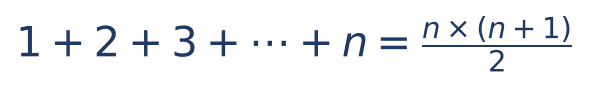

- n = até onde se soma;
- a ideia: escreva a soma na ordem normal e de trás para frente; somando as duas linhas, cada coluna dá n + 1, e há n colunas; como a soma foi escrita duas vezes, divide-se por 2. Exemplo: 1 + 2 + ... + 10 = 10 × 11 ÷ 2 = 55.

### 21.7.3 Diferenças de segunda ordem

Considere 2, 5, 10, 17, 26, 37, ... As diferenças são 3, 5, 7, 9, 11: não são constantes, mas crescem de 2 em 2. Quando as "diferenças das diferenças" são constantes, basta continuar o padrão de baixo para cima: a próxima diferença é 13, e o próximo termo é 37 + 13 = 50.

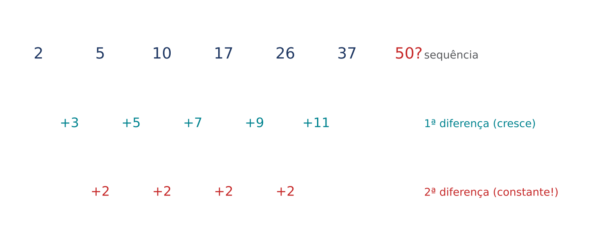

Neste exemplo, ainda dá para reconhecer os quadrados: 1, 4, 9, 16, 25, 36, 49 com 1 somado (aₙ = n² + 1). Reconhecer as famílias famosas ajuda muito:

| Família | Termos | Termo geral |
|---|---|---|
| quadrados | 1, 4, 9, 16, 25, 36, ... | n² |
| cubos | 1, 8, 27, 64, 125, ... | n³ |
| triangulares | 1, 3, 6, 10, 15, 21, ... | n × (n + 1) ÷ 2 |
| potências de 2 | 1, 2, 4, 8, 16, 32, ... | 2ⁿ⁻¹ |
| primos | 2, 3, 5, 7, 11, 13, 17, ... | não há fórmula simples |
| Fibonacci | 1, 1, 2, 3, 5, 8, 13, 21, ... | cada termo = soma dos dois anteriores |

### 21.7.4 Sequências intercaladas e em blocos

Quando os termos sobem e descem sem padrão aparente, desconfie de duas (ou três) sequências misturadas. Exemplo: 2, 10, 4, 20, 8, 40, ...

- posições ímpares (1ª, 3ª, 5ª): 2, 4, 8 → dobram;
- posições pares (2ª, 4ª, 6ª): 10, 20, 40 → também dobram;
- o 7º termo é o próximo das ímpares: 16.

A FCC gosta de blocos de três termos, em que cada posição do bloco segue uma regra própria. O método é sempre o mesmo: numere os BLOCOS (1º bloco, 2º bloco...), escreva a regra de cada posição em função do número do bloco e só então traduza de volta para a posição na sequência original (posição = 3 × (bloco − 1) + lugar dentro do bloco).

:::QUESTAO FCC 2026 — Câmara de Presidente Prudente — Controlador Interno (Q4395369)
O problema. A sequência 30, 60, 42, 45, 90, 54, 60, 120, 66, 75, 150, 78, 90, 180, 90, 105, ... segue um padrão. Seja m o menor índice tal que aₘ e os dois termos seguintes sejam todos maiores que 1.000. Quanto vale m? Gabarito oficial: D (241).
Resolução.
1. Separe em blocos de três: (30, 60, 42), (45, 90, 54), (60, 120, 66), (75, 150, 78), (90, 180, 90), (105, ...).
2. Regras, para o bloco número j (j = 1, 2, 3, ...):
  - 1º do bloco: 30, 45, 60, 75, 90, ... (PA de razão 15): 15j + 15;
  - 2º do bloco: o dobro do 1º: 30j + 30;
  - 3º do bloco: 42, 54, 66, 78, 90, ... (PA de razão 12): 12j + 30.
3. Três termos consecutivos SEMPRE incluem um "3º do bloco" (são três posições seguidas). O 3º do bloco é o que cresce mais devagar; ele precisa passar de 1.000:
  - 12j + 30 > 1.000
  - 12j > 970
  - j > 80,8..., logo j = 81 (o bloco 80 tem 3º termo 12 × 80 + 30 = 990, ainda abaixo de 1.000).
4. O primeiro trio todo acima de 1.000 é o próprio bloco 81: 1º termo 15 × 81 + 15 = 1.230; 2º termo 2.460; 3º termo 1.002. O trio anterior que começa no 2º termo do bloco 80 inclui o 990, e não serve.
5. Posição do 1º termo do bloco 81: os 80 blocos anteriores ocupam 3 × 80 = 240 posições; logo m = 241.
Armadilha: confundir o número do BLOCO (81) com a POSIÇÃO do termo (241), ou esquecer que a posição do 1º termo de um bloco é 3 × (bloco − 1) + 1.
:::

:::QUESTAO FCC 2026 — SEFAZ-MT — Fiscal de Tributos Estaduais (Q3947149)
O problema. A sequência finita 7, 100, −300, 11, 91, −294, 15, 82, −288, 19, 73, −282, ..., aₙ tem n termos; o resto da divisão de n por 3 é 1, e a soma dos três últimos termos é 60. Qual o resto da divisão de n por 8? Gabarito oficial: B (7).
Resolução.
1. Blocos de três; no bloco j:
  - 1º: 7, 11, 15, 19, ... = 4j + 3
  - 2º: 100, 91, 82, 73, ... = 109 − 9j
  - 3º: −300, −294, −288, −282, ... = 6j − 306
2. "n dividido por 3 deixa resto 1" significa que o último termo é o 1º de um bloco, digamos o bloco J. Os três últimos termos são: o 2º e o 3º do bloco J − 1 e o 1º do bloco J.
3. Soma:
  - [109 − 9(J − 1)] + [6(J − 1) − 306] + [4J + 3]
  - = 109 − 9J + 9 + 6J − 6 − 306 + 4J + 3
  - = J − 191
4. J − 191 = 60, logo J = 251.
5. Posição do 1º termo do bloco 251: n = 3 × 250 + 1 = 751.
6. 751 ÷ 8: 8 × 93 = 744; resto 751 − 744 = 7.
Conferência: 2º do bloco 250: 109 − 2.250 = −2.141; 3º do bloco 250: 1.500 − 306 = 1.194; 1º do bloco 251: 1.004 + 3 = 1.007. Soma: −2.141 + 1.194 + 1.007 = 60. Confere.
:::

:::QUESTAO FCC 2026 — SEFAZ-MT — Fiscal de Tributos Estaduais (Q3947152)
O problema. A sequência A = (3, 4, 5, 7, 7, 10, 9, 13, 11, 16, ..., 106, ...) gera a sequência B formada pelos algarismos de A, um a um: B = (3, 4, 5, 7, 7, 1, 0, 9, 1, 3, ...). Qual é o 300º termo de B? Gabarito oficial: A (1 ou 3).
Resolução.
1. A é intercalada. Posições ímpares: 3, 5, 7, 9, 11, ... (ímpares a partir de 3: o j-ésimo é 2j + 1). Posições pares: 4, 7, 10, 13, ... (PA de razão 3: o j-ésimo é 3j + 1).
2. Conte algarismos por faixas, para cada sequência:
  - ímpares de 1 algarismo (3, 5, 7, 9): j = 1 a 4 → 4 algarismos;
  - ímpares de 2 algarismos (11 a 99): j = 5 a 49 → 45 números × 2 = 90 algarismos;
  - pares de 1 algarismo (4, 7): j = 1 e 2 → 2 algarismos;
  - pares de 2 algarismos (10 a 97): j = 3 a 32 → 30 números × 2 = 60 algarismos;
  - pares de 3 algarismos até j = 49 (100 a 148): j = 33 a 49 → 17 números × 3 = 51 algarismos.
3. Até o par j = 49 (98 termos de A), B tem 4 + 90 + 2 + 60 + 51 = 207 algarismos.
4. Dali em diante (j ≥ 50), os dois termos de cada par têm 3 algarismos: 6 algarismos por par.
  - faltam 300 − 207 = 93 algarismos
  - 93 = 6 × 15 + 3: 15 pares completos (j = 50 a 64) levam B a 207 + 90 = 297 algarismos
  - os algarismos 298, 299 e 300 são os do próximo termo, o ímpar de j = 65: 2 × 65 + 1 = 131.
5. O 300º algarismo é o último de 131: 1.
A alternativa "1 ou 3" tem dois valores porque a FCC agrupou respostas; o 1 está nela.
Dica de prova: em questões de "contar algarismos", monte a tabela de faixas (1, 2 e 3 algarismos) antes de qualquer conta, e confira as fronteiras (99 → 101, 97 → 100).
:::

### 21.7.5 Recorrências: cada termo depende dos anteriores

Na sequência de Fibonacci, cada termo é a soma dos dois anteriores: 1, 1, 2, 3, 5, 8, 13, 21, 34, ... A FGV e a FCC variam a ideia: "cada termo é a soma dos três anteriores", "cada termo é o triplo do anterior menos 2", "começa em 3 e 4 e cada termo é a soma dos dois anteriores" (3, 4, 7, 11, 18, 29, 47, ...).

Duas técnicas:

- Para ir PARA FRENTE, só aplique a regra, termo a termo, escrevendo cada conta.
- Para ir PARA TRÁS (achar o 1º termo sabendo o 4º), inverta a regra. Se "cada termo é o triplo do anterior menos 2", então "o anterior é (termo + 2) ÷ 3". Exemplo: se a₄ = 82, então a₃ = (82 + 2) ÷ 3 = 28; a₂ = (28 + 2) ÷ 3 = 10; a₁ = (10 + 2) ÷ 3 = 4. (É exatamente a FGV 2024 Q3047788, cujo gabarito, C, diz que o 1º termo está entre 3,5 e 4,5.)

### 21.7.6 Sequências cíclicas: o resto da divisão

Quando um bloco se repete sem parar (Urso, Cubo, Carro, Bola, Boneca, Urso, Cubo, ...), o termo de qualquer posição se acha pela divisão da posição pelo tamanho do bloco:

- o QUOCIENTE diz quantos blocos completos já passaram (não importa);
- o RESTO diz a posição dentro do bloco seguinte.

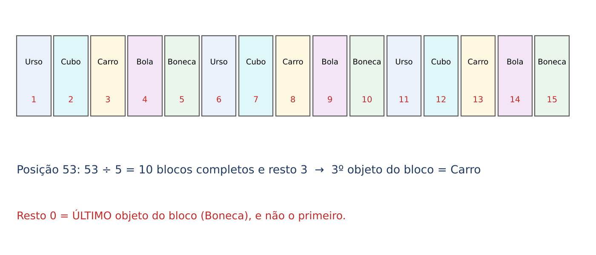

Cuidado com o resto zero: ele significa que a posição é a ÚLTIMA de um bloco completo, não a primeira. Na figura, a posição 15 dá 15 ÷ 5 = 3, resto 0: é a Boneca, último objeto do bloco.

Esse método resolve, por exemplo, a FGV 2026 Q4350710 (posição 53 num bloco de 5: resto 3, o Carro; gabarito C) e a FGV 2025 Q3579003 (bloco PRESJCJSERP, de 11 letras: 2.025 = 11 × 184 + 1, resto 1, letra P; gabarito A). Também funciona quando a sequência só fica cíclica depois de alguns termos: na FGV 2024 Q2484653 (cada termo é o algarismo das unidades de 2x + 1, começando em 6), os termos são 6, 3, 7, 5, 1, 3, 7, 5, 1, ...; a partir do 2º termo, o ciclo (3, 7, 5, 1) tem 4 elementos; para o 2.024º termo, conte a partir do 2º: 2.024 − 1 = 2.023 = 4 × 505 + 3, resto 3, terceiro do ciclo, 5 (gabarito C).

Nem todo bloco tem tamanho fixo. Na sequência 1; 1, 2; 1, 2, 3; 1, 2, 3, 4; ..., o bloco k tem k termos. A posição do fim do bloco k é 1 + 2 + ... + k = k × (k + 1) ÷ 2 (21.7.2).

:::QUESTAO FCC 2025 — Prefeitura de São Paulo — Analista de Planejamento (Q3281581)
O problema. Na sequência 1, 1, 2, 1, 2, 3, 1, 2, 3, 4, 1, 2, 3, 4, 5, ..., em que posição o número 25 aparece pela 25ª vez? Gabarito oficial: B (1.201ª).
Resolução.
1. Os blocos são (1), (1, 2), (1, 2, 3), ...: o bloco k vai de 1 até k e tem k termos.
2. O 25 aparece pela primeira vez no bloco 25 e depois uma vez em cada bloco seguinte. A 1ª aparição é no bloco 25; a 2ª no 26; ...; a 25ª no bloco 25 + 24 = 49.
3. Antes do bloco 49 há os blocos 1 a 48, com 1 + 2 + ... + 48 termos:
  - 48 × 49 ÷ 2 = 2.352 ÷ 2 = 1.176
4. Dentro do bloco 49, o 25 é o 25º termo. Posição: 1.176 + 25 = 1.201.
Armadilha: a alternativa A (1.176ª) é o fim do bloco 48, a resposta de quem esquece de somar a posição dentro do bloco; as demais alternativas vão de 25 em 25 (1.226, 1.251, 1.276), para pegar quem erra o número do bloco por uma ou duas unidades. Escreva o bloco e a posição dentro dele separadamente.
:::

### 21.7.7 Sequências de letras

A técnica é transformar letras em números, usando a posição no alfabeto. O alfabeto oficial da língua portuguesa tem 26 letras (K, W e Y voltaram a ele com o Acordo Ortográfico de 1990, em vigor no Brasil desde 2009). Mas questões antigas ou com regra expressa podem usar 23 letras: leia o enunciado. Na dúvida, a FCC costuma dizer qual alfabeto usar.

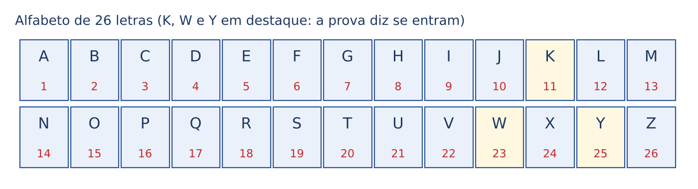

Exemplos:

- A, C, F, J, O, ? → posições 1, 3, 6, 10, 15: diferenças +2, +3, +4, +5. A próxima diferença é +6: 15 + 6 = 21, a letra U.
- B, E, H, K, ? → posições 2, 5, 8, 11: PA de razão 3. Próximo: 14, a letra N. (Com alfabeto de 23 letras, sem K, a sequência nem faria sentido: por isso o enunciado precisa dizer qual alfabeto usar.)
- Sequências que "dão a volta": X, A, D, G, ... → X = 24; 24 + 3 = 27, e 27 − 26 = 1, o A; depois 4 (D), 7 (G). Depois do Z, recomece do A (como as horas depois do meio-dia: o resto da divisão por 26).

Palavras e siglas que se repetem (como PRESJCJSERP) são sequências cíclicas: use o resto (21.7.6). E códigos do tipo "cada letra vale um número" são sistemas de equações (21.6.1).

### 21.7.8 Sequências de figuras

Em sequências de figuras, não tente "ver" a figura distante: CONTE algo em cada figura (bolinhas, palitos, quadradinhos) e transforme a sequência de figuras numa sequência de números.

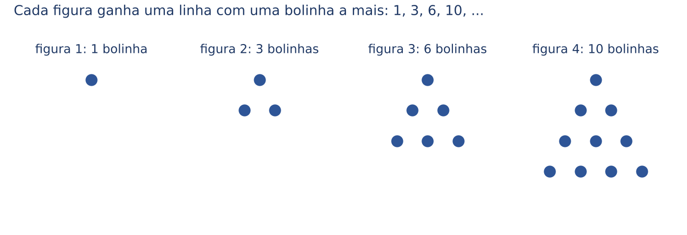

Exemplo com palitos: 1 quadrado usa 4 palitos; 2 quadrados lado a lado usam 7; 3 quadrados usam 10. É uma PA de razão 3 (cada quadrado novo aproveita um lado do anterior e acrescenta 3 palitos). Figura n: 4 + (n − 1) × 3 = 3n + 1. A figura 50 usa 3 × 50 + 1 = 151 palitos.

Quando as figuras mudam em duas características ao mesmo tempo (forma e cor, por exemplo), cada característica é uma sequência cíclica. Se a forma se repete a cada 2 figuras e a cor a cada 3, as duas voltam juntas a cada MMC(2, 3) = 6 figuras (21.4.3): é a FGV 2025 Q3754733 (gabarito D, múltiplos de 6).

### 21.7.9 Quando a regra vem no enunciado

Algumas questões dão a regra pronta, com exemplos, e pedem para aplicá-la "de trás para frente". O trabalho é algébrico: escreva o número desconhecido com letras para os algarismos (o número de dois algarismos "ab" vale 10a + b) e use a regra.

:::QUESTAO FCC 2025 — Prefeitura de São Paulo — Auditor Municipal de Controle Interno (Q3281771)
O problema. Na sequência ab, cd, ef, gh, 98, 123, 132, 140, 145, ..., os quatro primeiros termos são números de dois algarismos. A regra é ilustrada: 123 = 98 + 9 + 2 × 8; 132 = 123 + 1 + 2 + 2 × 3; 140 = 132 + 1 + 3 + 2 × 2; 145 = 140 + 1 + 4 + 2 × 0. Quanto vale ab + cd + ef + gh? Gabarito oficial: A (252).
Resolução.
1. Leia a regra nos exemplos: próximo termo = termo + (algarismos, exceto o último) + 2 × (último algarismo). Para um número de dois algarismos xy: próximo = (10x + y) + x + 2y = 11x + 3y.
2. De trás para frente, achando gh (o termo antes de 98): 11g + 3h = 98. Teste os valores de g (de 1 a 8) procurando h entre 0 e 9:
  - g = 7: 77 + 3h = 98, logo 3h = 21 e h = 7. Serve: gh = 77.
  - g = 4: 44 + 3h = 98, logo 3h = 54 e h = 18: não é algarismo. Os demais valores de g não dão h inteiro entre 0 e 9.
3. ef: 11e + 3f = 77. Com e = 7: 3f = 0, f = 0. ef = 70. (Com e = 4, f = 11; com e = 1, f = 22: não servem.)
4. cd: 11c + 3d = 70. Com c = 5: 3d = 15, d = 5. cd = 55. (Com c = 2, d = 16: não serve.)
5. ab: 11a + 3b = 55. Com a = 5: 3b = 0, b = 0. ab = 50. (Com a = 2, b = 11: não serve.)
6. Soma: 50 + 55 + 70 + 77 = 252.
Conferência para frente: 50 + 5 + 0 = 55; 55 + 5 + 10 = 70; 70 + 7 + 0 = 77; 77 + 7 + 14 = 98. Confere.
Dica: em "11x + 3y = número", comece pelo maior x possível (o número dividido por 11, arredondado para baixo) e vá descendo; a primeira tentativa que deixa um múltiplo de 3 entre 0 e 27 é a boa.
:::

:::PRATIQUE exercícios elaborados para esta apostila
1. Qual o próximo termo de 3, 6, 12, 24, ...? E o 8º termo?
2. Na sequência 1, 4, 9, 16, 25, ..., qual é o 100º termo?
3. Qual o 7º termo de 2, 10, 4, 20, 8, 40, ...?
4. Complete: B, E, H, K, ___ (alfabeto de 26 letras).
5. (estilo FCC) A sequência ABCDEFGABCDEFGABC... repete o bloco ABCDEFG. Qual a letra da posição 2.026?

Resolução.
1. PG de razão 2 (cada termo é o dobro do anterior). Próximo: 48. 8º termo: 3 × 2⁷ = 3 × 128 = 384.
2. São os quadrados: aₙ = n². a₁₀₀ = 100² = 10.000.
3. Intercalada: posições ímpares 2, 4, 8 (dobram); o 7º termo é o 4º das ímpares: 16.
4. Posições 2, 5, 8, 11: PA de razão 3. Próxima posição: 14, letra N.
5. Bloco de 7 letras. 2.026 ÷ 7: 7 × 289 = 2.023; resto 2.026 − 2.023 = 3. Terceira letra do bloco: C.
:::

## 21.8 Resumo para revisão pré-prova

### 21.8.1 Quadro geral do capítulo

| Conceito | Regra ou fórmula | Quando usar | Armadilha |
|---|---|---|---|
| Operações com conjuntos | ∪ = "ou"; ∩ = "e"; A − B = "A, mas não B"; Aᶜ = "fora de A" | listas de elementos, conjuntos descritos por propriedade | A − B ≠ B − A; elemento repetido conta uma vez |
| Número de subconjuntos | 2ⁿ (inclui ∅ e o próprio conjunto) | "quantos subconjuntos" | "não vazios" = 2ⁿ − 1 |
| União de dois conjuntos | n(A ∪ B) = n(A) + n(B) − n(A ∩ B) | pesquisas com duas características | o total de A inclui a interseção |
| Venn de dentro para fora | centro → exatamente dois → só um → nenhum | qualquer Venn com regiões | "apenas A e B" já exclui o centro |
| União de três conjuntos | soma dos três − interseções duas a duas + interseção tripla | quando só se pergunta "pelo menos um" ou "nenhum" | a fórmula usa interseções TOTAIS |
| "Apenas um ou os três" | 2t = soma dos totais − número de pessoas | ninguém em exatamente dois | dividir por 3 em vez de 2 |
| Interseção mínima | soma das porcentagens − (k − 1) × 100% | "no mínimo, quantos estão em todos" | "no máximo" é o menor dos grupos |
| Fatoração | dividir pelos menores primos até 1 | produto de idades, divisores | 1 não é primo |
| Número de divisores | (expoentes + 1) multiplicados | "quantos divisores" | esquecer o 1 e o próprio número |
| MMC | produto de todos os primos da fatoração simultânea | coincidir de novo, menor total divisível | resultado MAIOR que os números |
| MDC | produto dos primos que dividiram todos | partes iguais, maiores possíveis, sem sobra | resultado MENOR que os números |
| Restos | N = divisor × quociente + resto; soluções se repetem de MMC em MMC | "sobra 2 quando divido por 3" | resto igual: N − resto é múltiplo do MMC |
| Razão com k | x : y = 3 : 4 → x = 3k, y = 4k | todo problema de razão | responder k em vez da quantidade pedida |
| Divisão direta | partes = número × k; k = total ÷ soma dos números | heranças, prêmios, cotas | conferir se a soma das partes dá o total |
| Divisão inversa | proporcional aos inversos; parte × número = constante | "inversamente proporcional" | com 3 números, não basta inverter a ordem |
| Regra de sociedade | capital × tempo de cada sócio | lucro de sócios com prazos diferentes | esquecer o tempo |
| Encadear razões | igualar o termo comum pelo MMC | a : b e b : c dados | somar razões de misturas sem converter em quantidades |
| Falsa suposição | supor tudo de um tipo; diferença ÷ ganho por troca | dois tipos, total de itens e de "peso" | responder o número de trocas em vez do pedido |
| Idades | a diferença de idades é constante; tabela passado/hoje/futuro | "daqui a x anos", "há x anos" | somar anos só a uma das pessoas |
| Trabalho conjunto | 1/T = 1/t₁ + 1/t₂ (ralo entra com sinal −) | torneiras, impressoras, equipes no mesmo trabalho | somar os tempos ou tirar média |
| Encontro e perseguição | velocidades somam (encontro) ou subtraem (perseguição) | móveis na mesma estrada | não converter minutos em horas |
| PA e PG | aₙ = a₁ + (n − 1)r; aₙ = a₁ × qⁿ⁻¹ | diferença constante; quociente constante | n − 1 passos, não n |
| Soma 1 + 2 + ... + n | n × (n + 1) ÷ 2 | blocos crescentes, números triangulares | contar a posição dentro do bloco |
| Intercaladas e blocos | separar por posição; posição = 3 × (bloco − 1) + lugar | termos que sobem e descem | confundir bloco com posição |
| Cíclicas | resto da divisão da posição pelo tamanho do bloco | padrões que se repetem | resto 0 = último do bloco |
| Letras | trocar letra por posição (26 letras) | sequências de letras | K, W, Y: conferir o alfabeto pedido |

### 21.8.2 Formulário do capítulo

| Fórmula | O que cada símbolo significa | Quando usar |
|---|---|---|
| n(A ∪ B) = n(A) + n(B) − n(A ∩ B) | n(·) = número de elementos; A ∩ B = elementos comuns | dois conjuntos |
| n(A ∪ B ∪ C) = n(A) + n(B) + n(C) − n(A ∩ B) − n(A ∩ C) − n(B ∩ C) + n(A ∩ B ∩ C) | interseções totais (incluem quem está nos três) | três conjuntos, "pelo menos um" |
| xₘᵢₙ = (p₁ + ... + pₖ) − (k − 1) × 100% | p = porcentagem de cada grupo; k = número de grupos | interseção mínima |
| subconjuntos = 2ⁿ | n = número de elementos | contar subconjuntos |
| MMC(a, b) × MDC(a, b) = a × b | vale para dois números | conferir MMC e MDC |
| divisores de 2ᵃ × 3ᵇ × 5ᶜ ... = (a + 1)(b + 1)(c + 1)... | a, b, c = expoentes da fatoração | contar divisores |
| partes diretas: 2k, 3k, 5k | k = constante (valor da cota) | divisão diretamente proporcional |
| partes inversas: k/a, k/b, k/c | parte × número = k | divisão inversamente proporcional |
| 1/T = 1/t₁ + 1/t₂; T = t₁t₂ ÷ (t₁ + t₂) | T = tempo junto; t = tempo de cada um sozinho | trabalho conjunto (a 2ª forma só para dois) |
| distância = velocidade × tempo | velocidade relativa: soma (encontro) ou diferença (perseguição) | móveis |
| aₙ = a₁ + (n − 1) × r | a₁ = 1º termo; r = razão; n = posição | PA |
| aₙ = a₁ × qⁿ⁻¹ | q = razão da PG | PG |
| 1 + 2 + ... + n = n(n + 1) ÷ 2 | n = último número somado | blocos crescentes |

## 21.9 Questões do capítulo

Questões comentadas em box (40, todas FCC): Q3872146, Q4395371, Q3281774, Q3336234, Q3216576, Q3216476, Q3871988, Q3947146, Q3888393, Q3169911, Q3627571, Q3478910, Q3964558, Q4231741, Q3910525, Q4395367, Q3336230, Q3976704, Q4395366, Q3336231, Q4221368, Q3506138, Q4395368, Q3445885, Q3538624, Q3871991, Q3872152, Q3506139, Q2564649, Q3281580, Q2564647, Q3660488, Q2564463, Q3171837, Q2564650, Q4395369, Q3947149, Q3947152, Q3281581, Q3281771.

Citadas no texto com a resolução resumida: FCC Q3884595, Q3848775; FGV Q3049037, Q3174749, Q4350710, Q3579003, Q2484653, Q3754733, Q3047788. Remetidas ao Cap. 20 (casa dos pombos): FGV Q4350708, Q3238411, Q3005733.

### 21.9.1 Outras questões do banco sobre o tema

A tabela traz as demais questões do lote, para treino, agrupadas por banca e subtema. As marcadas "dados em figura" dependem de imagem que não está no banco; as de subtema fora do escopo deste capítulo (geometria, contagem) remetem aos capítulos próprios.

| Q | Banca/ano | Subtema | Gabarito |
|---|---|---|---|
| Q3872147 | FCC 2026 | Contagem com algarismos (Cap. 11) | D |
| Q2564465 | FCC 2024 | Contagem de algarismos | A |
| Q2564464 | FCC 2024 | Datas e algarismos | E |
| Q3976705 | FCC 2026 | Equação com figura (dados em figura) | E |
| Q3089760 | FCC 2024 | Equação e periodicidade | C |
| Q3538941 | FCC 2025 | Equação em inteiros | A |
| Q3216478 | FCC 2025 | Equação simples | A |
| Q3872149 | FCC 2026 | Equação simples | C |
| Q3848775 | FCC 2025 | Fatoração (citada em 21.4.2) | B |
| Q3627570 | FCC 2025 | Frações de grupos | E |
| Q3478908 | FCC 2025 | Idades e média | E |
| Q2564648 | FCC 2024 | Máximo e mínimo | E |
| Q4231739 | FCC 2026 | Operações com algarismos (dados em figura) | B |
| Q3295802 | FCC 2025 | Ordenação lógica (comentada no Cap. 20) | D |
| Q3295803 | FCC 2025 | Perímetro (dados em figura) | B |
| Q3964560 | FCC 2026 | Perímetro (dados em figura) | D |
| Q3976703 | FCC 2026 | Perímetro (dados em figura) | D |
| Q3976701 | FCC 2026 | Perímetro de lotes | C |
| Q3871917 | FCC 2026 | Porcentagem e moedas | D |
| Q3506135 | FCC 2025 | Posições numa fila (ver Cap. 20, 20.3) | C |
| Q3872150 | FCC 2026 | Problema de lucro | B |
| Q3214689 | FCC 2025 | Problema de preços | A |
| Q3169909 | FCC 2024 | Problema de tentativa (comentada no Cap. 20) | E |
| Q3336233 | FCC 2025 | Razão | D |
| Q3976739 | FCC 2026 | Razão (tempo por unidade) | D |
| Q3445881 | FCC 2025 | Razão e fração | A |
| Q3233081 | FCC 2024 | Sequência em tabela (dados em figura) | A |
| Q3303213 | FCC 2025 | Simulação passo a passo | D |
| Q3171835 | FCC 2024 | Soma de equações | C |
| Q3406668 | FCC 2025 | Tabela (dados em figura) | E |
| Q2564462 | FCC 2024 | Tabela de dupla entrada e porcentagem | D |
| Q3215126 | FCC 2025 | Tabela de preços (dados em figura) | A |
| Q3884595 | FCC 2024 | Venn: apenas um ou os três (citada em 21.3.4) | D |
| Q3174749 | FGV 2025 | Casa dos pombos (citada em 21.6.7) | E |
| Q3005733 | FGV 2024 | Casa dos pombos (comentada no Cap. 20) | E |
| Q3238411 | FGV 2025 | Casa dos pombos (comentada no Cap. 20) | E |
| Q4350708 | FGV 2026 | Casa dos pombos (comentada no Cap. 20) | D |
| Q3114587 | FGV 2024 | Conjuntos (múltiplos) | C |
| Q2351906 | FGV 2024 | Conjuntos e Venn | A |
| Q3039595 | FGV 2024 | Conjuntos e Venn | D |
| Q3044082 | FGV 2024 | Conjuntos e Venn | D |
| Q3047217 | FGV 2024 | Conjuntos e Venn | D |
| Q3049478 | FGV 2024 | Conjuntos e Venn | C |
| Q3050899 | FGV 2024 | Conjuntos e Venn | A |
| Q3287446 | FGV 2025 | Conjuntos e Venn | E |
| Q3754737 | FGV 2025 | Conjuntos e Venn | A |
| Q3846032 | FGV 2026 | Conjuntos e Venn | C |
| Q4350638 | FGV 2026 | Conjuntos e Venn | D |
| Q3029912 | FGV 2024 | Contagem (Cap. 11) | B |
| Q4086744 | FGV 2026 | Divisores (equação em inteiros) | A |
| Q3880033 | FGV 2026 | Divisores e restos | D |
| Q3593039 | FGV 2025 | Fibonacci | C |
| Q3039598 | FGV 2024 | Geometria básica (noções) | B |
| Q3047286 | FGV 2024 | Geometria básica (noções) | D |
| Q3049477 | FGV 2024 | Geometria básica (noções) | B |
| Q3171959 | FGV 2025 | Geometria básica (noções) | B |
| Q3174748 | FGV 2025 | Geometria básica (noções) | A |
| Q3846027 | FGV 2026 | Grandezas inversas | A |
| Q3038818 | FGV 2024 | Idades | C |
| Q3248828 | FGV 2024 | Idades | D |
| Q3152828 | FGV 2025 | Idades e médias | E |
| Q3157883 | FGV 2024 | MMC e restos | C |
| Q3881975 | FGV 2026 | Múltiplos e divisores | C |
| Q2349753 | FGV 2024 | Problemas aritméticos | D |
| Q2349760 | FGV 2024 | Problemas aritméticos | A |
| Q2375655 | FGV 2024 | Problemas aritméticos | E |
| Q2450507 | FGV 2024 | Problemas aritméticos | D |
| Q2450508 | FGV 2024 | Problemas aritméticos | D |
| Q2456234 | FGV 2024 | Problemas aritméticos | D |
| Q2564181 | FGV 2024 | Problemas aritméticos | A |
| Q3047215 | FGV 2024 | Problemas aritméticos | C |
| Q3047793 | FGV 2024 | Problemas aritméticos | C |
| Q3047795 | FGV 2024 | Problemas aritméticos | B |
| Q3047796 | FGV 2024 | Problemas aritméticos | D |
| Q3049043 | FGV 2024 | Problemas aritméticos | A |
| Q3049476 | FGV 2024 | Problemas aritméticos | D |
| Q3171960 | FGV 2025 | Problemas aritméticos | A |
| Q3185915 | FGV 2025 | Problemas aritméticos | E |
| Q3238407 | FGV 2025 | Problemas aritméticos | B |
| Q3238412 | FGV 2025 | Problemas aritméticos | B |
| Q3275684 | FGV 2025 | Problemas aritméticos | E |
| Q3275685 | FGV 2025 | Problemas aritméticos | A |
| Q3287440 | FGV 2025 | Problemas aritméticos | B |
| Q3349568 | FGV 2025 | Problemas aritméticos | A |
| Q3349661 | FGV 2025 | Problemas aritméticos | B |
| Q3363340 | FGV 2025 | Problemas aritméticos | B |
| Q3363341 | FGV 2025 | Problemas aritméticos | B |
| Q3363346 | FGV 2025 | Problemas aritméticos | C |
| Q3605970 | FGV 2025 | Problemas aritméticos | E |
| Q3656869 | FGV 2025 | Problemas aritméticos | A |
| Q3657988 | FGV 2025 | Problemas aritméticos | C |
| Q3878405 | FGV 2026 | Problemas aritméticos | C |
| Q3883148 | FGV 2026 | Problemas aritméticos | C |
| Q3884916 | FGV 2026 | Problemas aritméticos | D |
| Q4086753 | FGV 2026 | Problemas aritméticos | B |
| Q4216288 | FGV 2026 | Problemas aritméticos | B |
| Q4375775 | FGV 2026 | Problemas aritméticos | C |
| Q3049037 | FGV 2024 | Propriedades das operações (citada em 21.1.4) | A |
| Q3047220 | FGV 2024 | Quadros numéricos | B |
| Q3047790 | FGV 2024 | Quadros numéricos | E |
| Q4222401 | FGV 2026 | Razão (Lei de Little) | C |
| Q2380746 | FGV 2024 | Razões e taxas | C |
| Q3171958 | FGV 2025 | Razões e taxas | E |
| Q3607380 | FGV 2025 | Recorrência | D |
| Q3047788 | FGV 2024 | Recorrência (citada em 21.7.5) | C |
| Q3005738 | FGV 2024 | Recorrência (tipo Fibonacci) | C |
| Q3047216 | FGV 2024 | Recorrência com algarismos | A |
| Q2484653 | FGV 2024 | Sequência cíclica (citada em 21.7.6) | C |
| Q4350710 | FGV 2026 | Sequência cíclica (citada em 21.7.6) | C |
| Q2346646 | FGV 2024 | Sequência cíclica de algarismos | D |
| Q3579003 | FGV 2025 | Sequência cíclica de letras (citada em 21.7.6) | A |
| Q3754733 | FGV 2025 | Sequência de figuras e MMC (citada em 21.7.8) | D |
| Q2375603 | FGV 2024 | Sequência intercalada | D |
| Q2351907 | FGV 2024 | Sequências | E |
| Q2351911 | FGV 2024 | Sequências | A |
| Q2365371 | FGV 2024 | Sequências | A |
| Q2380743 | FGV 2024 | Sequências | D |
| Q3114592 | FGV 2024 | Sequências | E |
| Q3593318 | FGV 2025 | Sequências | C |
| Q3605971 | FGV 2025 | Sequências | D |
| Q3884901 | FGV 2026 | Sequências | B |
| Q3171957 | FGV 2025 | Soma de PG | D |
| Q2375651 | FGV 2024 | Trabalho e ritmo | C |

:::NOTA Notas de verificação
- Contas: todos os exemplos, exercícios PRATIQUE e as 40 resoluções em box foram conferidos em Python (frações exatas onde cabível), inclusive as conferências "de volta ao enunciado". As questões citadas no texto (Q3884595, Q3848775, Q3174749, Q4350710, Q3579003, Q2484653, Q3047788) também foram recalculadas.
- Gabaritos: todos os 40 boxes coincidem com o gabarito oficial.
- Gabaritos reconferidos no QConcursos em 30/10/2026: Q2564647 (B, 8h10) e Q2564648 (E, 4), coincidentes com as respostas deduzidas pela resolução; e, na tabela de questões não comentadas, Q2351906 (A), Q2349753 (D), Q2349760 (A), Q2346646 (D), Q2351907 (E), Q2351911 (A) e Q2365371 (A).
- Q3478910 (bolinhas de gude): o enunciado diz "em grupos de 3 ou em grupos de 5"; o gabarito oficial (4) só se explica pela leitura de que as duas divisões devem ser possíveis (múltiplo de 15). Na leitura literal de "ou" bastaria 1 bolinha (alternativa D). Registrado no box como ponto de interpretação; não há notícia, no banco, de anulação.
- Q3872152: a alternativa B traz "555,00", erro de digitação evidente para 55 reais; não altera o gabarito.
- Alfabeto: a informação de que o alfabeto oficial tem 26 letras (K, W e Y incorporados) decorre do Acordo Ortográfico da Língua Portuguesa de 1990 (Base I), promulgado no Brasil pelo Decreto 6.583/2008, com vigência a partir de 1/1/2009. Conferido em 30/10/2026 (Câmara dos Deputados, Legislação Informatizada, publicação original do Decreto 6.583, de 29/9/2008: art. 2º, efeitos a partir de 1/1/2009; Base I, item 1º, "vinte e seis letras", com k, w e y no quadro).
- Remissões: Cap. 1 (01.2, 01.4, 01.5, 01.7 e 01.8), Cap. 11 (11.11.1, casa dos pombos) e Cap. 20 (20.3 e casa dos pombos) conferidas nos sumários dos capítulos prontos. A DICA de testes de divisibilidade está no Cap. 1, na subseção 01.2.2 (Simplificar): remissão conferida em 30/10/2026 no ch01.md.
- Materiais do Drive listados no briefing não foram abertos: o conteúdo é matemática elementar estável e o banco local trouxe questões suficientes.
- Figuras: 19 arquivos ch21_*.png gerados (diagramas, fórmulas e gráficos), todos conferidos visualmente.
:::
