# CAPÍTULO 22 — ORIENTAÇÃO ESPACIAL E TEMPORAL: CALENDÁRIOS, DIAS DA SEMANA, RELÓGIOS E HORÁRIOS, FUSOS, VISTAS E PLANIFICAÇÕES, POSIÇÕES RELATIVAS E DESLOCAMENTOS

:::INCIDENCIA
Edital SEFAZ/SC 01/2026 — Raciocínio Lógico ("orientação espacial e temporal" e "raciocínio sequencial"). Nível A.
Lote do banco: 29 questões (FCC 3, FGV 26); a FCC cobra o tema sobretudo como cálculo de horários e de sólidos (cubos), e a FGV, como dia da semana.
O que mais cai: dia da semana daqui a n dias (resto da divisão por 7), soma e média de horários, cubos pintados e dados, deslocamentos com giros.
:::

:::ESQUEMA O que você vai aprender e o que precisa saber antes
Pré-requisitos: as quatro operações e a divisão com resto (Cap. 1, 01.1); frações e regra de três (Cap. 1, 01.2 e 01.5); combinações C(n, 2), só para a contagem de triângulos (Cap. 11). Os problemas de ordenação de pessoas em fila ou em mesa são do Cap. 20; as sequências de figuras, do Cap. 21.
Roteiro do capítulo:
- 22.1 A ferramenta-mestra: o resto da divisão e a ideia de ciclo.
- 22.2 Calendários: dia da semana após n dias, meses, anos bissextos, contagem de dias, eventos periódicos.
- 22.3 Horas e minutos: a conta em base 60, médias de tempo, ângulo entre ponteiros, relógios adiantados e atrasados, encontros.
- 22.4 Fusos horários.
- 22.5 Orientação no plano: pontos cardeais, giros, deslocamentos em malha, coordenadas.
- 22.6 Sólidos: cubos, dados, planificações, cubos pintados, pilhas de cubos e recipientes.
- 22.7 Figuras planas: rotações, simetrias, espelhos e contagem de quadrados e triângulos.
- 22.8 Resumo para revisão pré-prova.
:::

## 22.1 A ferramenta-mestra: o resto da divisão

### 22.1.1 A ideia: tudo o que se repete é um relógio

Quase todas as questões deste capítulo têm a mesma alma: alguma coisa se repete em ciclos. Os dias da semana voltam a cada 7 dias. Os ponteiros do relógio voltam a cada 12 horas. Os pontos cardeais voltam depois de um giro de 360 graus. Uma escala de plantão "trabalha um, folga um" volta a cada 2 dias.

Quando algo se repete, as voltas completas não mudam nada. Se hoje é segunda-feira, daqui a 7 dias será segunda; daqui a 14, segunda; daqui a 700, segunda. O que interessa é só o que SOBRA depois de descontar as voltas completas. Esse "que sobra" tem nome em matemática: é o RESTO da divisão.

Uma imagem jurídica ajuda. Pense num processo que circula entre 7 gabinetes, sempre na mesma ordem. Se ele já deu 218 voltas completas, essas voltas não dizem onde ele está agora; o que diz é o andamento da volta incompleta.

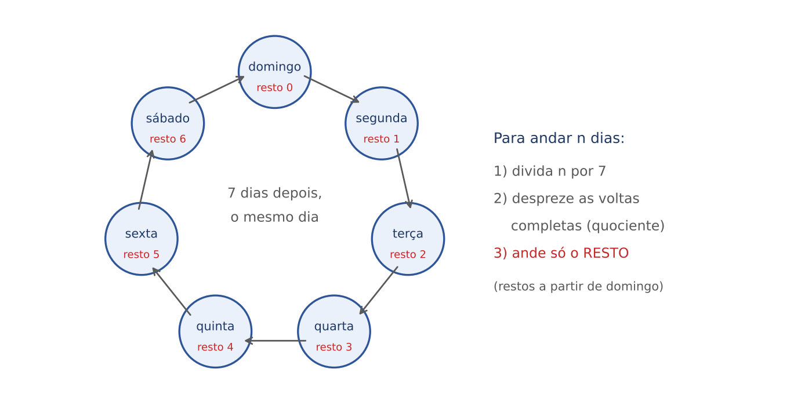

### 22.1.2 Divisão com resto, feita à mão

Lembrete do Cap. 1: dividir 100 por 7 é perguntar "quantas vezes o 7 cabe inteiro dentro do 100, e quanto sobra".

- 7 × 14 = 98 (o 7 cabe 14 vezes).
- 100 − 98 = 2 (sobram 2).
- Logo: 100 = 7 × 14 + 2. O quociente é 14 (voltas completas) e o resto é 2.

O resto é sempre MENOR que o divisor. Na divisão por 7, o resto só pode ser 0, 1, 2, 3, 4, 5 ou 6. Se você achou resto 8, ainda cabe mais um 7.

Para números grandes, sem calculadora, a técnica mais segura é "arrancar" múltiplos redondos de 7. Os mais úteis são 7, 70, 700, 7.000 e 70.000, e também 14, 21, 28, 35, 42, 49, 56, 63.

:::EXEMPLO Resto de 10.737 na divisão por 7, sem armar a conta
- 10.737 = 7.000 + 3.737 (arrancamos 7.000, que é múltiplo de 7).
- 3.737 = 3.500 + 237 (3.500 = 7 × 500).
- 237 = 210 + 27 (210 = 7 × 30).
- 27 = 21 + 6 (21 = 7 × 3).
- Tudo o que arrancamos é múltiplo de 7; o que sobrou no fim é 6.
- Resto: 6. (Conferência: 7 × 1.533 = 10.731; 10.737 − 10.731 = 6.)
:::

:::DICA Restos que valem a pena memorizar
- 30 dias deixam resto 2 (30 = 28 + 2).
- 31 dias deixam resto 3 (31 = 28 + 3).
- 365 dias deixam resto 1 (365 = 364 + 1, e 364 = 7 × 52).
- 366 dias deixam resto 2.
- 100 deixa resto 2; 1.000 deixa resto 6 (1.000 = 994 + 6).
:::

### 22.1.3 O roteiro universal

:::PASSO Como resolver qualquer questão de ciclo
1. Descubra o tamanho do ciclo (7 para dias da semana; 12 horas para ponteiros; 360 graus para giros; o número de dias da escala de trabalho).
2. Descubra QUANTAS posições é preciso andar (cuidado com "daqui a n dias" e "o n-ésimo dia", ver 22.2.1).
3. Divida esse número pelo tamanho do ciclo e fique só com o resto.
4. Ande o resto a partir do ponto de partida, para frente (futuro) ou para trás (passado).
5. Confira com um caso pequeno (por exemplo, "daqui a 7 dias" tem de dar o mesmo dia de hoje).
:::

## 22.2 Calendários

### 22.2.1 Que dia da semana será daqui a n dias?

A ideia, com um exemplo à mão. Hoje é quarta-feira. Que dia será daqui a 10 dias? Contando nos dedos: quinta (1), sexta (2), sábado (3), domingo (4), segunda (5), terça (6), quarta (7), quinta (8), sexta (9), sábado (10). Resposta: sábado.

Agora sem dedos:

- 10 ÷ 7 = 1, resto 3.
- A volta completa (7 dias) devolve a quarta-feira.
- Andamos só os 3 do resto: quinta, sexta, sábado.
- Resposta: sábado. Mesma coisa, sem contar dez dedos.

:::EXEMPLO A prova da SEFAZ/SC
Hoje, 30/10/2026, é sexta-feira. A prova será em 22/11/2026. Que dia da semana é esse?
- Dias de 30/10 a 31/10: 1 dia.
- Dias de 31/10 a 22/11: 22 dias.
- Total: 1 + 22 = 23 dias.
- 23 ÷ 7 = 3, resto 2.
- Sexta + 2 = domingo.
- A prova cai num domingo.
:::

Para o passado, anda-se para trás. Hoje é segunda-feira; que dia foi há 45 dias? 45 ÷ 7 = 6, resto 3. Três dias para trás: domingo (1), sábado (2), sexta (3). Foi uma sexta-feira.

:::PEGADINHA "Daqui a n dias" não é "o n-ésimo dia"
"Daqui a 10 dias" significa andar 10 casas a partir de hoje. Já "o 10º dia, contando hoje como o 1º" significa andar só 9 casas, porque o primeiro dia não exige nenhum passo. Do mesmo modo, "o dia 15 do mês" está 14 dias depois do dia 1, e não 15. A FCC e a FGV gostam de alternativas que nascem desse erro de uma casa. Teste mental: o dia 8 do mês cai no mesmo dia da semana do dia 1 (8 − 1 = 7).
:::

:::QUESTAO FGV 2025 — Prefeitura do Rio de Janeiro — Gestor de Segurança Municipal (Q3782886)
Problema: se daqui a 2 dias for quinta-feira, que dia da semana será daqui a 10.737 dias? Gabarito oficial: A (segunda-feira).
Resolução passo a passo:
- Primeiro, descobrir HOJE. Se daqui a 2 dias é quinta, hoje é dois dias antes: terça-feira.
- Resto de 10.737 por 7: 6 (conta feita no EXEMPLO de 22.1.2).
- Terça + 6: quarta (1), quinta (2), sexta (3), sábado (4), domingo (5), segunda (6).
- Resposta: segunda-feira.
Atalho: andar 6 para frente é o mesmo que andar 1 para trás (6 = 7 − 1). Terça menos um dia: segunda.
Alternativas sedutoras: quinta-feira (C) nasce de esquecer de achar "hoje" e partir da quinta com resto 0 ou 7; quarta-feira (B) nasce de partir da quinta e andar 6. Sempre fixe primeiro o ponto de partida.
:::

:::QUESTAO FGV 2025 — Empresa de engenharia (Q3758077)
Problema: uma placa diz que a obra será concluída daqui a 1.531 dias; daqui a 1 dia será quarta-feira. Em que dia da semana a obra termina? Gabarito oficial: A (domingo).
Resolução:
- Hoje: um dia antes da quarta, ou seja, terça-feira.
- 1.531 = 1.400 + 131; 131 = 126 + 5 (126 = 7 × 18). Resto: 5.
- Terça + 5: quarta, quinta, sexta, sábado, domingo.
- Resposta: domingo.
Por que as outras atraem: partir da quarta (em vez da terça) e andar 5 dá segunda-feira (D), alternativa montada para quem não recua um dia.
:::

:::QUESTAO FGV 2025 — Corpus Christi (Q3275689)
Problema: Corpus Christi é celebrado 60 dias depois da Páscoa, que é sempre um domingo. Em que dia cai? Gabarito oficial: C (quinta-feira).
Resolução:
- 60 ÷ 7 = 8, resto 4 (7 × 8 = 56; 60 − 56 = 4).
- Domingo + 4: segunda, terça, quarta, quinta.
- Resposta: quinta-feira (e, de fato, o feriado de Corpus Christi é sempre numa quinta).
:::

Uma variação curiosa: e se a semana tivesse outro tamanho? O raciocínio é idêntico; só muda o divisor.

:::QUESTAO FGV 2025 — Semana de 8 dias (Q3174746)
Problema: um país criou a "7ª feira", entre a 6ª feira e o sábado, e a semana passou a ter 8 dias. O dia 1º/1/2025 caiu numa 4ª feira. Em que dia caiu 31/12/2025? Gabarito oficial: D (sábado).
Resolução:
- 2025 não é bissexto (ver 22.2.3): 365 dias.
- Do dia 1º/1 (1º dia do ano) ao dia 31/12 (365º dia) andam-se 364 casas (pegadinha do n-ésimo dia).
- Ciclo de 8: 364 ÷ 8 = 45, resto 4 (8 × 45 = 360).
- A semana nova é: domingo, 2ª, 3ª, 4ª, 5ª, 6ª, 7ª, sábado.
- 4ª feira + 4: 5ª (1), 6ª (2), 7ª (3), sábado (4).
- Resposta: sábado.
Erro típico: dividir 365 (em vez de 364) por 8 dá resto 5 e leva a "domingo" (E).
:::

:::PRATIQUE exercícios elaborados para esta apostila
1. Hoje é sábado. Que dia será daqui a 50 dias?
2. Hoje é segunda-feira. Que dia foi há 30 dias?
3. Certo 1º de março caiu numa quinta-feira. Que dia da semana será 1.000 dias depois?
4. Um inventário de bens começou numa terça-feira, que foi o 1º dia de trabalho, e se estendeu por 90 dias corridos. Em que dia da semana caiu o 90º dia?
Resoluções:
1. 50 = 49 + 1, resto 1. Sábado + 1 = domingo.
2. 30 = 28 + 2, resto 2. Dois dias para trás a partir da segunda: domingo (1), sábado (2). Foi um sábado.
3. 1.000 = 994 + 6, resto 6. Quinta + 6 é o mesmo que quinta − 1: quarta-feira.
4. O 90º dia está 89 casas depois do 1º. 89 = 84 + 5, resto 5. Terça + 5: quarta, quinta, sexta, sábado, domingo. Resposta: domingo. (Quem andar 90 casas, resto 6, erra para segunda-feira.)
:::

### 22.2.2 Os meses e o "salto" de cada um

Os meses têm 28, 29, 30 ou 31 dias. Uma forma antiga de lembrar: feche as mãos e conte nos nós dos dedos e nos vãos entre eles, começando por janeiro no primeiro nó. Os meses que caem nos NÓS têm 31 dias; os que caem nos VÃOS têm 30 (ou 28/29, se for fevereiro). Julho cai no último nó de uma mão e agosto no primeiro nó da outra: por isso ambos têm 31.

| Mês | Dias | Resto por 7 ("salto") | Efeito no dia 1º do mês seguinte |
|---|---|---|---|
| janeiro, março, maio, julho, agosto, outubro, dezembro | 31 | 3 | anda 3 dias da semana |
| abril, junho, setembro, novembro | 30 | 2 | anda 2 dias |
| fevereiro comum | 28 | 0 | o mesmo dia da semana |
| fevereiro bissexto | 29 | 1 | anda 1 dia |

Exemplo à mão: se 1º de abril é segunda-feira, abril tem 30 dias, salto 2, e 1º de maio é quarta-feira. Conferência: o dia 29 de abril é segunda (29 − 1 = 28, múltiplo de 7), 30 de abril é terça e 1º de maio é quarta.

:::QUESTAO FGV 2024 — Raciocínio analítico (Q2456232)
Problema: certo ano, 1º de agosto cai num domingo. Em que dia cairá 1º de novembro? Gabarito oficial: C (segunda-feira).
Resolução:
- Meses inteiros entre as duas datas: agosto (31), setembro (30) e outubro (31).
- Saltos: 3 + 2 + 3 = 8.
- 8 = 7 + 1, resto 1.
- Domingo + 1 = segunda-feira.
Conferência pelo total de dias: 31 + 30 + 31 = 92; 92 = 91 + 1, resto 1. Mesmo resultado.
Erro típico: somar só agosto e setembro (salto 5) leva a sexta-feira (E).
:::

:::QUESTAO FGV 2026 — Maio com cinco quartas-feiras (Q4086748)
Problema: certo ano, maio teve 5 quartas-feiras e 4 quintas-feiras. Em que dia da semana caiu 15 de maio? Gabarito oficial: C (segunda-feira).
A ideia: um mês de 31 dias tem 4 semanas completas (28 dias) e mais 3 dias. Cada dia da semana aparece pelo menos 4 vezes; os 3 dias que "sobram" aparecem 5 vezes. E esses 3 dias são exatamente os dias da semana em que caíram os dias 1, 2 e 3 do mês (porque os dias 29, 30 e 31 repetem os dias da semana de 1, 2 e 3).
Resolução:
- Quarta aparece 5 vezes; quinta, só 4. Logo, quarta está entre os 3 dias extras, e quinta não.
- Os 3 dias extras são consecutivos. Se a quarta é o último deles (porque o seguinte, quinta, ficou de fora), os três são: segunda, terça e quarta.
- Então 1º de maio foi segunda-feira.
- 15 de maio está 14 dias depois do dia 1 (resto 0): também segunda-feira.
:::

:::DICA Quantas vezes cada dia da semana aparece
- Mês de 31 dias: 3 dias da semana aparecem 5 vezes (os dos dias 1, 2 e 3).
- Mês de 30 dias: 2 dias da semana aparecem 5 vezes (os dos dias 1 e 2).
- Fevereiro de 28: todos aparecem 4 vezes. Fevereiro de 29: um aparece 5 vezes (o do dia 1º).
- Ano comum (365 = 52 semanas + 1 dia): um dia da semana aparece 53 vezes, o do 1º de janeiro. Ano bissexto: dois dias aparecem 53 vezes, os de 1º e 2 de janeiro.
- Exemplo real: 1º/1/2026 foi quinta-feira e 2026 não é bissexto; logo, 2026 tem 53 quintas-feiras.
:::

### 22.2.3 Anos bissextos

A ideia. A Terra leva cerca de 365 dias e um quarto para dar a volta no Sol. Para não deixar o calendário escorregar, acrescenta-se um dia (29 de fevereiro) a cada quatro anos. Mas um quarto de dia é um pouquinho mais do que a diferença real, e por isso há uma correção a cada cem anos.

A regra do calendário gregoriano, em forma de teste:

- O ano é divisível por 4? Se não, NÃO é bissexto (2026 não é; 2027 não é).
- Se é divisível por 4 e NÃO termina em 00, é bissexto (2024 e 2028 são).
- Se termina em 00, só é bissexto se for divisível por 400 (2000 foi; 1900 não foi; 2100 não será).

Dica de memória: os anos de Olimpíadas de verão costumam ser bissextos (2016, 2020, 2024, 2028), mas use a regra, não a dica (Tóquio foi realizada em 2021).

Teste rápido de divisibilidade por 4: basta olhar os dois últimos algarismos. 2028 termina em 28, e 28 é divisível por 4; logo, 2028 é divisível por 4.

O efeito sobre o dia da semana. Um ano comum tem 365 dias, resto 1; um bissexto tem 366, resto 2. Então a mesma data, no ano seguinte, anda 1 dia da semana, ou 2, se entre as duas datas houver um 29 de fevereiro.

:::EXEMPLO Natal em três anos seguidos
- 25/12/2026 é sexta-feira.
- Até 25/12/2027 há 365 dias (o fevereiro do meio, de 2027, tem 28). Anda 1: sábado.
- Até 25/12/2028 há 366 dias, porque no caminho existe 29/2/2028. Anda 2: segunda-feira.
O que manda não é "o ano ser bissexto", mas o 29 de fevereiro estar ENTRE as duas datas. De 1º/1/2028 a 1º/1/2029 anda-se 2 (sábado para segunda), porque 29/2/2028 está no meio; de 1º/3/2028 a 1º/3/2029 anda-se só 1, porque o 29/2 ficou para trás.
:::

:::QUESTAO FGV 2025 — TCE-RR — Auditor Substituto de Conselheiro (Q3174644)
Problema: 2024 foi bissexto. Gabriel dividiu o ano em três partes com o mesmo número de dias; a primeira começou em 1º/1, uma segunda-feira. Em que dia começou a segunda parte? Gabarito oficial: B (quinta-feira).
Resolução:
- 2024 tem 366 dias. Cada parte: 366 ÷ 3 = 122 dias.
- A primeira parte ocupa os dias 1 a 122; a segunda começa no 123º dia.
- Do 1º ao 123º dia andam-se 122 casas.
- 122 = 119 + 3 (119 = 7 × 17). Resto 3.
- Segunda + 3: terça, quarta, quinta.
- Resposta: quinta-feira.
Erro típico: andar 123 casas (resto 4) leva a sexta-feira (C); usar 365 dias quebra a divisão por 3.
:::

### 22.2.4 Contar os dias entre duas datas

A ideia. Para saber quantos dias vão de 10/3 a 25/5 do mesmo ano, contamos mês a mês:

- Restam em março, depois do dia 10: 31 − 10 = 21 dias (os dias 11 a 31).
- Abril inteiro: 30 dias.
- Maio até o dia 25: 25 dias.
- Total: 21 + 30 + 25 = 76 dias.

Essa contagem exclui o dia de partida e inclui o de chegada, exatamente como o art. 224 do CPC manda contar os prazos processuais ("excluindo o dia do começo e incluindo o dia do vencimento"). Se a questão disser "contando o primeiro e o último dia" (por exemplo, a duração de um evento que ocupa os dois dias), soma-se 1: 77 dias.

:::ATENCAO Inclusivo ou exclusivo?
Uma conferência que vai de 10 a 12 de agosto dura 3 dias (10, 11 e 12), embora 12 − 10 = 2. Um contrato de 10 a 12 tem prazo de 2 dias. Leia o enunciado e pergunte: "o primeiro dia conta?". É a mesma lógica do problema das cercas: 10 postes em linha formam 9 intervalos.
:::

:::PRATIQUE exercícios elaborados para esta apostila
1. Num ano comum, 1º de janeiro foi quinta-feira. Em que dia cairá 1º de janeiro do ano seguinte?
2. Certo ano, 1º de março foi domingo. Em que dia caiu 1º de junho?
3. Quantos dias há de 15/2/2028 a 15/3/2028 (excluindo o dia inicial e incluindo o final)?
4. Quais destes anos são bissextos: 1900, 2000, 2026, 2100?
Resoluções:
1. 365 deixa resto 1. Quinta + 1 = sexta-feira. (É o que ocorre de 2026 para 2027.)
2. Março (31), abril (30) e maio (31): saltos 3 + 2 + 3 = 8, resto 1. Domingo + 1 = segunda-feira.
3. 2028 é bissexto (28 é divisível por 4), e fevereiro de 2028 tem 29 dias. Restam em fevereiro: 29 − 15 = 14 dias; em março, até o dia 15: 15 dias. Total: 14 + 15 = 29 dias.
4. Só 2000. 1900 e 2100 terminam em 00 e não são divisíveis por 400; 2026 não é divisível por 4.
:::

### 22.2.5 Eventos periódicos: remédios, escalas e metas

A ideia. "Dia sim, dia não" quer dizer: um evento a cada 2 dias. Se o 1º comprimido é tomado hoje, o 2º será daqui a 2 dias, o 3º daqui a 4, e o n-ésimo daqui a (n − 1) × 2 dias. A mesma lógica das cercas: entre 100 comprimidos há 99 intervalos.

:::QUESTAO FGV 2024 — Remédio em dias alternados (Q2375654)
Problema: 1 comprimido dia sim, dia não; caixa com 100 comprimidos; o primeiro foi tomado numa segunda-feira. Em que dia será tomado o último? Gabarito oficial: A (quarta-feira).
Resolução:
- Intervalos entre o 1º e o 100º comprimido: 100 − 1 = 99.
- Cada intervalo tem 2 dias: 99 × 2 = 198 dias.
- 198 = 196 + 2 (196 = 7 × 28). Resto 2.
- Segunda + 2 = quarta-feira.
Erro típico: fazer 100 × 2 = 200 (resto 4) leva a sexta-feira (C).
No mesmo sentido: Q3578670 (FGV 2025, 60 pílulas a partir de uma segunda-feira): (60 − 1) × 2 = 118 dias; 118 = 112 + 6, resto 6; segunda + 6 = domingo. Gabarito oficial: E (domingo).
:::

Quando o evento não é uniforme ao longo da semana, trabalhe com "semanas cheias" e depois com os dias soltos.

:::QUESTAO FGV 2024 — Treino de flexões (Q2450509)
Problema: de segunda a sexta, 20 flexões por dia; sábado e domingo, 10 por dia. O treino começa numa segunda-feira e termina quando o total chegar a 3.200. Em que dia termina? Gabarito oficial: B (quinta-feira).
Resolução:
- Uma semana cheia: 5 × 20 + 2 × 10 = 100 + 20 = 120 flexões.
- Quantas semanas cheias cabem em 3.200? 120 × 26 = 3.120; 120 × 27 = 3.240 (passa). Então 26 semanas cheias e faltam 3.200 − 3.120 = 80 flexões.
- Depois de 26 semanas, o treino recomeça numa segunda-feira.
- Segunda: 20 (faltam 60). Terça: 20 (faltam 40). Quarta: 20 (faltam 20). Quinta: 20 (faltam 0).
- Termina numa quinta-feira.
:::

:::QUESTAO FGV 2024 — Escala de trabalho (Q3043771)
Problema: a escala de Anatólia é "trabalha 1, folga 1, trabalha 2, folga 2", repetida. Hoje é domingo, ela trabalha, e folgou ontem e anteontem. Quantos dias ela trabalhará, contando hoje, até folgar numa segunda e numa terça seguidas? Gabarito oficial: B (12).
Resolução:
- Como ela acabou de cumprir as duas folgas, hoje é o início do padrão. Numere os dias a partir de hoje (dia 0 = domingo).
- O padrão tem 6 dias: posição 0 trabalha, 1 folga, 2 e 3 trabalha, 4 e 5 folga. A folga dupla ocupa as posições 4 e 5 de cada ciclo, ou seja, os dias 4, 10, 16, 22, 28... (somando 6).
- Esses dias precisam ser segundas-feiras. O dia d é segunda quando d deixa resto 1 na divisão por 7 (dia 1, 8, 15, 22...).
- O primeiro número que aparece nas duas listas é 22. No dia 22 (segunda) e no dia 23 (terça) ela folga.
- Dias trabalhados de 0 a 21: três ciclos completos (dias 0 a 17) com 3 dias de trabalho cada = 9; dias 18 a 21 correspondem às posições 0, 1, 2 e 3 (trabalha, folga, trabalha, trabalha) = 3.
- Total: 9 + 3 = 12.
:::

:::QUESTAO FGV 2025 — Esportes da semana (Q3579010)
Problema: Adriana pratica um esporte por dia, todas as semanas do mesmo modo. Rema 3 dias, nunca consecutivos; corre às quartas; faz stand-up dois dias depois (sexta); também nada e joga beach-tennis, mas nunca joga beach-tennis no dia seguinte a nadar ou remar. Em que dia ela nada? Gabarito oficial: B (segunda-feira).
Resolução:
- Dias livres: domingo, segunda, terça, quinta e sábado. Neles cabem 3 de remo, 1 de natação e 1 de beach-tennis.
- Como a rotina se repete toda semana, sábado e domingo SÃO consecutivos (é a semana como ciclo de 22.1). Os trios de remo sem dias vizinhos são: {domingo, terça, quinta}, {segunda, quinta, sábado} e {terça, quinta, sábado}.
- {segunda, quinta, sábado}: sobram domingo e terça. Beach-tennis no domingo viria depois do remo de sábado; na terça, depois do remo de segunda. Impossível.
- {terça, quinta, sábado}: sobram domingo e segunda. Beach-tennis no domingo viria depois do remo de sábado; na segunda, depois de domingo, que seria natação. Impossível.
- {domingo, terça, quinta}: sobram segunda e sábado. Beach-tennis na segunda viria depois do remo de domingo (proibido); no sábado, vem depois do stand-up de sexta (permitido). Então beach-tennis no sábado e natação na segunda.
- Resposta: segunda-feira.
Lição: quem trata a semana como uma linha (sem ligar sábado ao domingo) encontra uma segunda solução, com natação na terça (C). A rotina semanal é um CICLO.
:::

## 22.3 Horas, minutos e relógios

### 22.3.1 A conta em base 60

A ideia. O dinheiro é contado em base 10: 100 centavos fazem 1 real. O tempo é contado em base 60: 60 segundos fazem 1 minuto, e 60 minutos fazem 1 hora. Por isso a conta "de cabeça" com horas tropeça: 1h50 + 20 min não é 1h70, é 2h10.

As relações que você precisa:

- 1 dia = 24 horas.
- 1 hora = 60 minutos = 3.600 segundos.
- 1 minuto = 60 segundos.

Há dois métodos seguros para somar e subtrair horários.

Método 1, "vai um" de 60 em 60. Some minutos com minutos e horas com horas; se os minutos passarem de 59, troque 60 minutos por 1 hora.

:::EXEMPLO Somar: 8h47 + 2h38
- Minutos: 47 + 38 = 85.
- 85 minutos = 60 + 25 = 1 hora e 25 minutos.
- Horas: 8 + 2 + 1 (a hora que "veio" dos minutos) = 11.
- Resultado: 11h25.
:::

:::EXEMPLO Subtrair: 14h10 − 9h45
- Os minutos de cima (10) são menores que os de baixo (45). "Pegamos emprestada" 1 hora: 14h10 vira 13h70.
- Minutos: 70 − 45 = 25.
- Horas: 13 − 9 = 4.
- Resultado: 4h25.
:::

Método 2, tudo em minutos. Converta os horários em minutos desde a meia-noite (horas × 60 + minutos), faça a conta e volte. É mais lento, mas não falha, e é o melhor para médias.

- 14h10 = 14 × 60 + 10 = 840 + 10 = 850 minutos.
- 9h45 = 9 × 60 + 45 = 540 + 45 = 585 minutos.
- 850 − 585 = 265 minutos.
- 265 = 240 + 25 = 4 horas (240 minutos) e 25 minutos.

:::PEGADINHA 2,4 horas NÃO são 2h40
A parte decimal de uma hora é fração de 60, não de 100. 0,4 hora = 0,4 × 60 = 24 minutos. Logo, 2,4 horas = 2h24. Do mesmo modo, 0,5 h = 30 min; 0,25 h = 15 min; 0,75 h = 45 min; 0,1 h = 6 min. A FCC e a FGV colocam "2h40" entre as alternativas justamente para quem lê a vírgula como se fosse o "h".
:::

:::QUESTAO FCC 2025 — TRT 1ª Região (RJ) — Analista Judiciário — Área Judiciária (Q3445882)
Problema: um juiz anotou o início e o fim da análise de 5 processos: 8h36 a 10h10; 10h24 a 12h35; 14h15 a 15h33; 15h40 a 16h45; 17h20 a 19h32. O tempo médio por processo foi de uma hora e quantos minutos? Gabarito oficial: B (quarenta minutos).
Resolução passo a passo (método 2, em minutos):
- Processo 1: de 8h36 a 10h10. De 8h36 a 9h00 são 24 min; de 9h00 a 10h10 são 70 min. Total: 94 min.
- Processo 2: de 10h24 a 12h35. De 10h24 a 12h24 são 120 min; mais 11 min. Total: 131 min.
- Processo 3: de 14h15 a 15h33. De 14h15 a 15h15 são 60 min; mais 18. Total: 78 min.
- Processo 4: de 15h40 a 16h45. De 15h40 a 16h40 são 60 min; mais 5. Total: 65 min.
- Processo 5: de 17h20 a 19h32. De 17h20 a 19h20 são 120 min; mais 12. Total: 132 min.
- Soma: 94 + 131 + 78 + 65 + 132 = 500 min.
- Média: 500 ÷ 5 = 100 min = 60 + 40 = 1 hora e 40 minutos.
Técnica usada: "pular para a hora cheia" (8h36 até 9h00) e depois contar horas inteiras evita o empréstimo de 60.
Alternativas sedutoras: quem soma as horas e os minutos separadamente e esquece de converter o excesso de minutos chega a números como 1h36 ou 1h44, ambos presentes nas alternativas. Os intervalos entre os processos (10h10 a 10h24 etc.) não entram na conta: a média é do tempo de ANÁLISE.
No mesmo sentido (mesma questão, publicada com alternativas em outra ordem): Q3469407 (FCC 2025, TRT 1ª Região, Oficial de Justiça Avaliador Federal), gabarito oficial A (quarenta minutos).
:::

:::QUESTAO FGV 2025 — Tarefas de igual duração (Q3579008)
Problema: Solange fez 3 tarefas seguidas, sem intervalo, todas com a mesma duração. Começou a 1ª às 13h20 e terminou a 2ª às 16h12. A que horas terminou a 3ª? Gabarito oficial: B (17h38).
Resolução:
- De 13h20 a 16h12: de 13h20 a 16h20 seriam 3 h = 180 min; como terminou 8 min antes, 180 − 8 = 172 min.
- Esses 172 min correspondem a DUAS tarefas: cada uma dura 172 ÷ 2 = 86 min = 1h26.
- Fim da 3ª: 16h12 + 1h26. Minutos: 12 + 26 = 38. Horas: 16 + 1 = 17. Resultado: 17h38.
Erro típico: dividir 172 por 3 (achando que já eram três tarefas).
:::

:::QUESTAO FGV 2024 — Almoço no meio do expediente (Q3090454)
Problema: Tiago entrou às 8h42, saiu às 17h00, almoçou 50 min depois do meio-dia e trabalhou o mesmo tempo antes e depois do almoço. A que horas saiu para almoçar? Gabarito oficial: D (12h26).
Resolução:
- Permanência total: de 8h42 a 17h00. De 8h42 a 9h00 são 18 min; de 9h00 a 17h00, 8 h = 480 min. Total: 498 min.
- Tempo de trabalho: 498 − 50 = 448 min.
- Metade antes do almoço: 448 ÷ 2 = 224 min = 180 + 44 = 3h44.
- Saída para o almoço: 8h42 + 3h44. Minutos: 42 + 44 = 86 = 1h26. Horas: 8 + 3 + 1 = 12. Resultado: 12h26.
:::

:::QUESTAO FGV 2025 — Quem abre e quem fecha (Q3777201)
Problema: Bernardo abre o escritório e Danilo o fecha. Num dia, Bernardo ficou 7h50, Danilo 8h15, e os dois estiveram juntos 5h25. Bernardo chegou às 8h25. A que horas Danilo saiu? Gabarito oficial: E (19h05).
Resolução (desenhe uma linha do tempo: Bernardo chega primeiro, Danilo sai por último):
- Bernardo sai às 8h25 + 7h50. Minutos: 25 + 50 = 75 = 1h15. Horas: 8 + 7 + 1 = 16. Saída: 16h15.
- O período em que estão juntos vai da chegada de Danilo até a saída de Bernardo. Logo, Danilo chegou 5h25 antes das 16h15: 16h15 − 5h25. Empréstimo: 15h75 − 5h25 = 10h50.
- Danilo sai às 10h50 + 8h15 = 18h65 = 19h05.
:::

:::QUESTAO FGV 2024 — O ponto de ônibus (Q3047219)
Problema: cheguei ao ponto 3 min 20 s depois de o ônibus passar. Se tivesse chegado 90 s depois, teria esperado 640 s pelo próximo. Em que momento, depois da passagem do primeiro, eu deveria chegar para esperar só 2 min 20 s? Gabarito oficial: E (13 min 10 s).
Resolução (tudo em segundos):
- 3 min 20 s = 180 + 20 = 200 s.
- Chegando 90 s depois: 200 + 90 = 290 s após o 1º ônibus.
- Esperaria mais 640 s: o próximo ônibus passa 290 + 640 = 930 s após o primeiro.
- Para esperar 2 min 20 s = 140 s, é preciso chegar 930 − 140 = 790 s após o primeiro.
- 790 s = 13 × 60 + 10 = 13 min 10 s.
:::

:::PRATIQUE exercícios elaborados para esta apostila
1. Uma audiência começou às 13h50 e durou 2h35. A que horas terminou?
2. Três sessões consecutivas, de 1h48 cada, começam às 9h15. A que horas termina a última?
3. Escreva 3,75 horas em horas e minutos.
4. Uma sessão começou às 9h40 e terminou às 12h05, com dois intervalos de 15 minutos. Qual foi o tempo efetivo de trabalho?
Resoluções:
1. Minutos: 50 + 35 = 85 = 1h25. Horas: 13 + 2 + 1 = 16. Término: 16h25.
2. Duração total: 3 × 1h48 = 3h144min; 144 min = 2h24; total 5h24. Fim: 9h15 + 5h24 = 14h39.
3. 0,75 × 60 = 45 minutos. Resposta: 3h45.
4. De 9h40 a 12h05: de 9h40 a 12h00 são 2h20, mais 5 min, total 2h25 = 145 min. Menos 2 × 15 = 30 min: 115 min = 1h55.
:::

### 22.3.2 O ângulo entre os ponteiros

A ideia. O mostrador é um círculo de 360 graus dividido em 12 números. Entre dois números consecutivos há 360 ÷ 12 = 30 graus. Às 3h00 em ponto, o ponteiro dos minutos está no 12 e o das horas no 3: três "casas" de 30 graus, ou seja, 90 graus.

A dificuldade aparece quando os minutos não são zero, porque o ponteiro das horas TAMBÉM anda. Às 3h30 ele não está mais no 3: está a meio caminho entre o 3 e o 4.

Quanto anda cada ponteiro por minuto:

- Ponteiro dos minutos: dá a volta inteira (360 graus) em 60 minutos. Anda 360 ÷ 60 = 6 graus por minuto.
- Ponteiro das horas: anda uma casa (30 graus) em 60 minutos. Anda 30 ÷ 60 = 0,5 grau por minuto.

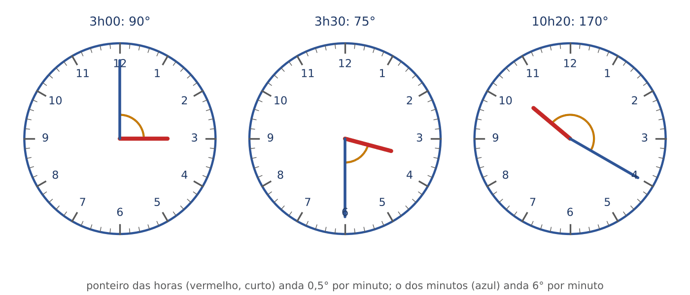

:::EXEMPLO O ângulo às 3h30, calculado à mão
- Posição do ponteiro das horas, medida a partir do 12: 3 casas inteiras (3 × 30 = 90 graus) mais 30 minutos de avanço (30 × 0,5 = 15 graus). Total: 105 graus.
- Posição do ponteiro dos minutos: 30 minutos × 6 = 180 graus (ele está no 6).
- Diferença: 180 − 105 = 75 graus.
:::

Juntando os dois movimentos numa fórmula só: a posição das horas é 30 × h + 0,5 × m; a dos minutos é 6 × m. A diferença é 30 × h + 0,5 × m − 6 × m = 30 × h − 5,5 × m.

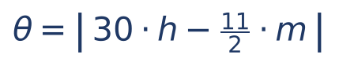

- θ (letra grega "teta") = o ângulo entre os ponteiros, em graus.
- h = a hora marcada (de 0 a 12; para 15h, use 3).
- m = os minutos marcados.
- 11/2 = 5,5 = a velocidade com que o ponteiro dos minutos "ganha" do das horas (6 − 0,5).
- As barras verticais | | significam "valor absoluto": se der negativo, despreze o sinal.
- Se o resultado passar de 180, a questão normalmente quer o MENOR ângulo: faça 360 menos o resultado.

:::EXEMPLO Aplicando a fórmula
- 3h30: |30 × 3 − 5,5 × 30| = |90 − 165| = |−75| = 75 graus. (Confere com o cálculo à mão.)
- 10h20: |30 × 10 − 5,5 × 20| = |300 − 110| = 190. Como passou de 180: 360 − 190 = 170 graus.
- 9h45: |270 − 247,5| = 22,5 graus. (Às 9h45 o ponteiro das horas já está quase no 10; por isso o ângulo é pequeno, e não 0.)
:::

Quando os ponteiros se sobrepõem? Quando o ângulo é zero: 30 × h = 5,5 × m. Entre 2h e 3h: 60 = 5,5 × m; m = 60 ÷ 5,5 = 120 ÷ 11 = 10 e 10/11 minutos (cerca de 10 min 54,5 s). Os ponteiros se sobrepõem 11 vezes em 12 horas (e não 12), porque entre 11h e 1h a sobreposição é uma só, ao meio-dia. Em 24 horas, 22 vezes.

:::PEGADINHA O ângulo "redondo" das alternativas
Às 2h20, quem esquece que o ponteiro das horas andou responde 60 graus (de 2 para 4 são duas casas). O certo é |60 − 110| = 50 graus: o ponteiro das horas avançou 20 × 0,5 = 10 graus em direção ao 4.
:::

### 22.3.3 Relógios adiantados, atrasados e no espelho

A ideia. Um relógio que "adianta 3 minutos por hora" mostra 63 minutos a cada 60 minutos reais. É uma regra de três (Cap. 1, 01.5).

:::EXEMPLO Relógio adiantado
Um relógio adianta 3 min por hora e foi acertado ao meio-dia. Que horas ele marca às 20h reais?
- Tempo real decorrido: 20h − 12h = 8 horas.
- Adiantamento acumulado: 8 × 3 = 24 min.
- O relógio marca 20h24.
:::

:::EXEMPLO Relógio atrasado (a pergunta ao contrário)
Um relógio atrasa 4 min por hora e foi acertado às 6h. Ele agora marca 13h. Que horas são de verdade?
- Para cada 60 min reais, o relógio anda só 56 min.
- O relógio andou de 6h a 13h: 7 h = 420 min "do relógio".
- Regra de três: 56 min do relógio correspondem a 60 min reais; 420 min do relógio correspondem a x. x = 420 × 60 ÷ 56 = 25.200 ÷ 56 = 450 min reais.
- 450 min = 7h30. Hora real: 6h + 7h30 = 13h30.
Cuidado: o erro tentador é fazer 7 × 4 = 28 min e responder 13h28. Isso só vale quando se parte da hora REAL; aqui o dado é a hora do relógio.
:::

O relógio de ponteiros visto no espelho. O espelho troca direita e esquerda; o 3 aparece onde estaria o 9. Regra prática: a hora real é 11h60 menos a hora que se vê (ou seja, 12h00 menos a hora vista). Vê-se 4h20 no espelho: 11h60 − 4h20 = 7h40.

:::PRATIQUE exercícios elaborados para esta apostila
1. Qual o menor ângulo entre os ponteiros às 7h30?
2. Entre 4h e 5h, a que horas os ponteiros se sobrepõem (aproximadamente)?
3. Um relógio adianta 5 min por hora e foi acertado às 8h. Que horas ele marca às 14h reais?
4. Num espelho, um relógio de ponteiros parece marcar 2h45. Que horas são?
Resoluções:
1. |30 × 7 − 5,5 × 30| = |210 − 165| = 45 graus.
2. Sobreposição: 30 × 4 = 5,5 × m; 120 = 5,5 × m; m = 120 ÷ 5,5 = 240 ÷ 11 = 21 e 9/11 min. Como 9/11 de minuto é cerca de 49 s: aproximadamente 4h21min49s.
3. Passaram 6 horas reais; adiantou 6 × 5 = 30 min. Marca 14h30.
4. 11h60 − 2h45 = 9h15.
:::

### 22.3.4 Encontros e ultrapassagens

A ideia. Dois veículos vindo um contra o outro "comem" a distância juntos: as velocidades se SOMAM. Se um carro anda 60 km por hora e outro 40, em sentidos opostos, a distância entre eles diminui 100 km a cada hora.

Truque que dispensa saber a distância: chame a distância total de 1 (o percurso inteiro) e meça as velocidades em "percurso por hora". Quem faz a viagem em 4 horas anda 1/4 do percurso por hora.

:::QUESTAO FGV 2025 — SEFAZ-PR — Auditor Fiscal (Q3363337)
Problema: um ônibus sai de A às 6h e chega a B às 10h; outro sai de B às 9h e chega a A às 11h, pela mesma estrada, com velocidades constantes. A que horas se cruzam? Gabarito oficial: D (9h20).
Resolução:
- Ônibus 1: 4 horas de viagem; anda 1/4 do percurso por hora.
- Ônibus 2: 2 horas de viagem; anda 1/2 do percurso por hora.
- Às 9h (quando o 2º parte), o 1º já rodou 3 horas: 3 × 1/4 = 3/4 do percurso. Falta 1/4 entre eles.
- Juntos, eles fecham 1/4 + 1/2 = 1/4 + 2/4 = 3/4 do percurso por hora.
- Tempo para fechar 1/4: (1/4) ÷ (3/4) = 1/4 × 4/3 = 1/3 de hora = 20 minutos.
- Encontro: 9h + 20 min = 9h20.
:::

:::QUESTAO FGV 2025 — Ônibus Rio x São Paulo (Q3174752)
Problema: ônibus Rio–SP partem nas horas cheias; ônibus SP–Rio, nas "meias horas" (0h30, 1h30...). Cada viagem dura 4h30. Quantos ônibus SP–Rio um ônibus Rio–SP encontra NA ESTRADA (sem contar encontros nas estações)? Gabarito oficial: D (8).
Resolução:
- Imagine o ônibus Rio–SP que sai às 12h00 e chega às 16h30.
- Ele encontra na estrada todo ônibus SP–Rio que esteja rodando em algum momento entre 12h00 e 16h30, exceto os que só "se tocam" numa estação.
- Um ônibus SP–Rio está na estrada durante 4h30 depois de sua partida. Os que partiram até 4h30 ANTES das 12h00 ainda estão rodando quando o nosso sai: partidas de 7h30 em diante. O que partiu às 7h30 chega ao Rio exatamente às 12h00, na estação: não conta.
- Do outro lado, o que parte de SP às 16h30 sai no exato instante em que o nosso chega: encontro na estação, não conta.
- Contam as partidas de SP às 8h30, 9h30, 10h30, 11h30, 12h30, 13h30, 14h30 e 15h30: 8 ônibus.
Erro típico: incluir 7h30 e 16h30 dá 10; incluir só um deles, 9 (E).
:::

## 22.4 Fusos horários

### 22.4.1 A ideia

A Terra gira 360 graus em 24 horas. Logo, gira 360 ÷ 24 = 15 graus por hora. Por isso o planeta foi dividido em faixas de 15 graus de longitude, os fusos horários: dentro de cada faixa usa-se a mesma hora oficial, e de uma faixa para a vizinha a hora muda em 1 hora.

O ponto de referência é o meridiano de Greenwich (Londres). A hora de lá se chama UTC (tempo universal coordenado). Cada lugar é descrito como "UTC mais ou menos tantas horas".

A regra de ouro: o Sol nasce no LESTE. Quem está a leste já viu o Sol nascer, portanto está "à frente" no relógio. Andando para LESTE, o relógio ADIANTA; andando para OESTE, o relógio ATRASA.

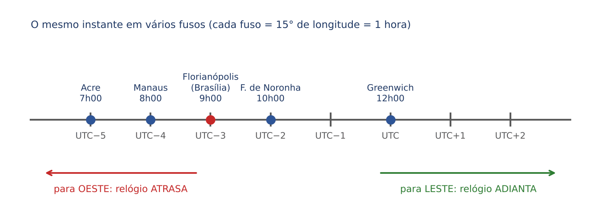

O Brasil tem quatro fusos oficiais (Lei 12.876/2013):

| Fuso | Onde | Em relação a Brasília |
|---|---|---|
| UTC−2 | Fernando de Noronha e ilhas oceânicas | 1 hora à frente |
| UTC−3 | Horário de Brasília: Distrito Federal, Santa Catarina e a maior parte dos estados | referência |
| UTC−4 | Amazonas (maior parte, com Manaus), Mato Grosso, Mato Grosso do Sul, Rondônia e Roraima | 1 hora atrás |
| UTC−5 | Acre e o extremo oeste do Amazonas | 2 horas atrás |

Desde 2019 não há horário de verão no Brasil: o Decreto 9.772, de 25/4/2019, encerrou-o ("Fica encerrada a hora de verão no território nacional", art. 1º), e até 30/10/2026 nenhum decreto o restabeleceu para 2026/2027. Em questões, porém, o horário de verão pode aparecer como dado do enunciado ("considere que vigora o horário de verão, que adianta os relógios em 1 hora").

### 22.4.2 Como calcular

:::PASSO Roteiro para voos e reuniões entre fusos
1. Escreva o fuso de cada lugar (por exemplo, UTC−3 e UTC+1).
2. Calcule a diferença: (+1) − (−3) = 4 horas. O destino está 4 horas à frente.
3. Hora de chegada no destino = hora de partida (no relógio da origem) + duração do voo + diferença de fuso (com sinal).
4. Se passar de 24h, subtraia 24 e avance o dia; se ficar negativo, some 24 e recue o dia.
:::

:::EXEMPLO Voo para leste
Um voo sai de Florianópolis (UTC−3) às 22h de uma segunda-feira, dura 12 horas e pousa numa cidade em UTC+1. A que horas, no relógio local, ele chega?
- Diferença de fuso: (+1) − (−3) = 4 horas à frente.
- 22h + 12h + 4h = 38h.
- 38h − 24h = 14h do dia seguinte.
- Chega às 14h de terça-feira, hora local.
Conferência por UTC: 22h em UTC−3 são 22 + 3 = 1h de terça em UTC; mais 12 h de voo, 13h UTC; no destino (UTC+1), 14h. Confere.
:::

:::EXEMPLO Reunião virtual nacional
Uma videoconferência está marcada para 10h no horário de Brasília. Em Manaus (UTC−4), começa às 9h; em Rio Branco (UTC−5), às 8h; em Fernando de Noronha (UTC−2), às 11h.
:::

:::PRATIQUE exercícios elaborados para esta apostila
1. São 15h em Brasília. Que horas são no Acre?
2. Duas cidades estão separadas por 75 graus de longitude. Qual a diferença de fuso teórica?
3. Um voo sai de Manaus às 8h (hora local), dura 4 horas e pousa em Florianópolis. Que horas são em Florianópolis na chegada?
4. Um voo sai às 10h do dia 5, de uma cidade em UTC+9, e dura 11 horas. Que horas serão em Brasília quando ele pousar?
Resoluções:
1. O Acre está 2 horas atrás de Brasília: 15h − 2h = 13h.
2. 75 ÷ 15 = 5 horas.
3. Florianópolis está 1 hora à frente de Manaus. 8h + 4h + 1h = 13h.
4. 10h em UTC+9 correspondem a 10 − 9 = 1h UTC do dia 5. Mais 11 horas: 12h UTC. Em Brasília (UTC−3): 12 − 3 = 9h do dia 5. O voo "chega" no mesmo dia e mais cedo do que partiu, porque viajou para oeste.
:::

## 22.5 Orientação no plano: pontos cardeais, giros e deslocamentos

### 22.5.1 Pontos cardeais e giros

A ideia. Imagine-se num mapa com o Norte para cima. À sua direita está o Leste; à esquerda, o Oeste; atrás, o Sul. Entre eles ficam os pontos colaterais: Nordeste (NE), Sudeste (SE), Sudoeste (SO) e Noroeste (NO), a 45 graus dos vizinhos.

Girar "para a direita" é girar no sentido dos ponteiros do relógio (sentido horário): Norte → Leste → Sul → Oeste → Norte. Girar "para a esquerda" é o sentido contrário (anti-horário). Cada passo dessa lista é um giro de 90 graus; meia-volta é 180; volta completa é 360.

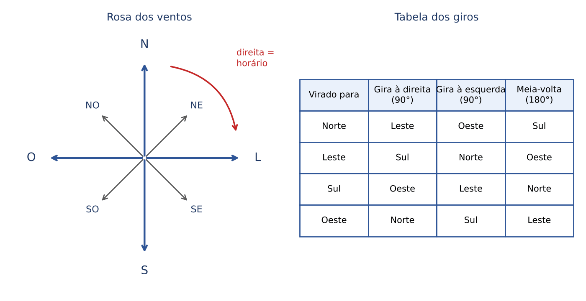

O giro é outro ciclo (22.1): 360 graus devolvem a mesma direção. Para uma sequência de giros:

- Some os giros à direita com sinal "+" e os giros à esquerda com sinal "−".
- Divida o total por 360 e fique com o resto.
- Converta o resto em quartos de volta: 90 = um passo à direita; 180 = meia-volta; 270 = três passos à direita (que é o mesmo que um passo à esquerda).

:::EXEMPLO Uma sequência de giros
Uma pessoa está virada para o Norte. Gira 90 graus à direita, depois 180 graus, depois 90 graus à esquerda e por fim 270 graus à direita. Para onde está virada?
- Soma: + 90 + 180 − 90 + 270 = 450.
- 450 − 360 = 90 (despreza-se a volta completa).
- 90 graus à direita a partir do Norte: Leste.
Conferência passo a passo: Norte → (90 D) Leste → (180) Oeste → (90 E) Sul → (270 D, que equivale a 90 E) Leste. Confere.
:::

:::ATENCAO A direita de quem?
Se alguém está DE FRENTE para você, a direita dele é a sua esquerda. Numa audiência, o "lado direito do juiz", visto da plateia, fica à esquerda de quem olha. Nas questões, fixe sempre o referencial: "à direita de Ana" significa a direita de Ana, olhando para onde ela olha. Os problemas de pessoas sentadas em mesas, com "à direita" e "à esquerda", são tratados no Cap. 20.
:::

### 22.5.2 Deslocamentos em malha e a distância em linha reta

A ideia. Andar 1 passo para o Norte e depois 1 passo para o Sul é o mesmo que ficar parado: os movimentos opostos se cancelam. Para achar onde alguém foi parar, faça dois "saldos":

- Saldo Norte–Sul: passos para o Norte menos passos para o Sul.
- Saldo Leste–Oeste: passos para o Leste menos passos para o Oeste.

Depois, a distância em linha reta entre a partida e a chegada sai do Teorema de Pitágoras. Num triângulo retângulo (com um canto de 90 graus), o lado maior, chamado hipotenusa, ao quadrado, é igual à soma dos quadrados dos outros dois lados. Os dois saldos formam os dois lados menores, e a distância em linha reta é a hipotenusa.

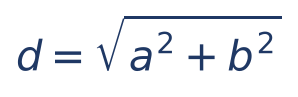

- d = distância em linha reta entre a partida e a chegada.
- a = saldo Norte–Sul (sem o sinal).
- b = saldo Leste–Oeste (sem o sinal).
- √ = raiz quadrada (Cap. 1): o número que, multiplicado por ele mesmo, dá o que está dentro.

Exemplo à mão: 3 km para o Norte e 4 km para o Leste. d = √(3² + 4²) = √(9 + 16) = √25 = 5 km. O trio 3, 4, 5 (e seus múltiplos 6, 8, 10) aparece muito em prova.

Quando a raiz não é exata, estime entre dois quadrados conhecidos: √5 fica entre √4 = 2 e √9 = 3, mais perto de 2 (√5 ≈ 2,24).

:::QUESTAO FGV 2024 — Passos na praça (Q3049040)
Problema: do centro de uma praça, a pessoa dá 1 passo para o Norte, 2 para o Leste, 3 para o Sul e 3 para o Oeste. A que distância, em linha reta, ela fica do ponto de partida? Gabarito oficial: C (entre 2 e 3 passos).
Resolução:
- Saldo Norte–Sul: 1 − 3 = −2, ou seja, 2 passos para o Sul.
- Saldo Leste–Oeste: 2 − 3 = −1, ou seja, 1 passo para o Oeste.
- d = √(2² + 1²) = √(4 + 1) = √5.
- Como 4 < 5 < 9, temos 2 < √5 < 3. Resposta: entre 2 e 3 passos (√5 ≈ 2,24).
Erro típico: somar os saldos (2 + 1 = 3) em vez de usar Pitágoras leva a "entre 3 e 4" (D). Somar os passos andados (9) leva a "maior do que 4" (E).
:::

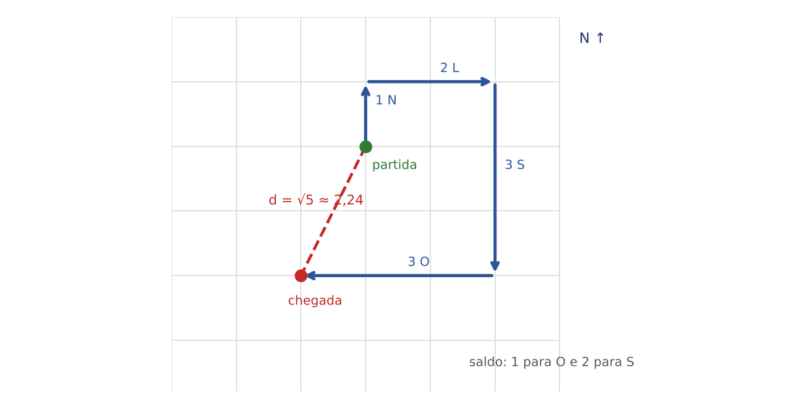

:::NOTA Distância "em quarteirões"
Numa cidade com ruas em grade, não se anda em diagonal. A distância percorrida pelas ruas é a SOMA dos saldos (a + b), e não a hipotenusa. No exemplo de 3 km ao Norte e 4 km a Leste, o trajeto mais curto pelas ruas tem 3 + 4 = 7 km, embora a distância em linha reta seja 5 km. Leia qual das duas a questão pede.
:::

### 22.5.3 Robôs, tabuleiros e coordenadas

Questões de "robô" combinam giros (22.5.1) com avanços numa grade. O segredo é escrever, a cada comando, a casa e a direção atuais, sem pular etapas, e conferir como a grade está numerada.

:::QUESTAO FGV 2026 — Prefeitura de Salvador — Professor (Q4357972)
Problema: tabuleiro 4 × 4, linhas 1 a 4 de cima para baixo, colunas A a D da esquerda para a direita. Um robô está em A4, virado para o Norte. Comandos: AV(n) avança n casas; VD gira 90 graus à direita; VE gira 90 graus à esquerda. Sequência: AV(3), VD, AV(2), VD, AV(1), VE, AV(1). Onde ele termina? Gabarito oficial: B (D2, virado para o Leste).
Resolução (o Norte é para cima; como a linha 1 está em cima, ir para o Norte DIMINUI o número da linha):
- Início: A4, Norte.
- AV(3): A4 → A3 → A2 → A1. Está em A1, Norte.
- VD: Norte → Leste. A1, Leste.
- AV(2): A1 → B1 → C1. C1, Leste.
- VD: Leste → Sul. C1, Sul.
- AV(1): ir para o Sul AUMENTA a linha: C1 → C2. C2, Sul.
- VE: Sul → Leste (girar à esquerda de quem olha para o Sul). C2, Leste.
- AV(1): C2 → D2. D2, Leste.
Erro típico: tratar a linha 1 como a de baixo, o que leva a C1 ou D1.
:::

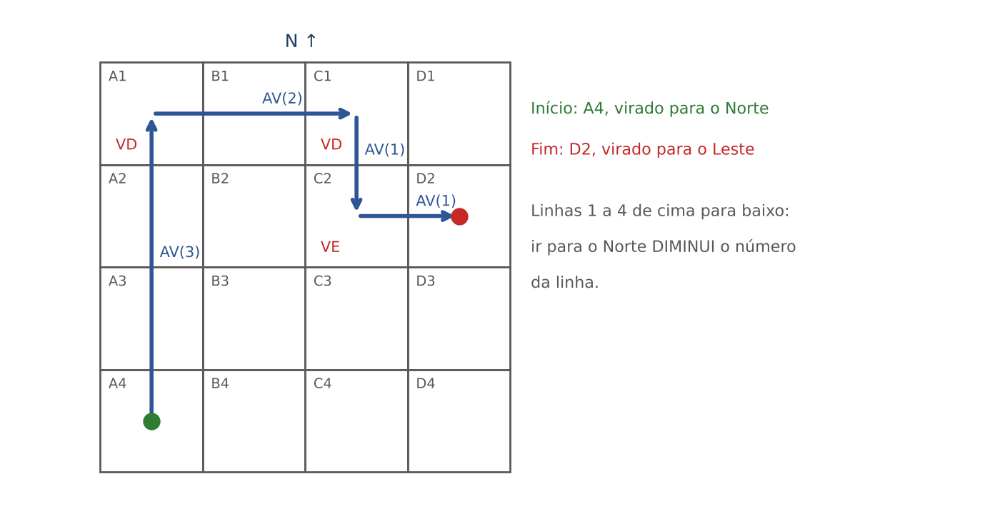

O plano cartesiano é uma grade com dois números: o ponto (x, y) fica x casas para a direita (ou para a esquerda, se x for negativo) e y casas para cima (ou para baixo, se y for negativo), a partir da origem (0, 0).

:::QUESTAO FGV 2025 — Brincadeira no plano cartesiano (Q3776554)
Problema: a partir do ponto (x, y), Arquimedes vai para o ponto (2y, x − 1). Começa em (0, 1) e repete o comando 5 vezes. Onde chega? Gabarito oficial: A (2, −7).
Resolução (a regra: o novo x é o dobro do y antigo; o novo y é o x antigo menos 1):
- 1º comando, de (0, 1): novo x = 2 × 1 = 2; novo y = 0 − 1 = −1. Ponto (2, −1).
- 2º, de (2, −1): x = 2 × (−1) = −2; y = 2 − 1 = 1. Ponto (−2, 1).
- 3º, de (−2, 1): x = 2 × 1 = 2; y = −2 − 1 = −3. Ponto (2, −3).
- 4º, de (2, −3): x = 2 × (−3) = −6; y = 2 − 1 = 1. Ponto (−6, 1).
- 5º, de (−6, 1): x = 2 × 1 = 2; y = −6 − 1 = −7. Ponto (2, −7).
:::

:::QUESTAO FGV 2025 — Ponto que percorre um quadrado (Q3174743)
Problema: o quadrado ABCD tem 8 cm de lado. O ponto P parte de A e percorre o contorno, em sentido anti-horário, a 1 cm por segundo. Onde estará depois de 5 minutos? Gabarito oficial: B (no interior do lado BC).
Resolução:
- 5 min = 5 × 60 = 300 s; a 1 cm por segundo, P anda 300 cm.
- Uma volta completa (perímetro): 4 × 8 = 32 cm. É um ciclo de 32.
- 300 ÷ 32 = 9, resto 12 (32 × 9 = 288; 300 − 288 = 12).
- Depois de 9 voltas, P está de novo em A e ainda anda 12 cm: 8 cm até B e mais 4 cm sobre BC.
- Resposta: no interior do lado BC (no meio dele). A questão supõe a figura usual, com os vértices nomeados em sentido anti-horário, de modo que o primeiro lado percorrido a partir de A é AB.
:::

:::PRATIQUE exercícios elaborados para esta apostila
1. Virado para o Sul, alguém gira 90 graus à esquerda, depois 180 graus e depois 90 graus à esquerda. Para onde fica virado?
2. Uma pessoa anda 6 quadras para o Norte, 2 para o Leste, 2 para o Sul e 1 para o Oeste. A que distância, em linha reta, ela está do ponto de partida? E pelas ruas, qual o menor caminho de volta?
3. Uma pessoa virada para o Leste gira 3 vezes 90 graus à direita. Para onde fica virada?
Resoluções:
1. Soma dos giros: −90 + 180 − 90 = 0. Não houve giro líquido: continua virada para o Sul. (Conferência: Sul → (90 E) Leste → (180) Oeste → (90 E) Sul.)
2. Saldos: Norte–Sul: 6 − 2 = 4 para o Norte; Leste–Oeste: 2 − 1 = 1 para o Leste. Linha reta: √(4² + 1²) = √17 ≈ 4,12 quadras (entre 4 e 5, pois 16 < 17 < 25). Pelas ruas: 4 + 1 = 5 quadras.
3. 3 × 90 = 270 à direita, que equivale a 90 à esquerda. Leste girando 90 à esquerda: Norte.
:::

## 22.6 Sólidos: cubos, dados, planificações e pilhas

### 22.6.1 O cubo e seus elementos

O cubo é a "caixa" com todas as arestas iguais. Ele tem:

- 6 faces (os quadrados: em cima, embaixo, frente, fundo, esquerda, direita);
- 12 arestas (os "palitos" onde duas faces se encontram: 4 em cima, 4 embaixo, 4 verticais);
- 8 vértices (os "cantos": 4 em cima e 4 embaixo).

Conferência pela relação de Euler, válida para os poliedros convexos (sólidos de faces planas, sem reentrâncias): V − A + F = 2, isto é, vértices menos arestas mais faces dá 2. No cubo: 8 − 12 + 6 = 2.

Cada face tem exatamente UMA face oposta (a que não encosta nela) e quatro faces vizinhas. Cada vértice é encontro de 3 faces; cada aresta, de 2 faces.

### 22.6.2 Planificações

A ideia. Planificar é "desmontar a caixa" e esticá-la sobre a mesa: os 6 quadrados ficam ligados por arestas, formando uma figura plana que, dobrada, volta a ser o cubo. Há 11 planificações diferentes do cubo; a mais conhecida é a cruz.

O que a prova pergunta é quase sempre: dada a planificação, qual face fica oposta a qual? Dois testes resolvem:

- Faces que se tocam na planificação (lado a lado) serão VIZINHAS no cubo, nunca opostas.
- Numa fileira reta de três ou mais quadrados, as faces separadas por exatamente UM quadrado ("pulando uma") são opostas.

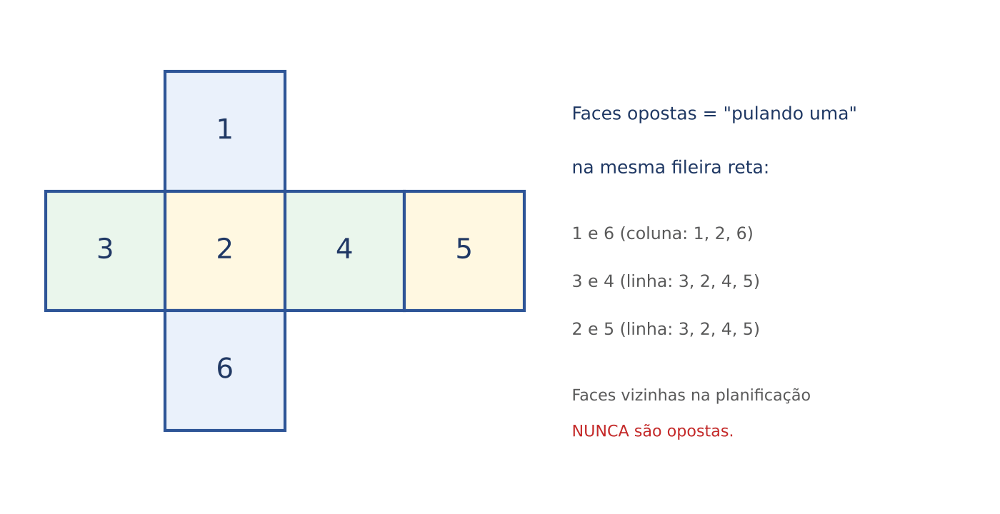

Na cruz da figura: a coluna 1, 2, 6 mostra que 1 e 6 são opostas (pula-se o 2); a linha 3, 2, 4, 5 mostra que 3 e 4 são opostas (pula-se o 2) e que 2 e 5 são opostas (pula-se o 4).

:::ATENCAO Figuras que NÃO fecham um cubo
Uma figura de 6 quadrados não fecha um cubo se tiver quatro quadrados formando um bloco 2 × 2 (dois deles se sobreporiam) ou se tiver cinco ou mais quadrados em fileira reta (o quinto cobriria o primeiro). Use esses dois testes para eliminar alternativas.
:::

### 22.6.3 Dados

O dado comum é um cubo com as faces numeradas de 1 a 6, e a soma das faces opostas é sempre 7: 1 oposto ao 6, 2 oposto ao 5, 3 oposto ao 4. A soma de todas as faces é 1 + 2 + 3 + 4 + 5 + 6 = 21 = 3 × 7.

Consequência útil: se você sabe a face de cima, sabe a de baixo (7 menos a de cima). E as quatro faces laterais somam 21 − 7 = 14, quaisquer que sejam.

:::QUESTAO FGV 2025 — Dois dados sobre a mesa (Q3657982)
Problema: dois dados comuns foram lançados; a soma de todas as faces visíveis (as de cima e as laterais) foi 33. Qual o menor valor possível para uma das faces em contato com a mesa? Gabarito oficial: C (3).
Resolução:
- Cada dado tem soma 21; os dois juntos, 42.
- As faces escondidas são só as duas que tocam a mesa. Logo, elas somam 42 − 33 = 9.
- Para uma delas ser a MENOR possível, a outra deve ser a MAIOR possível: 6.
- Então a menor é 9 − 6 = 3.
Erro típico: responder 1 (A), esquecendo que a outra face de baixo não pode passar de 6.
:::

### 22.6.4 O cubo pintado e cortado em cubinhos

A ideia. Um cubo grande é pintado por fora e depois cortado em cubinhos iguais. Quantos cubinhos ficam com 3, 2, 1 ou nenhuma face pintada? Basta lembrar ONDE o cubinho está:

- No canto (vértice), ele encosta em 3 faces externas: 3 faces pintadas. São sempre 8 cantos.
- Na aresta, fora dos cantos, ele encosta em 2 faces: 2 faces pintadas.
- No meio de uma face, encosta em 1 face: 1 face pintada.
- No núcleo, escondido, não encosta em nenhuma: nenhuma face pintada.

Para um cubo cortado em n cubinhos por aresta (n × n × n cubinhos no total):

- 3 faces: 8.
- 2 faces: 12 × (n − 2) (12 arestas, cada uma com n cubinhos menos os 2 dos cantos).
- 1 face: 6 × (n − 2)² (6 faces, cada uma com um "miolo" de (n − 2) por (n − 2)).
- nenhuma: (n − 2)³ (o cubo interno, sem a "casca").

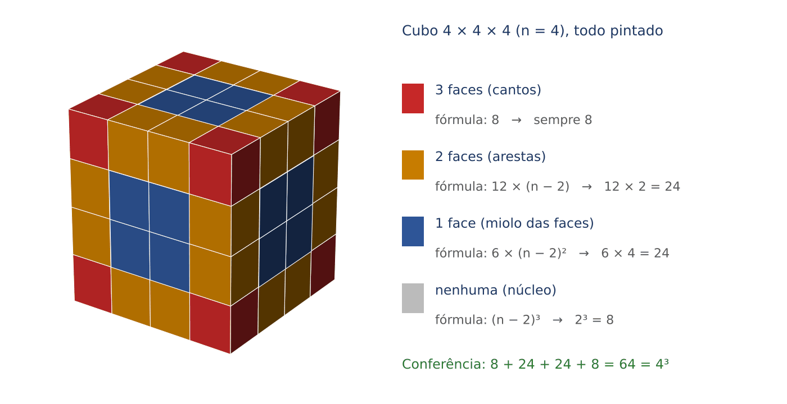

:::EXEMPLO Cubo 4 × 4 × 4 (64 cubinhos), todo pintado
- n − 2 = 2.
- 3 faces: 8.
- 2 faces: 12 × 2 = 24.
- 1 face: 6 × 2² = 6 × 4 = 24.
- Nenhuma: 2³ = 8.
- Conferência: 8 + 24 + 24 + 8 = 64 = 4³.
:::

:::QUESTAO FCC 2026 — SEFAZ-CE — Auditor Fiscal da Receita Estadual (Q4221367)
Problema: um cubo grande foi montado com 64 cubinhos (4 × 4 × 4). Se 4 faces do cubo grande forem pintadas de azul, qual o NÚMERO MÁXIMO de cubinhos com 3 faces azuis? Gabarito oficial: C (2).
Resolução:
- Só um cubinho de CANTO pode ter 3 faces pintadas, e só se as 3 faces do cubo grande que se encontram naquele canto estiverem pintadas.
- Pintar 4 faces é o mesmo que deixar 2 sem pintura. Há duas situações possíveis para essas 2 faces:
  - Situação 1: as 2 faces sem pintura são OPOSTAS (por exemplo, a de cima e a de baixo). Todo canto do cubo encosta ou na face de cima ou na de baixo. Então nenhum canto tem as 3 faces pintadas: 0 cubinhos.
  - Situação 2: as 2 faces sem pintura são VIZINHAS (por exemplo, a de cima e a da frente). Os cantos que não encostam nem em cima nem na frente são os dois cantos de BAIXO e do FUNDO (esquerdo e direito). Esses 2 têm as 3 faces pintadas.
- O máximo é 2.
Por que as outras atraem: 4 (B) é a resposta de quem imagina "um canto por face pintada"; 0 (E) é a da situação 1, que é um mínimo, não um máximo; 8 seria a resposta com as 6 faces pintadas. O tamanho 4 × 4 × 4 é irrelevante: com 3 faces pintadas, só importam os 8 cantos.
:::

:::PRATIQUE exercícios elaborados para esta apostila
1. Um cubo 5 × 5 × 5 é todo pintado e cortado em 125 cubinhos. Quantos têm 3, 2, 1 e nenhuma face pintada?
2. Três dados comuns são empilhados numa torre sobre a mesa; a face de cima do dado mais alto mostra 4. Qual a soma das faces escondidas (as que tocam outro dado ou a mesa)?
3. Na planificação em cruz de 22.6.2, qual face fica oposta à face 3?
Resoluções:
1. n − 2 = 3. Três faces: 8. Duas: 12 × 3 = 36. Uma: 6 × 3² = 54. Nenhuma: 3³ = 27. Conferência: 8 + 36 + 54 + 27 = 125.
2. Faces escondidas: a de baixo do dado de cima (oposta ao 4, logo 3); as duas do dado do meio (de cima e de baixo, que são opostas e somam 7); as duas do dado de baixo (também opostas, somam 7). Total: 3 + 7 + 7 = 17.
3. Na linha 3, 2, 4, 5, a face que fica a "um pulo" do 3 é o 4. Opostas: 3 e 4.
:::

### 22.6.5 Pilhas de cubos: contar, completar e achar os escondidos

A ideia. Numa pilha de cubos desenhada em perspectiva, alguns cubos ficam escondidos atrás ou embaixo de outros. Contar "os que se veem" erra quase sempre. O método seguro é o MAPA DE ALTURAS: olhe a pilha de cima e escreva, em cada quadradinho do chão, quantos cubos há empilhados ali. A soma do mapa é o número de cubos.

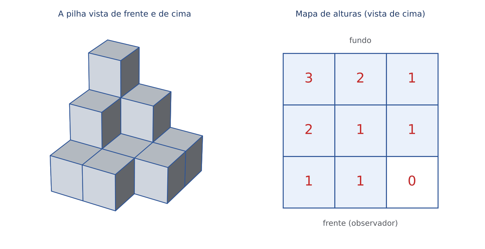

:::EXEMPLO Lendo a pilha da figura
- Mapa de alturas (do fundo para a frente): 3, 2, 1 / 2, 1, 1 / 1, 1, 0.
- Total de cubos: 3 + 2 + 1 + 2 + 1 + 1 + 1 + 1 + 0 = 12.
- Para completar um bloco 3 × 3 × 3 (27 cubos), faltam 27 − 12 = 15 cubos.
- Cubos não visíveis: um cubo fica totalmente escondido, nesta vista (de frente, pela direita e de cima), quando há cubo em cima dele, à frente dele e à direita dele. Isso ocorre com os 2 cubos de baixo da coluna de altura 3, com o cubo de baixo da coluna de altura 2 do fundo e com o cubo de baixo da coluna de altura 2 do meio: 4 cubos escondidos. Todos os outros 8 mostram pelo menos uma face.
:::

As duas questões do banco desse tipo dependem da figura original, que não está disponível neste material: Q3754736 (FGV 2025; 17 caixas cúbicas empilhadas; quantas não são diretamente visíveis; gabarito oficial: D, 5) e Q3045558 (FGV 2024; quantos cubinhos faltam para completar a caixa; gabarito oficial: C, 11). Ambas se resolvem exatamente pelo mapa de alturas do exemplo acima: escreva a altura de cada coluna, some, e compare com o bloco completo ou com os cubos que mostram alguma face.

### 22.6.6 Recipientes enchendo: o gráfico da altura

A ideia. Despejando água a vazão constante (o mesmo volume por segundo), a altura sobe DEVAGAR onde o recipiente é LARGO (o mesmo volume se espalha numa área grande) e RÁPIDO onde ele é ESTREITO.

- Cilindro (paredes retas e verticais): a altura sobe sempre no mesmo ritmo; o gráfico altura × tempo é uma reta.
- Base larga e boca estreita: começa devagar e acelera; o gráfico é uma curva que vai ficando cada vez mais inclinada (curva "para cima").
- Base estreita e boca larga (como um copo comum): começa rápido e desacelera; o gráfico vai ficando cada vez mais deitado (curva "para baixo").

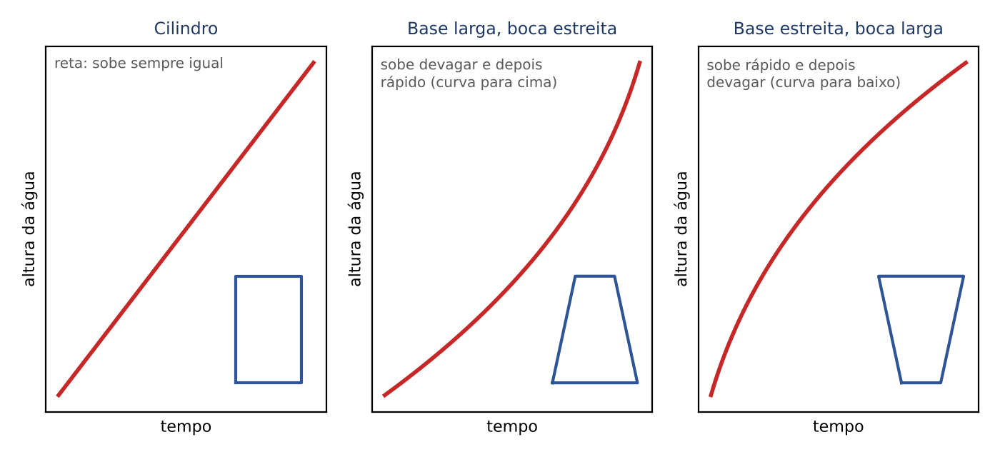

:::QUESTAO FGV 2025 — Prefeitura de Cuiabá — Auditor Público Interno (Q3152827)
Problema: um recipiente com base circular MAIOR que a abertura circular de cima, com parede lateral reta vista de frente (um tronco de cone "de boca para baixo"), recebe água a vazão constante. Qual gráfico representa a altura em função do tempo? Gabarito oficial: B.
Resolução: como o recipiente fica mais estreito à medida que sobe, cada litro adicional faz a água subir mais do que o anterior. A altura cresce sempre, começando devagar e acelerando, até o recipiente encher: é a curva do painel do meio da figura acima (crescente, cada vez mais inclinada). As alternativas da prova são gráficos, não reproduzidos aqui; a correta (B) é a que tem esse formato. As demais costumam trazer a reta (seria um cilindro), a curva que se deita (seria um copo de boca larga) ou trechos horizontais (a altura parada, o que não ocorre com vazão constante).
:::

## 22.7 Figuras planas: rotações, simetrias e contagem

### 22.7.1 Rotações e reflexões

A ideia. Girar uma figura (rotação) é como girar uma folha de papel sobre a mesa, sem virá-la: o desenho continua "de face para cima". Refletir uma figura (reflexão, ou espelhamento) é como olhá-la no espelho ou virar a folha do avesso contra a luz: direita e esquerda se trocam.

Para não errar nas alternativas com figuras:

- Rotação de 90 graus no sentido horário: o que estava em cima vai para a direita; o que estava à direita vai para baixo; o de baixo vai para a esquerda; o da esquerda vai para cima (é a tabela de giros de 22.5.1, aplicada à figura).
- Rotação de 180 graus: em cima ↔ embaixo e direita ↔ esquerda, ao mesmo tempo.
- Reflexão num espelho vertical: só direita ↔ esquerda; em cima e embaixo ficam onde estão.
- Uma seta para o Norte girada três vezes 90 graus no sentido horário aponta para o Oeste (270 horário = 90 anti-horário).

Eixo de simetria é a linha que divide a figura em duas metades que se sobrepõem quando dobradas. O quadrado tem 4 eixos (2 pelas diagonais e 2 pelos meios dos lados); o retângulo que não é quadrado, 2; o triângulo equilátero, 3; o círculo, infinitos. Entre as letras maiúsculas de forma simples, A, M, T, U, V têm eixo vertical; B, C, D, E, K têm eixo horizontal; H, I, O, X têm os dois.

:::DICA Teste rápido com uma letra assimétrica
Para descobrir se duas figuras são a mesma girada ou uma refletida, imagine uma letra "F" desenhada nelas. Girando um F, ele continua sendo um F legível (de lado ou de cabeça para baixo). Refletindo, ele vira um F "ao contrário", que nenhum giro desfaz. Se a alternativa só pode ser obtida virando a folha, ela é reflexão, não rotação.
:::

### 22.7.2 Quantos quadrados há numa grade?

A ideia. Numa grade de 4 × 4 quadradinhos, não há só 16 quadrados: há também os de lado 2, 3 e 4, formados por vários quadradinhos. Conte por tamanho.

- Lado 1: cabem 4 por linha e 4 por coluna: 4 × 4 = 16.
- Lado 2: o quadrado de lado 2 pode começar em 3 posições por linha e 3 por coluna: 3 × 3 = 9.
- Lado 3: 2 × 2 = 4.
- Lado 4: 1 × 1 = 1 (a grade inteira).
- Total: 16 + 9 + 4 + 1 = 30.

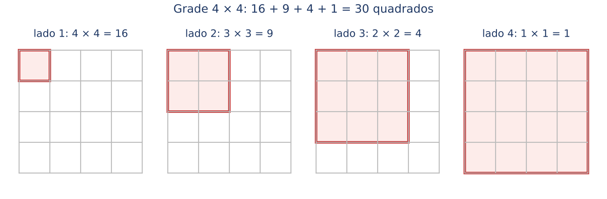

Regra geral: numa grade n × n, o total de quadrados é 1² + 2² + 3² + ... + n². Grade 3 × 3: 1 + 4 + 9 = 14. Grade 5 × 5: 14 + 16 + 25 = 55. Tabuleiro de xadrez (8 × 8): 204.

E os retângulos (incluindo os quadrados)? Um retângulo fica definido escolhendo 2 das linhas horizontais e 2 das verticais da grade. Numa grade de 2 × 3 quadradinhos há 3 linhas horizontais e 4 verticais: C(3, 2) × C(4, 2) = 3 × 6 = 18 retângulos. (C(n, 2) é o número de modos de escolher 2 objetos entre n, sem importar a ordem; ver Cap. 11: C(n, 2) = n × (n − 1) ÷ 2.)

### 22.7.3 Quantos triângulos há na figura?

Dois modelos cobrem a maioria das questões.

Modelo 1, retas saindo de um vértice. Um triângulo com várias retas partindo do vértice de cima até a base. Cada triângulo da figura é formado pela base e por DUAS das retas que saem do vértice. Com k retas saindo do vértice (contando os dois lados do triângulo), o total é C(k, 2).

Modelo 2, triângulo dividido em triangulinhos. Conte por tamanho e por posição (com a ponta para cima e com a ponta para baixo).

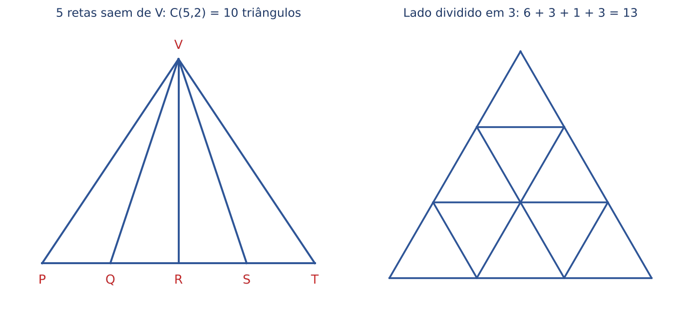

:::EXEMPLO Os dois modelos da figura
- Modelo 1: saem do vértice V cinco retas (VP, VQ, VR, VS, VT). Total: C(5, 2) = 5 × 4 ÷ 2 = 10 triângulos. Conferência por tamanho: 4 triângulos "de uma fatia" (VPQ, VQR, VRS, VST), 3 de duas fatias, 2 de três, 1 de quatro: 4 + 3 + 2 + 1 = 10.
- Modelo 2 (lado dividido em 3): com a ponta para cima, 6 pequenos, 3 médios e 1 grande; com a ponta para baixo, 3 pequenos. Total: 6 + 3 + 1 + 3 = 13.
:::

:::PEGADINHA Contar só os "pedaços"
Quem conta só os triângulos pequenos (as "fatias" ou os "pedaços") esquece os formados pela união de vários. Conte SEMPRE por tamanho, do menor para o maior, e, no modelo 2, não esqueça os triângulos de ponta para baixo.
:::

:::PRATIQUE exercícios elaborados para esta apostila
1. Quantos quadrados há numa grade 3 × 3?
2. Quantos retângulos (incluindo quadrados) há numa grade 2 × 2?
3. Num triângulo, 4 segmentos partem do vértice de cima até a base, além dos dois lados. Quantos triângulos há?
4. Um relógio de ponteiros é girado 180 graus sobre a mesa (sem virar). O 12 aponta agora para que lado?
Resoluções:
1. 1² + 2² + 3² = 1 + 4 + 9 = 14.
2. A grade tem 3 linhas horizontais e 3 verticais: C(3, 2) × C(3, 2) = 3 × 3 = 9 (4 pequenos, 4 de dois quadradinhos e 1 grande).
3. Retas saindo do vértice: 4 + 2 = 6. C(6, 2) = 6 × 5 ÷ 2 = 15.
4. Para baixo: uma rotação de 180 graus troca em cima por embaixo.
:::

## 22.8 Resumo para revisão pré-prova

| Conceito | Regra ou fórmula | Quando usar | Armadilha |
|---|---|---|---|
| Ciclo e resto | Divida pelo tamanho do ciclo e ande só o resto | Dias da semana, giros, voltas num contorno, escalas | Resto sempre menor que o divisor |
| Daqui a n dias | Ande n mod 7 a partir de hoje | "Daqui a", "há n dias" (para trás) | Descobrir primeiro qual é "hoje" |
| n-ésimo dia | Ande (n − 1) casas | "O 90º dia", "o dia 15", "o último comprimido" | Andar n casas: erro de uma posição |
| Saltos dos meses | 31 → 3; 30 → 2; 28 → 0; 29 → 1 | Dia 1º de um mês a partir de outro | Somar só os meses inteiros ENTRE as datas |
| Dias da semana no mês | 31 dias: os dias da semana dos dias 1, 2 e 3 aparecem 5 vezes | "Maio teve 5 quartas" | Os dias extras são consecutivos |
| Ano bissexto | Divisível por 4; se terminar em 00, só se divisível por 400 | Mesmo dia no ano seguinte (+1 ou +2) | Importa se o 29/2 está ENTRE as datas |
| Contagem de dias | Exclui o início e inclui o fim (como o CPC, art. 224) | Prazos, intervalos | "De 10 a 12" dura 3 dias se ambos contam |
| Eventos periódicos | Último evento: (n − 1) × intervalo | Remédios, plantões | Problema das cercas |
| Base 60 | 60 min = 1 h; 0,1 h = 6 min | Somas, diferenças e médias de horários | 2,4 h = 2h24, não 2h40 |
| Ângulo dos ponteiros | θ = 30h − 5,5m, sem sinal (valor absoluto); se passar de 180, 360 − θ | Relógio | O ponteiro das horas anda 0,5° por minuto |
| Sobreposição | 30h = 5,5m | Ponteiros juntos ou opostos | 11 vezes em 12 h, 22 em 24 h |
| Relógio que adianta ou atrasa | Regra de três entre tempo real e tempo do relógio | Relógios defeituosos | O dado é hora real ou hora do relógio? |
| Espelho | Hora real = 11h60 − hora vista | Relógio no espelho | Só vale para relógio de ponteiros |
| Encontro | Velocidades em "percurso por hora" somam-se | Veículos em sentidos opostos | Considerar quem já partiu antes |
| Fusos | 15° = 1 h; leste adianta, oeste atrasa | Voos, reuniões | Brasil: UTC−2, −3, −4, −5; sem horário de verão desde 2019 |
| Giros | Direita = horário (+); esquerda = anti-horário (−); resto por 360 | Bússola, robôs | 270 à direita = 90 à esquerda |
| Distância | Linha reta: d = √(a² + b²); pelas ruas: a + b | Deslocamentos em malha | Somar saldos não dá a linha reta |
| Cubo | 6 faces, 12 arestas, 8 vértices; V − A + F = 2 | Sólidos | Cada face tem uma só oposta |
| Planificação | Opostas: "pulando uma" na mesma fileira | Montar o cubo | Bloco 2 × 2 ou 5 em fila não fecha |
| Dado | Opostas somam 7; total 21; laterais somam 14 | Faces escondidas | Valor máximo de uma face é 6 |
| Cubo pintado n × n × n | 8; 12(n − 2); 6(n − 2)²; (n − 2)³ | Faces pintadas | Só cantos têm 3 faces |
| Pilha de cubos | Mapa de alturas; somar | Contar, completar, escondidos | Não contar só o que se vê |
| Recipiente | Largo: sobe devagar; estreito: sobe rápido | Gráfico altura × tempo | Cilindro dá reta |
| Quadrados em grade n × n | 1² + 2² + ... + n² | Contagem de figuras | Contar só os pequenos |
| Triângulos com retas de um vértice | C(k, 2), k = retas que saem do vértice (com os lados) | Contagem de figuras | Esquecer os triângulos compostos |

Formulário do capítulo:

- Resto: n = 7 × q + r, com r entre 0 e 6 (q = voltas completas; r = casas a andar).
- Ângulo entre ponteiros: θ = |30 × h − 5,5 × m| (h = hora, m = minutos); se θ > 180, use 360 − θ.
- Fuso: diferença em horas = diferença de longitude ÷ 15.
- Distância em linha reta: d = √(a² + b²) (a e b = saldos nas duas direções).
- Cubo pintado com n cubinhos por aresta: 8 com 3 faces; 12 × (n − 2) com 2; 6 × (n − 2)² com 1; (n − 2)³ sem pintura.
- Quadrados numa grade n × n: 1² + 2² + ... + n².
- Triângulos com k retas saindo de um vértice até a base: C(k, 2) = k × (k − 1) ÷ 2.

## 22.9 Questões do capítulo

FCC: Q3445882, Q3469407, Q4221367. FGV: Q2375654, Q2450509, Q2456232, Q3043771, Q3045558, Q3047219, Q3049040, Q3090454, Q3152827, Q3174644, Q3174743, Q3174746, Q3174752, Q3275689, Q3363337, Q3578670, Q3579008, Q3579010, Q3657982, Q3754736, Q3758077, Q3776554, Q3777201, Q3782886, Q4086748, Q4357972.

:::NOTA Notas de verificação
- Contas: todas as resoluções das 29 questões do lote e todos os exemplos e exercícios PRATIQUE foram conferidos em Python (restos, dias da semana, horários, ângulos, fusos, giros, distâncias, cubos, contagens). Os dias da semana de datas reais (30/10/2026 sexta-feira; 22/11/2026 domingo; 1º/1/2026 quinta-feira; 25/12/2026, 2027 e 2028 sexta, sábado e segunda) foram conferidos com o calendário do Python. A Q3579010 foi resolvida por força bruta: com a semana tratada como ciclo, a única resposta é segunda-feira (gabarito oficial); tratada como linha, surgiria também terça-feira.
- Fusos e horário de verão: Lei 12.876, de 30/10/2013 (restabelece os fusos do Acre e de parte do Amazonas; Santa Catarina no fuso de Greenwich "menos três horas") e Decreto 9.772, de 25/4/2019 (art. 1º: encerra a hora de verão), conferidos em 30/10/2026 (Planalto). Ausência de decreto restabelecendo o horário de verão para 2026/2027: conferida em 30/10/2026 em fonte jornalística (Jornal do Brasil, atualizada em 8/10/2026, com base em nota do Ministério de Minas e Energia de 21/9/2026); confirmar novamente perto da prova.
- Art. 224, caput, do CPC ("excluindo o dia do começo e incluindo o dia do vencimento"): conferido em 30/10/2026 (Planalto, Lei 13.105/2015).
- Questões dependentes de figura: Q3754736 e Q3045558 (pilhas de cubos) e Q3152827 (alternativas em gráficos) tinham imagens não disponíveis no banco local; foram indicados o método e o gabarito oficial, sem reconstituir a figura. A Q3174743 foi resolvida supondo a nomeação usual ABCD em sentido anti-horário. A Q3469407 é a mesma questão da Q3445882 (dados da tabela tomados da Q3445882).
- Gabaritos: nenhum gabarito oficial discutível no lote.
- Fonte do Drive consultada: RL09 (Orientação Temporal, mapa mental), usada como conferência das regras de calendário e de ano bissexto.
:::
