# CAPÍTULO 24 — BUSINESS INTELLIGENCE E VISUALIZAÇÃO DE DADOS: BI, DATA WAREHOUSE, DATA LAKE, OLAP, ANALYTICS, DATA MINING, WEB SCRAPING, INDICADORES E DASHBOARDS

:::INCIDENCIA
Edital SEFAZ/SC 01/2026 — Ciência e Análise de Dados (Business Intelligence e Visualização de Dados; uso de ferramentas analíticas). Nível A+.
Lote do banco: 104 questões atribuídas ao capítulo (FCC 13, FGV 91), mais 3 FCC localizadas por palavra-chave.
O que mais cai: data warehouse e suas características, modelagem dimensional (fato, dimensão, estrela, floco de neve), operações OLAP, data lake e lakehouse, tarefas de data mining (associação, agrupamento, anomalias) e os quatro tipos de analytics.
:::

:::ESQUEMA O que você vai aprender e o que precisa saber antes
Pré-requisitos: tipos de dados (estruturados, semiestruturados e não estruturados), qualidade dos dados, ETL e big data (Cap. 23); porcentagem e frações (Cap. 1); média, desvio-padrão e boxplot (Caps. 9 e 10); probabilidade condicional (Cap. 12); correlação e regressão (Cap. 16). Aprendizado de máquina em profundidade fica no Cap. 25; LGPD, no Cap. 26.
Roteiro do capítulo:
- 24.1 O que é Business Intelligence e como é a sua arquitetura.
- 24.2 Banco transacional (OLTP) x data warehouse; data marts; ETL na arquitetura de BI.
- 24.3 Modelagem dimensional: fatos, dimensões, esquema estrela e floco de neve.
- 24.4 OLAP: o cubo e as operações (drill down, roll up, slice, dice, pivot).
- 24.5 Data lake, lakehouse e arquitetura em camadas (bronze, prata, ouro).
- 24.6 Os quatro tipos de analytics: descritivo, diagnóstico, preditivo e prescritivo.
- 24.7 Data mining: KDD, tarefas, regras de associação (com contas), agrupamento, anomalias e mineração de textos.
- 24.8 Web scraping: técnica, usos e limites jurídicos e éticos.
- 24.9 Indicadores e métricas: KPI, meta, SMART, eficiência, eficácia e efetividade (com contas).
- 24.10 Relatórios, dashboards e visualização: o gráfico certo e os erros que enganam.
- 24.11 Ferramentas: Power BI, Tableau, Qlik e outras (noção).
:::

## 24.1 Business Intelligence: a ideia e a arquitetura

### 24.1.1 A ideia em linguagem comum

Imagine o gabinete de um desembargador. Todos os dias o sistema processual registra milhares de movimentos: distribuição, conclusão, juntada, julgamento, baixa. Cada registro, sozinho, serve para o andamento do processo. Mas o presidente do tribunal quer saber outra coisa: quantos processos cada câmara julgou por mês nos últimos cinco anos, qual o tempo médio entre a conclusão e o julgamento, onde o acervo cresce mais. Para responder, ninguém vai abrir processo por processo. É preciso juntar os registros, organizá-los por período, por órgão e por classe, somar, comparar e mostrar num painel.

Esse conjunto de técnicas, processos e ferramentas que transforma os dados do dia a dia em informação para decidir chama-se Business Intelligence (*business intelligence*, literalmente "inteligência de negócios"; a sigla BI é usada também em português). No setor público, o "negócio" é a atividade do órgão: arrecadar, fiscalizar, julgar, prestar serviços.

Numa Secretaria da Fazenda, o BI é o que permite ao gestor ver, num único painel, a arrecadação de ICMS por mês, por região e por setor econômico; ao auditor, comparar o faturamento declarado por uma empresa com as notas fiscais eletrônicas que ela emitiu; à alta direção, acompanhar se a meta anual de arrecadação está sendo cumprida.

:::DICA A frase que resolve metade das questões
BI = transformar DADOS em INFORMAÇÃO para apoiar a DECISÃO. Toda definição que a banca considera correta gira em torno disso: integrar dados de várias fontes, organizá-los historicamente e apresentá-los (relatórios, consultas, painéis) para que gestores decidam melhor. BI NÃO é sinônimo de criptografia, de backup, de banco transacional nem de depósito de dados brutos (isso é data lake, ver 24.5).
:::

### 24.1.2 Por que não usar direto o sistema do dia a dia?

A pergunta é natural: se os dados já estão no sistema de arrecadação, por que montar outra estrutura? Há quatro razões, e todas aparecem em prova.

- Os dados estão espalhados. A nota fiscal eletrônica está num sistema, a escrituração fiscal digital (EFD) em outro, o cadastro de contribuintes num terceiro, os pagamentos num quarto. Cada um usa códigos e nomes diferentes (um chama o campo de "CNPJ", outro de "cnpj_emitente"; um grava a data como dia/mês/ano, outro como ano-mês-dia).
- O sistema do dia a dia guarda o estado ATUAL. O cadastro mostra o endereço de hoje da empresa; não guarda, em geral, onde ela estava em 2019. Análise exige HISTÓRIA.
- Consultas analíticas são pesadas. Somar a arrecadação de cinco anos por município exige ler milhões de linhas. Fazer isso no mesmo banco que recebe os pagamentos em tempo real deixaria o sistema lento para o contribuinte.
- O formato não ajuda quem decide. O sistema operacional é desenhado para gravar uma operação por vez, não para responder "quanto, por quê, comparado com o quê".

Por isso o BI copia os dados para um ambiente próprio, preparado para análise. É como a diferença entre o cartório (que registra cada ato) e o anuário estatístico (que resume os atos para quem planeja).

### 24.1.3 A arquitetura de BI, camada por camada

A arquitetura clássica de BI é uma linha de montagem, das fontes até a decisão.

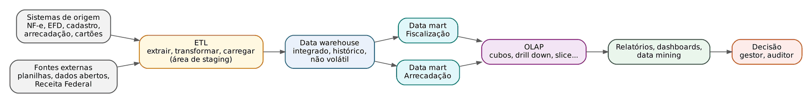

Leia a figura da esquerda para a direita.

- Fontes de dados. Os sistemas operacionais (também chamados transacionais ou de produção) e as fontes externas: planilhas, bases de outros órgãos, dados abertos. Os tipos de dados (estruturados, semiestruturados, não estruturados) estão no Cap. 23.
- ETL (*Extract, Transform, Load*: extrair, transformar, carregar). É o processo que busca os dados nas fontes, limpa, padroniza, elimina duplicidades, converte códigos e carrega o resultado no armazém. Costuma usar uma área intermediária, a área de preparação (*staging area*), onde os dados ficam temporariamente enquanto são tratados. O ETL e a qualidade dos dados são estudados no Cap. 23; aqui basta saber o LUGAR dele na arquitetura: entre as fontes e o armazém.
- Data warehouse (DW, "armazém de dados"). O repositório central, integrado e histórico, desenhado para consulta (24.2).
- Data marts. Recortes do armazém dedicados a um assunto ou departamento (por exemplo, só fiscalização, ou só arrecadação).
- OLAP (*Online Analytical Processing*, processamento analítico em linha). A camada que permite navegar pelos dados em várias dimensões, "fatiando" e "detalhando" (24.4).
- Apresentação e análise. Relatórios, painéis (*dashboards*), consultas livres e mineração de dados (24.7 e 24.10).
- Metadados. Atravessam todas as camadas: são os "dados sobre os dados" (de onde veio cada campo, o que significa, quando foi carregado).

:::ATENCAO Metadados: três famílias que a FGV já cobrou
Metadado é a informação que DESCREVE os dados, facilitando sua compreensão, localização e uso. Num DW costuma-se dividi-los em:
- técnicos: estrutura física (nome da tabela, tipo do campo, tamanho, se aceita nulo). Ex.: "valor_liquido é decimal com duas casas e não pode ser nulo";
- de negócio: o significado para o usuário (definições, regras de cálculo). Ex.: "venda líquida = bruto menos descontos e devoluções";
- de processo (ou operacionais): o que aconteceu nas cargas (horário, quantidade de registros lidos e carregados, erros). Ex.: "a carga das 2h leu 1.253.428 registros e carregou 1.251.936".
Metadado NÃO armazena os dados brutos, NÃO executa consultas e NÃO é mecanismo de segurança (embora possa registrar quem pode acessar).
:::

### 24.1.4 BI tradicional e BI de autosserviço

No modelo tradicional, a equipe de tecnologia constrói os relatórios e o usuário só os consome. No BI de autosserviço (*self-service BI* ou *self-service analytics*), a área de negócio recebe ferramentas intuitivas e acesso a dados já preparados para montar os próprios relatórios e painéis, sem depender da TI para cada pergunta nova. O auditor que arrasta campos num painel do Power BI para cruzar setor e município está fazendo BI de autosserviço. O risco é a proliferação de versões diferentes do mesmo número; por isso o autosserviço convive com governança (definições oficiais de indicadores, dados certificados).

:::QUESTAO FCC 2025 — Prefeitura de São Paulo — Auditor Municipal de Controle Interno (Q3289728)
Situação: uma Prefeitura implantou BI para melhorar a análise e a transparência de dados financeiros e administrativos, facilitando a auditoria. A questão pergunta qual "ferramenta" foi usada e por quê. Gabarito oficial: D (data warehouse, porque organiza e integra dados de diversas fontes numa base centralizada e estruturada, dando confiabilidade e acessibilidade às análises).
Resolução: a única alternativa que descreve corretamente a função de um componente real de BI é a D. As demais misturam nomes inventados com afirmações falsas:
- "Cube Analytics" que "elimina a necessidade de dashboards": não existe esse componente com essa função; nenhum componente dispensa a apresentação dos dados.
- "Pivot Processing" substituível por "planilhas individuais" em "BI downsizing": jargão inventado.
- Data mart que gera relatórios "diretamente das fontes originais, sem integração": errado; o data mart é alimentado por dados já integrados (do DW ou por ETL próprio).
- OLAP que "armazena dados em backups na nuvem": errado; OLAP é camada de análise multidimensional, não de backup.
Lição FCC: diante de alternativas cheias de termos em inglês, procure a que descreve a FUNÇÃO correta com palavras simples. Nomes pomposos e desconhecidos ("Automatic AI Extractor", "Desktop Analytics Interface") costumam ser iscas.
:::

:::QUESTAO FGV 2026 — DATAPREV — Analista de Processamento (Q4375812)
Situação: relacionar quatro conceitos (1 BI; 2 indicador-chave de desempenho, KPI; 3 data mining; 4 relatório gerencial) às descrições: (a) medida que acompanha o desempenho em relação a um objetivo; (b) técnicas para identificar padrões, associações e tendências; (c) métodos, processos e tecnologias que transformam dados em informação para decisão; (d) forma estruturada de comunicar resultados aos gestores. Gabarito oficial: A (2 – 3 – 1 – 4).
Resolução: (a) "medida de desempenho frente a um objetivo" é a definição de KPI (24.9) → 2. (b) "descobrir padrões e associações" é data mining (24.7) → 3. (c) "transformar dados em informação para decisão" é a definição de BI → 1. (d) "apresentação estruturada aos responsáveis pela gestão" é o relatório gerencial → 4.
Por que as outras sequências seduzem: a alternativa que começa por 1 troca BI por KPI, porque ambos falam em "desempenho". Guarde: o KPI é UMA medida; o BI é o AMBIENTE inteiro.
:::

:::QUESTAO FGV 2026 — DATAPREV — Analista de Processamento (Q4375800)
Situação: num DW de indicadores financeiros, três informações: I) o campo valor_liquido da tabela FATO_VENDAS é decimal com duas casas e não aceita nulo; II) "venda líquida" é o valor bruto menos descontos e devoluções, conforme regra da organização; III) a carga diária roda às 2h e, na última execução, extraiu 1.253.428 registros e carregou 1.251.936. Classificar os metadados. Gabarito oficial: D (técnico; de negócio; de processo).
Resolução: I descreve a estrutura física do campo → técnico. II descreve o significado e a regra de cálculo para o usuário → de negócio. III descreve a execução da carga → de processo. Repare que a diferença entre extraídos e carregados (1.253.428 − 1.251.936 = 1.492 registros rejeitados) é exatamente o tipo de informação que o metadado de processo existe para registrar e que o auditor de dados vai querer investigar.
:::

:::QUESTAO FGV 2025 — CGE-SP — Auditor Estadual de Controle (Q3781113)
Situação: em BI moderno, a tendência é capacitar o usuário de negócio a explorar dados sem depender exclusivamente da TI. Qual o conceito que descreve fornecer ferramentas intuitivas e acesso direto para que o próprio usuário crie relatórios, painéis e análises *ad hoc* (feitas para a ocasião)? Gabarito oficial: D (*Self-Service Analytics*).
Resolução: é a definição de BI de autosserviço. As demais são outra coisa: *ETL pipeline* é o fluxo de preparação de dados; *OLAP cube* é a estrutura multidimensional; *data fabric* é uma arquitetura de integração de dados distribuídos; *threat modeling* é técnica de segurança da informação (modelagem de ameaças).
No mesmo sentido (papel do BI e dos metadados): Q3085936 (metadados descrevem os dados: B), Q3086177 (sucesso do projeto de BI exige metas e KPIs: A), Q3158063 (afirmações sobre dashboards, hospedagem de DW e finalidade do BI: D, V – F – V, pois NADA impede hospedar o DW em terceiros).
:::

## 24.2 OLTP x OLAP e o data warehouse

### 24.2.1 Dois tipos de sistema, dois propósitos

O ponto de partida de quase toda questão sobre DW é a oposição entre dois mundos.

- OLTP (*Online Transaction Processing*, processamento de transações em linha): os sistemas do dia a dia. Emissão de nota fiscal, pagamento de guia, protocolo de petição. Cada operação é pequena (grava UMA nota), precisa ser rápida e não pode se perder nem duplicar. São bancos desenhados para inserir, alterar e excluir com segurança.
- OLAP (*Online Analytical Processing*): o mundo da análise. Poucas operações, mas enormes (somar milhões de notas), quase só de leitura, sobre dados históricos.

A analogia jurídica ajuda: o OLTP é o protocolo e o cartório, que registram cada ato no momento em que acontece; o OLAP é o relatório Justiça em Números, que olha os atos acumulados para entender tendências.

| Aspecto | OLTP (sistema transacional) | OLAP / data warehouse |
|---|---|---|
| Finalidade | executar a operação do dia a dia | apoiar análise e decisão |
| Operações típicas | inserir, alterar, excluir (muitas e pequenas) | consultar, somar, comparar (poucas e grandes) |
| Dados | atuais, detalhados | históricos, integrados, muitas vezes resumidos |
| Volatilidade | voláteis (mudam o tempo todo) | não voláteis (carregados e depois só lidos) |
| Modelagem | normalizada (sem repetição) | dimensional, desnormalizada (estrela) |
| Usuários | muitos operadores e o público | gestores, analistas, auditores |
| Exemplo fiscal | sistema autorizador da NF-e | painel de arrecadação por setor e região |

Duas palavras da tabela precisam ser explicadas a quem parte do zero.

Normalizar é organizar as tabelas de modo que cada informação fique gravada num só lugar. Exemplo: em vez de repetir "Indústria de Alimentos Ltda., Rua X, Chapecó" em cada uma das mil notas que essa empresa emitiu, grava-se a empresa uma vez numa tabela de contribuintes e, em cada nota, só o código dela. Vantagem: se o endereço mudar, altera-se um registro só, sem risco de inconsistência. Desvantagem: para montar um relatório é preciso "juntar" (*join*, junção) várias tabelas, o que torna a leitura mais lenta.

Desnormalizar é o caminho inverso, feito de propósito: aceitar repetição para que as consultas fiquem simples e rápidas. Como o DW quase só é lido (não alterado), o risco de inconsistência na atualização praticamente desaparece, e a velocidade de leitura vale mais que a economia de espaço.

:::PEGADINHA Quem é normalizado e quem não é
A banca adora trocar: "o DW adota esquemas altamente normalizados para priorizar a velocidade de inserção" (ERRADO: isso descreve o OLTP) ou "o OLTP é focado em leituras complexas e longas" (ERRADO: é o contrário). Regra: transacional = normalizado e otimizado para ESCRITA; DW = desnormalizado (estrela) e otimizado para LEITURA.
:::

### 24.2.2 As quatro características do data warehouse (Inmon)

A definição clássica, atribuída a William Inmon e cobrada quase literalmente, diz que o data warehouse é um conjunto de dados orientado por assunto, integrado, variante no tempo e não volátil, que apoia a tomada de decisão. Transforme cada característica num teste.

- Orientado por assunto. Teste: os dados estão organizados em torno dos TEMAS do negócio (contribuinte, arrecadação, fiscalização) ou em torno dos SISTEMAS que os geraram (sistema de NF-e, sistema de parcelamento)? No DW, por assunto. O transacional é orientado à aplicação.
- Integrado. Teste: dados de fontes diferentes foram colocados num formato único? No DW, sim: o "S/N" de um sistema e o "1/0" de outro viram uma só convenção; "kg" e "toneladas" são convertidos; o mesmo contribuinte recebe uma só identificação.
- Variante no tempo. Teste: dá para saber como as coisas eram no passado? No DW, sim: cada registro tem referência temporal, e o histórico é guardado por anos (o transacional costuma manter só o estado atual e mover o histórico para arquivos).
- Não volátil. Teste: depois de carregado, o dado é alterado ou apagado? No DW, não: carrega-se e depois só se consulta. Correções entram como novas cargas, não como edição do passado.

:::ESQUEMA Mnemônico das quatro características
"A INTegração TEMporária NÃO VOLta": Assunto, INTegrado, TEMpo (variante no tempo), NÃO VOLátil.
Funções que NÃO são características do DW: "compatível com OLTP", "orientado à aplicação", "volátil", "armazena especificamente dados transacionais", "atualizado em tempo real".
:::

:::QUESTAO FGV 2024 — Prefeitura de São José dos Campos — Auditor Tributário Municipal (Q2348989)
Situação: relacionar as quatro características de Inmon (1 orientado a assunto; 2 integração; 3 não volátil; 4 variante no tempo) a quatro descrições: (a) foco na mudança ao longo do tempo para descobrir tendências, ao contrário do OLTP que move o histórico para arquivos; (b) colocar dados de fontes diferentes num formato consistente, resolvendo conflitos de nomes e de unidades; (c) depois de inseridos, os dados não devem mudar; (d) DW construído para analisar um tema (vendas), respondendo "quem foi o melhor cliente". Gabarito oficial: C (4 – 2 – 3 – 1).
Resolução: aplique os testes. (a) fala em "mudança ao longo do tempo" → 4. (b) "formato consistente entre fontes" → 2. (c) "não devem mudar" → 3. (d) DW concentrado num ASSUNTO (vendas) → 1.
:::

:::QUESTAO FGV 2025 — TCE-RR — Analista Administrativo (Q3174799)
Situação: para atender à propriedade de NÃO VOLATILIDADE, o que o DW deve garantir? Gabarito oficial: D (que o dado inserido não será apagado ou atualizado).
Resolução: não volátil = estável depois de carregado. As alternativas sedutoras descrevem OUTRAS propriedades: "informações posicionadas no tempo" é a variante no tempo; "assuntos divididos em dimensões" lembra a orientação por assunto e a modelagem dimensional; "todo dado inserido deverá estar correto" é qualidade dos dados (desejável, mas não é a não volatilidade).
No mesmo sentido: Q3755416 (não é característica do DW a "compatibilidade com OLTP": A), Q2457407 (característica correta: dimensão temporal, B), Q2490319 (componente orientado a assunto, integrado, variante no tempo e não volátil = data warehouse, C), Q2458861 (função principal do DW: integrar e armazenar dados de diversas fontes para apoiar a decisão, B), Q3047967 (versionamento histórico garante análises históricas consistentes: E).
:::

:::QUESTAO FGV 2026 — AL-RO — Analista Legislativo (Q3885598)
Situação: num DW de vendas, consultas como "total por região e ano, comparado ao ano anterior". Qual característica distingue o DW do banco transacional? Gabarito oficial: C (desnormalização, com esquemas estrela ou floco de neve, para reduzir junções e acelerar consultas).
Resolução: as erradas invertem os papéis. "DW altamente normalizado, priorizando inserção" descreve o OLTP. "DW otimizado para transações rápidas e curtas" descreve o OLTP. "Tabelas do DW voláteis, atualizadas e excluídas" contraria a não volatilidade. "DW em tempo real e OLTP com dados históricos" inverte tudo.
Nota técnica: rigorosamente, o floco de neve é PARCIALMENTE normalizado (24.3.4); a banca, aqui, contrapôs o modelo dimensional como um todo ao modelo transacional, e por isso aceitou a frase.
No mesmo sentido: Q4218162 (DW não otimiza inserção; é variante no tempo; estrela não é normalizada: F – V – F, D).
:::

### 24.2.3 Data mart, staging e ODS

Três termos completam o vocabulário da arquitetura.

- Data mart: subconjunto do armazém focado num departamento ou assunto (marketing, fiscalização, recursos humanos). É menor, mais simples e mais rápido de construir. Quando é alimentado pelo DW central, chama-se data mart dependente; quando é alimentado diretamente pelas fontes, independente.
- Área de preparação (*staging area*): zona temporária onde os dados extraídos ficam enquanto o ETL os trata. O usuário final não a consulta.
- ODS (*Operational Data Store*, armazenamento de dados operacionais): base integrada de dados ATUAIS e detalhados, atualizada com frequência, usada para consultas operacionais. Fica entre o transacional e o DW: integra como o DW, mas é volátil como o OLTP.

Há duas escolas sobre a ordem de construção, e a banca às vezes as cita pelo nome.

| Abordagem | Autor associado | Como constrói | Resultado |
|---|---|---|---|
| De cima para baixo (*top-down*) | Bill Inmon | primeiro o DW corporativo, integrado e normalizado; depois os data marts dependentes, derivados dele | consistência, mas projeto longo e caro |
| De baixo para cima (*bottom-up*) | Ralph Kimball | primeiro data marts dimensionais por processo de negócio, ligados por dimensões compartilhadas ("conformadas") num barramento | entregas rápidas; o DW é a soma integrada dos marts |

### 24.2.4 ETL e ELT na arquitetura de BI

O Cap. 23 explica cada etapa do tratamento. Para o BI, guarde a diferença de ORDEM:

- ETL: extrai, TRANSFORMA fora do destino e só então carrega. É o padrão do DW clássico, em que o dado só entra já limpo e no formato do modelo (o chamado esquema na escrita, *schema-on-write*).
- ELT (*Extract, Load, Transform*): extrai, CARREGA bruto no destino e transforma lá dentro, aproveitando o poder de processamento das plataformas modernas em nuvem. É típico do data lake e do lakehouse (24.5).

Nenhum dos dois é "sempre melhor". A banca considera errado afirmar que ELT deve ser sempre priorizado, ou que ETL em tempo real deve substituir toda carga periódica.

:::QUESTAO FCC 2025 — SEFAZ-PI — Analista do Tesouro Estadual (Q3507095)
Situação: uma Secretaria da Fazenda implanta um DW para análise histórica de dados fiscais e quer a melhor prática para garantir qualidade dos dados e eficiência das consultas. Gabarito oficial: A (pipeline de ETL estruturado, com limpeza, agregação e conformidade antes da carga, assegurando integridade referencial, consistência semântica e desempenho).
Resolução: a alternativa A descreve exatamente o papel do ETL no DW clássico: o dado só entra tratado. Por que as outras falham:
- "priorizar ELT porque evita perda de informações": generaliza uma preferência que depende do caso; a pergunta pede a prática que garante QUALIDADE antes do uso, e isso é tratar antes de carregar no DW.
- "modelar só com tabelas de fato, sem dimensões": absurdo; sem dimensões não há contexto (24.3).
- alternativa que diz que o drill up detalha e o drill down resume: INVERTE as operações (24.4). Drill down DESCE ao detalhe; drill up (roll up) SOBE ao resumo.
- "evitar carga periódica e usar só ETL em tempo real": o DW tradicional trabalha com cargas periódicas; tempo real é exceção, cara, e não é condição de qualidade.
:::

:::QUESTAO FGV 2025 — MPU — Analista do MPU (Q3339423)
Situação: ao auditar a solução de BI contratada, o analista encontra um banco com esquema estrela, dados desnormalizados, alimentando um cubo acessado por ferramenta OLAP. Concluiu que se tratava de quê? Gabarito oficial: C (data mart).
Resolução: esquema estrela + desnormalização + cubo OLAP = repositório dimensional analítico. Entre as opções, só o data mart é um banco desse tipo. ETL é processo, não banco; ODS é volátil e não dimensional; dashboard é camada de apresentação; repositório de metadados guarda descrições, não fatos.
No mesmo sentido: Q3885613 (subconjunto do DW focado no Marketing = data mart: C).
:::

## 24.3 Modelagem dimensional: fatos e dimensões

### 24.3.1 A ideia: medir algo e descrever o contexto

Toda pergunta gerencial tem duas partes. "Quanto ICMS foi pago, por setor, por município, em cada mês?" A parte "quanto ICMS foi pago" é o número que se mede. As partes "por setor", "por município", "em cada mês" são os ângulos pelos quais se quer olhar o número.

A modelagem dimensional, popularizada por Ralph Kimball, organiza o DW exatamente assim:

- tabela de fatos (tabela fato): guarda os EVENTOS do negócio e suas MEDIDAS numéricas (valor pago, quantidade de notas, valor da multa). Cada linha é um acontecimento: um recolhimento, uma nota emitida, uma fiscalização encerrada;
- tabelas de dimensão: guardam o CONTEXTO descritivo, as respostas a "quem, onde, quando, o quê": o contribuinte (CNPJ, razão social, setor), o município (nome, região), o tempo (dia, mês, trimestre, ano), o tipo de receita.

A tabela de fatos não repete as descrições; ela traz apenas CHAVES ESTRANGEIRAS (códigos que apontam para cada dimensão) e as medidas. Chave estrangeira é como o número do processo citado numa certidão: não reproduz o processo, só aponta para ele.

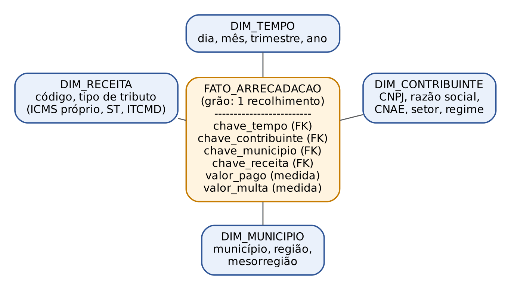

:::EXEMPLO Lendo uma linha da tabela de fatos
Uma linha da FATO_ARRECADACAO contém: chave_tempo = 20250315; chave_contribuinte = 8812; chave_municipio = 42; chave_receita = 3; valor_pago = 12.500; valor_multa = 0.
Sozinha, a linha diz pouco. Ao "ligar" as chaves às dimensões, ela vira informação:
- chave_tempo 20250315 → 15/3/2025, março, 1º trimestre, 2025;
- chave_contribuinte 8812 → uma indústria de alimentos, regime normal;
- chave_municipio 42 → Chapecó, região Oeste;
- chave_receita 3 → ICMS próprio.
Leitura: "em 15/3/2025, uma indústria de alimentos de Chapecó recolheu 12.500 reais de ICMS próprio, sem multa".
:::

### 24.3.2 Grão, medidas e chaves

Quatro conceitos de bastidor caem com frequência.

- Grão (granularidade): o que UMA linha da tabela de fatos representa. Grão "um recolhimento" é fino (muito detalhe, muitas linhas); grão "total mensal por município" é grosso (pouco detalhe, poucas linhas). Quanto MAIOR o detalhamento, MENOR o grão (o mapa mental do concurso diz: a granularidade é inversa ao detalhamento). Definir o grão é a primeira decisão do projeto: não se consegue "descer" a um detalhe que não foi gravado.
- Medidas (ou métricas): os números da tabela de fatos. Classificam-se pela possibilidade de somar:
  - aditivas: podem ser somadas por TODAS as dimensões (valor pago: soma-se por mês, por município, por setor);
  - semiaditivas: podem ser somadas por algumas dimensões, mas NÃO pelo tempo (saldo de dívida ativa, estoque, número de servidores lotados: somar o saldo de janeiro com o de fevereiro não faz sentido);
  - não aditivas: não podem ser somadas por nenhuma dimensão (percentuais, médias, alíquotas: somar a alíquota de dois produtos não dá alíquota de nada).
- Chave substituta (*surrogate key*, "chave surrogada" ou artificial): número sequencial criado pelo próprio DW para identificar cada linha da dimensão, em vez de usar a chave do sistema de origem (CNPJ, matrícula). Serve para evitar conflito entre códigos de fontes diferentes e para guardar versões históricas do mesmo contribuinte.
- Dimensão de mudança lenta (*slowly changing dimension*, SCD): técnica para registrar mudanças nos atributos da dimensão (a empresa mudou de município). No tipo 1, sobrescreve-se o valor antigo (perde-se a história); no tipo 2, cria-se nova linha com nova chave substituta e datas de vigência (preserva a história); no tipo 3, guarda-se o valor anterior numa coluna extra.

:::EXEMPLO Por que a medida semiaditiva não se soma no tempo
O saldo da dívida ativa de ICMS de um município, no último dia de cada mês, foi: janeiro 500, fevereiro 520, março 510 (milhões de reais).
Soma errada (tratando como aditiva):
- 500 + 520 + 510
- = 1.530
O número 1.530 não corresponde a nada: em nenhum momento a dívida foi de 1.530 milhões. O saldo de março JÁ INCLUI o que vinha de fevereiro.
Agregações corretas no tempo: o saldo final do trimestre (o de março, 510) ou o saldo médio:
- (500 + 520 + 510) ÷ 3
- = 1.530 ÷ 3
- = 510
Já entre municípios, no MESMO mês, a soma é legítima: o saldo do Estado em março é a soma dos saldos de março de todos os municípios. Por isso a medida é SEMI-aditiva: soma-se por algumas dimensões (município), não pelo tempo.
:::

### 24.3.3 O esquema estrela

No esquema estrela (*star schema*), a tabela de fatos fica no centro e cada dimensão se liga DIRETAMENTE a ela, num só nível, como as pontas de uma estrela. Cada dimensão é uma tabela única e desnormalizada: a dimensão contribuinte traz, na mesma linha, o CNAE, a descrição do CNAE e o setor, ainda que "Indústria" se repita milhares de vezes.

Características que a banca cobra:
- dimensões desnormalizadas e ligadas diretamente ao fato;
- consultas simples, com poucas junções, e por isso rápidas;
- mais redundância e mais espaço ocupado;
- fácil de entender pelo usuário, o que agiliza o desenvolvimento;
- a tabela de fatos tem chave primária composta pelas chaves estrangeiras das dimensões; costuma ter muitas linhas e poucas colunas (cresce "para baixo"), enquanto a dimensão tem poucas linhas e muitas colunas descritivas.

:::DICA Fato ou dimensão? O teste do "quanto" e do "por"
Se o campo responde a "QUANTO?" e faz sentido somar ou calcular média, é MEDIDA da tabela de fatos (valor, quantidade, peso).
Se responde a "POR QUAL ângulo?" (por mês, por município, por setor, por auditor), é ATRIBUTO de dimensão.
A dimensão tempo está presente em praticamente todo modelo dimensional.
:::

:::QUESTAO FGV 2026 — NAV Brasil — Analista de Tecnologia (Q4223169)
Situação: num BI de desempenho escolar, há uma tabela central com notas dos alunos, faltas acumuladas e ano letivo, ligada radialmente a tabelas de professores, escolas e disciplinas. Qual é a tabela central, que guarda as métricas e as chaves estrangeiras das dimensões? Gabarito oficial: B (tabela de fatos).
Resolução: métricas numéricas + chaves para as tabelas periféricas = tabela de fatos. As periféricas (professores, escolas, disciplinas) são as dimensões. "Tabela de junção associativa anêmica" e "matriz de transição de estado" são distratores sem sentido no modelo dimensional.
No mesmo sentido: Q3336807 (quantidade de pessoal alocado por dia e por setor modelada como fato aditivo: A), Q3885611 (tabela fato = chaves estrangeiras para dimensões + medidas numéricas: B), Q3781107 (fato central com dimensões desnormalizadas de propósito = esquema estrela: D), Q3851258 (para OLAP com agregações em vários níveis: modelo estrela, D), Q4223174 (no estrela puro, as dimensões são desnormalizadas e ligadas diretamente ao fato: D), Q3085938 (I, III e IV corretas; II erra ao dizer que as dimensões do estrela são normalizadas: B).
:::

### 24.3.4 O esquema floco de neve e a constelação

No floco de neve (*snowflake schema*), as dimensões são NORMALIZADAS: a hierarquia é quebrada em várias tabelas encadeadas. A dimensão contribuinte guarda só a chave do CNAE; a tabela de CNAE guarda a chave do setor; a tabela de setor guarda o nome do setor. O desenho lembra os braços ramificados de um floco de neve.

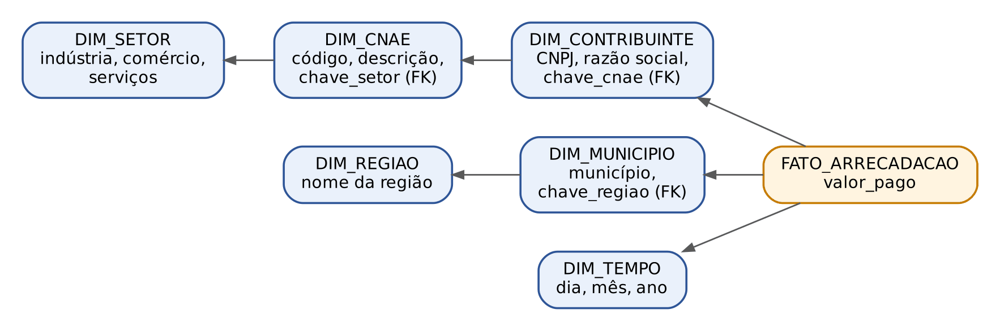

Compare os dois esquemas.

| Critério | Estrela | Floco de neve |
|---|---|---|
| Dimensões | desnormalizadas, uma tabela por dimensão | normalizadas, em várias tabelas encadeadas |
| Ligação ao fato | todas diretas | algumas tabelas não se ligam diretamente ao fato |
| Redundância e espaço | maior | menor |
| Número de junções nas consultas | menor | maior |
| Desempenho de leitura | em regra, melhor | em regra, pior |
| Manutenção da integridade | menos cuidada | mais fácil |
| Preferência de Kimball | sim | não (só em casos específicos) |

Quando várias tabelas de fatos compartilham as mesmas dimensões (por exemplo, FATO_ARRECADACAO e FATO_FISCALIZACAO usando as mesmas dimensões tempo, contribuinte e município), o modelo chama-se esquema constelação de fatos, ou esquema galáxia.

:::PEGADINHA A tabela de fatos também é "normalizada"?
Os mapas mentais de concurso costumam dizer que, no estrela, "a tabela fato é normalizada e as dimensões são desnormalizadas". A ideia é que o fato não repete descrições (só guarda chaves e medidas). Mas, se a assertiva disser que "a modelagem dimensional baseia-se na normalização extensiva de suas tabelas", está ERRADA: o princípio da modelagem dimensional é a desnormalização das dimensões para leitura rápida.
:::

:::QUESTAO FGV 2026 — TJ-RJ — Analista Judiciário, Cientista de Dados (Q3869739)
Situação: numa rede de varejo, a dimensão produto tem hierarquia profunda (departamento → divisão → categoria → subcategoria → produto). O administrador do banco propõe normalizar: a tabela de produtos guardaria só o código da subcategoria, que apontaria para a tabela de subcategorias, e assim por diante, evitando repetir textos em milhões de linhas. À luz de Kimball, o que é correto? Gabarito oficial: A.
Resolução: a proposta transforma a dimensão em floco de neve. Ganha-se espaço e integridade, mas cada consulta que precise do nome do departamento terá de percorrer quatro junções, o que prejudica o desempenho do BI. É exatamente o que diz a alternativa A. Por que as outras falham:
- chamar a proposta de "estrela recomendado por Kimball": errado duas vezes (é floco, e Kimball prefere o estrela);
- dizer que a desnormalização "deve ser evitada" em bancos colunares porque impede compressão: errado; o armazenamento colunar justamente comprime muito bem textos repetidos;
- dizer que ferramentas como Power BI e Tableau são "tecnicamente incompatíveis" com tabelas normalizadas: falso, elas leem ambas;
- confundir floco/estrela com tipo de chave (natural x substituta): critério inventado.
No mesmo sentido: Q3885599 (principal desvantagem do floco: mais junções, pior leitura: C), Q3755422 (várias tabelas de fatos compartilhando dimensões = esquema galáxia: D), Q3339680 (chave artificial para não depender das chaves das fontes = rotina de geração de chaves surrogadas: E).
:::

:::PRATIQUE exercícios elaborados para esta apostila
1. Num DW de fiscalização, classifique cada campo como medida (da tabela de fatos) ou atributo de dimensão: (a) valor do crédito tributário lançado; (b) nome do auditor; (c) mês do lançamento; (d) quantidade de autos de infração; (e) CNAE da empresa.
2. A tabela de fatos registra, para cada estabelecimento e cada dia, o estoque de mercadorias declarado. Pode-se somar esse estoque por estabelecimento num mesmo dia? E somar o estoque de um estabelecimento ao longo dos 30 dias do mês? Classifique a medida.
3. Um auditor propõe trocar o grão "uma nota fiscal" por "total mensal por contribuinte" para economizar espaço. Que pergunta ele deixará de conseguir responder?
4. (estilo FCC) Assinale a correta: (A) no floco de neve, todas as dimensões ligam-se diretamente ao fato; (B) no estrela, as dimensões são normalizadas para economizar espaço; (C) no estrela, as consultas exigem menos junções do que no floco de neve; (D) a alíquota média é medida aditiva; (E) o DW, por ser não volátil, dispensa a dimensão tempo.
Resolução:
1. (a) medida (responde "quanto?" e soma-se); (b) atributo da dimensão auditor; (c) atributo da dimensão tempo; (d) medida (contagem, aditiva); (e) atributo da dimensão contribuinte.
2. No mesmo dia, entre estabelecimentos, sim: o estoque total da rede naquele dia é a soma. Ao longo dos 30 dias, não: somar 30 fotografias do estoque não dá estoque algum (dá-se o saldo final ou a média). Medida semiaditiva.
3. Qualquer pergunta abaixo do mês ou abaixo do contribuinte: quais notas específicas foram emitidas, em que dia, para qual destinatário, com qual produto. Com grão grosso, o detalhe some e não volta (não se faz drill down abaixo do grão).
4. Gabarito: C. (A) descreve o oposto do floco; (B) no estrela as dimensões são desnormalizadas; (D) médias e percentuais são não aditivos; (E) a variação no tempo é característica essencial do DW, e a dimensão tempo está em praticamente todo modelo.
:::

## 24.4 OLAP: o cubo e as operações

### 24.4.1 A ideia: uma planilha com mais de duas entradas

Uma planilha comum tem duas entradas: linhas e colunas. Arrecadação por região (linhas) e por setor (colunas), por exemplo. Agora acrescente o ano. Para ver tudo junto, seria preciso uma planilha para cada ano, empilhadas uma atrás da outra. Esse "bloco" de planilhas empilhadas é o que se chama cubo de dados: cada eixo é uma dimensão, e cada célula guarda uma medida.

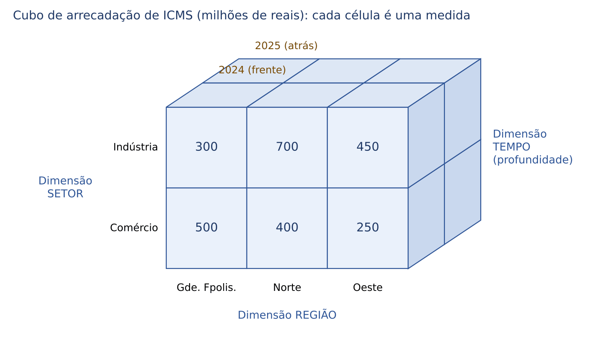

O cubo da figura tem três dimensões (região, setor, ano) e uma medida (arrecadação de ICMS em milhões de reais; números fictícios). A face da frente é o ano de 2024. Com mais de três dimensões, fala-se em hipercubo; a ideia é a mesma, só não dá para desenhar.

O OLAP é a tecnologia que permite ao usuário navegar nesse cubo de forma interativa, mudando o ângulo, subindo e descendo nos níveis de detalhe, sem escrever programas. Os dados completos do exemplo são estes:

| Ano | Região | Indústria | Comércio |
|---|---|---|---|
| 2024 | Grande Florianópolis | 300 | 500 |
| 2024 | Norte | 700 | 400 |
| 2024 | Oeste | 450 | 250 |
| 2025 | Grande Florianópolis | 320 | 560 |
| 2025 | Norte | 760 | 420 |
| 2025 | Oeste | 500 | 270 |

### 24.4.2 Hierarquias: os degraus de cada dimensão

Muitas dimensões têm níveis encadeados, chamados hierarquias: tempo (ano → trimestre → mês → dia); território (Estado → região → município); atividade (setor → divisão do CNAE → subclasse). As operações de subir e descer acontecem ao longo dessas escadas.

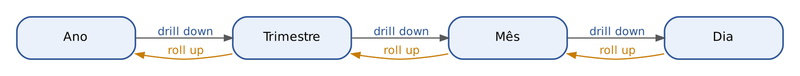

### 24.4.3 As operações, uma a uma, com o cubo do exemplo

Drill down (detalhar, "perfurar para baixo"): descer um nível na hierarquia, do mais resumido para o mais detalhado. Do total anual para o total por trimestre; do Estado para as regiões.

Roll up (também chamado drill up, "enrolar para cima", consolidar): o inverso. Subir um nível, agregando (em geral, somando). Também se diz roll up quando se elimina uma dimensão inteira, somando sobre ela.

:::EXEMPLO Roll up: do cubo ao total por ano
Eliminar as dimensões região e setor, somando tudo dentro de cada ano.
Ano 2024:
- 300 + 500 + 700 + 400 + 450 + 250
- = 800 + 1.100 + 700 (somando cada região: 300 + 500 = 800; 700 + 400 = 1.100; 450 + 250 = 700)
- = 2.600
Ano 2025:
- 320 + 560 + 760 + 420 + 500 + 270
- = 880 + 1.180 + 770
- = 2.830
Agora o gestor pode calcular o crescimento (porcentagem: Cap. 1):
- variação = (2.830 − 2.600) ÷ 2.600
- = 230 ÷ 2.600
- ≈ 0,0885, ou seja, cerca de 8,85% de aumento.
Se ele quiser saber ONDE o crescimento aconteceu, faz o caminho de volta: drill down para as regiões. Por exemplo, a indústria do Oeste foi de 450 para 500: (500 − 450) ÷ 450 = 50 ÷ 450 ≈ 11,1%; a indústria do Norte foi de 700 para 760: 60 ÷ 700 ≈ 8,6%.
:::

Slice (fatiar): FIXAR um único valor numa dimensão. O resultado é uma "fatia" do cubo com uma dimensão a menos. Fixar ano = 2025 produz a tabela região × setor apenas de 2025.

Dice (cortar em cubinhos): selecionar um CONJUNTO de valores em DUAS OU MAIS dimensões, obtendo um subcubo menor. Exemplo: ano = 2025; regiões Norte e Oeste; setor Indústria.

:::EXEMPLO Slice e dice no mesmo cubo
Slice "ano = 2025": a tabela que sobra é
| Região | Indústria | Comércio |
|---|---|---|
| Grande Florianópolis | 320 | 560 |
| Norte | 760 | 420 |
| Oeste | 500 | 270 |
Dice "2025, Norte e Oeste, Indústria": sobram duas células, 760 e 500. Somando:
- 760 + 500
- = 1.260 milhões de reais de ICMS da indústria do Norte e do Oeste em 2025.
:::

Pivot (girar, ou *rotate*): trocar a posição dos eixos na visualização, por exemplo pôr os setores nas linhas e as regiões nas colunas. Os números não mudam; muda o ângulo de leitura.

Drill across e drill through são as duas operações em que a literatura diverge, e a banca às vezes usa uma, às vezes outra definição.

| Operação | Definição na literatura técnica (Kimball) | Definição comum em materiais de concurso |
|---|---|---|
| Drill across | consultar, numa mesma análise, duas ou mais tabelas de fatos diferentes, ligadas por dimensões conformadas (ex.: arrecadação e fiscalização por município) | "pular" um nível intermediário da hierarquia (do ano direto para o mês) |
| Drill through | sair do cubo e ir ao dado detalhado que o originou (as linhas da tabela de fatos ou o próprio sistema transacional) | passar de uma dimensão para outra |

No Power BI, "detalhamento" (*drillthrough*) é o recurso que, ao clicar num item (por exemplo, um Estado), abre outra página com os gráficos filtrados só para aquele item.

:::PEGADINHA Slice x dice; drill down x roll up
- Slice = UM valor em UMA dimensão (fatia). Dice = vários valores em VÁRIAS dimensões (subcubo). Se a questão falar em "gerar um subcubo", a resposta esperada é dice.
- Drill DOWN desce para o DETALHE; roll UP (drill up) sobe para o RESUMO. A FCC (Q3507095) e outras bancas invertem para pegar o candidato.
- Pivot não calcula nada: só gira os eixos.
:::

### 24.4.4 Onde o cubo mora: ROLAP, MOLAP, HOLAP

| Tipo | Onde ficam os dados | Ponto forte | Ponto fraco |
|---|---|---|---|
| ROLAP (relacional) | em tabelas relacionais (o próprio esquema estrela); o cubo é simulado por consultas | escalabilidade, grandes volumes | consultas mais lentas |
| MOLAP (multidimensional) | num banco multidimensional próprio, com agregações pré-calculadas | rapidez de resposta | escala menos, ocupa espaço com pré-cálculos |
| HOLAP (híbrido) | detalhe em relacional, agregados em multidimensional | combina os dois | mais complexo e caro |
| DOLAP (*desktop*) | um cubo pequeno baixado para a máquina do usuário | análise desconectada | volume limitado |

:::QUESTAO FGV 2024 — TRF1 — Técnico Judiciário (Q3032315)
Situação: num data mart do tribunal, a consulta mais comum é o total de processos por tipo e por data. Qual operação OLAP gera um subcubo? Gabarito oficial: B (dice).
Resolução: escolher valores em mais de uma dimensão (certos tipos E certas datas) recorta um subcubo: dice. Slice fixa um valor numa só dimensão; drill up agrega; rotate e pivot só giram a visualização.
:::

:::QUESTAO FGV 2024 — DATAPREV — Análise de Negócio de TI (Q3085935)
Situação: uma empresa implanta OLAP sobre o DW para analisar vendas por tempo, produto e região. Afirmativas: I) OLAP permite análise multidimensional sob diferentes perspectivas; II) operações incluem slice, dice, drill down e roll up; III) OLAP é usado principalmente para processar transações em tempo real, como pagamentos; IV) o DW é componente essencial do OLAP, guardando o histórico integrado. Gabarito oficial: D (I, II e IV).
Resolução: III descreve o OLTP, não o OLAP. As demais são corretas. O erro de quem marca "I e II, apenas" é desconfiar da IV; mas a banca, como a literatura, trata o DW como a base natural do OLAP.
No mesmo sentido: Q3755423 (painéis refinam a decisão ao incorporar drill down e roll up: D), Q2451577 (característica que distingue o DW/OLAP do OLTP: "dimensões e níveis de agregação ilimitados", uma das regras de Codd para OLAP: A).
:::

:::QUESTAO FGV 2025 — MPU — Analista do MPU (Q3336800)
Situação: num painel do Power BI sobre processos por Estado, o usuário quer clicar num Estado e abrir uma nova página com gráficos só daquele Estado. Como implementar? Gabarito oficial: E (criar página de destino com os visuais e configurar o *drillthrough* no relatório de origem).
Resolução: é exatamente a função do detalhamento (*drillthrough*) do Power BI: navegar para uma página filtrada pelo item clicado. Segmentação de dados (*slicer*) filtra a mesma página; grupos de visuais apenas mostram ou ocultam elementos; relatório paginado é outro produto (feito para impressão); drill down num treemap desce na hierarquia DENTRO do mesmo visual, sem abrir página nova.
:::

:::PRATIQUE exercícios elaborados para esta apostila
Use o cubo de 24.4.1.
1. Faça o roll up que elimina região e ano, deixando só o setor. Quanto arrecadou a indústria nos dois anos somados? E o comércio?
2. Faça o slice "setor = Comércio" e diga quantas dimensões restam e quais são.
3. Dice: anos 2024 e 2025, região Grande Florianópolis, ambos os setores. Some as células.
4. (estilo FCC) Um gestor vê o total anual e clica para ver os totais mensais; depois, numa tabela com regiões nas linhas e anos nas colunas, troca para anos nas linhas e regiões nas colunas. As operações são, respectivamente: (A) roll up e slice; (B) drill down e pivot; (C) drill down e dice; (D) drill through e roll up; (E) slice e pivot.
Resolução:
1. Indústria: 2024 = 300 + 700 + 450 = 1.450; 2025 = 320 + 760 + 500 = 1.580; total = 1.450 + 1.580 = 3.030. Comércio: 2024 = 500 + 400 + 250 = 1.150; 2025 = 560 + 420 + 270 = 1.250; total = 1.150 + 1.250 = 2.400. Conferência: 3.030 + 2.400 = 5.430, que é igual a 2.600 + 2.830 = 5.430 (soma dos totais anuais).
2. Fixar um valor elimina a dimensão setor; restam duas: região e ano.
3. 300 + 500 + 320 + 560 = 800 + 880 = 1.680.
4. Gabarito: B. Do ano para o mês é descer na hierarquia (drill down); trocar linhas por colunas é girar (pivot).
:::

## 24.5 Big data, data lake e lakehouse

### 24.5.1 Por que o data warehouse não basta

O Cap. 23 apresentou o big data: volumes enormes, gerados em alta velocidade e em grande variedade de formatos. O DW clássico tem dificuldade com isso, porque exige que todo dado seja limpo e encaixado num modelo antes de entrar. Como encaixar num esquema estrela o XML completo de cada NF-e, os arquivos de registro de acesso (*logs*), os PDFs de contratos, as imagens de mercadorias apreendidas e os áudios de atendimento?

### 24.5.2 Data lake: guardar tudo, do jeito que chegou

O data lake ("lago de dados") é um repositório central que armazena grandes volumes de dados de QUALQUER tipo (estruturados, semiestruturados e não estruturados) em seu FORMATO ORIGINAL, bruto, com pouca ou nenhuma transformação na entrada. A estrutura só é aplicada quando alguém vai usar o dado.

Isso tem nome: esquema na leitura (*schema-on-read*). O DW trabalha com esquema na escrita (*schema-on-write*): o formato é definido antes e o dado só entra se couber nele.

A analogia: o DW é uma biblioteca já catalogada, em que cada livro chega classificado e vai para a estante certa. O data lake é o depósito de um arquivo público, onde as caixas entram como vieram e só são abertas e organizadas quando um pesquisador precisa delas. O depósito aceita tudo e é barato; mas, se ninguém registrar o que entrou (metadados e catálogo), vira um pântano de dados (*data swamp*), em que nada se encontra.

| Critério | Data warehouse | Data lake |
|---|---|---|
| Tipos de dados | principalmente estruturados | todos os tipos |
| Momento do esquema | na escrita (*schema-on-write*) | na leitura (*schema-on-read*) |
| Tratamento | antes de carregar (ETL) | depois, conforme o uso (ELT) |
| Usuário típico | gestor, analista de negócio | cientista de dados, engenheiro de dados |
| Uso típico | relatórios e painéis confiáveis | exploração, aprendizado de máquina, dados ainda sem uso definido |
| Custo de armazenamento | mais alto | mais baixo (armazenamento de objetos) |
| Risco característico | rigidez | virar pântano (*data swamp*) |

:::PEGADINHA O data lake NÃO é só para dados não estruturados
O data lake aceita QUALQUER formato, inclusive tabelas vindas de sistemas transacionais. A afirmação "data lakes são exclusivos para dados não estruturados e incompatíveis com dados estruturados" é FALSA (FGV, Q4150987). Também é falso que o data lake "exige esquema rígido antes da ingestão", "aplica ETL completo antes de armazenar" ou "organiza tudo em modelos dimensionais": isso descreve o DW.
:::

### 24.5.3 Lakehouse: o melhor dos dois mundos

Na prática, muitos órgãos acabaram com dois ambientes: um data lake para a ciência de dados e um DW para o BI, com dados copiados de um para o outro, custos dobrados e versões divergentes. O data lakehouse (junção de *lake* e *warehouse*) propõe uma plataforma única: os dados ficam no armazenamento barato do lago, em formatos abertos (como Parquet), e uma camada de tabelas por cima acrescenta o que faltava ao lago:

- transações ACID (atomicidade, consistência, isolamento e durabilidade: as garantias de que uma gravação ou acontece por inteiro ou não acontece, sem deixar dados pela metade), antes exclusivas dos bancos relacionais;
- imposição de esquema (*schema enforcement*) e governança, com catálogo unificado de metadados;
- desempenho para consultas de BI, sem impedir o acesso aos dados brutos pelo aprendizado de máquina.

Os formatos de tabela abertos mais citados nas questões são Delta Lake, Apache Iceberg e Apache Hudi.

### 24.5.4 A arquitetura em camadas (medalhão)

Para organizar o lago ou o lakehouse, usa-se com frequência a arquitetura em camadas, apelidada de medalhão:

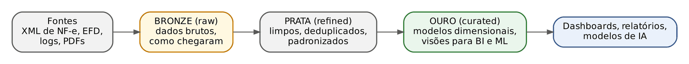

- bronze (*raw*, bruta): os dados como chegaram, sem alteração; serve de prova da origem e permite reprocessar;
- prata (*refined*, refinada): dados limpos, deduplicados, padronizados, enriquecidos e com regras básicas de qualidade;
- ouro (*curated*, curada): dados prontos para consumo, em modelos dimensionais ou visões otimizadas para BI e análises avançadas.

O paralelo jurídico: bronze é o processo físico com tudo o que foi juntado; prata é o processo saneado, com folhas numeradas e documentos repetidos retirados; ouro é o relatório do acórdão, organizado para quem vai decidir.

:::NOTA Duas palavras da moda: data mesh e data fabric (noção)
Data mesh ("malha de dados") é uma forma de ORGANIZAÇÃO: cada área de negócio é dona dos seus dados e os oferece aos demais como "produtos de dados", com padrões comuns de governança. Data fabric ("tecido de dados") é uma camada TECNOLÓGICA de integração, que conecta fontes distribuídas por meio de metadados e virtualização, sem necessariamente copiar tudo para um só lugar. Aparecem como distratores; basta reconhecê-los.
:::

:::QUESTAO FCC 2026 — SEFAZ-GO — Auditor Fiscal da Receita Estadual (Q4067460)
Situação: um órgão estadual integra NF-e, EFD/SPED, *logs*, dados semiestruturados de convênios e arquivos de vários formatos, preservando-os no formato original para usos futuros. Qual a característica que define o data lake nesse cenário? Gabarito oficial: C (armazenamento de dados brutos em múltiplos formatos, com esquema aplicado na leitura).
Resolução: "formato original" + "usos futuros" + "múltiplos formatos" = data lake com *schema-on-read*. Todas as outras alternativas descrevem o DW: esquema rígido antes da ingestão, ETL completo antes de armazenar, modelos dimensionais para OLAP, consolidação prévia em data marts.
:::

:::QUESTAO FCC 2026 — SEFAZ-CE — Auditor Fiscal da Receita Estadual (Q4221496)
Situação: qual a afirmação correta sobre big data e data warehouse? Gabarito oficial: D (big data são as tecnologias e abordagens para processar e armazenar grandes volumes de dados; o DW é o repositório que consolida dados para a tomada de decisão).
Resolução: big data é um FENÔMENO e um conjunto de tecnologias; DW é um REPOSITÓRIO analítico. As erradas trocam as definições (big data como "modelagem dimensional"; DW como "algoritmos distribuídos"), igualam os dois conceitos ou atribuem ao big data o processamento transacional.
:::

:::QUESTAO FCC 2026 — SEFAZ-SP — Auditor Fiscal, Gestão Tributária (Q3956764)
Situação: uma Secretaria da Fazenda centraliza dados de declarações, NF-e, cadastro e fiscalizações numa arquitetura que guarda dados brutos em formato nativo, aplica transformações sob demanda com processamento distribuído, oferece estruturas otimizadas para consultas dos auditores e mantém governança com controles transacionais sobre os metadados. Que arquitetura é essa? Gabarito oficial: A (data lakehouse, com camadas transacionais como Delta Lake ou Apache Iceberg).
Resolução: o segredo está na soma de três pistas. "Dados brutos em formato nativo" sozinho seria data lake; mas "estruturas otimizadas para consulta" e "controles transacionais sobre metadados" são o acréscimo do lakehouse. Por que as outras falham: o DW tradicional não guarda dado bruto nativo; o data mart é recorte departamental; o "data lake federado sem replicação" descreve virtualização, que não armazena os dados; e o "data lake convencional" não tem a camada transacional.
:::

:::QUESTAO FCC 2026 — SEFAZ-SP — Auditor Fiscal, Tecnologia da Informação (Q3926894)
Situação: a Secretaria quer unificar, em nuvem, NF-e, escriturações, transações de cartão e cruzamentos de malha fiscal, sustentando tanto os relatórios de arrecadação (BI) quanto experimentos de aprendizado de máquina para detectar empresas "laranja". Já existem um data lake em Parquet e um DW relacional legado. Qual a decisão arquitetural mais adequada, considerando governança, desempenho para BI e flexibilidade analítica? Gabarito oficial: C (evoluir o lago para um lakehouse, com tabelas transacionais Delta, Iceberg ou Hudi, catálogo unificado e camadas de acesso otimizadas).
Resolução: o enunciado pede três coisas ao mesmo tempo, e só o lakehouse entrega as três. Veja o que cada alternativa errada sacrifica:
- tudo no DW relacional, convertendo XML e *logs* em tabelas normalizadas: perde flexibilidade e encarece muito;
- desativar o DW e usar só o lago com *schema-on-read*: perde governança e desempenho de BI;
- dois ambientes paralelos sem metadados unificados nem consistência: perde governança (versões divergentes);
- lago só como área de passagem e tudo via data marts do DW: perde a flexibilidade da ciência de dados.
:::

:::QUESTAO FCC 2026 — SEFAZ-SP — Auditor Fiscal, Tecnologia da Informação (Q3926893)
Situação: um data lake de fiscalização eletrônica (NF-e, CT-e, EFD, Simples Nacional, recolhimentos) adota zonas *raw/bronze*, *refined/silver* e *curated/gold*, com ELT. Qual a descrição correta das zonas? Gabarito oficial: E (bronze guarda dados brutos como recebidos; prata aplica padronização, enriquecimento e regras básicas de qualidade; ouro disponibiliza modelos dimensionais ou visões otimizadas para BI e análises avançadas).
Resolução: é a definição da arquitetura medalhão (24.5.4). As erradas atribuem às zonas funções inventadas: bronze "só com dados deduplicados" (a deduplicação é tarefa da prata), camadas separadas por tipo de dado (estruturado, semiestruturado, não estruturado), ouro como "área de backup" ou como lugar de dados operacionais OLTP.
:::

:::QUESTAO FCC 2026 — TJ-CE — Analista Judiciário, Sistemas da Informação (Q4240113)
Situação: um Tribunal quer consolidar dados processuais, documentos digitais, registros de auditoria, mídia e bases analíticas. Considerando DW e lakehouse, qual a arquitetura mais adequada? Gabarito oficial: D (centralizar estruturados e não estruturados em armazenamento unificado, com governança, controle transacional, gerenciamento de metadados e suporte eficiente a consultas analíticas).
Resolução: cuidado com a alternativa E, que é a mais sedutora: ela descreve um data lake (tudo centralizado, flexibilidade de ingestão, tratamento conforme o consumo), mas OMITE governança, transações e metadados, que são justamente o que define o lakehouse. A alternativa A e a C descrevem o DW (esquema prévio, transformação antes, sem formato nativo). A B fala em unificar o armazenamento mas "evitar compartilhamento de metadados e controles transacionais", o oposto do lakehouse.
Lição: na FCC, quando duas alternativas parecem certas, a correta é a que contém TODOS os elementos do conceito pedido.
:::

:::QUESTAO FGV 2026 — TJ-RJ — Analista Judiciário, Engenheiro de Dados (Q4181535)
Situação: uma varejista tem dados de vendas que exigem consistência ACID e painéis de BI de baixa latência, e petabytes de *logs* de navegação e sensores que os cientistas de dados querem em formato bruto. Quer evitar dois silos (DW para BI e lago para IA), reduzir custo e manter governança. Gabarito oficial: E (lakehouse com formatos abertos como Delta ou Iceberg sobre armazenamento de objetos: ACID e imposição de esquema nas vendas, modelo estrela na camada ouro para o BI, dados brutos na camada bronze para o aprendizado de máquina).
Resolução: mesma lógica da Q3926894. Erradas: DW em terceira forma normal para tudo, inclusive *logs* (caro e rígido, e a normalização não é a "única forma" de garantir ACID); lago puro com *schema-on-read* para todos (o BI fica lento); data marts com virtualização sem lago (os cientistas perdem o dado bruto); banco de documentos com desnormalização extrema (sem ACID robusto para o financeiro e ruim para BI).
No mesmo sentido: Q4223167 (o que define o lakehouse é ACID e governança diretamente sobre arquivos em formato aberto: A), Q3595758 (vantagem do lago: guardar dados brutos sem esquema rígido prévio: A), Q4150987 (lago = *schema-on-read*; DW = *schema-on-write*; lago não é exclusivo de não estruturados: V – V – F, A), Q2534662 (DW tem esquema definido; lago aceita fontes externas de formato diverso; a III erra ao dizer que ambos usam SGBD e ETL: D), Q2568151 (arquitetura que mais se assemelha ao big data: data lake, E).
:::

:::QUESTAO FGV 2026 — TCE-PE — Auditor de Controle Externo (Q4279914)
Situação: um Tribunal de Contas recebe dados em grande volume, de fontes variadas e de forma contínua. Pretende: I) tratar esse cenário de volume, variedade e produção contínua; II) manter os dados num repositório que os guarde no formato original, antes de tratamentos específicos; III) executar processo que extraia, transforme e carregue os dados. Gabarito oficial: D (big data, data lake e ETL).
Resolução: I descreve as características do big data (volume, variedade, velocidade: Cap. 23); II é a definição de data lake; III é a sigla ETL por extenso.
No mesmo sentido: Q2571742 (data lake: surgiu como alternativa aos armazéns, guarda dados brutos com mínima transformação; data mart: facilita relatórios e serve à camada de apresentação do DW: 1 – 2 – 2 – 1, A), Q3782910 (nas "lagoas de dados" de um lago, a camada de aplicação guarda dados recebidos de aplicações, uniformemente estruturados: C).
:::

## 24.6 Os quatro tipos de analytics

### 24.6.1 A ideia: quatro perguntas em sequência

*Analytics* (análise de dados, analítica) é o uso sistemático de dados, estatística e modelos para responder perguntas e apoiar decisões. A classificação que as bancas cobram, difundida pela consultoria Gartner, organiza a análise em quatro tipos, como degraus de uma escada: cada degrau responde a uma pergunta mais ambiciosa.

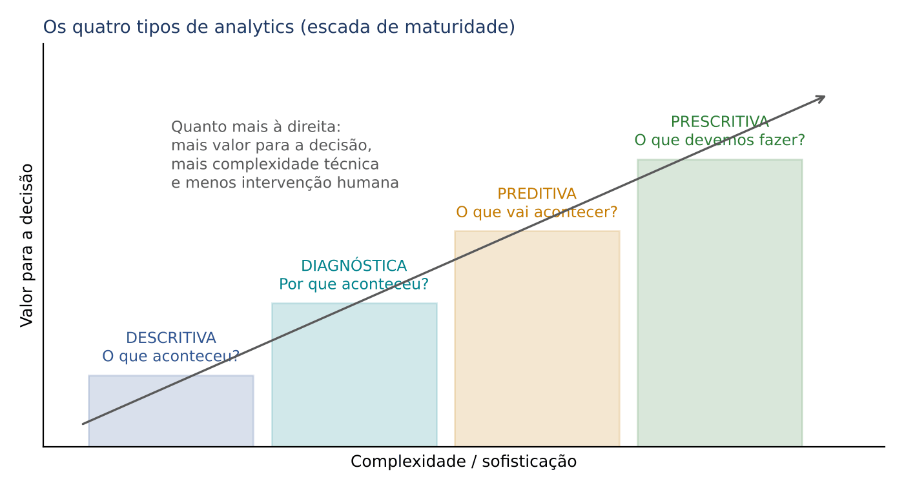

| Tipo | Pergunta | Exemplo na SEFAZ | Ferramentas típicas |
|---|---|---|---|
| Descritiva | O que aconteceu? (ou está acontecendo) | a arrecadação de ICMS caiu 4% no trimestre | relatórios, painéis, médias, totais, gráficos de barra e linha |
| Diagnóstica | Por que aconteceu? | a queda concentrou-se no setor de combustíveis, após mudança de alíquota | drill down, comparação de segmentos, correlação, mineração de dados |
| Preditiva | O que provavelmente vai acontecer? | a arrecadação do próximo trimestre deve ficar entre X e Y; estas 200 empresas têm alta probabilidade de sonegar | modelos estatísticos, séries temporais, aprendizado de máquina, mineração de dados e de textos |
| Prescritiva | O que devemos fazer? | quais 50 empresas fiscalizar primeiro, com a equipe disponível, para maximizar a recuperação | otimização, simulação, sistemas de recomendação |

Duas observações de prova:
- quanto mais se sobe na escada, maior a complexidade e o valor para a decisão, e menor a participação humana na escolha final (no prescritivo, o sistema já recomenda a ação);
- a análise preditiva diz o que PROVAVELMENTE ocorrerá (é probabilística, não certeza); a prescritiva recomenda o que FAZER diante disso.

:::DICA Uma pergunta para cada tipo
Leia o verbo do enunciado. "Registrar, resumir, mostrar picos e quedas" → descritiva. "Entender por que, detalhar o mês de pico, investigar causas" → diagnóstica. "Prever, estimar, antecipar" → preditiva. "Recomendar, otimizar, indicar a melhor ação" → prescritiva.
:::

### 24.6.2 Análise exploratória de dados

Antes de construir qualquer modelo, o analista faz a análise exploratória de dados (AED, ou EDA, *exploratory data analysis*): resume e visualiza os dados para entender distribuições, relações entre variáveis, valores faltantes e discrepantes (*outliers*), sem ainda testar hipóteses formais (Cap. 15) nem treinar modelos (Cap. 25). Usa as ferramentas dos Caps. 9 e 10: média, mediana, desvio-padrão, histograma, boxplot, dispersão. Em termos de analytics, é análise descritiva e o primeiro passo da diagnóstica.

:::QUESTAO FCC 2026 — SEFAZ-SP — Auditor Fiscal, Tecnologia da Informação (Q3926896)
Situação: a Secretaria recebeu os lançamentos de ICMS de cinco anos (valores, setores, municípios, regime, situação). Antes de construir modelos preditivos ou novas regras, a equipe faz apenas resumo, visualização e detecção de padrões e *outliers*, sem formular hipóteses formais nem treinar modelos. Como se caracteriza esse trabalho? Gabarito oficial: D (análise exploratória de dados, com medidas-resumo e visualizações).
Resolução: as palavras "apenas", "resumo", "visualização", "sem hipóteses formais" e "sem treinar modelos" excluem tudo o mais. Não é prescritivo (não recomenda ações); não é mineração preditiva nem aprendizado supervisionado (não treina modelos nem usa rótulos de fraude); e não é "OLAP sem foco em gráficos e *outliers*" (a própria alternativa contradiz o enunciado).
:::

:::QUESTAO FCC 2026 — SEFAZ-CE — Auditor Fiscal da Receita Estadual (Q4221495)
Situação: auditores analisam milhões de registros para (a) identificar grupos de contribuintes com comportamento semelhante, (b) ver a evolução da arrecadação nos últimos anos e (c) estimar cenários futuros. Qual afirmação está correta? Gabarito oficial: C (grupos semelhantes, por técnicas de agrupamento; tendências e projeções, por métodos estatísticos e modelos de séries históricas).
Resolução: cada objetivo tem sua ferramenta. Agrupar semelhantes sem classes prévias é agrupamento (*clustering*, 24.7.4). Tendência e projeção vêm de séries temporais. As erradas trocam os papéis (agrupamento "prevê valores futuros"; tendência "identifica grupos"), exigem classificação supervisionada para agrupar (não exige: agrupamento é não supervisionado) ou negam o uso de estatística nas projeções.
:::

:::QUESTAO FGV 2024 — EPE — Analista de Pesquisa Energética (Q3261029)
Situação: associar 1 descritiva, 2 diagnóstica, 3 preditiva, 4 prescritiva a: (a) usa dados históricos para prever padrões futuros; (b) analisa implicações de escolhas e recomenda o melhor plano de ação, com simulação e mecanismos de recomendação; (c) mostra o que aconteceu, com gráficos de pizza, barras e linhas; (d) análise aprofundada para entender por que algo aconteceu, com drill down e correlações. Gabarito oficial: D (3 – 4 – 1 – 2).
Resolução: aplique o verbo de cada descrição: prever (3), recomendar (4), mostrar o que aconteceu (1), entender o porquê (2).
No mesmo sentido: Q3258874 (registrar reservas e picos = descritiva; detalhar o mês de pico = diagnóstica; prever reservas do ano seguinte = preditiva: 1 – 2 – 3, B), Q3851685 (facilitador típico da análise preditiva: mineração de texto, D; painéis, *scorecards* e DW são facilitadores da descritiva; modelo de decisão, da prescritiva), Q3595721 (análise preliminar dos registros para planejar a auditoria = análise exploratória; verificar conformidade com regras de negócio = teste e avaliação de controles: A).
:::

## 24.7 Data mining (mineração de dados)

### 24.7.1 A ideia: garimpar o que ninguém perguntou

No OLAP, o usuário faz uma pergunta que ele já sabe formular ("quanto arrecadamos por região?") e a ferramenta responde. Na mineração de dados (*data mining*), o caminho é o inverso: algoritmos vasculham grandes volumes de dados em busca de padrões que ninguém tinha formulado como pergunta, padrões válidos, novos, potencialmente úteis e compreensíveis. É como o garimpeiro que peneira toneladas de cascalho em busca das pepitas.

Exemplos na administração tributária:
- descobrir que empresas que compram de fornecedores com inscrição inapta também tendem a apresentar saídas sem nota (regra de associação);
- separar os contribuintes em grupos de comportamento parecido, para tratar cada grupo de modo diferente (agrupamento);
- apontar, entre milhões de declarações, as poucas que destoam do padrão (detecção de anomalias);
- estimar a probabilidade de uma empresa ser "de fachada" a partir de casos já confirmados (classificação).

A mineração usa estatística, aprendizado de máquina (Cap. 25) e técnicas de banco de dados. Um alerta que os mapas de concurso repetem: ela ENCONTRA padrões, mas não os EXPLICA. Correlação descoberta não é causa (Cap. 16); cabe ao analista interpretar.

| | Consulta comum (SQL) | OLAP | Data mining |
|---|---|---|---|
| Quem formula a pergunta | o usuário, com precisão | o usuário, navegando | o algoritmo sugere padrões |
| Tipo de resultado | lista de registros | números agregados por dimensão | regras, grupos, modelos, alertas |
| Exemplo | "quais notas a empresa X emitiu em março?" | "arrecadação por setor e mês" | "que combinações de comportamento indicam sonegação?" |

### 24.7.2 O processo KDD

A mineração é uma etapa de um processo maior, a descoberta de conhecimento em bases de dados (KDD, *Knowledge Discovery in Databases*), sistematizado por Fayyad e colaboradores:

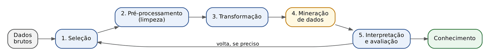

- Seleção: escolher, entre todos os dados disponíveis, os relevantes para o objetivo (só empresas do Simples, só os últimos três anos).
- Pré-processamento: limpeza, tratamento de valores faltantes e de ruído, eliminação de duplicidades (Cap. 23).
- Transformação: colocar os dados na forma que o algoritmo exige: criar variáveis derivadas (margem = lucro ÷ receita), discretizar, normalizar escalas, reduzir dimensões, transformar textos em vetores numéricos.
- Mineração de dados: aplicar o algoritmo para extrair padrões.
- Interpretação e avaliação: verificar se os padrões são válidos, novos e úteis; descartar os óbvios ou espúrios; transformar o resto em conhecimento. O processo é iterativo: pode-se voltar a qualquer etapa anterior.

Algumas obras agrupam as etapas em três: pré-processamento (seleção, limpeza, codificação, enriquecimento), mineração e pós-processamento (interpretação). Nessa versão, "descoberta de associações" é tarefa da MINERAÇÃO, enquanto seleção, limpeza, codificação e enriquecimento são PRÉ-PROCESSAMENTO. O modelo CRISP-DM, mais usado na indústria, está no Cap. 23.

:::QUESTAO FGV 2024 — CVM — Analista, Ciência de Dados (Q2517630)
Situação: uma cientista de dados quer medir o sentimento sobre uma prova numa rede social e, no processo KDD, representa cada texto como um vetor numérico calculado a partir de um modelo de linguagem pré-treinado (word2vec). Em que fase do KDD ela gera os vetores? Gabarito oficial: D (transformação dos dados).
Resolução: converter textos em números para que o algoritmo consiga processá-los é mudar a FORMA dos dados: transformação. Ainda não é mineração (que viria depois, ao classificar o sentimento); não é seleção (escolher quais dados), nem limpeza (corrigir erros), nem enriquecimento (acrescentar informação de outra fonte).
No mesmo sentido: Q2705550 e Q2571535 (entre seleção, limpeza, codificação, enriquecimento e descoberta de associações, só a última pertence à etapa de mineração: D).
:::

### 24.7.3 As tarefas da mineração

As tarefas dividem-se em dois grandes grupos.

- Preditivas: usam dados do passado para prever um valor ou uma categoria. Exigem exemplos com a "resposta certa" já conhecida (rótulos), e por isso se diz que o aprendizado é supervisionado (Cap. 25).
- Descritivas: descrevem a estrutura dos dados, encontrando grupos, associações ou exceções, sem resposta prévia. Aprendizado não supervisionado.

| Tarefa | Pergunta que responde | Supervisionada? | Algoritmos típicos | Exemplo fiscal |
|---|---|---|---|---|
| Classificação | a qual CATEGORIA pertence? | sim | árvore de decisão, floresta aleatória, redes neurais, SVM, k vizinhos mais próximos (kNN), Naive Bayes, regressão logística | empresa de fachada: sim ou não |
| Regressão (estimação) | qual o VALOR numérico? | sim | regressão linear (Cap. 16), árvores de regressão, redes neurais | ICMS esperado de um posto de combustíveis |
| Agrupamento (*clustering*) | quais registros se PARECEM? | não | K-means (k-médias), hierárquico, DBSCAN | perfis de contribuintes |
| Regras de associação | o que costuma ocorrer JUNTO? | não | Apriori, FP-Growth | irregularidades que aparecem juntas |
| Detecção de anomalias | o que DESTOA do padrão? | em regra, não | *isolation forest*, escore z, LOF | nota com valor fora do comum |
| Padrões sequenciais | o que costuma vir DEPOIS? | não | GSP e variantes do Apriori | abertura de empresa, notas de alto valor e baixa em poucos meses |
| Sumarização | como descrever o conjunto em poucas palavras? | não | estatística descritiva | perfil médio do setor |

:::PEGADINHA Tarefa x algoritmo; K-means x kNN
- TAREFA é o objetivo (classificar, agrupar, associar). ALGORITMO (ou técnica) é o meio (árvore de decisão, K-means, Apriori). Questão que pede "apenas tarefas" quer, por exemplo, "classificação e análise de associação", e não "árvore de decisão e redes neurais".
- K-means AGRUPA, sem rótulos; kNN CLASSIFICA, com rótulos. DBSCAN também é algoritmo de agrupamento (por densidade). A família de cada algoritmo (supervisionado ou não) e as demais pegadinhas de nome estão na tabela do Cap. 25 (25.5.3), que é o lugar próprio desse detalhe.
- PCA não é tarefa de mineração em sentido estrito: é técnica de REDUÇÃO de dimensionalidade (v. Cap. 25).
:::

### 24.7.4 Regras de associação: suporte, confiança e lift

#### A ideia

Uma regra de associação tem a forma "SE A, ENTÃO B" (escreve-se A → B). A é o antecedente; B, o consequente. O exemplo clássico é o carrinho de supermercado: "quem compra leite também compra pão". Daí o nome de análise de cesta de compras. Para saber se a regra vale a pena, usam-se três medidas.

#### Um exemplo à mão

Cinco compras (chamadas transações):

| Transação | Itens |
|---|---|
| T1 | pão, leite |
| T2 | pão, café, manteiga |
| T3 | leite, café |
| T4 | pão, leite, café |
| T5 | pão, leite, manteiga |

Avalie a regra leite → pão. Primeiro, conte:
- transações com leite: T1, T3, T4, T5 → 4;
- transações com pão: T1, T2, T4, T5 → 4;
- transações com leite E pão: T1, T4, T5 → 3;
- total de transações: 5.

#### As fórmulas, com cada símbolo explicado

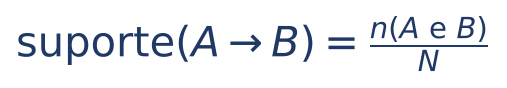

O suporte mede quão FREQUENTE é a combinação na base inteira. Símbolos: n(A e B) = número de transações que contêm A e B ao mesmo tempo; N = número total de transações.

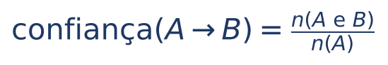

A confiança mede, entre as transações que têm A, a proporção que também tem B. Símbolo novo: n(A) = número de transações que contêm A. Em linguagem de probabilidade (Cap. 12), a confiança é a probabilidade condicional P(B | A).

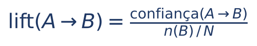

O lift (elevação) compara a confiança com a frequência de B na base toda: n(B) = número de transações com B, e n(B) ÷ N é a proporção de B. Equivale a P(A e B) ÷ [P(A) × P(B)].

Como ler o lift:
- lift = 1: A e B são independentes; saber que ocorreu A não muda a chance de B (Cap. 12);
- lift > 1: associação positiva; A torna B mais provável do que seria por acaso (lift 2 = duas vezes mais provável);
- lift < 1: associação negativa; quem tem A tende a NÃO ter B.

:::EXEMPLO Calculando as três medidas da regra leite → pão
Suporte:
- suporte = n(leite e pão) ÷ N
- = 3 ÷ 5
- = 0,6 = 60%
Confiança:
- confiança = n(leite e pão) ÷ n(leite)
- = 3 ÷ 4
- = 0,75 = 75%
Lift: primeiro a proporção de pão na base:
- n(pão) ÷ N = 4 ÷ 5 = 0,8
- lift = 0,75 ÷ 0,8
- = 0,9375
Interpretação: a regra parece forte (75% de confiança), mas o lift é MENOR que 1. Pão aparece em 80% de TODAS as compras; entre as que têm leite, aparece em 75%. Ou seja, comprar leite não aumenta a chance de comprar pão; até a reduz um pouco. Esta é a razão de existir do lift: confiança alta pode ser só reflexo de um item muito popular.
:::

:::DICA Contas sem calculadora
Suporte e confiança têm o MESMO numerador, n(A e B). Muda só o denominador: o total N (suporte) ou n(A) (confiança). Como n(A) ≤ N, a confiança é sempre maior ou igual ao suporte. Se a alternativa der confiança menor que o suporte, elimine-a.
O suporte de A → B é igual ao de B → A; a confiança, em geral, não.
:::

O algoritmo mais cobrado é o Apriori. Ele primeiro encontra os conjuntos de itens frequentes (com suporte acima de um mínimo escolhido pelo analista) e só depois gera as regras com confiança acima de outro mínimo. Sua ideia central, o princípio Apriori: se um conjunto de itens é raro, todo conjunto maior que o contenha também é raro, e pode ser descartado sem contar.

:::QUESTAO FGV 2026 — DATAPREV — Análise de Negócio de TI (Q4388954)
Situação: em 10.000 registros de incidentes, 2.000 têm a ocorrência A, 1.500 têm a ocorrência B e 1.200 têm A e B juntas. Quais o suporte e a confiança da regra A → B? Gabarito oficial: A (12% e 60%), conferido no QConcursos em 30/10/2026, coincidente com o resultado da conta.
Resolução:
- suporte = 1.200 ÷ 10.000 = 0,12 = 12%
- confiança = 1.200 ÷ 2.000 = 0,6 = 60%
As alternativas armadilha nascem de denominadores trocados: 15% é 1.500 ÷ 10.000 (a frequência de B, não do par); 20% é 2.000 ÷ 10.000 (a frequência de A); 80% é 1.200 ÷ 1.500 (a confiança da regra INVERSA, B → A).
Bônus: o lift seria 0,6 ÷ (1.500 ÷ 10.000) = 0,6 ÷ 0,15 = 4. Quem tem A tem quatro vezes mais chance de ter B do que o incidente médio.
:::

:::QUESTAO FGV 2026 — MPE-ES — Cientista de Dados (Q4218180)
Situação: a regra {desvio de verba} → {falsidade ideológica}, em processos administrativos, tem confiança 0,80 e lift 2,0. Qual a interpretação correta do lift? Gabarito oficial: C (a presença de desvio de verba torna a falsidade ideológica duas vezes mais provável do que seria se os eventos fossem independentes).
Resolução: lift 2 = a probabilidade de B dado A é o dobro da probabilidade de B na base. Erradas: dizer que a falsidade ocorre em 80% "independentemente" de A (80% é a confiança, que é condicional a A); confundir lift com probabilidade condicional (isso é a confiança) ou com proporção de transações com os dois (isso é o suporte); dizer que lift maior que 1 indica independência (independência é lift igual a 1).
Conta de conferência: se confiança = 0,80 e lift = 2, então a proporção de falsidade ideológica na base é 0,80 ÷ 2 = 0,40, ou seja, 40%.
:::

:::QUESTAO FCC 2026 — CPU-PE — Gestor Governamental (Q3872015)
Situação: qual abordagem não supervisionada é usada no varejo on-line para entender a relação entre produtos e criar recomendações? Gabarito oficial: C (algoritmo Apriori).
Resolução: "relação entre produtos" é associação (quem compra X compra Y), e o Apriori é o algoritmo clássico dessa tarefa. K-means e agrupamento divisivo AGRUPAM clientes ou produtos parecidos, mas não geram regras "se, então"; regressão linear é supervisionada e prevê números; "Captcha" é teste anti-robô, sem relação com o tema.
No mesmo sentido: Q3047968 (padrões ocultos em dados categóricos, sem rótulos: Apriori, D), Q3880224 (algoritmo de regras de associação: Apriori, A; "Aposteriori" é distrator), Q3038844 (agrupamento: elementos semelhantes no mesmo grupo e distintos em grupos diferentes, D; a mesma questão erra ao chamar a classificação de não supervisionada e ao definir confiança pelo total de transações).
:::

:::PRATIQUE exercícios elaborados para esta apostila
1. Na tabela das cinco compras, calcule suporte, confiança e lift da regra café → leite.
2. Numa base de 200 contribuintes fiscalizados, 50 compraram de fornecedores com inscrição inapta (A), 40 tiveram saídas sem nota (B) e 30 apresentaram as duas situações. Calcule suporte, confiança e lift de A → B e interprete.
3. Na mesma base, qual a confiança da regra inversa B → A?
4. (estilo FCC) Numa regra X → Y, o suporte é 10% e o lift é 1. É correto afirmar que: (A) X e Y são independentes; (B) a confiança é 10%; (C) Y ocorre em 100% das transações com X; (D) X e Y nunca ocorrem juntos; (E) a regra tem associação negativa.
Resolução:
1. Café aparece em T2, T3, T4 → n(café) = 3. Café e leite juntos: T3, T4 → 2. Leite: 4 de 5.
- suporte = 2 ÷ 5 = 0,4 = 40%
- confiança = 2 ÷ 3 ≈ 0,667 ≈ 66,7%
- lift = 0,667 ÷ (4 ÷ 5) = 0,667 ÷ 0,8 ≈ 0,83 → menor que 1: associação levemente negativa.
2. 
- suporte = 30 ÷ 200 = 0,15 = 15%
- confiança = 30 ÷ 50 = 0,6 = 60%
- proporção de B = 40 ÷ 200 = 0,2
- lift = 0,6 ÷ 0,2 = 3
Interpretação: entre os que compraram de inaptos, 60% tiveram saídas sem nota, contra 20% na base toda: o risco é três vezes maior. Bom critério para priorizar a fiscalização (o que não prova, sozinho, a irregularidade de ninguém).
3. confiança(B → A) = 30 ÷ 40 = 0,75 = 75%. O suporte continua 15% (é simétrico); a confiança mudou porque o denominador agora é n(B).
4. Gabarito: A. Lift 1 significa independência. Não dá para afirmar que a confiança é 10% (confiança = lift × proporção de Y, e a proporção de Y não foi dada); a regra não tem associação negativa (isso seria lift menor que 1).
:::

### 24.7.5 Agrupamento: o algoritmo K-means

#### A ideia

Agrupar é separar os registros em grupos (*clusters*) de modo que os de um mesmo grupo sejam parecidos entre si e diferentes dos de outros grupos. Ninguém diz de antemão quais são os grupos; o algoritmo os descobre. O mais cobrado é o K-means (k-médias), em que k é o número de grupos escolhido pelo analista.

#### O roteiro do K-means

:::PASSO Como o K-means funciona
- Passo 1: escolha k e posicione k pontos iniciais, os centroides (centros provisórios dos grupos), muitas vezes ao acaso.
- Passo 2: atribua cada registro ao centroide mais próximo.
- Passo 3: recalcule cada centroide como a MÉDIA dos registros do seu grupo.
- Passo 4: repita os passos 2 e 3 até que nenhum registro mude de grupo (convergência).
:::

:::EXEMPLO K-means à mão com seis empresas
ICMS médio declarado por mês (mil reais): 2, 4, 5, 20, 22, 27. Queremos k = 2 grupos. Para mostrar o algoritmo se corrigindo, começamos com centroides ruins: 4 e 5.
Iteração 1 (atribuir ao mais próximo):
- 2: distância a 4 = 2; a 5 = 3 → grupo do 4.
- 4: distância 0 ao 4 → grupo do 4.
- 5: distância 0 ao 5 → grupo do 5.
- 20, 22, 27: todos mais perto de 5 do que de 4 → grupo do 5.
- Grupos: {2, 4} e {5, 20, 22, 27}.
Recalcular os centroides (médias):
- (2 + 4) ÷ 2 = 6 ÷ 2 = 3
- (5 + 20 + 22 + 27) ÷ 4 = 74 ÷ 4 = 18,5
Iteração 2:
- 5: distância a 3 = 2; a 18,5 = 13,5 → muda para o grupo do 3.
- os demais ficam onde estavam.
- Grupos: {2, 4, 5} e {20, 22, 27}.
Recalcular:
- (2 + 4 + 5) ÷ 3 = 11 ÷ 3 ≈ 3,67
- (20 + 22 + 27) ÷ 3 = 69 ÷ 3 = 23
Iteração 3: com centroides 3,67 e 23, ninguém muda de grupo. Fim: um grupo de pequenos contribuintes e um de médios.
:::

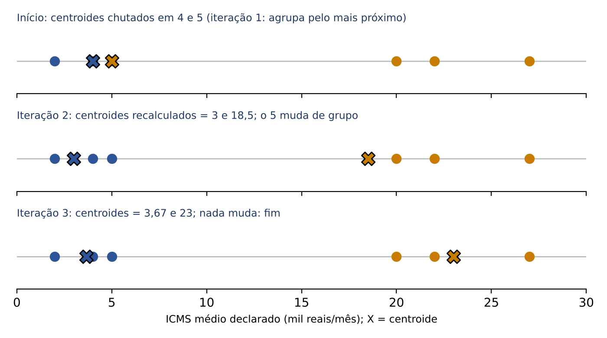

Três observações de prova:
- o resultado depende dos centroides iniciais e de k; por isso costuma-se rodar várias vezes e testar vários k;
- o K-means usa distâncias, então variáveis em escalas muito diferentes (faturamento em milhões e número de empregados em dezenas) precisam ser padronizadas antes;
- os grupos descobertos não têm nome; é o analista que, olhando as médias, os batiza ("pequenos", "médios").

#### Agrupamento hierárquico

Outra família de algoritmos vai juntando os registros mais próximos, passo a passo, até formar um só grupo, desenhando uma árvore (dendrograma). É preciso definir como medir a distância entre DOIS GRUPOS (a ligação):
- simples (*single linkage*): a MENOR distância entre um ponto de um grupo e um ponto do outro;
- completa (*complete linkage*): a MAIOR distância entre um ponto de um grupo e um ponto do outro;
- média: a média de todas as distâncias entre pares de pontos dos dois grupos;
- de centroide: a distância entre os centros dos grupos;
- de Ward: junta os grupos cuja união menos aumenta a variância interna.

:::QUESTAO FGV 2024 — TRF1 — Analista Judiciário, Análise de Dados (Q3029115)
Situação: no agrupamento hierárquico, a abordagem que mede a similaridade entre dois grupos pela MAIOR distância entre um ponto do primeiro e um ponto do segundo chama-se ligação... Gabarito oficial: D (completa).
Resolução: maior distância = completa; menor distância = simples. Memorize pelo par oposto.
:::

:::QUESTAO FGV 2025 — CNU — Bloco 2 (Q3642032)
Situação: um Ministério tem milhões de registros de acesso a atividades culturais e ainda não tem variável-alvo definida. Quer: primeiro, identificar grupos latentes de usuários; depois, avaliar fatores do engajamento; por fim, recomendar estratégias. O que fazer? Gabarito oficial: C (começar com agrupamento por k-médias, caracterizar os grupos com análise descritiva e então usar regressão para estimar o impacto de intervenções).
Resolução: "sem variável-alvo" + "grupos latentes" = começar por agrupamento (não supervisionado). Depois, descrever os grupos e, havendo uma variável de engajamento, modelá-la (regressão). Erradas: começar por séries temporais; aplicar prescritivo com redes profundas "desde o início"; usar agrupamento hierárquico "para redução de dimensionalidade" (não é a função dele; quem reduz dimensões é o PCA); começar com regressão logística, que exige variável-alvo.
No mesmo sentido: Q3363358 (agrupar beneficiários por perfil: K-means, D; Dijkstra é caminho mínimo em grafos, PCA reduz dimensões, LSTM é rede neural para sequências, ARIMA é modelo de séries temporais), Q3154825 (segmentar consumidores semelhantes é agrupamento e classificação é supervisionada, corretas; mas a análise de colunas que aparecem juntas com valor 1 é associação, e não detecção de discrepantes: II e III, D), Q4220352 (resumir muitas variáveis correlacionadas em poucos índices: componentes principais, E).
:::

:::DICA Mais questões de agrupamento no Cap. 25
Outras questões FCC e FGV sobre agrupamento e escolha de algoritmos (K-means quando não se sabe o número de grupos, agrupamento hierárquico para priorizar auditorias, agrupamento x classificação x regressão) estão comentadas em box no Cap. 25 (25.5.4) e não se repetem aqui. Treine-as logo depois desta seção.
:::

### 24.7.6 Classificação e regressão (noção)

Na classificação, o algoritmo aprende com exemplos já rotulados (empresas sabidamente regulares e sabidamente de fachada) e passa a rotular casos novos; na regressão, faz o mesmo para um valor numérico (a reta de mínimos quadrados, sua forma mais simples, está no Cap. 16). O algoritmo mais intuitivo é a árvore de decisão: uma sequência de perguntas sim/não, como um fluxograma. Exemplo de ramo que o algoritmo poderia aprender: "a empresa tem menos de um ano? Se sim: o capital social é inferior a 10.000 reais? Se sim: emitiu notas acima de 1 milhão de reais no mês? Se sim: alto risco". A árvore é um grafo DIRECIONADO e SEM CICLOS (acíclico): nunca se volta a uma pergunta já feita.

Os demais algoritmos (SVM, kNN, Naive Bayes, redes neurais, florestas aleatórias), o treino e o teste, o sobreajuste e as métricas de acerto são matéria do Cap. 25 (25.5 a 25.8). Para a mineração de dados, basta saber que a classificação e a regressão são as tarefas PREDITIVAS e SUPERVISIONADAS.

:::QUESTAO FGV 2025 — TCE-RR — Auditor de Controle Externo (Q3188252)
Situação: julgar V ou F: (1) K-means, também conhecido como K-NN, baseia-se na ideia de que objetos semelhantes estão próximos; (2) na árvore de decisão, o coeficiente de Gini de um nó é sempre maior que o do nó pai; (3) o SVM, usado apenas para classificação, emprega classificadores lineares, não podendo ser usado em problemas não linearmente separáveis. Gabarito oficial: E (F – F – F).
Resolução: (1) falsa: K-means e kNN são algoritmos diferentes (agrupamento x classificação). (2) falsa: o índice de Gini mede a "mistura" de classes num nó; a árvore escolhe divisões que REDUZEM essa mistura, de modo que a média ponderada do Gini dos nós filhos é menor ou igual à do pai (um filho isolado pode até ficar mais misturado, mas não "sempre maior"). (3) falsa: o SVM também faz regressão e, com *kernels*, resolve problemas não linearmente separáveis (v. Cap. 25).
No mesmo sentido: Q3188251 (a árvore de decisão não é grafo cíclico; nem toda rede multicamadas conecta todos os neurônios à camada anterior; SVM separa por hiperplano: F – F – V, D), Q3089964 (apenas tarefas: classificação e análise de associação, B), Q2535251 (técnicas típicas de mineração: associação, agrupamento e regressão, A).
:::

### 24.7.7 Detecção de anomalias

#### A ideia

Anomalia (ou valor discrepante, *outlier*) é a observação que se desvia do padrão esperado. Em fiscalização, é ouro: uma nota de valor muito acima do habitual, um crédito de ICMS desproporcional ao porte, um posto que "vende" mais combustível do que o tanque comporta. Três tipos são cobrados:

- pontual (ou global): um ponto isolado, muito fora do resto (um saque bancário muito maior que todos os anteriores);
- contextual: o valor só é estranho NAQUELE contexto (consumo de energia alto ao meio-dia numa casa vazia nesse horário; faturamento alto de uma sorveteria em julho na serra catarinense);
- coletiva: um conjunto de observações que, juntas, destoam, embora cada uma pareça normal (muitas notas de valor modesto emitidas em sequência para o mesmo destinatário em poucas horas).

Há ainda anomalias não intencionais, causadas por erro de coleta ou digitação, que são problema de qualidade dos dados (Cap. 23).

#### Um método simples e sua armadilha: o escore z

O escore z (Cap. 10) mede quantos desvios-padrão um valor está acima ou abaixo da média: z = (valor − média) ÷ desvio-padrão. Uma regra comum considera suspeito |z| > 3.

:::EXEMPLO O valor anômalo que se esconde
Créditos de ICMS (mil reais) de oito filiais de uma rede: 48, 52, 50, 47, 53, 49, 51 e 90.
Média dos oito:
- (48 + 52 + 50 + 47 + 53 + 49 + 51 + 90) ÷ 8
- = 440 ÷ 8
- = 55
O desvio-padrão populacional (Cap. 10) dos oito valores é aproximadamente 13,36 (conta conferida em Python). Escore z da filial de 90:
- z = (90 − 55) ÷ 13,36
- = 35 ÷ 13,36
- ≈ 2,62
Pela regra |z| > 3, a filial de 90 NÃO seria marcada. Por quê? Porque o próprio valor anômalo puxou a média para cima (de 50 para 55) e inflou o desvio-padrão. Sem ele, os sete restantes têm média 50 e desvio-padrão populacional 2; o valor 90 estaria a (90 − 50) ÷ 2 = 20 desvios-padrão da média.
Lição: anomalias grandes "mascaram" a si mesmas nos métodos baseados em média e desvio-padrão. Por isso se usam métodos robustos, como a regra do boxplot com quartis (Cap. 10) ou algoritmos específicos.
:::

O *isolation forest* (floresta de isolamento) parte de uma ideia simples: um ponto anômalo é fácil de ISOLAR. O algoritmo faz cortes aleatórios nos dados; os pontos normais, cercados de vizinhos, precisam de muitos cortes para ficar sozinhos; os anômalos ficam isolados com poucos cortes. Funciona sem rótulos e detecta inclusive combinações incomuns de atributos que, isolados, são comuns.

:::QUESTAO FCC 2025 — Prefeitura de São Paulo — Analista de TIC (Q3281623)
Situação: um sistema de benefícios sociais detecta aumento de solicitações fraudulentas com pequenas manipulações difíceis de identificar. Que abordagem de mineração foi escolhida para achar fraudes que não seguem padrões bem definidos? Gabarito oficial: E (análise de anomalias, com métodos como *isolation forest* para encontrar *outliers* sutis).
Resolução: "fraudes sem padrão bem definido" e "pequenas manipulações" apontam para detecção de anomalias, que não depende de exemplos prévios de cada tipo de fraude. As erradas trazem erros técnicos plantados:
- chamar o KNN de algoritmo de clusterização (ele é de classificação; o de agrupamento é o K-means);
- "regras de associação negativas" para marcar fraudes automaticamente (não é a técnica adequada a fraudes sem padrão);
- chamar o DBSCAN de classificação supervisionada (ele é agrupamento por densidade);
- dizer que a média móvel simples dá MAIOR peso aos dados recentes (a simples dá pesos IGUAIS; a exponencial é que privilegia os recentes).
Lição FCC: cada alternativa errada carrega um "detalhe técnico falso"; ache-o e elimine.
:::

:::QUESTAO FGV 2026 — TCE-PE (Q4279854)
Situação: histórico de pagamentos de órgãos jurisdicionados, com milhões de registros (valor, favorecido, objeto, unidade, período), SEM indicação prévia de quais são regulares. Quer-se selecionar uma pequena parcela para exame prioritário, considerando combinações pouco usuais de atributos, ainda que cada atributo isolado seja frequente; a seleção apenas direciona a auditoria. Qual técnica? Gabarito oficial: C (detecção não supervisionada de anomalias, pelo comportamento conjunto dos atributos).
Resolução: "sem rótulos" exclui a classificação supervisionada (alternativas que inventam rótulos a partir da frequência). "Combinações incomuns" exclui a análise descritiva de valores individualmente raros. E agrupar e chamar de irregular quem cai nos grupos menores é presumir ilicitude pelo tamanho do grupo, o que a técnica não autoriza. Note o cuidado do enunciado: a anomalia DIRECIONA o exame; não é prova de irregularidade.
No mesmo sentido: Q3660448 (pontual = saque muito maior; coletiva = tráfego de vários IPs ao mesmo tempo; não intencional = erro de sensor ou digitação; contextual = consumo ao meio-dia: 2 – 4 – 1 – 3, B), Q3593327 (I, II e III corretas, A), Q3593054 (a primeira afirmativa inventa "espaço vetorial convexo e fixo"; as outras duas estão certas: F – V – V, C).
:::

### 24.7.8 Mineração de textos

Boa parte da informação pública está em texto: petições, contratos, descrições de produtos nas notas, manifestações na ouvidoria. A mineração de textos (*text mining*) aplica a lógica do KDD a esse material não estruturado. A preparação típica tem quatro etapas:

- análise léxica (tokenização): quebrar o texto em unidades (tokens, em geral palavras), eliminando pontuação e caracteres desnecessários;
- remoção de palavras vazias (*stopwords*): artigos, preposições, conjunções e outras palavras que pouco dizem sobre o assunto;
- redução ao radical (*stemming*) ou à forma de dicionário (lematização): "fiscalizar", "fiscalização" e "fiscalizado" viram "fiscaliz";
- representação vetorial: transformar cada documento em números, seja pela contagem de palavras (saco de palavras, *bag of words*), seja por pesos como o TF-IDF (que valoriza palavras frequentes no documento e raras na coleção), seja por vetores densos aprendidos por modelos (*embeddings*, como o word2vec).

Depois vêm as tarefas: classificar documentos (petição de qual assunto?), agrupar documentos semelhantes, extrair entidades (nomes, CNPJs, valores), modelagem de tópicos (*topic modeling*: descobrir os temas que atravessam uma coleção) e análise de sentimentos (o texto é positivo, negativo ou neutro?).

:::QUESTAO FCC 2025 — Prefeitura de São Paulo — Analista de TIC (Q3281659)
Situação: para verificar ocorrências importantes em documentos processuais, como petições e arrazoados incoerentes, a equipe aplicou mineração de textos usando quais métodos? Gabarito oficial: E (*topic modeling* e análise de sentimentos).
Resolução: modelagem de tópicos revela de que tratam os documentos; análise de sentimentos mede o tom. Ambas são métodos genuínos de mineração de textos. As erradas combinam um termo real com um inventado ("word-recognize", "verifying skills", "redes nominais") ou trazem método de outra área (análise de IMAGENS não é mineração de TEXTO).
No mesmo sentido: Q3158084 (análise léxica = gerar a lista de termos eliminando pontuação e caracteres desnecessários: A; eliminar artigos é remoção de *stopwords*, remover sufixos é *stemming*, atribuir pesos é representação vetorial), Q4282411 (o sistema achou associações entre formas distintas de expressão e as mesmas orientações, mas as relações ficaram dispersas em categorias que não representavam as necessidades: E), Q4389226 (para verificar se um pico de menções é repercussão POSITIVA, é preciso examinar o sentido das manifestações com critérios definidos, isto é, análise de sentimentos com revisão dos casos ambíguos: B; volume não é aprovação).
:::

## 24.8 Web scraping (raspagem de dados)

### 24.8.1 A ideia

*Web scraping* ("raspagem da web") é a extração AUTOMATIZADA de dados de páginas da internet por um programa. Em vez de um servidor copiar à mão, durante semanas, os preços de 5.000 anúncios de um site de vendas, um programa visita as páginas, localiza os campos (título, preço, vendedor, cidade) e grava tudo numa tabela. O resultado é um dado estruturado obtido a partir de páginas feitas para leitura humana.

Dois termos parecidos:
- rastreador (*crawler* ou *spider*): programa que NAVEGA, seguindo links de página em página para descobrir endereços (é o que fazem os buscadores);
- raspador (*scraper*): programa que EXTRAI campos específicos de páginas determinadas.
Na prática, muitos projetos combinam os dois: o rastreador encontra as páginas, o raspador tira os dados.

:::PASSO Como funciona uma raspagem, em etapas
- Passo 1: o programa faz uma requisição ao site (como um navegador faria) e recebe o código da página, em HTML (a linguagem de marcação das páginas web, semiestruturada).
- Passo 2: o programa "lê" o HTML (faz o *parsing*, análise da estrutura) e localiza os elementos desejados por suas marcações (por exemplo, o campo marcado como "preço").
- Passo 3: extrai e limpa os valores (retira o símbolo da moeda, troca vírgula por ponto, padroniza datas).
- Passo 4: grava os dados estruturados numa tabela ou banco.
- Passo 5: repete para as demais páginas, respeitando intervalos entre requisições.
Em Python, bibliotecas comuns são requests (requisições), BeautifulSoup (leitura do HTML), Scrapy (projetos de rastreamento) e Selenium ou Playwright (páginas que só montam o conteúdo com JavaScript).
:::

### 24.8.2 Usos na administração tributária e no controle

- Monitorar anúncios em plataformas de venda on-line para identificar vendedores habituais sem inscrição estadual ou com volume incompatível com o declarado.
- Coletar preços praticados ao consumidor para subsidiar estudos de bases de cálculo e de valor de mercado.
- Acompanhar anúncios de imóveis para estimar valores de mercado (útil, por exemplo, na avaliação de bens para o imposto sobre transmissão causa mortis e doação).
- Extrair atos de diários oficiais, editais e resultados de licitações para cruzamento com fornecedores.
- Reunir dados de portais de transparência de outros entes quando não há interface própria para isso.

### 24.8.3 Antes de raspar: API e dados abertos

A raspagem é o recurso de quem não tem acesso direto. Quando o site oferece uma API (*Application Programming Interface*, interface de programação: um "balcão" automatizado em que um programa pede dados e recebe a resposta já estruturada, em JSON ou XML), ela é preferível: é estável, documentada, autorizada e não depende do desenho da página, que muda sem aviso e quebra o raspador.

No setor público, a Lei de Acesso à Informação exige que os sítios oficiais permitam o acesso automatizado por sistemas externos em formatos abertos, estruturados e legíveis por máquina (Lei 12.527/2011, art. 8º, § 3º, III). Ou seja, para dados públicos, o caminho natural é o portal de dados abertos (o tema de governo digital e dados abertos é desenvolvido no Cap. 25).

### 24.8.4 Limites técnicos, éticos e jurídicos

A raspagem não é, em si, ilícita: ler o que está publicamente disponível é o que qualquer navegador faz. Mas há limites, e as questões costumam explorá-los.

- O arquivo robots.txt. É um arquivo de texto que o site publica na sua raiz (exemplo: site.gov.br/robots.txt) dizendo quais áreas os robôs podem ou não visitar. O protocolo foi padronizado pela IETF na RFC 9309 (2022). Não é barreira técnica (o robô pode ignorá-lo) nem, por si, norma jurídica brasileira; mas é a manifestação expressa da vontade do titular do site, e respeitá-lo é a boa prática que as bancas consideram correta.
- Termos de uso. Muitos sites proíbem a coleta automatizada em seus termos; a violação pode gerar consequências contratuais e servir de indício de má-fé.
- Carga sobre o servidor. Um robô que faz milhares de requisições por segundo pode derrubar o site, com efeito semelhante a um ataque de negação de serviço. Boas práticas: limitar a frequência, raspar fora do horário de pico, identificar-se e preferir cópias em cache.
- Barreiras de acesso. Contornar login, CAPTCHA (o teste "não sou um robô") ou bloqueios técnicos não é mais "ler o que é público"; dependendo do caso, pode ter repercussões penais (crimes informáticos: ver Apostila de Direito Penal) e civis.
- Direito autoral sobre bases de dados. A Lei 9.610/1998 protege as bases de dados que, pela seleção, organização ou disposição de seu conteúdo, constituam criação intelectual (art. 7º, XIII), mas essa proteção não abrange os dados em si mesmos (art. 7º, § 2º); e o titular tem direito exclusivo de autorizar ou proibir a reprodução da forma de expressão da estrutura da base (art. 87). Raspar fatos isolados (um preço) é diferente de copiar a base estruturada inteira de um concorrente.
- Proteção de dados pessoais. Dado pessoal publicado na internet CONTINUA protegido pela LGPD. A lei determina que o tratamento de dados pessoais cujo acesso é público considere a finalidade, a boa-fé e o interesse público que justificaram a sua disponibilização (Lei 13.709/2018, art. 7º, § 3º); dispensa o consentimento para dados tornados manifestamente públicos pelo titular, resguardados os seus direitos e os princípios da lei (§ 4º); e admite tratamento posterior para novas finalidades desde que observados propósitos legítimos e específicos e preservados os direitos do titular (§ 7º). Aplicam-se os princípios da finalidade, da adequação e da necessidade (coletar só o indispensável). Para o Poder Público, o tratamento deve atender à sua finalidade pública, na persecução do interesse público, com competência legal (art. 23). O detalhamento está no Cap. 26.

:::ESQUEMA Checklist de uma raspagem legítima pela Administração
- Há base legal e competência para a finalidade (fiscalização tributária, por exemplo)?
- Existe API ou base de dados abertos que torne a raspagem desnecessária?
- O robots.txt e os termos de uso foram verificados?
- A coleta se limita aos campos necessários (minimização)?
- O ritmo de requisições não prejudica o site?
- Os dados pessoais coletados terão segurança, prazo de guarda e registro do tratamento?
- O resultado será usado como INDÍCIO para orientar a fiscalização, com contraditório no procedimento próprio, e não como prova automática de infração?
:::

:::PEGADINHA Três afirmações falsas que soam bem
- "Dado publicado na internet é dado público e pode ser usado livremente": FALSO; a LGPD continua aplicável aos dados pessoais (art. 7º, §§ 3º, 4º e 7º).
- "O robots.txt impede tecnicamente o acesso dos robôs": FALSO; é um aviso, que robôs bem-comportados respeitam.
- "Web scraping é o mesmo que data mining": FALSO; a raspagem COLETA dados; a mineração ANALISA dados já reunidos em busca de padrões.
:::

## 24.9 Indicadores e métricas

### 24.9.1 A ideia: do número solto ao número que orienta

Um número sozinho não diz se as coisas vão bem. "A Gerência fez 340 fiscalizações" é bom ou ruim? Depende: qual era a meta? Quanto custou? A sonegação caiu? O indicador é o número que responde a essas perguntas porque vem acompanhado de uma REFERÊNCIA.

Distinga quatro degraus:
- dado: o registro bruto (a fiscalização nº 1.234 foi concluída em 10/5/2025);
- métrica (ou medida): a contagem ou soma dos dados (340 fiscalizações no ano);
- indicador: a métrica posta em relação com algo que lhe dá sentido (340 de uma meta de 400 = 85%; 28 fiscalizações por auditor; custo de 5.000 reais por fiscalização);
- indicador-chave de desempenho (KPI, *key performance indicator*): os POUCOS indicadores escolhidos para acompanhar os objetivos estratégicos, os que a direção olha toda semana.

Todo indicador bem construído tem uma "ficha": nome, objetivo, fórmula de cálculo, unidade, fonte dos dados, periodicidade, responsável, linha de base (o valor de partida), meta (o valor a alcançar, com prazo) e polaridade (se "quanto maior, melhor" ou "quanto menor, melhor").

### 24.9.2 Metas SMART e atributos de um bom indicador

Uma meta bem formulada é SMART, sigla inglesa:
- S (*specific*), específica: diz exatamente o quê ("fiscalizar o setor de combustíveis", e não "melhorar a fiscalização");
- M (*measurable*), mensurável: tem número e fórmula;
- A (*achievable* ou *attainable*), atingível: desafiadora, mas possível com os recursos existentes;
- R (*relevant*), relevante: ligada aos objetivos do órgão (algumas versões usam "realista");
- T (*time-bound*), temporal: tem prazo.
Exemplo: "concluir 400 fiscalizações no setor de combustíveis até 31/12/2026, com custo médio de até 4.000 reais por fiscalização".

Atributos de um bom indicador, que aparecem em listas de prova:
- validade (ou representatividade): mede de fato o que pretende medir;
- confiabilidade: a fonte é segura e o cálculo, reproduzível;
- simplicidade e clareza: o usuário entende sem manual;
- comparabilidade: permite comparar no tempo e entre unidades;
- disponibilidade e economicidade: os dados podem ser obtidos a custo razoável;
- sensibilidade: reage às mudanças que se quer captar;
- estabilidade e rastreabilidade: fórmula e fonte documentadas, sem mudanças arbitrárias.

### 24.9.3 Eficiência, eficácia e efetividade

O trio mais cobrado nasce da cadeia de valor de qualquer ação pública: entram insumos (pessoas, dinheiro, sistemas), realizam-se ações, geram-se produtos (fiscalizações concluídas, autos lavrados) e esperam-se resultados e impactos (mais arrecadação espontânea, menos sonegação).

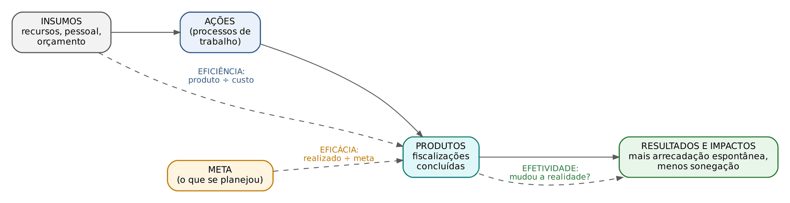

- Eficiência: relação entre produtos e insumos. Fazer mais com menos, ao menor custo. Pergunta: "quanto custou cada fiscalização?".
- Eficácia: grau de alcance das metas de produtos (quantidade e qualidade) no prazo. Pergunta: "fizemos o que prometemos?".
- Efetividade: o impacto, a transformação na realidade que motivou a ação. Pergunta: "a sonegação no setor caiu? a arrecadação espontânea subiu?".

O Guia Referencial para Medição de Desempenho do antigo Ministério do Planejamento (Gespública) ampliou o trio para seis dimensões, os "6Es do desempenho": três de esforço (economicidade, execução, excelência) e três de resultado (eficiência, eficácia, efetividade). Economicidade é obter os insumos ao menor custo, com a qualidade necessária; execução é realizar os processos e projetos conforme o planejado; excelência é a conformidade a padrões de qualidade.

:::DICA Uma frase para cada E
Eficiência = fazer CERTO as coisas (com o mínimo de recursos). Eficácia = fazer as coisas CERTAS (as metas). Efetividade = fazer DIFERENÇA na realidade.
É possível ser eficaz sem ser eficiente (cumprir a meta gastando o dobro) e eficiente e eficaz sem ser efetivo (fiscalizar barato e no prazo empresas que não sonegavam: a arrecadação não muda).
:::

:::EXEMPLO Calculando eficácia e eficiência de uma Gerência
Meta do ano: 400 fiscalizações, com orçamento de 1.600.000 reais. Realizado: 340 fiscalizações, gastando 1.700.000 reais.
Eficácia (realizado ÷ meta):
- 340 ÷ 400
- = 0,85 = 85% da meta.
Custo planejado por fiscalização:
- 1.600.000 ÷ 400
- = 4.000 reais.
Custo realizado por fiscalização:
- 1.700.000 ÷ 340
- = 5.000 reais.
Eficiência relativa (custo planejado ÷ custo realizado; como custo tem polaridade "menor é melhor", o realizado vai no denominador):
- 4.000 ÷ 5.000
- = 0,8 = 80%.
Leitura: a Gerência cumpriu 85% da meta e cada fiscalização saiu 25% mais cara que o previsto ((5.000 − 4.000) ÷ 4.000 = 1.000 ÷ 4.000 = 0,25). A efetividade NÃO sai dessas contas: seria preciso medir, por exemplo, a evolução da arrecadação espontânea do setor fiscalizado.
:::

:::ATENCAO Polaridade: quando "menor é melhor"
Para indicadores do tipo "quanto menor, melhor" (tempo médio de resposta, custo, taxa de erro), o grau de cumprimento da meta calcula-se com a meta no NUMERADOR: cumprimento = meta ÷ realizado. Exemplo: meta de 20 dias para responder consultas; realizado 25 dias; cumprimento = 20 ÷ 25 = 0,8 = 80%. Se você fizesse 25 ÷ 20 = 125%, "premiaria" a demora.
:::

### 24.9.4 Outras classificações úteis

- Pela cadeia de valor: indicadores de insumo (orçamento executado), de processo (tempo médio de tramitação), de produto (fiscalizações concluídas), de resultado (crédito tributário constituído) e de impacto (redução do índice estimado de sonegação).
- Pelo momento: indicadores de tendência ou antecedentes (*leading*), que sinalizam o futuro (número de contribuintes em malha), e de resultado ou consequentes (*lagging*), que medem o que já aconteceu (arrecadação do ano).
- Balanced Scorecard (BSC): metodologia de Kaplan e Norton que equilibra indicadores em quatro perspectivas (financeira, clientes, processos internos, aprendizado e crescimento). No setor público costuma-se pôr a sociedade (ou o cidadão) no topo, no lugar da perspectiva financeira. O "scorecard" é o painel que mostra cada indicador contra sua meta.

:::QUESTAO FGV 2024 — DATAPREV — Analista de Processamento (Q3086177)
Situação: qual prática é fundamental para o sucesso de um projeto de BI? Gabarito oficial: A (estabelecer metas e KPIs específicos para o projeto).
Resolução: sem metas e indicadores definidos, o BI vira coleção de gráficos sem propósito. As erradas são "antipadrões": escolher a ferramenta mais popular sem olhar a necessidade; coletar o máximo de dados sem cuidar da qualidade; implantar sem plano; priorizar a aparência do painel sobre a utilidade.
:::

:::PRATIQUE exercícios elaborados para esta apostila
1. Uma unidade tinha meta de 400 fiscalizações com orçamento de 2.400.000 reais. Fez 300 e gastou 2.100.000 reais. Calcule a eficácia, o custo planejado e o realizado por fiscalização e a eficiência relativa.
2. A arrecadação prevista era de 30 bilhões de reais e a realizada foi de 31,2 bilhões. O custo da administração tributária no ano foi de 600 milhões de reais. Calcule o cumprimento da meta de arrecadação e o custo por real arrecadado.
3. A meta de tempo médio de julgamento de processos administrativos fiscais é 180 dias. O realizado foi 240 dias. Qual o grau de cumprimento?
4. (estilo FCC) Classifique: (I) a arrecadação espontânea do setor de bebidas subiu após a operação; (II) a Gerência concluiu 98% das fiscalizações programadas; (III) o custo médio por auditoria caiu 10% com o novo sistema. São, respectivamente, medidas de: (A) eficiência, eficácia e efetividade; (B) efetividade, eficácia e eficiência; (C) eficácia, efetividade e eficiência; (D) efetividade, eficiência e eficácia; (E) eficácia, eficiência e efetividade.
Resolução:
1. 
- eficácia = 300 ÷ 400 = 0,75 = 75%
- custo planejado = 2.400.000 ÷ 400 = 6.000 reais
- custo realizado = 2.100.000 ÷ 300 = 7.000 reais
- eficiência relativa = 6.000 ÷ 7.000 ≈ 0,857 ≈ 85,7%
Repare: gastou MENOS que o orçamento total (2,1 contra 2,4 milhões), mas cada fiscalização ficou mais cara, porque fez muito menos fiscalizações. Olhar só o gasto total enganaria.
2. 
- cumprimento = 31,2 ÷ 30 = 1,04 = 104% da meta
- custo por real arrecadado = 0,6 ÷ 31,2 (tudo em bilhões: 600 milhões = 0,6 bilhão) ≈ 0,0192, ou seja, cerca de 1,9 centavo para cada real arrecadado.
3. Polaridade "menor é melhor": cumprimento = 180 ÷ 240 = 0,75 = 75%.
4. Gabarito: B. (I) mudança na realidade = efetividade; (II) alcance da meta de produtos = eficácia; (III) custo por produto = eficiência.
:::

## 24.10 Relatórios, dashboards e visualização de dados

### 24.10.1 Relatório, dashboard e scorecard

- Relatório gerencial: documento estruturado e periódico (mensal, trimestral), em geral detalhado, que comunica resultados aos responsáveis pela gestão. Pode ser estático (PDF) ou paginado, feito para imprimir.
- Painel (*dashboard*): interface visual que reúne, numa só tela, os indicadores mais importantes, permitindo monitorar a situação de relance e, nos painéis interativos, filtrar e detalhar (drill down). O nome vem do painel de instrumentos do carro: o motorista não lê um relatório enquanto dirige; olha velocímetro, combustível e luzes de alerta.
- *Scorecard* (quadro de desempenho): painel focado em comparar cada indicador com sua META, típico do BSC.

Pelo público e pela finalidade, os painéis costumam ser classificados em:
- estratégicos: para a alta direção; poucos KPIs, visão de longo prazo, atualização mensal ou trimestral;
- táticos ou analíticos: para gerências e analistas; permitem explorar, filtrar e detalhar para entender causas;
- operacionais: para quem executa; monitoramento em tempo (quase) real, com alertas (filas de atendimento, disponibilidade de sistemas).

### 24.10.2 O gráfico certo para cada mensagem

Os gráficos estatísticos básicos (barras, setores, histograma, linhas) e suas regras de construção estão no Cap. 9 (9.4). Aqui o foco é ESCOLHER, a partir da mensagem que o painel quer passar.

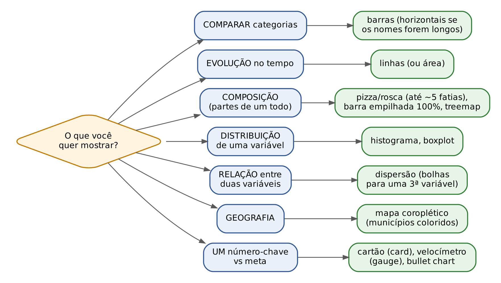

:::DICA Os erros de escolha que a banca mais explora
- Tendência ao longo do tempo pede LINHA (ou área); barras também servem para poucos períodos. Pizza não mostra tendência.
- Histograma mostra a DISTRIBUIÇÃO de uma variável numérica (quantos contribuintes em cada faixa de faturamento), não a evolução no tempo.
- Pizza só funciona para partes de um todo que somam 100%, com poucas fatias; para comparar muitas categorias, barras ordenadas.
- Relação entre duas variáveis numéricas pede DISPERSÃO (Cap. 16).
- Um único número contra a meta: cartão (card), medidor (*gauge*) ou *bullet chart*.
- *Treemap* (mapa de árvore) mostra composição hierárquica por áreas de retângulos; mapa de calor (*heatmap*) mostra intensidade por cores numa matriz; gráfico de rede mostra relações entre entidades (útil para visualizar vínculos societários entre empresas).
:::

### 24.10.3 Boas práticas de painel

- Comece pela pergunta: quem vai usar e que decisão vai tomar? Um painel, um propósito.
- Regra dos cinco segundos: a mensagem principal deve ser captada em segundos.
- Hierarquia visual: o mais importante no canto superior esquerdo (o olho ocidental lê em "Z" ou em "F"); KPIs em cartões no topo, detalhes abaixo.
- Contexto sempre: o número vem com a meta, o período anterior ou a média; "1,2 bilhão" sozinho não diz nada.
- Poucas cores, e com significado (vermelho só para alerta); cuidado com quem não distingue vermelho de verde.
- Razão dado-tinta (expressão de Edward Tufte): toda tinta deve servir ao dado; elimine enfeites, sombras, efeitos 3D, fundos e grades pesadas (o "lixo gráfico", *chartjunk*).
- Rotule direto no gráfico em vez de obrigar o leitor a consultar legendas distantes; ordene as barras pelo valor.
- Títulos que dizem a conclusão ("Arrecadação do Oeste cresceu 10% em 2025") em vez de só descrever ("Arrecadação por região").
- Mostre a data da última atualização e a fonte; deixe os filtros aplicados visíveis.

### 24.10.4 Erros de visualização que enganam

O primeiro e mais cobrado é o eixo truncado em gráfico de barras. A altura da barra é lida como proporcional ao valor; se o eixo não começa em zero, a proporção visual mente.

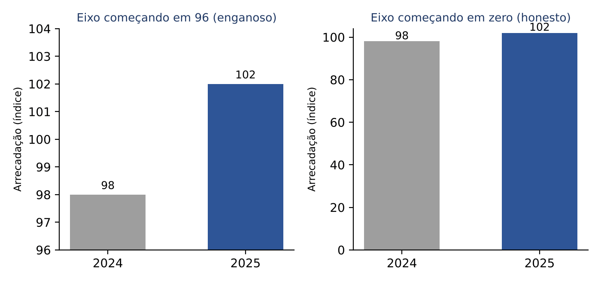

:::EXEMPLO Quanto o eixo truncado exagera
Arrecadação (índice): 2024 = 98; 2025 = 102. Eixo começando em 96.
Altura visual das barras (o que aparece acima de 96):
- 2024: 98 − 96 = 2
- 2025: 102 − 96 = 6
- razão visual = 6 ÷ 2 = 3 → a barra de 2025 parece TRÊS vezes maior.
Variação real:
- 102 ÷ 98 ≈ 1,0408 → crescimento de cerca de 4%.
Em gráficos de LINHA, o eixo que não começa em zero é aceitável (o que se lê é a inclinação), desde que indicado com clareza; em BARRAS, não.
:::

Outros erros clássicos:
- pizza com muitas fatias, fatias que não somam 100% ou pizza em 3D (a perspectiva faz as fatias da frente parecerem maiores);
- ícones ou círculos dimensionados pelo lado ou pelo raio: se o raio dobra, a ÁREA quadruplica (2 × 2 = 4), e o olho lê a área;
- dois eixos verticais com escalas escolhidas para fabricar uma "relação" entre séries;
- escalas desiguais no eixo do tempo (anos pulados sem aviso);
- escolha seletiva do período (*cherry picking*: começar a série no pior mês para exagerar a recuperação);
- correlação apresentada como causa (Cap. 16);
- cores em arco-íris para dados ordenados (o olho não percebe ordem entre vermelho, verde e azul; use tons de uma só cor, do claro ao escuro).

:::QUESTAO FGV 2024 — CVM — Inspetor (Q2515937)
Situação: um analista quer visualizar dados de transações financeiras para analisar TENDÊNCIAS. Que tipo de gráfico deve usar? Gabarito registrado no banco: A (histograma). Gabarito discutível.
Resolução: pela teoria da visualização, tendência no tempo se mostra com gráfico de linhas ou de área (alternativa C), e o histograma mostra a DISTRIBUIÇÃO de uma variável (frequência por faixa de valor), não a evolução. O medidor (*gauge*) mostra um valor contra uma meta; o gráfico de rede, relações; o *treemap*, composição hierárquica. Se a banca manteve o histograma, terá entendido "tendência" como "tendência central" ou padrão da distribuição; registramos a divergência na nota de verificação. Para a prova da FCC: tendência TEMPORAL = linha.
:::

:::PRATIQUE exercícios elaborados para esta apostila
1. Num gráfico de barras com eixo começando em 100, as barras representam 110 (2024) e 120 (2025). Quantas vezes a barra de 2025 parece maior que a de 2024? Qual o crescimento real?
2. Num infográfico, a arrecadação de cada região é representada por um círculo. O designer triplicou o RAIO do círculo da região que arrecada o triplo. Quantas vezes maior a área ficou? O que o leitor vai perceber?
3. Escolha o gráfico: (a) arrecadação mensal de ICMS de 2020 a 2025; (b) participação de cinco setores na arrecadação de 2025; (c) relação entre faturamento declarado e número de empregados de 500 empresas; (d) distribuição dos valores de 10.000 notas fiscais; (e) arrecadação per capita por município de Santa Catarina.
Resolução:
1. Alturas visuais: 110 − 100 = 10 e 120 − 100 = 20; razão visual = 20 ÷ 10 = 2 (parece o dobro). Real: 120 ÷ 110 ≈ 1,0909, crescimento de cerca de 9,1%.
2. A área é proporcional ao quadrado do raio: 3 × 3 = 9. O círculo ficou 9 vezes maior em área, e o leitor perceberá a região como arrecadando nove vezes mais, quando arrecada três. O correto seria multiplicar o raio por √3 ≈ 1,73.
3. (a) linhas; (b) pizza ou rosca (são cinco partes de um todo) ou barra empilhada 100%; (c) dispersão; (d) histograma ou boxplot; (e) mapa coroplético (municípios coloridos em tons de uma só cor).
:::

## 24.11 Ferramentas analíticas (noção)

O edital pede o "uso de ferramentas analíticas para extração, cruzamento, interpretação e comunicação de informações". A prova de Conhecimentos Gerais não cobra comandos, mas cobra o que cada ferramenta é e para que serve.

| Ferramenta | O que é | Pontos que caem |
|---|---|---|
| Microsoft Power BI | plataforma de BI da Microsoft | Power BI Desktop (aplicativo para conectar fontes, tratar dados no Power Query, modelar e criar relatórios de várias páginas); serviço Power BI (nuvem, para publicar e compartilhar); dashboards (painéis de UMA página, montados no serviço com blocos fixados de relatórios, que admitem alertas de dados, assinaturas e perguntas em linguagem natural, o recurso P e R); DAX (*Data Analysis Expressions*), a linguagem de fórmulas das medidas; linguagem M, a do Power Query |
| Tableau | plataforma de visualização (hoje da Salesforce) | exploração visual por arrastar e soltar; versões Desktop, Server, Cloud e Public |
| Qlik (QlikView, Qlik Sense) | plataforma de BI | motor associativo em memória: ao selecionar um valor, mostra o que está associado e o que não está |
| Looker Studio, Metabase, Apache Superset | ferramentas de painéis | painéis a partir de consultas, inclusive em SQL |
| Grafana; Kibana | painéis de monitoramento | tempo real, séries temporais e alertas; o Kibana é a camada visual da pilha ELK (Elasticsearch busca e indexa, Logstash ingere e transforma, Kibana visualiza) |
| Excel | planilha | tabelas dinâmicas (um "mini-OLAP"), fórmulas, flexibilidade em análises locais |
| SQL | linguagem de consulta a bancos relacionais | extrair e cruzar dados diretamente nos grandes bancos (Cap. 23) |
| Python e R | linguagens de programação para dados | bibliotecas de visualização: matplotlib, seaborn, plotly, bokeh, vega-altair (Python); ggplot2 (R) |

:::ATENCAO DAX: a medida é calculada na hora, conforme os filtros
No Power BI, uma MEDIDA escrita em DAX não é um número gravado: é uma fórmula avaliada no momento da visualização, dentro do "contexto de filtro" (o ano, o órgão ou a região selecionados). Por isso o mesmo gráfico muda quando se aplica um filtro. Já a COLUNA CALCULADA é computada na carga (atualização) dos dados e gravada linha a linha.
:::

:::QUESTAO FCC 2026 — CPU-PE — Gestor Governamental, Planejamento (Q3871961)
Situação: uma equipe monta no Power BI um painel de despesas públicas a partir de um DW; uma gestora cria uma medida DAX e um gráfico de colunas; ao aplicar o filtro de ano, o gráfico se atualiza sozinho. (A fórmula e os campos aparecem em imagem não disponível no banco, mas não são necessários.) Qual a afirmação correta? Gabarito oficial: E (a medida DAX é avaliada no momento da visualização, respeitando o contexto dos filtros, como ano e órgão).
Resolução: é exatamente o comportamento descrito no box anterior e o que o próprio enunciado mostra (o gráfico reage ao filtro). Erradas: dizer que a medida é calculada durante a carga (isso é a coluna calculada); dizer que filtros não alteram as medidas (contradiz o enunciado); dizer que no ELT a transformação ocorre ANTES da extração (no ELT ela vem DEPOIS da carga); afirmar genericamente que MDX é "mais fácil e eficiente" que DAX (juízo sem fundamento).
:::

:::QUESTAO FCC 2025 — Prefeitura de São Paulo — Analista de TIC (Q3281645)
Situação: um painel de indicadores de saúde, educação e segurança deve integrar várias fontes, atualizar em tempo real e emitir alertas para situações críticas, usando a ferramenta Grafana. Qual configuração atende? Gabarito oficial: C (usar o Grafana com uma fonte como o Prometheus, para atualização em tempo real e alertas).
Resolução: o Grafana é ferramenta de painéis de monitoramento e se conecta a bancos de séries temporais como o Prometheus, que coletam métricas continuamente. Erradas: atualizar "a cada 5 minutos" não é tempo real; importar relatórios do Tableau ou usar Power BI Embedded para alertas mistura ferramentas sem necessidade; CSV com atualização manual contradiz "tempo real".
:::

:::QUESTAO FGV 2024 — EPE — Analista, Ciência de Dados (Q2847406)
Situação: sobre a construção de dashboards no Power BI, qual afirmação está correta? Gabarito oficial: E (permitem consultas em linguagem natural, o recurso P e R).
Resolução: no Power BI, o dashboard é recurso do SERVIÇO (nuvem), tem UMA página só, admite alertas em blocos de cartão, KPI e medidor, e admite assinatura. Logo, são falsas as alternativas que dizem que ele tem várias páginas (isso é o relatório), que está disponível no Desktop, que não admite alertas e que não admite assinatura. Resta a E.
No mesmo sentido: Q3352977 (o dashboard possibilita visualizar métricas relevantes e KPIs: A), Q3188245 (BI cria painéis interativos; SQL consulta e manipula grandes bancos; Excel dá flexibilidade em análises locais: I, II e III, E), Q3880240 (não é biblioteca de visualização: pygtk, que serve para interfaces gráficas, C), Q4389011 (na pilha ELK, o Logstash coleta, transforma e envia os dados: C), Q3880245 (no QlikView, o componente que distribui os documentos .qvw é o Publisher: B).
:::

:::NOTA Outras questões do banco sobre o tema
Questões não comentadas em box nem citadas acima. Onde o gabarito registrado no banco diverge da teoria exposta neste capítulo, indica-se a resposta tecnicamente sustentável (ver a nota de verificação).
| Q | Banca/ano | Subtema | Gabarito |
|---|---|---|---|
| Q3594430 | FGV 2025 | conceito de mineração de dados (estatística, aprendizado de máquina e IA para achar padrões) | C |
| Q3032799 | FGV 2024 | descobrir padrões no histórico para estimar eventos futuros: data mining | A |
| Q3086077 | FGV 2024 | aprendizado supervisionado usa pares (entrada, saída desejada) | D |
| Q2566143 | FGV 2024 | CRISP-DM: preparação pode criar atributos novos (ver Cap. 23) | B |
| Q2534657 | FGV 2024 | K-means com notas de alunos (dados em imagem não disponível) | E |
| Q3086074 | FGV 2024 | regra Leite → Pão com métrica de 50% (tabela em imagem não disponível) | E (suporte) |
| Q3336809 | FGV 2025 | padrão com antecedente e consequente: regras de associação (exemplo em imagem) | E |
| Q2568148 | FGV 2024 | BI e DW para auditoria; DW não serve para modificar dados (não volátil) | C |
| Q3289726 | FCC 2025 | consulta otimizada num modelo multidimensional de receitas e despesas (alternativas em imagem não disponível) | B |
| Q3885609 | FGV 2026 | índice de bitmap para colunas de baixa cardinalidade num DW | C |
| Q3363362 | FGV 2025 | conceito de BI (V/F); a 2ª afirmativa define data lake | C (V – F – V – F) |
| Q3085933 | FGV 2024 | vantagem do dashboard interativo | A (visualizar e interpretar grandes volumes) |
| Q3086178 | FGV 2024 | vantagem de IA e aprendizado de máquina sobre data lake | D (usar todos os tipos de dados, inclusive brutos) |
| Q4150982 | FGV 2026 | fato e dimensão; modelagem dimensional não se baseia em normalização | C (I e II) |
| Q3880242 | FGV 2026 | propriedades do DW (I é falsa: DW não sofre muitas atualizações nem é altamente normalizado; III foi tida como falsa, pois o DW guarda também dados detalhados, no menor grão, e não apenas agregados) | C (II, apenas); a III é discutível, já que "alta agregação" e baixo suporte a dados não relacionais são traços usuais do DW |
| Q4181537 | FGV 2026 | desnormalização no DW reduz junções e acelera a leitura | B |
| Q4388951 | FGV 2026 | preparação dos dados e análise multidimensional | B (ETL e OLAP) |
| Q2380771 | FGV 2024 | metas do data warehousing e do BI (texto do DAMA-DMBOK) | E (V – V – V; as três afirmativas reproduzem a obra) |
| Q3336808 | FGV 2025 | número do processo como atributo de menor grão no fato: dimensão degenerada | D |
| Q3336801 | FGV 2025 | ETL no Pentaho do MongoDB para data mart no PostgreSQL e painel no MicroStrategy | E |
| Q3660466 | FGV 2025 | modelagem relacional (normalizada, OLTP) x multidimensional (desnormalizada, OLAP) | E (F – F – V) |
| Q2387577 | FGV 2024 | scripts R no Power BI em área restrita; RNN e LLM; reamostragem (PCA não é reamostragem) | A (V – F – F) |
| Q3085941 | FGV 2024 | metadados, floco de neve, slice e dice, governança | E (III e IV, apenas); discutível: a I (metadados padronizados para integrar fontes heterogêneas) parece correta, e a banca a terá tido por falsa pelo adjetivo "essencial"; a II é falsa (o floco de neve exige mais junções) |
| Q3250622 | FGV 2024 | relação entre DW e mineração de dados (V/F); a 1ª é falsa porque quem usa regras de associação e árvores de classificação é a mineração, não o DW | B (F – V – V) |
:::

## 24.12 Resumo para revisão pré-prova

| Conceito | Regra ou definição | Quando usar | Armadilha |
|---|---|---|---|
| Business Intelligence | técnicas, processos e ferramentas que transformam dados em informação para decisão | definição geral | BI não é criptografia, backup, OLTP nem depósito de dados brutos |
| Arquitetura de BI | fontes → ETL (staging) → DW → data marts → OLAP → relatórios, painéis, mineração; metadados em tudo | ordenar componentes | ETL fica ANTES do DW |
| Metadados | dados sobre os dados: técnicos, de negócio, de processo | classificar exemplos | não guardam os dados nem executam consultas |
| OLTP x OLAP | OLTP: operações curtas, atuais, normalizado; OLAP: consultas grandes, históricas, dimensional | distinguir sistemas | DW normalizado e voltado à inserção = ERRADO |
| Data warehouse (Inmon) | orientado por assunto, integrado, variante no tempo, não volátil | características | não volátil = não se altera nem apaga; "compatível com OLTP" não é característica |
| Data mart | subconjunto do DW por departamento ou assunto | recorte departamental | dependente (do DW) x independente (das fontes) |
| Inmon x Kimball | *top-down* (DW corporativo primeiro) x *bottom-up* (marts dimensionais com dimensões conformadas) | abordagens | não inverter os autores |
| Tabela de fatos | eventos e medidas numéricas + chaves estrangeiras das dimensões | "quanto?" | medidas aditivas, semiaditivas (não somar no tempo), não aditivas |
| Dimensão | contexto descritivo (quem, onde, quando, o quê) | "por qual ângulo?" | dimensão tempo quase sempre existe |
| Grão | o que uma linha do fato representa | primeira decisão do projeto | maior detalhamento = menor grão |
| Estrela | dimensões desnormalizadas ligadas direto ao fato | padrão para BI | menos junções, mais espaço |
| Floco de neve | dimensões normalizadas e ramificadas | economia de espaço | mais junções, leitura mais lenta |
| Constelação (galáxia) | várias tabelas de fatos compartilhando dimensões | vários processos | não confundir com floco |
| Chave substituta | chave artificial gerada pelo DW | integrar fontes, guardar histórico | SCD tipo 2 cria nova linha |
| Drill down / roll up | descer ao detalhe / subir ao resumo | navegar na hierarquia | bancas invertem os dois |
| Slice / dice | um valor numa dimensão / vários valores em várias dimensões (subcubo) | recortar o cubo | "subcubo" = dice |
| Pivot | girar eixos | mudar a visão | não calcula nada |
| ROLAP, MOLAP, HOLAP | relacional (escala), multidimensional (rapidez), híbrido | armazenamento OLAP | MOLAP pré-calcula agregados |
| Data lake | dados brutos de qualquer tipo, formato original, *schema-on-read* | ciência de dados, usos futuros | não é exclusivo de não estruturados; sem catálogo vira *data swamp* |
| Lakehouse | lago + ACID + governança + desempenho de BI (Delta, Iceberg, Hudi) | uma plataforma para BI e IA | lago sem ACID e metadados não é lakehouse |
| Medalhão | bronze (bruto), prata (limpo), ouro (pronto para BI e IA) | organizar o lago | deduplicação é na prata |
| Analytics | descritiva (o quê), diagnóstica (por quê), preditiva (o que virá), prescritiva (o que fazer) | classificar exemplos | preditiva é probabilística |
| Análise exploratória | resumos e gráficos antes de modelos | primeira etapa | não testa hipóteses nem treina modelos |
| KDD | seleção, pré-processamento, transformação, mineração, interpretação | ordenar etapas | descobrir associações é mineração; vetorizar texto é transformação |
| Tarefas de mineração | classificação e regressão (supervisionadas); agrupamento, associação, anomalias (não supervisionadas) | escolher técnica | tarefa ≠ algoritmo; K-means ≠ kNN; DBSCAN agrupa |
| Associação | suporte, confiança, lift; algoritmo Apriori | "quem tem A tem B?" | lift 1 = independência; confiança alta pode ter lift menor que 1 |
| K-means | atribuir ao centroide mais próximo e recalcular médias até estabilizar | agrupar sem rótulos | depende de k e do início; exige padronizar escalas |
| Ligações hierárquicas | simples (menor distância), completa (maior), média, centroide, Ward | agrupamento hierárquico | simples x completa |
| Anomalias | pontual, contextual, coletiva; *isolation forest* | fraudes sem padrão | anomalia orienta a fiscalização, não prova ilícito; o escore z pode ser mascarado |
| Mineração de textos | tokenização, *stopwords*, *stemming*, vetores; tópicos e sentimentos | documentos | análise de imagens não é mineração de textos |
| Web scraping | extração automatizada de dados de páginas | quando não há API ou dados abertos | robots.txt é aviso; LGPD vale para dado pessoal público; scraping ≠ mining |
| Indicador e KPI | métrica com referência; KPI = os indicadores-chave | gestão por resultados | número sem meta nem comparação não é indicador útil |
| SMART | específica, mensurável, atingível, relevante, temporal | redigir metas | |
| 3Es (6Es) | eficiência (produto ÷ insumo), eficácia (realizado ÷ meta), efetividade (impacto); + economicidade, execução, excelência | classificar indicadores | eficaz não implica eficiente nem efetivo |
| Painel | uma tela, KPIs, interativo; estratégico, tático, operacional | monitorar | relatório é documento; *scorecard* compara com metas |
| Escolha do gráfico | tempo: linha; comparação: barras; composição: pizza (poucas fatias); distribuição: histograma e boxplot; relação: dispersão; território: mapa | montar painel | histograma não mostra evolução no tempo |
| Erros visuais | eixo truncado em barras, 3D, áreas pelo raio, dois eixos, arco-íris | criticar gráficos | em linhas, eixo fora do zero é aceitável se indicado |
| Power BI | Desktop (relatórios, Power Query, DAX) e serviço (dashboards de uma página, alertas, P e R) | ferramentas | medida DAX é calculada na visualização, conforme os filtros |

:::ESQUEMA Formulário do capítulo
- Suporte(A → B) = n(A e B) ÷ N. n(A e B) = transações com A e B; N = total de transações. Frequência da combinação na base.
- Confiança(A → B) = n(A e B) ÷ n(A). n(A) = transações com A. É a probabilidade condicional P(B | A). Sempre maior ou igual ao suporte.
- Lift(A → B) = confiança(A → B) ÷ [n(B) ÷ N]. n(B) = transações com B. Igual a 1: independência; maior que 1: associação positiva; menor que 1: negativa.
- Centroide do K-means = média dos valores do grupo.
- Eficácia = realizado ÷ meta (indicador do tipo "maior é melhor").
- Grau de cumprimento com polaridade "menor é melhor" = meta ÷ realizado.
- Eficiência = produtos ÷ insumos; na forma de custo unitário, custo ÷ quantidade de produtos; eficiência relativa = custo unitário planejado ÷ custo unitário realizado.
- Variação percentual = (valor final − valor inicial) ÷ valor inicial (Cap. 1).
- Escore z = (valor − média) ÷ desvio-padrão (Cap. 10); |z| > 3 costuma indicar anomalia, mas o próprio valor anômalo pode mascarar-se.
- Distorção do eixo truncado em barras: razão visual = (valor maior − início do eixo) ÷ (valor menor − início do eixo), comparada com a razão real valor maior ÷ valor menor.
- Área de círculo cresce com o QUADRADO do raio: raio × k → área × k².
:::

## 24.13 Questões do capítulo

FCC: Q3289728, Q3507095, Q4067460, Q4221496, Q3956764, Q3926894, Q3926893, Q4240113, Q3926896, Q4221495, Q3872015, Q3281623, Q3281659, Q3871961, Q3281645, Q3289726.

FGV: Q4375812, Q4375800, Q3781113, Q3085936, Q3086177, Q3158063, Q2348989, Q3174799, Q3755416, Q2457407, Q2490319, Q2458861, Q3047967, Q3885598, Q4218162, Q3339423, Q3885613, Q3336807, Q4223169, Q3885611, Q3781107, Q3851258, Q4223174, Q3085938, Q3869739, Q3885599, Q3755422, Q3339680, Q3032315, Q3085935, Q3755423, Q2451577, Q3336800, Q4181535, Q4223167, Q3595758, Q4150987, Q2534662, Q2568151, Q4279914, Q2571742, Q3782910, Q3261029, Q3258874, Q3851685, Q3595721, Q2517630, Q2705550, Q2571535, Q4388954, Q4218180, Q3047968, Q3880224, Q3038844, Q3029115, Q3642032, Q3363358, Q3154825, Q4220352, Q3188252, Q3188251, Q3089964, Q2535251, Q4279854, Q3660448, Q3593327, Q3593054, Q3158084, Q4282411, Q4389226, Q3086178, Q3352977, Q2515937, Q2847406, Q3188245, Q3880240, Q4389011, Q3880245, Q3594430, Q3032799, Q3086077, Q2566143, Q2534657, Q3086074, Q3336809, Q2568148, Q3885609, Q3363362, Q3085933, Q4150982, Q3880242, Q4181537, Q4388951, Q2380771, Q3336808, Q3336801, Q3660466, Q2387577, Q3085941, Q3250622.

:::NOTA Notas de verificação
- Contas: todos os exemplos numéricos, exercícios PRATIQUE e questões com cálculo (cubo OLAP e seus roll up, slice e dice; medida semiaditiva; suporte, confiança e lift dos exemplos, dos exercícios e da Q4388954; conferência do lift da Q4218180; iterações do K-means; escore z com e sem o valor anômalo, inclusive o desvio-padrão populacional de cerca de 13,36; eficácia, custos unitários e eficiência relativa; cumprimento com polaridade negativa; custo por real arrecadado; distorções de eixo truncado; diferença de 1.492 registros na Q4375800) foram conferidas em Python. Os números do cubo e dos exemplos de indicadores são FICTÍCIOS, criados para fins didáticos, e não representam a arrecadação real de Santa Catarina.
- Legislação conferida no Planalto em 30/10/2026: Lei 13.709/2018, art. 7º, §§ 3º, 4º e 7º (texto compilado); Lei 9.610/1998, art. 7º, XIII e § 2º, e art. 87; Lei 12.527/2011, art. 8º, § 3º, III. Os demais dispositivos (LGPD, arts. 6º e 23) foram citados por remissão, sem transcrição, e são desenvolvidos no Cap. 26.
- Não conferidos em fonte primária nesta sessão (afirmados com base em conhecimento consolidado): RFC 9309 (IETF, 2022) como padronização do robots.txt; as quatro características de Inmon; a preferência de Kimball pelo esquema estrela; os "6Es do desempenho" do Guia Referencial para Medição de Desempenho (Gespública, Ministério do Planejamento, 2009); a classificação dos quatro tipos de analytics atribuída ao Gartner; as funcionalidades do Power BI (dashboard de uma página no serviço, alertas, assinatura, P e R) conforme a documentação da Microsoft. Convém conferir a documentação vigente do Power BI se houver dúvida, pois o produto muda com frequência.
- Divergência doutrinária registrada: drill across e drill through têm definições diferentes na literatura técnica (Kimball) e em materiais de concurso; o capítulo apresenta as duas (24.4.3).
- Gabaritos reconferidos no QConcursos em 30/10/2026: Q3363362 (C), Q3085933 (A), Q3086178 (D), Q4150982 (C), Q3880242 (C), Q4181537 (B), Q4388951 (B), Q2380771 (E), Q3336808 (D), Q3336801 (E), Q3158063 (D), Q3660466 (E), Q2387577 (A), Q3085941 (E), Q3250622 (B) e Q4388954 (A). As letras antes registradas no banco decorriam de erro de coleta; em todos os casos em que o capítulo havia deduzido a resposta pela teoria, ela coincidiu com o gabarito oficial. Continuam tecnicamente discutíveis, embora prevaleça o gabarito oficial: Q3085941 (a afirmativa I parece correta) e Q3880242 (a afirmativa III descreve traços usuais do DW).
- Gabarito do banco ainda não reconferido: Q2515937 (banco A, histograma, para "tendências"; pela teoria, gráfico de área/linha). Q3336807 (banco A, fato aditivo) foi aceita, com a ressalva de que a contagem de pessoal pode ser semiaditiva conforme o desenho do fato.
- Dados em imagem ausente: Q2534657, Q3086074, Q3336809 e Q3289726 (apenas listadas); Q3871961 foi resolvida porque a imagem ausente (fórmula DAX) não é necessária. Varredura de 30/10/2026: os boxes com imagem no banco (Q2515937 e Q3871961) não usam número, tabela ou fórmula ausente do enunciado; nenhum box exigiu correção.
- Sobreposição com o Cap. 25: as questões de agrupamento e algoritmos comentadas em box no Cap. 25 (25.5.4) são apenas remetidas aqui (DICA no fim de 24.7.5); nenhuma questão está em box nos dois capítulos.
- Não há questões de web scraping no banco local; a seção 24.8 foi redigida a partir da legislação conferida e de conhecimento técnico, com remissão aos Caps. 25 e 26.
- O Cap. 23 (ETL, qualidade, CRISP-DM, big data) ainda não estava gravado em /home/claude/cg/ch/ quando este capítulo foi escrito; as remissões seguem o escopo do briefing do Cap. 23 e devem ser conferidas na montagem final.
:::
