# CAPÍTULO 25 — GOVERNO DIGITAL E INTELIGÊNCIA ARTIFICIAL: TRANSFORMAÇÃO DIGITAL (LEI 14.129/2021), INTEROPERABILIDADE, IA, APRENDIZADO DE MÁQUINA, APRENDIZADO PROFUNDO, IA GENERATIVA E LLMS; USOS NO FISCO

:::INCIDENCIA
Edital SEFAZ/SC 01/2026 — Ciência e Análise de Dados, parte "Governo Digital e Inteligência Artificial" (governo digital, transformação digital, serviços públicos digitais, interoperabilidade, automação, Administração orientada por dados; IA, aprendizado de máquina, IA generativa e LLMs). Nível A+.
Lote do banco: 207 questões atribuídas (FCC 27, FGV 180), mais 2 questões FCC de outros lotes usadas como aplicação (Q4240117 e Q3304046).
O que mais cai: escolher o TIPO de aprendizado para um cenário de Fazenda (classificação, regressão, agrupamento); sobreajuste (overfitting); riscos da IA (viés, alucinação, viés de automação, direitos autorais); explicabilidade e supervisão humana; conceitos da Lei 14.129/2021 (governo como plataforma, registros de referência, interoperabilidade).
:::

:::ESQUEMA O que você vai aprender e o que precisa saber antes
Pré-requisitos: nenhum cálculo pesado. As únicas contas do capítulo são frações e porcentagens (Cap. 1) nas métricas de 25.7. Ajuda ter lido o Cap. 23 (o que é dado estruturado e não estruturado, qualidade e tratamento de dados) e o Cap. 24 (BI, *data mining*, *analytics* preditivo). Média, mediana e correlação estão nos Caps. 9 e 16; probabilidade condicional (que reaparece no Naive Bayes) no Cap. 12.
Roteiro do capítulo:
- 25.1 Do governo eletrônico ao governo digital: os conceitos que a banca usa.
- 25.2 A Lei 14.129/2021 (Lei do Governo Digital), artigo por artigo no que interessa, e as estratégias de governo digital (Decretos 12.069/2024 e 12.198/2024).
- 25.3 Interoperabilidade: o que é, como funciona, e-PING, Conecta gov.br e compartilhamento de dados.
- 25.4 Inteligência artificial: conceito, IA fraca e forte, Teste de Turing, abordagens simbólica e conexionista.
- 25.5 a 25.7 Aprendizado de máquina: tipos (supervisionado, não supervisionado, por reforço), principais algoritmos, treino e teste, sobreajuste e métricas (acurácia, precisão, recall, F1), com contas feitas à mão.
- 25.8 Redes neurais e aprendizado profundo.
- 25.9 IA generativa e LLMs: tokens, treinamento, prompt, alucinação, RAG, agentes.
- 25.10 e 25.11 Riscos, ética, governança e marcos regulatórios (PL 2.338/2023, Resolução CNJ 615/2025).
- 25.12 Usos da IA no Fisco.
O que fica para outros capítulos: LGPD, inclusive o direito de revisão de decisões automatizadas (art. 20 da LGPD) e o compartilhamento de dados pessoais pelo Poder Público, está no Cap. 26; técnicas de *data mining*, OLAP e painéis estão no Cap. 24; regressão linear "de lápis e papel" está no Cap. 16.
:::

## 25.1 Do governo eletrônico ao governo digital

### 25.1.1 A ideia em linguagem comum

Pense em como se pedia uma certidão negativa de débitos estaduais há trinta anos: o contribuinte ia à repartição, pegava senha, entregava cópias autenticadas do contrato social, voltava dias depois. Depois veio a internet e o mesmo pedido passou a ser feito num formulário na página da Secretaria da Fazenda, que gerava um PDF. Hoje, a certidão é emitida na hora, e o sistema consulta sozinho, por trás da tela, as bases de outros órgãos para saber se há pendência.

Essas três fotografias correspondem a três estágios:
- Atendimento tradicional (presencial, em papel).
- Governo eletrônico (e-gov): o mesmo serviço, levado para a internet. A tecnologia é usada para FAZER O MESMO de modo mais rápido.
- Governo digital: o serviço é REDESENHADO a partir da tecnologia e dos dados. Não basta "pôr o formulário na internet"; elimina-se o formulário se o Estado já tem a informação.

A banca adora a distinção. A frase-chave é: governo eletrônico não é só tecnologia, é tecnologia COMBINADA com mudança organizacional. Digitalizar um processo ruim produz um processo ruim digital.

### 25.1.2 Conceitos de prova

- Governo eletrônico (e-gov): uso de tecnologias da informação e comunicação (TICs), combinado com mudanças organizacionais, para aperfeiçoar as estruturas e operações do governo, melhorar a qualidade, a disponibilidade e a eficiência dos serviços e reduzir tempo e custo. Abrange as relações governo–cidadão (G2C), governo–empresa (G2B) e governo–governo (G2G).
- Governo digital (definição do Decreto 12.069/2024, art. 4º, I): "abordagem de gestão voltada para a transformação das organizações públicas, apoiada no uso de tecnologias digitais, com vistas à entrega de valor público para a sociedade".
- Transformação digital de governo (mesmo decreto, art. 4º, II): uso de tecnologias digitais para o atendimento eficiente do cidadão, a integração de serviços e de políticas públicas e a promoção da transparência.
- Governo aberto: filosofia de relação entre Estado e sociedade baseada em transparência, participação e colaboração (e responsabilização, a *accountability*). Não é "um conjunto de tecnologias": portais de dados ajudam, mas não bastam sem canais de participação e responsabilização.
- Administração Pública orientada por dados (*data-driven*, "dirigida por dados"): decisões tomadas com base em evidências extraídas de dados, e não apenas na intuição. A Lei 14.129/2021 manda os órgãos "realizar a gestão das suas políticas públicas com base em dados e em evidências por meio da aplicação de inteligência de dados em plataforma digital" (art. 24, VII).
- Automação: execução de tarefas por sistemas, sem intervenção humana a cada passo. Vai da automação simples por regras (um robô de *software* que baixa extratos todo dia, a chamada RPA, *robotic process automation*, "automação robótica de processos") até a automação com IA (um modelo que lê a petição e sugere a classificação).
- Infraestruturas públicas digitais (IPD), conceito novo do Decreto 12.069/2024 (art. 4º, III): soluções estruturantes de uso transversal, baseadas em padrões de rede construídos para o interesse público, interoperáveis, utilizáveis por vários entes públicos e privados. Exemplos: a identificação digital gov.br, o Pix.

:::PEGADINHA Governo digital não é "fechar o balcão"
A FGV e a FCC apresentam alternativas como "a supressão do atendimento presencial promove a inclusão social" ou "reduzir os serviços presenciais para forçar o uso online". Estão ERRADAS. A Lei 14.129/2021 garante "a permanência da possibilidade de atendimento presencial" (art. 3º, XVI) e a prestação digital "sem prejuízo do direito do cidadão a atendimento presencial" (art. 14). Outra armadilha: dizer que o objetivo central do e-gov é reduzir o quadro de servidores ou fomentar a indústria de TI. O objetivo é servir melhor o cidadão com eficiência; a redução de custo é consequência.
:::

## 25.2 A Lei 14.129/2021 (Lei do Governo Digital)

### 25.2.1 Visão geral e âmbito

A Lei 14.129, de 29/3/2021, "dispõe sobre princípios, regras e instrumentos para o Governo Digital e para o aumento da eficiência pública". O art. 1º resume o espírito: eficiência "especialmente por meio da desburocratização, da inovação, da transformação digital e da participação do cidadão". O parágrafo único manda aplicá-la em harmonia com a LAI (Lei 12.527/2011), a Lei 13.460/2017 (usuários de serviços públicos), a LGPD, o CTN e a LC 105/2001 (sigilo bancário). A menção ao CTN e à LC 105 interessa diretamente ao Fisco: compartilhar dados não autoriza quebrar sigilo fiscal fora das hipóteses legais.

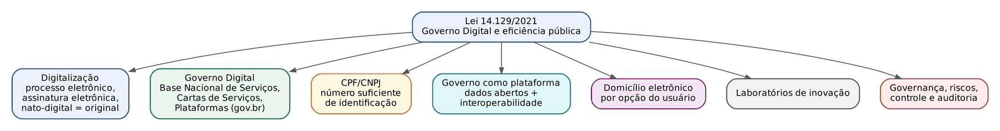

Âmbito de aplicação (art. 2º) — ponto que cai muito:
- Aplica-se diretamente à União: administração direta federal dos três Poderes (incluídos o TCU e o MPU) e à indireta federal (autarquias, fundações e as estatais QUE PRESTEM SERVIÇO PÚBLICO).
- Não se aplica às estatais que não prestam serviço público (§ 1º).
- Estados, Distrito Federal e Municípios: só se aplica "desde que adotem os comandos desta Lei por meio de atos normativos próprios" (inciso III). É uma lei de adesão para os entes subnacionais.

:::ATENCAO Por que isso importa para quem vai trabalhar na SEF/SC
Como a lei só vincula o Estado se ele a adotar por ato próprio (art. 2º, III, e § 2º), a pergunta "a Lei 14.129 se aplica à Secretaria de Estado da Fazenda de Santa Catarina?" depende de norma estadual de adesão. Em prova, basta lembrar a regra do art. 2º, III. (A existência e o teor de eventual ato catarinense de adesão não foram conferidos para esta apostila; ver nota de verificação.)
:::

Vigência (art. 55): 90 dias da publicação para a União, 120 dias para os Estados e o DF, 180 dias para os Municípios. Uma forma de memorizar: quanto menor o ente, mais tempo para se adaptar.

### 25.2.2 Princípios e diretrizes (art. 3º)

O art. 3º tem 26 incisos. Ninguém decora 26 incisos; o truque é agrupá-los por ideia. A tabela abaixo cobre todos.

| Ideia-mãe | Incisos do art. 3º (em síntese) |
|---|---|
| Simplificar e desburocratizar | I (desburocratização e simplificação mediante serviços digitais, acessíveis inclusive por dispositivos móveis); X (simplificação dos procedimentos, com foco na universalização do acesso e no AUTOSSERVIÇO); XI (eliminação de formalidades cujo custo econômico ou social seja SUPERIOR AO RISCO envolvido); XII (exigências impostas de uma única vez); XIII (vedação de exigir prova de fato já comprovado); XV (presunção de boa-fé do usuário) |
| Canal único e digital, sem abandonar o presencial | II (plataforma única de acesso, sem prejuízo do presencial quando indispensável); III (possibilidade de pedir e acessar serviços por meio digital, sem solicitação presencial); XVI (permanência do atendimento presencial conforme o público-alvo) |
| Transparência, participação e controle | IV (transparência e monitoramento da qualidade); V (participação social no controle); VI (dever do gestor de prestar contas diretamente à população); VII (linguagem clara); XVIII (cumprir a Carta de Serviços ao Usuário) |
| Tecnologia e integração | VIII (tecnologia para otimizar processos); IX (atuação integrada e compartilhamento de dados pessoais em ambiente seguro quando indispensável, nos termos da LGPD e, quando couber, com transferência de sigilo do art. 198 do CTN e da LC 105/2001); XIV (INTEROPERABILIDADE de sistemas e promoção de DADOS ABERTOS); XXII (assinaturas eletrônicas); XXIII (GOVERNO COMO PLATAFORMA e uso de dados, preferencialmente anonimizados); XXV (padrões e formatos abertos e livres); XXVI (inovação no setor público) |
| Proteção e inclusão | XVII (proteção de dados pessoais); XIX (acessibilidade da pessoa com deficiência); XX (educação para servidores e inclusão digital da população); XXIV (tratamento adequado a idosos); XXI (apoio técnico aos entes federados) |

:::DICA Os quatro incisos "de alternativa correta"
Os textos que a banca costuma copiar quase literalmente: eliminação de formalidades "cujo custo econômico ou social seja superior ao risco envolvido" (XI); vedação de exigência de prova de fato já comprovado (XIII); interoperabilidade de sistemas e promoção de dados abertos (XIV); presunção de boa-fé do usuário (XV). Quando a alternativa diz o CONTRÁRIO (ampliar trâmites, suprimir o presencial, remover o autosserviço, multiplicar plataformas autônomas), está errada.
:::

### 25.2.3 Definições (art. 4º) — o glossário que a FCC copia

| Termo | Definição legal (art. 4º) | Exemplo no Fisco |
|---|---|---|
| Autosserviço (II) | Acesso pelo cidadão a serviço público prestado por meio digital, SEM necessidade de mediação humana | Contribuinte emite sozinho a certidão negativa no portal |
| Base Nacional de Serviços Públicos (III) | Base de dados com as informações sobre a oferta de serviços públicos de todos os prestadores | Catálogo nacional que lista "emissão de certidão de ICMS em SC" |
| Dados abertos (IV) | Dados acessíveis ao público, em meio digital, estruturados em formato aberto, processáveis por máquina, referenciados na internet e sob licença aberta que permita livre utilização | Planilha CSV da arrecadação mensal por município, baixável |
| Dado acessível ao público (V) | Qualquer dado gerado ou acumulado pelos entes públicos que não esteja sob sigilo ou restrição de acesso da LAI | Valor total arrecadado de ICMS no mês (não o de cada contribuinte, que é sigiloso) |
| Formato aberto (VI) | Formato não proprietário, com especificação pública, livre de patentes ou restrições | CSV, JSON, XML (e não um formato que só abre num programa pago) |
| Governo como plataforma (VII) | Infraestrutura tecnológica que facilite o uso de dados de acesso público e promova a interação entre diversos agentes, de forma segura, eficiente e responsável, para estímulo à inovação, à exploração de atividade econômica e à prestação de serviços | O Estado publica APIs de dados e empresas criam aplicativos sobre elas |
| Laboratório de inovação (VIII) | Espaço aberto à participação e colaboração da sociedade para desenvolver ideias, ferramentas e métodos inovadores para gestão, serviços e controle social | Laboratório de inovação fazendária que testa um novo app com contribuintes |
| Plataformas de governo digital (IX) | Ferramentas digitais e serviços comuns aos órgãos, normalmente ofertados de forma centralizada e compartilhada | Login único gov.br, assinatura eletrônica gov.br |
| Registros de referência (X) | Informação íntegra e precisa oriunda de uma ou mais fontes de dados, centralizadas ou descentralizadas, sobre elementos fundamentais para a prestação de serviços e a gestão de políticas públicas | O cadastro do CPF na Receita Federal como "fonte da verdade" sobre nome e data de nascimento |
| Transparência ativa (XI) | Disponibilização de dados pela Administração independentemente de solicitação | Portal da transparência atualizado sem que ninguém peça |

Na analogia jurídica, o registro de referência funciona como a matrícula do imóvel no registro imobiliário: a informação "oficial", à qual todos os demais cadastros devem se reportar, em vez de cada órgão manter a sua cópia, cada uma com um erro diferente. Por isso o art. 40, § 2º, diz que "nova base de dados somente poderá ser criada quando forem esgotadas as possibilidades de utilização dos registros de referência existentes", e o art. 24, V, manda "eliminar a replicação de registros de dados, exceto por razões de desempenho ou de segurança".

### 25.2.4 Os instrumentos da lei, bloco a bloco

Digitalização (arts. 5º a 13):
- A Administração usará soluções digitais e processo administrativo eletrônico (art. 5º); atos processuais em meio eletrônico, salvo exceções (art. 6º).
- Validade por assinatura eletrônica, com segurança proporcional ao risco (art. 7º; ver também a Lei 14.063/2020).
- Ato eletrônico tempestivo até 23h59 do último dia do prazo, horário de Brasília (art. 8º, § 1º).
- Documentos nato-digitais assinados eletronicamente são considerados ORIGINAIS para todos os efeitos legais (art. 11).

Governo Digital em sentido estrito (arts. 14 a 27):
- Prestação digital por tecnologias de amplo acesso, inclusive para população de baixa renda e rural, sem prejuízo do presencial; preferencialmente por autosserviço (art. 14).
- Estratégia Nacional de Governo Digital editada pelo Executivo federal (art. 15); cada ente pode editar a sua (art. 16).
- Componentes essenciais (art. 18): Base Nacional de Serviços Públicos, Cartas de Serviços ao Usuário (Lei 13.460/2017) e Plataformas de Governo Digital.
- As Plataformas devem ter pelo menos: ferramenta digital de solicitação e acompanhamento de serviços e painel de monitoramento do desempenho (art. 20), acessadas por portal, aplicativo ou "canal digital único e oficial" (art. 20, § 1º). O painel deve mostrar, no mínimo, quantidade de solicitações, tempo médio de atendimento e grau de satisfação (art. 22).
- Deveres dos órgãos (art. 24): eliminar, inclusive por interoperabilidade, exigências desnecessárias de documentos (IV); eliminar replicação de registros (V); gerir políticas com base em dados e evidências (VII); testar serviços com usuários (VIII).
- Presume-se a autenticidade de documentos enviados com assinatura eletrônica (art. 26).
- Direitos do usuário (art. 27): gratuidade no acesso às plataformas, atendimento conforme a Carta de Serviços, padronização de formulários, protocolo, indicação de canal preferencial de comunicação.

Número suficiente de identificação (art. 28): o CPF (pessoa física) ou o CNPJ (pessoa jurídica) é número suficiente para identificação nos bancos de dados de serviços públicos, com inscrição gratuita. O CPF deve constar de certidões de nascimento, casamento e óbito, título de eleitor, CNH, passaporte, carteiras de identidade e outros. É a base da nova Carteira de Identidade Nacional, que usa o CPF como número único.

Governo como plataforma: abertura de dados (arts. 29 a 37):
- Dados de prestadores de serviços públicos e de transparência ativa são de livre utilização pela sociedade, observados os princípios da LGPD (art. 29).
- Requisitos (art. 29, § 1º): publicidade das bases NÃO PESSOAIS como regra e sigilo como exceção; dados legíveis por máquina e em formato aberto; descrição suficiente da estrutura e da semântica; completude, na forma primária e com o maior grau de granularidade possível; atualização periódica mantido o histórico; respeito à privacidade.
- Deve ser divulgado na internet, entre outros (art. 29, § 2º): orçamento e execução da despesa e da receita, licitações e contratos, notas fiscais eletrônicas relativas às compras públicas, sanções administrativas, inventário de bases de dados e catálogo de dados abertos, e as RENÚNCIAS DE RECEITA para pessoas físicas ou jurídicas, com os dados dos beneficiários no caso das renúncias individualizadas (inciso XII).
- Qualquer interessado pode pedir a abertura de base de dados, sem precisar dizer o motivo (art. 30, § 4º); aplicam-se os prazos da LAI (art. 30, § 2º). Inconsistências na base não impedem a abertura (art. 32, parte vetada e depois promulgada). Recurso contra o indeferimento em 10 dias, decidido em 5 dias pela autoridade superior (art. 35, também promulgado após derrubada do veto).

Interoperabilidade (arts. 38 a 41): estudada em 25.3.

Domicílio eletrônico (arts. 42 e 43): mediante OPÇÃO do usuário, comunicações, notificações e intimações podem ser feitas por meio eletrônico; o administrado pode desistir a qualquer tempo, sem justificar; as ferramentas devem comprovar autoria, emissão e recebimento (ainda que não a leitura), ser auditáveis e conservar os dados por pelo menos 5 anos. (Não confunda com o Domicílio Tributário Eletrônico das legislações fiscais, que tem regime próprio em cada ente.)

Laboratórios de inovação (arts. 44 e 45): os entes PODEM (faculdade) instituí-los, abertos à sociedade, com diretrizes como colaboração interinstitucional, tecnologias abertas e livres, métodos ágeis e prototipação, foco no cidadão e apoio a políticas orientadas por dados.

Governança, gestão de riscos, controle e auditoria (arts. 47 a 49): mecanismos de governança com acompanhamento de resultados e processo decisório fundamentado em evidências; sistema de gestão de riscos e de controle interno; auditoria interna baseada em risco e voltada também à prevenção e detecção de fraudes (tema retomado no Cap. 28).

:::PEGADINHA Trocas de palavras que a banca faz na Lei 14.129
- "Governo como plataforma ... o que EXIGE do usuário a apresentação de documentos prescindíveis" — errado: a lei manda ELIMINAR essas exigências (art. 24, IV).
- "Plataformas de governo digital ... implicam que os dados pessoais sejam REPLICADOS entre sistemas" — errado: a lei manda eliminar a replicação (art. 24, V).
- "Interoperabilidade exige cadastros em formato NÃO estruturado" — errado: interoperar exige dados estruturados, padronizados e legíveis por máquina.
- "O domicílio eletrônico é obrigatório" — errado: depende de opção do usuário (art. 42).
- "Os laboratórios de inovação são obrigatórios" — errado: "poderão instituir" (art. 44).
:::

:::QUESTAO FCC 2026 — CPU-PE — Gestor Governamental, Planejamento, Orçamento e Gestão (Q3871965)
Situação: uma Secretaria de Planejamento implanta estratégia de transformação digital alinhada às diretrizes legais sobre plataformas de governo digital e interoperabilidade. Pergunta-se qual explicação dada por uma gestora está correta. Gabarito oficial: C.
- C (correta): o redesenho de serviços digitais deve usar registros de referência, "informação íntegra e precisa oriunda de uma ou mais fontes de dados, centralizadas ou descentralizadas, sobre elementos fundamentais para a prestação de serviços e para a gestão de políticas públicas". É a cópia do art. 4º, X.
- A: parece correta, mas mistura ideias. A lei fala em gestão com base em dados e evidências "por meio da aplicação de inteligência de dados em plataforma digital" (art. 24, VII); não há previsão de "IA em plataformas com mecanismos de controle acessíveis aos gestores" como dado legal. A FCC a considerou incorreta por não corresponder ao texto.
- B: começa com a definição correta de governo como plataforma (art. 4º, VII), mas termina dizendo que isso "exige" a apresentação de documentos prescindíveis. É o oposto do art. 24, IV.
- D: começa com a definição correta de plataformas de governo digital (art. 4º, IX), mas conclui que os dados devem ser replicados. Contraria o art. 24, V.
- E: interoperabilidade com cadastros "não estruturados" é contradição em termos.
Lição: a FCC cola a definição legal certa no começo e envenena o final. Leia a alternativa até o último ponto.
:::

:::QUESTAO FGV 2025 — CNU — Bloco 2 (Q3641980)
Pede a alternativa que traz corretamente diretriz ou princípio da Lei 14.129/2021. Gabarito oficial: D.
- D (correta): eliminação de formalidades e exigências cujo custo econômico ou social seja superior ao risco envolvido (art. 3º, XI).
- A: "ampliação dos trâmites burocráticos" — o oposto da desburocratização (art. 3º, I).
- B: "supressão do atendimento presencial" — a lei garante a permanência do presencial (art. 3º, XVI; art. 14).
- C: "múltiplas plataformas autônomas" — a lei quer plataforma única (art. 3º, II) e canal digital único e oficial (art. 20, § 1º).
- E: "remoção do autosserviço" — a lei quer autosserviço (art. 3º, X; art. 14, parágrafo único).
No mesmo sentido (e-gov não dispensa mudança organizacional nem visa reduzir servidores): Q4217661, Q3154381, Q3113935, Q2566551.
:::

### 25.2.5 Estratégias de governo digital: nacional e federal

Dois decretos de 2024, com nomes parecidos, regulamentam o art. 15 da Lei 14.129:

| Ato | O que é | Pontos de prova |
|---|---|---|
| Decreto 12.069, de 21/6/2024 | Estratégia NACIONAL de Governo Digital (ENGD) 2024-2027, para União, Estados, DF e Municípios, e a Rede Nacional de Governo Digital (Rede Gov.br) | Definições de governo digital, transformação digital e IPD (art. 4º); reeditada a cada 4 anos, coincidindo com o PPA (art. 6º); objetivos específicos (art. 9º), entre eles "implementar e manter solução estruturante de identificação única e nacional, associada à Carteira de Identidade Nacional" (III) e "qualificar a tomada de decisões ... com o reúso constante e ético dos dados" (V); adesão VOLUNTÁRIA dos entes à Rede Gov.br (art. 11, § 1º), com compromisso de publicar estratégia própria (art. 15, § 1º) |
| Decreto 12.198, de 24/9/2024 | Estratégia FEDERAL de Governo Digital (EFGD) 2024-2027, só para a administração pública federal | Organizada em princípios, que se desdobram em objetivos e iniciativas. Os seis princípios: Centrado no Cidadão e Inclusivo; Integrado e Colaborativo; Inteligente e Inovador; Confiável e Seguro; Transparente, Aberto e Participativo; Eficiente e Sustentável |

A plataforma gov.br é o canal digital único do governo federal: portal de serviços, conta de acesso única (login gov.br, com níveis bronze, prata e ouro de confiabilidade), assinatura eletrônica gov.br e aplicativos. É exemplo de "plataforma de governo digital" no sentido do art. 4º, IX, da Lei 14.129.

:::QUESTAO FCC 2026 — CPU-PE — Gestor Governamental, Administrativa (Q3872012)
A EFGD se estrutura em princípios, que se desdobram em objetivos e iniciativas. Pergunta-se em qual princípio está a iniciativa de personalizar a comunicação digital em pelo menos 50 serviços públicos, para aumentar a PROATIVIDADE do governo na antecipação das necessidades do cidadão. Gabarito oficial: A (Governo Inteligente e Inovador).
Raciocínio: "antecipar necessidades" e "personalizar" exigem uso inteligente de dados sobre o cidadão; é o eixo da inteligência e inovação. As alternativas sedutoras são D (Centrado no Cidadão e Inclusivo), porque o beneficiário é o cidadão, e C (Transparente, Aberto e Participativo). Mas o núcleo da iniciativa não é inclusão nem transparência: é o governo usar dados para agir antes de ser provocado. Questão de memorização do documento da EFGD; o critério prático é perguntar "qual é o VERBO da iniciativa?". Antecipar e personalizar com dados = inteligente.
:::

:::NOTA Pegadinha de data em questão do banco
A Q3643538 (FGV 2025, CNU) atribui o Decreto 12.069 a "28 de maio de 2024". No Planalto, a data é 21/6/2024. O gabarito (E: solução estruturante de identificação única e nacional associada à Carteira de Identidade Nacional, art. 9º, III) não é afetado.
:::

## 25.3 Interoperabilidade

### 25.3.1 A ideia em linguagem comum

Interoperabilidade é a capacidade de sistemas diferentes, de órgãos diferentes, TROCAREM dados e USAREM esses dados sem intervenção manual. Pense na tomada elétrica: um aparelho comprado em qualquer loja funciona em qualquer casa porque todos seguem o mesmo padrão de plugue e de voltagem. Sem padrão, cada aparelho exigiria um adaptador. Interoperabilidade é o "padrão de tomada" dos dados.

Exemplo do cotidiano fiscal: a empresa pede inscrição estadual. Sem interoperabilidade, a Secretaria da Fazenda exige cópia do contrato social, do comprovante de CNPJ e do documento dos sócios. Com interoperabilidade, o sistema da Fazenda consulta automaticamente a Receita Federal (CNPJ) e a Junta Comercial (quadro societário), e o contribuinte informa só o CNPJ. É o que o art. 24, IV, da Lei 14.129 manda fazer, e o que o art. 3º, XIII, consagra ao vedar a exigência de prova de fato já comprovado.

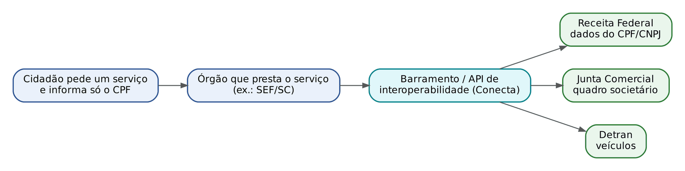

### 25.3.2 As três camadas

Para dois sistemas "conversarem" não basta ligar um cabo. Há três camadas, que a literatura e o padrão europeu de interoperabilidade costumam distinguir (às vezes com uma quarta, a jurídica):
- Técnica: os sistemas conseguem se conectar e transmitir (protocolos de rede, formatos de arquivo como XML e JSON, uma API). API (*application programming interface*, "interface de programação de aplicações") é uma "porta de atendimento" de um sistema para outro: o sistema A faz uma pergunta padronizada ("dados do CNPJ 12.345.678/0001-90") e o sistema B devolve a resposta num formato combinado.
- Semântica: os dois sistemas entendem o MESMO SIGNIFICADO. Se para um órgão "data" é a da emissão da nota e para outro é a da saída da mercadoria, o cruzamento sairá errado mesmo que a transmissão funcione. Para isso servem dicionários de dados, vocabulários controlados, taxonomias e ontologias.
- Organizacional (e jurídica): os órgãos combinaram quem fornece o quê, com que finalidade, base legal, nível de sigilo e responsabilidade. Sem acordo e sem base legal, o dado não deve circular, por mais fácil que seja tecnicamente.

A NF-e é um ótimo exemplo de interoperabilidade bem-sucedida: um leiaute XML único nacional, com campos de significado definido (o CFOP, o NCM, o CST), permite que a Fazenda de qualquer Estado leia a nota emitida em outro.

### 25.3.3 e-PING, Conecta gov.br e compartilhamento de dados

- e-PING (Padrões de Interoperabilidade de Governo Eletrônico): arquitetura que define um conjunto mínimo de premissas, políticas e especificações técnicas para a interoperabilidade dos serviços de governo eletrônico no Executivo federal. Linha-mestra: adoção preferencial de PADRÕES ABERTOS (não proprietários), uso de padrões de mercado amplamente aceitos, escalabilidade e transparência. Nada de "software proprietário como prioridade".
- Conecta gov.br: programa do governo federal de interoperabilidade entre bases, por meio de APIs, para que o cidadão NÃO precise reapresentar ao governo informações que o próprio governo já possui. Nome a guardar (Q3872014).
- Decreto 10.046/2019 (governança no compartilhamento de dados na administração federal; vide ADI 6649): classifica o compartilhamento em três níveis, segundo a confidencialidade (art. 4º): amplo (dados públicos, sem restrição); restrito (dados sigilosos, com acesso a todos os órgãos para execução de políticas públicas, com regras do Comitê Central de Governança de Dados); específico (dados sigilosos, com acesso a órgãos determinados, nas hipóteses legais). O decreto instituiu também o Cadastro Base do Cidadão. A disciplina do compartilhamento de DADOS PESSOAIS pelo Poder Público, à luz da LGPD, está no Cap. 26.
- Lei 14.129, arts. 38 a 41: os órgãos devem gerir suas ferramentas considerando a interoperabilidade, respeitadas as restrições legais, a segurança e a relação custo-benefício (art. 38, I); será instituído mecanismo de interoperabilidade para aprimorar políticas, aumentar a confiabilidade dos cadastros, viabilizar identificação unificada do cidadão e tratar as bases a partir do CPF (art. 39); os custos de adaptação são de cada órgão (art. 41).

:::QUESTAO FCC 2026 — CPU-PE — Gestor Governamental, Administrativa (Q3872014)
Pergunta qual é o programa de interoperabilidade do governo federal para que o cidadão não precise reapresentar informações que o governo já possui. Gabarito oficial: E (Conecta gov.br).
As demais são nomes reais de outras iniciativas, para confundir: Sou gov.br (aplicativo e serviços de gestão de pessoas para servidores federais), Fala.BR (plataforma de ouvidoria e acesso à informação; a alternativa escreve "Fala gov.br"), LabQ (sem correspondência conhecida como programa de interoperabilidade), Tramita gov.br (barramento de tramitação de processos entre órgãos). Sem decorar a lista, a palavra-chave resolve: "conectar" bases = Conecta.
:::

:::QUESTAO FGV 2024 — Ministério da Fazenda — Auditor Federal de Finanças e Controle, TI (Q2534631)
Pergunta o que a arquitetura e-PING estabelece. Gabarito oficial: D (adoção preferencial de padrões abertos nas especificações técnicas).
- A inverte a lógica da transparência: a publicidade é a regra e o sigilo, a exceção (mesma lógica do art. 29, § 1º, I, da Lei 14.129).
- B (prioridade a software proprietário) contraria a preferência por padrões abertos e livres (também art. 3º, XXV, da Lei 14.129).
- C (vedar taxonomias e ontologias) é absurdo: elas são justamente as ferramentas da interoperabilidade semântica.
- E (padrões para "inibir alterações") ignora que os padrões existem para facilitar a evolução, não para engessar.
:::

:::PRATIQUE exercícios elaborados para esta apostila
1. Classifique cada problema na camada de interoperabilidade (técnica, semântica ou organizacional): (a) o sistema do Detran só envia arquivos num formato que o sistema da Fazenda não lê; (b) a Fazenda registra o faturamento em reais com centavos, e a Junta Comercial, em milhares de reais, sem avisar; (c) não há convênio nem base legal autorizando o envio de dados de veículos à Fazenda.
2. Uma Secretaria exige do contribuinte cópia autenticada do cartão CNPJ, embora possa consultá-lo na base da Receita Federal. Quais dispositivos da Lei 14.129 essa exigência contraria?
3. Certo ou errado: "Dados abertos, segundo a Lei 14.129, são quaisquer dados publicados na internet, inclusive em PDF digitalizado, desde que gratuitos."
Resolução:
1. (a) Técnica: a transmissão em si falha (formato). (b) Semântica: o dado chega, mas o SIGNIFICADO (unidade de medida) difere; o cruzamento dará valores mil vezes errados. (c) Organizacional/jurídica: falta acordo e base legal; tecnicamente seria possível, juridicamente não.
2. Art. 3º, XIII (vedação de exigir prova de fato já comprovado por documento ou informação válida) e art. 24, IV (eliminar, inclusive por interoperabilidade, exigências desnecessárias de documentos prescindíveis); também o princípio da simplificação (art. 3º, I e X).
3. Errado. O art. 4º, IV, exige formato ABERTO, estruturado, PROCESSÁVEL POR MÁQUINA, referenciado na internet e sob licença aberta. Um PDF escaneado (imagem) não é processável por máquina; gratuidade não basta.
:::

## 25.4 Inteligência artificial: o que é

### 25.4.1 A ideia em linguagem comum

Inteligência artificial (IA) é o ramo da computação que constrói sistemas capazes de executar tarefas que, se feitas por uma pessoa, diríamos que exigem inteligência: reconhecer uma assinatura, entender uma pergunta escrita, traduzir um texto, prever quem tem maior chance de sonegar, jogar xadrez, dirigir um carro.

Há duas grandes maneiras de "ensinar" uma máquina a fazer isso. Imagine que você precisa de um assistente para triar petições iniciais.
- Caminho 1: você escreve um manual com regras: "SE a petição pede alimentos, ENTÃO vai para a Vara de Família; SE pede indenização contra o Estado, ENTÃO vai para a Fazenda Pública". O assistente segue o manual. Isso é a IA SIMBÓLICA (ou baseada em regras, ou baseada em conhecimento): o conhecimento é escrito por um humano, em símbolos e regras lógicas. Os antigos "sistemas especialistas" são desse tipo.
- Caminho 2: em vez de escrever regras, você entrega ao assistente 50.000 petições já distribuídas e diz: "aprenda sozinho o padrão". Isso é o APRENDIZADO DE MÁQUINA (*machine learning*): o sistema extrai as regras dos EXEMPLOS (dos dados). Quando esse aprendizado usa redes neurais artificiais, fala-se em abordagem CONEXIONISTA.

A literatura menciona ainda a IA evolucionista (algoritmos genéticos, que "evoluem" soluções por mutação e seleção, imitando a seleção natural) e a probabilística/bayesiana. Questão FGV (Q3742909) aceitou como abordagens atuais "IA simbólica, IA evolucionista e IA conexionista".

### 25.4.2 Camadas: IA, aprendizado de máquina, aprendizado profundo, IA generativa

A relação entre os termos é de CONTINÊNCIA, como círculos concêntricos. Todo aprendizado profundo é aprendizado de máquina; todo aprendizado de máquina é IA; o contrário não vale.

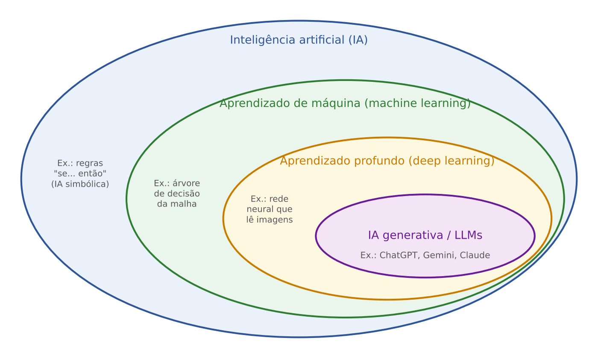

- IA: o campo inteiro.
- Aprendizado de máquina (AM; *machine learning*, ML): subcampo da IA em que o sistema aprende padrões a partir de dados, sem ser explicitamente programado para cada situação.
- Aprendizado profundo (*deep learning*): subconjunto do AM que usa redes neurais artificiais com muitas camadas (25.8).
- IA generativa: sistemas que GERAM conteúdo novo (texto, imagem, áudio, código). Os grandes modelos de linguagem (LLMs) são o exemplo mais conhecido (25.9). Rigorosamente, há modelos generativos fora do aprendizado profundo, mas a IA generativa atual é quase toda feita com redes profundas, e é assim que a banca a apresenta.

:::QUESTAO FCC 2026 — TJ-CE — Analista Judiciário, Sistemas da Informação (Q4240120)
Pergunta qual é a relação mais adequada entre inteligência artificial e aprendizado de máquina. Gabarito oficial: A (o AM emprega modelos capazes de aprender padrões a partir de dados e é uma abordagem INSERIDA em um campo dedicado ao desenvolvimento de sistemas inteligentes, a IA).
- B erra ao dizer que a IA se implementa "utilizando técnicas de aprendizado supervisionado": o supervisionado é só um dos tipos de AM, e há IA sem AM nenhum (a simbólica).
- C e D erram ao tratar o aprendizado a partir de dados (ou "grandes volumes de dados históricos") como REQUISITO de qualquer IA. Um sistema especialista de regras é IA e não aprende com dados.
- E descreve bem o AM (ajustar o comportamento com base em exemplos), mas não responde à pergunta, que é sobre a RELAÇÃO entre os dois conceitos (parte e todo).
:::

### 25.4.3 IA fraca e IA forte; Teste de Turing

- IA fraca (ou estreita, *narrow AI*): projetada para tarefas ESPECÍFICAS, sem consciência ou compreensão geral. Todas as IAs existentes hoje são fracas, inclusive os LLMs mais avançados, por mais versáteis que pareçam.
- IA forte (ou geral, AGI, *artificial general intelligence*): hipotética IA com capacidade cognitiva geral equivalente ou superior à humana, capaz de entender e aprender qualquer tarefa intelectual; em algumas formulações, com consciência. Superinteligência é a ideia de uma IA muito acima da humana.
- Teste de Turing (proposto por Alan Turing em 1950, o "jogo da imitação"): um avaliador conversa por texto com um humano e com uma máquina, sem saber quem é quem; se não conseguir distinguir, a máquina "passa". Mede a capacidade de IMITAR conversa humana, não velocidade de cálculo. O Teste de Turing Total acrescenta percepção (visão computacional) e manipulação de objetos (robótica).
- Efeito Eliza: tendência humana de atribuir compreensão e emoções a programas que apenas manipulam texto (o nome vem do ELIZA, programa de conversa da década de 1960).

:::QUESTAO FGV 2024 — TJ-MT — Analista Judiciário, TI (Q3114977)
Pergunta a diferença correta entre IA forte e fraca. Gabarito oficial: C (a forte seria capaz de adquirir consciência e compreensão geral; a fraca é projetada para tarefas específicas, sem consciência).
- A e B invertem os conceitos.
- D diz que a fraca é "totalmente autônoma" e a forte precisa de intervenção humana: inversão de novo.
- E reduz a diferença ao hardware: a diferença é de capacidade cognitiva, não de potência de máquina.
No mesmo sentido: Q2534602, Q3042266, Q4375781 (Teste de Turing não mede velocidade de cálculo), Q3755424 (Teste de Turing Total: a robótica), Q3758239 (efeito Eliza).
:::

:::QUESTAO FCC 2025 — DPE-SP — Analista de Defensoria (Q3304046)
Questão de interpretação de texto (artigo de Marcelo Gleiser sobre "medo do futuro" e IA), mas que testa justamente o conceito de IA fraca. Pergunta-se o que o autor afirma sobre a IA. Gabarito oficial: A (o autor critica o uso do nome "inteligência artificial" para a tecnologia atual, que não seria autônoma e apenas realiza atividades previamente especificadas).
O texto diz que os níveis atuais de IA, que ele "não chamaria de IA", cumprem funções definidas por seus programadores, sem autonomia nem intenção própria. A alternativa C é a sedutora: o autor NÃO diz que só haverá malefícios se as máquinas ganharem autonomia; ao contrário, alerta que a IA "de menor porte" já causa problemas sociais (mercado de trabalho). D distorce ("mais humana do que artificial"); B e E atribuem ao autor um otimismo que ele não tem.
:::

### 25.4.4 Agentes de IA

Agente é um sistema que PERCEBE o ambiente (por sensores ou dados), DECIDE e AGE para atingir uma meta. A classificação clássica (dos livros de IA) vai do mais simples ao mais sofisticado: agente reativo simples (reage à percepção atual, por regras condição-ação); reativo baseado em modelo (mantém um estado interno do mundo); baseado em objetivos (escolhe ações que levam à meta); baseado em utilidade (escolhe a ação que MAXIMIZA uma medida numérica de satisfação, a utilidade); e agente com aprendizado.

Nos LLMs atuais, "agente de IA" designa o modelo que, além de responder, PLANEJA uma sequência de passos, usa ferramentas (busca, planilha, sistemas internos) e ajusta o procedimento até cumprir a meta (Q4217680). Exemplo fazendário: um agente que recebe "verifique se o contribuinte X tem notas de entrada sem escrituração", consulta a base de NF-e, consulta a EFD, compara e redige um relatório.

:::QUESTAO FCC 2025 — TRT 15ª Região — Analista Judiciário, Biblioteconomia (Q3502413)
Quais funcionalidades de processadores de texto modernos demonstram o uso de IA e automação? Gabarito oficial: E (correção gramatical e sugestão de palavras com base no CONTEXTO do texto).
O critério é "contexto": sugerir a próxima palavra ou corrigir a concordância conforme o sentido da frase exige um modelo de linguagem (é uma versão em miniatura do que os LLMs fazem, 25.9). As demais alternativas descrevem automação de cálculo por fórmulas (A, D), execução de programas (B) e relatórios automatizados (C), coisas que um software tradicional faz por regras fixas, sem aprender nada, e que, além disso, não são funções típicas de processador de texto.
:::

## 25.5 Aprendizado de máquina

### 25.5.1 A ideia: aprender com exemplos, como um assessor novo

Imagine um assessor recém-chegado ao gabinete. Ninguém lhe dá um algoritmo escrito de "como votar em agravo de instrumento". Ele lê centenas de votos anteriores e, aos poucos, percebe padrões: "quando há perigo de dano e prova documental robusta, a liminar costuma ser mantida". Depois de "treinado", recebe um caso novo e prevê o resultado provável. Se errar, é corrigido e ajusta seu critério.

O aprendizado de máquina faz exatamente isso, com números. Vocabulário básico, com exemplo fazendário (prever se uma empresa é "noteira", isto é, emite notas frias):
- Exemplo (instância, registro, amostra): cada linha da tabela; aqui, cada empresa.
- Atributos (*features*, variáveis de entrada, preditores, variáveis independentes): as colunas que descrevem o exemplo: faturamento declarado, número de empregados, idade do CNPJ, percentual de vendas para outros Estados, quantidade de notas emitidas por mês.
- Rótulo (variável-alvo, *target*, classe, variável dependente): a resposta que queremos prever; aqui, "noteira" ou "regular", conhecida nos casos já fiscalizados.
- Modelo: a "regra aprendida", uma função matemática que recebe os atributos e devolve a previsão.
- Treinamento: o processo de ajustar os PARÂMETROS do modelo (seus "números internos") para errar o menos possível nos exemplos conhecidos. O tamanho do erro é medido por uma função de perda (*loss function*).
- Inferência (predição): usar o modelo já treinado em um caso NOVO.
- Hiperparâmetros: escolhas feitas ANTES do treino, pelo cientista de dados (por exemplo, a profundidade máxima de uma árvore, o número k de grupos). Busca em grade (*grid search*) testa sistematicamente todas as combinações predefinidas de hiperparâmetros; a otimização bayesiana faz essa busca de modo mais econômico.

### 25.5.2 Os três tipos de aprendizado

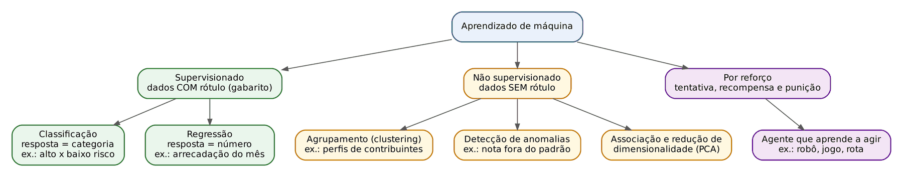

Aprendizado SUPERVISIONADO: os dados de treino vêm com o RÓTULO (o "gabarito"). O modelo aprende a mapear entrada → saída conhecida. É o assessor que estuda votos com o resultado anotado. Duas tarefas:
- Classificação: a saída é uma CATEGORIA (rótulo discreto). "Alto risco" ou "baixo risco"; "fraude" ou "legítima"; "saúde", "educação" ou "segurança". Se são duas categorias, classificação binária; mais de duas, multiclasse.
- Regressão: a saída é um NÚMERO contínuo. Arrecadação de ICMS do próximo mês; prazo, em dias, até o fim de um processo; valor provável de um imóvel.

Aprendizado NÃO SUPERVISIONADO: os dados NÃO têm rótulo. O modelo procura estrutura escondida. É como receber 10.000 processos sem nenhuma anotação e pedir: "separe em pilhas de casos parecidos". Tarefas:
- Agrupamento (*clustering*): formar grupos de exemplos semelhantes entre si e diferentes dos demais. Segmentar municípios por perfil socioeconômico; achar perfis de contribuintes.
- Detecção de anomalias (*outliers*): achar o que foge do padrão, sem exemplos prévios de "anômalo". Pagamentos de diárias muito acima do normal.
- Regras de associação: "quem compra A tende a comprar B" (cesta de compras).
- Redução de dimensionalidade: resumir muitas colunas em poucas, perdendo o mínimo de informação. A técnica mais cobrada é a Análise de Componentes Principais (PCA, *principal component analysis*), também chamada transformada de Karhunen-Loève.

Aprendizado POR REFORÇO: não há tabela de exemplos rotulados. Um AGENTE age num ambiente, recebe RECOMPENSAS ou PUNIÇÕES e aprende, por tentativa e erro, a política de ações que maximiza a recompensa acumulada no longo prazo. É como adestrar um cão com petiscos, ou como um jogador que aprende xadrez jogando milhões de partidas. Exemplos: robôs, jogos, controle de semáforos, sistemas de recomendação que se ajustam ao *feedback*.

Existe ainda o aprendizado SEMISSUPERVISIONADO: poucos exemplos rotulados e muitos sem rótulo, usados juntos para melhorar a generalização. E o autossupervisionado, em que o próprio dado fornece o rótulo (o LLM aprende a prever a próxima palavra de textos: o "gabarito" é a palavra seguinte, que já está no texto). Ver 25.9.

:::PASSO Como resolver qualquer questão "qual técnica de aprendizado usar?"
1. Os dados históricos têm a RESPOSTA conhecida (rótulo, "casos já analisados", "classificados", "histórico de autuações")? Se sim, é SUPERVISIONADO. Se o enunciado diz "sem rótulos", "sem exemplos prévios", "descobrir padrões naturais", é NÃO SUPERVISIONADO. Se fala em "agente", "recompensa", "penalidade", "feedback", é POR REFORÇO.
2. No supervisionado, a resposta é categoria ou número? Categoria (sim/não, alto/baixo risco, tipo de documento) = CLASSIFICAÇÃO. Número (valor, prazo, quantidade) = REGRESSÃO.
3. No não supervisionado, o objetivo é formar grupos (AGRUPAMENTO, k-means, hierárquico), achar casos estranhos (ANOMALIAS, Isolation Forest) ou reduzir colunas (PCA)?
4. Desconfie de combinações absurdas que a banca cria: "regressão não supervisionada", "SVM não supervisionado", "clusterização hierárquica supervisionada", "ARIMA para agrupar regiões". São misturas de rótulos de famílias diferentes.
:::

### 25.5.3 Principais algoritmos (nível de prova)

Não é preciso saber programá-los; é preciso saber a que família pertencem e para que servem.

| Algoritmo | Família | Ideia em uma frase | Uso típico |
|---|---|---|---|
| Regressão linear | Supervisionado, regressão | Ajusta uma reta (ou plano) que prevê um número a partir dos atributos (Cap. 16) | Prever arrecadação, prazo de tramitação |
| Regressão logística | Supervisionado, CLASSIFICAÇÃO (apesar do nome) | Estima a PROBABILIDADE de um evento (entre 0 e 1) e classifica pelo limiar | Probabilidade de inadimplência; fraude sim/não |
| Árvore de decisão | Supervisionado (classificação ou regressão) | Sequência de perguntas "sim/não" sobre os atributos, em forma de árvore; folhas dão a resposta | Seleção de contribuintes para fiscalização, com regras legíveis |
| Floresta aleatória (*random forest*) e *gradient boosting* (ex.: XGBoost) | Supervisionado, *ensemble* (comitê de modelos) | Muitas árvores votam juntas; mais precisão, menos legibilidade | Risco fiscal com relações complexas |
| k vizinhos mais próximos (k-NN) | Supervisionado, classificação | Classifica o caso novo pela classe da maioria dos k exemplos mais parecidos (mais próximos pela distância) | Classificação simples por semelhança |
| Máquina de vetores de suporte (SVM) | Supervisionado, classificação | Traça a "fronteira" que separa as classes com a maior margem possível | Classificação de textos e documentos |
| Naive Bayes | Supervisionado, classificação | Usa o Teorema de Bayes (Cap. 12), supondo atributos INDEPENDENTES entre si dada a classe (daí "ingênuo") | Filtro de *spam*, classificação de textos |
| Redes neurais | Supervisionado (em geral), também não supervisionado | Camadas de "neurônios" com pesos ajustáveis (25.8) | Imagens, textos, padrões complexos |
| k-means (k-médias) | NÃO supervisionado, agrupamento PARTICIONAL | Escolhe k centros (centroides), atribui cada ponto ao centro mais próximo, recalcula os centros como a MÉDIA do grupo e repete até estabilizar; k é definido ANTES pelo usuário | Segmentar contribuintes em k perfis |
| Agrupamento hierárquico | NÃO supervisionado, agrupamento | Une (aglomerativo, de baixo para cima) ou divide (divisivo, de cima para baixo) grupos sucessivamente; resultado visto num DENDROGRAMA, que se "corta" no número de grupos desejado; não exige k prévio | Estrutura hierárquica interpretável de contribuintes |
| DBSCAN | NÃO supervisionado, agrupamento por DENSIDADE | Grupos são regiões densas de pontos; pontos isolados viram ruído | Grupos de formato irregular |
| Isolation Forest | NÃO supervisionado, anomalias | Isola os pontos raros com poucas "cortes" aleatórios | Detectar indenizações atípicas sem rótulo |
| PCA | NÃO supervisionado, redução de dimensionalidade | Cria novas variáveis (componentes) que concentram a maior parte da variância; elimina redundância de variáveis correlacionadas, com alguma perda de informação | Resumir 200 indicadores em 10 |
| ARIMA e modelos de séries temporais | Estatística de previsão no tempo | Prevê o futuro de uma série a partir do seu próprio passado | Previsão de arrecadação mensal |

:::DICA Três pegadinhas de nome
- Regressão LOGÍSTICA classifica (prevê categoria via probabilidade); regressão LINEAR prevê número. A FCC adora trocar uma pela outra.
- k-NN (supervisionado, classifica por vizinhos rotulados) não é k-means (não supervisionado, agrupa sem rótulo). Os dois usam "k" e distância; só o k-means é não supervisionado.
- Rede neural "convolucional" (CNN) é para imagens; "recorrente" (RNN) é para sequências (texto, séries). Não existe rede "convulsionada" (erro de digitação que apareceu numa alternativa da FCC).
:::

### 25.5.4 Questões de prova sobre tipos de aprendizado

:::QUESTAO FCC 2026 — SEFAZ-SP — Auditor Fiscal da Receita Estadual, TI (Q3926898)
A Fazenda quer, ao mesmo tempo, (I) prever o valor da arrecadação mensal de ICMS dos próximos meses e (II) classificar cada declaração em "alto risco" ou "baixo risco" para seleção de auditoria. Gabarito oficial: B (I: regressão supervisionada; II: classificação supervisionada).
Aplicando o PASSO: (I) a resposta é um NÚMERO e há histórico com o valor conhecido → regressão supervisionada. (II) a resposta é uma CATEGORIA → classificação supervisionada (pressupõe histórico de declarações já qualificadas).
- A inverte as tarefas.
- C chama de *clustering* (agrupamento, que não prevê valores) a previsão de arrecadação.
- D inventa "regressão não supervisionada" e "classificação não supervisionada": sem rótulo não há como "classificar em alto ou baixo risco" no sentido técnico.
- E: PCA reduz colunas, não prevê arrecadação.
:::

:::QUESTAO FCC 2026 — CPU-PE — Gestor Governamental, Planejamento (Q3871968)
Três equipes: (I) modelo que identifica se a mensagem do cidadão é de saúde, educação ou segurança; (II) modelo que prevê o valor da arrecadação do próximo mês; (III) modelo que segmenta municípios com perfis socioeconômicos semelhantes. Gabarito oficial: A (I classificação; II regressão; III agrupamento).
(I) três categorias predefinidas → classificação (multiclasse). (II) número → regressão. (III) "segmentar em perfis semelhantes", sem categorias prévias → agrupamento. Todas as outras alternativas embaralham a mesma lista; basta acertar UM item para eliminar quase tudo (por exemplo, II é regressão: só A tem "II. Regressão").
:::

:::QUESTAO FCC 2026 — MPE-AL — Analista, Desenvolvimento de Sistemas (Q4104671)
Secretaria de Saúde tem milhares de solicitações de exames já analisadas por médicos reguladores e ROTULADAS com o grau de prioridade. Quer prever automaticamente a categoria das novas solicitações. Gabarito oficial: A (classificação supervisionada com os dados históricos rotulados).
- C (agrupar e depois definir prioridades manualmente) desperdiça o rótulo já existente e não automatiza a decisão.
- D (regressão linear do tempo de espera) prevê outra coisa (um número) e "infere" a prioridade por via indireta.
- E (aprendizado por reforço) exige um agente recebendo recompensas por interação, e não é o caso de quem já tem histórico rotulado.
- B (redução de dimensionalidade "isoladamente") não classifica nada.
:::

:::QUESTAO FCC 2025 — TRF 4ª Região — Analista Judiciário, Análise de Sistemas (Q3538825)
Um tribunal quer (1) estimar o prazo de conclusão dos processos com base em dados históricos e (2) detectar agrupamentos de demandas semelhantes SEM informações prévias de classificação. Gabarito oficial: E (modelos descritivos, para identificar padrões ocultos, e modelos supervisionados, para prever variáveis-alvo).
Na terminologia de *data mining* (Cap. 24), modelos PREDITIVOS (supervisionados) estimam uma variável-alvo, e modelos DESCRITIVOS (em geral não supervisionados) descrevem a estrutura dos dados. (1) prazo = variável-alvo numérica → supervisionado (regressão). (2) grupos sem rótulo → descritivo (agrupamento).
- A propõe regras fixas sem aprendizado.
- B fala em "similaridades em conjuntos ROTULADOS", contrariando o enunciado (sem classificação prévia).
- C diz que modelos supervisionados identificam agrupamentos "quando há inferência posterior": confusão de famílias.
- D inverte: modelo descritivo apoiando "previsão de variáveis".
:::

:::QUESTAO FCC 2026 — SEFAZ-SP — Auditor Fiscal da Receita Estadual, Gestão Tributária (Q3956766)
Analisar 500 mil declarações para identificar contribuintes com comportamento SIMILAR, SEM exemplos prévios de classificação, agrupando por receita, despesas, setor e localização. Gabarito oficial: D (k-means, que agrupa por similaridade sem rótulos).
- A (árvores de decisão com exemplos rotulados de regulares e irregulares) e C (regressão logística com histórico de autuações) exigem rótulos que o enunciado diz não existir.
- B (séries temporais) trata de evolução no tempo, não de agrupar contribuintes.
- E (redes neurais profundas com *backpropagation* supervisionado) também pressupõe rótulos.
No mesmo sentido: Q3947198 (FCC: k-means é o exemplo de não supervisionado entre k-NN, SVM, *random forest* e regressão logística), Q3595751, Q3047973, Q3052456, Q2524564, Q3607385.
:::

:::QUESTAO FCC 2026 — SEFAZ-MT — Fiscal de Tributos Estaduais (Q3947198)
Pergunta qual técnica é exemplo de aprendizado NÃO supervisionado. Gabarito oficial: C (k-means).
k-NN, SVM, *random forest* e regressão logística são todos classificadores SUPERVISIONADOS (precisam de exemplos rotulados). A alternativa-armadilha é o k-NN, por causa do "k" e da noção de distância comum ao k-means.
:::

:::QUESTAO FCC 2025 — Prefeitura de São Paulo — Analista de Planejamento, TIC (Q3281656)
Prefeitura quer (a) PREVER o aumento da demanda de transporte em horários específicos e (b) identificar AGRUPAMENTOS de regiões com padrões semelhantes. Gabarito oficial: B (regressão linear para prever a demanda e k-means, não supervisionado, para agrupar regiões).
- A usa regressão logística (que classifica, não prevê quantidade) e CNN (redes para imagens).
- C fala em "SVM não supervisionado" (o SVM clássico é supervisionado).
- D chama de "supervisionada" a clusterização hierárquica.
- E usa ARIMA (série temporal) para "agrupar regiões".
Cada alternativa errada contém exatamente uma mistura de família; é o padrão da FCC nesta matéria.
:::

:::QUESTAO FCC 2026 — SEFAZ-GO — Auditor Fiscal da Receita Estadual (Q4067464)
Contribuintes do ICMS descritos por variáveis numéricas contínuas e padronizadas; não se conhece o número de grupos; deseja-se estrutura HIERÁRQUICA interpretável para priorizar auditorias. Gabarito oficial: E (agrupamento hierárquico aglomerativo com método de Ward e distância euclidiana ao quadrado).
Raciocínio: "hierárquica" e "sem número prévio de grupos" afastam o k-means (A), que exige k definido e dá partição "plana". DBSCAN (C) forma grupos por densidade, sem hierarquia. O k-medoids (D) também é particional e não produz dendrograma. Entre as hierárquicas, a combinação clássica para variáveis contínuas padronizadas é o método de Ward (que une os grupos que menos aumentam a variância interna) com distância euclidiana ao quadrado; a distância do cosseno (B) é típica de textos e vetores de frequência, não de variáveis contínuas padronizadas. Questão de nível avançado; o essencial é eliminar A, C e D pelo critério "hierárquica, sem k".
:::

:::QUESTAO FCC 2025 — Prefeitura de São Paulo — Analista de Planejamento, TIC (Q3281658)
Qual técnica de *machine learning* é a mais adequada para detectar possível fraude de cidadãos na renegociação de IPTU? Gabarito oficial: D (redes neurais artificiais, capazes de aprender padrões complexos nas transações e identificar as de alto risco).
Comentário: questão discutível no mérito, porque a análise de agrupamentos (A) também é usada para achar casos atípicos, sobretudo sem rótulos. O que favorece D é que ela descreve um modelo que aprende os padrões de fraude e aponta o RISCO de cada transação, que é a tarefa pedida. B (regressão linear) prevê valores, não fraude; C (PCA) reduz dimensões e só ajuda a visualizar; E inventa uma técnica ("R2ML") e uma finalidade imprópria (análise de "sentimento" para provar fraude). Em prova, diante de "técnica mais adequada para detectar fraude", a FCC tende a premiar o modelo que aprende padrões complexos.
:::

:::QUESTAO FCC 2026 — SEFAZ-SP — AFRE, TI (Q3926920)
Sobre sistemas de detecção e resposta em *endpoints* (EDR) que usam IA contra *malware* desconhecido. Gabarito oficial: D (os modelos são treinados com grandes conjuntos de dados para aprender padrões e, implantados, podem identificar ameaças inéditas, do tipo *zero-day*, por desvio dos padrões aprendidos ou similaridade comportamental).
Esta é a diferença entre IA e regras: A descreve antivírus por ASSINATURA (lista de *hashes* de vírus conhecidos), B descreve lista branca (*whitelisting*) e C descreve correlação por regras "se-então" predefinidas. Nenhuma dessas aprende. E é absurda: o modelo não é "inerente ao hardware".
:::

:::QUESTAO FGV 2026 — PC-PI — Perito Criminal, Informática Forense (Q3850316)
Associar: (1) detecção de anomalias em transações SEM rótulos; (2) classificação de transações como "fraude" ou "legítima"; (3) agente que ajusta a estratégia por *feedback* de penalidade e recompensa. Gabarito oficial: D (1 não supervisionado; 2 supervisionado; 3 reforço).
É o PASSO aplicado em três linhas: "sem rótulo" = não supervisionado; "classificação em categorias conhecidas" = supervisionado; "agente + recompensa" = reforço. No mesmo sentido: Q4279909, Q4279910, Q3874743, Q3594432, Q3188255, Q2387579, Q3880228, Q3042265.
:::

:::PRATIQUE exercícios elaborados para esta apostila
Para cada cenário, diga o tipo de aprendizado e a tarefa.
1. Prever, em reais, o ICMS que um supermercado deveria recolher no mês, a partir do histórico de empresas parecidas.
2. Separar as 300 mil empresas do Simples Nacional em perfis de comportamento, sem nenhuma classificação prévia.
3. A partir de 20 mil autos de infração já julgados (procedente ou improcedente), prever o resultado provável de um auto novo.
4. Um sistema que decide em que ordem visitar estabelecimentos numa operação de fiscalização e recebe "pontos" a cada irregularidade encontrada, melhorando a rota a cada operação.
Resolução:
1. Supervisionado, regressão (resposta numérica, com histórico conhecido).
2. Não supervisionado, agrupamento (sem rótulo; objetivo é formar perfis).
3. Supervisionado, classificação binária (procedente ou improcedente: categoria; rótulo conhecido nos autos julgados).
4. Aprendizado por reforço (agente, ações, recompensa acumulada).
:::

## 25.6 Treino, teste, validação e sobreajuste

### 25.6.1 Por que separar os dados: a "prova surpresa"

Se você der ao aluno a lista de questões da prova para estudar e depois aplicar EXATAMENTE as mesmas questões, a nota alta não prova que ele aprendeu; prova que decorou. Com modelos de IA é igual. Por isso os dados históricos são divididos:
- Conjunto de TREINO: usado para o modelo aprender (ajustar parâmetros).
- Conjunto de VALIDAÇÃO: usado para escolher hiperparâmetros e comparar versões do modelo durante o desenvolvimento.
- Conjunto de TESTE: guardado "a sete chaves" e usado UMA vez, no fim, para estimar o desempenho em dados nunca vistos.

O objetivo de tudo isso é medir a capacidade de GENERALIZAÇÃO: acertar casos novos, e não apenas os que já viu.

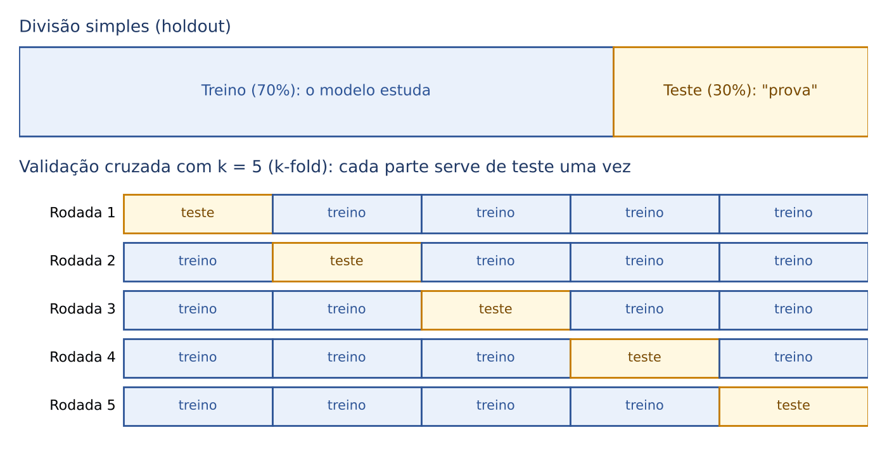

Divisão simples (*holdout*): separa-se, por exemplo, 70% para treino e 30% para teste. Com 1.500 registros:
- Treino = 0,70 × 1.500 = 1.050 registros.
- Teste = 0,30 × 1.500 = 450 registros.
- Conferência: 1.050 + 450 = 1.500.

Validação cruzada com k partes (*k-fold cross-validation*): divide-se a base em k partes (*folds*) de mesmo tamanho. Faz-se k rodadas; em cada uma, UMA parte é teste e as outras k − 1 são treino. Cada registro é testado exatamente uma vez. O desempenho final é a média das k rodadas. Na versão ESTRATIFICADA, cada parte mantém a proporção das classes da base original (útil quando a classe "fraude" é rara).
- Número de treinamentos = k.
- Tamanho de cada parte = n ÷ k (n = total de registros).
- Registros de treino em cada rodada = n − n ÷ k = n × (k − 1) ÷ k.

Outras técnicas: *bootstrap* (o treino é formado por n sorteios COM reposição da própria base; os registros nunca sorteados formam o teste; Q3593196) e *leave-one-out* (k = n: cada rodada deixa um único registro de fora).

:::ATENCAO Séries temporais: nunca embaralhe o tempo
Para prever arrecadação mensal, a divisão aleatória é ERRADA, porque o modelo "veria o futuro" no treino (treinaria com março de 2024 para "prever" fevereiro de 2024). A validação correta preserva a ordem cronológica: treina com o passado e testa no período seguinte, avançando a janela (*rolling origin*, *forward chaining*, "validação fora da amostra com particionamento temporal"). Esse problema de usar informação que não estaria disponível no momento da previsão chama-se vazamento de dados (*data leakage*).
:::

### 25.6.2 Sobreajuste e subajuste

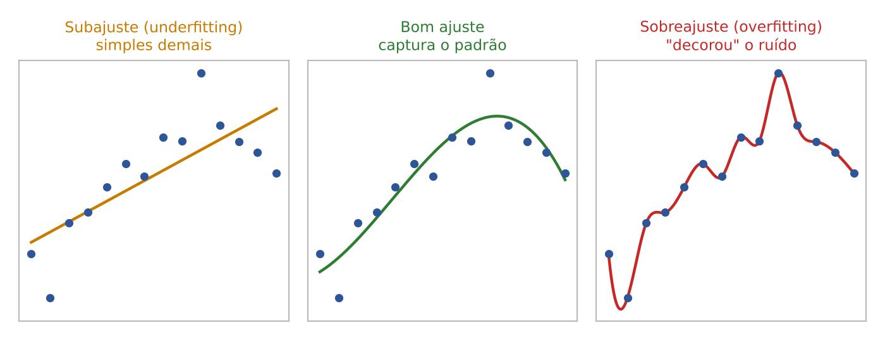

- Sobreajuste (*overfitting*, superajuste): o modelo se ajusta DEMAIS aos dados de treino, "decorando" inclusive o ruído e as peculiaridades daquela amostra. Sintoma típico de prova: ÓTIMO desempenho no treino e RUIM no teste (ou validação, ou em contribuintes novos). Exemplo numérico: acerta 99% no treino e 70% no teste; a distância de 29 pontos percentuais denuncia a "decoreba". Causas: modelo complexo demais, poucos dados, muito ruído, treinar por tempo demais.
- Subajuste (*underfitting*): o modelo é SIMPLES DEMAIS e não captura o padrão nem nos dados de treino. Sintoma: desempenho ruim no treino E no teste (por exemplo, 62% e 60%).
- Compromisso viés-variância (*bias-variance trade-off*): modelos simples têm alto VIÉS (erram sistematicamente, subajuste) e baixa variância; modelos complexos têm baixo viés e alta VARIÂNCIA (mudam muito conforme a amostra, sobreajuste). Busca-se o meio-termo.

Como combater o sobreajuste:
- Mais dados de treino (e de melhor qualidade).
- Modelo mais simples (menos variáveis, árvore menos profunda; seleção de atributos).
- Regularização: penalidade matemática à complexidade do modelo (L1, que zera coeficientes inúteis, e L2, que os encolhe). Aumentar o parâmetro de regularização (lambda ou alfa) reduz a complexidade efetiva, AUMENTA o viés e REDUZ a variância.
- Validação cruzada para escolher hiperparâmetros; parada antecipada (*early stopping*) em redes neurais; *dropout* (desligar neurônios ao acaso no treino).

Depois de implantado, o modelo ainda pode "envelhecer":
- *Data drift* (desvio de dados): muda a distribuição dos dados de ENTRADA (por exemplo, nova faixa de faturamento após reforma tributária).
- *Concept drift* (desvio de conceito): muda a RELAÇÃO entre entradas e resposta (o que antes indicava fraude deixou de indicar, porque os fraudadores mudaram de método).
Por isso modelos em produção exigem monitoramento contínuo e retreinamento (práticas de MLOps, a "operação" de modelos de aprendizado de máquina).

:::QUESTAO FCC 2026 — SEFAZ-MT — Fiscal de Tributos Estaduais (Q3947199)
Modelo supervisionado de risco de inadimplência tributária: excelente desempenho no treino e desempenho bem inferior em contribuintes novos (teste). Gabarito oficial: D (sobreajuste, pois o modelo capturou ruído específico da base de treino).
- C (subajuste) exigiria desempenho ruim TAMBÉM no treino.
- A (multicolinearidade) e E (heterocedasticidade) são problemas da regressão estatística (Cap. 16), que afetam a interpretação dos coeficientes, não esse padrão treino ótimo/teste ruim.
- B (erro de amostragem por amostra pequena) pode até contribuir, mas não é o nome do fenômeno descrito.
No mesmo sentido: Q2518306, Q3114976, Q3086079, Q3260826, Q2398314, Q3154828.
:::

:::QUESTAO FCC 2026 — SEFAZ-SP — AFRE, TI, Conhecimentos Gerais (Q3916781)
A principal razão para separar os dados em treino, validação e teste é: gabarito oficial A (avaliar o desempenho generalizável e evitar o sobreajuste).
As demais são distratores de estatística: reduzir dimensionalidade (B, isso é PCA), "aumentar a variância do modelo" (C, o contrário do desejado), garantir normalidade dos resíduos (D) e reduzir o viés do estimador dos coeficientes (E) não são finalidades da partição.
:::

:::QUESTAO FCC 2025 — TRF 4ª Região — Analista Judiciário, Análise de Sistemas (Q3538826)
Modelo excelente nos dados de treinamento e insatisfatório nos de validação; quais conceitos usar para diagnosticar e escolher o melhor modelo? Gabarito oficial: B (sobreajuste, análise de precisão e *recall*, F1 e curva ROC).
O diagnóstico é sobreajuste; a escolha do modelo exige métricas além da acurácia (25.7). A curva ROC mostra o desempenho de um classificador em todos os limiares de decisão (taxa de verdadeiros positivos contra taxa de falsos positivos); quanto maior a área sob a curva (AUC), melhor.
- A insiste na acurácia "como principal métrica para todos os conjuntos": é exatamente a métrica enganosa em dados desbalanceados.
- C avalia "percentual de acertos em dados CONHECIDOS": medir no treino não detecta sobreajuste.
- D troca a validação cruzada por divisão fixa: retrocesso.
- E prioriza tempo de processamento: irrelevante para o problema.
:::

:::QUESTAO FCC 2026 — SEFAZ-GO — Auditor Fiscal da Receita Estadual (Q4067468)
Validar modelos que preveem a arrecadação mensal de ICMS, com risco de uso indevido de informação futura e necessidade de estimar o desempenho em condições reais. Gabarito oficial: B (validação fora da amostra com particionamento temporal que preserve a ordem cronológica, como *rolling origin*).
- A (menor número de parâmetros) é critério de parcimônia, não de validação.
- C (minimizar o erro no TREINO) é a receita do sobreajuste.
- D (R² ajustado na série toda) mede ajuste dentro da amostra; não simula a previsão de meses futuros.
- E (comparação visual) não é critério objetivo.
No mesmo sentido: Q3869750 (FGV: *split* aleatório em série 2019-2023 viola a ordem temporal).
:::

:::QUESTAO FGV 2026 — DATAPREV — Analista de TI, Inteligência da Informação (Q4389054)
Base com exatamente 1.500 amostras; validação cruzada com k = 5. Quantas vezes o modelo será treinado e quantas amostras serão usadas no treino de cada rodada? Gabarito oficial: D (5 vezes e 1.200 amostras).
Resolução:
- Número de treinamentos = k = 5.
- Tamanho de cada parte = 1.500 ÷ 5 = 300.
- Treino em cada rodada = 1.500 − 300 = 1.200 (equivalente a 4 partes × 300 = 1.200).
Alternativas-armadilha: C (5 e 300) confunde treino com o tamanho da parte de TESTE; B (4 e 1.200) confunde o número de rodadas (k) com o número de partes de treino em cada rodada (k − 1); E (5 e 1.500) esquece que uma parte fica de fora.
:::

:::QUESTAO FGV 2026 — TCE-PE — Analista de Controle Externo, Contas Públicas (Q4283056)
Modelo para estimar, NO INGRESSO de um processo de prestação de contas, a probabilidade de que se identifique irregularidade. Nos testes, o desempenho foi altíssimo, mas a variável "existência de débito quantificado ao final do exame" pesou muito. (A lista de atributos estava numa figura não disponível; o essencial está no texto.) Gabarito oficial: C (excluir dos atributos de entrada as informações que ainda não estariam disponíveis no momento da previsão).
É o vazamento de dados: o "débito quantificado ao final do exame" só existe DEPOIS da análise; usá-lo para prever o resultado da análise é como prever a sentença lendo o dispositivo. O desempenho "muito elevado" é ilusório.
- A mantém o vazamento.
- B retira só a variável-alvo e mantém as informações posteriores.
- D tenta "reduzir a influência" por ajuste de parâmetros: a variável continua inválida.
- E substitui informações posteriores pela própria variável-alvo: piora.
:::

:::PRATIQUE exercícios elaborados para esta apostila
1. Uma base tem 2.000 registros. Com validação cruzada de k = 4, quantos treinamentos serão feitos, quantos registros terá cada parte de teste e quantos serão usados no treino de cada rodada?
2. Com a mesma base de 2.000 registros e divisão simples 80% treino / 20% teste, quantos registros ficam em cada conjunto?
3. Três modelos de seleção de contribuintes têm os seguintes acertos (treino; teste): Modelo P (64%; 63%); Modelo Q (98%; 71%); Modelo R (86%; 84%). Diagnostique cada um e diga qual deve ser escolhido.
Resolução:
1. Treinamentos = k = 4. Parte de teste = 2.000 ÷ 4 = 500. Treino por rodada = 2.000 − 500 = 1.500 (= 3 partes × 500).
2. Treino = 0,80 × 2.000 = 1.600. Teste = 0,20 × 2.000 = 400. Conferência: 1.600 + 400 = 2.000.
3. P: desempenho fraco nos DOIS conjuntos (64% e 63%) → subajuste (modelo simples demais). Q: ótimo no treino e bem pior no teste (diferença de 98 − 71 = 27 pontos) → sobreajuste. R: bom nos dois, com pequena diferença (86 − 84 = 2 pontos) → bom ajuste, generaliza. Escolhe-se R: o que importa é o desempenho em dados novos (teste), e R tem o maior (84% contra 71% e 63%).
:::

## 25.7 Como medir se um classificador é bom: matriz de confusão e métricas

### 25.7.1 A ideia: nem todo erro custa igual

Uma malha fiscal automática aponta declarações suspeitas. Ela pode errar de dois jeitos muito diferentes:
- Apontar como suspeita uma declaração regular: o contribuinte honesto é incomodado e o auditor perde tempo. É o "alarme falso".
- Deixar passar uma declaração irregular: o Estado perde receita. É a "fraude que escapou".

Na linguagem do processo penal: o primeiro erro é condenar um inocente; o segundo, absolver um culpado. Cada sistema de justiça escolhe qual erro tolera mais. Com os modelos de IA é igual, e por isso não basta perguntar "quantos por cento ele acerta".

### 25.7.2 A matriz de confusão, montada à mão

Exemplo. A Fazenda testou um modelo em 1.000 declarações cujo resultado real já conhecia: 50 eram irregulares e 950 regulares. O modelo apontou 60 como suspeitas; dessas 60, 40 eram de fato irregulares. Vamos preencher as quatro casas:
- Verdadeiros positivos (VP): irregulares E apontadas = 40.
- Falsos positivos (FP): regulares, mas apontadas = 60 apontadas − 40 corretas = 20.
- Falsos negativos (FN): irregulares, mas liberadas = 50 irregulares − 40 apontadas = 10.
- Verdadeiros negativos (VN): regulares E liberadas = 950 regulares − 20 apontadas à toa = 930.
- Conferência: 40 + 20 + 10 + 930 = 1.000.

"Positivo" é a classe que nos interessa detectar (aqui, "irregular"); não tem sentido de "bom". "Verdadeiro/falso" diz se o modelo acertou ou errou.

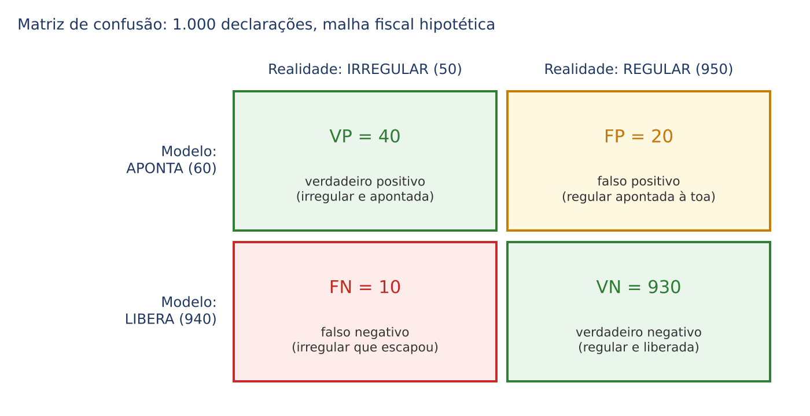

A matriz de confusão tem uma linha (ou coluna) para cada classe real e uma para cada classe prevista; os ACERTOS ficam na diagonal principal. A soma de todas as casas é o total de exemplos testados. Atenção: alguns livros põem a realidade nas linhas e a previsão nas colunas; outros, o inverso. Leia sempre os títulos.

### 25.7.3 As quatro métricas

Acurácia: de TODOS os casos, quantos o modelo acertou?

- VP + VN = acertos (diagonal principal).
- VP + VN + FP + FN = total de casos.
- No exemplo: acurácia = (40 + 930) ÷ 1.000 = 970 ÷ 1.000 = 0,97 = 97%.

Precisão (*precision*, valor preditivo positivo): dos casos que o modelo APONTOU como positivos, quantos eram mesmo positivos? Responde à pergunta do auditor: "quando a malha me manda uma declaração, com que frequência vale a pena?".

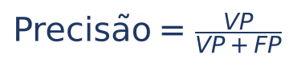

- VP = apontadas corretamente; VP + FP = todas as apontadas.
- No exemplo: precisão = 40 ÷ (40 + 20) = 40 ÷ 60.
- Simplificando a fração (dividimos em cima e embaixo por 20): 40 ÷ 60 = 2 ÷ 3 ≈ 0,667 = 66,7%.

Revocação, sensibilidade ou *recall* (taxa de verdadeiros positivos): dos casos REALMENTE positivos, quantos o modelo encontrou? Responde à pergunta do Secretário: "de todas as fraudes que existem, quantas a malha pega?".

- VP + FN = todos os positivos reais.
- No exemplo: recall = 40 ÷ (40 + 10) = 40 ÷ 50 = 0,8 = 80%.

F1 (*F1-score*): uma nota única que equilibra precisão e recall. É a média HARMÔNICA dos dois, que pune quem é muito bom num e péssimo no outro.

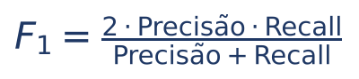

- No exemplo: numerador = 2 × (2/3) × 0,8 = 2 × 0,5333... = 1,0667 (aproximadamente).
- Denominador = 0,6667 + 0,8 = 1,4667 (aproximadamente).
- F1 = 1,0667 ÷ 1,4667 ≈ 0,727 = 72,7%.
- Conta exata, sem decimais: precisão = 2/3 e recall = 4/5. Produto = 8/15; vezes 2 = 16/15. Soma = 2/3 + 4/5 = 10/15 + 12/15 = 22/15. F1 = (16/15) ÷ (22/15) = 16/22 = 8/11 ≈ 0,727.

Há ainda a especificidade (taxa de verdadeiros negativos) = VN ÷ (VN + FP) = 930 ÷ 950 ≈ 97,9%, e o valor preditivo negativo = VN ÷ (VN + FN) = 930 ÷ 940 ≈ 98,9%.

### 25.7.4 A armadilha da acurácia em dados desbalanceados

Agora um "modelo preguiçoso" que libera TODAS as declarações, sem apontar nenhuma:
- VP = 0 (não aponta nada), FP = 0, FN = 50 (todas as irregulares escapam), VN = 950.
- Acurácia = (0 + 950) ÷ 1.000 = 95%.
- Recall = 0 ÷ (0 + 50) = 0%.

Um modelo inútil tem 95% de acurácia! Isso acontece porque a classe de interesse é RARA (dados desbalanceados): acertar a classe majoritária infla a acurácia. Em fraude, sonegação e doenças raras, olhe precisão, recall e F1, não a acurácia.

:::DICA Qual métrica maximizar? Pergunte qual erro é pior
- Perder um positivo é grave (fraude que escapa, doente não diagnosticado, processo que precisava de exame detalhado e não teve)? Maximize o RECALL (reduz FN).
- Alarme falso é caro (fiscalizar à toa, constranger contribuinte honesto, bloquear cartão de cliente legítimo)? Maximize a PRECISÃO (reduz FP).
- Quer equilíbrio entre os dois? Use o F1.
- Baixar o limiar de decisão (por exemplo, de 0,7 para 0,3 de probabilidade para apontar como fraude) faz o modelo apontar MAIS casos: o recall tende a SUBIR e a precisão tende a CAIR. Subir o limiar faz o contrário.
:::

:::PEGADINHA Fórmulas trocadas
A FGV (Q3880238) trouxe "precisão = VN ÷ (VN + FN)" e "VPN = VP ÷ (VP + FP)" para o candidato julgar: ambas trocadas. Memorize pelo DENOMINADOR: precisão divide pelo que o modelo APONTOU (VP + FP); recall divide pelo que REALMENTE é positivo (VP + FN). Nas duas, o numerador é VP.
:::

Para modelos de REGRESSÃO (que preveem números), as métricas são outras: erro médio absoluto (MAE, a média das diferenças absolutas entre previsto e real; "em média, o modelo erra em 18 dias", Q3869748), erro quadrático médio (MSE) e sua raiz (RMSE), e o coeficiente de determinação R² (Cap. 16).

:::QUESTAO FGV 2026 — TCE-SC — Auditor Fiscal de Controle Externo, Ciência da Computação (Q4088612)
Modelo de detecção de transações fraudulentas; a fraude ocorre em 1 de cada 10.000 transações. O auditor nota que a acurácia é enganosa, pois classificar tudo como "não fraude" daria 99,99% de acerto. Qual métrica usar para focar na capacidade de detectar o máximo de fraudes reais? Gabarito oficial: B (*recall*).
Conferindo a conta do enunciado com 1.000.000 de transações:
- Fraudes = 1.000.000 ÷ 10.000 = 100. Legítimas = 999.900.
- Modelo "tudo legítimo": acertos = 999.900; acurácia = 999.900 ÷ 1.000.000 = 0,9999 = 99,99%.
- Recall desse modelo = 0 ÷ 100 = 0%. O recall denuncia a inutilidade.
"Detectar o máximo de fraudes reais" é a definição de recall (VP sobre todos os positivos reais). A precisão (C) mede outra coisa (pureza dos alertas). Erro quadrático médio (D) e R² (E) são métricas de regressão. No mesmo sentido: Q2517635 (CVM: revocação, quando o pior erro é deixar de mandar para exame detalhado o caso que precisava), Q2398313 (F1 equilibra precisão e sensibilidade), Q3874749, Q3880238, Q3158068 (matriz de confusão: soma de todos os elementos = n e taxa de acerto = diagonal ÷ total; gabarito oficial C, "I e II, apenas").
:::

:::PRATIQUE exercícios elaborados para esta apostila
1. Um modelo foi testado em 1.000 notas fiscais: VP = 30, FP = 10, FN = 20, VN = 940. Calcule acurácia, precisão, recall e F1.
2. No exercício 1, qual dos dois erros (FP ou FN) o modelo comete mais? Que métrica isso prejudica?
3. Em 1.000.000 de transações há 100 fraudes. O modelo B aponta 200 transações, das quais 90 são fraudes. Calcule acurácia, precisão, recall e F1 do modelo B e compare com o modelo "tudo legítimo" da questão anterior.
Resolução:
1. Acurácia = (30 + 940) ÷ 1.000 = 970 ÷ 1.000 = 97%. Precisão = 30 ÷ (30 + 10) = 30 ÷ 40 = 3/4 = 75%. Recall = 30 ÷ (30 + 20) = 30 ÷ 50 = 3/5 = 60%. F1 = 2 × 0,75 × 0,6 ÷ (0,75 + 0,6) = 2 × 0,45 ÷ 1,35 = 0,9 ÷ 1,35 = 2/3 ≈ 66,7%.
2. FN = 20 é maior que FP = 10. O modelo deixa escapar mais irregulares do que acusa à toa; isso derruba o RECALL (60%), enquanto a precisão fica em 75%.
3. VP = 90. FP = 200 − 90 = 110. FN = 100 − 90 = 10. VN = 1.000.000 − 90 − 110 − 10 = 999.790.
- Acurácia = (90 + 999.790) ÷ 1.000.000 = 999.880 ÷ 1.000.000 = 99,988%.
- Precisão = 90 ÷ 200 = 0,45 = 45%.
- Recall = 90 ÷ 100 = 0,9 = 90%.
- F1 = 2 × 0,45 × 0,9 ÷ (0,45 + 0,9) = 0,81 ÷ 1,35 = 0,6 = 60%.
- Comparação: o modelo "tudo legítimo" tem acurácia MAIOR (99,99% contra 99,988%), mas recall 0%. O modelo B é muito mais útil (pega 90% das fraudes). Prova viva de que a acurácia engana em dados desbalanceados.
:::

## 25.8 Redes neurais artificiais e aprendizado profundo

### 25.8.1 O neurônio artificial: uma soma ponderada com um "interruptor"

Uma rede neural artificial é inspirada (de longe) no cérebro: muitas unidades simples, os neurônios, ligadas entre si. Cada neurônio artificial faz uma conta muito simples:
1. Recebe números de entrada (x1, x2, ...).
2. Multiplica cada entrada por um PESO (w1, w2, ...), que mede a importância daquela entrada.
3. Soma tudo e acrescenta um VIÉS (b, uma constante de ajuste).
4. Passa o resultado por uma FUNÇÃO DE ATIVAÇÃO, que decide o que sai (por exemplo, "se o resultado for maior que zero, sai 1; senão, sai 0").

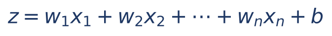

- z = resultado da soma ponderada;
- x1, x2, ..., xn = entradas (os atributos);
- w1, w2, ..., wn = pesos (aprendidos no treino);
- b = viés (*bias*), também aprendido;
- os "..." significam "e assim por diante até a n-ésima entrada".

Exemplo à mão. Um neurônio de triagem de notas fiscais tem duas entradas: x1 = 1 se a nota foi emitida para empresa com CNPJ aberto há menos de seis meses (0 se não); x2 = valor da nota em milhões de reais. Pesos aprendidos: w1 = 0,8 e w2 = 0,5; viés b = −2. Regra de ativação: se z > 0, a nota é "suspeita" (saída 1); senão, "normal" (saída 0). Nota de 3 milhões de reais para CNPJ novo (x1 = 1, x2 = 3):
- z = 0,8 × 1 + 0,5 × 3 + (−2)
- z = 0,8 + 1,5 − 2
- z = 2,3 − 2
- z = 0,3
- Como 0,3 > 0, saída = 1: suspeita.

Treinar a rede é encontrar os pesos e vieses que fazem as saídas baterem com os rótulos conhecidos. O algoritmo clássico é a retropropagação do erro (*backpropagation*): compara a saída com o gabarito, calcula o erro (a função de perda) e "propaga para trás", camada por camada, pequenas correções em cada peso, na direção que diminui o erro (método do gradiente descendente). Cada passagem completa por todo o conjunto de treino chama-se ÉPOCA.

### 25.8.2 Das redes rasas ao aprendizado profundo

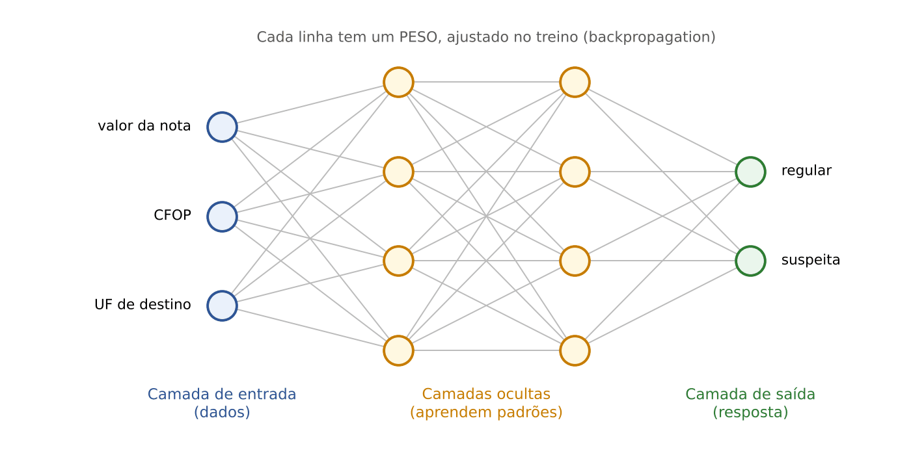

Os neurônios se organizam em CAMADAS: a de entrada (recebe os atributos), as ocultas (intermediárias) e a de saída (dá a resposta). Aprendizado PROFUNDO (*deep learning*) é o uso de redes com MUITAS camadas ocultas. A vantagem: as primeiras camadas aprendem padrões simples, e as seguintes combinam esses padrões em conceitos cada vez mais abstratos (numa imagem: bordas → formas → letras → palavras). Por isso o aprendizado profundo dispensa boa parte da "engenharia de atributos" manual e brilha em dados NÃO ESTRUTURADOS (imagens, áudio, texto). Em troca, exige muitos dados, muito processamento (placas gráficas, as GPUs) e é pouco transparente: é a típica "caixa-preta".

Arquiteturas que caem:
- Redes convolucionais (CNN): especializadas em IMAGENS e visão computacional (ler um DANFE fotografado, reconhecer placas de veículos em postos fiscais).
- Redes recorrentes (RNN) e a variante LSTM: processam SEQUÊNCIAS (texto, séries temporais), com "memória" do que veio antes.
- *Transformers* (2017): arquitetura baseada no mecanismo de ATENÇÃO, que pondera, para cada palavra, quais outras palavras do texto são relevantes para entendê-la; usa várias "cabeças" de atenção em paralelo (*multi-head attention*). É a base dos LLMs (25.9).
- Redes adversariais generativas (GAN): duas redes competem, uma gerando dados falsos (o gerador) e outra tentando detectá-los (o discriminador); ambas melhoram com a disputa. Usadas para gerar imagens (e *deepfakes*). Autocodificadores variacionais (VAE) são outra família de modelos generativos.
- Aprendizado por transferência (*transfer learning*): reaproveitar uma rede já treinada num domínio grande e treinar só as últimas camadas para uma tarefa nova com poucos dados.
- Aprendizado federado: vários dispositivos ou órgãos treinam um modelo comum sem enviar seus dados brutos a um servidor central; só trocam os parâmetros aprendidos. Útil para dados sensíveis.

:::PRATIQUE exercícios elaborados para esta apostila
Use o neurônio do exemplo (w1 = 0,8; w2 = 0,5; b = −2; saída 1 se z > 0).
1. Nota de 3 milhões de reais para CNPJ antigo (x1 = 0, x2 = 3). Qual a saída?
2. Nota de 1 milhão de reais para CNPJ novo (x1 = 1, x2 = 1). Qual a saída?
3. A partir de que valor de nota (x2), para CNPJ antigo (x1 = 0), o neurônio passa a apontar "suspeita"?
Resolução:
1. z = 0,8 × 0 + 0,5 × 3 − 2 = 0 + 1,5 − 2 = −0,5. Como −0,5 não é maior que 0, saída = 0 (normal).
2. z = 0,8 × 1 + 0,5 × 1 − 2 = 0,8 + 0,5 − 2 = 1,3 − 2 = −0,7. Saída = 0 (normal).
3. Com x1 = 0, z = 0,5 × x2 − 2. Queremos z > 0: 0,5 × x2 − 2 > 0. Somamos 2 aos dois lados: 0,5 × x2 > 2. Dividimos os dois lados por 0,5 (o mesmo que multiplicar por 2): x2 > 4. Logo, notas acima de 4 milhões de reais (com CNPJ antigo) são apontadas. Conferência com x2 = 5: z = 2,5 − 2 = 0,5 > 0 (suspeita); com x2 = 4: z = 0 (não é maior que zero: normal).
:::

## 25.9 IA generativa e grandes modelos de linguagem (LLMs)

### 25.9.1 O que é IA generativa

IA generativa é a que CRIA conteúdo novo (texto, imagem, áudio, vídeo, código) a partir de padrões aprendidos em grandes volumes de dados, em resposta a uma instrução. A IA "tradicional" (discriminativa) responde a perguntas fechadas sobre dados: "esta nota é suspeita?". A generativa produz: "redija um resumo deste auto de infração".

Os grandes modelos de linguagem (LLMs, *large language models*) são modelos generativos de texto, treinados com quantidades imensas de textos, com bilhões de parâmetros, baseados na arquitetura *transformer*. Exemplos comerciais conhecidos: ChatGPT (OpenAI), Gemini (Google), Claude (Anthropic), Llama (Meta). Modelos que lidam com mais de um tipo de dado (texto, imagem, áudio) são chamados multimodais.

### 25.9.2 Como um LLM funciona, sem fórmulas

Passo 1 — Tokenização. O texto é quebrado em pedaços chamados TOKENS: palavras inteiras, partes de palavras ou sinais de pontuação. "Desburocratização" pode virar três ou quatro tokens. O modelo trabalha com tokens, não com letras nem com "ideias".

Passo 2 — *Embeddings* (representações vetoriais). Cada token é convertido numa lista de números (um vetor) que representa seu significado; palavras de sentido parecido ficam com vetores próximos. É assim que o modelo "sabe" que "tributo" está perto de "imposto" e longe de "girafa".

Passo 3 — Atenção. As camadas do *transformer* relacionam cada token com os demais do contexto, para entender, por exemplo, a que substantivo se refere um pronome.

Passo 4 — Previsão do próximo token. Ao final, o modelo calcula a PROBABILIDADE de cada token possível ser o próximo, escolhe um (o mais provável ou um sorteado entre os prováveis), acrescenta-o ao texto e repete o processo, token a token, até concluir a resposta.

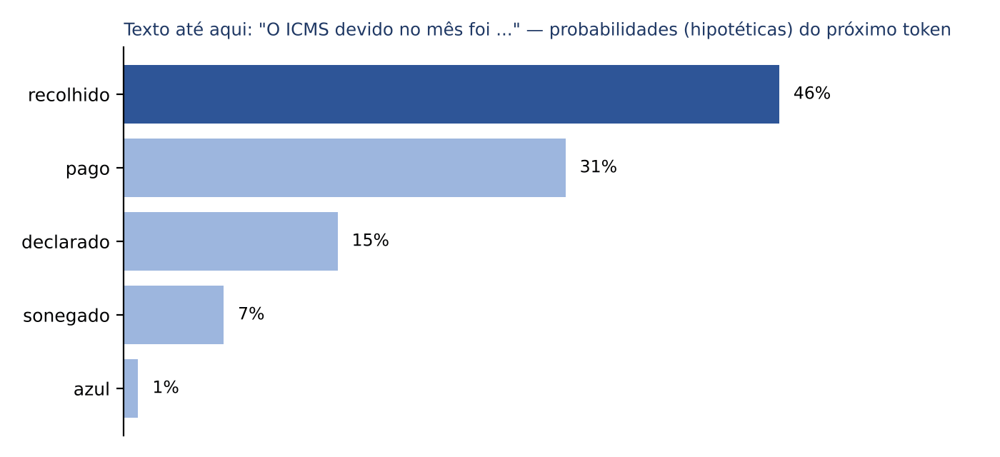

Note que as probabilidades da figura somam 46% + 31% + 15% + 7% + 1% = 100%: o modelo distribui a "certeza" entre as continuações possíveis. O ponto conceitual que a banca cobra: o LLM não consulta um banco de respostas prontas nem "sabe" fatos como uma enciclopédia; ele calcula estatisticamente qual continuação é mais provável, com base nos padrões aprendidos (Q4375782).

Como o LLM é treinado:
- Pré-treinamento: o modelo lê enormes quantidades de texto e aprende a prever o próximo token. É autossupervisionado: o próprio texto fornece o gabarito.
- Ajuste fino (*fine-tuning*): o modelo pré-treinado é treinado mais um pouco com dados específicos (instruções e respostas; ou textos de um domínio, como pareceres fiscais) para se especializar.
- Ajuste por preferências humanas (RLHF, *reinforcement learning from human feedback*, "aprendizado por reforço com *feedback* humano"): avaliadores humanos comparam respostas e o modelo é ajustado para preferir as melhores, mais úteis e seguras.

Conceitos de uso:
- Prompt: a instrução ou comando dado ao modelo. Engenharia de prompt é a arte de redigi-lo bem: dar contexto, papel, tarefa, formato de saída, exemplos e limites.
- Janela de contexto: quantidade máxima de tokens que o modelo consegue "ter em mente" de uma vez (prompt + documentos + resposta).
- Temperatura: parâmetro que regula a aleatoriedade na escolha do próximo token (baixa = respostas mais previsíveis; alta = mais criativas).
- Corte de conhecimento: o modelo só "sabe" o que estava nos dados de treino, até certa data.
- API: o órgão pode integrar um modelo existente ao seu sistema por meio da API do fornecedor, sem treinar modelo próprio (Q3217737).

:::DICA Anatomia de um bom prompt (o que a FGV premiou na Q4282412)
1. Papel e contexto: "Você é assistente da auditoria fiscal; os documentos são relatórios de fiscalização".
2. Tarefa precisa: "Para cada relatório, extraia: contribuinte, período, infração, valor".
3. Tratamento das lacunas: "Quando um elemento não constar, registre 'não informado', SEM deduzir".
4. Formato da saída: tabela com campos fixos, com indicação do documento de origem de cada linha.
5. Verificação humana: o resultado é conferido nos documentos-fonte.
:::

### 25.9.3 Alucinação e RAG

Alucinação é a resposta FLUENTE, CONFIANTE e FALSA: o modelo "inventa" um acórdão, um artigo de lei, um dado, uma citação. Acontece porque o LLM gera o texto mais PROVÁVEL, não o mais VERDADEIRO; quando falta informação, ele preenche a lacuna com algo plausível. Não decorre de "indisponibilidade de bases históricas" nem é falha operacional de execução (Q4221491, alternativa A). O dicionário Cambridge escolheu *hallucinate* como palavra do ano de 2023, por causa desse sentido novo (Q2570548). Para o profissional do Direito, é o risco número um: a citação de jurisprudência inexistente.

RAG (*retrieval-augmented generation*, "geração aumentada por recuperação") é a técnica mais usada para reduzir alucinações em sistemas institucionais: antes de responder, o sistema BUSCA (recupera) trechos relevantes numa base confiável (legislação, pareceres, manuais internos) e os entrega ao LLM junto com a pergunta; o modelo redige a resposta APOIADO nesses trechos e pode citar a fonte.

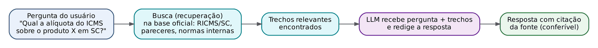

RAG não retreina o modelo (diferença para o ajuste fino): apenas enriquece o contexto no momento da geração. Também não elimina a alucinação por completo; reduz e torna a resposta verificável.

:::QUESTAO FCC 2025 — TRF 4ª Região — Analista Judiciário, Contabilidade (Q3538516)
Um tribunal propõe modelo de linguagem de larga escala capaz de interpretar textos jurídicos extensos, gerar resumos e classificar informações para facilitar a decisão humana. A proposta caracteriza o uso de: gabarito oficial A (um modelo de linguagem de larga escala, especializado em processamento e compreensão de linguagem natural).
- B descreve um "agente" voltado à execução de comandos: o enunciado não fala em agir no mundo, só em interpretar, resumir e classificar.
- C (regras fixas com capacidade limitada de síntese) é o oposto do LLM.
- D erra no final: um LLM GERA novos textos (resumos são conteúdo novo); "ausência de geração autônoma" contradiz a natureza generativa.
- E (classificação binária por regras parametrizadas) não resume nem interpreta.
:::

:::QUESTAO FGV 2026 — (prova sem identificação no banco) (Q4375782)
O funcionamento básico dos LLMs, para gerar texto, fundamenta-se em: gabarito oficial D (calcular estatisticamente a probabilidade de ocorrência das próximas palavras ou termos na sequência, com base nos padrões identificados no treinamento).
A (banco de respostas pré-programadas) descreve um *chatbot* de regras antigo; B (só corrige ortografia) nega a capacidade generativa; C (busca em tempo real em enciclopédias) confunde com mecanismo de busca (ou com RAG, que é um acréscimo, não o funcionamento básico); E (escanear o disco do usuário) é absurda. No mesmo sentido: Q3850315 (*embeddings* = vetores semânticos; tokenização = quebra em unidades; *transformer* = atenção *multi-head*), Q3114979 (tokenização), Q4218187 (*embeddings*), Q3847170 (*transformers* com múltiplas cabeças de atenção), Q3339429 (ajuste fino), Q3593745 (capacidades, exemplos e treinamento dos LLMs; gabarito oficial C, V – V – V).
:::

:::QUESTAO FGV 2024 — Ministério da Fazenda — Auditor Federal de Finanças e Controle, TI (Q2534604)
Qual o objetivo principal do RAG? Gabarito oficial: E (enriquecer o modelo com informações de bases externas no momento da geração, elevando a precisão).
- A (melhorar a interface) e C (gerar imagens) nada têm com recuperação.
- B (diminuir o volume de dados de TREINAMENTO) confunde: RAG não mexe no treino.
- D (aprendizado por reforço com os próprios erros) descreve outra técnica.
No mesmo sentido: Q4218186 (RAG recupera trechos de documentos e os concatena ao contexto enviado ao modelo).
:::

:::QUESTAO FGV 2026 — TCE-PE — Analista de Gestão, Administração (Q4282412)
A equipe submeteu relatórios de estruturas diferentes à plataforma de IA do TCE-PE (Aurora) com um prompt que lista os campos a extrair, manda registrar "não informado" quando o dado faltar, "sem deduzir ou completar", e indicar o relatório de origem. Por que a formulação favorece a consolidação? Gabarito oficial: D (define os elementos a identificar, o tratamento das informações ausentes e a organização da saída, favorecendo a comparação).
- A (deixar o modelo escolher os aspectos relevantes) é o contrário do que o prompt fez.
- B (permitir que o modelo COMPLETE as informações não localizadas) é exatamente o que o prompt proibiu, para evitar alucinação.
- C (eliminar a necessidade de conferência) é falso: a saída de IA sempre exige verificação humana.
- E (assegurar resultados idênticos) promete o impossível; o prompt padroniza, não garante identidade.
:::

### 25.9.4 Outros termos que aparecem nas questões

- Processamento de linguagem natural (PLN, NLP): ramo da IA que trata da linguagem humana: tokenização, *stemming* (redução da palavra ao radical), etiquetagem morfossintática (POS *tagging*), reconhecimento de entidades nomeadas (NER: achar nomes de pessoas, empresas, datas, valores num texto) e análise sintática (*parsing*).
- Visão computacional: ramo que extrai informação de imagens e vídeos (OCR de documentos, reconhecimento de placas).
- *Chatbot*: programa de conversa; pode ser por regras (respostas prontas) ou baseado em LLM.
- *Deepfake*: áudio, imagem ou vídeo sintético que imita pessoa real.
- IA explicável (XAI, *explainable AI*): técnicas que permitem a humanos entender por que o modelo decidiu algo, quais fatores pesaram; inclui métodos de interpretabilidade LOCAL (explicam uma decisão individual) e GLOBAL (explicam o comportamento geral).

## 25.10 Riscos, ética e governança da IA

### 25.10.1 O mapa dos riscos

O leitor magistrado reconhecerá aqui temas do devido processo e da motivação das decisões. A banca cobra os riscos sempre do mesmo jeito: descreve uma situação e pede o nome do problema, ou apresenta afirmações otimistas ("a IA elimina vieses", "o modelo dispensa revisão") para o candidato rejeitar.

| Risco | O que é | Exemplo na Administração |
|---|---|---|
| Viés algorítmico (discriminação) | O modelo reproduz ou amplia padrões discriminatórios presentes nos DADOS HISTÓRICOS de treino, ou em escolhas de projeto | Modelo de seleção para fiscalização treinado com autuações passadas concentradas em certos bairros passa a mirar sempre os mesmos bairros |
| Viés de amostragem/representatividade | Dados de treino que não representam bem a população; o modelo funciona bem para uns grupos e mal para outros | Reconhecimento facial que erra mais com pessoas negras por ter sido treinado com poucas imagens delas |
| Viés de automação | Tendência HUMANA de confiar demais na decisão da máquina, tomando-a como sempre precisa ou imparcial | O auditor homologa sem ler o relatório gerado pela IA |
| Alucinação | Conteúdo falso apresentado com fluência e segurança (25.9.3) | Parecer citando súmula inexistente |
| Opacidade ("caixa-preta") | Impossibilidade de explicar por que o modelo decidiu | Contribuinte não consegue saber por que foi selecionado para a malha |
| Privacidade e dados pessoais | Tratamento de dados pessoais sem base legal, finalidade ou segurança adequadas; envio de dados sigilosos a ferramentas externas | Servidor cola dados protegidos por sigilo fiscal num *chatbot* público |
| Direitos autorais | Conteúdo gerado que reproduz obras protegidas sem licença; incerteza sobre a autoria do que a IA cria | Campanha institucional com imagens que copiam obras de artistas |
| Desinformação e *deepfakes* | Produção em massa de conteúdo falso convincente | Vídeo falso de autoridade anunciando "anistia de ICMS" |
| Segurança | Ataques ao modelo, vazamento de dados, manipulação do prompt | Prompt malicioso escondido num documento para desviar o comportamento do sistema |
| Impactos sociais e ambientais | Substituição ou transformação de postos de trabalho; consumo de energia e água dos *data centers* | Pressão sobre recursos hídricos e energéticos (Q4375778) |

As respostas institucionais aos riscos, em linguagem de prova:
- Supervisão humana (*human in the loop*): a decisão final é humana, com efetiva possibilidade de revisão, e a RESPONSABILIDADE é de quem decide, nunca "da IA" (a IA não tem personalidade jurídica; Q2511950, Q3641484, Q3879471).
- Transparência e explicabilidade: informar que se usa IA e conseguir explicar os critérios e fatores determinantes da decisão. A LGPD já dá ao titular o direito de pedir revisão de decisões tomadas unicamente com base em tratamento automatizado e de obter informações sobre os critérios e procedimentos usados, observados os segredos comercial e industrial (art. 20; ver Cap. 26).
- Rastreabilidade e auditabilidade: documentar dados, versões, parâmetros e decisões, para auditar a origem de desvios.
- Monitoramento contínuo: detectar viés, *drift* e degradação de desempenho depois da implantação.
- Avaliação de impacto e classificação por RISCO: medidas proporcionais ao risco do uso (lógica do PL 2.338/2023, da Resolução CNJ 615/2025 e do regulamento europeu de IA).
- Matriz FAT (*fairness, accountability, transparency*: equidade, responsabilização, transparência), sigla da literatura de ética algorítmica (Q2705526).
- Governança de dados: papéis definidos, como o dono dos dados (*data owner*, responsável de negócio pela base) e o curador (*data steward*, responsável pela qualidade e pelas regras de uso). Esses papéis não desaparecem com a IA.

:::QUESTAO FCC 2025 — Prefeitura de São Paulo — Analista de Planejamento, TIC (Q3281622)
Debate sobre desafios éticos e técnicos de IA, ML e Internet das Coisas (IoT) na gestão urbana. Gabarito oficial: D (a IA pode reproduzir padrões discriminatórios dos dados históricos de treino, o que exige monitoramento contínuo contra o viés algorítmico).
Todas as outras afirmam uma "garantia" falsa: A (a IA elimina vieses e erros humanos), B (IoT reduz significativamente riscos de segurança e privacidade, quando na verdade multiplica as portas de ataque), C (modelos treinados não precisam de revisão, pois se aprimoram sozinhos: ignora o *drift*), E (grandes volumes de dados garantem neutralidade). Regra de bolso: em ética da IA, alternativa com "garante", "elimina" ou "dispensa" quase sempre está errada.
:::

:::QUESTAO FCC 2026 — CPU-PE — Gestor Governamental, Administrativa (Q3872007)
O viés de automação da IA generativa consiste em: gabarito oficial A (tendência de confiar nas decisões automatizadas da IA como sempre precisas ou imparciais).
O cuidado é distinguir o viés de AUTOMAÇÃO (comportamento do usuário humano) dos vieses dos DADOS: B descreve falha de generalização fora do contexto de treino; C, D e E descrevem variações de viés de representatividade e de amostragem. Todos existem, mas não são o viés de automação.
:::

:::QUESTAO FCC 2026 — CPU-PE — Gestor Governamental, Planejamento (Q3871970)
Secretaria usa IA para ilustrações e textos de campanhas; descobre-se que imagens geradas reproduziam elementos idênticos a obras protegidas de artistas, sem licença nem referência. Gabarito oficial: C (violação de direitos autorais).
Não é viés algorítmico (D: não há tratamento discriminatório de grupos), nem desinformação intencional (B), nem uso indevido de dados pessoais (E), nem questão ambiental (A). Sobre a autoria de obra criada exclusivamente por IA, a legislação brasileira não lhe confere proteção autoral expressa (a Lei 9.610/1998 protege criações do espírito, de autor pessoa física); ver Q2511946.
:::

:::QUESTAO FCC 2025 — TRF 4ª Região — Técnico Judiciário, Administrativa (Q3538932)
Riscos da IA generativa no Judiciário: gabarito oficial C (disseminação de desinformação e violação de direitos autorais).
As demais apresentam supostos BENEFÍCIOS automáticos como "riscos" (aumento da transparência e redução de vieses; fortalecimento automático da autoria individual; eliminação de impactos sociais; proteção intrínseca de dados sensíveis que dispensaria regulação). Nenhum desses benefícios é automático, e nenhum é risco.
:::

:::QUESTAO FCC 2025 — Prefeitura de São Paulo — Analista de Planejamento, TIC (Q3281598)
Ao implantar IA para mobilidade urbana, qual desafio ético e legal priorizar para equilibrar inovação e direitos? Gabarito oficial: A (garantir que as decisões automatizadas sejam explicáveis e auditáveis).
B (só usar IA sem dados pessoais) inviabiliza a política e não é o que a LGPD exige (exige base legal e salvaguardas, não proibição). C (custos acima da ética) é antiético por definição. D (sanções severas a todas as empresas que coletam dados) é desproporcional. E (centralizar o controle numa única autoridade) não resolve o problema da opacidade.
:::

:::QUESTAO FCC 2026 — SEFAZ-CE — Auditor Fiscal da Receita Estadual, Gestão Fazendária (Q4221491)
Fazenda implanta sistema de IA para indícios de fraude em operações fiscais eletrônicas; debate sobre ética e governança de dados. Gabarito oficial: B (a rastreabilidade das decisões automatizadas exige mapear o ciclo de vida dos dados e os parâmetros de treinamento, permitindo auditorias técnicas que identifiquem a origem de desvios e alucinações).
- A atribui a alucinação à falta de bases históricas: errado (25.9.3).
- C diz que governança CENTRALIZADA deixa cada setor fixar seus próprios padrões: isso é descentralização, contradição interna.
- D define explicabilidade como "impedir alterações no modelo" e reduzir monitoramento: explicabilidade é tornar compreensíveis os fatores da decisão, e o monitoramento continua necessário.
- E dispensa os papéis de *data steward* e *data owner*: a IA não absorve responsabilidades humanas de governança.
:::

## 25.11 Marcos regulatórios da IA

### 25.11.1 Brasil: PL 2.338/2023 (situação em 30/10/2026)

O Projeto de Lei 2.338/2023, de iniciativa do Senado, propõe o marco legal da inteligência artificial no Brasil. Situação na data desta apostila:
- Aprovado no Plenário do Senado Federal em 10/12/2024, na forma de substitutivo.
- Em tramitação na Câmara dos Deputados (recebido em março de 2025), em comissão especial, aguardando parecer do relator. NÃO foi aprovado pela Câmara nem sancionado: não há, ainda, "Lei de IA" em vigor no Brasil.

Linhas gerais do texto aprovado no Senado (úteis para questões que citam o projeto):
- Fundamentos e princípios, entre eles a centralidade da pessoa humana, a boa-fé, a transparência, a explicabilidade, a não discriminação, a supervisão humana, a prestação de contas e a proteção de dados.
- Direitos das pessoas afetadas por sistemas de IA (informação prévia sobre a interação com IA, explicação, contestação e revisão humana de decisões que produzam efeitos jurídicos relevantes, não discriminação).
- Abordagem baseada em RISCO: avaliação preliminar do sistema para classificá-lo; usos de risco EXCESSIVO são proibidos; usos de ALTO RISCO sofrem obrigações reforçadas (governança, avaliação de impacto algorítmico, documentação, supervisão humana); os demais, obrigações mais leves. A função da avaliação preliminar é organizar os sistemas por grau de risco, para aplicar medidas proporcionais (Q4350645).
- Sistema nacional de regulação e governança, com coordenação de autoridade competente.

Esses pontos refletem o texto do Senado e podem mudar na Câmara; numa questão, o que se pede é a LÓGICA do projeto (regulação proporcional ao risco, centrada em direitos), não a numeração de artigos.

Direito comparado, só a noção: a União Europeia adotou o Regulamento (UE) 2024/1689 (o *AI Act*), também baseado em categorias de risco (inaceitável, alto, limitado e mínimo), que inspirou o projeto brasileiro.

### 25.11.2 Judiciário: Resolução CNJ 615/2025

A Resolução CNJ 615, de 11/3/2025, disciplina o desenvolvimento, a governança, a auditoria, o monitoramento e o uso responsável de soluções de IA no Poder Judiciário. Pontos principais (conferidos no texto do ato publicado no portal de atos do CNJ):
- REVOGOU a Resolução CNJ 332/2020 (art. 46), que tratava do tema desde 2020. Questões de 2025 ainda citam a 332 (Q3654497); a lógica principiológica (transparência, direitos fundamentais, supervisão humana) foi mantida e aprofundada.
- Vigência 120 dias após a publicação (art. 47); prazo de 12 meses para adequar soluções já existentes (art. 45, parágrafo único).
- Supervisão humana como princípio; nenhum sistema pode restringir ou substituir a autoridade final do magistrado, que pode modificar qualquer produto gerado por IA.
- Classificação por risco (art. 9º e seguintes e anexo):
  - Risco EXCESSIVO (vedado), por exemplo: soluções que impeçam a revisão humana ou criem dependência absoluta do resultado; que valorem traços de personalidade para prever crimes ou reincidência; que ranqueiem pessoas por comportamento ou situação social; que reconheçam emoções por biometria.
  - ALTO risco, por exemplo: perfilamento comportamental, valoração de provas, tipificação de fatos como crimes, formulação de juízos conclusivos sobre a aplicação de normas, identificação biométrica para monitoramento. Exigem avaliação de impacto algorítmico, auditoria e monitoramento contínuo.
  - BAIXO risco, por exemplo: atos ordinatórios, sumarização de documentos, textos de apoio sob supervisão do magistrado, transcrição de áudio com revisão humana, anonimização.
- LLMs e IA generativa: podem ser usados por magistrados e servidores como ferramentas AUXILIARES, preferencialmente por acesso disponibilizado e monitorado pelo tribunal; a contratação privada individual só quando o tribunal não oferecer solução corporativa, com treinamento prévio, sem uso para decisão autônoma e com vedação de envio de documentos sigilosos ou sob segredo de justiça, salvo anonimização na origem ou proteção técnica equivalente (art. 19).
- Comitê Nacional de Inteligência Artificial do Judiciário, com competência para reclassificar riscos, fixar protocolos de auditoria e restringir usos.

:::QUESTAO FCC 2026 — TJ-CE — Analista Judiciário, Sistemas da Informação (Q4240117)
Equipe de governança de um TJ avalia solução de IA para classificar petições e identificar documentos, à luz da Resolução CNJ 615/2025, com vistas a mitigar vieses e promover transparência. A medida adequada é usar modelos sob supervisão humana: gabarito oficial E (implementando mecanismos de monitoramento de riscos e documentação que permita compreender os critérios de funcionamento e os impactos da solução).
É a tríade supervisão humana + monitoramento de riscos + documentação/explicabilidade. As alternativas erradas LIMITAM esses deveres no tempo ou no alcance: A vincula a governança só "até a validação inicial"; B prioriza a eficiência na definição do controle; C restringe a rastreabilidade aos registros da fase de DESENVOLVIMENTO (o monitoramento deve seguir na operação); D eleva avaliações periódicas de desempenho a "principal mecanismo" de controle de riscos, deixando de fora transparência e documentação.
:::

:::QUESTAO FCC 2025 — TRF 4ª Região — Analista Judiciário, Arquitetura (Q3654497)
Segundo os princípios da Resolução CNJ 332/2020, o uso de IA no Judiciário deve: gabarito oficial D (garantir a transparência dos procedimentos e preservar os direitos fundamentais dos jurisdicionados).
As demais pregam autonomia operacional com supervisão humana só no fim (B), automação de decisões reduzindo a validação humana (C), eficiência sem interpretabilidade (E) e preferência por soluções privadas em detrimento das próprias (A). Observação: a Resolução 332/2020 foi revogada pela Resolução 615/2025, mas a resposta continua correta à luz da norma nova, que mantém e reforça transparência, direitos fundamentais e supervisão humana.
:::

## 25.12 IA e dados no Fisco

### 25.12.1 Por que o Fisco é terreno fértil para a IA

A Administração tributária brasileira é uma das mais digitalizadas do mundo. Tudo o que o contribuinte faz gera dado ESTRUTURADO: NF-e e NFC-e (cada venda), CT-e (cada frete), MDF-e, EFD ICMS/IPI (a escrituração mensal), dados de cartões de crédito e meios de pagamento, declarações do Simples Nacional. São milhões de documentos por dia, impossíveis de ler por humanos e ideais para aprendizado de máquina.

Usos típicos, organizados pelo tipo de tarefa estudado em 25.5:

| Tarefa | Aplicação fazendária | Tipo de aprendizado |
|---|---|---|
| Classificação | Pontuar o risco de cada contribuinte ou declaração para a seleção de fiscalização (malha fiscal); identificar empresas "noteiras" (emissoras de notas frias); classificar automaticamente produtos no NCM a partir da descrição | Supervisionado |
| Regressão | Prever a arrecadação mensal de ICMS para o orçamento; estimar o imposto esperado de um estabelecimento a partir de empresas semelhantes | Supervisionado (e séries temporais) |
| Agrupamento | Segmentar contribuintes por perfil de comportamento, para tratamento diferenciado (conformidade cooperativa, cobrança, fiscalização) | Não supervisionado |
| Detecção de anomalias | Notas com valores ou rotas fora do padrão; créditos de ICMS incompatíveis com o porte; cancelamentos em massa | Não supervisionado (ou semissupervisionado) |
| PLN e IA generativa | *Chatbots* de atendimento ao contribuinte; resumo de processos administrativos fiscais; busca semântica em pareceres e soluções de consulta; apoio à redação, sempre com revisão | LLMs, RAG |
| Visão computacional | Leitura de documentos digitalizados (OCR); leitura de placas de caminhões em postos fiscais | Aprendizado profundo |

Exemplos públicos no setor público brasileiro, para ilustrar (citados de memória, sem conferência nesta apostila; ver nota): no controle externo, o TCU usa robôs como a ALICE (análise de licitações e editais); no Judiciário, o STF desenvolveu o VICTOR para triagem de recursos com repercussão geral; na Receita Federal, o SISAM (seleção aduaneira por aprendizado de máquina). Na própria bateria de questões, a FGV cita a plataforma Aurora, de IA generativa, do TCE-PE (Q4282412).

### 25.12.2 Limites jurídicos do uso da IA no Fisco

O leitor domina o Direito; basta alinhar os pontos de contato:
- Legalidade e motivação: o lançamento é atividade administrativa plenamente vinculada (CTN, art. 142) e privativa da autoridade administrativa. A IA pode SELECIONAR e INDICAR; o ato é do auditor, que responde por ele e deve motivá-lo com elementos verificáveis, não com "o algoritmo disse".
- Sigilo fiscal (CTN, art. 198) e LGPD: dados de contribuintes não podem ser inseridos em ferramentas externas sem base legal, contrato adequado e salvaguardas; a Lei 14.129 condiciona o compartilhamento à LGPD e às regras de transferência de sigilo (art. 3º, IX).
- Revisão de decisões automatizadas e explicabilidade: art. 20 da LGPD (Cap. 26).
- Não discriminação: critérios de seleção devem ser técnicos e auditáveis; o modelo não pode usar atributos que gerem discriminação ilícita.
- Vazamento de dados e validação temporal: um modelo de seleção que "vê o futuro" no treino promete precisão que não terá na prática (25.6).

:::PASSO Como responder a qualquer questão de "IA na Administração/Fisco"
1. Identifique a TAREFA (classificar, prever número, agrupar, achar anomalia, gerar texto) e escolha a técnica pelo PASSO de 25.5.2.
2. Se a questão é de risco ou ética, procure a alternativa que mantém o HUMANO responsável, exige TRANSPARÊNCIA/EXPLICABILIDADE e MONITORAMENTO CONTÍNUO.
3. Elimine alternativas com garantias absolutas ("elimina vieses", "dispensa revisão", "garante neutralidade", "dispensa regulação").
4. Se aparece desempenho ótimo no treino e ruim em dados novos, é sobreajuste; se aparece acurácia altíssima com eventos raros, a métrica certa é recall (ou F1).
5. Se aparece LLM, lembre: gera texto prevendo o próximo token; pode alucinar; RAG ancora em fontes; prompt bem definido reduz erros; sempre há conferência humana.
:::

## 25.13 Resumo para revisão pré-prova

| Conceito | Regra ou definição | Quando usar | Armadilha |
|---|---|---|---|
| Governo eletrônico | TICs + mudança organizacional para melhorar serviços e reduzir tempo e custo | Questões conceituais de e-gov | Não é só tecnologia; não visa reduzir servidores; não suprime o presencial |
| Governo digital | Transformação das organizações públicas com tecnologias digitais para entregar valor público (Dec. 12.069/2024) | Contraste com e-gov | Redesenhar o serviço, não só "pôr na internet" |
| Lei 14.129/2021: âmbito | União direta e indireta (estatais só se prestarem serviço público); Estados, DF e Municípios só se adotarem por ato próprio | "A lei se aplica a..." | Esquecer o art. 2º, III |
| Princípios-chave (art. 3º) | Desburocratização; plataforma única sem prejuízo do presencial; eliminar formalidades de custo superior ao risco; vedada prova de fato já comprovado; interoperabilidade e dados abertos; boa-fé do usuário; governo como plataforma | Alternativa "correta" | Inversões: ampliar trâmites, suprimir presencial, remover autosserviço |
| Definições (art. 4º) | Autosserviço; dados abertos; formato aberto; governo como plataforma; laboratório de inovação; plataformas de governo digital; registros de referência; transparência ativa | FCC copia a definição | Final "envenenado": exigir documentos, replicar dados |
| CPF/CNPJ (art. 28) | Número suficiente de identificação | Carteira de Identidade Nacional | — |
| Dados abertos (art. 29) | Publicidade como regra, sigilo como exceção; legíveis por máquina; formato aberto; granularidade máxima | Transparência ativa | PDF escaneado não é dado aberto |
| Domicílio eletrônico (art. 42) | Por OPÇÃO do usuário; pode desistir sem motivar | — | Não é obrigatório |
| ENGD x EFGD | Dec. 12.069/2024 (nacional, Rede Gov.br, adesão voluntária) x Dec. 12.198/2024 (federal, 6 princípios) | "Estratégia de governo digital" | Trocar nacional por federal |
| Interoperabilidade | Capacidade de sistemas trocarem e USAREM dados; camadas técnica, semântica e organizacional | Conecta gov.br, e-PING (padrões abertos) | e-PING não prioriza software proprietário |
| IA | Sistemas que executam tarefas que exigiriam inteligência humana | Relação IA ⊃ AM ⊃ AP ⊃ IA generativa | AM não é requisito de toda IA |
| IA fraca x forte | Fraca = tarefa específica, sem consciência (todas as atuais); forte = geral, hipotética | — | Inversão dos conceitos |
| Supervisionado | Dados COM rótulo; classificação (categoria) ou regressão (número) | Histórico com resposta conhecida | Regressão logística CLASSIFICA |
| Não supervisionado | Dados SEM rótulo; agrupamento, anomalias, associação, PCA | "Sem exemplos prévios", "padrões naturais" | k-NN é supervisionado; k-means não |
| Por reforço | Agente, ação, recompensa/punição | "Feedback", "recompensa" | Não usa base rotulada |
| Treino/validação/teste | Medir a generalização em dados não vistos | Sempre | Séries temporais: validação temporal; vazamento de dados |
| k-fold | k treinamentos; teste = n ÷ k; treino = n − n ÷ k | Contas de validação cruzada | Confundir k com k − 1 |
| Sobreajuste | Ótimo no treino, ruim no teste | Diagnóstico | Subajuste = ruim nos dois |
| Métricas | Acurácia, precisão, recall, F1 | Classificadores | Acurácia engana com classe rara |
| Rede neural | Soma ponderada + viés + ativação; pesos ajustados por *backpropagation*; época = passagem completa no treino | Conceitos de AP | CNN = imagem; RNN = sequência; *transformer* = atenção |
| LLM | Prevê estatisticamente o próximo token; tokens, *embeddings*, atenção; pré-treino, ajuste fino, RLHF | IA generativa | Não consulta respostas prontas |
| Alucinação | Resposta fluente e falsa | Riscos | Não decorre de "falta de base histórica" |
| RAG | Recupera trechos de base confiável e os entrega ao LLM na geração | Reduzir alucinação | Não retreina o modelo |
| Riscos da IA | Viés algorítmico, viés de automação, opacidade, privacidade, direitos autorais, desinformação | Ética | "Garante", "elimina", "dispensa" = errado |
| Governança | Supervisão humana, explicabilidade, rastreabilidade, monitoramento contínuo, avaliação por risco | Regulação | Responsabilidade é do humano |
| PL 2.338/2023 | Aprovado no Senado em 10/12/2024; na Câmara em 30/10/2026; regulação por risco | Marco legal | Não é lei em vigor |
| Resolução CNJ 615/2025 | Revogou a 332/2020; risco excessivo, alto e baixo; LLM só auxiliar; supervisão humana | IA no Judiciário | Questões antigas citam a 332 |

:::ESQUEMA Formulário do capítulo
| Fórmula | Símbolos | Quando usar |
|---|---|---|
| Acurácia = (VP + VN) ÷ (VP + VN + FP + FN) | VP = verdadeiros positivos; VN = verdadeiros negativos; FP = falsos positivos (alarmes falsos); FN = falsos negativos (positivos que escaparam) | Visão geral, só com classes equilibradas |
| Precisão = VP ÷ (VP + FP) | Denominador = tudo o que o modelo APONTOU | Quando o alarme falso é caro |
| Recall (sensibilidade) = VP ÷ (VP + FN) | Denominador = tudo o que é REALMENTE positivo | Quando deixar escapar é grave (fraude, doença) |
| F1 = 2 × Precisão × Recall ÷ (Precisão + Recall) | Média harmônica | Equilibrar precisão e recall |
| Especificidade = VN ÷ (VN + FP) | Acerto entre os negativos reais | Complemento do recall |
| k-fold: treinos = k; teste por rodada = n ÷ k; treino por rodada = n × (k − 1) ÷ k | n = total de registros; k = número de partes | Validação cruzada |
| z = w1·x1 + w2·x2 + ... + wn·xn + b | x = entradas; w = pesos; b = viés | Neurônio artificial |
:::

## 25.14 Normas incidentes

- Lei 14.129/2021 (Governo Digital): arts. 1º a 4º (objeto, âmbito, princípios e definições), 14 a 28 (governo digital, plataformas, direitos dos usuários, CPF/CNPJ), 29 a 37 (abertura de dados), 38 a 41 (interoperabilidade), 42 e 43 (domicílio eletrônico), 44 e 45 (laboratórios de inovação), 47 a 49 (governança, riscos e auditoria), 55 (vigência). O art. 25, § 2º, atribui à autoridade nacional de proteção de dados (ANPD, hoje denominada Agência Nacional de Proteção de Dados) a edição de normas complementares sobre as ferramentas de transparência de dados pessoais nas plataformas; LGPD e ANPD no Cap. 26.
- Decreto 12.069/2024: Estratégia Nacional de Governo Digital 2024-2027 e Rede Gov.br (arts. 4º, 6º, 9º, 11 e 15).
- Decreto 12.198/2024: Estratégia Federal de Governo Digital 2024-2027 (princípios).
- Decreto 10.046/2019: governança no compartilhamento de dados na administração federal (art. 4º, níveis de compartilhamento; Cadastro Base do Cidadão); vide ADI 6649.
- Lei 13.709/2018 (LGPD), art. 20: revisão de decisões automatizadas (Cap. 26).
- CTN, arts. 142 (lançamento como atividade vinculada e privativa) e 198 (sigilo fiscal).
- Resolução CNJ 615/2025 (IA no Poder Judiciário), que revogou a Resolução CNJ 332/2020.
- PL 2.338/2023 (marco legal da IA): projeto em tramitação na Câmara dos Deputados em 30/10/2026, sem força normativa.
- Regulamento (UE) 2024/1689 (*AI Act*): referência comparada.

## 25.15 Questões do capítulo

FCC (comentadas): Q3871965, Q3872012, Q3872014, Q4240120, Q3304046 (lote do capítulo 0), Q3502413, Q3926898, Q3871968, Q4104671, Q3538825, Q3956766, Q3947198, Q3281656, Q4067464, Q3281658, Q3926920, Q3947199, Q3916781, Q3538826, Q4067468, Q3538516, Q3281622, Q3872007, Q3871970, Q3538932, Q3281598, Q4221491, Q4240117 (lote do capítulo 0), Q3654497. FGV (comentadas): Q3641980, Q2534631, Q3114977, Q3850316, Q4389054, Q4283056, Q4088612, Q4375782, Q2534604, Q4282412. As demais 170 questões do lote estão na tabela abaixo.

#### Outras questões do banco sobre o tema

| Q | banca/ano | subtema | gabarito |
|---|---|---|---|
| Q2375613 | FGV 2024 | Governo eletrônico, digital e aberto; interoperabilidade | D |
| Q2566551 | FGV 2024 | Governo eletrônico, digital e aberto; interoperabilidade | E |
| Q3113935 | FGV 2024 | Governo eletrônico, digital e aberto; interoperabilidade | B |
| Q3154381 | FGV 2025 | Governo eletrônico, digital e aberto; interoperabilidade | E |
| Q3185992 | FGV 2025 | Governo eletrônico, digital e aberto; interoperabilidade | E |
| Q3277363 | FGV 2024 | Governo eletrônico, digital e aberto; interoperabilidade | E |
| Q3593049 | FGV 2025 | Governo eletrônico, digital e aberto; interoperabilidade | D |
| Q3593195 | FGV 2025 | Governo eletrônico, digital e aberto; interoperabilidade | E |
| Q3643538 | FGV 2025 | Governo eletrônico, digital e aberto; interoperabilidade | E |
| Q3851075 | FGV 2026 | Governo eletrônico, digital e aberto; interoperabilidade | E |
| Q3851076 | FGV 2026 | Governo eletrônico, digital e aberto; interoperabilidade | A |
| Q3851767 | FGV 2026 | Governo eletrônico, digital e aberto; interoperabilidade | A |
| Q3880069 | FGV 2026 | Governo eletrônico, digital e aberto; interoperabilidade | B |
| Q4217661 | FGV 2026 | Governo eletrônico, digital e aberto; interoperabilidade | C |
| Q2387580 | FGV 2024 | Conceitos gerais de IA (Turing, agentes, abordagens, IoT, API) | A |
| Q2534602 | FGV 2024 | Conceitos gerais de IA (Turing, agentes, abordagens, IoT, API) | A |
| Q3042266 | FGV 2024 | Conceitos gerais de IA (Turing, agentes, abordagens, IoT, API) | A |
| Q3086019 | FGV 2024 | Conceitos gerais de IA (Turing, agentes, abordagens, IoT, API) | B |
| Q3114999 | FGV 2024 | Conceitos gerais de IA (Turing, agentes, abordagens, IoT, API) | D |
| Q3217737 | FGV 2025 | Conceitos gerais de IA (Turing, agentes, abordagens, IoT, API) | B |
| Q3592214 | FGV 2025 | Conceitos gerais de IA (Turing, agentes, abordagens, IoT, API) | A |
| Q3594434 | FGV 2025 | Conceitos gerais de IA (Turing, agentes, abordagens, IoT, API) | C |
| Q3642181 | FGV 2025 | Conceitos gerais de IA (Turing, agentes, abordagens, IoT, API) | A |
| Q3742909 | FGV 2025 | Conceitos gerais de IA (Turing, agentes, abordagens, IoT, API) | D |
| Q3755424 | FGV 2025 | Conceitos gerais de IA (Turing, agentes, abordagens, IoT, API) | E |
| Q3758239 | FGV 2025 | Conceitos gerais de IA (Turing, agentes, abordagens, IoT, API) | B |
| Q3779514 | FGV 2025 | Conceitos gerais de IA (Turing, agentes, abordagens, IoT, API) | D |
| Q3879472 | FGV 2026 | Conceitos gerais de IA (Turing, agentes, abordagens, IoT, API) | D |
| Q3880249 | FGV 2026 | Conceitos gerais de IA (Turing, agentes, abordagens, IoT, API) | E |
| Q4217680 | FGV 2026 | Conceitos gerais de IA (Turing, agentes, abordagens, IoT, API) | B |
| Q4375781 | FGV 2026 | Conceitos gerais de IA (Turing, agentes, abordagens, IoT, API) | B |
| Q2387579 | FGV 2024 | Tipos de aprendizado e algoritmos | D |
| Q2398312 | FGV 2024 | Tipos de aprendizado e algoritmos | C |
| Q2524564 | FGV 2024 | Tipos de aprendizado e algoritmos | C |
| Q2705519 | FGV 2024 | Tipos de aprendizado e algoritmos | C |
| Q2847412 | FGV 2024 | Tipos de aprendizado e algoritmos | B |
| Q3042265 | FGV 2024 | Tipos de aprendizado e algoritmos | B |
| Q3047972 | FGV 2024 | Tipos de aprendizado e algoritmos | A |
| Q3052457 | FGV 2024 | Tipos de aprendizado e algoritmos | E |
| Q3090088 | FGV 2024 | Tipos de aprendizado e algoritmos | C |
| Q3154830 | FGV 2025 | Tipos de aprendizado e algoritmos | D |
| Q3158080 | FGV 2024 | Tipos de aprendizado e algoritmos | C |
| Q3188255 | FGV 2025 | Tipos de aprendizado e algoritmos | A |
| Q3260823 | FGV 2024 | Tipos de aprendizado e algoritmos | C |
| Q3362167 | FGV 2025 | Tipos de aprendizado e algoritmos | E |
| Q3402430 | FGV 2025 | Tipos de aprendizado e algoritmos | C |
| Q3402431 | FGV 2025 | Tipos de aprendizado e algoritmos | B |
| Q3594431 | FGV 2025 | Tipos de aprendizado e algoritmos | A |
| Q3594432 | FGV 2025 | Tipos de aprendizado e algoritmos | B |
| Q3607385 | FGV 2025 | Tipos de aprendizado e algoritmos | B |
| Q3660467 | FGV 2025 | Tipos de aprendizado e algoritmos | B |
| Q3781122 | FGV 2025 | Tipos de aprendizado e algoritmos | D |
| Q3874743 | FGV 2026 | Tipos de aprendizado e algoritmos | B |
| Q3874748 | FGV 2026 | Tipos de aprendizado e algoritmos | D |
| Q3880228 | FGV 2026 | Tipos de aprendizado e algoritmos | C |
| Q3880232 | FGV 2026 | Tipos de aprendizado e algoritmos | C |
| Q3880235 | FGV 2026 | Tipos de aprendizado e algoritmos | A |
| Q4279909 | FGV 2026 | Tipos de aprendizado e algoritmos | D |
| Q4279910 | FGV 2026 | Tipos de aprendizado e algoritmos | C |
| Q2571747 | FGV 2024 | Agrupamento, anomalias e redução de dimensionalidade | E |
| Q2847414 | FGV 2024 | Agrupamento, anomalias e redução de dimensionalidade | D |
| Q3047973 | FGV 2024 | Agrupamento, anomalias e redução de dimensionalidade | B |
| Q3052456 | FGV 2024 | Agrupamento, anomalias e redução de dimensionalidade | A |
| Q3052458 | FGV 2024 | Agrupamento, anomalias e redução de dimensionalidade | C |
| Q3086075 | FGV 2024 | Agrupamento, anomalias e redução de dimensionalidade | D |
| Q3088244 | FGV 2024 | Agrupamento, anomalias e redução de dimensionalidade | E |
| Q3090089 | FGV 2024 | Agrupamento, anomalias e redução de dimensionalidade | B |
| Q3594439 | FGV 2025 | Agrupamento, anomalias e redução de dimensionalidade | B |
| Q3595751 | FGV 2025 | Agrupamento, anomalias e redução de dimensionalidade | B |
| Q3595752 | FGV 2025 | Agrupamento, anomalias e redução de dimensionalidade | C |
| Q3781123 | FGV 2025 | Agrupamento, anomalias e redução de dimensionalidade | B |
| Q4218179 | FGV 2026 | Agrupamento, anomalias e redução de dimensionalidade | B |
| Q4282408 | FGV 2026 | Agrupamento, anomalias e redução de dimensionalidade | A |
| Q4389056 | FGV 2026 | Agrupamento, anomalias e redução de dimensionalidade | E |
| Q4389057 | FGV 2026 | Agrupamento, anomalias e redução de dimensionalidade | D |
| Q4389058 | FGV 2026 | Agrupamento, anomalias e redução de dimensionalidade | C |
| Q2398314 | FGV 2024 | Sobreajuste, subajuste, drift e regularização | B |
| Q2518306 | FGV 2024 | Sobreajuste, subajuste, drift e regularização | C |
| Q3086079 | FGV 2024 | Sobreajuste, subajuste, drift e regularização | A |
| Q3114976 | FGV 2024 | Sobreajuste, subajuste, drift e regularização | B |
| Q3154040 | FGV 2025 | Sobreajuste, subajuste, drift e regularização | C |
| Q3154828 | FGV 2025 | Sobreajuste, subajuste, drift e regularização | E |
| Q3188256 | FGV 2025 | Sobreajuste, subajuste, drift e regularização | C |
| Q3260826 | FGV 2024 | Sobreajuste, subajuste, drift e regularização | B |
| Q3878695 | FGV 2026 | Sobreajuste, subajuste, drift e regularização | B |
| Q4181545 | FGV 2026 | Sobreajuste, subajuste, drift e regularização | E |
| Q4223176 | FGV 2026 | Sobreajuste, subajuste, drift e regularização | E |
| Q4389053 | FGV 2026 | Sobreajuste, subajuste, drift e regularização | E |
| Q2398313 | FGV 2024 | Métricas e validação de modelos | B |
| Q2515935 | FGV 2024 | Métricas e validação de modelos | B |
| Q2517621 | FGV 2024 | Métricas e validação de modelos | A |
| Q2517635 | FGV 2024 | Métricas e validação de modelos | B |
| Q3052459 | FGV 2024 | Métricas e validação de modelos | D |
| Q3086080 | FGV 2024 | Métricas e validação de modelos | A |
| Q3158068 | FGV 2024 | Métricas e validação de modelos | C |
| Q3592215 | FGV 2025 | Métricas e validação de modelos | C |
| Q3593196 | FGV 2025 | Métricas e validação de modelos | B |
| Q3869748 | FGV 2026 | Métricas e validação de modelos | A |
| Q3869750 | FGV 2026 | Métricas e validação de modelos | D |
| Q3874749 | FGV 2026 | Métricas e validação de modelos | B |
| Q3880238 | FGV 2026 | Métricas e validação de modelos | E |
| Q2380788 | FGV 2024 | Redes neurais e aprendizado profundo | C |
| Q2518307 | FGV 2024 | Redes neurais e aprendizado profundo | D |
| Q2534601 | FGV 2024 | Redes neurais e aprendizado profundo | A |
| Q3047974 | FGV 2024 | Redes neurais e aprendizado profundo | D |
| Q3047975 | FGV 2024 | Redes neurais e aprendizado profundo | D |
| Q3339681 | FGV 2025 | Redes neurais e aprendizado profundo | C |
| Q3605975 | FGV 2025 | Redes neurais e aprendizado profundo | B |
| Q3660472 | FGV 2025 | Redes neurais e aprendizado profundo | B |
| Q3869751 | FGV 2026 | Redes neurais e aprendizado profundo | B |
| Q4279911 | FGV 2026 | Redes neurais e aprendizado profundo | E |
| Q4375783 | FGV 2026 | Redes neurais e aprendizado profundo | C |
| Q2457648 | FGV 2024 | IA generativa, LLMs, PLN e prompts | A |
| Q2524568 | FGV 2024 | IA generativa, LLMs, PLN e prompts | C |
| Q2534596 | FGV 2024 | IA generativa, LLMs, PLN e prompts | D |
| Q2570548 | FGV 2024 | IA generativa, LLMs, PLN e prompts | A |
| Q2705522 | FGV 2024 | IA generativa, LLMs, PLN e prompts | E |
| Q2847390 | FGV 2024 | IA generativa, LLMs, PLN e prompts | A |
| Q3114979 | FGV 2024 | IA generativa, LLMs, PLN e prompts | B |
| Q3154043 | FGV 2025 | IA generativa, LLMs, PLN e prompts | A |
| Q3339429 | FGV 2025 | IA generativa, LLMs, PLN e prompts | D |
| Q3593745 | FGV 2025 | IA generativa, LLMs, PLN e prompts | C |
| Q3641482 | FGV 2025 | IA generativa, LLMs, PLN e prompts | A |
| Q3642183 | FGV 2025 | IA generativa, LLMs, PLN e prompts | E |
| Q3706681 | FGV 2025 | IA generativa, LLMs, PLN e prompts | D |
| Q3846813 | FGV 2026 | IA generativa, LLMs, PLN e prompts | A |
| Q3847170 | FGV 2026 | IA generativa, LLMs, PLN e prompts | E |
| Q3850315 | FGV 2026 | IA generativa, LLMs, PLN e prompts | E |
| Q4218186 | FGV 2026 | IA generativa, LLMs, PLN e prompts | B |
| Q4218187 | FGV 2026 | IA generativa, LLMs, PLN e prompts | B |
| Q2456242 | FGV 2024 | Ética, riscos, regulação e impactos da IA | A |
| Q2482672 | FGV 2024 | Ética, riscos, regulação e impactos da IA | C |
| Q2482676 | FGV 2024 | Ética, riscos, regulação e impactos da IA | D |
| Q2511946 | FGV 2024 | Ética, riscos, regulação e impactos da IA | D |
| Q2511947 | FGV 2024 | Ética, riscos, regulação e impactos da IA | C |
| Q2511949 | FGV 2024 | Ética, riscos, regulação e impactos da IA | A |
| Q2511950 | FGV 2024 | Ética, riscos, regulação e impactos da IA | C |
| Q2511951 | FGV 2024 | Ética, riscos, regulação e impactos da IA | C |
| Q2511952 | FGV 2024 | Ética, riscos, regulação e impactos da IA | B |
| Q2511953 | FGV 2024 | Ética, riscos, regulação e impactos da IA | B |
| Q2511973 | FGV 2024 | Ética, riscos, regulação e impactos da IA | C |
| Q2534618 | FGV 2024 | Ética, riscos, regulação e impactos da IA | D |
| Q2705526 | FGV 2024 | Ética, riscos, regulação e impactos da IA | C |
| Q2745883 | FGV 2024 | Ética, riscos, regulação e impactos da IA | E |
| Q3162627 | FGV 2025 | Ética, riscos, regulação e impactos da IA | D |
| Q3216333 | FGV 2025 | Ética, riscos, regulação e impactos da IA | B |
| Q3278498 | FGV 2025 | Ética, riscos, regulação e impactos da IA | E |
| Q3346252 | FGV 2024 | Ética, riscos, regulação e impactos da IA | C |
| Q3401458 | FGV 2025 | Ética, riscos, regulação e impactos da IA | D |
| Q3579012 | FGV 2025 | Ética, riscos, regulação e impactos da IA | C |
| Q3641484 | FGV 2025 | Ética, riscos, regulação e impactos da IA | C |
| Q3641976 | FGV 2025 | Ética, riscos, regulação e impactos da IA | E |
| Q3641983 | FGV 2025 | Ética, riscos, regulação e impactos da IA | B |
| Q3642184 | FGV 2025 | Ética, riscos, regulação e impactos da IA | A |
| Q3660458 | FGV 2025 | Ética, riscos, regulação e impactos da IA | D |
| Q3754741 | FGV 2025 | Ética, riscos, regulação e impactos da IA | C |
| Q3869760 | FGV 2026 | Ética, riscos, regulação e impactos da IA | E |
| Q3874760 | FGV 2026 | Ética, riscos, regulação e impactos da IA | E |
| Q3879471 | FGV 2026 | Ética, riscos, regulação e impactos da IA | C |
| Q3880835 | FGV 2026 | Ética, riscos, regulação e impactos da IA | B |
| Q3881450 | FGV 2026 | Ética, riscos, regulação e impactos da IA | E |
| Q3881866 | FGV 2026 | Ética, riscos, regulação e impactos da IA | D |
| Q3882840 | FGV 2026 | Ética, riscos, regulação e impactos da IA | C |
| Q3884227 | FGV 2026 | Ética, riscos, regulação e impactos da IA | A |
| Q4216370 | FGV 2026 | Ética, riscos, regulação e impactos da IA | C |
| Q4224302 | FGV 2026 | Ética, riscos, regulação e impactos da IA | B |
| Q4350645 | FGV 2026 | Ética, riscos, regulação e impactos da IA | D |
| Q4375115 | FGV 2026 | Ética, riscos, regulação e impactos da IA | C |
| Q4375778 | FGV 2026 | Ética, riscos, regulação e impactos da IA | E |
| Q4389237 | FGV 2026 | Ética, riscos, regulação e impactos da IA | C |

:::NOTA Notas de verificação
- Contas: todos os números do capítulo foram conferidos em Python (matriz de confusão do exemplo e do PRATIQUE: acurácia, precisão, recall, F1, especificidade, valor preditivo negativo; modelo "tudo legítimo" com 1 fraude em 10.000; modelo B com 1.000.000 de transações; partições *holdout* e *k-fold* com 1.500 e 2.000 registros; somas ponderadas do neurônio e o limiar x2 > 4; soma das probabilidades da figura do próximo token).
- Leis conferidas no Planalto (Chrome, em 30/10/2026): Lei 14.129/2021 (texto integral, inclusive as partes vetadas promulgadas, arts. 32 e 35); Decreto 12.069/2024 (data correta 21/6/2024; a Q3643538 diz "28 de maio de 2024", erro do enunciado que não afeta o gabarito); Decreto 10.046/2019 (art. 4º; vide ADI 6649). A página da Lei 14.129 no Planalto não traz versão compilada com alterações posteriores; não se identificou alteração, mas isso não foi pesquisado a fundo.
- Decreto 12.198/2024 (EFGD) e seus seis princípios: conferidos em documento oficial do Ministério da Fazenda (Plano de Transformação Digital 2026-2027) publicado no gov.br, não no texto do decreto no Planalto.
- PL 2.338/2023: situação (aprovado no Senado em 10/12/2024; na Câmara, em comissão especial, aguardando parecer do relator Aguinaldo Ribeiro; votação adiada para depois das eleições de 2026) conferida em monitor legislativo privado (LCF Consulting, consulta de 30/10/2026), em notícia de 28/5/2026 e, em nova busca de 30/10/2026, em notícia de 24/8/2026 (Mobile Time: relator Aguinaldo Ribeiro, votação prevista para o fim do ano, após as eleições); a ficha oficial da Câmara não foi aberta; recomenda-se conferir a ficha oficial da Câmara antes da prova. As "linhas gerais" do texto do Senado foram descritas de modo genérico, sem números de artigos.
- Resolução CNJ 615/2025: data (11/3/2025), revogação da Resolução 332/2020 (art. 46), vigência (art. 47), prazo de adequação (art. 45, parágrafo único), categorias de risco e regras sobre LLMs (art. 19) conferidas no PDF do ato no portal atos.cnj.jus.br, lido por ferramenta de extração; a transcrição é resumida, não literal.
- Regulamento (UE) 2024/1689 (*AI Act*, de 13/6/2024, publicado no Jornal Oficial da UE em 12/7/2024): número e data conferidos em 30/10/2026 (EUR-Lex, por busca). Teste de Turing (1950), *transformers* (2017), palavra do ano Cambridge 2023 (*hallucinate*, conforme a Q2570548): de conhecimento geral, não reconferidos. Sistemas ALICE (TCU), VICTOR (STF) e SISAM (Receita Federal): citados de memória como exemplos, sem conferência; não há dado de Santa Catarina no capítulo.
- Não se conferiu se Santa Catarina editou ato próprio adotando a Lei 14.129/2021 (art. 2º, III); o texto evita afirmar qualquer coisa a respeito.
- ANPD: denominação atual "Agência Nacional de Proteção de Dados", mantida a sigla, conferido em 30/10/2026 (Planalto, Lei 15.352, de 25/2/2026, conversão da MP 1.317/2025, que alterou o art. 5º, VIII e XIX, e o art. 55-A da LGPD).
- Gabaritos: Q3281658 (FCC) tem gabarito discutível no mérito (a análise de agrupamentos também serviria), explicado no box. Q3158068: gabarito oficial C ("I e II, apenas"), o que confirma que a II (taxa de acerto = soma da diagonal ÷ total) é correta; a III foi considerada errada, ponto ainda discutível, pois ela seria correta se as colunas da matriz representassem as classes previstas (a FGV parece ter adotado a convenção inversa ou exigido que a convenção fosse declarada). A Q4283056 tem a lista de atributos em figura não disponível; a resolução usa só o que está no texto.
- Gabaritos reconferidos no QConcursos em 30/10/2026: Q2571747 (E), Q2847414 (D), Q3090089 (B), Q3158068 (C), Q3362167 (E), Q3593745 (C), Q3660472 (B), Q3878695 (B), Q3880249 (E).
- Classificação da tabela "Outras questões" por subtema: feita por palavras-chave com revisão manual dos casos duvidosos; pode haver enquadramentos discutíveis.
- Fontes: banco local de questões (lote do Cap. 25 e busca por palavras-chave no banco inteiro); briefing; INSTRUCOES.md; Planalto; atos.cnj.jus.br; gov.br; pesquisa web para o PL 2.338/2023. Os materiais do Drive listados no briefing não foram abertos: os textos legais foram lidos diretamente nas fontes oficiais, e o conteúdo conceitual de IA é estável.
- Sobreposição: *data mining*, OLAP e *analytics* ficam no Cap. 24, mas várias questões de agrupamento e algoritmos atribuídas a este capítulo foram comentadas aqui; o Cap. 24 pode remeter a 25.5.
:::
