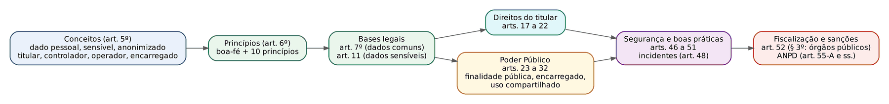
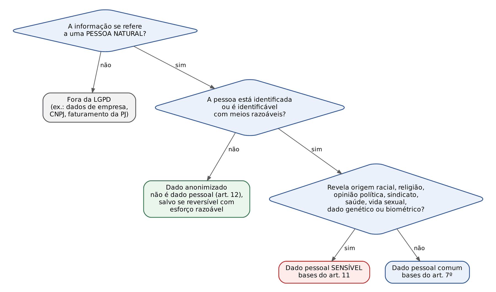
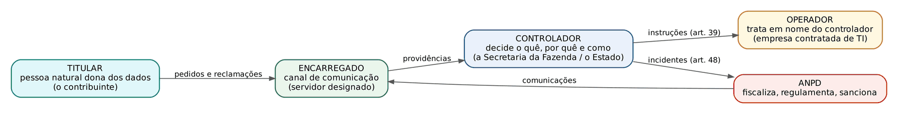
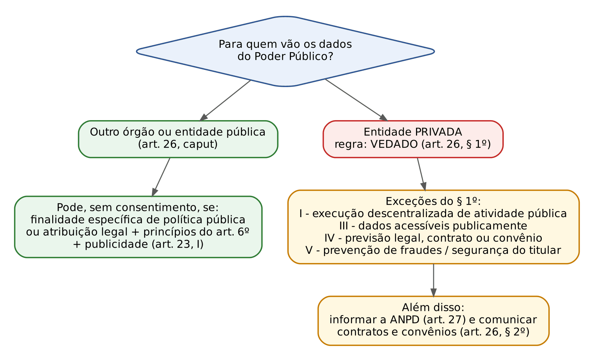
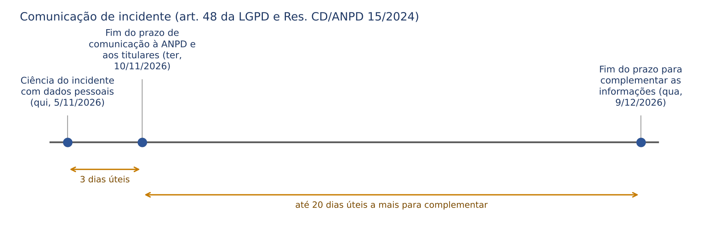
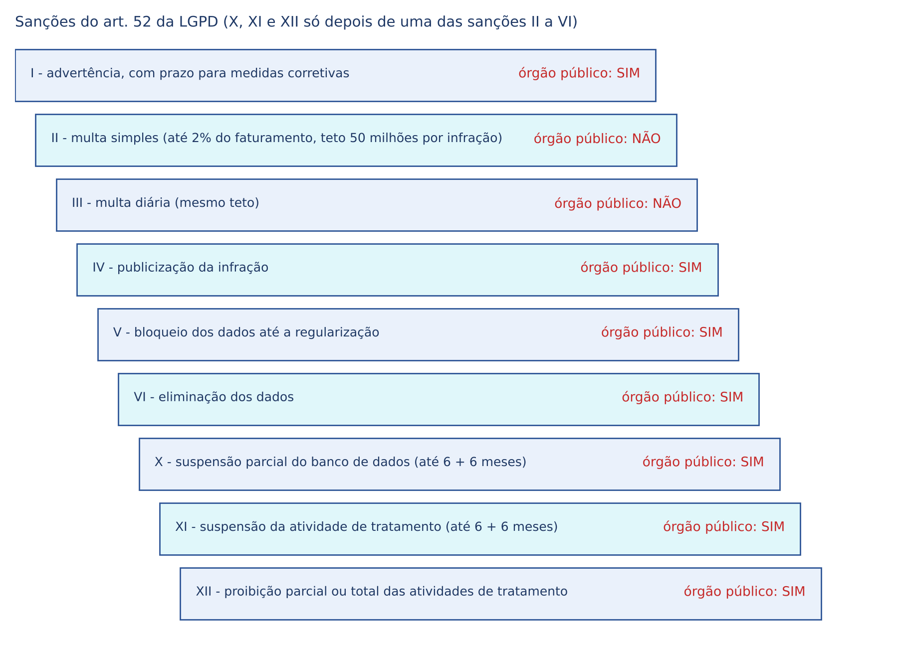

# CAPÍTULO 26 — PROTEÇÃO DE DADOS PESSOAIS (LGPD) NO SETOR PÚBLICO: PRINCÍPIOS, BASES LEGAIS, DIREITOS DOS TITULARES, AGENTES, TRATAMENTO PELO PODER PÚBLICO, COMPARTILHAMENTO, SEGURANÇA E INCIDENTES

:::INCIDENCIA
Edital SEFAZ/SC 01/2026 — Ciência e Análise de Dados, último bloco ("Proteção de Dados Pessoais: Lei nº 13.709/2018..."). Nível A.
Lote do banco: 168 questões (FCC 29, FGV 139). O que mais cai: princípios do art. 6º (definição trocada entre eles), bases legais (art. 7º x art. 11), dado anonimizado x pseudonimizado, direitos do art. 18, compartilhamento pelo Poder Público (arts. 26 e 27), incidente (art. 48) e sanções (art. 52).
A FCC gosta de casos práticos curtos de órgão público (prefeitura, secretaria da fazenda, tribunal) e de definições literais com uma palavra trocada.
:::

:::ESQUEMA O que você vai aprender e o que precisa saber antes
Pré-requisitos: nenhum cálculo. Ajuda ter lido o Cap. 23 (o que é um dado, dado estruturado e não estruturado, ciclo de vida dos dados) e o Cap. 25 (interoperabilidade e Governo Digital). Para responsabilidade civil e dano moral por violação de dados, ver Apostila de Direito Civil, Cap. 47; aqui fica só o necessário para a prova de Conhecimentos Gerais.
Roteiro do capítulo:
- 26.1 Para que serve a LGPD, a quem se aplica e onde ela NÃO se aplica (arts. 1º a 4º).
- 26.2 O vocabulário da lei (art. 5º): dado pessoal, sensível, anonimizado, pseudonimizado, titular, controlador, operador, encarregado, tratamento.
- 26.3 Os dez princípios (art. 6º), com um "teste" para cada um.
- 26.4 As bases legais: quando se pode tratar dados (arts. 7º a 16), com destaque para dados sensíveis, crianças e término do tratamento.
- 26.5 Os direitos do titular (arts. 17 a 22).
- 26.6 O Poder Público como controlador (arts. 23 a 32), o compartilhamento entre órgãos (Decreto 10.046/2019 e o julgamento do STF) e o sigilo fiscal do art. 198 do CTN.
- 26.7 Agentes de tratamento, encarregado, responsabilidade e transferência internacional (arts. 33 a 45).
- 26.8 Segurança, boas práticas e incidentes (arts. 46 a 51 e Resolução CD/ANPD 15/2024).
- 26.9 Fiscalização, sanções (art. 52, com o § 3º para órgãos públicos) e a ANPD.
:::

## 26.1 Para que serve a LGPD e a quem ela se aplica

### 26.1.1 A ideia em linguagem comum

Pense no cadastro de um contribuinte na Secretaria da Fazenda: nome, CPF, endereço, telefone, notas fiscais emitidas em seu nome, veículos, imóveis, dívidas. Cada um desses itens, sozinho, parece banal. Juntos, contam a vida da pessoa: onde mora, quanto ganha, o que compra, com quem negocia.

A Lei nº 13.709, de 14/8/2018, a Lei Geral de Proteção de Dados Pessoais (LGPD), parte de uma ideia simples: quem guarda e usa informações sobre pessoas não é dono dessas informações. É um depositário com deveres. A pessoa a quem os dados se referem continua sendo a "dona" deles (o art. 17 fala em "titularidade") e pode exigir saber o que se faz com eles, corrigi-los e, em certos casos, apagá-los.

Para o jurista, a analogia mais útil é a do depósito: o depositário pode guardar a coisa e usá-la apenas para o fim combinado, deve conservá-la com cuidado, prestar contas e devolvê-la. A LGPD transporta essa lógica para os dados: finalidade definida, cuidado (segurança), prestação de contas (responsabilização) e devolução ou eliminação ao final.

### 26.1.2 Objetivo, fundamentos e alcance federativo (arts. 1º e 2º)

O art. 1º diz que a lei trata do tratamento de dados pessoais "inclusive nos meios digitais", por pessoa natural ou jurídica, de direito público ou privado. Três consequências de prova:

- A LGPD vale também para papel. Uma ficha cadastral em arquivo de aço é banco de dados (o art. 5º, IV, fala em "suporte eletrônico ou físico"). Alternativa que diga "a LGPD só se aplica a meios digitais" está errada.
- Vale para o setor público e para o privado. Alternativa que diga "a LGPD não se aplica às pessoas jurídicas de direito público" está errada; ao contrário, há um capítulo inteiro para elas (arts. 23 a 32).
- O objetivo declarado é proteger "os direitos fundamentais de liberdade e de privacidade e o livre desenvolvimento da personalidade da pessoa natural". Só pessoa NATURAL. Dados de pessoa jurídica (CNPJ, faturamento da empresa) não são dados pessoais.

O parágrafo único do art. 1º (incluído pela Lei 13.853/2019) diz que as normas gerais da LGPD são de interesse nacional e obrigam União, Estados, Distrito Federal e Municípios. Por isso a SEFAZ/SC está sujeita a ela, e o Estado pode editar normas próprias de organização (por exemplo, quem será o encarregado em cada órgão), mas não pode afastar as regras gerais.

Os fundamentos (art. 2º) são sete. Decore pelo menos os dois mais cobrados: o respeito à privacidade (I) e a autodeterminação informativa (II), que é o poder de cada pessoa de controlar o fluxo das informações sobre si. Os demais: liberdade de expressão, informação, comunicação e opinião (III); inviolabilidade da intimidade, honra e imagem (IV); desenvolvimento econômico e tecnológico e inovação (V); livre iniciativa, livre concorrência e defesa do consumidor (VI); direitos humanos, livre desenvolvimento da personalidade, dignidade e exercício da cidadania (VII).

:::ATENCAO
Fundamento não é princípio. Os fundamentos estão no art. 2º (privacidade, autodeterminação informativa etc.); os princípios estão no art. 6º (finalidade, adequação, necessidade etc.). A FCC e a FGV gostam de misturar: "é princípio da LGPD a autodeterminação informativa" está tecnicamente errado (é fundamento).
:::

### 26.1.3 Aplicação territorial (art. 3º)

A lei se aplica a qualquer operação de tratamento, "independentemente do meio, do país de sua sede ou do país onde estejam localizados os dados", desde que ocorra uma destas três ligações com o Brasil:

- o tratamento é feito no território nacional; ou
- o tratamento tem por objetivo oferecer bens ou serviços, ou tratar dados de indivíduos, localizados no Brasil; ou
- os dados foram coletados no Brasil (considera-se coletado aqui o dado cujo titular estava no Brasil no momento da coleta, § 1º).

Exemplo: um aplicativo estrangeiro de transporte, com servidores nos Estados Unidos, que oferece corridas em Florianópolis está sujeito à LGPD, porque oferece serviço a pessoas localizadas no Brasil.

### 26.1.4 Onde a LGPD NÃO se aplica (art. 4º)

Este artigo é muito cobrado. A lei não se aplica ao tratamento de dados pessoais:

- I: feito por pessoa natural para fins exclusivamente particulares e não econômicos (a agenda de telefones pessoal, as fotos da família no celular);
- II: feito para fins exclusivamente jornalísticos e artísticos (alínea a) ou acadêmicos (alínea b). ATENÇÃO à alínea b: para fins acadêmicos, a lei manda aplicar os arts. 7º e 11 (bases legais). Ou seja, a exclusão do fim acadêmico é parcial;
- III: feito para fins EXCLUSIVOS de segurança pública, defesa nacional, segurança do Estado ou investigação e repressão de infrações penais;
- IV: dados vindos de fora do país que apenas transitam por aqui, sem compartilhamento com agentes brasileiros e sem transferência a terceiro país, desde que o país de origem tenha proteção adequada.

Sobre o inciso III (segurança pública e persecução penal), a lei faz quatro ressalvas, todas cobradas:

- esse tratamento será regido por lei específica, que deve prever medidas proporcionais e estritamente necessárias, com devido processo legal, princípios gerais e direitos do titular da LGPD (§ 1º);
- é vedado esse tratamento por pessoa de direito privado, salvo em procedimentos sob tutela de pessoa jurídica de direito público, com informe específico à autoridade nacional (§ 2º);
- a autoridade nacional emitirá opiniões técnicas e deverá solicitar relatórios de impacto (§ 3º);
- em nenhum caso a TOTALIDADE do banco de dados dessas atividades pode ser tratada por pessoa de direito privado, salvo a de capital integralmente público (§ 4º).

:::PEGADINHA
- "A LGPD não se aplica ao tratamento para fins acadêmicos" — parcialmente verdadeiro: a alínea b manda aplicar os arts. 7º e 11. Se a alternativa disser que, para fins acadêmicos, "não incidem quaisquer regras da LGPD", está errada.
- "A LGPD se aplica ao tratamento para fins jornalísticos" — errado (art. 4º, II, a). Foi a alternativa B da FCC na Q4155303, comentada adiante.
- Fiscalização TRIBUTÁRIA não é segurança pública nem persecução penal. O Fisco está plenamente sujeito à LGPD. Não caia em alternativa que encaixe a auditoria fiscal no art. 4º, III.
:::

:::QUESTAO FCC 2026 — MPE-AP — Analista Ministerial (Q3964561)
Enunciado parafraseado: um órgão público prepara um guia rápido sobre o que a LGPD estabelece, seu objetivo e quem está abrangido. Pergunta-se o que o guia deve necessariamente conter. Gabarito oficial: D.
Resolução:
- A alternativa D diz que a LGPD regula o tratamento de dados pessoais para proteger a liberdade e a privacidade, orientando-se por fundamentos como o respeito à privacidade e a autodeterminação informativa. É a soma dos arts. 1º e 2º, I e II. Correta.
- A (substitui normas setoriais de sigilo e obriga a apagar qualquer dado em 30 dias) inventa um prazo que não existe; e o art. 64 diz que os direitos da LGPD não excluem outros do ordenamento.
- B (prioriza dados de saúde e se volta a órgãos privados) contraria o art. 1º, que abrange pessoas de direito público e privado e todos os dados pessoais.
- C (só meios digitais e só comércio eletrônico) contraria o "inclusive nos meios digitais" do art. 1º.
- E (toda atividade depende de consentimento) ignora as outras nove bases do art. 7º (ver 26.4).
:::

:::QUESTAO FCC 2026 — AL-RR — Analista Legislativo, Enfermeiro (Q4155303)
Enunciado parafraseado: pede-se a afirmação correta sobre a LGPD, entre alternativas sobre planos de saúde, fins jornalísticos, crianças, compartilhamento de dados de saúde e tutela em juízo. Gabarito oficial: E.
Resolução:
- E reproduz o art. 22: a defesa dos interesses e direitos dos titulares pode ser exercida em juízo, individual ou coletivamente, conforme a legislação sobre tutela individual e coletiva. Correta.
- A inverte o art. 11, § 5º: é VEDADO às operadoras de planos de saúde tratar dados de saúde para seleção de riscos.
- B contraria o art. 4º, II, a: a LGPD NÃO se aplica ao tratamento para fins exclusivamente jornalísticos e artísticos.
- C troca o critério do art. 14: o tratamento deve atender ao melhor interesse da CRIANÇA E DO ADOLESCENTE, não dos genitores.
- D usa "em nenhuma hipótese": o art. 11, § 4º, veda o compartilhamento de dados de saúde para vantagem econômica, MAS traz exceções (serviços de saúde, assistência farmacêutica, portabilidade a pedido do titular etc.). Desconfie de "em nenhuma hipótese" em questões de LGPD.
:::

## 26.2 O vocabulário da lei (art. 5º)

Antes de qualquer regra, é preciso dominar as palavras. Em LGPD, metade das questões se resolve só com as definições do art. 5º, porque a banca troca a definição de um termo pela de outro.

### 26.2.1 Que tipo de dado é este?

Dado pessoal (art. 5º, I) é a "informação relacionada a pessoa natural identificada ou identificável". Duas palavras merecem atenção:

- identificada: já se sabe quem é (nome e CPF);
- identificável: ainda não se sabe, mas é possível descobrir combinando informações (a placa de um carro, o endereço IP de um computador, o número de uma inscrição estadual de produtor rural pessoa física, a geolocalização do celular às 7h todo dia). Por isso placa de veículo é dado pessoal: a partir dela se chega ao dono.

Dado pessoal sensível (art. 5º, II) é o que expõe a pessoa a discriminação. A lista é fechada e deve ser decorada: origem racial ou étnica; convicção religiosa; opinião política; filiação a sindicato ou a organização de caráter religioso, filosófico ou político; dado referente à saúde ou à vida sexual; dado genético ou biométrico, quando vinculado a uma pessoa natural.

:::DICA
Teste rápido do dado sensível: pergunte "esta informação poderia servir para discriminar a pessoa por quem ela É ou no que ela CRÊ?". Raça, religião, política, sindicato, saúde, sexualidade, genética e biometria passam no teste. CPF, RG, renda, endereço, telefone, e-mail, dados bancários, histórico de compras e profissão NÃO são sensíveis, embora sejam pessoais e possam ser sigilosos por outra lei (como o sigilo fiscal e bancário).
:::

Dado anonimizado (art. 5º, III) é o dado relativo a titular que não possa ser identificado, "considerando a utilização de meios técnicos razoáveis e disponíveis na ocasião de seu tratamento". A anonimização (art. 5º, XI) é o processo que leva a esse resultado: o dado "perde a possibilidade de associação, direta ou indireta, a um indivíduo".

A grande consequência está no art. 12: dado anonimizado NÃO é dado pessoal, e por isso fica fora da LGPD, salvo em duas situações:

- quando a anonimização for revertida usando exclusivamente meios próprios; ou
- quando, com esforços razoáveis, ela puder ser revertida.

O que é "razoável"? O § 1º manda considerar fatores objetivos, como custo e tempo necessários para reverter, conforme as tecnologias disponíveis. E o § 2º acrescenta: podem ser considerados dados pessoais os dados usados para formar o perfil comportamental de uma pessoa natural, se identificada.

Pseudonimização (art. 13, § 4º) é diferente, e a confusão entre os dois conceitos é a pegadinha preferida das bancas. Na pseudonimização, o dado perde a possibilidade de associação a um indivíduo "senão pelo uso de informação adicional mantida separadamente pelo controlador em ambiente controlado e seguro". Ou seja: existe uma "chave" guardada à parte que permite voltar ao titular.

:::EXEMPLO Anonimizar x pseudonimizar uma base de notas fiscais
Imagine uma tabela de notas fiscais de consumidor com as colunas: CPF do comprador, município, valor, data.
- Pseudonimização: troca-se o CPF 123.456.789-00 por um código, por exemplo "C-000381". Uma tabela de correspondência (C-000381 = 123.456.789-00) fica num servidor separado, com acesso restrito. O analista que vê só a base não sabe quem é o comprador, mas a Secretaria consegue voltar ao CPF quando precisar. O dado CONTINUA sendo pessoal, e a LGPD continua valendo integralmente; a técnica apenas reduz o risco.
- Anonimização: apaga-se a coluna do CPF e, além disso, agregam-se os valores (por exemplo, "total de compras por município e por mês"), de modo que não se possa chegar a nenhuma pessoa com meios razoáveis. Não existe tabela de volta. O resultado deixa de ser dado pessoal (art. 12).
- Cuidado: apagar o CPF não basta se sobrar uma combinação rara. Num município com 900 habitantes, "compra de 85.000 reais em joias no dia 3/3" pode apontar uma única pessoa. Se a reidentificação for possível com esforço razoável, o dado ainda é pessoal.
:::

### 26.2.2 Quem é quem no tratamento

- Titular (art. 5º, V): a pessoa natural a quem os dados se referem. Na SEFAZ, o contribuinte pessoa física, o sócio da empresa, o servidor, o cidadão que usa o portal.
- Controlador (art. 5º, VI): pessoa natural ou jurídica, de direito público ou privado, "a quem competem as decisões referentes ao tratamento de dados pessoais". É quem decide o PORQUÊ e o COMO.
- Operador (art. 5º, VII): pessoa natural ou jurídica, de direito público ou privado, que "realiza o tratamento de dados pessoais em nome do controlador". É quem executa por conta de outro (a empresa de TI contratada que hospeda o sistema, a empresa que imprime e envia carnês).
- Agentes de tratamento (art. 5º, IX): o controlador e o operador. Só esses dois. O encarregado NÃO é agente de tratamento.
- Encarregado (art. 5º, VIII): pessoa indicada pelo controlador e pelo operador para atuar como canal de comunicação entre o controlador, os titulares e a ANPD. No mercado é chamado de *Data Protection Officer* (DPO, "encarregado de proteção de dados"), expressão do direito europeu que a LGPD não usa.
- Autoridade nacional (art. 5º, XIX): a entidade da administração pública responsável por zelar, implementar e fiscalizar o cumprimento da lei em todo o território nacional. Hoje é a ANPD, que, pela Lei 15.352, de 25/2/2026, passou a se chamar Agência Nacional de Proteção de Dados (ver 26.9.3).

:::ATENCAO
Quando o controlador é um órgão público, quem é o controlador: o órgão ou o ente? A lei define controlador como pessoa natural ou jurídica, e órgão não tem personalidade jurídica. Na prática administrativa e nos guias oficiais, porém, cada órgão costuma exercer as funções de controlador em nome do ente. Em prova, a FCC e a FGV tratam o órgão (a Secretaria, o Tribunal, a Prefeitura) como controlador sem discutir essa sutileza; siga o enunciado.
:::

### 26.2.3 O que é "tratar" dados e as demais definições

Tratamento (art. 5º, X) é TODA operação com dados pessoais. A lista legal é exemplificativa e enorme: coleta, produção, recepção, classificação, utilização, acesso, reprodução, transmissão, distribuição, processamento, arquivamento, armazenamento, eliminação, avaliação ou controle da informação, modificação, comunicação, transferência, difusão ou extração. Moral da história: até guardar sem usar é tratamento; até apagar é tratamento.

Outras definições que caem:

- Banco de dados (IV): conjunto estruturado de dados pessoais, em um ou vários locais, em suporte eletrônico ou FÍSICO.
- Consentimento (XII): manifestação livre, informada e inequívoca pela qual o titular CONCORDA com o tratamento para uma finalidade determinada. Três adjetivos: livre, informada, inequívoca.
- Bloqueio (XIII): suspensão TEMPORÁRIA de qualquer operação de tratamento, mediante guarda do dado ou do banco. O dado fica "congelado", não apagado.
- Eliminação (XIV): exclusão de dado ou conjunto de dados armazenados, independentemente do procedimento.
- Transferência internacional (XV): transferência de dados pessoais para país estrangeiro ou organismo internacional do qual o país seja membro.
- Uso compartilhado (XVI): comunicação, difusão, transferência internacional, interconexão de dados ou tratamento compartilhado de bancos de dados por órgãos e entidades públicos no cumprimento de suas competências, ou entre esses e entes privados, com autorização específica, ou entre entes privados.
- Relatório de impacto à proteção de dados pessoais, o RIPD (XVII): documentação do CONTROLADOR que descreve os processos de tratamento que podem gerar riscos às liberdades civis e aos direitos fundamentais, com medidas, salvaguardas e mecanismos de mitigação de risco.
- Órgão de pesquisa (XVIII): órgão ou entidade da administração direta ou indireta, ou pessoa jurídica de direito privado SEM fins lucrativos, constituída sob as leis brasileiras, com sede e foro no País, que tenha a pesquisa (histórica, científica, tecnológica ou estatística) em sua missão.

:::QUESTAO FCC 2025 — SEFAZ-PI — Analista do Tesouro Estadual (Q3507096)
Enunciado parafraseado: pede-se qual item é dado pessoal sensível: nome e endereço; telefone e e-mail; CPF e RG; origem racial ou étnica; histórico de compras em lojas virtuais. Gabarito oficial: D.
Resolução:
- Aplique o teste da DICA: só origem racial ou étnica está na lista fechada do art. 5º, II. Alternativa D.
- Todas as outras alternativas trazem dados PESSOAIS comuns. CPF e RG (C) seduzem porque são "documentos importantes", mas importância e sigilo não tornam um dado sensível; o critério é o potencial discriminatório da lista legal. O histórico de compras (E) pode revelar hábitos, mas não está na lista.
:::

:::QUESTAO FCC 2024 — TRT 11ª Região — Analista Judiciário, Contabilidade (Q3737387)
Enunciado parafraseado: pede-se a definição de "anonimização" na LGPD. Gabarito oficial: D, meio técnico de tratamento pelo qual um dado não mais se associa a um indivíduo.
Resolução:
- D corresponde ao art. 5º, XI (o dado perde a possibilidade de associação, direta ou indireta, a um indivíduo).
- A ("manifestação pela qual o titular nega qualquer tratamento") é uma definição inventada, construída sobre a de consentimento.
- B ("suspensão temporária de qualquer operação de tratamento, mediante guarda do dado") é a definição de BLOQUEIO (art. 5º, XIII).
- C ("meio técnico pelo qual um dado é rastreado a um indivíduo") é o oposto: descreve a reidentificação.
- E ("manifestação livre, informada e inequívoca pela qual o titular concorda") é a definição de CONSENTIMENTO (art. 5º, XII).
A FCC montou as alternativas com as definições vizinhas do art. 5º: por isso vale decorá-las lado a lado.
:::

:::QUESTAO FCC 2026 — SEFAZ-SP — Auditor Fiscal da Receita Estadual, TI (Q3926921)
Enunciado parafraseado: uma Secretaria da Fazenda anonimizou uma base com dados de milhões de contribuintes para um estudo sobre evasão fiscal e publicou o relatório. Um auditor conclui que os dados anonimizados não são dados pessoais, SALVO se... Gabarito oficial: D.
Resolução:
- O art. 12 dá a resposta: o dado anonimizado volta a ser pessoal quando a anonimização for revertida ou puder ser revertida com esforços razoáveis. D descreve exatamente isso: um terceiro, com meios próprios e esforço razoável, consegue reidentificar as pessoas.
- A (compartilhar com universidade pública) não muda a natureza do dado; o que importa é se ele pode ser revertido.
- B (falta de autorização prévia da ANPD) inventa um requisito: a ANPD pode dispor sobre padrões de anonimização (art. 12, § 3º), mas não autoriza previamente cada anonimização.
- C (coleta anterior à vigência da LGPD) é irrelevante para a definição. Pegadinha extra: a vigência geral da LGPD foi em setembro de 2020 (24 meses após a publicação, art. 65, II), mas isso não muda nada aqui.
- E (nuvem privada x servidor físico) confunde o local de armazenamento com a possibilidade de reidentificação.
:::

:::QUESTAO FGV 2026 — DATAPREV — Analista de TI, Segurança Cibernética e Proteção de Dados (Q4383051)
Enunciado parafraseado: uma equipe troca o CPF de cada titular por um código; a tabela que liga código a CPF fica em servidor separado, com acesso restrito à própria equipe controladora. Os analistas que usam só a base tratada não identificam ninguém. Como se classifica o tratamento? Gabarito oficial: E, pseudonimização.
Resolução:
- Pergunta-chave: existe uma "chave de volta" guardada pelo controlador? Sim, a tabela de correspondência. Então é pseudonimização (art. 13, § 4º), e o dado continua pessoal.
- A, B e D chamam de anonimização porque o analista comum não identifica ninguém. Erro: o critério do art. 12 é objetivo; se o PRÓPRIO controlador consegue reverter com meios próprios, não houve anonimização.
- C (reidentificação) confunde a POSSIBILIDADE de voltar ao titular com o ato de efetivamente reidentificar.
:::

:::PRATIQUE exercícios elaborados para esta apostila
1. Classifique cada item como (P) dado pessoal comum, (S) dado pessoal sensível, (A) dado anonimizado ou (N) não é dado pessoal: a) a impressão digital usada para entrar no prédio da SEFAZ; b) o faturamento anual de uma sociedade limitada; c) o número da placa do carro de um servidor; d) a informação "o contribuinte X é filiado ao sindicato dos auditores"; e) a tabela "arrecadação de ICMS por município em 2025".
2. Uma prefeitura substitui o nome dos alunos da rede municipal por números sequenciais, e o arquivo que liga número ao nome fica com a Secretaria de Educação. A planilha numerada é dado anonimizado?
3. (Estilo FCC) Assinale a correta: (A) bloqueio é a exclusão definitiva do dado; (B) o encarregado é agente de tratamento; (C) operador é quem trata dados em nome do controlador; (D) a LGPD não se aplica a fichas em papel; (E) a autodeterminação informativa é princípio do art. 6º.
Resolução:
1. a) S: dado biométrico (art. 5º, II). b) N: refere-se a pessoa jurídica, não a pessoa natural. c) P: permite identificar o dono do veículo (pessoa identificável). d) S: filiação a sindicato. e) A, ou mais precisamente nem chega a ser dado pessoal: é um total agregado por município, sem possibilidade razoável de chegar a uma pessoa.
2. Não. Existe a informação adicional (o arquivo de correspondência) mantida pelo controlador: é pseudonimização (art. 13, § 4º). A planilha continua sendo dado pessoal e toda a LGPD se aplica.
3. C, cópia do art. 5º, VII. A descreve eliminação (o bloqueio é temporário). B está errada porque agentes de tratamento são só controlador e operador (art. 5º, IX). D contraria o art. 5º, IV (suporte físico). E está errada porque a autodeterminação informativa é FUNDAMENTO (art. 2º, II).
:::

## 26.3 Os princípios do tratamento (art. 6º)

### 26.3.1 A ideia

O art. 6º manda que toda atividade de tratamento observe a boa-fé e dez princípios. Eles funcionam como um roteiro de perguntas que o gestor deve fazer antes de criar um sistema, um formulário ou um cruzamento de dados. A prova cobra quase sempre do mesmo jeito: dá a DEFINIÇÃO de um princípio e pergunta o NOME (ou dá o nome com a definição de outro). Por isso a tabela abaixo traz, para cada princípio, a palavra-chave da definição legal e uma pergunta prática.

| Princípio (art. 6º) | Palavras-chave da definição legal | Pergunta-teste | Exemplo no Fisco |
|---|---|---|---|
| I - finalidade | propósitos legítimos, específicos, explícitos e informados; vedado tratamento posterior incompatível | "PARA QUE vou usar?" | Dados coletados para a nota fiscal não podem virar lista de *marketing* da Secretaria. |
| II - adequação | COMPATIBILIDADE do tratamento com as finalidades informadas, conforme o contexto | "O que faço combina com o que disse que faria?" | Usar o endereço do cadastro para enviar intimação fiscal é compatível; para pesquisa partidária, não. |
| III - necessidade | MÍNIMO necessário; dados pertinentes, proporcionais e não excessivos | "Preciso mesmo de TODOS esses dados?" | Formulário de parcelamento não deve pedir religião ou estado de saúde. |
| IV - livre acesso | consulta FACILITADA e GRATUITA sobre forma e duração do tratamento e integralidade dos dados | "O titular consegue ver o que tenho dele, sem pagar?" | Área do contribuinte com consulta aos próprios dados cadastrais. |
| V - qualidade dos dados | EXATIDÃO, clareza, relevância e ATUALIZAÇÃO | "Os dados estão corretos e atualizados?" | Endereço desatualizado gera intimação nula: qualidade é também eficiência. |
| VI - transparência | informações CLARAS, PRECISAS e facilmente acessíveis sobre o tratamento e os agentes, observados segredos comercial e industrial | "O titular sabe quem trata e como?" | Página do órgão explicando quais dados trata e com base em que lei. |
| VII - segurança | medidas técnicas e administrativas contra acessos não autorizados e situações acidentais ou ilícitas | "Os dados estão protegidos?" | Controle de acesso por perfil, senhas, registro de acessos (*logs*). |
| VIII - prevenção | medidas para PREVENIR danos | "Agi ANTES do problema?" | Avaliar riscos antes de lançar um novo sistema. |
| IX - não discriminação | impossibilidade de tratamento para fins discriminatórios ilícitos ou abusivos | "Isso discrimina alguém?" | Modelo de malha fiscal não pode usar raça como critério. |
| X - responsabilização e prestação de contas | DEMONSTRAÇÃO, pelo agente, de medidas eficazes e da eficácia delas | "Consigo PROVAR que cumpro?" | Registros de operações, relatórios de impacto, políticas documentadas. |

:::DICA
Três pares que a banca troca:
- Finalidade x adequação: finalidade é DEFINIR o propósito (legítimo, específico, explícito, informado); adequação é a COMPATIBILIDADE entre o que se faz e o propósito informado.
- Livre acesso x transparência: livre acesso é o titular consultar OS SEUS dados, de graça e com facilidade; transparência é a informação clara sobre O TRATAMENTO e os agentes.
- Segurança x prevenção: segurança é proteger contra acessos e incidentes; prevenção é agir antes do dano. Tudo que tiver "demonstração" ou "comprovar" é responsabilização e prestação de contas.
:::

:::QUESTAO FCC 2024 — prova não identificada no banco (Q3088340)
Enunciado parafraseado: pede-se a alternativa que associa corretamente o nome do princípio à sua definição. Gabarito oficial: E.
Resolução:
- E associa "responsabilização e prestação de contas" à demonstração, pelo agente, da adoção de medidas eficazes e capazes de comprovar a observância das normas e a eficácia dessas medidas (art. 6º, X). Correta.
- A dá a transparência a definição de QUALIDADE DOS DADOS (exatidão, clareza, relevância, atualização).
- B dá à necessidade a definição de LIVRE ACESSO (consulta facilitada e gratuita).
- C dá à adequação a definição de FINALIDADE (propósitos legítimos, específicos, explícitos e informados).
- D dá ao livre acesso a definição de ADEQUAÇÃO (compatibilidade com as finalidades).
É o formato clássico: nomes certos, definições embaralhadas. Leia a definição primeiro e só depois o nome.
:::

:::QUESTAO FCC 2026 — MPE-AL — Analista do Ministério Público, Área Jurídica (Q4092735)
Enunciado parafraseado: qual princípio limita o tratamento ao mínimo indispensável à realização de suas finalidades, com dados pertinentes, proporcionais e não excessivos? Gabarito oficial: E, necessidade.
Resolução:
- "Mínimo necessário" e "não excessivos" são as palavras-chave do art. 6º, III. Alternativa E.
- Finalidade (A) seduz porque a definição fala em "finalidades", mas a finalidade trata do PROPÓSITO, não da QUANTIDADE de dados. Qualidade dos dados (D) fala de exatidão e atualização.
No mesmo sentido: Q4104675 (FCC 2026, MPE-AL, Desenvolvimento de Sistemas), em que a equipe que projeta um sistema "desde a concepção" deve observar o princípio da necessidade (gabarito B). Nessa questão, as demais alternativas erram assim: A diz que a qualidade dos dados exige mantê-los anonimizados (qualidade é exatidão e atualização); C diz que a finalidade permite usos diferentes se houver interesse público (o art. 6º, I, veda tratamento posterior incompatível); D diz que dado biométrico para controle de acesso dispensa consentimento por "segurança institucional" (essa hipótese não está no art. 11); E diz que a adequação permite repassar dados a terceiros conforme política do órgão (não há essa permissão).
:::

:::QUESTAO FCC 2026 — AL-RR — Analista Legislativo, Segurança da Informação (Q4158829)
Enunciado parafraseado: uma Assembleia Legislativa pseudonimizou a base de cidadãos de suas consultas públicas, guardando a informação de reidentificação em ambiente separado e seguro. Qual prática é compatível com essa técnica e com o princípio da necessidade? Gabarito oficial: E.
Resolução:
- E descreve a pseudonimização tal como está no art. 13, § 4º (identificadores separados, reidentificação só com informação adicional protegida) e acrescenta acesso restrito ao estritamente necessário (art. 6º, III). Correta.
- A mascara só os relatórios externos e deixa tudo identificável para "uso amplo": viola a necessidade.
- B compartilha as chaves de criptografia entre unidades para acesso descentralizado aos dados completos: destrói a separação que caracteriza a pseudonimização.
- C diz que as funções criptográficas eliminam a possibilidade de reidentificação: isso seria anonimização, e não a técnica adotada (que conserva a chave).
- D mantém os dados identificáveis em base única: não há pseudonimização alguma.
:::

:::QUESTAO FCC 2026 — MPE-AL — Analista do Ministério Público, Arquivologia (Q4106995)
Enunciado parafraseado: combina a LGPD com o MoReq-Jus (modelo de requisitos para sistemas de gestão de documentos do Judiciário) e pede a afirmação correta. Gabarito oficial: A.
Resolução:
- A afirma que o tratamento deve observar finalidade, necessidade e transparência, alinhado às bases legais e a requisitos de governança, rastreabilidade e segurança. Nada de errado: é a combinação do art. 6º com os arts. 46 a 50. Correta.
- B (só meios digitais) contraria o art. 1º ("inclusive nos meios digitais") e o art. 5º, IV (suporte físico).
- C (tudo que está em redes sociais é sensível) contraria a lista fechada do art. 5º, II.
- D (vedação absoluta de compartilhamento entre órgãos) contraria o art. 26 (ver 26.6).
- E (dados anonimizados são pessoais para todos os efeitos) contraria o art. 12.
Você não precisa conhecer o MoReq-Jus para acertar: bastou eliminar as quatro afirmações contrárias à LGPD.
:::

## 26.4 Quando se pode tratar dados: as bases legais (arts. 7º a 16)

### 26.4.1 A ideia: sempre é preciso uma "causa" prevista em lei

No direito civil, todo pagamento precisa de causa; sem ela, há enriquecimento sem causa. Na LGPD, todo tratamento precisa de uma BASE LEGAL, isto é, de uma das hipóteses que a lei lista como autorizadoras. Sem base legal, o tratamento é ilícito, ainda que o dado seja verdadeiro e o propósito, nobre.

O erro mais comum de quem começa é pensar que tudo depende de consentimento. Não depende. O consentimento é só UMA das dez bases do art. 7º, e no setor público é a menos usada, porque o Estado age por dever legal, não por vontade do cidadão. Ninguém precisa "concordar" em ter seu ICMS fiscalizado.

### 26.4.2 As dez bases do art. 7º (dados pessoais comuns)

| Inciso | Base legal | Exemplo |
|---|---|---|
| I | consentimento do titular | inscrição voluntária num boletim informativo da SEFAZ |
| II | cumprimento de obrigação legal ou regulatória pelo controlador | Fisco tratando dados das notas fiscais; tribunal tratando dados das partes |
| III | administração pública, para execução de políticas públicas previstas em leis e regulamentos ou respaldadas em contratos, convênios ou instrumentos congêneres (observado o Capítulo IV) | cadastro de beneficiários de um programa de tarifa social |
| IV | estudos por órgão de pesquisa, garantida, sempre que possível, a anonimização | estudo do IBGE ou de universidade pública |
| V | execução de contrato ou procedimentos preliminares, a pedido do titular | dados do fornecedor para assinar contrato administrativo |
| VI | exercício regular de direitos em processo judicial, administrativo ou arbitral | guardar provas para defender o Estado em execução fiscal |
| VII | proteção da vida ou da incolumidade física do titular ou de terceiro | informar tipo sanguíneo ao socorro num acidente |
| VIII | tutela da saúde, exclusivamente, em procedimento realizado por profissionais de saúde, serviços de saúde ou autoridade sanitária | prontuário do servidor no serviço médico |
| IX | interesses legítimos do controlador ou de terceiro, salvo se prevalecerem direitos e liberdades fundamentais do titular | prevenção a fraude numa empresa privada |
| X | proteção do crédito | consulta a cadastro de inadimplentes |

Regras complementares do art. 7º que caem:

- § 3º: o tratamento de dados cujo acesso é público deve considerar a finalidade, a boa-fé e o interesse público que justificaram a disponibilização.
- § 4º: dispensa-se o consentimento para dados tornados MANIFESTAMENTE PÚBLICOS pelo titular, resguardados os direitos do titular e os princípios. Dispensa de consentimento não é "terra sem lei".
- § 5º: quem obteve consentimento e precisa compartilhar os dados com OUTROS controladores precisa de consentimento ESPECÍFICO para isso, salvo hipóteses de dispensa.
- § 6º: a dispensa de consentimento não desobriga os agentes das demais obrigações, especialmente princípios e direitos do titular.
- § 7º: o tratamento posterior dos dados públicos e manifestamente públicos (§§ 3º e 4º) pode ter novas finalidades, desde que legítimas e específicas e preservados os direitos do titular.

:::ATENCAO
O legítimo interesse (art. 7º, IX, e art. 10) é base típica do setor privado. A lei permite usá-lo só para finalidades legítimas, a partir de situações concretas (art. 10), com os dados ESTRITAMENTE necessários (§ 1º), com transparência (§ 2º), e a ANPD pode pedir relatório de impacto (§ 3º). No setor público, a base natural é o cumprimento de obrigação legal (II) ou a execução de políticas públicas (III). Em questões sobre tribunais, fiscos e tribunais de contas, a FGV marca como errada a alternativa do "legítimo interesse".
:::

### 26.4.3 O consentimento (arts. 8º e 9º)

Quando a base for o consentimento, ele precisa ser bem feito:

- forma: por escrito ou por outro meio que demonstre a vontade do titular (art. 8º, caput). Se por escrito, em cláusula DESTACADA das demais (§ 1º);
- prova: o ÔNUS da prova de que o consentimento foi obtido regularmente é do CONTROLADOR (§ 2º);
- vícios: é vedado o tratamento com vício de consentimento (§ 3º);
- finalidade: o consentimento deve referir-se a finalidades determinadas; autorizações GENÉRICAS são NULAS (§ 4º);
- revogação: a qualquer momento, por manifestação expressa, por procedimento gratuito e facilitado; os tratamentos feitos antes ficam ratificados enquanto não houver pedido de eliminação (§ 5º);
- informação: o titular tem direito a informações claras, adequadas e ostensivas sobre finalidade, forma e duração, identidade e contato do controlador, uso compartilhado, responsabilidades e direitos (art. 9º). Se as informações forem enganosas ou abusivas, o consentimento é nulo (§ 1º).

:::QUESTAO FGV 2025 — SEFAZ-PR — Auditor Fiscal (Q3363365)
Enunciado parafraseado: julgue (V ou F): (1) o consentimento pode ser revogado a qualquer momento, por manifestação expressa, procedimento gratuito e facilitado, ratificados os tratamentos anteriores enquanto não houver pedido de eliminação; (2) o consentimento dado por escrito deve constar de cláusula destacada; (3) o consentimento pode referir-se a finalidades determinadas ou a autorizações genéricas. Gabarito oficial: E (V – V – F), conferido no QConcursos em 30/10/2026; coincide com a resposta deduzida pela letra do art. 8º.
Resolução:
- (1) Verdadeira: cópia do art. 8º, § 5º.
- (2) Verdadeira: art. 8º, § 1º.
- (3) Falsa: o art. 8º, § 4º, diz o contrário, as autorizações genéricas são NULAS.
- Sequência V – V – F, alternativa E. As alternativas A e C (com a terceira afirmação "V") nascem justamente de não lembrar o § 4º.
:::

:::QUESTAO FGV 2026 — PC-PR — Delegado de Polícia (Q4378327)
Enunciado parafraseado: Joana divulgou muitos dados pessoais em redes sociais abertas, tornando-os manifestamente públicos. Pedro coletou, catalogou e armazenou esses dados e traçou o perfil dela. Joana se sentiu invadida. Gabarito oficial: E, Pedro não precisava do consentimento, mas deve resguardar os direitos da titular e observar os princípios da LGPD.
Resolução:
- O art. 7º, § 4º, dispensa o consentimento para dados tornados manifestamente públicos pelo titular, "resguardados os direitos do titular e os princípios". Alternativa E.
- A erra ao dizer que esses dados ficam fora da LGPD: a dispensa é só do consentimento.
- B, C e D inventam limites que a lei não traz (só armazenar; nenhum tratamento; consentimento só para publicar).
- Repare no § 2º do art. 12: dados usados para formar perfil comportamental de pessoa identificada são dados pessoais. Pedro está sujeito a toda a lei.
:::

### 26.4.4 Dados sensíveis (art. 11): menos bases, mais cuidado

Para dados sensíveis, a regra é mais rígida. Só há duas portas:

- com consentimento do titular ou de seu responsável legal, de forma ESPECÍFICA e DESTACADA, para finalidades específicas (art. 11, I); ou
- SEM consentimento, apenas quando o tratamento for INDISPENSÁVEL para (art. 11, II): a) cumprimento de obrigação legal ou regulatória; b) tratamento compartilhado necessário à execução, pela administração pública, de políticas públicas previstas em leis ou regulamentos; c) estudos por órgão de pesquisa, com anonimização sempre que possível; d) exercício regular de direitos, inclusive em contrato e processo judicial, administrativo e arbitral; e) proteção da vida ou da incolumidade física; f) tutela da saúde, exclusivamente por profissionais de saúde, serviços de saúde ou autoridade sanitária; g) prevenção à fraude e segurança do titular, nos processos de identificação e autenticação de cadastro em sistemas eletrônicos.

Compare com o art. 7º: para dados sensíveis NÃO existem as bases do legítimo interesse e da proteção do crédito. E repare em duas diferenças finas: (1) na política pública, o art. 7º, III, admite políticas "respaldadas em contratos, convênios ou instrumentos congêneres", mas o art. 11, II, b, fala só em políticas "previstas em leis ou regulamentos"; (2) a alínea g (prevenção à fraude em autenticação, como a biometria facial para acessar um aplicativo do governo) só existe para dados sensíveis.

Regras complementares do art. 11:

- § 1º: o regime dos dados sensíveis se aplica a QUALQUER tratamento que REVELE dados sensíveis e possa causar dano ao titular (por exemplo, o histórico de compras de uma farmácia que revela uma doença).
- § 2º: quando órgãos públicos usarem as alíneas a ou b (obrigação legal e políticas públicas), deve ser dada publicidade à dispensa de consentimento, nos termos do art. 23, I.
- § 4º: é vedado compartilhar dados de saúde entre controladores para obter vantagem econômica, salvo na prestação de serviços de saúde, assistência farmacêutica e assistência à saúde, em benefício dos titulares, para permitir a portabilidade pedida pelo titular ou as transações financeiras e administrativas decorrentes.
- § 5º: é vedado às operadoras de planos de saúde tratar dados de saúde para seleção de riscos na contratação ou exclusão de beneficiários.

:::QUESTAO FCC 2026 — TJ-CE — Analista Judiciário, Área Judiciária (Q4231763)
Enunciado parafraseado: em qual caso é IMPRESCINDÍVEL o consentimento para tratar dados sensíveis? Gabarito oficial: B, finalidades específicas não excepcionadas em lei e cuja revelação possa causar dano ao titular.
Resolução:
- Método: as alternativas A, C, D e E reproduzem alíneas do art. 11, II, isto é, hipóteses em que o consentimento é DISPENSADO: estudos por órgão de pesquisa (alínea c), obrigação legal (a), proteção da vida (e) e tutela da saúde (f).
- Sobra B: se a finalidade não está entre as exceções legais e o dado pode causar dano (art. 11, § 1º), só resta a porta do inciso I, o consentimento específico e destacado.
:::

:::QUESTAO FCC 2025 — Prefeitura de São Paulo — Auditor Municipal de Controle Interno (Q3289729)
Enunciado parafraseado: um aplicativo municipal de vacinação coleta nome, CPF, endereço e dados de saúde. Para evitar questionamentos sobre o compartilhamento indiscriminado desses dados com empresas privadas, o que deve fazer o controlador? Gabarito oficial: E, informar claramente a finalidade e obter consentimento específico para qualquer compartilhamento com empresas privadas.
Resolução:
- O ponto do enunciado é o compartilhamento com EMPRESAS PRIVADAS de dados de SAÚDE coletados pelo Município. Pelo art. 27, a comunicação de dados do Poder Público a entes privados depende de consentimento, salvo exceções (dispensas legais, uso compartilhado com publicidade e exceções do art. 26, § 1º). Fora delas, só resta o consentimento, que, para dado sensível, deve ser específico e destacado (art. 11, I), com finalidade clara (art. 6º, I e VI). Alternativa E.
- A erra ao transformar a possibilidade de tratar dados de saúde sem consentimento (art. 11, II) em dever geral fundado na "prevalência do interesse público", e não responde à questão do repasse a empresas.
- B (marketing, informando depois) viola finalidade e transparência; a informação tem de ser prévia.
- C (compartilhar livremente se anonimizados) é a mais sedutora: dado efetivamente anonimizado sai da LGPD (art. 12). A FCC a considerou errada porque fala em compartilhar "livremente os dados sensíveis", e dados de saúde de pequena população são de difícil anonimização segura. Em tese, a alternativa é discutível; fique com a resposta que segue a regra do art. 27 e do art. 11, I.
- D (avisar a Secretaria de Saúde) inventa um requisito.
:::

### 26.4.5 Pesquisa, estatística e anonimização (arts. 7º, IV, 11, II, c, e 13)

Para estudos em saúde pública, o art. 13 permite que órgãos de pesquisa acessem bases de dados pessoais, tratadas exclusivamente dentro do órgão, para a finalidade de pesquisa, em ambiente controlado e seguro, com anonimização ou pseudonimização sempre que possível. A divulgação dos resultados jamais poderá revelar dados pessoais (§ 1º), e o órgão de pesquisa não pode transferir os dados a terceiro (§ 2º).

:::QUESTAO FCC 2026 — AL-RR — Analista Legislativo, Segurança da Informação (Q4158826)
Enunciado parafraseado: uma Assembleia Legislativa faz estudos estatísticos com dados de audiências públicas e quer divulgar resultados agregados. Qual condição caracteriza conformidade com a base legal e com as técnicas de proteção? Gabarito oficial: A.
Resolução:
- A (estudos com dados pessoais, anonimização quando tecnicamente viável e ambiente controlado) combina a base do art. 7º, IV, com as cautelas do art. 13. Correta.
- B (pseudonimizar e fazer circular os dados entre unidades) contraria a ideia de ambiente controlado.
- C (exigir consentimento formal) não é necessário: existe base própria para estudos.
- D (usar dados sensíveis e anonimizar só para análise interna) inverte a lógica: o problema maior está na divulgação.
- E (execução de políticas públicas) aponta base diferente da situação, que é de estudo estatístico.
:::

:::QUESTAO FCC 2025 — UNICAMP — Procurador de Universidade (Q3891299)
Enunciado parafraseado: da aplicação conjunta da LGPD e da Lei de Acesso à Informação (LAI, Lei 12.527/2011), o que se conclui? Gabarito oficial: A, ambas possibilitam o tratamento de dados e a divulgação de informações relativas a pesquisa, garantida a anonimização.
Resolução:
- A LGPD admite tratamento para estudos com anonimização sempre que possível (arts. 7º, IV, 11, II, c, e 13). A LAI, ao proteger informações pessoais, também admite seu uso para estatísticas e pesquisas científicas de interesse público, vedada a identificação da pessoa (art. 31, § 3º, II, da LAI). Alternativa A.
- B (vedado eliminar dados) contraria o art. 16 da LGPD, que manda eliminar ao fim do tratamento.
- C ("responsáveis diretos e exclusivos") ignora operadores e o regime de responsabilidade dos arts. 42 a 45.
- D (LGPD não se aplica às pessoas de direito público) contraria os arts. 1º e 23.
- E inverte as leis e inventa "autorização normativa presumida".
:::

### 26.4.6 Crianças e adolescentes (art. 14)

O tratamento de dados de crianças e de adolescentes deve ser feito no MELHOR INTERESSE deles (caput). Para CRIANÇAS (até 12 anos incompletos, pelo ECA), exige-se consentimento específico e em destaque de pelo menos um dos pais ou do responsável legal (§ 1º), salvo quando a coleta for necessária para contatar os pais (uma única vez, sem armazenamento) ou para a proteção da criança (§ 3º). Jogos e aplicativos não podem condicionar a participação ao fornecimento de dados além do estritamente necessário (§ 4º), e as informações devem ser simples, claras e acessíveis (§ 6º).

Uma dúvida interpretativa antiga foi resolvida pela ANPD: o tratamento de dados de crianças e adolescentes pode se apoiar nas bases do art. 7º ou do art. 11, desde que prevaleça o melhor interesse (Enunciado CD/ANPD nº 1/2023). É o que a FGV cobrou.

:::QUESTAO FGV 2024 — Câmara dos Deputados — Consultor Legislativo (Q2511964)
Enunciado parafraseado: sobre o tratamento de dados de crianças e adolescentes, qual a afirmativa correta? Gabarito oficial: B, pode ser realizado com base nas hipóteses do art. 7º ou do art. 11, desde que observado e prevalecente o melhor interesse, avaliado no caso concreto (art. 14).
Resolução:
- B segue a orientação firmada pela ANPD descrita acima.
- A ("exclusivamente" o art. 11) e D ("apenas" o art. 7º para adolescentes) restringem sem base legal.
- C (só com consentimento dos pais) ignora o § 3º do art. 14 e as demais bases.
- E (só as hipóteses do ECA) inventa um regime paralelo: o ECA ilumina o melhor interesse, mas as bases são as da LGPD.
:::

### 26.4.7 Término do tratamento e conservação (arts. 15 e 16)

O tratamento termina (art. 15) quando: I - a finalidade foi alcançada ou os dados deixaram de ser necessários; II - acabou o período de tratamento; III - o titular comunica, inclusive revogando o consentimento, "resguardado o interesse público"; IV - a autoridade nacional determina, por violação da lei.

Terminado o tratamento, os dados devem ser ELIMINADOS (art. 16), mas a conservação é autorizada para: I - cumprimento de obrigação legal ou regulatória; II - estudo por órgão de pesquisa, com anonimização sempre que possível; III - transferência a terceiro, respeitados os requisitos da lei; IV - uso exclusivo do controlador, vedado o acesso de terceiro, e desde que ANONIMIZADOS.

:::QUESTAO FCC 2026 — SEFAZ-SP — Auditor Fiscal da Receita Estadual, Gestão Tributária (Q3956759)
Enunciado parafraseado: um órgão fazendário mantém bases de NF-e e declarações com dados pessoais e sensíveis. A legislação tributária fixa prazos mínimos de guarda; a LGPD só permite reter o necessário. Encerrados os prazos legais, o órgão quer continuar fazendo estatísticas de longo prazo. Qual política de retenção e descarte atende a tudo? Gabarito oficial: D.
Resolução:
- Enquanto dura o prazo da legislação tributária, a conservação está autorizada pelo art. 16, I (obrigação legal). Depois dele, a única forma de manter os dados para uso próprio é anonimizá-los (art. 16, IV), e dado anonimizado sai da LGPD (art. 12). D faz exatamente isso: prazo alinhado à lei tributária e, ao final, anonimização irreversível, preservando só dados anonimizados para estatística.
- A (guardar tudo identificável, alegando baixo custo) e C (guardar indefinidamente) violam necessidade e o art. 16.
- B (descartar antes do prazo legal) viola a obrigação tributária de guarda.
- E (apagar da produção mas manter identificável em *backup*, cópia de segurança) é a pegadinha: cópia de segurança também é tratamento (armazenamento) e continua sujeita à LGPD.
:::

:::PRATIQUE exercícios elaborados para esta apostila
1. Indique a base legal mais adequada: a) a SEFAZ/SC trata os dados das notas fiscais eletrônicas emitidas no Estado; b) a Secretaria de Assistência Social trata dados de renda para conceder tarifa social prevista em lei estadual; c) o setor médico do órgão registra a pressão arterial de um servidor em consulta; d) o órgão guarda as provas de um processo administrativo disciplinar para se defender em ação judicial.
2. Uma universidade pública quer usar a biometria facial de alunos para controlar a frequência e diz que a base é o "legítimo interesse". Está certo?
3. (Estilo FCC) O consentimento: (A) pode ser genérico, se dado por escrito; (B) tem o ônus da prova a cargo do titular; (C) pode ser revogado a qualquer momento, por procedimento gratuito e facilitado; (D) é a única base legal para dados sensíveis; (E) dispensa informar a finalidade quando o tratamento é feito pelo Poder Público.
Resolução:
1. a) Cumprimento de obrigação legal ou regulatória (art. 7º, II); a legislação tributária impõe ao Fisco fiscalizar e arrecadar. b) Execução de políticas públicas pela administração (art. 7º, III); se houver dado sensível, art. 11, II, b. c) Tutela da saúde por profissional de saúde (art. 7º, VIII, ou art. 11, II, f, porque dado de saúde é sensível). d) Exercício regular de direitos em processo (art. 7º, VI, ou art. 11, II, d).
2. Não. Biometria é dado sensível (art. 5º, II), e o art. 11 não prevê o legítimo interesse. Seria preciso enquadrar em outra base do art. 11 (por exemplo, consentimento específico e destacado) e ainda passar no teste da necessidade (há meios menos invasivos para controlar frequência?).
3. C (art. 8º, § 5º). A contraria o § 4º (autorizações genéricas são nulas). B inverte o § 2º (ônus do controlador). D ignora o art. 11, II. E contraria os arts. 9º e 23, I.
:::

## 26.5 Os direitos do titular (arts. 17 a 22)

### 26.5.1 A ideia

Se o titular é o "dono" dos dados (art. 17), ele precisa de ferramentas para controlar quem os usa. A LGPD dá essas ferramentas no art. 18, que é um dos artigos mais cobrados de toda a lei. Os direitos se exercem perante o CONTROLADOR, "a qualquer momento e mediante requisição".

Uma forma prática de memorizar é seguir a vida do pedido do cidadão: primeiro ele quer SABER se há dados (confirmação), depois VER os dados (acesso), depois CONSERTAR (correção), depois LIMPAR o excesso (anonimização, bloqueio ou eliminação), depois LEVAR para outro lugar (portabilidade), depois APAGAR o que deu com consentimento (eliminação), depois SABER COM QUEM foram compartilhados, depois SABER SE PODIA NEGAR o consentimento, e por fim VOLTAR ATRÁS (revogação).

| Art. 18 | Direito | Observação de prova |
|---|---|---|
| I | confirmação da existência de tratamento | "vocês têm dados meus?" |
| II | acesso aos dados | prazos no art. 19 |
| III | correção de dados incompletos, inexatos ou desatualizados | ligado ao princípio da qualidade |
| IV | anonimização, bloqueio ou eliminação de dados DESNECESSÁRIOS, EXCESSIVOS ou tratados em DESCONFORMIDADE com a lei | não é "apagar tudo a qualquer tempo" |
| V | portabilidade a outro fornecedor de serviço ou produto, mediante requisição expressa, conforme regulamento da ANPD | não inclui dados já anonimizados (§ 7º) |
| VI | eliminação dos dados tratados com CONSENTIMENTO, exceto nas hipóteses do art. 16 | se a base não foi consentimento, este inciso não se aplica |
| VII | informação das entidades públicas e privadas com as quais houve uso compartilhado | muito cobrado no setor público |
| VIII | informação sobre a possibilidade de não consentir e as consequências da negativa | |
| IX | revogação do consentimento (art. 8º, § 5º) | |

Regras de exercício:

- O titular pode peticionar contra o controlador perante a ANPD (§ 1º) e também perante os órgãos de defesa do consumidor (§ 8º).
- Pode OPOR-SE a tratamento feito com dispensa de consentimento, se houver descumprimento da lei (§ 2º).
- O requerimento é expresso, do titular ou de representante, ao agente de tratamento (§ 3º), e atendido SEM CUSTOS (§ 5º). Se não for possível atender de imediato, o controlador responde dizendo que não é o agente (e indicando quem é, se possível) ou explicando as razões que impedem a providência (§ 4º).
- Quem corrigiu, eliminou, anonimizou ou bloqueou deve avisar de imediato os agentes com quem compartilhou os dados, para que façam o mesmo, salvo impossibilidade ou esforço desproporcional (§ 6º).

O art. 19 dá os prazos da confirmação e do acesso: em formato SIMPLIFICADO, IMEDIATAMENTE; ou por declaração clara e completa (origem dos dados, inexistência de registro, critérios e finalidade), em até 15 (quinze) dias contados do requerimento. O titular escolhe receber por meio eletrônico ou impresso (§ 2º).

:::ATENCAO
No setor público, o art. 23, § 3º, manda que os prazos e procedimentos para exercer os direitos do titular perante o Poder Público observem a legislação específica, em especial a Lei do *Habeas Data* (Lei 9.507/1997), a Lei Geral do Processo Administrativo (Lei 9.784/1999) e a LAI (Lei 12.527/2011). É ponto de prova: o prazo de 15 dias do art. 19 é a regra geral, mas o Poder Público segue também essas leis.
:::

Três direitos fecham o capítulo:

- Art. 20: revisão de decisões tomadas UNICAMENTE com base em tratamento automatizado que afetem os interesses do titular (inclusive perfil pessoal, profissional, de consumo e de crédito). O controlador deve fornecer, quando solicitado, informações claras sobre critérios e procedimentos da decisão automatizada, observados os segredos comercial e industrial (§ 1º); se recusar por segredo, a ANPD pode fazer auditoria para verificar aspectos discriminatórios (§ 2º). Note que a lei atual NÃO exige que a revisão seja feita por pessoa natural: o dispositivo que exigia isso foi vetado (§ 3º).
- Art. 21: dados referentes ao exercício regular de direitos pelo titular não podem ser usados em seu prejuízo (quem reclamou no Procon não pode ser "punido" por isso).
- Art. 22: defesa em juízo, individual ou coletiva.

:::QUESTAO FCC 2025 — Prefeitura de São Paulo — Analista de Planejamento, TI (Q3281593)
Enunciado parafraseado: uma empresa de aluguel de bicicletas por aplicativo coleta localização, histórico de viagens e dados bancários. Um cliente desinstalou o aplicativo e pediu a eliminação; a empresa negou, dizendo que os dados serviam para estatística e melhoria do serviço. Que direito foi violado? Gabarito oficial: B.
Resolução:
- B reproduz o art. 18, IV: anonimização, bloqueio ou eliminação de dados desnecessários para a finalidade ou tratados em desconformidade. Se o cliente deixou o serviço, os dados identificáveis já não são necessários; para estatística, bastaria anonimizá-los (art. 16, IV).
- A deforma a portabilidade (art. 18, V), que é levar dados a outro fornecedor, e não "qualquer ação".
- C fala em "soberania" sobre os dados, expressão que a lei não usa.
- D inventa o direito de o próprio titular acessar e remover dados dos sistemas da empresa.
- E fala de informação sobre bases legais, que não é o que estava em jogo.
:::

:::QUESTAO FCC 2025 — TRT 15ª Região — Analista Judiciário, Arquivologia (Q3406074)
Enunciado parafraseado: pede-se a afirmação correta sobre a LGPD. Gabarito oficial: E, o titular pode requerer anonimização, bloqueio ou eliminação de dados desnecessários, excessivos ou tratados em desconformidade.
Resolução:
- E é o art. 18, IV. Correta.
- A descreve o controlador como mero executor; quem executa por conta de outro é o OPERADOR; o controlador é justamente quem decide (art. 5º, VI e VII).
- B diz que a lei não se aplica a fins acadêmicos: o art. 4º, II, b, manda aplicar os arts. 7º e 11.
- C diz que o consentimento é a única base: há dez no art. 7º.
- D diz que a transferência internacional é proibida: o art. 33 a admite em nove hipóteses.
:::

:::QUESTAO FCC 2026 — CPU-PE — Gestor Governamental (Q3871967)
Enunciado parafraseado: um participante de programa social estadual quer saber quais dados seus a secretaria trata e com quem os compartilha. Que direito exerce? Gabarito oficial: B, acesso aos seus dados, incluindo a informação sobre com quem são compartilhados.
Resolução:
- Combina o art. 18, II (acesso) com o VII (informação sobre uso compartilhado). Alternativa B.
- A (anonimização permanente) e C (eliminação imediata) não correspondem ao pedido e, no caso de política pública, esbarram na finalidade pública (art. 15, III, ressalva o interesse público; art. 16, I).
- D e E inventam direitos ("revogar o tratamento automatizado", "determinar a transferência a outro órgão").
:::

:::QUESTAO FCC 2026 — TJ-CE — Oficial de Justiça (Q4240006)
Enunciado parafraseado: pede-se a afirmação correta segundo a LGPD. Gabarito oficial: B, o titular tem direito de obter do controlador, a qualquer momento e mediante requisição, a correção de dados incompletos, inexatos ou desatualizados.
Resolução:
- B é o art. 18, III. Correta.
- A diz que é vedada a conservação após o término: o art. 16 autoriza a conservação em quatro hipóteses.
- C diz que é vedada a inversão do ônus da prova: o art. 42, § 2º, permite que o juiz a determine.
- D inverte os papéis: é o OPERADOR que segue as instruções do CONTROLADOR (art. 39).
- E diz "em qualquer hipótese": o art. 14, § 3º, permite coletar dados de crianças sem consentimento para contatar os pais ou para sua proteção.
:::

:::QUESTAO FCC 2026 — MPE-AL — Analista do Ministério Público, Desenvolvimento de Sistemas (Q4104672)
Enunciado parafraseado: um órgão público usa inteligência artificial para analisar pedidos de benefícios sociais; cidadãos questionam os critérios de indeferimento e há receio de discriminação indireta. Qual a conduta adequada? Gabarito oficial: D, dar explicações compreensíveis sobre os critérios de decisão e adotar medidas de proteção de dados.
Resolução:
- D concretiza o art. 20, § 1º (informações claras sobre critérios e procedimentos da decisão automatizada) e os princípios da transparência e da não discriminação (art. 6º, VI e IX).
- A (dados públicos abertos eliminam preocupações com privacidade e viés) é falsa: dados públicos continuam sujeitos aos princípios (art. 7º, §§ 3º e 4º), e viés não depende da origem do dado.
- B (substituir a análise humana) agrava o problema; o titular tem direito à revisão (art. 20).
- C (manter o modelo em sigilo para evitar questionamentos) contraria a transparência.
- E (abrir o código e os dados pessoais de treinamento) exagera: expõe dados de terceiros, violando necessidade e segurança.
Para os conceitos de IA, ver Cap. 25.
:::

## 26.6 O Poder Público como controlador (arts. 23 a 32)

### 26.6.1 A ideia: o Estado também está sujeito, mas com regime próprio

O Estado é o maior controlador de dados do país: Receita, Fazendas estaduais, Detran, SUS, Justiça Eleitoral, cartórios. A LGPD não o dispensa; dá a ele um capítulo próprio (Capítulo IV), cuja lógica cabe numa frase: o Poder Público pode tratar e compartilhar dados SEM consentimento, desde que o faça para cumprir sua FINALIDADE PÚBLICA, com TRANSPARÊNCIA e com um ENCARREGADO; o que ele não pode, em regra, é repassar dados a entes PRIVADOS.

### 26.6.2 Requisitos do art. 23

Quem está sujeito: as pessoas jurídicas de direito público referidas no parágrafo único do art. 1º da LAI, isto é, órgãos da administração direta dos três Poderes (incluídos Tribunais de Contas e Ministério Público) e autarquias, fundações públicas, empresas públicas, sociedades de economia mista e demais entidades controladas direta ou indiretamente pelos entes federativos.

O tratamento "deverá ser realizado para o atendimento de sua finalidade pública, na persecução do interesse público, com o objetivo de executar as competências legais ou cumprir as atribuições legais do serviço público", desde que:

- I: sejam INFORMADAS as hipóteses em que, no exercício de suas competências, o órgão trata dados pessoais, com informações claras e atualizadas sobre a previsão legal, a finalidade, os procedimentos e as práticas, em veículos de fácil acesso, PREFERENCIALMENTE em seus sítios eletrônicos;
- III: seja indicado um ENCARREGADO quando realizarem operações de tratamento (os incisos II e IV foram vetados).

Demais regras do art. 23 e seguintes:

- § 1º: a ANPD pode dispor sobre as formas de publicidade.
- § 2º: a LGPD não dispensa a instituição das autoridades previstas na LAI (por exemplo, a autoridade de monitoramento da LAI).
- § 3º: prazos e procedimentos dos direitos do titular perante o Poder Público seguem as Leis do *Habeas Data*, do Processo Administrativo e de Acesso à Informação.
- §§ 4º e 5º: os serviços notariais e de registro (cartórios), embora exercidos em caráter privado por delegação, recebem o MESMO tratamento das pessoas jurídicas de direito público, e devem fornecer acesso eletrônico aos dados para a administração pública.
- Art. 24: empresas públicas e sociedades de economia mista que atuam em REGIME DE CONCORRÊNCIA (art. 173 da Constituição) recebem o tratamento das pessoas jurídicas de direito PRIVADO; mas, quando estiverem OPERACIONALIZANDO POLÍTICAS PÚBLICAS, recebem o tratamento do Poder Público (parágrafo único).
- Art. 25: os dados devem ser mantidos em formato INTEROPERÁVEL e ESTRUTURADO para o uso compartilhado, visando à execução de políticas públicas, à prestação de serviços públicos, à descentralização da atividade pública e à disseminação e acesso das informações pelo público (sobre interoperabilidade, ver Cap. 25).

:::QUESTAO FGV 2026 — TCE-SC — Auditor Fiscal de Controle Externo, Direito (Q4088845)
Enunciado parafraseado: numa auditoria de folha de pagamento, o auditor do Tribunal de Contas examina dados sensíveis de servidores (filiação sindical, saúde). Qual base legal dispensa o consentimento? Gabarito oficial: C, execução de políticas públicas e cumprimento de obrigações legais.
Resolução:
- O Tribunal de Contas exerce competência constitucional e legal de controle; a base é o cumprimento de obrigação legal (art. 7º, II, e, para os sensíveis, art. 11, II, a), combinada com a finalidade pública do art. 23. Alternativa C.
- A (interesses legítimos do controlador) não existe para dados sensíveis e não é a base típica do Poder Público.
- B (proteção do crédito) e D (proteção da vida) não têm relação com auditoria.
- E (consentimento tácito) não existe: o consentimento é manifestação inequívoca (art. 5º, XII).
No mesmo sentido: Q4151003 (FGV 2026, TJ-SC, Analista de Sistemas): o tribunal que trata dados das partes e advogados no sistema processual se apoia no cumprimento de obrigação legal ou regulatória (gabarito C), e não no consentimento, no legítimo interesse, na proteção da vida ou na proteção do crédito.
:::

:::QUESTAO FGV 2024 — CVM — Analista, TI (Q2518116)
Enunciado parafraseado: a LGPD impõe às pessoas jurídicas de direito público obrigações de transparência ativa. Qual conjunto de informações deve ser publicado? Gabarito oficial: B, nome e cargo do encarregado, com telefone e e-mail específico para orientação e esclarecimento de dúvidas.
Resolução:
- O art. 41, § 1º, manda divulgar publicamente, de forma clara e objetiva, preferencialmente no sítio eletrônico, a IDENTIDADE e as INFORMAÇÕES DE CONTATO do encarregado. Entre as alternativas, a única centrada no encarregado é B.
- A, C, D e E pedem dados do controlador ou do operador (matrícula, CNPJ, primeiro e último nome) que a lei não exige publicar nesses termos.
- Observação: a lei não fala literalmente em "cargo" nem em "telefone"; a FGV se baseou na prática administrativa federal e na expressão "informações de contato". Fique com a alternativa que aponta o encarregado.
:::

### 26.6.3 Uso compartilhado entre órgãos públicos (art. 26, caput)

Entre órgãos e entidades públicos, o uso compartilhado é a regra do Estado em rede: "deve atender a finalidades específicas de execução de políticas públicas e atribuição legal pelos órgãos e pelas entidades públicas, respeitados os princípios de proteção de dados pessoais elencados no art. 6º". Não depende de consentimento. Depende de três coisas: finalidade específica, competência legal e respeito aos princípios (especialmente necessidade e transparência).

:::QUESTAO FCC 2026 — AL-MS — Analista Legislativo, Área Administrativa (Q3993986)
Enunciado parafraseado: um órgão ambiental compartilha dados pessoais com outro órgão público para fiscalização conjunta, sem consentimento do titular. Gabarito oficial: D, é possível para atender finalidade específica de execução de políticas públicas conforme as atribuições legais dos órgãos.
Resolução:
- D reproduz o art. 26, caput. Correta.
- A atribui à LAI um "compartilhamento irrestrito" que ela não prevê.
- B exige consentimento: o Poder Público não depende dele para cumprir competências (art. 7º, III, e art. 26).
- C trata profissão e estado civil como sensíveis: não estão na lista do art. 5º, II.
- E exige anonimização: a fiscalização conjunta precisa justamente identificar os fiscalizados.
:::

### 26.6.4 Repasse a entidades privadas (arts. 26, § 1º, e 27)

Aqui a regra se inverte. O art. 26, § 1º, diz que é VEDADO ao Poder Público transferir a entidades privadas dados pessoais de bases a que tenha acesso, EXCETO:

- I: em casos de execução DESCENTRALIZADA de atividade pública que exija a transferência, exclusivamente para esse fim específico e determinado, observada a LAI (exemplo: concessionária que presta o serviço público, empresa contratada para operar o sistema de emissão de documentos);
- III: quando os dados forem acessíveis publicamente, observada a LGPD;
- IV: quando houver previsão legal ou a transferência for respaldada em contratos, convênios ou instrumentos congêneres;
- V: quando a transferência objetivar exclusivamente a prevenção de fraudes e irregularidades, ou proteger a segurança e a integridade do titular, vedado o tratamento para outras finalidades.

(O inciso II foi vetado.) E o § 2º acrescenta: os contratos e convênios do § 1º devem ser COMUNICADOS à autoridade nacional.

O art. 27 completa: a comunicação ou o uso compartilhado de dados de pessoa jurídica de direito público a pessoa de direito privado será INFORMADO à autoridade nacional e dependerá de CONSENTIMENTO do titular, exceto: I - nas hipóteses de dispensa de consentimento da lei; II - nos casos de uso compartilhado em que se dê publicidade nos termos do art. 23, I; III - nas exceções do art. 26, § 1º.

Na prática, as exceções são tão amplas que o consentimento quase nunca é exigido; mas TRANSPARÊNCIA (art. 23, I) e COMUNICAÇÃO à ANPD (arts. 26, § 2º, e 27) continuam obrigatórias. As bancas exploram exatamente esse ponto: o repasse pode ser lícito quanto à finalidade e, mesmo assim, irregular quanto ao procedimento.

:::PASSO Como resolver qualquer questão de compartilhamento pelo Poder Público
1. Para quem vão os dados? Outro órgão público: vá ao art. 26, caput (finalidade específica, competência legal, princípios). Entidade privada: vá ao art. 26, § 1º (regra: vedado).
2. Se for entidade privada, procure a exceção: execução descentralizada (I), dados públicos (III), lei, contrato ou convênio (IV), prevenção de fraude ou segurança do titular (V).
3. Confira o procedimento: publicidade do art. 23, I; comunicação à ANPD (art. 26, § 2º, e art. 27); finalidade restrita ("exclusivamente para esse fim").
4. Desconfie de alternativas com "sempre", "em qualquer hipótese", "irrestrito", "dispensa a comunicação" ou "transfere integralmente a responsabilidade".
:::

:::QUESTAO FCC 2025 — Prefeitura de São Paulo — Auditor Municipal de Controle Interno, Infraestrutura (Q3290876)
Enunciado parafraseado: o Município quer compartilhar com pessoa jurídica de direito privado dados de usuários de serviços municipais, coletados com consentimento para a prestação do serviço, sem pedir nova autorização, alegando finalidade pública. O compartilhamento sem consentimento é... Gabarito oficial: E, possível quando se tratar de execução descentralizada de atividade pública que exija a transferência, exclusivamente para esse fim específico e determinado.
Resolução:
- E é o art. 26, § 1º, I. Correta.
- A diz que só a prevenção de fraudes autoriza: ignora as demais exceções (I, III e IV).
- B inventa um crime de responsabilidade e nega a existência de exceções.
- C condiciona a legitimidade a uma comunicação à ANPD com conteúdo que a lei não exige (natureza gratuita ou onerosa); a comunicação existe (art. 27), mas não é ela que legitima o repasse.
- D diz que dados de banco oficial dispensam consentimento para qualquer tratamento privado: contraria a regra de vedação do § 1º.
:::

:::QUESTAO FCC 2026 — CPU-PE — Gestor Governamental (Q3871929)
Enunciado parafraseado: sobre a disciplina do tratamento de dados pelo Poder Público, qual a correta? Gabarito oficial: A, admite-se o compartilhamento com empresas em casos de execução descentralizada de atividade pública que exija a transferência, exclusivamente para esse fim.
Resolução:
- A é o art. 26, § 1º, I. Correta.
- B diz "sob qualquer fundamento" e exige anuência: ignora as exceções do art. 26, § 1º, e do art. 27.
- C exige convênio para compartilhar entre órgãos públicos: o art. 26, caput, não exige; e o art. 25 estimula a interoperabilidade.
- D é a mais sedutora: o art. 11, II, b, realmente dispensa o consentimento para dados sensíveis em políticas públicas, mas exige que o tratamento seja INDISPENSÁVEL e que as políticas estejam PREVISTAS EM LEIS OU REGULAMENTOS, com publicidade (art. 11, § 2º). A alternativa amplia demais ("desde que sejam necessários") e fala em "regime específico" que dispensaria a anuência em geral.
- E iguala todas as estatais ao Poder Público: o art. 24 manda tratar as que atuam em concorrência como empresas privadas.
:::

:::QUESTAO FCC 2026 — prova não identificada no banco (Q3872160)
Enunciado parafraseado: uma concessionária de saneamento precisa de CPF, RG, endereço e renda familiar dos usuários (esta para a tarifa social). Pelo regime da LGPD (e de um decreto do Estado de São Paulo), qual a correta? Gabarito oficial: E, o Poder Concedente poderá transferir os dados pessoais que detém em sua base, na forma prevista no contrato de concessão, para assegurar o cumprimento das atribuições legais do serviço público.
Resolução:
- A concessão é execução descentralizada de serviço público, respaldada em contrato: art. 26, § 1º, I e IV. Alternativa E.
- A trata a renda como dado sensível: não está no art. 5º, II.
- B exige anonimização e veda manter banco de dados: inviabilizaria o próprio serviço.
- C e D erram na qualificação e nos requisitos: a concessionária pode ser controladora dos dados que trata para prestar o serviço, mas não é verdade que só precise de consentimento para sensíveis (C), nem que dependa de consentimento expresso para tudo (D), já que há base legal na execução do serviço público.
- O decreto paulista citado no enunciado não foi conferido aqui e não é necessário para a resposta.
:::

:::QUESTAO FGV 2024 — TJ-AP — Analista Judiciário, Controle Interno (Q2442914)
Enunciado parafraseado: para executar política pública de acesso ao Judiciário, um órgão compartilha dados de sua base com entidade do terceiro setor regularmente selecionada para executar o projeto. Gabarito oficial: D, é excepcionalmente autorizada a transferência conforme previsão em convênio ou instrumento congênere, para a finalidade específica nele prevista.
Resolução:
- Entidade do terceiro setor é privada; a regra é a vedação, e a exceção aplicável é a do art. 26, § 1º, IV (convênio). Alternativa D.
- A ("não há restrição") e E ("apenas com consentimento") são os dois extremos errados.
- B nega exatamente as exceções do § 1º.
- C diz que o terceiro setor integra a Administração Pública: não integra; são pessoas jurídicas de direito privado.
:::

:::QUESTAO FGV 2026 — ALERJ — Procurador Legislativo (Q3880837)
Enunciado parafraseado: para prevenir fraudes em benefícios assistenciais, um Município celebrou convênio com empresa privada de tecnologia e compartilhou dados dos beneficiários sem consentimento; não deu publicidade às hipóteses, finalidades e procedimentos do tratamento, nem comunicou o convênio à ANPD. Gabarito oficial: E, a finalidade é compatível, mas há desconformidade pela falta de transparência e pela não comunicação à autoridade nacional.
Resolução:
- Finalidade: prevenção de fraude e convênio são exceções do art. 26, § 1º (incisos IV e V). Até aqui, lícito.
- Procedimento: faltou a publicidade do art. 23, I, e a comunicação do convênio à ANPD (art. 26, § 2º, e art. 27). Daí a irregularidade. Alternativa E.
- A e C exigem consentimento ou anonimização: ignoram as exceções.
- B diz que a finalidade dispensa publicidade e comunicação: erro oposto.
- D diz que o convênio transfere toda a responsabilidade à entidade privada e afasta o regime público: o Município continua controlador e sujeito ao Capítulo IV.
:::

### 26.6.5 O papel da ANPD diante do Poder Público (arts. 29 a 32) e o § 3º do art. 52

A ANPD pode, a qualquer momento, solicitar aos órgãos públicos informações específicas sobre o âmbito e a natureza dos dados e outros detalhes do tratamento, e emitir parecer técnico complementar (art. 29); pode estabelecer normas complementares para a comunicação e o uso compartilhado (art. 30); havendo infração por órgão público, pode enviar INFORME com medidas cabíveis para fazer cessar a violação (art. 31); e pode solicitar a agentes do Poder Público a PUBLICAÇÃO de relatórios de impacto e sugerir padrões e boas práticas (art. 32). As sanções aplicáveis aos órgãos públicos estão em 26.9.

### 26.6.6 O Decreto 10.046/2019 e o julgamento do STF (noção)

No plano federal, o Decreto 10.046, de 9/10/2019, disciplina a governança no compartilhamento de dados entre órgãos e entidades da administração pública federal. Ele classifica o compartilhamento em três níveis (amplo, para dados públicos sem restrição de acesso; restrito, para dados protegidos por sigilo, a órgãos que precisam deles para executar políticas públicas; e específico, para dados sigilosos a órgãos determinados, para finalidade específica), cria o Cadastro Base do Cidadão e institui o Comitê Central de Governança de Dados. É norma FEDERAL: não vincula diretamente a SEFAZ/SC, que segue a LGPD e as normas estaduais; mas os conceitos são cobrados como exemplo de governança de dados (ver também Cap. 25).

O decreto foi questionado no STF (ADI 6.649 e ADPF 695). Em 15/9/2022, o Plenário, por maioria, deu interpretação conforme à Constituição (STF, ADI n. 6.649 e ADPF n. 695, Relator Ministro Gilmar Mendes, Tribunal Pleno, j. 15/9/2022). Em síntese, o compartilhamento entre órgãos é legítimo, desde que:

- tenha propósitos legítimos, específicos e explícitos (art. 6º, I), seja compatível com as finalidades (II) e limitado ao mínimo necessário (III);
- atenda aos requisitos da LGPD no que forem compatíveis com o setor público;
- seja dada publicidade, nos termos do art. 23, I, da LGPD;
- o acesso ao Cadastro Base do Cidadão observe controles rígidos (só órgãos que comprovem real necessidade), justificativa prévia e detalhada para incluir novos dados, medidas de segurança e registro eletrônico dos acessos.

O STF declarou inconstitucional o art. 22 do decreto (composição do Comitê Central), com efeitos prospectivos, para que o comitê tivesse perfil independente e plural. E afirmou que o tratamento indevido gera responsabilidade civil do Estado (arts. 42 e seguintes da LGPD), com regresso contra o servidor que agir com culpa ou dolo, e que a transgressão dolosa ao dever de publicidade do art. 23, I, pode configurar ato de improbidade (Lei 8.429/1992, art. 11, IV), sem prejuízo de sanções disciplinares.

:::DICA
Na prova, guarde a frase: "o STF validou o compartilhamento de dados entre órgãos públicos, mas o condicionou aos princípios da LGPD (finalidade, adequação, necessidade), à transparência do art. 23, I, e a mecanismos de segurança e de registro de acessos".
:::

### 26.6.7 Sigilo fiscal (CTN, art. 198) e LGPD

O auditor fiscal convive com dois regimes que se sobrepõem, sem se confundir:

| | Sigilo fiscal (CTN, art. 198) | LGPD |
|---|---|---|
| O que protege | informação obtida em razão do ofício sobre a situação econômica ou financeira do sujeito passivo ou de terceiros e sobre a natureza e o estado de seus negócios | qualquer informação relacionada a pessoa natural identificada ou identificável |
| Quem é protegido | pessoas físicas E jurídicas | só pessoas naturais |
| Quem deve observar | a Fazenda Pública e seus servidores | todo controlador e operador |
| Lógica | dever de não divulgar, com exceções | regras para todo o ciclo do tratamento |

O art. 198 veda a divulgação, salvo: requisição judicial no interesse da justiça; solicitação de autoridade administrativa no interesse da Administração, comprovada a instauração regular de processo administrativo para investigar o sujeito passivo por infração administrativa (§ 1º). O intercâmbio de informação sigilosa dentro da Administração exige processo regularmente instaurado e entrega pessoal mediante recibo (§ 2º). Não é vedada a divulgação de representações fiscais para fins penais, inscrições em Dívida Ativa, parcelamento ou moratória e incentivos, renúncias, benefícios ou imunidades cujo beneficiário seja pessoa jurídica (§ 3º). Os §§ 4º e 5º autorizam a administração tributária a requisitar informações cadastrais e patrimoniais a quem opera cadastros e determinam que os órgãos públicos colaborem com o compartilhamento de bases cadastrais e patrimoniais. E o art. 199 prevê a assistência mútua e a permuta de informações entre as Fazendas da União, dos Estados, do DF e dos Municípios, na forma de lei ou convênio.

Como os dois regimes se combinam:

- A LGPD não revoga o sigilo fiscal: o art. 64 diz que os direitos e princípios da LGPD não excluem outros do ordenamento. Os dois se somam.
- A troca de informações entre Fazendas (CTN, art. 199) é uso compartilhado entre órgãos públicos (LGPD, art. 26, caput), com base no cumprimento de obrigação legal (art. 7º, II) ou em política pública respaldada em convênio (art. 7º, III).
- O direito de acesso do contribuinte aos próprios dados (art. 18, II) não alcança informações sigilosas de TERCEIROS; e o direito de eliminação não prevalece sobre o dever legal de guarda (art. 16, I).
- O vazamento de dados de contribuintes pode ser, ao mesmo tempo, quebra de sigilo fiscal (com reflexos penais e disciplinares) e incidente de segurança da LGPD (com dever de comunicação do art. 48).

:::PRATIQUE exercícios elaborados para esta apostila
1. A SEFAZ/SC quer enviar à Secretaria de Segurança Pública a lista de contribuintes com débitos inscritos em Dívida Ativa, para "auxiliar investigações em geral". Aponte o problema à luz da LGPD.
2. Uma empresa pública estadual de processamento de dados, que atua em regime de concorrência no mercado, vende serviços de TI a empresas privadas. Como a LGPD a trata nessa atividade? E quando opera o sistema de matrícula escolar do Estado?
3. (Estilo FCC) É VEDADO ao Poder Público transferir a entidades privadas dados pessoais de suas bases, EXCETO: (A) quando houver interesse público genérico; (B) quando a entidade privada pagar pelos dados; (C) quando a transferência objetivar exclusivamente a prevenção de fraudes, vedado o tratamento para outras finalidades; (D) quando o servidor responsável autorizar; (E) sempre que houver consentimento tácito.
Resolução:
1. A finalidade não é específica ("investigações em geral"), violando o art. 6º, I, e o art. 26, caput, que exige finalidade específica de política pública ou atribuição legal. Além disso, a lista ultrapassa o mínimo necessário (art. 6º, III). Note que a inscrição em Dívida Ativa não é protegida pelo sigilo fiscal (CTN, art. 198, § 3º, II), mas isso não dispensa as regras da LGPD.
2. Em concorrência, recebe o tratamento de pessoa jurídica de direito privado (art. 24, caput). Ao operacionalizar política pública (matrícula escolar), recebe o tratamento do Poder Público (art. 24, parágrafo único).
3. C (art. 26, § 1º, V). As demais inventam exceções; "consentimento tácito" nem existe na LGPD.
:::

## 26.7 Agentes de tratamento, encarregado, responsabilidade e transferência internacional (arts. 33 a 45)

### 26.7.1 Controlador e operador (arts. 37 a 40)

- Registro das operações: controlador e operador devem manter registro das operações de tratamento que realizarem, especialmente quando baseado no legítimo interesse (art. 37). É o "livro de registro" do tratamento, a primeira prova de responsabilização (art. 6º, X).
- Relatório de impacto (RIPD): a ANPD PODE DETERMINAR ao controlador que o elabore, inclusive sobre dados sensíveis (art. 38). Conteúdo MÍNIMO (parágrafo único): descrição dos tipos de dados coletados; metodologia usada para a coleta e para a garantia da segurança; análise do controlador sobre medidas, salvaguardas e mecanismos de mitigação de risco. No setor público, a ANPD pode solicitar a PUBLICAÇÃO do RIPD (art. 32), e, no caso do art. 4º, III (segurança pública), DEVE solicitá-lo (art. 4º, § 3º).
- Instruções: o operador realiza o tratamento segundo as instruções do controlador, que verifica a observância das próprias instruções e das normas (art. 39).
- Padrões: a ANPD pode dispor sobre padrões de interoperabilidade para portabilidade, livre acesso e segurança, e sobre tempo de guarda dos registros (art. 40).

:::QUESTAO FCC 2026 — TJ-CE — Analista Judiciário, Sistemas da Informação (Q4240103)
Enunciado parafraseado: ao implantar solução de IA de apoio à jurisdição, o órgão faz estudo formal que documenta as operações de tratamento, identifica impactos e define controles de mitigação. Como se chama o produto? Gabarito oficial: D, Relatório de Impacto à Proteção de Dados Pessoais.
Resolução:
- A descrição corresponde ao art. 5º, XVII, e ao art. 38, parágrafo único (descrição do tratamento, riscos, medidas de mitigação). Alternativa D.
- As demais (catálogo de serviços de TI, documento de arquitetura, política de governança algorítmica, plano de continuidade) são documentos de gestão de TI que existem na prática, mas não são o documento que a LGPD nomeia.
:::

### 26.7.2 O encarregado (art. 41)

O controlador DEVE indicar encarregado (art. 41, caput); no Poder Público, a exigência está reforçada no art. 23, III. A identidade e as informações de contato do encarregado devem ser divulgadas publicamente, de forma clara e objetiva, preferencialmente no sítio eletrônico do controlador (§ 1º).

As atividades do encarregado (§ 2º) são quatro:

- I: aceitar reclamações e comunicações dos titulares, prestar esclarecimentos e adotar providências;
- II: receber comunicações da autoridade NACIONAL e adotar providências;
- III: orientar os funcionários e os contratados da entidade sobre as práticas de proteção de dados;
- IV: executar as demais atribuições determinadas pelo controlador ou estabelecidas em normas complementares.

A ANPD pode estabelecer normas complementares sobre o encarregado, inclusive hipóteses de dispensa conforme a natureza e o porte da entidade ou o volume de operações (§ 3º). A ANPD regulamentou a função na Resolução CD/ANPD 18, de 16/7/2024 (Regulamento sobre a atuação do encarregado).

:::QUESTAO FGV 2025 — SEFAZ-RS — Auditor do Estado (Q3154033)
Enunciado parafraseado: julgue (V ou F) como atividades do encarregado: (1) orientar funcionários e contratados sobre proteção de dados; (2) aceitar reclamações e comunicações dos titulares, prestar esclarecimentos e adotar providências; (3) receber comunicações das autoridades JUDICIAIS e encaminhá-las para providências técnicas. Gabarito oficial: E, V – V – F.
Resolução:
- (1) Verdadeira: art. 41, § 2º, III.
- (2) Verdadeira: art. 41, § 2º, I.
- (3) Falsa: o inciso II fala em comunicações da autoridade NACIONAL (a ANPD), não das autoridades judiciais. Trocar uma palavra do inciso é a técnica clássica.
:::

:::QUESTAO FCC 2025 — TRF 4ª Região — Analista Judiciário, Análise de Sistemas (Q3538820)
Enunciado parafraseado: sobre controlador, operador e encarregado, pede-se a correta. Gabarito oficial: A, os agentes de tratamento são o controlador e o operador, e o encarregado é a pessoa indicada pelo controlador e pelo operador para atuar como canal de comunicação entre o controlador, os titulares e a ANPD.
Resolução:
- A une o art. 5º, IX (agentes = controlador e operador), e o VIII (definição do encarregado). Correta.
- B, C e E põem o encarregado como agente de tratamento ou trocam os papéis.
- D diz que o encarregado é indicado pelo TITULAR e pelo operador: quem indica são o controlador e o operador.
:::

:::QUESTAO FCC 2025 — Prefeitura de São Paulo — Analista de Planejamento, TI (Q3281616)
Enunciado parafraseado: a partir de notícia sobre incidentes comunicados à ANPD (sequestro de dados, exploração de vulnerabilidades, acessos não autorizados, roubo de credenciais), pergunta-se qual seria uma medida correta de conformidade com a LGPD em uma prefeitura. Gabarito oficial: B (conferido no QConcursos em 30/10/2026).
Resolução:
- B propõe nomear um encarregado (o *Data Protection Officer*) para supervisionar a conformidade, gerir pedidos de titulares e ser o ponto de contato com a ANPD. É o que mandam os arts. 23, III, e 41. É a única alternativa compatível com a lei.
- D propõe nomear um "Gerador de Dados e Registros (GDR)" responsável por informações "passíveis de serem repassadas a terceiros não autorizados", com base no art. 4º. Essa figura não existe na LGPD, e o art. 4º trata das hipóteses de NÃO aplicação da lei. Não há como sustentar D.
- A restringe dados pessoais a pessoas JURÍDICAS (o oposto do art. 5º, I). C mistura bases legais com "exoneração de servidores". E remete a um "§ 4º do art. 6º" que não existe.
- Conclusão: a resposta é B, o encarregado. Repare como a FCC monta distratores com figuras inventadas (o "GDR") e com remissões a dispositivos que não existem: desconfie de nomes técnicos que você nunca viu na lei.
:::

### 26.7.3 Responsabilidade e ressarcimento (arts. 42 a 45), em noção

Aqui basta o essencial; o tratamento completo (natureza da responsabilidade, dano moral, jurisprudência do STJ sobre vazamento) está na Apostila de Direito Civil, Cap. 47.

- Quem causar dano patrimonial, moral, individual ou coletivo, em violação à legislação de proteção de dados, deve repará-lo (art. 42).
- O OPERADOR responde SOLIDARIAMENTE quando descumprir a lei ou não seguir as instruções LÍCITAS do controlador; nesse caso, equipara-se ao controlador (art. 42, § 1º, I).
- Os CONTROLADORES diretamente envolvidos no tratamento que causou o dano respondem SOLIDARIAMENTE (art. 42, § 1º, II).
- O juiz PODE inverter o ônus da prova a favor do titular quando a alegação for verossímil, houver hipossuficiência ou a prova for excessivamente onerosa (art. 42, § 2º).
- Quem reparar tem regresso contra os demais, na medida de sua participação (§ 4º).
- Excludentes (art. 43): o agente só não responde se provar que não realizou o tratamento; que, embora o tenha realizado, não houve violação à lei; ou que o dano decorre de culpa EXCLUSIVA do titular ou de terceiro.
- O tratamento é irregular quando viola a lei ou não fornece a segurança que o titular pode esperar, considerados o modo, os resultados e riscos esperados e as técnicas disponíveis à época (art. 44). Responde pelos danos da violação da segurança quem deixou de adotar as medidas do art. 46 (parágrafo único).
- Nas relações de consumo, continuam valendo as regras de responsabilidade do CDC (art. 45).
- Para o Estado, lembre o que disse o STF (26.6.6): responsabilidade civil do ente, com regresso contra o agente que agiu com culpa ou dolo.

:::QUESTAO FCC 2026 — SEFAZ-MT — Fiscal de Tributos Estaduais (Q3947201)
Enunciado parafraseado: em caso de dano patrimonial, moral, individual ou coletivo, por violação à legislação de proteção de dados, ressalvadas as exceções legais, há responsabilidade... Gabarito oficial: D, solidária do controlador que estiver diretamente envolvido no tratamento do qual decorreram danos ao titular.
Resolução:
- D é o art. 42, § 1º, II. Correta.
- A fala em responsabilidade "subsidiária" quando o dano decorre de culpa exclusiva do titular ou de terceiro: nesse caso NÃO há responsabilidade (excludente do art. 43, III).
- B responsabiliza quem não realizou o tratamento: é a excludente do art. 43, I.
- C diz "instruções lícitas OU ILÍCITAS": o operador responde quando não segue as instruções LÍCITAS; seguir instrução ilícita não o protege, mas a frase da alternativa deturpa o inciso I.
- E fala em responsabilidade "exclusiva" do operador: a lei fala em solidária.
Questão de SEFAZ em 2026: a FCC está cobrando a letra dos arts. 42 e 43 também em provas fiscais.
:::

### 26.7.4 Transferência internacional (arts. 33 a 36), em noção

A transferência internacional de dados só é permitida nas hipóteses do art. 33. As que mais interessam ao setor público:

- para países ou organismos com grau de proteção ADEQUADO, avaliado pela ANPD (I e art. 34);
- quando o controlador comprovar garantias por cláusulas contratuais específicas, cláusulas-padrão contratuais, normas corporativas globais ou selos, certificados e códigos de conduta (II);
- para cooperação jurídica internacional entre órgãos públicos de inteligência, investigação e persecução (III);
- para proteger a vida ou a incolumidade física (IV);
- quando a ANPD autorizar (V);
- quando resultar de acordo de cooperação internacional (VI);
- para execução de política pública ou atribuição legal do serviço público, com a publicidade do art. 23, I (VII);
- com consentimento específico e em destaque do titular, informado do caráter internacional (VIII);
- nas hipóteses do art. 7º, II, V e VI (IX).

Os órgãos públicos podem requerer à ANPD a avaliação do nível de proteção de outro país (art. 33, parágrafo único). Exemplo fiscal: a troca automática de informações financeiras com administrações tributárias estrangeiras, prevista em acordos internacionais, enquadra-se no inciso VI. Pegadinha: alternativa que diga que a LGPD "proíbe" a transferência internacional está errada.

## 26.8 Segurança, boas práticas e incidentes (arts. 46 a 51)

### 26.8.1 Segurança e sigilo (arts. 46, 47 e 49)

Os agentes de tratamento devem adotar medidas de segurança, TÉCNICAS e ADMINISTRATIVAS, aptas a proteger os dados de acessos não autorizados e de situações acidentais ou ilícitas de destruição, perda, alteração, comunicação ou qualquer tratamento inadequado ou ilícito (art. 46). Exemplos técnicos: criptografia, controle de acesso por perfil, registro de acessos, cópias de segurança protegidas, atualização de sistemas. Exemplos administrativos: política de segurança, termo de sigilo para servidores e terceirizados, treinamento, gestão de incidentes.

O § 2º consagra a ideia de proteção desde a concepção (*privacy by design*, "privacidade desde a concepção"): as medidas devem ser observadas desde a fase de concepção do produto ou serviço até a sua execução. A ANPD pode dispor sobre padrões técnicos mínimos (§ 1º).

O dever de segurança alcança os agentes de tratamento "ou qualquer outra pessoa que intervenha em uma das fases do tratamento", MESMO APÓS o seu término (art. 47). E os sistemas devem ser estruturados para atender aos requisitos de segurança, aos padrões de boas práticas e governança e aos princípios (art. 49).

### 26.8.2 Comunicação de incidente (art. 48 e Resolução CD/ANPD 15/2024)

Incidente de segurança é qualquer evento adverso, confirmado, que comprometa a confidencialidade, a integridade ou a disponibilidade de dados pessoais: vazamento, acesso indevido, sequestro de dados por programa malicioso (*ransomware*, "programa de resgate", que criptografa os arquivos e cobra para liberá-los), perda de um pendrive com planilhas, envio de e-mail ao destinatário errado.

O art. 48 manda o CONTROLADOR comunicar à ANPD E ao TITULAR a ocorrência de incidente que possa acarretar RISCO ou DANO RELEVANTE aos titulares. Note três detalhes:

- quem comunica é o controlador (o operador avisa o controlador);
- comunica-se aos DOIS destinatários: autoridade nacional e titular;
- só os incidentes com risco ou dano RELEVANTE geram o dever de comunicar.

A comunicação será feita em PRAZO RAZOÁVEL, conforme definido pela autoridade nacional, e deve mencionar, no mínimo (§ 1º): I - a natureza dos dados afetados; II - as informações sobre os titulares envolvidos; III - as medidas técnicas e de segurança usadas para proteger os dados, observados os segredos comercial e industrial; IV - os riscos relacionados ao incidente; V - os motivos da demora, se a comunicação não foi imediata; VI - as medidas adotadas ou a adotar para reverter ou mitigar os efeitos.

A ANPD verifica a gravidade e pode determinar ao controlador providências como a ampla divulgação do fato em meios de comunicação e medidas para reverter ou mitigar os efeitos (§ 2º). No juízo de gravidade, avalia-se se foram adotadas medidas técnicas que tornem os dados ININTELIGÍVEIS para terceiros não autorizados, como a criptografia (§ 3º). Atenção: isso entra no juízo de GRAVIDADE; a lei não diz que a criptografia DISPENSA a comunicação.

A ANPD regulamentou o tema no Regulamento de Comunicação de Incidente de Segurança, aprovado pela Resolução CD/ANPD 15, de 24/4/2024. Os pontos mais cobráveis:

- prazo: o controlador deve comunicar à ANPD e aos titulares em 3 (três) dias ÚTEIS, contados do conhecimento de que o incidente afetou dados pessoais;
- informações complementares podem ser enviadas em até 20 (vinte) dias úteis da comunicação;
- agentes de tratamento de pequeno porte têm esses prazos contados em DOBRO (art. 6º, § 8º, e art. 9º, § 6º, do Regulamento, com remissão à Resolução CD/ANPD 2/2022);
- critério de relevância: o incidente pode afetar significativamente interesses e direitos fundamentais dos titulares E envolve ao menos um destes elementos: dados sensíveis; dados de crianças, adolescentes ou idosos; dados financeiros; dados de autenticação em sistemas; dados protegidos por sigilo legal, judicial ou profissional; ou dados em larga escala;
- registro: o controlador deve manter registro do incidente, INCLUSIVE dos não comunicados, por no mínimo 5 (cinco) anos.

:::EXEMPLO Contando o prazo de comunicação em dias úteis
Situação: na quinta-feira, 5/11/2026, a equipe de TI da Secretaria confirma que um servidor de arquivos com declarações de contribuintes foi acessado por terceiros.
- Dia da ciência (quinta, 5/11): não se conta.
- 1º dia útil: sexta, 6/11.
- Sábado 7/11 e domingo 8/11: não são úteis.
- 2º dia útil: segunda, 9/11.
- 3º dia útil: terça, 10/11. Este é o último dia para comunicar à ANPD e aos titulares.
- Para complementar as informações: 20 dias úteis contados de 10/11. Como sexta-feira, 20/11/2026, é feriado nacional (Dia Nacional de Zumbi e da Consciência Negra), a contagem termina na quarta-feira, 9/12/2026.
- Dados fiscais de contribuintes são protegidos por sigilo legal (CTN, art. 198): o incidente, em princípio, preenche o critério de relevância.
:::

:::QUESTAO FGV 2026 — TJ-RJ — Analista Judiciário, Arquiteto de Dados (Q3878711)
Enunciado parafraseado: o tribunal constatou incidente que pode acarretar risco ou dano relevante a um titular. A comunicação à autoridade nacional e ao titular... Gabarito oficial: B, deve ser feita em prazo razoável, definido pela autoridade nacional, e mencionar informações específicas sobre o incidente.
Resolução:
- B reproduz o art. 48, § 1º. Correta.
- A restringe a obrigação a dados sensíveis: a lei fala em risco ou dano relevante, qualquer que seja o dado.
- C dispensa a comunicação à autoridade: o art. 48 exige os dois destinatários.
- D diz que a criptografia dispensa a comunicação: o § 3º só manda considerá-la no juízo de gravidade.
- E exige comunicação imediata "independentemente da gravidade": a lei fala em prazo razoável e só para incidentes relevantes.
:::

### 26.8.3 Boas práticas e governança (arts. 50 e 51)

Controladores e operadores PODEM formular regras de boas práticas e de governança, individualmente ou por associações (art. 50), considerando natureza, escopo, finalidade e probabilidade e gravidade dos riscos (§ 1º). O controlador PODE implementar um programa de governança em privacidade que, no mínimo (§ 2º, I): demonstre o comprometimento do controlador; seja aplicável a todo o conjunto de dados sob seu controle; seja adaptado à estrutura, escala e volume das operações e à sensibilidade dos dados; estabeleça políticas e salvaguardas com base em avaliação sistemática de impactos e riscos; busque relação de confiança com o titular; esteja integrado à governança geral, com supervisão interna e externa; conte com planos de resposta a incidentes e remediação; e seja atualizado constantemente. Deve demonstrar a efetividade do programa quando apropriado, em especial a pedido da ANPD (§ 2º, II). As regras devem ser publicadas e atualizadas periodicamente (§ 3º). A ANPD estimulará padrões técnicos que facilitem o controle dos titulares sobre seus dados (art. 51).

:::PEGADINHA
O art. 50 usa "poderão" e "poderá": adotar programa de governança é FACULDADE, não dever. Mas a adoção de boas práticas e governança é critério que ATENUA a sanção (art. 52, § 1º, IX). Alternativa que diga "a LGPD obriga todo controlador a implementar programa de governança em privacidade" está errada.
:::

## 26.9 Fiscalização, sanções e a ANPD (arts. 52 a 58-B)

### 26.9.1 As sanções administrativas (art. 52)

Quem aplica: EXCLUSIVAMENTE a ANPD (art. 55-K). As sanções vigoram desde 1/8/2021 (art. 65, I-A).

As sanções são:

- I - advertência, com indicação de prazo para adoção de medidas corretivas;
- II - multa simples, de até 2% do faturamento da pessoa jurídica de direito privado, grupo ou conglomerado no Brasil no último exercício, excluídos os tributos, limitada, no total, a 50.000.000 reais (cinquenta milhões de reais) por infração;
- III - multa diária, observado o mesmo limite total;
- IV - publicização da infração, após apurada e confirmada;
- V - bloqueio dos dados pessoais a que se refere a infração até a sua regularização;
- VI - eliminação dos dados pessoais a que se refere a infração;
- X - suspensão parcial do funcionamento do banco de dados por até 6 meses, prorrogável por igual período;
- XI - suspensão do exercício da atividade de tratamento por até 6 meses, prorrogável por igual período;
- XII - proibição parcial ou total do exercício de atividades relacionadas a tratamento de dados.

(Os incisos VII a IX foram vetados; X a XII foram incluídos pela Lei 13.853/2019.)

Regras de aplicação:

- procedimento administrativo com ampla defesa; aplicação gradativa, isolada ou cumulativa, conforme o caso concreto (§ 1º);
- critérios (§ 1º, I a XI): gravidade e natureza das infrações e dos direitos afetados; boa-fé; vantagem auferida ou pretendida; condição econômica; reincidência; grau do dano; cooperação; adoção reiterada de mecanismos internos para minimizar o dano; política de boas práticas e governança; pronta adoção de medidas corretivas; proporcionalidade;
- as sanções X, XI e XII só podem ser aplicadas depois de imposta ao menos uma das sanções II, III, IV, V ou VI no mesmo caso concreto, e, para controladores sujeitos a outros órgãos sancionadores, ouvidos esses órgãos (§ 6º). Note que a advertência (I) NÃO está nessa lista;
- o produto das multas vai para o Fundo de Defesa de Direitos Difusos (§ 5º);
- vazamentos individuais ou acessos não autorizados podem ser objeto de conciliação direta entre controlador e titular; sem acordo, o controlador se sujeita às penalidades (§ 7º);
- as sanções da LGPD não substituem as do CDC e da legislação específica (§ 2º).

E o ponto mais importante para este concurso, o § 3º: às entidades e aos órgãos PÚBLICOS podem ser aplicadas as sanções dos incisos I, IV, V, VI, X, XI e XII, sem prejuízo da Lei 8.112/1990 (estatuto dos servidores federais), da Lei 8.429/1992 (improbidade) e da LAI. Ou seja: órgão público NÃO leva MULTA (nem simples, nem diária). Faz sentido: a multa sairia do próprio erário.

:::DICA
Memorize o § 3º pelo que fica DE FORA: os incisos II e III, as duas multas. Tudo o mais que não foi vetado (I, IV, V, VI, X, XI e XII) pode atingir órgãos públicos.
:::

:::EXEMPLO Calculando o teto da multa simples
A multa simples tem dois limites ao mesmo tempo: 2% do faturamento no Brasil (excluídos os tributos) e 50.000.000 reais por infração. Vale o MENOR dos dois.
Empresa A, faturamento de 1.200.000.000 reais (um bilhão e duzentos milhões de reais):
- 2% = 2 ÷ 100 = 0,02.
- 0,02 × 1.200.000.000 = 24.000.000.
- 24.000.000 é menor que 50.000.000; o teto da multa para essa infração é 24.000.000 reais (vinte e quatro milhões de reais).
Empresa B, faturamento de 4.000.000.000 reais (quatro bilhões de reais):
- 0,02 × 4.000.000.000 = 80.000.000.
- 80.000.000 é maior que 50.000.000; prevalece o limite legal: 50.000.000 reais (cinquenta milhões de reais) por infração.
Lembre: são TETOS. A multa concreta é calculada pela metodologia do regulamento de dosimetria da ANPD (art. 53), e pode ser bem menor.
:::

:::QUESTAO FCC 2025 — TRT 15ª Região — Analista Judiciário, TI (Q3290568)
Enunciado parafraseado: a ANPD constatou que uma empresa não adotou medidas de segurança adequadas e não informou os titulares. Qual sanção ela provavelmente pode sofrer? Gabarito oficial: A, advertência, com indicação de prazo para adoção de medidas corretivas.
Resolução:
- A é o art. 52, I. Correta.
- B (multa de até 10% do faturamento) troca o percentual: é 2%, com teto de 50 milhões por infração.
- C (prisão) não existe: as sanções da LGPD são administrativas.
- D (proibição DEFINITIVA) e E (suspensão por tempo INDETERMINADO) exageram: a proibição do inciso XII exige sanção anterior (§ 6º), e as suspensões têm prazo máximo de 6 meses, prorrogável por igual período.
:::

:::QUESTAO FGV 2026 — MPE-ES — Agente Técnico, Inovação (Q4218340)
Enunciado parafraseado: a proibição parcial ou total das atividades de tratamento exige que antes tenha sido aplicada ao menos uma de certas sanções. Quais destas podem anteceder e habilitar a proibição: I - advertência; II - publicização da infração; III - bloqueio dos dados? Gabarito oficial: D, II e III apenas.
Resolução:
- O art. 52, § 6º, I, lista as sanções habilitadoras: incisos II (multa simples), III (multa diária), IV (publicização), V (bloqueio) e VI (eliminação).
- Publicização (IV do art. 52) e bloqueio (V) estão na lista; advertência (I) não está.
- Logo, II e III do enunciado: alternativa D. A alternativa E (I, II e III) nasce de supor que a advertência também habilita; é a pegadinha.
:::

### 26.9.2 Dosimetria (arts. 53 e 54)

A ANPD deve definir, em regulamento próprio submetido a consulta pública, as metodologias para calcular o valor-base das multas, previamente publicadas e com fundamentação detalhada (art. 53). A multa diária deve observar a gravidade da falta e a extensão do dano, e a intimação deve conter a obrigação imposta, o prazo e o valor diário (art. 54). O Regulamento de Dosimetria e Aplicação de Sanções Administrativas foi aprovado pela Resolução CD/ANPD 4, de 24/2/2023.

### 26.9.3 A ANPD e o Conselho Nacional (arts. 55-A a 58-B)

Na redação vigente (Lei 15.352, de 25/2/2026), o art. 55-A diz que fica criada a Agência Nacional de Proteção de Dados (ANPD), autarquia de natureza especial vinculada ao Ministério da Justiça e Segurança Pública, dotada de autonomia funcional, técnica, decisória, administrativa e financeira, com patrimônio próprio, sede e foro no Distrito Federal, nos termos da Lei 13.848/2019 (a lei geral das agências reguladoras). A sigla não mudou; o nome por extenso, sim: antes era "Autoridade Nacional de Proteção de Dados", e muitas questões (anteriores a 2026) ainda usam esse nome. Para a prova, aceite os dois e saiba que a natureza é de autarquia especial com autonomia.

Composição (art. 55-C): Conselho Diretor (órgão máximo); Conselho Nacional de Proteção de Dados Pessoais e da Privacidade; Corregedoria; Ouvidoria; Procuradoria; Auditoria; unidades administrativas e especializadas.

Conselho Diretor (arts. 55-D e 55-E): 5 diretores, incluído o Diretor-Presidente, escolhidos e nomeados pelo Presidente da República após aprovação do Senado; brasileiros de reputação ilibada, nível superior e elevado conceito na área; mandato de 4 anos; só perdem o cargo por renúncia, condenação judicial transitada em julgado ou pena de demissão em processo disciplinar.

Competências mais cobradas (art. 55-J): zelar pela proteção de dados; elaborar diretrizes da Política Nacional de Proteção de Dados Pessoais e da Privacidade; fiscalizar e aplicar sanções, com contraditório, ampla defesa e recurso; apreciar petições de titular contra controlador DEPOIS de comprovada a reclamação não solucionada no prazo regulamentar (V); solicitar informações às entidades do poder público e realizar auditorias, inclusive sobre o poder público (XI e XVI); editar regulamentos, inclusive sobre relatório de impacto; celebrar compromisso com agentes para eliminar irregularidade (XVII); editar normas simplificadas para microempresas, empresas de pequeno porte e *startups* (XVIII); deliberar, em caráter terminativo na esfera administrativa, sobre a interpretação da LGPD (XX); comunicar infrações penais às autoridades (XXI) e comunicar aos órgãos de controle interno o descumprimento da lei por órgãos da administração pública FEDERAL (XXII). Os regulamentos da ANPD devem ser precedidos de consulta e audiência públicas e de análise de impacto regulatório (§ 2º).

A ANPD é o órgão central de interpretação da LGPD, e suas competências prevalecem, em proteção de dados, sobre as de outros órgãos (art. 55-K, parágrafo único).

O Conselho Nacional de Proteção de Dados Pessoais e da Privacidade (arts. 58-A e 58-B) tem 23 representantes, titulares e suplentes: 5 do Poder Executivo federal; 1 do Senado; 1 da Câmara; 1 do CNJ; 1 do CNMP; 1 do Comitê Gestor da Internet; 3 da sociedade civil; 3 de instituições científicas, tecnológicas e de inovação; 3 de confederações sindicais do setor produtivo; 2 do setor empresarial ligado a dados; 2 do setor laboral. A participação é serviço público relevante, NÃO remunerado; os representantes da sociedade (incisos VII a XI) têm mandato de 2 anos, com uma recondução. Ele propõe diretrizes, elabora relatórios anuais, sugere ações à ANPD, faz estudos e audiências e dissemina conhecimento. É órgão CONSULTIVO: não aplica sanções.

:::PRATIQUE exercícios elaborados para esta apostila
1. Uma empresa com faturamento no Brasil de 900.000.000 reais (novecentos milhões de reais), excluídos os tributos, cometeu uma infração. Qual o teto da multa simples?
2. A ANPD apurou que a Secretaria de Saúde de um Estado deixou exposta na internet uma planilha com resultados de exames. Pode aplicar multa simples? Que sanções pode aplicar?
3. (Estilo FCC) Sobre a comunicação de incidentes, é correto: (A) cabe ao operador comunicar diretamente aos titulares; (B) todo incidente deve ser comunicado, ainda que sem risco relevante; (C) a comunicação deve indicar, entre outros, os riscos relacionados ao incidente e os motivos da demora, se não foi imediata; (D) a criptografia dos dados dispensa a comunicação; (E) basta comunicar à ANPD, que avisará os titulares.
Resolução:
1. 2% de 900.000.000: 0,02 × 900.000.000 = 18.000.000. Como 18.000.000 é menor que 50.000.000, o teto é 18.000.000 reais (dezoito milhões de reais) por infração.
2. Não: órgão público não se sujeita a multa simples nem diária (art. 52, § 3º). Pode aplicar advertência, publicização, bloqueio, eliminação e, depois de uma sanção habilitadora, as suspensões e a proibição (incisos I, IV, V, VI, X, XI e XII), sem prejuízo das sanções disciplinares e por improbidade aos agentes.
3. C (art. 48, § 1º, IV e V). A: quem comunica é o controlador. B: só incidentes com risco ou dano relevante. D: a criptografia entra no juízo de gravidade (§ 3º), não dispensa. E: a lei exige comunicar à autoridade E ao titular.
:::

## 26.10 Resumo para revisão pré-prova

| Tema | Regra (artigo) | Quando usar | Armadilha |
|---|---|---|---|
| Âmbito | Pessoa natural ou jurídica, de direito público ou privado, meio digital OU físico (arts. 1º e 5º, IV) | "A LGPD se aplica a...?" | "Só meios digitais"; "não se aplica ao setor público" |
| Fundamentos x princípios | Fundamentos no art. 2º (privacidade, autodeterminação informativa...); princípios no art. 6º | Classificar um instituto | Chamar autodeterminação informativa de princípio |
| Exceções | Fins particulares; jornalísticos e artísticos; acadêmicos (aplicam-se arts. 7º e 11); segurança pública, defesa, segurança do Estado, persecução penal (art. 4º) | "Não se aplica a..." | Esquecer que o fim acadêmico atrai os arts. 7º e 11; achar que fiscalização tributária é segurança pública |
| Dado pessoal | Pessoa natural identificada ou identificável (art. 5º, I) | Placa, IP, geolocalização | Dado de pessoa jurídica não é pessoal |
| Dado sensível | Raça/etnia, religião, opinião política, sindicato ou organização religiosa, filosófica ou política, saúde, vida sexual, genético, biométrico (art. 5º, II) | Lista fechada | CPF, renda, profissão, dados bancários NÃO são sensíveis |
| Anonimizado | Não é dado pessoal, salvo reversão com meios próprios ou esforço razoável (arts. 5º, III, e 12) | Estatística, transparência | Confundir com pseudonimizado |
| Pseudonimização | Reidentificação só com informação adicional guardada à parte pelo controlador (art. 13, § 4º) | Bases com código no lugar do CPF | Continua dado pessoal |
| Agentes | Controlador decide; operador executa em nome dele; agentes = controlador + operador (art. 5º, VI, VII e IX) | Papéis | Encarregado NÃO é agente de tratamento |
| Encarregado | Canal entre controlador, titulares e ANPD; identidade e contato públicos; 4 atividades (arts. 5º, VIII, e 41) | Atribuições | "Receber comunicações de autoridades judiciais" (é da autoridade NACIONAL) |
| Princípios | Finalidade, adequação, necessidade, livre acesso, qualidade, transparência, segurança, prevenção, não discriminação, responsabilização (art. 6º) | Definição x nome | Finalidade x adequação; livre acesso x transparência |
| Bases (comuns) | 10 hipóteses do art. 7º | Fundamentar tratamento | Achar que tudo depende de consentimento |
| Bases (sensíveis) | Consentimento específico e destacado ou 7 hipóteses de dispensa "indispensáveis" (art. 11) | Saúde, biometria | Não há legítimo interesse nem proteção do crédito |
| Consentimento | Livre, informado, inequívoco; cláusula destacada; ônus do controlador; genérico é nulo; revogável (arts. 5º, XII, e 8º) | Validade | "Consentimento tácito" |
| Crianças | Melhor interesse; consentimento de um dos pais para crianças, salvo contato ou proteção (art. 14) | Escolas, aplicativos | Melhor interesse da criança, não dos pais |
| Término e conservação | Eliminar ao fim; conservar para obrigação legal, pesquisa, transferência regular ou uso exclusivo anonimizado (arts. 15 e 16) | Retenção de bases fiscais | Manter identificável em *backup* |
| Direitos | 9 incisos do art. 18; acesso imediato (simplificado) ou em 15 dias (completo) (art. 19); revisão de decisão automatizada (art. 20) | Pedidos do cidadão | Eliminação (VI) só para dados tratados com consentimento |
| Poder Público | Finalidade pública + publicidade das hipóteses (preferencialmente no sítio) + encarregado (art. 23) | Órgãos, cartórios | Estatal em concorrência = regime privado (art. 24) |
| Compartilhamento público-público | Finalidade específica de política pública ou atribuição legal + princípios (art. 26) | Cruzamentos entre órgãos | Exigir consentimento ou convênio |
| Repasse a privados | Vedado, salvo execução descentralizada, dados públicos, lei/contrato/convênio, prevenção de fraude (art. 26, § 1º); comunicar ANPD (arts. 26, § 2º, e 27) | Concessões, convênios | Finalidade lícita não dispensa publicidade nem comunicação |
| STF (ADI 6.649/ADPF 695) | Compartilhamento entre órgãos válido com finalidade, necessidade, publicidade e segurança | Decreto 10.046/2019 | "O STF proibiu o compartilhamento" |
| Sigilo fiscal | CTN, art. 198, convive com a LGPD (art. 64) | Dados de contribuintes | Sigilo fiscal protege também PJ; LGPD, só pessoa natural |
| Responsabilidade | Operador solidário se descumprir a lei ou instruções lícitas; controladores envolvidos solidários; inversão do ônus a critério do juiz (art. 42); excludentes (art. 43) | Dano ao titular | "Subsidiária"; "vedada a inversão do ônus" |
| Segurança | Medidas técnicas e administrativas desde a concepção (art. 46); dever persiste após o término (art. 47) | Sistemas | Programa de governança é faculdade (art. 50) |
| Incidente | Controlador comunica à ANPD e ao titular se houver risco ou dano relevante, em prazo razoável, com conteúdo mínimo (art. 48); 3 dias úteis e registro por 5 anos (Res. CD/ANPD 15/2024) | Vazamentos | Criptografia não dispensa; operador não comunica ao titular |
| Sanções | 9 sanções vigentes; multa até 2% do faturamento, teto 50 milhões por infração; X a XII só após II a VI (art. 52) | Dosimetria | Advertência não habilita X a XII; percentual é 2%, não 10% |
| Órgão público | Sanções I, IV, V, VI, X, XI e XII; sem multas (art. 52, § 3º) | Secretaria, prefeitura, tribunal | "Multa ao órgão público" |
| ANPD | Agência Nacional de Proteção de Dados, autarquia especial (art. 55-A, red. Lei 15.352/2026); aplica sanções com exclusividade (art. 55-K) | Competências | Conselho Nacional (23 membros, não remunerado) é consultivo |

Formulário do capítulo (o pouco de conta que a LGPD tem):

- Teto da multa simples por infração = o MENOR entre 0,02 × F e 50.000.000, em que F é o faturamento da pessoa jurídica, grupo ou conglomerado no Brasil no último exercício, excluídos os tributos, e 0,02 é a forma decimal de 2%. Use para conferir alternativas de valor de multa.
- Prazo de comunicação de incidente = 3 dias úteis contados do dia seguinte à ciência de que o incidente afetou dados pessoais; complementação em até 20 dias úteis da comunicação; registro guardado por, no mínimo, 5 anos.
- Prazo de acesso completo do titular (art. 19, II) = até 15 dias contados do requerimento; formato simplificado = imediato.
- Suspensões (art. 52, X e XI) = até 6 meses + prorrogação por igual período (no máximo 12 meses).

## 26.11 Normas incidentes

- Lei 13.709, de 14/8/2018 (LGPD), com as alterações das Leis 13.853/2019, 14.010/2020, 14.460/2022 e 15.352/2026: arts. 1º a 7º, 8º a 16, 17 a 22, 23 a 32, 33, 37 a 52, 55-A a 55-K, 58-A, 58-B, 64 e 65.
- Lei 5.172/1966 (Código Tributário Nacional): arts. 198, 199 e 199-A (sigilo fiscal e permuta de informações).
- Lei 12.527/2011 (Lei de Acesso à Informação): art. 1º, parágrafo único (entidades sujeitas), e art. 31 (informações pessoais), por remissão dos arts. 23 e 26 da LGPD.
- Lei 9.507/1997 (*Habeas Data*) e Lei 9.784/1999 (processo administrativo federal), por remissão do art. 23, § 3º, da LGPD.
- Decreto 10.046/2019 (governança no compartilhamento de dados na administração pública federal) e STF, ADI n. 6.649 e ADPF n. 695, Relator Ministro Gilmar Mendes, Tribunal Pleno, j. 15/9/2022.
- Resolução CD/ANPD 15, de 24/4/2024 (Regulamento de Comunicação de Incidente de Segurança).
- Para a responsabilidade civil e o dano moral por violação de dados: Apostila de Direito Civil, Cap. 47.

## 26.12 Questões do capítulo

FCC (29, todas comentadas): Q4240103, Q4240006, Q4231763, Q4158829, Q4158826, Q4155303, Q4106995, Q4104675, Q4104672, Q4092735, Q3993986, Q3964561, Q3956759, Q3947201, Q3926921, Q3891299, Q3872160, Q3871967, Q3871929, Q3737387, Q3538820, Q3507096, Q3406074, Q3290876, Q3290568, Q3289729, Q3281616, Q3281593, Q3088340.
FGV comentadas (12): Q4383051, Q4378327, Q4218340, Q4151003, Q4088845, Q3880837, Q3878711, Q3363365, Q3154033, Q2518116, Q2511964, Q2442914.

#### Outras questões do banco sobre o tema

As 127 questões FGV abaixo foram classificadas por subtema de forma aproximada (pela palavra-chave dominante do enunciado). Todas se resolvem com as regras deste capítulo; use a tabela para treinar por assunto.

| Q | banca/ano | subtema (aproximado) | gabarito |
|---|---|---|---|
| Q3349613 | FGV/2025 | Agentes de tratamento e encarregado | B |
| Q3742916 | FGV/2025 | Agentes de tratamento e encarregado | A |
| Q3869601 | FGV/2026 | Agentes de tratamento e encarregado | C |
| Q4102451 | FGV/2026 | Agentes de tratamento e encarregado | B |
| Q3088237 | FGV/2024 | Anonimização e pseudonimização | A |
| Q3755417 | FGV/2025 | Anonimização e pseudonimização | C |
| Q3882844 | FGV/2026 | Anonimização e pseudonimização | B |
| Q4132694 | FGV/2026 | Anonimização e pseudonimização | B |
| Q4181559 | FGV/2026 | Anonimização e pseudonimização | A |
| Q3031758 | FGV/2024 | Bases legais e consentimento | B |
| Q3089378 | FGV/2024 | Bases legais e consentimento | C |
| Q4279894 | FGV/2026 | Bases legais e consentimento | A |
| Q2365981 | FGV/2024 | Conceitos e âmbito de aplicação | C |
| Q2375679 | FGV/2024 | Conceitos e âmbito de aplicação | C |
| Q2448978 | FGV/2024 | Conceitos e âmbito de aplicação | D |
| Q2516208 | FGV/2024 | Conceitos e âmbito de aplicação | E |
| Q2564239 | FGV/2024 | Conceitos e âmbito de aplicação | C |
| Q3115003 | FGV/2024 | Conceitos e âmbito de aplicação | C |
| Q3188272 | FGV/2025 | Conceitos e âmbito de aplicação | D |
| Q3336811 | FGV/2025 | Conceitos e âmbito de aplicação | E |
| Q3346340 | FGV/2024 | Conceitos e âmbito de aplicação | C |
| Q3395825 | FGV/2025 | Conceitos e âmbito de aplicação | D |
| Q3757453 | FGV/2025 | Conceitos e âmbito de aplicação | B |
| Q3869761 | FGV/2026 | Conceitos e âmbito de aplicação | A |
| Q3874761 | FGV/2026 | Conceitos e âmbito de aplicação | D |
| Q4181554 | FGV/2026 | Conceitos e âmbito de aplicação | A |
| Q4181558 | FGV/2026 | Conceitos e âmbito de aplicação | E |
| Q4310345 | FGV/2026 | Conceitos e âmbito de aplicação | A |
| Q4218345 | FGV/2026 | Crianças e adolescentes | B |
| Q2348993 | FGV/2024 | Dados sensíveis | E |
| Q2485891 | FGV/2024 | Dados sensíveis | C |
| Q2534659 | FGV/2024 | Dados sensíveis | E |
| Q3047987 | FGV/2024 | Dados sensíveis | C |
| Q3049960 | FGV/2024 | Dados sensíveis | E |
| Q3086154 | FGV/2024 | Dados sensíveis | D |
| Q3089531 | FGV/2024 | Dados sensíveis | C |
| Q3174811 | FGV/2025 | Dados sensíveis | C |
| Q3188264 | FGV/2025 | Dados sensíveis | E |
| Q3188266 | FGV/2025 | Dados sensíveis | D |
| Q3248763 | FGV/2024 | Dados sensíveis | A |
| Q3324318 | FGV/2025 | Dados sensíveis | B |
| Q3782906 | FGV/2025 | Dados sensíveis | E |
| Q3888032 | FGV/2024 | Dados sensíveis | C |
| Q4102105 | FGV/2026 | Dados sensíveis | C |
| Q4181553 | FGV/2026 | Dados sensíveis | E |
| Q4223173 | FGV/2026 | Dados sensíveis | C |
| Q4305883 | FGV/2026 | Dados sensíveis | C |
| Q4375787 | FGV/2026 | Dados sensíveis | C |
| Q2447914 | FGV/2024 | Direitos do titular | C |
| Q2511924 | FGV/2024 | Direitos do titular | D |
| Q3009017 | FGV/2024 | Direitos do titular | D |
| Q3090046 | FGV/2024 | Direitos do titular | C |
| Q3114265 | FGV/2024 | Direitos do titular | A |
| Q3345928 | FGV/2025 | Direitos do titular | C |
| Q3656892 | FGV/2025 | Direitos do titular | B |
| Q3846808 | FGV/2026 | Direitos do titular | B |
| Q3880838 | FGV/2026 | Direitos do titular | C |
| Q4181552 | FGV/2026 | Direitos do titular | C |
| Q4218344 | FGV/2026 | Direitos do titular | B |
| Q2448977 | FGV/2024 | Poder Público e compartilhamento | B |
| Q2449064 | FGV/2024 | Poder Público e compartilhamento | E |
| Q2456377 | FGV/2024 | Poder Público e compartilhamento | A |
| Q2486022 | FGV/2024 | Poder Público e compartilhamento | A |
| Q2499182 | FGV/2024 | Poder Público e compartilhamento | D |
| Q3037181 | FGV/2024 | Poder Público e compartilhamento | D |
| Q3058627 | FGV/2024 | Poder Público e compartilhamento | C |
| Q3089370 | FGV/2024 | Poder Público e compartilhamento | D |
| Q3350203 | FGV/2025 | Poder Público e compartilhamento | E |
| Q3532413 | FGV/2025 | Poder Público e compartilhamento | B |
| Q3592158 | FGV/2025 | Poder Público e compartilhamento | E |
| Q3593055 | FGV/2025 | Poder Público e compartilhamento | E |
| Q3593335 | FGV/2025 | Poder Público e compartilhamento | C |
| Q3608296 | FGV/2025 | Poder Público e compartilhamento | C |
| Q3641973 | FGV/2025 | Poder Público e compartilhamento | E |
| Q3641984 | FGV/2025 | Poder Público e compartilhamento | E |
| Q3742432 | FGV/2025 | Poder Público e compartilhamento | C |
| Q3752722 | FGV/2025 | Poder Público e compartilhamento | D |
| Q3757422 | FGV/2025 | Poder Público e compartilhamento | A |
| Q3878263 | FGV/2026 | Poder Público e compartilhamento | C |
| Q3880860 | FGV/2026 | Poder Público e compartilhamento | E |
| Q3883239 | FGV/2026 | Poder Público e compartilhamento | E |
| Q4147599 | FGV/2026 | Poder Público e compartilhamento | A |
| Q4375784 | FGV/2026 | Poder Público e compartilhamento | D |
| Q4389191 | FGV/2026 | Poder Público e compartilhamento | A |
| Q3174949 | FGV/2025 | Princípios | B |
| Q3277365 | FGV/2024 | Princípios | D |
| Q3643567 | FGV/2025 | Princípios | B |
| Q4388991 | FGV/2026 | Princípios | C |
| Q2450531 | FGV/2024 | Sanções e ANPD | A |
| Q2457257 | FGV/2024 | Sanções e ANPD | A |
| Q2535771 | FGV/2024 | Sanções e ANPD | A |
| Q3035385 | FGV/2024 | Sanções e ANPD | A |
| Q3085850 | FGV/2024 | Sanções e ANPD | E |
| Q3085851 | FGV/2024 | Sanções e ANPD | C |
| Q3090045 | FGV/2024 | Sanções e ANPD | D |
| Q3265453 | FGV/2025 | Sanções e ANPD | D |
| Q3362174 | FGV/2025 | Sanções e ANPD | B |
| Q3505757 | FGV/2025 | Sanções e ANPD | B |
| Q3594416 | FGV/2025 | Sanções e ANPD | B |
| Q3643569 | FGV/2025 | Sanções e ANPD | A |
| Q3643570 | FGV/2025 | Sanções e ANPD | D |
| Q3742919 | FGV/2025 | Sanções e ANPD | A |
| Q3752734 | FGV/2025 | Sanções e ANPD | A |
| Q3777481 | FGV/2025 | Sanções e ANPD | E |
| Q3777930 | FGV/2025 | Sanções e ANPD | A |
| Q3780434 | FGV/2025 | Sanções e ANPD | E |
| Q3951809 | FGV/2026 | Sanções e ANPD | E |
| Q4079355 | FGV/2026 | Sanções e ANPD | E |
| Q4147600 | FGV/2026 | Sanções e ANPD | B |
| Q4218944 | FGV/2026 | Sanções e ANPD | D |
| Q4222581 | FGV/2026 | Sanções e ANPD | D |
| Q4375788 | FGV/2026 | Sanções e ANPD | B |
| Q2376559 | FGV/2024 | Segurança, incidentes e boas práticas | D |
| Q2493441 | FGV/2024 | Segurança, incidentes e boas práticas | A |
| Q3088234 | FGV/2024 | Segurança, incidentes e boas práticas | A |
| Q3090047 | FGV/2024 | Segurança, incidentes e boas práticas | A |
| Q3174812 | FGV/2025 | Segurança, incidentes e boas práticas | D |
| Q3239254 | FGV/2025 | Segurança, incidentes e boas práticas | E |
| Q3595736 | FGV/2025 | Segurança, incidentes e boas práticas | D |
| Q3881257 | FGV/2026 | Segurança, incidentes e boas práticas | E |
| Q3966722 | FGV/2026 | Segurança, incidentes e boas práticas | A |
| Q4088900 | FGV/2026 | Segurança, incidentes e boas práticas | B |
| Q4218914 | FGV/2026 | Segurança, incidentes e boas práticas | D |
| Q4222579 | FGV/2026 | Segurança, incidentes e boas práticas | C |
| Q4222582 | FGV/2026 | Segurança, incidentes e boas práticas | E |
| Q4223120 | FGV/2026 | Segurança, incidentes e boas práticas | C |
| Q4375126 | FGV/2026 | Segurança, incidentes e boas práticas | A |

:::NOTA Notas de verificação
- Texto da LGPD conferido integralmente no compilado do Planalto em 30/10/2026 (redação vigente, com as alterações até a Lei 15.352/2026, que deu nova redação aos arts. 5º, VIII e XIX, 55-A e 55-C e renomeou a ANPD para "Agência Nacional de Proteção de Dados"). CTN, arts. 198 a 199-A, conferido no compilado do Planalto na mesma data.
- Resolução CD/ANPD 15/2024 (prazo de 3 dias úteis, complementação em 20 dias úteis, critérios de relevância e registro por 5 anos): conferido em 30/10/2026 (texto da resolução reproduzido no LegisWeb, com data de 24/4/2024 e publicação no DOU de 26/4/2024: arts. 5º, 6º, 9º e 10); confirmou-se também o prazo em dobro para agentes de pequeno porte (art. 6º, § 8º, e art. 9º, § 6º), acrescentado ao texto. Não se abriu o DOU nem o sítio da ANPD (tentativa no DOU sem sucesso).
- STF, ADI 6.649 e ADPF 695 (j. 15/9/2022, Relator Ministro Gilmar Mendes): conferido no Informativo STF 1068 (resumo do julgado). Decreto 10.046/2019: data (9/10/2019), ementa (Cadastro Base do Cidadão) e art. 4º (níveis amplo, restrito e específico; Comitê Central de Governança de Dados) conferidos em 30/10/2026 (Planalto).
- Conferido em 30/10/2026 (Planalto): art. 31, § 3º, II, da LAI (estatísticas e pesquisas científicas de evidente interesse público ou geral, vedada a identificação); art. 2º do ECA (criança até 12 anos incompletos).
- Conferidos em 30/10/2026 apenas em fontes secundárias (existência, número, data e objeto; texto não lido no DOU nem no sítio da ANPD): Enunciado CD/ANPD nº 1/2023 (dados de crianças e adolescentes pelas bases dos arts. 7º e 11, prevalecendo o melhor interesse; notícias de escritórios de maio e junho de 2023); Resolução CD/ANPD 18, de 16/7/2024 (encarregado; reprodução do DOU de 17/7/2024 no TSE e IRIB); Resolução CD/ANPD 4, de 24/2/2023 (dosimetria; IRIB). Conferir no sítio da ANPD antes da publicação.
- Lei 15.352, de 25/2/2026 (conversão da MP 1.317/2025): conferido em 30/10/2026 no texto original do Planalto (data, ementa, nova redação do art. 5º, VIII e XIX, do art. 55-A, com a denominação Agência Nacional de Proteção de Dados e a vinculação ao Ministério da Justiça e Segurança Pública, e do art. 55-C, V-A e V-B).
- Contas conferidas em Python: tetos de multa (24.000.000, 50.000.000 e 18.000.000) e contagem dos dias úteis do exemplo de incidente (5/11/2026 + 3 dias úteis = 10/11/2026; + 20 dias úteis, excluído o feriado de 20/11/2026 = 9/12/2026). A contagem supõe ausência de feriado estadual ou ponto facultativo no período e exclui o dia da ciência.
- Q3281616 (FCC 2025, Prefeitura de São Paulo): gabarito oficial B, reconferido no QConcursos em 30/10/2026 (o banco registrava D por erro de coleta).
- Gabaritos reconferidos no QConcursos em 30/10/2026: Q3363365 (E, igual à resposta antes deduzida pela letra do art. 8º), Q2376559 (D), Q2485891 (C), Q2534659 (E), Q3594416 (B), Q3780434 (E), Q4375787 (C) e Q4079355 (E, e não A, como constava do banco). A Q2534659 trata o número do sapato como dado sensível (afirmativa I), o que não se ajusta ao rol fechado do art. 5º, II; gabarito oficial: E, mas a afirmativa I é tecnicamente discutível.
- Alternativa C da Q3289729 (compartilhar dados de saúde anonimizados) é defensável em tese (art. 12); explicado no box por que a FCC a considerou errada. A Q2518116 (FGV) menciona "cargo" e "telefone" do encarregado, que a lei não exige literalmente (art. 41, § 1º, fala em identidade e informações de contato).
- A Q3947201 (FCC 2026, SEFAZ-MT) estava sem capítulo no banco (ch = 0) e foi incluída aqui por pertinência; daí o total de 29 FCC. As demais FCC encontradas por palavra-chave fora do capítulo (Q3926934, Q3926935, Q3926937, Q4158833: governança de TI e ISO 27001; Q3289738: código de ética) não foram usadas, por pertencerem a outros temas.
- Classificação por subtema da tabela de questões FGV não comentadas: automática, por palavras-chave, e portanto aproximada.
- Materiais do Drive listados no briefing (LG01 a LG11, CD23, CD25, ED06) não foram lidos: a fonte primária (texto compilado da LGPD) foi lida diretamente no Planalto.
:::
