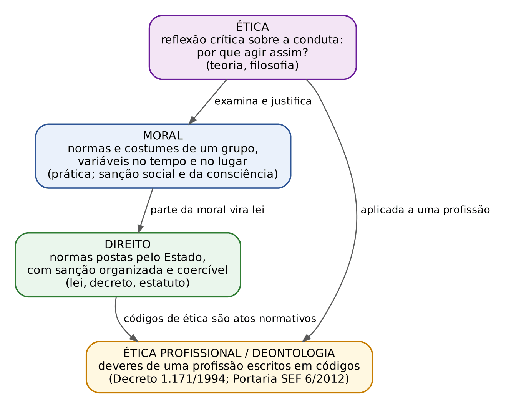
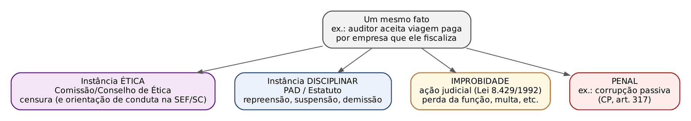
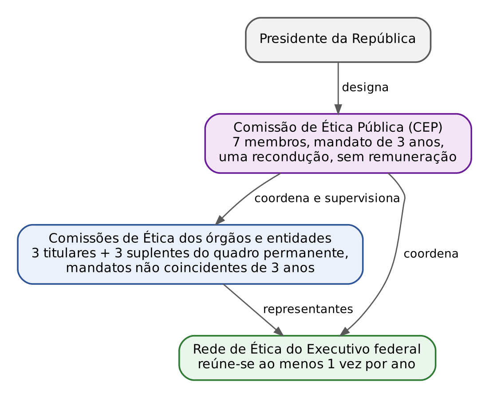
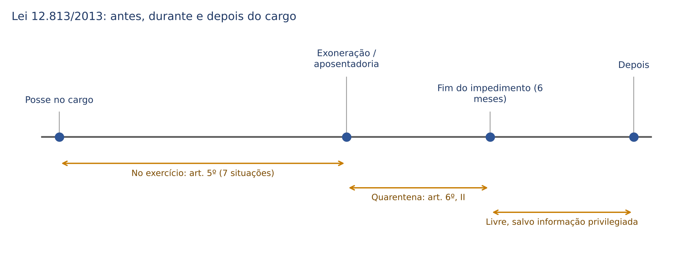
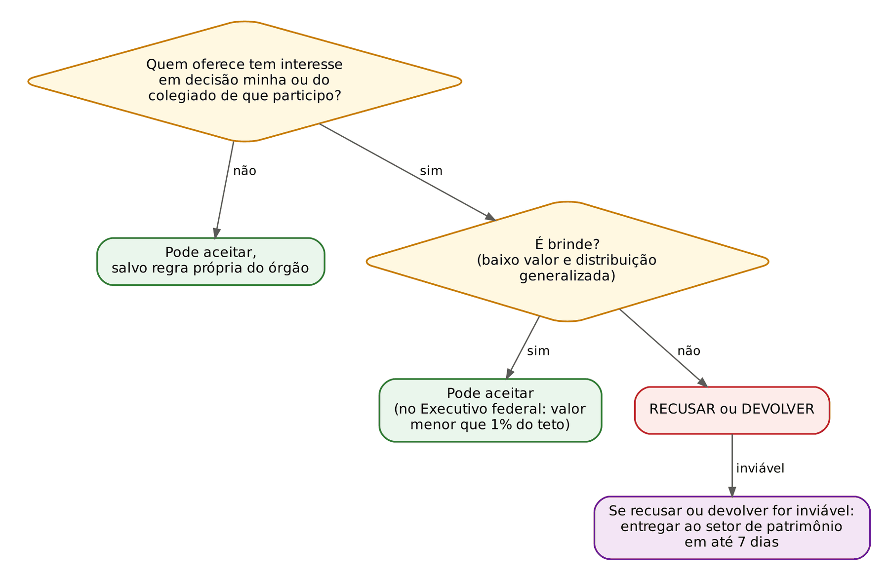
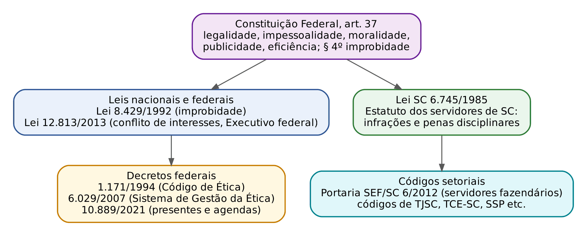

# CAPÍTULO 27 — ÉTICA NO SETOR PÚBLICO: CONCEITOS, PRINCÍPIOS, DEVERES E VEDAÇÕES (CÓDIGO DE ÉTICA FEDERAL, LEI 8.429/1992 NAS LINHAS GERAIS, LEI 12.813/2013 E NORMAS DE SANTA CATARINA)

:::INCIDENCIA
Edital SEFAZ/SC 01/2026 (FCC) — Ética, Integridade e Prevenção ao Assédio e Discriminação: "Ética no setor público: princípios, deveres e vedações institucionais". Nível A.
Lote do banco usado aqui: 40 questões (FCC 8, FGV 32). A FCC cobra literalidade de códigos de ética (comissões de ética, presentes e brindes, participação em eventos, redes sociais) e conceitos (decoro, civilidade); a FGV cobra o Decreto 1.171/1994 (regras deontológicas, deveres e vedações), conflito de interesses e casos práticos.
:::

:::ESQUEMA O que você vai aprender e o que precisa saber antes
Pré-requisitos: nenhum de matemática. Ajuda conhecer os princípios do art. 37 da Constituição (que o leitor domina) e, para aprofundar, a Apostila de Direito Administrativo (Cap. 12 e 13: estatutos e regime disciplinar, inclusive a Lei SC 6.745/1985; Cap. 27: improbidade).
- 27.1 Ética, moral e direito; valores e princípios; ética profissional (deontologia); grandes teorias éticas; decoro e civilidade.
- 27.2 Os princípios constitucionais da Administração como base da ética pública.
- 27.3 O Código de Ética Profissional do Servidor Público Civil do Poder Executivo Federal (Decreto 1.171/1994): regras deontológicas, deveres, vedações, comissões de ética e censura.
- 27.4 O Sistema de Gestão da Ética do Poder Executivo Federal (Decreto 6.029/2007).
- 27.5 Conflito de interesses (Lei 12.813/2013), quarentena, presentes, brindes e hospitalidades (Decreto 10.889/2021).
- 27.6 Santa Catarina: Estatuto (Lei 6.745/1985), Código de Ética e Disciplina dos Servidores Fazendários (Portaria SEF 6/2012) e códigos de outros órgãos.
- 27.7 Improbidade administrativa nas linhas gerais (Lei 8.429/1992, com a Lei 14.230/2021).
- 27.8 Ética aplicada: dilemas do Fisco e roteiro de decisão.
:::

## 27.1 Ética, moral e direito

### 27.1.1 Três palavras que a prova não deixa confundir

Comece por uma cena. Um auditor fiscal encontra, na saída da repartição, o contador de uma empresa que ele está fiscalizando. O contador oferece carona e, no caminho, um convite para um camarote no jogo de domingo. Nada foi pedido em troca. O auditor pode aceitar?

Para responder, a prova espera que você separe três planos.

- MORAL é o conjunto de regras de comportamento que um grupo social pratica e cobra: "não se aceita presente de quem depende de você", "não se fura fila". É prática, vivida, e muda com o tempo e com o lugar. Sua sanção é social (reprovação, vergonha) e interna (consciência).
- ÉTICA, no sentido técnico das provas, é a reflexão crítica sobre a moral: pergunta POR QUE uma conduta é boa ou má e procura critérios para justificá-la. É a "teoria" da qual a moral é a "prática". Na linguagem comum (e nos códigos), porém, "ética" também é usada como sinônimo de conjunto de deveres de conduta, como em "Código de Ética".
- DIREITO é o conjunto de normas postas pelo Estado, com sanção organizada e aplicada por autoridade (multa, demissão, prisão). Parte das regras morais vira lei; mas nem tudo o que é imoral é ilegal, e nem tudo o que é legal é moral.

Voltando ao auditor: a moral do grupo reprova o camarote; a ética explica por quê (ele cria gratidão e compromete a imparcialidade); e o direito transforma isso em norma (vedação de receber vantagem de quem tem interesse em decisão do agente, como se verá em 27.3 e 27.5). Nos três planos, a resposta é a mesma: não aceitar.

:::DICA Como reconhecer cada conceito no enunciado
- Se o texto fala em costumes, hábitos, regras de um grupo, variação histórica e cultural: é MORAL.
- Se fala em reflexão, fundamentação, juízo crítico, "ciência" ou "filosofia" da conduta: é ÉTICA.
- Se fala em coerção, sanção estatal, lei, obrigatoriedade externa: é DIREITO.
- Se fala em deveres de uma categoria profissional, escritos em código: é ÉTICA PROFISSIONAL ou DEONTOLOGIA (do grego *deon*, "dever").
:::

:::QUESTAO FGV 2025 — EBSERH — Pedagogo (Q3251860)
O problema: um trecho de material do Ministério da Saúde afirma que a moral é um conjunto de normas que regulam as relações em uma sociedade e que, por fazer parte do processo histórico, não é eterna nem imutável, variando entre as sociedades. Pede-se a alternativa que descreve corretamente o trecho.
Gabarito: E (as mudanças históricas influenciam diretamente a forma como os valores morais são construídos).
Resolução: o trecho tem uma tese só: a moral é HISTÓRICA. A alternativa E a reproduz.
Por que as outras erram: A atribui os valores a "dados universais da natureza humana" (o oposto da historicidade); B diz que as normas morais são as mesmas em todas as sociedades (o texto diz que variam); C e D afirmam que algo permanece imutável (a natureza humana em C, os valores em D), quando o texto diz que o ser humano transforma a própria natureza e que a moral muda.
:::

### 27.1.2 Valores, princípios e normas

Três palavras aparecem juntas nos códigos de ética e a FGV gosta de pedir a "conceituação" de cada valor.

- VALOR é aquilo que o grupo considera digno de ser buscado: honestidade, transparência, respeito, colaboração.
- PRINCÍPIO é um mandamento geral que orienta a conduta e a interpretação: legalidade, impessoalidade, moralidade.
- NORMA (ou regra) é o comando específico: "é vedado receber presente de quem tenha interesse em decisão sua".

Exemplo concreto: a Portaria SEF 6/2012, que aprova o Código de Ética e Disciplina dos Servidores Fazendários de Santa Catarina, lista oito VALORES (ética, equidade fiscal, qualidade dos serviços, cidadania, credibilidade, inviolabilidade, autenticidade e invulnerabilidade), remete aos PRINCÍPIOS constitucionais e depois traz as NORMAS (deveres e vedações). Será estudada em 27.6.2.

:::QUESTAO FGV 2026 — NAV Brasil (Q4216375)
O problema: o código de ética de uma estatal define um valor como o "desenvolvimento do senso de responsabilidade mútua e consciência da importância individual e coletiva, atuando com sinergia em torno dos propósitos e das tarefas", tendo em vista os interesses da organização e o bem comum. Qual é o valor?
Gabarito: D (colaboração).
Resolução: a chave está em "responsabilidade mútua", "coletiva" e "sinergia": trabalhar junto. Isso é colaboração.
Por que as outras erram: probidade (A) é honestidade no trato da coisa pública; sustentabilidade (B) envolve o uso responsável de recursos para as gerações futuras; profissionalismo (C) é competência e diligência técnica; integridade (E) é coerência entre valores e conduta. Nenhuma tem o núcleo "atuar em conjunto".
:::

:::QUESTAO FGV 2024 — EBSERH — Residência — Educação Física (Q3349068)
O problema: qual alternativa descreve características éticas de INTEGRIDADE?
Gabarito: B (agir com honestidade, transparência e responsabilidade, mantendo a coerência entre os princípios pessoais e o comportamento profissional).
Resolução: integridade vem de "inteiro": é a pessoa que não se divide, que age como pensa e como diz. A palavra-chave é COERÊNCIA entre princípios e comportamento.
Por que as outras erram: A descreve competência (atualização técnica); C, imparcialidade e justiça; D, respeito e urbanidade; E, sigilo profissional. Todas são valores éticos, mas não são a integridade. O conceito institucional de integridade, como sistema da organização, é tema do Cap. 28.
:::

### 27.1.3 Ética profissional e deontologia

Ética profissional é a aplicação da ética a uma atividade: quais deveres especiais nascem do fato de alguém exercer aquela função? O médico tem dever de sigilo; o juiz, de imparcialidade; o auditor, de independência e de não usar informação privilegiada. Quando esses deveres são escritos num documento, temos um código deontológico, ou código de ética profissional.

Pense no paralelo com o Direito: o Estatuto da Magistratura e o Código de Ética da Magistratura Nacional dizem ao juiz o que ele não pode fazer, mesmo fora do processo (por exemplo, manifestar-se sobre processo pendente). O servidor público civil tem o seu código, o Decreto 1.171/1994 (27.3).

:::QUESTAO FGV 2024 — EBSERH — Residência — Educação Física (Q3349072)
O problema: a ética profissional é definida como o conjunto de princípios que...
Gabarito: A (abrange os padrões de comportamento pessoal e corporativo esperados).
Resolução: a ética profissional é a ética de um grupo de trabalho: ela diz o que se espera da pessoa NO EXERCÍCIO da profissão e da organização. A alternativa A tem os dois elementos: comportamento pessoal e corporativo esperado.
Por que as outras erram: B fala em guiar "os indivíduos de uma sociedade" (é a moral social, ampla demais); C descreve a ética como reflexão geral sobre condutas humanas (é a ética filosófica, não a profissional); D vincula o certo e o errado a "uma determinada crença" (relativismo religioso); E fala em "harmonia espiritual" (religião, não ética profissional).
:::

:::QUESTAO FGV 2024 — SEDUC-SP — Professor — Gestão e Negócios (Q3040402)
O problema: a partir da definição de ética como "aprender o que é certo e o que é errado e fazer o certo", julgue três ações: (I) empresa elabora código de conduta com participação de todos os departamentos; (II) dirigentes ignoram itens do código para fechar contrato lucrativo e urgente; (III) diretor financeiro manda lançar dívidas no ano seguinte para melhorar o balanço e garantir bônus.
Gabarito: A (I, apenas).
Resolução: (I) é ética: o código construído com todos gera representatividade e comprometimento. (II) não é: o código não pode ser suspenso quando atrapalha o lucro; ética "conforme a conveniência" não é ética. (III) não é: é fraude contábil, que engana investidores para obter vantagem pessoal.
Armadilha: a alternativa D (I e II) atrai quem aceita o argumento da urgência. A regra prática: pressão por resultado nunca autoriza afastar o código.
:::

### 27.1.4 As grandes teorias éticas (noção para as questões de dilema)

Questões de dilema perguntam "qual teoria o agente seguiu". Basta reconhecer três famílias.

- Ética do DEVER (deontológica, associada a Kant): a ação é certa ou errada em si mesma, conforme obedeça a um dever, independentemente das consequências. "Não minto, mesmo que a mentira traga um bem."
- Ética das CONSEQUÊNCIAS (utilitarismo, associado a Bentham e Mill): a ação certa é a que produz o maior bem para o maior número de pessoas.
- Ética das VIRTUDES (associada a Aristóteles): o foco é o caráter; a pergunta é "o que faria uma pessoa virtuosa (justa, prudente, corajosa)?".

Exemplo: o Fisco tem uma equipe para fiscalizar apenas um de dois setores. Escolher o setor em que a sonegação estimada atinge mais contribuintes honestos (concorrência desleal) é raciocínio utilitarista; escolher pelo dever de tratar igualmente quem está na mesma situação é raciocínio deontológico.

:::QUESTAO FGV 2024 — dilema na distribuição de recursos (Q2458600)
O problema: após uma enchente, um servidor tem recursos insuficientes para atender um orfanato e um hospital que atende toda a comunidade. Ele aderiu à ética utilitarista se optou por...
Gabarito: B (o caminho capaz de favorecer o maior número possível de pessoas afetadas). Gabarito oficial conferido no QConcursos em 30/10/2026, coincidente com a resposta que a teoria indica.
Resolução: utilitarismo é cálculo de consequências: maximizar o bem-estar total. O hospital atende toda a comunidade; favorecer o maior número é a assinatura da teoria.
Por que as outras erram: A fala em "agir conforme o dever e o princípio moral" (ética deontológica); C fala em "cultivo das virtudes cívicas" (ética das virtudes); D fala em distribuir igualmente sem favorecer ninguém (critério de equidade, não de maximização).
:::

### 27.1.5 Decoro e civilidade

Dois conceitos aparecem nos códigos e na FCC.

- DECORO é a conduta compatível com a dignidade do cargo, aquela que a sociedade reconhece como correta e adequada para quem exerce função pública. Tem dimensão interna (retidão do agir) e externa (a percepção pública). O Decreto 1.171/1994 abre com ele: "A dignidade, o decoro, o zelo, a eficácia e a consciência dos princípios morais são primados maiores" (regra I).
- CIVILIDADE é a disposição de conviver com o diferente de forma respeitosa: justificar publicamente as próprias ações e tratar o outro como igual, acomodando divergências. Está próxima da urbanidade (cortesia no trato).

:::QUESTAO FCC 2024 — TRT 11ª Região — Analista Judiciário — Área Administrativa (Q2400714)
O problema: decoro e civilidade são qualidades ligadas à natureza ético-política do serviço público. Qual alternativa as define corretamente?
Gabarito: D (decoro compreende a retidão de uma ação e a visão da sociedade que a toma por correta; civilidade revela a disposição em justificar publicamente as próprias ações e agir de modo a acomodar as diferenças). Gabarito oficial conferido no QConcursos em 30/10/2026, coincidente com a alternativa que a apostila já apontava como tecnicamente defensável.
Resolução: as definições de D casam com os conceitos acima: o decoro tem um lado interno (retidão) e um externo (aprovação social); a civilidade é a virtude da convivência democrática, que inclui prestar contas publicamente e respeitar diferenças.
Por que as outras erram: A, B, C e E tentam separar os conceitos pelo destinatário ("pares" x "administrados") ou dizem que o decoro é "unicamente interno" (B, E) ou "principalmente externo" (C). O decoro não é só interno nem só externo, e a civilidade não se restringe ao trato com colegas. A FCC gosta dessa troca de destinatários: desconfie de alternativas que reduzem um conceito amplo a um único público.
:::

:::QUESTAO FGV 2025 — Prefeitura de Niterói — Administrador (Q3658179)
O problema: uma organização com código de conduta robusto enfrenta questionamentos sobre a imparcialidade de um algoritmo de inteligência artificial usado na triagem de currículos, situação que o código não previa. Os gestores divergem. O que a organização enfrentou?
Gabarito: B (limitações éticas ligadas a novos dilemas não contemplados pelas normas vigentes, que exigem práticas cotidianas de responsabilidade social e valorização da diversidade).
Resolução: nenhum código prevê tudo. Quando surge situação nova, a ética exige raciocínio a partir de valores (imparcialidade, diversidade), e não apenas consulta à regra escrita. O Decreto 6.029/2007 tem a mesma lógica: a comissão de ética não pode deixar de decidir alegando omissão do código; supre a lacuna por analogia e pelos princípios (art. 16, ver 27.4).
Por que as outras erram: A reduz o caso a falha operacional de estratégia; C chama de problema "exclusivamente jurídico"; D defende parâmetros éticos flexíveis por competitividade; E culpa apenas a equipe de TI. Vieses de algoritmos e responsabilidade humana pela decisão são estudados no Cap. 25.
:::

:::PRATIQUE exercícios elaborados para esta apostila
1) Classifique cada afirmação como moral, ética ou direito: (a) "Nesta repartição, ninguém sai antes do chefe." (b) "Aceitar presente de contribuinte compromete a imparcialidade, e por isso é errado mesmo que o presente seja barato." (c) "O servidor que revelar segredo de que teve ciência em razão do cargo será demitido."
2) Um auditor decide não autuar uma pequena empresa familiar que errou de boa-fé, porque "a autuação quebraria a empresa e geraria desemprego". Que tipo de raciocínio ético ele usou e qual o problema jurídico dessa escolha?
3) Verdadeiro ou falso: "Se uma conduta não é proibida por lei, ela é ética."
Resolução:
1) (a) Moral: é um costume do grupo, sem fundamentação nem sanção estatal. (b) Ética: há reflexão e justificação (o PORQUÊ: imparcialidade). (c) Direito: comando com sanção estatal organizada (demissão), como no Estatuto catarinense (ver 27.6.1).
2) Raciocínio utilitarista (consequências: emprego, sobrevivência da empresa). O problema é que o lançamento tributário é atividade administrativa vinculada (CTN, art. 3º e art. 142, parágrafo único): o auditor não tem discricionariedade para deixar de autuar por razões de conveniência. A ética do servidor público não pode ser usada para afastar a lei; o Decreto 1.171/1994 exige equilíbrio entre legalidade e finalidade (regra III).
3) Falso. A regra II do Decreto 1.171/1994 diz que o servidor não decide apenas entre o legal e o ilegal, mas principalmente entre o honesto e o desonesto. Há condutas lícitas e, ainda assim, antiéticas (por exemplo, usar o horário de expediente para assuntos particulares de forma reiterada sem que haja regra específica).
:::

## 27.2 Os princípios constitucionais como base da ética pública

### 27.2.1 O art. 37 como "código de ética" da Constituição

O art. 37, *caput*, da Constituição impõe à Administração direta e indireta de todos os Poderes e entes os princípios da legalidade, impessoalidade, moralidade, publicidade e eficiência (o famoso LIMPE). Todos os códigos de ética do serviço público começam por eles: o Decreto 1.171/1994 invoca o art. 37 no preâmbulo e na regra II; a Portaria SEF 6/2012 os repete no art. 3º, acrescentando supremacia e indisponibilidade do interesse público e continuidade do serviço público.

O leitor domina o conteúdo jurídico desses princípios (Apostila de Direito Administrativo, Cap. 2). Aqui interessa a leitura ÉTICA de cada um, que é como as questões de conhecimentos gerais os cobram.

| Princípio | Leitura ética | Exemplo no Fisco |
|---|---|---|
| Legalidade | Agir só como a lei autoriza; não usar o cargo para fins que a lei não dá | Auditor não pode "negociar" o valor do auto de infração |
| Impessoalidade | Tratar todos igualmente; não promover a si nem perseguir ninguém | Escolher empresas para fiscalizar por critérios de risco, não por amizade ou inimizade |
| Moralidade | Honestidade, boa-fé, lealdade; o ato pode ser legal e ainda assim imoral | Acelerar o processo do conhecido "porque a lei não proíbe" |
| Publicidade | Transparência como regra; sigilo só nas hipóteses legais | Divulgar dados de arrecadação; preservar o sigilo fiscal do contribuinte (CTN, art. 198) |
| Eficiência | Fazer bem, rápido e com economia; atender sem filas e sem demora | Responder consultas no prazo; usar tecnologia disponível |

:::ATENCAO Moralidade não é o mesmo que legalidade
A regra III do Decreto 1.171/1994 diz que a moralidade "não se limita à distinção entre o bem e o mal, devendo ser acrescida da idéia de que o fim é sempre o bem comum", e que o equilíbrio entre a legalidade e a finalidade é que consolida a moralidade do ato. A FGV troca essa frase por "o servidor consolida a moralidade na medida em que atende estritamente aos comandos legais" (Q2515930, alternativa C, em 27.3.2). Está errado: cumprir a lei é necessário, mas não basta.
:::

### 27.2.2 Publicidade e verdade

Duas regras do Decreto 1.171/1994 traduzem a publicidade em dever pessoal do servidor:

- regra VII: salvo segurança nacional, investigações policiais ou interesse superior do Estado e da Administração, a serem preservados em processo previamente declarado sigiloso, nos termos da lei, a publicidade de qualquer ato administrativo é requisito de eficácia e moralidade, e sua omissão é comprometimento ético imputável a quem a negar;
- regra VIII: toda pessoa tem direito à verdade; o servidor não pode omiti-la ou falseá-la, ainda que contrária aos interesses da própria pessoa interessada ou da Administração.

Note a ressalva da regra VII: o sigilo depende de processo "previamente declarado sigiloso, nos termos da lei". Não é escolha livre do administrador. No Fisco, o sigilo fiscal decorre de lei (CTN, art. 198) e a Lei de Acesso à Informação (Lei 12.527/2011) disciplina as demais restrições.

:::PEGADINHA Três trocas clássicas nas regras deontológicas
- "O servidor deve omitir a verdade quando contrária ao interesse da Administração": ERRADO. A regra VIII diz o contrário: não pode omitir NEM falsear, ainda que contrária ao interesse da própria pessoa ou da Administração.
- "A publicidade constitui falta grave": ERRADO. A publicidade é requisito de eficácia e moralidade; a falta ética está em NEGÁ-LA.
- "O sigilo se submete à discricionariedade da Administração": ERRADO. Só nas hipóteses da regra VII, em processo previamente declarado sigiloso, nos termos da lei.
:::

## 27.3 O Código de Ética Profissional do Servidor Público Civil do Poder Executivo Federal (Decreto 1.171/1994)

### 27.3.1 Por que estudar um código federal para um concurso estadual

O Decreto 1.171, de 22/6/1994, vale formalmente apenas para o Poder Executivo federal. Mesmo assim, é o código de ética mais cobrado do país, por três razões: foi o primeiro e serviu de modelo para quase todos os códigos estaduais, municipais e de tribunais (inclusive o da SEF/SC, que copia vários dos seus incisos, como se verá em 27.6.2); as bancas o usam como "ética do servidor público em geral"; e ele é curto e literal, ótimo para questões. Na prova da SEFAZ/SC, espere que o examinador trate suas regras como padrão de conduta de qualquer agente público.

Estrutura do Anexo (atenção: o código usa incisos em algarismos romanos, e não artigos):

| Parte | Incisos | Conteúdo |
|---|---|---|
| Capítulo I, Seção I | I a XIII | Regras deontológicas (os "porquês" da conduta ética) |
| Capítulo I, Seção II | XIV, alíneas a a v | Principais deveres do servidor |
| Capítulo I, Seção III | XV, alíneas a a p | Vedações ao servidor |
| Capítulo II | XVI a XXV | Comissões de ética (vários incisos revogados pelo Decreto 6.029/2007) |

### 27.3.2 Regras deontológicas (incisos I a XIII)

São textos longos e um tanto retóricos. A prova cobra a literalidade de poucas frases. Guarde a ideia de cada uma, com a palavra-chave em maiúsculas:

- I: dignidade, DECORO, zelo, eficácia e consciência dos princípios morais devem nortear o servidor no exercício do cargo OU FORA DELE.
- II: o servidor não decide só entre legal e ilegal, justo e injusto, conveniente e inconveniente, oportuno e inoportuno, mas principalmente entre o HONESTO e o DESONESTO.
- III: moralidade = legalidade + FINALIDADE (bem comum).
- IV: a remuneração é custeada pelos TRIBUTOS pagos por todos, inclusive pelo próprio servidor; por isso a moralidade integra o Direito.
- V: o trabalho do servidor é acréscimo ao seu próprio bem-estar, já que ele também é cidadão.
- VI: a função pública se INTEGRA na vida particular; atos da vida privada podem acrescer ou diminuir o bom conceito funcional.
- VII: PUBLICIDADE como regra (27.2.2).
- VIII: direito à VERDADE (27.2.2).
- IX: tratar mal quem paga tributos é causar-lhe DANO MORAL; danificar bem público ofende todos os que o construíram.
- X: deixar pessoas à espera, permitindo longas FILAS, é grave dano moral aos usuários.
- XI: atenção às ordens LEGAIS dos superiores; repetidos erros e descaso caracterizam até imprudência.
- XII: toda ausência INJUSTIFICADA é fator de desmoralização do serviço.
- XIII: trabalhar em HARMONIA com a estrutura e os colegas.

:::LEI Decreto 1.171/1994, Anexo, incisos II e VI
II - O servidor público não poderá jamais desprezar o elemento ético de sua conduta. Assim, não terá que decidir somente entre o legal e o ilegal, o justo e o injusto, o conveniente e o inconveniente, o oportuno e o inoportuno, mas principalmente entre o honesto e o desonesto, consoante as regras contidas no art. 37, caput, e § 4°, da Constituição Federal.
VI - A função pública deve ser tida como exercício profissional e, portanto, se integra na vida particular de cada servidor público. Assim, os fatos e atos verificados na conduta do dia-a-dia em sua vida privada poderão acrescer ou diminuir o seu bom conceito na vida funcional.
:::

:::PEGADINHA As palavras que a banca troca
- Regra VI: a função "se INTEGRA" na vida particular. A banca escreve "é DISSOCIADA" e conclui que a vida privada "não pode" influir no conceito funcional. Falso.
- Regra XI: atenção às ordens LEGAIS. A banca escreve que o servidor "não precisa" cumprir ordens que considere contrárias à eficiência. Falso: o critério é a legalidade da ordem, não a opinião do servidor sobre eficiência.
- Regra XII: só a ausência INJUSTIFICADA desmoraliza. A banca escreve "mesmo quando justificadas, são passíveis de punição". Falso.
:::

:::QUESTAO FGV 2025 — CPRM — Analista em Geociências — Comunicação (Q3758216)
O problema: segundo o Decreto 1.171/1994, qual afirmação é correta?
Gabarito: A (a função pública, tida como exercício profissional, se integra na vida particular do servidor, e os atos da vida privada podem acrescer ou diminuir seu bom conceito funcional).
Resolução: A é a regra VI, quase literal.
Por que as outras erram: B inverte a regra VIII (o servidor NÃO pode omitir a verdade); C inverte a regra VII (a publicidade é requisito de eficácia e moralidade, não falta grave); D contraria a regra XII (só a ausência INJUSTIFICADA desmoraliza); E contraria o inciso XV, c, que veda ser conivente, por espírito de solidariedade, com erro ou infração ao Código de Ética do servidor OU ao código de ética da sua profissão.
:::

:::QUESTAO FGV 2024 — CVM — Inspetor — Perfil 1 (Q2515930)
O problema: Carmela, aprovada na CVM, revisou as regras deontológicas do Decreto 1.171/1994. Qual conclusão está correta?
Gabarito: D (toda pessoa tem direito à verdade; o servidor não pode omiti-la ou falseá-la, ainda que contrária aos interesses da própria pessoa interessada ou da Administração). Gabarito oficial conferido no QConcursos em 30/10/2026, coincidente com a letra do decreto.
Resolução: D reproduz a regra VIII.
Por que as outras erram: A troca "ordens legais" por um juízo do servidor sobre eficiência (regra XI); B diz que a função é "dissociada" da vida particular (regra VI diz que se integra); C diz que a moralidade se consolida no estrito cumprimento da lei (a regra III exige equilíbrio entre legalidade e finalidade); E diz que o sigilo fica na discricionariedade da Administração (a regra VII o limita às hipóteses legais, em processo previamente declarado sigiloso).
:::

### 27.3.3 Os deveres fundamentais (inciso XIV)

São 21 alíneas (a a v, sem "k"). Para memorizar, agrupe-as por "tema":

| Grupo | Alíneas | Conteúdo resumido |
|---|---|---|
| Rapidez e qualidade | a, b, r, s | desempenhar a tempo; rapidez, perfeição e rendimento, evitando filas; cumprir tarefas com critério, segurança e rapidez; facilitar a fiscalização por quem de direito |
| Caráter | c, d, f | ser probo, reto, leal e justo, escolhendo a opção melhor para o bem comum; jamais retardar prestação de contas; consciência dos princípios éticos |
| Trato com o público | e, g, t | tratar cuidadosamente os usuários; cortesia, urbanidade, sem preconceito de raça, sexo, nacionalidade, cor, idade, religião, cunho político ou posição social; exercer prerrogativas com ESTRITA MODERAÇÃO |
| Hierarquia e coragem | h, i, m | respeito à hierarquia sem temor de representar; RESISTIR a pressões de superiores, contratantes e interessados que visem vantagens indevidas, e DENUNCIÁ-LAS; comunicar imediatamente aos superiores atos contrários ao interesse público |
| Greve | j | no exercício do direito de greve, zelar pelas exigências da defesa da vida e da segurança coletiva |
| Assiduidade e ambiente | l, n, p | ser assíduo e frequente; manter limpo o local de trabalho; vestimentas adequadas |
| Atualização e melhoria | o, q, v | participar de estudos de melhoria; manter-se atualizado com normas; divulgar o Código entre os colegas |
| Finalidade | u | abster-se, de forma absoluta, de exercer função, poder ou autoridade com finalidade estranha ao interesse público, MESMO que observando as formalidades legais |

:::DICA A alínea u e o desvio de finalidade
A alínea u é a versão ética do desvio de finalidade: o ato formalmente perfeito, praticado para perseguir ou favorecer alguém, viola o dever ético mesmo sem "violação expressa à lei". Quando o enunciado disser "observou todas as formalidades, mas agiu por motivo pessoal", pense em XIV, u.
:::

:::QUESTAO FGV 2025 — CPRM — Analista em Geociências — Administração (Q3754789)
O problema: indicar a alternativa que NÃO é dever fundamental do servidor segundo o Decreto 1.171/1994.
Gabarito: B (dar o seu concurso a qualquer instituição que atente contra a moral).
Resolução: "dar o seu concurso" (isto é, colaborar com) instituição que atente contra a moral, a honestidade ou a dignidade da pessoa humana é VEDAÇÃO (XV, o), não dever. A banca transplantou uma vedação para a lista de deveres.
As demais são deveres literais: facilitar a fiscalização (XIV, s); estrita moderação nas prerrogativas (XIV, t); zelar, na greve, pela defesa da vida e da segurança coletiva (XIV, j); resistir a pressões de superiores (XIV, i).
:::

### 27.3.4 As vedações (inciso XV)

São 15 alíneas (a a p, sem "k"). Leia-as como "proibições com cara de caso concreto":

- a) usar cargo, função, facilidades, amizades, tempo, posição e influências para obter favorecimento para si ou para outrem;
- b) prejudicar deliberadamente a reputação de outros servidores ou de cidadãos;
- c) ser, por espírito de solidariedade, conivente com erro ou infração a este Código ou ao código de ética de sua profissão;
- d) usar artifícios para procrastinar ou dificultar o exercício regular de direito, causando dano moral ou material;
- e) deixar de utilizar os avanços técnicos e científicos ao seu alcance;
- f) permitir que perseguições, simpatias, antipatias, caprichos, paixões ou interesses pessoais interfiram no trato com o público ou com colegas;
- g) pleitear, solicitar, provocar, sugerir ou receber ajuda financeira, gratificação, prêmio, comissão, doação ou vantagem de qualquer espécie, para si, familiares ou qualquer pessoa, para cumprir sua missão ou influenciar outro servidor;
- h) alterar ou deturpar o teor de documentos que deva encaminhar para providências;
- i) iludir ou tentar iludir quem necessite de atendimento;
- j) desviar servidor público para atendimento a interesse particular;
- l) retirar da repartição, sem autorização legal, documento, livro ou bem público;
- m) usar informações privilegiadas obtidas no serviço em benefício próprio, de parentes, amigos ou terceiros;
- n) apresentar-se embriagado no serviço ou fora dele HABITUALMENTE;
- o) dar o seu concurso a instituição que atente contra a moral, a honestidade ou a dignidade da pessoa humana;
- p) exercer atividade profissional aética ou ligar o seu nome a empreendimentos de cunho duvidoso.

:::PEGADINHA Embriaguez: "no serviço ou fora dele habitualmente"
A alínea n veda apresentar-se embriagado no serviço ou fora dele HABITUALMENTE. Fora do serviço, o que se veda é a habitualidade, não o episódio isolado. A banca costuma montar casos de servidor que "vem se apresentando habitualmente embriagado fora do serviço": é vedação.
:::

:::QUESTAO FGV 2026 — AL-RO — Analista Legislativo — Área Administrativa (Q3880464)
O problema: quais condutas correspondem a VEDAÇÕES do Decreto 1.171/1994? (I) Antônio alterou documento que deveria encaminhar para providência; (II) Beatriz vem se apresentando habitualmente embriagada fora do serviço; (III) Cláudia resistiu à pressão de superior que visava benesse por ação imoral; (IV) Diogo absteve-se de exercer sua função de forma estranha ao interesse público, mesmo observando as formalidades legais.
Gabarito: A (Antônio e Beatriz).
Resolução, item por item:
- (I) Vedação do XV, h (alterar ou deturpar documento a encaminhar). Entra.
- (II) Vedação do XV, n (embriaguez habitual fora do serviço). Entra.
- (III) Cláudia CUMPRIU o dever do XIV, i (resistir a pressões). Não é vedação.
- (IV) Diogo CUMPRIU o dever do XIV, u (abster-se de finalidade estranha ao interesse público). Não é vedação.
Armadilha: a banca descreve III e IV com palavras que lembram condutas reprováveis ("pressão", "forma estranha ao interesse público"), mas o verbo é positivo (resistiu, absteve-se). Leia sempre o VERBO.
:::

:::QUESTAO FGV 2026 — MPE-ES — Agente Técnico — Pedagogo (Q4218843)
O problema: uma servidora que analisava a execução de um contrato percebeu inconsistências; recusou formalmente curso gratuito oferecido pelo fornecedor interessado na renovação, mas não registrou que já havia prestado consultoria particular à empresa no ano anterior e, para evitar conflito com a chefia, redigiu relatório genérico, omitindo dados que comprometeriam o contrato. Qual dever ela violou principalmente?
Gabarito: E (informar o conflito de interesses, manifestar-se com precisão e objetividade e resguardar o interesse público).
Resolução: há três falhas. (1) Ter prestado consultoria à empresa é situação de conflito de interesses que precisava ser declarada (ver 27.5; no Executivo federal, Lei 12.813/2013, art. 5º, II, e dever de consultar a CEP ou a CGU em caso de dúvida). (2) Omitir dados viola a verdade (regra VIII) e o dever de ser probo, reto, leal e justo (XIV, c). (3) Ceder à chefia viola o dever de resistir a pressões (XIV, i).
Por que as outras erram: C só valoriza o que ela fez certo (recusar a vantagem), mas deixa de lado as omissões; A, B e D elogiam exatamente as condutas erradas (proteger a imagem do órgão, preservar o fornecedor, adotar "linguagem prudente" e submeter-se à chefia).
:::

### 27.3.5 Comissões de ética e a pena de censura (incisos XVI a XXV)

O Capítulo II do Código foi parcialmente revogado pelo Decreto 6.029/2007 (que revogou os incisos XVII, XIX, XX, XXI, XXIII e XXV, ver 27.4). Continuam em vigor:

- XVI: em todos os órgãos e entidades da Administração federal direta, indireta autárquica e fundacional, ou que exerçam atribuições delegadas, deve existir Comissão de Ética, para orientar e aconselhar sobre a ética profissional do servidor e conhecer de imputação ou procedimento suscetível de censura.
- XVIII: a Comissão fornece aos órgãos de carreira os registros sobre a conduta ética do servidor, para instruir promoções e demais procedimentos da carreira.
- XXII: a pena aplicável pela Comissão de Ética é a de CENSURA, com fundamentação em parecer assinado por todos os integrantes e ciência do faltoso.
- XXIV: para fins de apuração ética, servidor público é todo aquele que, por lei, contrato ou qualquer ato jurídico, preste serviços de natureza permanente, temporária ou excepcional, ainda que sem retribuição financeira, ligado direta ou indiretamente a órgão estatal, inclusive entidades paraestatais, empresas públicas e sociedades de economia mista.

O art. 2º do decreto (fora do Anexo) previa comissão de três servidores ou empregados titulares de cargo efetivo ou emprego permanente.

:::ATENCAO A única pena ética é a censura
A comissão de ética NÃO demite, não suspende, não adverte. Sua pena é a censura (XXII). Se a conduta também for infração disciplinar, crime ou improbidade, a comissão encaminha cópia às autoridades competentes (Decreto 6.029/2007, art. 17) e pode sugerir exoneração de cargo em comissão ou função de confiança (art. 12, § 5º, I). A Portaria SEF 6/2012 acrescenta, em SC, a "orientação de conduta" para os casos de inexistência de dolo (27.6.2).
:::

## 27.4 O Sistema de Gestão da Ética do Poder Executivo Federal (Decreto 6.029/2007)

### 27.4.1 Quem integra o sistema

O Decreto 6.029, de 1º/2/2007, organizou as comissões de ética em sistema. Integram-no (art. 2º): a Comissão de Ética Pública (CEP), as comissões de ética do Decreto 1.171/1994 e as demais comissões de ética e equivalentes nos órgãos e entidades do Executivo federal.

| Órgão | Composição | Competências principais |
|---|---|---|
| CEP (art. 3º e 4º) | 7 brasileiros de idoneidade moral, reputação ilibada e notória experiência em administração pública, designados pelo Presidente da República; mandatos de 3 anos, não coincidentes, uma única recondução; sem remuneração (relevante serviço público); o presidente tem voto de qualidade | Instância consultiva do Presidente e dos Ministros; administra o Código de Conduta da Alta Administração Federal; dirime dúvidas sobre o Decreto 1.171/1994; coordena e supervisiona o sistema |
| Comissões de Ética setoriais (art. 5º e 7º) | 3 titulares e 3 suplentes do quadro permanente, designados pelo dirigente máximo, mandatos não coincidentes de 3 anos | Consultiva no órgão; aplica o Decreto 1.171/1994 (dirime dúvidas, apura de ofício ou por denúncia); promove capacitação; representa o órgão na Rede de Ética; supervisiona o Código de Conduta da Alta Administração e comunica à CEP |
| Rede de Ética (art. 9º) | Representantes das comissões | Cooperação técnica; reúne-se sob coordenação da CEP pelo menos uma vez por ano |

### 27.4.2 O procedimento ético

- Quem pode provocar (art. 11): qualquer cidadão, agente público, pessoa jurídica de direito privado, associação ou entidade de classe.
- Princípios (art. 10): celeridade; proteção à honra e à imagem do investigado; proteção à identidade do denunciante, mantida sob reserva se ele desejar; independência e imparcialidade dos membros.
- Rito (art. 12): instauração de ofício ou por denúncia fundamentada, com contraditório e ampla defesa; o investigado é notificado para se manifestar por escrito em 10 dias; nova manifestação em 10 dias se surgirem novas provas; decisão conclusiva e fundamentada.
- Providências se houver falta ética (art. 12, § 5º): sugestão de exoneração de cargo ou função de confiança, ou devolução ao órgão de origem; encaminhamento à CGU ou ao sistema de correição; recomendação de abertura de procedimento administrativo.
- Sigilo (art. 13): o procedimento tem a chancela de "reservado" ATÉ A CONCLUSÃO; depois, os autos deixam de ser reservados.
- Direito do investigado (art. 14): saber o que lhe é imputado e ter vista dos autos, mesmo antes de notificado, com direito a cópia e certidão.
- Compromisso solene (art. 15): na posse, investidura ou contratação.
- Lacuna (art. 16): a comissão não pode deixar de decidir alegando omissão do código; supre-a pela analogia e pelos princípios da legalidade, impessoalidade, moralidade, publicidade e eficiência.
- Ementas (art. 18): as decisões são resumidas em ementa e divulgadas no sítio do órgão, com OMISSÃO dos nomes dos investigados.
- Trabalho na comissão (art. 19): é considerado relevante e tem PRIORIDADE sobre as atribuições próprias dos cargos dos membros, quando não atuarem com exclusividade.
- Infração ética de membro de comissão setorial (art. 21): apurada pela CEP.
- Banco de dados de sanções (art. 22): mantido pela CEP, para consulta em nomeações para cargos em comissão ou de alta relevância.

:::PEGADINHA Sigilo do procedimento ético
O procedimento é RESERVADO até ser concluído; não é sigiloso para sempre. E a identidade do denunciante é preservada se ele assim desejar. Já a decisão é divulgada em EMENTA SEM OS NOMES dos investigados. A banca mistura: "a decisão será publicada com o nome do investigado" (errado) ou "o procedimento será sempre sigiloso" (errado).
:::

:::QUESTAO FCC 2025 — TRT 15ª Região — Analista Judiciário — Área Administrativa (Q3303217)
O problema: segundo o Código de Ética dos Servidores do TRT15, os integrantes da Comissão de Ética...
Gabarito: B (desempenharão suas atribuições concomitantemente com as de seus respectivos cargos).
Resolução: o código do tribunal segue a lógica do modelo federal: membro de comissão de ética NÃO se afasta do cargo nem ganha remuneração extra; acumula a função com as tarefas do cargo, com prioridade para os trabalhos da comissão (no modelo federal, Decreto 6.029/2007, art. 19, e, para a CEP, art. 3º, § 1º).
Por que as outras erram: E (remunerados) contraria a gratuidade típica; A (mandato vedada recondução) e C (escolha integral pelo Presidente) e D (composição obrigatória por graus de jurisdição) são detalhes inventados pela banca, que a resposta correta dispensa conhecer. Lição de prova: quando não souber o código específico, aplique o modelo federal.
No mesmo sentido, com as alternativas em outra ordem: Q3290552 (FCC 2025, TRT15, Analista — TI), gabarito E.
:::

:::QUESTAO FCC 2025 — TRT 15ª Região — Analista Judiciário — TI (Q3290553)
O problema: instaurado processo ético contra Ares, ocupante de cargo em comissão no TRT15, a Comissão de Ética deve comunicar-lhe a instauração com imediata ciência a qual autoridade?
Gabarito: A (Presidente do Tribunal).
Resolução: o investigado ocupa cargo em comissão, isto é, de livre nomeação e exoneração pela autoridade máxima. Por isso a autoridade que precisa saber de imediato é a que nomeia e pode exonerar: o Presidente do Tribunal. É a mesma lógica do Decreto 6.029/2007, art. 12, § 5º, I, que prevê sugestão de exoneração do cargo de confiança "à autoridade hierarquicamente superior".
Por que as outras erram: Presidente da República (B) não tem relação com servidor do Judiciário; Diretor-Geral e Secretários (C, D, E) são autoridades administrativas subordinadas ao Presidente.
:::

:::QUESTAO FGV 2026 — Código de Ética do Executivo do Estado do Rio de Janeiro (Q3881057)
O problema: Maria quer encaminhar peças para apurar a conduta de colega que não exercia com estrita moderação suas prerrogativas (dever previsto no código fluminense, igual ao XIV, t, do decreto federal). Quem apura?
Gabarito: E (comissão de ética setorial, constituída na Secretaria, com três servidores titulares de cargo efetivo ou emprego permanente, designados pelo dirigente).
Resolução: o modelo é o federal: cada órgão tem comissão de ética com três membros do quadro permanente, designados pelo dirigente (Decreto 1.171/1994, art. 2º; Decreto 6.029/2007, art. 5º).
Por que as outras erram: B leva a apuração ética ao superior hierárquico (a ética tem instância própria); C confunde com a comissão de inquérito disciplinar; A e D trazem composição de cinco membros e "comissão temporária", que não existem no modelo.
:::

:::QUESTAO FGV 2025 — EBSERH — Comissão de Ética (Q3249358)
O problema: a Comissão de Ética da EBSERH é órgão autônomo de caráter...
Gabarito: A (deliberativo, cabendo-lhe deliberar sobre condutas antiéticas e transgressões das normas levadas ao seu conhecimento).
Resolução: comissão de ética orienta, aconselha E delibera (decide) sobre condutas antiéticas; por isso "deliberativo".
Por que as outras erram: B fala em controle social e apoio a medidas disciplinares (a comissão não aplica pena disciplinar); C, D e E descrevem funções de conselho fiscal, comitê de pessoas e comitê de riscos, órgãos de governança de estatais (Lei 13.303/2016), não de comissão de ética.
:::

:::PRATIQUE exercícios elaborados para esta apostila
1) Uma denúncia anônima sem nenhum elemento de prova chega à Comissão de Ética de um órgão federal. Ela é obrigada a instaurar procedimento?
2) O servidor investigado descobre, por um colega, que há procedimento ético contra ele, mas ainda não foi notificado. Pode ver os autos?
3) Concluído o procedimento com censura, a comissão quer publicar no sítio do órgão a decisão com o nome do servidor "para servir de exemplo". Pode?
Resolução:
1) Não. O art. 12 do Decreto 6.029/2007 exige instauração de ofício OU por denúncia FUNDAMENTADA. Sem elementos mínimos, a comissão pode arquivar; se ela própria vislumbrar indícios, pode agir de ofício.
2) Sim. O art. 14 assegura vista dos autos, no recinto da comissão, mesmo antes da notificação, com direito a cópia e certidão.
3) Não. O art. 18 manda divulgar a decisão em ementa, com omissão dos nomes dos investigados. A censura fica registrada nos assentamentos e no banco de dados da CEP (art. 22), não exposta ao público.
:::

## 27.5 Conflito de interesses (Lei 12.813/2013) e presentes (Decreto 10.889/2021)

### 27.5.1 A ideia: dois chapéus na mesma cabeça

Imagine um Auditor Estadual de Finanças Públicas cuja esposa é sócia de uma distribuidora de combustíveis. Um dia, cai em suas mãos a fiscalização dessa distribuidora. Ele ainda não fez nada errado. Mas está numa situação em que o interesse privado (o patrimônio da família) pode influenciar o interesse público (lançar corretamente o tributo). Isso é conflito de interesses: um RISCO, que precisa ser evitado antes de virar dano.

A Lei 12.813, de 16/5/2013, disciplina o tema no Poder Executivo FEDERAL. Ela não se aplica diretamente ao servidor estadual de Santa Catarina, mas é cobrada como modelo, e suas ideias aparecem nos códigos estaduais (a Portaria SEF 6/2012 manda o fazendário declarar-se impedido quando o caso envolver empresa de parente até o terceiro grau, art. 23, XIX, ver 27.6.2).

:::LEI Lei 12.813/2013, arts. 3º e 4º, § 2º
Art. 3º Para os fins desta Lei, considera-se:
I - conflito de interesses: a situação gerada pelo confronto entre interesses públicos e privados, que possa comprometer o interesse coletivo ou influenciar, de maneira imprópria, o desempenho da função pública; e
II - informação privilegiada: a que diz respeito a assuntos sigilosos ou aquela relevante ao processo de decisão no âmbito do Poder Executivo federal que tenha repercussão econômica ou financeira e que não seja de amplo conhecimento público.
Art. 4º (...) § 2º A ocorrência de conflito de interesses independe da existência de lesão ao patrimônio público, bem como do recebimento de qualquer vantagem ou ganho pelo agente público ou por terceiro.
:::

:::ATENCAO O conflito não depende de dano nem de vantagem
O § 2º do art. 4º é a frase mais cobrada da lei. O conflito se configura pela SITUAÇÃO, mesmo sem prejuízo ao erário e sem que o agente ganhe nada. Alternativa que diga "só há conflito se houver dano" ou "se o agente obtiver vantagem" está errada.
:::

### 27.5.2 A quem se aplica

- Art. 2º: ministros de Estado; cargos de natureza especial ou equivalentes; presidente, vice-presidente e diretor de autarquias, fundações, empresas públicas e sociedades de economia mista; cargos do Grupo-DAS níveis 6 e 5 ou equivalentes (a lei usa a nomenclatura antiga do DAS); e, pelo parágrafo único, ocupantes de cargos cujo exercício dê acesso a informação privilegiada capaz de trazer vantagem econômica, conforme regulamento.
- Art. 10: os arts. 4º (dever de prevenir) e 5º (situações durante o exercício) e o inciso I do art. 6º (uso de informação privilegiada a qualquer tempo depois de sair) estendem-se a TODOS os agentes públicos do Executivo federal.

Em linguagem simples: a quarentena de 6 meses e as declarações anuais são para a alta administração e assemelhados; mas qualquer servidor federal, do mais alto ao mais modesto, deve evitar as situações do art. 5º e jamais usar informação privilegiada.

### 27.5.3 As situações de conflito durante o exercício (art. 5º)

Configura conflito de interesses no exercício do cargo:

- I: divulgar ou usar INFORMAÇÃO PRIVILEGIADA, em proveito próprio ou de terceiro;
- II: exercer atividade que implique prestação de serviços ou relação de negócio com quem tenha interesse em DECISÃO do agente ou de colegiado de que participe;
- III: exercer atividade INCOMPATÍVEL com as atribuições do cargo, inclusive em áreas ou matérias correlatas;
- IV: atuar, ainda que informalmente, como procurador, consultor, assessor ou intermediário de interesses privados em órgãos de QUALQUER dos Poderes de QUALQUER ente;
- V: praticar ato em benefício de pessoa jurídica de que participe o agente, seu cônjuge, companheiro ou parentes até o TERCEIRO grau, e que possa ser por ele beneficiada ou influir em seus atos de gestão;
- VI: receber PRESENTE de quem tenha interesse em decisão do agente ou de colegiado de que participe, fora dos limites do regulamento;
- VII: prestar serviços, ainda que eventuais, a empresa CONTROLADA, FISCALIZADA ou REGULADA pelo ente ao qual o agente está vinculado.

O parágrafo único estende essas situações aos ocupantes dos cargos do art. 2º mesmo em licença ou afastamento.

:::EXEMPLO Aplicando o art. 5º ao Fisco
- O auditor dá aulas, aos sábados, num cursinho preparatório: em regra não há conflito (o magistério é compatível), salvo se o curso for patrocinado por empresa fiscalizada ou se ele usar dados internos nas aulas (inciso I).
- O auditor presta "consultoria tributária" informal à empresa de um amigo, que é contribuinte do ICMS: conflito (incisos II, III e VII), além de vedação do código da SEF (art. 24, XI: prestar serviços particulares a contribuintes).
- O auditor sabe, pelo trabalho, que uma grande operação vai autuar o setor de bebidas e vende ações de uma cervejaria: uso de informação privilegiada (inciso I), possivelmente também crime.
:::

### 27.5.4 Depois de sair do cargo: a "quarentena" (art. 6º)

- A QUALQUER TEMPO: divulgar ou usar informação privilegiada obtida em razão do cargo (inciso I). Essa proibição não tem prazo.
- Nos 6 MESES seguintes à dispensa, exoneração, destituição, demissão ou aposentadoria (inciso II), salvo autorização da CEP ou da CGU: prestar serviço a quem tenha estabelecido relacionamento relevante com o agente em razão do cargo; aceitar cargo de administrador ou conselheiro ou vínculo profissional com quem atue na área de competência do cargo; celebrar contratos de consultoria com órgãos do Executivo federal vinculados ao órgão de origem; intervir em favor de interesse privado perante o órgão em que atuou.

### 27.5.5 Quem fiscaliza e quais as consequências

- Competência (art. 8º): Comissão de Ética Pública, nos casos dos agentes do art. 2º, I a IV (alta administração); Controladoria-Geral da União, nos demais. Elas orientam, respondem consultas, autorizam atividade privada quando o conflito inexistir ou for irrelevante e podem dispensar a quarentena.
- Dúvida (art. 4º, § 1º): o agente deve CONSULTAR a CEP ou a CGU.
- Deveres dos agentes do art. 2º (art. 9º): declaração anual (patrimônio, participações societárias, atividades e parentes até o 3º grau em atividades que possam gerar conflito) e comunicação por escrito de atividade privada ou propostas de trabalho, inclusive durante a quarentena.
- Agenda (art. 11): os agentes do art. 2º, I a IV, divulgam DIARIAMENTE, na internet, sua agenda de compromissos públicos (regulamentado pelo Decreto 10.889/2021, sistema e-Agendas).
- Sanções (art. 12): os atos dos arts. 5º e 6º configuram IMPROBIDADE na forma do art. 11 da Lei 8.429/1992, quando não caracterizados os arts. 9º e 10 daquela lei; e o agente em conflito sujeita-se à pena de DEMISSÃO (Lei 8.112/1990, arts. 127, III, e 132) ou medida equivalente.

:::PEGADINHA Seis meses, terceiro grau, CEP ou CGU
- Quarentena: 6 MESES (não 4, não 12). Uso de informação privilegiada: A QUALQUER TEMPO.
- Parentesco do art. 5º, V, e do art. 9º, I: até o TERCEIRO grau, consanguíneos ou afins, em linha reta ou colateral.
- Alta administração: CEP. Demais agentes: CGU.
- Improbidade: art. 11 da Lei 8.429/1992 (residual), não arts. 9º ou 10, salvo se a conduta se encaixar neles.
:::

### 27.5.6 Presentes, brindes e hospitalidades (Decreto 10.889/2021)

O Decreto 10.889, de 9/12/2021, regulamenta o art. 5º, VI (presentes), e o art. 11 (agendas) da Lei 12.813/2013. Ele separa três conceitos (art. 5º):

- BRINDE: item de baixo valor econômico, distribuído de forma generalizada, como cortesia, propaganda ou divulgação habitual. Baixo valor econômico é o valor MENOR do que 1% do teto remuneratório do art. 37, XI, da Constituição (art. 5º, § 4º).
- PRESENTE: bem, serviço ou vantagem de qualquer espécie recebido de quem tenha interesse em decisão do agente ou de colegiado de que participe, e que não seja brinde nem hospitalidade.
- HOSPITALIDADE: transporte, alimentação, hospedagem, cursos, eventos etc. concedidos por agente privado no INTERESSE INSTITUCIONAL do órgão (por exemplo, o órgão envia um servidor a um seminário técnico organizado por entidade privada).

Regras:

- É vedado a todo agente do Executivo federal receber PRESENTE de quem tenha interesse em decisão sua ou de colegiado de que participe (art. 17). Brinde pode, sem registro.
- Se a recusa ou a devolução imediata for inviável, o presente deve ser entregue ao setor de patrimônio do órgão em até 7 dias (art. 18).
- Hospitalidade só com autorização do órgão, ligada ao interesse institucional, com valor compatível e sem caracterizar benefício pessoal (art. 19).
- Nenhuma remuneração de agente privado pela representação institucional (art. 20); valores de palestra podem ser revertidos em inscrições para capacitação de agentes públicos.

Exemplo numérico do limite do brinde. Suponha, apenas para treinar, um teto remuneratório de 46.000 reais (o valor real muda por lei; confira o vigente na data da prova).

- 1% de 46.000 = 46.000 × 0,01
- 46.000 × 0,01 = 460
- Brinde: item de valor MENOR que 460 reais, distribuído de forma generalizada. Uma agenda com logotipo, de 40 reais, entregue a todos os visitantes de uma feira, é brinde. Uma caneta de 1.500 reais, entregue só ao auditor que fiscaliza a empresa, não é brinde (nem pelo valor nem pela distribuição): é presente, e deve ser recusada.

:::QUESTAO FGV 2025 — Decreto paulista sobre presentes (Q3780444)
O problema: um agente público paulista é avisado de que um particular que admira seu trabalho vai à repartição lhe ofertar um presente. Segundo o Decreto estadual 69.475/2025, o que ele concluiu corretamente?
Gabarito: C (é possível o recebimento, na hipótese de inviabilidade da recusa ou da devolução imediata, o que exige registro e entrega a órgão específico).
Resolução: a lógica é a mesma do Decreto federal 10.889/2021, arts. 17 e 18: a regra é recusar; se recusar ou devolver na hora for inviável (por exemplo, o presente chega por entrega na repartição), o agente recebe, registra e entrega ao setor competente, que lhe dá destino.
Por que as outras erram: A e E restringem a vedação ao caso de interesse "direto" e criam exceções inexistentes; B inventa prazo de cinco anos de atuação anterior; D cria autorização por "valor módico" ligada a ato de grande impacto social. Não precisei conhecer o decreto paulista: bastou aplicar o modelo federal.
:::

:::QUESTAO FGV 2026 — EBSERH — presente após contrato (Q3964015)
O problema: servidor recebe de fornecedor presente de alto valor depois da assinatura do contrato de fornecimento ao hospital. Como se caracteriza?
Gabarito: E (situação que pode configurar conflito de interesses e violação aos princípios éticos da instituição).
Resolução: o contrato em execução continua dependendo de decisões do órgão (fiscalização, aditivos, pagamentos, renovação). O fornecedor TEM interesse em decisões futuras; o presente de alto valor cria gratidão e compromete a imparcialidade.
Por que as outras erram: A (basta declarar à chefia), B (o contrato já foi concluído), C (só fornecedor internacional) e D (sem impacto na licitação) tentam legitimar o presente por um detalhe irrelevante. Nenhum código admite presente de alto valor de fornecedor.
:::

:::QUESTAO FCC 2025 — TRT 2ª Região (SP) — Analista Judiciário — Oficial de Justiça (Q3660492)
O problema: o Código de Ética do TRT2 permite aceitar brindes que (1) não tenham valor comercial ou sejam distribuídos a título de cortesia, propaganda ou divulgação habitual, até certo valor unitário; (2) respeitem periodicidade mínima de distribuição; (3) sejam de caráter geral. Quais o valor e a periodicidade?
Gabarito: B (valor unitário de até 100 reais; periodicidade não inferior a 12 meses).
Resolução: os três requisitos reproduzem o modelo tradicional de brinde da ética federal (baixo valor, distribuição generalizada e não frequente). Os números 100 reais e 12 meses vêm desse modelo (Resolução 3 da Comissão de Ética Pública, de 23/11/2000, item 5, que regulamenta a exceção dos brindes no art. 9º, parágrafo único, do Código de Conduta da Alta Administração Federal) e são os mais conhecidos: brinde de até 100 reais, distribuído no máximo uma vez a cada 12 meses pela mesma pessoa ou entidade, e de caráter geral.
Por que as outras erram: 150 e 200 reais e periodicidades de 15, 20 ou 24 meses são números "vizinhos" criados para confundir.
Observação: no Executivo federal, o Decreto 10.889/2021 passou a definir o baixo valor do brinde como menos de 1% do teto remuneratório. Códigos de tribunais e de outros entes podem manter o critério de 100 reais. Na prova, responda conforme o código citado no enunciado.
:::

:::QUESTAO FCC 2025 — Prefeitura de São Paulo — Auditor Municipal de Controle Interno (Q3289723)
O problema: em 2024, o chefe de gabinete de uma Secretaria municipal de São Paulo recebeu ofertas de (I) caneta banhada a ouro de 1.500 reais como premiação pelo bom atendimento ao público em 2023; (II) livro de 90 reais sobre Administração Pública, cortesia autografada do autor; (III) carteira de couro de 800 reais. Pelo decreto municipal paulista 56.130/2015, o que ele poderia aceitar?
Gabarito: C (apenas o livro e/ou a caneta, mesmo sendo agente da alta administração).
Resolução segundo o gabarito: o livro é cortesia de autor, de baixo valor, sem vínculo com decisão do agente. A caneta foi oferecida como PRÊMIO pelo bom atendimento, isto é, reconhecimento público de mérito, categoria que os códigos costumam tratar à parte dos presentes. A carteira é presente sem justificativa e de valor relevante; não pode ser aceita.
Armadilha: a FCC insiste no detalhe "integrante da alta administração". Chefe de gabinete de Secretaria integra a alta administração, e isso NÃO libera presentes (alternativa D), nem é condição para a proibição (alternativas A e E).
Cuidado: o texto do decreto paulista não foi conferido nesta apostila (ver nota de verificação). Para a prova da SEFAZ/SC, a lição útil é a do roteiro: quem dá, por que dá, quanto vale e se a distribuição é geral.
:::

:::QUESTAO FCC 2025 — TRT 1ª Região (RJ) — Analista Judiciário — Oficial de Justiça (Q3469413)
O problema: Claudionor, servidor do TRT1 com função de confiança gerencial, é convidado para um seminário, com remuneração e despesas de viagem pagas pelo promotor do evento. Pelo código de ética do tribunal, o que se conclui?
Gabarito: C (pode participar, desde que torne pública a remuneração e o pagamento das despesas de viagem pelo promotor do evento, o qual não poderá ter interesse em decisão a ser tomada por Claudionor).
Resolução: três condições: transparência (tornar público o pagamento), ausência de interesse do promotor em decisão do servidor e, implícito, compatibilidade com o cargo. É o mesmo desenho do Código de Conduta da Alta Administração Federal (art. 7º, parágrafo único: participação em seminários, congressos e eventos semelhantes, desde que tornada pública eventual remuneração e o pagamento das despesas de viagem pelo promotor do evento, o qual não poderá ter interesse em decisão a ser tomada pela autoridade).
Por que as outras erram: A, B e E proíbem ou restringem demais (participação só gratuita; vedação total a gestores); D dispensa a publicidade "por exercer função de confiança", o que é o contrário: quanto mais alta a função, maior o dever de transparência.
Comparação: no Executivo federal atual, o Decreto 10.889/2021 proíbe remuneração de agente privado quando o servidor atua em REPRESENTAÇÃO INSTITUCIONAL (art. 20). O caso do TRT1 é de participação pessoal, regida pelo código do tribunal.
:::

:::QUESTAO FGV 2025 — Decreto paulista sobre conflito de interesses (Q3780445)
O problema: Pedro, servidor efetivo de autarquia paulista, sem subordinados, tem dúvida se uma relação profissional privada, sem vedação expressa no seu regime, configura conflito de interesses. Pelo Decreto estadual 69.474/2025, o que deve fazer?
Gabarito: B (consultar a unidade de gestão de integridade da autarquia).
Resolução: a regra geral do tema é CONSULTAR o órgão competente em caso de dúvida (no modelo federal, CEP ou CGU, Lei 12.813/2013, art. 4º, § 1º). No modelo paulista, para servidor sem cargo de alta administração, a consulta vai à unidade de integridade do próprio órgão.
Por que as outras erram: A e D mandam à Controladoria-Geral com decisões "irrecorrível" ou "com recurso ao Governador", detalhes inventados; C envia a um "sistema eletrônico" que apenas cataloga; E transforma a dúvida em procedimento perante o superior hierárquico. O ponto conceitual: dúvida sobre conflito resolve-se por CONSULTA prévia, não por omissão nem por decisão pessoal.
:::

:::QUESTAO FGV 2025 — EBSERH — convites de fornecedores (Q3254701)
O problema: pelo art. 10 do Código de Ética e Conduta da EBSERH, ao receber convite para evento promovido por fornecedor, o colaborador deve...
Gabarito: A (independentemente do valor ou da natureza do evento, comunicar à gestão acerca do convite, garantindo transparência e sigilo).
Resolução: transparência é a regra de ouro em convites de fornecedores: comunica-se SEMPRE, e a gestão avalia se há conflito.
Por que as outras erram: B deixa a avaliação para o próprio colaborador, antes de comunicar; C e E dispensam a comunicação; D condiciona a comunicação à possibilidade de conflito, que é justamente o que a gestão precisa avaliar.
:::

:::QUESTAO FGV 2024 — MF — Auditor Federal de Finanças e Controle (Q2535764)
O problema: pela Portaria STN 726/2018 (Código de Ética do Tesouro Nacional), qual destas é um VALOR a ser observado pelos servidores?
Gabarito: C (a meritocracia, com reconhecimento e valorização das habilidades e competências individuais).
Resolução: a pergunta é de classificação: entre as alternativas, só C enuncia um valor institucional; as outras são deveres ou condutas esperadas (investimentos pessoais cautelosos, atuação conforme o interesse institucional, competência e diligência, compartilhamento de conhecimento).
Ligação com SC: a alternativa A (investimentos pessoais levando em conta potenciais conflitos e o risco de suspeita sobre uso de informação privilegiada) tem redação quase idêntica à vedação do art. 24, XX, da Portaria SEF 6/2012 (27.6.2). Códigos fazendários de entes diferentes copiam-se uns aos outros.
:::

:::PRATIQUE exercícios elaborados para esta apostila
1) Um diretor de autarquia federal é exonerado em 10/3/2026. A partir de que data pode, sem autorização da CEP, aceitar cargo de conselheiro numa empresa que atua na área da autarquia? E pode, nessa nova função, usar informação privilegiada que obteve no cargo?
2) Verdadeiro ou falso: "Como não houve prejuízo ao erário nem vantagem ao agente, não há conflito de interesses."
3) Um auditor recebe pelo correio, na repartição, uma garrafa de vinho de 600 reais enviada por um contribuinte que tem impugnação pendente de julgamento pela câmara de que o auditor faz parte. Não há como devolver ao remetente imediatamente. Aplicando o modelo federal, o que fazer e em que prazo?
Resolução:
1) A quarentena é de 6 meses contados da exoneração (art. 6º, II). Seis meses depois de 10/3/2026 cai em 10/9/2026; a partir de então cessa o impedimento do art. 6º, II. Já o uso de informação privilegiada é vedado A QUALQUER TEMPO (art. 6º, I): nunca poderá usá-la.
2) Falso. O art. 4º, § 2º, diz que o conflito independe de lesão ao patrimônio público e de recebimento de vantagem.
3) O contribuinte tem interesse em decisão de colegiado de que o auditor participa; o vinho é presente (não é brinde: não é distribuição generalizada e o valor é alto). A regra é recusar ou devolver; sendo inviável, entregá-lo ao setor de patrimônio em até 7 dias do recebimento (Decreto 10.889/2021, art. 18, § 1º). Em SC, a vedação do art. 24, XII, da Portaria SEF 6/2012 (receber vantagem de qualquer espécie) leva à mesma conclusão.
:::

## 27.6 Normas de Santa Catarina

### 27.6.1 O Estatuto dos Servidores (Lei SC 6.745/1985): deveres que viram infrações

O Estatuto dos Funcionários Públicos Civis do Estado de Santa Catarina (Lei 6.745, de 28/12/1985) é a lei que impõe, com sanção disciplinar, a conduta do servidor catarinense, inclusive do Auditor Estadual de Finanças Públicas. Diferentemente da Lei 8.112/1990, ele não traz uma lista de "deveres" seguida de uma lista de "proibições": o Título V ("Dos Deveres") trata da acumulação (arts. 128 a 130), das responsabilidades (arts. 131 a 134) e do regime disciplinar (arts. 135 a 152). As condutas vedadas aparecem como INFRAÇÕES no art. 137, já agrupadas pela pena (o quadro completo e a análise estão na Apostila de Direito Administrativo, Cap. 13, item 13.15).

Pontos que fazem a ponte com a ética:

- Cláusula geral (art. 135): é infração toda ação ou omissão que comprometa a dignidade e o decoro da função, a disciplina e a hierarquia, a eficiência do serviço ou cause prejuízo à Administração. Note a presença do DECORO (27.1.5) como bem jurídico disciplinar.
- Penas (art. 136): repreensão verbal; repreensão escrita; suspensão; destituição de cargo de confiança; demissão simples; demissão qualificada; cassação de aposentadoria; cassação de disponibilidade.
- Demissão qualificada incompatibiliza o ex-servidor com cargo ou emprego público por 5 a 10 anos (art. 138); demissão simples, por 2 a 4 anos (art. 139).
- Entre as infrações com forte conteúdo ético (art. 137, em síntese): ato de manifesta improbidade, lesão aos cofres públicos e dilapidação do patrimônio (demissão); atuar como procurador ou intermediário junto a repartições, revelar assunto sigiloso, falsificar documento, administrar empresa que possa se beneficiar do cargo, comércio em que se beneficie da condição de funcionário, ofensa física em serviço ou fora dele em razão dele (demissão simples); faltar à verdade com má-fé, condescendência com subordinado faltoso, denunciação de funcionário que sabe inocente (suspensão até 30 dias); falta de espírito de cooperação e solidariedade com colegas e apresentar-se sem traje decente ou higiene satisfatória (repreensão).
- Responsabilidade (arts. 131 a 134): o funcionário responde civil, penal e administrativamente; indenizar o prejuízo não o exime da pena disciplinar.

:::QUESTAO FGV 2026 — Estatuto dos Servidores de SC (Q4086795)
O problema: Pedro, servidor estadual catarinense, desentende-se com o colega Carlos sobre o encaminhamento de um processo. Fora do horário e longe da repartição, agride Carlos, causando lesões leves. Qual a consequência disciplinar pela Lei 6.745/1985?
Gabarito: B (demissão simples, porque a ofensa física, embora fora do serviço, ocorreu em razão dele, sem legítima defesa).
Resolução: o art. 137, II, pune com demissão simples a ofensa física em serviço, OU FORA DELE MAS EM RAZÃO DELE, contra funcionário, salvo legítima defesa. A briga nasceu de divergência sobre processo administrativo: o motivo é o serviço. Lugar e horário não afastam a infração.
Por que as outras erram: A nega a punição pelo local, contrariando a letra da lei; C e E rebaixam para suspensão de 30 ou 10 dias por ter sido "fora da repartição" e "lesão leve", critérios que a lei não usa; D fala em demissão QUALIFICADA, que o Estatuto reserva às hipóteses do inciso I (lesão aos cofres públicos, dilapidação do patrimônio, improbidade).
Ligação com a ética: é a regra VI do Decreto 1.171/1994 em versão disciplinar: a vida fora do serviço repercute no conceito funcional.
:::

:::QUESTAO FGV 2026 — ALERJ — Especialista Legislativo — Recursos Humanos (Q3881596)
O problema: servidor estadual que soube de irregularidade em sua unidade e permaneceu calado violou qual dever do Estatuto fluminense?
Gabarito: E (levar ao conhecimento da autoridade superior irregularidades de que tiver ciência em razão do cargo ou função).
Resolução: silenciar diante de irregularidade conhecida pelo cargo viola o dever de comunicá-la. É dever presente em quase todos os estatutos e códigos: Decreto 1.171/1994, XIV, m; Portaria SEF 6/2012, art. 23, XX; Lei 8.112/1990, art. 116, VI. No Estatuto catarinense, a omissão pode caracterizar condescendência ou descumprimento de normas (art. 137, III).
Por que as outras erram: pontualidade (A), discrição (B), sigilo (C) e urbanidade (D) são deveres reais, mas não se ligam ao silêncio diante de irregularidade. Cuidado com C e B: o dever de sigilo NUNCA impede comunicar irregularidade à autoridade competente.
:::

### 27.6.2 O Código de Ética e Disciplina dos Servidores Fazendários (Portaria SEF 6/2012)

Para o candidato à SEFAZ/SC, este é o código "da casa". A Portaria SEF 6, de 13/1/2012 (DOE de 23/1/2012), aprovou o Código de Ética e Disciplina dos Servidores Fazendários do Estado de Santa Catarina, com fundamento na Lei Complementar estadual 381/2007 e nos arts. 131 a 135 da Lei 6.745/1985. O próprio código manda que os editais de concursos da SEF o mencionem, para prévio conhecimento dos candidatos (art. 33).

Abrangência (art. 1º): servidores lotados na SEF, ainda que em exercício em outros órgãos; ocupantes de cargos em comissão ou funções do órgão; e servidores de outros órgãos convocados, cedidos ou à disposição da SEF.

Princípios (art. 3º): os da Constituição Federal e da Estadual, entre eles legalidade, impessoalidade, moralidade, publicidade, eficiência, supremacia do interesse público, indisponibilidade do interesse público e continuidade do serviço público.

Valores (art. 4º): oito, que vale decorar com a ideia de cada um.

| Valor | Ideia |
|---|---|
| Ética | Conduta segundo princípios éticos universais |
| Equidade fiscal | Justiça fiscal e tratamento isonômico de todos os contribuintes |
| Qualidade dos serviços | Excelência e respeito às pessoas |
| Cidadania | Transparência e participação de servidores, contribuintes e sociedade nas decisões |
| Credibilidade | Confiança da sociedade na gestão das receitas, fator de cumprimento espontâneo das obrigações |
| Inviolabilidade | Máxima segurança no trato com bens, documentos, valores e erário |
| Autenticidade | Exatidão dos documentos e informações produzidos |
| Invulnerabilidade | Priorizar o interesse público; não vincular as matérias a interesses particulares ou político-partidários |

:::DICA Os nomes "estranhos" são os mais cobráveis
Equidade fiscal, inviolabilidade, autenticidade e invulnerabilidade não aparecem no Decreto 1.171/1994. Se uma questão da SEFAZ/SC pedir o valor ligado a "exatidão de documentos", a resposta é autenticidade; "segurança no trato com documentos, valores e erário" é inviolabilidade; "não vincular as matérias a interesses particulares ou político-partidários" é invulnerabilidade; "tratamento isonômico dos contribuintes" é equidade fiscal.
:::

Regras deontológicas (arts. 5º a 8º): dignidade, probidade, decoro, zelo, eficiência, eficácia e economicidade, no cargo ou fora dele; atendimento com cortesia e presteza; negligência, desatenção, descaso, desídia e abuso de autoridade devem ser coibidos.

Deveres fundamentais do servidor fazendário (art. 23, I a XXI), entre eles:

- cumprir as normas da SEF, observando hierarquia e disciplina; assiduidade e pontualidade; vestuário e higiene compatíveis;
- atender contribuintes com urbanidade, sem preconceito ou discriminação de raça, sexo, nacionalidade, idade, religião, convicção política e posição social (VIII);
- manter SIGILO sobre informações obtidas no exercício profissional (IX);
- prestar aos contribuintes os esclarecimentos necessários, especialmente para o contraditório e a ampla defesa (XI);
- colaborar na apuração de responsabilidades (XIV);
- não ceder a pressões que visem favores ou vantagens indevidas, DENUNCIANDO-AS (XVI);
- DECLARAR-SE IMPEDIDO quando as atividades do cargo envolverem empresas cujos sócios, titulares, acionistas majoritários, administradores ou diretores sejam parentes, consanguíneos ou afins, até o TERCEIRO grau (XIX);
- levar ao superior as irregularidades de que tiver ciência em razão do cargo (XX);
- assegurar que estudos, pareceres e publicações de sua autoria não envolvam informações sigilosas nem opiniões que possam ser tomadas como posicionamento institucional (XXI).

Condutas vedadas (art. 24, I a XX), entre elas:

- retirar documentos ou bens da repartição sem autorização (I); constranger alguém a participar de eventos político-partidários, ideológicos ou religiosos (II); jogos e passatempos no expediente (III);
- negar-se a repassar informações ao sucessor no cargo em comissão ou função (V); omitir-se diante de irregularidades (VI);
- USAR INFORMAÇÕES RESERVADAS OU PRIVILEGIADAS em benefício próprio ou de terceiros (VIII);
- PRESTAR SERVIÇOS PARTICULARES A CONTRIBUINTES ou interessados, salvo casos previstos em lei (XI);
- pleitear, solicitar, provocar, sugerir ou receber ajuda financeira, gratificação, prêmio, comissão, doação ou vantagem de qualquer espécie (XII); usar o cargo para exercer influência (XIII);
- alterar ou eliminar documentos, inclusive em sistema informatizado (XIV);
- CEDER A TERCEIROS SENHA própria de acesso a sistema da SEF (XVIII);
- comentar assuntos internos confidenciais ou que possam antecipar comportamento do mercado (XIX);
- realizar investimentos pessoais sem considerar potenciais conflitos de interesse e o risco de dúvida sobre uso de informação privilegiada (XX).

Conselho de Ética (arts. 25 a 29): orienta, difunde e aconselha sobre ética profissional e conhece de imputação suscetível de censura; sua composição está no art. 4º do Decreto 3.129/2010 (Regulamento da Corregedoria da SEF); há impedimento do conselheiro envolvido no caso ou parente até o terceiro grau, ou com relação de afeto ou desafeto; o rito é SUMÁRIO, ouvidos o denunciante e o servidor, com contraditório e ampla defesa e RECURSO ao Secretário de Estado da Fazenda. Recebida denúncia, o Presidente do Conselho encaminha à autoridade competente para corrigir a irregularidade; se em 20 dias nada for feito, leva a matéria ao Conselho (art. 29).

Denúncia (arts. 30 e 31): dirigida ao Presidente do Conselho, com nome do denunciante, nome do denunciado e prova ou indício de prova. Repare: diferentemente do modelo federal (que protege a identidade do denunciante se ele desejar), o código fazendário exige a identificação do denunciante na peça.

Sanções (art. 32): sem prejuízo de outras sanções legais, (I) ORIENTAÇÃO DE CONDUTA, verbal, nos casos de comprovada inexistência de dolo, esclarecendo o infrator; e (II) CENSURA, em parecer assinado por todos os membros, com ciência do faltoso e registro nos assentamentos funcionais. Em caso de gravidade ou reincidência, o Conselho encaminha a decisão ao Secretário para as providências estatutárias (isto é, a via disciplinar da Lei 6.745/1985).

:::ESQUEMA Decreto 1.171/1994 x Portaria SEF 6/2012
| Tema | Decreto 1.171/1994 (federal) | Portaria SEF 6/2012 (SEF/SC) |
|---|---|---|
| Órgão | Comissão de Ética (3 titulares e 3 suplentes, Decreto 6.029/2007) | Conselho de Ética (composição no Decreto 3.129/2010) |
| Sanção | Censura | Orientação de conduta (sem dolo) e censura |
| Rito | Decreto 6.029/2007: defesa escrita em 10 dias | Sumário; recurso ao Secretário da Fazenda |
| Valores próprios | Não lista valores em rol | 8 valores (equidade fiscal, inviolabilidade etc.) |
| Impedimento por parentesco | Não há regra expressa no Anexo | Dever de declarar-se impedido (parentes até o 3º grau) |
| Senha de sistema | Não há regra expressa | Vedado ceder senha (art. 24, XVIII) |
| Serviços a particulares | Vedação genérica de atividade aética (XV, p) | Vedado prestar serviços particulares a contribuintes (art. 24, XI) |
:::

### 27.6.3 Existe um código de ética geral do Executivo catarinense?

Até a data de fechamento desta apostila (30/10/2026), não localizei decreto estadual publicado que institua um código de ética geral para todos os agentes do Poder Executivo de Santa Catarina. Em abril de 2023, a Controladoria-Geral do Estado anunciou a elaboração de um "Código de Ética dos Agentes Públicos" para a Administração direta e indireta, precedido de consulta pública, e informou que cada órgão elaboraria seu próprio código de conduta. Códigos setoriais posteriores consultados (por exemplo, o Código de Ética e Conduta da Secretaria de Estado da Segurança Pública, Portaria 72, de 19/5/2025) fundamentam-se no Programa de Integridade e Compliance (Lei estadual 17.715/2019 e Decreto 2.234/2022, estudados no Cap. 28), e não em código geral do Executivo. Se a prova citar um código geral catarinense, aplique os padrões deste capítulo (que são comuns a todos os códigos) e confira a nota de verificação.

Outros Poderes e órgãos de SC têm códigos próprios, já cobrados pela FGV: o Código de Ética e Conduta do Poder Judiciário de Santa Catarina e o Código de Conduta Ética dos servidores do Tribunal de Contas (Resolução TC-252/2024).

:::QUESTAO FGV 2024 — Código de Ética e Conduta do Poder Judiciário de SC (Q2512432)
O problema: João, servidor efetivo do TJSC, sabe que Pedro, comissionado, exerceu suas funções para satisfazer interesse pessoal em detrimento do interesse público. O que se espera de João?
Gabarito: B (dar ciência da conduta de Pedro à autoridade superior competente).
Resolução: é o dever universal de comunicar irregularidades (Decreto 1.171/1994, XIV, m; Portaria SEF 6/2012, art. 23, XX). João não tem poder disciplinar sobre Pedro: não lhe cabe advertir nem admoestar.
Por que as outras erram: A e C atribuem a João um poder sancionador que ele não tem; D nega a violação (usar a função para interesse pessoal é violação clara); E inventa um "dever ético de não delatar", que é o oposto do que os códigos exigem (o espírito de solidariedade não autoriza conivência, XV, c, do decreto federal).
:::

:::QUESTAO FGV 2026 — TCE-SC — Auditor Fiscal de Controle Externo — Computação (Q4088552)
O problema: qual destas é VEDAÇÃO do Código de Conduta Ética dos servidores do TCE-SC (Resolução 252/2024)?
Gabarito: A (cooperar com qualquer organização que atente contra a dignidade da pessoa humana).
Resolução: é a versão catarinense da vedação federal XV, o ("dar o seu concurso a qualquer instituição que atente contra a moral, a honestidade ou a dignidade da pessoa humana"). Reconhecer o padrão federal resolve a questão.
Por que as outras erram: B (economia de materiais), C (resistir e denunciar pressões), D (representar contra atos contrários ao interesse público) e E (neutralidade político-partidária e religiosa) são DEVERES, não vedações. Mesma técnica de Q3754789 (27.3.3): o verbo positivo indica dever.
:::

:::QUESTAO FGV 2026 — TCE-SC — Auditor Fiscal de Controle Externo (Q4086796)
O problema: nos trabalhos de fiscalização, o que o Código de Ética e Conduta do TCE-SC exige do auditor?
Gabarito: C (evitar que interesses pessoais e interpretações tendenciosas interfiram na apresentação dos fatos e abster-se de opinião preconcebida ou induzida por convicções político-partidárias, religiosas ou ideológicas).
Resolução: a essência da ética de quem fiscaliza é a OBJETIVIDADE e a IMPARCIALIDADE. Vale igualmente para o auditor da SEFAZ (Portaria SEF 6/2012, art. 4º, VIII, invulnerabilidade).
Por que as outras erram: A recomenda usar convicções pessoais para "ganhar receptividade"; B manda antecipar irregularidades "ponto a ponto" durante a fiscalização in loco, sem análise; D manda NÃO denunciar pressões que limitem a independência; E autoriza postura agressiva com fiscalizado "reativo". Todas ferem urbanidade, imparcialidade ou independência.
:::

## 27.7 Improbidade administrativa nas linhas gerais (Lei 8.429/1992 com a Lei 14.230/2021)

### 27.7.1 Onde a improbidade se encaixa

A improbidade é a "ilegalidade qualificada pela desonestidade". A Constituição a prevê no art. 37, § 4º, e a Lei 8.429/1992, profundamente reformada pela Lei 14.230/2021, a disciplina. Seu estudo completo (sujeitos, dolo, sanções, ação, acordo de não persecução civil, prescrição e as decisões do STF) está na Apostila de Direito Administrativo, Cap. 27. Aqui, apenas o necessário para questões de ética.

- Natureza: responsabilidade civil-sancionadora, apurada em AÇÃO JUDICIAL, independente das instâncias ética, disciplinar e penal.
- Dolo sempre: desde a Lei 14.230/2021, só há improbidade com DOLO, entendido como vontade livre e consciente de alcançar o resultado ilícito; não basta a voluntariedade nem a mera ilegalidade (art. 1º, §§ 1º a 3º). Não existe mais improbidade culposa.
- Três categorias: art. 9º (enriquecimento ilícito), art. 10 (lesão ao erário, com perda patrimonial efetiva) e art. 11 (violação a princípios, agora em rol TAXATIVO e exigindo fim de obter proveito ou benefício indevido, art. 11, § 1º).
- Sujeito passivo amplo: Administração direta e indireta de todos os Poderes e entes e também entidade privada que receba subvenção, benefício ou incentivo fiscal ou creditício de entes públicos (art. 1º, § 6º), e entidade privada para cuja criação ou custeio o erário concorra (art. 1º, § 7º, com ressarcimento limitado à repercussão do ilícito sobre a contribuição pública).

| Sanção (art. 12) | Art. 9º | Art. 10 | Art. 11 |
|---|---|---|---|
| Perda da função pública | Sim | Sim | Não |
| Suspensão dos direitos políticos | Até 14 anos | Até 12 anos | Não |
| Multa civil | Equivalente ao acréscimo patrimonial | Equivalente ao dano | Até 24 vezes a remuneração |
| Proibição de contratar e receber benefícios | Até 14 anos | Até 12 anos | Até 4 anos |

Ponte com a ética: o conflito de interesses do Executivo federal configura improbidade do art. 11 (Lei 12.813/2013, art. 12), e o Decreto 6.029/2007 manda a comissão de ética encaminhar às autoridades os indícios de improbidade (art. 17). Para o servidor catarinense, "ato de manifesta improbidade no exercício da função" é também infração punível com demissão (Lei 6.745/1985, art. 137, I).

:::QUESTAO FGV 2024 — Câmara dos Deputados — Consultor Legislativo (Q2513076)
O problema: um policial civil, em serviço, acessa o sistema de inquéritos e divulga, em perfil de rede social registrado em seu nome, fato sigiloso (estupro de vulnerável), para obter engajamento e monetização. Pela Lei 8.429/1992, qual afirmação é correta?
Gabarito: A (para configurar improbidade, é preciso comprovar que ele tinha o fim de obter proveito ou benefício indevido para si ou para outra pessoa ou entidade).
Resolução: revelar fato que deve permanecer em segredo é hipótese do art. 11 (violação a princípios). Desde 2021, o art. 11, § 1º, exige o FIM de obter proveito ou benefício indevido, que aqui existe (monetização).
Por que as outras erram: B dispensa a demonstração de ilegalidade (a lei exige ilegalidade e dolo); C diz que dispensa lesividade (o art. 11, § 4º, exige lesividade relevante ao bem jurídico); D fala em prescrição de 5 anos (o prazo atual é de 8 anos, art. 23); E soma perda da função à multa de até 24 vezes a remuneração, mas o art. 12, III, não prevê perda da função para o art. 11.
:::

:::QUESTAO FGV 2025 — TJ-GO — Residente Jurídico (Q3345914)
O problema: pela Lei 8.429/1992 com a redação da Lei 14.230/2021, qual assertiva é correta sobre o alcance da lei?
Gabarito: B (estão sujeitos às sanções os atos de improbidade contra o patrimônio de entidade privada que receba subvenção, benefício ou incentivo, fiscal ou creditício, de entes públicos).
Resolução: é o art. 1º, § 6º. Interessa ao Fisco: a empresa beneficiária de incentivo fiscal de ICMS está dentro do raio de proteção da lei.
Por que as outras erram: A estende a lei a empresas privadas que não recebem nenhum recurso público; C e E restringem a lei à Administração; D nega a limitação do ressarcimento, que o art. 1º, § 7º, expressamente prevê (limitado à repercussão do ilícito sobre a contribuição dos cofres públicos).
:::

## 27.8 Ética aplicada: dilemas do Fisco e roteiro de decisão

### 27.8.1 Um roteiro que resolve quase tudo

As questões de "caso" (FGV e, cada vez mais, FCC) descrevem uma situação e perguntam a conduta correta ou o dever violado. Quase sempre a resposta sai de um roteiro curto.

:::PASSO Como resolver uma questão de dilema ético
1. Identifique o INTERESSE PÚBLICO em jogo (arrecadar corretamente, atender bem, proteger dados, decidir com imparcialidade).
2. Procure o INTERESSE PRIVADO que pode interferir (do próprio servidor, de parente, de amigo, de chefe, de fornecedor, de contribuinte, de partido).
3. Pergunte: há VANTAGEM oferecida ou recebida? Então a regra é recusar e comunicar (27.5.6).
4. Há RELAÇÃO PESSOAL ou de negócio com o interessado? Então declarar-se impedido e informar o conflito (27.5.3; Portaria SEF 6/2012, art. 23, XIX).
5. Há PRESSÃO de superior ou de terceiro? Resistir e denunciar (Decreto 1.171/1994, XIV, i; Portaria SEF, art. 23, XVI).
6. Há IRREGULARIDADE conhecida? Comunicar à autoridade competente; silêncio e conivência são vedados.
7. Há DÚVIDA sobre se a conduta é permitida? CONSULTAR a comissão ou unidade competente ANTES de agir.
8. Na alternativa, desconfie de verbos de omissão ("evitar expor", "manter discrição", "não delatar") e de justificativas de conveniência ("para não atrasar", "porque o contrato já acabou", "porque o valor é pequeno").
:::

### 27.8.2 Redes sociais, imagem institucional e manifestação política

O servidor tem liberdade de expressão, mas não pode usar o nome, a imagem ou a autoridade do órgão para fins pessoais ou político-partidários. A Portaria SEF 6/2012 traduz isso no valor da INVULNERABILIDADE (art. 4º, VIII) e no dever de não apresentar opiniões pessoais como se fossem posicionamento institucional (art. 23, XXI).

:::QUESTAO FCC 2025 — Prefeitura de São Paulo — Auditor Municipal de Controle Interno (Q3289738)
O problema: Beltrano foi vereador filiado ao "Partido Amarelo" e ficou conhecido nas redes como "João do Partido Amarelo, o Auditor da Prefeitura". Depois, aprovado em concurso, tornou-se Auditor Municipal de Controle Interno. Pelo Código de Ética da Controladoria Geral do Município, o que deve fazer com suas redes?
Gabarito: D (deve alterar sua presença na rede, pois o Código proíbe a utilização do nome do órgão de auditoria associado à manifestação de apreço por partido político).
Resolução: o problema não é ter opinião política nem usar redes sociais: é ASSOCIAR o cargo e o órgão de controle a um partido, o que compromete a imparcialidade percebida da auditoria.
Por que as outras erram: A piora a situação (mantém a associação entre auditor e partido); B exagera (o código não proíbe qualquer manifestação); C e E ignoram que a liberdade de expressão tem limite quando envolve o nome do órgão; o uso de pseudônimo (E) não resolve, porque o pseudônimo menciona expressamente o cargo.
Ligação com SC: no Fisco catarinense, a mesma conduta violaria a invulnerabilidade (art. 4º, VIII) e o art. 23, XXI, da Portaria SEF 6/2012.
:::

### 27.8.3 Pesquisa, dados e consentimento

:::QUESTAO FGV 2025 — CNU — Bloco 2 (Q3642011)
O problema: equipe de pesquisa entrevista usuários de serviços públicos. Qual procedimento é eticamente correto?
Gabarito: E (obter o consentimento esclarecido de cada participante, explicando objetivos, riscos e garantias de confidencialidade, e assegurando que a participação é voluntária e pode ser interrompida a qualquer momento).
Resolução: os pilares da ética em pesquisa com pessoas são consentimento LIVRE e ESCLARECIDO, voluntariedade, confidencialidade e direito de desistir.
Por que as outras erram: A registra nomes e contatos sem necessidade; B omite informações para não "influenciar" (engano); C compartilha dados sem autorização; D dispensa o consentimento formal "para agilizar". O tratamento de dados pessoais pelo Poder Público é tema do Cap. 26 (LGPD).
:::

### 27.8.4 A ética de quem fiscaliza e audita

O auditor fiscal e o auditor interno compartilham requisitos éticos: integridade, objetividade (imparcialidade), autonomia técnica (independência), sigilo, zelo e competência. Os referenciais de auditoria interna governamental usam exatamente essas palavras.

:::QUESTAO FGV 2025 — referencial de auditoria interna governamental (Q3780412)
O problema: relacione os requisitos éticos (I) autonomia técnica, (II) integridade e comportamento e (III) objetividade aos comportamentos: (1) lidar adequadamente com pressões que possam resultar em ganhos pessoais ou organizacionais inadequados; (2) se o responsável pela unidade de auditoria tiver atribuições de gestão, a avaliação dos processos pelos quais foi responsável deve ser supervisionada por unidade externa; (3) declarar impedimento nas situações que possam afetar o desempenho das atribuições.
Gabarito: B (II – I – III).
Resolução:
- (1) Resistir a pressões por ganhos indevidos é INTEGRIDADE (II).
- (2) Ninguém audita o próprio trabalho: supervisão externa protege a AUTONOMIA TÉCNICA (I).
- (3) Declarar impedimento protege a OBJETIVIDADE (III), isto é, a imparcialidade do julgamento.
Atalho: o comportamento (1) só pode ser integridade, o que já elimina A, C e E; entre B e D, o (2) trata de estrutura organizacional (quem supervisiona quem), não de imparcialidade pessoal: é autonomia. Fica B.
:::

:::QUESTAO FGV 2025 — auditoria interna governamental (Q3780409)
O problema: o auditor deve tratar as pessoas com cortesia e respeito, mesmo na divergência, abstendo-se de juízos ou práticas discriminatórios. Qual princípio fundamental exige esse comportamento?
Gabarito: C (integridade).
Resolução: no referencial de auditoria interna governamental, o comportamento respeitoso e não discriminatório é desdobramento da integridade (o auditor age conforme os valores que professa).
Por que as outras erram: eficiência (B) e zelo profissional (D) dizem respeito à qualidade técnica do trabalho; independência funcional (E), à ausência de interferência; carisma (A) não é princípio. Atenção: em outros textos, o mesmo comportamento seria chamado de urbanidade ou civilidade; a banca, aqui, segue o referencial técnico citado.
:::

### 27.8.5 Direitos do servidor, confidencialidade e condutas esperadas

Os códigos não são só listas de proibições: também asseguram direitos (ambiente saudável, capacitação, livre interlocução) e impõem deveres que sobrevivem ao vínculo (confidencialidade).

:::QUESTAO FGV 2025 — Código de Ética dos Servidores do TJRS (Q3742898)
O problema: são direitos dos servidores (I) trabalhar em ambiente saudável que preserve sua integridade física, moral, mental e psicológica; (II) participar de capacitação; (III) interlocução livre com colegas e superiores, desde que não contrária aos princípios do código?
Gabarito: E (I, II e III).
Resolução: os três itens são direitos típicos dos códigos modernos. Na SEF/SC, a Portaria 6/2012 (art. 22) assegura acesso a informações institucionais, livre desempenho sem interferências políticas ou administrativas, programas de bem-estar físico e psíquico e instalações seguras. O direito a ambiente saudável é a base da prevenção do assédio (Cap. 29).
:::

:::QUESTAO FGV 2024 — EBSERH — Código de Ética e Conduta (Q3248737)
O problema: qual afirmação está de acordo com o Código de Ética e Conduta da EBSERH?
Gabarito: E (os colaboradores devem zelar pela probidade administrativa, preservando a confidencialidade profissional mesmo após o desligamento da instituição).
Resolução: o dever de confidencialidade não termina com a saída do cargo: é a mesma lógica da Lei 12.813/2013, art. 6º, I (informação privilegiada, a qualquer tempo).
Por que as outras erram: A restringe o compromisso aos membros da comissão; B subordina a conduta aos interesses de agências de fomento; C troca o objetivo do atendimento por "bom relacionamento"; D propõe terceirizar a apuração ética, o que contraria a lógica de comissão interna com membros do quadro permanente.
:::

:::QUESTAO FGV 2025 — Código de Ética do Executivo paulista (Q3780431)
O problema: entre condutas esperadas do agente público pelo Código de Ética da Administração direta e autárquica de São Paulo, qual NÃO é esperada?
Gabarito: A (atender ligações e participar de reuniões relacionadas às suas competências durante o expediente ou fora dele, quando o interesse público exigir).
Resolução: a alternativa A impõe disponibilidade irrestrita fora do expediente, o que não é conduta esperada por código de ética (e colide com o direito à desconexão e a um ambiente saudável).
As demais são condutas esperadas em qualquer código: usar sistemas apenas para atividades funcionais (B; compare com a vedação de ceder senha na SEF, art. 24, XVIII); compartilhar informações úteis, quando permitido (C); discrição sobre assuntos internos (D); comunicar ao canal adequado ato contrário à legislação (E).
:::

:::PRATIQUE exercícios elaborados para esta apostila
Aplique o roteiro de 27.8.1 e indique a conduta correta e a norma catarinense (Portaria SEF 6/2012) pertinente.
1) O chefe de um auditor pede que ele "segure" por alguns meses a lavratura de um auto de infração contra empresa de um deputado, "para não criar problemas políticos".
2) Um colega pede emprestada a senha de acesso ao sistema de notas fiscais eletrônicas, porque a dele está bloqueada e "é só uma consulta rápida".
3) Um auditor recém-designado para fiscalizar uma indústria descobre que o diretor financeiro dela é seu cunhado.
4) Um auditor publica, em seu blog pessoal, artigo defendendo tese contrária à adotada pela SEF em consulta tributária ainda não respondida, usando dados de contribuintes que conheceu no trabalho, sem identificá-los pelo nome.
Resolução:
1) Pressão de superior para retardar ato de ofício por motivo político: resistir e denunciar (art. 23, XVI); a vedação de omitir-se diante de irregularidades (art. 24, VI) e o valor da invulnerabilidade (art. 4º, VIII) também se aplicam. O lançamento é ato vinculado; retardá-lo por interesse alheio ao público pode configurar infração disciplinar e até crime, a apurar nas instâncias próprias.
2) Recusar: é vedado ceder a terceiros senha própria de sistema da SEF (art. 24, XVIII). O colega deve pedir o desbloqueio pela via própria.
3) Cunhado é parente por afinidade em segundo grau (colateral): está dentro do limite do terceiro grau. O auditor deve declarar-se impedido (art. 23, XIX) e comunicar à chefia para redistribuição.
4) Há dois problemas: publicação que pode ser tomada como posicionamento institucional e uso de informações obtidas no exercício profissional (art. 23, IX e XXI; art. 24, VIII e XIX). A ausência de nome não afasta o dever de sigilo se os dados permitirem identificar o contribuinte ou antecipar decisão do órgão. Pode escrever doutrina, mas sem dados sigilosos e deixando claro que a opinião é pessoal.
:::

## 27.9 Resumo para revisão pré-prova

| Conceito | Regra | Quando usar | Armadilha |
|---|---|---|---|
| Moral | Normas e costumes de um grupo; histórica e variável | Enunciado fala em costumes, variação cultural | "A moral é eterna e universal" (errado) |
| Ética | Reflexão crítica que fundamenta a conduta | Enunciado fala em por quê, fundamento | Confundir com mera obediência à lei |
| Deontologia | Ética profissional escrita em código | Deveres de uma categoria | — |
| Utilitarismo | Maior bem para o maior número | Dilemas com escolha entre grupos | Confundir com dever (Kant) ou virtudes (Aristóteles) |
| Decoro e civilidade | Decoro: retidão + visão social; civilidade: justificar-se publicamente e acomodar diferenças | Conceitos ético-políticos | Reduzir a "interno" x "externo" |
| Moralidade (Dec. 1.171, III) | Legalidade + finalidade (bem comum) | Questões sobre "cumprir a lei basta?" | "Moralidade = estrita legalidade" |
| Vida privada (VI) | A função se INTEGRA na vida particular | Atos fora do serviço | "Dissociada" (errado) |
| Verdade (VIII) | Não omitir nem falsear, ainda que contra a Administração | — | "Dever de omitir" (errado) |
| Publicidade (VII) | Regra; sigilo só nas hipóteses legais, em processo previamente declarado sigiloso | — | "Sigilo discricionário" |
| Deveres (XIV) | 21 alíneas; destaque i (resistir e denunciar pressões), m (comunicar irregularidade), t (estrita moderação), u (finalidade) | Questões "qual é dever" | Vedação travestida de dever (XV, o) |
| Vedações (XV) | 15 alíneas; destaque g (vantagens), h (alterar documento), m (informação privilegiada), n (embriaguez habitual) | Questões "qual é vedação" | Verbos positivos indicam dever |
| Comissão de Ética | 3 titulares + 3 suplentes, quadro permanente, mandato de 3 anos não coincidente; pena: censura | Composição e sanção | Comissão não demite nem suspende |
| CEP | 7 membros, 3 anos, uma recondução, sem remuneração, voto de qualidade do presidente | — | — |
| Procedimento ético | Denúncia fundamentada; defesa escrita em 10 dias; reservado até concluir; ementa sem nomes | — | "Sigilo perpétuo"; "publicar com nome" |
| Conflito de interesses | Confronto entre interesse público e privado; independe de dano e de vantagem | Casos de parentes, consultorias, presentes | "Só há conflito com dano" |
| Quarentena | 6 meses após a saída; informação privilegiada: a qualquer tempo | Ex-agentes | 4 ou 12 meses |
| Presentes (Dec. 10.889) | Vedado presente de interessado; brinde pode (baixo valor e distribuição geral); se inviável recusar, entregar ao patrimônio em 7 dias | Ofertas a servidores | "Pode se declarar à chefia" |
| Estatuto SC | Cláusula geral do art. 135; penas do art. 136; demissão qualificada 5 a 10 anos, simples 2 a 4 anos | Servidor catarinense | Ofensa física fora do serviço em razão dele: demissão simples |
| Portaria SEF 6/2012 | 8 valores; deveres (art. 23); vedações (art. 24); Conselho de Ética; orientação de conduta e censura | Fazendário de SC | Valores próprios (equidade fiscal, inviolabilidade, autenticidade, invulnerabilidade) |
| Improbidade | Dolo sempre; arts. 9º, 10 e 11 (este taxativo e com fim de proveito); ação judicial | Ligação com ética | Sem perda da função nem suspensão de direitos políticos no art. 11 |

Formulário do capítulo (não há fórmulas matemáticas; os "números" da prova):

| Número | Onde | Significado |
|---|---|---|
| 3 + 3 | Decreto 6.029/2007, art. 5º | Titulares e suplentes da comissão de ética setorial |
| 3 anos | Decreto 6.029/2007, arts. 3º e 5º | Mandato na CEP e nas comissões |
| 7 | Decreto 6.029/2007, art. 3º | Membros da CEP |
| 10 dias | Decreto 6.029/2007, art. 12 | Prazo de manifestação do investigado |
| 6 meses | Lei 12.813/2013, art. 6º, II | Quarentena |
| 3º grau | Lei 12.813/2013, arts. 5º, V, e 9º; Portaria SEF 6/2012, art. 23, XIX | Limite do parentesco relevante |
| 1% do teto | Decreto 10.889/2021, art. 5º, § 4º | Limite (exclusive) do brinde no Executivo federal |
| 7 dias | Decreto 10.889/2021, art. 18, § 1º | Entrega do presente ao setor de patrimônio |
| 5 a 10 anos e 2 a 4 anos | Lei SC 6.745/1985, arts. 138 e 139 | Incompatibilidade na demissão qualificada e na simples |
| 20 dias | Portaria SEF 6/2012, art. 29 | Prazo para a autoridade corrigir antes de o caso ir ao Conselho |
| 14, 12 e 4 anos; 24 remunerações | Lei 8.429/1992, art. 12 | Sanções de improbidade |

## 27.10 Normas incidentes

- Constituição Federal: art. 37, *caput* e § 4º.
- Decreto 1.171/1994 (Código de Ética Profissional do Servidor Público Civil do Poder Executivo Federal): Anexo, incisos I a XVI, XVIII, XXII e XXIV (os incisos XVII, XIX, XX, XXI, XXIII e XXV foram revogados pelo Decreto 6.029/2007).
- Decreto 6.029/2007 (Sistema de Gestão da Ética do Poder Executivo Federal): arts. 1º a 25.
- Lei 12.813/2013 (conflito de interesses): arts. 1º a 13.
- Decreto 10.889/2021 (presentes, brindes, hospitalidades e agendas): arts. 5º, 17 a 20.
- Lei 8.429/1992, com a Lei 14.230/2021: arts. 1º, 9º a 12 (linhas gerais; desenvolvimento na Apostila de Direito Administrativo, Cap. 27).
- Lei SC 6.745/1985 (Estatuto dos Funcionários Públicos Civis do Estado): arts. 131 a 139 (desenvolvimento na Apostila de Direito Administrativo, Cap. 13).
- Portaria SEF/SC 6/2012 (Código de Ética e Disciplina dos Servidores Fazendários de Santa Catarina): Anexo Único, arts. 1º a 34.
- Remissões: Lei SC 17.715/2019 e Decreto SC 2.234/2022 (integridade e *compliance*, Cap. 28); Lei 12.846/2013 (Cap. 30).

## 27.11 Questões do capítulo

FCC: Q2400714, Q3303217, Q3290552, Q3290553, Q3660492, Q3289723, Q3469413, Q3289738.
FGV: Q3251860, Q4216375, Q3349068, Q3349072, Q3040402, Q2458600, Q3658179, Q3758216, Q2515930, Q3754789, Q3880464, Q4218843, Q3881057, Q3249358, Q3780444, Q3964015, Q3780445, Q3254701, Q2535764, Q4086795, Q3881596, Q2512432, Q4088552, Q4086796, Q2513076, Q3345914, Q3642011, Q3780412, Q3780409, Q3742898, Q3248737, Q3780431.

:::NOTA Notas de verificação
- Textos conferidos no Planalto pelo Chrome em 30/10/2026: Decreto 1.171/1994 (íntegra do Anexo, inclusive os incisos revogados), Decreto 6.029/2007 (íntegra), Lei 12.813/2013 (íntegra) e Decreto 10.889/2021 (íntegra). A Portaria SEF 6/2012 foi conferida na íntegra no portal de legislação da SEF/SC (legislacao.sef.sc.gov.br) na mesma data; o portal não indica alteração ou revogação (verificação repetida em 30/10/2026, na página da Portaria em legislacao.sef.sc.gov.br, sem anotação de revogação; busca na internet não localizou código fazendário posterior). Persiste só a cautela de confirmar, antes da prova, se não sobreveio ato novo. A composição do Conselho de Ética (art. 4º do Decreto SC 3.129/2010) não foi conferida (o endereço presumido do decreto no portal da SEF/SC retornou erro 404 em 30/10/2026).
- Lei SC 6.745/1985 (arts. 131 a 139) e Lei 8.429/1992 (arts. 1º, 9º a 12 e 23): resumidas a partir das Apostilas de Direito Administrativo (Cap. 13 e 27), cujos dispositivos foram conferidos na ALESC e no Planalto em 13/10/2026; não reli os textos nesta etapa. O resumo do art. 135 do Estatuto é paráfrase, não transcrição.
- Código de ética geral do Executivo de SC: não localizado. Fontes: notícia da CGE/SC de 4/4/2023 (anúncio da elaboração), página da CGE-GO de 20/10/2022 (SC ainda em fase de minuta) e Código de Ética e Conduta da SSP/SC (Portaria 72, de 19/5/2025), que não cita código geral. Se houver decreto publicado depois disso, atualizar 27.6.3.
- Q3660492 (FCC): os parâmetros de 100 reais e 12 meses da Resolução CEP 3/2000 (item 5, incisos I e II) foram conferidos em 30/10/2026 (normasbrasil.com.br, fonte secundária, em conjunto com o art. 9º do Código de Conduta da Alta Administração Federal, conferido no Planalto). Q3469413: o art. 7º, parágrafo único, do Código de Conduta da Alta Administração Federal foi conferido em 30/10/2026 (Planalto). Os códigos do TRT1, TRT2, TRT15, os decretos paulistas 69.474/2025, 69.475/2025 e o decreto municipal 56.130/2015, as normas da EBSERH, do TCE-SC (Resolução 252/2024), do TJSC, do TJRS, da STN e o Estatuto fluminense NÃO foram lidos: as resoluções seguem o gabarito oficial e a lógica do modelo federal.
- Q3289723 (FCC): a explicação para a aceitação da caneta (prêmio por bom atendimento) segue o gabarito oficial C; não conferi o texto do Decreto municipal 56.130/2015.
- Gabaritos reconferidos no QConcursos em 30/10/2026: Q2400714 (D), Q2515930 (D) e Q2458600 (B). Antes ausentes no banco; em todos, o gabarito oficial coincide com a resposta que o capítulo deduzira pela teoria ou pela letra da norma.
- Q3641468, Q3851831, Q3781237 (atribuídas ao Cap. 28, sobre integridade, denunciante e Convenção da ONU) não foram usadas aqui para não sobrepor ao Cap. 28.
- Contas conferidas em Python: 1% de 46.000 = 460 (valor de teto hipotético, expressamente indicado como tal); prazo de 6 meses a partir de 10/3/2026 = 10/9/2026. O valor vigente do teto remuneratório não foi pesquisado.
:::
