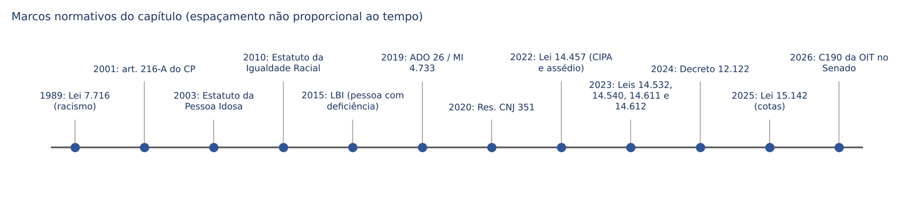
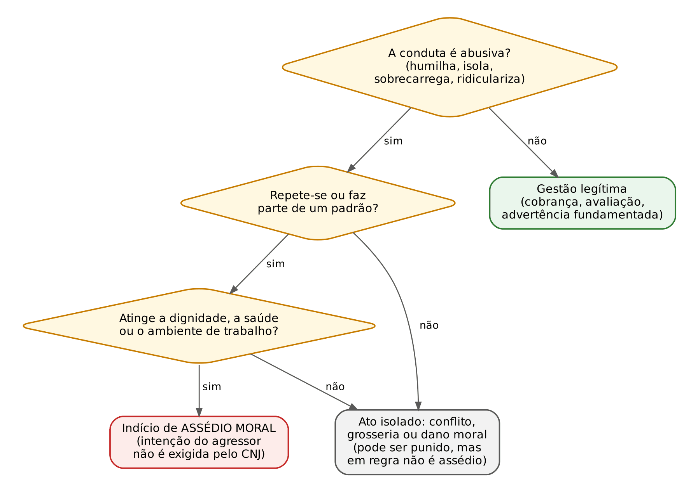
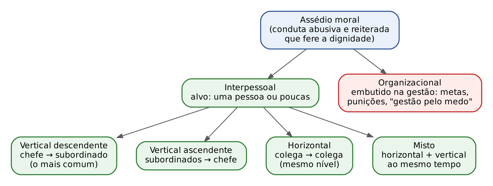
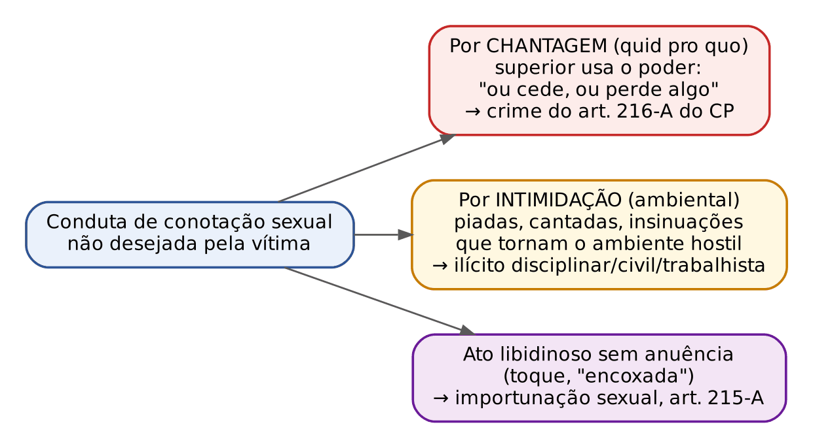
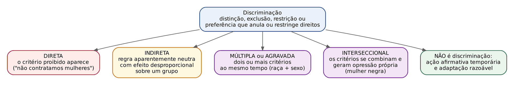
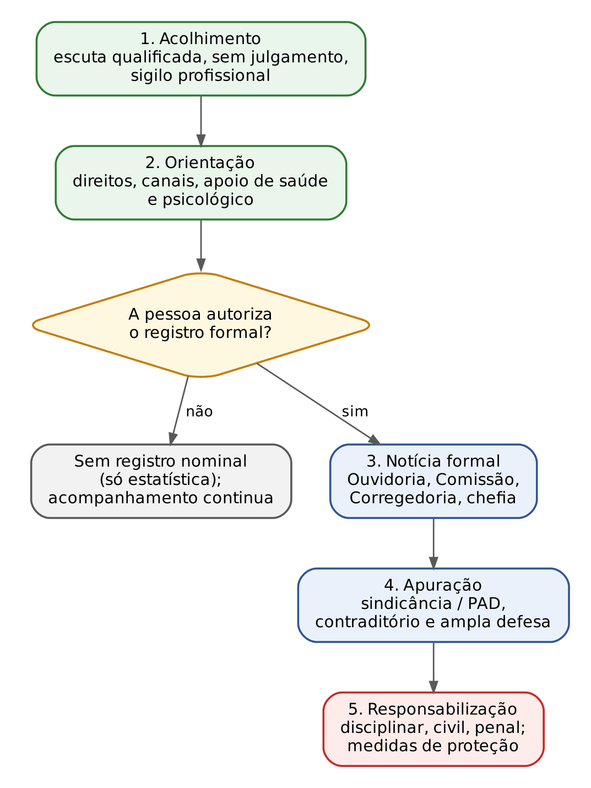

# CAPÍTULO 29 — PREVENÇÃO E COMBATE AO ASSÉDIO MORAL, AO ASSÉDIO SEXUAL E À DISCRIMINAÇÃO (GÊNERO, RAÇA, ORIENTAÇÃO SEXUAL, IDADE E PESSOA COM DEFICIÊNCIA) NO TRABALHO E NAS POLÍTICAS PÚBLICAS

:::INCIDENCIA
Edital SEFAZ/SC 01/2026 — Ética, Integridade e Prevenção ao Assédio e Discriminação ("prevenção e combate ao assédio moral, assédio sexual e a todas as formas de discriminação (gênero, raça, orientação sexual, idade e PCD) no ambiente de trabalho e nas políticas públicas"). Nível A.
Lote do banco: 66 questões atribuídas (FCC 14, FGV 52), mais 3 questões FCC correlatas encontradas por palavra-chave. O que mais cai: identificar se uma conduta é ou não assédio moral; espécies de assédio (vertical, horizontal, organizacional); assédio sexual por chantagem e por intimidação; quem pode noticiar e como é o acolhimento (Res. CNJ 351/2020 e normas de tribunais); conceitos de discriminação direta, indireta, múltipla e interseccional; ações afirmativas; convenções contra a discriminação racial e contra a mulher.
:::

:::ESQUEMA O que você vai aprender e o que precisa saber antes
Pré-requisitos: princípios e deveres do servidor e os Códigos de Ética (Cap. 27); programas de integridade, canais de denúncia e proteção do denunciante (Cap. 28). Nenhuma matemática é necessária: as poucas contas do capítulo (multas e aumentos de pena) são frações simples, com remissão ao Cap. 1.
Roteiro do capítulo:
- 29.1 O vocabulário de base: estereótipo, preconceito, discriminação, assédio e violência no trabalho.
- 29.2 Assédio moral: conceito, os quatro elementos, espécies (interpessoal e organizacional; descendente, ascendente, horizontal e misto) e o que NÃO é assédio.
- 29.3 Assédio sexual: o crime do art. 216-A do Código Penal e o assédio sexual em sentido amplo; figuras vizinhas (importunação sexual, violência psicológica).
- 29.4 As normas de prevenção: Lei 14.540/2023, Lei 14.457/2022 (CIPA), Lei 14.612/2023 (OAB), Decreto 12.122/2024, Resolução CNJ 351/2020, Convenção 190 da OIT e as normas de Santa Catarina.
- 29.5 Discriminação: conceito, espécies (direta, indireta, múltipla, interseccional, estrutural) e ações afirmativas.
- 29.6 Os grupos do edital, um a um: gênero, raça, orientação sexual e identidade de gênero, idade e pessoa com deficiência.
- 29.7 Procedimento: acolhimento, notícia, apuração, proteção da vítima e responsabilização.
- 29.8 Resumo, normas incidentes, questões e notas.
:::

## 29.1 O vocabulário de base

### 29.1.1 Por que começar pelas palavras

Este capítulo é de leitura jurídica, e o leitor está em casa. Mas há uma armadilha: as bancas cobram termos que vêm da psicologia do trabalho e da sociologia (estereótipo, preconceito, interseccionalidade, gestão pelo medo, *manterrupting*), e não só da lei. A FGV, em especial, recicla questões de provas de psicólogo e assistente social. Por isso, antes das normas, fixe o vocabulário.

### 29.1.2 Estereótipo, preconceito e discriminação: a escada de três degraus

Pense numa escada. Cada degrau acrescenta algo ao anterior.

- ESTEREÓTIPO (degrau 1, o pensamento): uma crença generalizada sobre as características de um grupo. "Mulheres são emotivas", "idosos não sabem lidar com tecnologia". É uma ideia, uma simplificação.
- PRECONCEITO (degrau 2, a atitude): uma avaliação prévia, em regra negativa, sobre uma pessoa, baseada apenas no grupo a que ela pertence. "Não confio nesse candidato porque ele é de tal origem." Ainda está no plano interno, do juízo e do sentimento.
- DISCRIMINAÇÃO (degrau 3, a ação): o tratamento desigual, a exclusão ou a restrição de direitos baseada num critério proibido. "Não contrato pessoas de tal origem." Aqui o preconceito saiu da cabeça e produziu efeito no mundo.

A ponte com o Direito é imediata: o Direito Penal não pune o pensamento (*cogitationis poenam nemo patitur*). O preconceito, sozinho, não é ilícito; a discriminação é. Uma pessoa pode ter preconceito sem discriminar, se o sentimento não se traduzir em tratamento desigual.

:::EXEMPLO Os três degraus num caso de gabinete
- Estereótipo: um servidor acredita que "estagiárias mais velhas aprendem devagar".
- Preconceito: ao conhecer a nova estagiária de 52 anos, ele já a avalia como "fraca", antes de qualquer trabalho.
- Discriminação: ele passa a distribuir a ela só tarefas de arquivo e a excluir seu nome dos processos de minuta, embora ela tenha a mesma formação dos colegas. Esse último degrau é etarismo (discriminação por idade) e pode configurar assédio moral se for reiterado (ver 29.2).
:::

:::QUESTAO FGV 2026 — NAV Brasil — Pedagogo (Q4222776)
Enunciado parafraseado: uma piloto de aviação comercial, que integra os 3% de mulheres na função, enfrenta desconfiança constante por ser mulher. Julgam-se V ou F quatro definições: (1) estereótipo são crenças generalizadas sobre um grupo; (2) misoginia é estigmatização por cor ou origem étnica; (3) preconceito é avaliação pré-concebida baseada só no grupo; (4) discriminação é a ação prática, o tratamento desigual baseado em preconceito. Gabarito oficial: B (V, F, V, V).
Resolução:
- (1) Verdadeira: é o degrau 1 da escada.
- (2) Falsa: misoginia é aversão ou desprezo às mulheres. Estigmatizar por cor ou origem étnica é racismo ou xenofobia. A banca trocou o objeto.
- (3) Verdadeira: degrau 2.
- (4) Verdadeira: degrau 3; a palavra-chave é "ação".
- Sequência V, F, V, V: alternativa B.
A alternativa sedutora é A (todas verdadeiras), para quem lê depressa e não percebe a troca de "mulheres" por "cor ou origem" no item 2.
:::

:::QUESTAO FGV 2026 — SEDUC-SP — Professor de Sociologia (Q4246725)
Enunciado parafraseado: pede-se o caso de preconceito SEM discriminação. Gabarito oficial: B.
Resolução: aplique o teste da escada. Procure a alternativa em que existe só o juízo negativo, sem ato que restrinja direito de alguém.
- A (gerente que deixa de contratar por nacionalidade): há ação de exclusão. Discriminação.
- B (comerciante que considera menos confiáveis as pessoas da nacionalidade que mais movimenta seu negócio): ele pensa mal, mas continua atendendo e vendendo; nenhum ato excludente. Preconceito sem discriminação. É a resposta.
- C (morador que organiza protesto para impedir templo de outra religião): ação concreta de intolerância.
- D (condomínio que proíbe acesso por origem étnica): discriminação direta.
- E (estudante que se recusa a integrar grupo por causa do gênero dos colegas): há recusa, ou seja, ação.
:::

### 29.1.3 Violência, assédio e dano moral: o que distingue cada um

Três expressões aparecem misturadas nos enunciados.

- VIOLÊNCIA NO TRABALHO é o gênero. Abrange qualquer ação, explícita ou sutil, que agrida, humilhe ou ameace o trabalhador. A Convenção 190 da OIT fala em "violência e assédio" como um conjunto de comportamentos inaceitáveis, ocorridos uma vez ou de forma repetida (ver 29.4.6).
- ASSÉDIO é uma espécie de violência marcada, em regra, pelo PROCESSO: condutas que se repetem e corroem a dignidade da pessoa ou o ambiente de trabalho. A exceção importante é o assédio sexual, que pode se consumar num único ato (ver 29.3).
- DANO MORAL é a CONSEQUÊNCIA jurídica: a lesão a direito da personalidade. Pode resultar de assédio, mas também de um ato isolado (um insulto grave numa reunião). Todo assédio moral costuma gerar dano moral; nem todo dano moral nasce de assédio.

:::DICA Como a banca separa assédio de conflito
Procure no enunciado palavras de REPETIÇÃO e de PADRÃO: "constantemente", "por diversas vezes", "sistematicamente", "passou a", "durante meses". Elas indicam assédio moral. Palavras de EPISÓDIO ("em uma reunião", "em determinada ocasião", "houve um desentendimento técnico") indicam conflito pontual, que pode até ser falta funcional, mas em regra não é assédio moral.
:::

## 29.2 Assédio moral

### 29.2.1 A ideia, em linguagem comum

Imagine uma servidora que, depois de discordar do chefe numa reunião, passa a receber só tarefas inúteis, é deixada fora dos e-mails do setor, ouve piadas sobre seu trabalho na frente dos colegas e vê seus pedidos de férias negados sem motivo, mês após mês. Nenhum desses atos, isolado, parece dramático. Juntos, formam um cerco. O objetivo (ou pelo menos o efeito) é desestabilizá-la, fazê-la adoecer ou pedir remoção.

Esse cerco é o assédio moral. A literatura estrangeira usa *mobbing* (de *mob*, turba: o ataque em grupo) e *bullying* (intimidação). No Brasil a expressão consagrada é "assédio moral".

### 29.2.2 O conceito normativo

Não existe, no plano federal, LEI que defina assédio moral para todos os servidores, nem tipo penal de assédio moral (há projetos de lei em tramitação há anos). As definições vêm de normas setoriais, e as mais cobradas são as da Resolução CNJ 351/2020, que serviram de modelo para tribunais, conselhos e Executivos estaduais.

:::LEI Resolução CNJ 351/2020, art. 2º, I e II (redação da Resolução CNJ 518/2023; síntese fiel)
I — Assédio moral: violação da dignidade ou da integridade psíquica ou física de outra pessoa por meio de conduta abusiva, INDEPENDENTEMENTE DE INTENCIONALIDADE, por meio da degradação das relações socioprofissionais e do ambiente de trabalho; pode caracterizar-se pela exigência de tarefas desnecessárias ou exorbitantes, discriminação, humilhação, constrangimento, isolamento, exclusão social, difamação ou situações humilhantes e constrangedoras capazes de causar sofrimento, dano físico ou psicológico.
II — Assédio moral organizacional: processo contínuo de condutas abusivas ou hostis, amparado por estratégias organizacionais ou métodos gerenciais, que visem obter engajamento intensivo ou excluir aqueles que a instituição não deseja manter em seus quadros, por meio do desrespeito a seus direitos fundamentais.
:::

A Lei 14.612/2023, que alterou o Estatuto da Advocacia, trouxe uma definição em LEI (só para a disciplina da OAB) que é útil por deixar claros os elementos: conduta praticada no exercício profissional ou em razão dele, "por meio da repetição deliberada de gestos, palavras faladas ou escritas ou comportamentos" que exponham o profissional a situações humilhantes e constrangedoras, capazes de ofender sua personalidade, dignidade e integridade, com o objetivo de excluí-lo das funções ou de desestabilizá-lo emocionalmente (EOAB, art. 34, § 2º, I).

### 29.2.3 Os quatro elementos (o "teste" do assédio moral)

Para decidir se um caso é assédio moral, faça quatro perguntas, nesta ordem.

- 1. CONDUTA ABUSIVA: o ato extrapola o poder de direção legítimo? Humilha, isola, ridiculariza, sobrecarrega sem necessidade, esvazia funções?
- 2. REITERAÇÃO: a conduta se repete ou forma um padrão ao longo do tempo? Um único grito não é assédio moral; gritos diários, sim.
- 3. LESÃO: atinge a dignidade, a integridade psíquica ou física, ou degrada o ambiente de trabalho?
- 4. CONTEXTO DE TRABALHO: ocorre nas relações profissionais (inclusive por meios digitais, como grupos de mensagem do setor)?

E a intenção? Aqui está a principal divergência de prova. A doutrina clássica da psicologia do trabalho falava em intencionalidade (o objetivo de excluir ou desestabilizar a vítima) e em direcionalidade (a conduta mira uma pessoa ou grupo). A Resolução CNJ 351/2020, porém, diz expressamente "independentemente de intencionalidade". A Lei 14.612/2023, ao contrário, fala em "repetição deliberada" e "com o objetivo de". Resultado: a resposta depende da norma citada no enunciado.

:::PEGADINHA Intenção: depende de quem pergunta
- Se o enunciado cita a Resolução CNJ 351/2020 (ou norma de tribunal que a reproduz): a intenção NÃO é requisito. Alternativa que exige "dolo específico" do chefe está errada.
- Se a questão é de psicologia organizacional (FCC em provas de psicólogo ou assistente social): a banca já cobrou intencionalidade e direcionalidade como marcas do assédio (ver Q4156341 abaixo).
- Em qualquer caso, a REITERAÇÃO é o elemento que mais aparece como divisor de águas.
:::

:::QUESTAO FCC 2026 — AL-RR — Analista Legislativo — Assistente Social (Q4156341)
Enunciado parafraseado: o assédio moral se caracteriza por condutas abusivas que se repetem sistematicamente. Sua identificação ocorre quando há: I. intenção; II. descontração; III. orientação; IV. motivação; V. descrição. Gabarito oficial: E (I e III).
Resolução:
- A banca adotou a leitura da psicologia do trabalho: o assédio tem INTENÇÃO (finalidade de prejudicar, excluir, desestabilizar) e ORIENTAÇÃO (direcionalidade: a conduta é dirigida a alguém determinado).
- "Descontração" (II) é o oposto do clima de assédio. "Motivação" (IV) e "descrição" (V) são palavras soltas, sem sentido técnico no tema.
- Marcando I e III: alternativa E.
Atenção: perante a Resolução CNJ 351/2020, a intenção NÃO é requisito. A questão é de prova de assistente social, com base doutrinária; numa questão que cite a resolução, a resposta seria outra. Registrado na nota de verificação como ponto de divergência.
:::

### 29.2.4 Exemplos de condutas típicas

As cartilhas oficiais (Senado Federal, CNJ, Ministério do Trabalho, Controladoria-Geral do Estado de SC) listam condutas que, repetidas, configuram assédio moral. Agrupe-as em cinco famílias, que facilitam a memória:

- Deterioração proposital das condições de trabalho: retirar instrumentos de trabalho, sonegar informações necessárias, dar instruções confusas, impor metas inatingíveis ou prazos impossíveis, exigir tarefas urgentes de forma recorrente e desnecessária, contestar sistematicamente todas as decisões da pessoa.
- Esvaziamento ou rebaixamento: atribuir tarefas inferiores à qualificação, retirar funções sem motivo, deixar a pessoa sem nenhuma tarefa.
- Isolamento e recusa de comunicação: não dirigir a palavra, comunicar-se só por escrito estando lado a lado, excluir de reuniões e de grupos de mensagens, proibir colegas de falar com a vítima.
- Atentado à dignidade: piadas, apelidos, críticas em público, insinuações sobre saúde mental, ridicularizar crenças, gênero, origem ou deficiência.
- Violência verbal ou física e ameaças: gritos, ameaças de transferência ou demissão, vigilância excessiva, controle do tempo de banheiro.

:::QUESTAO FCC 2026 — TJ-CE — Analista Judiciário — Serviço Social (Q4255027)
Enunciado parafraseado: aponte a atitude que é assédio moral. Gabarito oficial: C.
Resolução:
- A (contestar decisões e criticar o trabalho "como forma de incentivar o desempenho"): a crítica com finalidade de melhoria é gestão. Só seria assédio se sistemática, humilhante e desvinculada do trabalho, o que o enunciado não diz.
- B (feedback com critérios definidos para cada função): é boa prática de gestão. *Feedback* é retorno sobre o desempenho.
- C (exigir tarefas urgentes de forma RECORRENTE e DISPENSÁVEL): reúne abuso (tarefa desnecessária) e reiteração (recorrente). É assédio. Resposta.
- D (negar acesso a senhas de processos restritos a outro departamento): é controle de acesso legítimo, ligado à segurança da informação.
- E (dar volume de tarefas idêntico ao dos colegas): é tratamento igual, o contrário de assédio.
:::

:::QUESTAO FGV 2024 — SES-MT — Psicólogo (Q2493894)
Enunciado parafraseado: entre as condutas listadas, qual pode ser assédio moral? Gabarito oficial: A (imposição de tarefas impossíveis e metas inatingíveis).
Resolução: metas inatingíveis e tarefas impossíveis são o exemplo clássico de deterioração proposital das condições de trabalho. As demais alternativas são gestão legítima (avaliação periódica de desempenho; advertência por falta cometida) ou outra figura: convites para sair feitos por superior (C) apontam para possível assédio SEXUAL, não moral, se insistentes e não desejados.
:::

:::QUESTAO FGV 2025 — MPU — Perito em Engenharia de Segurança do Trabalho (Q3338167)
Enunciado parafraseado: a ouvidoria apura denúncia de assédio moral do supervisor Carlos contra a subordinada Marcela. Qual fato evidencia o assédio? Gabarito oficial: B (comunicar-se com ela exclusivamente por escrito, mesmo estando no mesmo ambiente).
Resolução: é a família "isolamento e recusa de comunicação". Ignorar a presença física de alguém e falar só por bilhete ou e-mail é forma conhecida de exclusão. As demais são exercício normal do poder hierárquico: discussão técnica em público numa situação de desentendimento (episódio, sem padrão), controlar e priorizar o trabalho, exigir cumprimento de regulamentos, cobrar produtividade para uma meta.
:::

### 29.2.5 O que NÃO é assédio moral

Tão importante quanto reconhecer o assédio é não confundir com ele o exercício legítimo da chefia. Não é assédio moral, por si só:

- cobrar metas razoáveis, prazos e produtividade, com respeito;
- avaliar o desempenho com critérios objetivos e dar retorno, inclusive negativo;
- aplicar advertência ou instaurar processo disciplinar quando há falta, com observância do devido processo;
- transferir, remover ou alterar atribuições por necessidade do serviço, com motivação;
- conflitos pontuais, discussões técnicas, más condições de trabalho que atingem todos igualmente (que podem ser problema de gestão, mas não assédio dirigido);
- exigências do cargo previstas em lei ou regulamento.

O critério é o do abuso de direito, que o leitor conhece do art. 187 do Código Civil: o poder de direção é legítimo; o EXCESSO manifesto, que desvia esse poder para humilhar, excluir ou adoecer, é que se torna ilícito.

### 29.2.6 As espécies de assédio moral

Há dois critérios de classificação que a banca combina.

Primeiro critério: QUEM está no alvo e de onde vem a conduta.

- INTERPESSOAL (ou individual): uma pessoa (ou poucas) persegue outra pessoa determinada. A conduta nasce da relação entre indivíduos.
- ORGANIZACIONAL (ou institucional): a violência está EMBUTIDA na forma de gerir. Não depende de um chefe perverso; é uma política, uma estratégia, um método de gestão que submete o conjunto dos trabalhadores (ou um grupo) a pressões abusivas: metas inalcançáveis com punições, rankings vexatórios, "prendas" para os piores colocados, ameaça constante de demissão. A FGV chama isso de "gestão pelo medo", "gestão por estresse" ou "gestão por injúria".

Segundo critério: a DIREÇÃO, em relação à hierarquia (só faz sentido no assédio interpessoal).

- VERTICAL DESCENDENTE: do superior para o subordinado. É o mais frequente, porque o chefe tem os meios (distribuição de tarefas, avaliação, lotação).
- VERTICAL ASCENDENTE: do(s) subordinado(s) para o superior. Exemplo: equipe que boicota sistematicamente um novo chefe, sonega informações para que ele erre, espalha boatos. Em regra exige ação coletiva.
- HORIZONTAL: entre colegas do mesmo nível. Exemplo: grupo de servidores que isola e ridiculariza um colega por sua origem ou por ser mais produtivo.
- MISTO: combinação de horizontal e vertical. Típico quando os colegas assediam e a chefia, sabendo, se omite ou adere.

:::PEGADINHA Omissão também pesa
A FGV gosta de casos em que o chefe imediato assedia e o setor de Recursos Humanos, avisado, manda "aguardar que passa". A omissão de quem tinha o dever de agir contribui para o assédio e pode gerar responsabilização (disciplinar do omisso; civil da instituição). Lembre-se de que o Estado responde objetivamente pelos danos que seus agentes causarem (CF, art. 37, § 6º), com regresso contra o responsável.
:::

:::QUESTAO FCC 2026 — MPE-AP — Analista Ministerial — Psicologia (Q3964574)
Enunciado parafraseado: no assédio moral interpessoal e no organizacional há hostilização sistemática; o que diferencia o organizacional é que as práticas estão presentes, implicitamente, nas políticas e práticas da empresa e inseridas nas estratégias e em quê? Gabarito oficial: E (métodos de gestão).
Resolução: é a própria definição do assédio organizacional (Res. CNJ 351/2020, art. 2º, II: "estratégias organizacionais e/ou métodos gerenciais"). Serviços aos clientes, marketing de produtos, modalidades de planejamento e atendimentos especializados são palavras do mundo da empresa, mas não descrevem o modo de gerir pessoas.
:::

:::QUESTAO FGV 2026 — TCE-SC — Política de Prevenção do TCE/SC (Q4086798)
Enunciado parafraseado: pela Resolução TC-254/2024 do Tribunal de Contas de Santa Catarina, os atos de (i) manifestar publicamente desdém pelo produto do trabalho, (ii) gerir por estresse, por injúria ou por medo e (iii) realizar premiações negativas, ameaças e cobranças exageradas configuram, respectivamente, o quê? Gabarito oficial: E (assédio moral; assédio moral organizacional; assédio moral organizacional).
Resolução:
- (i) Desdém público pelo trabalho de alguém é conduta dirigida a pessoa determinada: assédio moral (interpessoal).
- (ii) "Gerir por" estresse, injúria ou medo descreve um MÉTODO de gestão: organizacional.
- (iii) Premiações negativas (as "prendas" para os piores), ameaças e cobranças exageradas como prática do órgão: organizacional.
- Sequência: moral, organizacional, organizacional. Alternativa E.
Detalhe útil para quem presta concurso em SC: a questão confirma que o TCE/SC tem política própria sobre o tema, instituída pela Resolução TC-254/2024.
:::

:::QUESTAO FGV 2025 — TRT 24ª Região — Analista Judiciário — Psicologia (Q3349864)
Enunciado parafraseado: bancária desenvolve síndrome de *burnout* (esgotamento profissional) sob um modelo de gestão baseado em ameaças de demissão e descontos salariais pelo não cumprimento de metas. Qual é o modelo? Gabarito oficial: A (gestão pelo medo).
Resolução: ameaça como ferramenta de produtividade é a "gestão pelo medo", forma típica de assédio organizacional. *Gaslighting* (B) é manipular alguém para que duvide da própria percepção ou memória; *mansplaining* (C) é o homem explicar à mulher, com condescendência, o que ela já sabe; precarização (D) é deterioração de vínculos e direitos; sexismo (E) é discriminação por sexo. Nenhum desses descreve punição por metas.
:::

### 29.2.7 Consequências do assédio moral

O assédio moral não é crime autônomo no plano federal, mas gera consequências em várias esferas.

- Disciplinar: para servidores, enquadra-se nas proibições e deveres do estatuto (urbanidade, tratar com respeito, não proceder de forma desidiosa, não valer-se do cargo para proveito pessoal em detrimento da dignidade da função). Pode levar de advertência a demissão, conforme a gravidade e a lei do ente. Para a advocacia, é infração ética desde a Lei 14.612/2023, punida com suspensão.
- Civil: indenização por danos morais e materiais (tratamentos, perda de remuneração). No serviço público, a vítima aciona o Estado (responsabilidade objetiva), que tem regresso contra o assediador.
- Trabalhista (empregados): rescisão indireta (CLT, art. 483), indenização por dano extrapatrimonial (CLT, arts. 223-A a 223-G), reconhecimento de doença ocupacional.
- Penal, por via indireta: alguns atos do assediador podem ser crimes autônomos (injúria, ameaça, constrangimento ilegal, perseguição do art. 147-A do CP, violência psicológica contra a mulher do art. 147-B, discriminação das leis especiais).
- Improbidade: o STJ já considerou assédio moral praticado por agente público como ato de improbidade por violação a princípios, antes da reforma da Lei 8.429/1992. Depois da Lei 14.230/2021, que tornou taxativo o rol do art. 11, esse enquadramento ficou muito mais difícil (ver Cap. 27).

:::QUESTAO FCC 2024 — TRT 20ª Região — Analista Judiciário — Área Judiciária (Q3170820)
Enunciado parafraseado: empregado vítima de assédio moral do superior por cinco anos pede indenização por dano moral. Conforme a CLT e a jurisprudência do STF, como se fixa a indenização? Gabarito oficial: C (proporcional à ofensa, classificada como leve, média, grave ou gravíssima, com parâmetros de 3, 5, 20 e 50 vezes o último salário contratual).
Resolução:
- A CLT (art. 223-G, § 1º, incluído pela Reforma Trabalhista) gradua a ofensa em leve, média, grave e gravíssima e fixa tetos de até 3, 5, 20 e 50 vezes o ÚLTIMO SALÁRIO CONTRATUAL do ofendido.
- O STF, nas ADIs 6050, 6069 e 6082, declarou o dispositivo constitucional, mas como PARÂMETRO ORIENTATIVO: o juiz pode ultrapassar os valores quando o caso concreto exigir.
- Conta de verificação, com salário de 5.000 reais:
  - leve: 3 × 5.000 = 15.000
  - média: 5 × 5.000 = 25.000
  - grave: 20 × 5.000 = 100.000
  - gravíssima: 50 × 5.000 = 250.000
- Alternativa C.
Por que as outras falham: D troca "último salário contratual" por "salário mínimo" (a base de cálculo é o salário do ofendido, não o mínimo); B fixa teto único de 10 salários; A inventa limite de 50% para danos materiais; E ignora a tarifação.
:::

:::PRATIQUE exercícios elaborados para esta apostila
1. Classifique: o novo diretor de uma unidade fazendária é sistematicamente boicotado pelos cinco auditores mais antigos, que deixam de lhe repassar informações e espalham que ele "não entende nada de ICMS".
2. Classifique: um órgão adota um "ranking de produtividade" afixado no mural, e os três últimos colocados de cada mês recebem um troféu de "tartaruga" diante de todos.
3. Uma chefe, em uma única reunião, perde a paciência e diz a um servidor que o relatório dele "está péssimo". Nunca mais repete o comportamento. Há assédio moral?
4. Um servidor com deficiência visual e pós-graduação em tecnologia da informação passa meses recebendo apenas tarefas de protocolo, sob a justificativa de que "é mais seguro para ele". Qual figura?
Resolução:
1. Assédio moral interpessoal VERTICAL ASCENDENTE: parte de subordinados contra o superior; há reiteração (sistematicamente) e abuso (sonegar informação, difamar).
2. Assédio moral ORGANIZACIONAL: a humilhação faz parte do método de gestão (premiação negativa pública), atinge o grupo e não depende de um perseguidor específico.
3. Em regra, NÃO. Falta a reiteração. Pode haver falta de urbanidade (passível de apuração disciplinar) e, conforme a gravidade, dano moral, mas um episódio isolado não forma o processo característico do assédio moral.
4. Discriminação por deficiência (capacitismo, ver 29.6.5), que, por ser reiterada e esvaziar as funções do servidor, também configura assédio moral vertical descendente. As figuras podem coexistir.
:::

## 29.3 Assédio sexual

### 29.3.1 A ideia

O assédio sexual é a conduta de natureza sexual NÃO DESEJADA por quem a recebe. A chave é a falta de reciprocidade: o flerte correspondido entre colegas não é assédio; a insistência depois de uma recusa, a cantada do chefe que a subordinada não pode recusar sem medo, a piada sexual que constrange, sim.

A doutrina divide o assédio sexual em duas modalidades, e essa divisão é o tema que mais cai.

- ASSÉDIO POR CHANTAGEM (*quid pro quo*, "isto por aquilo"): o assediador usa sua posição de poder para exigir favor sexual, com promessa de vantagem ou ameaça de prejuízo. "Se você sair comigo, garanto sua função gratificada"; "se não sair, vou transferi-la". Pressupõe, em regra, superioridade hierárquica ou ascendência.
- ASSÉDIO POR INTIMIDAÇÃO (ou ambiental): incitações sexuais inoportunas, comentários, piadas, gestos, exibição de material, toques "casuais", que criam um ambiente hostil, intimidativo ou humilhante. Pode vir de qualquer pessoa, inclusive de colega do mesmo nível ou de subordinado; não exige hierarquia nem pedido de favor.

### 29.3.2 O crime do art. 216-A do Código Penal

:::LEI Código Penal, art. 216-A (incluído pela Lei 10.224/2001)
"Constranger alguém com o intuito de obter vantagem ou favorecimento sexual, prevalecendo-se o agente da sua condição de superior hierárquico ou ascendência inerentes ao exercício de emprego, cargo ou função." Pena: detenção, de 1 a 2 anos. § 2º: a pena é aumentada em até um terço se a vítima é menor de 18 anos. (O parágrafo único original foi vetado.)
:::

Leia o tipo com olhos de penalista, elemento por elemento:

- Verbo: "constranger" (aqui no sentido de embaraçar, pressionar, incomodar).
- Elemento subjetivo especial: "com o intuito de obter vantagem ou favorecimento sexual" (para si ou para outrem). É crime formal: consuma-se com o constrangimento, ainda que o favor não seja obtido.
- Elemento normativo: o agente se prevalece de sua condição de superior hierárquico ou de ascendência inerente a emprego, cargo ou função. Por isso o tipo penal só abrange, em regra, o assédio POR CHANTAGEM vertical descendente. O assédio por intimidação entre colegas NÃO é o crime do art. 216-A (pode ser outro crime, ou ilícito disciplinar, civil e trabalhista).
- Sujeitos: qualquer pessoa, de qualquer sexo, contra qualquer pessoa de qualquer sexo. Não existe exigência de sexos diferentes.
- Basta um ato: a lei não exige reiteração.
- Pena de detenção de 1 a 2 anos: é infração de menor potencial ofensivo? SIM. O máximo é 2 anos, e o art. 61 da Lei 9.099/1995 considera de menor potencial as infrações com pena máxima NÃO SUPERIOR a 2 anos (salvo com a causa de aumento do § 2º, que eleva o máximo).

:::EXEMPLO A causa de aumento do § 2º, conta por conta
"Aumentada em até um terço" significa: pegue a pena e some até 1/3 dela (frações: ver Cap. 1).
- Pena máxima: 2 anos = 24 meses.
- Um terço de 24 meses: 24 ÷ 3 = 8 meses.
- Pena máxima aumentada: 24 + 8 = 32 meses = 2 anos e 8 meses.
Como 2 anos e 8 meses supera 2 anos, com a causa de aumento a infração deixa de ser de menor potencial ofensivo (para essa análise, considera-se o aumento máximo).
:::

O STJ admitiu a configuração do art. 216-A na relação entre professor e aluna, entendendo que a ascendência inerente ao magistério pode preencher o elemento normativo do tipo (ponto registrado na nota de verificação).

### 29.3.3 O assédio sexual em sentido amplo (administrativo e trabalhista)

Fora do Direito Penal, o conceito é bem mais largo. A Resolução CNJ 351/2020 (art. 2º, III) define assédio sexual como "conduta de conotação sexual praticada contra a vontade de alguém", sob forma verbal, não verbal ou física, manifestada por palavras, gestos, contatos físicos ou outros meios, com o efeito de perturbar ou constranger a pessoa, afetar sua dignidade ou criar ambiente intimidativo, hostil, degradante, humilhante ou desestabilizador.

Note as diferenças em relação ao crime:

| Aspecto | Crime (CP, art. 216-A) | Sentido amplo (CNJ 351; Lei 14.612; normas internas) |
|---|---|---|
| Hierarquia | Exigida (superior ou ascendência) | Dispensada: colega, subordinado, terceiro |
| Finalidade | Obter vantagem ou favor sexual | Basta o EFEITO de constranger ou criar ambiente hostil |
| Modalidade abrangida | Chantagem | Chantagem e intimidação |
| Reiteração | Não exigida | Não exigida |
| Consequência | Pena de detenção | Sanção disciplinar, indenização, rescisão |

A Resolução CNJ 538/2023 tornou o assédio sexual infração disciplinar GRAVE no Judiciário.

### 29.3.4 Figuras vizinhas que a banca mistura

- IMPORTUNAÇÃO SEXUAL (CP, art. 215-A, Lei 13.718/2018): "praticar contra alguém e sem a sua anuência ato libidinoso com o objetivo de satisfazer a própria lascívia ou a de terceiro". Pena de reclusão de 1 a 5 anos, se o ato não constitui crime mais grave. Não exige hierarquia nem ambiente de trabalho. É o caso do toque no transporte público. Se o chefe pratica ato libidinoso contra a subordinada sem consentimento, fala-se em importunação (pena maior), e não em assédio.
- VIOLÊNCIA PSICOLÓGICA CONTRA A MULHER (CP, art. 147-B, Lei 14.188/2021): causar dano emocional à mulher, mediante ameaça, constrangimento, humilhação, manipulação, isolamento, ridicularização etc. Pena de reclusão de 6 meses a 2 anos e multa, se a conduta não constitui crime mais grave. Pode alcançar condutas de assédio moral contra mulheres.
- PERSEGUIÇÃO (CP, art. 147-A, Lei 14.132/2021): o *stalking*, perseguição reiterada que ameaça a integridade ou invade a liberdade e a privacidade da vítima.
- PROTOCOLO "NÃO É NÃO" (Lei 14.786/2023): obriga estabelecimentos como casas noturnas, boates e espetáculos a adotar medidas de proteção à mulher diante de constrangimento e violência. Não é norma de serviço público, mas aparece em questões de atualidades.

:::QUESTAO FGV 2024 — Câmara dos Deputados — Consultor Legislativo (Q2511422)
Enunciado parafraseado: a partir de um conceito de assédio sexual no trabalho, assinale a correta. Gabarito oficial: D (no assédio por chantagem o assediador busca obter favores sexuais para si ou para terceiro).
Resolução:
- A (não pode haver assédio entre pessoas do mesmo sexo): errada. O tipo penal e as normas administrativas são neutros quanto ao sexo.
- B (o assédio por intimidação é crime do Código Penal): errada. O art. 216-A exige prevalecimento de hierarquia ou ascendência com intuito de favor sexual, isto é, a chantagem.
- C (chantagem são incitações sexuais inoportunas): errada. A banca trocou as definições: incitações inoportunas descrevem a INTIMIDAÇÃO.
- D: correta. Na chantagem há troca: vantagem ou ameaça por favor sexual, para o agente ou para outrem.
- E (exige atos reiterados): errada. Um único ato basta.
:::

:::PRATIQUE exercícios elaborados para esta apostila
1. Um auditor, colega de mesmo nível de uma servidora, faz diariamente comentários sobre o corpo dela no grupo de mensagens do setor. Há crime do art. 216-A?
2. O chefe de uma inspetoria diz à analista que só a indicará para a função gratificada se ela aceitar um jantar "a dois" no hotel. Ela recusa e não é indicada. O crime se consumou?
3. Um supervisor, durante o expediente, toca as partes íntimas de uma estagiária sem o consentimento dela. Qual crime?
4. Uma servidora de 17 anos, jovem aprendiz, é constrangida pelo superior com o intuito de favor sexual. Qual é a pena máxima em abstrato?
Resolução:
1. Não, porque falta a hierarquia ou ascendência e o pedido de favor sexual. É assédio sexual POR INTIMIDAÇÃO (sentido amplo), punível disciplinarmente e gerador de dano moral; conforme o caso, pode haver outro crime (injúria, por exemplo).
2. Sim. O art. 216-A é crime formal: consuma-se com o constrangimento feito com o intuito de obter favor sexual, prevalecendo-se da hierarquia. Obter ou não o favor é irrelevante para a consumação.
3. Importunação sexual (art. 215-A), se não houver crime mais grave (por exemplo, estupro, se houver violência ou grave ameaça). Não é "só" assédio.
4. Incide o § 2º (vítima com menos de 18 anos): 24 meses + 24 ÷ 3 = 24 + 8 = 32 meses, isto é, 2 anos e 8 meses de detenção.
:::

## 29.4 As normas de prevenção e enfrentamento

### 29.4.1 Visão geral: quem obriga quem

Antes dos detalhes, um mapa. As normas deste item têm destinatários diferentes, e a banca adora trocar o destinatário.

| Norma | Destinatários | Ideia central |
|---|---|---|
| Lei 14.540/2023 | Administração pública direta e indireta de TODOS os entes (União, Estados, DF, Municípios) e, após regulamentação, concessionárias e delegatárias | Programa de prevenção do assédio sexual e demais crimes contra a dignidade sexual |
| Lei 14.457/2022 (art. 23) | Empresas que têm CIPA | Medidas obrigatórias contra assédio sexual e violência; CIPA passa a ser "de Acidentes e de Assédio" |
| Lei 14.612/2023 | Advogados (Estatuto da OAB) | Assédio moral, sexual e discriminação viram infração ético-disciplinar |
| Decreto 12.122/2024 | Administração pública federal direta, autárquica e fundacional | Programa Federal de Prevenção e Enfrentamento do Assédio e da Discriminação |
| Resolução CNJ 351/2020 | Poder Judiciário (todos os tribunais, exceto o STF) | Política de prevenção do assédio moral, sexual e da discriminação |
| Convenção 190 da OIT | Estados que a ratificarem | Violência e assédio no mundo do trabalho; em 30/10/2026 ainda não ratificada pelo Brasil |
| Normas de SC | Executivo estadual, TJSC, TCE/SC e outros órgãos | Decreto 2.386/2022 (PREVIAT), Resolução TJ 4/2021, Resolução TC-254/2024 |

### 29.4.2 Lei 14.540/2023: o programa contra o assédio sexual na administração pública

A Lei 14.540, de 3/4/2023, institui o Programa de Prevenção e Enfrentamento ao Assédio Sexual e demais Crimes contra a Dignidade Sexual e à Violência Sexual no âmbito da administração pública, direta e indireta, federal, estadual, distrital e municipal. É lei nacional: vale também para o Estado de Santa Catarina e para a SEFAZ/SC.

Pontos de prova, conferidos no texto da lei:

- Âmbito (art. 2º): administração pública direta e indireta de todos os entes. § 1º: aplica-se também às instituições PRIVADAS que prestam serviço público por concessão, permissão, autorização ou outra delegação, mas só DEPOIS de regulamentação pelo ente concedente (art. 10). § 2º: nas duas primeiras etapas da educação básica (educação infantil e ensino fundamental), o programa se restringe à formação continuada dos profissionais da educação.
- Conceitos (art. 3º): a lei NÃO cria definições próprias; manda observar as do Código Penal, da Lei Maria da Penha (Lei 11.340/2006) e da Lei 13.431/2017 (sistema de garantia de direitos da criança e do adolescente vítima ou testemunha de violência).
- Objetivos (art. 4º), três verbos: prevenir e enfrentar; capacitar os agentes públicos; implementar e disseminar campanhas educativas.
- Diretrizes (art. 5º): esclarecer os elementos do assédio; fornecer materiais educativos com exemplos; implementar boas práticas; divulgar a legislação e as políticas de proteção e acolhimento; divulgar canais acessíveis de denúncia; estabelecer procedimentos de encaminhamento de denúncias, ASSEGURADOS O SIGILO E O DEVIDO PROCESSO LEGAL; criar programas de capacitação, presenciais ou a distância, com conteúdo mínimo (causas estruturantes, consequências para a saúde, identificação e desdobramentos jurídicos, direitos das vítimas, canais de denúncia, instrumentos jurídicos).
- Dever de denunciar (art. 5º, § 1º): QUALQUER PESSOA que tiver conhecimento da prática tem o DEVER LEGAL de denunciá-la e de colaborar com os procedimentos administrativos.
- Retaliação (art. 5º, § 2º): serão apuradas eventuais retaliações contra vítimas, testemunhas e auxiliares em investigações.
- Materiais (art. 6º): o Executivo federal disponibiliza materiais informativos que fixam padrões mínimos para a capacitação.
- Registros (art. 7º): os órgãos devem manter por 5 ANOS os registros de frequência (físicos ou eletrônicos) das capacitações.
- Monitoramento (art. 8º) pelo Poder Executivo; observância do art. 14 da Lei 13.431/2017 (art. 9º); vigência na data da publicação (art. 11).

:::PEGADINHA Lei 14.540/2023
- "Aplica-se só à administração federal": ERRADO. Abrange todos os entes.
- "Aplica-se imediatamente às concessionárias": ERRADO. Depende de regulamentação do ente concedente.
- "A lei define assédio sexual de forma própria": ERRADO. Remete ao CP, à Lei Maria da Penha e à Lei 13.431/2017.
- "Registros de capacitação por 2 anos": ERRADO. São 5 anos.
- "Só a vítima pode denunciar": ERRADO. Qualquer pessoa que souber tem o dever legal de denunciar.
:::

### 29.4.3 Lei 14.457/2022 (Programa Emprega + Mulheres): a CIPA também cuida de assédio

A Lei 14.457/2022 instituiu o Programa Emprega + Mulheres, com medidas de inserção e manutenção de mulheres no mercado de trabalho. Seu art. 23 é o que interessa aqui: as empresas com Comissão Interna de Prevenção de Acidentes e de Assédio (CIPA) devem adotar, para prevenir e combater o assédio sexual e as demais formas de violência no trabalho:

- I — regras de conduta sobre assédio sexual e outras violências nas normas internas, com ampla divulgação;
- II — procedimentos para recebimento e acompanhamento de denúncias, apuração e, quando for o caso, aplicação de sanções administrativas aos responsáveis diretos e indiretos, GARANTIDO O ANONIMATO DA PESSOA DENUNCIANTE, sem prejuízo dos procedimentos jurídicos cabíveis;
- III — inclusão do tema nas atividades e práticas da CIPA;
- IV — ações de capacitação, orientação e sensibilização, NO MÍNIMO A CADA 12 MESES, para empregados de todos os níveis hierárquicos, sobre violência, assédio, igualdade e diversidade.

O § 1º esclarece que o canal interno não substitui o procedimento penal quando a conduta for o crime do art. 216-A ou outro crime. A sigla CIPA, que significava "Comissão Interna de Prevenção de Acidentes", passou a significar "Comissão Interna de Prevenção de Acidentes e de Assédio" (a NR-5 foi ajustada).

:::ATENCAO Anonimato ou sigilo?
Os regimes são diferentes e a banca explora isso.
- Lei 14.457/2022 (empresas com CIPA): garante o ANONIMATO do denunciante.
- Resolução CNJ 351/2020 (Judiciário): exige SIGILO e VEDA o anonimato (art. 14). O sigilo protege a identidade perante terceiros; o anonimato significa que nem o órgão sabe quem noticiou.
- Lei 14.540/2023: fala em sigilo e devido processo legal.
- Decreto 12.122/2024: garantia do sigilo dos dados pessoais dos envolvidos em relação a terceiros, até a decisão final.
:::

### 29.4.4 Lei 14.612/2023: assédio e discriminação como infração ética do advogado

A Lei 14.612/2023 incluiu no Estatuto da Advocacia (Lei 8.906/1994) o inciso XXX do art. 34: constitui infração disciplinar "praticar assédio moral, assédio sexual ou discriminação", punida com SUSPENSÃO (art. 37, I). O § 2º do art. 34 define as três figuras: assédio moral (repetição deliberada de condutas humilhantes, com o objetivo de excluir ou desestabilizar), assédio sexual (conduta de conotação sexual, no exercício profissional ou em razão dele, proposta ou imposta contra a vontade da pessoa, que lhe causa constrangimento e viola sua liberdade sexual) e discriminação (conduta comissiva ou omissiva que dispense tratamento constrangedor ou humilhante em razão de deficiência, raça, cor, sexo, procedência nacional ou regional, origem étnica, condição de gestante, lactante ou nutriz, faixa etária, religião ou outro fator). Basta a noção para esta prova.

### 29.4.5 Decreto 12.122/2024: o Programa Federal

O Decreto 12.122, de 30/7/2024, institui o Programa Federal de Prevenção e Enfrentamento do Assédio e da Discriminação, na administração pública federal direta, autárquica e fundacional (algumas questões o chamam, por engano, de "Lei 12.122"). Tem a finalidade de enfrentar todas as formas de violência decorrentes das relações de trabalho, em especial o assédio moral, o assédio sexual e a discriminação, por meio de (art. 2º): ações educativas de prevenção; gestão humanizada; avaliação permanente do ambiente organizacional; espaços e mecanismos de ACOLHIMENTO, ESCUTA ATIVA, orientação e acompanhamento das pessoas afetadas; PROTEÇÃO DOS DENUNCIANTES contra retaliação; SIGILO dos dados dos envolvidos perante terceiros até a decisão final; procedimentos disciplinares que resguardem a vítima e evitem a REVITIMIZAÇÃO; e estruturação de instâncias de governança (comitê gestor e comitês estaduais). Aplica-se a servidores e empregados públicos federais, com regras próprias para terceirizados e estagiários.

Revitimização é fazer a vítima reviver o sofrimento por causa do próprio procedimento: obrigá-la a repetir o relato várias vezes, acareá-la com o agressor sem necessidade, duvidar dela de saída, divulgar sua identidade.

:::QUESTAO FGV 2026 — NAV Brasil — Pedagogo (Q4222772)
Enunciado parafraseado: depois que a servidora recusa os convites insistentes do superior para saírem, ele passa a tratá-la com rispidez e ameaça transferi-la para outra cidade. Pelo Programa Federal de Prevenção e Enfrentamento do Assédio e da Discriminação, o canal de denúncias deve garantir o quê? Gabarito oficial: B (escuta qualificada e acolhimento sem julgamentos).
Resolução:
- O caso mistura assédio sexual por chantagem (convites, recusa, retaliação com ameaça de transferência) e assédio moral subsequente.
- O programa prevê acolhimento, escuta ativa e orientação: alternativa B.
- A (afastamento automático do agressor): medidas cautelares exigem decisão motivada; nada é "automático".
- C (divulgar às chefias para apuração preliminar): viola o sigilo; e a chefia pode ser a própria agressora, como no caso.
- D (identificação pública da denunciante): viola o sigilo e expõe a vítima.
- E (exigir prova material para acolher): o acolhimento não depende de prova; a apuração é que produzirá provas.
:::

### 29.4.6 Convenção 190 da OIT

A Convenção 190 da Organização Internacional do Trabalho, sobre a eliminação da violência e do assédio no mundo do trabalho, foi adotada em 21/6/2019, na 108ª Conferência Internacional do Trabalho, acompanhada da Recomendação 206. Seus traços principais:

- Define "violência e assédio" como um conjunto de comportamentos e práticas inaceitáveis, ou ameaças deles, ocorridos UMA VEZ OU DE FORMA REPETIDA, que visem, causem ou possam causar dano físico, psicológico, sexual ou econômico, incluindo a violência e o assédio com base no gênero. Repare: para a Convenção, um ato único já basta.
- Âmbito pessoal amplo: trabalhadores e outras pessoas no mundo do trabalho, qualquer que seja o vínculo, inclusive estagiários e aprendizes, trabalhadores cujo contrato terminou, voluntários, candidatos a emprego e pessoas que exercem autoridade do empregador.
- Âmbito material amplo: setores público e privado, economia formal e INFORMAL, áreas urbanas e rurais; e situações "no, em conexão com ou resultantes do" trabalho (deslocamentos, eventos, comunicações por tecnologia, alojamentos).
- Deveres do Estado: abordagem inclusiva, integrada e sensível ao gênero; identificar, em consulta com organizações de empregadores e trabalhadores, os setores e ocupações mais expostos; proibir por lei a violência e o assédio; garantir mecanismos de denúncia, proteção contra retaliação e reparação.

Situação no Brasil (conferida em 30/10/2026): a Convenção ainda NÃO foi ratificada. O Projeto de Decreto Legislativo 997/2026, que aprova o texto, foi aprovado pela Câmara dos Deputados em 1/9/2026 e está no Senado Federal, na Comissão de Relações Exteriores e Defesa Nacional, aguardando parecer. Até a aprovação pelo Congresso, a ratificação e a promulgação por decreto presidencial, ela não vigora internamente. Se a prova trouxer novidade posterior, prevalece a informação mais recente.

:::QUESTAO FGV 2025 — MPU — Perito em Medicina do Trabalho (Q3338336)
Enunciado parafraseado: sobre a Convenção 190 da OIT, assinale a correta. Gabarito oficial: D (cada membro deve tomar medidas para prevenir a violência e o assédio, incluindo identificar, em consulta com as organizações de empregadores e de trabalhadores, os setores, ocupações e modalidades mais expostos).
Resolução:
- A: diz que a Convenção se aplica à economia FORMAL; omite a informal. A Convenção abrange formal e informal.
- B: exclui os desempregados; a Convenção inclui candidatos a emprego e pessoas cujo vínculo terminou.
- C: fala em "redução" do trabalho forçado e infantil; o compromisso da OIT é de ELIMINAÇÃO (abolição efetiva).
- D: reproduz o dever de prevenção com consulta tripartite e mapeamento de setores de risco. Correta.
- E: inventa condição de ratificação ligada a revisão futura.
:::

### 29.4.7 Resolução CNJ 351/2020: a política do Poder Judiciário

A Resolução CNJ 351, de 28/10/2020, instituiu a Política de Prevenção e Enfrentamento do Assédio Moral, do Assédio Sexual e da Discriminação no Poder Judiciário. Foi alterada várias vezes (Resoluções 413/2021, 450/2022, 518/2023 e 538/2023). É a norma-modelo do tema: quase todas as resoluções de tribunais cobradas pela FCC (TRT-6, TRT-7, CSJT 360/2023) seguem a sua estrutura. Pontos de prova:

- Âmbito: todas as condutas de assédio e discriminação nas relações socioprofissionais e na organização do trabalho no Judiciário, por qualquer meio, envolvendo magistrados, servidores, estagiários, aprendizes, voluntários, terceirizados e quaisquer pessoas que se relacionem com o órgão.
- Conceitos (art. 2º): assédio moral, assédio moral organizacional, assédio sexual, discriminação (inclui a recusa de adaptação razoável) e saúde no trabalho. A intenção é dispensada.
- Acolhimento (arts. 7º a 11): canal permanente de escuta, acolhimento, acompanhamento e orientação, preferencialmente na área de gestão de pessoas, com sigilo profissional; lógica do CUIDADO, distinta da lógica disciplinar; atendimento humanizado, que respeita o tempo e a liberdade de escolha da pessoa.
- Ações imediatas (art. 11): diante de riscos psicossociais relevantes, os profissionais de gestão de pessoas e de saúde podem prescrever ações imediatas para preservar a saúde e a integridade das pessoas afetadas, inclusive sugerir à Presidência a REALOCAÇÃO dos servidores envolvidos em outra unidade, COM A ANUÊNCIA deles.
- Quem pode noticiar (art. 12): QUALQUER PESSOA que se perceba alvo de assédio ou discriminação OU que tenha conhecimento de fatos que possam caracterizá-los.
- Quem recebe (art. 13): várias portas (gestão de pessoas, saúde, Comissão, Ouvidoria, Corregedoria, comissões de acessibilidade e de código de conduta). O noticiante pode pedir, a qualquer tempo, o encaminhamento à autoridade disciplinar; o encaminhamento respeita a vontade de quem noticiou.
- Sigilo e anonimato (art. 14): é obrigatório o sigilo e é VEDADO o anonimato. Registro formal e encaminhamento dependem de AUTORIZAÇÃO EXPRESSA do noticiante; sem ela, a notícia não é registrada nominalmente (só conta para estatística).
- Comissões (arts. 15 e 16): cada tribunal institui Comissão de Prevenção e Enfrentamento do Assédio Moral, do Assédio Sexual e da Discriminação, permanente e autônoma, com composição diversa (inclusive terceirizado e pessoa com deficiência ou de grupo vulnerável, e paridade de gênero). Atribuições: monitorar a política, propor medidas, celebrar termos de cooperação técnico-científica, recomendar medidas de proteção, comunicar retaliações. A Comissão NÃO substitui sindicância nem PAD, e seus membros não podem integrar comissões disciplinares ao mesmo tempo.
- Semana de Combate ao Assédio e à Discriminação: anual, na primeira semana de maio (Res. 450/2022).

:::QUESTAO FGV 2025 — ENAM 2025.1 — Exame Nacional da Magistratura (Q3362334)
Enunciado parafraseado: sobre a Resolução CNJ 351/2020, assinale a correta. Gabarito oficial: B.
Resolução:
- A (aplica-se a todas as condutas, EXCETO contra estagiários, aprendizes, voluntários e terceirizados): errada; a política os protege expressamente.
- B (gestão de pessoas e saúde podem prescrever ações imediatas e sugerir a realocação dos servidores envolvidos, com a anuência deles): é o art. 11. Correta.
- C (só a pessoa alvo pode noticiar): errada; qualquer pessoa que tenha conhecimento pode (art. 12).
- D (celebrar termos de cooperação técnico-científica não é atribuição da Comissão): errada; é atribuição prevista.
- E (as Comissões substituem as de sindicância e PAD): errada; acolhimento e disciplina são lógicas separadas.
:::

:::QUESTAO FCC 2025 — TRT 1ª Região — Analista Judiciário — Área Judiciária (Q3445889)
Enunciado parafraseado: pela Resolução CSJT 360/2023 (política da Justiça do Trabalho, que segue o modelo da Res. CNJ 351), qual definição está correta? Gabarito oficial: B (assédio sexual: conduta de conotação sexual praticada contra a vontade de alguém, sob forma verbal, não verbal ou física, com o efeito de perturbar ou constranger, afetar a dignidade ou criar ambiente intimidativo, hostil, degradante, humilhante ou desestabilizador).
Resolução: B reproduz a definição do art. 2º, III, da Res. CNJ 351. As outras são definições verdadeiras coladas no rótulo errado, técnica típica da FCC:
- A descreve fatores de RISCO psicossocial (condições com potencial de comprometer o equilíbrio e causar acidente ou doença), não "saúde no trabalho", que é o processo contínuo de bem-estar.
- C descreve a violência e o assédio COM BASE NO GÊNERO, não a "transversalidade".
- D descreve a GESTÃO PARTICIPATIVA (valorização e compartilhamento da experiência, deliberação coletiva), não a "cooperação horizontal, vertical e transversal".
- E descreve a ORGANIZAÇÃO DO TRABALHO (normas, processos, divisão de tempos e tarefas), não a "gestão participativa".
:::

:::QUESTAO FCC 2026 — DPE-MT — Defensor Público (Q3954687)
Enunciado parafraseado: na política da Defensoria de Mato Grosso sobre assédio, a integração dos conhecimentos e diretrizes sobre assédio ao conjunto das políticas estratégicas, para garantir sua implementação em todas as dimensões da organização, recebe que nome? Gabarito oficial: A (transversalidade).
Resolução: transversal é o que atravessa todas as áreas. Políticas de prevenção ao assédio, pelo modelo do CNJ, devem ser transversais: não ficam presas a um setor, entram em gestão de pessoas, saúde, comunicação, planejamento estratégico. Institucionalidade, capilaridade, "multifacilitação" e otimização não são os termos técnicos usados nessas normas.
:::

:::QUESTAO FCC 2024 — TRT 7ª Região — Política de Prevenção do TRT-7 (Q3088342)
Enunciado parafraseado: segundo a Resolução Normativa TRT-7 7/2024, a organização do trabalho e os gestores de quais unidades devem fazer o quê? Gabarito oficial: A (os gestores de TODAS as unidades, administrativas ou judiciárias, de primeira ou segunda instância, devem, entre outras atribuições, promover visibilidade e reconhecimento das pessoas e de seu trabalho, fomentando a cooperação e o desempenho coletivo e individual).
Resolução: duas chaves resolvem.
- Abrangência: as alternativas B, C e E restringem o dever a "apenas" unidades administrativas, "apenas" judiciárias ou "apenas" primeira instância. Políticas de prevenção são transversais: valem para todas as unidades.
- Conteúdo: B, D e E autorizam pedir mudança de lotação de alguém por ele exercer direito (teletrabalho especial, jornada reduzida, gozo de licenças médicas). Isso é exatamente o que as políticas proíbem: punir o exercício regular de direito é forma de assédio.
- Sobra A, que descreve uma boa prática de gestão (visibilidade e reconhecimento).
:::

:::QUESTAO FCC 2025 — Prefeitura de São Paulo — Auditor Municipal de Controle Interno (Q3289704)
Enunciado parafraseado: em procedimento do Decreto municipal paulistano 57.444/2016, sobre assédio sexual, a presença do acusado (servidor efetivo) no mesmo local de trabalho deixa a denunciante ameaçada. Julgam-se: I. o acusado pode ser suspenso preventivamente, mas não transferido; II. se a suspensão ou transferência do acusado causar prejuízo irreparável ao interesse público, assegura-se à vítima a transferência enquanto durar o processo; III. a pena de demissão a bem do serviço público compete ao Prefeito; IV. aposentadoria do acusado extingue o processo sem mérito. Gabarito oficial: E (II e III).
Resolução, com a lógica geral do tema (o decreto é municipal; não se exige decorá-lo para a SEFAZ/SC):
- I: errada segundo o gabarito; o regime prevê medidas de afastamento do acusado, inclusive transferência temporária, para proteger a vítima.
- II: correta; é a solução de proteção da vítima quando afastar o acusado prejudica o serviço: muda-se a vítima, se ela quiser, e só enquanto durar o processo.
- III: correta; demissão a bem do serviço público é pena da autoridade máxima do Executivo.
- IV: errada; a aposentadoria não apaga a infração, pois existe a pena de cassação de aposentadoria.
:::

### 29.4.8 Santa Catarina

O edital é de Santa Catarina, e vale conhecer as normas locais que apareceram nas pesquisas para este capítulo (conferidas em fontes oficiais; ver nota):

- Poder Executivo estadual: o Decreto 2.386, de 28/12/2022, instituiu o Manual de Saúde e Segurança do Servidor Público na administração direta, autárquica e fundacional, que contém o PREVIAT/SC (Programa de Prevenção de Violência, Discriminação e Assédio no Trabalho). A Controladoria-Geral do Estado (Diretoria de Integridade e Compliance) mantém o Programa de Prevenção ao Assédio Moral no Ambiente de Trabalho, com orientação para: buscar acolhimento na Equipe Multiprofissional de Saúde e Segurança do Servidor (EMSS), no setor de gestão de pessoas ou na CIPA; registrar os fatos (data, hora, local, testemunhas, mensagens); e denunciar na Ouvidoria-Geral do Estado. Denúncias procedentes levam a sindicância e processo administrativo disciplinar.
- Poder Judiciário: a Resolução TJ 4, de 5/5/2021, instituiu a Política de Prevenção e Enfrentamento do Assédio Moral, do Assédio Sexual e de Todas as Formas de Discriminação no TJSC, com comissões de primeiro e segundo graus vinculadas à Presidência e definições alinhadas às do CNJ.
- Tribunal de Contas: a Resolução TC-254/2024 instituiu a Política de Prevenção e de Enfrentamento do Assédio Moral, do Assédio Sexual e da Discriminação no TCE/SC (ver Q4086798, em 29.2.6).

Não foi localizada, na pesquisa feita para esta apostila, lei estadual catarinense específica e vigente que defina e puna o assédio moral para todo o funcionalismo; por isso a apostila não afirma sua existência (ver nota de verificação).

## 29.5 Discriminação: conceito, espécies e ações afirmativas

### 29.5.1 O conceito

As convenções internacionais e as leis brasileiras usam a mesma fórmula, com pequenas variações. Guarde a estrutura em quatro partes, porque ela vale para raça, mulher, deficiência e trabalho:

- a CONDUTA: "toda distinção, exclusão, restrição ou preferência";
- o CRITÉRIO proibido: raça, cor, sexo, deficiência, idade, origem etc.;
- o PROPÓSITO OU EFEITO: "que tenha por objeto OU resultado" (ou "propósito ou efeito");
- o RESULTADO: anular ou restringir o reconhecimento, gozo ou exercício, em igualdade de condições, de direitos humanos e liberdades fundamentais, em qualquer campo da vida pública OU PRIVADA.

A expressão "objeto ou resultado" é decisiva: há discriminação mesmo sem intenção, bastando o efeito. É daí que nasce a discriminação indireta.

:::LEI Estatuto da Igualdade Racial (Lei 12.288/2010), art. 1º, parágrafo único, I
Discriminação racial ou étnico-racial: "toda distinção, exclusão, restrição ou preferência baseada em raça, cor, descendência ou origem nacional ou étnica que tenha por objeto anular ou restringir o reconhecimento, gozo ou exercício, em igualdade de condições, de direitos humanos e liberdades fundamentais nos campos político, econômico, social, cultural ou em qualquer outro campo da vida pública ou privada".
:::

### 29.5.2 As espécies

- DIRETA: o critério proibido aparece abertamente na regra ou no ato. "Vaga só para homens"; "não alugamos para pessoas de tal origem".
- INDIRETA (ou por impacto desproporcional): uma regra, prática ou critério APARENTEMENTE NEUTRO produz desvantagem particular para um grupo protegido, sem justificativa razoável e legítima. Exemplo de prova: o Município fecha unidades de saúde "por eficiência" justamente nos bairros de população majoritariamente negra, deixando-a sem acesso. A Convenção Interamericana contra o Racismo a define assim, ressalvando que não há discriminação se o critério tiver objetivo ou justificativa razoável e legítima à luz do Direito Internacional dos Direitos Humanos. Para verificá-la, examinam-se os EFEITOS da medida, não a intenção de quem a editou.
- MÚLTIPLA OU AGRAVADA: preferência, distinção, exclusão ou restrição baseada, de modo concomitante, em DOIS OU MAIS critérios (por exemplo, raça e sexo). É a definição da Convenção Interamericana.
- INTERSECCIONAL: conceito da teoria crítica (Kimberlé Crenshaw): os critérios não apenas se somam, eles se COMBINAM e produzem uma forma própria de opressão, que não se explica olhando cada critério separadamente. A mulher negra sofre algo que não é só "racismo + machismo". Por isso é errado dizer que a interseccionalidade trata as características "de forma independente".
- ASSOCIADA (ou por associação): a pessoa é discriminada por sua relação com alguém do grupo protegido. Exemplo: a mãe preterida na promoção por ter um filho com deficiência.
- ESTRUTURAL OU INSTITUCIONAL: desigualdade que se reproduz pelo funcionamento normal das instituições e da sociedade, independentemente da vontade individual. O STF, na ADPF 973 (julgada em dezembro de 2025), reconheceu a existência de racismo estrutural no Brasil.
- REVERSA: expressão usada para descrever o efeito das ações afirmativas sobre quem não é beneficiado. A doutrina antidiscriminatória cobrada pela FGV a trata como efeito aceitável e inerente a essas políticas, e não como discriminação ilícita.

:::QUESTAO FCC 2025 — DPE-RS — Defensor Público (Q3386977)
Enunciado parafraseado: quanto à discriminação, assinale a correta. Gabarito oficial: C (a cláusula de que ninguém pode ser discriminado por convicção política faz parte expressa do bloco de constitucionalidade brasileiro).
Resolução:
- A (a antidiscriminação não permite nenhuma diferenciação de gênero): errada; diferenciações justificadas (licença-maternidade, ações afirmativas) são admitidas.
- B (discriminação ASSOCIADA é a combinação de dois critérios): errada; a combinação é a discriminação múltipla ou interseccional. Associada é a que atinge alguém por sua ligação com pessoa do grupo protegido.
- C: correta. A Constituição diz que ninguém será privado de direitos por motivo de convicção filosófica ou política (art. 5º, VIII), e tratados de direitos humanos incorporados (que integram o bloco de constitucionalidade, como a Convenção Interamericana contra o Racismo, com status de emenda) proíbem a discriminação por opinião política.
- D (interseccional = mais de uma característica "de forma independente"): errada; o traço da interseccionalidade é a combinação, não a independência.
- E (para verificar a indireta, examina-se se os efeitos BUSCADOS ocorreram): errada; o que importa são os efeitos PRODUZIDOS, independentemente do que se buscou.
:::

:::QUESTAO FGV 2026 — MPE-MT — Promotor de Justiça Substituto (Q4116940)
Enunciado parafraseado: Município fecha unidades básicas de saúde por eficiência orçamentária; as unidades fechadas ficam em bairros de alta concentração de população negra, que passa a depender de um centro distante. Pela Convenção Interamericana contra o Racismo, o caso configura o quê? Gabarito oficial: B (discriminação racial indireta).
Resolução: o critério (eficiência) é aparentemente neutro; o efeito recai de modo desproporcional sobre um grupo racial; não há justificativa razoável à luz dos direitos humanos para deixar a população sem acesso. É a definição de discriminação indireta. Não é direta (A), porque raça não aparece no critério; não é múltipla (C), que exige dois critérios de discriminação (e não dois direitos afetados); intolerância (D) é desprezo por diferença de convicções ou características; "ação afirmativa às avessas" (E) não é categoria da Convenção.
:::

### 29.5.3 Igualdade formal, igualdade material e ações afirmativas

Igualdade formal é tratar todos igualmente perante a lei. Igualdade material é tratar desigualmente os desiguais, na medida da desigualdade, para alcançar igualdade real de oportunidades. As AÇÕES AFIRMATIVAS são políticas de igualdade material: medidas especiais, em favor de grupos historicamente excluídos, para acelerar a igualdade de fato.

Características que a banca cobra:

- São TEMPORÁRIAS: duram enquanto persistir a desigualdade e devem ser periodicamente avaliadas; cessam quando os objetivos forem alcançados.
- NÃO são discriminação, desde que não conduzam à manutenção de direitos separados para grupos diferentes (CERD, art. 1º, § 4º; CEDAW, art. 4º; Convenção Interamericana).
- Admitem o efeito de "discriminação reversa" sobre os não beneficiados, como consequência inevitável da busca de justiça material.
- Exemplos: a reserva de 30% das vagas em concursos federais para pessoas pretas e pardas, indígenas e quilombolas (Lei 15.142/2025, que substituiu o regime de 20% da Lei 12.990/2014); cotas nas universidades federais (Lei 12.711/2012); reserva de vagas para pessoas com deficiência. Exemplo de conta: num concurso federal com 20 vagas, 30% de 20 = 0,30 × 20 = 6 vagas reservadas.
- A pessoa com deficiência não é obrigada a usufruir de ação afirmativa (LBI, art. 4º, § 2º).

:::QUESTAO FGV 2024 — Prefeitura de Macaé — Procurador (Q3049917)
Enunciado parafraseado: na exposição de motivos de projeto de ação afirmativa, o Prefeito diz: I. a política deve ser contínua e permanente; II. o objetivo é alcançar justiça material em detrimento da igualdade formal; III. a política caminha em sentido contrário à discriminação reversa dos não beneficiados. Gabarito oficial: B (apenas II).
Resolução:
- I: errada; ação afirmativa é temporária, sujeita a avaliação periódica.
- II: correta; ação afirmativa privilegia a igualdade material e, para isso, se afasta da igualdade formal.
- III: errada; a ação afirmativa NÃO se opõe à discriminação reversa: ela a produz, como efeito aceito.
No mesmo sentido (todas FGV, com a mesma lógica): Q3171389 (correta só a assertiva de que a política pode se distanciar da igualdade formal), Q3390822 (correta só a de que discriminações reversas são efeito inevitável das medidas) e Q3049424 (TJSC, Juiz Substituto: todas as assertivas erradas, porque a antidiscriminação não se funda na igualdade formal plena, censura sim o tratamento diferenciado indireto, e não combate a discriminação reversa).
:::

## 29.6 Os grupos do edital, um a um

### 29.6.1 Raça: Constituição, Lei 7.716/1989, injúria racial e Estatuto da Igualdade Racial

Constituição. O racismo é crime INAFIANÇÁVEL e IMPRESCRITÍVEL, sujeito à pena de RECLUSÃO, nos termos da lei (art. 5º, XLII). Não confunda com o regime do art. 5º, XLIII (tortura, tráfico, terrorismo e hediondos): inafiançáveis e INSUSCETÍVEIS DE GRAÇA OU ANISTIA, mas prescritíveis.

Lei 7.716/1989 (Lei do Racismo). Define os crimes resultantes de preconceito de raça, cor, etnia, religião ou procedência nacional. Exemplos ligados ao trabalho: impedir acesso a cargo da administração direta ou indireta ou de concessionárias (art. 3º), obstar promoção funcional por discriminação (art. 3º, parágrafo único), negar emprego em empresa privada (art. 4º), praticar, induzir ou incitar a discriminação (art. 20).

Lei 14.532/2023: a injúria racial virou crime de racismo. Antes, a injúria racial ficava no Código Penal (art. 140, § 3º), com tratamento mais brando. A Lei 14.532/2023 levou-a para a Lei 7.716/1989:

:::LEI Lei 7.716/1989, art. 2º-A (incluído pela Lei 14.532/2023)
"Injuriar alguém, ofendendo-lhe a dignidade ou o decoro, em razão de raça, cor, etnia ou procedência nacional." Pena: reclusão, de 2 a 5 anos, e multa. Parágrafo único: a pena é aumentada de metade se o crime for cometido mediante concurso de 2 ou mais pessoas.
:::

A mesma lei trouxe regras muito cobráveis:

- art. 20-A: penas aumentadas de 1/3 até a metade quando os crimes ocorrerem em contexto ou com intuito de DESCONTRAÇÃO, DIVERSÃO OU RECREAÇÃO (o chamado "racismo recreativo": a "piada" racista);
- art. 20-B: injúria racial (art. 2º-A) e o crime do art. 20 têm as penas aumentadas de 1/3 até a metade quando praticados por FUNCIONÁRIO PÚBLICO no exercício das funções ou a pretexto de exercê-las;
- art. 20-C: na interpretação da lei, o juiz deve considerar discriminatória qualquer atitude ou tratamento dado à pessoa ou a grupos minoritários que cause constrangimento, humilhação, vergonha, medo ou exposição indevida, e que usualmente não se dispensaria a outros grupos em razão da cor, etnia, religião ou procedência;
- art. 20-D: em todos os atos processuais, cíveis e criminais, a vítima deve estar acompanhada de advogado ou defensor público.

:::EXEMPLO As causas de aumento da injúria racial, conta por conta
Pena-base em abstrato: 2 a 5 anos.
- Concurso de 2 ou mais pessoas (aumento de metade, isto é, multiplicar por 1,5):
  - mínimo: 2 × 1,5 = 3 anos
  - máximo: 5 × 1,5 = 7,5 anos = 7 anos e 6 meses
- Praticada por servidor no exercício da função (art. 20-B, aumento de 1/3 até metade):
  - menor aumento sobre o mínimo: 2 + 2 ÷ 3 = 2 + 0,666... ≈ 2 anos e 8 meses
  - maior aumento sobre o máximo: 5 × 1,5 = 7 anos e 6 meses
:::

Estatuto da Igualdade Racial (Lei 12.288/2010). Destina-se a garantir à população negra a igualdade de oportunidades, a defesa dos direitos étnicos individuais, coletivos e difusos e o combate à discriminação e às demais formas de intolerância étnica. Pontos de prova:

- Definições (art. 1º, parágrafo único): discriminação racial (acima), desigualdade racial, desigualdade de gênero e raça (assimetria que acentua a distância entre mulheres negras e os demais segmentos), POPULAÇÃO NEGRA (pessoas que se autodeclaram PRETAS E PARDAS, conforme o quesito cor ou raça do IBGE, ou que adotam autodefinição análoga), políticas públicas e ações afirmativas.
- Institui o SINAPIR, Sistema Nacional de Promoção da Igualdade Racial (art. 5º e Título III).
- Educação: é OBRIGATÓRIO, nos ensinos fundamental e médio, públicos e privados, o estudo da história geral da África e da história da população negra no Brasil, ministrado no âmbito de todo o currículo.
- Ações afirmativas como instrumento PRIORITÁRIO para promover a participação da população negra em igualdade de oportunidades.
- Saúde da população negra garantida por políticas universais, sociais e econômicas; medidas contra a violência policial e contra a discriminação praticada por servidores; proteção da liberdade de culto das religiões de matriz africana, com combate à intolerância e assistência religiosa também em estabelecimentos de internação coletiva, inclusive prisões.
- O Estatuto destina-se à POPULAÇÃO NEGRA. Não é diploma que "também ampara pessoas brancas", embora a igualdade de oportunidades seja direito de todos (art. 2º).

:::QUESTAO FGV 2024 — Câmara de Fortaleza — Consultor Legislativo (Q2474107)
Enunciado parafraseado: sobre o Estatuto da Igualdade Racial, assinale a correta. Gabarito oficial: A (instituiu o SINAPIR).
Resolução: A reproduz o art. 5º. B (prioriza a criminalização): errada; o Estatuto prioriza políticas públicas e ações afirmativas. C (privilégios por serem minoria): errada duas vezes; não há "privilégio", e a população negra é MAIORIA no Brasil. D (ensino FACULTATIVO da história da África): errada; é obrigatório. E (desnecessidade de investimento em educação): errada.
No mesmo sentido: Q2512000 (a incorreta é a que diz que o Estatuto "também ampara as pessoas brancas"), Q2360722 (todos os quatro mecanismos listados estão no Estatuto), Q3742904 (todas as afirmativas sobre educação corretas) e Q3865810 (correta a que impõe ao poder público combater a intolerância contra religiões de matriz africana).
:::

:::QUESTAO FGV 2026 — ALERJ — Procurador Legislativo (Q3880852)
Enunciado parafraseado: sobre racismo, à luz da Convenção contra a Discriminação Racial e da jurisprudência, assinale a correta. Gabarito oficial: B (não há injúria racial quando pessoa negra ofende pessoa branca por causa da cor: "não existe racismo reverso").
Resolução:
- B: correta segundo o gabarito. O STJ decidiu que a injúria racial protege grupos historicamente discriminados e não se aplica à ofensa dirigida a pessoa branca por sua cor (a ofensa pode configurar injúria comum). Veja a nota de verificação.
- A: errada; incitação de ódio religioso por líder religioso pode configurar racismo, que no conceito do STF abrange a discriminação religiosa (racismo em sentido social).
- C: errada; a ofensa com insultos homofóbicos atinge a dignidade da vítima pelo preconceito manifestado, ainda que a vítima não seja homossexual.
- D: errada; desde a ADO 26 e o MI 4.733 (2019), a Lei 7.716/1989 se aplica às condutas homotransfóbicas (ver 29.6.3).
- E: errada; a CERD inclui raça, cor, DESCENDÊNCIA e ORIGEM NACIONAL OU ÉTNICA, e a vida pública em geral.
:::

### 29.6.2 As convenções internacionais contra a discriminação racial

- Convenção Internacional sobre a Eliminação de Todas as Formas de Discriminação Racial (CERD, ONU, 1965; promulgada pelo Decreto 65.810/1969). Pontos: conceito no art. 1º (raça, cor, descendência ou origem nacional ou étnica; vida PÚBLICA); NÃO se aplica às distinções entre cidadãos e não cidadãos (art. 1º, § 2º); não afeta normas de nacionalidade, cidadania e naturalização, desde que não discriminem nacionalidade particular (art. 1º, § 3º); medidas especiais não são discriminação, desde que não levem a direitos separados e não prossigam após alcançados os objetivos (art. 1º, § 4º); os Estados devem declarar ilegais e proibir as organizações que incitem a discriminação racial (art. 4º); Comitê de 18 peritos eleitos em escrutínio secreto de lista de candidatos designados pelos Estados Partes (art. 8º).
- Convenção Interamericana contra o Racismo, a Discriminação Racial e Formas Correlatas de Intolerância (OEA, 2013; promulgada pelo Decreto 10.932/2022). Aprovada pelo Congresso pelo rito do art. 5º, § 3º, da CF: tem STATUS DE EMENDA CONSTITUCIONAL. Define discriminação racial (vida pública OU privada), discriminação indireta, múltipla ou agravada, racismo e intolerância.

:::QUESTAO FCC 2024 — TRT 7ª Região — Analista Judiciário — Área Administrativa (Q3089770)
Enunciado parafraseado: de acordo com a CERD, assinale a correta. Gabarito oficial: A (nada na Convenção afeta as normas dos Estados sobre nacionalidade, cidadania e naturalização, desde que não discriminem contra nacionalidade particular).
Resolução:
- A: reproduz o art. 1º, § 3º. Correta.
- B: diz "baseadas APENAS em raça ou cor"; o conceito inclui descendência e origem nacional ou étnica.
- C: admite medidas especiais "ainda que" conduzam à manutenção de direitos separados; a Convenção exige o contrário.
- D: diz que a Convenção se aplica às distinções entre cidadãos e não cidadãos; o art. 1º, § 2º, diz que NÃO se aplica.
- E: admite que as medidas especiais prossigam após atingidos os objetivos; a Convenção veda.
:::

:::QUESTAO FCC 2026 — MPE-SE — Analista do MP — Psicologia (Q3964502)
Enunciado parafraseado: a CERD prevê expressamente o quê? Gabarito oficial: A (os membros do Comitê são eleitos em escrutínio secreto de uma lista de candidatos designados pelos Estados Partes).
Resolução: A reproduz o art. 8º. B repete o erro da questão anterior (cidadãos e não cidadãos). C diz que as medidas especiais SÃO discriminação. D e E negam os compromissos centrais da Convenção: os Estados se comprometem a não praticar discriminação e a adotar política de eliminação da discriminação racial (art. 2º).
No mesmo sentido, sobre o dever de proibir organizações racistas (art. 4º): Q3849013 (FGV, gabarito A).
:::

:::QUESTAO FCC 2025 — Prefeitura de São Paulo — Auditor Municipal de Controle Interno (Q3290880)
Enunciado parafraseado: a Convenção Interamericana contra o Racismo foi aprovada na Câmara por 413 e 417 votos (de 513) em dois turnos e no Senado por 71 e 66 votos (de 81) em dois turnos. Qual o seu status e o que diz a Constituição sobre a prática que combate? Gabarito oficial: E (equivale a emenda constitucional; volta-se contra crime inafiançável e imprescritível, sujeito a reclusão).
Resolução, com a conta do quórum (Cap. 1, frações):
- O art. 5º, § 3º, exige aprovação em cada Casa, em dois turnos, por TRÊS QUINTOS dos membros.
- Câmara: 3/5 de 513 = 513 × 3 ÷ 5 = 1.539 ÷ 5 = 307,8. Como não existe fração de deputado, são necessários 308 votos. 413 ≥ 308 e 417 ≥ 308: atingido.
- Senado: 3/5 de 81 = 81 × 3 ÷ 5 = 243 ÷ 5 = 48,6, isto é, 49 votos. 71 ≥ 49 e 66 ≥ 49: atingido.
- Logo, status de emenda constitucional: elimina B e D.
- Racismo: inafiançável e IMPRESCRITÍVEL, com RECLUSÃO (art. 5º, XLII). "Insuscetível de graça ou anistia" é do art. 5º, XLIII (tortura, tráfico, terrorismo, hediondos): elimina C.
- A ("supraconstitucional", imune a controle) é errada: tratados com status de emenda se sujeitam ao controle de constitucionalidade.
- Resposta: E.
:::

### 29.6.3 Orientação sexual e identidade de gênero

Conceitos (a FGV cobra em provas de saúde e psicologia):

- Orientação sexual: por quem a pessoa sente atração afetiva ou sexual (homossexual, heterossexual, bissexual, assexual). Use "orientação", e não "opção" sexual.
- Identidade de gênero: como a pessoa se reconhece. Pessoa TRANSGÊNERO é aquela cuja identidade de gênero difere do sexo atribuído no nascimento; cisgênero, aquela em que coincidem. Pessoa intersexo é a que nasce com características sexuais que não se encaixam nas definições típicas de masculino ou feminino.
- A sigla LGBTQIA+: o "A" refere-se a assexuais e o "+" abrange outras identidades e orientações.

Proteção jurídica:

- No julgamento conjunto da ADO 26 e do MI 4.733 (13/6/2019), o STF reconheceu a mora do Congresso em criminalizar a homotransfobia e determinou que, até lei específica, as condutas homofóbicas e transfóbicas se enquadram nos crimes da Lei 7.716/1989, como expressão de racismo em sua dimensão social. Ressalvou a liberdade religiosa, desde que não configure discurso de ódio.
- Em 2023, ao julgar embargos no MI 4.733, o STF estendeu o entendimento para afirmar que ofensas homotransfóbicas dirigidas a pessoa determinada configuram injúria racial (ver nota de verificação).
- No serviço público: direito ao uso do nome social (no âmbito federal, Decreto 8.727/2016) e vedação de tratamento discriminatório.

:::QUESTAO FGV 2025 — AgSUS — Analista de Gestão em Saúde Pública (Q3660439)
Enunciado parafraseado: na Política Nacional de Saúde Integral LGBT (Portaria 2.836/2011), o que significa "transgênero"? Gabarito oficial: C (pessoas cuja identidade de gênero difere do sexo atribuído no nascimento).
Resolução: A descreve homossexualidade (orientação, não identidade); B, bissexualidade ou pansexualidade; D, o termo amplo "queer"; E, intersexualidade. Só C trata de identidade de gênero em relação ao sexo atribuído.
:::

### 29.6.4 Gênero

Normas centrais:

- Constituição: homens e mulheres são iguais em direitos e obrigações (art. 5º, I); proibição de diferença de salários, de exercício de funções e de critério de admissão por motivo de sexo, idade, cor ou estado civil (art. 7º, XXX).
- CEDAW (Convenção sobre a Eliminação de Todas as Formas de Discriminação contra a Mulher, ONU, 1979; assinada pelo Brasil em 1981 e ratificada em 1984; Protocolo Facultativo de 1999, que permite comunicações individuais ao Comitê). Discriminação contra a mulher: toda distinção, exclusão ou restrição baseada no sexo, com objeto ou resultado de prejudicar o exercício de direitos pela mulher, independentemente do estado civil. Medidas especiais temporárias para acelerar a igualdade de fato não são discriminação, mas JAMAIS podem implicar a manutenção de normas desiguais ou separadas (art. 4º). Os Estados devem: modificar padrões socioculturais de conduta baseados em estereótipos; eliminar conceitos estereotipados no ensino; proibir, sob sanções, a demissão por gravidez ou licença-maternidade; implantar licença-maternidade remunerada; estimular serviços de apoio, como creches; dar proteção especial na gravidez em trabalhos prejudiciais; assegurar acesso a serviços médicos, INCLUSIVE planejamento familiar.
- Lei 9.029/1995: proíbe práticas discriminatórias para acesso ou manutenção da relação de trabalho (por sexo, origem, raça, cor, estado civil, situação familiar, deficiência, idade, entre outros) e tipifica como crime, por exemplo, a exigência de teste ou atestado de gravidez ou esterilização (art. 2º).
- Lei 14.611/2023 (igualdade salarial entre mulheres e homens): torna obrigatória a igualdade salarial e de critérios remuneratórios para trabalho de igual valor ou mesma função (art. 2º); na discriminação por sexo, raça, etnia, origem ou idade, o pagamento das diferenças não afasta a indenização por danos morais (CLT, art. 461, § 6º); a multa do art. 510 da CLT passa a ser de 10 VEZES o valor do novo salário devido, DOBRADA na reincidência (CLT, art. 461, § 7º); empresas privadas com 100 OU MAIS empregados publicam relatórios SEMESTRAIS de transparência salarial, com dados anonimizados (art. 5º), sob pena de multa administrativa de até 3% da folha de salários, limitada a 100 salários mínimos (art. 5º, § 3º).
- Protocolo para Julgamento com Perspectiva de Gênero (CNJ, 2021; de observância obrigatória pelo Judiciário desde a Resolução CNJ 492/2023): orienta magistrados a identificar estereótipos e desigualdades estruturais.

:::EXEMPLO As multas da Lei 14.611/2023, conta por conta
Caso 1. Uma empresa paga 3.000 reais a uma analista e 4.000 reais ao colega que faz o mesmo trabalho. Constatada a discriminação, o "novo salário devido" à analista é 4.000 reais.
- Multa: 10 × 4.000 = 40.000
- Na reincidência (dobro): 2 × 40.000 = 80.000
Caso 2. Empresa com 150 empregados não publica o relatório semestral. Folha de salários: 2.000.000 reais. Suponha, só para o exemplo, salário mínimo de 1.500 reais.
- 3% da folha: 0,03 × 2.000.000 = 60.000
- Teto: 100 × 1.500 = 150.000
- Como 60.000 é menor que 150.000, a multa pode chegar a 60.000.
Se a folha fosse 8.000.000 reais: 0,03 × 8.000.000 = 240.000, acima do teto; a multa fica limitada a 150.000.
:::

Os nomes que a FGV cobra para formas cotidianas de discriminação de gênero no trabalho (todos estrangeirismos, em itálico):

- *manterrupting*: o homem interrompe a mulher repetidamente e não a deixa concluir a fala;
- *mansplaining*: o homem explica à mulher, de modo condescendente, algo que ela já sabe ou domina melhor;
- *bropriating*: o homem se apropria da ideia ou do trabalho da mulher, apresentando-o como seu;
- *gaslighting*: manipulação psicológica que leva a vítima a duvidar da própria memória, percepção ou sanidade;
- teto de vidro: barreira invisível que impede a ascensão de mulheres (ou outros grupos) a cargos de direção, apesar de mérito equivalente;
- misoginia: aversão ou desprezo às mulheres; sexismo: discriminação baseada no sexo.

:::QUESTAO FGV 2024 — TRF 1ª Região — Analista Judiciário — Psicologia (Q3035197)
Enunciado parafraseado: sobre atitudes que exemplificam discriminação de gênero, assinale a correta. Gabarito oficial: E (é *manterrupting* o homem intervir e não deixar a mulher concluir a fala numa reunião).
Resolução: A chama de *gaslighting* a apropriação de ideias (isso é *bropriating*). B chama de capacitismo a não promoção por gravidez (capacitismo é discriminação de pessoa com deficiência; o caso é discriminação de gênero). C chama de misoginia uma advertência legítima por descumprimento de prazo. D chama de assédio MORAL elogios atrevidos e convites em troca de vantagem (é assédio SEXUAL por chantagem). E está correta.
:::

:::QUESTAO FGV 2024 — CVM — Analista — Gestão (Q2516190)
Enunciado parafraseado: profissional mulher com desempenho igual ao de um colega homem recebe só progressão horizontal, enquanto ele é promovido à gerência. Qual conceito explica? Gabarito oficial: E (teto de vidro).
Resolução: é a barreira invisível à ascensão vertical. Interseccionalidade (B) exigiria a combinação de critérios, e o enunciado frisa que ambos são brancos, isolando o gênero. Abuso psicológico, objetificação e sororidade (solidariedade entre mulheres) não descrevem o bloqueio na carreira.
:::

:::QUESTAO FCC 2025 — DPE-SP — Analista de Defensoria (Q3304076)
Enunciado parafraseado: NÃO corresponde a previsão da CEDAW. Gabarito oficial: B.
Resolução: B diz que as medidas especiais temporárias "implicarão, como consequência, a manutenção de normas desiguais ou separadas" desde que cessem depois. A CEDAW diz o oposto: de nenhuma maneira implicarão normas desiguais ou separadas. As demais alternativas reproduzem a Convenção: eliminação de estereótipos no ensino (A), maternidade como função social e responsabilidade comum dos pais (C), modificação de padrões socioculturais (D), direitos políticos e acesso a funções públicas (E).
No mesmo sentido, sobre a CEDAW: Q3171426 (FGV: a incorreta é a "licença de lactação", que não está na Convenção), Q3880854 (FGV: só a assertiva sobre educação está correta; as outras inventam exceções para seleção de emprego e planejamento familiar) e Q2474112 (FGV: todas corretas).
:::

### 29.6.5 Pessoa com deficiência

Conceito (LBI, Lei 13.146/2015, art. 2º, e Convenção sobre os Direitos das Pessoas com Deficiência): pessoa com deficiência é a que tem impedimento de longo prazo de natureza física, mental, intelectual ou sensorial, o qual, EM INTERAÇÃO COM UMA OU MAIS BARREIRAS, pode obstruir sua participação plena e efetiva na sociedade em igualdade de condições. É o modelo SOCIAL (ou biopsicossocial): a deficiência não está só na pessoa, mas na interação com as barreiras do ambiente. A Convenção (com seu Protocolo Facultativo) foi aprovada pelo rito do art. 5º, § 3º, e promulgada pelo Decreto 6.949/2009: tem status de EMENDA CONSTITUCIONAL e protege TODAS as pessoas com deficiência, não só as de deficiência física.

:::LEI Lei 13.146/2015 (LBI), art. 4º, § 1º, e art. 3º, VI
Art. 4º, § 1º: "Considera-se discriminação em razão da deficiência toda forma de distinção, restrição ou exclusão, por ação ou omissão, que tenha o propósito ou o efeito de prejudicar, impedir ou anular o reconhecimento ou o exercício dos direitos e das liberdades fundamentais de pessoa com deficiência, incluindo a recusa de adaptações razoáveis e de fornecimento de tecnologias assistivas."
Art. 3º, VI — adaptações razoáveis: "adaptações, modificações e ajustes necessários e adequados que não acarretem ônus desproporcional e indevido, quando requeridos em cada caso, a fim de assegurar que a pessoa com deficiência possa gozar ou exercer, em igualdade de condições e oportunidades com as demais pessoas, todos os direitos e liberdades fundamentais".
:::

Traduzindo: adaptação razoável é o ajuste individual (um leitor de tela para o servidor cego, mesa regulável para o cadeirante, horário especial para tratamento), desde que não gere ônus desproporcional. RECUSAR esse ajuste é discriminação. Já ACESSIBILIDADE é o dever geral de eliminar barreiras para todos (rampas, sites acessíveis, Libras), independentemente de pedido.

As barreiras, na LBI, são classificadas em urbanísticas, arquitetônicas, nos transportes, nas comunicações e na informação, ATITUDINAIS (comportamentos que impedem ou prejudicam a participação, como preconceito e segregação) e tecnológicas.

- Trabalho (LBI, art. 34, § 3º): é vedada restrição ao trabalho da pessoa com deficiência e qualquer discriminação em razão de sua condição, inclusive nas etapas de recrutamento, seleção, contratação, admissão, exames admissional e periódico, permanência no emprego, ascensão profissional e reabilitação, bem como a EXIGÊNCIA DE APTIDÃO PLENA.
- Crime (LBI, art. 88): praticar, induzir ou incitar discriminação de pessoa em razão de sua deficiência. Pena: reclusão, de 1 a 3 anos, e multa; aumento de 1/3 se a vítima estiver sob cuidado e responsabilidade do agente.
- Capacitismo: o nome do preconceito e da discriminação contra pessoas com deficiência, a partir da ideia de que são "menos capazes".

:::QUESTAO FGV 2025 — Prefeitura de Canaã dos Carajás — Psicólogo (Q3267328)
Enunciado parafraseado: qual situação é capacitismo? Gabarito oficial: D (servidora com especialização em TI recebe só tarefas simples porque é deficiente visual).
Resolução: só D envolve deficiência. A é discriminação por identidade de gênero (nome social negado à mulher trans); B, discriminação racial estética (exigir alisar cabelo cacheado); C, sexismo (*manterrupting* e comentário misógino); E, etarismo (idade).
No mesmo sentido, sobre a CDPD: Q3880781 (a Convenção protege todas as pessoas com deficiência, não só a física), Q3868567 (a Convenção tem dispositivo específico para MULHERES com deficiência) e Q2512025 (V, V, F: não existe a regra de atendimento médico "a cada seis meses" a presos com deficiência).
:::

### 29.6.6 Idade

O etarismo (ou idadismo, ageísmo) é o preconceito e a discriminação baseados na idade. Pode atingir idosos (o mais comum) e também jovens.

- Constituição: proibição de diferença de critério de admissão por motivo de idade (art. 7º, XXX).
- Estatuto da Pessoa Idosa (Lei 10.741/2003; o nome foi alterado pela Lei 14.423/2022): pessoa idosa é a que tem 60 anos ou mais. Art. 27: na admissão em qualquer trabalho ou emprego, são vedadas a discriminação e a fixação de LIMITE MÁXIMO DE IDADE, inclusive para concursos, ressalvados os casos em que a natureza do cargo o exigir; parágrafo único: o PRIMEIRO CRITÉRIO DE DESEMPATE em concurso público é a idade, com preferência ao de idade mais elevada. Art. 96: discriminar pessoa idosa, impedindo ou dificultando seu acesso a operações bancárias, transportes, direito de contratar ou outro meio necessário à cidadania, por motivo de idade; e (§ 1º) desdenhar, humilhar, menosprezar ou discriminar pessoa idosa por qualquer motivo. Pena: reclusão de 6 meses a 1 ano e multa.

:::QUESTAO FGV 2025 — EBSERH — Assistente Social (Q3248964)
Enunciado parafraseado: complete o parágrafo único do art. 27 do Estatuto da Pessoa Idosa: "O primeiro critério de ____ em concurso público será a idade, dando-se preferência ao de idade mais elevada". Gabarito oficial: D (desempate).
Resolução: é transcrição literal do dispositivo (conferido no Planalto). Não se trata de ação afirmativa, prioridade ou exclusão: a idade só decide quando há empate de notas.
:::

:::QUESTAO FCC 2024 — TRT 7ª Região — Analista Judiciário — Área Administrativa (Q3089772)
Enunciado parafraseado: pelo Programa de Equidade de Raça, Gênero e Diversidade da Justiça do Trabalho (Resolução CSJT 368/2023), identifique: I. reconhecimento de que o acesso aos direitos exige ações universais e também ações específicas e afirmativas para grupos historicamente oprimidos; II. categoria que aborda hierarquias sociais baseadas no fenótipo (traço, cor); III. discriminação baseada em idade, em geral das gerações mais novas em relação às mais velhas. Gabarito oficial: B (equidade, raça, etarismo).
Resolução: I é EQUIDADE (tratar desigualmente para igualar), não "diversidade" (a mera presença de pessoas diferentes). II é RAÇA, categoria social ligada ao fenótipo; ETNIA liga-se à cultura, língua e ancestralidade. III é ETARISMO; interseccionalidade é a combinação de critérios.
:::

### 29.6.7 Diversidade nas organizações e linguagem inclusiva

As provas de gestão de pessoas cobram os três paradigmas da gestão da diversidade (Thomas e Ely):

- discriminação e justiça: a diversidade como dever moral e legal (cumprir a lei, evitar processos);
- acesso e legitimidade: a diversidade como acesso a mercados e públicos diversos;
- aprendizagem e efetividade: a diversidade incorporada ao trabalho, como fonte de aprendizagem e de melhores resultados (paradigma da EFICIÊNCIA).

Linguagem inclusiva: preferir termos sem marca de gênero quando possível ("pessoas", "a equipe", "quem estiver presente"); "pessoa com deficiência" (e não "portadora de deficiência" ou "de necessidades especiais"); "pessoa escravizada" (e não "escravo"); "orientação sexual" (e não "opção"); "povos indígenas" (e não "índios").

:::QUESTAO FCC 2025 — MPE-PI — Analista Ministerial — Psicologia (Q3992487)
Enunciado parafraseado: dos três paradigmas de gestão da diversidade (discriminação e justiça; acesso e legitimidade; aprendizagem e efetividade), o de aprendizagem e efetividade é o paradigma de quê? Gabarito oficial: A (da eficiência).
Resolução: aprendizagem e efetividade é o paradigma que liga diversidade a desempenho: a organização aprende com as diferenças e trabalha melhor. Os paradigmas "legal" e "da moralidade" correspondem ao de discriminação e justiça; "político" e "da identidade" não são as categorias do modelo.
:::

## 29.7 Procedimento: do acolhimento à responsabilização

### 29.7.1 A lógica de duas trilhas

O ponto mais importante deste item, e o mais cobrado, é que as políticas modernas separam DUAS TRILHAS que correm em paralelo e não se confundem:

- a trilha do CUIDADO (acolhimento): escuta, orientação, apoio à saúde, medidas de proteção. É conduzida por gestão de pessoas, equipes de saúde, assistentes sociais, psicólogos, comissões de prevenção. Não julga, não conclui se houve assédio, não aplica sanção, não faz mediação forçada entre vítima e agressor.
- a trilha DISCIPLINAR (apuração): sindicância, processo administrativo disciplinar, com contraditório e ampla defesa, conduzidos pela autoridade competente (corregedoria, comissão processante). Só ela conclui e pune.

Pense no paralelo com o processo penal: o atendimento à vítima pela rede de proteção não substitui o inquérito nem a ação penal, e vice-versa.

### 29.7.2 As etapas

:::PASSO Roteiro de qualquer questão sobre procedimento
1. ACOLHIMENTO: escuta qualificada, sem julgamento, com sigilo profissional; respeito ao tempo e à liberdade de escolha da pessoa. Não se exige prova para acolher.
2. ORIENTAÇÃO E ENCAMINHAMENTO: informar direitos, canais e possibilidades; encaminhar para apoio de saúde; orientar a registrar os fatos (diário com datas, testemunhas, mensagens, atestados).
3. NOTÍCIA FORMAL (se a pessoa quiser): qualquer pessoa que saiba dos fatos pode noticiar; recebimento presencial ou por meio eletrônico, por várias portas (Ouvidoria, comissão, gestão de pessoas, corregedoria). Registro formal e encaminhamento dependem de autorização expressa do noticiante (modelo CNJ).
4. MEDIDAS DE PROTEÇÃO: realocação (com anuência), afastamento cautelar do acusado nos termos da lei, proibição de retaliação, sigilo dos dados.
5. APURAÇÃO: sindicância ou PAD, com contraditório, ampla defesa e cuidado para evitar a revitimização.
6. RESPONSABILIZAÇÃO: disciplinar, civil e, se for o caso, penal (comunicação ao Ministério Público ou à polícia quando houver crime).
7. MONITORAMENTO: estatísticas, avaliação do ambiente, revisão da política.
:::

:::PEGADINHA Seis erros que a banca planta nas alternativas
- "Só a vítima pode noticiar": errado. Qualquer pessoa que tenha conhecimento.
- "A notícia só pode ser feita presencialmente": errado. Presencial ou por qualquer meio telemático.
- "O registro formal é feito sempre, independentemente da autorização": errado no modelo CNJ; depende da vontade de quem noticia.
- "O acolhimento exige provas materiais": errado.
- "O profissional que acolhe conclui se houve assédio e indica a sanção" ou "faz mediação entre vítima e agressor": errado; acolher não é julgar nem mediar.
- "A comissão de prevenção substitui a sindicância e o PAD": errado.
:::

:::QUESTAO FCC 2025 — TRT 6ª Região — Técnico Judiciário — Área Administrativa (Q3216579)
Enunciado parafraseado: pela Resolução Administrativa TRT6-GP 29/2023, quanto à notícia de assédio ou discriminação, assinale a correta. Gabarito oficial: D (toda conduta que possa configurar assédio ou discriminação pode ser noticiada por qualquer pessoa que tenha conhecimento dos fatos).
Resolução:
- D reproduz a regra-modelo do art. 12 da Res. CNJ 351, adotada pelo TRT-6.
- C (apenas a vítima pode noticiar) é o erro clássico.
- E (registro formal sempre, independentemente de autorização) contraria o sigilo e o respeito à vontade de quem noticia.
- A e B trazem detalhes procedimentais (TAC com impedimento por cinco anos; prazo de um ano para pedir encaminhamento, vedada a apuração disciplinar) que, segundo o gabarito, não correspondem à resolução. Repare que B, além disso, afasta justamente a apuração disciplinar, o que contraria a lógica de que a vítima pode pedir o encaminhamento à autoridade competente a qualquer tempo.
:::

:::QUESTAO FCC 2025 — TRT 6ª Região — Analista Judiciário — Tecnologia da Informação (Q3216480)
Enunciado parafraseado: a servidora Morgana soube que a conduta do servidor Rodolfo em relação à colega Julieta pode configurar discriminação. Pela mesma resolução do TRT-6, o que Morgana pode fazer? Gabarito oficial: A (pode noticiar; a notícia pode ser recebida presencialmente ou por qualquer meio telemático, pelas unidades previstas).
Resolução: Morgana tem conhecimento dos fatos, logo pode noticiar (elimina C e D). O recebimento é presencial OU telemático (elimina E, que diz "exclusivamente presencial"). O registro formal sem autorização e sem sigilo (B) contraria o modelo. Resposta: A.
:::

:::QUESTAO FGV 2026 — NAV Brasil — Assistente Social (Q4216396)
Enunciado parafraseado: qual é o papel do assistente social no enfrentamento ao assédio, distinto das instâncias de apuração? Gabarito oficial: E (acolher, orientar e encaminhar o trabalhador, sem substituir a apuração formal).
Resolução: é a trilha do cuidado. A (concluir sobre a ocorrência e indicar sanções) invade a trilha disciplinar. B (só receber e encaminhar, "sem outras intervenções") esvazia o acolhimento. C (mediar entre vítima e agressor) é contraindicado: a mediação pode revitimizar e pressupõe igualdade que, no assédio, não existe. D (avaliar previamente os elementos antes de orientar) condiciona o acolhimento a um juízo prévio.
:::

:::QUESTAO FGV 2024 — TJ-RJ — Residência — Psicólogo (Q2375192)
Enunciado parafraseado: Maria, que não tem vínculo com o TJ-RJ, sabe que sua amiga Ana, residente jurídica, sofre assédio sexual de um servidor efetivo. Pelo Provimento 32/2021 da Corregedoria do TJ-RJ, o que Maria pode fazer? Gabarito oficial: E (pode noticiar pelos canais de atendimento, e o atendimento será pautado pelo acolhimento, escuta e apoio ao comunicante e à vítima).
Resolução: a legitimidade para noticiar não depende de vínculo com o órgão nem de a vítima ser servidora efetiva (elimina A e D). B erra ao negar sigilo por causa da vedação do anonimato: sigilo e vedação do anonimato convivem. C erra ao vedar, em termos absolutos, o uso da mediação. E descreve o acolhimento.
:::

### 29.7.3 Proteção da vítima e do denunciante

- Proibição de retaliação: a Lei 14.540/2023 manda apurar retaliações contra vítimas, testemunhas e colaboradores; o Decreto 12.122/2024 prevê proteção aos denunciantes; a Res. CNJ 351 manda a Comissão comunicar retaliações. Para o servidor que denuncia ilícitos em geral, vale também o regime de proteção ao denunciante visto no Cap. 28.
- Sigilo dos dados perante terceiros; vedação de exposição pública.
- Medidas de afastamento: alteração de lotação ou de jornada, sempre que possível do ACUSADO; a mudança da VÍTIMA só com sua concordância, para que a proteção não se transforme em nova punição.
- Não revitimização: depoimento único quando possível, acompanhamento por profissional, vedação de perguntas sobre a vida íntima sem relação com os fatos.
- Denúncia falsa: quem imputa falsamente fato criminoso a alguém, dando causa a apuração, pode responder por denunciação caluniosa (CP, art. 339) e por dano moral. A boa-fé do noticiante, porém, o protege, ainda que os fatos não se confirmem.

### 29.7.4 E nas políticas públicas?

O edital fala em prevenção e combate à discriminação "no ambiente de trabalho E nas políticas públicas". Para o auditor, isso significa duas coisas.

- A política pública também pode discriminar, sobretudo de forma INDIRETA: um critério de distribuição de serviços aparentemente técnico que deixa de fora bairros periféricos, um sistema digital sem acessibilidade, um formulário que exige documento que certos grupos não têm. A análise do impacto sobre grupos vulneráveis é dever da Administração (Convenção Interamericana; LBI; Estatuto da Igualdade Racial).
- A política pública deve PROMOVER a igualdade: ações afirmativas, acessibilidade, transparência salarial, programas de prevenção ao assédio, linguagem inclusiva, capacitação periódica, canais acessíveis de denúncia, coleta de dados desagregados por sexo, raça, idade e deficiência para medir desigualdades (ligação com o Cap. 23, sobre qualidade e uso de dados; e com a LGPD, Cap. 26, porque esses dados são sensíveis).

:::PRATIQUE exercícios elaborados para esta apostila
1. Um auditor fiscal relata ao setor de gestão de pessoas que sofre humilhações do chefe, mas pede que nada seja registrado em seu nome por medo de retaliação. No modelo da Res. CNJ 351/2020, o que o setor deve fazer?
2. Uma terceirizada da limpeza de uma Secretaria estadual quer noticiar comentários sexuais de um servidor. Ela pode? Por qual canal, em SC?
3. Para "proteger" a servidora que denunciou o chefe por assédio sexual, a direção a remove, contra a vontade dela, para outra cidade. Está correto?
4. Uma secretaria fecha o único posto de atendimento presencial ao contribuinte numa região com alta proporção de pessoas idosas, mantendo só o atendimento por aplicativo. Que tipo de discriminação pode estar em jogo e que providência a análise da política deveria incluir?
Resolução:
1. Acolher, orientar e oferecer apoio de saúde, respeitando a vontade dele: sem autorização expressa, não há registro nominal nem encaminhamento disciplinar (conta-se só o atendimento, para estatística). A pessoa pode autorizar o encaminhamento depois, a qualquer tempo.
2. Pode: as políticas protegem terceirizados e qualquer pessoa no ambiente de trabalho, e qualquer pessoa pode noticiar. No Executivo catarinense, a orientação oficial é buscar acolhimento (EMSS, gestão de pessoas ou CIPA) e registrar a denúncia na Ouvidoria-Geral do Estado.
3. Não. A remoção da vítima contra sua vontade é nova punição, verdadeira retaliação. A medida protetiva deve recair preferencialmente sobre o acusado, e a realocação da vítima depende de sua anuência.
4. Discriminação INDIRETA por idade: critério aparentemente neutro (digitalização) com impacto desproporcional sobre um grupo (pessoas idosas, com menor familiaridade digital). A análise deveria avaliar o impacto sobre o grupo e prever alternativas (atendimento presencial ou telefônico, acessibilidade), sob pena de restringir o acesso a serviço público.
:::

## 29.8 Resumo para revisão pré-prova

### 29.8.1 Conceitos

| Conceito | Regra ou definição | Quando usar | Armadilha |
|---|---|---|---|
| Estereótipo, preconceito, discriminação | Crença; atitude; ação | Separar pensamento de conduta | Preconceito sem ato excludente não é discriminação |
| Assédio moral | Conduta abusiva, reiterada, que fere a dignidade ou degrada o ambiente | Casos de humilhação, isolamento, sobrecarga, esvaziamento | Ato isolado, cobrança e avaliação legítimas não são assédio |
| Intenção no assédio moral | CNJ 351: dispensada. Lei 14.612 e doutrina psicológica: deliberada | Ver qual norma o enunciado cita | Alternativa com "dolo específico" em questão sobre CNJ |
| Assédio moral organizacional | Abuso embutido em estratégias e métodos de gestão | Gestão pelo medo, metas com punição, premiação negativa | Não depende de um perseguidor individual |
| Direções | Descendente, ascendente, horizontal, misto | Classificar pela hierarquia | Ascendente parte de subordinados contra o chefe |
| Assédio sexual: crime | CP 216-A: superior ou ascendência, intuito de favor sexual; detenção 1 a 2 anos; + até 1/3 se vítima com menos de 18 | Chantagem vertical | Não abrange intimidação entre colegas; basta um ato; crime formal |
| Assédio sexual: sentido amplo | Conduta de conotação sexual contra a vontade, com efeito de constranger | Disciplinar, civil, trabalhista | Dispensa hierarquia e pedido de favor |
| Importunação sexual | CP 215-A: ato libidinoso sem anuência; reclusão 1 a 5 anos | Toque, contato físico | Pena maior que a do assédio |
| Discriminação direta e indireta | Critério explícito; critério neutro com efeito desproporcional | Política pública ou regra com impacto em grupo | Indireta se mede pelos efeitos, não pela intenção |
| Múltipla e interseccional | Dois ou mais critérios simultâneos; combinação que gera opressão própria | Mulher negra, idosa com deficiência | Interseccional não é "independente" |
| Ação afirmativa | Medida especial temporária de igualdade material | Cotas, reserva de vagas | Não pode ser permanente nem gerar direitos separados |
| Adaptação razoável | Ajuste individual sem ônus desproporcional | Pessoa com deficiência no trabalho | Recusar é discriminação |

### 29.8.2 Formulário de normas (o que cada uma diz, em uma linha)

| Norma | Ponto de prova |
|---|---|
| CF, art. 5º, XLII | Racismo: inafiançável, imprescritível, reclusão |
| CF, art. 7º, XXX | Proibida diferença de salário, funções e admissão por sexo, idade, cor ou estado civil |
| Lei 7.716/1989 + Lei 14.532/2023 | Injúria racial (art. 2º-A): reclusão 2 a 5 anos e multa; + metade em concurso de pessoas; racismo recreativo e por funcionário público: + 1/3 até metade |
| ADO 26 / MI 4.733 (2019) | Homotransfobia enquadrada na Lei 7.716/1989 até lei específica |
| Lei 12.288/2010 | Estatuto da Igualdade Racial; população negra = pretos e pardos; Sinapir; ensino obrigatório de história da África |
| Lei 15.142/2025 | 30% das vagas em concursos federais para pretos, pardos, indígenas e quilombolas |
| Lei 13.146/2015 | Discriminação inclui recusa de adaptação razoável; vedada exigência de aptidão plena; crime do art. 88 (reclusão 1 a 3 anos) |
| Lei 10.741/2003 | Vedado limite máximo de idade, salvo natureza do cargo; idade é o 1º critério de desempate; crime do art. 96 |
| Lei 9.029/1995 | Proibidas práticas discriminatórias no acesso e manutenção do emprego; crime exigir atestado de gravidez |
| Lei 14.611/2023 | Igualdade salarial; multa de 10 vezes o novo salário (dobro na reincidência); relatório semestral para 100 ou mais empregados; multa de até 3% da folha, limitada a 100 salários mínimos |
| CP 216-A, 215-A, 147-A, 147-B | Assédio sexual; importunação sexual; perseguição; violência psicológica contra a mulher |
| Lei 14.540/2023 | Programa contra assédio sexual em TODA a administração pública; qualquer pessoa tem dever de denunciar; registros de capacitação por 5 anos; concessionárias após regulamentação |
| Lei 14.457/2022, art. 23 | Empresas com CIPA: regras, canal com anonimato, tema na CIPA, capacitação a cada 12 meses |
| Lei 14.612/2023 | EOAB: assédio moral, sexual e discriminação são infração punida com suspensão |
| Decreto 12.122/2024 | Programa Federal: acolhimento, escuta ativa, proteção ao denunciante, sigilo, não revitimização |
| Res. CNJ 351/2020 | Intenção dispensada; qualquer pessoa noticia; sigilo sim, anonimato não; registro só com autorização; realocação com anuência; Comissão não substitui PAD |
| Convenção 190 OIT | Ato único ou repetido; formal e informal; não ratificada pelo Brasil em 30/10/2026 (PDL 997/2026 no Senado) |
| CERD (Dec. 65.810/1969) | Raça, cor, descendência, origem nacional ou étnica; não se aplica a cidadão x não cidadão; medidas especiais temporárias |
| Convenção Interamericana (Dec. 10.932/2022) | Status de emenda constitucional; define discriminação indireta e múltipla |
| CEDAW | Medidas temporárias sem normas separadas; proteção à maternidade; eliminação de estereótipos |
| CDPD (Dec. 6.949/2009) | Status de emenda; modelo social da deficiência; protege todas as deficiências |
| SC | Decreto 2.386/2022 (PREVIAT); Res. TJ 4/2021 (TJSC); Res. TC-254/2024 (TCE/SC); denúncia na Ouvidoria-Geral do Estado |

## 29.9 Normas incidentes

- Constituição Federal: arts. 3º, IV; 5º, caput, I, VIII, XLI, XLII e § 3º; 7º, XXX e XXXI; 37, § 6º.
- Código Penal: arts. 147-A, 147-B, 215-A, 216-A e 339.
- Lei 7.716/1989 (crimes de racismo), com as alterações da Lei 14.532/2023.
- Lei 9.029/1995 (práticas discriminatórias no trabalho).
- Lei 10.741/2003 (Estatuto da Pessoa Idosa), arts. 27 e 96.
- Lei 12.288/2010 (Estatuto da Igualdade Racial).
- Lei 13.146/2015 (Estatuto da Pessoa com Deficiência), arts. 2º, 3º, 4º, 34 e 88.
- Lei 14.457/2022 (Programa Emprega + Mulheres), art. 23.
- Lei 14.540/2023 (Programa de Prevenção e Enfrentamento ao Assédio Sexual na administração pública).
- Lei 14.611/2023 (igualdade salarial).
- Lei 14.612/2023 (Estatuto da Advocacia: assédio e discriminação).
- Lei 14.786/2023 (protocolo "Não é Não").
- Lei 15.142/2025 (reserva de vagas em concursos federais).
- CLT: arts. 223-G, 461, §§ 6º e 7º, e 483.
- Decreto 12.122/2024 (Programa Federal de Prevenção e Enfrentamento do Assédio e da Discriminação).
- Resolução CNJ 351/2020 (com as Resoluções 413/2021, 450/2022, 518/2023 e 538/2023).
- Tratados: CERD (Decreto 65.810/1969); Convenção Interamericana contra o Racismo (Decreto 10.932/2022); CEDAW e Protocolo Facultativo; Convenção sobre os Direitos das Pessoas com Deficiência (Decreto 6.949/2009); Convenção 111 da OIT (discriminação em emprego e profissão); Convenção 190 da OIT (pendente de ratificação).
- Santa Catarina: Decreto 2.386/2022 (Manual de Saúde e Segurança do Servidor e PREVIAT/SC); Resolução TJ 4/2021 (TJSC); Resolução TC-254/2024 (TCE/SC).

## 29.10 Questões do capítulo

FCC (17): Q3088342, Q3089770, Q3089772, Q3170820, Q3216480, Q3216579, Q3289704, Q3290880, Q3304076, Q3386977, Q3445889, Q3954687, Q3964502, Q3964574, Q3992487, Q4156341, Q4255027.

FGV (52): Q2349775, Q2360722, Q2365419, Q2375192, Q2449599, Q2474107, Q2474112, Q2493894, Q2511422, Q2512000, Q2512025, Q2516190, Q3035197, Q3049424, Q3049917, Q3055828, Q3171389, Q3171426, Q3248964, Q3267328, Q3276580, Q3338167, Q3338336, Q3349864, Q3362334, Q3390822, Q3593057, Q3608278, Q3608287, Q3641540, Q3645102, Q3660439, Q3692386, Q3742904, Q3752715, Q3849013, Q3865810, Q3868567, Q3880781, Q3880852, Q3880854, Q3969070, Q3996912, Q4086798, Q4102421, Q4116940, Q4216396, Q4222772, Q4222776, Q4246725, Q4289405, Q4308326.

### Outras questões do banco sobre o tema

| Q | Banca/ano | Subtema | Gabarito |
|---|---|---|---|
| Q3593057 | FGV 2025 | Assédio moral: lei estadual de PE (funções triviais a servidora técnica) | A |
| Q2365419 | FGV 2024 | Convenção Interamericana: conceito de discriminação indireta | C |
| Q3645102 | FGV 2025 | Discriminação e precarização do trabalho de migrantes | E |
| Q3969070 | FGV 2026 | Convenção 111 da OIT: política nacional de igualdade | E |
| Q3996912 | FGV 2026 | Racismo: Corte IDH (caso Dos Santos Nascimento e Ferreira Gomes) e STF | A |
| Q3608287 | FGV 2025 | Linguagem inclusiva: palavras sem marca de gênero | D |
| Q4102421 | FGV 2026 | Racismo religioso, discriminação indireta e medidas especiais | C |
| Q3752715 | FGV 2025 | Convenção Interamericana: ações afirmativas | B |
| Q3608278 | FGV 2025 | Linguagem inclusiva: sigla LGBTQIA+ | C |
| Q4308326 | FGV 2026 | Discriminação de gênero: dispensa após licença-maternidade | E |
| Q3692386 | FGV 2025 | Protocolo de Julgamento com Perspectiva de Gênero (CNJ) | D |
| Q3276580 | FGV 2025 | Barreiras e acessibilidade (atitudinal, comunicacional, programática, metodológica) | C |
| Q3055828 | FGV 2024 | Interseccionalidade | D |
| Q2449599 | FGV 2024 | Inclusão social: exclusão de ordem patológica (abandono de doentes psiquiátricos) | D |
| Q2349775 | FGV 2024 | Lei 14.786/2023 (protocolo "Não é Não") | C |
| Q3641540 | FGV 2025 | Assédio moral: responsabilidade da chefia, dos colegas e do RH | B |
| Q4289405 | FGV 2026 | ADPF 973 (racismo estrutural) e Convenção Interamericana | B |

:::NOTA Notas de verificação
Fontes lidas: briefing do capítulo; banco local de questões (66 questões do capítulo, todas lidas, e busca por palavra-chave no banco inteiro, de onde vieram as FCC Q3170820, Q3289704 e Q3290880); Google Drive AS03 (resumo da Lei 14.540/2023, Proleges); Planalto (via navegador, em 30/10/2026): Lei 14.540/2023 (arts. 2º a 11), CP (arts. 147-B, 215-A e 216-A), Lei 14.457/2022 (art. 23), Lei 14.611/2023 (arts. 2º a 5º), Lei 14.612/2023 (art. 34, XXX e § 2º), Lei 7.716/1989 (arts. 2º-A a 4º e 20-A a 20-D), Lei 12.288/2010 (art. 1º e art. 5º), Lei 13.146/2015 (arts. 3º, VI, 4º, 34, § 3º, e 88), Lei 10.741/2003 (arts. 27 e 96), Lei 9.029/1995 (arts. 1º e 2º), Decreto 12.122/2024 (arts. 1º a 3º) e Lei 15.142/2025 (art. 1º). Resolução CNJ 351/2020 conferida no portal de atos do CNJ (texto atualizado pela Res. 518/2023). Convenção 190: situação conferida na página do PDL 997/2026 no portal do Congresso Nacional (aprovado na Câmara em 1/9/2026; no Senado, CRE, relatoria designada; consulta em 30/10/2026). Santa Catarina: página da CGE/SC sobre o Programa de Prevenção ao Assédio Moral (cita o Decreto 2.386/2022 e o PREVIAT); cabeçalho do Decreto 2.386, de 28/12/2022 (PDF do Manual publicado pela UDESC); Resolução TJ 4, de 5/5/2021 (PDF divulgado pelo SINJUSC); Resolução TC-254/2024 citada na questão Q4086798 (não lida no original).
Contas: todas conferidas em Python (aumento de 1/3 no art. 216-A; aumentos da injúria racial; tetos do art. 223-G da CLT com salário de 5.000 reais; multas da Lei 14.611/2023; quórum de 3/5 da Câmara e do Senado; 30% de 20 vagas).
Pontos incertos ou não conferidos na fonte primária:
- Não foi localizada lei estadual catarinense vigente, específica sobre assédio moral no serviço público estadual; o capítulo não afirma sua existência. Conferir se a prova citar norma estadual.
- Conteúdo do PREVIAT (capítulo 7 do Manual do Decreto 2.386/2022) não foi lido na íntegra; a apostila só usa o nome do programa e as orientações da página da CGE/SC.
- Resolução CNJ 351/2020: a data (28/10/2020) e a não aplicação ao STF foram mantidas por conhecimento consolidado, não por leitura do cabeçalho.
- Convenção 190: texto (definições e âmbito) descrito com base em conhecimento consolidado e na questão Q3338336; o texto oficial não foi lido nesta pesquisa. Data de envio da mensagem presidencial ao Congresso não conferida (omitida).
- Jurisprudência citada sem leitura do acórdão: STF, ADO 26 e MI 4.733 (13/6/2019); embargos no MI 4.733 (2023, ofensas homotransfóbicas como injúria racial); STF, ADIs 6050, 6069 e 6082 (tarifação da CLT como parâmetro orientativo); STF, ADPF 973 (dezembro de 2025, racismo estrutural, conforme enunciado da Q4289405); STJ, assédio sexual na relação professor e aluna (art. 216-A); STJ, inaplicabilidade da injúria racial a ofensa contra pessoa branca ("racismo reverso", 2025); STJ, assédio moral como improbidade antes da Lei 14.230/2021. Antes de publicar, confirmar números e datas.
- Lei 15.142/2025: conferido em 30/10/2026 (Planalto: art. 1º, reserva de 30% em concursos e processos seletivos simplificados federais; art. 13, revogação da Lei 12.990/2014, ressalvado o art. 11 para concursos com edital anterior). Resolução CNJ 492/2023 (obrigatoriedade do Protocolo de Gênero): por conhecimento, não conferida no texto.
- Gabarito discutível: Q4156341 (FCC) adota "intenção" como requisito do assédio moral, o que diverge da Res. CNJ 351/2020 ("independentemente de intencionalidade"); o box explica a base doutrinária adotada pela banca. Q3216579 e Q3289704 (FCC) tratam de normas locais (TRT-6 e Município de São Paulo) não lidas; a resolução segue o gabarito oficial e a lógica do modelo CNJ.
- Gabaritos reconferidos no QConcursos em 30/10/2026: Q2349775 (C), Q3641540 (B, responsabilidade da chefe imediata e da chefe de RH, não dos colegas, também alvo da pressão) e Q2449599 (D, abandono de doentes psiquiátricos como exclusão de ordem patológica; antes ausente no banco).
:::
