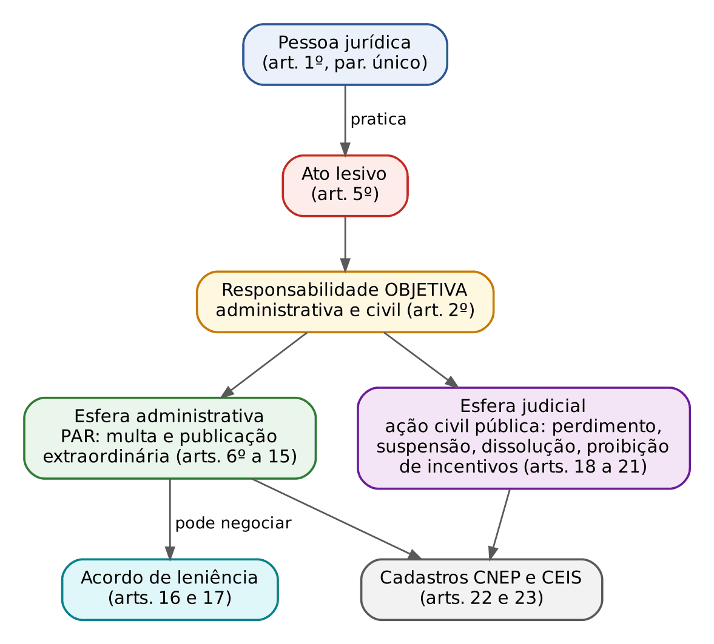
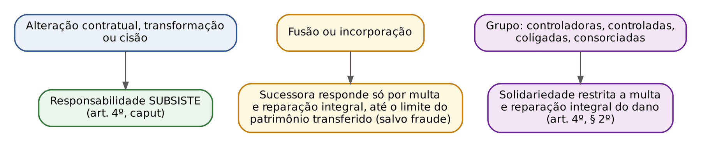
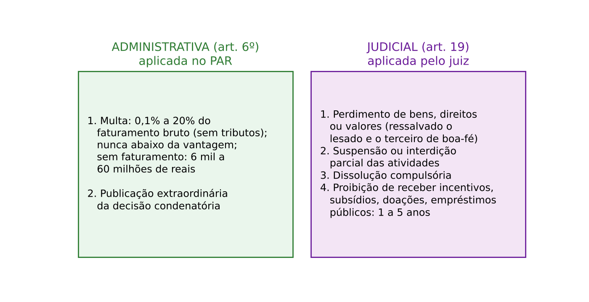
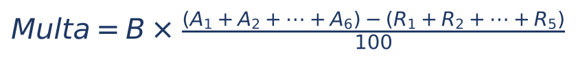
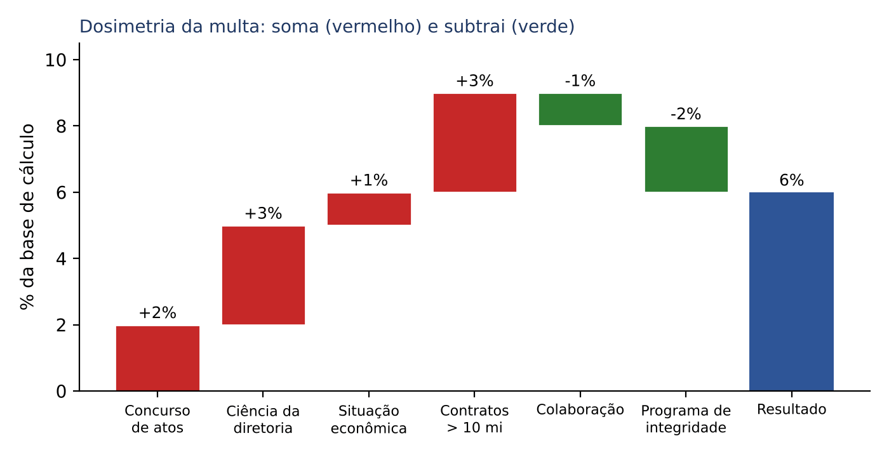
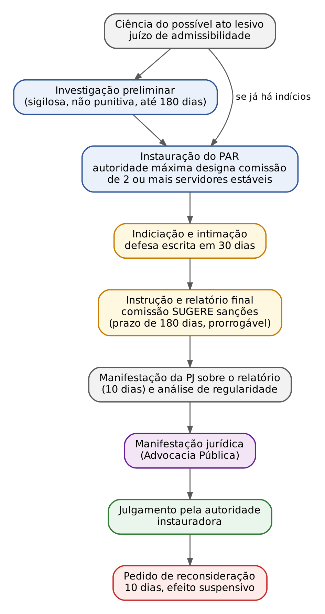
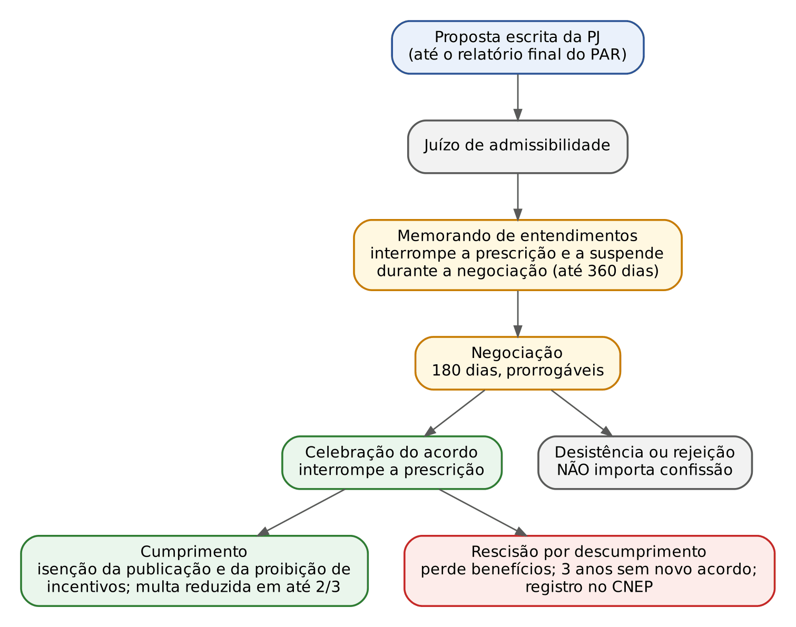
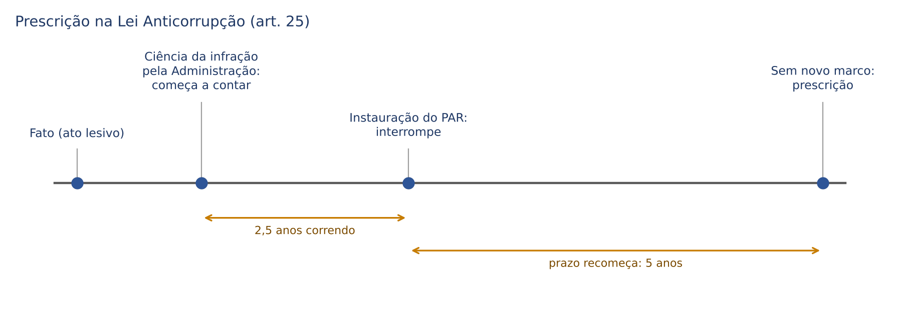

# CAPÍTULO 30 — LEI ANTICORRUPÇÃO (LEI 12.846/2013) E DECRETO 11.129/2022

:::INCIDENCIA
Edital SEFAZ/SC — Ética, Integridade e Prevenção ao Assédio e Discriminação, parte final ("Lei nº 12.846/2013 — Lei anticorrupção"). Nível A.
Lote do banco: 73 questões (FCC 8, FGV 65), quase todas de 2024 a 2026, mais 3 localizadas por palavra-chave fora do lote.
O que mais cai: responsabilidade objetiva da pessoa jurídica x culpabilidade dos dirigentes; sanções administrativas (só multa e publicação) x judiciais; requisitos e efeitos do acordo de leniência; prazos do PAR (30 dias de defesa, 180 dias de comissão); dosimetria (art. 7º); sucessão societária (art. 4º).
:::

:::ESQUEMA O que você vai aprender e o que precisa saber antes
Pré-requisitos: nenhum de matemática, salvo porcentagem simples (Cap. 1) no cálculo da multa (30.6.3). Os conceitos de ética pública, improbidade administrativa nas linhas gerais e conflito de interesses estão no Cap. 27; o programa de integridade na Administração Pública, a gestão de riscos e as linhas de defesa estão no Cap. 28. Aqui o foco é a pessoa jurídica PRIVADA que corrompe ou frauda o Estado.
- 30.1 A lógica da lei: por que punir a empresa, e não só o diretor.
- 30.2 a 30.4 Quem responde, como responde (objetivamente) e o que acontece em fusões, incorporações e grupos.
- 30.5 Os atos lesivos do art. 5º, com atenção às licitações.
- 30.6 Sanções administrativas e judiciais, dosimetria e o cálculo da multa pelo Decreto 11.129/2022.
- 30.7 e 30.8 O Processo Administrativo de Responsabilização (PAR), a desconsideração da personalidade jurídica e a ação judicial.
- 30.9 O acordo de leniência: quem celebra, requisitos, efeitos, prescrição.
- 30.10 e 30.11 CNEP, CEIS, prescrição, programa de integridade e as relações com a Lei 14.133/2021.
- 30.12 e 30.13 Convivência com a Lei de Improbidade e a regulamentação em Santa Catarina.
:::

## 30.1 A lógica da Lei Anticorrupção

Imagine uma construtora que paga propina a um fiscal de obras para ter um aditivo aprovado. Antes de 2013, o Estado tinha boas ferramentas para punir o fiscal (crime de corrupção passiva, improbidade, demissão) e o diretor que pagou (corrupção ativa). Mas a EMPRESA, que embolsou o lucro do aditivo, saía praticamente ilesa: bastava trocar o diretor e seguir contratando com o Poder Público.

A Lei 12.846, de 1º/8/2013, nasceu para fechar essa porta. Ela é chamada de Lei Anticorrupção ou "Lei da Empresa Limpa". A ideia central cabe numa frase: quem se beneficia do ato lesivo é a pessoa jurídica; logo, ela deve responder por ele, e responder sem que o Estado precise provar a culpa de alguém dentro dela.

Três escolhas do legislador explicam quase todas as questões de prova:
- a responsabilidade da pessoa jurídica é OBJETIVA (não depende de dolo ou culpa), nas esferas administrativa e civil, e NÃO penal (a lei não cria crime);
- há duas trilhas paralelas de punição: a administrativa, conduzida pela própria Administração no PAR, com sanções mais "leves" (multa e publicação da condenação), e a judicial, com as sanções mais drásticas (perdimento de bens, suspensão de atividades, dissolução, proibição de incentivos);
- o Estado oferece um "prêmio" à empresa que colabora: o acordo de leniência, que reduz a multa e isenta de algumas sanções em troca de provas e da identificação dos demais envolvidos.

O pano de fundo é internacional. O Brasil havia assumido compromissos na Convenção da OCDE sobre o combate à corrupção de funcionários públicos estrangeiros em transações comerciais internacionais (promulgada pelo Decreto 3.678/2000, citado no art. 9º da lei), na Convenção Interamericana contra a Corrupção e na Convenção das Nações Unidas contra a Corrupção (Convenção de Mérida, promulgada pelo Decreto 5.687/2006). Por isso a lei protege também a administração pública ESTRANGEIRA e fala em atos contra "os compromissos internacionais assumidos pelo Brasil" (art. 5º, caput).

A lei federal foi regulamentada, no Poder Executivo federal, primeiro pelo Decreto 8.420/2015 e hoje pelo Decreto 11.129, de 11/7/2022 (em vigor desde 18/7/2022), que revogou o anterior (art. 70). Como a lei é nacional, cada ente federativo pode editar seu próprio regulamento; o de Santa Catarina está em 30.13.

:::DICA Como a lei está organizada (decore a "geografia")
| Capítulo da lei | Artigos | Conteúdo |
|---|---|---|
| I — Disposições gerais | 1º a 4º | quem responde, responsabilidade objetiva, dirigentes, sucessão e grupos |
| II — Atos lesivos | 5º | o rol de condutas; administração pública estrangeira |
| III — Responsabilização administrativa | 6º e 7º | multa, publicação extraordinária, dosimetria |
| IV — PAR | 8º a 15 | competência, CGU, comissão, prazos, desconsideração |
| V — Acordo de leniência | 16 e 17 | requisitos, efeitos, CGU, licitações |
| VI — Responsabilização judicial | 18 a 21 | sanções judiciais, legitimados, rito da ação civil pública |
| VII — Disposições finais | 22 a 31 | CNEP, CEIS, destinação, prescrição, representação, extraterritorialidade, relação com outras leis, vigência |
A lei entrou em vigor 180 dias após a publicação (art. 31), ou seja, em 29/1/2014.
:::

## 30.2 Quem responde: âmbito subjetivo e territorial

### 30.2.1 As pessoas jurídicas alcançadas

O art. 1º, parágrafo único, é amplíssimo. Pense nele como uma rede de malha fina. Estão sujeitas à lei:
- as sociedades empresárias e as sociedades simples, personificadas ou não, qualquer que seja a forma ou o modelo societário (limitada, anônima, sociedade em comum, sociedade em conta de participação);
- quaisquer fundações e associações de entidades ou pessoas, inclusive SEM fins lucrativos;
- as sociedades estrangeiras que tenham sede, filial ou representação no território brasileiro;
- todas elas constituídas de fato ou de direito, ainda que temporariamente.

Repare em três pegadinhas frequentes. Primeira: a lei alcança entidades sem finalidade lucrativa (uma associação, uma ONG, uma fundação), e não só empresas. Segunda: alcança até a sociedade "de fato", sem registro. Terceira: a estrangeira entra se tiver sede, filial ou representação no Brasil, mesmo temporária.

Note que o sujeito passivo da sanção é sempre a PESSOA JURÍDICA. A lei não prevê sanções para dirigentes, administradores ou sócios como pessoas físicas: estes respondem pelas leis próprias (penal, improbidade, civil), na medida da sua culpabilidade (ver 30.3). A única ponte que a lei faz até as pessoas físicas é a desconsideração da personalidade jurídica (art. 14, ver 30.7.4).

### 30.2.2 A administração pública protegida e o alcance territorial

A lei protege a administração pública NACIONAL (de todos os Poderes e de todas as esferas: União, Estados, Distrito Federal e Municípios) e a ESTRANGEIRA. Para esta, o art. 5º traz definições:
- administração pública estrangeira: órgãos e entidades estatais ou representações diplomáticas de país estrangeiro, de qualquer nível ou esfera de governo, e as pessoas jurídicas controladas, direta ou indiretamente, pelo poder público de país estrangeiro (§ 1º);
- equiparam-se a ela as organizações públicas internacionais (§ 2º);
- agente público estrangeiro é quem exerce cargo, emprego ou função pública nesses órgãos, ainda que transitoriamente ou sem remuneração (§ 3º).

E o art. 28 resolve a questão territorial: a lei aplica-se aos atos lesivos praticados por pessoa jurídica brasileira contra a administração pública estrangeira, AINDA QUE COMETIDOS NO EXTERIOR. O Decreto 11.129/2022 (art. 1º, § 1º) completa: a lei alcança também atos praticados no todo ou em parte no território nacional ou que nele produzam efeitos, e atos praticados no exterior contra a administração pública nacional.

:::ESQUEMA Uma empresa brasileira paga suborno a um ministro de outro país, lá fora
- Aplica-se a Lei 12.846? Sim (art. 28: pessoa jurídica brasileira, ato contra administração estrangeira, ainda que no exterior).
- Quem apura, processa e julga? A Controladoria-Geral da União (art. 9º; Decreto 11.129, art. 18).
- Quem celebra eventual acordo de leniência? Também a CGU (art. 16, § 10).
:::

:::QUESTAO FCC 2025 — PGE-MT — Procurador do Estado (Q3745767)
A questão pede a afirmação correta sobre o alcance da Lei 12.846/2013. As alternativas falam em sanções aos dirigentes, afastamento das sanções da lei de licitações, aplicação a atos de pessoa jurídica brasileira contra administração estrangeira cometidos no exterior, responsabilidade solidária dos sócios e inaplicabilidade a entidades estrangeiras. Gabarito oficial: C.
- C, correta: é o texto do art. 28.
- A, errada: a lei sanciona a PESSOA JURÍDICA; os dirigentes respondem em âmbito próprio, na medida da culpabilidade (art. 3º, § 2º).
- B, errada: o art. 30, II, diz o contrário: a aplicação das sanções da Lei Anticorrupção NÃO afeta a responsabilização pelas normas de licitações e contratos.
- D, errada: a solidariedade do art. 4º, § 2º, é entre SOCIEDADES (controladoras, controladas, coligadas e consorciadas), restrita a multa e reparação do dano, e não com "todos os que participem do quadro social".
- E, errada: a lei se aplica a sociedades estrangeiras com sede, filial ou representação no Brasil (art. 1º, parágrafo único).
:::

:::QUESTAO FGV 2024 — Município (prova não identificada) (Q3113985)
Duas situações: (1) associação sem fins lucrativos pratica ato lesivo contra o Município; (2) sociedade empresária pratica ato lesivo e, no curso do PAR, é incorporada por outra, sem intuito fraudulento. Pergunta-se o que é possível na esfera administrativa. Gabarito oficial: A.
- A, correta: nas duas situações cabe multa no PAR; na segunda, a incorporadora responde só por multa (e reparação integral), até o limite do patrimônio transferido (art. 4º, § 1º).
- B, errada: associações sem fins lucrativos estão expressamente abrangidas (art. 1º, parágrafo único); e a dissolução compulsória nem é sanção administrativa, é judicial (art. 19, III).
- C, errada: a sucessora responde, nos limites do § 1º do art. 4º.
- D, errada: suspensão e interdição de atividades são sanções JUDICIAIS, e não se aplicam à sucessora na incorporação sem fraude.
- E, errada: não há exceção para nenhuma das situações.
:::

:::QUESTAO FGV 2026 — TCE-SC — Auditor Fiscal de Controle Externo — Direito (Q4088850)
Três afirmações sobre a legislação brasileira de combate à corrupção: (I) a Convenção da OCDE não influenciou a legislação brasileira; (II) a responsabilização da pessoa jurídica depende de dolo ou culpa; (III) a responsabilização abrange atos contra o patrimônio público nacional e estrangeiro. Gabarito oficial: C (só III).
- I, falsa: a própria lei menciona a Convenção da OCDE (art. 9º), e os compromissos internacionais estão no art. 5º, caput.
- II, falsa: a responsabilidade é objetiva (arts. 1º e 2º).
- III, verdadeira: art. 5º, caput (patrimônio público nacional ou estrangeiro).
:::

## 30.3 Responsabilidade objetiva e independência das pessoas naturais

### 30.3.1 O que significa "objetiva"

No Direito Civil o magistrado já conhece a ideia: na responsabilidade objetiva, basta provar a conduta, o resultado e o nexo; não se discute culpa. Na Lei Anticorrupção, o art. 2º aplica essa lógica: as pessoas jurídicas são responsabilizadas objetivamente, nos âmbitos administrativo e civil, pelos atos lesivos praticados em seu interesse ou benefício, exclusivo ou não.

Desmonte a frase em três "testes" que a Administração precisa provar:
- houve um ato lesivo do art. 5º (a conduta típica);
- o ato foi praticado no interesse ou em benefício da pessoa jurídica, ainda que não exclusivo (o empregado que paga propina para ganhar a licitação para a empresa e, de quebra, ganhar uma comissão: o benefício não é exclusivo da empresa, mas a lei incide);
- há vínculo entre o ato e a pessoa jurídica (praticado por quem age em seu nome ou em seu proveito).

O que a Administração NÃO precisa provar: o dolo ou a culpa dos dirigentes; a identificação de qual diretor autorizou; a condenação prévia de alguma pessoa física; nem mesmo o pagamento efetivo de propina, quando o ato lesivo for outro (fraude à licitação, manipulação do equilíbrio do contrato).

Atenção: "objetiva" não quer dizer "sem prova". O ato lesivo e o vínculo com a empresa precisam ser demonstrados, com contraditório e ampla defesa. E em dois incisos do art. 5º a própria lei exige prova reforçada, com o advérbio "comprovadamente" (incisos II e III, ver 30.5).

### 30.3.2 E os diretores, sócios e empregados?

O art. 3º separa as trilhas:
- a responsabilização da pessoa jurídica NÃO EXCLUI a responsabilidade individual de seus dirigentes ou administradores ou de qualquer pessoa natural, autora, coautora ou partícipe do ato ilícito (caput);
- a pessoa jurídica será responsabilizada INDEPENDENTEMENTE da responsabilização individual dessas pessoas naturais (§ 1º);
- os dirigentes ou administradores somente serão responsabilizados por atos ilícitos NA MEDIDA DA SUA CULPABILIDADE (§ 2º), ou seja, de modo SUBJETIVO.

Uma imagem ajuda: são dois trilhos paralelos que nunca se cruzam. No trilho da empresa, responsabilidade objetiva; no trilho das pessoas físicas, responsabilidade subjetiva, pelas leis próprias. Um trem pode andar sem o outro.

:::PEGADINHA As quatro trocas que a banca faz nos arts. 2º e 3º
- Trocar "objetiva" por "subjetiva" para a pessoa jurídica (ou dizer "objetiva no civil e subjetiva no administrativo"): ERRADO, é objetiva nas duas esferas.
- Dizer que os dirigentes respondem objetivamente "sempre que a empresa for punida": ERRADO, respondem na medida da culpabilidade.
- Condicionar a punição da empresa à punição prévia de um dirigente ou de um servidor: ERRADO (art. 3º, § 1º).
- Dizer que a punição da empresa "exclui" ou "absorve" a dos dirigentes: ERRADO (art. 3º, caput).
:::

:::QUESTAO FCC 2026 — MPE-SE — Analista do Ministério Público — Ciências Contábeis (Q3884299)
No PAR, apura-se manipulação do equilíbrio econômico-financeiro de contrato (art. 5º, IV, g). Não foi possível individualizar a culpa dos dirigentes da empreiteira, mas ficou provado que os dados do pedido de reequilíbrio foram fraudados, com vantagem ilícita para a empresa. Gabarito oficial: C.
- C, correta: a empreiteira responde objetivamente, independentemente de culpa ou dolo dos dirigentes (arts. 2º e 3º, § 1º). Não identificar o diretor culpado não impede a punição da empresa.
- A, errada: dirigentes só respondem na medida da culpabilidade (art. 3º, § 2º); não há responsabilidade objetiva deles.
- B, errada: a responsabilidade é objetiva, e o ilícito do caso nem envolve propina.
- D, errada: a lei sanciona justamente a pessoa jurídica; pessoas físicas não são alvo das sanções da Lei 12.846.
- E, errada: a responsabilidade é direta, não subsidiária.
:::

:::QUESTAO FCC 2026 — SEFAZ-MT — Fiscal de Tributos Estaduais (Q3947202)
Pede-se a afirmação correta sobre a responsabilização da pessoa jurídica por atos lesivos praticados em seu interesse ou benefício. Gabarito oficial: C.
- C, correta: alcança sociedades estrangeiras com sede, filial ou representação no Brasil, ainda que temporária (art. 1º, parágrafo único), e é irrelevante o dolo ou a culpa (art. 2º).
- A e D, erradas: condicionam a responsabilidade da empresa à responsabilização ou à conduta individual dos administradores, o que o art. 3º, § 1º, afasta.
- B, errada: na incorporação a responsabilidade SUBSISTE (art. 4º, caput); a sucessora responde por multa e reparação até o limite do patrimônio transferido (§ 1º). A alternativa erra ao dizer que a responsabilização é "afastada" e que a sucessora assume "integralmente" tudo.
- E, errada: o acordo de leniência não afasta a responsabilização: isenta de algumas sanções e reduz a multa (art. 16, § 2º).
:::

:::QUESTAO FCC 2025 — SEFAZ-PI — Analista do Tesouro Estadual (Q3506156)
Pede-se o efeito da configuração de ato lesivo. Gabarito oficial: B.
- B, correta: não exime os dirigentes ou administradores de responsabilidade pessoal, mediante prova de culpa ou dolo (art. 3º, caput e § 2º).
- A, errada: a multa não é alternativa à reparação; a reparação integral do dano é sempre devida (art. 6º, § 3º).
- C, errada: a cumulação de multa e reparação não exclui a responsabilidade dos dirigentes.
- D, errada: a responsabilidade da empresa não depende de dolo, muito menos de "dolo específico" dos dirigentes.
- E, errada: alienação de controle ou incorporação não "obstam" a responsabilização (art. 4º).
:::

:::QUESTAO FGV 2024 — ENAM — 1º Exame Nacional da Magistratura (Q2459864)
Pede-se a afirmativa correta sobre a Lei 12.846/2013. Gabarito oficial: C.
- C, correta: responsabilidade objetiva nos âmbitos administrativo e civil (art. 2º).
- A, errada: dirigentes respondem na medida da culpabilidade, não objetivamente.
- B, errada: a responsabilização da empresa não exclui a dos dirigentes (art. 3º, caput).
- D, errada: a empresa responde independentemente da responsabilização individual (art. 3º, § 1º).
- E, errada: a sucessora responde de forma restrita (art. 4º, § 1º), e isso não gera responsabilidade objetiva de dirigentes.
No mesmo sentido: Q3114259 (I, II e III corretas, transcrevendo os arts. 2º, 3º e 4º), Q4147594 (responsabilidade da sociedade independentemente da culpabilidade de um dirigente) e Q2759019 (assinalar a INCORRETA: "objetiva no civil e subjetiva no administrativo").
:::

:::QUESTAO FGV 2024 — AL-PR — Procurador (Q2448947)
Sociedade de fachada (*paper company*, "empresa de papel") criada para dificultar a fiscalização e promover sonegação de um grupo empresarial. Gabarito oficial: D.
- D, correta: a responsabilização da sociedade não exclui a dos dirigentes, na medida da culpabilidade (art. 3º).
- A, errada: não se exige elemento subjetivo da pessoa jurídica.
- B, errada: dissolução compulsória só na via JUDICIAL (art. 19, III e § 1º), nunca no PAR. Note que o caso é típico de dissolução (pessoa jurídica constituída para ocultar interesses ilícitos), mas o juiz é quem a decreta.
- C, errada: a ação judicial não depende de prévio PAR (art. 18).
- E, errada: na desconsideração, os efeitos das sanções SÃO estendidos aos administradores e sócios com poderes de administração (art. 14).
:::

:::QUESTAO FGV 2024 — ENAM — 1º Exame Nacional da Magistratura (Q2459875)
Três afirmações sobre *compliance* ("conformidade") e a lei: (I) "por meio da responsabilidade subjetiva", as empresas podem ser punidas independentemente de culpa; (II) a responsabilização da pessoa jurídica não exclui a dos dirigentes e de qualquer pessoa natural autora, coautora ou partícipe; (III) a lei só incide diretamente no âmbito federal. Gabarito oficial: A (II, apenas). Gabarito oficial conferido no QConcursos em 30/10/2026.
- II, verdadeira: reproduz o art. 3º, caput.
- I, falsa: é contraditória, pois responsabilidade "independentemente de culpa" é responsabilidade OBJETIVA (art. 1º e art. 2º), e não subjetiva.
- III, falsa: a lei tem caráter nacional e alcança todas as esferas (arts. 1º, 8º e 22).
- Por isso C (I e III), letra que constava antes no banco por erro de coleta, está ERRADA: reúne justamente os dois itens falsos.
:::

## 30.4 Sucessão societária e grupos econômicos

A empresa infratora poderia tentar "fugir" da punição mudando de roupa: alterando o contrato social, transformando-se de limitada em anônima, fundindo-se com outra, sendo incorporada ou dividindo-se (cisão). O art. 4º fecha essa saída: SUBSISTE a responsabilidade da pessoa jurídica em todas essas hipóteses (caput).

Mas o legislador também protegeu quem compra uma empresa de boa-fé. Nas hipóteses de fusão e incorporação, a responsabilidade da sucessora fica restrita (§ 1º):
- à obrigação de pagar a multa e de reparar integralmente o dano;
- até o limite do patrimônio transferido;
- sem as demais sanções (publicação extraordinária, suspensão, dissolução, proibição de incentivos) por atos anteriores à fusão ou incorporação;
- salvo simulação ou evidente intuito de fraude, devidamente comprovados (aí a sucessora responde por tudo).

Exemplo à mão: a empresa A, multada em 3.000.000 reais, é incorporada por B. O patrimônio líquido que A transferiu a B vale 2.000.000 reais. Sem fraude, B responde pela multa e pela reparação só até 2.000.000 reais e não sofre, por exemplo, a publicação extraordinária da condenação de A.

Por fim, o § 2º trata dos grupos: as sociedades controladoras, controladas, coligadas ou, no âmbito do respectivo contrato, as consorciadas são SOLIDARIAMENTE responsáveis, restringindo-se essa solidariedade à multa e à reparação integral do dano.

:::QUESTAO FGV 2026 — TCE-SC — Auditor Fiscal de Controle Externo — Direito (Q4088835)
A sociedade Alfa, controlada por Sigma, foi punida (multa no PAR; perdimento, proibição de incentivos por 3 anos e reparação do dano na via judicial) e depois incorporada por Beta, sem simulação nem fraude. Gabarito oficial: B.
- B, correta: Beta, sucessora por incorporação, responde só pela multa e pela reparação integral, até o limite do patrimônio transferido (art. 4º, § 1º).
- A e C, erradas: a controladora Sigma responde SOLIDARIAMENTE (não "subsidiariamente" e não "nunca"), restrita à multa e à reparação (art. 4º, § 2º).
- D, errada: o caput do art. 4º inclui a incorporação.
- E, errada: há restrição das sanções transferíveis, tanto para a sucessora quanto para o grupo.
No mesmo sentido: Q2564190 (sucessora responde só por multa e reparação, até o limite do patrimônio transferido, salvo fraude) e Q3363369 (gabarito oficial D, conferido no QConcursos em 30/10/2026: V-F-V, pois a responsabilidade é objetiva e subsiste na incorporação).
:::

:::QUESTAO FGV 2025 — TJ-MS — Juiz Substituto (Q3786418)
Ação civil pública contra a sociedade controladora (Mévio S/A) e sua subsidiária, por ato lesivo praticado por funcionários da subsidiária. Gabarito oficial: C.
- C, correta: a lei prevê expressamente a solidariedade das controladoras, controladas, coligadas e consorciadas, restrita à multa e à reparação integral do dano (art. 4º, § 2º).
- A, errada: a controladora tem legitimidade passiva justamente pelo § 2º.
- B, errada: mistura o caput (subsistência em alterações contratuais) com a solidariedade, que vem do § 2º.
- D, errada: a previsão é expressa na lei.
- E, errada: a solidariedade abrange multa E reparação, não só reparação.
:::

:::PRATIQUE exercícios elaborados para esta apostila (sujeitos e responsabilidade)
1. Uma fundação privada de pesquisa, sem fins lucrativos, frauda a prestação de contas de um convênio com o Estado. Ela pode ser punida pela Lei 12.846?
2. Uma sociedade em conta de participação (sem personalidade jurídica) frauda licitação. Quem a representa no PAR?
3. A empresa X frauda um contrato em 2023. Em 2025, X é incorporada por Y, sem fraude. O patrimônio transferido vale 900.000 reais. No PAR, a multa calculada para X é de 1.500.000 reais e o dano a reparar é de 400.000 reais. Até quanto Y responde, somando multa e reparação?
4. (estilo FCC) Diante do ato lesivo praticado por empregado de uma empresa estrangeira com filial em Santa Catarina, assinale: (a) a empresa só responde se o empregado for condenado criminalmente; (b) a empresa responde objetivamente, e o empregado, na medida de sua culpabilidade, pelas leis próprias; (c) a empresa não responde, por ser estrangeira.
Resolução:
1. Sim. O art. 1º, parágrafo único, alcança "quaisquer fundações" e associações, com ou sem fins lucrativos. A fraude a convênio entra no art. 5º (patrimônio público e princípios da Administração), e no art. 5º, V, se a fraude dificultou a fiscalização.
2. A pessoa a quem couber a administração de seus bens (art. 26, § 1º). A lei alcança sociedades "personificadas ou não".
3. Multa mais reparação: 1.500.000 + 400.000 = 1.900.000 reais. O teto é o patrimônio transferido: 900.000 reais. Como 1.900.000 é maior que 900.000, Y responde até 900.000 reais (art. 4º, § 1º). As demais sanções não se transferem.
4. Alternativa (b): art. 1º, parágrafo único (estrangeira com filial no Brasil), art. 2º (objetiva) e art. 3º, §§ 1º e 2º.
:::

## 30.5 Os atos lesivos (art. 5º)

O art. 5º diz que são atos lesivos os praticados pelas pessoas jurídicas do art. 1º que atentem contra o patrimônio público nacional ou estrangeiro, contra princípios da administração pública ou contra os compromissos internacionais assumidos pelo Brasil, "assim definidos" nos incisos. Repare: não é preciso dano patrimonial; basta atentar contra princípios (a fraude à competitividade de uma licitação é ato lesivo mesmo que o preço final tenha sido bom).

| Inciso | Conduta (em linguagem simples) | Palavra-chave |
|---|---|---|
| I | prometer, oferecer ou dar, direta ou indiretamente, vantagem indevida a agente público ou a terceira pessoa a ele relacionada | propina (basta prometer) |
| II | comprovadamente, financiar, custear, patrocinar ou subvencionar a prática dos atos ilícitos da lei | financiador |
| III | comprovadamente, usar interposta pessoa física ou jurídica para ocultar ou dissimular seus reais interesses ou a identidade dos beneficiários | "laranja" |
| IV | atos em licitações e contratos (alíneas a a g, abaixo) | licitações |
| V | dificultar investigação ou fiscalização de órgãos, entidades ou agentes públicos, ou intervir em sua atuação, INCLUSIVE no âmbito das agências reguladoras e dos órgãos de fiscalização do sistema financeiro nacional | obstrução |

As alíneas do inciso IV, que interessam muito ao auditor fiscal:
- a) frustrar ou fraudar, mediante ajuste, combinação ou qualquer outro expediente, o caráter competitivo de procedimento licitatório (o cartel, o "conluio");
- b) impedir, perturbar ou fraudar a realização de qualquer ato de procedimento licitatório;
- c) afastar ou procurar afastar licitante, por meio de fraude ou oferecimento de vantagem de qualquer tipo;
- d) fraudar licitação pública ou contrato dela decorrente;
- e) criar, de modo fraudulento ou irregular, pessoa jurídica para participar de licitação ou celebrar contrato;
- f) obter vantagem ou benefício indevido, de modo fraudulento, de modificações ou prorrogações de contratos sem autorização em lei, no edital ou no contrato;
- g) manipular ou fraudar o equilíbrio econômico-financeiro dos contratos.

:::PEGADINHA Três trocas recorrentes no art. 5º
- Inciso I: a vantagem pode ser a agente público OU a "terceira pessoa a ele relacionada", e pode ser dada direta OU indiretamente. Basta PROMETER.
- Inciso V: a lei diz "INCLUSIVE no âmbito das agências reguladoras e dos órgãos de fiscalização do sistema financeiro"; a banca troca por "salvo".
- Incisos II e III têm o advérbio "comprovadamente"; os demais não.
:::

O inciso V merece atenção de quem vai ser auditor: empresa que embaraça a fiscalização (sonega documentos, insere informação falsa em sistema de monitoramento apresentado ao fisco, ameaça o fiscal) pratica ato lesivo, ainda que nenhum servidor tenha sido corrompido. A FGV cobrou esse ponto à luz da jurisprudência do STJ (Q3898982, abaixo).

:::QUESTAO FGV 2025 — Prefeitura de Niterói — Advogado (Q3656888)
Pede-se a conduta que NÃO constitui ato lesivo. Gabarito oficial: B.
- B, correta (é a que não corresponde à lei): o inciso V diz "inclusive" no âmbito das agências reguladoras e dos órgãos de fiscalização do sistema financeiro; a alternativa troca por "salvo".
- A (art. 5º, IV, f), C (IV, a), D (I) e E (IV, c) reproduzem a lei e, portanto, são atos lesivos.
No mesmo sentido: Q4223219 (fraudar licitação ou contrato dela decorrente, art. 5º, IV, d; as demais alternativas descrevem condutas lícitas, como recorrer de decisão da comissão ou pedir reequilíbrio).
:::

:::QUESTAO FGV 2026 — TJ-PR — Juiz Substituto (Q3898982)
Mineradora causa dano ambiental e insere informações falsas e incompletas no sistema de monitoramento apresentado à fiscalização municipal; o Município aplica multa com base no art. 5º, V. Gabarito oficial: E.
- E, correta: a multa pode ser aplicada com base na Lei Anticorrupção, que tem escopo amplo e protege a Administração contra condutas lesivas, não só contra a corrupção de servidores. O ato de dificultar a fiscalização (inserir dados falsos) basta.
- A, errada: a multa é sanção ADMINISTRATIVA (art. 6º, I), aplicada no PAR pelo próprio ente.
- B, errada: o inciso V não exige corrupção de servidor.
- C, errada: a responsabilidade é objetiva.
- D, errada: o inciso V fala em dificultar "investigação OU fiscalização"; não se exige óbice a investigação criminal.
A questão menciona jurisprudência do STJ nesse sentido; o precedente não foi conferido para esta apostila (ver nota de verificação).
:::

:::QUESTAO FCC 2026 — SEFAZ-CE — Auditor Fiscal da Receita Estadual — Conhecimentos Gerais (Q4221390)
Uma associação brasileira de entidades ofereceu, indiretamente, vantagem indevida a terceira pessoa relacionada a agente público estrangeiro. Pergunta-se sobre o acordo de leniência. Gabarito oficial: C.
- Primeiro, a premissa: há ato lesivo (art. 5º, I: oferecer, indiretamente, vantagem a "terceira pessoa a ele relacionada"; § 1º: administração pública estrangeira), e a associação está no âmbito da lei (art. 1º, parágrafo único).
- C, correta: cabe leniência se a associação colaborar efetivamente e se da colaboração resultarem AMBOS os resultados do art. 16: a identificação dos demais envolvidos, quando couber, E a obtenção célere de informações e documentos que comprovem o ilícito.
- A e B, erradas: a lei protege a administração estrangeira e alcança a vantagem dada à terceira pessoa relacionada ao agente.
- D e E, erradas: usam "bastando apenas" um dos dois resultados, quando a lei liga os incisos com "e" (cumulativos).
Observação de prova: esta é a questão do lote mais próxima do seu concurso (prova de SEFAZ, banca FCC, Conhecimentos Gerais, 2026; o seu cargo é o de Auditor Estadual de Finanças Públicas da SEFAZ/SC). Ela cobra literalidade dos arts. 5º e 16.
:::

## 30.6 Sanções: administrativas, judiciais e dosimetria

### 30.6.1 As duas listas (decore a fronteira)

A lei distribui as sanções em duas listas, e essa fronteira é a pergunta mais frequente do lote. Na esfera ADMINISTRATIVA (art. 6º), aplicadas pela própria Administração ao final do PAR, só existem DUAS sanções:
- multa, de 0,1% a 20% do faturamento bruto do último exercício anterior ao da instauração do processo administrativo, excluídos os tributos, que nunca será inferior à vantagem auferida, quando for possível estimá-la (inciso I);
- publicação extraordinária da decisão condenatória (inciso II).

Na esfera JUDICIAL (art. 19), por ação proposta pela União, Estados, Distrito Federal e Municípios (por suas Advocacias Públicas ou órgãos de representação judicial) ou pelo Ministério Público, são QUATRO:
- perdimento dos bens, direitos ou valores que representem vantagem ou proveito direta ou indiretamente obtidos da infração, ressalvado o direito do lesado ou de terceiro de boa-fé (I);
- suspensão ou interdição parcial de suas atividades (II);
- dissolução compulsória da pessoa jurídica (III);
- proibição de receber incentivos, subsídios, subvenções, doações ou empréstimos de órgãos ou entidades públicas e de instituições financeiras públicas ou controladas pelo poder público, pelo prazo mínimo de 1 e máximo de 5 anos (IV).

:::DICA Regra de bolso para não errar a fronteira
A Administração só pode "mexer no bolso" (multa) e "na reputação" (publicação). Tudo o que atinge o patrimônio de forma definitiva (perdimento), a própria existência ou o funcionamento da empresa (suspensão, interdição, dissolução) ou o acesso a dinheiro público (proibição de incentivos) depende de JUIZ. Se a alternativa disser que o PAR aplicou dissolução, perdimento, suspensão ou proibição de incentivos, está errada.
Exceção que confirma a regra: nas ações do Ministério Público, o JUIZ pode aplicar também as sanções administrativas do art. 6º, desde que constatada a omissão das autoridades administrativas (art. 20).
:::

Detalhes da multa e da publicação que a banca copia literalmente:
- sem possibilidade de usar o critério do faturamento bruto, a multa vai de 6.000 a 60.000.000 reais (art. 6º, § 4º);
- as sanções são aplicadas fundamentadamente, isolada ou cumulativamente, conforme as peculiaridades do caso, a gravidade e a natureza das infrações (§ 1º);
- a aplicação é precedida de manifestação jurídica da Advocacia Pública ou do órgão de assistência jurídica do ente (§ 2º);
- nenhuma sanção exclui, em qualquer hipótese, a obrigação de reparar integralmente o dano (§ 3º);
- a publicação extraordinária é feita na forma de extrato de sentença, à custa da pessoa jurídica, em meios de comunicação de grande circulação na área da infração e de atuação da empresa (ou, na falta, de circulação nacional), por edital afixado no estabelecimento pelo prazo mínimo de 30 dias, e no sítio eletrônico (§ 5º; o Decreto 11.129, art. 28, exige destaque na página principal do sítio por no mínimo 30 dias).

E da via judicial:
- a dissolução compulsória só é determinada quando comprovado que a personalidade jurídica foi usada de forma habitual para facilitar ou promover atos ilícitos, ou que a pessoa jurídica foi constituída para ocultar ou dissimular interesses ilícitos ou a identidade dos beneficiários (art. 19, § 1º);
- as sanções judiciais podem ser aplicadas de forma isolada ou cumulativa (§ 3º);
- o Ministério Público ou a Advocacia Pública pode requerer a indisponibilidade de bens, direitos ou valores necessários à garantia da multa ou da reparação integral do dano, ressalvado o terceiro de boa-fé (§ 4º).

:::QUESTAO FGV 2024 — TJ-SC — Analista Jurídico (Q2515287)
Pede-se um exemplo de sanção administrativa e um de sanção judicial, nessa ordem. Gabarito oficial: C.
- C, correta: publicação extraordinária (administrativa, art. 6º, II) e dissolução compulsória (judicial, art. 19, III).
- A, B, D e E, erradas: colocam na esfera administrativa sanções judiciais (perdimento, suspensão, dissolução, proibição de incentivos) ou trocam a ordem (E põe a multa, administrativa, como exemplo judicial).
No mesmo sentido (qual destas é sanção administrativa: a publicação extraordinária): Q2387729, Q3856332, Q4088838.
:::

:::QUESTAO FGV 2026 — ALERJ — Especialista Legislativo (Q3881547)
Pede-se as sanções a que a empresa está sujeita na esfera administrativa. Gabarito oficial: B.
- B, correta: multa de 0,1% a 20% do faturamento bruto do último exercício anterior ao da instauração do processo, excluídos os tributos, nunca inferior à vantagem auferida, quando estimável, e publicação extraordinária, isolada ou cumulativamente (art. 6º, I, II e § 1º).
- A, C, D e E, erradas: incluem perdimento ou suspensão (judiciais) e usam "cumulativamente" como obrigatório.
:::

:::QUESTAO FGV 2026 — AL-RO — Analista Legislativo (Q3883080)
A Advocacia Pública ajuíza ação contra empresa que impediu atos de licitação. Pede-se uma sanção aplicável. Gabarito oficial: D.
- D, correta: perdimento dos bens, direitos ou valores que representem vantagem ou proveito direta ou indiretamente obtidos, ressalvado o direito do lesado ou de terceiro de boa-fé (art. 19, I).
- A, errada: a proibição de incentivos vai de 1 a 5 anos, não até 10.
- B e C, erradas: as hipóteses descritas (constituição para ocultar interesses, uso habitual para ilícitos) são os pressupostos da DISSOLUÇÃO (art. 19, § 1º), não da suspensão.
- E, errada: a lei ressalva o terceiro de boa-fé.
:::

:::QUESTAO FGV 2025 — TJ-RS — Analista Judiciário (Q3742953)
Três afirmações sobre as sanções administrativas: aplicação fundamentada, isolada ou cumulativa; precedência de manifestação jurídica da Advocacia Pública; multa de 6 mil a 60 milhões de reais quando inviável o critério do faturamento. Gabarito oficial: E (V-V-V).
- As três reproduzem o art. 6º, §§ 1º, 2º e 4º.
:::

:::QUESTAO FGV 2025 — MPE-RJ — Analista do Ministério Público (Q3362509)
Pergunta-se quais destas sanções podem atingir a pessoa jurídica: (I) proibição de receber incentivos "pelo prazo mínimo de dois e máximo de cinco anos"; (II) perdimento de bens, ressalvado o lesado ou terceiro de boa-fé; (III) dissolução compulsória.
Gabarito oficial: D (II e III, apenas). Gabarito oficial conferido no QConcursos em 30/10/2026.
- II e III, corretos: art. 19, I e III.
- I, errado: diz "mínimo de dois" anos, quando a lei diz mínimo de UM e máximo de cinco (art. 19, IV). É a pegadinha do número; por isso E (I, II e III) está errada.
:::

### 30.6.2 Dosimetria: os fatores do art. 7º

Assim como o juiz criminal fixa a pena pelo art. 59 do Código Penal, a autoridade que aplica a multa considera os fatores do art. 7º da Lei 12.846:
- I — a gravidade da infração;
- II — a vantagem auferida OU PRETENDIDA pelo infrator;
- III — a consumação ou não da infração;
- IV — o grau de lesão ou perigo de lesão;
- V — o efeito negativo produzido pela infração;
- VI — a situação econômica do infrator;
- VII — a cooperação da pessoa jurídica para a apuração das infrações;
- VIII — a existência de mecanismos e procedimentos internos de integridade, auditoria e incentivo à denúncia de irregularidades e a aplicação efetiva de códigos de ética e de conduta (o PROGRAMA DE INTEGRIDADE; parâmetros em regulamento federal, ver 30.11);
- IX — o valor dos contratos mantidos pela pessoa jurídica com o órgão ou entidade lesados.

Um macete para lembrar: "GRAVE VANTAGEM CONSUMADA LESA, tem EFEITO na SITUAÇÃO; COOPERA com INTEGRIDADE no VALOR do CONTRATO". As alternativas erradas costumam inventar fatores com cara de plausíveis: número de empregados, setor econômico, grau de instrução dos sócios, condenação criminal de sócio, investimentos em pesquisa, situação econômica do ENTE lesado, TEMPO (em vez de VALOR) dos contratos.

:::QUESTAO FCC 2026 — AL-MS — Analista Legislativo — Controlador Interno (Q3977896)
Pede-se métricas consideradas na dosagem das sanções administrativas. Gabarito oficial: C.
- C, correta: o valor dos contratos mantidos com o órgão lesado (art. 7º, IX) e a consumação ou não da infração (III).
- A, errada: o grau de lesão está na lei, mas a quantidade de funcionários não (o porte da empresa aparece no Decreto para avaliar o PROGRAMA DE INTEGRIDADE, não como fator autônomo de dosimetria).
- B, errada: condenação criminal do sócio majoritário não é fator.
- D, errada: "caixa gerado" e "participação de militares" são invenções.
- E, errada: a vantagem auferida está na lei, mas o setor econômico não.
:::

:::QUESTAO FGV 2024 — CGM de Belo Horizonte — Auditor Interno (Q2387524)
Gabarito oficial: B.
- B, correta: gravidade, consumação, grau de lesão ou perigo de lesão e existência de mecanismos internos de integridade (art. 7º, I, III, IV e VIII).
- A, errada: "grau de instrução dos acionistas" não existe.
- C, errada: a lei fala em vantagem auferida "OU PRETENDIDA"; dizer "independentemente daquela que foi pretendida" exclui o que a lei inclui.
- D, errada: o valor dos contratos com o órgão lesado PODE ser considerado (IX).
No mesmo sentido: Q3781233 (a exceção é "o TEMPO dos contratos"; a lei fala em VALOR) e Q4130147 (valor dos contratos e efeitos negativos; os distratores trazem investimentos em pesquisa e situação econômica do Estado).
:::

### 30.6.3 Como se calcula a multa (Decreto 11.129/2022, arts. 20 a 27)

Aqui entra um pouco de aritmética. Não se assuste: são só porcentagens, somas e subtrações. Para revisar "como transformar porcentagem em decimal" e "como calcular x% de um valor", veja o Cap. 1.

A ideia em linguagem comum: o Decreto federal transforma os fatores do art. 7º em "pontos percentuais". A comissão parte de zero, SOMA percentuais pelas circunstâncias que agravam (art. 22), SUBTRAI percentuais pelas que atenuam (art. 23), aplica o resultado sobre a base de cálculo e, por fim, confere se o valor ficou entre um piso e um teto (art. 25). É como um placar.

A base de cálculo (art. 20) é o faturamento bruto da pessoa jurídica no último exercício anterior ao da instauração do PAR, excluídos os tributos. Se a empresa pertence a um grupo econômico cujas empresas participaram do ilícito, consolida-se o faturamento delas (§ 2º).

Os fatores que SOMAM (art. 22):
- até 4% se houver concurso de atos lesivos (I);
- até 3% por tolerância ou ciência de pessoas do corpo diretivo ou gerencial (II);
- até 4% por interrupção de serviço público, de obra ou de entrega de bens ou serviços essenciais, ou descumprimento de requisitos regulatórios (III);
- 1% se a situação econômica for boa (índices de solvência geral e de liquidez geral superiores a um e lucro líquido no último exercício) (IV);
- 3% em caso de reincidência, ou seja, nova infração do art. 5º em menos de 5 anos contados da publicação do julgamento da anterior (V);
- conforme o valor somado dos contratos mantidos ou pretendidos com o órgão lesado nos anos do ato lesivo: 1% acima de 500.000 reais; 2% acima de 1.500.000; 3% acima de 10.000.000; 4% acima de 50.000.000; 5% acima de 250.000.000 (VI).

Os fatores que SUBTRAEM (art. 23):
- até 0,5% se a infração não se consumou (I);
- até 1% se houve devolução espontânea da vantagem e ressarcimento dos danos, ou se não há vantagem nem dano comprovados (II);
- até 1,5% pelo grau de colaboração com a investigação, independentemente de acordo de leniência (III);
- até 2% pela admissão voluntária da responsabilidade objetiva (IV; o máximo só se a admissão vier antes da instauração do PAR);
- até 5% se a pessoa jurídica comprovar que possui e aplica programa de integridade (V; o máximo só se o programa for anterior ao ato lesivo).

Com isso, a fórmula é:

O que cada símbolo significa:
- B = base de cálculo, o faturamento bruto do ano anterior ao da instauração do PAR, sem os tributos;
- A₁ a A₆ = os percentuais dos fatores que agravam (art. 22), cada um escrito como número (3% vira 3);
- R₁ a R₅ = os percentuais dos fatores que reduzem (art. 23);
- dividir por 100 transforma o resultado em porcentagem (6 pontos percentuais viram 6/100 = 0,06).

Depois, o resultado é encaixado entre os limites do art. 25:
- PISO = o MAIOR entre a vantagem auferida (se estimável) e 0,1% da base de cálculo;
- TETO = o MENOR entre três vezes a vantagem (a maior entre a pretendida e a auferida) e 20% da base de cálculo;
- se a soma menos a subtração der zero ou menos, a multa é o PISO (§ 2º);
- se o teto calculado ficar abaixo do piso, o teto não é observado (§ 1º).

:::EXEMPLO Cálculo completo da multa de uma construtora
Dados: a construtora Alfa teve, no exercício anterior ao da instauração do PAR, faturamento bruto sem tributos de 50.000.000 reais. Ficou provado: concurso de dois atos lesivos (a comissão atribui 2%); ciência do diretor comercial (3%); boa situação econômica (1%); contratos com o órgão lesado somando 12.000.000 reais (3%, pois supera 10 milhões, mas não 50 milhões). Atenuantes: colaborou parcialmente (1%) e tinha programa de integridade, com falhas (2%). A vantagem auferida foi estimada em 800.000 reais; a pretendida, em 1.200.000 reais.
Passo 1 — somar os agravantes:
- 2 + 3 + 1 + 3
- = 9 pontos percentuais
Passo 2 — somar os atenuantes:
- 1 + 2
- = 3 pontos percentuais
Passo 3 — subtrair:
- 9 − 3 = 6 pontos percentuais, ou seja, 6% = 0,06
Passo 4 — aplicar sobre a base:
- Multa = 50.000.000 × 0,06
- Multa = 3.000.000
Passo 5 — calcular o piso (o maior entre a vantagem auferida e 0,1% da base):
- 0,1% de 50.000.000 = 50.000.000 × 0,001 = 50.000
- vantagem auferida = 800.000
- piso = 800.000 (o maior dos dois)
Passo 6 — calcular o teto (o menor entre 3 vezes a maior vantagem e 20% da base):
- 3 × 1.200.000 = 3.600.000 (a pretendida é maior que a auferida, por isso entra ela)
- 20% de 50.000.000 = 50.000.000 × 0,20 = 10.000.000
- teto = 3.600.000 (o menor dos dois)
Passo 7 — conferir: 3.000.000 está entre 800.000 e 3.600.000. Multa final: 3.000.000 reais (três milhões de reais).
Passo 8 — e se Alfa celebrar acordo de leniência com redução máxima de 2/3 (art. 16, § 2º)?
- redução = 3.000.000 × 2/3 = 2.000.000
- multa após o acordo = 3.000.000 − 2.000.000 = 1.000.000 reais
- atalho: pagar 1/3 de 3.000.000 = 3.000.000 ÷ 3 = 1.000.000. Com o acordo, a multa pode até ficar abaixo do piso legal (Decreto 11.129, art. 27, § 1º).
:::

:::PASSO Como resolver qualquer questão de cálculo da multa
1. Identifique a base (faturamento bruto do ano ANTERIOR ao da instauração do PAR, sem tributos).
2. Some os percentuais agravantes; some os atenuantes; subtraia.
3. Se o resultado for zero ou negativo, a multa é o piso; se positivo, multiplique pela base.
4. Calcule o piso: maior entre a vantagem auferida e 0,1% da base.
5. Calcule o teto: menor entre 3 vezes a maior vantagem e 20% da base.
6. Encaixe o valor entre piso e teto. Se houver leniência, reduza em até 2/3.
:::

:::PRATIQUE exercícios elaborados para esta apostila (cálculo da multa)
1. Uma empresa faturou 4.000.000 reais (sem tributos) no ano anterior ao PAR. Qual a menor e a maior multa possível pela regra geral do art. 6º, I, se não houver estimativa de vantagem?
2. Base de cálculo 20.000.000 reais. Agravantes: concurso de atos (4%), ciência da diretoria (3%), contratos com o órgão lesado somando 300.000.000 reais. Atenuantes: colaboração (1,5%) e admissão voluntária antes do PAR (2%). Vantagem auferida 300.000 reais; pretendida 400.000 reais. Calcule a multa.
3. Base 8.000.000 reais. Agravante: contratos de 700.000 reais com o órgão lesado. Atenuantes: programa de integridade anterior ao ato (5%) e devolução integral da vantagem (1%). Vantagem auferida 150.000 reais. Qual a multa?
4. (estilo FCC) Multa calculada de 2.400.000 reais; a empresa celebra leniência com redução de 2/3. Qual o menor valor que ela pode pagar a título de multa?
Resolução:
1. Menor: 0,1% de 4.000.000 = 4.000.000 × 0,001 = 4.000 reais. Maior: 20% de 4.000.000 = 4.000.000 × 0,20 = 800.000 reais. Atenção: o piso de 6.000 reais do § 4º só vale quando NÃO se pode usar o faturamento; aqui o faturamento existe, então o piso legal é 4.000 reais (no Decreto, art. 25, I, o piso é o maior entre a vantagem e 0,1% da base; sem vantagem estimada, 4.000).
2. Contratos de 300.000.000 superam 250.000.000: agravante de 5%. Soma dos agravantes: 4 + 3 + 5 = 12. Atenuantes: 1,5 + 2 = 3,5. Diferença: 12 − 3,5 = 8,5 pontos, ou 8,5% = 0,085. Valor: 20.000.000 × 0,085 = 1.700.000. Piso: maior entre 300.000 e 0,1% de 20.000.000 (= 20.000), ou seja, 300.000. Teto: menor entre 3 × 400.000 = 1.200.000 e 20% de 20.000.000 = 4.000.000, ou seja, 1.200.000. Como 1.700.000 passa do teto, a multa é 1.200.000 reais (um milhão e duzentos mil reais).
3. Contratos de 700.000 superam 500.000 mas não 1.500.000: agravante de 1%. Atenuantes: 5 + 1 = 6. Diferença: 1 − 6 = −5, negativa. Pela regra do art. 25, § 2º, a multa é o piso: o maior entre 150.000 (vantagem) e 0,1% de 8.000.000 (= 8.000). Multa: 150.000 reais (cento e cinquenta mil reais). Lição: a multa NUNCA fica abaixo da vantagem auferida (art. 6º, I, da lei).
4. Pagar 1/3: 2.400.000 ÷ 3 = 800.000 reais. Conferência: redução de 2/3 = 2.400.000 × 2 ÷ 3 = 1.600.000; 2.400.000 − 1.600.000 = 800.000.
:::

## 30.7 O Processo Administrativo de Responsabilização (PAR)

### 30.7.1 Competência

Quem instaura e julga o PAR é a AUTORIDADE MÁXIMA de cada órgão ou entidade dos Poderes Executivo, Legislativo e Judiciário, de ofício ou mediante provocação, com contraditório e ampla defesa (art. 8º). Ou seja: o Tribunal de Justiça pode instaurar PAR contra a empresa que fraudou a licitação do próprio Tribunal; a Assembleia Legislativa também.

Regras que caem:
- a competência pode ser DELEGADA, VEDADA a subdelegação (art. 8º, § 1º);
- no Poder Executivo federal, a Controladoria-Geral da União (CGU) tem competência CONCORRENTE para instaurar PAR e para AVOCAR os processos instaurados, para exame de regularidade ou para corrigir-lhes o andamento (§ 2º); o Decreto 11.129 (art. 17) diz que a CGU tem competência concorrente para instaurar e julgar e EXCLUSIVA para avocar;
- atos contra a administração pública ESTRANGEIRA: apuração, processo e julgamento pela CGU (art. 9º);
- no Decreto, a autoridade competente é a máxima da entidade lesada ou, no caso de órgão da administração direta, o Ministro de Estado (art. 4º).

### 30.7.2 Comissão, prazos e medidas cautelares

O PAR é conduzido por uma COMISSÃO designada pela autoridade instauradora, composta por 2 ou mais servidores ESTÁVEIS (art. 10). Em entidades sem servidores estatutários (uma empresa estatal, por exemplo), o Decreto admite 2 ou mais empregados permanentes, preferencialmente com 3 anos de serviço (art. 5º, § 1º).

| Ponto | Regra | Fonte |
|---|---|---|
| Prazo para defesa | 30 dias, contados da intimação | Lei, art. 11 |
| Prazo para a comissão concluir | 180 dias, contados da publicação do ato que a instituir | Lei, art. 10, § 3º |
| Prorrogação | por ato fundamentado da AUTORIDADE INSTAURADORA (não da comissão) | Lei, art. 10, § 4º |
| Resultado do trabalho da comissão | relatórios que SUGEREM, de forma motivada, as sanções (quem aplica é a autoridade) | Lei, art. 10, § 3º; art. 12 |
| Medidas judiciais (inclusive busca e apreensão) | requeridas pelo órgão de representação judicial do ente, A PEDIDO da comissão | Lei, art. 10, § 1º |
| Suspensão cautelar do ato ou do processo investigado | a comissão PROPÕE; a autoridade instauradora decide | Lei, art. 10, § 2º |
| Comunicação ao Ministério Público | após a CONCLUSÃO do procedimento | Lei, art. 15 |
| Reparação do dano | processo específico, que não impede a aplicação imediata das sanções; sem pagamento, inscrição em dívida ativa | Lei, art. 13 |
| Investigação preliminar | sigilosa e não punitiva, até 180 dias, prorrogáveis | Decreto, art. 3º |
| Manifestação sobre o relatório final | 10 dias | Decreto, art. 12 |
| Pedido de reconsideração | 10 dias, com efeito suspensivo; decisão em 30 dias | Decreto, art. 15 |

:::PEGADINHA O que a comissão NÃO faz
- Não aplica sanção: SUGERE (art. 10, § 3º). Quem julga é a autoridade instauradora (art. 12).
- Não suspende cautelarmente o ato investigado: PROPÕE a suspensão (art. 10, § 2º).
- Não pede busca e apreensão diretamente ao juiz: pede ao órgão de representação judicial, que a requer (art. 10, § 1º).
- Não prorroga o próprio prazo: quem prorroga é a autoridade instauradora (art. 10, § 4º).
- Não comunica ao Ministério Público na instauração: comunica após a conclusão (art. 15; a redação "após a instauração" foi da MP 703/2015, cuja vigência se encerrou).
- Não é composta por servidores apenas "efetivos": a lei exige ESTÁVEIS.
:::

:::QUESTAO FCC 2025 — DPE-AM — Defensor Público (Q3531582)
Pede-se a afirmação correta sobre o PAR. Gabarito oficial: D.
- D, correta: a instauração de processo administrativo específico de reparação integral do dano não prejudica a aplicação imediata das sanções (art. 13).
- A, errada: a delegação é possível, mas a SUBDELEGAÇÃO é vedada (art. 8º, § 1º).
- B, errada: inverte o art. 14; a desconsideração cabe também quando a personalidade é usada para provocar confusão patrimonial.
- C, errada: a comissão não decide a suspensão cautelar; propõe à autoridade instauradora (art. 10, § 2º).
- E, errada: o prazo de defesa é de 30 dias, sem a fórmula "20 + 10" (art. 11).
:::

:::QUESTAO FGV 2024 — AL-SC — Analista Legislativo III — Direito (Q2485995)
Empresa que fraudou licitações do Estado Alfa quer saber como será o PAR. Gabarito oficial: D.
- D, correta: prazo de 30 dias para defesa, contados da intimação (art. 11).
- A, errada: o prazo da comissão é de 180 dias, não 90.
- B, errada: a comunicação é ao Ministério Público, não à autoridade policial (art. 15).
- C, errada: a busca e apreensão está INCLUÍDA entre as medidas judiciais (art. 10, § 1º).
- E, errada: a comissão propõe a suspensão cautelar; não a decreta.
:::

:::QUESTAO FGV 2025 — DPE-PE — Defensor Público (Q3390826)
Três afirmações: (I) o ente público, por seu órgão de representação judicial, a pedido da comissão, pode requerer medidas judiciais, inclusive busca e apreensão; (II) a comissão deve concluir em 180 dias e, ao final, APLICAR as sanções; (III) o prazo pode ser prorrogado por ato fundamentado da COMISSÃO.
- I, verdadeira (art. 10, § 1º). II, falsa: a comissão SUGERE as sanções (art. 10, § 3º). III, falsa: quem prorroga é a autoridade instauradora (§ 4º).
- Gabarito oficial: A (I, apenas). Gabarito oficial conferido no QConcursos em 30/10/2026, coincidente com a resposta antes deduzida pela lei.
:::

:::QUESTAO FGV 2025 — Prefeitura de Cuiabá — Auditor Público Interno (Q3152841)
Gabarito oficial: D.
- D, correta: omissas as autoridades administrativas, as sanções administrativas podem ser aplicadas em ação ajuizada pelo Ministério Público (art. 20).
- A, errada: veda-se a subdelegação.
- B, errada: os servidores devem ser ESTÁVEIS.
- C, errada: a comissão propõe a suspensão cautelar e não "determina" busca e apreensão (depende de juiz, por pedido do órgão de representação judicial).
- E, errada: a desconsideração na esfera administrativa é expressamente admitida (art. 14).
No mesmo sentido, sobre a competência concorrente da CGU no Executivo federal (art. 8º, § 2º): Q4216376 (gabarito B, CGU; distratores: CNMP, TCU, DPU e MPU).
:::

### 30.7.3 Apuração conjunta com as infrações da Lei de Licitações

Uma fraude em licitação costuma ser, ao mesmo tempo, ato lesivo da Lei 12.846 e infração administrativa da Lei 14.133/2021 (art. 155). Para não haver dois processos paralelos, o art. 159 da Lei 14.133 e o art. 16 do Decreto 11.129 determinam que esses atos sejam apurados e julgados CONJUNTAMENTE, nos MESMOS AUTOS, observados o rito procedimental e a autoridade competente definidos na Lei Anticorrupção. No PAR conjunto, a empresa pode receber também as sanções de restrição ao direito de licitar e contratar (Decreto, art. 19, parágrafo único).

:::QUESTAO FGV 2024 — TJ-AP — Analista Judiciário — Área Judiciária (Q2442301)
Fraude em licitações sujeita às sanções da Lei 14.133/2021 e da Lei 12.846/2013. Gabarito oficial: D.
- D, correta: apuração e julgamento conjuntos, nos mesmos autos, com o rito e a autoridade da Lei Anticorrupção.
- A, errada: nem todas as sanções da Lei 12.846 dependem de juiz (multa e publicação são administrativas).
- B, errada: o rito é o da Lei Anticorrupção, não o da Lei de Licitações.
- C, errada: não há "necessariamente dois processos".
- E, errada: o rito não depende da sanção mais grave.
No mesmo sentido: Q3044170 (gabarito D).
:::

### 30.7.4 Desconsideração da personalidade jurídica (art. 14)

O magistrado conhece a desconsideração do art. 50 do Código Civil, que depende de juiz. A Lei Anticorrupção permite que a PRÓPRIA ADMINISTRAÇÃO, no PAR, desconsidere a personalidade jurídica sempre que ela for usada com abuso do direito para facilitar, encobrir ou dissimular a prática dos atos ilícitos da lei OU para provocar confusão patrimonial. Consequência: estendem-se TODOS os efeitos das sanções aplicadas à pessoa jurídica aos seus ADMINISTRADORES e SÓCIOS COM PODERES DE ADMINISTRAÇÃO, observados o contraditório e a ampla defesa.

Repare nos limites: os efeitos alcançam administradores e sócios-administradores, não o sócio meramente investidor; e é preciso garantir defesa a eles.

:::QUESTAO FGV 2024 — Prefeitura de Niterói — Auditor Municipal de Controle Interno (Q3099317)
Pede-se a regra sobre desconsideração no PAR. Gabarito oficial: D.
- D, correta: reproduz o art. 14.
- A e B, erradas: a desconsideração não depende de decisão judicial nesta lei.
- C, errada: a confusão patrimonial é hipótese de cabimento, e não se exige "dano vultoso".
- E, errada: liga a desconsideração ao acordo de leniência, o que não tem base legal.
No mesmo sentido: Q3028424 (gabarito C, desconsideração na esfera administrativa estendendo a sanção aos administradores e sócios).
:::

## 30.8 Responsabilização judicial (arts. 18 a 21)

As duas esferas são independentes: a responsabilização administrativa NÃO AFASTA a judicial (art. 18), e a ação judicial NÃO DEPENDE de PAR prévio. Na ação:
- são legitimados a União, os Estados, o Distrito Federal e os Municípios, por suas Advocacias Públicas ou órgãos de representação judicial, e o Ministério Público (art. 19, caput);
- segue-se o rito da Lei da Ação Civil Pública (Lei 7.347/1985), conforme o art. 21;
- a condenação torna certa a obrigação de reparar integralmente o dano, apurado em liquidação se a sentença não o fixar (art. 21, parágrafo único);
- nas ações do Ministério Público, o juiz pode aplicar também as sanções administrativas (multa e publicação), desde que constatada a omissão das autoridades administrativas (art. 20);
- qualquer dos legitimados pode pedir a indisponibilidade de bens (art. 19, § 4º).

:::QUESTAO FGV 2024 — CGM de Belo Horizonte — Auditor Interno (Q2387512)
O ato lesivo (art. 5º, III) ocorreu há cerca de quatro anos e as autoridades administrativas ficaram inertes. Gabarito oficial: B.
- B, correta: as sanções administrativas podem ser aplicadas na ação do Ministério Público, constatada a omissão (art. 20).
- A, errada: o PAR não é fase preparatória obrigatória da ação.
- C, errada: em quatro anos não há prescrição (o prazo é de 5 anos, e conta da CIÊNCIA da infração, ver 30.10.3).
- D, errada: suspensão e dissolução não são sanções administrativas.
No mesmo sentido: Q3087115 (gabarito C, indisponibilidade de bens a pedido de qualquer legitimado) e Q2566526 (gabarito A, a responsabilização administrativa não afasta a judicial).
:::

## 30.9 O acordo de leniência

### 30.9.1 A ideia

"Leniência" vem do latim *lenitas*, brandura. É um negócio entre o Estado e a empresa infratora: a empresa entrega o que o Estado sozinho teria dificuldade de obter (provas, nomes, o mapa do esquema) e, em troca, recebe sanções mais brandas. O magistrado pode pensar na colaboração premiada do processo penal, com duas diferenças centrais: aqui o colaborador é a pessoa jurídica, e o acordo é administrativo, celebrado pela autoridade administrativa, SEM homologação judicial.

O Decreto 11.129/2022 o define como ato administrativo negocial decorrente do poder sancionador do Estado (art. 32), e lhe dá três finalidades: aumentar a capacidade investigativa da Administração, potencializar a recuperação de ativos e fomentar a cultura de integridade no setor privado.

### 30.9.2 Quem celebra e o que a colaboração deve produzir

Pela lei, a autoridade máxima de cada órgão ou entidade pública pode celebrar o acordo (art. 16, caput). No Poder Executivo federal e nos atos contra a administração pública estrangeira, o órgão competente é a CGU (art. 16, § 10), e não a AGU (a AGU participa da negociação nos termos de ato conjunto com a CGU, Decreto 11.129, art. 35).

A colaboração tem de ser EFETIVA e dela deve resultar, cumulativamente (o texto liga os incisos por "e"):
- a identificação dos demais envolvidos na infração, quando couber;
- a obtenção célere de informações e documentos que comprovem o ilícito sob apuração.

### 30.9.3 Requisitos cumulativos (art. 16, § 1º)

- I — a pessoa jurídica seja a PRIMEIRA a se manifestar sobre seu interesse em cooperar para a apuração do ato ilícito;
- II — cesse completamente seu envolvimento na infração a partir da data da propositura do acordo;
- III — ADMITA sua participação no ilícito e coopere plena e permanentemente com as investigações e o processo administrativo, comparecendo, às suas expensas, sempre que solicitada, a todos os atos processuais, até o encerramento.

O Decreto 11.129 (art. 37) acrescenta, para a esfera federal: fornecer informações e documentos que comprovem o ilícito; reparar integralmente a parcela INCONTROVERSA do dano; e perder os valores do enriquecimento ilícito. Ele também suaviza o requisito I ("ser a primeira ... quando tal circunstância for relevante"). Na prova, quando a questão perguntar "segundo a Lei 12.846", use a letra da lei: ser a primeira é requisito.

### 30.9.4 Efeitos

| O acordo... | Regra | Fonte |
|---|---|---|
| ISENTA | da publicação extraordinária (art. 6º, II) e da proibição de receber incentivos, subsídios, subvenções, doações ou empréstimos públicos (art. 19, IV) | art. 16, § 2º |
| REDUZ | a multa em ATÉ 2/3 | art. 16, § 2º |
| NÃO exime | da reparação INTEGRAL do dano | art. 16, § 3º |
| NÃO alcança | perdimento, suspensão, interdição e dissolução (sanções judiciais que não constam do § 2º) | art. 16, § 2º, a contrario |
| Estende-se | às empresas do mesmo grupo econômico, de fato e de direito, DESDE QUE firmem o acordo em conjunto | art. 16, § 5º |
| Pode abranger | os ilícitos da legislação de licitações, para isentar ou atenuar as respectivas sanções | art. 17; Decreto, art. 50, IV |
| Prescrição | a CELEBRAÇÃO INTERROMPE o prazo prescricional | art. 16, § 9º |
| Publicidade | a proposta só se torna pública após a efetivação do acordo, salvo no interesse das investigações | art. 16, § 6º |
| Proposta rejeitada | NÃO importa reconhecimento da prática do ilícito | art. 16, § 7º |
| Descumprimento | impedimento de novo acordo por 3 ANOS, contados do conhecimento do descumprimento pela Administração | art. 16, § 8º |

No Decreto 11.129 (âmbito federal), três detalhes adicionais: a proposta pode ser feita até a conclusão do relatório do PAR (art. 38, § 2º); a assinatura do memorando de entendimentos interrompe a prescrição e a suspende durante a negociação, por no máximo 360 dias (art. 39, § 3º); e a negociação dura 180 dias, prorrogáveis (art. 42). O acordo conterá cláusulas sobre a adoção, a aplicação ou o aperfeiçoamento de programa de integridade (art. 45, IV), e tem natureza de título executivo extrajudicial (art. 45, III).

:::PEGADINHA Os números da leniência que a banca troca
- Redução da multa: ATÉ 2/3 (não "metade", não "exatamente 2/3", não "isenção total").
- Impedimento após descumprimento: 3 ANOS (a banca troca por 5 ou 10).
- Celebração: INTERROMPE a prescrição (a banca troca por "suspende"; a suspensão aparece no Decreto, ligada ao memorando e ao período de cumprimento, art. 49).
- Proibição de incentivos isentada pelo acordo; a sanção judicial correspondente tem prazo de 1 a 5 anos.
- Competência federal: CGU (a banca troca por AGU).
:::

:::QUESTAO FCC 2025 — Prefeitura de São Paulo — Auditor Municipal de Controle Interno (Q3290860)
Empresas em conluio frustraram licitações de coleta de lixo; uma delas quer leniência. Gabarito oficial: E.
- E, correta: é requisito ser a primeira a manifestar interesse em cooperar (art. 16, § 1º, I).
- A, errada: a prescrição é de 5 anos (art. 25), não dez.
- B, errada: a proposta rejeitada NÃO importa reconhecimento do ilícito (art. 16, § 7º); a mera apresentação também não.
- C, errada: não existe o requisito de "não ter auferido vantagem"; ao contrário, a empresa que colabora geralmente lucrou com o ilícito.
- D, errada: o acordo não afasta a responsabilidade dos sócios e administradores, que respondem por improbidade e nas demais esferas (art. 3º).
:::

:::QUESTAO FGV 2024 — TJ-MS — Analista Judiciário (Q2490106)
A sociedade Lépida, que agiu em conluio com Fagueira, do mesmo grupo econômico, quer leniência. Gabarito oficial: D.
- D, correta: os efeitos se estendem a Fagueira, desde que firme o acordo em conjunto, respeitadas as condições (art. 16, § 5º).
- A, errada: não isenta do "valor total da multa"; reduz em até 2/3.
- B, errada: a celebração INTERROMPE a prescrição (§ 9º).
- C, errada: ser a primeira é requisito (§ 1º, I).
- E, errada: exige cooperação plena e permanente e comparecimento aos atos (§ 1º, III).
No mesmo sentido: Q2516204 (gabarito B, extensão ao grupo; distratores: AGU como órgão federal, 5 anos de impedimento, homologação, suspensão da prescrição) e Q3742421 (gabarito oficial E, conferido no QConcursos em 30/10/2026: F-F-V, pois o órgão federal é a CGU, o impedimento é de 3 anos e a proposta rejeitada não importa confissão).
:::

:::QUESTAO FGV 2026 — ALERJ — Procurador Legislativo (Q3880767)
Pede-se de que sanções o acordo de leniência isenta. Gabarito oficial: A.
- A, correta: isenta da publicação extraordinária e da proibição de receber incentivos, subsídios, subvenções, doações ou empréstimos públicos, e reduz em até 2/3 a multa (art. 16, § 2º).
- B, errada: não isenta da multa; reduz.
- C e D, erradas: misturam as isenções e falam em reduzir "em dois terços" o período da proibição.
- E, errada: a redução é de até 2/3, não "pela metade".
No mesmo sentido: Q4147593 (gabarito E: a leniência independe de homologação judicial e não afasta a suspensão ou interdição parcial de atividades) e Q3777916 (gabarito B: impedimento de 3 anos após descumprimento).
:::

:::QUESTAO FGV 2024 — TJ-AP — Analista Judiciário — Controle Interno (Q2442912)
Três sociedades (Begônia, Dália e Caliandra) fraudaram licitações; cogita-se leniência. Gabarito oficial: B.
- B, correta: a leniência da Lei Anticorrupção pode também isentar ou atenuar sanções da legislação de licitações (art. 17, que ainda cita a Lei 8.666/1993; o Decreto 11.129, arts. 33 e 50, IV, atualiza para a Lei 14.133/2021).
- A, errada: a proposta rejeitada não importa reconhecimento do ilícito.
- C, errada: admitir e cooperar não é o único requisito; há também ser a primeira e cessar o envolvimento.
- D, errada: só a primeira a se manifestar pode celebrar.
- E, errada: o acordo nunca exime da reparação integral do dano.
No mesmo sentido: Q3373909 (gabarito B, a consensualidade pode alcançar ilícitos da Lei 14.133/2021) e Q3883332 (gabarito E, leniência também pelos ilícitos da lei de licitações).
:::

:::QUESTAO FGV 2026 — TJ-PE — Juiz Substituto (Q4349558)
Questão sobre governança, *compliance* e lavagem de dinheiro. Gabarito oficial: E (*smurfing* ou estruturação). Gabarito oficial conferido no QConcursos em 30/10/2026.
- E, correta: descreve o *smurfing* (do inglês, "fracionamento" ou "estruturação"): dividir uma grande quantia em pequenos depósitos para fugir dos controles impostos às instituições financeiras.
- A, errada (era a letra que constava antes no banco, por erro de coleta): contraria frontalmente o Decreto 11.129/2022, art. 45, IV, que manda o acordo de leniência conter cláusulas sobre "a adoção, a aplicação ou o aperfeiçoamento de programa de integridade".
- B é falsa (as estatais devem ter regras de governança e integridade, inclusive pela Lei 13.303/2016); C é falsa (a Teoria da Agência parte justamente do conflito de interesses entre acionistas e administradores); D é falsa (o Decreto define o acordo como ato administrativo negocial decorrente do poder sancionador, não como contrato de autonomia contratual).
:::

## 30.10 Cadastros, destinação dos valores, prescrição e disposições finais

### 30.10.1 CNEP e CEIS

Dois cadastros mantidos pelo Poder Executivo federal dão publicidade às punições. Ao auditor interessa saber a diferença:
- CNEP — Cadastro Nacional de Empresas Punidas (art. 22): reúne as sanções aplicadas COM BASE NA LEI 12.846, por órgãos de todos os Poderes e esferas, e os acordos de leniência (e seu descumprimento);
- CEIS — Cadastro Nacional de Empresas Inidôneas e Suspensas (art. 23): reúne as sanções que restringem o direito de licitar e contratar (na redação original, as da Lei 8.666/1993; hoje, as da Lei 14.133/2021, como impedimento e declaração de inidoneidade, conforme o Decreto 11.129, art. 58). A Lei de Improbidade também manda registrar no CEIS a proibição de contratar com o poder público (Lei 8.429/1992, art. 12, § 8º).

Regras do CNEP (art. 22):
- os órgãos devem informar e manter atualizados os dados das sanções que aplicarem (§ 1º);
- o CNEP contém, entre outras informações, a razão social e o CNPJ, o tipo de sanção e a data de aplicação e a data final da vigência do efeito limitador ou impeditivo (§ 2º);
- os acordos de leniência são lançados APÓS a efetivação do acordo, SALVO se isso causar prejuízo às investigações e ao processo administrativo (§ 3º);
- o descumprimento do acordo também é registrado (§ 4º);
- os registros são EXCLUÍDOS depois de decorrido o prazo fixado no ato sancionador ou do cumprimento integral do acordo e da reparação do dano, mediante solicitação do órgão sancionador (§ 5º).

:::QUESTAO FGV 2025 — CGE-SP — Auditor Estadual de Controle (Q3781251)
Três afirmações sobre o CNEP: (I) as autoridades devem lançar a leniência ANTES da efetivação, mesmo que prejudique o processo; (II) o CNEP conterá razão social, CNPJ, tipo de sanção e datas de aplicação e de fim da vigência do efeito; (III) os registros são excluídos após 5 anos do cumprimento do acordo e da reparação.
- I, falsa: é APÓS a efetivação, SALVO prejuízo às investigações (art. 22, § 3º).
- II, verdadeira: art. 22, § 2º.
- III, falsa: não há prazo fixo de 5 anos; a exclusão ocorre após o prazo do ato sancionador ou o cumprimento integral do acordo e da reparação, a pedido do órgão (§ 5º).
- Gabarito oficial: B (II, apenas). Gabarito oficial conferido no QConcursos em 30/10/2026, coincidente com a resposta antes deduzida pela lei.
:::

### 30.10.2 Destinação dos valores, representação e omissão

- A multa e o perdimento são destinados PREFERENCIALMENTE aos órgãos ou entidades públicas lesadas (art. 24). No âmbito federal, a multa aplicada pela CGU em acordos ou em processos avocados vai à conta única do Tesouro Nacional (Decreto, art. 29, § 4º).
- A pessoa jurídica é representada no PAR na forma de seu estatuto ou contrato social; a sociedade sem personalidade, por quem administra seus bens; a estrangeira, pelo gerente, representante ou administrador da filial, agência ou sucursal no Brasil (art. 26).
- A autoridade que, sabendo da infração, não adotar providências será responsabilizada penal, civil e administrativamente (art. 27).
- A lei não exclui a competência do CADE para infrações contra a ordem econômica (art. 29).

### 30.10.3 Prescrição (art. 25)

A regra: prescrevem em 5 anos as infrações da lei, contados da data da CIÊNCIA da infração ou, se a infração for permanente ou continuada, do dia em que tiver cessado. Na esfera administrativa ou judicial, a prescrição é INTERROMPIDA com a instauração de processo que tenha por objeto a apuração da infração (parágrafo único). E a celebração do acordo de leniência também a interrompe (art. 16, § 9º).

Diferença em relação à improbidade e ao Direito Penal: o termo inicial é a CIÊNCIA da infração pela Administração, e não a data do fato. Interromper significa "zerar o cronômetro": o prazo recomeça por inteiro a partir do marco.

:::QUESTAO FGV 2024 — MF — Auditor Federal de Finanças e Controle (Q2535765)
Ato ilícito em 10/5/2019; as autoridades tomam ciência em 20/5/2024. Gabarito oficial: E.
- E, correta: a pessoa jurídica é representada no processo administrativo na forma de seu estatuto ou contrato social (art. 26).
- A, errada: a responsabilidade é objetiva nas duas esferas.
- B, errada: o prazo conta da CIÊNCIA (20/5/2024), não do cometimento. Pela regra correta, não há prescrição: o prazo terminaria em 20/5/2029, se nada o interromper.
- C, errada: a instauração do processo INTERROMPE, não suspende.
- D, errada: a destinação é preferencialmente aos órgãos lesados, não ao Tesouro Nacional (art. 24).
:::

:::PRATIQUE exercícios elaborados para esta apostila (prescrição e prazos)
1. Fraude em licitação ocorrida em 3/3/2020; a Secretaria da Fazenda toma ciência em 15/8/2022; nenhum processo é instaurado. Até quando a Administração pode instaurar o PAR?
2. Mesma situação, mas o PAR é instaurado em 10/2/2025. A partir de quando volta a correr o prazo e até quando ele vai, se nenhum outro marco ocorrer?
3. Uma empresa manipula o equilíbrio econômico-financeiro de um contrato de forma continuada, de 2019 até 30/6/2023, quando a conduta cessa. A Administração já sabia da fraude desde 2021. Qual o termo inicial da prescrição?
4. A empresa é intimada no PAR em 2/6/2026 (terça-feira). Qual o último dia do prazo de defesa, contando-se pela regra do Decreto (exclui o dia do começo, inclui o do vencimento) e supondo dias corridos, sem feriados?
Resolução:
1. Termo inicial: ciência, 15/8/2022. Cinco anos depois: 15/8/2027. O fato de 2020 é irrelevante para a contagem.
2. A instauração interrompe a prescrição em 10/2/2025 e o prazo recomeça por inteiro: 10/2/2025 + 5 anos = 10/2/2030. (Para a contagem: o tempo já corrido entre 15/8/2022 e 10/2/2025, cerca de 2 anos e meio, é descartado.)
3. Infração continuada: conta do dia em que cessou, 30/6/2023 (art. 25, caput). A ciência anterior não antecipa o termo; prescreveria em 30/6/2028, salvo interrupção.
4. Prazo de 30 dias contado a partir do dia seguinte à intimação: 3/6/2026 é o dia 1. Junho tem 30 dias, então de 3/6 a 30/6 são 28 dias; faltam 2: 1/7 (dia 29) e 2/7/2026 (dia 30). Último dia: 2/7/2026 (o Decreto 11.129, art. 7º, § 1º, manda observar as regras de prorrogação da Lei 9.784/1999 se o vencimento cair em dia sem expediente).
:::

## 30.11 Programa de integridade

O programa de integridade é o *compliance* ("conformidade") anticorrupção da empresa. O Cap. 28 trata dos programas de integridade na Administração Pública, da gestão de riscos e das linhas de defesa; aqui interessa o programa da PESSOA JURÍDICA PRIVADA e seus efeitos na Lei 12.846.

Conceito (Decreto 11.129, art. 56): conjunto de mecanismos e procedimentos internos de integridade, auditoria e incentivo à denúncia de irregularidades e aplicação efetiva de códigos de ética e de conduta, políticas e diretrizes, com o objetivo de prevenir, detectar e sanar desvios, fraudes, irregularidades e atos ilícitos contra a administração pública, nacional ou estrangeira, e de fomentar e manter uma cultura de integridade.

Os 15 parâmetros de avaliação (art. 57) podem ser agrupados em cinco blocos, fáceis de lembrar:
- alta direção: comprometimento visível e inequívoco, com recursos adequados (I) e instância interna independente e com autoridade para aplicar o programa (IX);
- regras: código de ética e políticas para todos (II), estendidas a terceiros quando necessário (III), e procedimentos específicos para licitações, contratos e qualquer interação com o setor público, inclusive pagamento de tributos e fiscalizações (VIII);
- riscos e controles: gestão de riscos com reavaliação periódica (V), registros contábeis completos (VI), controles internos sobre as demonstrações financeiras (VII), diligências baseadas em risco sobre terceiros, pessoas expostas politicamente, patrocínios e doações (XIII) e verificação em fusões e aquisições (XIV);
- comunicação e detecção: treinamentos periódicos (IV) e canais de denúncia abertos, com proteção ao denunciante de boa-fé (X);
- resposta e melhoria: medidas disciplinares (XI), pronta interrupção das irregularidades e remediação dos danos (XII) e monitoramento contínuo (XV).

Na avaliação consideram-se o porte e as especificidades da empresa (número de empregados, faturamento, se é microempresa ou de pequeno porte, setor, países de atuação, grau de interação com o setor público) (art. 57, § 1º).

Efeitos práticos do programa de integridade:
- na Lei 12.846: atenua a sanção (art. 7º, VIII), com redução de até 5% no cálculo da multa (Decreto, art. 23, V; ver 30.6.3);
- no acordo de leniência: cláusula obrigatória de adoção ou aperfeiçoamento (Decreto, art. 45, IV);
- na Lei 14.133/2021: obrigatório para o VENCEDOR de licitação de obras, serviços e fornecimentos de GRANDE VULTO, com implantação em até 6 MESES da celebração do contrato (art. 25, § 4º; grande vulto é o valor estimado superior a 200.000.000 reais na redação da lei, atualizado anualmente na forma do art. 182; desde 1/1/2026, pelo Decreto federal 12.807/2025, o limite é de 261.968.421,04 reais (duzentos e sessenta e um milhões, novecentos e sessenta e oito mil, quatrocentos e vinte e um reais e quatro centavos); arts. 6º, XXII, e 182); critério de DESEMPATE entre propostas (art. 60, IV); fator na aplicação das sanções (art. 156, § 1º, V); e condição de REABILITAÇÃO para quem foi punido por apresentar declaração ou documentação falsa ou praticar ato lesivo do art. 5º da Lei 12.846 (art. 163, parágrafo único, referindo-se ao art. 155, VIII e XII).

:::QUESTAO FGV 2025 — TRF 1ª Região — Juiz Federal Substituto (Q3425362)
Edital federal de obra de grande vulto menciona programa de integridade. Gabarito oficial: B.
- B, correta: o programa deve ser implantado a posteriori, pelo vencedor, em até 6 meses da celebração do contrato (Lei 14.133, art. 25, § 4º).
- A, errada: não é requisito de habilitação.
- C, errada: não há certificação prévia à publicação do edital.
- D, errada: o desempate do art. 60, IV, fala em "desenvolvimento" do programa pelo licitante, conforme orientações dos órgãos de controle, e não em mera declaração; além disso, a pergunta é sobre a obrigação do grande vulto.
- E, errada: não se comprova na adjudicação.
No mesmo sentido: Q3966714 (gabarito C: lei estadual que exige o programa na assinatura de contratos acima de 2 milhões de reais é inválida; a norma geral federal fala em 6 meses após contratos de grande vulto) e Q3692379 (gabarito C: lei municipal que exige o programa na habilitação é inválida, por invadir a competência da União para normas gerais e contrariar a Lei 14.133).
:::

:::QUESTAO FGV 2026 — TCE-SC — Auditor Fiscal de Controle Externo — Computação (Q4088567)
Três afirmações sobre programas de integridade: (I) consultar previamente o cadastro de empresas punidas é diligência (*due diligence*, "diligência prévia") adotada no setor público; (II) políticas de controle de outras organizações podem ser reproduzidas, desde que se apliquem aos mesmos processos; (III) um sistema de punições pode não ser adequado a um programa de integridade. Gabarito oficial: A (só I).
- I, verdadeira: consultar CNEP e CEIS antes de contratar é diligência típica (Decreto 11.129, art. 57, XIII, sobre diligências baseadas em risco na contratação de terceiros). O enunciado escreve "CNEO", provável erro de digitação de CNEP.
- II, falsa: o programa deve ser estruturado de acordo com as características e os riscos de CADA pessoa jurídica (art. 56, parágrafo único); copiar o de outra organização não basta.
- III, falsa: medidas disciplinares são parâmetro expresso do programa (art. 57, XI).
No mesmo sentido, sobre os eixos do programa de integridade da Administração federal (gestão de riscos como eixo, conteúdo do Cap. 28): Q4223218 (gabarito C).
:::

## 30.12 Convivência com a improbidade, as licitações e outras esferas

O mesmo fato (por exemplo, uma empresa que paga propina a um servidor para ganhar uma licitação) pode gerar, ao mesmo tempo, crime, ato de improbidade, infração da lei de licitações e ato lesivo da Lei Anticorrupção. O art. 30 da Lei 12.846 diz que a aplicação de suas sanções NÃO AFETA os processos de responsabilização decorrentes de improbidade (Lei 8.429/1992) e de atos ilícitos das normas de licitações e contratos.

Mas a Lei 14.230/2021, que reformou a Lei de Improbidade, criou duas regras de coordenação para a PESSOA JURÍDICA:
- as sanções da Lei de Improbidade NÃO se aplicarão à pessoa jurídica, caso o ato de improbidade seja também sancionado como ato lesivo da Lei 12.846 (Lei 8.429, art. 3º, § 2º);
- as sanções aplicadas a pessoas jurídicas com base na Lei de Improbidade e na Lei 12.846 deverão observar o princípio constitucional do *non bis in idem* ("não duas vezes pelo mesmo fato") (art. 12, § 7º).

Diferenças de natureza, que a FGV cobra em quadros comparativos:

| Aspecto | Lei Anticorrupção (12.846) | Lei de Improbidade (8.429, após a Lei 14.230) |
|---|---|---|
| Quem é punido | pessoa jurídica | agente público e quem induz ou concorre dolosamente (inclusive particulares) |
| Elemento subjetivo | responsabilidade OBJETIVA da pessoa jurídica | exige DOLO |
| Onde se aplica a sanção | administrativa (PAR) e judicial | só judicial (reserva de jurisdição) |
| Acordo | acordo de leniência, celebrado pela Administração, sem homologação judicial | acordo de não persecução civil, com oitiva do ente lesado e homologação judicial, exigindo ressarcimento integral |

A orientação do STJ cobrada nas provas de 2025 e 2026 é a de que ajuizar uma ação com base nas duas leis não configura, de antemão, *bis in idem*; o eventual excesso punitivo se resolve no mérito, aplicando-se as regras de coordenação acima (Q3425337). O número e a data do precedente não foram conferidos para esta apostila (ver nota).

:::QUESTAO FGV 2024 — Prefeitura de São José dos Campos — Procurador (Q3888027)
A sociedade Magnólia, dolosamente, causou prejuízo ao erário municipal, em conduta que é ao mesmo tempo ato lesivo e ato de improbidade. Gabarito oficial: C.
- C, correta: pela Lei de Improbidade, as sanções desta não se aplicam à sociedade se o ato for também sancionado pela Lei Anticorrupção, observado o *non bis in idem* (Lei 8.429, art. 3º, § 2º, e art. 12, § 7º).
- A, errada: a Lei Anticorrupção tem sanções administrativas.
- B, errada: a Lei Anticorrupção tem esfera judicial e não "prevalece" a Lei de Improbidade.
- D, errada: não há reunião obrigatória de processos nem prevalência da Lei de Improbidade.
- E, errada: a Lei Anticorrupção tem também sanções judiciais, e há, sim, risco de *bis in idem*, por isso a lei o regula.
No mesmo sentido: Q2449067 (gabarito E), Q4283064 (gabarito A: o agente público e o empresário que o induziu respondem por improbidade; a sociedade, já processada pela Lei 12.846, não) e Q2360707 (gabarito C: a Lei Anticorrupção é objetiva e tem sanções administrativas e judiciais; a de improbidade exige dolo e reserva de jurisdição).
:::

:::QUESTAO FGV 2025 — TRF 1ª Região — Juiz Federal Substituto (Q3425337)
O MPF ajuíza ação civil pública contra a sociedade e seu diretor pedindo as sanções das duas leis, por pagamento de propina. Gabarito oficial: E.
- E, correta: a aplicação concomitante é permitida em linha de princípio, pois não configura, de antemão, *bis in idem*; o excesso punitivo é matéria de mérito.
- A, B, C e D, erradas: afirmam vedação automática (por *bis in idem*, por especialidade ou por excesso) ou fundamentam a permissão em vedação ao retrocesso, que não é o fundamento.
No mesmo sentido: Q3453305 (gabarito D; a ação pode se basear nas duas leis, e a questão cobra, além disso, a exigência de efetivo prejuízo ao erário no ato de improbidade do art. 10, inclusive para processos em curso) e Q4079369 (gabarito oficial A, conferido no QConcursos em 30/10/2026, coincidente com a alternativa antes deduzida: responsabilização simultânea com compensação das sanções idênticas; a E está errada porque a improbidade não é julgada no PAR).
:::

:::QUESTAO FGV 2026 — TCE-SC — Auditor Fiscal de Controle Externo — Direito (Q4088832)
Comparação entre acordo de leniência (Lei 12.846) e acordo de não persecução civil (ANPC, Lei 8.429). Gabarito oficial: C.
- C, correta: o ANPC depende da oitiva do ente federativo lesado, antes ou depois da propositura da ação (Lei 8.429, art. 17-B, § 1º); a Lei 12.846 não prevê esse requisito para a leniência.
- A, errada: a leniência não depende de homologação judicial.
- B, errada: o ANPC exige o ressarcimento INTEGRAL do dano (art. 17-B, I); não há abatimento de metade.
- D, errada: os efeitos da leniência se estendem ao grupo econômico que firmar o acordo em conjunto (art. 16, § 5º).
- E, errada: o impedimento após descumprimento da leniência é de 3 anos, não "mínimo de 5".
No mesmo sentido, sobre acordos simultâneos: Q4088327 (gabarito C: é admissível leniência com a pessoa jurídica e ANPC com os agentes públicos, cada um com seus requisitos). Sobre o STF e a repercussão da leniência em outras esferas: Q3914337 (gabarito A, ligado à exigência de reparação integral do dano para estender efeitos a outras esferas; precedente do STF não conferido).
:::

## 30.13 A Lei Anticorrupção em Santa Catarina

No Poder Executivo estadual de Santa Catarina, a Lei 12.846/2013 é regulamentada pelo Decreto estadual nº 1.106, de 31/3/2017. Pontos do regulamento (texto compilado da ALESC, consultado em 30/10/2026):
- a competência para instaurar e julgar o PAR é da autoridade máxima do órgão ou entidade estadual em que ocorreu o ato lesivo, delegável ao substituto legal, vedada a subdelegação, e é exercida de forma CONCORRENTE com o titular do órgão central do Sistema Administrativo de Controle Interno, que pode avocar o PAR (art. 3º);
- o acordo de leniência é celebrado pelo titular do órgão central do Sistema Administrativo de Controle Interno (art. 36), com negociação conduzida por comissão por ele designada (art. 40);
- o órgão central desse sistema é a Controladoria-Geral do Estado (CGE/SC), criada pela Lei Complementar estadual nº 741/2019; a Procuradoria-Geral do Estado participa das comissões e da negociação.

Um dado concreto: segundo notícia oficial divulgada em fevereiro de 2022, o primeiro acordo de leniência do Governo de Santa Catarina foi celebrado com a empresa Neoway, coordenado pela CGE com participação da PGE, com devolução de 50.606.147,90 reais (cinquenta milhões, seiscentos e seis mil, cento e quarenta e sete reais e noventa centavos).

Outros entes catarinenses têm regulamentos próprios. Florianópolis, por exemplo, regulamentou a lei pelo Decreto municipal nº 25.239/2023, que atribui à Controladoria-Geral do Município a instauração e o julgamento do PAR e a celebração dos acordos de leniência.

:::ATENCAO Por que isso importa na prova
Questões sobre "quem celebra a leniência" costumam pedir a regra federal (CGU, art. 16, § 10). Se o enunciado falar do Estado de Santa Catarina, a lógica é a mesma, transposta: o órgão de controle interno estadual (CGE/SC), conforme o regulamento estadual. A lei federal, por si, só diz "autoridade máxima de cada órgão ou entidade" (art. 16, caput).
:::

:::QUESTAO FGV 2026 — AL-GO — Analista Legislativo (Q3878459)
Multinacional norte-americana disputa contrato num país estrangeiro, onde "pagamentos extras" a autoridades são tolerados; a lei dos Estados Unidos proíbe o suborno de funcionários estrangeiros. Qual a postura adequada? Gabarito oficial: E.
- E, correta: recusar o pagamento, ainda que perca o contrato. É a mesma lógica do art. 28 da Lei 12.846 para empresas brasileiras: o suborno de agente público estrangeiro é ilícito ainda que praticado no exterior e ainda que "culturalmente tolerado".
- A, B, C e D, erradas: registrar como "taxa", reduzir o valor, usar intermediário (o art. 5º, I, pune a vantagem dada "direta ou indiretamente") ou pedir autorização local não tornam lícito o suborno.
:::

## 30.14 Resumo para revisão pré-prova

| Tema | Regra | Armadilha típica |
|---|---|---|
| Quem responde | sociedades empresárias e simples, personificadas ou não; fundações; associações (com ou sem fins lucrativos); estrangeiras com sede, filial ou representação no Brasil, de fato ou de direito, ainda que temporariamente (art. 1º) | "só sociedades empresárias"; "estrangeiras excluídas" |
| Natureza | objetiva, administrativa e civil; não penal (art. 2º) | "subjetiva no administrativo" |
| Pessoas físicas | não excluídas; respondem na medida da culpabilidade; a empresa responde independentemente delas (art. 3º) | "dirigentes respondem objetivamente"; "depende de punição prévia do diretor" |
| Sucessão | subsiste em alteração, transformação, incorporação, fusão, cisão; na fusão e incorporação, sucessora paga só multa e reparação até o patrimônio transferido, salvo fraude (art. 4º, § 1º) | "incorporação extingue a responsabilidade" |
| Grupos | controladoras, controladas, coligadas, consorciadas: solidárias, só por multa e reparação (art. 4º, § 2º) | "subsidiária"; "todas as sanções" |
| Atos lesivos | art. 5º: propina (I), financiamento (II), laranja (III), licitações (IV, a a g), obstruir fiscalização, inclusive agências reguladoras e sistema financeiro (V) | "salvo agências reguladoras" |
| Extraterritorialidade | pessoa jurídica brasileira contra administração estrangeira, ainda que no exterior (art. 28) | "territorialidade impede" |
| Sanções administrativas | só multa (0,1% a 20% do faturamento bruto do ano anterior à instauração, sem tributos; nunca menor que a vantagem; sem faturamento, 6 mil a 60 milhões de reais) e publicação extraordinária (art. 6º) | colocar dissolução, perdimento ou suspensão no PAR |
| Sanções judiciais | perdimento, suspensão ou interdição parcial, dissolução, proibição de incentivos por 1 a 5 anos (art. 19) | "até 10 anos" |
| Dosimetria | gravidade, vantagem auferida OU pretendida, consumação, grau de lesão, efeito negativo, situação econômica do infrator, cooperação, integridade, VALOR dos contratos (art. 7º) | número de empregados, setor, tempo dos contratos |
| PAR | autoridade máxima; delega, sem subdelegar; CGU concorrente e avocação no federal; comissão de 2 ou mais estáveis; defesa 30 dias; conclusão 180 dias, prorrogável pela autoridade; comissão sugere (arts. 8º a 12) | "comissão aplica"; "comissão prorroga"; "90 dias" |
| Desconsideração | na via administrativa, por abuso ou confusão patrimonial, estendendo as sanções a administradores e sócios com poderes de administração (art. 14) | "só por decisão judicial" |
| Via judicial | independente do PAR; rito da ação civil pública; MP pode pedir as sanções administrativas se houver omissão (arts. 18 a 21) | "PAR prévio obrigatório" |
| Leniência: requisitos | primeira a se manifestar; cessar envolvimento; admitir participação e cooperar plenamente; resultado: identificar envolvidos E obter provas (art. 16) | "basta um dos resultados" |
| Leniência: efeitos | isenta publicação e proibição de incentivos; reduz multa em até 2/3; não exime da reparação; estende ao grupo que assinar junto; interrompe a prescrição; descumprimento: 3 anos sem novo acordo; CGU no federal (art. 16) | AGU; 5 anos; "suspende"; "metade" |
| Leniência e licitações | pode isentar ou atenuar sanções da lei de licitações (art. 17) | "não alcança a Lei 14.133" |
| CNEP e CEIS | CNEP: sanções da Lei 12.846 e leniências; CEIS: restrições de licitar e contratar (arts. 22 e 23) | lançar leniência antes de efetivada |
| Prescrição | 5 anos da CIÊNCIA (ou da cessação, se continuada); instauração de processo interrompe (art. 25) | "da data do fato"; "suspende" |
| Destinação | preferencialmente aos órgãos lesados (art. 24) | "Tesouro Nacional" |
| Programa de integridade | atenua a multa (até 5% no Decreto); cláusula da leniência; obrigatório em 6 meses para o vencedor de contrato de grande vulto (Lei 14.133, art. 25, § 4º) | "exigido na habilitação" |
| Improbidade | sanções da Lei 8.429 não se aplicam à pessoa jurídica se o ato também for sancionado pela Lei 12.846; *non bis in idem* (Lei 8.429, art. 3º, § 2º, e art. 12, § 7º) | "vedada a ação com as duas leis" |
| Santa Catarina | Decreto estadual 1.106/2017; órgão central de controle interno (CGE/SC) com competência concorrente no PAR e para a leniência | — |

Formulário do cálculo da multa (Decreto 11.129/2022):
- Multa = B × (soma dos agravantes − soma dos atenuantes) ÷ 100, em que B é o faturamento bruto do ano anterior ao da instauração do PAR, sem tributos; agravantes do art. 22 (concurso até 4; ciência da diretoria até 3; interrupção de serviço até 4; boa situação econômica 1; reincidência 3; contratos de 1 a 5); atenuantes do art. 23 (não consumação até 0,5; devolução até 1; colaboração até 1,5; admissão até 2; programa de integridade até 5). Usar sempre que a questão der os fatores e pedir o valor.
- Piso = maior entre a vantagem auferida e 0,1% de B. Teto = menor entre 3 × a maior vantagem (auferida ou pretendida) e 20% de B. Resultado zero ou negativo: multa = piso.
- Leniência: multa final ≥ 1/3 da multa calculada (redução de até 2/3).

## 30.15 Normas incidentes

- Lei 12.846, de 1º/8/2013 (Lei Anticorrupção), arts. 1º a 31 (texto do Planalto, conferido em 30/10/2026; as redações da MP 703/2015, com vigência encerrada, foram desconsideradas).
- Decreto 11.129, de 11/7/2022, em vigor desde 18/7/2022, regulamento federal: arts. 1º a 18 (PAR), 19 a 31 (sanções e multa), 32 a 55 (leniência), 56 e 57 (programa de integridade), 58 a 60 (CEIS e CNEP); revogou o Decreto 8.420/2015 (conferido no Planalto em 30/10/2026).
- Lei 14.133/2021: art. 6º, XXII (grande vulto), art. 25, § 4º (programa de integridade em 6 meses), art. 60, IV (desempate), art. 155, VIII e XII, art. 156, § 1º, V, art. 159 (apuração conjunta), art. 160 (desconsideração), art. 163, parágrafo único (reabilitação), art. 182 (atualização de valores).
- Lei 8.429/1992, com a Lei 14.230/2021: art. 3º, § 2º; art. 12, §§ 7º e 8º; art. 17-B (acordo de não persecução civil).
- Lei 7.347/1985 (rito da ação civil pública, por remissão do art. 21 da Lei 12.846).
- Convenções internacionais: Convenção da OCDE (Decreto 3.678/2000), Convenção de Mérida (Decreto 5.687/2006).
- Santa Catarina: Decreto estadual 1.106, de 31/3/2017; Lei Complementar estadual 741/2019 (CGE/SC).

## 30.16 Questões do capítulo

FCC (8): Q3290860, Q3506156, Q3531582, Q3745767, Q3884299, Q3947202, Q3977896, Q4221390.
FGV (65): Q2360707, Q2387512, Q2387524, Q2387729, Q2442301, Q2442912, Q2448947, Q2449067, Q2459864, Q2459875, Q2485995, Q2490106, Q2515287, Q2516204, Q2535765, Q2564190, Q2566526, Q2759019, Q3028424, Q3044170, Q3087115, Q3099317, Q3113985, Q3114259, Q3152841, Q3362509, Q3363369, Q3373909, Q3390826, Q3425337, Q3425362, Q3453305, Q3656888, Q3692379, Q3742421, Q3742953, Q3777916, Q3781233, Q3781251, Q3786418, Q3856332, Q3878459, Q3880767, Q3881547, Q3883080, Q3883332, Q3888027, Q3898982, Q3914337, Q3966714, Q4079369, Q4088327, Q4088567, Q4088832, Q4088835, Q4088838, Q4088850, Q4130147, Q4147593, Q4147594, Q4216376, Q4223218, Q4223219, Q4283064, Q4349558.
Todas as 73 questões do lote foram comentadas em box próprio (41) ou citadas "no mesmo sentido" dentro de um box, com o gabarito; por isso não há tabela de questões remanescentes. Fora do lote, a busca por palavra-chave achou Q2366010 (FGV 2024, regulamento municipal de Belo Horizonte, gabarito C) e Q3883064 (FGV 2026, leniência no CADE, gabarito B), não comentadas por tratarem de normas alheias ao edital.

:::NOTA Notas de verificação
- Textos legais conferidos em 30/10/2026 no Planalto (via navegador): Lei 12.846/2013 completa (redação vigente; as redações da MP 703/2015 aparecem na página, mas têm vigência encerrada); Decreto 11.129/2022 (arts. 1º a 60 e 70-71; a página não mostra alterações posteriores); Lei 14.133/2021 (arts. 6º, XXII, 25, § 4º, 60, IV, 156, § 1º, V, 159, 160, 163, parágrafo único, e 182); Lei 8.429/1992 (art. 3º, § 2º, e art. 12, §§ 7º e 8º). O art. 17-B da Lei 8.429 (ANPC: oitiva do ente, homologação judicial, ressarcimento integral) e o teor do art. 155, VIII e XII, da Lei 14.133 não foram reabertos nesta sessão (conhecimento prévio, alta segurança).
- Santa Catarina: Decreto estadual 1.106, de 31/3/2017, e competências (arts. 3º, 36 e 40) conferidos no texto compilado da ALESC (leis.alesc.sc.gov.br, ato 49391) por leitura automatizada; a notícia da CGE/SC menciona um decreto de atualização de 2020 com número divergente (899 ou 889); em 30/10/2026 o texto da ALESC não exibe nota de alteração e nenhuma fonte oficial confirmou o número, que por isso foi RETIRADO do texto (pendente). Acordo com a Neoway (50.606.147,90 reais): notícia de 7/2/2022 reproduzida em jornal regional, não na fonte oficial. Decreto municipal de Florianópolis 25.239/2023: documento hospedado no site do MPSC.
- Grande vulto: valor de 2026 (261.968.421,04 reais) conferido em 30/10/2026 no Planalto (Decreto 12.807, de 29/12/2025, Anexo, art. 6º, XXII; vigência em 1/1/2026; o art. 3º delega ao Ministério da Gestão e da Inovação em Serviços Públicos as atualizações dos exercícios seguintes).
- Contas (cálculo da multa, limites, leniência, exercícios PRATIQUE e contagem do prazo de 30 dias) conferidas em Python.
- Gabaritos reconferidos no QConcursos em 30/10/2026: Q2459875 (A), Q4349558 (E), Q3362509 (D), Q3363369 (D), Q3390826 (A), Q3742421 (E), Q3781251 (B) e Q4079369 (A). As divergências antes anotadas (Q2459875 e Q4349558) decorriam de erro de coleta do banco; em todos os casos o gabarito oficial coincide com a resposta que o capítulo já deduzia pela lei.
- Jurisprudência mencionada pelas questões e NÃO conferida (número, órgão e data): STJ sobre aplicação concomitante das Leis 8.429 e 12.846 (Q3425337, Q3453305, Q4079369); STJ sobre o art. 5º, V, sem corrupção de servidor (Q3898982); STF sobre acordos de leniência e outras esferas (Q3914337). Por isso nenhuma referência de acórdão foi citada no texto.
- O Decreto 11.129/2022 regulamenta a lei no âmbito federal; regras como prazos de reconsideração, cálculo percentual da multa e memorando de entendimentos valem para a União e só se aplicam a Estados e Municípios se seus regulamentos as adotarem.
- Material do Drive (AC01 a AC08) não foi aberto: o texto legal foi lido diretamente na fonte oficial.
:::
