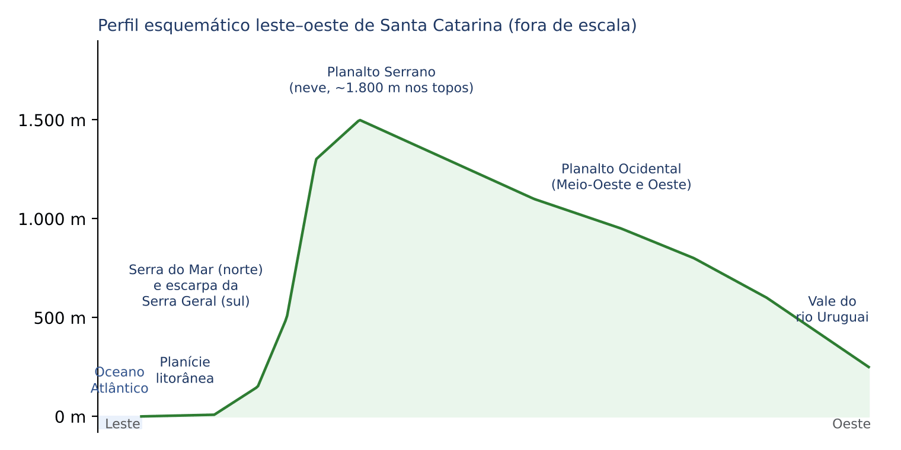
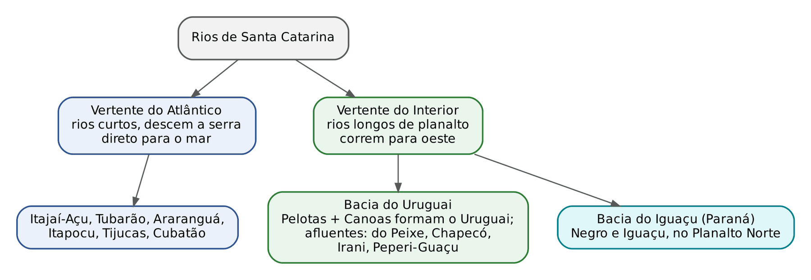
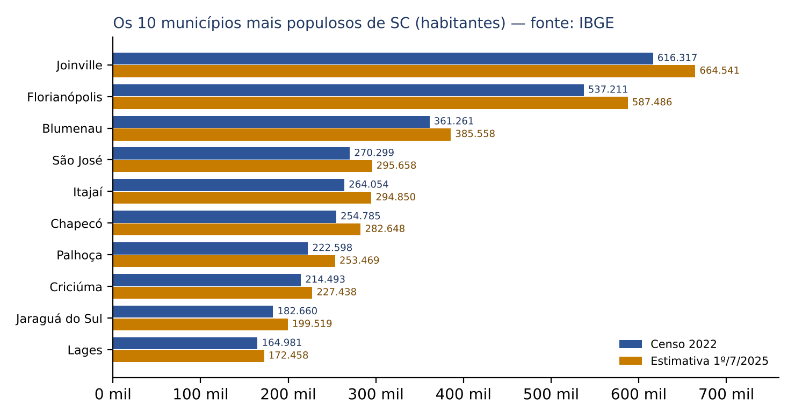
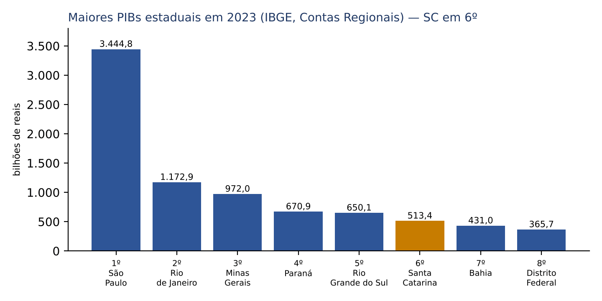
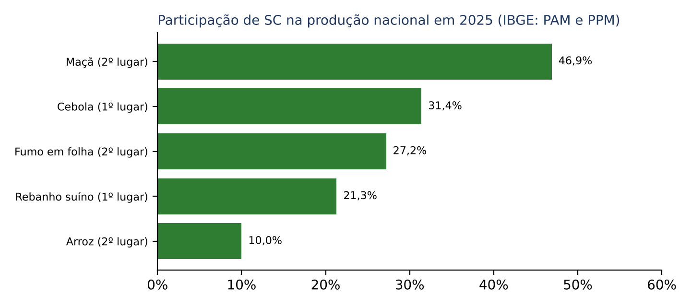
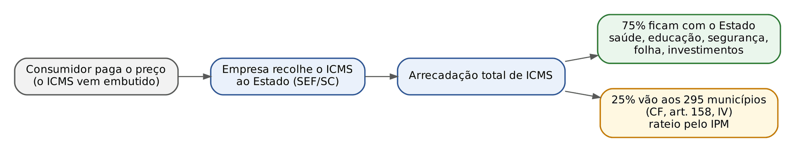
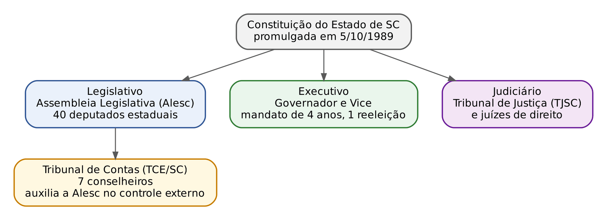

# CAPÍTULO 32 — SANTA CATARINA II: GEOGRAFIA, ECONOMIA, FINANÇAS PÚBLICAS E POLÍTICA ESTADUAL

:::INCIDENCIA
Edital SEFAZ/SC 01/2026 — Conhecimentos Regionais de Santa Catarina ("História, Geografia, Cultura, Política e Economia do Estado de Santa Catarina"); este capítulo cobre Geografia, Economia e Política (História e Cultura ficam no Cap. 31). Nível A.
Lote do banco: nenhuma questão atribuída ao capítulo; a busca por palavra-chave achou 2 questões FGV aproveitáveis (Constituição estadual e repartição de receitas), comentadas aqui. O que costuma cair em provas regionais: limites e regiões, relevo e rios, maiores cidades, vocações econômicas por região, portos, agronegócio (suínos, aves, maçã, cebola) e Poderes do Estado.
:::

:::ESQUEMA O que você vai aprender e o que precisa saber antes
Pré-requisitos: porcentagem e regra de três (Cap. 1), usadas nos exercícios de fixação com dados reais; a história da ocupação e da colonização do Estado (Cap. 31), que explica por que cada região tem a economia que tem. Nada mais: o capítulo parte do zero.
Roteiro do capítulo:
- 32.1 Localização, limites, área e divisão regional (o "mapa mental" do Estado).
- 32.2 Relevo, litoral e ilhas.
- 32.3 Clima e vegetação.
- 32.4 Hidrografia: as duas vertentes e as enchentes do Vale do Itajaí.
- 32.5 População e municípios (Censo 2022 e estimativa de 2025).
- 32.6 a 32.8 Economia: PIB, agronegócio, indústria, serviços, turismo e tecnologia.
- 32.9 Portos, logística e comércio exterior.
- 32.10 Finanças públicas estaduais e ICMS.
- 32.11 Política estadual: Constituição de 1989, Poderes e capital.
- 32.12 a 32.14 Resumo, normas e questões.
:::

:::ATENCAO Como usar os números deste capítulo
Prova de conhecimentos regionais não pede o número exato de habitantes de Joinville. Ela pede ORDEM DE GRANDEZA e POSIÇÃO RELATIVA: "SC tem cerca de 8 milhões de habitantes", "é a 6ª economia do país", "Joinville é a cidade mais populosa, não a capital". Por isso cada dado vem com fonte e ano, e você deve memorizar o ranking e o arredondamento, não os dígitos. Os exercícios de fixação servem também para treinar a porcentagem do Cap. 1 com números reais.
:::

## 32.1 Localização, limites, área e divisão regional

### 32.1.1 A ideia: um Estado pequeno com muita variedade

Imagine que você sai de Florianópolis de manhã, sobe a serra e almoça em São Joaquim: em cerca de três horas de estrada você trocou a praia por campos de altitude onde pode nevar. Continue para o oeste e, no fim do dia, estará em Chapecó, numa região de agroindústria de carnes que lembra mais o norte do Rio Grande do Sul do que o litoral catarinense. Essa variedade num território pequeno é a ideia que organiza todo o capítulo.

O próprio Governo do Estado, na página institucional "Conheça SC" (sc.gov.br, consulta em 2026), resume assim: o Estado é o menor da Região Sul em território e, em poucas horas de carro, mudam clima, paisagem, sotaques e culturas.

### 32.1.2 Localização e limites

Santa Catarina fica na Região Sul do Brasil, entre o Paraná e o Rio Grande do Sul. Os limites são cobrados com frequência e são fáceis de guardar com os quatro pontos cardeais:

- Ao NORTE: Paraná.
- Ao SUL: Rio Grande do Sul.
- A LESTE: Oceano Atlântico.
- A OESTE: Argentina (província de Misiones).

Repare que SC é o único dos três Estados do Sul que faz fronteira com apenas UM país estrangeiro (a Argentina). O Rio Grande do Sul faz fronteira com Argentina e Uruguai; o Paraná, com Argentina e Paraguai.

Vários desses limites são rios. Os mais cobrados:

- Com o Rio Grande do Sul: o rio Pelotas e, depois, o rio Uruguai (no interior); no litoral, o rio Mampituba.
- Com o Paraná: em boa parte, os rios Negro e Iguaçu (no Planalto Norte).
- Com a Argentina: o rio Peperi-Guaçu, afluente do Uruguai, no extremo oeste.

O fuso horário é o de Brasília. A página "Conheça SC" ainda menciona o horário de verão, mas ele foi extinto em todo o país em 2019; se a prova falar em horário de verão vigente em SC, desconfie.

### 32.1.3 Área

Segundo o IBGE (área territorial oficial de 2022), Santa Catarina tem 95.730,690 km². Para a prova, guarde "cerca de 95,7 mil km²" e as posições relativas:

- É o 20º Estado em área entre as 27 unidades da Federação (IBGE, 2022): portanto, um dos menores.
- É o MENOR da Região Sul: o Paraná tem 199.298,981 km² e o Rio Grande do Sul 281.707,151 km² (IBGE, 2022).

:::PEGADINHA Área "antiga" e área "nova"
Textos mais antigos (inclusive a página "Conheça SC") falam em 95,4 mil km². O número oficial do IBGE usado no Censo 2022 é 95.730,690 km². As duas cifras arredondam para "cerca de 95 mil km²". Se a alternativa disser "mais de 100 mil km²" ou "maior Estado do Sul", está errada.
:::

### 32.1.4 Como o território é dividido: três "mapas" diferentes

Existem três maneiras de dividir o Estado em regiões, e a prova pode misturá-las. Pense nelas como três mapas sobrepostos, feitos com finalidades diferentes.

Primeiro mapa: a divisão POPULAR (ou turística), usada pelo próprio Governo do Estado. Segundo a página "Conheça SC" (sc.gov.br), são oito regiões principais:

- Litoral (onde está a Grande Florianópolis);
- Nordeste (Joinville e arredores);
- Planalto Norte (Mafra, Canoinhas, São Bento do Sul);
- Vale do Itajaí (Blumenau, Brusque, Itajaí);
- Planalto Serrano (Lages, São Joaquim);
- Sul (Criciúma, Tubarão, Laguna);
- Meio-Oeste (Joaçaba, Caçador, Videira);
- Oeste (Chapecó, Concórdia, São Miguel do Oeste).

Segundo mapa: as MESORREGIÕES e MICRORREGIÕES do IBGE (divisão de 1990, ainda muito citada em provas e em estatísticas antigas). Santa Catarina tem 6 mesorregiões e 20 microrregiões (IBGE, API de localidades, consulta em 2026). As seis mesorregiões são: Oeste Catarinense, Norte Catarinense, Serrana, Vale do Itajaí, Grande Florianópolis e Sul Catarinense.

Terceiro mapa: as REGIÕES GEOGRÁFICAS INTERMEDIÁRIAS e IMEDIATAS do IBGE (divisão de 2017, que substituiu a anterior nas estatísticas novas). Santa Catarina tem 7 regiões intermediárias e 24 imediatas (IBGE, consulta em 2026). As sete intermediárias levam o nome do polo: Florianópolis, Joinville, Blumenau, Criciúma, Lages, Chapecó e Caçador.

| Divisão | Quem faz | Quantas em SC | Para que serve |
|---|---|---|---|
| Regiões "populares" | Governo do Estado | 8 (Litoral, Nordeste, Planalto Norte, Vale do Itajaí, Planalto Serrano, Sul, Meio-Oeste, Oeste) | Turismo, identidade regional, linguagem comum |
| Mesorregiões e microrregiões | IBGE (1990) | 6 mesorregiões; 20 microrregiões | Estatísticas antigas; muito usadas em livros |
| Regiões geográficas intermediárias e imediatas | IBGE (2017) | 7 intermediárias; 24 imediatas | Estatísticas atuais do IBGE |

:::DICA Como não confundir 6, 7, 8 e 24
Faça a associação com a idade dos mapas: o mapa "velho" do IBGE (1990) tem 6 mesorregiões; o "novo" (2017) tem 7 intermediárias (uma a mais: Caçador ganhou região própria); o mapa do Governo, para o turista, tem 8. As 24 regiões imediatas são as "cidades-polo" do dia a dia (onde a população vai ao hospital, ao fórum, ao comércio).
:::

:::PRATIQUE exercícios de fixação elaborados para esta apostila
1) Santa Catarina tem 95.730,690 km² e o Paraná, 199.298,981 km² (IBGE, 2022). Aproximadamente quantas vezes o Paraná é maior que SC?
2) Associe: (a) 6; (b) 7; (c) 24 — com (I) regiões geográficas imediatas; (II) mesorregiões; (III) regiões geográficas intermediárias.
3) (estilo FCC) Julgue: "Santa Catarina limita-se ao norte com o Paraná, ao sul com o Rio Grande do Sul, a leste com o Oceano Atlântico e a oeste com o Paraguai."
Resolução:
- 1: Divida a área maior pela menor. Arredonde para facilitar a conta de cabeça: 199.299 ≈ 200 mil; 95.731 ≈ 96 mil.
  - 200 ÷ 96 ≈ 2,08
  - Conta exata (feita em Python): 199.298,981 ÷ 95.730,690 = 2,08 (arredondado).
  - Resposta: o Paraná é cerca de 2 vezes maior que SC (pouco mais do dobro).
- 2: (a)–(II) mesorregiões são 6; (b)–(III) intermediárias são 7; (c)–(I) imediatas são 24.
- 3: ERRADA. A oeste, o limite é com a ARGENTINA. O Paraguai faz fronteira com o Paraná e com Mato Grosso do Sul, não com SC.
:::

## 32.2 Relevo, litoral e ilhas

### 32.2.1 A ideia: uma "escada" que sobe do mar e desce para o oeste

A forma mais simples de entender o relevo catarinense é imaginar um corte do Estado de leste para oeste, como uma fatia de bolo vista de lado. Na beira do mar, terreno baixo; logo depois, uma parede de serra muito íngreme; no alto, um grande planalto que vai descendo devagar até o vale do rio Uruguai, na divisa com o Rio Grande do Sul.

As unidades de relevo, nessa ordem, são:

- PLANÍCIE LITORÂNEA (ou costeira): faixa baixa e estreita junto ao mar, com praias, dunas, restingas, mangues e lagoas costeiras. É onde estão Florianópolis, Itajaí, Balneário Camboriú, Laguna.
- SERRAS LITORÂNEAS: no norte e no centro, a SERRA DO MAR (região de Joinville e do Vale do Itajaí); no sul, a borda do planalto forma a escarpa da SERRA GERAL, com paredões e cânions (é ali que passa a famosa estrada da Serra do Rio do Rastro, que liga o Sul ao Planalto Serrano).
- PLANALTO: ocupa a maior parte do território. No Planalto Serrano (Lages, São Joaquim, Urubici) ficam as maiores altitudes do Estado. Para o oeste, o PLANALTO OCIDENTAL desce gradualmente rumo ao vale do rio Uruguai.

Altitude máxima: a página "Conheça SC" (sc.gov.br) informa que o Planalto Serrano tem altitudes que atingem 1.820 metros. O ponto culminante costuma ser identificado no Morro da Boa Vista, em Urubici, na Serra Geral (a altitude exata varia conforme o levantamento: ver a nota de verificação). Para a prova, guarde "pouco mais de 1.800 m, no Planalto Serrano".

:::ATENCAO Serra do Mar x Serra Geral
As duas são "serras litorâneas" vistas de baixo, mas têm origem diferente. A Serra do Mar é a continuação do mesmo sistema de serras que acompanha o litoral desde o Sudeste e aparece no norte de SC. A Serra Geral é a borda do grande planalto formado por antigos derrames de lava (rochas basálticas) que cobrem o sul do Brasil; em SC, ela forma os paredões do sul do Estado e os cânions da divisa com o Rio Grande do Sul. Uma alternativa que diga "a Serra do Mar se estende por todo o litoral catarinense até a divisa com o RS" está errada.
:::

### 32.2.2 Litoral e ilhas

O litoral catarinense é recortado, com baías, enseadas, ilhas e lagoas. Os pontos mais lembrados:

- A ILHA DE SANTA CATARINA, onde fica a maior parte de Florianópolis. A capital é, portanto, em grande parte insular: há uma porção continental, ligada à ilha por pontes (a mais conhecida é a Ponte Hercílio Luz).
- A ilha de SÃO FRANCISCO DO SUL, no litoral norte, sede de um dos portos do Estado (ver 32.9).
- As lagoas costeiras: a Lagoa da Conceição (na Ilha de Santa Catarina) e o complexo lagunar do sul (região de Laguna).
- A Reserva Biológica Marinha do Arvoredo, ao norte da Ilha de Santa Catarina, área de proteção ambiental muito citada em provas de geografia.

:::PRATIQUE exercícios de fixação elaborados para esta apostila
1) Ordene, de leste para oeste, as unidades de relevo: Planalto Ocidental; planície litorânea; Serra Geral/Serra do Mar; Planalto Serrano.
2) Onde ficam as maiores altitudes de Santa Catarina, e qual a ordem de grandeza?
3) (estilo FCC) Julgue: "Florianópolis, capital do Estado, está integralmente situada no continente, separada da Ilha de Santa Catarina pela baía."
Resolução:
- 1: planície litorânea → Serra do Mar (norte) ou Serra Geral (sul) → Planalto Serrano → Planalto Ocidental (que desce até o vale do Uruguai).
- 2: No Planalto Serrano (Urubici, São Joaquim, Bom Jardim da Serra), com topos de pouco mais de 1.800 m (sc.gov.br informa altitudes que atingem 1.820 m).
- 3: ERRADA. A maior parte de Florianópolis está NA Ilha de Santa Catarina; há também uma parte continental. O erro está no "integralmente situada no continente".
:::

## 32.3 Clima e vegetação

### 32.3.1 Clima: subtropical, com quatro estações e neve no planalto

Na maior parte do Brasil, "inverno" quer dizer apenas a estação seca. Em Santa Catarina, não: o Estado está abaixo do Trópico de Capricórnio, e o clima predominante é SUBTROPICAL ÚMIDO, com chuvas bem distribuídas ao longo do ano e as quatro estações bem definidas. A página "Conheça SC" (sc.gov.br) fala em temperaturas médias que variam de 13 °C a 25 °C.

Uma forma de lembrar as diferenças internas é usar a altitude como régua:

- No litoral e nos vales baixos (inclusive o vale do Uruguai, no oeste), os verões são quentes. Na classificação climática de Köppen, que a prova às vezes cita, esse tipo é o Cfa ("C" = temperado/subtropical; "f" = úmido o ano todo, sem estação seca; "a" = verão quente).
- No planalto, especialmente no Planalto Serrano, os verões são amenos e os invernos rigorosos, com geadas frequentes e a maior ocorrência de neve do Brasil (São Joaquim, Urupema, Urubici, Bom Jardim da Serra). Na classificação de Köppen, Cfb ("b" = verão ameno).

:::PEGADINHA "Clima tropical" e "estação seca"
Alternativa que atribua a SC clima tropical com estação seca no inverno está errada: o "f" de Cfa e Cfb significa justamente chuva o ano inteiro. E a neve não ocorre "em todo o Estado", mas nas partes altas do planalto, em alguns dias de inverno.
:::

### 32.3.2 Vegetação: um Estado inteiro de Mata Atlântica

Todo o território catarinense está no bioma MATA ATLÂNTICA (classificação de biomas do IBGE). Mas "Mata Atlântica", aqui, é um nome de família, que reúne paisagens bem diferentes:

- FLORESTA OMBRÓFILA DENSA (a "mata atlântica" no sentido popular): nas encostas da Serra do Mar e da Serra Geral e na planície, a floresta úmida e fechada.
- FLORESTA OMBRÓFILA MISTA, ou MATA DE ARAUCÁRIAS: no planalto, com o pinheiro-do-paraná (araucária), cuja madeira sustentou o ciclo madeireiro do Planalto e do Meio-Oeste (ver Cap. 31, sobre o Contestado).
- FLORESTA ESTACIONAL DECIDUAL: no vale do rio Uruguai, no oeste, com árvores que perdem folhas no inverno.
- CAMPOS DE ALTITUDE (campos naturais): no Planalto Serrano, base da pecuária tradicional da região de Lages.
- Na costa, os ecossistemas associados: restingas, dunas, mangues.

:::DICA Uma frase para a vegetação
"Do mar para o oeste: mangue e restinga, floresta densa na serra, araucárias e campos no planalto, floresta que perde folhas no vale do Uruguai — tudo dentro da Mata Atlântica."
:::

:::PRATIQUE exercícios de fixação elaborados para esta apostila
1) Qual é o bioma de Santa Catarina?
2) Na sigla Cfb, o que significam "f" e "b"?
3) (estilo FCC) Julgue: "A Floresta Ombrófila Mista, caracterizada pela presença da araucária, concentra-se na planície litorânea catarinense."
Resolução:
- 1: Mata Atlântica, em todo o território (IBGE).
- 2: "f" = úmido o ano todo, sem estação seca; "b" = verão ameno (temperatura do mês mais quente abaixo de 22 °C), típico das áreas altas.
- 3: ERRADA. A mata de araucárias é típica do PLANALTO (clima mais frio). Na planície e nas encostas predomina a Floresta Ombrófila Densa.
:::

## 32.4 Hidrografia

### 32.4.1 A ideia: a serra decide para onde a água corre

Volte à figura do perfil do relevo. A água da chuva que cai a leste da serra tem um caminho curto e íngreme até o mar. A que cai no planalto, a oeste da serra, não consegue "subir" a serra: ela escorre para o interior, rumo ao oeste, até encontrar o rio Uruguai ou o Iguaçu, que só chegam ao mar muito longe dali (no estuário do Prata). Essa divisão das águas pelas serras forma as duas VERTENTES (ou sistemas) hidrográficas do Estado.

### 32.4.2 Vertente do Atlântico

Rios relativamente curtos, que nascem na serra e correm direto para o mar. Os principais:

- ITAJAÍ-AÇU: o maior rio da vertente atlântica catarinense; forma o Vale do Itajaí, passa por Blumenau e deságua em Itajaí, onde fica o complexo portuário Itajaí–Navegantes (ver 32.9).
- TUBARÃO e ARARANGUÁ: no sul do Estado.
- ITAPOCU (região de Jaraguá do Sul), TIJUCAS, CUBATÃO (vários rios com esse nome no Estado).

### 32.4.3 Vertente do Interior

Rios longos, de planalto, que correm para o oeste e pertencem a duas grandes bacias:

- BACIA DO URUGUAI: o rio Uruguai nasce da junção do rio PELOTAS com o rio CANOAS e forma a divisa com o Rio Grande do Sul. Seus afluentes catarinenses mais cobrados: rio do Peixe (Meio-Oeste), Chapecó, Irani, e o Peperi-Guaçu (divisa com a Argentina). Os rios de planalto, com quedas e corredeiras, têm grande potencial hidrelétrico.
- BACIA DO PARANÁ (pelo rio IGUAÇU): no Planalto Norte, os rios Negro e Iguaçu, que marcam parte da divisa com o Paraná.

:::PEGADINHA O Uruguai "deságua no Atlântico catarinense"?
Não. O rio Uruguai corre para oeste e depois para o sul, forma a divisa entre Brasil e Argentina e só encontra o mar no estuário do Rio da Prata. Por isso pertence à vertente do INTERIOR, apesar de, no fim, toda água chegar ao Atlântico. Alternativa que coloque o Uruguai ou o Iguaçu na vertente atlântica está errada.
:::

### 32.4.4 As enchentes do Vale do Itajaí

O Vale do Itajaí é a região de SC mais associada a enchentes. A explicação é a própria geografia: a bacia do Itajaí-Açu recebe as águas de uma área grande de serra, os rios descem rapidamente e a planície de Blumenau e de Itajaí, perto da foz, é baixa. Chuvas fortes e prolongadas fazem o rio subir muito em pouco tempo.

As grandes cheias de 1983 e 1984 em Blumenau e a catástrofe de novembro de 2008 (enchentes e deslizamentos de terra em vários municípios do Vale e do litoral norte) são as mais lembradas. Em resposta, o Estado investiu em barragens de contenção no alto vale (como as de Taió e Ituporanga) e em sistemas de alerta. Use esses eventos como referência histórica, sem decorar números de vítimas.

:::PRATIQUE exercícios de fixação elaborados para esta apostila
1) Classifique nas vertentes: Itajaí-Açu; Uruguai; Tubarão; Iguaçu; Chapecó; Araranguá.
2) Quais rios formam o rio Uruguai?
3) (estilo FCC) Julgue: "As enchentes recorrentes do Vale do Itajaí explicam-se, entre outros fatores, pelo relevo: a bacia do Itajaí-Açu drena áreas serranas e escoa rapidamente para uma planície baixa próxima da foz."
Resolução:
- 1: Vertente do Atlântico: Itajaí-Açu, Tubarão, Araranguá. Vertente do Interior: Uruguai, Iguaçu, Chapecó (afluente do Uruguai).
- 2: Pelotas e Canoas.
- 3: CERTA. É exatamente a explicação geográfica dada em 32.4.4.
:::

## 32.5 População e municípios

### 32.5.1 Quantos são os catarinenses

O IBGE produz dois tipos de número de população, e a prova pode citar qualquer um deles. Vale entender a diferença, como se distingue um laudo pericial de uma estimativa de parte:

- O CENSO DEMOGRÁFICO é a contagem de todos os moradores, casa por casa. O último é o Censo 2022 (data de referência: 1º/8/2022).
- A ESTIMATIVA DE POPULAÇÃO é um cálculo feito todo ano pelo IBGE, a partir do último censo, para a data de 1º de julho. Ela não conta as pessoas; projeta. É ela que serve, por exemplo, para repartir o Fundo de Participação dos Municípios.

Os números de Santa Catarina (IBGE):

| Dado | Valor | Fonte e ano |
|---|---|---|
| População residente (Censo) | 7.610.361 habitantes | IBGE, Censo 2022 |
| População estimada | 8.187.029 habitantes | IBGE, estimativa para 1º/7/2025 |
| Posição no país | 10º Estado mais populoso | IBGE, Censo 2022 e estimativa 2025 |
| Densidade demográfica | 79,50 habitantes por km² (8ª maior do país) | IBGE, Censo 2022 |
| Participação na população brasileira | cerca de 3,7% (7.610.361 de 203.080.756) | IBGE, Censo 2022 (conta conferida em Python) |

Para a prova: "cerca de 7,6 milhões no Censo 2022 e pouco mais de 8 milhões nas estimativas de 2024 e 2025". SC é um dos Estados que mais crescem em população, puxado sobretudo pela migração de pessoas de outros Estados para o litoral e para as cidades médias.

### 32.5.2 Densidade demográfica: a conta feita à mão

Densidade demográfica é a média de habitantes por quilômetro quadrado. É uma divisão simples:

- densidade = população ÷ área
- densidade = 7.610.361 ÷ 95.730,690
- Como estimar sem calculadora: 7.610.000 ÷ 95.700 = 7.610 ÷ 95,7 ≈ 79,5 (porque 95,7 × 80 = 7.656, um pouco mais que 7.610; logo o resultado é um pouco menos que 80).
- Valor oficial do IBGE: 79,50 hab./km².

A densidade é uma MÉDIA: o litoral é muito mais denso que o Planalto Serrano. Uma alternativa que use a densidade média para afirmar que "a população é distribuída de forma homogênea" está errada.

### 32.5.3 Municípios e maiores cidades

Santa Catarina tem 295 municípios (IBGE; sc.gov.br). A capital é Florianópolis. Mas a cidade mais populosa NÃO é a capital: é JOINVILLE, no nordeste do Estado.

| Posição | Município | Censo 2022 | Estimativa 2025 | Região |
|---|---|---|---|---|
| 1º | Joinville | 616.317 | 664.541 | Nordeste |
| 2º | Florianópolis (capital) | 537.211 | 587.486 | Grande Florianópolis |
| 3º | Blumenau | 361.261 | 385.558 | Vale do Itajaí |
| 4º | São José | 270.299 | 295.658 | Grande Florianópolis |
| 5º | Itajaí | 264.054 | 294.850 | Vale do Itajaí (foz) |
| 6º | Chapecó | 254.785 | 282.648 | Oeste |
| 7º | Palhoça | 222.598 | 253.469 | Grande Florianópolis |
| 8º | Criciúma | 214.493 | 227.438 | Sul |
| 9º | Jaraguá do Sul | 182.660 | 199.519 | Nordeste/Norte |
| 10º | Lages | 164.981 | 172.458 | Planalto Serrano |

Fonte: IBGE, Censo 2022 (tabela 4709 do SIDRA, consulta em 2026) e estimativas de população de 1º/7/2025 (tabela 6579). Na sequência vêm Brusque, Balneário Camboriú, Tubarão, Camboriú e Navegantes. Os menores municípios do Estado, no Censo 2022, têm menos de 1.700 habitantes cada (Santiago do Sul, Barra Bonita e Presidente Castello Branco).

Três observações que viram questão:

- A rede urbana catarinense é POLICÊNTRICA: em vez de uma metrópole que concentra tudo (como Curitiba no Paraná ou Porto Alegre no Rio Grande do Sul), há várias cidades médias fortes espalhadas pelas regiões. Os 10 maiores municípios somam cerca de 41% da população do Estado (conta com os dados do Censo 2022, conferida em Python), e o maior deles, Joinville, tem só cerca de 8% dos catarinenses.
- Florianópolis é a capital, mas não a maior cidade nem a maior economia municipal (ver 32.6).
- Os municípios da Grande Florianópolis (São José, Palhoça) e do litoral do Vale (Itajaí, Navegantes, Balneário Camboriú, Camboriú) estão entre os que mais cresceram entre 2022 e 2025.

:::PEGADINHA "Florianópolis é a cidade mais populosa de SC"
Errado, e é a pegadinha mais comum em prova regional. A mais populosa é Joinville (Censo 2022 e estimativa 2025). Florianópolis é a 2ª.
:::

:::PRATIQUE exercícios de fixação elaborados para esta apostila
1) De 7.610.361 (Censo 2022) para 8.187.029 (estimativa 2025), de quanto foi o aumento absoluto e o aumento percentual da população estimada de SC?
2) Que porcentagem da população catarinense morava em Joinville no Censo 2022 (616.317 habitantes)?
3) (estilo FCC) Julgue: "Santa Catarina caracteriza-se por forte macrocefalia urbana, com mais da metade da população concentrada na capital."
Resolução:
- 1: Aumento absoluto: subtração.
  - 8.187.029 − 7.610.361 = 576.668 habitantes
  - Aumento percentual: divida o aumento pelo valor inicial e multiplique por 100 (Cap. 1, variação percentual).
  - 576.668 ÷ 7.610.361 ≈ 0,0758
  - 0,0758 × 100 = 7,58%, ou seja, cerca de 7,6% (conferido em Python). Cuidado: parte desse aumento vem de a estimativa ter base diferente do censo; o número indica tendência, não "nascimentos menos óbitos".
- 2: 616.317 ÷ 7.610.361 ≈ 0,081, ou seja, cerca de 8,1%. Estimativa de cabeça: 616 mil é um pouco mais que 7,6 milhões × 0,08 = 608,8 mil; logo, pouco mais de 8%.
- 3: ERRADA. A rede urbana de SC é policêntrica; a capital tem cerca de 7% da população (537.211 ÷ 7.610.361 ≈ 0,071) e nem é a cidade mais populosa.
:::

## 32.6 Economia: visão geral e Produto Interno Bruto

### 32.6.1 A ideia: uma economia "espalhada"

Ao contrário de Estados em que a riqueza se concentra na capital, a economia catarinense é organizada em POLOS REGIONAIS, cada um com sua vocação. Essa é, aliás, a frase-chave da página oficial "Conheça SC" (sc.gov.br): a economia é diversificada, organizada em vários polos distribuídos por diferentes regiões, o que impede que a riqueza fique concentrada numa só área. A história do povoamento (Cap. 31) explica isso: cada leva de colonização (açorianos no litoral, alemães e italianos nos vales, gaúchos descendentes de imigrantes no oeste) formou núcleos que se especializaram.

O mapa das vocações regionais, segundo a mesma página oficial:

| Região | Vocações econômicas |
|---|---|
| Grande Florianópolis | Tecnologia, turismo, serviços e construção civil |
| Norte (Joinville, Jaraguá do Sul, São Bento do Sul) | Polo tecnológico, moveleiro e metalmecânico |
| Oeste | Produção de alimentos (agroindústria de carnes) e móveis |
| Planalto Serrano | Papel, celulose e madeira |
| Sul (Criciúma, Tubarão) | Vestuário, plásticos descartáveis, carvão (carbonífero) e cerâmica |
| Vale do Itajaí | Têxtil e vestuário, naval e tecnologia |
| Todo o litoral (e a Serra, no inverno) | Turismo |

:::DICA Memorize por "cidade-símbolo"
Joinville = metalmecânica (motores, compressores, peças); Jaraguá do Sul = motores elétricos e vestuário; São Bento do Sul = móveis; Blumenau e Brusque = têxtil; Itajaí = porto e pesca; Chapecó e Concórdia = agroindústria de carnes; Criciúma = cerâmica e carvão; Lages = madeira e pecuária; São Joaquim e Fraiburgo = maçã; Ituporanga = cebola; Florianópolis = tecnologia, turismo e serviços públicos.
:::

### 32.6.2 O PIB catarinense

PIB (Produto Interno Bruto) é o valor de tudo o que se produz numa economia num ano, contado uma vez só (sem somar duas vezes o tecido que virou camisa). O IBGE calcula o PIB dos Estados nas CONTAS REGIONAIS, sempre com cerca de dois anos de atraso: o dado mais recente disponível em 2026 é o de 2023.

Os números (IBGE, PIB a preços correntes, 2023):

- PIB de Santa Catarina em 2023: 513,4 bilhões de reais (513.392.973 mil reais).
- Posição: 6ª maior economia do país, atrás de São Paulo, Rio de Janeiro, Minas Gerais, Paraná e Rio Grande do Sul.
- Participação no PIB brasileiro (10.943,3 bilhões de reais): cerca de 4,7%.
- Evolução: 428,6 bilhões (2021), 466,3 bilhões (2022) e 513,4 bilhões de reais (2023), valores correntes (sem descontar a inflação).

Repare na comparação com a população: SC tem cerca de 3,7% dos brasileiros e gera cerca de 4,7% do PIB. Logo, o PIB por habitante catarinense fica acima da média nacional, o que costuma aparecer em prova na forma "SC tem um dos maiores PIBs per capita do país" (sem o número exato, que você não precisa decorar).

Composição setorial: no último ano com o detalhamento disponível na tabela municipal do IBGE consultada (2021), o valor adicionado de SC se distribuía em cerca de 53,7% serviços (exceto administração pública), 27,5% indústria, 12,1% administração pública e 6,7% agropecuária. Repare: a agropecuária "pesa pouco" no PIB, mas puxa a indústria de alimentos e as exportações (ver 32.7 e 32.9). A participação da indústria, acima da média nacional, é traço marcante do Estado.

Entre os municípios, o maior PIB de 2023 é o de Joinville (49,8 bilhões de reais), seguido de ITAJAÍ (48,2 bilhões, impulsionado pelo porto e pelas empresas de comércio exterior), Florianópolis (31,2 bilhões), Blumenau (24,9 bilhões) e Chapecó (17,6 bilhões) (IBGE, PIB dos Municípios 2023).

:::PEGADINHA Itajaí, a 5ª cidade em população e a 2ª em PIB
A posição de Itajaí no ranking do PIB municipal surpreende quem associa PIB a população. A explicação é o comércio exterior: empresas importadoras e operações portuárias registradas no município geram muito valor adicionado (e muito ICMS de importação). Se a alternativa disser que "o PIB municipal acompanha exatamente o ranking populacional", está errada.
:::

:::PRATIQUE exercícios de fixação elaborados para esta apostila
1) O PIB de SC em 2023 foi de 513,4 bilhões de reais e o do Brasil, de 10.943,3 bilhões. Qual a participação catarinense, em porcentagem?
2) De 2022 (466,3 bilhões) para 2023 (513,4 bilhões), qual foi a variação NOMINAL do PIB catarinense? Por que ela não é o "crescimento da economia"?
3) (estilo FCC) Uma conta didática: dividindo o PIB de 2023 pela população do Censo 2022, qual a ordem de grandeza do PIB por habitante? (Atenção: o IBGE calcula o per capita oficial com a população estimada do ano; esta conta só dá a ordem de grandeza.)
Resolução:
- 1: participação = parte ÷ todo × 100.
  - 513,4 ÷ 10.943,3 ≈ 0,0469
  - 0,0469 × 100 ≈ 4,7%. Estimativa de cabeça: 5% de 10.943 é 547; 513 é um pouco menos, logo um pouco menos de 5%.
- 2: variação = (novo ÷ antigo − 1) × 100.
  - 513,4 ÷ 466,3 ≈ 1,101
  - (1,101 − 1) × 100 ≈ 10,1% (conferido em Python com os valores exatos: 10,1%).
  - Não é o crescimento "real" porque os valores são correntes: parte dos 10,1% é só inflação. O crescimento real (em volume) é calculado pelo IBGE a preços do ano anterior e é bem menor (a mesma lógica da taxa real x aparente, Cap. 4).
- 3: PIB em reais: 513.392.973 mil = 513.392.973.000 reais.
  - 513.392.973.000 ÷ 7.610.361 ≈ 67.460 reais por habitante.
  - Ordem de grandeza: cerca de 67 mil reais por habitante por ano (aproximação didática, não o dado oficial).
:::

## 32.7 Agronegócio

### 32.7.1 A ideia: pequena propriedade, grande produção

O agronegócio catarinense tem uma marca histórica: a PEQUENA PROPRIEDADE FAMILIAR, herança da colonização por imigrantes europeus em lotes coloniais. Em vez das grandes fazendas de soja do Centro-Oeste, o modelo típico do Oeste catarinense é a família que cria suínos ou frangos em parceria com uma agroindústria (o chamado SISTEMA DE INTEGRAÇÃO: a empresa fornece os animais jovens, a ração e a assistência técnica; o produtor entra com a mão de obra e as instalações; a empresa compra a produção). Esse modelo deu origem a grandes empresas de alimentos nascidas no Oeste e às cooperativas agroindustriais.

### 32.7.2 O que SC produz e em que posição está

Os dados abaixo são do IBGE (Produção Agrícola Municipal — PAM e Pesquisa da Pecuária Municipal — PPM, ano de referência 2025, consulta em 2026). A Epagri/Cepa, órgão estadual de pesquisa e planejamento agrícola, divulga anualmente a "Síntese Anual da Agricultura de Santa Catarina" com o mesmo tipo de informação.

| Produto | Produção em SC (2025) | Participação no Brasil | Posição |
|---|---|---|---|
| Rebanho de suínos | 9.350.304 cabeças | 21,3% | 1º lugar |
| Cebola | 587.238 toneladas | 31,4% | 1º lugar |
| Maçã | 537.548 toneladas | 46,9% | 2º lugar (RS 1º, com 49,5%) |
| Fumo em folha | 220.728 toneladas | 27,2% | 2º lugar (RS 1º) |
| Arroz | 1.267.003 toneladas | 10,0% | 2º lugar (RS 1º, com 69,2%) |

Notas sobre cada cadeia:

- SUÍNOS: SC tem o maior rebanho suíno do Brasil (IBGE, PPM 2025) e é também o maior exportador nacional de carne suína; a carne suína foi o segundo produto da pauta de exportação estadual em 2025 (ver 32.9). Polos: Concórdia, Chapecó, Videira, Seara.
- AVES: a carne de frango é o PRIMEIRO produto da pauta exportadora catarinense (FIESC, dados de 2025). Atenção: no tamanho do rebanho de galináceos, SC aparece em 4º lugar (IBGE, PPM 2025), atrás de Paraná, São Paulo e Rio Grande do Sul; a força catarinense está na industrialização e na exportação.
- MAÇÃ: produzida no Planalto Serrano e no Meio-Oeste (São Joaquim, Fraiburgo, Urubici, Bom Jardim da Serra), graças ao frio do inverno. SC e RS respondem juntos por mais de 96% da maçã brasileira. SC foi o maior produtor em 2022 e 2023; em 2024 e 2025, o RS ficou à frente (IBGE, PAM). Uma questão que diga "SC é o maior produtor de maçã" pode ter sido escrita com dados mais antigos: leia o ano.
- CEBOLA: SC é o maior produtor nacional; o polo é a região de Ituporanga, no Alto Vale do Itajaí.
- ARROZ: cultivado em várzeas irrigadas do Sul (Turvo, Meleiro, Forquilhinha, região de Araranguá) e do litoral norte; SC é o 2º produtor, muito atrás do RS.
- Outros: leite (forte no Oeste), banana (litoral norte), erva-mate (Planalto Norte e Oeste; SC 3º produtor em 2025, IBGE), milho e soja (Oeste e Planalto; o milho é insumo da ração de suínos e aves, e SC precisa trazer milho de outros Estados), madeira de reflorestamento (pinus e eucalipto, base da indústria de papel, celulose e móveis), pesca e maricultura (Itajaí, Navegantes e Florianópolis; Florianópolis e Palhoça são conhecidas pelo cultivo de ostras e mexilhões).

:::PEGADINHA "SC é grande produtor de soja e de milho e, por isso, exporta ração"
Errado. SC produz milho e soja, mas é DEFICITÁRIO em milho: a agroindústria de carnes consome mais do que o Estado produz, e o grão vem de outros Estados (e do Paraguai e da Argentina). Na PAM 2025, SC aparece apenas em 13º lugar em milho e em soja (IBGE).
:::

:::PRATIQUE exercícios de fixação elaborados para esta apostila
1) O Brasil produziu 1.868.653 t de cebola em 2025, das quais 587.238 t em SC. Confira a participação de 31,4%.
2) A produção de maçã em SC foi de 593.140 t (2023), 464.831 t (2024) e 537.548 t (2025). De quanto foi a queda de 2023 para 2024, em porcentagem?
3) (estilo FCC) Julgue: "A suinocultura catarinense, concentrada no Oeste, organiza-se predominantemente pelo sistema de integração entre pequenos produtores rurais e agroindústrias."
Resolução:
- 1: 587.238 ÷ 1.868.653 ≈ 0,3143 → 31,4%. Estimativa: 30% de 1.868.653 é 560.596; 587 mil é um pouco mais, logo um pouco mais de 30%.
- 2: variação = (464.831 ÷ 593.140 − 1) × 100.
  - 464.831 ÷ 593.140 ≈ 0,784
  - (0,784 − 1) × 100 = −21,6%: queda de cerca de 21,6% (conferido em Python). Quedas desse porte na fruticultura costumam decorrer de clima (granizo, geada fora de época, falta de frio).
- 3: CERTA. É a descrição do sistema de integração (32.7.1).
:::

## 32.8 Indústria, serviços, turismo e tecnologia

### 32.8.1 Indústria: diversificada e regionalizada

A indústria pesa no PIB catarinense mais do que na média do Brasil (32.6.2). Os segmentos e polos mais cobrados (sc.gov.br, "Conheça SC"; FIESC):

- ALIMENTOS (carnes de aves e suínos, laticínios): Oeste e Meio-Oeste.
- METALMECÂNICA e ELETROMETALMECÂNICA (motores elétricos, compressores, autopeças, máquinas): Joinville, Jaraguá do Sul. Motores elétricos e partes de motores estão entre os cinco principais produtos exportados pelo Estado em 2025 (FIESC).
- TÊXTIL e VESTUÁRIO: Vale do Itajaí (Blumenau, Brusque, Gaspar, Pomerode) e também o Sul (Criciúma) e Jaraguá do Sul. É a indústria mais antiga e tradicional do Vale, ligada à colonização alemã (Cap. 31).
- CERÂMICA (revestimentos, pisos e azulejos): Sul (Criciúma, Tubarão, Urussanga, Içara), ligada historicamente à disponibilidade de argila e da energia do carvão.
- CARVÃO MINERAL: Sul (bacia carbonífera de Criciúma, Siderópolis, Lauro Müller); SC está entre os Estados produtores de carvão vapor usado em termelétricas (como a usina termelétrica do complexo de Capivari de Baixo).
- MÓVEIS: São Bento do Sul e Rio Negrinho (Planalto Norte) e o Oeste.
- PAPEL, CELULOSE e MADEIRA: Planalto Serrano e Planalto Norte (Lages, Otacílio Costa, Caçador).
- PLÁSTICOS (inclusive descartáveis): Sul.
- NAVAL: Itajaí e Navegantes (construção de embarcações).

### 32.8.2 Serviços, turismo e tecnologia

SERVIÇOS são o maior setor da economia (32.6.2). Dois ramos são característicos de SC:

- TURISMO: o litoral recebe grande número de turistas no verão, inclusive argentinos e uruguaios (Florianópolis, Balneário Camboriú, Bombinhas, Itapema, Garopaba e Laguna); no inverno, a Serra atrai pelo frio e pela neve (São Joaquim, Urubici). Há ainda o turismo cultural e de eventos (Oktoberfest de Blumenau, em outubro; ver Cap. 31) e o turismo religioso (Santuário de Santa Paulina, em Nova Trento).
- TECNOLOGIA: Florianópolis é um dos principais polos de empresas de tecnologia da informação e de *startups* (empresas nascentes de base tecnológica) do país, com apoio de universidades e parques tecnológicos; Joinville e Blumenau também têm polos de *software*. A página oficial cita a tecnologia como vocação da Grande Florianópolis, do Norte e do Vale do Itajaí.

:::PEGADINHA Indústria têxtil x indústria cerâmica
A banca troca as regiões: "o polo cerâmico de Blumenau" e "a indústria têxtil de Criciúma como principal atividade" estão errados. Têxtil = Vale do Itajaí; cerâmica = Sul. O Sul tem confecção também (vestuário), mas sua marca é cerâmica e carvão.
:::

:::PRATIQUE exercícios de fixação elaborados para esta apostila
1) Associe a região ao segmento: (a) Vale do Itajaí; (b) Sul; (c) Planalto Norte; (d) Oeste — com (I) móveis; (II) cerâmica e carvão; (III) têxtil; (IV) agroindústria de carnes.
2) Por que a indústria pesa mais em SC do que no Brasil, segundo a composição do valor adicionado?
3) (estilo FCC) Julgue: "A Grande Florianópolis destaca-se nos setores de tecnologia, turismo, serviços e construção civil, enquanto o Planalto Serrano concentra a indústria de papel, celulose e madeira."
Resolução:
- 1: (a)–(III); (b)–(II); (c)–(I); (d)–(IV).
- 2: Porque, em 2021, a indústria respondia por cerca de 27,5% do valor adicionado catarinense (IBGE), proporção superior à média nacional, refletindo os polos metalmecânico, têxtil, alimentar e cerâmico.
- 3: CERTA. É a descrição da própria página oficial do Governo do Estado (sc.gov.br).
:::

## 32.9 Portos, logística e comércio exterior

### 32.9.1 Os portos catarinenses

Para um Estado exportador de carnes e importador de insumos industriais, o litoral recortado e as baías abrigadas são uma vantagem. SC tem um dos mais importantes conjuntos portuários do país, sobretudo em CONTÊINERES (as caixas metálicas padronizadas em que viaja a carga geral; o TEU, do inglês *twenty-foot equivalent unit*, é a "unidade de medida" que equivale a um contêiner de 20 pés).

Os portos e terminais, de norte para sul:

- ITAPOÁ (litoral norte): terminal privado especializado em contêineres; foi o que mais movimentou contêineres em SC em 2025 (cerca de 1,5 milhão de TEUs).
- SÃO FRANCISCO DO SUL (na ilha de mesmo nome): porto público, forte em granéis (grãos, fertilizantes, produtos siderúrgicos); maior porto do Estado em toneladas em 2025 (cerca de 17,5 milhões de toneladas). Na mesma baía opera o terminal aquaviário de São Francisco do Sul (petróleo).
- ITAJAÍ (margem direita do rio Itajaí-Açu, na foz) e NAVEGANTES (margem esquerda, terminal privado Portonave): formam o complexo portuário do Itajaí, tradicional na exportação de carnes congeladas em contêineres frigoríficos. Em 2025, Portonave movimentou cerca de 1,1 milhão de TEUs e o porto de Itajaí, cerca de 386 mil TEUs.
- IMBITUBA (litoral sul): porto público, ligado historicamente ao carvão; hoje movimenta granéis, contêineres e carga geral.

Os números de 2025 acima são preliminares, levantados pela Secretaria de Estado de Portos, Aeroportos e Ferrovias com dados dos administradores dos terminais e divulgados em 12/1/2026 (os consolidados da ANTAQ saem depois). Pelo mesmo levantamento, os portos catarinenses movimentaram 65,7 milhões de toneladas em 2025 e ultrapassaram 3 milhões de TEUs, cerca de 20,5% dos contêineres do país, o que coloca SC como 2º Estado em contêineres, atrás de São Paulo (Santos).

Na logística terrestre, a BR-101 (litoral) e a BR-470 (que liga o litoral ao Vale do Itajaí e ao Oeste) são os eixos mais citados, além da BR-282 (Florianópolis–Lages–Oeste). O transporte por ferrovia é limitado, o que pesa no custo de trazer milho do Centro-Oeste para o Oeste catarinense.

:::ATENCAO Público x privado
Itapoá e Portonave são terminais de uso privado; São Francisco do Sul, Itajaí e Imbituba são portos públicos (organizados). A prova pode cobrar apenas "quais são os portos de SC"; se pedir a natureza jurídica, lembre que o fato de um terminal ser privado não o impede de movimentar carga de terceiros (é o regime da Lei 12.815/2013, a Lei dos Portos).
:::

### 32.9.2 Comércio exterior

Os dados de 2025 (Observatório FIESC, a partir das estatísticas oficiais de comércio exterior; divulgados em janeiro de 2026):

- EXPORTAÇÕES de SC em 2025: 12,2 bilhões de dólares, alta de 4,4% sobre 2024 e recorde histórico.
- IMPORTAÇÕES em 2025: 34 bilhões de dólares, alta de 0,7%.
- SALDO: déficit de cerca de 21,8 bilhões de dólares (12,2 − 34).
- Principais produtos exportados: carnes de aves (2,3 bilhões de dólares), carne suína (1,7 bilhão), soja (660 milhões), motores elétricos (621 milhões) e partes de motores (383 milhões).
- Principais destinos citados: Argentina (889 milhões de dólares, com alta de 18,6%), Estados Unidos (queda de 15,75%, afetada pelas tarifas americanas de 2025, com destaque para produtos de madeira) e China (queda de 6,74%, ligada a restrições sanitárias por gripe aviária).
- Principais importações: cobre refinado, partes e acessórios de veículos, polímeros de etileno (matéria-prima de plásticos), pneus e fertilizantes nitrogenados.

Por que um Estado industrial e exportador de carnes tem déficit tão grande? Porque SC se tornou uma grande PORTA DE ENTRADA DE IMPORTAÇÕES do país: muitas empresas importam por portos catarinenses (e se estabelecem no Estado, atraídas pela logística e por tratamentos tributários) mercadorias que depois são vendidas para outros Estados. Parte do ICMS estadual vem justamente dessas importações (ver 32.10), e é isso que explica o PIB de Itajaí (32.6.2).

:::PRATIQUE exercícios de fixação elaborados para esta apostila
1) Com exportações de 12,2 bilhões e importações de 34 bilhões de dólares em 2025, calcule o saldo e a corrente de comércio (exportações + importações).
2) Carnes de aves e carne suína somaram 2,3 + 1,7 bilhões de dólares. Que porcentagem das exportações catarinenses de 2025 isso representa?
3) (estilo FCC) Julgue: "Santa Catarina apresenta superávit comercial expressivo, em razão do volume de exportações do agronegócio, superior ao das importações."
Resolução:
- 1: saldo = exportações − importações = 12,2 − 34 = −21,8 bilhões de dólares (déficit). Corrente de comércio = 12,2 + 34 = 46,2 bilhões de dólares.
- 2: 2,3 + 1,7 = 4,0 bilhões.
  - 4,0 ÷ 12,2 ≈ 0,328
  - 0,328 × 100 ≈ 32,8%, ou seja, cerca de um terço das exportações (conferido em Python).
- 3: ERRADA. SC tem DÉFICIT comercial: importa quase três vezes o que exporta (34 ÷ 12,2 ≈ 2,8).
:::

## 32.10 Finanças públicas estaduais e ICMS

### 32.10.1 A ideia: de onde vem o dinheiro do Estado

Pense no orçamento do Estado como o de uma família: há receitas (salários, rendas) e despesas (casa, escola, saúde). No caso de Santa Catarina, a "renda principal" é um tributo só: o ICMS. Todo o resto (IPVA, ITCMD, transferências da União, taxas) é complemento. Por isso o cargo para o qual você estuda, o de Auditor Estadual de Finanças Públicas (Edital SEFAZ/SC 01/2026), existe essencialmente para fiscalizar o ICMS.

### 32.10.2 Os números recentes

- ARRECADAÇÃO TRIBUTÁRIA de 2025: 57,3 bilhões de reais, crescimento nominal de 6,8% e real de 2,2% sobre 2024, segundo dados divulgados pela Secretaria de Estado da Fazenda em janeiro de 2026 (reproduzidos pela imprensa e pelo sindicato do Fisco estadual; ver nota de verificação).
- ICMS de 2025: 45,1 bilhões de reais, ou seja, cerca de 79% da arrecadação tributária estadual (45,1 ÷ 57,3; conta conferida em Python).
- INVESTIMENTOS públicos de 2025: 5,9 bilhões de reais, 1,5 bilhão a mais que em 2024, segundo o Balanço Geral do Estado de 2025, entregue pelo Governador ao Tribunal de Contas (TCE/SC) em 6/4/2026 (SEF/SC, notícia de 6/4/2026).
- Projeção para 2027: a Lei de Diretrizes Orçamentárias (LDO) de 2027 projeta 63,9 bilhões de reais em receitas e despesas, 10,4% a mais que o projetado para 2026 (SEF/SC, 2026).

O caminho das contas anuais é cobrado em provas de Direito Financeiro e vale lembrar aqui: o Governador encaminha o Balanço Geral (prestação de contas anual); o TCE/SC emite PARECER PRÉVIO; quem JULGA as contas do Governador é a Assembleia Legislativa (simetria com a CF, art. 71, I, e art. 49, IX).

### 32.10.3 O ICMS em SC: o essencial

O ICMS (imposto sobre operações relativas à circulação de mercadorias e sobre prestações de serviços de transporte interestadual e intermunicipal e de comunicação) é de competência dos Estados (CF, art. 155, II). As normas gerais estão na Lei Complementar 87/1996 (Lei Kandir). Em Santa Catarina, o imposto é instituído pela Lei estadual 10.297, de 26/12/1996, e regulamentado pelo Regulamento do ICMS (RICMS/SC).

As alíquotas internas, segundo o art. 19 da Lei 10.297/1996 (texto consultado no portal de legislação da SEF/SC, 2026):

- 17% como regra geral (a "alíquota modal");
- 25% para os produtos supérfluos relacionados no Anexo I da lei;
- 12% para casos específicos (por exemplo, energia elétrica residencial até os primeiros 150 kWh e transporte rodoviário, entre outros previstos na lei);
- além de outras hipóteses previstas nos incisos seguintes.

:::LEI Lei estadual 10.297/1996, art. 19, I (alíquota geral)
"As alíquotas do imposto, nas operações e prestações internas, inclusive na entrada de mercadoria importada e nos casos de serviços iniciados ou prestados no exterior, são: I - 17% (dezessete por cento), salvo quanto às mercadorias e serviços relacionados nos incisos II a IV".
:::

Exemplo à mão: uma mercadoria vendida dentro de SC por 1.000 reais, tributada à alíquota geral. Como o ICMS é calculado "por dentro" (o imposto integra a própria base de cálculo, isto é, já está dentro do preço):

- ICMS = 1.000 × 0,17
- ICMS = 170 reais, que já estão contidos nos 1.000 reais pagos pelo consumidor.

Os detalhes do ICMS (não cumulatividade, substituição tributária, DIFAL, benefícios fiscais) pertencem às disciplinas de Legislação Tributária e não são tratados aqui.

### 32.10.4 Para onde vai o ICMS: a repartição com os municípios

O Estado não fica com todo o ICMS. Pela Constituição Federal (art. 158, IV), 25% do produto da arrecadação do ICMS pertencem aos municípios. O rateio entre os 295 municípios catarinenses é feito pelo ÍNDICE DE PARTICIPAÇÃO DOS MUNICÍPIOS (IPM), calculado anualmente pela SEF/SC: pelo menos 65% conforme o valor adicionado nas operações realizadas em cada território e até 35% conforme lei estadual, com no mínimo 10 pontos percentuais por indicadores de educação (CF, art. 158, parágrafo único, na redação da EC 108/2020). As regras de cálculo do valor adicionado estão na Lei Complementar 63/1990.

Além do ICMS, o Estado arrecada o IPVA (do qual 50% vão ao município onde o veículo é licenciado, CF, art. 158, III) e o ITCMD (heranças e doações), e recebe transferências da União, como o Fundo de Participação dos Estados (FPE) e a parcela do IPI-exportação (ver a questão comentada a seguir).

### 32.10.5 Reforma tributária: o ICMS tem data para acabar

A Emenda Constitucional 132/2023 substituiu o ICMS (estadual) e o ISS (municipal) por um imposto de competência compartilhada entre Estados e Municípios, o IBS (Imposto sobre Bens e Serviços), regulamentado pela Lei Complementar 214/2025. A transição é gradual: as alíquotas do ICMS serão reduzidas de 2029 a 2032 e o imposto deixará de existir em 2033. Até lá, o ICMS continua sendo a principal receita catarinense e o centro do trabalho do Fisco estadual.

:::QUESTAO FGV 2024 — TJ-SC — Juiz Substituto (Q2387024)
O enunciado pergunta qual parcela de imposto da União cabe ao Estado de Santa Catarina, entre cinco opções: (A) 22,5% do IPI pelo Fundo de Participação dos Estados; (B) 25% de imposto novo criado pela União por lei complementar; (C) 50% do ITR dos imóveis situados no Estado; (D) 10% do IPI, proporcionalmente às exportações de produtos industrializados; (E) 20% do IPI, proporcionalmente às exportações. Gabarito oficial: D.
Resolução:
- (D) CERTA. CF, art. 159, II: a União entrega 10% do produto da arrecadação do IPI aos Estados e ao Distrito Federal, proporcionalmente ao valor das respectivas exportações de produtos industrializados (com a EC 132/2023, o inciso passou a incluir também o novo imposto seletivo). É uma compensação aos Estados exportadores, que não cobram ICMS na exportação.
- (A) ERRADA. 22,5% é percentual ligado ao Fundo de Participação dos MUNICÍPIOS; o FPE recebe 21,5% do IR e do IPI (CF, art. 159, I, "a"). A alternativa troca os fundos.
- (B) ERRADA. Do imposto residual (CF, art. 154, I) os Estados recebem 20%, não 25% (CF, art. 157, II).
- (C) ERRADA. Os 50% do ITR pertencem aos MUNICÍPIOS (CF, art. 158, II), não ao Estado.
- (E) ERRADA. O percentual correto é 10%.
:::

:::PRATIQUE exercícios de fixação elaborados para esta apostila
1) Uma mercadoria é vendida em SC por 2.500 reais, com ICMS à alíquota geral de 17% (por dentro). Quanto de ICMS está contido no preço?
2) Se o ICMS de 2025 foi de 45,1 bilhões de reais, quanto, aproximadamente, pertence ao conjunto dos municípios catarinenses pela regra constitucional de 25%?
3) (estilo FCC) Julgue: "No Estado de Santa Catarina, a alíquota interna geral do ICMS é de 17%, havendo alíquota de 25% para produtos considerados supérfluos, conforme a legislação estadual."
Resolução:
- 1: ICMS = 2.500 × 0,17 = 425 reais (já embutidos nos 2.500).
- 2: 25% = 0,25.
  - 45,1 × 0,25 = 11,275
  - Cerca de 11,3 bilhões de reais (conta didática; a apuração oficial considera deduções e o fluxo mensal de repasses).
  - O Estado fica com os 75% restantes: 45,1 × 0,75 ≈ 33,8 bilhões.
- 3: CERTA (Lei 10.297/1996, art. 19, I e II).
:::

## 32.11 Política estadual

### 32.11.1 A Constituição do Estado de 1989

A Constituição do Estado de Santa Catarina foi promulgada em 5/10/1989, um ano depois da Constituição Federal, pela Assembleia Estadual Constituinte (as Constituições estaduais foram elaboradas com base no art. 11 do ADCT da CF/1988). A primeira Constituição catarinense do período republicano é de 1891 (sc.gov.br). O texto vigente já recebeu mais de uma centena de emendas (a edição consolidada da Alesc consultada vai até a Emenda nº 101).

Pontos essenciais (texto da edição oficial da Alesc, conferido em 2026):

- Art. 1º: o Estado de Santa Catarina é unidade inseparável da República Federativa do Brasil, formado pela união de seus Municípios; enumera como fundamentos a soberania nacional, a autonomia estadual, a cidadania, a dignidade da pessoa humana, os valores sociais do trabalho e da livre iniciativa e o pluralismo político.
- Art. 3º: são símbolos do Estado a bandeira, o hino, as armas e o selo em vigor na data da promulgação da Constituição (e outros que a lei estabelecer).
- Art. 7º: a Capital do Estado é a cidade de Florianópolis, sede dos Poderes.
- Art. 32: são Poderes do Estado, independentes e harmônicos entre si, o Legislativo, o Executivo e o Judiciário.

:::LEI Constituição do Estado de Santa Catarina, art. 7º
"A Capital do Estado é a cidade de Florianópolis, sede dos Poderes."
:::

### 32.11.2 Poder Legislativo: a Assembleia Legislativa (Alesc)

O Poder Legislativo é exercido pela Assembleia Legislativa, composta de Deputados eleitos pelo sistema proporcional, simultaneamente às eleições gerais (CE, arts. 33 e 34). O número de Deputados segue a regra do art. 27 da CF, repetida no art. 35 da CE: o TRIPLO da bancada do Estado na Câmara dos Deputados; atingido o número de 36, acrescentam-se tantos quantos forem os Deputados Federais acima de 12.

Aplicando a SC, que tem 16 Deputados Federais:

- 3 × 16 = 48, que passa de 36; então a regra do triplo para em 36.
- Deputados Federais acima de 12: 16 − 12 = 4.
- Total: 36 + 4 = 40 Deputados Estaduais.

É exatamente a composição da Alesc: 40 Deputados (sc.gov.br), mantida na eleição de 4/10/2026 para a legislatura que começa em 1º/2/2027.

Competências exclusivas típicas da Assembleia (CE, art. 40): emendar a Constituição (inciso I), julgar as contas do Governador, escolher quatro dos sete conselheiros do Tribunal de Contas (inciso XXII), entre outras.

EMENDA À CONSTITUIÇÃO ESTADUAL (CE, art. 49): pode ser proposta por um terço dos Deputados, pelo Governador, por mais da metade das Câmaras Municipais ou por iniciativa popular de pelo menos 2,5% do eleitorado estadual, distribuído em no mínimo 40 municípios; é discutida e votada em dois turnos e considera-se aprovada se obtiver, em ambos, TRÊS QUINTOS dos votos dos membros da Assembleia.

:::PEGADINHA Três quintos, não dois terços
A página institucional "Conheça SC" afirma que a emenda precisa de dois terços dos membros do Legislativo. O texto da Constituição Estadual (art. 49, § 2º, conferido na edição oficial da Alesc) exige TRÊS QUINTOS, em dois turnos, como a CF faz para as emendas federais. Na prova, fique com a letra da Constituição: 3/5 de 40 = 24 votos em cada turno.
:::

:::QUESTAO FGV 2024 — PC-SC — Delegado de Polícia (Q2360672)
O enunciado pede a competência EXCLUSIVA da Assembleia Legislativa segundo a Constituição catarinense de 1989, entre: (A) suspender a execução de lei federal declarada inconstitucional por decisão definitiva do Tribunal de Justiça; (B) decretar a intervenção nos Municípios; (C) resolver definitivamente sobre acordos ou atos interestaduais que acarretem encargos gravosos ao patrimônio estadual; (D) emendar a Constituição; (E) requisitar, quando couber, intervenção federal no Estado. Gabarito oficial: D.
Resolução:
- (D) CERTA. É a letra do art. 40, I, da CE: compete exclusivamente à Assembleia "emendar a Constituição".
- (A) ERRADA. O Tribunal de Justiça, no controle concentrado estadual, examina leis ESTADUAIS e MUNICIPAIS em face da Constituição Estadual (CF, art. 125, § 2º); não declara inconstitucional, nesse controle, lei FEDERAL. A troca de "estadual" por "federal" é o erro plantado.
- (B) ERRADA. A intervenção do Estado em Município é DECRETADA pelo Governador (CF, art. 35, e simetria); à Assembleia cabe apreciar o decreto, não decretá-lo.
- (C) ERRADA na forma proposta: a redação imita a competência do Congresso Nacional para tratados internacionais (CF, art. 49, I), transposta para "atos interestaduais"; não é a fórmula do rol do art. 40 da CE adotada pelo gabarito (ver nota de verificação).
- (E) ERRADA. A intervenção federal no Estado depende das hipóteses e dos legitimados do art. 36 da CF (solicitação do Poder coacto, requisição do STF, STJ ou TSE, representação do PGR); não é competência exclusiva genérica da Assembleia.
:::

### 32.11.3 Poder Executivo

O Executivo é exercido pelo Governador, auxiliado pelos Secretários de Estado. O Governador e o Vice são eleitos por voto direto, para mandato de 4 anos, com possibilidade de uma reeleição consecutiva (CF, arts. 14, § 5º, e 28). Pela EC 111/2021, a posse dos Governadores eleitos a partir de 2026 ocorre em 6 de janeiro do ano seguinte (CF, art. 28).

Situação atual: o Governador é Jorginho Mello (PL), eleito em 2022 e REELEITO em primeiro turno na eleição de 4/10/2026 (resultado divulgado pela imprensa com base na apuração do TSE). A sede do Executivo é o Centro Administrativo do Governo, na Rodovia SC-401, em Florianópolis (sc.gov.br).

### 32.11.4 Poder Judiciário, Tribunal de Contas e funções essenciais

- O órgão máximo do Judiciário estadual é o TRIBUNAL DE JUSTIÇA DE SANTA CATARINA (TJSC), com sede na Capital; abaixo dele, os juízes de direito nas comarcas.
- O TRIBUNAL DE CONTAS DO ESTADO (TCE/SC) tem 7 conselheiros, quatro escolhidos pela Assembleia (CE, art. 40, XXII) e os demais pelo Governador, na forma da Constituição; ele auxilia a Assembleia no controle externo e emite parecer prévio sobre as contas do Governador.
- Funções essenciais à Justiça: Ministério Público de Santa Catarina (MPSC), Procuradoria-Geral do Estado (PGE/SC) e Defensoria Pública do Estado.

### 32.11.5 Divisão administrativa

O Estado divide-se em 295 municípios, entes autônomos com Prefeito e Câmara de Vereadores. Para fins estatísticos e de planejamento, valem as divisões regionais vistas em 32.1.4. A criação de novos municípios depende de lei estadual, dentro do período fixado em lei complementar federal e após consulta prévia por plebiscito (CF, art. 18, § 4º); como essa lei complementar federal nunca foi editada, o número de municípios catarinenses está estável em 295.

:::PRATIQUE exercícios de fixação elaborados para esta apostila
1) Se, por hipótese, a bancada de SC na Câmara dos Deputados passasse de 16 para 20 Deputados Federais, quantos Deputados teria a Assembleia Legislativa?
2) Quantos votos são necessários, em cada turno, para aprovar uma emenda à Constituição Estadual numa Assembleia de 40 Deputados?
3) (estilo FCC) Julgue: "A Constituição do Estado de Santa Catarina, promulgada em 1989, fixa Florianópolis como Capital do Estado e sede dos Poderes."
Resolução:
- 1: Use a regra do art. 27 da CF (e art. 35 da CE).
  - Triplo: 3 × 20 = 60, que passa de 36; para no 36.
  - Acima de 12: 20 − 12 = 8.
  - Total: 36 + 8 = 44 Deputados Estaduais.
  - (O debate sobre ampliar a Câmara dos Deputados ocorreu em 2025, mas a eleição de 2026 manteve 40 cadeiras na Alesc; o exercício é só de cálculo.)
- 2: Três quintos de 40.
  - 40 ÷ 5 = 8
  - 8 × 3 = 24 votos em cada um dos dois turnos.
- 3: CERTA (CE, art. 7º).
:::

## 32.12 Resumo para revisão pré-prova

| Tema | Dado ou regra | Fonte e ano | Armadilha |
|---|---|---|---|
| Limites | N: Paraná; S: Rio Grande do Sul; L: Atlântico; O: Argentina (Misiones) | Geografia básica; sc.gov.br | Trocar Argentina por Paraguai |
| Área | 95.730,690 km²; 20º do país; menor do Sul | IBGE, 2022 | "Maior que 100 mil km²" |
| Divisões regionais | 8 regiões populares; 6 mesorregiões e 20 microrregiões; 7 intermediárias e 24 imediatas | sc.gov.br; IBGE | Misturar os mapas |
| Relevo | Planície litorânea; Serra do Mar (norte) e Serra Geral (sul); Planalto Serrano (pouco mais de 1.800 m); Planalto Ocidental | sc.gov.br | Serra do Mar "em todo o litoral" |
| Clima | Subtropical úmido (Cfa nas partes baixas; Cfb no planalto); quatro estações; neve no Planalto Serrano | sc.gov.br; Köppen | "Tropical com estação seca" |
| Vegetação | Todo o Estado no bioma Mata Atlântica: floresta densa, araucárias, campos, floresta decidual no oeste, mangues e restingas | IBGE | Araucária "no litoral" |
| Hidrografia | Vertente atlântica (Itajaí-Açu, Tubarão, Araranguá, Itapocu) e do interior (Uruguai = Pelotas + Canoas; Iguaçu) | Geografia básica | Uruguai "na vertente atlântica" |
| Enchentes | Vale do Itajaí: 1983, 1984, 2008 | Registro histórico | Atribuir ao Oeste |
| População | 7.610.361 (Censo 2022); 8.187.029 (estimativa 2025); 10º do país; 79,50 hab./km² | IBGE | Confundir censo e estimativa |
| Municípios | 295; capital Florianópolis; mais populoso Joinville; depois Florianópolis, Blumenau, São José, Itajaí, Chapecó | IBGE, 2022 e 2025 | "Florianópolis é a maior cidade" |
| PIB | 513,4 bilhões de reais; 6º do país; cerca de 4,7% do Brasil | IBGE, Contas Regionais 2023 | Ranking: SC atrás de PR e RS |
| PIB municipal | Joinville 1º, Itajaí 2º, Florianópolis 3º | IBGE, 2023 | Itajaí "pequeno" no PIB |
| Agronegócio | 1º em rebanho suíno e cebola; 2º em maçã, fumo e arroz; carne de frango 1º item da exportação | IBGE, PAM e PPM 2025; FIESC 2025 | Maçã: SC 1º só até 2023 |
| Indústria | Metalmecânica (Joinville, Jaraguá), têxtil (Vale), cerâmica e carvão (Sul), móveis (Planalto Norte), papel e celulose (Serra), alimentos (Oeste) | sc.gov.br; FIESC | Trocar têxtil e cerâmica de região |
| Portos | Itapoá, São Francisco do Sul, Itajaí, Navegantes (Portonave), Imbituba; SC 2º em contêineres | SC (Secretaria de Portos), 2025, preliminar | Itapoá e Portonave são privados |
| Comércio exterior | Exportações 12,2 e importações 34 bilhões de dólares; déficit | FIESC, 2025 | "Superávit" |
| Finanças | Arrecadação 57,3 bilhões; ICMS 45,1 bilhões (cerca de 79%) | SEF/SC, 2025 (via imprensa) | ICMS "minoritário" |
| ICMS | Lei 10.297/1996; alíquota geral 17%; 25% supérfluos; 25% do ICMS aos municípios (IPM) | Lei estadual; CF, art. 158, IV | 25% "fica com o Estado" |
| Reforma | IBS substitui ICMS e ISS; ICMS reduzido de 2029 a 2032 e extinto em 2033 | EC 132/2023; LC 214/2025 | "ICMS extinto em 2027" |
| Constituição | Promulgada em 5/10/1989; Capital: Florianópolis (art. 7º); Poderes (art. 32) | CE/SC | Data errada |
| Alesc | 40 Deputados (36 + 16 − 12); emenda: 3/5 em dois turnos | CF, art. 27; CE, arts. 35 e 49 | 2/3 |
| Executivo | Governador Jorginho Mello, reeleito em 4/10/2026; posse em 6 de janeiro (EC 111/2021) | Imprensa/TSE, 2026 | Posse "em 1º de janeiro" |
| TCE/SC | 7 conselheiros; 4 escolhidos pela Assembleia | CE, art. 40, XXII | Confundir com TJSC |

Formulário do capítulo (contas que a prova regional pode pedir):

- Densidade demográfica = população ÷ área (habitantes por km²).
- Participação (%) = parte ÷ todo × 100. Ex.: PIB de SC ÷ PIB do Brasil × 100.
- Variação percentual = (valor novo ÷ valor antigo − 1) × 100. Variação nominal inclui inflação; a real não (Cap. 4).
- Saldo comercial = exportações − importações; corrente de comércio = exportações + importações.
- ICMS "por dentro" contido no preço = preço × alíquota (ex.: 1.000 × 0,17 = 170).
- Deputados estaduais = 3 × deputados federais, até 36; acima disso, 36 + (deputados federais − 12).

## 32.13 Normas incidentes

- Constituição Federal: arts. 14, § 5º, e 28 (mandato, reeleição e posse do Governador, com a EC 111/2021); art. 18, § 4º (criação de municípios); art. 25 (organização dos Estados); art. 27 (número de Deputados Estaduais); arts. 35 e 36 (intervenção); art. 125, § 2º (controle de constitucionalidade estadual); art. 155, II (ICMS); arts. 157 a 159 (repartição de receitas); EC 108/2020 (critérios do IPM); EC 132/2023 (reforma tributária).
- ADCT da CF/1988, art. 11 (elaboração das Constituições estaduais).
- Constituição do Estado de Santa Catarina, de 5/10/1989: arts. 1º, 3º, 7º, 32 a 35, 40 e 49.
- Lei Complementar 87/1996 (Lei Kandir: normas gerais do ICMS); Lei Complementar 63/1990 (critérios de crédito das parcelas do ICMS aos municípios); Lei Complementar 214/2025 (IBS e CBS).
- Lei estadual 10.297, de 26/12/1996 (ICMS em Santa Catarina; alíquotas no art. 19).
- Lei 12.815/2013 (Lei dos Portos: portos organizados e terminais de uso privado).

## 32.14 Questões do capítulo

FCC (0): nenhuma questão do banco sobre o tema.
FGV (2): Q2360672, Q2387024.

:::NOTA Notas de verificação
- Banco de questões: nenhuma questão com ch = 32. Na busca por palavra-chave ("Santa Catarina", "catarinense", "Florianópolis", "Itajaí", "ICMS"), aproveitaram-se Q2360672 (Constituição Estadual) e Q2387024 (repartição de receitas). As questões sobre o Regimento Interno da Alesc (Q2486070, Q2486028, Q2486071) foram deixadas de fora por serem específicas demais para Conhecimentos Gerais; as demais citam SC só como cenário (estatística, ética, LGPD) e pertencem a outros capítulos.
- Itens de fixação: todos os PRATIQUE são elaborados para a apostila, com dados oficiais citados no texto; todas as contas (densidades, participações, variações, saldo comercial, ICMS, regra dos Deputados) foram conferidas em Python.
- Dados conferidos diretamente na API oficial do IBGE (servicodados.ibge.gov.br, consulta em 30/10/2026): área (95.730,690 km²) e densidade (79,50) do Censo 2022; população do Censo 2022 (7.610.361) e estimativa de 1º/7/2025 (8.187.029); posição (10º em população, 8º em densidade, 20º em área); população municipal (Censo 2022 e estimativa 2025; Joinville aparece com 616.317 no SIDRA atual, embora algumas publicações de 2023 tragam 616.323); 295 municípios, 6 mesorregiões, 20 microrregiões, 7 regiões intermediárias e 24 imediatas; PIB estadual e municipal de 2021 a 2023 (tabela 5938) e composição do valor adicionado de 2021 (os dados setoriais de 2022 e 2023 não estavam disponíveis nessa tabela); PAM 2025 (cebola, maçã, arroz, fumo, milho, soja, erva-mate) e PPM 2025 (suínos e galináceos).
- sc.gov.br ("Conheça SC", consulta em 2026): divisão em 8 regiões, limites, clima, altitudes de até 1.820 m, vocações econômicas regionais, 40 Deputados. A página contém informações desatualizadas ou imprecisas (área de 95,4 mil km², horário de verão, quórum de 2/3 para emenda, número de desembargadores), apontadas no texto quando relevantes; para o quórum de emenda, prevaleceu o texto da CE.
- Constituição Estadual: arts. 1º, 3º, 7º, 32 a 35, 40 (I e XXII) e 49 conferidos por leitura assistida da edição oficial consolidada da Alesc (leis.alesc.sc.gov.br, atualizada até a Emenda 101); transcrição literal só do art. 7º. Q2360672, alternativa C: não confirmei se o art. 40 da CE contém fórmula semelhante sobre convênios ou acordos; a explicação segue o gabarito oficial (D).
- Lei 10.297/1996, art. 19: conferido no portal de legislação da SEF/SC (legislacao.sef.sc.gov.br) em 30/10/2026.
- Arrecadação de 2025 (57,3 bilhões; ICMS 45,1 bilhões; +6,8% nominal e +2,2% real): os números são atribuídos à SEF/SC, mas foram obtidos em reprodução da imprensa regional e do Sindifisco; não localizei a nota original da SEF nem o relatório de arrecadação por tributo. Conferir no Portal da Transparência ou no Balanço Geral de 2025 antes da publicação. Investimentos de 2025 (5,9 bilhões), entrega do Balanço Geral (6/4/2026) e LDO 2027 (63,9 bilhões) conferidos em notícias do site da SEF/SC.
- Comércio exterior 2025 (12,2 e 34 bilhões de dólares, produtos e destinos): nota da assessoria da FIESC (Observatório FIESC), reproduzida pela imprensa em 8/1/2026; não conferido diretamente no Comex Stat. Portos 2025: dados preliminares da Secretaria de Estado de Portos, Aeroportos e Ferrovias, divulgados pela imprensa em 12/1/2026; a natureza jurídica (Itapoá e Portonave privados; São Francisco do Sul, Itajaí e Imbituba públicos) foi afirmada de memória, com alta segurança.
- Política: reeleição de Jorginho Mello em 1º turno em 4/10/2026 conferida em mais de um veículo de imprensa (resultado oficial do TSE não consultado diretamente); manutenção de 40 cadeiras na Alesc em 2026 conferida em reportagem de 6/10/2026 (26 reeleitos, 11 novos e 3 que retornam). Posse em 6 de janeiro (EC 111/2021) e regra do art. 27 da CF: de memória, alta segurança.
- De memória, com alta segurança, sem conferência nesta redação: limites fluviais (Pelotas, Uruguai, Mampituba, Negro, Iguaçu, Peperi-Guaçu); classificação de Köppen (Cfa e Cfb); SC integralmente no bioma Mata Atlântica; formação do Uruguai por Pelotas e Canoas; enchentes de 1983, 1984 e 2008; barragens de contenção de Taió e Ituporanga; Ponte Hercílio Luz; Reserva Biológica Marinha do Arvoredo; Oktoberfest e Santuário de Santa Paulina; SC como maior exportador nacional de carne suína (dado de entidades setoriais, não conferido); déficit de milho do Estado; termelétricas de Capivari de Baixo; extinção do horário de verão em 2019; repartições constitucionais (arts. 158 e 159) e EC 108/2020; cronograma da EC 132/2023 (redução do ICMS de 2029 a 2032 e extinção em 2033) e inclusão do imposto seletivo no art. 159, II.
- Ponto culminante: a página oficial fala em altitudes de até 1.820 m; o nome "Morro da Boa Vista" (Urubici) e a cota exata (fala-se em 1.822 m a 1.827 m conforme o levantamento) não foram conferidos em publicação do IBGE. O texto evita cravar o número.
- Reconferência de 30/10/2026 (passada de limpeza), na API oficial do IBGE: 295 municípios; Censo 2022 (7.610.361; Brasil 203.080.756); estimativas de 2024 (8.058.441) e 2025 (8.187.029); área 95.730,690 km² e densidade 79,50; PIB de 2021 a 2023 (428.570.889, 466.274.103 e 513.392.973 mil reais; Brasil 10.943.345.439 mil; PR 670.919.162 e RS 650.107.022 mil em 2023); população dos 10 maiores municípios (Censo 2022 e estimativa 2025) e PIB municipal de 2023 dos cinco primeiros; PPM 2025 (suínos 9.350.304 de 43.993.601) e PAM 2025 (cebola 587.238 de 1.868.653; fumo 220.728 de 811.906, RS 349.928; arroz 1.267.003 de 12.659.670; maçã de SC 593.140, 464.831 e 537.548 em 2023-2025, RS 567.406 e Brasil 1.146.297 em 2025). Todos coincidem com o texto. Não reconferidos nesta passada: posições de 4º em galináceos, 13º em milho e soja e 3º em erva-mate.
- Epagri/Cepa: citada como fonte estadual de referência; os números agropecuários usados são do IBGE (PAM e PPM 2025), não da Síntese Anual da Epagri/Cepa, que não foi lida.
- Arquivos do Drive do briefing (Constituição Estadual em PDF/DOCX, Atualidades, Impostos Estaduais) não foram lidos: a Constituição foi consultada na edição oficial da Alesc, e o resumo de impostos estaduais não era necessário para o recorte deste capítulo.
:::
