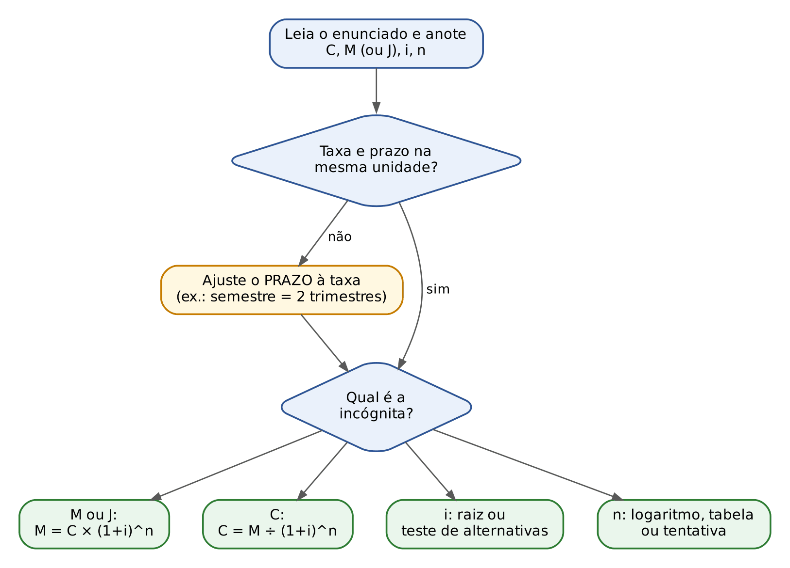

# CAPÍTULO 01 — MATEMÁTICA DE BASE PARA QUEM PARTE DO ZERO: NÚMEROS, FRAÇÕES, DECIMAIS, POTÊNCIAS, RAÍZES, PORCENTAGEM, REGRA DE TRÊS, EQUAÇÕES, PROGRESSÕES, EXPONENCIAIS E LOGARITMOS, CÁLCULO MENTAL E TABELAS FINANCEIRAS DA PROVA

| Conceito | Fórmula ou regra | Quando usar | Armadilha |
|---|---|---|---|
| Ordem das operações | parênteses → potências → × e ÷ → + e − | expressões numéricas | −3² = −9, mas (−3)² = 9 |
| Regra de sinais | sinais iguais: +; diferentes: − | × e ÷ com negativos | não vale para a soma |
| Soma de frações | denominador comum (MMC) | partes de um todo | não somar denominadores |
| Fração de fração | multiplicar as frações | "do que sobrou" | aplicar a 2ª fração sobre o total |
| Porcentagem | parte = taxa × todo | x% de y; achar o todo | esquecer de dividir por 100 |
| Fator | aumento × (1 + i); desconto × (1 − i) | qualquer variação | somar porcentagens sucessivas |
| Variação percentual | (novo − antigo) ÷ antigo | crescimento, queda, recuperação | base errada (−20% pede +25%) |
| Desfazer variação | dividir pelo fator | preço antes do aumento | subtrair a porcentagem |
| Sobre o preço de venda | preço = custo ÷ (1 − soma das %) | markup, tributos "por dentro" | multiplicar o custo por (1 + %) |
| Regra de três | direta: como está; inversa: inverter | proporções | não identificar a inversa |
| Potências | somar, subtrair, multiplicar expoentes | juros compostos | (a + b)² ≠ a² + b² |
| Raiz | ⁿ√a = a^(1/n) | taxa equivalente | esquecer que √ é a inversa do quadrado |
| Equação 1º grau | operação inversa dos dois lados | problemas com texto | não conferir a resposta |
| Bhaskara | Δ = b² − 4ac; x = (−b ± √Δ) ÷ 2a | equações com x² | aceitar raiz negativa para taxa ou prazo |
| PA | aₙ = a₁ + (n − 1)r; Sₙ = (a₁ + aₙ)n ÷ 2 | juros simples, sequências | esquecer o +1 na contagem |
| PG | aₙ = a₁qⁿ⁻¹; Sₙ = a₁(qⁿ − 1) ÷ (q − 1) | juros compostos, crescimento | usar n em vez de n − 1 |
| Logaritmo | log (aⁿ) = n log a | prazo (incógnita no expoente) | não usar os valores dados |
| Aproximação | (1 + i)ⁿ ≈ 1 + ni + n(n − 1)i² ÷ 2 | potências sem calculadora | usar com taxa alta ou prazo longo |

Formulário do capítulo:

- Porcentagem: parte = taxa × todo, com a taxa em decimal (5% = 0,05).
- Fator de aumento: (1 + i); fator de desconto: (1 − i); variações sucessivas: multiplique os fatores.
- Variação percentual: (V novo − V antigo) ÷ V antigo.
- Proporção: a/b = c/d ⇒ a × d = b × c.
- Potências: aᵐ × aⁿ = aᵐ⁺ⁿ; aᵐ ÷ aⁿ = aᵐ⁻ⁿ; (aᵐ)ⁿ = aᵐⁿ; a⁰ = 1; a⁻ⁿ = 1 ÷ aⁿ.
- Bhaskara: Δ = b² − 4ac; x = (−b ± √Δ) ÷ (2a). Soma das raízes −b/a; produto c/a.
- PA: aₙ = a₁ + (n − 1) × r; Sₙ = (a₁ + aₙ) × n ÷ 2.
- PG: aₙ = a₁ × qⁿ⁻¹; Sₙ = a₁ × (qⁿ − 1) ÷ (q − 1); PG infinita com 0 < q < 1: S = a₁ ÷ (1 − q).
- Logaritmo: o logaritmo de a na base b é x quando bˣ = a; log (a × c) = log a + log c; log (a ÷ c) = log a − log c; log aⁿ = n × log a; mudança de base: logaritmo de a na base b = log a ÷ log b.
- Prazo: (1 + i)ⁿ = k ⇒ n = log k ÷ log (1 + i). Regra do 70: duplicação em ≈ 70 ÷ (taxa em %).
- Valores úteis: log 2 ≈ 0,301; log 3 ≈ 0,477; ln 2 ≈ 0,693; e ≈ 2,718; √2 ≈ 1,414; √3 ≈ 1,732.

# CAPÍTULO 02 — JUROS SIMPLES: CAPITAL, TAXA, PRAZO, JUROS E MONTANTE; TAXAS PROPORCIONAIS; PRAZO MÉDIO, TAXA MÉDIA E CAPITAIS EQUIVALENTES

| Conceito | Fórmula ou regra | Quando usar | Armadilha |
|---|---|---|---|
| Juros simples | Juros de cada período calculados sempre sobre o capital inicial | Sempre que o enunciado disser "juros simples" | Calcular juros sobre o saldo (isso é composto, Cap. 3) |
| Relação básica | M = C + J; J = M − C | Qualquer regime | Esquecer de subtrair o capital ao achar a taxa |
| Taxa unitária | 3% = 0,03; 1,5% = 0,015 | Antes de qualquer conta | Usar 3 em vez de 0,03 |
| Juros | J = C × i × n | Dado ou pedido o valor dos juros | Taxa e prazo em unidades diferentes |
| Montante | M = C × (1 + i × n) | Dado ou pedido o valor final | Confundir fator 1 + i × n com i × n |
| Gráfico | Montante = reta (função afim; PA de razão C × i) | Afirmações sobre crescimento | Dizer que cresce exponencialmente |
| Taxas proporcionais | Divida ou multiplique pela razão dos períodos (24% a.a. = 2% a.m.) | Converter unidade de taxa | No simples, proporcional = equivalente; no composto, não |
| Ano comercial x civil | 360 dias (mês de 30) x 365 dias | Prazo em dias | Sem indicação, use 360 |
| Juros comerciais x exatos | d/360 x d/365; comerciais = exatos × 73/72 | Taxa anual e prazo em dias | Exatos são os MENORES |
| Contagem de dias | Exclui o dia inicial, inclui o final | Datas no enunciado | Esquecer fevereiro de ano bissexto |
| Achar o capital | C = M ÷ (1 + i × n) ou C = J ÷ (i × n) | Dado o montante ou os juros | Subtrair a porcentagem do montante |
| Achar a taxa | i = J ÷ (C × n) | Dados C, J (ou M) e n | Taxa do período ≠ taxa por período |
| Achar o prazo | n = J ÷ (C × i); multiplicar por k: n = (k − 1) ÷ i | "Em quanto tempo dobra/triplica" | Para triplicar, juros = 2C, e não 3C |
| Encadeados | Resolver de trás para frente | Montante vira capital | Retirada de 10%: dividir por 0,90 |
| Mover valor no tempo | Para frente: × (1 + i × t); para trás: ÷ (1 + i × t) | Capitais equivalentes | t é a distância até a data focal |
| Capitais equivalentes | Mesmo valor na data focal | Substituição e renegociação de dívidas | No simples, o resultado depende da data focal |
| Data focal | A indicada; se omitida, a do novo pagamento | Substituição de títulos | Prazo simples não é cindível: 1,10 × 1,10 ≠ 1,20 |
| Taxa média | Juros totais ÷ Σ C × n | Várias aplicações, uma taxa única | Média simples das taxas |
| Prazo médio | Juros totais ÷ Σ C × i | Várias aplicações, um prazo único | Média simples dos prazos |
| Juros de mora | 1% ao mês, simples, salvo lei diversa (CTN, art. 161, § 1º) | Tributo ou débito em atraso | Somar multa ou correção como se fossem juros |

#### Formulário do capítulo

| Fórmula | Símbolos | Quando usar |
|---|---|---|
| M = C + J | M = montante; C = capital; J = juros | Sempre |
| J = C × i × n | i = taxa decimal por período; n = prazo na unidade da taxa | Juros simples |
| M = C × (1 + i × n) | 1 + i × n = fator de acumulação simples | Montante simples |
| C = M ÷ (1 + i × n) | Valor atual (trazer para hoje) | Achar o capital dado o montante |
| C = J ÷ (i × n); i = J ÷ (C × n); n = J ÷ (C × i) | Isolamento da letra procurada | Achar C, i ou n dados os juros |
| n = (k − 1) ÷ i | k = número de vezes que o capital se multiplica | Dobrar (k = 2), triplicar (k = 3) |
| J = C × i_a × d ÷ 360 | i_a = taxa anual; d = dias | Juros comerciais |
| J = C × i_a × d ÷ 365 | idem, ano civil | Juros exatos |
| V_depois = V_antes × (1 + i × t); V_antes = V_depois ÷ (1 + i × t) | t = distância entre as datas | Mover valores até a data focal |
| i_m = Σ C × i × n ÷ Σ C × n | Σ = soma de todas as aplicações | Taxa média |
| n_m = Σ C × i × n ÷ Σ C × i | idem | Prazo médio |

# CAPÍTULO 03 — JUROS COMPOSTOS: MONTANTE, CAPITALIZAÇÃO, COMPARAÇÃO COM OS JUROS SIMPLES, TABELAS, LOGARITMOS E CONVENÇÕES LINEAR E EXPONENCIAL

| Conceito | Fórmula ou regra | Quando usar | Armadilha |
|---|---|---|---|
| Juros compostos | juros de cada período incorporados ao capital (capitalização) | quase todas as operações financeiras reais | achar que os juros são iguais todo mês (isso é o simples) |
| Fator de capitalização | (1 + i)ⁿ | multiplica o capital para obter o montante | i em porcentagem em vez de decimal |
| Montante | M = C × (1 + i)ⁿ | pede valor final, valor de resgate, dívida no vencimento | prazo e taxa em unidades diferentes |
| Juros | J = M − C = C × [(1 + i)ⁿ − 1] | pede "os juros" ou "a receita financeira" | marcar o montante quando se pedem juros, e vice-versa |
| Retirada ou pagamento parcial | atualiza, abate, continua | pagamentos no meio do prazo | subtrair do montante final sem corrigir |
| Unidade | converta o PRAZO para a unidade da taxa | sempre | dividir taxa composta (3% a.t. não é 1% a.m.) |
| Simples x compostos | iguais em n = 1; simples maior se n < 1; compostos maiores se n > 1 | comparações | "compostos sempre rendem mais" (só com a mesma taxa e n > 1) |
| Diferença em 2 períodos | C × i² | mesma taxa, n = 2 | aplicar com taxas diferentes |
| Capital (valor atual) | C = M ÷ (1 + i)ⁿ | "quanto aplicar hoje", "quanto vale hoje" | multiplicar em vez de dividir |
| Taxa | 1 + i = raiz n-ésima de M ÷ C | conhecidos C, M e n | dividir o rendimento total por n (raciocínio simples) |
| Entrada + 1 parcela | i = parcela ÷ (preço à vista − entrada) − 1 | compras com entrada | esquecer de abater a entrada |
| Prazo | n = log(M ÷ C) ÷ log(1 + i) | "em quanto tempo" | usar bases diferentes em cima e embaixo |
| Regra do 70 | prazo para dobrar ≈ 70 ÷ taxa (%) | estimar e eliminar alternativas | confundir com o simples (100 ÷ taxa) |
| Tabela | (1 + i)ᵃ⁺ᵇ = (1 + i)ᵃ × (1 + i)ᵇ | expoente fora da tabela | usar valor "mais preciso" que o do enunciado |
| Convenção exponencial | M = C × (1 + i)^(k + p/q) | prazo fracionário, enunciado silente | precisar de raiz: a prova fornece |
| Convenção linear | M = C × (1 + i)ᵏ × (1 + i × p/q) | enunciado pede "linear" | aplicar juros simples ao prazo todo |

Formulário do capítulo:

- M = C × (1 + i)ⁿ — M = montante; C = capital; i = taxa por período (decimal); n = número de períodos na unidade da taxa. Use para achar o valor final.
- J = M − C = C × [(1 + i)ⁿ − 1] — J = juros totais. Use quando a questão dá ou pede os juros.
- C = M ÷ (1 + i)ⁿ — valor presente. Use para trazer valores do futuro a hoje.
- (1 + i)ⁿ = M ÷ C, então 1 + i = raiz n-ésima de (M ÷ C) — use para achar a taxa (ou teste alternativas).
- n = log(M ÷ C) ÷ log(1 + i) — use para achar o prazo; vale com log ou ln, desde que iguais.
- n para dobrar ≈ 0,7 ÷ i (i em decimal), ou 70 ÷ taxa em porcentagem — estimativa.
- (1 + i)ⁿ ≈ 1 + n × i + [n × (n − 1) ÷ 2] × i² — estimativa da potência para taxas pequenas.
- Diferença composto − simples em 2 períodos = C × i².
- Convenção linear: M = C × (1 + i)ᵏ × (1 + i × p/q); convenção exponencial: M = C × (1 + i)^(k + p/q); k = parte inteira, p/q = fração do período.

# CAPÍTULO 04 — TAXAS DE JUROS: PROPORCIONAIS, EQUIVALENTES, NOMINAL E EFETIVA, APARENTE E REAL, TAXA OVER E CAPITALIZAÇÃO CONTÍNUA

| Conceito | Fórmula ou regra | Quando usar | Armadilha |
|---|---|---|---|
| Taxas proporcionais | i_L = i_C × k (multiplica para subir, divide para descer) | Regime simples; passo 1 da taxa nominal | Usar em regime composto |
| Taxas equivalentes (simples) | Coincidem com as proporcionais | Juros simples | Achar que são diferentes das proporcionais |
| Taxas equivalentes (compostas) | (1 + i_L) = (1 + i_C)^k; para descer, raiz k | Converter unidade no regime composto | Multiplicar ou dividir a taxa |
| Taxa nominal | Período da taxa ≠ período de capitalização | "X% ao ano capitalizados mensalmente" | Usá-la direto como efetiva |
| Taxa efetiva | i_ef = (1 + j/k)^k − 1 | Transformar o rótulo na taxa verdadeira | Converter a nominal por raiz |
| Taxa acumulada | Produto dos fatores | Aumentos ou quedas sucessivas, inflação de vários meses | Somar as taxas |
| Taxa média | Raiz n do produto dos fatores | Taxa constante equivalente a várias taxas | Média aritmética |
| Taxa em parcelamento | Parcela futura ÷ (à vista − entrada) − 1 | "Entrada + 1 parcela" | Financiar também a entrada |
| Fisher | (1 + i_a) = (1 + i_r) × (1 + π) | Aparente, real e inflação | Subtrair taxas |
| Atalho da real | i_r = (i_a − π) ÷ (1 + π) | Divisão rápida à mão | Esquecer o denominador |
| Ganho real em reais | C × (1 + i_a) − C × (1 + π) | "Ganho real" em dinheiro | Responder o ganho aparente |
| Taxa a termo | (1 + i₀,₂)² = (1 + i₀,₁) × (1 + f₁,₂) | Estrutura a termo, taxa implícita | Usar a taxa à vista longa como se fosse a do trecho |
| Over mensal | (1 + over/30)^du − 1 | Mercado interbancário (convenção antiga) | Dias corridos; tratar como efetiva |
| Over anual (252) | (1 + taxa)^(du/252) − 1 | Selic e taxas base 252 | Dividir por 252 |
| Capitalização contínua | M = C × e^(δn) | Enunciado diz "contínua" ou "instantânea" | Usar (1 + δ)ⁿ |
| Taxa instantânea | δ = ln(1 + i); i = e^δ − 1 | Converter contínua ↔ efetiva | Esquecer que δ < i |

:::ESQUEMA Formulário do capítulo
| Fórmula | Símbolos | Use quando |
|---|---|---|
| i_L = i_C × k | i_L taxa do período longo; i_C do curto; k períodos curtos no longo | Regime simples |
| (1 + i_L) = (1 + i_C)^k | idem, em decimal | Regime composto |
| i_C = (1 + i_L)^(1/k) − 1 | idem | Descer de unidade no composto |
| i_ef = (1 + j/k)^k − 1 | j nominal; k capitalizações no período de j | Nominal → efetiva |
| 1 + i_acum = (1 + i₁)(1 + i₂)...(1 + iₙ) | iₖ taxa de cada período (queda com sinal negativo) | Taxas sucessivas |
| (1 + i_a) = (1 + i_r)(1 + π) | i_a aparente; i_r real; π inflação | Inflação |
| i_r = (i_a − π) ÷ (1 + π) | idem | Real, à mão |
| (1 + i₀,ₙ)ⁿ = (1 + i₀,ₙ₋₁)ⁿ⁻¹ × (1 + f) | taxas à vista e taxa a termo f | Estrutura a termo |
| i_per = (1 + over/30)^du − 1 | over mensal; du dias úteis | Taxa over mensal |
| M = C × e^(δn) | δ taxa contínua; n prazo; e ≈ 2,718 | Capitalização contínua |
| δ = ln(1 + i) | i efetiva equivalente | Contínua ↔ efetiva |
:::

# CAPÍTULO 05 — DESCONTOS: SIMPLES E COMPOSTOS, RACIONAL (POR DENTRO) E COMERCIAL (POR FORA)

### 05.10.1 Conceitos e armadilhas

| Conceito | Regra | Quando usar | Armadilha |
|---|---|---|---|
| Valor nominal (N) | valor de face, pago no vencimento | sempre dado ou pedido | sinônimos: valor de face, futuro, de resgate |
| Valor atual (A) | o que se recebe na antecipação | sempre | "valor descontado" pode significar A ou D: veja as alternativas |
| Desconto (D) | D = N − A | todas as modalidades | não confundir desconto com valor atual |
| Prazo (n) | tempo que FALTA até o vencimento | todas | não é o prazo total do título; converter dias (ano de 360) |
| Racional simples | taxa sobre A; A = N ÷ (1 + i·n) | "por dentro", "racional", "real" | calcular a taxa sobre N dá o comercial |
| Comercial simples | taxa sobre N; A = N × (1 − i·n) | "por fora", "comercial", "bancário" | só faz sentido se i·n < 1 |
| Relação entre os simples | Dc = Dr × (1 + i·n); Dc − Dr = Dr·i·n | comparação, mesma taxa e prazo | o comercial é SEMPRE o maior desconto (n > 0) |
| N pelos dois descontos | N = Dc·Dr ÷ (Dc − Dr) | dados Dc e Dr | "produto sobre a diferença" |
| Taxa efetiva do comercial simples | i_ef = d ÷ (1 − d·n); no período: d·n ÷ (1 − d·n) | "custo efetivo", "taxa de juros efetiva" | é MAIOR que d; cresce com o prazo |
| Taxa comercial equivalente a uma racional | d = i ÷ (1 + i·n) | "taxas equivalentes" | a racional equivalente é sempre a MAIOR |
| Desconto bancário | A_liq = N × [1 − (d·n + h)] − IOF − tarifas | taxa administrativa, IOF, TAC | h não se multiplica pelo prazo; use as alíquotas do enunciado |
| Racional composto | A = N ÷ (1 + i)ⁿ | "valor presente", "desconto composto" | ver se a tabela é de acumulação (>1) ou de valor atual (<1) |
| Comercial composto | A = N × (1 − d)ⁿ; i_ef = d ÷ (1 − d) | raro; descontos sucessivos | não confundir com 1 − d·n |
| Comparação das quatro | n > 1: com. simples < com. composto < rac. composto < rac. simples | afirmações V ou F | n = 1 iguala simples e composto; n < 1 inverte |

### 05.10.2 Formulário do capítulo

| Fórmula | O que significa cada símbolo | Quando usar |
|---|---|---|
| D = N − A | D: desconto; N: valor nominal; A: valor atual | sempre |
| A = N ÷ (1 + i·n) | i: taxa por período (decimal); n: prazo de antecipação | racional simples, de N para A |
| N = A × (1 + i·n) | idem | racional simples, de A para N |
| Dr = A·i·n = N·i·n ÷ (1 + i·n) | Dr: desconto racional simples | racional simples |
| Dc = N·i·n | Dc: desconto comercial simples | comercial simples |
| A = N × (1 − i·n) | 1 − i·n: fração recebida | comercial simples, de N para A |
| N = A ÷ (1 − i·n) | idem | comercial simples, de A para N |
| Dc = Dr × (1 + i·n) | mesma taxa, mesmo prazo | comparação |
| Dc − Dr = Dr·i·n | diferença = juros de Dr | comparação |
| N = Dc·Dr ÷ (Dc − Dr) | produto sobre a diferença | dados os dois descontos |
| i_ef = d ÷ (1 − d·n) | d: taxa comercial; i_ef: taxa efetiva mensal (juros simples) | taxa efetiva do comercial simples |
| i_total = d·n ÷ (1 − d·n) = Dc ÷ A | taxa efetiva do período inteiro | taxa efetiva no período |
| d = i ÷ (1 + i·n) | i: taxa racional | taxa comercial equivalente |
| A_liq = N × [1 − (d·n + h)] | h: taxa administrativa (uma vez) | desconto bancário |
| A = N ÷ (1 + i)ⁿ | (1 + i)ⁿ: fator de acumulação | racional composto |
| D = N × [1 − 1 ÷ (1 + i)ⁿ] | 1 ÷ (1 + i)ⁿ: fator de valor atual | racional composto |
| n = log(N ÷ A) ÷ log(1 + i) | log: logaritmo decimal | prazo no racional composto |
| A = N × (1 − d)ⁿ | d: taxa comercial composta | comercial composto |
| i_ef = d ÷ (1 − d) | taxa efetiva composta por período | comercial composto |

# CAPÍTULO 06 — EQUIVALÊNCIA DE CAPITAIS, VALOR ATUAL E SÉRIES DE PAGAMENTOS (RENDAS)

| Conceito | Fórmula ou regra | Quando usar | Armadilha |
|---|---|---|---|
| Transporte de um valor | Para frente: × (1 + i)ⁿ Para trás: ÷ (1 + i)ⁿ | Sempre que um valor muda de data | Multiplicar quando deveria dividir; contar mal a distância n |
| Equivalência (composto) | Soma das originais = soma da proposta, na mesma data focal | Troca de dívidas, renegociação | Somar valores de datas diferentes |
| Data focal (composto) | Qualquer uma: o resultado não muda | Escolha a que simplifica (a do valor desconhecido ou a última) | No regime simples a data focal importa (Cap. 2) |
| Preço à vista | Entrada + soma dos valores atuais das parcelas | Compras parceladas | Descontar a parcela paga no ato |
| Série postecipada | PV = P × a(n;i) P = PV ÷ a(n;i) | Parcelas iguais, 1ª em 1 período | Dividir PV por n (esquece os juros) |
| Montante de série | FV = P × s(n;i) | Depósitos para formar capital | FV está na data do último depósito |
| Série antecipada | PV = P × a(n;i) × (1 + i) = P × [1 + a(n − 1;i)] | 1ª parcela no ato | Tratar como postecipada (parcela fica maior) |
| Série diferida | PV = P × a(n;i) ÷ (1 + i)ᵐ, m = data da 1ª − 1 | Carência | Errar m (carência de 3 meses: 1ª no mês 4) |
| Perpetuidade | PV = P ÷ i (antecipada: + P) | Renda sem fim, avaliação pela renda | Taxa e termo em periodicidades diferentes |
| Taxa de uma compra com entrada e 1 parcela | (parcela ÷ saldo financiado) − 1 | "1 + 1" | Esquecer de tirar a entrada (Cap. 4) |
| Taxa com várias parcelas | Procure na tabela, linha n, o fator PV ÷ P; ou teste as alternativas | Taxa desconhecida | Taxa maior → valor atual menor |

Formulário do capítulo:

| Fórmula | Símbolos | Uso |
|---|---|---|
| PV = F ÷ (1 + i)ⁿ | F = valor na data n; i = taxa decimal; n = períodos | Trazer um valor único para hoje |
| a(n;i) = [1 − (1 + i)⁻ⁿ] ÷ i = [(1 + i)ⁿ − 1] ÷ [i × (1 + i)ⁿ] | n = número de parcelas | Fator de valor atual de série postecipada |
| FRC = 1 ÷ a(n;i) | — | Parcela de um empréstimo: P = PV × FRC |
| s(n;i) = [(1 + i)ⁿ − 1] ÷ i | — | Fator de montante de série postecipada |
| FFC = 1 ÷ s(n;i) | — | Depósito para formar um montante |
| s(n;i) = a(n;i) × (1 + i)ⁿ | — | Relação entre os fatores |
| PV antecipada = P × a(n;i) × (1 + i) | — | Série com 1ª parcela no ato |
| PV diferida = P × a(n;i) ÷ (1 + i)ᵐ | m = data da 1ª parcela − 1 | Série com carência |
| PV perpetuidade = P ÷ i | P = termo; 1º termo em 1 período | Renda perpétua |
| PV perpetuidade crescente = P₁ ÷ (i − g) | g = crescimento por período, g < i | Noção (modelo de Gordon) |

Desigualdades que servem de conferência: a(n;i) < n < s(n;i); a(n;i) < 1 ÷ i; parcela > PV ÷ n.

# CAPÍTULO 07 — SISTEMAS DE AMORTIZAÇÃO: SAC, SISTEMA FRANCÊS (PRICE) E SISTEMA MISTO (SAM)

| Conceito | Fórmula ou regra | Quando usar | Armadilha |
|---|---|---|---|
| Juros do período (qualquer sistema) | Jₖ = i × SDₖ₋₁ | sempre: juros sobre o saldo de antes do pagamento | usar o saldo depois do próprio pagamento |
| Composição da prestação | Pₖ = Jₖ + Aₖ | sempre | achar que a prestação inteira abate a dívida |
| Saldo devedor | SDₖ = SDₖ₋₁ − Aₖ | sempre | abater os juros ou a prestação em vez da amortização |
| Soma das amortizações | A₁ + ... + Aₙ = VF | conferência; saldo da Price por subtração | esquecer de descontar a entrada do VF |
| Sistema americano | juros i × VF em todas; VF na última | enunciado "paga só os juros" | confundir com SAC ("juros constantes") |
| SAC: amortização | A = VF ÷ n | toda questão de SAC | — |
| SAC: k-ésima prestação | Pₖ = A + i × [VF − (k − 1) × A] = A × [1 + i × (n − k + 1)] | "qual a 40ª prestação" | contar k em vez de k − 1 pagamentos |
| SAC: 1ª e última | P₁ = A + i × VF; Pₙ = A × (1 + i) | atalhos | — |
| SAC: progressões | prestações e juros em PA de razão −i × A | duas prestações dadas: diferença = i × A | — |
| SAC: total de juros | i × VF × (n + 1) ÷ 2 | "total de juros pagos" | dividir por n em vez de 2 |
| Price: prestação | P = VF × FRC = VF ÷ a(n;i) | toda questão de Price | usar taxa nominal anual sem converter |
| Price: 1ª amortização | A₁ = P − i × VF = P ÷ (1 + i)ⁿ | "amortização da 1ª prestação" | confundir A₁ com J₁ |
| Price: amortizações | Aₖ = A₁ × (1 + i)ᵏ⁻¹ (PG) | amortização dada no meio: dividir por (1 + i) para voltar | somar i em vez de multiplicar por (1 + i) |
| Price: saldo | SDₖ = VF − (A₁ + ... + Aₖ) = P × a(n − k;i) | "saldo após a k-ésima" | parar uma linha antes |
| Price: total de juros | n × P − VF | "total de juros" | — |
| SAM | Pₖ = (Pₖ do SAC + P da Price) ÷ 2; Price = 2 × SAM − SAC | toda questão de SAM | usar a prestação do SAC de outro mês |
| Comparação | 1ª prestação: SAC > SAM > Price; última: Price > SAM > SAC; total de juros: SAC < SAM < Price | questões teóricas | "todos têm o mesmo total de juros" (falso) |
| SACRE | prestação = 1ª do SAC, fixa por subperíodo; amortização cresce à razão (1 + i) dentro dele | questão que cite SACRE | — |
| Carência | juros pagos: saldo constante; capitalizada: saldo × (1 + i)ᶜ | contratos com carência | começar a planilha sobre o VF original quando houve capitalização |

#### Formulário do capítulo

- Regras gerais: Jₖ = i × SDₖ₋₁; Pₖ = Jₖ + Aₖ; SDₖ = SDₖ₋₁ − Aₖ. Símbolos: i = taxa do período em decimal; SD = saldo devedor; J = juros; A = amortização; P = prestação; k = número da prestação.
- SAC: A = VF ÷ n; SDₖ = A × (n − k); Jₖ = i × A × (n − k + 1); Pₖ = A × [1 + i × (n − k + 1)]; total de juros = i × VF × (n + 1) ÷ 2. Símbolos: VF = valor financiado; n = número de prestações.
- Price: P = VF × i × (1 + i)ⁿ ÷ [(1 + i)ⁿ − 1] = VF × i ÷ [1 − (1 + i)⁻ⁿ] = VF ÷ a(n;i); A₁ = P − i × VF = P ÷ (1 + i)ⁿ; Aₖ = A₁ × (1 + i)ᵏ⁻¹; Jₖ = P − Aₖ; SDₖ = P × a(n − k;i); total de juros = n × P − VF. Símbolos: a(n;i) = fator de valor atual da série (Cap. 6); FRC = 1 ÷ a(n;i).
- SAM: Pₖ = (Pₖ do SAC + P da Price) ÷ 2; razão das prestações = −i × A ÷ 2.
- Americano: Jₖ = i × VF em todos os períodos; Pₙ = VF × (1 + i).

# CAPÍTULO 08 — ANÁLISE DE FLUXOS DE CAIXA: DIAGRAMA, VPL, TIR, PAYBACK E COMPARAÇÃO DE ALTERNATIVAS

:::PASSO Como resolver qualquer questão de análise de fluxo de caixa
- Etapa 1: desenhe o fluxo (data 0 = hoje; entradas para cima; saídas para baixo; valores no fim de cada período) e conte as trocas de sinal.
- Etapa 2: identifique o que se pede: VPL (com a TMA), TIR (taxa que zera o VPL), valor X (dada a TIR), *payback*, IL ou escolha entre projetos.
- Etapa 3: procure os "números redondos" e os dados fornecidos (fatores, produtos prontos como 1,21 × 600 = 726); eles indicam o caminho.
- Etapa 4: para a TIR, teste as alternativas: VPL positivo manda subir a taxa; negativo, descer.
- Etapa 5: na escolha entre excludentes, decida pelo maior VPL à TMA; com durações diferentes, pelo maior VPL anualizado.
- Etapa 6: confira a coerência: VPL > 0 ⇔ TIR > TMA ⇔ IL > 1 (projeto convencional); *payback* descontado ≥ simples.
:::

| Conceito | Fórmula ou regra | Quando usar | Armadilha |
|---|---|---|---|
| Fluxo de caixa | Entradas (+) para cima; saídas (−) para baixo; data 0 = hoje; valores no fim de cada período | Sempre, antes de qualquer conta | Somar valores de datas diferentes sem descontar |
| Projeto convencional | Uma única troca de sinal | Para saber se a TIR é única | Saídas seguidas não trocam o sinal |
| TMA | Custo de oportunidade ou custo do capital | Taxa de desconto do VPL e régua da TIR | Quanto maior a TMA, menor o VPL |
| VPL | VPL = −I + Σ FCₜ ÷ (1 + i)ᵗ | Viabilidade e escolha entre excludentes | VPL < 0 não é prejuízo contábil; é perder para a TMA |
| TIR | Taxa que zera o VPL | Rentabilidade em % | Supõe reinvestimento à própria TIR; pode ser múltipla ou inexistente |
| Interpolação | TIR ≈ i₁ + (i₂ − i₁) × VPL₁ ÷ (VPL₁ − VPL₂) | TIR entre duas taxas da tabela | VPL₂ é negativo: o denominador é uma soma |
| Achar X dada a TIR | VP das entradas = VP das saídas, à TIR | Questões FCC | Multiplicar por (1 + TIR)ⁿ da data CERTA |
| *Payback* simples | Tempo até o acumulado zerar | Liquidez, risco, decisões pequenas | Ignora o tempo e o que vem depois |
| *Payback* descontado | Idem, com fluxos descontados à TMA | Idem, mais fiel | Sempre ≥ simples; saldo final = VPL |
| IL | VP das entradas ÷ investimento | Racionamento de capital | IL > 1 ⇔ VPL > 0; ignora escala |
| Excludentes | Maior VPL à TMA | Escolher um entre vários | A maior TIR pode ter VPL menor (escala, prazo) |
| Fisher | TIR do fluxo incremental | Achar a taxa em que a escolha muda | Abaixo dela vence o projeto de curva mais inclinada |
| VPL anualizado | VPLa = VPL ÷ a(n;i) | Durações diferentes | Comparar VPLs de prazos distintos diretamente |

#### Formulário do capítulo

| Fórmula | Símbolos | Uso |
|---|---|---|
| VP = F ÷ (1 + i)ⁿ | F = valor futuro na data n; i = TMA decimal | Trazer um valor para a data 0 |
| VP = PMT × a(n;i) | PMT = entrada constante; a(n;i) = fator da tabela | Entradas iguais |
| VPL = −I + FC₁ ÷ (1 + i) + ... + FCₙ ÷ (1 + i)ⁿ | I = investimento; FCₜ = fluxo líquido da data t | Viabilidade |
| 0 = −I + FC₁ ÷ (1 + TIR) + ... + FCₙ ÷ (1 + TIR)ⁿ | TIR = incógnita | Definição da TIR |
| TIR (1 período) = FC₁ ÷ I − 1 | — | Projetos de um período |
| TIR ≈ i₁ + (i₂ − i₁) × VPL₁ ÷ (VPL₁ − VPL₂) | VPL₁ > 0 a i₁; VPL₂ < 0 a i₂ | Interpolação |
| IL = VP das entradas ÷ I; TR = IL − 1 | — | Lucratividade relativa |
| VPLa = VPL ÷ a(n;i) | n = duração do projeto | Prazos diferentes |

# CAPÍTULO 09 — ESTATÍSTICA DESCRITIVA I: POPULAÇÃO E AMOSTRA, VARIÁVEIS, TABELAS, GRÁFICOS E MEDIDAS DE POSIÇÃO

| Conceito | Fórmula ou regra | Quando usar | Armadilha |
|---|---|---|---|
| População x amostra | população: todos; amostra: parte; censo: exame de todos | vocabulário de toda a Estatística | parâmetro (μ, σ, N) é da população; estatística (x̄, s, n) é da amostra |
| Qualitativa nominal | rótulo sem ordem | município, CFOP, sexo, sim/não | código numérico (CEP, CPF) continua nominal |
| Qualitativa ordinal | rótulo com ordem | risco baixo/médio/alto, escolaridade, faixa etária | dar números às categorias não as torna quantitativas |
| Quantitativa discreta | contagem ("quantos?") | nº de autos, de filhos, de atendimentos | média 1,4 filhos não torna a variável contínua |
| Quantitativa contínua | medição | valor em reais, tempo, peso, altura | dinheiro é tratado como contínuo |
| Escala de razão x intervalar | razão: zero absoluto, "o dobro" faz sentido; intervalar: zero arbitrário | valores e quantidades (razão); Celsius e anos (intervalar) | valor em reais é razão, não intervalar |
| Frequências | fᵢ; frᵢ = fᵢ/n; Fᵢ acumulada; Frᵢ = Fᵢ/n | montar e ler tabelas | Σfrᵢ = 100%; última Fᵢ = n |
| Classe | amplitude h = L − l; ponto médio (l + L)/2 | dados agrupados | 10 ├ 20 inclui o 10 e exclui o 20 |
| Gráficos | barras (qualitativa), setores (partes de um todo; ângulo = 360° × fr), histograma (classes; colunas encostadas), polígono (pontos médios), ogiva (acumulada) | escolher o gráfico | histograma não é para qualitativa; eixo truncado engana |
| Média simples | x̄ = Σxᵢ/n; soma = n × x̄ | valor típico sem extremos | sensível a *outliers* |
| Propriedades da média | +k → média + k; ×k → média × k; Σ(xᵢ − x̄) = 0; Σ(xᵢ − m)² mínima em m = x̄ | reajustes, abonos, correções | módulo mínimo é na mediana; desvio-padrão não muda com +k (Cap. 10) |
| Entrou, saiu, corrigiu | nova média = (soma ± valores)/(nova quantidade) | questão mais frequente da FCC | correção não muda a quantidade |
| Média ponderada | Σpᵢxᵢ / Σpᵢ | pesos, porcentagens, tabelas (peso = fᵢ) | não dividir pelo número de linhas |
| Média de grupos | (nA·x̄A + nB·x̄B)/(nA + nB) | fusões, turmas | média das médias só se nA = nB |
| Média geométrica | raiz n-ésima do produto | taxas de crescimento encadeadas | H ≤ G ≤ média aritmética |
| Média harmônica | n / Σ(1/xᵢ) | velocidade em trechos iguais, mesmo gasto por compra | não é a média aritmética das velocidades |
| Mediana (lista) | posição (n + 1)/2; n par: média dos dois centrais | renda, dados com extremos | ordenar antes; posição não é valor |
| Mediana (classes) | Md = l + (n/2 − F_ant)/f_Md × h | tabela por classes | F_ant é a acumulada da classe anterior |
| Moda | valor mais frequente; bruta = ponto médio da classe modal | qualitativas; "valor da maioria" | pode não existir ou ser múltipla |
| Czuber | Mo = l + Δ₁/(Δ₁ + Δ₂) × h | quando pedida | Δ₁ = f_modal − f_ant; Δ₂ = f_modal − f_post |
| King | Mo = l + f_post/(f_ant + f_post) × h | quando pedida | f_post no numerador |
| Assimetria e medidas | positiva: Mo < Md < x̄; simétrica: iguais; negativa: x̄ < Md < Mo | interpretar | a média corre atrás da cauda; tabelas pequenas podem fugir do padrão |
| Separatrizes | posição p × n; S = l + (p·n − F_ant)/f_S × h | quartis, decis, percentis | Q₂ = D₅ = P₅₀ = mediana; métodos de lista podem divergir |
| Mínimo, máximo, cinco números | mínimo, Q₁, Md, Q₃, máximo | resumo e boxplot (Cap. 10) | amplitude = máx − mín; interquartil = Q₃ − Q₁ |

:::ESQUEMA Formulário do capítulo
- Média: x̄ = Σxᵢ / n (x̄ média; xᵢ valores; n quantidade). Soma = n × x̄.
- Média em tabela: x̄ = Σxᵢfᵢ / Σfᵢ (xᵢ valor ou ponto médio; fᵢ frequência).
- Média ponderada: x̄ₚ = Σpᵢxᵢ / Σpᵢ (pᵢ pesos).
- Média de grupos: (nA·x̄A + nB·x̄B)/(nA + nB).
- Geométrica: G = (x₁ · x₂ · ... · xₙ)^(1/n). Harmônica: H = n / (1/x₁ + ... + 1/xₙ). H ≤ G ≤ x̄.
- Mediana em lista: posição (n + 1)/2.
- Mediana em classes: Md = l_inf + (n/2 − F_ant)/f_Md × h.
- Separatriz em classes: S = l_inf + (p·n − F_ant)/f_S × h (p = 0,25; 0,75; 0,10...).
- Moda de Czuber: Mo = l_inf + Δ₁/(Δ₁ + Δ₂) × h. Moda de King: Mo = l_inf + f_post/(f_ant + f_post) × h. Pearson: Mo ≈ 3Md − 2x̄.
- Setor: ângulo = 360° × frᵢ. Ponto médio: (l + L)/2. Amplitude da classe: L − l.
:::

# CAPÍTULO 10 — ESTATÍSTICA DESCRITIVA II: MEDIDAS DE DISPERSÃO, ASSIMETRIA, CURTOSE E BOXPLOT

### 10.13.1 Quadro geral

| Conceito | Fórmula ou regra | Quando usar | Armadilha |
|---|---|---|---|
| Amplitude total | máximo − mínimo | Noção rápida de espalhamento | Ignora os dados do meio; sensível a outliers |
| Amplitude interquartil (AIQ) | Q₃ − Q₁ | Dispersão robusta; base do boxplot | Depende da convenção de quartil |
| Desvio | xᵢ − x̄ | Base de todas as medidas | A soma dos desvios em relação à média é SEMPRE zero |
| Desvio médio | Σ (módulos dos desvios) ÷ n | Quando o enunciado pede "desvio (absoluto) médio" | Não esquecer o módulo |
| Variância populacional | Σ(xᵢ − μ)² ÷ N = média dos quadrados − quadrado da média | Dados de toda a população; "média dos quadrados dos desvios" | Unidade ao quadrado; nunca negativa |
| Variância amostral | Σ(xᵢ − x̄)² ÷ (n − 1) | Amostra; "não viesada" | Máxima verossimilhança divide por n |
| Desvio-padrão | √variância | Interpretar a dispersão na unidade original | Entre 0 e 1, é MAIOR que a variância |
| Dados agrupados | Σfᵢ(xᵢ − x̄)² ÷ Σfᵢ (classes: ponto médio) | Tabelas de frequência | Multiplicar o quadrado pela frequência |
| Coeficiente de variação | σ ÷ x̄ | Comparar dispersões com médias ou unidades diferentes | Maior desvio não significa maior dispersão relativa |
| Soma de constante | Posição soma; dispersão igual; CV muda | Abonos, acréscimos fixos | Desvio-padrão NÃO muda |
| Multiplicação por constante | Posição e desvio × b; variância × b²; CV igual | Reajustes percentuais, conversão de unidade | Variância × b², não × b |
| Novos dados iguais à média | Média igual; soma de quadrados igual; variância diminui | "Admissão de funcionários ganhando a média" | A variância não fica igual |
| Juntar grupos | Média das variâncias + variância das médias | Reunir populações | Não é só a média das variâncias |
| Escore z | (x − x̄) ÷ σ | Comparar posições em escalas diferentes; outliers (z acima de 3 ou abaixo de −3) | Divide-se pelo desvio, não pela variância |
| Assimetria | Positiva: Mo < Md < x̄; negativa: x̄ < Md < Mo | Forma da distribuição | O nome segue a CAUDA |
| Pearson | (x̄ − Mo) ÷ s; 3(x̄ − Md) ÷ s | Medir intensidade da assimetria | Fator 3 no segundo |
| Bowley | (Q₃ + Q₁ − 2Md) ÷ (Q₃ − Q₁) | Assimetria só com quartis | Fica entre −1 e +1 |
| Curtose percentílica | (Q₃ − Q₁) ÷ [2(P90 − P10)]; normal ≈ 0,263 | Achatamento | Menor que 0,263 = lepto |
| Curtose de momento | m₄ ÷ s⁴; normal = 3 | Achatamento (teoria) | Maior que 3 = lepto (sentido inverso) |
| Boxplot | Cercas Q₁ − 1,5AIQ e Q₃ + 1,5AIQ | Outliers, comparação de grupos | Não mostra média nem moda |

### 10.13.2 Formulário

| Fórmula | Símbolos | Quando usar |
|---|---|---|
| AT = máx − mín | máx e mín: maior e menor dados | Amplitude total |
| DM = Σ (módulo de xᵢ − x̄) ÷ n | xᵢ: dados; x̄: média; n: quantidade | Desvio médio |
| σ² = Σ(xᵢ − μ)² ÷ N | μ: média da população; N: tamanho | Variância da população |
| σ² = Σxᵢ² ÷ N − μ² | Σxᵢ²: soma dos quadrados dos dados | Atalho: média dos quadrados menos quadrado da média |
| s² = Σ(xᵢ − x̄)² ÷ (n − 1) = (Σxᵢ² − n x̄²) ÷ (n − 1) | n − 1: graus de liberdade | Variância amostral não viesada |
| Var(X) = E(X²) − [E(X)]² | E: média ("esperança") | Questões com momentos |
| σ = √σ²; s = √s² | | Desvio-padrão |
| σ² = Σfᵢ(xᵢ − x̄)² ÷ Σfᵢ | fᵢ: frequência; xᵢ: valor ou ponto médio | Dados agrupados |
| CV = σ ÷ x̄ (× 100%) | | Dispersão relativa |
| Y = a + bX: média a + b x̄; σ_Y = b × σ_X (b sem sinal); σ²_Y = b² σ²_X | a: constante somada; b: constante multiplicada | Transformações |
| σ²_total = (n₁σ₁² + n₂σ₂²) ÷ (n₁ + n₂) + [n₁(x̄₁ − x̄)² + n₂(x̄₂ − x̄)²] ÷ (n₁ + n₂) | índices 1 e 2: grupos; x̄: média geral | Juntar grupos |
| z = (x − x̄) ÷ σ; x = x̄ + zσ | | Padronização |
| A_P1 = (x̄ − Mo) ÷ s; A_P2 = 3(x̄ − Md) ÷ s; Mo ≈ 3Md − 2x̄ | Mo: moda; Md: mediana | Assimetria de Pearson |
| A_Q = (Q₃ + Q₁ − 2Md) ÷ (Q₃ − Q₁) | Q₁, Q₃: quartis | Assimetria de Bowley |
| K = (Q₃ − Q₁) ÷ [2(P90 − P10)] | P10, P90: percentis | Curtose percentílica (normal ≈ 0,263) |
| Cercas: Q₁ − 1,5 × AIQ e Q₃ + 1,5 × AIQ (extremos: 3 × AIQ) | AIQ = Q₃ − Q₁ | Outliers no boxplot |

# CAPÍTULO 11 — TÉCNICAS DE CONTAGEM E ANÁLISE COMBINATÓRIA

| Conceito | Fórmula/regra | Quando usar | Armadilha |
|---|---|---|---|
| Princípio multiplicativo | multiplique as opções de cada etapa | escolhas sucessivas ("e"): senhas, placas, números | preencha primeiro a casa restrita (zero na frente, par no fim) |
| Princípio aditivo | some os casos | situações que se excluem ("ou"); separar em casos | casos não podem se sobrepor |
| Complementar | bons = total − ruins | "pelo menos um", "não juntos", "nem todos" | conferir se os ruins não foram contados duas vezes |
| Inclusão e exclusão | n(A ou B) = n(A) + n(B) − n(A e B) | duas condições ligadas por "ou" | esquecer de tirar a interseção (Q3406128: 240 em vez de 216) |
| Fatorial | n! = n × (n − 1) × ... × 1; 0! = 1 | base de todas as fórmulas | (a × b)! ≠ a! × b!; simplifique antes de multiplicar |
| Permutação simples | n! | ordenar TODOS os elementos distintos | — |
| Bloco | (objetos com o bloco)! × (interior do bloco)! | elementos que ficam juntos | esquecer o interior; interior de letras iguais vale 1 |
| Lacunas | posicione os outros, distribua os restritos nos vãos | ninguém lado a lado | número de vãos = outros + 1 |
| Antes/depois | total ÷ 2 | A antes de B (não necessariamente colado) | "imediatamente antes" é bloco, não metade |
| Permutação com repetição | n! ÷ (a! × b! × ...) | anagramas com letras iguais; objetos iguais | um fatorial para cada grupo de iguais |
| Distribuição em grupos com nome | n! ÷ (a! × b! × ...) ou C × C × ... | processos para auditores, pessoas em quartos numerados | grupos iguais SEM nome: dividir pelo fatorial do número desses grupos |
| Permutação circular | (n − 1)! | mesa redonda, só posições relativas | cadeiras distinguíveis: n!; colar virável: ÷ 2 |
| Arranjo simples | n! ÷ (n − p)! = n × (n − 1) × ... (p fatores) | escolher p e ORDENAR (cargos, pódio, senha sem repetir) | não confundir com combinação: faça o teste da troca |
| Combinação simples | n! ÷ [p! × (n − p)!] | escolher p SEM ordem (comissão, amostra, aposta) | C(n, p) = C(n, n − p); "em ordem crescente" vira combinação |
| Pares | C(n, 2) = n × (n − 1) ÷ 2 | apertos de mão, jogos, segmentos | diagonais = C(n, 2) − n |
| Combinação com repetição | C(n + p − 1, p) | p objetos IGUAIS para n pessoas/tipos | "pelo menos 1 para cada": dê 1 a cada antes |
| Subconjuntos | 2ⁿ | "algumas", "qualquer grupo" de tamanho livre | tirar o vazio e/ou os unitários quando o enunciado exigir |
| Casa dos pombos | pior caso + 1 | "garantir", "ter certeza" | esquecer o +1 |

:::ESQUEMA Formulário do capítulo
| Fórmula | Símbolos | Use quando |
|---|---|---|
| Pₙ = n! | n = elementos distintos, todos usados | fila com todos |
| n! ÷ (a! b! c!) | a, b, c = repetições de cada elemento | anagramas com letras repetidas; grupos com nome |
| PCₙ = (n − 1)! | n = pessoas na roda | mesa redonda |
| A(n, p) = n! ÷ (n − p)! | n = disponíveis; p = escolhidos em ordem | cargos, pódio, senha sem repetir |
| nᵖ | n opções em cada uma das p casas | senha podendo repetir |
| C(n, p) = n! ÷ [p! (n − p)!] | n = disponíveis; p = tamanho do grupo | grupos sem ordem |
| C(n + p − 1, p) | n = tipos; p = objetos iguais | distribuir objetos iguais |
| 2ⁿ | n = elementos do conjunto | contar todos os subconjuntos |
:::

# CAPÍTULO 12 — PROBABILIDADE: EXPERIMENTO, ESPAÇO AMOSTRAL E EVENTOS, REGRAS DA SOMA E DO PRODUTO, PROBABILIDADE CONDICIONAL, INDEPENDÊNCIA, PROBABILIDADE TOTAL E TEOREMA DE BAYES

| Conceito | Fórmula ou regra | Quando usar | Armadilha |
|---|---|---|---|
| Espaço amostral e evento | Ω = todos os resultados; evento = parte de Ω | Sempre: comece listando ou contando Ω | Em dois dados, Ω tem 36 pares ordenados, não 11 somas |
| Definição clássica | P(A) = favoráveis/possíveis | Resultados equiprováveis ("ao acaso", "honesto") | Não vale para dado viciado |
| Dado viciado | escreva tudo em função de x e some 1 | "duas vezes mais provável" | Ler o que é comparado: cada face ou o evento inteiro |
| Axiomas | P(A) ≥ 0; P(Ω) = 1; aditividade para disjuntos | Questões teóricas | Complementar e independência não são axiomas |
| Sorteio de grupo | C(k, p)/C(n, p) ou produto passo a passo | Comissões, amostras, "de uma vez" | Em grupos mistos, o produto passo a passo exige multiplicar pelo número de ordens |
| Complementar | P(Aᶜ) = 1 − P(A) | "não", "pelo menos um" | Responder com o próprio evento em vez do complementar |
| Regra da soma | P(A ∪ B) = P(A) + P(B) − P(A ∩ B) | "ou"; achar a interseção dada a união | Subtrair a interseção; em Venn de 3, os dados "E e C" incluem o centro |
| Limites | P(A ∪ B) entre max{P(A), P(B)} e min{1, P(A) + P(B)} | Questões de mínimo e máximo | Se P(A) + P(B) > 1, a interseção é positiva |
| Condicional | P(A dado B) = P(A ∩ B)/P(B) | "dado que", "sabendo que", "se" | Dividir pelo evento errado; confundir com a interseção |
| Regra do produto | P(A ∩ B) = P(A) × P(B dado A) | "e", etapas sucessivas, árvores | Sem reposição, a urna diminui a cada etapa |
| Independência | P(A ∩ B) = P(A) × P(B) | Lançamentos, retiradas com reposição, taxas fixas | Disjuntos com probabilidades positivas NÃO são independentes |
| Pelo menos um | 1 − (1 − p)ⁿ (independentes) | "pelo menos", "ao menos um" | Sem reposição, o "nenhum" usa o produto decrescente, não potência |
| Probabilidade total | P(B) = soma de P(Aᵢ) × P(B dado Aᵢ) | Vários grupos com taxas diferentes | Média simples das taxas, sem ponderar pelos grupos |
| Bayes | P(Aⱼ dado B) = caminho de Aⱼ / soma dos caminhos até B | Pede a causa a partir do efeito | Condicional invertida; esquecer a probabilidade a priori |
| Testes diagnósticos | sensibilidade = P(+ dado doente); especificidade = P(− dado sadio); VPP = P(doente dado +) | Exames, alertas, malha fiscal | Com prevalência baixa, o VPP é baixo mesmo com teste bom |

Formulário do capítulo:

- P(A) = n(A)/n(Ω): n(A) = casos favoráveis; n(Ω) = casos possíveis. Só com resultados equiprováveis.
- P(Aᶜ) = 1 − P(A): Aᶜ = "não A".
- P(A ∪ B) = P(A) + P(B) − P(A ∩ B): ∪ = "ou"; ∩ = "e". Se disjuntos, P(A ∩ B) = 0.
- P(A ∪ B ∪ C) = P(A) + P(B) + P(C) − P(A ∩ B) − P(A ∩ C) − P(B ∩ C) + P(A ∩ B ∩ C): melhor resolver pelo Venn, de dentro para fora.
- P(A dado B) = P(A ∩ B)/P(B), com P(B) > 0: B = informação conhecida.
- P(A ∩ B) = P(A) × P(B dado A): regra do produto; com independência, P(A) × P(B).
- P(pelo menos um em n tentativas independentes) = 1 − (1 − p)ⁿ: p = chance de sucesso em cada tentativa.
- Probabilidade total: P(B) = P(A₁) × P(B dado A₁) + ... + P(Aₖ) × P(B dado Aₖ), com A₁, ..., Aₖ formando uma partição de Ω.
- Bayes: P(Aⱼ dado B) = P(Aⱼ) × P(B dado Aⱼ) dividido pela probabilidade total de B.
- Combinação: C(n, p) = n!/[p! × (n − p)!] = (n × (n − 1) × ... p fatores)/p!.

# CAPÍTULO 13 — VARIÁVEIS ALEATÓRIAS E DISTRIBUIÇÕES DE PROBABILIDADE

| Conceito | Fórmula ou regra | Quando usar | Armadilha |
|---|---|---|---|
| Variável aleatória | discreta conta; contínua mede | classificar o problema | P(X = a) = 0 na contínua |
| Função de probabilidade | probabilidades somam 1 | achar k em tabela k, 2k, 3k | esquecer de conferir a soma |
| Acumulada F(x) | F(x) = P(X ≤ x), em degraus | "até x" | F(1,5) = F(1) na discreta inteira |
| Esperança | E(X) = Σ x × p | média a longo prazo, valor esperado de decisão | não é o valor mais provável |
| Variância | E(X²) − [E(X)]² | dispersão | esquecer de subtrair o quadrado da média |
| Transformação | E(aX + b) = aE(X) + b; Var(aX + b) = a²Var(X) | reajustes, padronização | somar b na variância; usar a em vez de a² |
| Soma e diferença | E soma/subtrai; Var de independentes SOMA sempre | X + Y, X − Y | subtrair variâncias |
| Bernoulli | média p; variância p(1 − p) | um único sim ou não | — |
| Binomial | C(n,k) pᵏ(1 − p)ⁿ⁻ᵏ; média np; variância np(1 − p) | n tentativas independentes, p fixo | esquecer C(n, k); variância máxima com p = 0,5 |
| Hipergeométrica | C(K,k)C(N−K,n−k)/C(N,n); média nK/N | sem reposição, lote conhecido | "sem reposição" com só porcentagem = binomial |
| Geométrica | (1 − p)ᵏ⁻¹p; média 1/p | até o primeiro sucesso | versão que conta fracassos (média (1 − p)/p) |
| Poisson | e^(−λ)λᵏ/k!; média = variância = λ | ocorrências com taxa média | ajustar λ ao intervalo; intervalos independentes |
| Densidade | probabilidade = área; área total 1 | variáveis contínuas | ler f(x) como probabilidade |
| Uniforme | altura 1/(b − a); média (a + b)/2; variância (b − a)²/12 | chances iguais no intervalo | — |
| Exponencial | P(X > t) = e^(−λt); média 1/λ; variância 1/λ²; CV = 1 | tempo até o próximo evento | sem memória; mediana ln 2/λ é menor que a média |
| Normal | simétrica; média = mediana = moda; 68 – 95 – 99,7 | medidas em sino, somas, médias | N(μ, σ²): segundo número é variância |
| Padronização | z = (x − μ)/σ | usar a tabela | dividir pela variância |
| Tabela de 0 a z | esquerda: 0,5 + área; direita: 0,5 − área; lados opostos: soma; mesmo lado: subtrai | qualquer área | não desenhar o sino |
| Aproximação normal da binomial | μ = np; σ = √(np(1 − p)); correção de 0,5 | n grande | esquecer a correção quando o gabarito a exige |
| Qui-quadrado | soma de k Z²; positiva; média k | variância, aderência, independência | tabela de cauda direita |
| t de Student | simétrica, caudas pesadas; g.l. = n − 1 | média com σ desconhecido | tabela uni ou bicaudal |
| F de Snedecor | razão de qui-quadrados; dois g.l. | comparar variâncias, ANOVA | ordem dos g.l. (numerador, denominador) |

Formulário do capítulo:
- E(X) = Σ x × p (discreta); área de x × f(x) (contínua). Uso: média ou valor esperado.
- Var(X) = E(X²) − [E(X)]²; σ = √Var(X). Uso: dispersão.
- Binomial: P(X = k) = C(n, k) × pᵏ × (1 − p)ⁿ⁻ᵏ; n = tentativas, k = sucessos, p = chance de sucesso. Média np; variância np(1 − p).
- Hipergeométrica: P(X = k) = C(K, k) × C(N − K, n − k) ÷ C(N, n); N = população, K = portadores, n = amostra.
- Geométrica: P(X = k) = (1 − p)ᵏ⁻¹ × p; média 1/p.
- Poisson: P(X = k) = e^(−λ) × λᵏ ÷ k!; λ = média no intervalo; média = variância = λ.
- Área de xⁿ entre a e b: (bⁿ⁺¹ − aⁿ⁺¹)/(n + 1).
- Uniforme: f = 1/(b − a); média (a + b)/2; variância (b − a)²/12.
- Exponencial: P(X > t) = e^(−λt); média 1/λ; variância 1/λ².
- Normal: z = (x − μ)/σ; valores-chave 1,645 (90% central), 1,96 (95% central), 2,58 (99% central).

# CAPÍTULO 14 — AMOSTRAGEM E INFERÊNCIA ESTATÍSTICA

| Conceito | Fórmula ou regra | Quando usar | Armadilha |
|---|---|---|---|
| Parâmetro x estimador x estimativa | parâmetro descreve a população (fixo); estimador é a fórmula amostral (aleatório); estimativa é o número obtido | questões conceituais | chamar o número obtido na amostra de "parâmetro" ou "estimador" |
| Amostragem probabilística | sorteio; probabilidade conhecida e não nula | permite calcular erro e extrapolar | sistemática É probabilística |
| AAS | todos os elementos e todas as amostras com igual probabilidade | lista completa da população | "ao acaso" sem sorteio formal é outra coisa |
| Sistemática | passo k = N ÷ n; sorteia-se só o início | lista ordenada | periodicidade na lista |
| Estratificada | estratos homogêneos; sorteio em TODOS; alocação uniforme, proporcional ou ótima | grupos diferentes entre si | confundir com conglomerados e com cotas |
| Conglomerados | sorteiam-se GRUPOS inteiros | economia, falta de lista dos elementos | alocação ótima não é conceito de conglomerado |
| Não probabilísticas | conveniência, julgamento, cotas, bola de neve | pesquisas exploratórias | cotas = "estratificada sem sorteio" |
| Distribuição da média | E(x̄) = μ; Var(x̄) = σ² ÷ n; EP = σ ÷ √n | qualquer questão sobre x̄ | usar variância no lugar de σ; esquecer a raiz de n |
| População finita | EP × √[(N − n) ÷ (N − 1)] | sem reposição, n maior que 5% de N | aplicar quando a questão diz "com reposição" |
| Padronização da média | Z = (x̄ − μ) ÷ (σ/√n) | probabilidades sobre x̄ | dividir por σ em vez de σ/√n |
| Soma de n variáveis | média n μ; desvio-padrão σ √n | "peso total", "arrecadação total" | dividir por √n (isso é a média) |
| TCL | x̄ ≈ normal para n grande (n ≥ 30), qualquer população | justificar uso da normal | dizer que a VARIÁVEL original vira normal |
| LGN | x̄ converge para μ quando n cresce | conceito | dizer que sairá EXATAMENTE o valor esperado |
| Não viesado | E(T) = θ; com combinações, soma dos coeficientes = 1 | comparar estimadores | s² com n é viesado; com n − 1, não |
| Eficiente / consistente / suficiente | menor variância / converge com n grande / usa toda a informação | conceito | consistência quando n DIMINUI |
| IC média, σ conhecido | x̄ ± z σ ÷ √n | variância populacional dada | usar 1,64 para 95% |
| IC média, σ desconhecido | x̄ ± t(n − 1) s ÷ √n | s amostral, população normal | gl = n, em vez de n − 1 |
| IC proporção | p̂ ± z √[p̂(1 − p̂) ÷ n] | porcentagens | esquecer de dividir por n dentro da raiz |
| Interpretação | 95% dos intervalos construídos assim contêm μ | questões teóricas | "95% da população está no intervalo" |
| Tamanho (média) | n = (z σ ÷ E)² | planejamento | não elevar ao quadrado; arredondar para baixo |
| Tamanho (proporção) | n = z² p(1 − p) ÷ E²; sem informação p = 0,5 | planejamento | usar p pequeno para "economizar" |
| Correção finita do n | n = n₀ ÷ (1 + n₀ ÷ N) | população pequena | aplicar em população enorme (irrelevante) |

Formulário do capítulo:

| Fórmula | Símbolos | Quando usar |
|---|---|---|
| EP = σ ÷ √n | σ desvio-padrão populacional; n tamanho da amostra | dispersão da média amostral |
| EP finito = (σ ÷ √n) × √[(N − n) ÷ (N − 1)] | N tamanho da população | sem reposição, população pequena |
| Z = (x̄ − μ) ÷ (σ ÷ √n) | x̄ média amostral; μ média populacional | probabilidade sobre a média |
| s² = Σ(xᵢ − x̄)² ÷ (n − 1) | xᵢ cada observação | estimar σ² sem viés |
| IC = x̄ ± z × σ ÷ √n | z: 1,645 (90%), 1,96 (95%), 2,575 (99%) | média, σ conhecido |
| IC = x̄ ± t × s ÷ √n | t com n − 1 graus de liberdade | média, σ desconhecido |
| IC = p̂ ± z × √[p̂(1 − p̂) ÷ n] | p̂ = x ÷ n | proporção |
| E = z × σ ÷ √n; amplitude = 2E | E margem de erro | ler e montar intervalos |
| n = (z × σ ÷ E)² | E na unidade da variável | tamanho para a média |
| n = z² × p(1 − p) ÷ E²; com p = 0,5: n = (z ÷ 2E)² | E e p em decimal | tamanho para a proporção |
| n = n₀ ÷ (1 + n₀ ÷ N) | n₀ tamanho para população infinita | população finita |

# CAPÍTULO 15 — TESTES DE HIPÓTESES: HIPÓTESES NULA E ALTERNATIVA, ERROS TIPO I E II, NÍVEL DE SIGNIFICÂNCIA, VALOR-P, TESTES PARA MÉDIA E PROPORÇÃO, QUI-QUADRADO (NOÇÕES)

| Conceito | Fórmula ou regra | Quando usar | Armadilha |
|---|---|---|---|
| H0 e H1 | H0 tem =, ≤ ou ≥; H1 tem ≠, > ou < | sempre, no passo 1 | o que se quer provar vai em H1 |
| Bilateral / unilateral | ≠ → duas caudas (α/2 em cada); > → direita; < → esquerda | conforme H1 | ">" aponta para a direita |
| Erro tipo I | rejeitar H0 verdadeira; probabilidade α | condenar o inocente | α é o nível de significância |
| Erro tipo II | não rejeitar H0 falsa; probabilidade β | absolver o culpado | β não é 1 − α |
| Poder | 1 − β | chance de detectar efeito real | cresce com n, com α e com o tamanho do efeito |
| Nível de confiança | 1 − α | não rejeitar H0 verdadeira | não confundir com poder |
| Gangorra | n fixo: α ↓ ⇒ β ↑ | escolha de α | só aumentar n reduz os dois |
| Teste z (média) | z = (x̄ − μ0) ÷ (σ/√n) | σ conhecido | tirar a raiz da variância |
| Média crítica | x̄c = μ0 ± zc × σ/√n | "rejeita-se H0 se x̄ > ..." | sinal conforme a cauda |
| Valores críticos z | 1,28 / 1,645 / 2,33 (uma cauda: 10%, 5%, 1%); 1,645 / 1,96 / 2,575 (bilateral) | tabela | bilateral divide α ao meio |
| Valor-p | P(resultado tão ou mais extremo, supondo H0) | decisão: p ≤ α rejeita | bilateral: dobrar a cauda; não é P(H0) |
| Teste t | t = (x̄ − μ0) ÷ (s/√n), gl = n − 1 | σ desconhecido | gl = n − 1, não n |
| Proporção | z = (p̂ − p0) ÷ √(p0(1 − p0)/n) | dados sim/não | usa p0, não p̂ |
| Teste x intervalo | rejeita bilateral a α ⇔ μ0 fora do IC de 1 − α | IC dado no enunciado | diferença: IC contém o zero? |
| Qui-quadrado | χ² = Σ (O − E)² ÷ E | dados em categorias | sempre unilateral à direita |
| Esperado (independência) | E = linha × coluna ÷ total | tabelas de contingência | E pode ser fracionário |
| gl qui-quadrado | aderência: k − 1; independência: (L − 1)(C − 1) | antes de ler a tabela | não é o número de caselas |
| Comparação de grupos | 2 grupos: t; pareado: t pareado; 3+: ANOVA (F); não normais: Mann-Whitney, Wilcoxon, Kruskal-Wallis | escolha do teste | vários testes t inflam o erro tipo I |

Formulário do capítulo:

- z = (x̄ − μ0) ÷ (σ/√n): x̄ média da amostra; μ0 média de H0; σ desvio-padrão da população; n tamanho da amostra. Teste para a média com σ conhecido.
- t = (x̄ − μ0) ÷ (s/√n), gl = n − 1: s desvio-padrão da amostra. Teste para a média com σ desconhecido.
- x̄c = μ0 ± zc × σ/√n: zc valor crítico. Fronteira da região de rejeição em termos da média.
- z = (p̂ − p0) ÷ √(p0(1 − p0)/n): p̂ proporção da amostra; p0 proporção de H0. Teste para proporção.
- χ² = Σ (O − E)² ÷ E: O observado; E esperado. Aderência e independência.
- E = (total da linha × total da coluna) ÷ total geral. Esperado sob independência.
- Poder = 1 − β; nível de confiança = 1 − α.

# CAPÍTULO 16 — CORRELAÇÃO E REGRESSÃO LINEAR SIMPLES

| Conceito | Fórmula ou regra | Quando usar | Armadilha |
|---|---|---|---|
| Diagrama de dispersão | Um ponto por par (x; y) | Ver direção, forma e força da relação entre duas variáveis quantitativas | Não confundir com histograma ou Pareto; pontos mais espalhados = relação MAIS FRACA |
| Covariância | Sxy ÷ (n − 1) na amostra; Sxy ÷ n na população; E[XY] − E[X]E[Y] | Dá o SINAL da relação; insumo de r e de b | Depende da unidade; o tamanho não mede força |
| Atalhos das somas | Sxy = Σxy − n·x̄·ȳ; Sxx = Σx² − n·x̄²; Syy = Σy² − n·ȳ² | Quando a prova dá Σx, Σy, Σxy, Σx², Σy² | Confundir Σx² (soma dos quadrados) com (Σx)² (quadrado da soma) |
| Propriedades da covariância | cov(aX + b, cY + d) = a·c·cov(X, Y) | Mudança de unidade ou de escala | Constantes somadas não alteram nada |
| Correlação de Pearson | r = cov ÷ (sx·sy) = Sxy ÷ √(Sxx·Syy) | Medir força e direção da relação LINEAR | Mesmo divisor em tudo; −1 ≤ r ≤ 1; negativo não é "fraco" |
| Propriedades de r | Adimensional, simétrico; não muda com somas e multiplicações positivas; troca o sinal com multiplicação negativa; Y = aX + b → r = ±1 | Questões de transformação de variáveis | r = 0 não implica independência (só ausência de relação linear) |
| Causalidade | Correlação ≠ causalidade; correlação espúria por variável omitida; causalidade reversa | Questões conceituais e de interpretação de gráficos | Nem valor-p pequeno nem precedência temporal provam causa |
| Reta de mínimos quadrados | ŷ = a + bx, minimizando Σ(y − ŷ)² | Prever Y a partir de X | Resíduo é distância VERTICAL |
| Inclinação | b = Sxy ÷ Sxx = cov ÷ var(X) = r·sy ÷ sx; ou (nΣxy − ΣxΣy) ÷ (nΣx² − (Σx)²) | Calcular a reta | Dividir pela variância de X, não de Y |
| Intercepto | a = ȳ − b·x̄ (a reta passa por (x̄; ȳ)) | Achar a ou b quando o outro e as médias são dados | Prova dá SOMAS: dividir por n antes |
| Interpretação | b = variação média de Y por unidade de X; a = Y previsto para X = 0 | Questões de interpretação | b mede associação, não causa; a pode não ter sentido; extrapolação é arriscada |
| Resíduos | e = y − ŷ; Σe = 0 | Diagnóstico e erro padrão | Positivo = ponto acima da reta |
| Decomposição | SQT = SQReg + SQRes; SQT = Syy; SQReg = b·Sxy | Completar ANOVA; calcular R² | As siglas variam (SQR, SQE): leia a definição |
| Coeficiente de determinação | R² = SQReg ÷ SQT = 1 − SQRes ÷ SQT = r² (regressão simples) | Fração da variação de Y explicada pela reta | r = 0,5 dá R² = 0,25; de R² para r, use o sinal de b |
| Erro padrão da estimativa | s² = SQRes ÷ (n − 2) = QMRes | Medir o erro típico na unidade de Y | n − 2, não n − 1 |
| ANOVA da regressão | gl: 1, n − 2, n − 1; QM = SQ ÷ gl; F = QMReg ÷ QMRes | Testar se a reta explica algo | Na simples, F = t² |
| Pressupostos | Linearidade; erros com média 0, variância constante, independentes, normais | Questões teóricas e de diagnóstico | Funil = heterocedasticidade; multicolinearidade só na múltipla |
| Pontos atípicos | Outlier (resíduo grande); alavancagem (X extremo); influente (muda a reta) | Interpretar gráficos e saídas | Um só ponto pode inverter o sinal de b |
| Testes | t = b ÷ EP(b) para um coeficiente; F para o conjunto | Significância da relação | Amostra pequena: r razoável pode não ser significante |

:::ESQUEMA Formulário do capítulo
- x̄ = Σx ÷ n e ȳ = Σy ÷ n (médias).
- Sxy = Σ(x − x̄)(y − ȳ) = Σxy − n·x̄·ȳ (soma dos produtos dos desvios).
- Sxx = Σ(x − x̄)² = Σx² − n·x̄²; Syy = Σ(y − ȳ)² = Σy² − n·ȳ² (somas dos quadrados dos desvios).
- cov(X, Y) = Sxy ÷ (n − 1) (amostra) ou Sxy ÷ n (população); cov = E[XY] − E[X]·E[Y] (variáveis aleatórias).
- r = cov ÷ (sx·sy) = Sxy ÷ √(Sxx·Syy); −1 ≤ r ≤ 1.
- b = Sxy ÷ Sxx = cov ÷ var(X) = r·sy ÷ sx (inclinação: variação média de Y por unidade de X).
- a = ȳ − b·x̄ (intercepto: ŷ quando x = 0).
- ŷ = a + b·x (previsão); e = y − ŷ (resíduo).
- SQT = Syy; SQReg = b·Sxy; SQRes = SQT − SQReg = Σe².
- R² = SQReg ÷ SQT = 1 − SQRes ÷ SQT = r² (fração explicada).
- s² = SQRes ÷ (n − 2); s = √s² (erro padrão da estimativa).
- EP(b) = s ÷ √Sxx; t = b ÷ EP(b), com n − 2 graus de liberdade; F = QMReg ÷ QMRes = t² (regressão simples).
:::

# CAPÍTULO 17 — LÓGICA PROPOSICIONAL I: PROPOSIÇÕES, CONECTIVOS, TABELAS-VERDADE, TAUTOLOGIA, CONTRADIÇÃO E CONTINGÊNCIA

| Conceito | Regra ou fórmula | Quando usar | Armadilha |
|---|---|---|---|
| Proposição | Frase declarativa com valor V ou F (um só) | Questões "quantas são proposições" | Pergunta, ordem, exclamação, desejo, sentença aberta ("x + 2 = 5", "ele é juiz") e paradoxo NÃO são; frase falsa ou de valor desconhecido É. |
| Proposições simples | Uma letra para cada afirmação sem conectivo | Contar proposições; traduzir | "Não" não cria proposição nova; sujeito compartilhado gera duas proposições. |
| Negação ¬p | Inverte o valor | Negar proposições simples | Negação não é o contrário: "alto" → "não alto" (não "baixo"); "x > 5" → "x ≤ 5". |
| Conjunção p ∧ q | V só se as duas V | "e", "mas", "porém", "embora", "nem... nem" (¬p ∧ ¬q) | Conjunção falsa NÃO diz qual parte é falsa. |
| Disjunção p ∨ q | F só se as duas F | "ou" (um só) | Inclusiva aceita as duas verdadeiras. |
| Exclusiva p ⊻ q | V se valores diferentes | "ou... ou...", "mas não ambos" | Com as duas V, é F; negação da bicondicional. |
| Condicional p → q | F só em V → F | "se... então", "quando", "sempre que", "somente se" (marca o consequente), "suficiente" (esquerda), "necessário" (direita) | Antecedente F → condicional V; não exige causa; não é mão dupla. |
| Bicondicional p ↔ q | V se valores iguais | "se e somente se", "necessário e suficiente" | "Somente se" sozinho é só condicional. |
| Precedência | ( ), ¬, ∧, ∨, →, ↔ | Fórmulas sem parênteses | Convenção não universal; a banca costuma pôr parênteses. |
| Número de linhas | 2 elevado a n (n = letras diferentes) | Montar tabela; questões "quantas linhas" | Contar letras repetidas; 128 linhas → 7 letras. |
| Preenchimento | 1ª letra: metade V, metade F; cada letra seguinte divide os blocos; a última alterna | Montar a tabela na ordem da prova | Seguir a ordem do enunciado se for diferente. |
| Saídas únicas | ∧ V → tudo V; ∨ F → tudo F; → F → antecedente V e consequente F | "A frase é V/F; conclui-se que..." | Nos outros casos, falta informação: procure o dado extra. |
| Tautologia | Coluna final toda V | "É tautologia?" | Teste: tente torná-la falsa; se for impossível, é tautologia. |
| Contradição | Coluna final toda F | "É contradição?" | Tente torná-la verdadeira; impossível = contradição. |
| Contingência | Mistura de V e F | Tudo o que não é T nem C | Negação de contingência é contingência. |

:::ESQUEMA Formulário do capítulo
| Fórmula | Símbolos | Quando usar |
|---|---|---|
| ¬p | p = proposição; ¬ = "não" | Inverter o valor |
| p ∧ q | ∧ = "e" | V só com V e V |
| p ∨ q | ∨ = "ou" inclusivo | F só com F e F |
| p ⊻ q | ⊻ = "ou... ou..." | V com valores diferentes |
| p → q | p = antecedente (suficiente); q = consequente (necessário) | F só com V → F |
| p ↔ q | ↔ = "se e somente se" = (p → q) ∧ (q → p) | V com valores iguais |
| Linhas = 2 elevado a n | n = número de proposições simples distintas | Tamanho da tabela-verdade |
:::

# CAPÍTULO 18 — LÓGICA PROPOSICIONAL II: EQUIVALÊNCIAS, NEGAÇÕES, CONDICIONAL E ARGUMENTOS VÁLIDOS

#### Quadro geral

| Conceito | Regra | Quando usar | Armadilha |
|---|---|---|---|
| Equivalência | Mesma coluna em TODAS as linhas da tabela | "Assinale a equivalente" | Coincidir no caso concreto não basta |
| Caso que derruba | Uma linha em que uma é V e a outra F prova a não equivalência (ou a invalidade) | Eliminar alternativas rapidamente | Testar só linhas "confortáveis" |
| Dupla negação | ¬(¬p) ≡ p | Frases com "não é verdade que não" | Negar com antônimo |
| Negação de desigualdade | ¬(x > a) é x ≤ a | "superior", "no máximo", "pelo menos" | Esquecer o "igual" |
| De Morgan (e) | ¬(p ∧ q) ≡ ¬p ∨ ¬q | Negar conjunção | Esquecer de trocar por "ou" |
| De Morgan (ou) | ¬(p ∨ q) ≡ ¬p ∧ ¬q ("nem...nem") | Negar disjunção | Negar só uma parte |
| Contrapositiva | p → q ≡ ¬q → ¬p | Equivalente de condicional | Recíproca e contrária NÃO equivalem |
| Condicional como "ou" | p → q ≡ ¬p ∨ q; p ∨ q ≡ ¬p → q | Alternativas sem "se...então" | Negar o segundo em vez do primeiro |
| Negação da condicional | ¬(p → q) ≡ p ∧ ¬q | "A negação de se..." | Alternativas com "se...então" estão erradas |
| Suficiente / necessária | Em p → q: p suficiente, q necessária | Frases sem "se...então" | "Somente se" aponta para o consequente |
| Antecedente com "e" | (p ∧ q) → r ≡ p → (q → r) ≡ ¬p ∨ ¬q ∨ r | Condicionais compostas | Não se separa em (p → r) ∧ (q → r) |
| Antecedente com "ou" | (p ∨ q) → r ≡ (p → r) ∧ (q → r) | "Se chover ou ventar..." | — |
| Bicondicional | p ↔ q ≡ (p → q) ∧ (q → p) ≡ ¬p ↔ ¬q | "Se e somente se" | Negação é o "ou...ou" |
| Condicional falsa | Antecedente V, consequente F | "Considere falsa a sentença" | Condicional com antecedente F é sempre V |
| Validade | Impossível premissas V e conclusão F | "O argumento é válido?" | Confundir validade com verdade |
| Modus ponens / tollens | de p → q e p, conclui-se q; de p → q e ¬q, conclui-se ¬p | Deduções | Afirmar o consequente; negar o antecedente |
| Silogismos | de p → q e q → r, conclui-se p → r; de p ∨ q e ¬p, conclui-se q | Cadeias e disjunções | Com "ou" inclusivo, afirmar uma parte não nega a outra |
| Conclusão falsa | Supor conclusão F e premissas V; contradição = válido | Argumentos sem forma conhecida | Começar por premissa com várias possibilidades |
| Dedução encadeada | Partir do fato e puxar o fio | FCC: "Ontem, Zum estava selado..." | Montar tabela gigante |

#### Formulário do capítulo

| Fórmula | Significado de cada símbolo | Quando usar |
|---|---|---|
| ¬(¬p) ≡ p | ¬ = não; ≡ = equivale | Simplificar dupla negação |
| p ∧ (q ∨ r) ≡ (p ∧ q) ∨ (p ∧ r) | ∧ = e; ∨ = ou | Distribuir o "e" |
| p ∨ (q ∧ r) ≡ (p ∨ q) ∧ (p ∨ r) | idem | Distribuir o "ou" |
| p ∨ (p ∧ q) ≡ p; p ∧ (p ∨ q) ≡ p | absorção | Simplificar expressões |
| ¬(p ∧ q) ≡ ¬p ∨ ¬q | De Morgan | Negar "e" |
| ¬(p ∨ q) ≡ ¬p ∧ ¬q | De Morgan | Negar "ou" |
| p → q ≡ ¬q → ¬p | contrapositiva | Equivalente de condicional |
| p → q ≡ ¬p ∨ q | condicional como disjunção | Equivalente sem "se" |
| ¬(p → q) ≡ p ∧ ¬q | negação da condicional | Negar "se...então" |
| p ↔ q ≡ (p → q) ∧ (q → p) | ↔ = se e somente se | Desmontar bicondicional |
| ¬(p ↔ q) ≡ p ⊻ q ≡ p ↔ ¬q | ⊻ = ou...ou | Negar bicondicional |
| ¬(p ⊻ q) ≡ p ↔ q | — | Negar "ou...ou" |
| (p ∧ q) → r ≡ p → (q → r) | exportação | Antecedente com "e" |
| (p ∨ q) → r ≡ (p → r) ∧ (q → r) | — | Antecedente com "ou" |
| p → (q ∧ r) ≡ (p → q) ∧ (p → r) | — | Consequente com "e" |

# CAPÍTULO 19 — LÓGICA DE ARGUMENTAÇÃO E LÓGICA DE PRIMEIRA ORDEM: QUANTIFICADORES, NEGAÇÃO, DIAGRAMAS LÓGICOS E SILOGISMOS

| Conceito | Regra | Quando usar | Armadilha |
|---|---|---|---|
| Quantificadores | ∀ = todo, qualquer, cada; ∃ = algum, existe, há, pelo menos um. "Nenhum" = não existe. | Ler e traduzir frases. | "Algum" não exclui "todos". |
| Simbologia | Todo A é B: ∀x (A(x) → B(x)); Algum A é B: ∃x (A(x) ∧ B(x)). | Alternativas simbólicas. | Trocar "∨" por "∧" dentro da fórmula. |
| Categóricas A, E, I, O | A todo; E nenhum; I algum é; O algum não é. | Classificar qualquer frase. | "Todo A não é B" = E; "Nem todo A é B" = O. |
| Conversão | Só E e I se invertem. | "Decorre que todo B é A?" | Inverter "todo" (A) ou "algum não" (O). |
| "Só", "apenas" | "Só A é B" = Todo B é A. | Requisitos e exclusividades. | Ler na ordem em que aparece. |
| Convenção existencial | Classes têm elementos: todo → algum; nenhum → algum não. | Subalternas. | Lógica moderna sem essa convenção. |
| Quadrado | Contraditórias (A-O, E-I): uma V, outra F. Contrárias (A-E): nunca ambas V. Subcontrárias (I-O): nunca ambas F. Subalternas: verdade desce, falsidade sobe. | "Se X é falsa, então...". | Achar que a falsidade de A torna E verdadeira. |
| Negação | Todo ↔ algum não; nenhum ↔ algum é. Troca o quantificador e nega o predicado. | Questões de negação. | Contrária no lugar da contraditória; "não branco" ≠ "amarelo". |
| Predicado composto | De Morgan: ¬(P ∧ Q) = ¬P ∨ ¬Q; ¬(P ∨ Q) = ¬P ∧ ¬Q. | "Todo... e/ou..." negado. | Esquecer de trocar o conectivo. |
| Dois quantificadores | ¬∀x∃y P = ∃x∀y ¬P. | Frases matemáticas. | Trocar só o primeiro. |
| Numéricos | Total n: "no máximo k sem nada" = "pelo menos n − k com algo". | Contagem com quantificador. | Trocar "pelo menos" por "até". |
| Todo como condicional | Todo A é B = A → B ≡ ¬B → ¬A. | Conclusões sobre um indivíduo. | Recíproca (B → A) e contrária ou inversa (¬A → ¬B) não valem. |
| Diagramas | Universais primeiro, x depois; procure desenho que derrube a alternativa. | "Conclui-se que". | Generalizar a partir do x. |
| "Pode ser" x "conclui-se" | Possibilidade: basta um desenho. Necessidade: todos os desenhos. | Itens I, II, III. | Confundir as duas perguntas. |
| Silogismo | Termos maior (predicado da conclusão), menor (sujeito da conclusão), médio (some na conclusão). | Estrutura do argumento. | Premissa maior não é "a primeira", é a que tem o termo maior. |
| Regras de validade | Médio distribuído ao menos uma vez; duas negativas ou duas particulares: nada se conclui; conclusão segue a parte mais fraca. | Conferir sem desenho. | "Todo X é Y; a é Y; logo a é X". |
| Validade x verdade | Válido = forma correta; impossível válido com premissas V e conclusão F. | "O argumento é verdadeiro?" | Argumento não é verdadeiro, é válido. |
| Dedução x indução | Dedução: geral → particular, certeza. Indução: casos → geral, probabilidade. | Classificar raciocínios. | Dedução inválida não vira indução. |
| Falácias | Formais (estrutura) e informais (relevância, indução fraca, pressuposição, linguagem). | Questões FGV de argumentação. | Confundir espantalho com *ad hominem*; *post hoc* com generalização. |

Formulário do capítulo (em símbolos):

- ¬(∀x: P(x)) ≡ ∃x: ¬P(x). Em palavras: "não é verdade que todos" = "algum não". Use para negar o "todo".
- ¬(∃x: P(x)) ≡ ∀x: ¬P(x). "Não existe" = "todos não" = "nenhum". Use para negar o "algum".
- Todo A é B ≡ ∀x (A(x) → B(x)) ≡ ∀x (¬B(x) → ¬A(x)). Use para tirar conclusões sobre um indivíduo (contrapositiva).
- Algum A é B ≡ ∃x (A(x) ∧ B(x)). Use para traduzir a forma I.
- Nenhum A é B ≡ ∀x (A(x) → ¬B(x)) ≡ ¬∃x (A(x) ∧ B(x)).
- Algum A não é B ≡ ∃x (A(x) ∧ ¬B(x)) ≡ ¬∀x (A(x) → B(x)).
- Nesses símbolos: x é um elemento qualquer do universo; A(x) e B(x) são "x pertence à classe A" e "x pertence à classe B"; ¬ é "não"; ∧ é "e"; → é "se... então"; ≡ é "equivale a".

# CAPÍTULO 20 — RACIOCÍNIO VERBAL E PROBLEMAS DE LÓGICA: VERDADES E MENTIRAS, ASSOCIAÇÃO DE INFORMAÇÕES, ORDENAÇÃO E RACIOCÍNIO DEDUTIVO

| Conceito | Regra ou ferramenta | Quando usar | Armadilha |
|---|---|---|---|
| Roteiro universal | Listar elementos → desenho → pistas diretas → restritivas → hipóteses → conferir tudo | Qualquer problema com enunciado | Ir às alternativas antes de conferir todas as pistas |
| "Certo" x "possível" | Certo: vale em todas as configurações; possível: em pelo menos uma | Ler o comando ("é correto concluir", "é possível") | Marcar o que vale só em um caso |
| Grade de cruzamento | Um ● por linha e por coluna; última casa livre = ● | Associar pessoas a atributos | Esquecer de propagar após cada ● |
| Relação entre duas pessoas | "X é amigo do pintor" ⇒ X não é o pintor | Pistas indiretas | Tratar a pista como inútil |
| Tabela-resumo e "cola" | "O engenheiro mora em Salvador" liga duas categorias | Duas ou mais categorias | Usar a cola só num sentido |
| Código por padrão | Letras repetidas ↔ algarismos repetidos nas mesmas posições | Letras x números | Começar por tentativa e erro |
| Linha de posições | 1ª posição à esquerda; blocos rígidos primeiro | Fila, ranking, prateleira | Confundir "à frente" com "imediatamente à frente" |
| Pessoas "entre" | posição de trás = posição da frente + entre + 1 | "Há k pessoas entre" | Esquecer o +1 |
| Comparações | Cadeia A > D ≥ C > M ≥ O | Notas, alturas, idades | "Não menor" é "maior ou igual" (admite empate) |
| Mesa redonda | Fixe uma pessoa; esquerda = sentido horário visto de cima (todos olham para o centro) | Lugares em círculo | Inverter esquerda e direita |
| Suficiência | Teste cada informação isolada, depois juntas | "A informação basta?" | Achar que posição relativa dá o total |
| Apenas uma verdadeira | Árvore de hipóteses; afirmação "forte" primeiro | Afirmações com contagem dada | Usar a negação errada |
| Par contraditório | Uma é a negação da outra: exatamente uma verdadeira | "X mente", "foi / não foi" | Não perceber o par |
| Tabela de casos | Uma linha por valor possível (culpado, dia), V/F por fala | Incógnita com poucos valores | Contar mal as verdades |
| Conectivos | "e" só V se ambas; "ou" só F se ambas F; "ou... ou" V se exatamente uma; "se... então" só F em V→F; "se e somente se" V se valores iguais (Cap. 17) | Afirmações compostas | Tratar "ou... ou" como "ou" comum |
| Acertos parciais | Teste cada candidato contra todos os outros | "Cada um acertou parte" | Não conferir todos os pares |
| Declaração de ignorância | "Não consigo saber" elimina os cenários em que saberia | Problemas de conhecimento | Ignorar a fala como pista |
| Desfazer trocas | Partir da alternativa e voltar no tempo | Sequências de trocas | Inverter a ordem ao desfazer |
| Agenda com lotes | Dias = quantidade ÷ capacidade, arredondado para cima; contar os dois extremos do período | Cronogramas | Esquecer o dia do resto ou o dia inicial |
| Casa dos pombos (k na mesma casa) | n × (k − 1) + 1 | "Garantir pelo menos k iguais" | Esquecer o +1 |
| Casa dos pombos (um de cada) | (total − tipo menos numeroso) + 1 | "Garantir um de cada tipo" | Excluir o tipo mais numeroso em vez do mais raro |
| Formação de conceitos e intruso | Listar propriedades; achar a que vale para todos menos um | "Qual não pertence?" | Escolher critério que exclui mais de um |
| Grau e paridade | Percurso sem repetir caminhos: início e fim nos pontos de grau ímpar; cor da casa pela paridade de linha + coluna | Mapas e tabuleiros | Tentar desenhar todos os percursos |

Formulário do capítulo:
- Pessoas entre duas posições: entre = (posição de trás) − (posição da frente) − 1. Uso: filas e rankings.
- Posição de trás = posição da frente + entre + 1.
- Garantir k elementos numa mesma categoria, com n categorias: mínimo = n × (k − 1) + 1 (n = número de categorias; k = quantidade desejada numa mesma categoria).
- Garantir um elemento de cada categoria: mínimo = (total de elementos − quantidade da categoria menos numerosa) + 1.
- Dias para esgotar um lote: quantidade ÷ capacidade diária, arredondando para cima.

# CAPÍTULO 21 — RACIOCÍNIO MATEMÁTICO E SEQUENCIAL: CONJUNTOS E DIAGRAMAS DE VENN, PROBLEMAS ARITMÉTICOS, MMC E MDC, RAZÃO E PROPORÇÃO, SEQUÊNCIAS DE NÚMEROS, LETRAS E FIGURAS

### 21.8.1 Quadro geral do capítulo

| Conceito | Regra ou fórmula | Quando usar | Armadilha |
|---|---|---|---|
| Operações com conjuntos | ∪ = "ou"; ∩ = "e"; A − B = "A, mas não B"; Aᶜ = "fora de A" | listas de elementos, conjuntos descritos por propriedade | A − B ≠ B − A; elemento repetido conta uma vez |
| Número de subconjuntos | 2ⁿ (inclui ∅ e o próprio conjunto) | "quantos subconjuntos" | "não vazios" = 2ⁿ − 1 |
| União de dois conjuntos | n(A ∪ B) = n(A) + n(B) − n(A ∩ B) | pesquisas com duas características | o total de A inclui a interseção |
| Venn de dentro para fora | centro → exatamente dois → só um → nenhum | qualquer Venn com regiões | "apenas A e B" já exclui o centro |
| União de três conjuntos | soma dos três − interseções duas a duas + interseção tripla | quando só se pergunta "pelo menos um" ou "nenhum" | a fórmula usa interseções TOTAIS |
| "Apenas um ou os três" | 2t = soma dos totais − número de pessoas | ninguém em exatamente dois | dividir por 3 em vez de 2 |
| Interseção mínima | soma das porcentagens − (k − 1) × 100% | "no mínimo, quantos estão em todos" | "no máximo" é o menor dos grupos |
| Fatoração | dividir pelos menores primos até 1 | produto de idades, divisores | 1 não é primo |
| Número de divisores | (expoentes + 1) multiplicados | "quantos divisores" | esquecer o 1 e o próprio número |
| MMC | produto de todos os primos da fatoração simultânea | coincidir de novo, menor total divisível | resultado MAIOR que os números |
| MDC | produto dos primos que dividiram todos | partes iguais, maiores possíveis, sem sobra | resultado MENOR que os números |
| Restos | N = divisor × quociente + resto; soluções se repetem de MMC em MMC | "sobra 2 quando divido por 3" | resto igual: N − resto é múltiplo do MMC |
| Razão com k | x : y = 3 : 4 → x = 3k, y = 4k | todo problema de razão | responder k em vez da quantidade pedida |
| Divisão direta | partes = número × k; k = total ÷ soma dos números | heranças, prêmios, cotas | conferir se a soma das partes dá o total |
| Divisão inversa | proporcional aos inversos; parte × número = constante | "inversamente proporcional" | com 3 números, não basta inverter a ordem |
| Regra de sociedade | capital × tempo de cada sócio | lucro de sócios com prazos diferentes | esquecer o tempo |
| Encadear razões | igualar o termo comum pelo MMC | a : b e b : c dados | somar razões de misturas sem converter em quantidades |
| Falsa suposição | supor tudo de um tipo; diferença ÷ ganho por troca | dois tipos, total de itens e de "peso" | responder o número de trocas em vez do pedido |
| Idades | a diferença de idades é constante; tabela passado/hoje/futuro | "daqui a x anos", "há x anos" | somar anos só a uma das pessoas |
| Trabalho conjunto | 1/T = 1/t₁ + 1/t₂ (ralo entra com sinal −) | torneiras, impressoras, equipes no mesmo trabalho | somar os tempos ou tirar média |
| Encontro e perseguição | velocidades somam (encontro) ou subtraem (perseguição) | móveis na mesma estrada | não converter minutos em horas |
| PA e PG | aₙ = a₁ + (n − 1)r; aₙ = a₁ × qⁿ⁻¹ | diferença constante; quociente constante | n − 1 passos, não n |
| Soma 1 + 2 + ... + n | n × (n + 1) ÷ 2 | blocos crescentes, números triangulares | contar a posição dentro do bloco |
| Intercaladas e blocos | separar por posição; posição = 3 × (bloco − 1) + lugar | termos que sobem e descem | confundir bloco com posição |
| Cíclicas | resto da divisão da posição pelo tamanho do bloco | padrões que se repetem | resto 0 = último do bloco |
| Letras | trocar letra por posição (26 letras) | sequências de letras | K, W, Y: conferir o alfabeto pedido |

### 21.8.2 Formulário do capítulo

| Fórmula | O que cada símbolo significa | Quando usar |
|---|---|---|
| n(A ∪ B) = n(A) + n(B) − n(A ∩ B) | n(·) = número de elementos; A ∩ B = elementos comuns | dois conjuntos |
| n(A ∪ B ∪ C) = n(A) + n(B) + n(C) − n(A ∩ B) − n(A ∩ C) − n(B ∩ C) + n(A ∩ B ∩ C) | interseções totais (incluem quem está nos três) | três conjuntos, "pelo menos um" |
| xₘᵢₙ = (p₁ + ... + pₖ) − (k − 1) × 100% | p = porcentagem de cada grupo; k = número de grupos | interseção mínima |
| subconjuntos = 2ⁿ | n = número de elementos | contar subconjuntos |
| MMC(a, b) × MDC(a, b) = a × b | vale para dois números | conferir MMC e MDC |
| divisores de 2ᵃ × 3ᵇ × 5ᶜ ... = (a + 1)(b + 1)(c + 1)... | a, b, c = expoentes da fatoração | contar divisores |
| partes diretas: 2k, 3k, 5k | k = constante (valor da cota) | divisão diretamente proporcional |
| partes inversas: k/a, k/b, k/c | parte × número = k | divisão inversamente proporcional |
| 1/T = 1/t₁ + 1/t₂; T = t₁t₂ ÷ (t₁ + t₂) | T = tempo junto; t = tempo de cada um sozinho | trabalho conjunto (a 2ª forma só para dois) |
| distância = velocidade × tempo | velocidade relativa: soma (encontro) ou diferença (perseguição) | móveis |
| aₙ = a₁ + (n − 1) × r | a₁ = 1º termo; r = razão; n = posição | PA |
| aₙ = a₁ × qⁿ⁻¹ | q = razão da PG | PG |
| 1 + 2 + ... + n = n(n + 1) ÷ 2 | n = último número somado | blocos crescentes |

# CAPÍTULO 22 — ORIENTAÇÃO ESPACIAL E TEMPORAL: CALENDÁRIOS, DIAS DA SEMANA, RELÓGIOS E HORÁRIOS, FUSOS, VISTAS E PLANIFICAÇÕES, POSIÇÕES RELATIVAS E DESLOCAMENTOS

| Conceito | Regra ou fórmula | Quando usar | Armadilha |
|---|---|---|---|
| Ciclo e resto | Divida pelo tamanho do ciclo e ande só o resto | Dias da semana, giros, voltas num contorno, escalas | Resto sempre menor que o divisor |
| Daqui a n dias | Ande n mod 7 a partir de hoje | "Daqui a", "há n dias" (para trás) | Descobrir primeiro qual é "hoje" |
| n-ésimo dia | Ande (n − 1) casas | "O 90º dia", "o dia 15", "o último comprimido" | Andar n casas: erro de uma posição |
| Saltos dos meses | 31 → 3; 30 → 2; 28 → 0; 29 → 1 | Dia 1º de um mês a partir de outro | Somar só os meses inteiros ENTRE as datas |
| Dias da semana no mês | 31 dias: os dias da semana dos dias 1, 2 e 3 aparecem 5 vezes | "Maio teve 5 quartas" | Os dias extras são consecutivos |
| Ano bissexto | Divisível por 4; se terminar em 00, só se divisível por 400 | Mesmo dia no ano seguinte (+1 ou +2) | Importa se o 29/2 está ENTRE as datas |
| Contagem de dias | Exclui o início e inclui o fim (como o CPC, art. 224) | Prazos, intervalos | "De 10 a 12" dura 3 dias se ambos contam |
| Eventos periódicos | Último evento: (n − 1) × intervalo | Remédios, plantões | Problema das cercas |
| Base 60 | 60 min = 1 h; 0,1 h = 6 min | Somas, diferenças e médias de horários | 2,4 h = 2h24, não 2h40 |
| Ângulo dos ponteiros | θ = 30h − 5,5m, sem sinal (valor absoluto); se passar de 180, 360 − θ | Relógio | O ponteiro das horas anda 0,5° por minuto |
| Sobreposição | 30h = 5,5m | Ponteiros juntos ou opostos | 11 vezes em 12 h, 22 em 24 h |
| Relógio que adianta ou atrasa | Regra de três entre tempo real e tempo do relógio | Relógios defeituosos | O dado é hora real ou hora do relógio? |
| Espelho | Hora real = 11h60 − hora vista | Relógio no espelho | Só vale para relógio de ponteiros |
| Encontro | Velocidades em "percurso por hora" somam-se | Veículos em sentidos opostos | Considerar quem já partiu antes |
| Fusos | 15° = 1 h; leste adianta, oeste atrasa | Voos, reuniões | Brasil: UTC−2, −3, −4, −5; sem horário de verão desde 2019 |
| Giros | Direita = horário (+); esquerda = anti-horário (−); resto por 360 | Bússola, robôs | 270 à direita = 90 à esquerda |
| Distância | Linha reta: d = √(a² + b²); pelas ruas: a + b | Deslocamentos em malha | Somar saldos não dá a linha reta |
| Cubo | 6 faces, 12 arestas, 8 vértices; V − A + F = 2 | Sólidos | Cada face tem uma só oposta |
| Planificação | Opostas: "pulando uma" na mesma fileira | Montar o cubo | Bloco 2 × 2 ou 5 em fila não fecha |
| Dado | Opostas somam 7; total 21; laterais somam 14 | Faces escondidas | Valor máximo de uma face é 6 |
| Cubo pintado n × n × n | 8; 12(n − 2); 6(n − 2)²; (n − 2)³ | Faces pintadas | Só cantos têm 3 faces |
| Pilha de cubos | Mapa de alturas; somar | Contar, completar, escondidos | Não contar só o que se vê |
| Recipiente | Largo: sobe devagar; estreito: sobe rápido | Gráfico altura × tempo | Cilindro dá reta |
| Quadrados em grade n × n | 1² + 2² + ... + n² | Contagem de figuras | Contar só os pequenos |
| Triângulos com retas de um vértice | C(k, 2), k = retas que saem do vértice (com os lados) | Contagem de figuras | Esquecer os triângulos compostos |

Formulário do capítulo:

- Resto: n = 7 × q + r, com r entre 0 e 6 (q = voltas completas; r = casas a andar).
- Ângulo entre ponteiros: θ = |30 × h − 5,5 × m| (h = hora, m = minutos); se θ > 180, use 360 − θ.
- Fuso: diferença em horas = diferença de longitude ÷ 15.
- Distância em linha reta: d = √(a² + b²) (a e b = saldos nas duas direções).
- Cubo pintado com n cubinhos por aresta: 8 com 3 faces; 12 × (n − 2) com 2; 6 × (n − 2)² com 1; (n − 2)³ sem pintura.
- Quadrados numa grade n × n: 1² + 2² + ... + n².
- Triângulos com k retas saindo de um vértice até a base: C(k, 2) = k × (k − 1) ÷ 2.

# CAPÍTULO 23 — CIÊNCIA E ANÁLISE DE DADOS: CONCEITOS, CICLO DE VIDA DOS DADOS, DADOS ESTRUTURADOS, SEMIESTRUTURADOS E NÃO ESTRUTURADOS, COLETA, QUALIDADE, TRATAMENTO (LIMPEZA, ETL), ANÁLISE E INTERPRETAÇÃO NA ADMINISTRAÇÃO PÚBLICA

| Conceito | Regra ou definição | Quando usar | Armadilha |
|---|---|---|---|
| Dado, informação, conhecimento, sabedoria | Dado = símbolo bruto; informação = dado com contexto DEFINIDO; conhecimento = padrões e relações, aplicável; sabedoria = decisão | Questões de definição | Inverter dado e informação; "contexto indefinido" |
| Ciência de Dados | Multidisciplinar (Estatística, Computação, negócio); qualquer tipo de dado; também prevê | Fundamentos | "Exclusivamente estruturados", "apenas descritivo" |
| CRISP-DM | 6 fases: negócio, entendimento dos dados, preparação, modelagem, avaliação, implantação; cíclico | Identificar a fase de uma atividade | Avaliar qualidade = entendimento; corrigir = preparação; integrar tabelas = preparação |
| Estruturado | Esquema fixo prévio; tabelas; SQL | Bancos relacionais, CSV | NF-e: XML (semi) no formato; estruturada quando guardada em tabelas |
| Semiestruturado | Rótulos autodescritivos, campos variáveis | JSON, XML, *logs*, e-mail | Não exige esquema rígido prévio |
| Não estruturado | Sem modelo de campos; maioria dos dados | Texto, PDF, imagem, áudio, vídeo | Metadados não o tornam estruturado |
| Big Data | 5 Vs: volume, velocidade, variedade, veracidade, valor; DMBOK: + viscosidade, volatilidade, veracidade | Características e tecnologias | "Viabilidade", "verificação" não são Vs |
| Hadoop e Spark | HDFS armazena; MapReduce processa em lotes; Spark em memória; Spark Streaming em micro-lotes; Flink evento a evento | Cenários FCC | Papéis trocados nas alternativas |
| Relacional | Tabelas; PK única e não nula; FK aponta para PK; integridade de entidade, referencial e de domínio | Modelagem, consultas | Integridade referencial = sem órfãos |
| SQL | SELECT, FROM, WHERE (linhas), GROUP BY, HAVING (grupos), ORDER BY; COUNT, SUM, AVG; JOIN | Consultas e cruzamentos | WHERE x HAVING; INNER x LEFT JOIN |
| NoSQL | Chave-valor, documentos, colunar, grafos; esquema flexível, escala horizontal | Big Data, dados variados | Documentos: JSON/XML sem esquema; grafos: relacionamentos |
| Qualidade | Completude, exatidão, consistência, atualidade, unicidade, validade | Diagnóstico | Duplicata = unicidade; grafias = consistência; nulo = completude; atraso = atualidade |
| Perfilamento | Levantamento de estrutura e conteúdo (contagens, nulos, formatos) | Antes de usar uma base | Não confundir com linhagem |
| Ausentes | MCAR, MAR, MNAR; remover, imputar (média, mediana, moda, LOCF, KNN, MICE) | Tratamento | Vazio não é zero; MICE é técnica, não tipo; base pequena não se remove |
| Outliers | Global, contextual, coletivo; investigar antes de tratar | Tratamento e fiscalização | Outlier pode ser o achado |
| Escalas | Mín-máx [0,1]; z (média 0, dp 1); robusto (mediana e AIQ) | Algoritmos de distância | Mín-máx é sensível a outliers; z gera negativos |
| Discretização | Largura igual x frequência igual | Transformar contínuo em faixas | Frequência igual = mesma quantidade por faixa |
| ETL | Extrai, transforma (*staging*), carrega no DW | Integração para BI | Limpeza é T, não E |
| ELT | Extrai, carrega bruto, transforma no destino (data lake) | Preservar brutos, exploração | Definições trocadas nos enunciados |
| Granularidade | Somar cada valor na tabela da sua granularidade, depois juntar | Junções um-para-muitos | Valor do "lado um" se repete |
| AED | Resumos e gráficos para entender os dados | Antes de modelar | ML não é ferramenta principal da AED |
| Anomalia | Comparar com o próprio histórico; é indício, não prova | Detecção de fraudes | Maior valor absoluto não é anomalia |
| Governança | Políticas e papéis; *steward* = qualidade e uso do domínio | Organização | *Steward* não é o DPO |

Formulário do capítulo:

| Fórmula | Símbolos | Quando usar |
|---|---|---|
| Completude = preenchidas ÷ esperadas × 100% | esperadas = linhas × colunas (tabela) ou linhas (coluna) | Medir campos vazios |
| Unicidade = registros distintos ÷ total de registros × 100% | distintos = entidades sem repetição | Medir duplicidade |
| x′ = (x − x mín) ÷ (x máx − x mín) | x mín e x máx: menor e maior valor | Normalizar para [0, 1] |
| z = (x − x̄) ÷ s | x̄: média; s: desvio-padrão | Padronizar (média 0, dp 1); medir afastamento |
| x′ = (x − mediana) ÷ (Q3 − Q1) | Q1, Q3: quartis | Escalonar com outliers |

# CAPÍTULO 24 — BUSINESS INTELLIGENCE E VISUALIZAÇÃO DE DADOS: BI, DATA WAREHOUSE, DATA LAKE, OLAP, ANALYTICS, DATA MINING, WEB SCRAPING, INDICADORES E DASHBOARDS

| Conceito | Regra ou definição | Quando usar | Armadilha |
|---|---|---|---|
| Business Intelligence | técnicas, processos e ferramentas que transformam dados em informação para decisão | definição geral | BI não é criptografia, backup, OLTP nem depósito de dados brutos |
| Arquitetura de BI | fontes → ETL (staging) → DW → data marts → OLAP → relatórios, painéis, mineração; metadados em tudo | ordenar componentes | ETL fica ANTES do DW |
| Metadados | dados sobre os dados: técnicos, de negócio, de processo | classificar exemplos | não guardam os dados nem executam consultas |
| OLTP x OLAP | OLTP: operações curtas, atuais, normalizado; OLAP: consultas grandes, históricas, dimensional | distinguir sistemas | DW normalizado e voltado à inserção = ERRADO |
| Data warehouse (Inmon) | orientado por assunto, integrado, variante no tempo, não volátil | características | não volátil = não se altera nem apaga; "compatível com OLTP" não é característica |
| Data mart | subconjunto do DW por departamento ou assunto | recorte departamental | dependente (do DW) x independente (das fontes) |
| Inmon x Kimball | *top-down* (DW corporativo primeiro) x *bottom-up* (marts dimensionais com dimensões conformadas) | abordagens | não inverter os autores |
| Tabela de fatos | eventos e medidas numéricas + chaves estrangeiras das dimensões | "quanto?" | medidas aditivas, semiaditivas (não somar no tempo), não aditivas |
| Dimensão | contexto descritivo (quem, onde, quando, o quê) | "por qual ângulo?" | dimensão tempo quase sempre existe |
| Grão | o que uma linha do fato representa | primeira decisão do projeto | maior detalhamento = menor grão |
| Estrela | dimensões desnormalizadas ligadas direto ao fato | padrão para BI | menos junções, mais espaço |
| Floco de neve | dimensões normalizadas e ramificadas | economia de espaço | mais junções, leitura mais lenta |
| Constelação (galáxia) | várias tabelas de fatos compartilhando dimensões | vários processos | não confundir com floco |
| Chave substituta | chave artificial gerada pelo DW | integrar fontes, guardar histórico | SCD tipo 2 cria nova linha |
| Drill down / roll up | descer ao detalhe / subir ao resumo | navegar na hierarquia | bancas invertem os dois |
| Slice / dice | um valor numa dimensão / vários valores em várias dimensões (subcubo) | recortar o cubo | "subcubo" = dice |
| Pivot | girar eixos | mudar a visão | não calcula nada |
| ROLAP, MOLAP, HOLAP | relacional (escala), multidimensional (rapidez), híbrido | armazenamento OLAP | MOLAP pré-calcula agregados |
| Data lake | dados brutos de qualquer tipo, formato original, *schema-on-read* | ciência de dados, usos futuros | não é exclusivo de não estruturados; sem catálogo vira *data swamp* |
| Lakehouse | lago + ACID + governança + desempenho de BI (Delta, Iceberg, Hudi) | uma plataforma para BI e IA | lago sem ACID e metadados não é lakehouse |
| Medalhão | bronze (bruto), prata (limpo), ouro (pronto para BI e IA) | organizar o lago | deduplicação é na prata |
| Analytics | descritiva (o quê), diagnóstica (por quê), preditiva (o que virá), prescritiva (o que fazer) | classificar exemplos | preditiva é probabilística |
| Análise exploratória | resumos e gráficos antes de modelos | primeira etapa | não testa hipóteses nem treina modelos |
| KDD | seleção, pré-processamento, transformação, mineração, interpretação | ordenar etapas | descobrir associações é mineração; vetorizar texto é transformação |
| Tarefas de mineração | classificação e regressão (supervisionadas); agrupamento, associação, anomalias (não supervisionadas) | escolher técnica | tarefa ≠ algoritmo; K-means ≠ kNN; DBSCAN agrupa |
| Associação | suporte, confiança, lift; algoritmo Apriori | "quem tem A tem B?" | lift 1 = independência; confiança alta pode ter lift menor que 1 |
| K-means | atribuir ao centroide mais próximo e recalcular médias até estabilizar | agrupar sem rótulos | depende de k e do início; exige padronizar escalas |
| Ligações hierárquicas | simples (menor distância), completa (maior), média, centroide, Ward | agrupamento hierárquico | simples x completa |
| Anomalias | pontual, contextual, coletiva; *isolation forest* | fraudes sem padrão | anomalia orienta a fiscalização, não prova ilícito; o escore z pode ser mascarado |
| Mineração de textos | tokenização, *stopwords*, *stemming*, vetores; tópicos e sentimentos | documentos | análise de imagens não é mineração de textos |
| Web scraping | extração automatizada de dados de páginas | quando não há API ou dados abertos | robots.txt é aviso; LGPD vale para dado pessoal público; scraping ≠ mining |
| Indicador e KPI | métrica com referência; KPI = os indicadores-chave | gestão por resultados | número sem meta nem comparação não é indicador útil |
| SMART | específica, mensurável, atingível, relevante, temporal | redigir metas | |
| 3Es (6Es) | eficiência (produto ÷ insumo), eficácia (realizado ÷ meta), efetividade (impacto); + economicidade, execução, excelência | classificar indicadores | eficaz não implica eficiente nem efetivo |
| Painel | uma tela, KPIs, interativo; estratégico, tático, operacional | monitorar | relatório é documento; *scorecard* compara com metas |
| Escolha do gráfico | tempo: linha; comparação: barras; composição: pizza (poucas fatias); distribuição: histograma e boxplot; relação: dispersão; território: mapa | montar painel | histograma não mostra evolução no tempo |
| Erros visuais | eixo truncado em barras, 3D, áreas pelo raio, dois eixos, arco-íris | criticar gráficos | em linhas, eixo fora do zero é aceitável se indicado |
| Power BI | Desktop (relatórios, Power Query, DAX) e serviço (dashboards de uma página, alertas, P e R) | ferramentas | medida DAX é calculada na visualização, conforme os filtros |

:::ESQUEMA Formulário do capítulo
- Suporte(A → B) = n(A e B) ÷ N. n(A e B) = transações com A e B; N = total de transações. Frequência da combinação na base.
- Confiança(A → B) = n(A e B) ÷ n(A). n(A) = transações com A. É a probabilidade condicional P(B | A). Sempre maior ou igual ao suporte.
- Lift(A → B) = confiança(A → B) ÷ [n(B) ÷ N]. n(B) = transações com B. Igual a 1: independência; maior que 1: associação positiva; menor que 1: negativa.
- Centroide do K-means = média dos valores do grupo.
- Eficácia = realizado ÷ meta (indicador do tipo "maior é melhor").
- Grau de cumprimento com polaridade "menor é melhor" = meta ÷ realizado.
- Eficiência = produtos ÷ insumos; na forma de custo unitário, custo ÷ quantidade de produtos; eficiência relativa = custo unitário planejado ÷ custo unitário realizado.
- Variação percentual = (valor final − valor inicial) ÷ valor inicial (Cap. 1).
- Escore z = (valor − média) ÷ desvio-padrão (Cap. 10); |z| > 3 costuma indicar anomalia, mas o próprio valor anômalo pode mascarar-se.
- Distorção do eixo truncado em barras: razão visual = (valor maior − início do eixo) ÷ (valor menor − início do eixo), comparada com a razão real valor maior ÷ valor menor.
- Área de círculo cresce com o QUADRADO do raio: raio × k → área × k².
:::

# CAPÍTULO 25 — GOVERNO DIGITAL E INTELIGÊNCIA ARTIFICIAL: TRANSFORMAÇÃO DIGITAL (LEI 14.129/2021), INTEROPERABILIDADE, IA, APRENDIZADO DE MÁQUINA, APRENDIZADO PROFUNDO, IA GENERATIVA E LLMS; USOS NO FISCO

| Conceito | Regra ou definição | Quando usar | Armadilha |
|---|---|---|---|
| Governo eletrônico | TICs + mudança organizacional para melhorar serviços e reduzir tempo e custo | Questões conceituais de e-gov | Não é só tecnologia; não visa reduzir servidores; não suprime o presencial |
| Governo digital | Transformação das organizações públicas com tecnologias digitais para entregar valor público (Dec. 12.069/2024) | Contraste com e-gov | Redesenhar o serviço, não só "pôr na internet" |
| Lei 14.129/2021: âmbito | União direta e indireta (estatais só se prestarem serviço público); Estados, DF e Municípios só se adotarem por ato próprio | "A lei se aplica a..." | Esquecer o art. 2º, III |
| Princípios-chave (art. 3º) | Desburocratização; plataforma única sem prejuízo do presencial; eliminar formalidades de custo superior ao risco; vedada prova de fato já comprovado; interoperabilidade e dados abertos; boa-fé do usuário; governo como plataforma | Alternativa "correta" | Inversões: ampliar trâmites, suprimir presencial, remover autosserviço |
| Definições (art. 4º) | Autosserviço; dados abertos; formato aberto; governo como plataforma; laboratório de inovação; plataformas de governo digital; registros de referência; transparência ativa | FCC copia a definição | Final "envenenado": exigir documentos, replicar dados |
| CPF/CNPJ (art. 28) | Número suficiente de identificação | Carteira de Identidade Nacional | — |
| Dados abertos (art. 29) | Publicidade como regra, sigilo como exceção; legíveis por máquina; formato aberto; granularidade máxima | Transparência ativa | PDF escaneado não é dado aberto |
| Domicílio eletrônico (art. 42) | Por OPÇÃO do usuário; pode desistir sem motivar | — | Não é obrigatório |
| ENGD x EFGD | Dec. 12.069/2024 (nacional, Rede Gov.br, adesão voluntária) x Dec. 12.198/2024 (federal, 6 princípios) | "Estratégia de governo digital" | Trocar nacional por federal |
| Interoperabilidade | Capacidade de sistemas trocarem e USAREM dados; camadas técnica, semântica e organizacional | Conecta gov.br, e-PING (padrões abertos) | e-PING não prioriza software proprietário |
| IA | Sistemas que executam tarefas que exigiriam inteligência humana | Relação IA ⊃ AM ⊃ AP ⊃ IA generativa | AM não é requisito de toda IA |
| IA fraca x forte | Fraca = tarefa específica, sem consciência (todas as atuais); forte = geral, hipotética | — | Inversão dos conceitos |
| Supervisionado | Dados COM rótulo; classificação (categoria) ou regressão (número) | Histórico com resposta conhecida | Regressão logística CLASSIFICA |
| Não supervisionado | Dados SEM rótulo; agrupamento, anomalias, associação, PCA | "Sem exemplos prévios", "padrões naturais" | k-NN é supervisionado; k-means não |
| Por reforço | Agente, ação, recompensa/punição | "Feedback", "recompensa" | Não usa base rotulada |
| Treino/validação/teste | Medir a generalização em dados não vistos | Sempre | Séries temporais: validação temporal; vazamento de dados |
| k-fold | k treinamentos; teste = n ÷ k; treino = n − n ÷ k | Contas de validação cruzada | Confundir k com k − 1 |
| Sobreajuste | Ótimo no treino, ruim no teste | Diagnóstico | Subajuste = ruim nos dois |
| Métricas | Acurácia, precisão, recall, F1 | Classificadores | Acurácia engana com classe rara |
| Rede neural | Soma ponderada + viés + ativação; pesos ajustados por *backpropagation*; época = passagem completa no treino | Conceitos de AP | CNN = imagem; RNN = sequência; *transformer* = atenção |
| LLM | Prevê estatisticamente o próximo token; tokens, *embeddings*, atenção; pré-treino, ajuste fino, RLHF | IA generativa | Não consulta respostas prontas |
| Alucinação | Resposta fluente e falsa | Riscos | Não decorre de "falta de base histórica" |
| RAG | Recupera trechos de base confiável e os entrega ao LLM na geração | Reduzir alucinação | Não retreina o modelo |
| Riscos da IA | Viés algorítmico, viés de automação, opacidade, privacidade, direitos autorais, desinformação | Ética | "Garante", "elimina", "dispensa" = errado |
| Governança | Supervisão humana, explicabilidade, rastreabilidade, monitoramento contínuo, avaliação por risco | Regulação | Responsabilidade é do humano |
| PL 2.338/2023 | Aprovado no Senado em 10/12/2024; na Câmara em 30/10/2026; regulação por risco | Marco legal | Não é lei em vigor |
| Resolução CNJ 615/2025 | Revogou a 332/2020; risco excessivo, alto e baixo; LLM só auxiliar; supervisão humana | IA no Judiciário | Questões antigas citam a 332 |

:::ESQUEMA Formulário do capítulo
| Fórmula | Símbolos | Quando usar |
|---|---|---|
| Acurácia = (VP + VN) ÷ (VP + VN + FP + FN) | VP = verdadeiros positivos; VN = verdadeiros negativos; FP = falsos positivos (alarmes falsos); FN = falsos negativos (positivos que escaparam) | Visão geral, só com classes equilibradas |
| Precisão = VP ÷ (VP + FP) | Denominador = tudo o que o modelo APONTOU | Quando o alarme falso é caro |
| Recall (sensibilidade) = VP ÷ (VP + FN) | Denominador = tudo o que é REALMENTE positivo | Quando deixar escapar é grave (fraude, doença) |
| F1 = 2 × Precisão × Recall ÷ (Precisão + Recall) | Média harmônica | Equilibrar precisão e recall |
| Especificidade = VN ÷ (VN + FP) | Acerto entre os negativos reais | Complemento do recall |
| k-fold: treinos = k; teste por rodada = n ÷ k; treino por rodada = n × (k − 1) ÷ k | n = total de registros; k = número de partes | Validação cruzada |
| z = w1·x1 + w2·x2 + ... + wn·xn + b | x = entradas; w = pesos; b = viés | Neurônio artificial |
:::

# CAPÍTULO 26 — PROTEÇÃO DE DADOS PESSOAIS (LGPD) NO SETOR PÚBLICO: PRINCÍPIOS, BASES LEGAIS, DIREITOS DOS TITULARES, AGENTES, TRATAMENTO PELO PODER PÚBLICO, COMPARTILHAMENTO, SEGURANÇA E INCIDENTES

| Tema | Regra (artigo) | Quando usar | Armadilha |
|---|---|---|---|
| Âmbito | Pessoa natural ou jurídica, de direito público ou privado, meio digital OU físico (arts. 1º e 5º, IV) | "A LGPD se aplica a...?" | "Só meios digitais"; "não se aplica ao setor público" |
| Fundamentos x princípios | Fundamentos no art. 2º (privacidade, autodeterminação informativa...); princípios no art. 6º | Classificar um instituto | Chamar autodeterminação informativa de princípio |
| Exceções | Fins particulares; jornalísticos e artísticos; acadêmicos (aplicam-se arts. 7º e 11); segurança pública, defesa, segurança do Estado, persecução penal (art. 4º) | "Não se aplica a..." | Esquecer que o fim acadêmico atrai os arts. 7º e 11; achar que fiscalização tributária é segurança pública |
| Dado pessoal | Pessoa natural identificada ou identificável (art. 5º, I) | Placa, IP, geolocalização | Dado de pessoa jurídica não é pessoal |
| Dado sensível | Raça/etnia, religião, opinião política, sindicato ou organização religiosa, filosófica ou política, saúde, vida sexual, genético, biométrico (art. 5º, II) | Lista fechada | CPF, renda, profissão, dados bancários NÃO são sensíveis |
| Anonimizado | Não é dado pessoal, salvo reversão com meios próprios ou esforço razoável (arts. 5º, III, e 12) | Estatística, transparência | Confundir com pseudonimizado |
| Pseudonimização | Reidentificação só com informação adicional guardada à parte pelo controlador (art. 13, § 4º) | Bases com código no lugar do CPF | Continua dado pessoal |
| Agentes | Controlador decide; operador executa em nome dele; agentes = controlador + operador (art. 5º, VI, VII e IX) | Papéis | Encarregado NÃO é agente de tratamento |
| Encarregado | Canal entre controlador, titulares e ANPD; identidade e contato públicos; 4 atividades (arts. 5º, VIII, e 41) | Atribuições | "Receber comunicações de autoridades judiciais" (é da autoridade NACIONAL) |
| Princípios | Finalidade, adequação, necessidade, livre acesso, qualidade, transparência, segurança, prevenção, não discriminação, responsabilização (art. 6º) | Definição x nome | Finalidade x adequação; livre acesso x transparência |
| Bases (comuns) | 10 hipóteses do art. 7º | Fundamentar tratamento | Achar que tudo depende de consentimento |
| Bases (sensíveis) | Consentimento específico e destacado ou 7 hipóteses de dispensa "indispensáveis" (art. 11) | Saúde, biometria | Não há legítimo interesse nem proteção do crédito |
| Consentimento | Livre, informado, inequívoco; cláusula destacada; ônus do controlador; genérico é nulo; revogável (arts. 5º, XII, e 8º) | Validade | "Consentimento tácito" |
| Crianças | Melhor interesse; consentimento de um dos pais para crianças, salvo contato ou proteção (art. 14) | Escolas, aplicativos | Melhor interesse da criança, não dos pais |
| Término e conservação | Eliminar ao fim; conservar para obrigação legal, pesquisa, transferência regular ou uso exclusivo anonimizado (arts. 15 e 16) | Retenção de bases fiscais | Manter identificável em *backup* |
| Direitos | 9 incisos do art. 18; acesso imediato (simplificado) ou em 15 dias (completo) (art. 19); revisão de decisão automatizada (art. 20) | Pedidos do cidadão | Eliminação (VI) só para dados tratados com consentimento |
| Poder Público | Finalidade pública + publicidade das hipóteses (preferencialmente no sítio) + encarregado (art. 23) | Órgãos, cartórios | Estatal em concorrência = regime privado (art. 24) |
| Compartilhamento público-público | Finalidade específica de política pública ou atribuição legal + princípios (art. 26) | Cruzamentos entre órgãos | Exigir consentimento ou convênio |
| Repasse a privados | Vedado, salvo execução descentralizada, dados públicos, lei/contrato/convênio, prevenção de fraude (art. 26, § 1º); comunicar ANPD (arts. 26, § 2º, e 27) | Concessões, convênios | Finalidade lícita não dispensa publicidade nem comunicação |
| STF (ADI 6.649/ADPF 695) | Compartilhamento entre órgãos válido com finalidade, necessidade, publicidade e segurança | Decreto 10.046/2019 | "O STF proibiu o compartilhamento" |
| Sigilo fiscal | CTN, art. 198, convive com a LGPD (art. 64) | Dados de contribuintes | Sigilo fiscal protege também PJ; LGPD, só pessoa natural |
| Responsabilidade | Operador solidário se descumprir a lei ou instruções lícitas; controladores envolvidos solidários; inversão do ônus a critério do juiz (art. 42); excludentes (art. 43) | Dano ao titular | "Subsidiária"; "vedada a inversão do ônus" |
| Segurança | Medidas técnicas e administrativas desde a concepção (art. 46); dever persiste após o término (art. 47) | Sistemas | Programa de governança é faculdade (art. 50) |
| Incidente | Controlador comunica à ANPD e ao titular se houver risco ou dano relevante, em prazo razoável, com conteúdo mínimo (art. 48); 3 dias úteis e registro por 5 anos (Res. CD/ANPD 15/2024) | Vazamentos | Criptografia não dispensa; operador não comunica ao titular |
| Sanções | 9 sanções vigentes; multa até 2% do faturamento, teto 50 milhões por infração; X a XII só após II a VI (art. 52) | Dosimetria | Advertência não habilita X a XII; percentual é 2%, não 10% |
| Órgão público | Sanções I, IV, V, VI, X, XI e XII; sem multas (art. 52, § 3º) | Secretaria, prefeitura, tribunal | "Multa ao órgão público" |
| ANPD | Agência Nacional de Proteção de Dados, autarquia especial (art. 55-A, red. Lei 15.352/2026); aplica sanções com exclusividade (art. 55-K) | Competências | Conselho Nacional (23 membros, não remunerado) é consultivo |

Formulário do capítulo (o pouco de conta que a LGPD tem):

- Teto da multa simples por infração = o MENOR entre 0,02 × F e 50.000.000, em que F é o faturamento da pessoa jurídica, grupo ou conglomerado no Brasil no último exercício, excluídos os tributos, e 0,02 é a forma decimal de 2%. Use para conferir alternativas de valor de multa.
- Prazo de comunicação de incidente = 3 dias úteis contados do dia seguinte à ciência de que o incidente afetou dados pessoais; complementação em até 20 dias úteis da comunicação; registro guardado por, no mínimo, 5 anos.
- Prazo de acesso completo do titular (art. 19, II) = até 15 dias contados do requerimento; formato simplificado = imediato.
- Suspensões (art. 52, X e XI) = até 6 meses + prorrogação por igual período (no máximo 12 meses).

# CAPÍTULO 27 — ÉTICA NO SETOR PÚBLICO: CONCEITOS, PRINCÍPIOS, DEVERES E VEDAÇÕES (CÓDIGO DE ÉTICA FEDERAL, LEI 8.429/1992 NAS LINHAS GERAIS, LEI 12.813/2013 E NORMAS DE SANTA CATARINA)

| Conceito | Regra | Quando usar | Armadilha |
|---|---|---|---|
| Moral | Normas e costumes de um grupo; histórica e variável | Enunciado fala em costumes, variação cultural | "A moral é eterna e universal" (errado) |
| Ética | Reflexão crítica que fundamenta a conduta | Enunciado fala em por quê, fundamento | Confundir com mera obediência à lei |
| Deontologia | Ética profissional escrita em código | Deveres de uma categoria | — |
| Utilitarismo | Maior bem para o maior número | Dilemas com escolha entre grupos | Confundir com dever (Kant) ou virtudes (Aristóteles) |
| Decoro e civilidade | Decoro: retidão + visão social; civilidade: justificar-se publicamente e acomodar diferenças | Conceitos ético-políticos | Reduzir a "interno" x "externo" |
| Moralidade (Dec. 1.171, III) | Legalidade + finalidade (bem comum) | Questões sobre "cumprir a lei basta?" | "Moralidade = estrita legalidade" |
| Vida privada (VI) | A função se INTEGRA na vida particular | Atos fora do serviço | "Dissociada" (errado) |
| Verdade (VIII) | Não omitir nem falsear, ainda que contra a Administração | — | "Dever de omitir" (errado) |
| Publicidade (VII) | Regra; sigilo só nas hipóteses legais, em processo previamente declarado sigiloso | — | "Sigilo discricionário" |
| Deveres (XIV) | 21 alíneas; destaque i (resistir e denunciar pressões), m (comunicar irregularidade), t (estrita moderação), u (finalidade) | Questões "qual é dever" | Vedação travestida de dever (XV, o) |
| Vedações (XV) | 15 alíneas; destaque g (vantagens), h (alterar documento), m (informação privilegiada), n (embriaguez habitual) | Questões "qual é vedação" | Verbos positivos indicam dever |
| Comissão de Ética | 3 titulares + 3 suplentes, quadro permanente, mandato de 3 anos não coincidente; pena: censura | Composição e sanção | Comissão não demite nem suspende |
| CEP | 7 membros, 3 anos, uma recondução, sem remuneração, voto de qualidade do presidente | — | — |
| Procedimento ético | Denúncia fundamentada; defesa escrita em 10 dias; reservado até concluir; ementa sem nomes | — | "Sigilo perpétuo"; "publicar com nome" |
| Conflito de interesses | Confronto entre interesse público e privado; independe de dano e de vantagem | Casos de parentes, consultorias, presentes | "Só há conflito com dano" |
| Quarentena | 6 meses após a saída; informação privilegiada: a qualquer tempo | Ex-agentes | 4 ou 12 meses |
| Presentes (Dec. 10.889) | Vedado presente de interessado; brinde pode (baixo valor e distribuição geral); se inviável recusar, entregar ao patrimônio em 7 dias | Ofertas a servidores | "Pode se declarar à chefia" |
| Estatuto SC | Cláusula geral do art. 135; penas do art. 136; demissão qualificada 5 a 10 anos, simples 2 a 4 anos | Servidor catarinense | Ofensa física fora do serviço em razão dele: demissão simples |
| Portaria SEF 6/2012 | 8 valores; deveres (art. 23); vedações (art. 24); Conselho de Ética; orientação de conduta e censura | Fazendário de SC | Valores próprios (equidade fiscal, inviolabilidade, autenticidade, invulnerabilidade) |
| Improbidade | Dolo sempre; arts. 9º, 10 e 11 (este taxativo e com fim de proveito); ação judicial | Ligação com ética | Sem perda da função nem suspensão de direitos políticos no art. 11 |

Formulário do capítulo (não há fórmulas matemáticas; os "números" da prova):

| Número | Onde | Significado |
|---|---|---|
| 3 + 3 | Decreto 6.029/2007, art. 5º | Titulares e suplentes da comissão de ética setorial |
| 3 anos | Decreto 6.029/2007, arts. 3º e 5º | Mandato na CEP e nas comissões |
| 7 | Decreto 6.029/2007, art. 3º | Membros da CEP |
| 10 dias | Decreto 6.029/2007, art. 12 | Prazo de manifestação do investigado |
| 6 meses | Lei 12.813/2013, art. 6º, II | Quarentena |
| 3º grau | Lei 12.813/2013, arts. 5º, V, e 9º; Portaria SEF 6/2012, art. 23, XIX | Limite do parentesco relevante |
| 1% do teto | Decreto 10.889/2021, art. 5º, § 4º | Limite (exclusive) do brinde no Executivo federal |
| 7 dias | Decreto 10.889/2021, art. 18, § 1º | Entrega do presente ao setor de patrimônio |
| 5 a 10 anos e 2 a 4 anos | Lei SC 6.745/1985, arts. 138 e 139 | Incompatibilidade na demissão qualificada e na simples |
| 20 dias | Portaria SEF 6/2012, art. 29 | Prazo para a autoridade corrigir antes de o caso ir ao Conselho |
| 14, 12 e 4 anos; 24 remunerações | Lei 8.429/1992, art. 12 | Sanções de improbidade |

# CAPÍTULO 28 — INTEGRIDADE E COMPLIANCE NA ADMINISTRAÇÃO PÚBLICA: PROGRAMAS DE INTEGRIDADE, GESTÃO DE RISCOS DE FRAUDE E CORRUPÇÃO, CONTROLES INTERNOS E LINHAS DE DEFESA

| Conceito | Regra ou definição | Onde | Armadilha |
|---|---|---|---|
| Integridade pública | alinhamento a valores e normas éticas que priorizam o interesse público sobre o privado | Res. CNJ 410/2021, art. 5º, I | trocar pela definição de compliance |
| Compliance | conformidade com normas; programa = mecanismos de controle interno, auditoria, denúncia e aplicação do código | Res. CNJ 410/2021, art. 5º, II | dizer que compliance garante ética |
| Governança pública | liderança, estratégia e controle para avaliar, direcionar e monitorar a gestão | Dec. 9.203/2017, art. 2º, I | confundir com gestão ou com governabilidade |
| Princípios da governança | capacidade de resposta, integridade, confiabilidade, melhoria regulatória, prestação de contas e responsabilidade, transparência | art. 3º | "liderança" e "monitoramento" NÃO são princípios |
| Mecanismos | liderança, estratégia, controle | art. 5º | chamá-los de princípios |
| Gestão de riscos | processo permanente, dirigido pela alta administração, que dá SEGURANÇA RAZOÁVEL | art. 2º, IV, e art. 17 | "eliminar riscos", "segurança absoluta" |
| Eixos do programa federal | apoio da ALTA ADMINISTRAÇÃO; unidade responsável; riscos de integridade; monitoramento CONTÍNUO | art. 19 | "todos os níveis", "trienal" |
| Sitai | CGU órgão central; plano de integridade aprovado pela autoridade máxima | Dec. 11.529/2023 | — |
| Eixos CNJ | apoio EXPLÍCITO da alta administração; órgão gestor EM CADA TRIBUNAL; riscos; monitoramento PERMANENTE, aprimoramento contínuo e capacitação | Res. 410/2021, art. 2º | "coordenação do CNJ", "sazonal", "episódico" |
| Lei SC 17.715/2019 | combate à corrupção, integridade, transparência pública, controle social; programa conforme perfil e riscos de cada órgão | art. 1º | "implementação igualitária" |
| Lei 14.133/2021 | grande vulto: programa em 6 meses APÓS o contrato; desempate; dosimetria; reabilitação | arts. 25 § 4º, 60 IV, 156 § 1º V, 163 p.u. | "requisito de habilitação" |
| Matriz de riscos | nível = P × I (1 a 25); faixas definidas pela política do órgão | ISO 31000, COSO | ignorar o cisne negro |
| Risco inerente x residual | antes x depois dos controles; residual comparado ao apetite | — | aceitar residual acima do apetite |
| Respostas | evitar, reduzir, compartilhar, aceitar; controle proporcional (custo-benefício) | Dec. 9.203, art. 17, III | controle mais caro que o risco |
| Triângulo da fraude | pressão, oportunidade, racionalização (Cressey); controles atuam na OPORTUNIDADE | — | achar que eliminar a pressão elimina a fraude |
| Controles | preventivos, detectivos, corretivos; segregação de funções (vencida só por conluio) | — | confundir detectivo com preventivo |
| COSO I | ambiente de controle, avaliação de riscos, atividades de controle, informação e comunicação, monitoramento | COSO 2013 | "capacitação" ou "funções" como componentes |
| Controle interno na CF | sistema integrado; ciência ao Tribunal de Contas sob pena de responsabilidade SOLIDÁRIA | CF, art. 74 e § 1º | subordinação hierárquica ao TC |
| Três linhas (IIA 2020) | 1ª gestão operacional; 2ª riscos e compliance; 3ª auditoria interna independente, reporte ao órgão de governança | IIA 2020 | "defesa" (nome de 2013); TC como linha |
| Lei das Estatais | compliance vinculada ao diretor-presidente; auditoria interna ao Conselho de Administração; treinamento ANUAL; Comitê de Auditoria bimestral | Lei 13.303, arts. 9º e 24 | "semestral", "diretor de compliance", "excepcionalmente" |
| Denunciante | ouvidoria ou correição obrigatória; identidade preservada; retaliação = falta grave; ressarcimento em dobro; recompensa até 5% | Lei 13.608, arts. 4º-A a 4º-C | condicionar proteção ao fim do processo |
| Convenção de Mérida | códigos de conduta; declarações; facilitar denúncia de fatos conhecidos no exercício das funções | Dec. 5.687/2006, art. 8º | "ou fora dele" |

Formulário do capítulo (a única "conta" do tema):

- Nível do risco = P × I
  - P = probabilidade, nota de 1 (rara) a 5 (quase certa)
  - I = impacto, nota de 1 (muito baixo) a 5 (muito alto)
  - Use para priorizar riscos: quanto maior o produto, maior a prioridade.
- Risco residual = P' × I', em que P' e I' são as notas reavaliadas depois dos controles.
  - Aceite o risco se o residual ≤ apetite a risco; caso contrário, reforce os controles.
- Recompensa máxima ao informante (Lei 13.608, art. 4º-C, § 3º) = 0,05 × valor recuperado.

# CAPÍTULO 29 — PREVENÇÃO E COMBATE AO ASSÉDIO MORAL, AO ASSÉDIO SEXUAL E À DISCRIMINAÇÃO (GÊNERO, RAÇA, ORIENTAÇÃO SEXUAL, IDADE E PESSOA COM DEFICIÊNCIA) NO TRABALHO E NAS POLÍTICAS PÚBLICAS

### 29.8.1 Conceitos

| Conceito | Regra ou definição | Quando usar | Armadilha |
|---|---|---|---|
| Estereótipo, preconceito, discriminação | Crença; atitude; ação | Separar pensamento de conduta | Preconceito sem ato excludente não é discriminação |
| Assédio moral | Conduta abusiva, reiterada, que fere a dignidade ou degrada o ambiente | Casos de humilhação, isolamento, sobrecarga, esvaziamento | Ato isolado, cobrança e avaliação legítimas não são assédio |
| Intenção no assédio moral | CNJ 351: dispensada. Lei 14.612 e doutrina psicológica: deliberada | Ver qual norma o enunciado cita | Alternativa com "dolo específico" em questão sobre CNJ |
| Assédio moral organizacional | Abuso embutido em estratégias e métodos de gestão | Gestão pelo medo, metas com punição, premiação negativa | Não depende de um perseguidor individual |
| Direções | Descendente, ascendente, horizontal, misto | Classificar pela hierarquia | Ascendente parte de subordinados contra o chefe |
| Assédio sexual: crime | CP 216-A: superior ou ascendência, intuito de favor sexual; detenção 1 a 2 anos; + até 1/3 se vítima com menos de 18 | Chantagem vertical | Não abrange intimidação entre colegas; basta um ato; crime formal |
| Assédio sexual: sentido amplo | Conduta de conotação sexual contra a vontade, com efeito de constranger | Disciplinar, civil, trabalhista | Dispensa hierarquia e pedido de favor |
| Importunação sexual | CP 215-A: ato libidinoso sem anuência; reclusão 1 a 5 anos | Toque, contato físico | Pena maior que a do assédio |
| Discriminação direta e indireta | Critério explícito; critério neutro com efeito desproporcional | Política pública ou regra com impacto em grupo | Indireta se mede pelos efeitos, não pela intenção |
| Múltipla e interseccional | Dois ou mais critérios simultâneos; combinação que gera opressão própria | Mulher negra, idosa com deficiência | Interseccional não é "independente" |
| Ação afirmativa | Medida especial temporária de igualdade material | Cotas, reserva de vagas | Não pode ser permanente nem gerar direitos separados |
| Adaptação razoável | Ajuste individual sem ônus desproporcional | Pessoa com deficiência no trabalho | Recusar é discriminação |

### 29.8.2 Formulário de normas (o que cada uma diz, em uma linha)

| Norma | Ponto de prova |
|---|---|
| CF, art. 5º, XLII | Racismo: inafiançável, imprescritível, reclusão |
| CF, art. 7º, XXX | Proibida diferença de salário, funções e admissão por sexo, idade, cor ou estado civil |
| Lei 7.716/1989 + Lei 14.532/2023 | Injúria racial (art. 2º-A): reclusão 2 a 5 anos e multa; + metade em concurso de pessoas; racismo recreativo e por funcionário público: + 1/3 até metade |
| ADO 26 / MI 4.733 (2019) | Homotransfobia enquadrada na Lei 7.716/1989 até lei específica |
| Lei 12.288/2010 | Estatuto da Igualdade Racial; população negra = pretos e pardos; Sinapir; ensino obrigatório de história da África |
| Lei 15.142/2025 | 30% das vagas em concursos federais para pretos, pardos, indígenas e quilombolas |
| Lei 13.146/2015 | Discriminação inclui recusa de adaptação razoável; vedada exigência de aptidão plena; crime do art. 88 (reclusão 1 a 3 anos) |
| Lei 10.741/2003 | Vedado limite máximo de idade, salvo natureza do cargo; idade é o 1º critério de desempate; crime do art. 96 |
| Lei 9.029/1995 | Proibidas práticas discriminatórias no acesso e manutenção do emprego; crime exigir atestado de gravidez |
| Lei 14.611/2023 | Igualdade salarial; multa de 10 vezes o novo salário (dobro na reincidência); relatório semestral para 100 ou mais empregados; multa de até 3% da folha, limitada a 100 salários mínimos |
| CP 216-A, 215-A, 147-A, 147-B | Assédio sexual; importunação sexual; perseguição; violência psicológica contra a mulher |
| Lei 14.540/2023 | Programa contra assédio sexual em TODA a administração pública; qualquer pessoa tem dever de denunciar; registros de capacitação por 5 anos; concessionárias após regulamentação |
| Lei 14.457/2022, art. 23 | Empresas com CIPA: regras, canal com anonimato, tema na CIPA, capacitação a cada 12 meses |
| Lei 14.612/2023 | EOAB: assédio moral, sexual e discriminação são infração punida com suspensão |
| Decreto 12.122/2024 | Programa Federal: acolhimento, escuta ativa, proteção ao denunciante, sigilo, não revitimização |
| Res. CNJ 351/2020 | Intenção dispensada; qualquer pessoa noticia; sigilo sim, anonimato não; registro só com autorização; realocação com anuência; Comissão não substitui PAD |
| Convenção 190 OIT | Ato único ou repetido; formal e informal; não ratificada pelo Brasil em 30/10/2026 (PDL 997/2026 no Senado) |
| CERD (Dec. 65.810/1969) | Raça, cor, descendência, origem nacional ou étnica; não se aplica a cidadão x não cidadão; medidas especiais temporárias |
| Convenção Interamericana (Dec. 10.932/2022) | Status de emenda constitucional; define discriminação indireta e múltipla |
| CEDAW | Medidas temporárias sem normas separadas; proteção à maternidade; eliminação de estereótipos |
| CDPD (Dec. 6.949/2009) | Status de emenda; modelo social da deficiência; protege todas as deficiências |
| SC | Decreto 2.386/2022 (PREVIAT); Res. TJ 4/2021 (TJSC); Res. TC-254/2024 (TCE/SC); denúncia na Ouvidoria-Geral do Estado |

# CAPÍTULO 30 — LEI ANTICORRUPÇÃO (LEI 12.846/2013) E DECRETO 11.129/2022

| Tema | Regra | Armadilha típica |
|---|---|---|
| Quem responde | sociedades empresárias e simples, personificadas ou não; fundações; associações (com ou sem fins lucrativos); estrangeiras com sede, filial ou representação no Brasil, de fato ou de direito, ainda que temporariamente (art. 1º) | "só sociedades empresárias"; "estrangeiras excluídas" |
| Natureza | objetiva, administrativa e civil; não penal (art. 2º) | "subjetiva no administrativo" |
| Pessoas físicas | não excluídas; respondem na medida da culpabilidade; a empresa responde independentemente delas (art. 3º) | "dirigentes respondem objetivamente"; "depende de punição prévia do diretor" |
| Sucessão | subsiste em alteração, transformação, incorporação, fusão, cisão; na fusão e incorporação, sucessora paga só multa e reparação até o patrimônio transferido, salvo fraude (art. 4º, § 1º) | "incorporação extingue a responsabilidade" |
| Grupos | controladoras, controladas, coligadas, consorciadas: solidárias, só por multa e reparação (art. 4º, § 2º) | "subsidiária"; "todas as sanções" |
| Atos lesivos | art. 5º: propina (I), financiamento (II), laranja (III), licitações (IV, a a g), obstruir fiscalização, inclusive agências reguladoras e sistema financeiro (V) | "salvo agências reguladoras" |
| Extraterritorialidade | pessoa jurídica brasileira contra administração estrangeira, ainda que no exterior (art. 28) | "territorialidade impede" |
| Sanções administrativas | só multa (0,1% a 20% do faturamento bruto do ano anterior à instauração, sem tributos; nunca menor que a vantagem; sem faturamento, 6 mil a 60 milhões de reais) e publicação extraordinária (art. 6º) | colocar dissolução, perdimento ou suspensão no PAR |
| Sanções judiciais | perdimento, suspensão ou interdição parcial, dissolução, proibição de incentivos por 1 a 5 anos (art. 19) | "até 10 anos" |
| Dosimetria | gravidade, vantagem auferida OU pretendida, consumação, grau de lesão, efeito negativo, situação econômica do infrator, cooperação, integridade, VALOR dos contratos (art. 7º) | número de empregados, setor, tempo dos contratos |
| PAR | autoridade máxima; delega, sem subdelegar; CGU concorrente e avocação no federal; comissão de 2 ou mais estáveis; defesa 30 dias; conclusão 180 dias, prorrogável pela autoridade; comissão sugere (arts. 8º a 12) | "comissão aplica"; "comissão prorroga"; "90 dias" |
| Desconsideração | na via administrativa, por abuso ou confusão patrimonial, estendendo as sanções a administradores e sócios com poderes de administração (art. 14) | "só por decisão judicial" |
| Via judicial | independente do PAR; rito da ação civil pública; MP pode pedir as sanções administrativas se houver omissão (arts. 18 a 21) | "PAR prévio obrigatório" |
| Leniência: requisitos | primeira a se manifestar; cessar envolvimento; admitir participação e cooperar plenamente; resultado: identificar envolvidos E obter provas (art. 16) | "basta um dos resultados" |
| Leniência: efeitos | isenta publicação e proibição de incentivos; reduz multa em até 2/3; não exime da reparação; estende ao grupo que assinar junto; interrompe a prescrição; descumprimento: 3 anos sem novo acordo; CGU no federal (art. 16) | AGU; 5 anos; "suspende"; "metade" |
| Leniência e licitações | pode isentar ou atenuar sanções da lei de licitações (art. 17) | "não alcança a Lei 14.133" |
| CNEP e CEIS | CNEP: sanções da Lei 12.846 e leniências; CEIS: restrições de licitar e contratar (arts. 22 e 23) | lançar leniência antes de efetivada |
| Prescrição | 5 anos da CIÊNCIA (ou da cessação, se continuada); instauração de processo interrompe (art. 25) | "da data do fato"; "suspende" |
| Destinação | preferencialmente aos órgãos lesados (art. 24) | "Tesouro Nacional" |
| Programa de integridade | atenua a multa (até 5% no Decreto); cláusula da leniência; obrigatório em 6 meses para o vencedor de contrato de grande vulto (Lei 14.133, art. 25, § 4º) | "exigido na habilitação" |
| Improbidade | sanções da Lei 8.429 não se aplicam à pessoa jurídica se o ato também for sancionado pela Lei 12.846; *non bis in idem* (Lei 8.429, art. 3º, § 2º, e art. 12, § 7º) | "vedada a ação com as duas leis" |
| Santa Catarina | Decreto estadual 1.106/2017; órgão central de controle interno (CGE/SC) com competência concorrente no PAR e para a leniência | — |

Formulário do cálculo da multa (Decreto 11.129/2022):
- Multa = B × (soma dos agravantes − soma dos atenuantes) ÷ 100, em que B é o faturamento bruto do ano anterior ao da instauração do PAR, sem tributos; agravantes do art. 22 (concurso até 4; ciência da diretoria até 3; interrupção de serviço até 4; boa situação econômica 1; reincidência 3; contratos de 1 a 5); atenuantes do art. 23 (não consumação até 0,5; devolução até 1; colaboração até 1,5; admissão até 2; programa de integridade até 5). Usar sempre que a questão der os fatores e pedir o valor.
- Piso = maior entre a vantagem auferida e 0,1% de B. Teto = menor entre 3 × a maior vantagem (auferida ou pretendida) e 20% de B. Resultado zero ou negativo: multa = piso.
- Leniência: multa final ≥ 1/3 da multa calculada (redução de até 2/3).

# CAPÍTULO 31 — SANTA CATARINA I: HISTÓRIA (OCUPAÇÃO INDÍGENA, COLONIZAÇÃO AÇORIANA, IMIGRAÇÕES, CONFLITOS, CONTESTADO, FORMAÇÃO POLÍTICA) E CULTURA

| Tema | O que guardar | Quando aparece | Armadilha |
|---|---|---|---|
| Povos originários | Guarani (Carijó) no litoral; Kaingang e Xokleng/Laklãnõ (Jê) no planalto, oeste e encostas | Questões de formação étnica | Trocar litoral e planalto; confundir sambaquieiros com Guarani |
| Sambaquis | Montes de conchas pré-históricos, sobretudo no litoral sul; protegidos pela Lei 3.924/1961 | Patrimônio, pré-história | Atribuí-los aos açorianos |
| Navegadores | Gonneville em São Francisco do Sul (1504); Caboto (1526); nome Santa Catarina em mapa de 1529 | Primeiros contatos | Gonneville "na Ilha" |
| Três núcleos | São Francisco do Sul (vila 1658/1660), Desterro (Dias Velho, 1673; vila 1726), Laguna (Brito Peixoto, 1676; vila 1720) | Ordem de antiguidade | Florianópolis como primeiro núcleo |
| Capitania e defesa | 11/8/1738; Silva Paes (1739); Anhatomirim, Ponta Grossa, Ratones, Araçatuba | Lógica estratégica | Associar a Santo Ildefonso |
| Açorianos | 1748–1756; cerca de 6 mil, mais dezenas de madeirenses; litoral | Cultura do litoral | 60 mil; Vale do Itajaí |
| 1777 | Cevallos ocupa a Ilha sem resistência; Santo Ildefonso devolve (efetiva em 1778) | Disputa com a Espanha | "Resistência heroica das fortalezas" |
| República Juliana | Laguna, julho a 15/11/1839; Canabarro, Garibaldi; Anita (1821–1849) | Farroupilha em SC | Sede em Desterro; duração até 1845 |
| Alemães | São Pedro de Alcântara 1829 (primeira); Blumenau 2/9/1850; Dona Francisca/Joinville 9/3/1851; Brusque 1860 | Imigração | Blumenau como a primeira; Joinville homenageando imigrante |
| Italianos | Nova Itália 1836; grande imigração desde 1875 (portal oficial: 1877); Azambuja, Urussanga, Criciúma, Nova Veneza; Oeste no século XX | Imigração | Datas alemãs |
| Poloneses e ucranianos | Planalto Norte; igrejas de madeira | Imigração | Colocá-los no litoral |
| República e 1894 | Adesão 17/11/1889; Desterro sede de governo rebelde (1893–1894); Anhatomirim; Lei 111 de 1º/10/1894 (Hercílio Luz) | Nome da capital | Homenagem a Hercílio; data de 1889 |
| Contestado | 1912 (Irani) a 1916 (Adeodato); limites PR–SC + ferrovia e Lumber (Farquhar) + messianismo (José Maria); acordo 20/10/1916; aviões | Tema mais cobrado | Causa "exclusiva"; confusão com Canudos |
| Era Vargas | Nereu Ramos interventor (1937–1945); nacionalização (escolas, línguas); símbolos suprimidos | Formação política | Atribuir a campanha à República Velha |
| Política | Ramos (PSD) x Konder-Bornhausen (UDN); Bornhausen restabelece a bandeira (1953); Constituição Estadual 5/10/1989; Jorginho Mello reeleito em 4/10/2026 | Atualidades | Constituição estadual em 1988 |
| Cultura | Oktoberfest (Blumenau, 1984), Fenachopp (Joinville), Marejada (Itajaí), Festa do Pinhão (Lages), Festival de Dança (Joinville); boi de mamão e renda de bilro (açorianos); enxaimel (alemães) | Cultura | Festa na cidade errada |
| Símbolos | Lei 17.308/2017; bandeira vermelha-branca-vermelha (horizontal) com losango verde-claro e armas; armas com águia, chave, âncora, "17 de novembro"; hino de Horácio Nunes Pires e José Brasilício; imbuia, Laelia purpurata, espinheira-santa; Data Magna 11/8 | Símbolos | Araucária como árvore símbolo; 25/11 como Data Magna |

:::ESQUEMA Linha de datas para decorar (o "formulário" deste capítulo)
- 1504 Gonneville · 1526 Caboto · 1529 nome em mapa
- 1658/1660 São Francisco do Sul · 1673 Desterro · 1676 Laguna · 1720 vila de Laguna · 1726 vila de Desterro
- 11/8/1738 Capitania · 1739 Silva Paes · 1748–1756 açorianos · 1777 espanhóis e Santo Ildefonso
- 1823 Desterro cidade · 1829 São Pedro de Alcântara · 1835 Assembleia Provincial · 1836 Nova Itália · 1839 República Juliana
- 2/9/1850 Blumenau · 9/3/1851 Dona Francisca · 1860 Brusque · 1875 grande imigração italiana
- 17/11/1889 adesão à República · 1893–1894 Federalistas e Armada em Desterro · 1º/10/1894 Florianópolis
- 22/10/1912 Irani · 1916 fim do Contestado e acordo (20/10) · 1917 novos municípios no Oeste
- 1937–1945 Estado Novo e nacionalização · 29/10/1953 bandeira restabelecida · 1984 Oktoberfest
- 5/10/1989 Constituição Estadual · 6/11/2017 Lei dos Símbolos · 4/10/2026 reeleição de Jorginho Mello
:::

# CAPÍTULO 32 — SANTA CATARINA II: GEOGRAFIA, ECONOMIA, FINANÇAS PÚBLICAS E POLÍTICA ESTADUAL

| Tema | Dado ou regra | Fonte e ano | Armadilha |
|---|---|---|---|
| Limites | N: Paraná; S: Rio Grande do Sul; L: Atlântico; O: Argentina (Misiones) | Geografia básica; sc.gov.br | Trocar Argentina por Paraguai |
| Área | 95.730,690 km²; 20º do país; menor do Sul | IBGE, 2022 | "Maior que 100 mil km²" |
| Divisões regionais | 8 regiões populares; 6 mesorregiões e 20 microrregiões; 7 intermediárias e 24 imediatas | sc.gov.br; IBGE | Misturar os mapas |
| Relevo | Planície litorânea; Serra do Mar (norte) e Serra Geral (sul); Planalto Serrano (pouco mais de 1.800 m); Planalto Ocidental | sc.gov.br | Serra do Mar "em todo o litoral" |
| Clima | Subtropical úmido (Cfa nas partes baixas; Cfb no planalto); quatro estações; neve no Planalto Serrano | sc.gov.br; Köppen | "Tropical com estação seca" |
| Vegetação | Todo o Estado no bioma Mata Atlântica: floresta densa, araucárias, campos, floresta decidual no oeste, mangues e restingas | IBGE | Araucária "no litoral" |
| Hidrografia | Vertente atlântica (Itajaí-Açu, Tubarão, Araranguá, Itapocu) e do interior (Uruguai = Pelotas + Canoas; Iguaçu) | Geografia básica | Uruguai "na vertente atlântica" |
| Enchentes | Vale do Itajaí: 1983, 1984, 2008 | Registro histórico | Atribuir ao Oeste |
| População | 7.610.361 (Censo 2022); 8.187.029 (estimativa 2025); 10º do país; 79,50 hab./km² | IBGE | Confundir censo e estimativa |
| Municípios | 295; capital Florianópolis; mais populoso Joinville; depois Florianópolis, Blumenau, São José, Itajaí, Chapecó | IBGE, 2022 e 2025 | "Florianópolis é a maior cidade" |
| PIB | 513,4 bilhões de reais; 6º do país; cerca de 4,7% do Brasil | IBGE, Contas Regionais 2023 | Ranking: SC atrás de PR e RS |
| PIB municipal | Joinville 1º, Itajaí 2º, Florianópolis 3º | IBGE, 2023 | Itajaí "pequeno" no PIB |
| Agronegócio | 1º em rebanho suíno e cebola; 2º em maçã, fumo e arroz; carne de frango 1º item da exportação | IBGE, PAM e PPM 2025; FIESC 2025 | Maçã: SC 1º só até 2023 |
| Indústria | Metalmecânica (Joinville, Jaraguá), têxtil (Vale), cerâmica e carvão (Sul), móveis (Planalto Norte), papel e celulose (Serra), alimentos (Oeste) | sc.gov.br; FIESC | Trocar têxtil e cerâmica de região |
| Portos | Itapoá, São Francisco do Sul, Itajaí, Navegantes (Portonave), Imbituba; SC 2º em contêineres | SC (Secretaria de Portos), 2025, preliminar | Itapoá e Portonave são privados |
| Comércio exterior | Exportações 12,2 e importações 34 bilhões de dólares; déficit | FIESC, 2025 | "Superávit" |
| Finanças | Arrecadação 57,3 bilhões; ICMS 45,1 bilhões (cerca de 79%) | SEF/SC, 2025 (via imprensa) | ICMS "minoritário" |
| ICMS | Lei 10.297/1996; alíquota geral 17%; 25% supérfluos; 25% do ICMS aos municípios (IPM) | Lei estadual; CF, art. 158, IV | 25% "fica com o Estado" |
| Reforma | IBS substitui ICMS e ISS; ICMS reduzido de 2029 a 2032 e extinto em 2033 | EC 132/2023; LC 214/2025 | "ICMS extinto em 2027" |
| Constituição | Promulgada em 5/10/1989; Capital: Florianópolis (art. 7º); Poderes (art. 32) | CE/SC | Data errada |
| Alesc | 40 Deputados (36 + 16 − 12); emenda: 3/5 em dois turnos | CF, art. 27; CE, arts. 35 e 49 | 2/3 |
| Executivo | Governador Jorginho Mello, reeleito em 4/10/2026; posse em 6 de janeiro (EC 111/2021) | Imprensa/TSE, 2026 | Posse "em 1º de janeiro" |
| TCE/SC | 7 conselheiros; 4 escolhidos pela Assembleia | CE, art. 40, XXII | Confundir com TJSC |

Formulário do capítulo (contas que a prova regional pode pedir):

- Densidade demográfica = população ÷ área (habitantes por km²).
- Participação (%) = parte ÷ todo × 100. Ex.: PIB de SC ÷ PIB do Brasil × 100.
- Variação percentual = (valor novo ÷ valor antigo − 1) × 100. Variação nominal inclui inflação; a real não (Cap. 4).
- Saldo comercial = exportações − importações; corrente de comércio = exportações + importações.
- ICMS "por dentro" contido no preço = preço × alíquota (ex.: 1.000 × 0,17 = 170).
- Deputados estaduais = 3 × deputados federais, até 36; acima disso, 36 + (deputados federais − 12).
