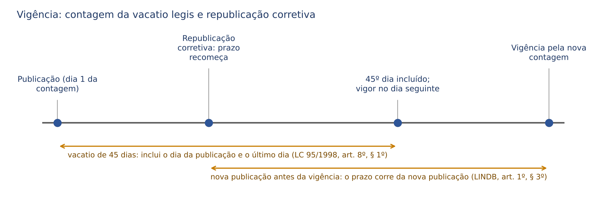
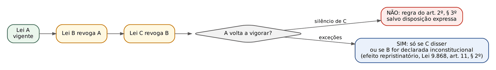
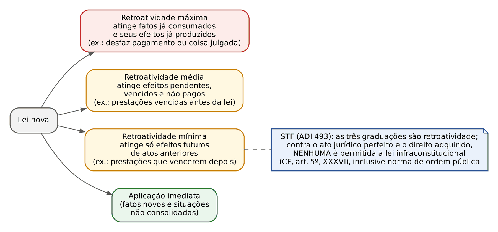
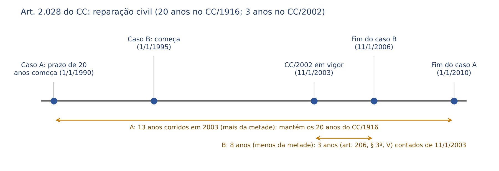

# CAPÍTULO 01 — LEI DE INTRODUÇÃO ÀS NORMAS DO DIREITO BRASILEIRO

:::INCIDENCIA
Pontos: TRF5 p. 1; TJRS p. 1; TJSC p. 1; SEFAZ p. 1. Nível A. Lote: 61 questões (FGV 53, FCC 8).
O que mais cai: arts. 20 a 30 (consequencialismo, art. 24 e erro grosseiro do art. 28, cobrados até em provas de juiz), direito intertemporal do art. 6º com caso concreto (retroatividade mínima, direito adquirido x expectativa), repristinação e vacatio legis na letra da lei, e elementos de conexão dos arts. 7º a 10 (regime de bens, obrigações, sucessão do estrangeiro, bens no exterior).
:::

| Subtema | FGV | FCC | Padrão de cobrança |
|---|---|---|---|
| Vigência, vacatio, republicação, revogação | 5 | 3 | Letra dos arts. 1º e 2º; "45 dias" x "três meses"; correção de lei em vigor = lei nova |
| Repristinação | 4 | 3 | Art. 2º, § 3º, em alternativa isolada ou em caso de três leis sucessivas |
| Obrigatoriedade e integração (arts. 3º e 4º) | 2 | 0 | Caso de réu que alega ignorância da lei ou lacuna |
| Direito intertemporal (art. 6º) | 15 | 2 | Caso concreto: contrato de trato sucessivo, lei nova de ordem pública, requisitos preenchidos e não requeridos, prazo reduzido |
| Direito internacional privado (arts. 7º a 19) | 8 | 1 | Regime de bens e primeiro domicílio conjugal; lugar do proponente; sucessão do estrangeiro; bens no exterior; homologação pelo STJ |
| Arts. 20 a 30 e Decreto 9.830/2019 | 21 | 1 | Consequencialismo nas três esferas, art. 24, compromisso do art. 26, erro grosseiro do art. 28 |

## 01.1 A LINDB como norma de sobredireito

O Decreto-Lei 4.657/1942 é *lex legum*: disciplina a vigência, a aplicação no tempo e no espaço, a interpretação e a integração das normas em geral, e não apenas do Código Civil. Daí a troca do nome (Lei de Introdução ao Código Civil para Lei de Introdução às Normas do Direito Brasileiro) pela Lei 12.376/2010, que não alterou nenhum artigo. Não integra o CC/1916 nem o CC/2002: é lei autônoma e anexa. Desde 2018, os arts. 20 a 30 (Lei 13.655/2018) trouxeram normas de segurança jurídica na aplicação do direito público, aplicáveis também ao juiz.

Conferido no Planalto em 29/10/2026: nenhum artigo da LINDB foi alterado depois da Lei 13.655/2018.

## 01.2 Vigência das normas (art. 1º)

### 01.2.1 Existência, validade, vigência e eficácia

Validade (formal e material), vigência (aptidão temporal para incidir) e eficácia (aptidão para produzir efeitos) são planos distintos: há lei publicada e ainda não vigente (na *vacatio*), lei vigente e inválida (inconstitucional até a declaração) e lei revogada que continua a reger os fatos do seu tempo (ultratividade; ex.: art. 1.787 do CC).

### 01.2.2 *Vacatio legis* e sua contagem

:::LEI LINDB, art. 1º
Art. 1º Salvo disposição contrária, a lei começa a vigorar em todo o país quarenta e cinco dias depois de oficialmente publicada.
§ 1º Nos Estados estrangeiros, a obrigatoriedade da lei brasileira, quando admitida, se inicia três meses depois de oficialmente publicada.
§ 2º (Revogado pela Lei nº 12.036, de 2009).
§ 3º Se, antes de entrar a lei em vigor, ocorrer nova publicação de seu texto, destinada a correção, o prazo deste artigo e dos parágrafos anteriores começará a correr da nova publicação.
§ 4º As correções a texto de lei já em vigor consideram-se lei nova.
:::

- Regra supletiva: os 45 dias só incidem no silêncio da lei ("salvo disposição contrária"). A regra da LC 95/1998 (art. 8º) é que a lei indique expressamente a vigência, com prazo razoável, reservada a cláusula "entra em vigor na data de sua publicação" às leis de pequena repercussão. Lei que nada diz sobre vigência (caso típico de prova) vigora 45 dias depois de publicada, e não na data da publicação.
- Prazo único para todo o território (princípio da vigência sincrônica ou simultânea). A "vigência progressiva" (prazos diferentes por Estado) existiu na redação original do CC/1916 e na antiga LICC, mas não vigora mais.
- No exterior, quando a lei brasileira for lá admitida (atos de consulados, embaixadas, interesses de brasileiros), o prazo é de TRÊS MESES (não 90 dias: conta-se de data a data).
- Contagem (LC 95/1998, art. 8º, § 1º, com a redação da LC 107/2001): inclui-se a data da publicação e o último dia do prazo, entrando a lei em vigor no dia subsequente à consumação integral. Não se aplica o art. 132 do CC (que exclui o dia do começo) e não há prorrogação se o último dia cair em feriado ou fim de semana. Prazo fixado em meses ou anos (o § 2º do art. 8º manda expressar a vacância em dias: "esta lei entra em vigor após decorridos (o número de) dias de sua publicação oficial") conta-se de data a data (art. 132, § 3º, do CC).
- Exemplo cobrado: o CC/2002 (art. 2.044: vigência "1 (um) ano após a sua publicação", publicado em 11/1/2002) entrou em vigor em 11/1/2003, segundo a orientação majoritária e do STJ (Tartuce cita, entre outros, STJ, AgInt no AREsp 1.417.538/BA, Quarta Turma, j. 24/9/2019).
- Atos normativos infralegais (decretos, portarias, resoluções): no silêncio, vigoram na data da publicação (regra do direito administrativo; a LINDB fala em "lei").

### 01.2.3 Correção da lei: antes e depois da vigência

| Momento da correção | Regime | Fundamento |
|---|---|---|
| Durante a *vacatio* | Nova publicação do texto corrigido; o prazo de vacância recomeça da NOVA publicação (para a parte corrigida, segundo a doutrina; a letra da lei fala no "prazo deste artigo", sem distinguir) | Art. 1º, § 3º |
| Depois da vigência | A correção é LEI NOVA, sujeita a processo legislativo e com sua própria vacância; respeita os atos praticados sob o texto anterior | Art. 1º, § 4º |
| Erro meramente material (grafia) | Errata/retificação no Diário Oficial, sem alteração de conteúdo | Prática legislativa |

:::QUESTAO FCC 2026 — CPU-PE — Analista Jurídico (Q3872174)
Caso: antes da entrada em vigor, houve nova publicação para correção de lei omissa quanto à vigência. Gabarito: E — o prazo de 45 dias corre da nova publicação e, no exterior, o de três meses também corre da nova publicação.
Armadilha: as alternativas combinam três variáveis (45 ou 60 dias; três ou seis meses; primeira ou nova publicação). O § 3º manda contar da nova publicação "o prazo deste artigo e dos parágrafos anteriores", ou seja, tanto o interno quanto o externo.
No mesmo sentido (correção de lei já em vigor = lei nova): Q3848794 (FCC 2025, TRT-2, gabarito A); Q3659044 (FGV 2025, AgSUS) e Q3115098 (FGV 2024, TJ-MT), em que a alternativa E, correta, repetia o § 4º.
:::

:::QUESTAO FGV 2024 — AL-SC — Analista Legislativo (Q2486068)
Lei estadual X disciplinou parcialmente matéria da Lei Y e nada disse sobre vigência. Gabarito: E — vigora 45 dias após a publicação e revoga tacitamente a parte da Lei Y com ela incompatível.
Armadilha: "na data da publicação" (B), "três meses" (A, que ainda falava em repristinação) e "trinta dias" (C). A LINDB vale também para leis estaduais. No mesmo sentido, quanto ao silêncio sobre a vigência: Q3047997 (FGV 2024, Macaé), em que a alternativa A ("entra em vigor na publicação") era a armadilha; e Q4153603 (FGV 2026, TJ-SC, Oficial de Justiça), alternativa A ("seis meses").
:::

## 01.3 Revogação, ultratividade e repristinação (art. 2º)

### 01.3.1 Princípio da continuidade e leis temporárias

:::LEI LINDB, art. 2º
Art. 2º Não se destinando à vigência temporária, a lei terá vigor até que outra a modifique ou revogue.
§ 1º A lei posterior revoga a anterior quando expressamente o declare, quando seja com ela incompatível ou quando regule inteiramente a matéria de que tratava a lei anterior.
§ 2º A lei nova, que estabeleça disposições gerais ou especiais a par das já existentes, não revoga nem modifica a lei anterior.
§ 3º Salvo disposição em contrário, a lei revogada não se restaura por ter a lei revogadora perdido a vigência.
:::

A lei de vigência permanente só deixa de vigorar por outra lei (princípio da continuidade). A lei temporária (com termo final) e a excepcional (atrelada a situação anormal, como o RJET da Lei 14.010/2020, ver Cap. 46) cessam por si mesmas (autorrevogação ou caducidade), sem necessidade de lei revogadora, e continuam a reger os fatos ocorridos durante sua vigência (ultratividade). Duas consequências cobradas:

- O desuso NÃO revoga a lei. O costume *contra legem* (desuetudo) não tem força ab-rogatória no direito brasileiro, por força do próprio art. 2º (só lei revoga lei). A afirmação de que a cessação por desuso tem "amplo respaldo" é falsa (Q3362333, alternativa D).
- Caducidade é a perda de vigência pelo implemento do termo ou pelo desaparecimento da situação que a lei regulava (lei temporária ou excepcional). Não se confunde com "perda gradativa de efetividade" ou "costume negativo" (Q3362333, alternativa E, falsa).

### 01.3.2 Espécies de revogação

| Critério | Espécie | Conteúdo | Exemplo |
|---|---|---|---|
| Extensão | Ab-rogação | Supressão total | CC/1916, pelo art. 2.045 do CC/2002 |
| Extensão | Derrogação | Supressão parcial | Parte Primeira do Código Comercial (art. 2.045, segunda parte) |
| Modo | Expressa (direta) | A lei nova declara o que revoga; a LC 95/1998, art. 9º, exige que a cláusula de revogação ENUMERE as leis ou disposições revogadas (a cláusula genérica "revogam-se as disposições em contrário" é vedada pela técnica legislativa, mas sua presença não impede a revogação tácita) | Lei que diz no art. 9º "revoga-se por inteiro a LC de 2002": ab-rogação expressa (Q2564201, gabarito C) |
| Modo | Tácita (indireta) | Por incompatibilidade ou por regular inteiramente a matéria (revogação global) | Condomínio edilício no CC/2002 (arts. 1.331 a 1.358) e os arts. 1º a 27 da Lei 4.591/1964 (Tartuce, citando STJ, REsp 746.589/RS) |

O § 2º afasta a revogação quando a lei nova apenas convive com a anterior ("a par das já existentes"). Exemplo: o CC tratou da locação de coisas (arts. 565 a 578) sem revogar a Lei 8.245/1991 (o próprio art. 2.036 do CC confirma). A inversão do § 2º é distrator frequente (Q2564201, E).

:::PEGADINHA
"A lei geral posterior revoga a lei especial anterior do mesmo ramo, salvo disposição em contrário" (Q3745798, C): FALSO. A regra é a inversa (*lex posterior generalis non derogat priori speciali*), salvo incompatibilidade ou regulação integral da matéria pela lei nova (art. 2º, §§ 1º e 2º).
:::

### 01.3.3 Repristinação

Repristinação é a restauração da vigência da lei revogada pela revogação da lei revogadora. O § 3º NÃO a proíbe: exige que seja EXPRESSA ("salvo disposição em contrário"). Não existe repristinação tácita ou automática. Não confundir com o efeito repristinatório da declaração de inconstitucionalidade: a lei inconstitucional é nula, de modo que a norma por ela "revogada" nunca deixou de vigorar validamente (art. 11, § 2º, da Lei 9.868/1999, quanto à cautelar em ADI; e o STJ, REsp 517.789/AL, citado por Tartuce, que afirma não se confundir esse efeito com a repristinação do art. 2º, § 3º). O STF, porém, nega o efeito repristinatório quando a norma anterior que seria restaurada tem o mesmo vício: cabe ao autor da ADI impugnar todo o complexo normativo (STF, ADI 3.735/MS, Plenário, j. 8/9/2016, Info 838).

:::QUESTAO FCC 2025 — PGE-TO — Procurador do Estado (Q3745585)
Lei estadual concedia vantagem por assiduidade; foi revogada após cinco anos, e a revogadora foi revogada um ano depois. Gabarito: A — salvo disposição em contrário na última lei, a vantagem abolida NÃO é restabelecida.
Passos: (1) a pergunta é se a lei originária volta a viger; (2) art. 2º, § 3º: só com disposição expressa; (3) a terceira lei nada disse, logo a vantagem não renasce. Erro sedutor: D (inconstitucionalidade da lei revogadora por ofensa a direito adquirido): o que já foi recebido ou incorporado durante a vigência está protegido pelo art. 6º, mas não há direito adquirido à manutenção do regime jurídico (Tema 41 da repercussão geral, ver 01.8.4), de modo que a revogação para o futuro é válida.
No mesmo sentido, na letra da lei: Q3955843 (FCC 2026, SEFAZ-SP, gabarito E); Q3745798 (FCC 2025, PGE-MT, gabarito A, com a alternativa E, "vedada pela Constituição", falsa); Q3659044 (FGV 2025, AgSUS) e Q3115098 (FGV 2024, TJ-MT), em que a assertiva incorreta pedida era a inversão do § 3º ("a lei revogada se restaura"); Q3362333 (FGV 2025, ENAM, alternativa C: o Brasil NÃO admite repristinação tácita, nem excepcionalmente).
:::

:::QUESTAO FGV 2024 — AL-SC — Analista Legislativo (Q2486029)
João preencheu os requisitos de benefício previsto na Lei 123, sem requerê-lo; a Lei 234 revogou tacitamente a 123 e regulou a matéria em sentido oposto; João requereu sob a Lei 234 e teve o pedido indeferido; depois a Lei 345 revogou a 234 sem nada dispor. Gabarito: E — apesar de ter requerido na vigência da Lei 234, João faz jus ao benefício.
Passos: (1) há duas questões sobrepostas; (2) repristinação: a Lei 123 NÃO volta a viger (a Lei 345 nada disse), o que torna falsa a alternativa B; (3) mas a solução não depende da repristinação: João adquiriu o direito quando completou os requisitos sob a Lei 123, e o exercício posterior não o descaracteriza (art. 6º, § 2º, "que o seu titular possa exercer"). O direito adquirido sobrevive à revogação da lei que o criou (ultratividade da lei antiga para aquele direito). Erros sedutores: A (confunde ausência de repristinação com perda do direito) e D (atrela o direito ao momento do requerimento).
:::

## 01.4 Antinomias

Antinomia é o conflito entre duas normas válidas, emanadas de autoridade competente, sem que se saiba de pronto qual aplicar (lacuna de conflito). Critérios de solução (Bobbio): hierárquico (*lex superior*), cronológico (*lex posterior*, que é o próprio art. 2º, § 1º) e da especialidade (*lex specialis*). O critério cronológico é o mais fraco; o hierárquico, o mais forte.

| Conflito | Grau | Solução | Classificação |
|---|---|---|---|
| Só um critério em jogo | 1º grau | O critério aplicável | Aparente |
| Especial anterior x geral posterior | 2º grau | Prevalece a especialidade | Aparente |
| Superior anterior x inferior posterior | 2º grau | Prevalece a hierarquia | Aparente |
| Geral superior x especial inferior | 2º grau | Não há metacritério seguro; para Bobbio, em regra prevalece a superior; para Maria Helena Diniz, antinomia real, resolvida pelo juiz com os arts. 4º e 5º da LINDB | Real |

A antinomia real (insolúvel pelos critérios) se resolve pela integração (art. 4º) e pela interpretação teleológica (art. 5º), ou pela edição de norma nova. A técnica do diálogo das fontes, que propõe aplicação coordenada em vez de exclusão de uma das normas, está no Cap. 2 (02.2).
## 01.5 Obrigatoriedade (art. 3º)

"Ninguém se escusa de cumprir a lei, alegando que não a conhece." A justificativa prevalente é a da necessidade social (Maria Helena Diniz, Tartuce), e não a de uma presunção absoluta de conhecimento ou a de uma ficção: sem a regra, a eficácia do ordenamento dependeria da prova do conhecimento individual. Consequências para a prova:

- A obrigatoriedade começa com a vigência, e não com a ciência efetiva: não há necessidade de notificação pessoal, e a boa-fé não afasta a incidência da norma.
- O art. 3º não impede o erro de direito como causa de anulação do negócio jurídico: o art. 139, III, do CC admite o erro substancial "de direito" que, sem implicar recusa à aplicação da lei, for o motivo único ou principal do negócio (ver Cap. 9). Uma coisa é invocar a ignorância para descumprir a lei; outra, o vício de vontade.
- O art. 376 do CPC e o art. 14 da LINDB (prova do direito municipal, estadual, estrangeiro ou consuetudinário) não excepcionam a obrigatoriedade: tratam do *iura novit curia*.

:::QUESTAO FGV 2025 — MPE-ES — Promotor de Justiça Substituto (Q3752731)
Empresário autuado pela vigilância sanitária por descumprir norma vigente havia dois anos alegou boa-fé e desconhecimento. Gabarito: C — a ausência de conhecimento da norma não exime ninguém de cumpri-la.
Armadilhas: D (exigência de ampla divulgação e prova estatal da publicação), A (prova de ciência efetiva) e B ("escusa apenas para leis penais", o que inverte a lógica: nem na esfera penal a ignorância da lei é escusa, art. 21 do CP).
:::

:::QUESTAO FGV 2026 — ALERJ — Procurador Legislativo (Q3880795)
Réu sustentou (i) desconhecer a lei, (ii) que o juiz deveria abster-se de decidir por omissão legislativa e (iii) que lei posterior deveria incidir sobre atos anteriores e afastar decisão já proferida. Gabarito: A — o desconhecimento não afasta a obrigatoriedade (art. 3º), a omissão não autoriza o *non liquet* (art. 4º da LINDB e art. 140 do CPC) e a lei nova tem efeito imediato e geral, respeitados o ato jurídico perfeito, o direito adquirido e a coisa julgada (art. 6º).
Distratores: decisão "discricionária" na lacuna (B), retroatividade guiada pelos "fins sociais" do art. 5º (C) e revisão automática de decisões definitivas (E).
:::

## 01.6 Integração (art. 4º)

### 01.6.1 Lacuna, vedação do *non liquet* e ordem dos meios

:::LEI LINDB, art. 4º, e CPC, art. 140
LINDB, art. 4º Quando a lei for omissa, o juiz decidirá o caso de acordo com a analogia, os costumes e os princípios gerais de direito.
CPC, art. 140. O juiz não se exime de decidir sob a alegação de lacuna ou obscuridade do ordenamento jurídico.
Parágrafo único. O juiz só decidirá por equidade nos casos previstos em lei.
:::

Integrar é suprir lacuna; interpretar é fixar o sentido de norma existente; subsumir é aplicar diretamente a norma ao fato. A classificação de lacunas de Maria Helena Diniz é cobrada: normativa (ausência de norma), ontológica (norma sem eficácia social), axiológica (norma cuja aplicação levaria a solução injusta) e de conflito (antinomia, 01.4). As lacunas são da lei, não do direito ("o direito não é lacunoso, mas há lacunas").

A ordem do art. 4º (analogia, costumes, princípios gerais) é preferencial na visão clássica (Silvio Rodrigues, Limongi França) e na letra que as bancas cobram. A doutrina civil-constitucional (Tepedino, Tartuce) critica a leitura que relega os princípios constitucionais a último recurso: eles têm eficácia normativa direta, e o art. 8º do CPC manda o juiz atender aos fins sociais e às exigências do bem comum, resguardando e promovendo a dignidade da pessoa humana (ver Cap. 2, 02.1.4 e 02.3). Em prova objetiva, siga a letra: o rol do art. 4º é o dos meios de integração, nessa ordem; a equidade NÃO está no art. 4º.

### 01.6.2 Os meios de integração

| Meio | Conceito e espécies | Ponto de prova |
|---|---|---|
| Analogia | Aplicação de norma prevista para hipótese semelhante, com identidade de razão (*ubi eadem ratio*). *Legis*: uma norma próxima; *iuris*: conjunto de normas ou princípio extraído do sistema | Não se confunde com interpretação extensiva: na analogia há lacuna e se aplica outra norma (integração); na extensiva, a mesma norma alcança caso que sua letra disse menos do que queria (interpretação). Normas excepcionais e restritivas de direitos não admitem analogia (ex.: a anuência dos descendentes do art. 496 do CC não se estende à hipoteca). Ex.: Enunciado 148 do CJF (art. 157, § 2º, aplicado por analogia ao estado de perigo) |
| Costume | Prática reiterada (elemento objetivo) com convicção de obrigatoriedade (*opinio iuris vel necessitatis*). *Secundum legem* (a lei remete ao costume: subsunção, não integração), *praeter legem* (supre lacuna: o único integrativo; ex.: cheque pré-datado e Súmula 370 do STJ) e *contra legem* (inadmitido) | Costume judiciário: súmulas e jurisprudência reiterada. Prova: art. 376 do CPC |
| Princípios gerais de direito | Proposições extraídas do sistema (vedação do enriquecimento sem causa, *neminem laedere*, boa-fé) | Não se confundem com brocardos ou máximas, que só têm valor pedagógico |
| Equidade | Justiça do caso concreto. Legal (a lei a prevê: arts. 413, 928, parágrafo único, 944, parágrafo único, do CC) ou judicial (decisão por equidade autorizada pela lei) | NÃO é meio de integração do art. 4º; o juiz só decide POR equidade nos casos previstos em lei (art. 140, parágrafo único, do CPC); decidir COM equidade (temperando a aplicação) é inerente à jurisdição |

:::PEGADINHA
A vedação do *non liquet* não autoriza o juiz a "decidir discricionariamente" nem a julgar por equidade fora da lei. Diante da lacuna, ele integra pelos meios do art. 4º; diante de lei obscura, interpreta (art. 5º). Abster-se de julgar "até o legislador regulamentar" (Q3880795, D) contraria o art. 140 do CPC.
:::

## 01.7 Interpretação (art. 5º)

"Na aplicação da lei, o juiz atenderá aos fins sociais a que ela se dirige e às exigências do bem comum." O art. 5º consagra o método teleológico ou sociológico como diretriz, sem excluir os demais, que atuam de forma conjugada.

| Classificação | Espécies |
|---|---|
| Quanto à fonte (sujeito) | Autêntica (o próprio legislador, por lei interpretativa); jurisprudencial (tribunais; hoje com precedentes vinculantes, art. 927 do CPC); doutrinária |
| Quanto aos meios ou métodos | Gramatical ou literal; lógica; sistemática; histórica (trabalhos preparatórios, *occasio legis*); sociológica ou teleológica (art. 5º) |
| Quanto ao resultado | Declarativa (letra e espírito coincidem); extensiva (a lei disse menos do que queria); restritiva (disse mais do que queria) |

Normas de interpretação restritiva no CC, frequentes em prova: negócios benéficos e renúncia (art. 114), fiança (art. 819: "não admite interpretação extensiva"; e Súmula 214 do STJ, ver Cap. 18 e Cap. 21), transação (art. 843). A interpretação do negócio jurídico (arts. 112, 113 e 421-A do CC) é tema do Cap. 8. Hermenêutica filosófica e as normas gerais de interpretação do direito ficam com Formação Humanística.

:::DICA
Lei interpretativa (interpretação autêntica) aplica-se aos fatos pendentes porque não inova; mas, se a pretexto de interpretar criar regra nova, submete-se ao art. 6º e não pode atingir ato jurídico perfeito, direito adquirido ou coisa julgada. É o mesmo raciocínio do art. 1º, § 4º: correção de lei em vigor é lei nova.
:::

## 01.8 Direito intertemporal (art. 6º)

### 01.8.1 Estrutura: efeito imediato e limites constitucionais

:::LEI LINDB, art. 6º, e CF, art. 5º, XXXVI
LINDB, art. 6º A Lei em vigor terá efeito imediato e geral, respeitados o ato jurídico perfeito, o direito adquirido e a coisa julgada.
§ 1º Reputa-se ato jurídico perfeito o já consumado segundo a lei vigente ao tempo em que se efetuou.
§ 2º Consideram-se adquiridos assim os direitos que o seu titular, ou alguém por êle, possa exercer, como aquêles cujo comêço do exercício tenha têrmo pré-fixo, ou condição pré-estabelecida inalterável, a arbítrio de outrem.
§ 3º Chama-se coisa julgada ou caso julgado a decisão judicial de que já não caiba recurso.
CF, art. 5º, XXXVI - a lei não prejudicará o direito adquirido, o ato jurídico perfeito e a coisa julgada;
:::

A regra é o efeito imediato e geral (teoria de Paul Roubier: a lei nova colhe os fatos pendentes e futuros e os efeitos futuros das situações em curso, *facta pendentia*), limitado pelo respeito às três garantias, que no Brasil têm sede CONSTITUCIONAL (art. 5º, XXXVI), ao passo que a LINDB as define (teoria subjetiva de Gabba, centrada no direito adquirido). Desse duplo plano decorrem pontos de prova:

- A irretroatividade no direito civil não é absoluta: a lei pode retroagir se o disser expressamente e não ofender as três garantias (retroatividade "justa"). O que a Constituição veda é a retroatividade que prejudique ato jurídico perfeito, direito adquirido ou coisa julgada. Por isso é correta a afirmação de que a irretroatividade é a regra, "o que não impede, mesmo havendo outros valores relevantes, que a retroatividade possa ser excepcionalmente admitida" (Q3362333, FGV 2025, ENAM, gabarito B).
- Não há "retroatividade benigna" geral no direito civil, nem em favor do vulnerável, do locatário, do consumidor ou do trabalhador: a retroatividade da lei mais benéfica é regra PENAL (CF, art. 5º, XL). Alternativas que a transplantam para o direito privado são falsas (Q4153603, E; Q3951813, B; Q3047997, C; Q3265470, I).
- Norma de ordem pública NÃO autoriza, por si, retroatividade contra o ato jurídico perfeito ou o direito adquirido: a garantia do art. 5º, XXXVI, vincula toda lei infraconstitucional, sem distinção entre direito público e privado nem entre leis dispositivas e de ordem pública (STF, ADI 493, Rel. Min. Moreira Alves, DJ 4/9/1992). Por isso a alternativa "salvo se a lei nova tratar de norma de ordem pública" (Q3169949, FCC 2024, TRT-20, E) é a armadilha, e o gabarito é C (efeito imediato, respeitados os três institutos).
- Natureza constitucional do art. 6º: o STJ não conhece de recurso especial fundado só nele (AgInt no AREsp 1.932.867/RJ, Rel. Min. Herman Benjamin, Segunda Turma, j. 21/3/2022).

### 01.8.2 Os três institutos e as figuras vizinhas

| Instituto | Definição legal | Observações de prova |
|---|---|---|
| Ato jurídico perfeito | O já consumado segundo a lei vigente ao tempo em que se efetuou (§ 1º) | Protege a VALIDADE e a forma do ato segundo a lei do seu tempo (*tempus regit actum*) e, segundo o STF (ADI 493), também os efeitos futuros do contrato. Escritura pública de união estável, acordo homologado e contrato de compra e venda são atos jurídicos perfeitos. O ato jurídico perfeito NÃO impede a revisão judicial por fato superveniente (onerosidade excessiva, Cap. 16), nem a alteração consensual do regime de bens (art. 1.639, § 2º, do CC, Cap. 36): não é imutabilidade, é proteção contra a lei nova |
| Direito adquirido | O que o titular, ou alguém por ele, possa exercer, inclusive o sujeito a termo prefixo ou a condição preestabelecida inalterável ao arbítrio de outrem (§ 2º) | Basta o preenchimento dos requisitos: o exercício (requerimento) pode ser posterior. Direito a termo inicial é adquirido (art. 131 do CC: o termo inicial suspende o exercício, mas não a aquisição). Direito sob condição suspensiva: ver 01.8.3 |
| Coisa julgada | Decisão judicial de que já não caiba recurso (§ 3º) | A definição da LINDB é a de coisa julgada formal; o CPC define a material (art. 502: autoridade que torna imutável e indiscutível a decisão de mérito). A banca troca "recurso" por "ação rescisória" (Q3848794, D, falsa) ou acrescenta decisões "administrativas ou controladoras" e "recurso com efeito suspensivo" (Q4102096, B, falsa). A coisa julgada pode ser desconstituída por rescisória, sem ofensa ao art. 6º, porque o que se veda é a LEI prejudicá-la |
| Expectativa de direito | Situação de quem ainda não reuniu todos os elementos aquisitivos | Não é protegida contra a lei nova, mas NÃO é juridicamente irrelevante: a lei pode tutelá-la (regras de transição, atos conservatórios do art. 130 do CC). Por isso "a expectativa de direito não gera efeitos jurídicos" (Q3179538, D) é falso |
| Direito a regime jurídico | Pretensão de manter o estatuto legal (servidor, regime de previdência, regime de um instituto) | Não existe: "não há direito adquirido a regime jurídico, desde que respeitado o princípio constitucional da irredutibilidade de vencimentos" (STF, Tema 41 da repercussão geral, j. 11/2/2009). Q2564201 (FGV 2024, TCE-PA, alternativa A) e Q3052476 (FGV 2024, Vitória, alternativa A) cobravam a negativa |

:::QUESTAO FGV 2026 — TJ-BA — Juiz Leigo (Q4102096)
Pede-se o enunciado correto sobre os conceitos do art. 6º. Gabarito: E — direitos adquiridos são aqueles que o titular, ou alguém por ele, possa exercer, como aqueles cujo começo do exercício tenha termo prefixo ou condição preestabelecida inalterável ao arbítrio de outrem (§ 2º, literal).
Armadilhas: A e C inventam um prazo de 90 dias para o ato jurídico perfeito; B estende a coisa julgada a decisões "administrativas ou controladoras" e fala em recurso "com efeito suspensivo"; D descreve direitos difusos (art. 81, parágrafo único, I, do CDC).
No mesmo sentido (letra do § 1º): Q3052476 (FGV 2024, Prefeitura de Vitória, gabarito C); Q3047997 (FGV 2024, Macaé, gabarito D); Q3848794 (FCC 2025, TRT-2, alternativa B, falsa por trocar "consumado" por "juridicamente válido").
:::

### 01.8.3 Graus de retroatividade e o caso dos contratos

A doutrina distingue três graus de retroatividade (classificação atribuída a Matos Peixoto e invocada pelo STF na ADI 493):

Os contratos de execução continuada ou diferida são o terreno das questões. Pela ADI 493, aplicar a lei nova às prestações futuras de contrato anterior é retroatividade mínima e, portanto, vedada quando atinge o ato jurídico perfeito. A cobrança, porém, admite duas leituras que convivem na jurisprudência e nos gabaritos:

- Contratos celebrados por livre estipulação: a lei nova não alcança suas cláusulas nem seus efeitos futuros (ato jurídico perfeito). Exemplos do lote: Lei dos Distratos (Lei 13.786/2018) não se aplica a contratos anteriores (Q3606013, FGV 2025, PGM-RJ, gabarito D; no STJ, REsp 1.723.519/SP, Segunda Seção, j. 28/8/2019, e Tema 1.002, REsp 1.740.911/DF, j. 14/8/2019, desenvolvidos no Cap. 17); regra da Lei 12.112/2009 sobre extensão da fiança na prorrogação da locação não atinge contrato anterior (Q3856336, ver box abaixo).
- Situações de natureza estatutária ou institucional (regime legal da moeda, de reajustes impostos por lei, estatuto do servidor, regime de bens fixado por lei, normas de ordem pública sobre os efeitos de situações continuadas): a lei nova incide sobre os efeitos futuros, porque não há direito adquirido a regime jurídico. É a base dos gabaritos que aceitam aplicação imediata a "reajustes futuros" (Q3265470, FGV 2025, Canaã dos Carajás, gabarito B, desenvolvida no Cap. 18) e da aplicação da Lei 14.905/2024 aos juros que se vencerem depois de sua vigência (Q3966635, FGV 2026, TJ-GO, Juiz Substituto, gabarito D: Selic até a vigência da lei nova, taxa legal a partir dela; ver Cap. 14).

O art. 2.035 do CC é a regra de transição que materializa a distinção entre planos: a validade dos negócios anteriores a 11/1/2003 segue a lei anterior; os efeitos produzidos após a vigência do Código a ele se subordinam, "salvo se houver sido prevista pelas partes determinada forma de execução"; e nenhuma convenção prevalece contra preceitos de ordem pública, como a função social da propriedade e dos contratos (parágrafo único, transcrito e comentado no Cap. 2, 02.1.2). Parte da doutrina (Antônio Jeová Santos, entre outros) sustenta a inconstitucionalidade da segunda parte do *caput* à luz da ADI 493; a posição majoritária o aplica, lendo-o como incidência imediata de normas de ordem pública sobre efeitos futuros. Em prova objetiva, a letra do art. 2.035 tem sido cobrada como válida.

:::QUESTAO FGV 2026 — TJ-MS — Analista Judiciário (Q3856336)
Locação de 28/11/2008, com fiança "durante toda a vigência do contrato"; a Lei 12.112/2009 inseriu no art. 39 da Lei 8.245/1991 a regra de que, salvo disposição em contrário, as garantias se estendem até a devolução do imóvel, ainda que prorrogada a locação; houve prorrogação por prazo indeterminado e inadimplemento em 2015. Gabarito: C — os fiadores não respondem: a regra de 2009 não retroage para alcançar contrato anterior (ato jurídico perfeito), aplicando-se o regime do tempo da contratação.
Passos: (1) a questão é intertemporal, não de direito locatício; (2) a fiança é contrato anterior à lei nova; (3) pelo regime da época, a fiança só se estendia à prorrogação se houvesse cláusula expressa de responsabilidade até a entrega das chaves, e "durante a vigência do contrato" não é essa cláusula; (4) o STJ afirmou que a extensão automática do art. 39 vale para fianças firmadas na vigência da Lei 12.112/2009 e não retroage (REsp 1.326.557, Rel. Min. Luis Felipe Salomão, segundo notícia do STJ de 2014). Erros sedutores: A (aplicação imediata aos efeitos futuros do contrato: é exatamente a retroatividade mínima vedada pela ADI 493) e B (prorrogação como "nova relação jurídica"). A exoneração do fiador e a Súmula 214 do STJ estão nos Caps. 18 e 21.
:::

:::QUESTAO FGV 2025 — TRF5 — Juiz Substituto (Q3373878)
Sócio condenado em 2020 por lesão corporal no âmbito da Lei Maria da Penha; em 2023, alteração estatutária vedou a ocupação de cargos diretivos por condenados por violência doméstica, antes da eleição de 2024. Gabarito: E — a nova disposição pode atingi-lo: comina efeitos futuros a fato passado (retroatividade mínima), o que se admite porque não há ofensa a direito adquirido, ato jurídico perfeito ou coisa julgada.
Passos: (1) não há direito adquirido a ser eleito, só expectativa (a eleição era futura); (2) a coisa julgada penal não é alterada: a regra apenas toma a condenação como pressuposto fático de inelegibilidade estatutária (raciocínio idêntico ao do STF sobre a Lei da Ficha Limpa); (3) por isso A, B e C caem. A diferença entre D e E é terminológica: o examinador qualificou a hipótese como "retroatividade mínima" admissível. Nota: a terminologia diverge da ADI 493 (ver nota de verificação); fique com a ideia de que fato passado tomado como pressuposto de efeito futuro não ofende o art. 6º se não houver direito já incorporado.
:::

:::QUESTAO FGV 2025 — TRF3 — Juiz Federal Substituto (Q3179538)
Gabarito: C — o direito sob condição suspensiva é considerado adquirido perante a lei nova (art. 6º, § 2º, da LINDB), mas não no que tange aos efeitos do negócio jurídico (art. 125 do CC: enquanto a condição não se verificar, "não se terá adquirido o direito, a que ele visa").
Os dois dispositivos operam em planos distintos: para o direito intertemporal, a lei nova não pode suprimir a posição jurídica sob condição já estipulada (desde que a condição não dependa do arbítrio de outrem); no plano da eficácia, o direito só se adquire com o implemento. Erros: A (reduzir juros vincendos é retroatividade MÍNIMA, não máxima); B (os limites do art. 5º, XXXVI, alcançam também regulamentos, que nem sequer podem inovar); D (expectativa gera efeitos, como os atos conservatórios do art. 130 do CC); E (direito a termo inicial é adquirido, art. 131 do CC e § 2º do art. 6º).
:::

:::QUESTAO FGV 2026 — TJ-PA — Juiz Substituto (Q3951813)
Lei trabalhista nova endureceu requisitos de benefício; empregados já cumpriam integralmente os requisitos da lei antiga. Gabarito: A — têm direito subjetivo ao benefício (direito adquirido), pois a lei nova não pode retroagir em seu prejuízo.
Armadilhas: B (analogia com a retroatividade penal benéfica), C ("retroatividade plena da lei trabalhista"), D (toda norma seria retroativa salvo previsão em contrário: inverte a regra) e E (revogação imediata de direitos patrimoniais "sem repercussão constitucional relevante").
No mesmo sentido: Q4153603 (FGV 2026, TJ-SC, Oficial de Justiça, gabarito C: a lei nova tem efeito imediato e geral e deve respeitar o direito adquirido de quem já preenchera os requisitos, ainda que sem requerimento); Q2486029 (01.3.3).
:::

:::QUESTAO FGV 2025 — TCE-RR — Auditor de Controle Externo (Q3186473)
Lei de 2024 teria reduzido de 10 para 5 anos o prazo "prescricional" da reivindicatória; o réu pediu aplicação retroativa da lei nova a ação proposta em 2024 por proprietário de 2016. Gabarito: D — a lei nova não pode violar o direito adquirido, a coisa julgada ou o ato jurídico perfeito.
Enunciado impreciso (a reivindicatória é imprescritível; ver Cap. 29): a banca premiou a regra geral; para redução de prazo, ver o PASSO de 01.8.4. A alternativa E (prescrição de ordem pública autorizaria violar direito adquirido) é a armadilha.
:::

Correlata: Q3786340 (FGV 2025, TJ-MS, Juiz Substituto, Cap. 15) — lei que passou a exigir forma especial entrou em vigor depois da expedição da aceitação; pela teoria da expedição (art. 434 do CC), o contrato já era ato jurídico perfeito (gabarito C).

### 01.8.4 Regras intertemporais do CC/2002 e casos típicos

| Situação | Regra | Fundamento |
|---|---|---|
| Prazos reduzidos pelo CC/2002 | Prazo antigo, se em 11/1/2003 já transcorrida MAIS da metade; senão, prazo novo contado de 11/1/2003 (orientação pacífica da doutrina e do STJ sobre o termo inicial do prazo novo) | Art. 2.028 |
| Sucessão | Lei vigente ao tempo da abertura (ordem de vocação do CC/2002 só para sucessões abertas a partir de 11/1/2003) | Arts. 1.787 e 2.041 |
| Regime de bens de casamento anterior | O do CC/1916, mas admitida a alteração pelo art. 1.639, § 2º, do CC/2002 (ver Cap. 36) | Art. 2.039 |
| Locação de imóvel urbano | Continua regida pela lei especial | Art. 2.036 |
| Separação judicial anterior à EC 66/2010 | Ato jurídico perfeito: preserva-se o estado civil de separado (STF, Tema 1.053; ver Cap. 34) | Art. 6º e CF, art. 5º, XXXVI |
| Juros após a Lei 14.905/2024 | Taxa legal para o período posterior à vigência; regime anterior até ela | Ver Cap. 14 |

:::PASSO Como resolver questão de prazo reduzido por lei nova
1. Identifique o prazo da lei antiga e o da lei nova e a data de início da contagem.
2. Se a lei nova trouxer regra de transição (como o art. 2.028 do CC), aplique-a: é ela que decide.
3. Sem regra de transição, a orientação tradicional (doutrina e jurisprudência do STF e do STJ) manda contar o prazo novo, mais curto, a partir da vigência da lei nova, salvo se o prazo antigo terminar antes, caso em que prevalece o antigo. Nunca se aplica o prazo novo retroativamente desde o termo inicial original (isso extinguiria pretensões de surpresa, com retroatividade vedada).
4. Prazo aumentado pela lei nova: incide sobre os prazos em curso, computado o tempo já decorrido (não há direito adquirido à prescrição não consumada).
5. Prescrição já consumada sob a lei antiga: situação definitivamente constituída; a lei nova não a reabre.
:::

:::SENTENCA Prejudicial de prescrição com direito intertemporal
"O fato ocorreu em 5/3/1998, sob o CC/1916, que previa prazo vintenário (art. 177). Em 11/1/2003, data em que entrou em vigor o CC/2002, haviam transcorrido menos de dez anos, menos da metade do prazo antigo; incide, pois, o prazo trienal do art. 206, § 3º, V, do CC/2002, contado da vigência do novo Código, nos termos do art. 2.028. Esgotado o triênio em 11/1/2006 e ajuizada a ação somente em 2008, pronuncio a prescrição e resolvo o mérito, com fundamento no art. 487, II, do CPC."
:::
## 01.9 Eficácia no espaço: normas de direito internacional privado (arts. 7º a 19)

### 01.9.1 Lógica do sistema

O Brasil adota a territorialidade moderada: em regra aplica-se a lei brasileira no território, mas as normas de conflito da LINDB mandam aplicar a lei estrangeira em certas relações com elemento estrangeiro, por meio de elementos de conexão (domicílio, situação da coisa, lugar da constituição da obrigação, lugar da celebração). Três travas gerais: o juiz aplica a lei estrangeira indicada sem considerar a remissão que ela faça a outra lei, vedado o reenvio (art. 16); a lei, o ato e a sentença estrangeiros não têm eficácia se ofenderem a soberania nacional, a ordem pública e os bons costumes (art. 17); e o juiz pode exigir de quem invoca a lei estrangeira a prova do texto e da vigência (art. 14; CPC, art. 376). A LINDB adota o DOMICÍLIO, e não a nacionalidade, como elemento de conexão do estatuto pessoal (na Introdução ao CC/1916 vigorava a nacionalidade): alternativa que manda aplicar a lei espanhola "em razão da nacionalidade comum dos nubentes" é falsa (Q3752730, E).

| Matéria | Elemento de conexão | Dispositivo |
|---|---|---|
| Começo e fim da personalidade, nome, capacidade, direitos de família | Domicílio da pessoa (para litígio internacional sobre criança ou adolescente, residência habitual: Enunciado 408 do CJF) | Art. 7º, *caput* |
| Casamento celebrado no Brasil: impedimentos dirimentes e formalidades | Lei brasileira (*lex loci celebrationis*) | Art. 7º, § 1º |
| Casamento de estrangeiros perante autoridade consular | Autoridade do país de AMBOS os nubentes (redação da Lei 3.238/1957) | Art. 7º, § 2º |
| Invalidade do casamento (nubentes com domicílios diversos) | Primeiro domicílio conjugal | Art. 7º, § 3º |
| Regime de bens, legal ou convencional | Domicílio comum dos nubentes; se diverso, primeiro domicílio conjugal | Art. 7º, § 4º |
| Pessoa sem domicílio | Residência ou lugar em que se encontre | Art. 7º, § 8º |
| Qualificação dos bens e relações a eles concernentes | Lugar da situação (*lex rei sitae*) | Art. 8º, *caput* |
| Móveis que o proprietário trouxer ou destinados a transporte | Domicílio do proprietário | Art. 8º, § 1º |
| Penhor | Domicílio de quem tem a posse da coisa apenhada | Art. 8º, § 2º |
| Obrigações | Lugar em que se constituírem | Art. 9º, *caput* |
| Obrigação contratual | Lugar em que residir o PROPONENTE | Art. 9º, § 2º |
| Sucessão por morte ou ausência | Último domicílio do falecido ou desaparecido, qualquer que seja a natureza e a situação dos bens | Art. 10, *caput* |
| Capacidade para suceder | Domicílio do herdeiro ou legatário | Art. 10, § 2º |
| Organizações de interesse coletivo (sociedades, fundações) | Estado em que se constituírem | Art. 11 |
| Prova de fato ocorrido no exterior | Lei do lugar quanto ao ônus e aos meios, sem admitir prova que a lei brasileira desconheça | Art. 13 |

### 01.9.2 Casamento e regime de bens (art. 7º)

- O lugar da celebração rege impedimentos dirimentes e formalidades; a lei do domicílio rege capacidade, invalidade e regime. A mudança posterior de domicílio NÃO altera o elemento de conexão do regime de bens (imutabilidade do elemento de conexão, salvo a alteração do regime pela via própria).
- § 5º: o estrangeiro casado que se naturalizar brasileiro pode, com expressa anuência do cônjuge, requerer ao juiz, no ato de entrega do decreto de naturalização, que se apostile a adoção do regime da COMUNHÃO PARCIAL (redação da Lei 6.515/1977; na original era a comunhão universal: pegadinha clássica), respeitados os direitos de terceiros e com registro.
- § 7º (domicílio do "chefe da família" estendido ao cônjuge e aos filhos não emancipados): a parte relativa ao chefe da família é incompatível com a igualdade dos cônjuges (CF, art. 226, § 5º), segundo a doutrina; permanece a extensão do domicílio do tutor ou curador aos incapazes sob sua guarda (o domicílio necessário está no art. 76 do CC, Cap. 5).
- § 6º (divórcio realizado no exterior, com cônjuge brasileiro, só reconhecido depois de um ano da sentença, salvo separação judicial prévia por igual prazo): a exigência temporal perdeu sentido com a EC 66/2010, que suprimiu os prazos para o divórcio (ver Cap. 34); e o CPC dispensou de homologação a sentença estrangeira de divórcio CONSENSUAL, cuja validade qualquer juiz pode examinar quando a questão surgir em processo de sua competência (art. 961, §§ 5º e 6º). O divórcio litigioso estrangeiro continua a depender de homologação pelo STJ.

:::QUESTAO FGV 2025 — MPE-ES — Promotor de Justiça Substituto (Q3752730)
Espanhóis domiciliados em Barcelona e Florença casaram-se no Brasil, sem pacto, fixaram o primeiro domicílio conjugal em Buenos Aires e, quatro anos depois, mudaram-se para Curitiba. Gabarito: B — impedimentos e formalidades pela lei brasileira (lugar da celebração); invalidade e regime de bens pela lei do primeiro domicílio conjugal (argentina), porque os nubentes tinham domicílios diversos.
Passos: (1) separe as matérias (§ 1º x §§ 3º e 4º); (2) domicílios diversos, logo primeiro domicílio conjugal; (3) a mudança para o Brasil é irrelevante (D, falsa); a nacionalidade comum não é elemento de conexão (E); não há obrigação de casar no consulado (C); e o lugar da celebração não rege o regime (A).
No mesmo sentido: Q2375290 (FGV 2024, TJ-RJ, Residência, gabarito E: regime de bens pela lei brasileira porque o primeiro domicílio conjugal foi o Brasil; guarda da criança brasileira domiciliada no Brasil pela lei brasileira, art. 7º, *caput*; bens situados no exterior qualificados e regidos pela lei do país da situação, art. 8º); Q3179585 (FGV 2025, TRF3, Juiz Federal, gabarito A, letra do § 1º).
:::

### 01.9.3 Obrigações e contratos (art. 9º)

:::LEI LINDB, art. 9º
Art. 9º Para qualificar e reger as obrigações, aplicar-se-á a lei do país em que se constituirem.
§ 1º Destinando-se a obrigação a ser executada no Brasil e dependendo de forma essencial, será esta observada, admitidas as peculiaridades da lei estrangeira quanto aos requisitos extrínsecos do ato.
§ 2º A obrigação resultante do contrato reputa-se constituida no lugar em que residir o proponente.
:::

- Para contratos entre ausentes situados em países diferentes, o § 2º fixa o lugar do PROPONENTE (não o do aceitante, nem o da execução, nem o "da sede, filial ou sucursal"). No direito interno, o art. 435 do CC é coerente (lugar da proposta).
- § 1º: a ressalva à lei estrangeira é só quanto aos requisitos EXTRÍNSECOS (forma), nunca aos intrínsecos (Q3846061 e Q2758994, alternativa D, falsa por trocar "extrínsecos" por "intrínsecos").
- Autonomia da vontade na escolha da lei aplicável: a LINDB de 1942 não a consagra expressamente (a Introdução ao CC/1916 ressalvava "estipulação em contrário"); a doutrina se divide sobre sua admissão nos contratos internacionais, e a Lei de Arbitragem a admite na arbitragem (Lei 9.307/1996, art. 2º). Em prova, a alternativa que acrescenta "ou em outro local, a depender da vontade das partes" ao § 2º é falsa (Q3179585, C).

:::QUESTAO FGV 2026 — AMAZUL — Advogado (Q3846061)
Empresa brasileira, sediada em Recife, aceitou proposta de empresa de Singapura para prestar serviços na China. Gabarito: B — a obrigação contratual reputa-se constituída no lugar em que residir o proponente (art. 9º, § 2º), isto é, Singapura.
Armadilhas: lugar do aceitante (C e E), lei do país do tomador (A) e troca de extrínsecos por intrínsecos (D). Questão idêntica, com mudança de nomes e cidades: Q2758994 (FGV 2024, EPE, gabarito B).
:::

Dívida de jogo contraída licitamente no exterior é cobrável no Brasil (art. 9º; sem ofensa à ordem pública do art. 17, diante do art. 814, § 2º, do CC) (v. Cap. 21).

### 01.9.4 Sucessão (art. 10) e bens no exterior

:::LEI LINDB, art. 10, e CF, art. 5º, XXXI
LINDB, art. 10. A sucessão por morte ou por ausência obedece à lei do país em que domiciliado o defunto ou o desaparecido, qualquer que seja a natureza e a situação dos bens.
§ 1º A sucessão de bens de estrangeiros, situados no País, será regulada pela lei brasileira em benefício do cônjuge ou dos filhos brasileiros, ou de quem os represente, sempre que não lhes seja mais favorável a lei pessoal do de cujus.
§ 2º A lei do domicílio do herdeiro ou legatário regula a capacidade para suceder.
CF, art. 5º, XXXI - a sucessão de bens de estrangeiros situados no País será regulada pela lei brasileira em benefício do cônjuge ou dos filhos brasileiros, sempre que não lhes seja mais favorável a lei pessoal do "de cujus";
:::

- Regra: unidade da sucessão pela lei do último domicílio (art. 10, *caput*). Exceção constitucional: bens de estrangeiro situados no Brasil, com cônjuge ou filhos brasileiros, aplica-se a lei MAIS FAVORÁVEL a eles: compara-se a lei brasileira com a lei pessoal do falecido e aplica-se a que mais os beneficiar. A LINDB acrescenta "ou de quem os represente"; a CF não.
- Capacidade para suceder (legitimação) é regida pela lei do domicílio do HERDEIRO; a capacidade para testar e a ordem de vocação, pela lei do domicílio do falecido. Não confundir com o art. 1.787 do CC, regra intertemporal (01.8.4).
- Pluralidade de juízos sucessórios: compete à autoridade brasileira, com exclusão de qualquer outra, o inventário e a partilha de bens situados no Brasil, ainda que o autor da herança seja estrangeiro ou domiciliado fora (CPC, art. 23, II). Em contrapartida, o juiz brasileiro NÃO inventaria nem partilha bens situados no exterior, e a jurisprudência do STJ não admite sequer considerá-los para compensação ou equalização de quinhões e legítimas (REsp 1.362.400/SP, Rel. Min. Marco Aurélio Bellizze, Terceira Turma, j. 28/4/2015; orientação reiterada e consolidada em edição extraordinária do Informativo do STJ, segundo a doutrina consultada). No divórcio, porém, há precedente da Quarta Turma que admitiu considerar o valor dos bens no exterior para equalizar a meação (REsp 275.985/SP, Rel. Min. Sálvio de Figueiredo Teixeira): distinção a ser lembrada.

:::QUESTAO FGV 2025 — TJ-SC — Juiz Substituto (Q3324223)
Empresário domiciliado em Florianópolis morreu em 2022, deixando dois imóveis em Londres e conta *offshore* em paraíso fiscal; inventário em Florianópolis. Gabarito: D — embora a sucessão observe a lei do último domicílio, a regra não é absoluta e cede a outras regras de conexão; nem os imóveis nem a conta poderão ser trazidos, para qualquer fim, ao inventário.
Passos: (1) a lei aplicável (art. 10) não se confunde com a jurisdição; (2) a jurisdição brasileira alcança só os bens situados no Brasil (CPC, art. 23, II, e princípio da efetividade); (3) o STJ (REsp 1.362.400/SP) rejeita até a consideração dos bens estrangeiros para acertamento de legítimas, o que derruba a alternativa E, a mais sedutora.
:::

:::QUESTAO FGV 2024 — ENAM — Exame Nacional da Magistratura 2024.2 (Q3058665)
Estrangeira viúva, com dois imóveis na Bahia e dois filhos brasileiros, testou metade de todo o patrimônio a uma ONG; a lei do país dela reserva dois terços aos filhos. Gabarito: E — a sucessão dos bens situados no Brasil será regulada pela lei brasileira em benefício dos filhos brasileiros, sempre que não lhes seja mais favorável a lei pessoal da falecida.
Aplicação: a legítima brasileira é de metade (art. 1.846 do CC) e a da lei estrangeira, de dois terços; a lei estrangeira é mais favorável aos filhos e, por força do próprio art. 10, § 1º, prevalece. A alternativa E é a letra da norma; as demais afirmam aplicação exclusiva da lei brasileira (A), exclusiva da lei pessoal "independentemente da existência de filhos" (B), soberania absoluta do testamento (C) ou junção de leis independentemente de herdeiros necessários (D).
:::

### 01.9.5 Pessoas jurídicas estrangeiras e governos estrangeiros (art. 11)

As sociedades e fundações obedecem à lei do Estado em que se constituírem, mas só podem ter filiais, agências ou estabelecimentos no Brasil depois de aprovados os atos constitutivos pelo governo brasileiro, ficando sujeitas à lei brasileira (§ 1º; CC, arts. 1.134 e seguintes). Os governos estrangeiros e as organizações que eles constituam, dirijam ou invistam de funções públicas NÃO PODEM adquirir no Brasil bens imóveis ou suscetíveis de desapropriação (§ 2º), salvo os prédios necessários à sede dos representantes diplomáticos ou dos agentes consulares (§ 3º). A alternativa que diz que "poderão adquirir" é falsa (Q3179585, E).

### 01.9.6 Competência internacional, prova e sentença estrangeira (arts. 12 a 15)

- Art. 12: competência da autoridade brasileira quando o réu for domiciliado no Brasil ou aqui tiver de ser cumprida a obrigação (concorrente); competência EXCLUSIVA para ações relativas a imóveis situados no Brasil (§ 1º). O CPC ampliou e detalhou o tema (arts. 21 a 23: fato ou ato ocorrido no Brasil; alimentos com credor residente no Brasil; consumidor domiciliado no Brasil; submissão voluntária; e a exclusividade para imóveis, para o inventário e partilha de bens situados no Brasil e para a partilha desses bens em divórcio ou dissolução de união estável). A ação proposta no exterior não induz litispendência (art. 24 do CPC).
- Art. 13: a prova dos fatos ocorridos no exterior rege-se pela lei local quanto ao ônus e aos meios, mas o juiz brasileiro não admite prova que a lei brasileira desconheça.
- Art. 15: requisitos da execução da sentença estrangeira (ver o box PROCESSO). A alínea "e" fala em STF, mas desde a EC 45/2004 a competência é do STJ (CF, art. 105, I, "i"); o parágrafo único (dispensa para sentenças declaratórias do estado das pessoas) foi revogado pela Lei 12.036/2009.

:::PROCESSO Homologação de decisão estrangeira (CPC, arts. 960 a 965)
- Competência: STJ (CF, art. 105, I, "i"); a execução, depois de homologada, cabe ao juízo federal de primeiro grau (CF, art. 109, X); a sentença homologada é título executivo judicial (CPC, art. 515, VIII).
- Objeto: decisão judicial definitiva ou decisão não judicial que, pela lei brasileira, teria natureza jurisdicional; admite homologação parcial (art. 961, §§ 1º e 2º).
- Requisitos (art. 963): autoridade competente; citação regular, ainda que verificada a revelia; eficácia no país de origem; não ofensa à coisa julgada brasileira; tradução oficial, salvo dispensa em tratado; ausência de manifesta ofensa à ordem pública.
- Óbice absoluto: competência exclusiva da autoridade brasileira (art. 964), por exemplo sentença estrangeira sobre imóvel situado no Brasil.
- Juízo de delibação: o STJ não reexamina o mérito.
- Dispensa: divórcio consensual (art. 961, § 5º), cuja validade qualquer juiz examina incidentalmente (§ 6º).
:::

:::QUESTAO FCC 2025 — MPE-PI — Analista Ministerial (Q3530376)
Brasileiro obteve, no exterior, sentença transitada em julgado sobre imóvel situado no Brasil. Gabarito: C — não poderá ser executada no Brasil, pois só a autoridade judiciária brasileira pode conhecer de ações relativas a imóveis situados no Brasil (art. 12, § 1º; CPC, arts. 23, I, e 964).
Armadilhas: D e E (homologação pelo STF ou pelo STJ): é vedada na competência exclusiva.
No mesmo sentido, quanto aos requisitos do art. 15 com a homologação pelo STJ: Q3179586 (FGV 2025, TRF3, Juiz Federal, gabarito C; as demais trocavam o tribunal, a citação ou o "intérprete autorizado").
:::

### 01.9.7 Atos consulares (arts. 18 e 19)

As autoridades consulares brasileiras celebram o casamento de brasileiros e os demais atos de registro civil e de tabelionato, inclusive registro de nascimento e de óbito de filhos de brasileiro nascidos no país da sede do consulado (art. 18, *caput*). Desde a Lei 12.874/2013, também lavram separação e divórcio consensuais de brasileiros, desde que não haja filhos com menos de 18 anos ou incapazes, observados os requisitos legais e constando da escritura a partilha, os alimentos e o nome (§ 1º), com assistência INDISPENSÁVEL de advogado, que pode subscrever a petição com ambas as partes ou com uma só, se a outra constituir advogado próprio, sem necessidade de assinar a escritura (§ 2º). O art. 19 convalida os atos consulares praticados na vigência do texto original.
## 01.10 Segurança jurídica na aplicação do direito público (arts. 20 a 30; Lei 13.655/2018)

### 01.10.1 Alcance e o que interessa ao juiz cível

Os arts. 20 a 30 foram incluídos pela Lei 13.655/2018 (vigência na publicação, 26/4/2018, salvo o art. 29, com *vacatio* de 180 dias) e regulamentados, no âmbito federal, pelo Decreto 9.830/2019 (cujo art. 18, sobre consulta pública, foi revogado pelo Decreto 12.002/2024, segundo o Planalto). Destinam-se à aplicação do DIREITO PÚBLICO, mas vários dispositivos se dirigem expressamente às esferas "administrativa, controladora e judicial" (arts. 20, 21, 23, 24 e 27): o juiz que julga ação civil pública, ação popular, ação anulatória de contrato administrativo ou controle de política pública está vinculado a eles. Os demais se dirigem à Administração e ao controle. O desenvolvimento administrativista fica com a apostila de Direito Administrativo; aqui, a letra da lei e o que as bancas cobram.

A doutrina associa esses dispositivos ao pragmatismo jurídico, cujos eixos são o antifundacionismo (rejeição de fundamentos abstratos e imutáveis), o contextualismo (decisão situada na realidade) e o consequencialismo (consideração dos efeitos práticos) (Q2360710, FGV 2024, PC-SC, gabarito C).

| Art. | Esferas | Comando | Detalhe de prova |
|---|---|---|---|
| 20 | Administrativa, controladora e JUDICIAL | Não se decide com base em valores jurídicos abstratos sem considerar as consequências práticas; a motivação demonstra necessidade e adequação da medida ou da invalidação, inclusive em face das possíveis alternativas | Não proíbe valores abstratos; proíbe ignorar consequências. Decreto, art. 3º, § 2º: indicam-se as consequências que o decisor diligente consiga vislumbrar |
| 21 | Administrativa, controladora e JUDICIAL | A decisão que invalidar ato, contrato, ajuste, processo ou norma administrativa indica expressamente suas consequências jurídicas E administrativas; quando for o caso, as condições da regularização proporcional e equânime, sem impor ônus ou perdas anormais ou excessivos | Vale também para vício insanável. Decreto, art. 4º: modulação para restringir efeitos ou fixar termo posterior (§ 4º), mitigando ônus anormais (§ 5º) |
| 22 | Interpretação de normas sobre gestão pública | Consideram-se os obstáculos e dificuldades reais do gestor e as exigências das políticas públicas, SEM PREJUÍZO dos direitos dos administrados; circunstâncias práticas que condicionaram a ação do agente (§ 1º); na sanção, natureza e gravidade, danos à administração, agravantes, atenuantes e antecedentes (§ 2º); sanções anteriores de mesma natureza e sobre o mesmo fato entram na dosimetria (§ 3º) | O "primado da realidade" não sacrifica os direitos dos administrados |
| 23 | Administrativa, controladora e JUDICIAL | Interpretação ou orientação NOVA sobre norma de conteúdo indeterminado que imponha novo dever ou condicionamento de direito deve prever REGIME DE TRANSIÇÃO quando indispensável ao cumprimento proporcional, equânime e eficiente, sem prejuízo dos interesses gerais | Mudar a interpretação sem mudar a lei é possível; a transição é obrigatória quando indispensável |
| 24 | Administrativa, controladora e JUDICIAL | A revisão da validade de ato, contrato, ajuste, processo ou norma cuja produção já se completou leva em conta as orientações gerais da época, VEDADO declarar inválidas situações plenamente constituídas com base em mudança posterior de orientação geral | Orientações gerais: interpretações em atos públicos de caráter geral, jurisprudência judicial ou administrativa MAJORITÁRIA e prática administrativa reiterada e de amplo conhecimento público (parágrafo único). É o art. 6º da LINDB aplicado à mudança de interpretação. O Decreto (art. 5º, § 2º) ressalva a suspensão de efeitos futuros de relação em curso |
| 26 | Autoridade administrativa | Compromisso com interessados para eliminar irregularidade, incerteza jurídica ou situação contenciosa, inclusive na expedição de licença, após oitiva do órgão jurídico e, QUANDO FOR O CASO, consulta pública, presentes razões de relevante interesse GERAL; efeitos só a partir da publicação oficial | § 1º: solução proporcional, equânime, eficiente e compatível com os interesses gerais (I); NÃO pode conferir desoneração permanente de dever ou condicionamento reconhecidos por orientação geral (III, sem exceção); deve prever com clareza obrigações, prazo e sanções (IV) |
| 27 | Administrativa, controladora e JUDICIAL | A decisão PODE impor compensação por benefícios indevidos ou prejuízos anormais ou injustos resultantes do processo ou da conduta dos envolvidos, motivada e com prévia oitiva das partes; admite compromisso processual | Alternativa que diz "não poderá impor compensação" é falsa |
| 28 | Agente público | Responde pessoalmente por decisões ou opiniões técnicas em caso de DOLO ou ERRO GROSSEIRO | Ver 01.10.2 |
| 29 | Qualquer órgão ou Poder | A edição de atos normativos por autoridade administrativa, SALVO os de mera organização interna, PODERÁ ser precedida de consulta pública, preferencialmente eletrônica, considerada na decisão | Faculdade, não dever; exclui atos de organização interna |
| 30 | Autoridades públicas | Devem aumentar a segurança jurídica, inclusive por regulamentos, súmulas administrativas e respostas a consultas, com caráter VINCULANTE para o órgão ou entidade a que se destinam, até ulterior revisão | Alternativa que veda súmulas administrativas vinculantes é falsa |

:::QUESTAO FGV 2024 — TJ-RR — Analista Judiciário (Q3087114)
Pergunta sobre a incidência das regras da Lei 13.655/2018 nos controles administrativo e judicial. Gabarito: B — a vedação de decidir com base em valores jurídicos abstratos sem considerar as consequências práticas aplica-se também na esfera judicial.
Armadilhas: restringir ao controle administrativo a indicação de consequências da invalidação (A) ou ao controle jurisdicional a motivação qualificada (E); retroação de nova orientação judicial (C, contraria os arts. 23 e 24); vedação de compensação (D, contraria o art. 27).
No mesmo sentido (três esferas): Q3152847 (FGV 2025, Cuiabá, gabarito E); Q2510977 (FGV 2024, Câmara dos Deputados, gabarito A); Q3154548 (FGV 2025, TCE-PI, gabarito B); Q2442299 (FGV 2024, TJ-AP, gabarito D: o art. 21 vale nas três esferas e também para vícios insanáveis).
:::

:::QUESTAO FGV 2024 — ENAM — Exame Nacional da Magistratura 2024.2 (Q3058628)
Ação civil pública contra patrocínio estadual de evento religioso e cultural; instrução com prova de impacto turístico e tributário; pede-se a assertiva INCORRETA. Gabarito: D — é falso que o controle judicial deva ater-se aos aspectos formais, vedado considerar consequências práticas: o art. 20 impõe justamente o contrário.
As demais reproduzem os arts. 20 e 21 e o art. 3º, § 2º, do Decreto 9.830/2019 (consequências que o decisor diligente consiga vislumbrar).
No mesmo sentido, quanto ao regulamento: Q3692373 (FGV 2025, ENAM 2025.2, gabarito A: art. 4º, § 1º, do Decreto 9.830/2019).
:::

:::QUESTAO FGV 2026 — TCE-PE — Analista de Controle Externo (Q4283074)
Contrato de 2019 com reajuste fundado em orientação geral da autarquia (pareceres reiterados e decisões uniformes); em 2026, sentença em ação civil pública declarou inválidos os reajustes e mandou restituir tudo, afirmando que a legalidade impõe recomposição integral. A contratada seguiu as orientações e executou regularmente o contrato. Gabarito: D — é possível reconhecer a invalidade da interpretação administrativa, mas a decisão deveria considerar as consequências práticas e indicar as consequências jurídicas e administrativas da invalidação, em atenção à segurança jurídica e à proteção da confiança (arts. 20, 21 e 24).
Erros sedutores: C e E (a boa-fé ou a orientação consolidada tornariam a situação imune a qualquer revisão: a LINDB não impede reconhecer a ilegalidade; impede tratá-la sem consequencialismo e veda invalidar situação plenamente constituída por MUDANÇA de orientação); A (retroatividade integral necessária, irrelevantes a boa-fé e as consequências); B (proteção da confiança só diante do legislador).
:::

:::QUESTAO FGV 2026 — TCE-PE — Auditor de Controle Externo (Q4279870)
Município vendeu imóvel dominical; assinou o contrato servidor cuja procuração fora revogada meses antes, sem que a adquirente soubesse; houve pagamento integral e investimentos; o Tribunal de Contas apontou a falta de poderes. Gabarito: C — a falta de poderes pode comprometer a validade e/ou a eficácia do negócio, e a Administração, se concluir pela invalidação, deve considerar a boa-fé do terceiro e as consequências jurídicas e administrativas da decisão (art. 21 da LINDB).
Ponte com o CC: os atos de quem não tem mandato ou o excede são ineficazes em relação ao representado, salvo ratificação (art. 662), e a revogação do mandato comunicada só ao mandatário não pode ser oposta a terceiros de boa-fé (art. 686); por isso a banca usou "validade e/ou eficácia" (representação: Cap. 8; mandato: Cap. 19). Erros: A (efeitos retroativos plenos independentemente da boa-fé), B e E (boa-fé impediria a invalidação ou preservaria integralmente os efeitos) e D (só por decisão judicial: a Administração pode controlar seus atos, Súmula 473 do STF, observado o devido processo).
:::

:::QUESTAO FGV 2025 — TJ-CE — Juiz Substituto (Q3505843)
Três afirmações sobre o art. 22: circunstâncias práticas que condicionaram a ação do agente (§ 1º); critérios de aplicação de sanções (§ 2º); consideração de sanções anteriores de mesma natureza e sobre o mesmo fato na dosimetria (§ 3º). Gabarito: C — V, V, V.
A questão é de letra pura; a dificuldade está em não estranhar o § 3º (que impede a soma cega de sanções sobre o mesmo fato em esferas diversas). No mesmo sentido: Q3777921 (FGV 2025, AL-AM, Procurador, gabarito D: obstáculos e dificuldades reais do gestor, sem prejuízo dos direitos dos administrados).
:::

:::QUESTAO FGV 2024 — TJ-SC — Analista Jurídico (Q2515285)
Gabarito: E — a decisão administrativa que impuser nova orientação sobre norma de conteúdo indeterminado, criando novo dever, deve prever regime de transição quando indispensável (art. 23).
Distratores, todos contra a letra: vedação de súmulas administrativas vinculantes (A, contra o art. 30); consulta pública obrigatória inclusive para atos de organização interna (B, contra o art. 29, que a faculta e exclui esses atos); vedação de compensação (C, contra o art. 27); invalidação de situações plenamente constituídas por nova orientação (D, contra o art. 24).
:::

:::QUESTAO FCC 2025 — TRT-6 — Analista Judiciário (Q3215154)
Revisão administrativa da validade de ato cuja produção já se completou. Gabarito: B — leva em conta as orientações gerais da época, vedado declarar inválidas situações plenamente constituídas com base em mudança posterior de orientação geral (art. 24).
No mesmo sentido: Q3777480 (FGV 2025, AL-AM, Assessor Jurídico, gabarito D); Q3113987 (FGV 2024, Cuiabá, Auditor Fiscal, gabarito E: nova interpretação de conceito indeterminado não invalida situações plenamente constituídas, e cabe regime de transição e instrumentos consensuais); Q2387725 (FGV 2024, CGE-PB, gabarito E: a prática administrativa reiterada e de amplo conhecimento público é "orientação geral" e protege os atos já completados nas três esferas).
:::

:::QUESTAO FGV 2025 — TCE-PE — Analista de Gestão (Q3593369)
Três afirmações sobre o compromisso do art. 26. Gabarito: D — V, F, V. A segunda é falsa porque o inciso III veda, SEM EXCEÇÃO, a desoneração permanente de dever ou condicionamento reconhecidos por orientação geral; a ressalva "salvo em caráter excepcional, devidamente justificado" foi inventada pela banca.
No mesmo sentido: Q3335593 (FGV 2025, MPU, gabarito B: obrigações, prazo e sanções; os distratores trocavam interesse "geral" por "particular" e invertiam a oitiva do órgão jurídico, obrigatória, e a consulta pública, só "quando for o caso"); Q2351239 (FGV 2024, Câmara Municipal de São Paulo, gabarito C, com distratores sobre efeitos *ex tunc* e ausência de sanções); Q2490111 (FGV 2024, TJ-MS, gabarito B).
:::

### 01.10.2 Responsabilidade pessoal do agente: dolo ou erro grosseiro (art. 28)

O art. 28 limita a responsabilização pessoal do agente público por decisões ou opiniões técnicas aos casos de dolo ou erro grosseiro (os §§ 1º a 3º foram vetados). O Decreto 9.830/2019 (art. 12) detalha:

- Erro grosseiro é o "manifesto, evidente e inescusável praticado com culpa grave", caracterizado por ação ou omissão com elevado grau de negligência, imprudência ou imperícia (§ 1º). Dolo pode ser direto ou eventual (*caput*).
- Sem prova, nos autos, de circunstância capaz de caracterizar dolo ou erro grosseiro, não há responsabilização (§ 2º); o mero nexo causal não basta (§ 3º); consideram-se a complexidade da matéria e das atribuições (§ 4º).
- "O montante do dano ao erário, AINDA QUE EXPRESSIVO, não poderá, por si só, ser elemento para caracterizar o erro grosseiro ou o dolo" (§ 5º).
- A responsabilidade pela opinião técnica não se estende automaticamente ao decisor que a adotou (§ 6º); o art. 17 ressalva as sanções disciplinares por culpa leve.

Controvérsias: (i) se o art. 28 limita também o ressarcimento ao erário e o regresso do art. 37, § 6º, da CF ("dolo ou culpa"), questão em que o Decreto (art. 14) adotou a leitura ampla no âmbito federal; (ii) sua constitucionalidade, não decidida no mérito pelo STF nas fontes consultadas. Na cautelar das ações contra a MP 966/2020 (ADI 6.421 e outras, j. 21/5/2020, Info 978), o STF definiu como erro grosseiro o ato que viola direitos à vida, à saúde ou ao meio ambiente por inobservância de critérios científicos e técnicos ou dos princípios da precaução e da prevenção, sem examinar o art. 28.

:::QUESTAO FGV 2026 — DPE-RJ — Defensor Público (Q4289395)
Secretária adotou solução inovadora com base em interpretação plausível, parecer técnico e doutrina defensável, embora não pacificada; o órgão de controle invalidou a medida por entender que a interpretação não era a mais adequada, sem apontar fraude, má-fé ou violação manifesta. Gabarito: D — a responsabilização pessoal exige dolo ou erro grosseiro; a adoção de interpretação plausível depois rejeitada não basta.
Armadilhas: culpa simples (A); imunidade geral sem enriquecimento ilícito ou dano (B); responsabilidade automática pela invalidação (C); divergência interpretativa como erro grosseiro "por si só" (E).
No mesmo sentido: Q3345917 (FGV 2025, TJ-GO, Residência, gabarito D: parecer em matéria controvertida, depois contrariado por súmula vinculante, não gera responsabilidade sem dolo ou erro grosseiro); Q3086999 (FGV 2024, TJ-MT, Juiz Substituto, gabarito E: presidente da Câmara que pagou subsídios acima do teto do art. 29, VI, da CF responde pessoalmente se demonstrado erro grosseiro; não se exige "dolo específico", C); Q3593774 (FGV 2025, TCE-PE, gabarito D: a Lei 13.655/2018 inovou ao incluir de forma explícita o erro grosseiro como fundamento de responsabilização); Q2510977 (C, responsabilidade objetiva, falsa).
:::

:::QUESTAO FGV 2025 — CGE-SP — Auditor Estadual de Controle (Q3781243)
Pede-se a INCORRETA sobre o Decreto 9.830/2019. Gabarito: E — afirmava que o montante do dano ao erário, "salvo se expressivo", não pode por si só caracterizar erro grosseiro ou dolo; o § 5º do art. 12 diz "ainda que expressivo".
As demais reproduzem os §§ 1º a 4º do art. 12. Típica pegadinha FGV de troca de uma expressão ("ainda que" por "salvo se").
:::

:::QUESTAO FGV 2026 — MPE-GO — Promotor de Justiça Substituto (Q3865831)
Decreto presidencial autorizou o acionamento de termelétricas em crise hídrica, evitando apagão, mas sem estudos técnicos e econômicos prévios, com custo elevado para a União. Gabarito: B — eventual sanção administrativa ou civil pode ser atenuada ou afastada diante do contexto fático (art. 22, *caput* e § 1º: obstáculos e dificuldades reais e circunstâncias práticas que condicionaram a ação do agente; art. 28).
Erros: A (o Presidente é agente público sujeito à LINDB); D (regresso só por dolo); E (imunidade mesmo com erro grosseiro).
:::

## 01.11 Resumo para revisão pré-prova

| Instituto | Regra | Exceções e detalhes | Fundamento |
|---|---|---|---|
| Vacatio legis | 45 dias no Brasil; 3 meses no exterior, quando admitida | Só no silêncio da lei; contagem inclui o dia da publicação e o último, vigor no dia seguinte, sem prorrogação | LINDB, art. 1º; LC 95/1998, art. 8º |
| Republicação para correção | Antes da vigência: prazo corre da nova publicação (interno e externo) | Depois da vigência: correção é lei nova | Art. 1º, §§ 3º e 4º |
| Continuidade | Lei vigora até outra a modificar ou revogar | Lei temporária e excepcional caducam; desuso não revoga | Art. 2º, *caput* |
| Revogação | Expressa, ou tácita por incompatibilidade ou regulação integral | Lei "a par" das existentes não revoga; geral posterior não revoga especial anterior | Art. 2º, §§ 1º e 2º; LC 95, art. 9º |
| Repristinação | Não há restauração automática | Só se a lei disser expressamente; efeito repristinatório da inconstitucionalidade é outra coisa (Lei 9.868, art. 11, § 2º; ADI 3.735) | Art. 2º, § 3º |
| Antinomias | Hierárquico, cronológico, especialidade | Geral superior x especial inferior: antinomia real | Doutrina (Bobbio, Diniz) |
| Obrigatoriedade | Ninguém se escusa alegando ignorância da lei | Erro de direito anula negócio (art. 139, III, do CC) | Art. 3º |
| Integração | Analogia, costumes, princípios gerais; vedado o *non liquet* | Equidade só nos casos previstos em lei; analogia x interpretação extensiva | Art. 4º; CPC, art. 140 |
| Interpretação | Fins sociais e bem comum | Restritiva: benéficos, renúncia, fiança, transação | Art. 5º; CPC, art. 8º |
| Efeito imediato da lei | Atinge fatos pendentes e futuros | Respeita ato jurídico perfeito, direito adquirido e coisa julgada; retroatividade só expressa e sem ofender as garantias | Art. 6º; CF, art. 5º, XXXVI |
| Retroatividade mínima | Vedada contra ato jurídico perfeito, mesmo em norma de ordem pública | Não há direito adquirido a regime jurídico (Tema 41) | STF, ADI 493 |
| Direito adquirido | Requisitos preenchidos, ainda que não exercido | Termo inicial: adquirido; condição suspensiva: adquirido para o direito intertemporal, não para a eficácia (art. 125 do CC) | Art. 6º, § 2º |
| Coisa julgada | Decisão judicial de que não caiba recurso | Rescisória não ofende o art. 6º | Art. 6º, § 3º; CPC, art. 502 |
| Transição do CC/2002 | Validade pela lei antiga; efeitos posteriores pelo CC/2002, salvo forma de execução ajustada | Ordem pública prevalece; prazos reduzidos: regra da metade | CC, arts. 2.028 e 2.035 |
| Estatuto pessoal | Lei do domicílio | Criança em litígio internacional: residência habitual (Enunciado 408) | Art. 7º |
| Casamento | Celebração no Brasil: impedimentos e formalidades pela lei brasileira | Invalidade e regime: domicílio comum ou primeiro domicílio conjugal; naturalização: comunhão parcial | Art. 7º, §§ 1º, 3º, 4º e 5º |
| Divórcio estrangeiro | Homologação pelo STJ | Consensual dispensa homologação | Art. 7º, § 6º; CPC, art. 961, § 5º |
| Bens | Lei da situação | Móveis em trânsito: domicílio do proprietário; penhor: domicílio do possuidor | Art. 8º |
| Obrigações | Lei do lugar da constituição; contrato: residência do proponente | Execução no Brasil com forma essencial: forma brasileira, admitidos requisitos extrínsecos estrangeiros | Art. 9º |
| Sucessão | Lei do último domicílio | Bens de estrangeiro no Brasil: lei mais favorável ao cônjuge ou filhos brasileiros; capacidade para suceder: domicílio do herdeiro | Art. 10; CF, art. 5º, XXXI |
| Bens no exterior | Fora do inventário brasileiro | Nem para compensação de legítimas | CPC, art. 23, II; STJ, REsp 1.362.400 |
| Competência | Réu domiciliado no Brasil ou obrigação a cumprir aqui | Exclusiva: imóveis no Brasil (sentença estrangeira não homologável) | Art. 12; CPC, arts. 21 a 23 e 964 |
| Sentença estrangeira | Requisitos do art. 15 e homologação pelo STJ | Juízo de delibação | Art. 15; CF, art. 105, I, "i"; CPC, art. 963 |
| Consequencialismo | Três esferas consideram consequências práticas | Motivação em face das alternativas | Arts. 20 e 21; Decreto 9.830, arts. 3º e 4º |
| Mudança de orientação | Regime de transição quando indispensável | Situações plenamente constituídas não são invalidadas | Arts. 23 e 24 |
| Compromisso | Após oitiva do órgão jurídico, relevante interesse geral, efeitos da publicação | Sem desoneração permanente; obrigações, prazo e sanções claros | Art. 26 |
| Responsabilidade do agente | Só por dolo ou erro grosseiro | Erro grosseiro = culpa grave; valor do dano, ainda que expressivo, não basta | Art. 28; Decreto 9.830, art. 12 |

## 01.12 Artigos de lei incidentes

- Decreto-Lei 4.657/1942 (LINDB): arts. 1º a 30.
- Constituição Federal: art. 5º, XXXI, XXXVI e XL; art. 37, § 6º; art. 105, I, "i"; art. 109, X; art. 226, § 5º.
- Lei Complementar 95/1998: arts. 8º e 9º.
- Código Civil: arts. 125, 130, 131, 132, 139, III, 435, 662, 686, 814, 1.639, § 2º, 1.787, 1.846, 2.028, 2.035, 2.036, 2.039, 2.041, 2.043, 2.044 e 2.045.
- Código de Processo Civil: arts. 8º, 21 a 24, 140, 376, 502, 515, VIII, 960 a 965.
- Lei 9.868/1999: art. 11, § 2º.
- Lei 13.655/2018 (inclusão dos arts. 20 a 30 na LINDB) e Decreto 9.830/2019 (arts. 2º a 6º, 12, 14 e 17).
- Lei 8.245/1991: art. 39 (redação da Lei 12.112/2009), só no aspecto intertemporal.

## 01.13 Julgados, temas e súmulas do capítulo

- STF, ADI 493 (DJ 4/9/1992): retroatividade mínima vedada contra ato jurídico perfeito, mesmo em norma de ordem pública.
- STF, Tema 41 da RG (j. 11/2/2009): não há direito adquirido a regime jurídico.
- STF, ADI 3.735/MS (j. 8/9/2016, Info 838): sem efeito repristinatório de norma anterior com o mesmo vício.
- STF, ADI 6.421 e outras, cautelar (j. 21/5/2020, Info 978): erro grosseiro e critérios técnicos (MP 966/2020).
- STJ, AgInt no AREsp 1.932.867/RJ (j. 21/3/2022): art. 6º da LINDB não enseja recurso especial.
- STJ, REsp 1.362.400/SP (j. 28/4/2015): bens no exterior fora do inventário, nem para compensação.
- STJ, REsp 275.985/SP: no divórcio, bens no exterior considerados para equalizar a meação.
- STJ, REsp 1.326.557: extensão legal da fiança (Lei 12.112/2009) não retroage.
- STJ, REsp 517.789/AL: efeito repristinatório da inconstitucionalidade x art. 2º, § 3º.
- STJ, AgInt no AREsp 1.417.538/BA (j. 24/9/2019): CC/2002 vigente desde 11/1/2003.
- Enunciado 408 do CJF: residência habitual da criança como domicílio do art. 7º.

Remissões a outros capítulos: REsp 1.891.844/SP e REsp 1.628.974/SP, dívida de jogo lícito no exterior (Cap. 21); REsp 1.723.519/SP e Tema 1.002 do STJ, Lei dos Distratos (Cap. 17); Tema 1.053 do STF, separação judicial e ato jurídico perfeito (Cap. 34); Súmula 214 do STJ (Caps. 18 e 21); Lei 14.905/2024 e juros no tempo (Cap. 14); Súmula 370 do STJ (Cap. 25); Súmula 473 do STF (apostila de Direito Administrativo); diálogo das fontes e art. 2.035, parágrafo único (Cap. 2).

:::NOTA Notas de verificação
- Conferidos no Planalto em 29/10/2026: texto compilado da LINDB (sem alterações posteriores à Lei 13.655/2018); CC, arts. 125, 126, 132, 814, 1.787, 2.028, 2.035, 2.039, 2.041, 2.043 a 2.046; CPC, arts. 21 a 24, 140, 376, 961, 963 e 964; CF, art. 5º, XXXI e XXXVI, e art. 105, I, "i"; Decreto 9.830/2019 (art. 18 revogado pelo Decreto 12.002/2024; art. 12 sem alteração). LC 95/1998, arts. 8º (com os §§ 1º e 2º incluídos pela LC 107/2001) e 9º: conferidos no Planalto em 30/10/2026.
- Julgados conferidos em fonte secundária (Dizer o Direito, notícias do STJ, artigos do IBDFAM e do Migalhas, material do Drive): REsp 1.362.400 e 275.985 (sem ementa original consultada); REsp 1.326.557 (data não informada na notícia); REsp 1.723.519 e 1.740.911; ADI 493 (data de publicação); Tema 41 (número do RE paradigma não confirmado, por isso omitido); ADI 6.421 (Info 978). Convém conferir as ementas originais antes de citação em peça.
- Não localizei julgamento de mérito do STF sobre a constitucionalidade do art. 28 da LINDB; afirmação omitida.
- Q3179585 (TRF3): a alternativa D ("a lei do domicílio do herdeiro pode regular a capacidade para suceder") parece compatível com o art. 10, § 2º; a banca deu como única correta a A, provavelmente por considerar que a lei do domicílio do herdeiro "regula" (e não "pode regular"). Gabarito discutível.
- Q3373878 (TRF5): a qualificação como "retroatividade mínima admissível" diverge da terminologia da ADI 493; explicado no box.
- Q3186473 (TCE-RR): enunciado tecnicamente impreciso (reivindicatória tratada como prescritível); gabarito pela regra geral.
- Questões do lote usadas: 61 de 61 (boxes ou citação "no mesmo sentido"). Correlatas de outros capítulos citadas: Q3966635, Q3786340.
:::
