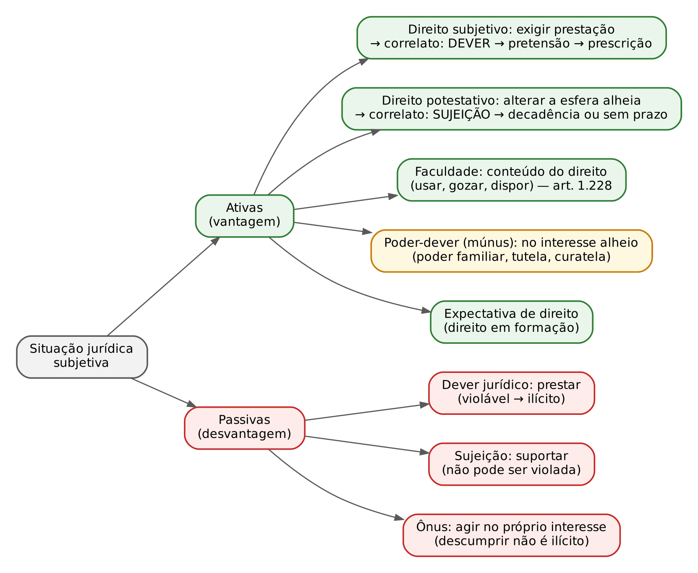
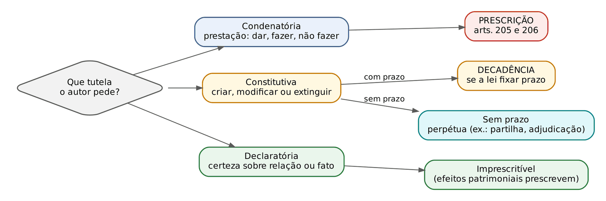

# CAPÍTULO 02 — SISTEMA DO CÓDIGO CIVIL E SITUAÇÕES JURÍDICAS

:::INCIDENCIA
Pontos: TRF5 p. 1; TJRS p. 2 e 3; TJSC p. 2, 3 e 12 (só a parte de *civil law* e *common law*). Nível B. Lote: FGV 1, FCC 1, e mais 9 correlatas localizadas por palavra-chave.
O que mais cai: diretrizes de Reale e técnica das cláusulas gerais, constitucionalização (leitura civil-constitucional e eficácia dos direitos fundamentais entre particulares) e a distinção direito subjetivo x potestativo aplicada a prazos.
:::

## 02.1 O sistema do Código Civil de 2002

### 02.1.1 Estrutura e lugar do Código no ordenamento

O CC/2002 (Lei 10.406/2002, em vigor desde 11/1/2003) mantém a arquitetura pandectista herdada do BGB e do CC/1916: uma Parte Geral (pessoas, bens, fatos jurídicos) e uma Parte Especial (obrigações, empresa, coisas, família, sucessões), seguida do Livro Complementar das disposições finais e transitórias (arts. 2.028 a 2.046). Duas marcas estruturais são cobradas: a unificação parcial do direito privado obrigacional (o Código absorveu a parte geral das obrigações e contratos mercantis e criou o Livro II, "Do Direito de Empresa", revogando a primeira parte do Código Comercial de 1850, art. 2.045) e a opção por um sistema aberto, que conjuga regras casuísticas com cláusulas gerais (ver 02.1.3).

A codificação convive com a era dos estatutos (a "descodificação" de Natalino Irti): CDC, ECA, Estatuto da Pessoa Idosa, EPD, LGPD. O centro do sistema passou a ser a Constituição; o Código é a lei geral do direito privado, com a qual os microssistemas dialogam (02.2).

### 02.1.2 As diretrizes de Miguel Reale: eticidade, socialidade e operabilidade

Miguel Reale, supervisor da Comissão elaboradora, apresentou o Código como fundado em três diretrizes (ou princípios informadores). Elas não estão escritas como tais no texto: são chaves de leitura extraídas da Exposição de Motivos e reconhecidas pela doutrina e pelos tribunais. A prova cobra a correspondência entre cada diretriz e os dispositivos que a concretizam.

| Diretriz | Ideia central | Concreções no CC (exemplos cobráveis) |
|---|---|---|
| Eticidade | Superar o formalismo do CC/1916, valorizando a boa-fé objetiva, a equidade e a confiança; dar ao juiz poder para buscar a solução justa no caso | Boa-fé interpretativa (art. 113), controle (art. 187) e integrativa (art. 422); redução equitativa da cláusula penal (art. 413) e da indenização (art. 944, parágrafo único); lesão e estado de perigo (arts. 156 e 157); vedação do comportamento contraditório |
| Socialidade | Prevalência dos valores coletivos sobre os individuais, sem negar a pessoa; superação do caráter individualista do CC/1916 | Função social do contrato (art. 421) e da propriedade (art. 1.228, §§ 1º, 2º e 4º); redução dos prazos de usucapião quando há posse-trabalho (arts. 1.238, parágrafo único, e 1.242, parágrafo único); art. 2.035, parágrafo único |
| Operabilidade | Direito feito para ser efetivado: soluções simples, conceitos claros, regras concretas (concretude) | Separação nítida entre prescrição (arts. 205 e 206, prazos reunidos) e decadência (prazos espalhados pelo Código); adoção de cláusulas gerais para que o juiz concretize a norma no caso |

:::LEI CC, art. 2.035, parágrafo único
Nenhuma convenção prevalecerá se contrariar preceitos de ordem pública, tais como os estabelecidos por este Código para assegurar a função social da propriedade e dos contratos.
:::

O dispositivo é a expressão mais forte da socialidade: qualifica como de ordem pública os preceitos de função social e os torna aplicáveis aos efeitos posteriores a 11/1/2003 de contratos celebrados antes do Código (a regra de direito intertemporal do *caput* — validade pela lei antiga, efeitos pela lei nova — é tratada no Cap. 1 e no Cap. 45).

:::PEGADINHA Socialidade não é coletivismo
A socialidade não suprime a dimensão individual do direito subjetivo: ela o funcionaliza. A função social limita e orienta o exercício, mas não transforma o titular em mero gestor de interesses coletivos. A afirmação de que a socialidade promove "a superação da natureza subjetiva dos direitos" pela "prevalência absoluta" do interesse social é FALSA (FCC, DPE-RS 2025). No mesmo sentido, o Enunciado 23 do CJF: a função social não elimina a autonomia contratual; atenua ou reduz seu alcance quando presentes interesses metaindividuais ou interesse individual relativo à dignidade.
:::

:::QUESTAO FCC 2025 — DPE-RS — Defensor Público (Q3386999)
O que se pediu: a assertiva correta sobre o "sistema de direito privado".
Gabarito oficial: E — a função social limita o exercício de direitos individuais em face de interesses sociais e coletivos (a alternativa a qualifica como elemento "limitador, mas não finalístico", e afirma que direitos subjetivos e potestativos "não precisam ser exercidos em razão de uma funcionalidade social", mas estão limitados por funcionalidades coletivas).
Por que as demais erram:
- A: a boa-fé admite tanto a redução do conteúdo obrigacional pela inércia (*supressio*) quanto sua ampliação por comportamento reiterado (*surrectio*); a alternativa nega a segunda (figuras parcelares no Cap. 15).
- B: o CC/2002 usa conceitos jurídicos indeterminados E cláusulas gerais (arts. 187, 421, 422, 927, parágrafo único); negar as cláusulas gerais contraria a própria proposta de sistema aberto.
- C: o STF atribui aos tratados de direitos humanos não aprovados pelo rito do art. 5º, § 3º, da CF status SUPRALEGAL (não infralegal), o que basta para o controle de convencionalidade da lei civil.
- D: ver a PEGADINHA acima.
Armadilha: a expressão "não finalístico" destoa do Enunciado 360 do CJF (eficácia interna da função social); a E é correta por exclusão, lida como "a função social não exige que todo direito sirva a fins sociais, mas impede o exercício contrário a eles".
:::

Questão correlata: Q3117508 (FGV, TJ-PE, 2024) — o *nemo auditur propriam turpitudinem allegans* cede diante da simulação e da nulidade absoluta (arts. 167 e 168), mas prevalece contra o relativamente incapaz que ocultou dolosamente a idade (art. 180); comentada no Cap. 9.

Correlata: FCC 2024, PGE-GO (Q2654908) transcreveu trecho de Reale criticando a irrevisibilidade dos contratos no CC/1916 e pediu o dispositivo do CC/2002 que deu solução ao problema: gabarito D, a resolução por onerosidade excessiva (art. 478; teoria no Cap. 16).

### 02.1.3 Técnica legislativa: cláusulas gerais, conceitos jurídicos indeterminados e princípios

O sistema aberto (Judith Martins-Costa) se faz com normas de textura aberta. A prova exige distinguir três figuras que se sobrepõem, mas não se confundem.

| Figura | Estrutura | Papel do juiz | Exemplos no CC |
|---|---|---|---|
| Conceito jurídico indeterminado | Termo vago na HIPÓTESE (fato), mas com CONSEQUÊNCIA jurídica já fixada pela lei | Preencher o conceito (subsunção valorativa); a solução vem pronta | "Extensa área", "considerável número de pessoas", "interesse social e econômico relevante" (art. 1.228, § 4º); "necessidades" e "possibilidades" (art. 1.694, § 1º) |
| Cláusula geral | Vagueza na hipótese E na consequência; o legislador não fixa a solução | Preencher o conceito E construir a consequência no caso concreto (criação mais intensa, com dever de fundamentação) | Função social do contrato (art. 421); boa-fé (art. 422); abuso do direito (art. 187); atividade de risco (art. 927, parágrafo único); tutela da personalidade (art. 12) |
| Princípio | Norma finalística (mandado de otimização, na linha de Alexy), que pode estar ou não positivada | Ponderar com outros princípios; orientar interpretação | Dignidade, solidariedade, boa-fé, função social, autonomia privada |

Três observações decidem questões:

- A mesma norma pode ser, ao mesmo tempo, princípio e cláusula geral: a função social do contrato é princípio (conteúdo) veiculado por cláusula geral (técnica). Os Enunciados 21 e 22 do CJF chamam o art. 421 de cláusula geral (o 21 para impor a revisão da relatividade dos efeitos, com tutela externa do crédito; o 22 para reforçar a conservação do contrato, "assegurando trocas úteis e justas"); o Enunciado 26 qualifica o art. 422 de cláusula geral que permite ao juiz interpretar, suprir e corrigir o contrato; e o Enunciado 27 manda interpretá-la considerando o sistema do Código e suas conexões com outros estatutos e com fatores metajurídicos.
- A cláusula geral é técnica de remissão a valores (função de "válvula" do sistema) e de mobilidade: permite que o Código se atualize sem reforma legislativa, mas impõe ao juiz fundamentação reforçada (art. 489, § 1º, II, do CPC veda empregar conceitos jurídicos indeterminados sem explicar o motivo concreto de sua incidência; a ponderação deve observar o § 2º).
- A tutela da pessoa também opera como cláusula geral: o Enunciado 274 do CJF afirma que os direitos da personalidade, regulados de modo não exaustivo pelo Código, são expressões da cláusula geral de tutela da pessoa humana do art. 1º, III, da CF, e que a colisão entre eles se resolve por ponderação (desenvolvimento no Cap. 4).

:::DICA Como reconhecer na alternativa
Se a lei diz o que acontece e só deixa vago o pressuposto, é conceito indeterminado. Se a lei deixa ao juiz também a definição do efeito (anular a cláusula, reduzir, impor dever anexo, declarar ineficaz perante terceiro), é cláusula geral. Exemplo: a violação do art. 421 pode conduzir "à invalidade ou à ineficácia do contrato ou de cláusulas contratuais" (Enunciado 431 do CJF): a consequência é construída no caso.
:::

Correlata: FGV 2025, TJ-MS (Q3786335) partiu do Enunciado 22 (função social como cláusula geral que reforça a conservação do contrato) e do art. 51, § 2º, do CDC, e perguntou em qual contrato o CC afasta a conservação: gabarito D, transação, porque, sendo nula qualquer de suas cláusulas, nula será a transação (art. 848; Cap. 21).

### 02.1.4 Princípios gerais do direito e o papel do juiz

Os princípios gerais do direito aparecem no art. 4º da LINDB como último degrau da integração (analogia, costumes, princípios gerais; ver Cap. 1). A doutrina civil-constitucional, porém, recusa a leitura de que os princípios só operam na lacuna: os princípios constitucionais têm força normativa e incidem diretamente, inclusive para afastar regra infraconstitucional incompatível (02.3). O CPC/2015 incorporou essa visão: o juiz, ao aplicar o ordenamento, atenderá aos fins sociais e às exigências do bem comum, "resguardando e promovendo a dignidade da pessoa humana" e observando proporcionalidade, razoabilidade, legalidade, publicidade e eficiência (art. 8º); não se exime de decidir alegando lacuna ou obscuridade (art. 140, *caput*) e "só decidirá por equidade nos casos previstos em lei" (art. 140, parágrafo único).

:::PEGADINHA Equidade
Decidir COM equidade (temperar a aplicação da regra, como nos arts. 413, 928, parágrafo único, e 944, parágrafo único) é diferente de decidir POR equidade (substituir a regra pelo senso de justiça do julgador), que SOMENTE ocorre nos casos previstos em lei (art. 140, parágrafo único, do CPC; também art. 2º, § 1º, da Lei 9.307/1996, na arbitragem, se as partes autorizarem).
:::

## 02.2 Unidade sistemática, pluralidade de fontes e diálogo das fontes

A pluralidade de leis especiais coloca o problema da coerência. A resposta clássica são os critérios de solução de antinomias (hierárquico, cronológico e da especialidade, de Bobbio; ver Cap. 1), que operam por exclusão: uma norma afasta a outra. A teoria do diálogo das fontes, formulada por Erik Jayme e difundida no Brasil por Claudia Lima Marques, propõe aplicação simultânea, coerente e coordenada de fontes plurais, guiada pelos valores constitucionais, em vez da exclusão. A unidade do sistema não vem de um código, mas da Constituição.

| Diálogo (Claudia Lima Marques) | Em que consiste | Exemplo |
|---|---|---|
| Sistemático de coerência | Uma lei fornece a base conceitual da outra (a lei geral empresta conceitos à especial) | Conceitos de contrato, prescrição, pessoa jurídica, nulidade do CC usados na aplicação do CDC |
| De complementaridade e subsidiariedade | Aplicação conjunta: uma lei completa a outra, normas ou princípios, conforme o caso | CC supre o CDC em contrato de consumo naquilo em que o CDC é omisso ou em que a norma civil é mais favorável (art. 7º do CDC) |
| De coordenação e adaptação sistemática (influências recíprocas) | O conteúdo de uma lei influencia a interpretação da outra, redefinindo seu campo de aplicação | Boa-fé objetiva e função social do CDC e do CC iluminando-se mutuamente (Enunciado 167 do CJF: forte aproximação principiológica, ambos incorporadores de uma nova teoria geral dos contratos) |

:::LEI CDC, art. 7º, *caput*
Os direitos previstos neste código não excluem outros decorrentes de tratados ou convenções internacionais de que o Brasil seja signatário, da legislação interna ordinária, de regulamentos expedidos pelas autoridades administrativas competentes, bem como dos que derivem dos princípios gerais do direito, analogia, costumes e eqüidade.
:::

O art. 7º do CDC é a "cláusula de abertura" invocada como base positiva do diálogo das fontes em matéria de consumo. No CC, o Enunciado 369 do CJF dá um exemplo expresso: no transporte que constitua relação de consumo, aplicam-se as normas do CDC que forem mais benéficas ao consumidor, apesar do art. 732 do CC (que manda aplicar a legislação especial e tratados no que não contrariar o Código), "em uma visão constitucional de unidade do sistema" (transporte no Cap. 19).

:::PEGADINHA O que o diálogo das fontes NÃO é
- Não é critério de revogação: as duas leis permanecem em vigor e são aplicadas conjuntamente.
- Não significa que a lei especial sempre prevaleça: no diálogo, pode prevalecer a regra geral do CC quando ela realiza melhor o valor constitucional em jogo (por exemplo, a tutela do vulnerável).
- Não é exclusivo de CDC x CC: aplica-se a qualquer conjunto de fontes (CC e Lei de Locações, CC e LGPD, CC e Estatuto da Pessoa Idosa, CC e leis trabalhistas e tributárias).
- Não dispensa a fundamentação: a combinação de fontes deve ser justificada (art. 489, § 1º, do CPC).
:::

:::EXEMPLO Diálogo aplicado
Pretensão do consumidor por inadimplemento contratual sem acidente de consumo: o prazo de cinco anos do art. 27 do CDC é restrito ao fato do produto ou do serviço; na falta de regra consumerista, aplica-se o prazo do CC por complementaridade (controvérsia trienal x decenal no Cap. 11).
:::

## 02.3 Constitucionalização do direito civil

### 02.3.1 O direito civil-constitucional

Constitucionalização do direito civil é a releitura dos institutos civis à luz da Constituição, que passa a ser fonte direta e vértice axiológico do direito privado. A escola italiana de Pietro Perlingieri e sua recepção no Brasil por Gustavo Tepedino, Luiz Edson Fachin e Maria Celina Bodin de Moraes sintetizam o movimento em algumas ideias cobráveis:

- Unidade do ordenamento a partir da Constituição: não há "dois mundos" (público e privado) com lógicas estanques; a norma constitucional incide diretamente nas relações privadas, como regra de interpretação e como norma de comportamento.
- Primazia das situações existenciais sobre as patrimoniais (despatrimonialização ou repersonalização): o patrimônio deixa de ser o centro do direito civil e passa a ser instrumento da realização da pessoa (fundamento: dignidade, art. 1º, III, da CF). (Fachin: estatuto jurídico do patrimônio mínimo; Cap. 40).
- Funcionalização dos institutos: propriedade, contrato, empresa e família só merecem tutela quando cumprem a função que o ordenamento lhes atribui (função social da propriedade, art. 5º, XXIII, e art. 170, III, da CF; função social do contrato; família como instrumento de realização de seus membros, a "família eudemonista").
- Solidariedade (art. 3º, I, da CF) e igualdade substancial como critérios de controle da autonomia privada.

Constitucionalização não se confunde com publicização. A publicização (ou dirigismo) é a intervenção do Estado-legislador que retira matérias da autonomia privada por meio de leis especiais imperativas (locação, consumo, trabalho). A constitucionalização é fenômeno hermenêutico: o mesmo instituto privado passa a ser lido a partir de valores constitucionais, sem necessariamente mudar de natureza.

:::QUESTAO FGV 2024 — ENAM (2024.2) — Exame Nacional da Magistratura (Q3058662)
O que se pediu: avaliar três afirmativas sobre a constitucionalização do direito civil.
Gabarito oficial: A — somente II está correta (a interpretação do Código deve atribuir a todo o corpo codificado sentido coerente com a tábua de valores do ordenamento, voltada a transformar a realidade segundo a solidariedade e a justiça social).
Por que I e III erram: (I) a função econômica da liberdade negocial NÃO afasta a incidência dos direitos fundamentais nas relações privadas: a autonomia privada é ela própria valor constitucional, a ser ponderado com os demais; (III) a ordem voluntarista oitocentista é exatamente o modelo superado pela constitucionalização, e não instrumento dela: a frase inverte a relação, colocando os princípios constitucionais a serviço da lógica individualista.
Armadilha: a alternativa III usa vocabulário de manual ("voluntarista", "oitocentista") para parecer técnica; a FGV costuma testar se o candidato sabe a DIREÇÃO da relação (Constituição conforma o Código, não o contrário).
:::

Correlata: FGV 2024, ENAM (Q2459856), sobre o regime de separação obrigatória do maior de 70 anos (Tema 1.236 do STF — ver Cap. 36): considerou corretas as afirmações de que a igualdade restringe o uso da idade como fator de desequiparação e de que a dignidade inclui a autonomia para realizar as próprias "escolhas existenciais" (gabarito C). É o vocabulário civil-constitucional aplicado.

:::ATENCAO Críticas
A Lei 13.874/2019 (art. 421, parágrafo único, e art. 421-A: intervenção mínima e excepcionalidade da revisão) e os arts. 20 e 21 da LINDB (consequências práticas de decisões fundadas em valores abstratos; Cap. 1) reagem ao uso retórico de princípios. A resposta civil-constitucional é a fundamentação analítica, não a renúncia aos princípios.
:::

### 02.3.2 Eficácia dos direitos fundamentais nas relações privadas

Eficácia vertical vincula o Estado; horizontal (privada, externa, *Drittwirkung*), os particulares. Fala-se ainda em eficácia diagonal (expressão de Sergio Gamonal Contreras, no direito do trabalho) para as relações entre particulares desiguais, em que um deles exerce poder privado sobre o outro (empregador e empregado, fornecedor e consumidor, plataforma e usuário): a vinculação ao direito fundamental é tanto mais intensa quanto maior a assimetria.

| Teoria | Tese | Origem e observações |
|---|---|---|
| Negativa (*state action*) | Direitos fundamentais vinculam só o Estado; particulares apenas quando a conduta puder ser imputada ao Estado | Estados Unidos; a jurisprudência norte-americana amplia a noção de *state action* para alcançar casos extremos |
| Eficácia indireta ou mediata | Os direitos fundamentais irradiam-se pelas cláusulas gerais e conceitos indeterminados do direito privado, cabendo ao legislador e ao juiz concretizá-los | Günter Dürig; acolhida pelo Tribunal Constitucional alemão no caso Lüth (1958); preserva a autonomia privada |
| Eficácia direta ou imediata | Os direitos fundamentais incidem diretamente nas relações privadas, independentemente de mediação legislativa, com ponderação frente à autonomia privada | Hans Carl Nipperdey; majoritária na doutrina brasileira (Ingo Sarlet, Daniel Sarmento, Gustavo Tepedino), apoiada no art. 5º, § 1º, da CF ("As normas definidoras dos direitos e garantias fundamentais têm aplicação imediata") |
| Deveres de proteção | O Estado (legislador e juiz) tem o dever de proteger um particular contra violações praticadas por outro | Claus-Wilhelm Canaris; variação da eficácia indireta |

No Brasil, o leading case é o caso UBC: o STF manteve decisão que determinara a reintegração de associado excluído da União Brasileira de Compositores sem contraditório e ampla defesa, afirmando a aplicação direta dos direitos fundamentais ao devido processo legal nas relações privadas, especialmente quando a entidade exerce papel de caráter público (gestão coletiva de direitos autorais) e a exclusão atinge interesses relevantes do excluído.

:::JURIS STF, RE 201.819, j. 11/10/2005
Exclusão de sócio de associação civil sem garantia de ampla defesa e contraditório. O STF negou provimento ao recurso da associação: os direitos fundamentais vinculam também os particulares; a autonomia privada não confere às associações o poder de ignorar as restrições postas pela própria Constituição; aplicação direta das garantias do devido processo legal à exclusão de associado. Os fatos são anteriores à redação dada ao art. 57 do CC pela Lei 11.127/2005, que hoje exige justa causa e procedimento que assegure direito de defesa e de recurso, nos termos do estatuto (Cap. 5).
:::

Precedentes anteriores, citados pela doutrina como pioneiros: RE 158.215 (exclusão de associado sem contraditório e ampla defesa) e RE 161.243 (isonomia entre empregado brasileiro e empregados estrangeiros de empresa estrangeira). O STJ aplica a mesma lógica nas relações com plataformas digitais.

Exemplo: a plataforma de transporte pode suspender de imediato o motorista por fato grave, mas, conjugados o art. 20 da LGPD e a eficácia horizontal, deve informar o motivo e assegurar defesa e revisão (STJ, REsp 2.135.783-DF, Info 817; v. Cap. 15). LGPD no Cap. 47.

:::SENTENCA Fundamentação quando o direito fundamental incide entre particulares
Quando o caso exige aplicar diretamente um direito fundamental contra particular (exclusão de associado, desligamento de usuário de plataforma, cláusula discriminatória), a sentença deve identificar a assimetria de poder, o direito fundamental afetado e a autonomia privada contraposta, e justificar a ponderação (art. 489, § 2º, do CPC). Redação-modelo: "A autonomia associativa não autoriza a exclusão de associado sem prévia oportunidade de defesa (art. 57 do CC e art. 5º, § 1º, da CF). Ponderados a liberdade de associação e o devido processo, este prevalece diante do poder exercido pela entidade e da gravidade da restrição. Declaro nula a exclusão e determino a reintegração, sem prejuízo de novo procedimento regular."
:::

## 02.4 Relação jurídica e situações jurídicas subjetivas

### 02.4.1 Da relação jurídica à situação jurídica

A teoria clássica (Savigny) organiza o direito privado em torno da relação jurídica, cujos elementos são os sujeitos (ativo e passivo), o objeto (imediato: a prestação ou o poder sobre a coisa; mediato: o bem) e o fato jurídico propulsor.

A doutrina contemporânea, em especial Perlingieri, considera a categoria insuficiente e prefere falar em situação jurídica subjetiva: a posição de um sujeito perante o ordenamento, resultante da incidência da norma sobre um fato, ainda que não haja, naquele momento, sujeito passivo determinado em contraposição. A relação jurídica passa a ser vista como a ligação entre duas ou mais situações jurídicas (por exemplo, o crédito e o débito). Existem situações unissubjetivas, sem contraparte determinada no momento (a personalidade, a propriedade antes de qualquer violação, a posição do testador), e situações complexas, em que o mesmo sujeito concentra poderes e deveres (o proprietário que tem faculdades e, ao mesmo tempo, deveres de função social; o pai titular de poder familiar). O Enunciado 412 do CJF trata *supressio*, *tu quoque*, *surrectio* e *venire contra factum proprium* como hipóteses de "exercício inadmissível de uma situação jurídica subjetiva", concreções da boa-fé objetiva.

### 02.4.2 Direito subjetivo e pretensão

Direito subjetivo é o poder de exigir de outrem um comportamento (prestação de dar, fazer ou não fazer), conferido pela norma para a tutela de um interesse e cuja violação autoriza o titular a buscar a satisfação. A fórmula clássica distingue *norma agendi* (direito objetivo) e *facultas agendi* (direito subjetivo). As teorias sobre sua natureza aparecem em provas de nível superior:

| Teoria | Autor | Direito subjetivo é... |
|---|---|---|
| Da vontade | Savigny, Windscheid | Poder de vontade reconhecido pela ordem jurídica |
| Do interesse | Ihering | Interesse juridicamente protegido |
| Mista (eclética) | Jellinek | Poder de vontade para a proteção de um interesse |
| Negativistas | Duguit, Kelsen | Não há direito subjetivo autônomo: só situações derivadas do direito objetivo (Kelsen: o direito subjetivo é o próprio direito objetivo visto pelo titular) |

Violado o direito subjetivo, nasce a pretensão (*Anspruch*, de Windscheid): o poder de exigir judicialmente a prestação, que se extingue pela prescrição. É a opção expressa do Código:

:::LEI CC, art. 189
Violado o direito, nasce para o titular a pretensão, a qual se extingue, pela prescrição, nos prazos a que aludem os arts. 205 e 206.
:::

O que prescreve é a pretensão, não o direito nem a ação (em sentido processual). Pelo Enunciado 14 do CJF, o prazo começa com o surgimento da pretensão, que decorre da exigibilidade do direito subjetivo. Termo inicial, *actio nata* objetiva e subjetiva, causas impeditivas, suspensivas e interruptivas: Cap. 11.

Correlata: FGV 2026, TJ-PA (Q3951813) relacionou direito subjetivo e eficácia da lei no tempo: quem já preenchera todos os requisitos da lei antiga tem direito subjetivo adquirido ao benefício, que a lei nova mais rigorosa não pode atingir (gabarito A; direito adquirido no Cap. 1).

### 02.4.3 Direito potestativo e sujeição

Direito potestativo (Chiovenda; também "direito formativo", na tradição alemã) é o poder de, por ato unilateral de vontade, criar, modificar ou extinguir situação jurídica alheia, sem que a outra parte possa impedir. Ao direito potestativo não corresponde um dever, mas um estado de sujeição: o sujeito passivo nada presta, apenas suporta os efeitos. Consequência decisiva: o direito potestativo NÃO pode ser violado e, por isso, dele NÃO nasce pretensão; não está sujeito à prescrição, mas, quando a lei fixa prazo para seu exercício, a prazo decadencial.

Exemplos que caem: anular negócio jurídico (decadência de 4 anos ou de 2 anos, arts. 178 e 179); revogar mandato (art. 682, I); denunciar contrato por prazo indeterminado (resilição unilateral, art. 473); exercer direito de preferência ou de retrato; pedir a divisão da coisa comum (art. 1.320, "a todo tempo"); divorciar-se (EC 66/2010); escolher entre o valor atual e o de custo ao indenizar benfeitorias necessárias do possuidor de má-fé (art. 1.222).

:::JURIS STJ, REsp 1.817.812-SP, j. 3/9/2024 (Info 824)
A partilha de bens dos ex-cônjuges é direito potestativo: é o poder de dissolver a universalidade e modificar ou extinguir situação jurídica independentemente da vontade do outro. Não há pretensão (nenhuma prestação é exigida), logo não há prescrição; e, à falta de prazo decadencial legal, pode ser exercida a qualquer tempo (4ª Turma, Rel. Min. Marco Buzzi).
:::

No mesmo sentido, o STJ qualificou o divórcio, após a EC 66/2010, como direito potestativo, admitindo sua decretação *post mortem* quando a vontade de ambos de dissolver o vínculo estava inequivocamente manifestada no processo antes da morte (v. Cap. 34). Potestativo, porém, não significa informal: a FGV (TJ-SC 2026, Assistente Social, Q4150477) considerou ERRADA a alternativa segundo a qual o divórcio, por ser potestativo, "prescinde de formalidades específicas para sua eficácia" (gabarito D: a separação dissolve a sociedade conjugal e mantém o vínculo, permitindo reconciliação).

:::PEGADINHA Potestativo não está imune ao abuso
O exercício do direito potestativo também se submete à boa-fé, à função social e aos limites do art. 187. A FGV (TCE-PE 2025, Q3593084) apresentou fornecedor de insumos de UTI que, para forçar reajuste, suspendeu as entregas e alegou "direito potestativo de rescindir": gabarito B, o direito potestativo de resilição encontra limites na boa-fé e na função social, e seu exercício abusivo gera responsabilidade civil. Abuso do direito no Cap. 10; resilição e aviso prévio do art. 473, parágrafo único, no Cap. 16.
:::

:::QUESTAO FGV 2024 — Câmara dos Deputados — Consultor Legislativo (Q2511471)
Venda de ascendente a descendente sem o consentimento de um dos filhos, descoberta um ano e quatro meses depois. Gabarito: E (anulável, com prazo DECADENCIAL de dois anos). Para este capítulo: anular é direito potestativo (pretensão constitutiva negativa), por isso o prazo é de decadência; não havendo prazo próprio no art. 496, incide o prazo geral de dois anos do art. 179 (questão comentada por inteiro no Cap. 17).
:::

Correlata: FCC 2025, DPE-RS (Q3386993), sobre posse: gabarito D, quem indeniza benfeitorias necessárias ao possuidor de má-fé tem o direito potestativo de optar entre o valor atual e o de custo (art. 1.222; Cap. 27).

### 02.4.4 Faculdade, poder-dever, ônus e outras figuras

| Figura | Conceito | Correlato passivo | Prazo | Exemplo |
|---|---|---|---|---|
| Direito subjetivo | Poder de exigir prestação | Dever jurídico (violável) | Pretensão: prescrição | Crédito; reparação de dano |
| Direito potestativo | Poder de alterar unilateralmente a esfera alheia | Sujeição (inviolável) | Decadência, se houver prazo legal ou convencional; sem prazo, exercício a qualquer tempo | Anulação; revogação de mandato; divórcio; partilha |
| Faculdade jurídica | Possibilidade de agir contida no conteúdo de um direito; não tem existência autônoma | Não há | Não prescreve nem decai isoladamente ("o não uso não extingue a faculdade") | Usar, gozar e dispor (art. 1.228, *caput*); faculdade de somar posses (Enunciado 494 do CJF) |
| Poder-dever (poder funcional, múnus) | Poder atribuído no interesse de outrem; o titular não pode renunciar nem deixar de exercer | Sujeição do beneficiário, com direito deste ao correto exercício | Não se aplica | Poder familiar; tutela; curatela |
| Ônus jurídico | Comportamento exigido no interesse do próprio onerado para obter vantagem ou evitar desvantagem | Não há; seu descumprimento não é ilícito | Pode haver prazo (preclusão, decadência) | Ônus da prova (art. 373 do CPC); registrar o título para adquirir a propriedade; notificar para constituir em mora |
| Dever jurídico | Necessidade de observar conduta imposta em favor de outrem | É ele próprio o polo passivo do direito subjetivo | Seu descumprimento gera ilícito e pretensão | Pagar, entregar, abster-se |
| Expectativa de direito | Situação em formação, sem todos os elementos aquisitivos | Não há | Não se protege como direito adquirido, salvo regra especial | Herdeiro antes da abertura da sucessão; requisitos ainda não implementados |
| Interesse legítimo e direito eventual | Posições tuteladas embora ainda não plenas (ex.: titular de direito sob condição suspensiva pode praticar atos conservatórios, art. 130) | Variável | Variável | Credor condicional |

:::PEGADINHA Ônus x dever
O descumprimento de dever gera ilícito e responsabilidade; o descumprimento de ônus só gera a perda da vantagem que o onerado poderia obter (o comprador que não registra a escritura não comete ilícito, apenas não adquire a propriedade perante terceiros). A banca troca as palavras: "o ônus da prova é dever processual cujo descumprimento gera sanção" é FALSO.
:::

### 02.4.5 Direitos imprescritíveis

A pergunta "o que é imprescritível" responde-se com o critério de Agnelo Amorim Filho (1960), que ligou a natureza da situação jurídica ao tipo de tutela pedida. É o critério que fundamenta a distinção entre prescrição e decadência adotada pelo CC/2002 (operabilidade), e sua lógica é cobrada mesmo sem citação do autor.

- Ações condenatórias tutelam direitos subjetivos violados (pretensão a uma prestação): sujeitam-se a PRESCRIÇÃO.
- Ações constitutivas (positivas ou negativas) veiculam direitos potestativos: sujeitam-se a DECADÊNCIA quando a lei (ou o contrato) fixa prazo; sem prazo, são perpétuas.
- Ações declaratórias pedem só certeza jurídica: são IMPRESCRITÍVEIS, porque nada há a prestar nem a constituir. A ação declaratória de nulidade é o exemplo legal: o negócio nulo não convalesce pelo decurso do tempo (art. 169). Mas os efeitos patrimoniais derivados podem prescrever (Enunciado 536 do CJF: resultando do negócio nulo consequências patrimoniais capazes de ensejar pretensões, é possível, quanto a estas, a incidência da prescrição).

Hipóteses de imprescritibilidade e de exercício perpétuo que caem com frequência (os prazos em espécie estão no Cap. 11):

| Hipótese | Fundamento | Observação |
|---|---|---|
| Direitos da personalidade em si (inclusive direitos morais do autor) | Art. 11 do CC; arts. 24 e 27 da Lei 9.610/1998 | Imprescritível é o direito; a pretensão indenizatória pela violação prescreve. Direitos morais de autor: v. Cap. 4 |
| Ações de estado (investigação de paternidade, por exemplo) | Natureza declaratória e existencial | A petição de herança cumulada prescreve (Súmula 149 do STF — ver Cap. 42) |
| Declaração de nulidade absoluta | Art. 169 | Ver Enunciado 536 |
| Partilha e divisão da coisa comum | Direitos potestativos sem prazo (art. 1.320; REsp 1.817.812) | "A todo tempo" |
| Adjudicação compulsória | Direito potestativo sem prazo legal (art. 1.418) | REsp 1.216.568-MG (4ª Turma, j. 3/9/2015): prevalece a regra da inesgotabilidade; extensão às perdas e danos substitutivas: v. Cap. 17 |
| Exceções próprias (autônomas) | Enunciado 415 do CJF | O art. 190 (a exceção prescreve no mesmo prazo da pretensão) só alcança as exceções impróprias, dependentes da pretensão |
| Reivindicatória | Propriedade não se perde pelo não uso | O limite é a usucapião consumada em favor do possuidor (Cap. 29) |
| Imprescritibilidades de matriz constitucional ou jurisprudencial (ressarcimento ao erário por ato doloso de improbidade, reparação de dano ambiental, danos por perseguição política e tortura no regime militar) | CF, art. 37, § 5º, e orientação do STF e do STJ | Desenvolvimento no Cap. 11 |

### 02.4.6 Situações existenciais e situações patrimoniais

A distinção, central na metodologia civil-constitucional, separa situações cujo objeto é a própria pessoa e sua realização (personalidade, corpo, identidade, intimidade, liberdades de escolha sobre a vida, família) das situações que têm por objeto bens economicamente avaliáveis (crédito, propriedade, posições contratuais). Ela não é só classificatória: implica regimes diferentes.

| Critério | Situação existencial | Situação patrimonial |
|---|---|---|
| Fundamento | Dignidade (art. 1º, III, da CF); cláusula geral de tutela da pessoa | Livre iniciativa, propriedade, autonomia negocial (com função social) |
| Autonomia privada | Autonomia existencial: tutelada com intensidade máxima quando os efeitos recaem só sobre o titular; limitações voluntárias só temporárias e não gerais (art. 11; Enunciado 4 do CJF) | Autonomia negocial: ampla, mas funcionalizada e controlada por boa-fé, função social e equilíbrio |
| Disponibilidade e prazo | Em regra intransmissíveis, irrenunciáveis e imprescritíveis (o direito em si) | Em regra transmissíveis, renunciáveis, sujeitos a prescrição e decadência |
| Em caso de conflito | Prevalência das existenciais (despatrimonialização), mediante ponderação | Cedem diante da pessoa |

Aplicações cobradas:

- Capacidade e vulnerabilidade. Após o EPD, a curatela da pessoa com deficiência afeta tão somente os atos de natureza patrimonial e negocial (art. 85 da Lei 13.146/2015); os atos existenciais (casar, ter filhos, exercer a sexualidade) permanecem com a própria pessoa (Cap. 41). A FGV (TRF3 2025, Juiz Federal, Q3179534) considerou correto que as pessoas com deficiência mental são capazes e podem receber curador para os atos de cunho patrimonial. Em sentido de flexibilização, o Enunciado 637 do CJF admite outorgar ao curador poderes de representação para alguns atos, "inclusive de natureza existencial", especificados na sentença e comprovadamente necessários à proteção do curatelado.
- Recusa a tratamento. O Enunciado 403 do CJF reconhece à pessoa o direito de recusar tratamento médico, inclusive transfusão de sangue, com ou sem risco de morte, desde que tenha capacidade plena (sem suprimento por representante ou assistente), manifestação livre, consciente e informada, e oposição que diga respeito exclusivamente à própria pessoa (Cap. 4).
- Família. O Enunciado 635 do CJF admite cláusulas existenciais no pacto antenupcial e no contrato de convivência, desde que não violem a dignidade, a igualdade entre os cônjuges e a solidariedade familiar (Cap. 36).
- Situações dúplices. Há situações com faceta existencial e patrimonial: o direito autoral (direitos morais, inalienáveis e irrenunciáveis, art. 27 da Lei 9.610/1998, e direitos patrimoniais, transmissíveis) e a imagem explorada comercialmente.
- Dano. O dano existencial (lesão ao projeto de vida e às relações da pessoa) é categoria derivada da proteção das situações existenciais. A FGV (MPE-RJ 2026, Promotor, Q4088274) classificou como dano existencial a privação da filha recém-nascida da assistência moral e afetiva da mãe morta por falha de atendimento (gabarito A; danos extrapatrimoniais no Cap. 25).

## 02.5 *Civil law* e *common law*

O Brasil pertence à família romano-germânica (*civil law*): a lei escrita, sistematizada em códigos, é a fonte principal, e o raciocínio parte da norma geral para o caso (dedutivo). Na *common law* (Inglaterra e, com variações, Estados Unidos), o direito se forma a partir das decisões judiciais, com força vinculante do precedente (*stare decisis*), e o raciocínio parte dos casos para a regra (indutivo e analógico). A convergência entre os sistemas é a tônica atual: códigos e leis ganham espaço na *common law* (o *Uniform Commercial Code* norte-americano, por exemplo), e precedentes vinculantes ganham espaço na *civil law*.

| Aspecto | *Civil law* (Brasil) | *Common law* |
|---|---|---|
| Fonte principal | Lei; código como sistema | Precedente judicial; leis (*statutes*) interpretadas restritivamente na tradição inglesa |
| Precedente | Tradicionalmente persuasivo; hoje há rol de precedentes de observância obrigatória (art. 927 do CPC) | Vinculante por *stare decisis* (vertical e horizontal) |
| O que vincula | Tese firmada (o CPC fala em "tese jurídica") e fundamentos determinantes (art. 489, § 1º, V e VI, do CPC) | *Ratio decidendi* ou *holding*; o *obiter dictum* não vincula |
| Técnicas de superação | Distinção e superação previstas no CPC (arts. 489, § 1º, VI; 927, §§ 2º a 4º), com modulação (art. 927, § 3º) | *Distinguishing*, *overruling* (total), *overriding* (parcial), *prospective overruling*, *signaling* |
| Papel do juiz | Aplicar e concretizar a lei (cláusulas gerais ampliam a criação judicial) | Criar e desenvolver o direito a partir dos casos |

:::LEI CPC, arts. 926, *caput*, e 927, *caput* e III-A
Art. 926. Os tribunais devem uniformizar sua jurisprudência e mantê-la estável, íntegra e coerente.
Art. 927. Os juízes e os tribunais observarão: [...] III-A – os acórdãos proferidos em julgamento de recurso especial submetido ao regime da relevância da questão de direito federal infraconstitucional; (Incluído pela Lei nº 15.484, de 2026)
:::

A Lei 15.484, de 4/8/2026 (vigência 30 dias após a publicação), regulamentou o filtro da relevância do recurso especial (art. 105, § 2º, da CF) e incluiu no rol do art. 927 os acórdãos do STJ proferidos nesse regime. A técnica dos precedentes pertence ao Processo Civil; aqui basta o mapa.

No direito contratual (TJSC p. 12), as diferenças que a prova pode explorar, com o correspondente brasileiro:

| Instituto da *common law* | Ideia | Correspondente ou contraste no direito brasileiro |
|---|---|---|
| *Consideration* | Promessa só é exigível se houver contrapartida negociada (*bargain*); promessa gratuita depende de forma especial (*deed*) | Não exigimos *consideration*: a doação e os contratos gratuitos são válidos e obrigatórios; o controle se faz pela causa, pela forma e pelos vícios (Caps. 8, 15 e 17) |
| Revogabilidade da oferta | Em regra, a oferta pode ser revogada antes da aceitação, salvo opção paga | A proposta obriga o proponente, se o contrário não resultar dos termos dela, da natureza do negócio ou das circunstâncias (art. 427; Cap. 15) |
| *Privity of contract* | Só as partes podem exigir o contrato (mitigada por leis posteriores) | Relatividade, com estipulação em favor de terceiro (arts. 436 a 438) e tutela externa do crédito pela função social (Enunciado 21 do CJF) |
| *Specific performance* | Remédio excepcional, de *equity*; a regra é a indenização (*damages*) | Tutela específica é a regra (arts. 497 e 499 do CPC; arts. 247 a 251 do CC), com conversão em perdas e danos por opção do credor ou impossibilidade |
| *Efficient breach* | Teoria da análise econômica (Posner): é eficiente descumprir e indenizar quando o ganho do inadimplente supera o dano do credor | Rejeitada como regra: força obrigatória, boa-fé e tutela específica; o lucro do inadimplente pode ser alcançado (lucro da intervenção, Cap. 23) |
| *Punitive damages* | Indenização acima do dano para punir conduta dolosa ou gravemente culposa | Reparação integral, medida pela extensão do dano (art. 944); a doutrina admite função punitiva ou pedagógica (Enunciado 379 do CJF) na quantificação do dano extrapatrimonial, sem verba autônoma de "pena" (Cap. 25) |
| *Liquidated damages* x *penalty* | Prefixação razoável de danos é válida; cláusula com finalidade punitiva é inexigível | Cláusula penal válida com função coercitiva e de prefixação, limitada ao valor da obrigação principal e reduzível equitativamente (arts. 412 e 413; Cap. 14) |
| *Frustration*, *impracticability* | Extinção quando evento superveniente frustra o propósito ou torna a execução impraticável | Resolução ou revisão por onerosidade excessiva (arts. 317, 478 a 480) e frustração do fim do contrato (Cap. 16) |
| *Duty to mitigate*; *estoppel*; *anticipatory breach* | Dever de mitigar o prejuízo; vedação de contradição; inadimplemento antes do termo | Enunciado 169 do CJF (o credor deve evitar o agravamento do próprio prejuízo); *venire contra factum proprium* (Enunciado 362); inadimplemento antecipado (Cap. 14) |

:::ATENCAO Não exagere a oposição
A banca costuma cobrar que (a) o Brasil é *civil law*, mas adotou um sistema de precedentes obrigatórios (art. 927 do CPC), sem por isso se converter em *common law*; (b) a função punitiva da indenização é admitida pela doutrina e pelo CJF como critério de quantificação, não como *punitive damages* autônomos; e (c) a teoria do inadimplemento eficiente não é acolhida como regra no direito brasileiro. Alternativas que afirmem a "adoção integral do *stare decisis*" ou a "vedação absoluta de qualquer finalidade punitiva" tendem a estar erradas.
:::

## 02.6 Resumo para revisão pré-prova

| Instituto | Regra | Exceções e detalhes | Fundamento |
|---|---|---|---|
| Diretrizes do CC/2002 | Eticidade (boa-fé, equidade), socialidade (função social), operabilidade (concretude, soluções simples) | Não estão escritas como tais; socialidade funcionaliza, não suprime, o direito individual | Reale; arts. 113, 187, 421, 422, 1.228, 2.035, parágrafo único |
| Conceito jurídico indeterminado | Vagueza só na hipótese; consequência fixada pela lei | Ex.: "extensa área", "considerável número de pessoas" | Art. 1.228, § 4º |
| Cláusula geral | Vagueza na hipótese e na consequência; juiz constrói a solução | Pode veicular princípio (função social, boa-fé); exige fundamentação reforçada | Arts. 187, 421, 422, 927, parágrafo único; Enunciados 21, 22, 26, 27 e 274 do CJF; art. 489, § 1º, II, do CPC |
| Diálogo das fontes | Aplicação simultânea e coordenada de fontes, à luz da Constituição | Três diálogos: coerência, complementaridade/subsidiariedade, coordenação/adaptação; não revoga; não é só CDC x CC | Art. 7º do CDC; Enunciados 167 e 369 do CJF |
| Constitucionalização | Releitura do direito civil a partir da CF: dignidade, solidariedade, igualdade substancial; despatrimonialização e funcionalização | Não se confunde com publicização (intervenção legislativa); críticas: insegurança, consequencialismo da LINDB | Arts. 1º, III, 3º, I, 5º, XXIII, e 170 da CF |
| Eficácia horizontal | Direitos fundamentais vinculam particulares; no Brasil prevalece a eficácia direta, com ponderação | Diagonal: relações assimétricas; teorias: *state action*, indireta (Dürig), direta (Nipperdey), deveres de proteção (Canaris) | Art. 5º, § 1º, da CF; RE 201.819 |
| Direito subjetivo | Poder de exigir prestação; correlato: dever | Violado, nasce a pretensão, que prescreve | Art. 189; Enunciado 14 do CJF |
| Direito potestativo | Poder de alterar a esfera alheia; correlato: sujeição | Não é violável, não gera pretensão; decadência se houver prazo; sem prazo, a qualquer tempo; limitado pelo abuso | Arts. 178, 179, 473, 496, 682, 1.222, 1.320; REsp 1.817.812 |
| Faculdade, ônus, poder-dever | Faculdade: conteúdo do direito; ônus: no próprio interesse, descumprir não é ilícito; poder-dever: no interesse alheio | Ônus da prova não é dever | Art. 1.228; art. 373 do CPC |
| Imprescritíveis | Declaratórias; direitos da personalidade em si; estado; nulidade; partilha; divisão; adjudicação compulsória; exceções próprias | Efeitos patrimoniais prescrevem; petição de herança prescreve | Agnelo Amorim Filho; arts. 11, 169, 1.320, 1.418; Enunciados 415 e 536; REsp 1.216.568 |
| Existenciais x patrimoniais | Existenciais prevalecem e têm regime próprio (indisponibilidade relativa, tutela inibitória) | Curatela só patrimonial e negocial, com a flexibilização do Enunciado 637; recusa a tratamento (Enunciado 403); cláusulas existenciais no pacto (Enunciado 635) | Art. 1º, III, da CF; art. 11 do CC; art. 85 do EPD |
| *Civil law* x *common law* | Lei x precedente vinculante | Brasil: precedentes obrigatórios (art. 927 do CPC, com o REsp sob relevância da Lei 15.484/2026); sem *consideration*, *efficient breach* ou *punitive damages* autônomos | Arts. 926, 927, 944 do CC e 489, § 1º, V e VI, do CPC; Enunciado 379 |

## 02.7 Artigos de lei incidentes

- Constituição Federal: arts. 1º, III; 3º, I; 5º, XVII, XVIII, XXIII, § 1º e § 3º; 37, § 5º; 105, § 2º; 170, III.
- Código Civil: arts. 11, 12, 113, 130, 167, 168, 169, 178, 179, 180, 187, 189, 190, 205, 206, 413, 421, 421-A, 422, 427, 436 a 438, 473, 478, 496, 682, I, 732, 848, 927, parágrafo único, 944, 1.222, 1.228, 1.238, parágrafo único, 1.242, parágrafo único, 1.320, 1.418, 2.035 e 2.045.
- Código de Processo Civil: arts. 8º, 140, 373, 489, § 1º, II, V e VI, e § 2º, 497, 499, 926 e 927 (com o inciso III-A incluído pela Lei 15.484/2026).
- Código de Defesa do Consumidor: art. 7º.
- Lei 13.146/2015 (EPD): art. 85.
- Lei 9.610/1998: arts. 24 e 27.
- LGPD (Lei 13.709/2018): art. 20.
- Lei 15.484/2026 (relevância do recurso especial).

## 02.8 Julgados, temas e súmulas do capítulo

- STF, RE 201.819 (j. 11/10/2005): caso UBC, exclusão de associado sem defesa; eficácia direta dos direitos fundamentais nas relações privadas.
- STF, RE 158.215 e RE 161.243: precedentes pioneiros da eficácia horizontal (exclusão de associado; isonomia de empregado brasileiro em empresa estrangeira).
- STJ, REsp 1.817.812-SP (j. 3/9/2024, Info 824): partilha é direito potestativo, sem prescrição nem decadência.
- STJ, REsp 1.216.568-MG (j. 3/9/2015): adjudicação compulsória sem prazo; regra da inesgotabilidade dos potestativos.
- CJF: Enunciados 4, 14, 21, 22, 23, 26, 27, 138, 167, 169, 274, 294, 360, 362, 369, 379, 403, 412, 415, 431, 494, 536, 635 e 637.

Remissões a outros capítulos: REsp 2.135.783-DF, suspensão de motorista de plataforma (Cap. 15); REsp 2.196.855-RJ, adjudicação compulsória e perdas e danos (Cap. 17); REsp 2.022.649-MA, divórcio *post mortem* (Cap. 34); REsp 1.947.652-GO, direitos morais de autor (Cap. 4); Tema 1.236 do STF (Cap. 36); Súmula 149 do STF (Cap. 42); prazos, *actio nata* e imprescritibilidades constitucionais (Cap. 11); abuso do direito (Cap. 10); boa-fé, função social e figuras parcelares (Cap. 15); direitos da personalidade (Cap. 4); curatela (Cap. 41); art. 57 do CC e associações (Cap. 5).

:::NOTA Notas de verificação
- Conferidos no Planalto (29/10/2026): CC, arts. 11, 189, 421, 421-A, 422, 1.228 e 2.035; CDC, art. 7º; CPC, arts. 8º, 140, 926 e 927 (com o inciso III-A incluído pela Lei 15.484/2026); Lei 15.484, de 4/8/2026 (ementa e vigência de 30 dias após a publicação no DOU de 4/8/2026). Lei 15.484/2026, art. 927, III-A, do CPC e CF, art. 5º, § 1º: conferidos no Planalto em 30/10/2026 (redação do inciso III-A e da lei confere com o texto do capítulo).
- Enunciados do CJF conferidos no arquivo das Jornadas do Drive (I a VIII Jornadas). O arquivo não traz a IX Jornada; não se citou enunciado dela.
- RE 201.819: número, data de 11/10/2005 e conteúdo da ementa conferidos em artigo doutrinário (jus.com.br); a fonte não informa a turma nem o redator do acórdão, que por isso não foram indicados. RE 158.215 e RE 161.243: citados conforme a mesma literatura, sem data; o nome da empresa do RE 161.243 não foi confirmado e não foi indicado.
- Julgados do STJ conferidos no Caderno Dizer o Direito (REsp 1.817.812) e no arquivo "Julgados dos Tribunais Superiores — Parte Geral (2023)" (REsp 1.216.568).
- Não verificados em fonte e por isso citados sem número: temas do STF e súmula do STJ sobre imprescritibilidade do ressarcimento ao erário por improbidade dolosa, do dano ambiental e dos danos por tortura no regime militar (remetidos ao Cap. 11); o caso Lüth (1958) e as atribuições doutrinárias (Dürig, Nipperdey, Canaris, Gamonal Contreras, Agnelo Amorim Filho, Irti, Jayme) vêm de conhecimento consolidado, não de fonte lida nesta tarefa.
- O Tartuce 2026 do Drive só devolveu o sumário pelo conector (o texto integral não foi extraído); a Sinopse TJSC e o Código Civil para a FGV não foram lidos, por não terem tema próprio deste capítulo. Não há súmula do TJRS identificada sobre o tema.
- Q3386999 (FCC, DPE-RS 2025): a alternativa dada como correta qualifica a função social como "limitador, mas não finalístico", o que destoa do Enunciado 360 (eficácia interna); o gabarito se sustenta por exclusão, conforme explicado no box.
:::
