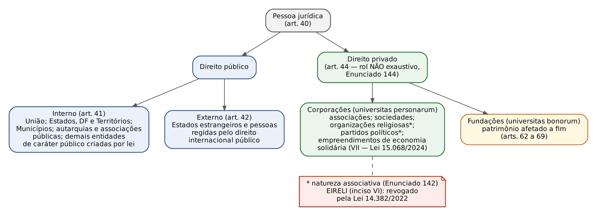
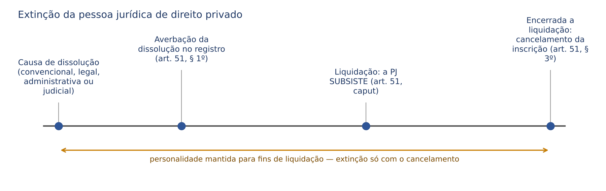
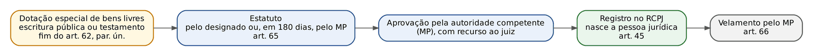
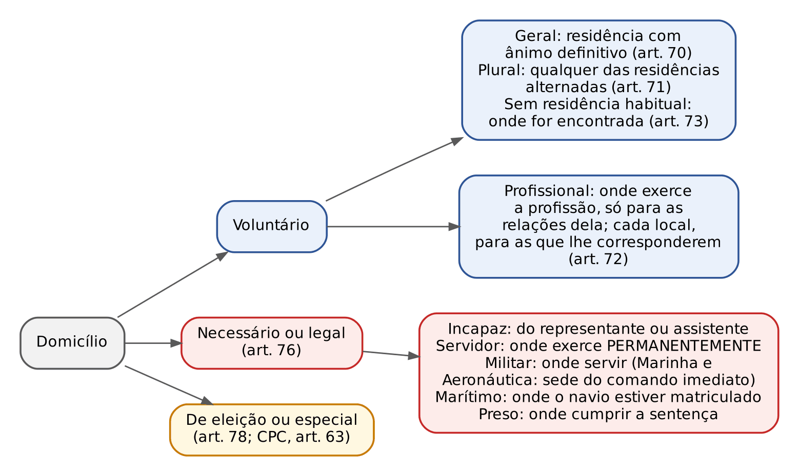

# CAPÍTULO 05 — PESSOA JURÍDICA E DOMICÍLIO

:::INCIDENCIA
TRF5 p. 3 e 4; TJRS p. 4 e 5; TJSC p. 4; SEFAZ p. 2 e 3. Nível A. Lote: 31 questões (FGV 22, FCC 9).
O que mais cai: domicílio da pessoa natural em caso concreto (pluralidade, profissional, necessário), letra do art. 44 (inclusive o novo inciso VII), arts. 45, 51 e 75, exclusão de associado (art. 57) e assembleia (arts. 59 e 60), velamento das fundações.
:::

| Subtema | FGV | FCC | Padrão de cobrança |
|---|---|---|---|
| Domicílio da pessoa natural (geral, plural, profissional, necessário) | 8 | 3 | Caso com várias cidades: quais são domicílios e para quais relações |
| Domicílio da pessoa jurídica | 3 | 1 | Art. 75: capitais, administração municipal, cada estabelecimento |
| Classificação (arts. 41 a 44) | 1 | 4 | Partidos, organizações religiosas e economia solidária são de direito privado |
| Início, decadência e extinção (arts. 45 e 51) | 2 | 1 | Registro constitutivo; 3 anos; subsistência para liquidação |
| Associações | 5 | 0 | Exclusão com defesa e recurso; assembleia especialmente convocada; 1/5 |
| Fundações | 1 | 0 | MP estadual x MPF (Enunciado 147) |
| Teorias e entes despersonalizados | 2 | 0 | Realidade técnica; condomínio |

## 05.1 Conceito, natureza e requisitos

Pessoa jurídica é o agrupamento de pessoas (corporação, *universitas personarum*) ou o patrimônio afetado a um fim (fundação, *universitas bonorum*) a que a ordem jurídica atribui personalidade, isto é, aptidão genérica para ser titular de direitos e deveres, com existência e patrimônio distintos dos de seus membros (art. 49-A, ver 05.4). A banca explora três pontos: a teoria adotada, os requisitos de existência e o momento em que a personalidade nasce e se extingue.

### 05.1.1 Teorias sobre a natureza

| Teoria | Ideia central | Autores associados | Situação no CC/2002 |
|---|---|---|---|
| Negativistas | Não há pessoa jurídica: há patrimônio sem sujeito ou propriedade coletiva | Brinz, Planiol (propriedade coletiva) | Rejeitadas |
| Ficção legal | Só o homem é sujeito; a PJ é criação artificial da lei, sem vontade nem capacidade de agir | Savigny | Rejeitada |
| Realidade objetiva ou orgânica | A PJ é organismo social real, com vontade própria, independente da lei | Gierke, Zitelmann | Rejeitada (ignora o papel do Direito) |
| Realidade técnica (jurídica) | A PJ é realidade, mas sua personalidade é atribuída pela técnica jurídica a grupos que preenchem os requisitos legais | Ihering (precursor), Saleilles, Ferrara | ADOTADA, segundo a doutrina majoritária (art. 45: a existência legal começa com o registro) |

O CC combina os dois polos: há um substrato real (grupo ou patrimônio organizado), mas a personalidade só nasce quando a lei a reconhece, pelo registro (art. 45).

:::QUESTAO FGV 2025 — PC-MG — Delegado de Polícia Substituto (Q3171394)
O que se pergunta: o enunciado transcreve voto do STJ sobre responsabilidade penal da pessoa jurídica que menciona a "suposta incapacidade" da PJ de agir, ser culpável e sofrer pena, e pede a teoria explicativa a que o trecho remete.
Gabarito: C (ficção jurídica, não adotada pelo Código Civil).
Por quê: a negação de vontade e de capacidade de ação própria é a marca da teoria da ficção (Savigny); o CC adota a realidade técnica. Armadilhas: D e B dizem "adotada pelo Código Civil" para teorias que não o são; E nega a adoção da realidade técnica, que é justamente a adotada.
:::

### 05.1.2 Requisitos de existência

A doutrina (Carlos Roberto Gonçalves, Tartuce) aponta três requisitos: vontade humana criadora (a *affectio societatis* nas sociedades, a intenção de criar entidade distinta nas associações, o ato de dotação nas fundações); observância das condições legais, cujo ápice é o registro do ato constitutivo (art. 45), precedido de autorização do Poder Executivo quando exigida; e licitude do objetivo (a falta dela autoriza a dissolução, ver 05.6). Faltando o registro, há ente de fato, sem personalidade (sociedade em comum ou associação irregular, ver 05.10).

## 05.2 Classificação

### 05.2.1 Quanto à função: direito público e direito privado

São de direito público interno a União, os Estados, o DF e os Territórios, os Municípios, as autarquias, "inclusive as associações públicas" (consórcios públicos com personalidade de direito público, Lei 11.107/2005), e "as demais entidades de caráter público criadas por lei" (art. 41). São de direito público externo os Estados estrangeiros e as pessoas regidas pelo direito internacional público (art. 42), como a ONU e a Santa Sé.

O parágrafo único do art. 41 manda aplicar o CC, no que couber e salvo disposição em contrário, às pessoas jurídicas de direito público a que se tenha dado estrutura de direito privado; o Enunciado 141 da III Jornada esclarece que a remissão alcança as fundações públicas e os entes de fiscalização do exercício profissional. A responsabilidade civil das pessoas jurídicas de direito público (art. 43; CF, art. 37, § 6º) é tratada no Cap. 26 e na apostila de Direito Administrativo.

Empresas públicas, sociedades de economia mista e serviços sociais autônomos são pessoas jurídicas de direito privado, ainda que integrem ou se relacionem com a Administração. A Corte Especial do STJ assentou, no CC 212.761-DF (j. 20/5/2026, Informativo 890), que ação de entidade do Sistema S para ressarcimento de valores de contrato de fornecimento e construção, mesmo após apuração de superfaturamento pelo TCU, é relação de direito privado, da competência das Turmas da Segunda Seção.

:::LEI Código Civil, art. 44
Art. 44. São pessoas jurídicas de direito privado:
I - as associações;
II - as sociedades;
III - as fundações.
IV - as organizações religiosas;
V - os partidos políticos.
VI - (Revogado pela Lei nº 14.382, de 2022)
VII - os empreendimentos de economia solidária. (Redação dada pela Lei nº 15.068, de 2024)
§ 1º São livres a criação, a organização, a estruturação interna e o funcionamento das organizações religiosas, sendo vedado ao poder público negar-lhes reconhecimento ou registro dos atos constitutivos e necessários ao seu funcionamento.
§ 2º As disposições concernentes às associações aplicam-se subsidiariamente aos empreendimentos de economia solidária e às sociedades que são objeto do Livro II da Parte Especial deste Código. (Redação dada pela Lei nº 15.068, de 2024)
§ 3º Os partidos políticos serão organizados e funcionarão conforme o disposto em lei específica.
:::

Pontos de prova sobre o art. 44:

- Inciso VI (EIRELI): REVOGADO pela Lei 14.382/2022; as EIRELIs existentes já haviam sido transformadas em sociedades limitadas unipessoais, independentemente de alteração do ato constitutivo, pelo art. 41 da Lei 14.195/2021 (a sociedade limitada pode ser constituída por uma ou mais pessoas, art. 1.052, § 1º, incluído pela Lei 13.874/2019; detalhes são de Direito Empresarial). Questão que lista a EIRELI entre as pessoas jurídicas de direito privado vigentes está errada.
- Inciso VII (empreendimentos de economia solidária): incluído pela Lei 15.068, de 23/12/2024 (publicada em 24/12/2024 e em vigor na data da publicação, art. 16). A mesma lei deu nova redação ao § 2º: as normas das associações aplicam-se subsidiariamente a esses empreendimentos e às sociedades. Pela própria Lei 15.068, os empreendimentos formalizados juridicamente são "pessoas jurídicas de fins econômicos sem finalidade lucrativa" (art. 4º, § 2º); o enquadramento independe da forma societária (art. 4º, § 1º); os que adotarem a forma de cooperativa seguem a legislação específica (art. 4º, § 4º); são autogestionários, com soberania assemblear e singularidade de voto (art. 4º, I).
- O rol "não é exaustivo" (Enunciado 144 da III Jornada, que se refere aos incisos I a V).
- Partidos políticos, sindicatos e associações religiosas têm natureza associativa, aplicando-se-lhes o CC (Enunciado 142).

:::PEGADINHA Economia solidária e desconsideração
A FGV (TJ-SE, 2025, Juiz Substituto) cobrou credor de empreendimento de economia solidária que, diante de confusão patrimonial entre os diretores, pediu a desconsideração. O gabarito considerou o pleito viável e apto a atingir todos os membros, porque nesse tipo de pessoa jurídica "o elemento pessoal pouco importa" (fonte: compilação de questões FGV do Drive, gabarito E; a questão não está no banco local). As alternativas que negavam personalidade ao empreendimento (inciso VII) ou limitavam a extensão aos diretores foram as armadilhas. O tema da desconsideração em si é do Cap. 6; registre que a pertinência subjetiva da desconsideração nesse caso é discutível em face da redação do art. 50 (administradores ou sócios "beneficiados direta ou indiretamente pelo abuso").
:::

:::QUESTAO FGV 2026 — TJ-SC — Oficial de Justiça e Avaliador (Q4153604)
Caso: classificar Município, partido político registrado, autarquia estadual de defesa do consumidor e associação cultural sem fins lucrativos.
Gabarito: D (partido político e associação civil são pessoas jurídicas de direito privado).
Fundamento: art. 41, III e IV (Município e autarquia: direito público interno); art. 44, I e V. Armadilha: A e E põem o partido entre as de direito público; C diz que "somente" o Município é de direito público, esquecendo a autarquia.
No mesmo sentido: FCC 2025, DPE-SP, Analista (Q3304106), em que o item II (partidos como direito público interno) e o item IV (autarquias como direito privado) eram falsos; FCC 2024, TRT-11 (Q2400470: organizações religiosas são pessoas jurídicas de direito privado, gabarito A).
:::

:::QUESTAO FCC 2025 — TRT-2 — Analista Judiciário (Q3627611)
Cobrou-se a natureza dos "empreendimentos de economia solidária". Gabarito: D (pessoas jurídicas de direito privado), pela literalidade do art. 44, VII, na redação da Lei 15.068/2024. A alternativa "não são pessoas jurídicas" explora quem estudou por material anterior a dezembro de 2024.
No mesmo sentido: FCC 2025, MPE-PI, Analista (Q3530377, gabarito C).
:::

### 05.2.2 Outras classificações

| Critério | Espécies | Observação de prova |
|---|---|---|
| Nacionalidade | Nacional e estrangeira | A estrangeira depende de autorização do Poder Executivo para funcionar no país (arts. 1.134 e seguintes, matéria empresarial) e, para atos no Brasil, rege-se pela lei do país em que se constituiu (LINDB, art. 11 — ver Cap. 1) |
| Estrutura interna | Corporação (pessoas) e fundação (patrimônio) | Associações e sociedades são corporações; fundação é patrimônio personificado |
| Finalidade (corporações) | Fins não econômicos (associações) e fins econômicos (sociedades) | Associação pode exercer atividade econômica, desde que sem finalidade lucrativa (Enunciado 534) |
| Atividade (sociedades) | Simples e empresárias | Registro: RCPJ e Junta Comercial, respectivamente (art. 1.150) |

## 05.3 Início da existência legal: registro

:::LEI Código Civil, art. 45
Art. 45. Começa a existência legal das pessoas jurídicas de direito privado com a inscrição do ato constitutivo no respectivo registro, precedida, quando necessário, de autorização ou aprovação do Poder Executivo, averbando-se no registro todas as alterações por que passar o ato constitutivo.
Parágrafo único. Decai em três anos o direito de anular a constituição das pessoas jurídicas de direito privado, por defeito do ato respectivo, contado o prazo da publicação de sua inscrição no registro.
:::

O registro da pessoa jurídica de direito privado é CONSTITUTIVO (diferentemente do registro de nascimento da pessoa natural, que é declaratório). Para as sociedades, o art. 985 repete a regra ("adquire personalidade jurídica com a inscrição, no registro próprio"). O registro competente é a Junta Comercial (Registro Público de Empresas Mercantis) para empresário e sociedade empresária, e o Registro Civil das Pessoas Jurídicas para sociedade simples, associações, fundações, organizações religiosas e partidos (art. 1.150; Lei 6.015/1973 — procedimento no Cap. 33). Para os partidos, a Lei 9.096/1995 prevê dois momentos: a personalidade é adquirida pelo registro civil, e o registro do estatuto no TSE é condição para participar do processo eleitoral e receber recursos do fundo partidário.

O art. 46 lista o conteúdo obrigatório do registro: denominação, fins, sede, tempo de duração e fundo social; fundadores ou instituidores e diretores; modo de administração e representação; reformabilidade do ato constitutivo quanto à administração; se os membros respondem "ou não, subsidiariamente" pelas obrigações sociais (V); condições de extinção e destino do patrimônio (VI).

A autorização prévia do Executivo é exceção (ex.: instituições financeiras, seguradoras, sociedades estrangeiras). Associações NÃO dependem de autorização (CF, art. 5º, XVIII; ver 05.7) e o poder público não pode negar registro às organizações religiosas (art. 44, § 1º).

:::DICA Prazos de três anos na Parte Geral da PJ
Dois prazos DECADENCIAIS de três anos convivem e são trocados pela banca:
- art. 45, parágrafo único: anular a CONSTITUIÇÃO da PJ por defeito do ato constitutivo, contado da publicação da inscrição no registro;
- art. 48, parágrafo único: anular DECISÕES de administração coletiva que violem a lei ou o estatuto ou sejam eivadas de erro, dolo, simulação ou fraude (o termo inicial não é fixado no dispositivo).
Nenhum dos dois é de cinco anos nem de quatro anos (o prazo geral de anulação dos negócios do art. 178 é de quatro anos — Cap. 9).
:::

:::QUESTAO FGV 2025 — AgSUS — Analista de Gestão, Advogado (Q3659056)
Três assertivas V ou F: (1) existência legal com a inscrição do ato constitutivo, precedida de autorização quando necessário; (2) decadência de CINCO anos para anular a constituição; (3) a PJ não se confunde com sócios, associados, instituidores ou administradores.
Gabarito: B (V, F, V). O erro está só no prazo: são três anos (art. 45, parágrafo único). A terceira é a literalidade do art. 49-A, caput.
:::

:::QUESTAO FCC 2026 — PGM-Manaus — Procurador do Município (Q4338801)
Gabarito: B (a personalidade das pessoas jurídicas de direito privado começa com a inscrição dos atos constitutivos no registro). Armadilhas: E (assinatura do ato constitutivo); D (PJ não titulariza direitos da personalidade — contraria o art. 52, ver 05.4); A (grupo econômico, por si só, autoriza desconsideração — contraria o art. 50, § 4º); C (desconsideração extingue a PJ — falso: a desconsideração é episódica e não anula nem dissolve a pessoa jurídica; ver Cap. 6).
No mesmo sentido, em questão de outro capítulo: FGV 2026, PC-PI, Delegado (Q3849000), em que era falsa a assertiva de que a existência legal começa com a assinatura do ato constitutivo, independentemente do registro.
:::

Dois desdobramentos práticos:

- Capacidade dos fundadores: a constituição de associação é ato da vida civil comum; o adolescente emancipado (pelo casamento ou pelo exercício de emprego público efetivo, art. 5º, parágrafo único) a pratica pessoalmente (FGV 2024, ENAM, Q2459896, gabarito E — ver Cap. 3).
- Doação a entidade em formação: é válida, mas caduca se a entidade não estiver regularmente constituída em dois anos (art. 554). A FGV cobrou a validade da doação a associação ainda em constituição (ENAM 2024, Q3058658; TJ-SC 2025, Juiz Leigo, Q3592852 — ver Cap. 17).

## 05.4 Autonomia patrimonial e responsabilidade da pessoa jurídica e dos sócios

### 05.4.1 Art. 49-A

O art. 49-A, incluído pela Lei 13.874/2019 (Liberdade Econômica), positivou o princípio da separação: "A pessoa jurídica não se confunde com os seus sócios, associados, instituidores ou administradores". O parágrafo único qualifica a autonomia patrimonial como "instrumento lícito de alocação e segregação de riscos", estabelecido pela lei "com a finalidade de estimular empreendimentos, para a geração de empregos, tributo, renda e inovação em benefício de todos". A literalidade das quatro figuras (sócios, associados, instituidores, administradores) e da finalidade é cobrada em V ou F. A exceção ao princípio — desconsideração — é do Cap. 6; aqui interessa a regra.

### 05.4.2 Responsabilidade dos membros pelas dívidas da PJ

A autonomia patrimonial não significa sempre responsabilidade limitada. O próprio registro deve dizer "se os membros respondem, ou não, subsidiariamente, pelas obrigações sociais" (art. 46, V). O quadro abaixo resume os regimes cobráveis no Civil (o detalhamento dos tipos societários é de Direito Empresarial):

| Ente | Responsabilidade dos membros | Fundamento |
|---|---|---|
| Associação | Em regra, nenhuma: não há direitos e obrigações recíprocos entre associados; só respondem se o estatuto previr | Arts. 46, V, e 53, parágrafo único |
| Fundação | Instituidor não responde pelas dívidas da fundação; obrigação dele é transferir os bens dotados | Art. 64 |
| Sociedade simples | Subsidiária, pelo saldo, na proporção da participação nas perdas sociais, salvo cláusula de responsabilidade solidária; benefício de ordem | Arts. 1.023 e 1.024 |
| Sociedade limitada | Limitada ao valor das quotas, com solidariedade pela integralização do capital | Art. 1.052 |
| Sociedade em comum (sem registro) | Solidária e ilimitada; quem contratou pela sociedade NÃO tem benefício de ordem | Art. 990 |

### 05.4.3 Responsabilidade civil da pessoa jurídica

A pessoa jurídica responde, com seu patrimônio, por atos dos administradores praticados nos limites dos poderes (art. 47, ver 05.5) e pelos danos causados por empregados e prepostos no exercício do trabalho (arts. 932, III, e 933: responsabilidade objetiva por fato de terceiro — Cap. 24). As de direito público e as de direito privado prestadoras de serviço público respondem objetivamente (CF, art. 37, § 6º; art. 43 do CC — Cap. 26). Nas relações de consumo, a responsabilidade é objetiva (CDC — apostila de Consumidor).

Administradores respondem solidariamente perante a sociedade e terceiros por culpa no desempenho das funções (art. 1.016) e, se aplicarem bens sociais em proveito próprio sem consentimento escrito dos sócios, restituem com os lucros resultantes (art. 1.017). Sócios que participam de deliberações infringentes da lei ou do contrato respondem diretamente, o que torna desnecessária a desconsideração (Enunciado 229 da III Jornada).

### 05.4.4 Direitos da personalidade da pessoa jurídica (art. 52)

"Aplica-se às pessoas jurídicas, no que couber, a proteção dos direitos da personalidade" (art. 52). A cláusula "no que couber" afasta os direitos ligados à dimensão corporal e existencial (vida, integridade física, intimidade em sentido psíquico) e preserva os compatíveis: nome empresarial e marca, imagem-atributo, honra objetiva (reputação), segredo industrial. A súmula sobre dano moral da PJ e a quantificação são do Cap. 25 (Súmula 227 do STJ — ver Cap. 25).

:::PEGADINHA Enunciado 286 x art. 52
O Enunciado 286 da IV Jornada afirma que os direitos da personalidade são inerentes à pessoa humana, "não sendo as pessoas jurídicas titulares de tais direitos". Ele expressa posição doutrinária (a PJ teria proteção análoga, não titularidade). Em prova objetiva, prevalece a LETRA do art. 52: a proteção se aplica à PJ, no que couber. Por isso foi CORRETO o item III da Q3304106 (FCC 2025, DPE-SP) e ERRADA a alternativa D da Q4338801. O Enunciado 189 da III Jornada exige que, no dano moral à PJ, o fato lesivo seja devidamente demonstrado.
:::

:::QUESTAO FCC 2025 — DPE-SP — Analista de Defensoria (Q3304106)
Itens: I — a mera expansão da finalidade original não constitui desvio de finalidade; II — partidos são pessoas de direito público interno; III — aplica-se às PJs, no que couber, a proteção dos direitos da personalidade; IV — autarquias são de direito privado.
Gabarito: D (I e III). I reproduz o art. 50, § 5º (a lei fala em "mera expansão ou a alteração da finalidade original" — Cap. 6); III, o art. 52. II e IV invertem os arts. 41 e 44.
:::

## 05.5 Administração

| Regra | Dispositivo | Detalhe cobrável |
|---|---|---|
| Atos dos administradores obrigam a PJ quando exercidos nos limites dos poderes definidos no ato constitutivo | Art. 47 | O Enunciado 145 da III Jornada ressalva a teoria da aparência: o terceiro de boa-fé pode ser protegido mesmo se o administrador excedeu os poderes |
| Administração coletiva: decisões pela maioria de votos DOS PRESENTES, salvo disposição diversa do ato constitutivo | Art. 48, caput | Não é maioria absoluta dos membros |
| Anulação das decisões coletivas: decadência em três anos | Art. 48, parágrafo único | Vícios: violação da lei ou do estatuto, erro, dolo, simulação ou fraude |
| Falta de administração: o juiz nomeia administrador provisório, a requerimento de QUALQUER interessado | Art. 49 | Não depende de requerimento do MP nem é nomeação de ofício |

:::ATENCAO Teoria ultra vires: o parágrafo único do art. 1.015 foi revogado
O parágrafo único do art. 1.015, que permitia à sociedade opor a terceiros o excesso de poderes do administrador (ato estranho ao objeto social, limitação inscrita no registro ou conhecida do terceiro), foi REVOGADO pela Lei 14.195/2021 (conferido no Planalto). Hoje a vinculação da PJ perante terceiros de boa-fé se resolve pelo art. 47, pela teoria da aparência (Enunciado 145) e pelas regras de representação (Cap. 8), com ação regressiva contra o administrador (arts. 1.016 e 1.017). Material anterior a 2021 que apresenta o art. 1.015, parágrafo único, como direito vigente está desatualizado.
:::

## 05.6 Extinção

### 05.6.1 Formas de dissolução

| Forma | Causa | Exemplo e fundamento |
|---|---|---|
| Convencional | Deliberação dos membros | Distrato da sociedade; deliberação da assembleia da associação nos termos do estatuto (art. 54, VI) |
| Legal | Fato previsto em lei | Vencimento do prazo de duração; falência (Lei 11.101/2005); morte de sócios ou falta de pluralidade não reconstituída, nos tipos societários em que a lei assim prevê |
| Administrativa | Cassação da autorização de funcionamento | Art. 51, caput ("cassada a autorização para seu funcionamento") |
| Judicial | Sentença em ação de dissolução | Ilicitude ou desvio grave do objeto; para associações, só por decisão judicial, com trânsito em julgado (CF, art. 5º, XIX) |

Nas fundações, a extinção tem regra própria (art. 69, ver 05.8).

### 05.6.2 Procedimento: dissolução, liquidação e cancelamento

:::LEI Código Civil, art. 51
Art. 51. Nos casos de dissolução da pessoa jurídica ou cassada a autorização para seu funcionamento, ela subsistirá para os fins de liquidação, até que esta se conclua.
§ 1º Far-se-á, no registro onde a pessoa jurídica estiver inscrita, a averbação de sua dissolução.
§ 2º As disposições para a liquidação das sociedades aplicam-se, no que couber, às demais pessoas jurídicas de direito privado.
§ 3º Encerrada a liquidação, promover-se-á o cancelamento da inscrição da pessoa jurídica.
:::

A personalidade NÃO se extingue com a dissolução: a PJ subsiste, para os fins de liquidação, até que esta se conclua, e só então se cancela a inscrição. O cancelamento marca o fim da personalidade; as duas hipóteses do caput (dissolução e cassação) são cobradas com "apenas" para induzir erro.

:::QUESTAO FCC 2026 — CPU-PE — Analista Jurídico (Q3872173)
Gabarito: D (pessoa jurídica com diversos estabelecimentos em lugares diferentes: cada um é domicílio para os atos nele praticados — art. 75, § 1º; ver 05.11).
Armadilhas sobre extinção: A (cancelamento da inscrição "assim que se der início à liquidação" — errado: só ENCERRADA a liquidação, art. 51, § 3º); B e E (subsistência para liquidação "apenas" na cassação ou "apenas" na dissolução — o caput abrange AMBAS). C troca a regra do art. 75, § 2º (sede no estrangeiro: domicílio é o estabelecimento no Brasil, não a sede estrangeira).
:::

:::QUESTAO FGV 2024 — Prefeitura de Macaé — Analista Previdenciário (Q3047999)
Caso: duas sócias de sociedade limitada decidem dissolvê-la voluntariamente.
Gabarito: B (a extinção da personalidade, na dissolução voluntária, se concretiza após o cancelamento da inscrição).
Armadilhas: A (durante a liquidação não subsiste a personalidade — contraria o art. 51, caput); E (a dissolução põe fim imediato à personalidade e o registro seria declaratório — inverte a lógica do art. 51); C transporta para a sociedade a regra de destinação do remanescente da ASSOCIAÇÃO (art. 61), quando na sociedade o remanescente se partilha entre os sócios; D inventa competência exclusiva da assembleia e convocação de credores para quadro-geral (figura falimentar).
:::

:::QUESTAO FGV 2026 — DPE-RJ — Defensor Público (Q4289390)
Caso: o Município notifica associação de moradores porque (I) não pediu autorização para ser criada e (II) praticou atos empresariais, comprando e vendendo mercadorias, em desacordo com o objeto social.
O que se pergunta: se e por quem a associação pode ser dissolvida.
Regra: a criação de associações independe de autorização, vedada a interferência estatal no funcionamento (CF, art. 5º, XVIII); a dissolução compulsória ou a suspensão das atividades só por decisão judicial, exigido o trânsito em julgado para a dissolução (art. 5º, XIX).
Aplicação: a falta de autorização não é ilícito algum, logo não autoriza dissolução nem pelo Executivo nem pelo Judiciário. A prática de atos econômicos, ainda que em tese possa ensejar controle judicial, jamais autorizaria dissolução por ato do Prefeito.
Gabarito: A (a ausência de autorização não pode acarretar a dissolução, nem mesmo por decisão judicial). As alternativas C, D e E caem por atribuírem ao Chefe do Executivo poder de dissolver; B, por tratar a ausência de autorização como causa de dissolução.
:::

## 05.7 Associações

### 05.7.1 Conceito e base constitucional

"Constituem-se as associações pela união de pessoas que se organizem para fins não econômicos" e "não há, entre os associados, direitos e obrigações recíprocos" (art. 53). A expressão "fins não econômicos" é tecnicamente criticada: a associação pode desenvolver atividade econômica (vender produtos, cobrar mensalidades, explorar bar de clube), desde que não haja FINALIDADE LUCRATIVA, isto é, distribuição de resultados aos associados (Enunciado 534 da VI Jornada). O traço distintivo em relação à sociedade está no destino do resultado, não na atividade.

A CF garante a plena liberdade de associação para fins lícitos, vedada a de caráter paramilitar (art. 5º, XVII); dispensa autorização para criar associações e veda a interferência estatal no funcionamento (XVIII); só admite dissolução compulsória ou suspensão das atividades por decisão judicial, exigindo, para a dissolução, o trânsito em julgado (XIX); ninguém pode ser compelido a associar-se ou a permanecer associado (XX); e as entidades associativas, quando expressamente autorizadas, têm legitimidade para representar seus filiados (XXI).

:::JURIS STJ, Tema 882 (recursos repetitivos)
Tese: "As taxas de manutenção criadas por associações de moradores não obrigam os não associados ou que a elas não anuíram" (REsp 1.280.871/SP; conferido no Radar). Fundamento civil: a liberdade de não se associar (CF, art. 5º, XX) e a ausência de obrigações recíprocas impostas a quem não aderiu (art. 53). O STF, no Tema 492 (RE 695.911, j. 18/12/2020), declarou inconstitucional a cobrança do não associado ATÉ a Lei 13.465/2017 (ou lei municipal anterior que discipline a matéria), admitindo-a, a partir de então, para titulares de lotes em loteamentos de acesso controlado que, já possuindo lote, adiram ao ato constitutivo da entidade ou, sendo novos adquirentes, quando o ato constitutivo da obrigação estiver registrado no Registro de Imóveis. Loteamento de acesso controlado e condomínio de lotes: Cap. 30.
:::

### 05.7.2 Estatuto (art. 54)

O estatuto deve conter, "sob pena de nulidade": denominação, fins e sede; requisitos de admissão, demissão e exclusão; direitos e deveres dos associados; fontes de recursos; modo de constituição e funcionamento dos órgãos deliberativos; condições para alteração do estatuto e para a dissolução; forma de gestão administrativa e de aprovação das contas (os incisos V e VII têm redação da Lei 11.127/2005).

### 05.7.3 Igualdade, categorias e intransmissibilidade (arts. 55 e 56)

Os associados "devem ter iguais direitos, mas o estatuto poderá instituir categorias com vantagens especiais" (art. 55): a igualdade é entre os integrantes de uma mesma categoria. Admite-se atribuir pesos diferenciados ao voto, desde que isso não suprima o voto nas matérias do art. 59 — destituição de administradores e alteração do estatuto (Enunciado 577 da VII Jornada).

A qualidade de associado é intransmissível, salvo disposição estatutária em contrário (art. 56). Se o associado for titular de quota ou fração ideal do patrimônio, a transferência dela "não importará, de per si", na atribuição da qualidade de associado ao adquirente ou herdeiro, "salvo disposição diversa do estatuto" (parágrafo único). Duas camadas de ressalva estatutária: a banca costuma suprimir uma delas.

### 05.7.4 Exclusão do associado (art. 57)

:::LEI Código Civil, arts. 57 e 58
Art. 57. A exclusão do associado só é admissível havendo justa causa, assim reconhecida em procedimento que assegure direito de defesa e de recurso, nos termos previstos no estatuto. (Redação dada pela Lei nº 11.127, de 2005)
Parágrafo único. (revogado)
Art. 58. Nenhum associado poderá ser impedido de exercer direito ou função que lhe tenha sido legitimamente conferido, a não ser nos casos e pela forma previstos na lei ou no estatuto.
:::

Requisitos cumulativos: justa causa + procedimento + defesa + RECURSO. A Lei 11.127/2005 suprimiu a regra anterior que remetia à assembleia a deliberação sobre a exclusão e o recurso; hoje o órgão competente é o que o estatuto indicar, mas nenhuma cláusula estatutária pode dispensar defesa ou recurso, e nem a assembleia soberana, nem a confissão do associado, nem a gravidade dos fatos suprem o procedimento. Por trás da regra está a eficácia horizontal dos direitos fundamentais reconhecida pelo STF no RE 201.819 (j. 11/10/2005, Informativo 405), em que se anulou a exclusão de sócio de entidade privada (União Brasileira de Compositores) sem ampla defesa (teoria da eficácia horizontal: Cap. 2).

O controle judicial abrange a regularidade do procedimento e a existência de justa causa; o mérito associativo, quando razoável, é preservado. O STJ não viu arbitrariedade na exclusão, dos quadros de cooperativa médica, de cooperado que fundou cooperativa concorrente no mesmo campo econômico, por evidente conflito de interesses (REsp 1.311.662-RJ, j. 12/9/2023, conferido no Radar).

:::QUESTAO FGV 2025 — CGE-SP — Auditor Estadual de Controle (Q3781254)
Caso: estatuto prevê exclusão por justa causa com defesa; assembleia extraordinária, por 2/3, exclui membro fundador sem procedimento, porque sua atuação "contrariava os interesses da diretoria", e, na mesma reunião, amplia poderes do presidente e suprime o voto de uma categoria de associados.
Passo 1 (exclusão): exige justa causa reconhecida em procedimento com defesa e recurso (art. 57). Não houve procedimento, e "contrariar a diretoria" não é justa causa. Quórum de 2/3 não supre a garantia.
Passo 2 (alteração estatutária): é competência privativa da assembleia (art. 59, II), especialmente convocada, com o quórum estatutário; a supressão do voto em matéria do art. 59 contraria o Enunciado 577.
Passo 3 (legitimidade): o excluído tem legitimidade para impugnar o ato que o excluiu.
Gabarito: B (a exclusão é nula, por violar a exigência de justa causa reconhecida em procedimento com defesa e recurso). Armadilhas: A (soberania da assembleia supre o procedimento); C (competência da diretoria para alterar categorias — é da assembleia); D (exigência de assembleia "ordinária" — a lei exige assembleia especialmente convocada, não ordinária); E (ilegitimidade do excluído).
No mesmo sentido: FGV 2025, DPE-RO, Analista Jurídico (Q3395860, gabarito C: cláusula estatutária que autoriza exclusão pela diretoria sem notificação nem defesa não prevalece; a exclusão pode ser anulada).
:::

:::QUESTAO FGV 2024 — Prefeitura de Vitória — Auditor de Controle Interno (Q3052477)
Caso: administrador de associação usa fundos para fins pessoais, que diz serem "empréstimos" a devolver, e desrespeita deliberações da assembleia. Assembleia geral especialmente convocada, com 80% dos associados, destitui-o do cargo e o exclui sumariamente.
Gabarito: B (só o item II: a destituição é legítima, porque deliberada pela assembleia especialmente convocada e com quórum; a exclusão sumária não observou o procedimento).
Armadilhas: I (justa causa e quórum qualificado legitimariam também a exclusão); III (a confissão supriria o contraditório); IV (o presidente poderia excluir diretamente, por escrito e motivadamente). Note a assimetria: destituir administrador (art. 59, I) é deliberação da assembleia; excluir associado (art. 57) exige procedimento com defesa e recurso.
:::

### 05.7.5 Assembleia geral e convocação (arts. 59 e 60)

:::LEI Código Civil, arts. 59 e 60
Art. 59. Compete privativamente à assembléia geral:
I – destituir os administradores;
II – alterar o estatuto.
Parágrafo único. Para as deliberações a que se referem os incisos I e II deste artigo é exigido deliberação da assembléia especialmente convocada para esse fim, cujo quorum será o estabelecido no estatuto, bem como os critérios de eleição dos administradores.
Art. 60. A convocação dos órgãos deliberativos far-se-á na forma do estatuto, garantido a 1/5 (um quinto) dos associados o direito de promovê-la.
:::

A redação atual (Lei 11.127/2005) eliminou o quórum legal que constava da redação original (voto de 2/3 dos presentes, com quóruns de instalação), que ainda aparece em material antigo: hoje o quórum é o ESTATUTÁRIO. Eleger administradores e aprovar contas não estão no rol privativo do art. 59 (podem ser atribuídos a outro órgão pelo estatuto). Para sociedades que não sejam limitadas, o Enunciado 280 da IV Jornada estende por analogia o art. 60 (convocação por sócios que representem 1/5 do capital, na omissão do contrato) e o art. 57 (exclusão extrajudicial por justa causa, se prevista no contrato, assegurada a defesa).

:::QUESTAO FGV 2024 — Câmara dos Deputados — Consultor Legislativo (Q2510971)
Caso: associação com 40 associados. (I) Morre Lúcio, titular de quota do patrimônio; o herdeiro só se torna associado se o estatuto previr. (II) Laura poderá convocar assembleia para destituir administrador "se reunir ao menos vinte e um associados". (III) O estatuto pode criar a categoria de "associados beneméritos" com vantagens especiais, o que não afasta a exigência de iguais direitos.
Escada do item II: 1/5 de 40 associados = 8. A lei garante a 1/5 o direito de promover a convocação (art. 60); exigir 21 (maioria absoluta) é condição que a lei não impõe, e a assertiva vincula o direito a um número errado.
Gabarito: D (I e III). I = art. 56, parágrafo único; III = art. 55 (igualdade dentro da categoria, com categorias especiais permitidas).
:::

### 05.7.6 Dissolução e destino do patrimônio (art. 61)

Dissolvida a associação, o remanescente do patrimônio líquido, deduzidas, se for o caso, as quotas ou frações ideais do art. 56, parágrafo único, vai para:

1. a entidade de fins não econômicos designada no ESTATUTO;
2. omisso este, por DELIBERAÇÃO dos associados, a instituição municipal, estadual ou federal de fins idênticos ou semelhantes;
3. não existindo, no Município, Estado, DF ou Território da sede, instituição nessas condições, o remanescente se devolve à FAZENDA do Estado, do DF ou da União (§ 2º).

Antes da destinação, por cláusula do estatuto ou, no seu silêncio, por deliberação dos associados, podem estes receber em restituição, ATUALIZADO o valor, as contribuições que prestaram ao patrimônio (§ 1º). O Enunciado 407 da V Jornada lê a destinação à instituição pública como subsidiária: prevalece a vontade dos associados, desde que contemplada entidade de fins não econômicos. Associações podem sofrer transformação, fusão, incorporação ou cisão (Enunciado 615 da VIII Jornada).

:::ESQUEMA Associação x sociedade x fundação
| Aspecto | Associação | Sociedade | Fundação |
|---|---|---|---|
| Substrato | Pessoas | Pessoas | Patrimônio afetado |
| Finalidade | Não lucrativa (pode haver atividade econômica — Enunciado 534) | Lucro partilhável entre sócios | Apenas as do art. 62, parágrafo único |
| Vínculo entre membros | Não há direitos e obrigações recíprocos (art. 53, parágrafo único) | Contrato de sociedade (art. 981) | Não há membros; há instituidor e administradores |
| Ato constitutivo | Estatuto (art. 54) | Contrato social ou estatuto | Escritura pública ou testamento + estatuto aprovado (arts. 62 e 65) |
| Fiscalização externa | Não há (vedada interferência estatal) | Não há, salvo setores regulados | Ministério Público (art. 66) |
| Patrimônio na extinção | Entidade de fins não econômicos (art. 61) | Partilha entre sócios | Outra fundação de fim igual ou semelhante (art. 69) |
:::

## 05.8 Fundações

### 05.8.1 Criação

:::LEI Código Civil, art. 62
Art. 62. Para criar uma fundação, o seu instituidor fará, por escritura pública ou testamento, dotação especial de bens livres, especificando o fim a que se destina, e declarando, se quiser, a maneira de administrá-la.
Parágrafo único. A fundação somente poderá constituir-se para fins de: (Redação dada pela Lei nº 13.151, de 2015)
I – assistência social;
II – cultura, defesa e conservação do patrimônio histórico e artístico;
III – educação;
IV – saúde;
V – segurança alimentar e nutricional;
VI – defesa, preservação e conservação do meio ambiente e promoção do desenvolvimento sustentável;
VII – pesquisa científica, desenvolvimento de tecnologias alternativas, modernização de sistemas de gestão, produção e divulgação de informações e conhecimentos técnicos e científicos;
VIII – promoção da ética, da cidadania, da democracia e dos direitos humanos;
IX – atividades religiosas; e
X – (VETADO).
:::

- Forma: SOMENTE escritura pública (ato entre vivos) ou testamento (qualquer forma testamentária). Instrumento particular não basta.
- Objeto: bens LIVRES (desembaraçados de ônus que comprometam a afetação). O fim é obrigatório; a forma de administração é facultativa ("se quiser").
- Finalidades: o rol foi ampliado pela Lei 13.151/2015 e permanece TAXATIVO ("somente"). Fundação não pode ter fim lucrativo (Enunciado 9 da I Jornada: o dispositivo exclui as fundações com fins lucrativos). O Enunciado 8 da I Jornada (fins científicos, educacionais e ambientais), anterior à reforma, foi absorvido pelo texto legal.
- Bens insuficientes: incorporam-se a outra fundação de fim igual ou semelhante, se de outro modo não dispuser o instituidor (art. 63).
- Constituída por ato entre vivos, o instituidor é OBRIGADO a transferir a propriedade ou outro direito real sobre os bens dotados; se não o fizer, os bens são registrados em nome da fundação por mandado judicial (art. 64). Por testamento, a fundação que o próprio testador manda criar pode ser contemplada (art. 1.799, III — Cap. 44; FGV 2025, TJ-TO, Juiz, Q3453223, em que a fundação criada no testamento NÃO estava impedida de receber).
- Estatuto: elaborado por quem o instituidor encarregou, de acordo com as bases do art. 62; se não for elaborado no prazo assinado pelo instituidor ou, não havendo prazo, em 180 dias, a incumbência passa ao Ministério Público (art. 65, parágrafo único). O estatuto é submetido à aprovação da autoridade competente, com recurso ao juiz (art. 65, caput).

:::PROCESSO Aprovação do estatuto e extinção da fundação no CPC
O CPC disciplina o controle judicial nos arts. 764 e 765 (procedimento de jurisdição voluntária): o juiz decide sobre a aprovação do estatuto e de suas alterações, a requerimento do interessado, quando o MP a negar ou exigir modificações com que o interessado não concorde, ou quando o interessado discordar do estatuto elaborado pelo MP; e qualquer interessado ou o MP promove em juízo a extinção da fundação quando se tornar ilícito o seu objeto, for impossível a sua manutenção ou vencer o prazo de existência.
:::

### 05.8.2 Velamento pelo Ministério Público (art. 66)

Velará pelas fundações o MP do Estado onde situadas (caput). Se funcionarem no DF ou em Território, o encargo cabe ao MP do Distrito Federal e Territórios (§ 1º, redação da Lei 13.151/2015). Se estenderem a atividade por mais de um Estado, cabe o encargo, em cada um deles, ao respectivo MP (§ 2º).

:::ATENCAO Por que o § 1º mudou
A redação original do § 1º atribuía ao Ministério Público Federal o velamento das fundações situadas no DF e nos Territórios. O STF, na ADI 2.794 (julgada em dezembro de 2006, Rel. Min. Sepúlveda Pertence, por unanimidade), declarou o dispositivo inconstitucional por vício formal: atribuições do MP só podem ser fixadas por lei complementar (CF, art. 128, § 5º), não pela lei ordinária que é o CC. A Lei 13.151/2015 ajustou o texto para o MPDFT. Questão que atribui ao MPF o velamento das fundações do DF está errada.
:::

O Enunciado 147 da III Jornada fecha o sistema: a expressão "por mais de um Estado" (§ 2º) inclui o DF e os Territórios; e a atribuição do MP local NÃO exclui a fiscalização pelo MPF quando se tratar de fundações instituídas ou mantidas pela União, autarquia ou empresa pública federal, ou que delas recebam verbas (CF, LC 75/1993 e Lei de Improbidade).

:::QUESTAO FGV 2025 — MPE-RJ — Promotor de Justiça Substituto (Q3532383)
Caso: União, Estado do RJ e sociedade anônima criam, por TAC, fundação de direito privado para recuperar área degradada em Miracema. A fundação deixa de prestar contas; o MPRJ ajuíza ação civil pública pedindo a extinção do ente e indenização por danos coletivos contra os dirigentes.
Passo 1: fundação de direito privado situada no RJ — velamento do MP estadual (art. 66, caput).
Passo 2: há participação e verba federal — a fiscalização do MPF concorre com a do MP estadual, cada qual em sua esfera (Enunciado 147).
Passo 3: o MP velador tem legitimidade para promover a extinção (art. 69) e para buscar a responsabilização dos dirigentes.
Gabarito: C (fiscalização concorrente do MP estadual e do MPF, o que legitima tanto o pedido de extinção quanto o de indenização). Armadilhas: A (falta de atribuição do MP estadual por ser fundação criada pela União); B e E ("exclusivamente" o MP estadual); D (concorrência reconhecida, mas negada a legitimidade).
:::

### 05.8.3 Alteração do estatuto (arts. 67 e 68)

:::LEI Código Civil, arts. 67 e 68
Art. 67. Para que se possa alterar o estatuto da fundação é mister que a reforma:
I - seja deliberada por dois terços dos competentes para gerir e representar a fundação;
II - não contrarie ou desvirtue o fim desta;
III – seja aprovada pelo órgão do Ministério Público no prazo máximo de 45 (quarenta e cinco) dias, findo o qual ou no caso de o Ministério Público a denegar, poderá o juiz supri-la, a requerimento do interessado. (Redação dada pela Lei nº 13.151, de 2015)
Art. 68. Quando a alteração não houver sido aprovada por votação unânime, os administradores da fundação, ao submeterem o estatuto ao órgão do Ministério Público, requererão que se dê ciência à minoria vencida para impugná-la, se quiser, em dez dias.
:::

:::ESQUEMA Números das fundações
| Número | Regra | Dispositivo |
|---|---|---|
| 180 dias | Prazo supletivo para elaborar o estatuto; depois, o MP o elabora | Art. 65, parágrafo único |
| 2/3 | Dos competentes para gerir e representar a fundação, para alterar o estatuto | Art. 67, I |
| 45 dias | Prazo MÁXIMO para o MP aprovar a alteração; vencido ou denegada, o juiz pode suprir a requerimento do interessado | Art. 67, III |
| 10 dias | Prazo para a minoria vencida impugnar a alteração não unânime | Art. 68 |
:::

:::PEGADINHA Quóruns trocados
O quórum de 2/3 é das FUNDAÇÕES (art. 67, I) e é calculado sobre os "competentes para gerir e representar" (não sobre todos os membros de conselhos nem sobre os presentes). Nas ASSOCIAÇÕES, o quórum para destituir administradores e alterar o estatuto é o do ESTATUTO (art. 59, parágrafo único); o número legal das associações é 1/5, para promover a convocação (art. 60). Nas decisões de administração coletiva em geral, maioria dos presentes (art. 48). Alteração do fim da fundação é vedada (art. 67, II), mesmo por unanimidade.
:::

### 05.8.4 Extinção (art. 69)

Tornando-se ilícita, impossível ou inútil a finalidade, ou vencido o prazo de existência, o MP ou qualquer interessado promove a extinção, e o patrimônio se incorpora, salvo disposição em contrário no ato constitutivo ou no estatuto, em OUTRA FUNDAÇÃO, designada pelo juiz, que se proponha a fim igual ou semelhante. Diferenças com a associação: na associação o remanescente vai para entidade de fins não econômicos e, subsidiariamente, à Fazenda (art. 61); na fundação, em regra, a outra fundação designada pelo juiz.

## 05.9 Organizações religiosas e partidos políticos

As organizações religiosas e os partidos foram destacados das associações pela Lei 10.825/2003, para afastar o regime de adaptação estatutária das associações (art. 2.031) e preservar a autonomia de organização. Mas a natureza continua associativa e o CC se aplica a eles no que não contrariar a disciplina própria (Enunciado 142).

- Organizações religiosas: são livres a criação, a organização, a estruturação interna e o funcionamento, vedado ao poder público negar-lhes reconhecimento ou registro (art. 44, § 1º). A liberdade "não afasta o controle de legalidade e legitimidade constitucional de seu registro, nem a possibilidade de reexame, pelo Judiciário, da compatibilidade de seus atos com a lei e com seus estatutos" (Enunciado 143). Assim, a exclusão de fiel-associado, por exemplo, submete-se às garantias do art. 57, sem que o juiz invada matéria de fé.
- Partidos: organizam-se e funcionam conforme lei específica (art. 44, § 3º; Lei 9.096/1995; CF, art. 17), com natureza de pessoa jurídica de direito privado (ver 05.2 e 05.3).

## 05.10 Entes despersonalizados e novos sujeitos de direito

### 05.10.1 Sujeito de direito x pessoa

Personalidade é a aptidão GENÉRICA para titularizar direitos e deveres; ser sujeito de direito é ser centro de imputação de alguma posição jurídica. A teoria dos sujeitos de direito despersonalizados (sujeitos não personificados), difundida na doutrina mineira (César Fiuza e outros), afirma que toda pessoa é sujeito, mas nem todo sujeito é pessoa: há entes a que a lei atribui direitos e deveres pontuais sem lhes dar personalidade. Exemplos clássicos: massa falida, espólio, herança jacente e vacante, sociedade em comum, sociedade em conta de participação, grupos de consórcio e o nascituro, para os adeptos da teoria natalista (Cap. 3).

### 05.10.2 Capacidade processual dos entes despersonalizados

:::PROCESSO Quem representa os entes sem personalidade (CPC, art. 75)
| Ente | Representante em juízo | Inciso |
|---|---|---|
| Massa falida | Administrador judicial | V |
| Herança jacente ou vacante | Curador | VI |
| Espólio | Inventariante (se dativo, os sucessores são intimados — § 1º) | VII |
| Sociedade e associação irregulares e outros entes sem personalidade | Pessoa a quem couber a administração dos bens | IX |
| Condomínio | Administrador ou síndico | XI |
A sociedade ou associação sem personalidade NÃO pode opor a irregularidade de sua constituição quando demandada (§ 2º). Foro: onde exerce suas atividades, para a ação em que for ré sociedade ou associação sem personalidade (art. 53, III, c).
:::

Na sociedade em comum, os bens e dívidas sociais constituem patrimônio especial, de titularidade comum dos sócios (art. 988), afetado à atividade e garantidor de terceiros (Enunciado 210); os sócios respondem solidária e ilimitadamente, mas quem contratou pela sociedade não tem benefício de ordem (art. 990); entre os sócios a existência da sociedade só se prova por escrito, enquanto terceiros a provam por qualquer meio (art. 987). O sócio que não participou do ato e tem bens constritos pode indicar bens afetados à atividade para substituir a constrição (Enunciado 212). A coletividade sem personalidade também pode ser possuidora (Enunciado 236).

### 05.10.3 Condomínio edilício: personalidade?

| Posição | Fundamento |
|---|---|
| Tem personalidade jurídica | Enunciado 90 da I Jornada, alterado pelo Enunciado 246 da III Jornada, que suprimiu a restrição às "relações inerentes às atividades de seu peculiar interesse": "Deve ser reconhecida personalidade jurídica ao condomínio edilício". Enunciado 596 da VII Jornada: o condomínio edilício pode adquirir imóvel por usucapião |
| É ente despersonalizado (posição do STJ em julgados da 3ª Turma) | Não consta do art. 44; as unidades e as partes comuns pertencem aos condôminos. Em 2020, a 3ª Turma negou dano moral a condomínio por ser ente despersonalizado: a reputação é dos condôminos, não do condomínio (julgado noticiado em 4/9/2020; havia precedente da 2ª Turma admitindo dano moral à pessoa jurídica condominial) |

Para a prova: lei seca (art. 44) e STJ dizem que o condomínio não está entre as pessoas jurídicas; a doutrina das Jornadas reconhece-lhe personalidade. A FGV explorou exatamente essa tensão:

:::QUESTAO FGV 2026 — TJ-GO — Juiz Substituto (Q3966634)
O que se pergunta: a teoria dos sujeitos não personificados (sujeitos de direito sem personalidade), "segundo opinião doutrinária dominante", NÃO pode ser aplicada a qual ente: nascituros, condomínios, massas falidas, heranças jacentes ou heranças vacantes.
Gabarito: B (condomínios).
Raciocínio da banca: massa falida, herança jacente e vacante são os exemplos clássicos de sujeitos despersonalizados; o nascituro é sujeito sem personalidade para os natalistas. O condomínio edilício, para a doutrina civilista majoritária refletida nos Enunciados 90 e 246, teria PERSONALIDADE — logo, seria pessoa, e não sujeito despersonalizado.
Armadilha: quem conhece a jurisprudência do STJ (condomínio como ente despersonalizado) e o art. 75, XI, do CPC tende a afastar a alternativa B. Gabarito discutível, porque coloca a doutrina das Jornadas acima da jurisprudência e da lei seca; registre a posição pedida pelo enunciado ("opinião doutrinária dominante").
:::

### 05.10.4 Animais e novos sujeitos

No direito positivo, animais continuam bens semoventes (art. 82 — Cap. 7). A orientação dominante no STJ é a do REsp 1.713.167-SP (4ª Turma, j. 19/6/2018, Informativo 634): na dissolução de entidade familiar, é possível reconhecer direito de visita a animal de estimação adquirido na constância da união, demonstrada a relação de afeto. O acórdão parte da premissa de que o animal é coisa passível de posse e propriedade, mas reconhece um "terceiro gênero": não é coisa inanimada, nem sujeito de direito, e a solução atende ao bem-estar do animal como ser senciente. A guarda e o regime de convivência de pets na família multiespécie são tratados no Cap. 38.

Na jurisprudência estadual há divergência sobre a capacidade de ser parte de animais (o TJPR a admitiu em 14/9/2021, em ação por maus-tratos; o TJRS a negou). O projeto de reforma do Código Civil (PL 4/2025, não aprovado até 29/10/2026) trata dos animais como seres sencientes com proteção jurídica própria; em prova, só como tendência. Outros "novos sujeitos" debatidos (rios e natureza como titulares de direitos, entes de inteligência artificial) não têm reconhecimento no direito brasileiro vigente.

## 05.11 Domicílio

### 05.11.1 Conceito: residência, morada e domicílio

Domicílio é a sede jurídica da pessoa, o lugar onde ela responde por direitos e obrigações. O conceito do art. 70 tem elemento objetivo (residência) e subjetivo (*animus manendi*, ânimo definitivo). Residência é o lugar onde a pessoa habitualmente vive; morada ou habitação é a estada transitória (hotel, casa de veraneio usada esporadicamente). A residência sem ânimo definitivo não é domicílio, salvo nas hipóteses dos arts. 71 e 73.

:::LEI Código Civil, arts. 70 a 74
Art. 70. O domicílio da pessoa natural é o lugar onde ela estabelece a sua residência com ânimo definitivo.
Art. 71. Se, porém, a pessoa natural tiver diversas residências, onde, alternadamente, viva, considerar-se-á domicílio seu qualquer delas.
Art. 72. É também domicílio da pessoa natural, quanto às relações concernentes à profissão, o lugar onde esta é exercida.
Parágrafo único. Se a pessoa exercitar profissão em lugares diversos, cada um deles constituirá domicílio para as relações que lhe corresponderem.
Art. 73. Ter-se-á por domicílio da pessoa natural, que não tenha residência habitual, o lugar onde for encontrada.
Art. 74. Muda-se o domicílio, transferindo a residência, com a intenção manifesta de o mudar.
Parágrafo único. A prova da intenção resultará do que declarar a pessoa às municipalidades dos lugares, que deixa, e para onde vai, ou, se tais declarações não fizer, da própria mudança, com as circunstâncias que a acompanharem.
:::

### 05.11.2 Domicílio voluntário da pessoa natural

- Pluralidade (art. 71): o Brasil admite pluralidade de domicílios (sistema alemão), ao contrário da unidade do Código francês. Com diversas residências onde alternadamente viva, QUALQUER delas é domicílio. Não há "residência principal" nem a que for declarada às autoridades municipais, nem a de maior permanência: a banca oferece esses critérios como distratores.
- Domicílio profissional (art. 72): é TAMBÉM domicílio, mas apenas para as relações concernentes à profissão; exercida em lugares diversos, cada um é domicílio para as relações que lhe corresponderem (parágrafo único). Ele não substitui o domicílio residencial; soma-se a ele e é setorial. Não é domicílio necessário.
- Domicílio aparente ou ocasional (art. 73): quem não tem residência habitual (andarilho, circense, caixeiro-viajante sem base fixa) tem por domicílio o lugar onde for ENCONTRADO. Não é o último domicílio declarado, nem o lugar de nascimento, nem a sede da administração municipal.
- Mudança (art. 74): exige transferência da residência + intenção manifesta; a prova se faz pelas declarações às MUNICIPALIDADES dos lugares que deixa e para onde vai ou, à falta delas, pela própria mudança e suas circunstâncias. Não é declaração ao TSE nem à Receita.

:::QUESTAO FGV 2026 — PGE-AC — Procurador do Estado (Q4079372)
Caso: Ricardo, engenheiro, mora durante a semana em apartamento próprio em Rio Branco, onde também passou a exercer cargo efetivo em autarquia estadual; mantém residência alugada em Manaus, usada quinzenalmente para obras e atividades profissionais; presta consultorias mensais em Cuiabá, hospedando-se em flat. Demandado em Manaus por contrato de serviços profissionais lá firmado, alega domicílio exclusivo em Rio Branco.
Passo 1 (o que se pergunta): se Ricardo tem domicílio único e se pode ser demandado em Manaus.
Passo 2 (regras): servidor público tem domicílio necessário onde exerce permanentemente as funções (art. 76), mas o domicílio necessário NÃO elimina os voluntários; residências alternadas são todas domicílio (art. 71); cada local de exercício da profissão é domicílio para as relações correspondentes (art. 72, parágrafo único).
Passo 3 (aplicação): Rio Branco é domicílio (residência e domicílio necessário); Manaus é domicílio (residência alternada e local da profissão) e, para o contrato ali firmado, também domicílio profissional; Cuiabá é domicílio profissional para as consultorias lá prestadas (o flat é mera morada).
Gabarito: C (múltiplos domicílios, podendo ser demandado em qualquer deles conforme a causa, inclusive em Cuiabá para relações da profissão). Armadilhas: A (o domicílio necessário seria exclusivo); B (unicidade de domicílio); D (critério da relação econômica mais relevante); E (sem domicílio certo).
:::

:::QUESTAO FGV 2026 — TJ-RJ — Analista Judiciário, Execução de Mandados (Q3870755)
Caso: fotógrafa com residências alternadas em Belo Horizonte e Ouro Preto e estúdio em Mariana, onde trabalha aos fins de semana; cliente quer ajuizar em Mariana ação por atraso na entrega de trabalho contratado.
Gabarito: E (pode propor em Mariana: quanto às relações da profissão, cada local onde ela a exerce é domicílio profissional). Armadilhas: A (residência declarada às autoridades municipais como principal); B (exclusivamente a residência principal); C (domicílio "necessário" pela rotina pessoal); D (critério do maior tempo de permanência).
No mesmo sentido: FGV 2024, Prefeitura de Vitória, Auditor (Q3052478, gabarito C: o paciente atendido no consultório de Vila Velha pode demandar em Vitória, domicílio residencial, ou em Vila Velha, domicílio profissional; Guarapari, onde o dentista leciona, é domicílio profissional só para as relações do magistério, e NÃO é domicílio necessário); FCC 2024, TRT-20, Técnico (Q3169954, gabarito B: Lagarto e Laranjeiras, onde exerce a profissão, são domicílios profissionais para as relações que lhes corresponderem; Itabaiana, visitada esporadicamente, não é domicílio); FGV 2024, DATAPREV (Q3085862, gabarito B: São Paulo e Brasília são domicílios, porque em ambas há residência; a alternativa E, que reduzia Brasília a domicílio "especial" profissional, desconsiderava a residência ali mantida).
:::

:::QUESTAO FGV 2025 — DPE-RO — Analista Jurídico (Q3395856)
Caso: empresário com residência fixa e família em Curitiba, que passa longos períodos em São Paulo (escritório e apartamento de uso eventual) e alguns dias por ano em casa de veraneio em Florianópolis; em contrato com empresa estrangeira, indicou São Paulo como domicílio.
Gabarito: A (domicílio geral em Curitiba, onde mantém residência fixa e família, independentemente de longos períodos em outras cidades).
Por quê: a casa de veraneio é morada, não residência alternada; a indicação de São Paulo no contrato é domicílio de ELEIÇÃO, eficaz só para aquele contrato (art. 78), não altera o domicílio geral. A alternativa C erra ao chamar de "necessário" o domicílio onde se exerce a profissão (que, quando existe, é profissional).
:::

:::QUESTAO FCC 2025 — TRT-1 — Analista Judiciário, Oficial de Justiça (Q3469448)
Itens: I — domicílio com residência "ainda que com ânimo provisório" (ERRADO: ânimo definitivo, art. 70); II — incapaz, servidor público e preso têm domicílio necessário (CERTO, art. 76, ainda que o rol omita militar e marítimo); III — nos contratos escritos as partes podem especificar domicílio (CERTO, art. 78); IV — sem residência habitual, domicílio é a sede da administração municipal da cidade em que for encontrado (ERRADO: é o lugar onde for encontrada, art. 73).
Gabarito: B (II e III).
No mesmo sentido (letra dos arts. 70 a 74): FGV 2025, AgSUS (Q3659052, gabarito C: V, V, F — o terceiro item trocava "onde for encontrada" por "lugar do nascimento"); FCC 2026, CPU-PE (Q3872175, gabarito B: advogada com três residências alternadas tem domicílio em qualquer delas e, quanto às relações da profissão, também no escritório); FGV 2026, TJ-BA, Juiz Leigo (Q4102097, gabarito D: domicílio dos Estados e Territórios nas capitais e do Município onde funcione a administração municipal; erradas as alternativas que indicavam a residência declarada como principal, o local de maior renda, o local onde viveu mais tempo e a declaração ao TSE).
:::

### 05.11.3 Domicílio necessário (art. 76)

:::LEI Código Civil, arts. 76 a 78
Art. 76. Têm domicílio necessário o incapaz, o servidor público, o militar, o marítimo e o preso.
Parágrafo único. O domicílio do incapaz é o do seu representante ou assistente; o do servidor público, o lugar em que exercer permanentemente suas funções; o do militar, onde servir, e, sendo da Marinha ou da Aeronáutica, a sede do comando a que se encontrar imediatamente subordinado; o do marítimo, onde o navio estiver matriculado; e o do preso, o lugar em que cumprir a sentença.
Art. 77. O agente diplomático do Brasil, que, citado no estrangeiro, alegar extraterritorialidade sem designar onde tem, no país, o seu domicílio, poderá ser demandado no Distrito Federal ou no último ponto do território brasileiro onde o teve.
Art. 78. Nos contratos escritos, poderão os contratantes especificar domicílio onde se exercitem e cumpram os direitos e obrigações deles resultantes.
:::

Detalhes que decidem questões:

- Incapaz: domicílio do representante (absolutamente incapaz) OU do assistente (relativamente incapaz). Emancipado NÃO é incapaz e não tem domicílio necessário. Curatelado, ainda que com curatela limitada a atos patrimoniais e negociais (Lei 13.146/2015; Cap. 41), tem o domicílio do curador, e não o da instituição de acolhimento.
- Servidor público: onde exerce PERMANENTEMENTE as funções. Ocupante de função temporária ou comissionada sem vínculo permanente com o local não atrai a regra, segundo parte da doutrina; aposentado não tem domicílio necessário (não exerce funções).
- Militar: onde servir; se da Marinha ou da AERONÁUTICA, a sede do comando a que estiver IMEDIATAMENTE subordinado. O Exército fica na regra geral (onde servir).
- Marítimo: onde o navio estiver MATRICULADO (não o porto onde se encontra nem o de destino).
- Preso: onde CUMPRIR A SENTENÇA. O preso provisório não tem domicílio necessário no estabelecimento, porque ainda não cumpre sentença.
- O domicílio necessário convive com os voluntários (residência e profissão). E pessoa com deficiência, por si, NÃO tem domicílio necessário (FGV 2023, TJ-PR, citada na compilação do Drive: era errada a alternativa que incluía a pessoa com deficiência no rol).

:::QUESTAO FGV 2026 — TJ-RJ — Comissário de Justiça da Infância, da Juventude e do Idoso (Q3870728)
Caso: Jonas, 16 anos e 8 meses, emancipado pelos pais, pernoita parte da semana com os pais em Porto Alegre e exerce atividade profissional em estúdio alugado em Florianópolis. Marta, 45 anos, sob curatela parcial para atos patrimoniais e negociais, está acolhida em instituição em Guarulhos; o curador reside em São Paulo.
Passo 1 (Jonas): emancipado é plenamente capaz; não há domicílio necessário. Florianópolis é domicílio profissional para as relações da profissão (art. 72), sem exigência de maioridade.
Passo 2 (Marta): curatelada é relativamente incapaz para os atos abrangidos; seu domicílio necessário é o do curador (art. 76, parágrafo único) — São Paulo, não Guarulhos.
Gabarito: D. Armadilhas: B e C (domicílio necessário para o emancipado; domicílio no local da internação); E (domicílio profissional só aos 18 anos; acolhimento prevalecendo sobre o domicílio do curador); A (curatelado "sem domicílio próprio").
:::

:::QUESTAO FGV 2024 — TJ-RJ — Programa de Residência (Q2375288)
Caso: Hugo, militar da Aeronáutica subordinado ao comando sediado em Angra dos Reis, casado com Ana, advogada com escritório no Rio de Janeiro; o casal reside em Niterói com os filhos Bia (4 anos) e Alex (17 anos); Vitor (19 anos), em coma no Rio de Janeiro, está sob curatela dos pais.
Escada de solução:
| Pessoa | Domicílio | Fundamento |
|---|---|---|
| Hugo | Voluntário em Niterói + necessário em Angra dos Reis (sede do comando imediato) | Arts. 70 e 76 |
| Ana | Voluntário em Niterói + profissional no Rio de Janeiro (não necessário) | Arts. 70 e 72 |
| Bia e Alex | Necessário em Niterói (domicílio dos representantes ou assistentes) | Art. 76 |
| Vitor | Necessário em Niterói (domicílio dos curadores), não no hospital | Art. 76 |
Gabarito: D (III e IV). Erros: I (Vitor com domicílio "voluntário"); II (domicílio profissional de Ana chamado de "necessário").
Correlata: FGV 2024, Câmara Municipal de SP, Procurador (Q2351274, Cap. 3): adolescente de 17 anos desaparecido tem domicílio necessário no dos pais (Atibaia), embora estudasse e residisse parte da semana em Campinas; a ação de ausência se propõe lá.
:::

### 05.11.4 Domicílio da pessoa jurídica (art. 75)

:::LEI Código Civil, art. 75
Art. 75. Quanto às pessoas jurídicas, o domicílio é:
I - da União, o Distrito Federal;
II - dos Estados e Territórios, as respectivas capitais;
III - do Município, o lugar onde funcione a administração municipal;
IV - das demais pessoas jurídicas, o lugar onde funcionarem as respectivas diretorias e administrações, ou onde elegerem domicílio especial no seu estatuto ou atos constitutivos.
§ 1º Tendo a pessoa jurídica diversos estabelecimentos em lugares diferentes, cada um deles será considerado domicílio para os atos nele praticados.
§ 2º Se a administração, ou diretoria, tiver a sede no estrangeiro, haver-se-á por domicílio da pessoa jurídica, no tocante às obrigações contraídas por cada uma das suas agências, o lugar do estabelecimento, sito no Brasil, a que ela corresponder.
:::

- Município: onde FUNCIONE a administração municipal (não a residência do Prefeito, nem necessariamente a "sede" formal).
- Pessoas de direito privado: lugar das diretorias e administrações OU o domicílio especial eleito no estatuto. Para a pessoa jurídica empresarial regular, o domicílio é o estatutário ou contratual em que indicada a sede (Enunciado 55 da I Jornada).
- Estabelecimentos múltiplos (§ 1º): cada um é domicílio para os ATOS NELE PRATICADOS — regra de pluralidade setorial, análoga à do domicílio profissional. O STF tem súmula antiga no mesmo sentido (a PJ de direito privado pode ser demandada no domicílio da agência ou estabelecimento em que se praticou o ato), e o CPC repete a ideia no art. 53, III, b.
- Sede no estrangeiro (§ 2º): para obrigações das agências, o estabelecimento NO BRASIL a que corresponderem.

:::QUESTAO FGV 2024 — TCE-PA — Auditor de Controle Externo (Q2566205)
Caso: sociedade com sede e diretoria em Bonito (PA) e filiais em Salvador, Guarapari e Florianópolis; parceiro comercial da filial de Guarapari diz estar errada a indicação de Bonito como domicílio no contrato, porque celebrado em Guarapari.
Gabarito: B (não assiste razão ao parceiro, porque sede e filiais são domicílio da PJ, cada estabelecimento para os atos nele praticados — art. 75, IV e § 1º; além disso, nos contratos escritos é possível especificar domicílio, art. 78).
Armadilhas: A ("exclusivamente" Bonito); C (impossibilidade de eleger domicílio diverso); D (critério do "ânimo definitivo", próprio da pessoa natural); E (chamar de "necessário" o domicílio do estabelecimento).
No mesmo sentido: FGV 2024, Prefeitura de Macaé (Q3048005, gabarito D: o CC fixa a capital como domicílio do Estado-membro; erradas a residência oficial do Prefeito, o primeiro estabelecimento registrado e a sede do órgão de registro); FCC 2026, CPU-PE (Q3872173, gabarito D, ver 05.6).
:::

### 05.11.5 Domicílio de eleição e seus limites

O art. 78 permite, nos contratos ESCRITOS, especificar domicílio para o exercício e cumprimento dos direitos e obrigações deles resultantes. Seu reflexo processual é o foro de eleição, válido segundo a Súmula 335 do STF ("É válida a cláusula de eleição do fôro para os processos oriundos do contrato") e disciplinado no art. 63 do CPC, que só admite modificar competência relativa (valor e território) — nunca a absoluta.

:::LEI CPC, art. 63, §§ 1º e 5º (redação da Lei 14.879/2024)
§ 1º A eleição de foro somente produz efeito quando constar de instrumento escrito, aludir expressamente a determinado negócio jurídico e guardar pertinência com o domicílio ou a residência de uma das partes ou com o local da obrigação, ressalvada a pactuação consumerista, quando favorável ao consumidor.
§ 5º O ajuizamento de ação em juízo aleatório, entendido como aquele sem vinculação com o domicílio ou a residência das partes ou com o negócio jurídico discutido na demanda, constitui prática abusiva que justifica a declinação de competência de ofício.
:::

Limites da eleição, em ordem de cobrança:

1. Forma: instrumento escrito e referência expressa a determinado negócio (§ 1º).
2. Pertinência (Lei 14.879, de 4/6/2024): o foro eleito deve guardar relação com o domicílio ou residência de uma das partes ou com o local da obrigação; ressalva para a cláusula consumerista favorável ao consumidor.
3. Abusividade: antes da citação, o juiz pode reputar ineficaz de ofício a cláusula abusiva e remeter ao foro do domicílio do réu (§ 3º); citado, o réu deve alegar a abusividade na contestação, sob pena de preclusão (§ 4º). Em contrato de adesão e relação de consumo, a cláusula que dificulta a defesa do aderente ou consumidor é abusiva (CDC, art. 51, IV; CC, art. 424 — Cap. 15; interface com a apostila de Consumidor).
4. Juízo aleatório: ajuizamento sem vínculo com as partes ou com o negócio é prática abusiva que justifica declinação de ofício (§ 5º).
5. Sucessores: o foro contratual obriga herdeiros e sucessores (§ 2º).

:::JURIS STJ, CC 206.933/SP, Segunda Seção, j. 6/2/2025
As novas regras do art. 63, §§ 1º e 5º, do CPC aplicam-se às ações ajuizadas após 4/6/2024 (vigência da Lei 14.879/2024): o marco é a data do AJUIZAMENTO, não a do contrato. Admite-se a declinação de ofício quando o foro escolhido não tem vínculo com o domicílio ou residência das partes nem com o negócio, com superação parcial da Súmula 33 do STJ (incompetência relativa não declarável de ofício). Fonte: coluna especializada que noticiou o julgado; conferir a ementa no portal do STJ.
:::

:::PEGADINHA Domicílio de eleição não é domicílio geral
A eleição vale só para o contrato que a contém (Q3395856). Ela não "muda" o domicílio da parte, não se presume em contrato verbal (art. 78: contratos escritos) e não afasta competência absoluta. Também não se confunde com o lugar do pagamento: no silêncio, o pagamento se faz no domicílio do devedor (art. 327, regra do Cap. 13; ver FGV 2024, TJ-SC, Juiz, Q3049337, sobre mudança de domicílio do devedor insolvente e foro do pagamento).
:::

### 05.11.6 Domicílio e competência: pontes úteis

:::PROCESSO Regras de foro ligadas ao domicílio
| Situação | Regra | Fundamento |
|---|---|---|
| Ação fundada em direito pessoal ou real sobre móveis | Domicílio do réu; com mais de um domicílio, qualquer deles; domicílio incerto: onde for encontrado ou domicílio do autor | CPC, art. 46, caput, §§ 1º e 2º |
| PJ ré | Sede; quanto às obrigações contraídas por agência ou sucursal, o lugar desta | CPC, art. 53, III, a e b |
| Divórcio e reconhecimento ou dissolução de união estável | Domicílio do guardião de filho incapaz; sem filho incapaz, último domicílio do casal; se ninguém reside lá, domicílio do réu; vítima de violência doméstica: domicílio dela | CPC, art. 53, I |
| Sucessão | Abre-se no lugar do último domicílio do falecido | CC, art. 1.785 (Cap. 42) |
| Notificação extrajudicial ao devedor | É válida a feita por RTD de comarca diversa do domicílio do devedor, entregue por via postal com AR no endereço dele | STJ, Tema 530; Enunciado 427 da V Jornada |
O STJ aplicou o critério do último domicílio do casal à ação de reconhecimento de união estável proposta após a morte do convivente, sem filhos incapazes (3ª Turma, j. 3/12/2024, Informativo de Jurisprudência — Edição Extraordinária n. 23). A Súmula 383 do STJ e sua não aplicação automática em mudança unilateral de domicílio do guardião são do Cap. 38. Nas questões de DIPr, "domicílio" do art. 7º da LINDB, em litígio internacional envolvendo criança ou adolescente, é a residência habitual destes (Enunciado 408 — ver Cap. 1 e Cap. 48).
:::

:::SENTENCA Preliminar de incompetência relativa fundada em domicílio
Redação-modelo curta: "Rejeito a preliminar de incompetência. O réu mantém residências alternadas nesta comarca e em [cidade], e o art. 71 do Código Civil considera domicílio qualquer delas; tendo mais de um domicílio, pode ser demandado no foro de qualquer deles (CPC, art. 46, § 1º). Ademais, a obrigação discutida decorre de atividade profissional exercida nesta comarca, que constitui domicílio para as relações correspondentes (CC, art. 72, parágrafo único)." Se houver cláusula de eleição em ação ajuizada após 4/6/2024, examine a pertinência exigida pelo art. 63, § 1º, do CPC.
:::

## 05.12 Resumo para revisão pré-prova

| Instituto | Regra | Exceções e detalhes | Fundamento |
|---|---|---|---|
| Natureza da PJ | Realidade técnica | Ficção (Savigny) e realidade orgânica rejeitadas | Doutrina; art. 45 |
| Classificação | Direito público interno, externo e direito privado | Rol do art. 44 não exaustivo (Enunciado 144) | Arts. 40 a 44 |
| Art. 44 | Associações, sociedades, fundações, organizações religiosas, partidos, empreendimentos de economia solidária | Inciso VI (EIRELI) revogado pela Lei 14.382/2022; inciso VII pela Lei 15.068/2024 | Art. 44 |
| Organizações religiosas | Livre criação e funcionamento; registro não pode ser negado | Controle judicial de legalidade (Enunciado 143); natureza associativa (Enunciado 142) | Art. 44, § 1º |
| Início | Inscrição do ato constitutivo no registro (constitutivo) | Autorização prévia do Executivo quando exigida | Arts. 45 e 985 |
| Anular constituição | Decadência de 3 anos da publicação da inscrição | Decisões coletivas: também 3 anos (art. 48) | Art. 45, parágrafo único |
| Autonomia patrimonial | PJ não se confunde com sócios, associados, instituidores, administradores | Desconsideração: Cap. 6 | Art. 49-A |
| Administração | Atos nos limites dos poderes obrigam a PJ; colegiado decide por maioria dos presentes | Teoria da aparência (Enunciado 145); ultra vires do art. 1.015 revogado (Lei 14.195/2021); administrador provisório a pedido de qualquer interessado | Arts. 47 a 49 |
| Direitos da personalidade | Aplicam-se à PJ no que couber | Enunciado 286 em sentido contrário (doutrinário) | Art. 52 |
| Extinção | Dissolução ou cassação; PJ subsiste até o fim da liquidação; depois, cancelamento | Averbação da dissolução; regras de liquidação das sociedades aplicam-se às demais | Art. 51 |
| Associação | União de pessoas para fins não econômicos; sem direitos e obrigações recíprocos | Atividade econômica sem lucro permitida (Enunciado 534); criação sem autorização; dissolução compulsória só judicial com trânsito | Art. 53; CF, art. 5º, XVII a XXI |
| Exclusão de associado | Justa causa + procedimento com defesa e recurso | Nem assembleia, nem confissão, nem estatuto dispensam | Art. 57 |
| Assembleia | Privativa para destituir administradores e alterar estatuto; especialmente convocada; quórum estatutário | Convocação: 1/5 dos associados | Arts. 59 e 60 |
| Patrimônio da associação | Entidade do estatuto; omisso, deliberação dos associados para instituição pública de fins semelhantes; na falta, Fazenda | Restituição atualizada das contribuições (§ 1º); Enunciado 407 | Art. 61 |
| Fundação: criação | Escritura pública ou testamento; bens livres; fins taxativos | Insuficiência: incorporação em outra fundação; estatuto em 180 dias ou pelo MP | Arts. 62 a 65 |
| Velamento | MP do Estado; DF e Territórios: MPDFT; vários Estados: cada MP | MPF concorre se houver verba ou instituição federal (Enunciado 147); ADI 2.794 | Art. 66 |
| Alteração do estatuto | 2/3 dos gestores; sem desvirtuar o fim; MP em até 45 dias, com suprimento judicial | Minoria vencida: 10 dias para impugnar | Arts. 67 e 68 |
| Extinção da fundação | Finalidade ilícita, impossível ou inútil, ou prazo vencido; patrimônio para outra fundação designada pelo juiz | Salvo disposição do ato constitutivo ou estatuto | Art. 69 |
| Entes despersonalizados | Capacidade de ser parte sem personalidade | Não podem opor a irregularidade quando demandados | CPC, art. 75 |
| Sociedade em comum | Patrimônio especial dos sócios; responsabilidade solidária e ilimitada | Quem contratou não tem benefício de ordem; prova por escrito entre sócios | Arts. 986 a 990 |
| Condomínio edilício | Jornadas: tem personalidade (Enunciados 90 e 246) | STJ (3ª Turma): ente despersonalizado | Art. 44; CPC, art. 75, XI |
| Animais | Bens semoventes no CC | STJ: "terceiro gênero", visitas na dissolução da união (REsp 1.713.167) | Art. 82 |
| Domicílio geral | Residência com ânimo definitivo | Ânimo provisório não basta | Art. 70 |
| Pluralidade | Residências alternadas: qualquer delas | Sem critério de "principal" | Art. 71 |
| Domicílio profissional | Onde exercida a profissão, para as relações dela; cada local, para as que lhe corresponderem | Soma-se ao geral; não é necessário | Art. 72 |
| Domicílio da PJ | União: DF; Estados e Territórios: capitais; Município: onde funcione a administração; demais: diretoria ou domicílio especial | Estabelecimentos múltiplos: cada um para seus atos; sede no exterior: estabelecimento no Brasil | Art. 75 |
| Domicílio necessário | Incapaz, servidor, militar, marítimo, preso | Emancipado e PcD sem curatela não têm; preso provisório não tem | Art. 76 |
| Eleição | Contratos escritos; foro com pertinência ao domicílio ou ao local da obrigação | Lei 14.879/2024 (ações ajuizadas após 4/6/2024); abusividade; juízo aleatório | Art. 78; CPC, art. 63; Súmula 335 do STF |

## 05.13 Artigos de lei incidentes

- Constituição Federal: art. 5º, XVII a XXI; art. 17; art. 37, § 6º; art. 128, § 5º; art. 225, § 3º.
- Código Civil: arts. 5º, parágrafo único; 40 a 78; 82; 327; 424; 554; 932, III; 933; 981; 985 a 990; 1.015 (parágrafo único revogado); 1.016; 1.017; 1.023; 1.024; 1.052; 1.150; 1.785; 1.799, III; 2.031.
- Lei 13.874/2019 (art. 49-A do CC); Lei 13.151/2015 (arts. 62, 66 e 67 do CC); Lei 11.127/2005 (arts. 54, 57, 59 e 60 do CC); Lei 10.825/2003 (art. 44, IV, V e §§); Lei 14.382/2022 (revogação do art. 44, VI); Lei 15.068/2024 (art. 44, VII e § 2º; arts. 1º, 2º e 4º); Lei 14.195/2021 (revogação do art. 1.015, parágrafo único).
- CPC: arts. 46; 53, I e III; 63 (com a Lei 14.879/2024); 75; 764 e 765.
- Lei 9.096/1995 (partidos); Lei 11.107/2005 (associações públicas); Lei 13.146/2015 (curatela); LINDB, arts. 7º e 11.

## 05.14 Julgados, temas e súmulas do capítulo

- STJ, Tema 882: taxas de associação de moradores não obrigam os não associados ou que a elas não anuíram.
- STF, Tema 492 (RE 695.911): cobrança de não associado inconstitucional até a Lei 13.465/2017; depois, nos limites da tese.
- STF, RE 201.819 (Informativo 405): exclusão de associado exige ampla defesa (eficácia horizontal).
- STJ, REsp 1.311.662-RJ: exclusão de cooperado que fundou cooperativa concorrente não é arbitrária.
- STF, ADI 2.794: inconstitucionalidade do art. 66, § 1º, original (MPF velando fundações do DF).
- STJ, CC 212.761-DF (Informativo 890): ação de entidade do Sistema S sobre contrato de fornecimento é relação de direito privado (Segunda Seção).
- STJ, REsp 1.713.167-SP (Informativo 634): visitas a animal de estimação; animal como "terceiro gênero".
- STJ, 3ª Turma (2020): condomínio é ente despersonalizado e não sofre dano moral.
- STJ, CC 206.933/SP (Segunda Seção, 6/2/2025): Lei 14.879/2024 aplica-se a ações ajuizadas após 4/6/2024; declinação de ofício do juízo aleatório.
- STJ, Tema 530: notificação extrajudicial por RTD de outra comarca é válida.
- Súmula 335 do STF: validade da cláusula de eleição de foro.
- Enunciados do CJF: 8, 9, 55, 90, 141, 142, 143, 144, 145, 147, 189, 210, 212, 229, 236, 246, 280, 286, 407, 408, 427, 534, 577, 596, 615.

Remissões a outros capítulos: desconsideração, art. 50 e IDPJ (Cap. 6); Súmula 227 do STJ (Cap. 25); responsabilidade das pessoas de direito público e prestadoras (Cap. 26); Súmula 383 do STJ (Cap. 38); condomínio de lotes e loteamento de acesso controlado (Cap. 30); bens semoventes (Cap. 7); representação (Cap. 8); emancipação, nascituro e ausência (Cap. 3); curatela (Cap. 41); legitimação testamentária de fundação (Cap. 44); doação a entidade futura (Cap. 17); LINDB, arts. 7º e 11 (Cap. 1).

:::NOTA Notas de verificação
Conferido no Planalto em 29/10/2026: CC, arts. 40 a 78, 327, 554, 985 a 990, 1.015 (parágrafo único revogado pela Lei 14.195/2021), 1.016, 1.017, 1.024, 1.150 e 1.785; Lei 15.068/2024 (íntegra: inclusão do art. 44, VII, e nova redação do § 2º, vigência na publicação, DOU de 24/12/2024); CPC, arts. 46, 53, 63 (redação da Lei 14.879/2024) e 75; CF, art. 5º, XVII a XXI. Enunciados do CJF conferidos no arquivo das Jornadas do Drive (I a VIII Jornadas); o arquivo não traz as Jornadas IX e X, que não foram consultadas.
Conferido no Planalto em 30/10/2026: CC, arts. 1.023 (corrigida a proporção: participação nas perdas sociais, não "quotas"), 1.052 (§ 1º incluído pela Lei 13.874/2019) e 1.799, III; CPC, arts. 764 e 765; CF, arts. 128, § 5º, e 225, § 3º; Lei 9.096/1995, art. 7º; Lei 14.195/2021, art. 41 (transformação das EIRELIs, acrescentada em 05.1).
Julgados: Tema 882, REsp 1.311.662, CC 212.761 e Tema 530 conferidos no Radar; Tema 492 (RE 695.911, j. 18/12/2020) na página do TJMG; ADI 2.794 em notícia do Migalhas de 15/12/2006 (data exata do julgamento não confirmada); RE 201.819 (j. 11/10/2005, Informativo 405) no repositório Damásio; REsp 1.713.167 (j. 19/6/2018, Informativo 634) no mesmo repositório; CC 206.933 (2ª Seção, 6/2/2025) em coluna do Migalhas — conferir ementa no STJ. O julgado da 3ª Turma do STJ sobre condomínio e dano moral (2020) foi citado sem número porque as fontes consultadas divergiram quanto ao número do REsp. A súmula do STF sobre demanda contra PJ no foro da agência foi descrita sem número (não vista em fonte nesta tarefa). Decisão do TJPR de 14/9/2021 (animais como parte) conferida em notícia do IBDFAM; a do TJRS, só pelo título de notícia.
Questão do TJ-SE 2025 sobre economia solidária e a do TJ-PR 2023 sobre domicílio necessário foram extraídas da compilação de questões FGV do Drive (não estão no banco local).
Gabaritos discutíveis: Q3966634 (condomínio: a banca adotou a doutrina das Jornadas contra a orientação do STJ e a lei seca); Q3532383 (falta de prestação de contas como fundamento de pedido de extinção não se enquadra literalmente no art. 69); Q3395856 (a afirmação do domicílio geral em Curitiba não exclui domicílio profissional em São Paulo).
Súmulas do TJRS e do TJSC sobre o tema: não localizadas nas fontes consultadas.
:::
