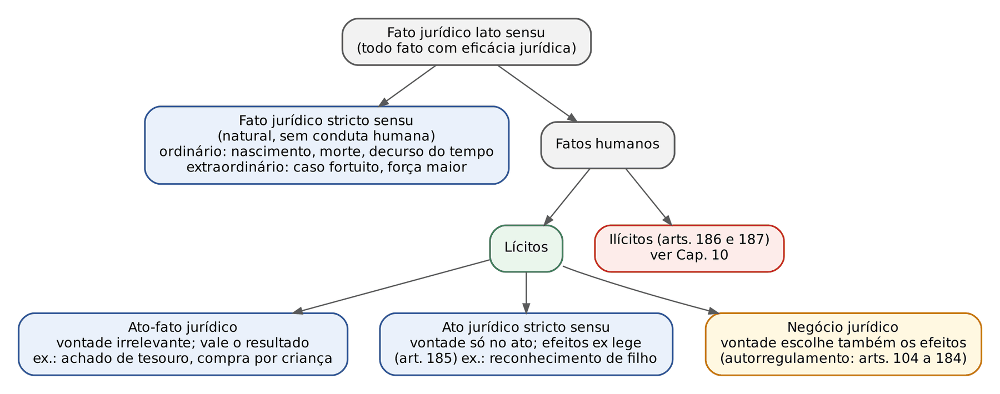
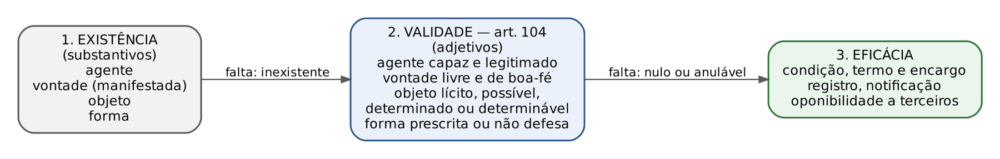
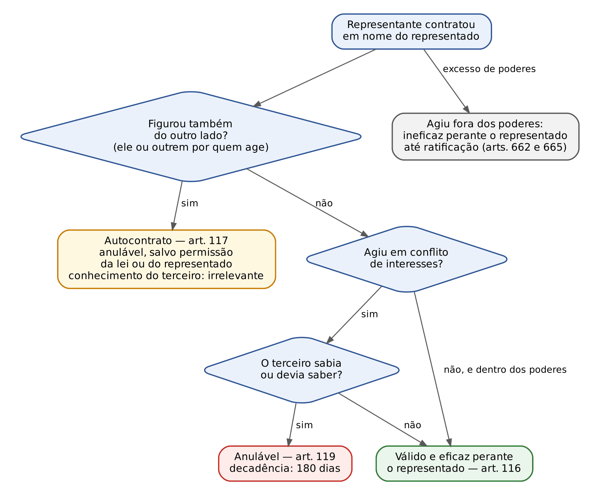
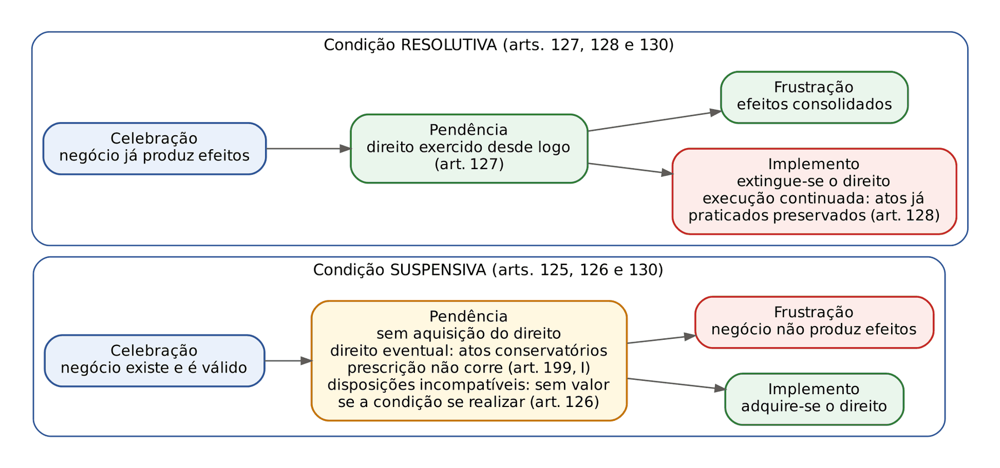

# CAPÍTULO 08 — FATOS JURÍDICOS E NEGÓCIO JURÍDICO I: CLASSIFICAÇÃO DOS FATOS JURÍDICOS, PLANOS DA EXISTÊNCIA, VALIDADE E EFICÁCIA, CLASSIFICAÇÃO DOS NEGÓCIOS, INTERPRETAÇÃO, REPRESENTAÇÃO, ELEMENTOS ACIDENTAIS E O NEGÓCIO JURÍDICO NA LEI DE LIBERDADE ECONÔMICA

:::INCIDENCIA
TRF5 p. 6; TJRS p. 7; TJSC p. 6; SEFAZ p. 5. Nível A; lote com 21 questões (FGV 14, FCC 7).
O que mais cai: condição (espécies, arts. 122 a 130, verificação ficta do art. 129), autocontrato e conflito de interesses do representante (arts. 117 e 119: ANULÁVEL), termo (art. 131) e letra seca dos arts. 104 a 114.
:::

| Subtema | FGV | FCC | Padrão de cobrança |
|---|---|---|---|
| Condição (espécies, licitude, efeitos, art. 129) | 6 | 3 | Caso concreto: identificar a espécie e dizer se invalida o negócio, se é tida por inexistente ou se se reputa verificada |
| Representação (arts. 117 e 119) | 5 | 0 | Caso de mandatário que compra para si ou contrata com sociedade de que é sócio: nulo x anulável x ineficaz |
| Termo (arts. 131 e 132) | 1 | 2 | Morte como termo incerto; termo inicial suspende o exercício, não a aquisição |
| Validade, objeto e forma (arts. 104 a 107) | 1 | 2 | Letra seca dos arts. 105, 106 e 107; objeto indeterminável |
| Reserva mental (art. 110) | 1 | 0 | Reserva desconhecida do destinatário: prevalece o declarado |

## 08.1 Fato jurídico: conceito e classificação

Fato jurídico em sentido amplo é todo acontecimento, natural ou humano, sobre o qual incide uma norma e que, por isso, produz efeito jurídico (criar, modificar, conservar ou extinguir situações jurídicas). A classificação que as bancas cobram é a de Pontes de Miranda, difundida no Brasil por Marcos Bernardes de Mello e adotada, com variações terminológicas, por Tartuce, Farias e Rosenvald e Stolze e Pamplona. O critério é a relevância da vontade humana para o suporte fático e para os efeitos.

| Categoria | Papel da vontade | Efeitos | Exemplos cobrados |
|---|---|---|---|
| Fato jurídico *stricto sensu* (natural) | Nenhum | Decorrem da lei | Ordinários: nascimento, morte natural, maioridade, decurso do tempo (prescrição, decadência, usucapião); extraordinários: caso fortuito e força maior, aluvião, avulsão |
| Ato-fato jurídico | A conduta é humana, mas a vontade é juridicamente irrelevante: o direito considera só o resultado | Decorrem da lei | Achado de tesouro (art. 1.264), especificação, pagamento indevido feito por incapaz, compra de pequeno valor por criança, caça e pesca; parte da doutrina inclui a constituição da união estável |
| Ato jurídico *stricto sensu* (art. 185) | A vontade é necessária para praticar o ato, mas não escolhe os efeitos | Decorrem da lei (efeitos *ex lege*) | Reconhecimento de filho, fixação de domicílio, notificação e interpelação, ocupação, quitação, perdão |
| Negócio jurídico | A vontade pratica o ato E regula os efeitos dentro da autonomia privada | Decorrem da vontade, nos limites da lei (*ex voluntate*) | Contratos, testamento, promessa de recompensa, renúncia, instituição de fundação |
| Ato ilícito (arts. 186 e 187) | Conduta contrária ao direito | Dever de indenizar e outras sanções | Ver Cap. 10 |

Os fatos naturais dividem-se em ordinários (comuns, previsíveis) e extraordinários (inevitáveis e imprevisíveis, que funcionam como excludentes de responsabilidade: ver Cap. 14). O art. 185 manda aplicar ao ato jurídico em sentido estrito, "no que couber", as regras do negócio jurídico; a extensão e os limites dessa aplicação estão em 10.1 (Cap. 10). O ponto distintivo, que a banca explora, é que o ato em sentido estrito NÃO admite elementos acidentais: o reconhecimento de filho é ineficaz se sujeito a condição ou termo (art. 1.613), e a aceitação ou renúncia da herança não se faz sob condição ou a termo (art. 1.808).

:::DICA
Teste rápido para separar as três figuras lícitas: (1) se a lei atribui o efeito mesmo a quem não tinha discernimento, a vontade é irrelevante: ato-fato; (2) se a vontade é exigida, mas o agente não pode moldar os efeitos (aceita ou não o pacote legal), é ato em sentido estrito; (3) se o agente escolhe o conteúdo e os efeitos (preço, prazo, condição, encargo), é negócio jurídico. A FGV cobrou a natureza de ato-fato da união estável numa questão de união homoafetiva *post mortem* (Q3898986, TJ-PR 2026, Cap. 35): a alternativa que afirmava depender a união de declaração formal de vontade estava errada.
:::

## 08.2 Negócio jurídico: conceito, teorias e função

Negócio jurídico é a declaração de vontade, emitida em conformidade com o ordenamento, pela qual o agente busca produzir efeitos jurídicos por ele desejados (autorregramento de interesses). Três concepções disputam o núcleo do conceito: a voluntarista (Savigny e Windscheid: o essencial é a vontade interna), a declaracionista ou objetiva (o essencial é a declaração exteriorizada, como chega ao destinatário) e a preceptiva de Emilio Betti (o negócio é preceito de autonomia privada, reconhecido pelo ordenamento por sua função econômico-social). O CC/2002 adota posição eclética: privilegia a intenção (art. 112), mas protege a confiança despertada pela declaração (arts. 110, 111 e 113). Antônio Junqueira de Azevedo define o negócio, em perspectiva estrutural, como fato jurídico concreto consistente em declaração de vontade vista socialmente como destinada a produzir efeitos jurídicos.

Interesse público e estrutura do negócio jurídico; função negocial nas relações contemporâneas (TJRS e TJSC). A autonomia privada não é poder originário do particular, mas espaço que o ordenamento lhe reconhece e controla. Esse controle aparece em três níveis: na estrutura (requisitos de validade do art. 104 e normas cogentes cuja violação gera nulidade virtual, art. 166, VII), na função (o negócio deve perseguir finalidade merecedora de tutela: função social do contrato, art. 421, e a regra do art. 2.035, parágrafo único, segundo a qual nenhuma convenção prevalece se contrariar preceitos de ordem pública, como os que asseguram a função social da propriedade e dos contratos) e no exercício (boa-fé objetiva e abuso de direito, art. 187). A doutrina civil-constitucional (Tepedino, Schreiber) fala em funcionalização: o negócio é instrumento de realização de interesses que o sistema considera dignos, e não fim em si. Em sentido inverso, a Lei 13.874/2019 reforçou a intervenção mínima e a excepcionalidade da revisão (art. 421, parágrafo único, e art. 421-A: ver Cap. 15) e criou regras de interpretação pró-autonomia (ver 08.5 e 08.9). A prova costuma pedir o equilíbrio entre os dois vetores: autonomia como regra, controle como exceção fundamentada.

Negócio jurídico processual. O art. 190 do CPC admite convenções processuais atípicas em causas que admitam autocomposição; o Enunciado 616 da VIII Jornada de Direito Civil afirma que os requisitos de validade previstos no CC se aplicam aos negócios jurídicos processuais, observadas as regras processuais pertinentes. O controle judicial dessas convenções é matéria de Processo Civil.

## 08.3 Os planos do negócio jurídico: a escada ponteana

Pontes de Miranda separou três planos sucessivos de análise; Junqueira de Azevedo os sistematizou em "Negócio jurídico: existência, validade e eficácia"; Tartuce popularizou a expressão "escada ponteana". O CC/2002 não tem capítulo sobre a existência (trata a validade no art. 104 e a eficácia nos elementos acidentais), mas a doutrina majoritária e a jurisprudência trabalham com os três planos.

| Plano | Pergunta | Elementos | Consequência da falta |
|---|---|---|---|
| Existência | O negócio chegou a se formar? | Agente, vontade exteriorizada, objeto e forma (Junqueira acrescenta circunstâncias negociais, lugar e tempo) | Inexistência: não há negócio, ainda que haja aparência dele (ex.: contrato "assinado" por quem nunca manifestou vontade, assinatura falsificada, casamento sem celebração) |
| Validade | O negócio formou-se em conformidade com o ordenamento? | Os mesmos elementos qualificados: agente capaz e legitimado; vontade livre e sem vícios; objeto lícito, possível, determinado ou determinável; forma prescrita ou não defesa (art. 104) | Nulidade (arts. 166 e 167) ou anulabilidade (art. 171): ver Cap. 9 |
| Eficácia | O negócio válido já produz (ou ainda produz) efeitos? | Ausência de condição suspensiva ou termo inicial pendentes; registro, notificação, autorização quando exigidos para eficácia | Ineficácia: o negócio existe, vale, mas não produz efeitos (ou não os produz perante certas pessoas) |

Os planos são sucessivos para a análise, mas não para a produção de efeitos: o negócio nulo pode gerar efeitos (conversão do art. 170; Enunciado 537 da VI Jornada) e o negócio válido pode nunca ser eficaz (condição suspensiva frustrada). A teoria da inexistência, a disciplina da nulidade e da anulabilidade, a conversão e a confirmação estão no Cap. 9; aqui interessa o raciocínio de enquadramento, que a FGV cobra em casos.

:::QUESTAO FGV 2026 — TCE-PE — Analista de Controle Externo (Q4283073)
Caso: contrato de fornecimento entre duas sociedades com cláusula destacada que subordinava a produção dos efeitos à obtenção, pela compradora, de financiamento em até 120 dias; a vendedora comprou insumos e cobrou o preço antes do prazo; o financiamento foi negado.
O que se pergunta: em que plano está o problema. Regra: a condição suspensiva atua no plano da eficácia; enquanto pendente, não se adquire o direito (art. 125); frustrada, o negócio não produz efeitos.
Gabarito: C (negócio existente e válido, com eficácia suspensa; frustrada a condição, não havia obrigação exigível).
Armadilhas: (A) a boa-fé não "converte" condição em termo nem torna eficaz o negócio por ato unilateral da vendedora; (B) validade não implica eficácia imediata; (D) a não implementação de condição não gera anulabilidade nem afeta o objeto; (E) condição que depende de ato de terceiro (o banco) é casual ou mista, não puramente potestativa: é lícita.
:::

:::QUESTAO FGV 2024 — TJ-PE — Juiz Substituto (Q3117506)
Caso: Apertus receberia o carro de Clausus e Clausus poderia escolher, em quinze dias, qualquer bem do patrimônio de Apertus para si.
Regra: objeto determinável é o que tem ao menos gênero e quantidade e critério de concentração (art. 243); "qualquer bem" do patrimônio do outro não é determinável, porque não há gênero, quantidade nem parâmetro de equivalência; a falta de requisito do objeto gera nulidade (arts. 104, II, e 166, II).
Gabarito: C (existente, porém nulo). A armadilha é a alternativa E: o prazo de quinze dias para escolher parece termo ou condição, mas o vício está no plano da validade, que precede o da eficácia.
:::

### 08.3.1 Agente capaz e legitimado

A capacidade exigida é a de fato (ver Cap. 3: incapacidades após o Estatuto da Pessoa com Deficiência). A incapacidade absoluta gera nulidade (art. 166, I); a relativa, anulabilidade (art. 171, I). Legitimação é coisa diversa: é a aptidão específica para certo negócio, em razão da posição do agente perante o objeto ou a outra parte. O plenamente capaz pode estar impedido: venda de ascendente a descendente sem consentimento dos demais (art. 496, anulável), aquisição de bens confiados à guarda ou administração por tutores, curadores, testamenteiros e servidores (art. 497, nulo), alienação de imóvel sem outorga conjugal (arts. 1.647 e 1.649, anulável). A consequência de cada hipótese é a que a lei comina, e as hipóteses de nulidade e anulabilidade estão no Cap. 9 (prazo para anular a venda a descendente e Súmula 494 do STF: ver Cap. 9).

:::LEI Código Civil, arts. 104 a 106
Art. 104. A validade do negócio jurídico requer:
I - agente capaz;
II - objeto lícito, possível, determinado ou determinável;
III - forma prescrita ou não defesa em lei.
Art. 105. A incapacidade relativa de uma das partes não pode ser invocada pela outra em benefício próprio, nem aproveita aos co-interessados capazes, salvo se, neste caso, for indivisível o objeto do direito ou da obrigação comum.
Art. 106. A impossibilidade inicial do objeto não invalida o negócio jurídico se for relativa, ou se cessar antes de realizada a condição a que ele estiver subordinado.
:::

O art. 105 traduz a ideia de que a anulabilidade por incapacidade relativa protege o incapaz, e só ele (e seu representante) pode invocá-la; o cointeressado capaz não se aproveita dela, SALVO se o objeto for indivisível, porque aí a invalidade não pode atingir só uma parte. O dispositivo conversa com o art. 177 (a anulabilidade só aproveita aos que a alegarem, salvo solidariedade ou indivisibilidade) e com o art. 180 (a pessoa entre 16 e 18 anos que dolosamente ocultou a idade não pode invocá-la para eximir-se da obrigação).

### 08.3.2 Objeto lícito, possível, determinado ou determinável

Objeto lícito é o não contrário à lei, à moral e aos bons costumes (o objeto ilícito é causa de nulidade, art. 166, II: o STJ considerou nula a venda de lote em loteamento não registrado, ainda que o comprador conhecesse a irregularidade, por violação ao art. 37 da Lei 6.766/1979 — REsp 2.166.273-SP, 3ª Turma, j. 10/8/2024, Info 829; ver Cap. 48). Possível é o objeto física e juridicamente realizável (juridicamente impossível: herança de pessoa viva, art. 426; alienação de bem público de uso comum). Determinado ou determinável: admite-se a coisa incerta, indicada ao menos pelo gênero e pela quantidade (art. 243), e o preço fixado por terceiro, por taxa de mercado ou de bolsa (arts. 485 e 486).

A impossibilidade que invalida é a INICIAL e ABSOLUTA (para todos). A impossibilidade relativa (só para o devedor: ele não sabe pintar, mas outro pintor pode) não invalida; a superveniente resolve-se no plano do inadimplemento (arts. 234, 248 e 250: ver Cap. 12); e a inicial que cessa antes de realizada a condição suspensiva não invalida (art. 106, parte final), porque o momento relevante passa a ser o do implemento.

:::QUESTAO FCC 2025 — TRT 15ª Região — Analista Judiciário, Oficial de Justiça (Q3302509)
Afirmação cobrada: negócio com objeto impossível, subordinado a condição, cujo objeto se tornou possível antes da realização da condição. Gabarito: C (válido), pela parte final do art. 106. As alternativas "nulo de pleno direito" e "válido, mas a condição é nula" exploram quem para na primeira parte do artigo.
:::

:::QUESTAO FCC 2026 — CPU-PE — Analista Jurídico (Q3872177)
Gabarito: A (literalidade do art. 107: a validade da declaração não dependerá de forma especial, senão quando a lei expressamente a exigir). As erradas trocam palavras dos arts. 105, 106 e 113: (B) o § 1º do art. 113 manda prestigiar o comportamento POSTERIOR à celebração e o sentido mais benéfico à parte que NÃO redigiu; (C) e (D) contrariam o art. 106 (impossibilidade relativa e a que cessa antes da condição não invalidam); (E) contraria o art. 105.
:::

### 08.3.3 Forma: liberdade, forma especial e o art. 108

A regra é a liberdade das formas (art. 107): o negócio pode ser verbal, escrito, tácito e, nos casos do art. 111, até silencioso. A forma especial só é exigida quando a lei expressamente o fizer ou quando as próprias partes a convencionarem (art. 109). Quando exigida para a validade, a forma é *ad solemnitatem* (da substância do ato), e sua inobservância gera nulidade (art. 166, IV e V); quando exigida só para a prova, é *ad probationem tantum*, e sua falta não invalida o negócio, que pode ser demonstrado por outros meios (arts. 212 e seguintes; o art. 227, *caput*, foi revogado pelo CPC/2015, mas seu parágrafo único permanece: a prova testemunhal é sempre admissível como subsidiária ou complementar da prova escrita — ver Cap. 10).

:::LEI Código Civil, arts. 107 a 109
Art. 107. A validade da declaração de vontade não dependerá de forma especial, senão quando a lei expressamente a exigir.
Art. 108. Não dispondo a lei em contrário, a escritura pública é essencial à validade dos negócios jurídicos que visem à constituição, transferência, modificação ou renúncia de direitos reais sobre imóveis de valor superior a trinta vezes o maior salário mínimo vigente no País.
Art. 109. No negócio jurídico celebrado com a cláusula de não valer sem instrumento público, este é da substância do ato.
:::

Leitura fina do art. 108, que é a pegadinha recorrente:

- Abrange constituição, transferência, modificação ou RENÚNCIA de direitos reais sobre imóveis; não abrange negócios meramente obrigacionais, como a promessa de compra e venda, que admite instrumento particular (arts. 462 e 1.417).
- O limite é "superior a" trinta vezes o maior salário mínimo vigente no País: imóvel de valor exatamente igual a 30 salários dispensa a escritura.
- "Não dispondo a lei em contrário": leis especiais admitem instrumento particular com efeitos de escritura pública (contratos do SFH e do SFI, alienação fiduciária de imóvel); o alcance atual dessas exceções, após a Lei 14.711/2023 e normas do CNJ, está no Cap. 22.
- Valor de referência: o Enunciado 289 da IV Jornada afirma que é o valor atribuído pelas partes, e não o arbitrado pela Administração com finalidade tributária. O STJ decidiu em sentido contrário: deve-se considerar o valor do imóvel calculado pelo Fisco, porque a lei fala em "valor do imóvel" e não em "preço do negócio", e porque o critério evita contratos com preço artificialmente baixo para fugir da escritura (REsp 1.099.480-MG, 4ª Turma, Rel. Min. Marco Buzzi, j. 2/12/2014, Info 562). Em prova objetiva que mencione "jurisprudência do STJ", marque o valor fiscal; se perguntar "segundo enunciado da Jornada", o valor das partes.

Outros casos de forma especial frequentes em prova: pacto antenupcial por escritura pública (art. 1.653); renúncia à herança por instrumento público ou termo judicial (art. 1.806); doação por escritura pública ou instrumento particular, admitida a verbal para móveis de pequeno valor seguida de tradição imediata (art. 541); fiança por escrito (art. 819); testamentos (arts. 1.864 e seguintes). O mandato para ato que exige instrumento público deve ter a mesma forma (atração da forma, art. 657); o Enunciado 182 da III Jornada admite substabelecimento por instrumento particular somente quando a forma pública for facultativa.

:::PEGADINHA
"Toda declaração de vontade deve observar a forma escrita" (errado: art. 107). "A escritura pública é exigida para qualquer negócio sobre imóvel de valor igual ou superior a 30 salários mínimos" (errado duas vezes: só direitos reais e só valor SUPERIOR). "A cláusula de não valer sem instrumento público é mera regra de prova" (errado: art. 109, o instrumento passa a ser da substância do ato).
:::

## 08.4 A declaração de vontade: reserva mental e silêncio

A vontade é elemento de existência; sua manifestação pode ser expressa (palavra, escrita, gesto inequívoco), tácita (comportamento concludente, como o herdeiro que pratica atos próprios da qualidade de herdeiro, art. 1.805) ou, excepcionalmente, silenciosa. Divergência entre vontade interna e declarada só importa quando a lei a torna relevante: reserva mental (art. 110), erro (art. 138, Cap. 9) e simulação (art. 167, Cap. 9).

### 08.4.1 Reserva mental (art. 110)

:::LEI Código Civil, arts. 110 e 111
Art. 110. A manifestação de vontade subsiste ainda que o seu autor haja feito a reserva mental de não querer o que manifestou, salvo se dela o destinatário tinha conhecimento.
Art. 111. O silêncio importa anuência, quando as circunstâncias ou os usos o autorizarem, e não for necessária a declaração de vontade expressa.
:::

Reserva mental (reticência) é a ressalva íntima, não declarada, de não querer o que se declara, com o propósito de enganar o destinatário. Duas situações:

| Situação | Consequência | Fundamento |
|---|---|---|
| Reserva desconhecida do destinatário | Irrelevante: prevalece o declarado; o negócio é válido e eficaz | Art. 110, primeira parte (proteção da confiança) |
| Reserva conhecida do destinatário | A manifestação "não subsiste" | Art. 110, parte final |

A natureza da consequência na segunda hipótese é controvertida. Moreira Alves, autor da Parte Geral do anteprojeto, sustentava que a reserva conhecida conduz à inexistência do negócio por ausência de vontade; outra parte da doutrina aproxima a figura da simulação (há acordo entre declarante e destinatário sobre a não seriedade) e fala em nulidade (art. 167). Em prova objetiva, a letra é "não subsiste"; se a banca exigir classificação, a corrente da inexistência é a mais citada nos manuais. Não confundir com a declaração não séria feita por brincadeira ou em contexto didático (*iocandi causa*), em que não há intenção de enganar e o destinatário não pode razoavelmente confiar.

:::QUESTAO FGV 2024 — AL-PR — Analista Legislativo, Advogado (Q2449764)
Caso: doação de 100.000 (cem mil) reais em 20/10/2020 a pessoa com quem o doador namorava; ação anulatória proposta em 20/1/2024, alegando erro, dolo e "reserva mental" de só doar se houvesse casamento, provada por declaração do irmão do doador; a donatária afirma que sempre deixou claro que não se casaria e que desconhecia a reserva.
Passo 1, reserva mental: o motivo íntimo não declarado nem conhecido pela donatária é irrelevante (art. 110): prevalece a vontade manifestada. Passo 2, dolo: não se presume; e o prazo decadencial de quatro anos (art. 178, II) contado da celebração ainda NÃO havia se esgotado em 20/1/2024 (venceria em 20/10/2024), de modo que a alternativa que afirmava decadência estava errada por cálculo. Passo 3, ingratidão: não há hipótese do art. 557.
Gabarito: E (como a donatária não sabia nem tinha como saber da reserva, prevalece a vontade declarada).
:::

### 08.4.2 Silêncio (art. 111)

O silêncio, em regra, nada significa (quem cala não consente nem recusa). Vale como anuência quando concorrem dois requisitos: (a) as circunstâncias ou os usos o autorizarem e (b) não for necessária declaração expressa. A doutrina fala em silêncio circunstanciado ou qualificado. O Enunciado 409 da V Jornada acrescenta, para a interpretação, as práticas habitualmente adotadas entre as partes, critério depois positivado no art. 113, § 1º, II (usos e práticas do mercado). A FGV cobrou exatamente essa combinação (Q4116960, MPE-MT 2026, Cap. 15): fornecedora que historicamente aceitava propostas pelo silêncio e iniciava a execução; o contrato formou-se, e a intenção interna de recusa, não comunicada, era irrelevante (arts. 110 e 111).

| Dispositivo | Valor do silêncio | Observação |
|---|---|---|
| Art. 111 | Anuência, se circunstâncias ou usos autorizarem | Regra geral |
| Art. 432 | Aceitação tácita quando o negócio for daqueles em que não é costume a aceitação expressa ou o proponente a dispensar | Formação do contrato (Cap. 15) |
| Art. 539 | Aceitação da doação pura quando o donatário, ciente do prazo fixado pelo doador, não declara se aceita | Doação (Cap. 17) |
| Art. 1.807 | Herança havida por aceita se o herdeiro, intimado, não se pronunciar no prazo | Sucessões (Cap. 42) |
| Art. 303 | Credor hipotecário notificado que não impugna em 30 dias a assunção da dívida pelo adquirente do imóvel: assentimento | Exceção dentro da assunção |
| Art. 299, parágrafo único | Credor intimado a consentir na assunção de dívida que se cala: RECUSA | Pegadinha: aqui o silêncio vale como recusa |

## 08.5 Interpretação do negócio jurídico

O CC/2002 combina o critério subjetivo (busca da intenção comum, art. 112) com critérios objetivos (boa-fé, usos, comportamento posterior, art. 113), e manda interpretar estritamente os negócios benéficos e a renúncia (art. 114). A Lei 13.874/2019 (Lei de Liberdade Econômica) acrescentou ao art. 113 dois parágrafos, que a FGV e a FCC cobram pela letra.

:::LEI Código Civil, arts. 112 a 114 (redação da Lei 13.874/2019 nos §§ 1º e 2º do art. 113)
Art. 112. Nas declarações de vontade se atenderá mais à intenção nelas consubstanciada do que ao sentido literal da linguagem.
Art. 113. Os negócios jurídicos devem ser interpretados conforme a boa-fé e os usos do lugar de sua celebração.
§ 1º A interpretação do negócio jurídico deve lhe atribuir o sentido que:
I - for confirmado pelo comportamento das partes posterior à celebração do negócio;
II - corresponder aos usos, costumes e práticas do mercado relativas ao tipo de negócio;
III - corresponder à boa-fé;
IV - for mais benéfico à parte que não redigiu o dispositivo, se identificável; e
V - corresponder a qual seria a razoável negociação das partes sobre a questão discutida, inferida das demais disposições do negócio e da racionalidade econômica das partes, consideradas as informações disponíveis no momento de sua celebração.
§ 2º As partes poderão livremente pactuar regras de interpretação, de preenchimento de lacunas e de integração dos negócios jurídicos diversas daquelas previstas em lei.
Art. 114. Os negócios jurídicos benéficos e a renúncia interpretam-se estritamente.
:::

Pontos de prova:

- Art. 112: a intenção que importa é a "consubstanciada" na declaração, isto é, a vontade objetivamente reconhecível a partir do texto e do contexto, e não a vontade íntima não exteriorizada (o que mantém coerência com o art. 110). Por isso se fala em teoria da vontade mitigada pela declaração.
- Art. 113, *caput*: função interpretativa da boa-fé objetiva (as funções de controle, art. 187, e integrativa, art. 422, estão no Cap. 15 e no Cap. 10). "Usos do lugar de sua celebração": o critério é o lugar da celebração, não o da execução nem o do domicílio do réu. Entre ausentes, o contrato reputa-se celebrado no lugar em que foi proposto (art. 435).
- § 1º, I: comportamento POSTERIOR à celebração (a conduta das partes na execução revela como elas próprias entenderam a cláusula). Bancas trocam por "anterior".
- § 1º, IV: interpretação contra o estipulante (*interpretatio contra proferentem*), "se identificável" quem redigiu. Na adesão, regra mais forte e específica: cláusulas ambíguas ou contraditórias interpretam-se a favor do aderente (art. 423) e, no consumo, de modo mais favorável ao consumidor (CDC, art. 47).
- § 1º, V: a "razoável negociação" reconstrói o que partes racionais teriam pactuado (inspiração na análise econômica do direito), com base nas informações disponíveis NA CELEBRAÇÃO.
- § 2º: as partes podem pactuar regras próprias de interpretação, de preenchimento de lacunas e de integração; o limite são as normas de ordem pública e, por coerência sistemática, os contratos de adesão e de consumo, em que a regra de proteção é cogente.
- Art. 114: negócios benéficos (gratuitos: doação pura, comodato, fiança, remissão) e renúncia interpretam-se estritamente, isto é, sem ampliação do sacrifício de quem dá ou renuncia. Regras irmãs: a fiança não admite interpretação extensiva (art. 819); a transação interpreta-se restritivamente (art. 843); a quitação plena e geral em acordo indenizatório também foi interpretada restritivamente pelo STJ, que admitiu a discussão de fatos supervenientes ao acordo (REsp 1.993.187-MS, 3ª Turma, j. 6/9/2022).
- Contratos coligados interpretam-se segundo os arts. 112 e 113, considerada sua conexão funcional (Enunciado 421 da V Jornada), a partir do conjunto das cláusulas e privilegiando a finalidade negocial comum (Enunciado 621 da VIII Jornada).
- Testamento tem regra própria: prevalece a interpretação que melhor assegure a observância da vontade do testador (art. 1.899; Cap. 44).

:::PEGADINHA
O art. 113, § 1º, não estabelece hierarquia entre os incisos, e a FCC cobrou a inversão de dois deles na mesma alternativa (Q3872177, item B: "mais benéfico à parte que redigiu" e "comportamento anterior"). Na Lei de Liberdade Econômica há ainda o art. 3º, V, que assegura, a quem exerce atividade econômica, presunção de boa-fé e resolução das dúvidas de interpretação do direito civil, empresarial, econômico e urbanístico "de forma a preservar a autonomia privada", salvo expressa disposição legal em contrário (ver 08.9).
:::

## 08.6 Classificação dos negócios jurídicos

A tabela reúne só as classificações que geram consequência normativa; as classificações próprias dos contratos (comutativos e aleatórios, paritários e de adesão, típicos e atípicos) estão no Cap. 15.

| Critério | Espécies | Consequência ou exemplo cobrável |
|---|---|---|
| Número de declarações | Unilaterais (uma vontade: testamento, promessa de recompensa, renúncia), bilaterais (duas: contratos em geral), plurilaterais (várias com fim comum: contrato de sociedade, consórcio) | Unilaterais se subdividem em receptícios (precisam chegar ao destinatário: revogação de mandato, denúncia) e não receptícios (testamento, confissão de dívida) |
| Vantagens | Gratuitos (doação pura, comodato), onerosos (compra e venda, locação), neutros (sem atribuição patrimonial: instituição de bem de família convencional, cláusula de inalienabilidade) e bifrontes (podem ser gratuitos ou onerosos: mandato, depósito, mútuo) | Gratuitos interpretam-se estritamente (art. 114); fraude contra credores em ato gratuito dispensa *consilium fraudis* (art. 158, Cap. 9) |
| Momento dos efeitos | *Inter vivos* e *mortis causa* (testamento, codicilo) | *Mortis causa* só produz efeitos com a morte e é revogável |
| Forma | Solenes ou formais e não solenes ou de forma livre | Arts. 107 a 109 (08.3.3) |
| Existência | Principais e acessórios (fiança, cláusula penal, arras) | O acessório segue o principal (art. 184, parte final: a nulidade da obrigação principal implica a das acessórias, não o inverso) |
| Causa | Causais (vinculados à causa: compra e venda) e abstratos (desvinculados da causa: títulos de crédito) | A abstração protege o terceiro de boa-fé (Direito Empresarial) |
| Pessoa | Impessoais e personalíssimos (*intuitu personae*: obrigação de fazer infungível, mandato) | Personalíssimos extinguem-se com a morte e não se transmitem |
| Efeitos sobre o patrimônio | De disposição (alienação, renúncia) e de mera administração (locação de curta duração, cobrança) | Representante e curador precisam de poderes especiais ou autorização para dispor (arts. 661, § 1º, e 1.748) |
| Elementos acidentais | Puros e modais: condicionais, a termo e com encargo | 08.8 |

## 08.7 Representação (arts. 115 a 120)

Representação é a atuação jurídica em nome de outrem: o representante declara a vontade, mas os efeitos recaem diretamente sobre o representado (art. 116). Fontes (art. 115): a lei (representação legal: pais, tutores, curadores; parte da doutrina destaca a judicial, como a do inventariante e do administrador judicial) ou o interessado (representação voluntária ou convencional, normalmente instrumentalizada por procuração). Os requisitos e efeitos da representação legal estão nas normas respectivas (poder familiar, tutela, curatela); os da voluntária, na Parte Especial, isto é, no mandato (art. 120; Cap. 19).

Distinções que caem:

- Representação x mandato: o mandato é contrato; a procuração é o instrumento do mandato (art. 653) e o ato de outorga dos poderes. Pode haver representação sem mandato (representação legal; gestão de negócios ratificada) e mandato sem representação (comissão, em que o comissário contrata em nome próprio, art. 693).
- Representante x núncio: o núncio apenas transmite vontade alheia já formada, sem declarar vontade própria.
- Teoria da aparência: o STJ manteve negócio firmado pelo diretor-geral do futebol de base de clube que, embora sem poderes estatutários, atuou em nome e no interesse da entidade em negócio que lhe gerou proveito econômico, invocando também a vedação ao comportamento contraditório (REsp 1.902.410-MG, 3ª Turma, j. 28/2/2023, Info 765).
- O representante deve provar a quem trata a sua qualidade e a extensão dos poderes, sob pena de responder pelos atos que os excederem (art. 118). O ato praticado sem poderes ou além deles é ineficaz em relação ao representado, salvo ratificação (art. 662; o mandatário que excede os poderes é tratado como mero gestor de negócios enquanto não houver ratificação, art. 665: Cap. 19). Excesso de poderes não é invalidade: é ineficácia.

### 08.7.1 Contrato consigo mesmo (art. 117) e conflito de interesses (art. 119)

:::LEI Código Civil, arts. 117 e 119
Art. 117. Salvo se o permitir a lei ou o representado, é anulável o negócio jurídico que o representante, no seu interesse ou por conta de outrem, celebrar consigo mesmo.
Parágrafo único. Para esse efeito, tem-se como celebrado pelo representante o negócio realizado por aquele em quem os poderes houverem sido subestabelecidos.
Art. 119. É anulável o negócio concluído pelo representante em conflito de interesses com o representado, se tal fato era ou devia ser do conhecimento de quem com aquele tratou.
Parágrafo único. É de cento e oitenta dias, a contar da conclusão do negócio ou da cessação da incapacidade, o prazo de decadência para pleitear-se a anulação prevista neste artigo.
:::

O autocontrato (contrato consigo mesmo) tem duas formas: o representante figura de um lado em nome do representado e, de outro, em nome próprio ("no seu interesse"); ou figura dos dois lados como representante de pessoas diversas, a dupla representação ("por conta de outrem"). O parágrafo único fecha a porta ao subestabelecimento fraudulento: o negócio celebrado pelo substabelecido com o representante originário conta como celebrado pelo próprio representante. A sanção é a ANULABILIDADE, e o vício se afasta por permissão da lei ou do representado; a permissão do representado deve ser específica, não se presumindo da simples outorga de poderes amplos para vender (Q2448962 e Q3593083, adiante).

A permissão legal mais cobrada é o mandato em causa própria (*in rem suam*), em que a procuração autoriza o mandatário a transferir para si o bem: a revogação não tem eficácia, o mandato não se extingue pela morte de qualquer das partes e o mandatário fica dispensado de prestar contas, podendo transferir para si os bens objeto do mandato, obedecidas as formalidades legais (art. 685). A FGV cobrou o tema na magistratura (Q4083718, TJ-BA 2026, Cap. 19: gabarito que afirma a ineficácia da revogação e a não extinção pela morte). O STJ, porém, adverte que a procuração em causa própria não é, por si só, título translativo da propriedade: no caso de imóvel, a transferência depende do negócio dispositivo com a forma legal e do registro (REsp 1.345.170-RS, 4ª Turma, j. 4/5/2021, Info 695; aprofundamento no Cap. 19).

A Súmula 60 do STJ ("É nula a obrigação cambial assumida por procurador do mutuário vinculado ao mutuante, no exclusivo interesse deste") é aplicação específica da vedação ao autocontrato nos contratos bancários com cláusula-mandato. Repare que a súmula fala em NULA, porque o vício nela se soma à abusividade da cláusula em contrato de adesão; a regra geral do art. 117 é a anulabilidade.

O art. 119 trata de hipótese diversa: o representante não figura do outro lado, mas contrata com terceiro tendo interesse próprio contrário ao do representado (por exemplo, vende o bem do representado a sociedade de que é sócio, por preço inferior). A anulabilidade depende de um requisito que o art. 117 não exige: o terceiro sabia ou devia saber do conflito. Sem esse conhecimento, o negócio vale perante o representado, que terá ação contra o representante (proteção da confiança do terceiro de boa-fé).

| Ponto | Autocontrato (art. 117) | Conflito de interesses (art. 119) |
|---|---|---|
| Situação | Representante é a outra parte (ou representa a outra parte) | Representante contrata com terceiro tendo interesse contrário ao do representado |
| Sanção | Anulável | Anulável |
| Conhecimento do terceiro | Irrelevante (não há terceiro distinto) | Requisito: o terceiro sabia ou devia saber |
| Afastamento | Permissão da lei (ex.: art. 685) ou do representado | Ausência de conhecimento do terceiro |
| Prazo para anular | Dois anos da conclusão do ato, por falta de prazo específico (art. 179) | 180 dias da conclusão do negócio ou da cessação da incapacidade (art. 119, parágrafo único) |
| Prejuízo | Não é requisito | O conflito pressupõe interesse contrário, mas a lei não exige prova de dano |

:::PEGADINHA
Três trocas recorrentes: (1) "nulo" no lugar de "anulável" (art. 117 e art. 119 cominam anulabilidade; nulidade só na Súmula 60 do STJ e em casos legais como o art. 497); (2) "180 dias" para o autocontrato (o prazo de 180 dias é só do art. 119; para o art. 117 aplica-se o art. 179, dois anos); (3) "ineficaz" para o conflito de interesses (ineficácia é o efeito do excesso de poderes, arts. 662 e 665, não do conflito).
:::

:::QUESTAO FGV 2024 — TJ-SC — Juiz Substituto, Edital 44 (Q3049329)
Caso: Leonardo deu poderes a Vanessa para alugar seu apartamento; sem interessados, Vanessa alugou o imóvel para si mesma, figurando como locadora (em nome de Leonardo) e locatária (em nome próprio), sem permissão legal ou do representado.
Gabarito: E (anulável, art. 117). Inexistente e nulo são os distratores clássicos; ineficaz seria o caso de excesso de poderes, e aqui os poderes eram para locar.
No mesmo sentido: Q2448962 (FGV 2024, AL-PR, Procurador: mandatária para vender apartamento compra-o para si pelo preço mínimo autorizado, embora houvesse ofertas maiores; gabarito B, anulável por falta de autorização da lei ou do representado; a alternativa D, autorização tácita decorrente do próprio mandato, é a armadilha).
:::

:::QUESTAO FGV 2025 — TCE-PE — Analista de Gestão, Julgamento (Q3593083)
Caso: Rafael, procurador da irmã com poderes amplos de alienação, vende imóveis dela à sociedade de que é sócio majoritário e administrador exclusivo, assinando como representante da vendedora e como representante legal da compradora, por preço abaixo do mercado, parcelado em 12 anos.
Passo 1: há dupla representação (Rafael figura dos dois lados, um deles "por conta de outrem", a sociedade), o que atrai o art. 117. Passo 2: a personalidade própria da sociedade não afasta o autocontrato. Passo 3: poderes amplos de alienação não equivalem a permissão do representado para contratar consigo.
Gabarito: E (anulável, por autocontrato não autorizado, sendo irrelevante a prova de prejuízo efetivo). Erradas: nulo (C) e exigência de dolo ou má-fé (D).
:::

:::QUESTAO FGV 2026 — PGE-AC — Procurador do Estado (Q4079374)
Caso: gerente com poderes para negociar contratos de fornecimento contrata com sociedade da qual é sócio minoritário (sem poderes de representação nela), em condições atípicas e prejudiciais; a sociedade contratante conhecia a participação societária e as condições.
Aqui o representante NÃO figura do outro lado (a sociedade é representada por outrem), de modo que a moldura é o art. 119, e não o art. 117. Gabarito: E (anulável por conflito de interesses, sendo relevante que a circunstância fosse ou devesse ser conhecida pela outra parte). Erradas: válido (A e C), nulo (B) e ineficaz (D).
No mesmo sentido: Q4083715 (FGV 2026, TJ-BA, Juiz Substituto: procurador vende o imóvel do mandante, por preço mediano, a sociedade de que é sócio, embora houvesse propostas mais altas, com ciência da administração compradora; gabarito C, anulável).
:::

:::PROCESSO Como a anulabilidade dos arts. 117 e 119 chega ao processo
Legitimidade: o representado (ou seus sucessores). Não pode ser pronunciada de ofício e só aproveita a quem a alegar (art. 177; Cap. 9). Exige pedido do interessado, em ação própria ou em reconvenção. Prazos decadenciais: 180 dias para o art. 119 e dois anos para o art. 117 (art. 179). Se o pedido vier depois do prazo, o juiz reconhece a decadência legal de ofício (art. 210). Cumulação útil: anulação mais perdas e danos contra o representante (arts. 118 e 667) e restituição das partes ao estado anterior (art. 182).
:::

## 08.8 Elementos acidentais: condição, termo e encargo

Elementos essenciais são os sem os quais o negócio não existe ou não vale (art. 104); naturais são os efeitos que decorrem da natureza do negócio sem necessidade de cláusula (garantia contra evicção e vícios redibitórios na compra e venda); acidentais são cláusulas que as partes PODEM acrescentar para modular a eficácia: condição, termo e encargo (ou modo). Uma vez apostos, integram o negócio e passam a condicionar seus efeitos. Não se admitem em atos que a lei quer puros: reconhecimento de filho (art. 1.613), aceitação e renúncia da herança (art. 1.808), casamento e, em geral, atos de estado e direitos de família pessoais.

### 08.8.1 Condição: conceito e requisitos

:::LEI Código Civil, arts. 121 a 124
Art. 121. Considera-se condição a cláusula que, derivando exclusivamente da vontade das partes, subordina o efeito do negócio jurídico a evento futuro e incerto.
Art. 122. São lícitas, em geral, todas as condições não contrárias à lei, à ordem pública ou aos bons costumes; entre as condições defesas se incluem as que privarem de todo efeito o negócio jurídico, ou o sujeitarem ao puro arbítrio de uma das partes.
Art. 123. Invalidam os negócios jurídicos que lhes são subordinados:
I - as condições física ou juridicamente impossíveis, quando suspensivas;
II - as condições ilícitas, ou de fazer coisa ilícita;
III - as condições incompreensíveis ou contraditórias.
Art. 124. Têm-se por inexistentes as condições impossíveis, quando resolutivas, e as de não fazer coisa impossível.
:::

Requisitos extraídos do art. 121: (a) voluntariedade, "exclusivamente da vontade das partes" (por isso a *conditio iuris*, exigência imposta pela lei, como a morte do testador para a eficácia do testamento ou o nascimento com vida para a doação ao nascituro, não é condição em sentido técnico); (b) futuridade (evento passado ou presente, ainda que ignorado pelas partes, não é condição); (c) incerteza quanto à ocorrência (*incertus an*). A FCC cobrou a definição pela letra (Q3214729, gabarito B). Se o evento é certo quanto à ocorrência, ainda que incerta a data, é termo (08.8.4).

### 08.8.2 Espécies de condição

| Critério | Espécies | Regra |
|---|---|---|
| Modo de atuação | Suspensiva (subordina o início da eficácia) e resolutiva (subordina a extinção da eficácia) | Arts. 125 a 128 (08.8.3) |
| Licitude | Lícitas e ilícitas (contrárias à lei, à ordem pública ou aos bons costumes) | Ilícitas invalidam o negócio, suspensivas ou resolutivas (art. 123, II) |
| Possibilidade | Possíveis e impossíveis (física ou juridicamente) | Suspensiva impossível invalida o negócio (art. 123, I); resolutiva impossível e a de não fazer coisa impossível têm-se por inexistentes (art. 124) |
| Origem do evento | Casuais (dependem do acaso ou de terceiro), potestativas (dependem da vontade de uma das partes) e mistas (vontade de uma parte somada a fato de terceiro ou natural) | Casuais e mistas são lícitas |
| Grau de arbítrio | Puramente potestativas (puro arbítrio de uma parte: "se eu quiser") e simplesmente ou meramente potestativas (dependem da vontade de uma parte somada a um fato externo que lhe exige esforço ou sujeita a circunstâncias: "se você viajar a Paris") | Puramente potestativas são defesas (art. 122, parte final); simplesmente potestativas são lícitas |
| Compreensão | Perplexas (contraditórias ou incompreensíveis: privam o negócio de todo efeito) | Invalidam o negócio (arts. 122 e 123, III) |
| Evolução | Promíscuas (nascem simplesmente potestativas e se tornam impossíveis por fato superveniente: "se você jogar a final", e o atleta se lesiona) | Classificação doutrinária (Maria Helena Diniz) |
| Conteúdo | Positivas (acontecer algo) e negativas (não acontecer) | A de não fazer coisa impossível tem-se por inexistente (art. 124) |

O núcleo da cobrança está no par invalidar x ter por inexistente. A lógica: a condição suspensiva impossível impede que o negócio jamais produza efeitos, e o legislador prefere invalidá-lo a manter negócio inútil; a resolutiva impossível nunca vai extinguir o negócio, e por isso basta desconsiderá-la (o negócio vale como puro); a de não fazer coisa impossível é sempre cumprida, e também se desconsidera. Já a ilícita contamina o negócio inteiro, seja suspensiva ou resolutiva, porque a ordem jurídica não tolera negócio cujo regime dependa de ato ilícito.

| Condição | Suspensiva | Resolutiva |
|---|---|---|
| Física ou juridicamente impossível | Invalida o negócio (art. 123, I) | Tem-se por inexistente (art. 124) |
| De não fazer coisa impossível | Tem-se por inexistente (art. 124) | Tem-se por inexistente (art. 124) |
| Ilícita ou de fazer coisa ilícita | Invalida o negócio (art. 123, II) | Invalida o negócio (art. 123, II) |
| Incompreensível ou contraditória | Invalida o negócio (art. 123, III) | Invalida o negócio (art. 123, III) |
| Puramente potestativa | Defesa (art. 122); a FGV trata como causa de invalidade do negócio | Idem, com ressalvas doutrinárias (abaixo) |

Condição puramente potestativa. É defesa porque retira a seriedade do vínculo: quem se obriga "se quiser" não se obriga. O STJ aplicou o art. 122 a confissão de dívida cujo vencimento ficaria para "ajuste futuro" entre credor e devedor, na prática dependente do devedor; afastou a cláusula e considerou a dívida vencida à vista (art. 331), apta a embasar execução (REsp 1.489.913-PR, 3ª Turma, Rel. Min. Marco Aurélio Bellizze, j. 11/11/2014; a FGV cobrou o julgado no TJ-AP 2022 como condição suspensiva puramente potestativa). Note a técnica: o STJ invalidou a CLÁUSULA e conservou a obrigação confessada. Em sentido inverso, o STJ não viu condição puramente potestativa em documento que reconhecia a propriedade de fração de imóvel a favor de um irmão, a ser transmitida "tão logo" ele manifestasse interesse: a estipulação se assemelha mais a termo incerto, beneficiava o credor (e não o devedor) e tinha justificativa em circunstância alheia às partes (REsp 1.990.221-SC, 3ª Turma, Rel. Min. Moura Ribeiro, j. 3/5/2022). O critério que se extrai: a vedação mira o arbítrio do DEVEDOR, que esvazia a obrigação; não a faculdade do credor de escolher o momento de exigir.

Simplesmente potestativas e autorizações legais. São lícitas e frequentes: venda a contento e sujeita a prova (arts. 509 e 510: Cap. 17), retrovenda, arras penitenciais (art. 420), resilição unilateral quando a lei a admite (art. 473). Por isso a doutrina ressalva a cláusula resolutiva que dá a uma parte direito de arrependimento: é lícita quando a lei a prevê ou quando ainda há vínculo sério até seu exercício. As bancas, porém, têm marcado como puramente potestativa (e invalidante) a cláusula que deixa o efeito ao arbítrio exclusivo de quem se obriga.

:::QUESTAO FGV 2026 — TJ-PA — Juiz Substituto (Q3951722)
Caso: o tio promete doar sua casa de praia aos pais do sobrinho de 14 anos se eles o emanciparem ainda naquele mês, no cartório.
Passo 1: espécie. O efeito (doação) depende de evento futuro e incerto: condição suspensiva. Passo 2: possibilidade. A emancipação voluntária por concessão dos pais exige 16 anos completos (art. 5º, parágrafo único, I; Cap. 3): o evento é juridicamente impossível. Passo 3: consequência. Suspensiva impossível invalida o negócio (art. 123, I).
Gabarito: A. Armadilhas: B (seria o regime da resolutiva impossível, art. 124) e E (a condição não é ilícita em si; e, se fosse, também invalidaria, não seria "não escrita").
:::

:::QUESTAO FGV 2026 — TJ-RJ — Analista Judiciário (Q3868583)
Caso: doação de imóvel rural cuja eficácia dependia de a donatária concluir mestrado em três anos (condição suspensiva lícita), com cláusula que permitia ao doador revogar a doação a qualquer momento, por exclusiva conveniência; o doador vendeu o imóvel a terceiro antes do implemento; a donatária concluiu o curso no prazo.
Gabarito: B (a cláusula de revogação ao puro arbítrio do doador é puramente potestativa e invalida o negócio). Erradas: A (não é resolutiva lícita, porque deixa toda a eficácia ao arbítrio de quem se obriga); C (estimular a conclusão de mestrado não ofende os bons costumes); D e E (se o negócio fosse válido, a venda feita na pendência seria disposição incompatível sem valor perante a donatária, uma vez realizada a condição, art. 126; não seria nem plenamente eficaz, nem impeditiva da aquisição).
:::

:::QUESTAO FGV 2025 — AL-AM — Procurador (Q3777933)
Caso: promessa de venda de imóvel "se, e quando" a promitente vendedora desejasse; legado em testamento particular subordinado a que o sobrinho jamais propusesse ação contra membros da família.
Gabarito: C. A primeira é puramente potestativa (puro arbítrio de quem se obriga, art. 122); a segunda é ilícita por restringir o acesso à justiça (CF, art. 5º, XXXV). A alternativa A acerta a primeira e erra a segunda; a D confunde potestativa com faculdade lícita. Disposições testamentárias condicionais: ver Cap. 44.
:::

:::QUESTAO FCC 2025 — TRT 4ª Região — Analista Judiciário (Q3538755)
Caso: contratante de pintura estipula que pagará quando o serviço estiver "esteticamente de seu agrado". Gabarito: A (condição potestativa defesa por lei). O pagamento ficou ao puro arbítrio do devedor, que pode sempre declarar-se insatisfeito. Comentário: a afirmação é sustentável, mas a hipótese lembra a venda a contento (art. 509), em que a lei admite a condição; a diferença é que lá a lei a autoriza expressamente e o comprador recebe a coisa, ao passo que aqui o serviço já foi prestado e só o preço ficaria ao arbítrio do tomador.
:::

:::QUESTAO FCC 2025 — TRT 6ª Região — Analista Judiciário (Q3214729)
Gabarito: B (letra do art. 121). Erradas: A (incompreensíveis ou contraditórias INVALIDAM, art. 123, III, sem distinção entre suspensivas e resolutivas); C (impossíveis RESOLUTIVAS têm-se por inexistentes, art. 124); D (arbítrio exclusivo de uma parte é condição defesa, art. 122); E (sob condição suspensiva não se adquire o direito, art. 125).
:::

### 08.8.3 Efeitos da condição: pendência, implemento e frustração

:::LEI Código Civil, arts. 125 a 130
Art. 125. Subordinando-se a eficácia do negócio jurídico à condição suspensiva, enquanto esta se não verificar, não se terá adquirido o direito, a que ele visa.
Art. 126. Se alguém dispuser de uma coisa sob condição suspensiva, e, pendente esta, fizer quanto àquela novas disposições, estas não terão valor, realizada a condição, se com ela forem incompatíveis.
Art. 127. Se for resolutiva a condição, enquanto esta se não realizar, vigorará o negócio jurídico, podendo exercer-se desde a conclusão deste o direito por ele estabelecido.
Art. 128. Sobrevindo a condição resolutiva, extingue-se, para todos os efeitos, o direito a que ela se opõe; mas, se aposta a um negócio de execução continuada ou periódica, a sua realização, salvo disposição em contrário, não tem eficácia quanto aos atos já praticados, desde que compatíveis com a natureza da condição pendente e conforme aos ditames de boa-fé.
Art. 129. Reputa-se verificada, quanto aos efeitos jurídicos, a condição cujo implemento for maliciosamente obstado pela parte a quem desfavorecer, considerando-se, ao contrário, não verificada a condição maliciosamente levada a efeito por aquele a quem aproveita o seu implemento.
Art. 130. Ao titular do direito eventual, nos casos de condição suspensiva ou resolutiva, é permitido praticar os atos destinados a conservá-lo.
:::

Pontos de prova:

- Pendente a condição suspensiva, há apenas direito eventual (expectativa juridicamente protegida): não se adquire o direito (art. 125), não corre a prescrição (art. 199, I) e o titular pode praticar atos conservatórios (art. 130: notificar, registrar, requerer cautelar). A FGV usou o art. 199, I, trocando "suspensiva" por "resolutiva" numa alternativa errada (Q4102099, TJ-BA 2026, Cap. 11).
- Pendente a condição resolutiva, o negócio produz todos os efeitos desde a conclusão (art. 127); a FCC cobrou a letra (Q3233107, gabarito E: "vigorará o negócio jurídico, gerando efeitos desde a sua conclusão"; erradas as que dizem que nada produz ou que suspende aquisição ou exercício). O art. 130 vale também aqui, a favor de quem readquirirá o direito com o implemento.
- Implementada a resolutiva, o direito se extingue "para todos os efeitos"; nos negócios de execução continuada ou periódica, os atos já praticados se preservam, salvo disposição em contrário (art. 128). Sobre a oponibilidade a terceiros na propriedade resolúvel (art. 1.359), ver Cap. 28.
- Art. 126: as disposições feitas na pendência da suspensiva, incompatíveis com ela, perdem valor se a condição se realizar. Não são nulas desde logo: ficam sujeitas à sorte da condição.
- Direito intertemporal: a LINDB considera adquiridos os direitos cujo começo do exercício tenha termo prefixo ou condição preestabelecida inalterável a arbítrio de outrem (art. 6º, § 2º), o que a FGV explorou ao distinguir a proteção perante a lei nova da aquisição para efeitos do negócio (Q3179538, TRF3 2025, Juiz Federal; Cap. 1).
- Retroatividade do implemento: o CC/2002 não tem regra geral; prevalece que o implemento opera *ex nunc* entre as partes quanto aos frutos e atos de administração, com as ressalvas dos arts. 126 e 1.359, que protegem o titular do direito condicional contra atos incompatíveis praticados na pendência.

Verificação e não verificação fictas (art. 129). É aplicação da boa-fé e da vedação de beneficiar-se da própria malícia: se a parte desfavorecida impede maliciosamente o implemento, a condição reputa-se verificada; se a parte favorecida o provoca maliciosamente, reputa-se não verificada. O STJ, julgando fatos regidos pelo art. 120 do CC/1916 (equivalente), afirmou que basta a prática intencional dos fatos que impediram o implemento, não se exigindo dolo associado a um resultado específico (REsp 2.117.094-SP, 3ª Turma, Rel. Min. Ricardo Villas Bôas Cueva, j. 5/3/2024, Info 803).

:::QUESTAO FGV 2025 — TJ-SC — Juiz Substituto (Q3324228)
Caso: sociedade emite opções de compra de suas ações, exercitáveis se os lucros distribuídos em três anos superassem 3.000.000 (três milhões) de reais; às vésperas da assembleia do terceiro exercício, com previsão de dividendos muito superiores, delibera aumento injustificado de capital para impedir que as opções se tornassem exigíveis; a titular de quase todos os papéis vai a juízo.
O que se pergunta: a consequência da manobra. Regra: implemento maliciosamente obstado pela parte a quem desfavorece reputa-se verificado (art. 129). Aplicação: o aumento injustificado de capital é o obstáculo malicioso; a condição considera-se implementada.
Gabarito: E (declarar exercitável a opção de compra, a despeito da deliberação). As alternativas de rescisão, resolução ou resilição com perdas e danos (A, B e C) desfazem o negócio, quando o art. 129 o PRESERVA e lhe dá eficácia; a D inventa nulidade da deliberação e adjudicação.
No mesmo sentido: Q2448957 (FGV 2024, AL-PR, Procurador: compradora que se obrigou a adquirir as quotas de restaurante se nenhum concorrente do mesmo gênero se instalasse no complexo abre, ela própria, o restaurante concorrente para frustrar a compra; gabarito D, condição verificada).
:::

:::SENTENCA Verificação ficta da condição (art. 129)
Redação-modelo: "A eficácia da obrigação de compra estava subordinada a evento futuro e incerto, configurando condição suspensiva lícita (arts. 121 e 125 do CC). A prova revela que a ré, parte a quem o implemento desfavorecia, praticou intencionalmente o ato que o impediu [descrever], sem justificativa negocial idônea. Incide o art. 129 do CC: reputa-se verificada a condição, quanto aos efeitos jurídicos, cujo implemento foi maliciosamente obstado. Basta a prática intencional dos fatos obstativos, não se exigindo dolo dirigido a resultado específico (STJ, REsp 2.117.094-SP). Assim, declaro implementada a condição e condeno a ré a cumprir a obrigação [especificar], com os consectários a partir da data em que a condição teria se verificado."
:::

### 08.8.4 Termo

Termo é o evento futuro e CERTO a que se subordina o início ou o fim da eficácia. Prazo é o lapso entre a declaração e o termo (ou entre termos). Espécies:

| Critério | Espécies | Exemplo |
|---|---|---|
| Efeito | Inicial (*dies a quo*, suspensivo) e final (*dies ad quem*, resolutivo) | Locação que começa em 1/3 e termina em 28/2 |
| Determinação da data | Certo (data conhecida: dia 10 de maio; "início do inverno") e incerto (ocorrência certa, data incerta: morte de alguém) | A morte é o exemplo clássico de termo incerto (*certus an, incertus quando*) |
| Origem | Convencional, legal e judicial (de graça) | Prazo de graça concedido pelo juiz |

:::LEI Código Civil, arts. 131 a 135
Art. 131. O termo inicial suspende o exercício, mas não a aquisição do direito.
Art. 132. Salvo disposição legal ou convencional em contrário, computam-se os prazos, excluído o dia do começo, e incluído o do vencimento.
§ 1º Se o dia do vencimento cair em feriado, considerar-se-á prorrogado o prazo até o seguinte dia útil.
§ 2º Meado considera-se, em qualquer mês, o seu décimo quinto dia.
§ 3º Os prazos de meses e anos expiram no dia de igual número do de início, ou no imediato, se faltar exata correspondência.
§ 4º Os prazos fixados por hora contar-se-ão de minuto a minuto.
Art. 133. Nos testamentos, presume-se o prazo em favor do herdeiro, e, nos contratos, em proveito do devedor, salvo, quanto a esses, se do teor do instrumento, ou das circunstâncias, resultar que se estabeleceu a benefício do credor, ou de ambos os contratantes.
Art. 134. Os negócios jurídicos entre vivos, sem prazo, são exeqüíveis desde logo, salvo se a execução tiver de ser feita em lugar diverso ou depender de tempo.
Art. 135. Ao termo inicial e final aplicam-se, no que couber, as disposições relativas à condição suspensiva e resolutiva.
:::

| Ponto | Condição suspensiva | Termo inicial |
|---|---|---|
| Evento | Futuro e incerto | Futuro e certo (ainda que de data incerta) |
| Aquisição do direito | Não há, enquanto pendente (art. 125) | JÁ HÁ: suspende só o exercício (art. 131) |
| Pagamento antecipado | Se o devedor paga antes do implemento, paga o que ainda não devia: cabe repetição (art. 876) | Pagamento antes do termo é pagamento de dívida existente: não há repetição (art. 133 presume o prazo a favor do devedor, que pode renunciá-lo) |
| Prescrição | Não corre (art. 199, I) | Não corre enquanto não vencido o prazo (art. 199, II) |
| Atos conservatórios | Permitidos (art. 130) | Permitidos (art. 135) |

Contagem (art. 132). Exclui-se o dia do começo e inclui-se o do vencimento; vencimento em feriado prorroga para o dia útil seguinte; "meado" é o dia 15 em qualquer mês. Prazos em meses e anos vencem no dia de igual número do início ou, sem correspondência, no imediato: prazo de um mês iniciado em 31/1 vence em 1/3 (fevereiro não tem dia 31); prazo de um ano iniciado em 29/2/2024 vence em 1/3/2025. A Lei 810/1949 define ano como o período de doze meses contado do dia do início ao dia e mês correspondentes do ano seguinte, mês como o período até o dia correspondente do mês seguinte, e determina que, faltando o dia correspondente, o prazo finda no primeiro dia subsequente: mesma solução do § 3º. Os prazos de direito material (prescrição, decadência, prazos contratuais) correm em dias corridos; a contagem em dias úteis do art. 219 do CPC aplica-se apenas aos prazos processuais.

Arts. 133 e 134. O prazo presume-se a favor do devedor nos contratos (ele pode pagar antes, salvo se o instrumento ou as circunstâncias indicarem benefício do credor ou de ambos, como no mútuo com juros, em que o credor tem interesse na fluência) e a favor do herdeiro nos testamentos. Negócio sem prazo é exigível desde logo, salvo se a execução tiver de ser feita em lugar diverso ou depender de tempo (art. 134; regra irmã do art. 331, vencimento à vista, Cap. 13).

:::QUESTAO FCC 2025 — PGE-TO — Procurador do Estado (Q3745581)
Afirmação cobrada: cláusula que subordina a eficácia de negócio à morte de determinada pessoa. Gabarito: B (termo inicial). A morte é certa quanto à ocorrência e incerta só quanto à data: termo incerto, não condição. A cláusula subordina o INÍCIO da eficácia, logo é termo inicial (D, termo final, seria se a morte extinguisse os efeitos). Não há ilicitude (A): negócio que depende da morte de alguém não é pacto sucessório se não versa sobre herança de pessoa viva (art. 426).
:::

:::QUESTAO FGV 2025 — TJ-TO — Juiz Substituto (Q3453214)
Caso: madeireira se obriga a entregar ao hotel, "no início do inverno", toda a madeira necessária para a temporada. Gabarito: E (termo certo). O início do inverno é evento futuro, certo e de data conhecida pelo calendário astronômico; não há incerteza que caracterize condição, nem obrigação imposta a beneficiário de liberalidade que caracterize encargo.
:::

:::QUESTAO FCC 2025 — TRT 6ª Região — Oficial de Justiça (Q3215743)
Gabarito: C (o termo inicial suspende o exercício, mas não a aquisição do direito, art. 131). Erradas: A (evento futuro e incerto é condição, não termo); B (condições que privam o negócio de todo efeito são defesas, art. 122); D (ao titular de direito eventual é PERMITIDO conservá-lo, art. 130); E (o encargo pode ser imposto como condição suspensiva, art. 136).
:::

### 08.8.5 Encargo (modo)

:::LEI Código Civil, arts. 136 e 137
Art. 136. O encargo não suspende a aquisição nem o exercício do direito, salvo quando expressamente imposto no negócio jurídico, pelo disponente, como condição suspensiva.
Art. 137. Considera-se não escrito o encargo ilícito ou impossível, salvo se constituir o motivo determinante da liberalidade, caso em que se invalida o negócio jurídico.
:::

Encargo é o ônus imposto ao beneficiário de uma liberalidade (doação, legado, instituição de fundação, promessa de recompensa), sem natureza de contraprestação. Fórmula de identificação: condição usa "se" (suspende); encargo usa "para que", "com a obrigação de", "desde que" no sentido de dever (obriga, mas não suspende). O beneficiário adquire e exerce o direito desde logo, e o encargo é coercível: na doação, o doador, terceiros beneficiados e, após a morte do doador, o Ministério Público, se de interesse geral, podem exigir seu cumprimento (art. 553); o inadimplemento autoriza a revogação da doação (arts. 555 e 562; Cap. 17). A reversão automática do bem ao doador pelo descumprimento não decorre do encargo em si: exige cláusula expressa, que funciona como condição resolutiva (gabarito B da Q4079373, FGV 2026, PGE-AC, Cap. 17).

Art. 137 x art. 123. Encargo ilícito ou impossível tem-se por NÃO ESCRITO (o negócio sobrevive como liberalidade pura), SALVO se for o motivo determinante da liberalidade, quando invalida o negócio. Na condição, a ilícita invalida sempre (art. 123, II) e a impossível invalida se suspensiva (art. 123, I).

| Ponto | Condição | Termo | Encargo |
|---|---|---|---|
| Evento | Futuro e incerto | Futuro e certo | Ônus ao beneficiário de liberalidade |
| Aquisição do direito | Suspensiva: não há; resolutiva: há | Inicial: há (suspende só o exercício) | Há (art. 136), salvo se imposto como condição suspensiva |
| Exercício | Suspensiva: não há | Inicial: suspenso | Imediato |
| Coercibilidade | Não obriga: não se exige o implemento | Não se aplica | Obriga: pode ser exigido; inadimplemento autoriza revogação |
| Ilícito ou impossível | Ilícita invalida; impossível suspensiva invalida; impossível resolutiva é inexistente | Não se aplica | Não escrito, salvo motivo determinante (art. 137) |
| Negócios em que cabe | Em regra, todos os patrimoniais | Em regra, todos os patrimoniais | Liberalidades |

:::PEGADINHA
"O encargo suspende o exercício do direito até o seu cumprimento" (errado: art. 136, salvo imposição expressa como condição suspensiva). "Encargo ilícito invalida sempre a doação" (errado: é tido por não escrito, salvo se motivo determinante). "Condição impossível tem-se por não escrita" (só se RESOLUTIVA; suspensiva impossível invalida).
:::

## 08.9 O negócio jurídico na Lei de Liberdade Econômica

A Lei 13.874/2019 interferiu no regime do negócio jurídico em três frentes cobráveis:

- Interpretação: os §§ 1º e 2º do art. 113 (08.5), que positivaram critérios objetivos (comportamento posterior, práticas de mercado, *contra proferentem*, razoável negociação) e a liberdade de as partes pactuarem regras de interpretação, preenchimento de lacunas e integração.
- Direitos de liberdade econômica (art. 3º): presunção de boa-fé nos atos praticados no exercício de atividade econômica, com resolução das dúvidas de interpretação do direito civil, empresarial, econômico e urbanístico de forma a preservar a autonomia privada, salvo expressa disposição legal em contrário (inciso V); e garantia de que os negócios jurídicos empresariais paritários serão objeto de livre estipulação, aplicando-se as regras de direito empresarial apenas de maneira subsidiária ao avençado, exceto normas de ordem pública (inciso VIII; o § 5º exclui empresas públicas e sociedades de economia mista).
- Contratos: intervenção mínima e excepcionalidade da revisão (art. 421, parágrafo único) e presunção de paridade e simetria nos contratos civis e empresariais, com respeito à alocação de riscos (art. 421-A). O desenvolvimento está no Cap. 15 (a FGV cobrou o tema no Q3883084, AL-RO 2026). A desconsideração da personalidade jurídica (nova redação do art. 50) está no Cap. 6.

O sentido geral, que a banca pede em questões discursivas e de assertivas, é o reforço da autonomia privada como regra nas relações paritárias, sem revogar os mecanismos de controle (boa-fé, função social, normas de ordem pública) nem alcançar relações de consumo, que seguem o CDC.

## 08.10 Resumo para revisão pré-prova

| Instituto | Regra | Exceções e detalhes | Fundamento |
|---|---|---|---|
| Classificação dos fatos | Natural; ato-fato; ato em sentido estrito; negócio; ilícito | Ato em sentido estrito: efeitos *ex lege*, sem elementos acidentais | Pontes; art. 185 |
| Escada ponteana | Existência, validade, eficácia | Falta de existência: inexistente; de validade: nulo ou anulável; de eficácia: ineficaz | Art. 104; Cap. 9 |
| Incapacidade relativa | Não pode ser invocada pela outra parte | Aproveita cointeressados capazes só se indivisível o objeto | Art. 105 |
| Impossibilidade do objeto | Inicial e absoluta invalida | Relativa ou que cessa antes da condição: não invalida | Art. 106 |
| Forma | Livre | Especial só se a lei exigir ou as partes convencionarem | Arts. 107 e 109 |
| Escritura pública | Direitos reais sobre imóveis de valor SUPERIOR a 30 salários mínimos | Salvo lei em contrário; STJ: valor fiscal; En. 289: valor das partes | Art. 108; REsp 1.099.480 |
| Reserva mental | Irrelevante se desconhecida | Conhecida: manifestação não subsiste (inexistência para Moreira Alves) | Art. 110 |
| Silêncio | Anuência se circunstâncias ou usos autorizarem e não exigida declaração expressa | Assunção de dívida: silêncio do credor é recusa | Arts. 111 e 299, parágrafo único |
| Interpretação | Intenção consubstanciada; boa-fé e usos do lugar da celebração | Comportamento POSTERIOR; mais benéfico a quem NÃO redigiu; regras pactuadas | Arts. 112 e 113 |
| Benéficos e renúncia | Interpretação estrita | Fiança e transação: idem | Arts. 114, 819 e 843 |
| Representação | Efeitos recaem no representado | Excesso de poderes: ineficácia até ratificação | Arts. 116, 118, 662 e 665 |
| Autocontrato | Anulável | Salvo permissão da lei (art. 685) ou do representado; prazo de 2 anos | Arts. 117 e 179 |
| Conflito de interesses | Anulável se o terceiro sabia ou devia saber | Decadência de 180 dias da conclusão ou da cessação da incapacidade | Art. 119 |
| Condição | Evento futuro e incerto, da vontade das partes | *Conditio iuris* não é condição | Art. 121 |
| Condições defesas | Contrárias à lei, ordem pública e bons costumes; perplexas; puramente potestativas | Simplesmente potestativas são lícitas | Art. 122 |
| Invalidam o negócio | Suspensiva impossível; ilícita; incompreensível ou contraditória | — | Art. 123 |
| Tidas por inexistentes | Resolutiva impossível; de não fazer coisa impossível | — | Art. 124 |
| Suspensiva pendente | Não há aquisição; prescrição não corre; atos conservatórios | Disposições incompatíveis perdem valor com o implemento | Arts. 125, 126, 130 e 199, I |
| Resolutiva | Efeitos desde a conclusão; implemento extingue | Execução continuada: atos praticados preservados | Arts. 127 e 128 |
| Verificação ficta | Implemento obstado maliciosamente: verificada; provocado maliciosamente: não verificada | Basta a prática intencional dos fatos obstativos | Art. 129; REsp 2.117.094 |
| Termo inicial | Suspende o exercício, não a aquisição | Morte: termo incerto | Art. 131 |
| Contagem | Exclui o início, inclui o vencimento | Feriado prorroga; meado = dia 15; meses e anos: dia de igual número ou o imediato | Art. 132; Lei 810/1949 |
| Prazo presumido | A favor do devedor (contratos) e do herdeiro (testamentos) | Salvo se do instrumento ou das circunstâncias resultar outra coisa | Art. 133 |
| Negócio sem prazo | Exigível desde logo | Salvo lugar diverso ou dependência de tempo | Art. 134 |
| Encargo | Não suspende aquisição nem exercício | Salvo se imposto como condição suspensiva | Art. 136 |
| Encargo ilícito ou impossível | Não escrito | Invalida se motivo determinante | Art. 137 |
| Lei de Liberdade Econômica | Interpretação pró-autonomia; negócios empresariais paritários livres | Ressalvadas normas de ordem pública; não alcança consumo | Art. 113, §§; Lei 13.874, art. 3º, V e VIII |

## 08.11 Artigos de lei incidentes

- Código Civil: arts. 104 a 137; 185; 199, I e II; 299, parágrafo único; 303; 331; 426; 432; 435; 509; 539; 541; 553; 555; 562; 657; 662; 665; 685; 819; 843; 1.613; 1.653; 1.806; 1.807; 1.808; 1.899.
- Lei 13.874/2019 (Liberdade Econômica): art. 3º, V e VIII, e § 5º; alteração do art. 113 do CC.
- Lei 810/1949 (ano civil): arts. 1º a 3º.
- LINDB: art. 6º, § 2º.
- CPC: arts. 190 e 219.
- Lei 6.766/1979: art. 37.

## 08.12 Julgados, temas e súmulas do capítulo

- Súmula 60 do STJ: nula a obrigação cambial assumida por procurador do mutuário vinculado ao mutuante, no exclusivo interesse deste.
- STJ, REsp 1.099.480-MG (Info 562): para o art. 108, vale o valor do imóvel apurado pelo Fisco, não o preço declarado.
- STJ, REsp 1.489.913-PR: vencimento deixado a "ajuste futuro" é condição puramente potestativa; dívida vence à vista.
- STJ, REsp 1.990.221-SC: transmissão "tão logo" o credor manifeste interesse não é condição puramente potestativa.
- STJ, REsp 2.117.094-SP (Info 803): verificação ficta da condição exige só a prática intencional dos fatos obstativos.
- STJ, REsp 1.902.410-MG (Info 765): teoria da aparência valida negócio firmado por diretor sem poderes estatutários.
- STJ, REsp 1.345.170-RS (Info 695): procuração em causa própria não é, por si só, título translativo.
- STJ, REsp 1.993.187-MS: quitação plena e geral em acordo indenizatório interpreta-se restritivamente.
- STJ, REsp 2.166.273-SP (Info 829): venda de lote em loteamento não registrado é nula (objeto ilícito).
- Enunciados CJF: 289 (valor do art. 108), 409 (práticas habituais na interpretação), 421 e 621 (contratos coligados), 182 (substabelecimento e forma), 616 (negócio processual).

Remissões a outros capítulos: Súmula 494 do STF e enunciados sobre simulação, lesão e nulidade (Cap. 9); art. 185 e prova dos fatos jurídicos (Cap. 10); art. 199 e prazos (Cap. 11); arts. 421 e 421-A (Cap. 15); mandato e art. 685 (Cap. 19); doação com encargo (Cap. 17); condições testamentárias (Cap. 44).

:::NOTA Notas de verificação
Conferido no Planalto nesta tarefa (29/10/2026): texto vigente dos arts. 104 a 137, 185 e 199 do CC (única alteração no intervalo 2019 a 2026: art. 113, §§ 1º e 2º, pela Lei 13.874/2019), art. 3º da Lei 13.874/2019 e Lei 810/1949. Enunciados 182, 289, 409, 421, 537, 616 e 621 conferidos no portal do CJF. Julgados conferidos no Drive (Julgados dos Tribunais Superiores, Parte Geral; notas civ-0897, civ-0898, civ-0899, civ-0901 e civ-0902 do Dizer o Direito; Sinopse TJSC 2026) e, para o REsp 1.099.480, no Dizer o Direito *online*. Divergência de fonte: as notas do Drive indicam o REsp 1.990.221-SC ora no Info 735, ora no Info 745; por isso o informativo não foi citado. Arts. 299, 303, 432, 539, 553, 657, 662, 665, 685, 1.613 e 1.808 do CC e art. 6º, § 2º, da LINDB (citados por paráfrase): conferido no Planalto em 30/10/2026; ajustadas as paráfrases dos arts. 665 (mero gestor de negócios) e 6º, § 2º, da LINDB (termo prefixo). Texto da Súmula 60 do STJ conferido em resultados de busca, não no portal do STJ.
Gabaritos discutíveis: Q3538755 (FCC: a cláusula "a contento" no pagamento de serviço é tratada como puramente potestativa; há quem a aproxime da venda a contento, art. 509, lícita); Q3868583 (FGV trata a cláusula de revogação ao arbítrio do doador como causa de invalidade de todo o negócio; o STJ, no REsp 1.489.913, invalidou só a cláusula e conservou a obrigação). Q3453214: "início do inverno" como termo certo pressupõe data astronômica fixa; aceitável.
Exceções ao art. 108 (instrumento particular com força de escritura no SFH e no SFI) não detalhadas, por dependerem de normas do CNJ e da Lei 14.711/2023 tratadas no Cap. 22; conferir lá antes da publicação.
:::
