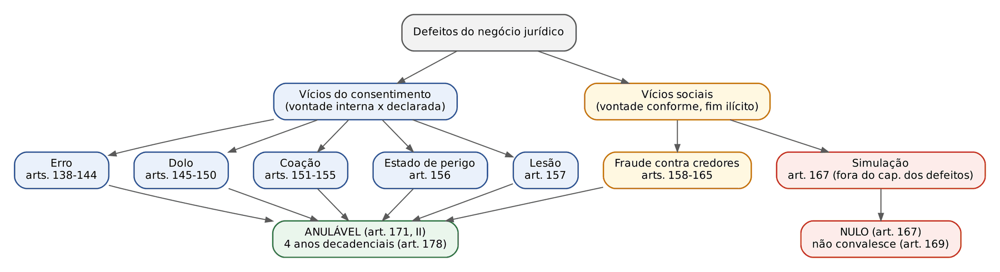
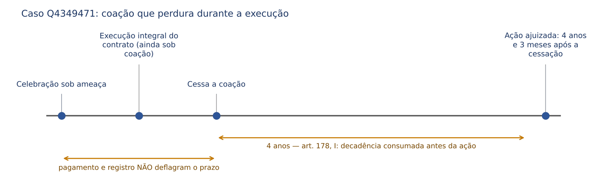
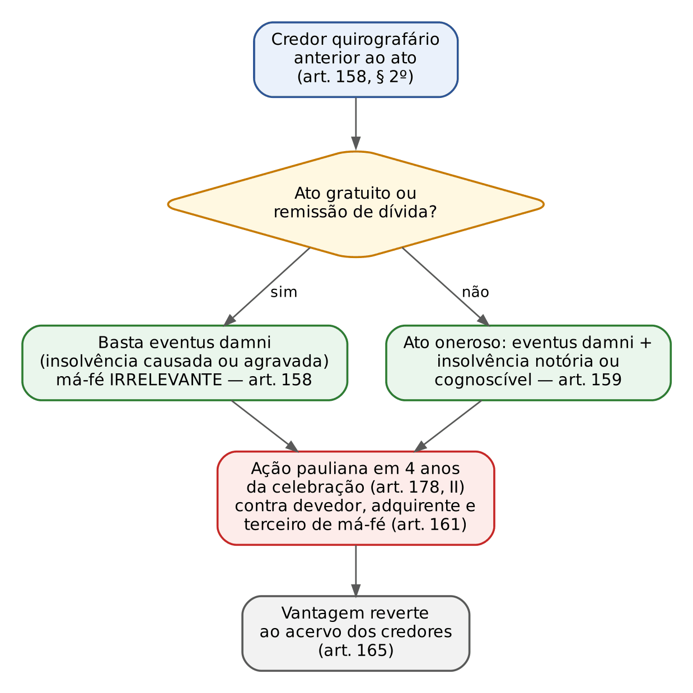
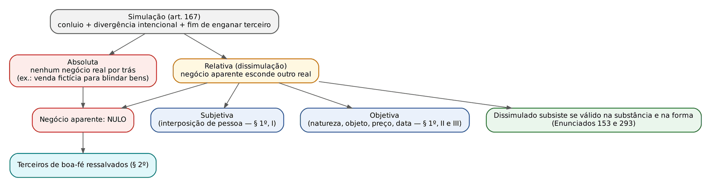
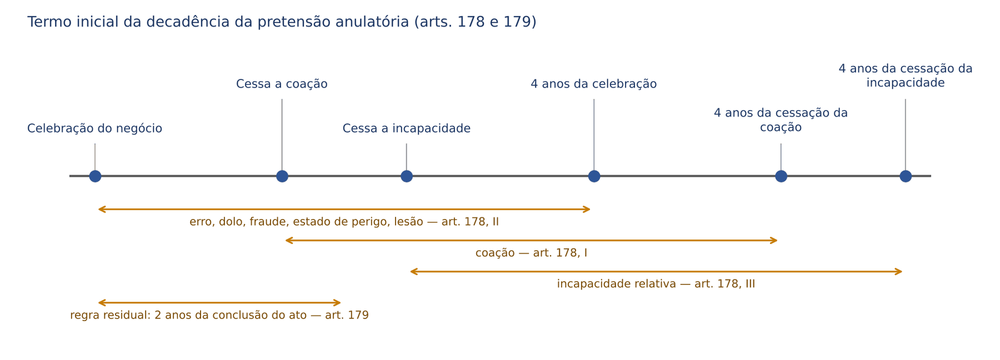
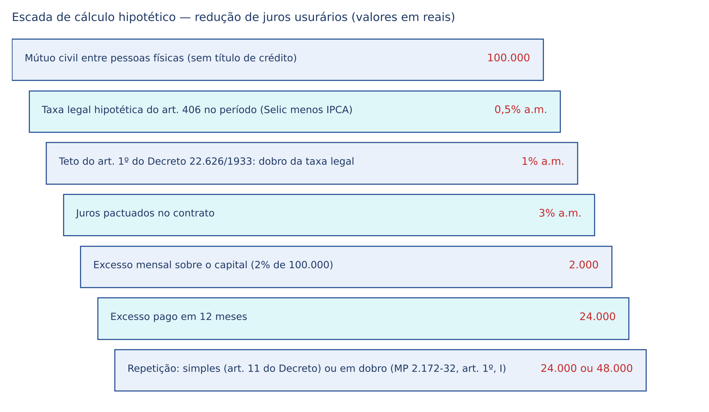

# CAPÍTULO 09 — NEGÓCIO JURÍDICO II: DEFEITOS, INVALIDADE, INEXISTÊNCIA E INEFICÁCIA; LEI DA USURA

:::INCIDENCIA
TRF5 p. 6; TJRS p. 7; TJSC p. 6; SEFAZ p. 5. Nível A+. Lote: 51 questões (FGV 39, FCC 12).
O que mais cai: simulação (nulidade, dissimulado, terceiro de boa-fé, alegação pelos simuladores), estado de perigo x lesão, termo inicial dos prazos do art. 178, coação e dolo de terceiro, legitimidade na ação pauliana e conversão do negócio nulo.
:::

| Subtema | FGV | FCC | Padrão de cobrança |
|---|---|---|---|
| Simulação | 6 | 6 | caso com venda fictícia ou doação disfarçada; nulo, imprescritível, de ofício, terceiro de boa-fé |
| Nulidade x anulabilidade (regime e hipóteses) | 7 | 1 | letra dos arts. 166, 171, 177 e 179; nulidade virtual; ENAM em quadro comparativo |
| Estado de perigo e lesão | 7 | 0 | caso de resgate ou atendimento urgente; preço de mercado afasta o vício; prazo de 4 anos da celebração |
| Coação | 4 | 2 | termo inicial (cessação), coação de terceiro, temor reverencial, partilha coacta |
| Dolo | 4 | 1 | omissão dolosa, dolo de terceiro desconhecido do beneficiário |
| Erro | 3 | 1 | erro sobre qualidade essencial, natureza do negócio, transmissão por interposto |
| Fraude contra credores | 3 | 1 | anterioridade do crédito, gratuidade, ausência de eventus damni, prazo |
| Conversão | 3 | 0 | nota promissória nula em confissão de dívida; compra e venda sem escritura em promessa |
| Incapacidade relativa (arts. 180 e 181) | 2 | 0 | adolescente que se declara maior; restituição |

## 09.1 Mapa dos defeitos e das sanções

O Cap. 8 apresentou a escada ponteana (existência, validade, eficácia) e os requisitos do art. 104. Aqui interessa o que acontece quando a vontade é formada ou declarada de modo defeituoso, ou quando o negócio, ainda que querido, agride a ordem jurídica. A distinção clássica, cobrada como premissa de alternativas, separa os vícios do consentimento (a vontade declarada não corresponde à vontade que o agente teria se livre e bem informado: erro, dolo, coação, estado de perigo e lesão) dos vícios sociais (a vontade declarada corresponde à real, mas dirige-se a prejudicar terceiros ou a burlar a lei: fraude contra credores e simulação).

| Defeito | Natureza | Sanção | Prazo | Termo inicial | Fundamento |
|---|---|---|---|---|---|
| Erro | vício do consentimento | anulabilidade | 4 anos (decadência) | celebração | arts. 138, 171, II, 178, II |
| Dolo | vício do consentimento | anulabilidade (dolo principal); perdas e danos (acidental) | 4 anos | celebração | arts. 145, 146, 178, II |
| Coação | vício do consentimento | anulabilidade | 4 anos | cessação da coação | arts. 151, 178, I |
| Estado de perigo | vício do consentimento | anulabilidade (ou revisão, Enunciado 148) | 4 anos | celebração | arts. 156, 178, II |
| Lesão | vício do consentimento | anulabilidade ou revisão (art. 157, § 2º) | 4 anos | celebração | arts. 157, 178, II |
| Fraude contra credores | vício social | anulabilidade (texto legal); ineficácia relativa (corrente doutrinária) | 4 anos | celebração | arts. 158, 159, 178, II |
| Simulação | vício social | NULIDADE | não há (art. 169) | — | art. 167 |

:::PEGADINHA Duas armadilhas estruturais
A simulação NÃO está no capítulo "Dos Defeitos do Negócio Jurídico" (arts. 138 a 165): o CC/2002 deslocou-a para o capítulo da invalidade (art. 167) e trocou a sanção de anulabilidade (CC/1916) por nulidade. A fraude contra credores, ao contrário, continua entre os defeitos e é causa de anulabilidade pela letra do art. 171, II.
A coação é o ÚNICO vício cujo prazo de 4 anos corre da cessação, e não da celebração (art. 178, I). As bancas trocam os termos iniciais nas alternativas: coação "da celebração" ou erro "da ciência" estão errados.
:::

:::QUESTAO FCC 2025 — DPE-SP — Analista de Defensoria (Q3304107)
Pediu-se qual defeito torna o negócio NULO entre erro, simulação absoluta, dolo, fraude contra credores e lesão. Gabarito: B (simulação absoluta). Os demais geram anulabilidade (art. 171, II). No mesmo sentido: Q3169950 (FCC 2024, TRT-20: nulo é o negócio "simulado"; a alternativa de lesão trazia o conceito de estado de perigo, e a de coação a equiparava ao temor reverencial), Q3538754 (FCC 2025, TRF-4: empréstimo simulado é nulo e não decai) e Q3841675 (FGV 2025, Abreu e Lima: erro, dolo e lesão geram anulabilidade).
:::

## 09.2 Erro ou ignorância (arts. 138 a 144)

### 09.2.1 Conceito e requisitos

Erro é a falsa representação da realidade formada espontaneamente pelo próprio declarante; ignorância é o desconhecimento total. O Código os equipara (rubrica da Seção I). O que distingue o erro do dolo é a origem: no erro, o equívoco nasce do próprio agente; no dolo, é provocado por artifício de outrem. Daí a regra prática: se a outra parte INDUZIU o equívoco, o enquadramento correto é dolo, e não erro (ver 9.3).

:::LEI CC, arts. 138 e 139
Art. 138. São anuláveis os negócios jurídicos, quando as declarações de vontade emanarem de erro substancial que poderia ser percebido por pessoa de diligência normal, em face das circunstâncias do negócio.
Art. 139. O erro é substancial quando:
I - interessa à natureza do negócio, ao objeto principal da declaração, ou a alguma das qualidades a ele essenciais;
II - concerne à identidade ou à qualidade essencial da pessoa a quem se refira a declaração de vontade, desde que tenha influído nesta de modo relevante;
III - sendo de direito e não implicando recusa à aplicação da lei, for o motivo único ou principal do negócio jurídico.
:::

Dois requisitos resultam do art. 138: (a) o erro deve ser substancial (essencial), isto é, determinante da declaração; (b) deve ser cognoscível pelo destinatário, pois o texto exige que o erro "poderia ser percebido por pessoa de diligência normal". Sai de cena a escusabilidade do CC/1916; protege-se o destinatário que não tinha como perceber o equívoco (princípio da confiança).

:::JURIS Enunciado 12 da I Jornada de Direito Civil (CJF)
Na sistemática do art. 138, é irrelevante ser ou não escusável o erro, porque o dispositivo adota o princípio da confiança. Parte da doutrina (Tartuce, por exemplo) acompanha o enunciado; outra parte sustenta que a escusabilidade sobrevive como requisito implícito. Em prova objetiva, siga o Enunciado 12 e a letra do art. 138 (cognoscibilidade).
:::

### 09.2.2 Espécies de erro substancial e de erro acidental

| Espécie | Exemplo | Consequência | Fundamento |
|---|---|---|---|
| *Error in negotio* (natureza do negócio) | assina-se termo de responsabilidade financeira pensando ser mero formulário de internação | anulável | art. 139, I |
| *Error in corpore* (objeto principal) | compra-se o lote 10 supondo ser o lote 12 | anulável | art. 139, I |
| *Error in substantia* (qualidade essencial do objeto) | quadro adquirido como original que é reprodução | anulável | art. 139, I |
| *Error in persona* (identidade ou qualidade essencial da pessoa) | doação a quem se supõe ser o salvador de um filho | anulável, se influiu de modo relevante | art. 139, II |
| Erro de direito | contrata-se supondo regime jurídico inexistente, sem pretender afastar a lei | anulável, se motivo único ou principal | art. 139, III |
| Falso motivo | motivo não expresso como razão determinante | NÃO vicia | art. 140 |
| Erro de indicação | nome ou descrição errada, mas identificável pelo contexto | NÃO vicia | art. 142 |
| Erro de cálculo | erro aritmético | só autoriza retificação | art. 143 |

O erro de direito do art. 139, III, não colide com o art. 3º da LINDB (ninguém se escusa de cumprir a lei alegando que não a conhece): o agente não pretende descumprir a lei, mas contratou porque supôs equivocadamente o seu conteúdo. Se a alegação servir para recusar a aplicação da lei, o erro é irrelevante.

O falso motivo (art. 140) só vicia se expresso como razão determinante. Exemplo: doação "em razão do casamento que se realizará" difere da doação feita na esperança íntima de casamento futuro, não declarada.

Correlata: Q2449764 (FGV 2024, AL-PR): motivo íntimo não declarado (casar com o donatário) não anula a doação; prevalece a vontade manifestada, porque o destinatário não conhecia a reserva mental (art. 110, Cap. 8).

### 09.2.3 Transmissão errônea, erro de indicação e convalidação (arts. 141 a 144)

A transmissão errônea da vontade por meios interpostos (núncio, mensageiro, sistema eletrônico) "é anulável nos mesmos casos em que o é a declaração direta" (art. 141). Não há prazo especial, não há nulidade e não há regra própria: aplica-se o regime do erro.

O art. 144 consagra a conservação do negócio: "O erro não prejudica a validade do negócio jurídico quando a pessoa, a quem a manifestação de vontade se dirige, se oferecer para executá-la na conformidade da vontade real do manifestante." Quem comprou o lote 12 pensando ser o lote 10 não anula o negócio se o vendedor se oferece para entregar o lote 10 nas mesmas condições.

:::QUESTAO FCC 2025 — MPE-PI — Analista Ministerial (Q3530374)
Aceitação condicionada foi transmitida ao proponente, por meio interposto, como aceitação pura. Gabarito: A (a transmissão errônea é anulável nos mesmos casos em que o é a declaração direta, art. 141). Armadilha: alternativas inventaram prazo de 30 dias, prescricional ou decadencial, e nulidade absoluta.
:::

:::QUESTAO FGV 2025 — DPE-RO — Analista Jurídico (Q3395857)
Colecionadora comprou pintura com certificado de autenticidade; perícia posterior mostrou tratar-se de reprodução, e o vendedor também desconhecia a falsidade. Gabarito: B (anulável por erro essencial sobre qualidade do objeto, art. 139, I). Por que não as outras: não há dolo (o vendedor não sabia), o objeto não se tornou ilícito (não há nulidade), a tradição não convalida o vício, e não se trata de inadimplemento. Note que o erro era cognoscível: a autenticidade era a razão de ser do preço, circunstância evidente para o vendedor.
:::

:::QUESTAO FGV 2024 — AL-TO — Procurador Jurídico (Q2457289)
Cuidadora assinou, como acompanhante, documentos de internação do empregador, informada de que serviam apenas para viabilizar o atendimento, e foi cobrada pelas despesas. Gabarito: B (anulável por erro essencial quanto à natureza do negócio e ao objeto principal, art. 139, I). Armadilha: a alternativa de estado de perigo trazia o prazo certo (4 anos), mas o perigo não era da declarante nem de pessoa de sua família, e ela não assumiu obrigação consciente; a de dolo trazia prazo errado (2 anos).
:::

:::DICA Erro x vício redibitório
O vício redibitório (arts. 441 e seguintes, Cap. 16) é defeito OCULTO da coisa que a torna imprópria ao uso ou lhe diminui o valor; opera no plano da EFICÁCIA (redibição ou abatimento, prazos de 30 dias e 1 ano do art. 445). O erro é vício da VONTADE: a coisa é perfeita, mas não é aquela que o comprador supunha (plano da validade, 4 anos do art. 178, II). Comprar relógio "de ouro" que é de latão: erro sobre qualidade essencial. Comprar relógio de ouro cujo mecanismo está quebrado: vício redibitório.
:::

## 09.3 Dolo (arts. 145 a 150)

### 09.3.1 Dolo principal e dolo acidental

Dolo é o artifício malicioso empregado para induzir alguém a erro em proveito do autor ou de terceiro. É um erro provocado, por isso mais fácil de provar (basta demonstrar o artifício e a sua influência) e com consequência indenizatória.

| | Dolo principal (*dolus causam dans*) | Dolo acidental (*dolus incidens*) |
|---|---|---|
| Influência | sem ele o negócio não se celebraria | o negócio se faria, "embora por outro modo" |
| Sanção | anulabilidade (art. 145) e perdas e danos | SÓ perdas e danos (art. 146) |
| Prazo | 4 anos da celebração (art. 178, II) | prazo prescricional da pretensão indenizatória (Cap. 11) |

O *dolus bonus* (exaltação usual das qualidades do produto) não anula; no consumo, o limite é a vedação da publicidade enganosa (art. 37 do CDC).

### 09.3.2 Dolo negativo (omissão dolosa)

:::LEI CC, art. 147
Art. 147. Nos negócios jurídicos bilaterais, o silêncio intencional de uma das partes a respeito de fato ou qualidade que a outra parte haja ignorado, constitui omissão dolosa, provando-se que sem ela o negócio não se teria celebrado.
:::

Requisitos: negócio bilateral; silêncio intencional; ignorância da outra parte; relação causal (sem a omissão não haveria negócio). O fundamento é o dever anexo de informação da boa-fé objetiva (art. 422, Cap. 15).

:::QUESTAO FGV 2026 — TJ-RS — Juiz Leigo (Q3978608)
Vendedor de veículo usado afirmou que o carro nunca sofrera acidente, embora soubesse de grave colisão anterior. Gabarito: B (anulável por dolo, omissão intencional de informação relevante, art. 147). Armadilhas: "inexistente" e "nulo" erram o plano e a sanção; "erro essencial" é a alternativa sedutora, mas o equívoco foi PROVOCADO pelo vendedor (dolo), e não espontâneo; "dever de verificar" do comprador não afasta o dolo.
:::

:::QUESTAO FGV 2024 — TJ-MT — Analista Judiciário (Q3114262)
Vendedor inventou projeto municipal de urbanização para convencer o comprador a pagar preço elevado. Gabarito: A (anulável por dolo). Não se exige prova de preço abusivo (isso seria lesão) nem há nulidade ou inexistência. No mesmo sentido, com combinação de vícios: Q3781255 (FGV 2025, CGE-SP), na qual o contrato do quadro que ambos supunham original é anulável por ERRO substancial (ninguém induziu ninguém) e o contrato do imóvel, cujo embargo ambiental a vendedora omitiu intencionalmente, é anulável por DOLO (gabarito D); a alternativa E, sobre dolo de ambas as partes, contraria o art. 150.
:::

:::QUESTAO FCC 2025 — DPE-AM — Defensor Público (Q3531615)
Corretor experiente, aproveitando a baixa escolaridade e a vulnerabilidade de idoso que já tinha posse apta à usucapião, convenceu-o a comprar o próprio imóvel por preço acima do mercado. Gabarito: A (anulável por dolo, 4 anos contados da realização do negócio). Armadilhas: prazos contados "da ciência do erro" ou "do prejuízo" (art. 178, II, conta da celebração) e anulabilidade "somente em razão do valor". (Ver nota.)
:::

### 09.3.3 Dolo de terceiro, do representante e dolo bilateral

:::LEI CC, arts. 148 a 150
Art. 148. Pode também ser anulado o negócio jurídico por dolo de terceiro, se a parte a quem aproveite dele tivesse ou devesse ter conhecimento; em caso contrário, ainda que subsista o negócio jurídico, o terceiro responderá por todas as perdas e danos da parte a quem ludibriou.
Art. 149. O dolo do representante legal de uma das partes só obriga o representado a responder civilmente até a importância do proveito que teve; se, porém, o dolo for do representante convencional, o representado responderá solidariamente com ele por perdas e danos.
Art. 150. Se ambas as partes procederem com dolo, nenhuma pode alegá-lo para anular o negócio, ou reclamar indenização.
:::

| Situação | Destino do negócio | Quem indeniza |
|---|---|---|
| Dolo de terceiro, beneficiário sabia ou devia saber | anulável | terceiro (e, por coerência, o beneficiário que concorreu; o art. 148 não fala em solidariedade) |
| Dolo de terceiro, beneficiário não sabia nem devia saber | SUBSISTE | só o terceiro ("todas as perdas e danos") |
| Dolo do representante legal (pais, tutor, curador) | anulável | representado só até o proveito que teve |
| Dolo do representante convencional (mandatário) | anulável | representado SOLIDARIAMENTE com o representante |
| Dolo bilateral (recíproco, compensado ou enantiomórfico) | nenhuma parte pode anular | ninguém pode reclamar indenização |

A diferença de tratamento entre representação legal e convencional tem lógica: o representado escolheu o mandatário (culpa *in eligendo*), mas não escolheu o representante legal.

:::QUESTAO FGV 2025 — TJ-SC — Juiz Substituto (Q3324226)
Irmão convenceu o outro a tomar empréstimo bancário e repassar-lhe o dinheiro para investimento; recebeu o valor e desapareceu. Pergunta: à luz exclusivamente do CC, como fica o mútuo bancário? Gabarito: D (válido e eficaz em relação ao mutuário, ainda que configurado dolo de terceiro, sem prejuízo de o irmão responder por perdas e danos).
O artifício partiu de quem não é parte do mútuo (dolo de terceiro); o art. 148 só autoriza anular se o banco sabia ou devia saber, o que o enunciado não indica; logo o negócio subsiste e o terceiro indeniza. "Ineficaz" troca o plano, e simulação exigiria conluio entre as PARTES do mútuo.
:::

:::QUESTAO FGV 2024 — PC-SC — Delegado (Q2360728)
Credor de mútuo, para receber, convenceu amiga a comprar o imóvel da devedora, escondendo infiltrações. Gabarito: A (dolo de terceiro: só anula se a vendedora, parte a quem aproveita, tinha ou devia ter conhecimento). Armadilhas: erro acidental, estado de perigo e "simulação praticada" por quem não é parte.
:::

## 09.4 Coação (arts. 151 a 155)

### 09.4.1 Coação absoluta e coação relativa

Só a coação moral (*vis compulsiva*) é vício do consentimento: o coacto tem a opção, ainda que penosa, entre ceder e sofrer o mal. Na coação física (*vis absoluta*) não há vontade alguma (a mão do outro conduz a assinatura): para a corrente majoritária o negócio é INEXISTENTE (ver 9.7); a FGV já explorou essa diferença ao rotular de "coação moral absoluta" uma situação de mero erro (Q2457289).

:::LEI CC, arts. 151 a 153
Art. 151. A coação, para viciar a declaração da vontade, há de ser tal que incuta ao paciente fundado temor de dano iminente e considerável à sua pessoa, à sua família, ou aos seus bens.
Parágrafo único. Se disser respeito a pessoa não pertencente à família do paciente, o juiz, com base nas circunstâncias, decidirá se houve coação.
Art. 152. No apreciar a coação, ter-se-ão em conta o sexo, a idade, a condição, a saúde, o temperamento do paciente e todas as demais circunstâncias que possam influir na gravidade dela.
Art. 153. Não se considera coação a ameaça do exercício normal de um direito, nem o simples temor reverencial.
:::

Requisitos: (a) ameaça causa do negócio; (b) grave (fundado temor); (c) dano iminente (não necessariamente imediato, mas atual e próximo; não se exige dano consumado); (d) considerável; (e) dirigida à pessoa, à família ou aos bens do paciente, ou, a critério do juiz, a terceiro não familiar (noivo, amigo íntimo). O art. 152 adota critério CONCRETO, e não o do "homem médio": avalia-se o paciente real (idade, saúde, temperamento).

Exclusões do art. 153: ameaça de exercício NORMAL de direito (protestar título, ajuizar despejo, executar dívida). Se o direito for exercido de forma abusiva para obter vantagem estranha a ele (ameaçar representação criminal para obter doação), a ameaça volta a ser coação, porque o exercício já não é "normal" (art. 187). Simples temor reverencial (receio de desagradar pai, superior hierárquico) também não vicia; o adjetivo "simples" indica que, acompanhado de ameaça, há coação.

### 09.4.2 Coação de terceiro: diferença em relação ao dolo de terceiro

:::LEI CC, arts. 154 e 155
Art. 154. Vicia o negócio jurídico a coação exercida por terceiro, se dela tivesse ou devesse ter conhecimento a parte a que aproveite, e esta responderá solidariamente com aquele por perdas e danos.
Art. 155. Subsistirá o negócio jurídico, se a coação decorrer de terceiro, sem que a parte a que aproveite dela tivesse ou devesse ter conhecimento; mas o autor da coação responderá por todas as perdas e danos que houver causado ao coacto.
:::

| | Dolo de terceiro (art. 148) | Coação de terceiro (arts. 154 e 155) |
|---|---|---|
| Beneficiário sabia ou devia saber | anulável | anulável |
| Responsabilidade do beneficiário ciente | o artigo não prevê solidariedade expressa | SOLIDÁRIA com o coator (art. 154) |
| Beneficiário de boa-fé | negócio subsiste; terceiro indeniza | negócio subsiste; coator indeniza |

A diferença na responsabilidade é o ponto preferido das bancas.

:::QUESTAO FGV 2026 — TJ-RJ — Analista Judiciário, Comissário da Infância (Q3870730)
Segurança ligado a concorrente ameaçou o noivo da empresária para que ela assinasse cessão de quotas a sociedade cujo representante combinara a pressão (e-mails) e contrato de exclusividade com outra sociedade que desconhecia as ameaças; havia ainda notificação de despejo e insistência do pai. Gabarito: C.
Passo 1: ameaça a noivo (não familiar) PODE ser coação conforme as circunstâncias (art. 151, parágrafo único). Passo 2: a cessionária tinha ciência (conluio), logo a cessão é anulável (art. 154). Passo 3: a outra contratante não sabia nem devia saber, logo o contrato subsiste (art. 155). Passo 4: notificação de despejo é exercício normal de direito e a pressão paterna é temor reverencial, nenhum dos dois é coação (art. 153). Armadilhas: exigir dano consumado ou dirigido ao próprio declarante; invalidar ambos os contratos.
:::

:::QUESTAO FGV 2024 — ENAM — 1º Exame Nacional da Magistratura, reaplicação (Q2507032)
Esposa, sem conhecimento do marido candidato, ameaçou divulgar dados íntimos dos concorrentes para que desistissem da disputa. Gabarito: C (a desistência subsiste, porque o beneficiário não sabia; só a coatora indeniza, art. 155). Armadilhas: solidariedade do marido (exigiria ciência, art. 154) e avaliação "objetiva" da ameaça, contrária ao critério concreto do art. 152.
:::

### 09.4.3 Prazo: decadência contada da cessação

:::QUESTAO FGV 2026 — TJ-PE — Juiz Substituto (Q4349471)
Venda de imóvel por escritura registrada, obtida mediante grave ameaça a familiar da vendedora; a ameaça persistiu durante toda a execução (pagamento e registro) e cessou depois; a ação veio 4 anos e 3 meses após a cessação. Gabarito: C (o prazo decadencial conta-se do dia em que cessou a coação, independentemente da execução posterior).
O que se pergunta: termo inicial do art. 178, I. Aplicação: nem a celebração, nem o registro, nem o pagamento deflagram o prazo; ele começou na cessação e terminou 4 anos depois, de modo que a pretensão decaiu. A alternativa E é sedutora porque a execução voluntária, ciente do vício, confirma tacitamente o anulável (art. 174); mas aqui a execução ocorreu SOB coação, logo não é voluntária e não confirma nada.
:::

No mesmo sentido, de pura letra de lei: Q3214732 (FCC 2025, TRT-6: venda sob coação é anulável em 4 anos decadenciais contados de quando cessar a coação) e Q3089731 (FCC 2024, TRT-7: idem; armadilhas com prazos prescricionais de 2, 3 e 5 anos).

:::QUESTAO FGV 2025 — TJ-MS — Juiz Substituto (Q3786332)
Ex-marido coagiu a ex-esposa a assinar partilha amigável do acervo conjugal. Prazo máximo para anular, segundo o STJ? Gabarito: D (4 anos contados da cessação da coação, art. 178, I, seja a partilha judicial ou extrajudicial).
Fundamento: o prazo ânuo do art. 2.027 é exclusivo da partilha sucessória (JURIS abaixo). Armadilhas: aplicar o prazo ânuo por analogia, contar da assinatura, ou distinguir partilha homologada de extrajudicial.
:::

:::JURIS STJ, REsp 1.621.610-SP, Rel. Min. Luis Felipe Salomão, 4ª Turma, j. 7/2/2017 (Info 600)
O prazo decadencial de 1 ano do art. 2.027 do CC e do art. 657 do CPC aplica-se apenas à anulação de partilha em inventário; na partilha decorrente de dissolução de união estável (e, pela mesma razão, de casamento), o prazo é de 4 anos (art. 178). Reafirmado no AgInt no REsp 1.897.743-SP (Rel. Min. Raul Araújo, 4ª Turma, j. 21/11/2023), quanto à partilha amigável na dissolução da sociedade conjugal.
:::

## 09.5 Estado de perigo e lesão (arts. 156 e 157)

### 09.5.1 Letra da lei

:::LEI CC, arts. 156 e 157
Art. 156. Configura-se o estado de perigo quando alguém, premido da necessidade de salvar-se, ou a pessoa de sua família, de grave dano conhecido pela outra parte, assume obrigação excessivamente onerosa.
Parágrafo único. Tratando-se de pessoa não pertencente à família do declarante, o juiz decidirá segundo as circunstâncias.
Art. 157. Ocorre a lesão quando uma pessoa, sob premente necessidade, ou por inexperiência, se obriga a prestação manifestamente desproporcional ao valor da prestação oposta.
§ 1º Aprecia-se a desproporção das prestações segundo os valores vigentes ao tempo em que foi celebrado o negócio jurídico.
§ 2º Não se decretará a anulação do negócio, se for oferecido suplemento suficiente, ou se a parte favorecida concordar com a redução do proveito.
:::

Os dois institutos, novidades do CC/2002, aproximam-se porque ambos combinam um elemento OBJETIVO (desequilíbrio) e um SUBJETIVO (situação de inferioridade do declarante). Distinguem-se em cada um desses elementos.

### 09.5.2 Quadro comparativo

| Aspecto | Estado de perigo (art. 156) | Lesão (art. 157) |
|---|---|---|
| Situação do declarante | necessidade de SALVAR-SE ou a pessoa da família de GRAVE DANO (vida, integridade, saúde, também patrimônio para parte da doutrina) | premente necessidade (inclusive econômica) OU inexperiência |
| Conhecimento da outra parte | EXIGIDO: o dano deve ser "conhecido pela outra parte" (a doutrina fala em dolo de aproveitamento) | DISPENSADO: a lesão não exige dolo de aproveitamento (Enunciado 150) |
| Elemento objetivo | obrigação "excessivamente onerosa" | prestação "manifestamente desproporcional", aferida ao tempo da celebração (§ 1º) |
| Pessoa não familiar | juiz decide segundo as circunstâncias (parágrafo único) | não se aplica (o lesado é o próprio contratante) |
| Revisão em lugar da anulação | por analogia ao § 2º do art. 157 (Enunciado 148) | § 2º e Enunciados 149 e 291 |
| Sanção e prazo | anulável; 4 anos da celebração (art. 178, II) | idem |
| Origem | inspirada no estado de necessidade | lesão enorme do direito romano, reformulada |

Estado de perigo e coação diferem porque, no estado de perigo, a outra parte não criou o perigo: apenas se aproveita dele. Estado de perigo e estado de necessidade (art. 188, II, Cap. 10) também não se confundem: este é excludente de ilicitude de ATO, aquele é vício de NEGÓCIO (Q2362717, FGV 2024, correlata do Cap. 10, explora a troca dos termos).

:::JURIS Enunciados das Jornadas sobre lesão e estado de perigo
148: ao estado de perigo aplica-se, por analogia, o § 2º do art. 157.
149: em atenção à conservação dos contratos, a lesão deve conduzir, sempre que possível, à revisão judicial, e não à anulação, sendo dever do magistrado incitar os contratantes a seguir o § 2º do art. 157.
150: a lesão não exige dolo de aproveitamento.
290: a lesão acarretará a anulação quando verificada, na formação, a desproporção manifesta entre as prestações, NÃO se presumindo a premente necessidade ou a inexperiência do lesado.
291: o lesionado pode optar por não pleitear a anulação, deduzindo desde logo pretensão revisional (redução do proveito do lesionador ou complemento do preço).
410: a inexperiência não significa necessariamente imaturidade ou desconhecimento geral dos negócios; pode existir quando o lesado, ainda que contrate habitualmente, não tenha conhecimento específico sobre o negócio em causa.
:::

:::JURIS STJ, REsp 1.723.690-DF, 3ª Turma, j. 6/8/2019 (Info 653)
A configuração da lesão exige a presença simultânea do elemento objetivo (desproporção) e do subjetivo (premente necessidade ou inexperiência), que não se presumem em negócio bilateral voluntário entre particulares; o simples interesse econômico de proteger patrimônio investido não configura premente necessidade.
:::

Outras lesões: a consumerista (arts. 6º, V, e 39, V, do CDC) dispensa o elemento subjetivo; a usurária da MP 2.172-32/2001 gera nulidade da estipulação (9.12); a desproporção SUPERVENIENTE resolve-se pela onerosidade excessiva (arts. 317 e 478, Cap. 16).

:::DICA Hospital e cheque-caução
A exigência de garantia (cheque-caução, nota promissória) como condição para atendimento médico-hospitalar emergencial é o exemplo de manual de estado de perigo; além de anulável a obrigação, a conduta é crime (art. 135-A do Código Penal; ver Apostila de Direito Penal). A FGV usou esse enredo em 2023 (TJPR, estado de perigo) e o repete em variações com resgates.
:::

### 09.5.3 Casos cobrados

:::QUESTAO FGV 2026 — NAV Brasil — Advogado (Q4223055)
Diretora financeira, cuja irmã estava presa às ferragens com risco de morte, assinou contrato de resgate aéreo por 20 vezes o preço usual, imposto pelo único prestador da região, ciente do quadro. Gabarito: B (estado de perigo: salvar pessoa da família de grave dano conhecido pela outra parte; obrigação excessivamente onerosa).
Armadilhas: "terceira pessoa" (a irmã é família, e mesmo não familiar admitiria o vício pelo parágrafo único); "faltou coação" (estado de perigo não exige ameaça); "é lesão, porque decisiva é só a desproporção" (o perigo de dano pessoal conhecido desloca para o art. 156); "contratos empresariais" (o vício independe da natureza empresarial).
:::

:::QUESTAO FGV 2025 — TJ-SC — Juiz Leigo (Q3592854)
Mulher pendurada em galho à beira de cachoeira; socorristas exigem três vezes o preço normal do resgate, aceito pelo marido. Gabarito: E (estado de perigo). Idêntica: Q3846059 (FGV 2026, AMAZUL, gabarito B). A diferença para a lesão está no risco à vida conhecido pelos socorristas; a coação moral é descartada porque eles não ameaçaram, apenas exploraram o perigo existente.
:::

:::QUESTAO FGV 2024 — TJ-MT — Juiz Substituto (Q3086921)
Vítima de crise respiratória grave durante queimadas aceitou atendimento do único médico disponível, que cobrou o valor MÉDIO de mercado; depois pediu a anulação. Gabarito: C (improcedente, porque não houve obrigação excessivamente onerosa). Lição: sem o elemento objetivo não há estado de perigo, por mais grave que seja a situação subjetiva. Armadilha: alternativa que considera a emergência suficiente.
:::

:::QUESTAO FGV 2025 — TCE-PE — Auditor de Controle Externo (Q3593763)
Paciente internada com Covid em 2022 transferiu imóvel avaliado em 600.000 (seiscentos mil) reais em troca de 100.000 (cem mil) reais para medicamento urgente; ajuizou a anulatória quase cinco anos após a celebração. Gabarito: E (há estado de perigo, mas a decadência de 4 anos, contada da celebração, se consumou). Armadilhas: imprescritibilidade, nulidade e 2 anos "da cessação do perigo".
:::

:::QUESTAO FGV 2024 — ENAM — 1º Exame Nacional da Magistratura, reaplicação (Q3058660)
Viúva de pouca instrução, em grave dificuldade financeira, contratou advogado por 60% do benefício previdenciário a obter. Gabarito: D (lesão; 4 anos da celebração). Não é estado de perigo: não há risco de grave dano à pessoa conhecido do contratante, e sim premente necessidade econômica e inexperiência com desproporção manifesta. Os prazos de 2 anos das demais alternativas são a armadilha.
:::

:::QUESTAO FGV 2024 — Prefeitura de Cuiabá — Auditor Fiscal (Q3157917)
Idosa lúcida, intimidada por agiotas credores do neto, vendeu casa por 20% do valor de mercado a comprador que conhecia e explorava a situação; três anos depois procurou advogado. Gabarito: A (anulável por lesão, prazo decadencial de 4 anos, ainda em curso). A alternativa de coação traz prazo "anual" (inexistente); a de lesão com decadência "bienal" erra o prazo. (Ver nota.)
:::

:::QUESTAO FGV 2025 — ENAM 2025.2 (Q3692412)
Três situações: (i) negócio por interposta pessoa, em conluio, para enganar terceiro; (ii) venda de carro muito abaixo do mercado para comprar passagem e ver a mãe moribunda, fato conhecido do comprador; (iii) adolescente de 17 anos casada que contrata cartão de crédito sem assistência. Gabarito: A (nulo, anulável e válido). (i) é simulação subjetiva (art. 167, § 1º, I); (ii) é lesão por premente necessidade, e não estado de perigo, porque a venda não visava salvar ninguém de grave dano, mas atender necessidade (ainda que afetiva); (iii) o casamento emancipa (art. 5º, parágrafo único, II, Cap. 3).
:::

## 09.6 Fraude contra credores (arts. 158 a 165)

### 09.6.1 Fundamento e requisitos

O patrimônio do devedor é a garantia comum dos credores (art. 391; art. 789 do CPC). A fraude contra credores é o ato de disposição que, praticado por devedor insolvente ou que a ele o conduz, subtrai bens dessa garantia. Os requisitos tradicionais são: (a) anterioridade do crédito; (b) *eventus damni* (prejuízo: insolvência criada ou agravada pelo ato); (c) *consilium fraudis* (conluio, ou ao menos ciência da insolvência pelo adquirente), exigido apenas nos atos onerosos.

:::LEI CC, arts. 158 e 159
Art. 158. Os negócios de transmissão gratuita de bens ou remissão de dívida, se os praticar o devedor já insolvente, ou por eles reduzido à insolvência, ainda quando o ignore, poderão ser anulados pelos credores quirografários, como lesivos dos seus direitos.
§ 1º Igual direito assiste aos credores cuja garantia se tornar insuficiente.
§ 2º Só os credores que já o eram ao tempo daqueles atos podem pleitear a anulação deles.
Art. 159. Serão igualmente anuláveis os contratos onerosos do devedor insolvente, quando a insolvência for notória, ou houver motivo para ser conhecida do outro contratante.
:::

| Elemento | Ato gratuito ou remissão (art. 158) | Ato oneroso (art. 159) |
|---|---|---|
| Eventus damni | exigido | exigido |
| Má-fé do devedor | irrelevante ("ainda quando o ignore") | presente na prática, mas não é o foco |
| Ciência do adquirente | irrelevante (o donatário não perde nada, só deixa de ganhar) | exigida: insolvência notória ou com motivo para ser conhecida |
| Exemplo | doação, renúncia translativa, perdão de dívida | venda a parente por preço vil, em plena crise do vendedor |

Outros atos fraudulentos tipificados: pagamento antecipado de dívida não vencida a credor quirografário (art. 162: o credor repõe o recebido ao acervo); concessão de garantia real a um credor pelo devedor insolvente (art. 163: presume-se fraudatória). Ao contrário, presumem-se de boa-fé e valem os negócios ordinários indispensáveis à manutenção do estabelecimento ou à subsistência do devedor e da família (art. 164).

### 09.6.2 Legitimidade e anterioridade

Legitimidade ativa: credores QUIROGRAFÁRIOS (art. 158, caput) e credores com garantia que se tornou insuficiente (§ 1º). O credor com garantia real suficiente não tem interesse, porque o bem gravado responde pela dívida, com sequela (Cap. 32). Pelo Enunciado 151, o credor com garantia real pode propor a pauliana sem prévio reconhecimento judicial da insuficiência; a insuficiência, porém, é requisito a provar na própria ação.

Anterioridade (§ 2º): só quem já era credor ao tempo do ato pode impugná-lo, porque o credor posterior contratou já conhecendo o patrimônio reduzido. Pelo Enunciado 292, a anterioridade é determinada pela CAUSA que dá origem ao crédito, independentemente de reconhecimento judicial (a indenização por ato ilícito anterior à alienação é crédito anterior, ainda que a sentença venha depois).

:::JURIS STJ, REsp 1.217.593-RS, Rel. Min. Nancy Andrighi, 3ª Turma, j. 12/3/2013 (Info 518)
Promessa de compra e venda por instrumento particular não registrada, desacompanhada de outros elementos que demonstrem perante terceiros a sua prévia realização, não basta para afastar a anterioridade do crédito: considera-se, para esse fim, a data do registro, que torna o direito oponível a terceiros.
:::

:::QUESTAO FGV 2026 — TJ-GO — Juiz Substituto (Q3966631)
Devedora tinha: dívida quirografária com a bufê (vencida em 23/5/2023); mútuo com garantia real com banco (vencido em 12/4/2024); em maio de 2024 doou dois apartamentos e o carro à irmã e tornou-se insolvente; em junho de 2024 contratou costureira sem garantia (vencimento em 14/7/2024). Quem tem legitimidade para a pauliana? Gabarito: E (somente a dona do bufê).
Passo 1, anterioridade: bufê e banco eram credores antes da doação; a costureira tornou-se credora DEPOIS (art. 158, § 2º), logo está excluída. Passo 2, natureza do crédito: o banco tem garantia real e o enunciado não indica insuficiência dela (art. 158, § 1º), logo não tem interesse. Passo 3, a doação é gratuita: basta o eventus damni, sem perquirir má-fé da irmã. Note que o vencimento é irrelevante: o que importa é a existência do crédito ao tempo do ato (o crédito do banco já existia antes do vencimento).
:::

### 09.6.3 Legitimidade passiva, depósito do preço e efeitos

Art. 161: a ação pode ser intentada contra o devedor insolvente, a pessoa que com ele celebrou a estipulação fraudulenta, ou terceiros adquirentes de má-fé. A doutrina e a jurisprudência veem aqui litisconsórcio passivo necessário entre devedor e adquirente, porque a sentença atinge o negócio entre ambos.

O adquirente que ainda não pagou o preço, sendo este aproximadamente o corrente, desobriga-se depositando-o em juízo, com citação de todos os interessados (art. 160); se o preço for inferior, para conservar os bens pode depositar o valor real (parágrafo único). É o modo de o adquirente de boa-fé, ou mesmo o ciente, evitar a perda do bem: o patrimônio do devedor fica recomposto pelo dinheiro.

Anulados os negócios, "a vantagem resultante reverterá em proveito do acervo sobre que se tenha de efetuar o concurso de credores" (art. 165), e não apenas do autor. Se o negócio fraudulento visava só atribuir preferência (hipoteca, penhor, anticrese), anula-se somente a preferência (parágrafo único).

:::JURIS STJ, REsp 1.100.525-RS, Rel. Min. Luis Felipe Salomão, 4ª Turma, j. 16/4/2013 (Info 521)
Em pauliana com alienações sucessivas, se o último adquirente estava de boa-fé, reconhece-se a eficácia do negócio pelo qual adquiriu o bem, e os réus de má-fé são condenados a indenizar o autor pelo valor do bem fraudulentamente alienado.
:::

:::JURIS STJ, REsp 1.926.646-SP, Rel. Min. Nancy Andrighi, 3ª Turma, j. 15/2/2022
A doação aos filhos de imóvel que já era bem de família e continuou a servir de moradia da família não configura fraude contra credores, por ausência de eventus damni: o bem já era impenhorável antes da doação e nada foi subtraído da garantia dos credores (Lei 8.009/1990; Cap. 40).
:::

:::QUESTAO FGV 2024 — ENAM — 1º Exame Nacional da Magistratura, reaplicação (Q2507034)
Padaria devedora de banco, sem garantia, vendeu forno antigo e, com aporte do sócio, comprou forno novo; o banco exigiu o valor da venda sob ameaça de pauliana. Gabarito: A (refutar a ameaça, ante a regularidade da venda). Não houve eventus damni: o patrimônio foi substituído, não diminuído, e o ato é ordinário de manutenção do estabelecimento (art. 164). Armadilhas: "inexiste crédito exigível" (há, a dívida venceu antecipadamente), consignação "para convalidar" e nulidade.
:::

:::QUESTAO FGV 2025 — TJ-ES — Cartórios, provimento (Q3520604)
Empresário notoriamente insolvente doou imóvel ao filho e, depois, vendeu galpão à irmã por cerca de um terço do valor, a prazo; credor quirografário anterior propôs pauliana contra os dois negócios. Gabarito: D (a doação é anulável por ser ato gratuito de devedor insolvente, independentemente da má-fé do donatário). Quanto à venda à irmã, a alternativa E erra ao exigir intenção conjunta e desprezar insolvência e preço vil: no ato oneroso basta a insolvência notória ou cognoscível (art. 159). O registro (alternativa B) não sana o vício.
:::

No mesmo sentido, quanto ao prazo: Q3215741 (FCC 2025, TRT-6: alienação do único veículo em fraude é anulável em 4 anos decadenciais contados do dia em que se realizou o negócio, art. 178, II).

### 09.6.4 Natureza da sentença pauliana: anulação ou ineficácia?

Pela letra dos arts. 158, 159, 165 e 171, II, a fraude contra credores gera ANULABILIDADE, e a sentença desconstitui o negócio, devolvendo o bem ao patrimônio do devedor. Corrente doutrinária expressiva, com raízes processuais, sustenta que a sentença apenas declara a INEFICÁCIA RELATIVA do ato perante os credores: o negócio permanece válido entre devedor e adquirente, mas o bem pode ser excutido como se não tivesse saído do patrimônio do devedor, e eventual sobra, após pagos os credores, fica com o adquirente. O argumento é funcional: só o interesse do credor é protegido. Julgados do STJ usam a linguagem da eficácia em casos concretos (REsp 1.100.525), mas não há tese vinculante que afaste a letra do Código.

:::DICA Como responder
Questão de letra de lei ou que cita o art. 171, II: fraude contra credores gera ANULABILIDADE, prazo de 4 anos da celebração. Questão que pergunta "segundo parte da doutrina" ou que contrapõe fraude contra credores à fraude à execução: a primeira (na visão moderna) e a segunda (por lei, art. 792, § 1º, do CPC) produzem ineficácia em relação ao credor.
:::

### 09.6.5 Fraude contra credores x fraude à execução

| | Fraude contra credores | Fraude à execução |
|---|---|---|
| Natureza | instituto de direito material (CC) | instituto processual (art. 792 do CPC), ato atentatório à dignidade da justiça (art. 774, I, do CPC) |
| Momento | antes da citação em ação capaz de reduzir o devedor à insolvência | depois da citação (ou averbações e hipóteses do art. 792 do CPC) |
| Interesse lesado | privado, dos credores | dos credores e da jurisdição |
| Reconhecimento | ação pauliana (ação própria, Súmula 195 do STJ) | incidentalmente, nos próprios autos, após intimação do terceiro (art. 792, § 4º, do CPC) |
| Sanção | anulabilidade (CC) | ineficácia do ato em relação ao exequente (art. 792, § 1º, do CPC) |
| Elemento subjetivo do adquirente | ciência da insolvência no ato oneroso | regido pelo CPC e pela orientação do STJ sobre registro da penhora e boa-fé do terceiro (Súmula 375 do STJ, matéria processual) |

:::PROCESSO Ação pauliana — roteiro
Legitimidade ativa: credor quirografário anterior ao ato, ou credor cuja garantia se tornou insuficiente (art. 158). Legitimidade passiva: devedor, adquirente e terceiros de má-fé (art. 161), em litisconsórcio. Prazo: 4 anos decadenciais da celebração (art. 178, II). Via: ação própria; "em embargos de terceiro não se anula ato jurídico, por fraude contra credores" (Súmula 195 do STJ; o Enunciado 133 da II Jornada de Direito Processual Civil admite reconvenção com pedido pauliano nos embargos de terceiro, mas a súmula segue válida). Defesa do adquirente: depósito do preço (art. 160). Efeito: reversão ao acervo (art. 165).
:::

## 09.7 Inexistência, invalidade e ineficácia

### 09.7.1 Os três planos aplicados às patologias

A escada ponteana (Cap. 8) dá a cada patologia o seu plano. Inexistência: falta elemento de existência (agente, vontade, objeto, forma); o negócio é um nada jurídico, mesmo que haja aparência material. Invalidade: o negócio existe, mas falta requisito de validade do art. 104 ou há vício; divide-se em nulidade (absoluta) e anulabilidade (relativa). Ineficácia: o negócio existe e é válido, mas não produz efeitos, total ou parcialmente, ou não os produz perante certas pessoas (condição suspensiva pendente, termo inicial, negócio celebrado por quem não tinha poderes até a ratificação, inoponibilidade a terceiros por falta de registro, fraude à execução).

Teoria da inexistência: o CC não a positivou, e parte da doutrina a considera desnecessária (bastaria a nulidade). A corrente majoritária e a FGV a adotam como categoria autônoma; nas questões, "inexistente" é alternativa correta só quando falta vontade ou elemento estrutural, e é armadilha recorrente para casos de mero vício de consentimento (Q3978608, Q3114262) ou de preço vil (Q3947207).

:::JURIS STJ, REsp 1.368.960-RJ, Rel. Min. Marco Aurélio Bellizze, 3ª Turma, j. 7/6/2016 (Info 585)
Não são convalidáveis os negócios celebrados para alterar o quadro societário mediante falsificação da assinatura de sócio, ainda que o sócio prejudicado tenha, por escritura pública, dado ampla, geral e irrevogável quitação para ratificá-los. A assinatura falsa equivale à ausência de manifestação de vontade, e o que não existe ou é nulo não se confirma.
:::

### 09.7.2 Quadro-síntese: nulo x anulável

| Aspecto | Negócio NULO | Negócio ANULÁVEL |
|---|---|---|
| Interesse tutelado | público, ordem pública | privado, das partes ou de terceiros determinados |
| Hipóteses | arts. 166 e 167 e casos legais (nulidade textual ou virtual) | art. 171 e casos legais ("é anulável") |
| Quem alega | qualquer interessado e o MP quando lhe couber intervir (art. 168) | só os interessados (art. 177) |
| De ofício | SIM: o juiz deve pronunciar a nulidade provada (art. 168, parágrafo único) | NÃO (art. 177) |
| Suprimento pelo juiz | vedado, ainda que a requerimento das partes (art. 168, parágrafo único) | não se aplica |
| Confirmação | impossível (art. 169) | possível, salvo direito de terceiro (arts. 172 a 175) |
| Decurso do tempo | não convalesce (art. 169); a pretensão patrimonial decorrente prescreve (Enunciado 536) | convalesce: decadência de 4 anos (art. 178) ou 2 anos (art. 179) |
| Efeitos antes da decisão | não produz os efeitos próprios (há exceções: Enunciado 537, casamento putativo) | produz efeitos até a sentença (art. 177: "não tem efeito antes de julgada por sentença") |
| Natureza da ação | declaratória | desconstitutiva (constitutiva negativa) |
| Efeitos da decisão | *ex tunc* | *ex tunc* para a doutrina majoritária, com restituição ao estado anterior (art. 182); há quem fale em *ex nunc* (ver 9.11.4) |
| Alcance subjetivo | erga omnes, ressalvados terceiros de boa-fé na simulação (art. 167, § 2º) | aproveita só a quem alegou, salvo solidariedade ou indivisibilidade (art. 177) |
| Conversão | possível (art. 170) | desnecessária (confirma-se) |
| Exemplos no CC | herança de pessoa viva (art. 426), doação universal (art. 548), pacto comissório (arts. 1.365 e 1.428) | venda de ascendente a descendente sem consentimento (art. 496), doação do cônjuge adúltero ao cúmplice (art. 550), falta de outorga conjugal (arts. 1.647 e 1.649) |

:::QUESTAO FGV 2026 — ENAM 2026.1 (Q4102447)
Pediu-se a afirmativa correta sobre o sistema dualista das invalidades. Gabarito: E (a nulidade tutela interesse de ordem pública; a anulabilidade, interesse predominantemente privado, razão pela qual só os interessados a alegam, em prazo decadencial, sem reconhecimento de ofício).
Por que as outras erram: (A) atribui à sentença anulatória efeitos *ex nunc*, contra a restituição do art. 182 e a doutrina majoritária; (B) nega o conhecimento de ofício da nulidade (art. 168, parágrafo único); (C) dá efeitos *ex nunc* à nulidade e nega restituição; (D) admite confirmação do nulo (art. 169).
:::

### 09.7.3 Interesse público, estrutura do negócio e função negocial

Para os pontos do TJRS e do TJSC sobre "interesse público e estrutura do negócio" e "função negocial", três ideias bastam. A graduação das invalidades reflete o interesse violado: nulidade quando geral (ordem pública, forma solene, incapacidade absoluta), anulabilidade quando de pessoa determinada que pode preferir manter o negócio. Vigora o princípio da conservação (Antônio Junqueira de Azevedo), que inspira a conversão (art. 170), a redução (art. 184), a convalidação do erro (art. 144), a revisão na lesão (art. 157, § 2º), o art. 183 e a confirmação (art. 172). E a função social e a boa-fé (arts. 421 e 422, Cap. 15) controlam o conteúdo do negócio, admitindo-se até a preservação excepcional de efeitos do nulo (Enunciado 537).

## 09.8 Nulidade (arts. 166, 168 e 169)

### 09.8.1 Hipóteses

:::LEI CC, art. 166
Art. 166. É nulo o negócio jurídico quando:
I - celebrado por pessoa absolutamente incapaz;
II - for ilícito, impossível ou indeterminável o seu objeto;
III - o motivo determinante, comum a ambas as partes, for ilícito;
IV - não revestir a forma prescrita em lei;
V - for preterida alguma solenidade que a lei considere essencial para a sua validade;
VI - tiver por objetivo fraudar lei imperativa;
VII - a lei taxativamente o declarar nulo, ou proibir-lhe a prática, sem cominar sanção.
:::

Pontos finos por inciso:
- I: após o Estatuto da Pessoa com Deficiência, só a pessoa com menos de 16 anos é absolutamente incapaz (art. 3º; Cap. 3).
- II: a impossibilidade inicial RELATIVA não invalida, nem a que cessa antes de implementada a condição (art. 106; Q3302509, FCC 2025, correlata do Cap. 8). Objeto indeterminável é nulo; indeterminado mas determinável é válido.
- III: motivo ilícito só invalida se DETERMINANTE e COMUM a ambas as partes.
- IV e V: forma e solenidade (ex.: escritura pública para direitos reais sobre imóvel acima de 30 vezes o maior salário mínimo, art. 108; testamento sem as solenidades).
- VI: fraude à lei é o uso de meio aparentemente lícito para alcançar resultado proibido por norma imperativa (venda com retrovenda que mascara pacto comissório; Q3117513, FGV 2024, TJ-PE, correlata do Cap. 17, gabarito A: retrovenda reputada simulada para efetivar pacto comissório). Distingue-se da simulação porque, na fraude à lei, o negócio é querido tal como declarado; na simulação, não.
- VII: nulidade TEXTUAL (a lei diz "é nulo") e VIRTUAL ou implícita (a lei proíbe, "não pode", "é vedado", sem cominar sanção). Se a lei proíbe e comina sanção diversa (multa, anulabilidade), aplica-se a sanção especial.

:::QUESTAO FGV 2026 — TJ-RJ — Analista Judiciário (Q3878287)
Cessão de "direitos expectativos" sobre herança de tio vivo, por 300.000 (trezentos mil) reais; a lei diz que "não pode ser objeto de contrato a herança de pessoa viva" (art. 426), sem cominar sanção. Gabarito: B (nulo, porque a lei proíbe a prática sem cominar sanção: nulidade virtual, art. 166, VII). Armadilhas: anulabilidade "porque a lei apenas veda"; ineficácia até a abertura da sucessão; erro de direito. O *pacta corvina* é nulo e não se convalida com a morte do autor da herança.
:::

:::QUESTAO FGV 2026 — TJ-BA — Juiz Leigo (Q4102098)
Assertiva correta: é nulo o negócio quando a lei taxativamente o declarar nulo ou proibir-lhe a prática sem cominar sanção. Gabarito: C. As demais trocavam sanções: absolutamente incapaz gera nulidade (não anulabilidade), solenidade essencial gera nulidade, incapacidade relativa e vícios geram anulabilidade, e o nulo não se confirma.
:::

Aplicação do inciso II: a venda de lote em loteamento não registrado é nula por objeto ilícito, ainda que o comprador conhecesse a irregularidade (REsp 2.166.273-SP; v. Cap. 8).

### 09.8.2 Legitimidade, conhecimento de ofício e imprescritibilidade

O art. 168 legitima "qualquer interessado" e o Ministério Público "quando lhe couber intervir", e impõe ao juiz pronunciar a nulidade quando conhecer do negócio ou dos seus efeitos e a encontrar provada, sem poder supri-la, ainda que a requerimento das partes. Como a nulidade é questão de ordem pública, pode ser alegada em defesa, em contestação, em embargos e em qualquer processo em que o negócio seja invocado (ver 9.9.4 para a simulação).

O art. 169 declara que o nulo "não é suscetível de confirmação, nem convalesce pelo decurso do tempo". Duas atenuações, cobradas em prova:

:::JURIS Enunciados 536 e 537 das Jornadas (CJF)
536: resultando do negócio nulo consequências patrimoniais capazes de ensejar pretensões, é possível, quanto a estas, a incidência da prescrição. Exemplo: a declaração de nulidade de contrato de 2005 pode ser obtida em 2026, mas a pretensão de restituição das parcelas pagas segue o prazo prescricional próprio (Cap. 11), e a usucapião pode consolidar a posse do adquirente.
537: a previsão do art. 169 não impossibilita que, excepcionalmente, negócios nulos produzam efeitos a serem preservados quando justificados por interesses merecedores de tutela (ex.: efeitos do casamento putativo, art. 1.561; salários de contrato de trabalho nulo).
:::

### 09.8.3 Nulidade e a vedação de beneficiar-se da própria torpeza

:::QUESTAO FGV 2024 — TJ-PE — Juiz Substituto (Q3117508)
Três situações: (i) vendedor argui simulação contra o comprador; (ii) adolescente quer exonerar-se de restituir empréstimo que obteve maliciosamente, sem assistência; (iii) alienante de lote irregular em área pública argui a nulidade do negócio que celebrou por instrumento particular. Em quais o *nemo auditur propriam turpitudinem allegans* é excepcionado? Gabarito: C (i e iii).
(i) o simulador pode alegar a simulação contra o outro (Enunciado 294; ver 9.9.4); (iii) a nulidade pode ser arguida por "qualquer interessado", inclusive por quem lhe deu causa (art. 168). Em (ii) o princípio é APLICADO, não excepcionado: o art. 180 impede o adolescente de invocar a idade que ocultou dolosamente, e o art. 181 trata da restituição.
:::

## 09.9 Simulação (art. 167)

### 09.9.1 Conceito, requisitos e espécies

Simulação é a declaração enganosa de vontade, ajustada entre as partes, para produzir efeito diverso do ostensivamente indicado, com o fim de enganar terceiros ou fraudar a lei. Requisitos: (a) conluio (acordo simulatório) entre os declarantes; (b) divergência intencional entre o declarado e o querido; (c) intuito de enganar terceiros. Na falta de conluio não há simulação: há reserva mental (art. 110, Cap. 8) se só um declarante esconde a vontade, ou dolo, se um engana o outro.

:::LEI CC, art. 167
Art. 167. É nulo o negócio jurídico simulado, mas subsistirá o que se dissimulou, se válido for na substância e na forma.
§ 1º Haverá simulação nos negócios jurídicos quando:
I - aparentarem conferir ou transmitir direitos a pessoas diversas daquelas às quais realmente se conferem, ou transmitem;
II - contiverem declaração, confissão, condição ou cláusula não verdadeira;
III - os instrumentos particulares forem antedatados, ou pós-datados.
§ 2º Ressalvam-se os direitos de terceiros de boa-fé em face dos contraentes do negócio jurídico simulado.
:::

| Classificação | Conceito | Exemplo | Efeito |
|---|---|---|---|
| Absoluta | não há negócio real algum por trás do aparente | venda fictícia de bens para frustrar partilha ou execução; confissão de dívida inexistente | nulidade do aparente; nada subsiste |
| Relativa (dissimulação) | o aparente encobre negócio real | compra e venda que esconde doação; preço declarado menor para reduzir tributo | aparente nulo; dissimulado subsiste se válido na substância e na forma |
| Relativa subjetiva | interposição de pessoa ("laranja", testa de ferro) | doação ao amigo para posterior venda ao filho, burlando o art. 496 | § 1º, I |
| Relativa objetiva | recai sobre natureza, objeto, preço, cláusula ou data | antedata de instrumento particular | § 1º, II e III |
| Inocente | sem intuito de prejudicar terceiro ou violar a lei | doação disfarçada de venda por pudor | também invalidante (Enunciado 152) |
| Maliciosa | com intuito de prejudicar ou fraudar | blindagem patrimonial contra credores ou cônjuge | nulidade |

:::JURIS Enunciados 152, 153, 293 e 294 das Jornadas (CJF)
152: toda simulação, inclusive a inocente, é invalidante.
153: na simulação relativa, o negócio simulado (aparente) é nulo, mas o dissimulado será válido se não ofender a lei nem causar prejuízos a terceiros.
293: o aproveitamento do dissimulado não decorre tão somente do afastamento do simulado, mas do necessário preenchimento de todos os requisitos substanciais e formais de validade daquele.
294: sendo a simulação causa de nulidade, pode ser alegada por uma das partes contra a outra.
:::

### 09.9.2 Aproveitamento do negócio dissimulado

O dissimulado só subsiste se, examinado em si, preencher os requisitos de validade (Enunciado 293). Venda que esconde doação: a doação valerá se tiver a forma exigida (escritura, se imóvel de valor superior ao limite do art. 108), se não for inoficiosa (art. 549) nem universal (art. 548), se não violar regra específica (art. 550, doação ao cúmplice do cônjuge adúltero) e, se for a descendente, sofrerá colação como adiantamento de legítima (art. 544; Cap. 45).

:::QUESTAO FGV 2024 — Prefeitura de São José dos Campos — Analista em Gestão Municipal, Direito (Q2362715)
Homem casado vendeu à amante, por 80.000 (oitenta mil) reais, imóvel comum avaliado em 800.000 (oitocentos mil) reais, usando procuração da esposa; anos depois a amante revendeu a terceira de boa-fé por 850.000 (oitocentos e cinquenta mil) reais. Gabarito: D (a compra e venda é simulada e, portanto, nula; a doação dissimulada é anulável até 2 anos após a dissolução da sociedade conjugal; preserva-se o direito da terceira).
Passo 1: o negócio aparente (venda por preço vil) é o SIMULADO; o real (liberalidade à concubina) é o DISSIMULADO; as alternativas B, C e E invertem a nomenclatura. Passo 2: o dissimulado (doação do cônjuge adúltero ao cúmplice) não é nulo, é anulável pelo outro cônjuge ou pelos herdeiros necessários até 2 anos depois de dissolvida a sociedade conjugal (art. 550). Passo 3: a adquirente de boa-fé está protegida (art. 167, § 2º).
:::

Correlata: Q3996851 (FGV 2026, TRF-2, Juiz Federal): reconhecida a simulação de confissão de dívida com dação ao filho, o dissimulado (doação a descendente) presume-se adiantamento de legítima e sujeita-se à colação, salvo dispensa expressa (arts. 544 e 2.005; Cap. 45).

### 09.9.3 Terceiros de boa-fé

O § 2º ressalva os direitos de terceiros de boa-fé "em face dos contraentes do negócio jurídico simulado". O subadquirente que confiou na aparência registral conserva o bem; os simuladores respondem perante o prejudicado pelo valor. A ressalva é exceção ao efeito erga omnes da nulidade, ditada pela proteção da confiança.

:::QUESTAO FGV 2025 — CGE-SP — Auditor Estadual (Q3781259)
Irmãos simularam compra e venda de imóvel (preço nunca pago, data retroativa, adquirente sociedade controlada pelo comprador, posse mantida pelo vendedor); o bem foi revendido a terceiro de boa-fé que registrou; a Fazenda pediu a nulidade por simulação absoluta. Gabarito: B (nulo por simulação, sem convalidação pelo tempo nem confirmação). Armadilhas: anulabilidade confirmável; "só terceiros de má-fé podem alegar simulação" (qualquer interessado pode); vedação do reconhecimento de ofício (art. 168, parágrafo único). Note que a nulidade do negócio originário NÃO alcança o terceiro de boa-fé (§ 2º): a Fazenda obtém a declaração e a responsabilização dos simuladores, não a retomada do bem do subadquirente.
:::

:::QUESTAO FCC 2025 — DPE-RS — Defensor Público (Q3387000)
Assertiva correta sobre simulação. Gabarito: B (há simulação na alteração do preço da compra e venda para fraudar o fisco e na venda fictícia do imóvel locado para burlar a preferência do locatário; o instituto admite as modalidades relativa e absoluta e não exige negócio dissimulado). Erros das demais: (A) o juiz conhece de ofício e um simulador pode alegar contra o outro; (C) simulação gera nulidade, não inexistência; (D) a confissão de dívida fictícia em favor de terceiro para fraudar a meação do cônjuge É simulação (absoluta, não exige negócio real mascarado); (E) o terceiro de boa-fé tem os direitos ressalvados (§ 2º).
:::

### 09.9.4 Quem alega, como e quando

A virada do CC/2002 tem três consequências práticas, todas confirmadas pelo STJ:

:::JURIS STJ, AgInt no AREsp 3.067.152-MG, Rel. Min. Humberto Martins, 3ª Turma, j. 30/3/2026 (Info 885)
Com o CC/2002 ficou superada a regra do art. 104 do CC/1916, pela qual os simuladores não podiam alegar o vício um contra o outro. A simulação é causa de nulidade absoluta, matéria de ordem pública, e pode ser arguida por qualquer das partes, inclusive pelo próprio simulador; a vedação ao comportamento contraditório não prevalece sobre a nulidade. No mesmo sentido: REsp 2.037.095-SP (Rel. Min. Moura Ribeiro, 3ª Turma, j. 19/3/2024).
:::

:::JURIS STJ, REsp 1.927.496-SP, Rel. Min. Moura Ribeiro, 3ª Turma, j. 27/4/2021 (Info 694)
A nulidade do negócio simulado pode ser reconhecida no julgamento de embargos de terceiro, até de ofício e incidentalmente, sem necessidade de ação própria; a Súmula 195 do STJ (fraude contra credores não se anula em embargos de terceiro) não se aplica à simulação nos casos posteriores ao CC/2002. Na mesma linha, o Enunciado 578: sendo a simulação causa de nulidade, sua alegação prescinde de ação própria; e o REsp 1.076.571-SP (Rel. Min. Marco Buzzi, 4ª Turma, j. 11/3/2014, Info 538): a simulação pode ser alegada pelo réu em contestação (no caso, compromisso de compra e venda que garantia mútuo usurário).
:::

:::JURIS STJ, AgInt no AREsp 1.557.349-SP, Rel. Min. Raul Araújo, 4ª Turma, j. 11/5/2020
A simulação, causa de nulidade absoluta, não se sujeita a prescrição ou decadência (arts. 167 e 169) e pode ser reconhecida a qualquer tempo, de ofício ou a requerimento de qualquer interessado.
:::

:::JURIS STJ, REsp 1.969.648-DF, Rel. Min. Moura Ribeiro, 3ª Turma, j. 18/10/2022 (Info 754)
Reconhecida a simulação na compra e venda de imóvel em detrimento da partilha do casal, o negócio é nulo e assegura-se a meação do ex-cônjuge. Elementos a examinar: consciência da divergência entre o declarado e o querido, intenção de enganar terceiros e conluio entre os participantes.
:::

A prova da simulação é, por natureza, indiciária: preço vil ou não pago, parentesco ou amizade íntima entre as partes, permanência do alienante na posse e na fruição do bem (pagamento de IPTU, condomínio, recebimento de aluguéis), incapacidade econômica do adquirente, proximidade com dívidas ou com a separação do casal. As questões do lote reproduzem exatamente esse catálogo.

:::QUESTAO FGV 2025 — TJ-CE — Juiz Substituto (Q3505759)
Empresário em crise doou por escritura registrada dois imóveis aos filhos, mas continuou na posse, recebendo aluguéis e emitindo recibos em nome próprio; em execução fiscal, a Fazenda alegou simulação; ele invocou "planejamento patrimonial". Gabarito: E (a simulação, causa de nulidade absoluta, pode ser alegada pela Fazenda inclusive na execução, sem ação autônoma, e reconhecida de ofício). Armadilhas: ação própria obrigatória (Enunciado 578); prevalência da escritura registrada; prescrição quinquenal; vedação absoluta de o simulador alegar (superada).
:::

:::QUESTAO FGV 2026 — TJ-RJ — Analista Judiciário (Q3868584)
Companheiro, três meses antes do fim de união estável de 14 anos, vendeu à sobrinha, por preço muito inferior ao de mercado e nunca pago, o apartamento da família registrado só em seu nome; continuou morando e pagando IPTU e condomínio. Gabarito: B (nulo por simulação; a companheira pode pleitear o retorno do imóvel ao patrimônio comum para partilha). Armadilhas: "simulação relativa com prevalência do dissimulado" (não há negócio real por trás: é absoluta); sobrinha como terceira de boa-fé (ela é contraente simuladora, não terceira); fraude contra credores (a companheira não é credora, é meeira).
:::

No mesmo sentido, com variações de enredo: Q3186470 (FGV 2025, TCE-RR: venda de fazenda de 3.000.000 (três milhões) de reais ao irmão por 200.000 (duzentos mil) reais, sem pagamento e com o vendedor explorando o bem; gabarito E, nulo por simulação absoluta, não confirmável; erram a outorga conjugal "anulável em 2 anos" e a lesão decaída) e Q2486003 (FGV 2024, AL-SC: imóveis do casal adquiridos em nome de sociedade de que o marido detém 99% das quotas; gabarito E, a simulação, a ser demonstrada pela esposa, leva à nulidade; erram as alternativas de anulabilidade em 4 anos e de lesão). A interface com a desconsideração inversa da personalidade jurídica está no Cap. 6.

:::QUESTAO FCC 2026 — SEFAZ-MT — Fiscal de Tributos Estaduais (Q3947207)
Sociedade com débitos de ICMS vendeu maquinário por preço muito abaixo do mercado a compradora sem capacidade financeira; os bens nunca saíram do estabelecimento; o objetivo era impedir constrição fiscal. Gabarito: D (nulo, por simulação destinada a fraudar terceiros, subsistindo o que se dissimulou se válido na substância e na forma). O caso é de simulação absoluta; a parte final da alternativa apenas transcreve o caput (ver nota). Armadilhas: anulabilidade convalidável; inexistência por preço vil.
:::

### 09.9.5 Interposição de pessoa sem simulação

:::QUESTAO FCC 2026 — DPE-MT — Defensor Público (Q3954594)
Mulher comprou televisor em seu nome e com seu cartão, em 24 parcelas, a pedido do namorado com restrição de crédito, esperando ser ressarcida; o bem ficou com ele, que rompeu o namoro. Gabarito: E (o negócio é válido e eficaz perante a loja; ela pode cobrar do ex-namorado). Lição: a interposição só configura simulação (art. 167, § 1º, I) se houver conluio para enganar terceiro; a loja nada simulou e contratou com quem efetivamente assumiu a dívida. Armadilhas: anulação por simulação em 4 anos (simulação não é anulável), dolo de terceiro em 2 anos e meação de dívida em união estável não configurada.
:::

### 09.9.6 Simulação e figuras vizinhas

| Figura | Vontade real x declarada | Conluio | Sanção |
|---|---|---|---|
| Simulação | divergentes, por acordo | sim (entre as partes) | nulidade (art. 167) |
| Reserva mental | divergentes, por ato unilateral oculto | não | manifestação subsiste, salvo se o destinatário conhecia a reserva (art. 110; Cap. 8) |
| Dolo | o enganado declara o que não declararia | não (uma parte engana a outra) | anulabilidade (art. 145) |
| Fraude contra credores | coincidentes (o negócio é querido) | não necessariamente | anulabilidade (art. 158) |
| Fraude à lei | coincidentes; meio lícito para fim proibido | indiferente | nulidade (art. 166, VI) |

## 09.10 Conversão e redução do negócio jurídico (arts. 170, 183 e 184)

### 09.10.1 Conversão substancial

:::LEI CC, art. 170
Art. 170. Se, porém, o negócio jurídico nulo contiver os requisitos de outro, subsistirá este quando o fim a que visavam as partes permitir supor que o teriam querido, se houvessem previsto a nulidade.
:::

Requisitos: (a) negócio NULO (a lei não fala em anulável, que se resolve por confirmação); (b) elemento OBJETIVO: o suporte fático do negócio nulo contém os requisitos de outro negócio válido (Enunciado 13: o aspecto objetivo da conversão requer a existência do suporte fático no negócio a converter-se); (c) elemento SUBJETIVO: vontade hipotética ou presumida, isto é, o fim visado pelas partes permite supor que teriam querido o negócio substituto se tivessem previsto a nulidade. Tartuce fala em conversão subjetiva (depende da vontade hipotética) e indireta (o nulo transforma-se em outro). Não há manifestação posterior de vontade (o que a distingue da confirmação) nem simples equivalência econômica.

Exemplos clássicos: compra e venda de imóvel acima do limite do art. 108 por instrumento particular, nula por vício de forma, convertida em promessa de compra e venda (que admite instrumento particular, art. 1.417); nota promissória sem requisitos essenciais, nula como título, convertida em confissão de dívida; escritura pública nula por incompetência do tabelião valendo como instrumento particular (art. 183 trata de hipótese próxima).

:::QUESTAO FGV 2024 — ENAM — 2º Exame Nacional da Magistratura (Q3058661)
Compra e venda irretratável de imóvel de 600.000 (seiscentos mil) reais por instrumento particular; o juiz declarou a nulidade e entendeu que o contrato valeria como promessa de compra e venda. Técnica aplicada? Gabarito: A (conversão, com requalificação conforme o pretendido pelas partes). Não é integração (preenchimento de lacunas), ratificação ou confirmação (que pressupõem anulável e manifestação de vontade) nem redução (que corta a parte inválida).
:::

:::QUESTAO FGV 2024 — ENAM — 1º Exame Nacional da Magistratura, reaplicação (Q2507042)
Nota promissória sem a denominação do título e sem data, nula pela Lei Uniforme. Afirmativas: I (o documento é inútil para a cobrança), II (pode converter-se em confissão de dívida), III (conversão só para nulidades relativas). Gabarito: B (apenas II). III inverte a regra: a conversão do art. 170 pressupõe justamente o negócio NULO.
:::

:::QUESTAO FGV 2026 — ALERJ — Procurador Legislativo (Q3880798)
"Doação" de imóvel com encargo de prestação de serviços pessoais por 10 anos, impugnada como nula; o donatário sustentou que subsistiria como cessão onerosa de direitos. Gabarito: B (ainda que nulo, é possível a conversão em outro negócio válido, presentes os requisitos deste e a vontade hipotética das partes). Erram: (A) confunde conversão com confirmação, vedada pelo art. 169; (C) exige manifestação posterior; (D) restringe a anuláveis; (E) reduz a conversão a equivalência econômica.
:::

### 09.10.2 Redução, invalidade do instrumento e invalidade parcial

:::LEI CC, arts. 183 e 184
Art. 183. A invalidade do instrumento não induz a do negócio jurídico sempre que este puder provar-se por outro meio.
Art. 184. Respeitada a intenção das partes, a invalidade parcial de um negócio jurídico não o prejudicará na parte válida, se esta for separável; a invalidade da obrigação principal implica a das obrigações acessórias, mas a destas não induz a da obrigação principal.
:::

O art. 184 positiva o *utile per inutile non vitiatur*: corta-se a cláusula inválida e preserva-se o restante, desde que separável e respeitada a intenção das partes (se as partes não teriam contratado sem a cláusula, a invalidade contamina o todo). O acessório segue o principal (a nulidade do mútuo atinge a fiança e a hipoteca), mas não o contrário (a nulidade da fiança não afeta o mútuo). Exceção: as obrigações nulas não admitem fiança, salvo se a nulidade resultar apenas de incapacidade pessoal do devedor, ressalva que não abrange o mútuo feito a pessoa com menos de 18 anos (art. 824; Cap. 21).

O art. 183 separa forma de prova: se a forma não é da substância do ato (forma livre), o negócio sobrevive à nulidade do instrumento, provado por outros meios; se a forma é essencial (art. 108; art. 109, cláusula de não valer sem instrumento público), a nulidade do instrumento é a do negócio.

Exceção à redução: a transação é indivisível; nula qualquer cláusula, nula será ela (art. 848; Q3786335, FGV 2025, TJ-MS, correlata, gabarito D; Cap. 21).

## 09.11 Anulabilidade (arts. 171 a 182)

### 09.11.1 Hipóteses e regime

:::LEI CC, arts. 171 e 177
Art. 171. Além dos casos expressamente declarados na lei, é anulável o negócio jurídico:
I - por incapacidade relativa do agente;
II - por vício resultante de erro, dolo, coação, estado de perigo, lesão ou fraude contra credores.
Art. 177. A anulabilidade não tem efeito antes de julgada por sentença, nem se pronuncia de ofício; só os interessados a podem alegar, e aproveita exclusivamente aos que a alegarem, salvo o caso de solidariedade ou indivisibilidade.
:::

Casos "expressamente declarados na lei" relevantes: autocontrato e conflito de interesses do representante (arts. 117 e 119, Cap. 8; Q3049329, Q4083715, Q3593083 e Q4079374, correlatas); venda de ascendente a descendente sem consentimento (art. 496, Cap. 17); doação do cônjuge adúltero ao cúmplice (art. 550); atos praticados sem outorga conjugal (arts. 1.647 e 1.649, Cap. 36); casamento anulável (art. 1.550, Cap. 34).

:::JURIS STJ, REsp 2.185.015-SC, Rel. Min. Nancy Andrighi, 3ª Turma, j. 5/8/2025 (Info 857)
Cláusula de não concorrência sem limitação temporal é inválida, mas o grau da invalidade é a ANULABILIDADE, não a nulidade: não produz efeito antes de julgada por sentença, não pode ser reconhecida de ofício, deve ser alegada pelos interessados e decai no prazo legal. Válidas são as cláusulas de não concorrência limitadas no tempo e no espaço.
:::

:::QUESTAO FGV 2025 — TJ-ES — Cartórios, remoção (Q3520291)
Comprador inexperiente adquiriu imóvel por valor muito superior ao de mercado, sob pressão do corretor e do vendedor; alegou erro e dolo; os réus sustentaram que o negócio produzira efeitos e que a reforma do imóvel impedia a invalidação. Gabarito: C (ainda que afetado por erro ou dolo, o contrato produz efeitos até a decisão que o anule e pode convalescer pelo decurso do prazo decadencial ou por confirmação). Erros: nulidade; autotutela sem sentença (art. 177); vedação de ratificação (art. 172); reforma como obstáculo (o art. 182 manda indenizar pelo equivalente).
:::

### 09.11.2 Confirmação (arts. 172 a 176)

| Regra | Conteúdo | Artigo |
|---|---|---|
| Cabimento | só o ANULÁVEL; ressalvado o direito de terceiro | art. 172 |
| Confirmação expressa | deve conter a substância do negócio e a vontade expressa de mantê-lo | art. 173 |
| Confirmação tácita | dispensa-se a expressa quando o negócio já foi cumprido em parte pelo devedor, CIENTE do vício | art. 174 |
| Efeito | extinção de todas as ações ou exceções de que o devedor dispusesse contra o negócio | art. 175 |
| Autorização de terceiro | se a anulabilidade resulta de falta de autorização de terceiro, o ato é validado se este a der posteriormente | art. 176 |

Confirmar não exige a mesma forma do negócio original por regra expressa, mas a doutrina exige forma compatível quando a forma for da substância. A confirmação retroage à data do negócio, respeitados os direitos de terceiros (art. 172). Para a fiança e outros atos que dependem de outorga, o art. 176 permite a convalidação por autorização superveniente (para a outorga do cônjuge, art. 1.649, parágrafo único: aprovação por instrumento público ou particular autenticado).

### 09.11.3 Prazos decadenciais (arts. 178 e 179)

:::LEI CC, arts. 178 e 179
Art. 178. É de quatro anos o prazo de decadência para pleitear-se a anulação do negócio jurídico, contado:
I - no caso de coação, do dia em que ela cessar;
II - no de erro, dolo, fraude contra credores, estado de perigo ou lesão, do dia em que se realizou o negócio jurídico;
III - no de atos de incapazes, do dia em que cessar a incapacidade.
Art. 179. Quando a lei dispuser que determinado ato é anulável, sem estabelecer prazo para pleitear-se a anulação, será este de dois anos, a contar da data da conclusão do ato.
:::

| Hipótese | Prazo | Termo inicial | Fundamento |
|---|---|---|---|
| Coação | 4 anos | cessação da coação | art. 178, I |
| Erro, dolo, fraude contra credores, estado de perigo, lesão | 4 anos | celebração | art. 178, II |
| Incapacidade relativa | 4 anos | cessação da incapacidade | art. 178, III |
| Anulabilidade legal sem prazo próprio | 2 anos | conclusão do ato | art. 179 |
| Venda de ascendente a descendente (art. 496) | 2 anos | conclusão do ato; para terceiros, a ciência (Enunciados 368, 538 e 545) | art. 179; Súmula 494 do STF superada |
| Falta de outorga conjugal | até 2 anos depois de terminada a sociedade conjugal | fim da sociedade conjugal | art. 1.649 |
| Doação ao cúmplice do cônjuge adúltero | até 2 anos depois de dissolvida a sociedade conjugal | dissolução | art. 550 |
| Conflito de interesses do representante | 180 dias | conclusão do negócio ou cessação da incapacidade | art. 119, parágrafo único (Cap. 8) |
| Partilha sucessória amigável | 1 ano | conforme o art. 2.027, parágrafo único | art. 2.027 (Cap. 45) |

:::JURIS Súmula 494 do STF e Enunciados 368, 538 e 545 (CJF)
A Súmula 494 do STF (venda de ascendente a descendente: prazo de vinte anos contados do ato) está SUPERADA pelo art. 179 do CC/2002: o prazo é de 2 anos, decadencial (Enunciado 368). Para terceiros prejudicados, o prazo de 2 anos conta-se da ciência, e não da celebração (Enunciado 538). Na venda de ascendente a descendente, o prazo conta-se da ciência do ato, presumida, se imóvel, a partir do registro (Enunciado 545). Os enunciados abrandam a letra do art. 179 ("conclusão do ato"); em prova de letra de lei, prevalece o texto.
:::

:::QUESTAO FCC 2024 — TRT-7 — Oficial de Justiça Avaliador (Q3088385)
A lei diz que determinado ato é anulável, sem prazo específico. Gabarito: C (2 anos, a contar da conclusão do ato, art. 179). Armadilhas: 4 anos (art. 178), 3 e 5 anos, e "início" do ato.
:::

### 09.11.4 Atos de incapazes e restituição (arts. 180 a 182)

:::LEI CC, arts. 180 a 182
Art. 180. O menor, entre dezesseis e dezoito anos, não pode, para eximir-se de uma obrigação, invocar a sua idade se dolosamente a ocultou quando inquirido pela outra parte, ou se, no ato de obrigar-se, declarou-se maior.
Art. 181. Ninguém pode reclamar o que, por uma obrigação anulada, pagou a um incapaz, se não provar que reverteu em proveito dele a importância paga.
Art. 182. Anulado o negócio jurídico, restituir-se-ão as partes ao estado em que antes dele se achavam, e, não sendo possível restituí-las, serão indenizadas com o equivalente.
:::

O art. 180 tem duas hipóteses distintas: (a) ocultação DOLOSA da idade QUANDO INQUIRIDO; (b) declaração espontânea de maioridade no ato de obrigar-se. Silêncio sem pergunta não basta. O art. 105 complementa: a incapacidade relativa não pode ser invocada pela outra parte em benefício próprio (Cap. 8).

:::QUESTAO FGV 2024 — Prefeitura de Vitória — Auditor de Controle Interno (Q3052481)
Adolescente de 17 anos, sem mencionar a idade e sem ser perguntado, vendeu a bicicleta e recebeu 1.500 (mil e quinhentos) reais, que gastou em ingresso para show; o pai proibiu a entrega. Gabarito: A (só a afirmativa I: o negócio é anulável no prazo de 4 anos contados da maioridade, e é passível de confirmação). A III é falsa porque não houve ocultação dolosa ante pergunta nem declaração de maioridade (art. 180); a IV erra o fundamento: o comprador só recupera o que pagou se provar que reverteu em proveito do adolescente (art. 181), e não perde o direito por "falta de diligência".
:::

:::QUESTAO FGV 2024 — ENAM — 1º Exame Nacional da Magistratura, reaplicação (Q2507038)
Grafiteira de 17 anos, perguntada pelo administrador do restaurante, declarou ter 19 anos e recebeu metade do preço antecipadamente; não executou o serviço, e a mãe alegou a menoridade. Gabarito: B (o negócio é válido; o restaurante pode exigir a obrigação assumida, sob pena de restituição e perdas e danos). Fundamento: art. 180, primeira e segunda hipóteses, simultaneamente presentes; a adolescente não pode invocar a idade. (Ver nota sobre a redação da alternativa.)
:::

Efeitos da anulação: a sentença desconstitutiva produz efeitos retroativos quanto às partes, que voltam ao estado anterior (art. 182), com indenização pelo equivalente quando a restituição for impossível; ficam ressalvados os direitos de terceiros de boa-fé, sobretudo os adquirentes a título oneroso. A literatura que fala em efeitos *ex nunc* da sentença anulatória refere-se à circunstância de o negócio produzir efeitos até a sentença (art. 177); em prova, a alternativa "a anulação opera *ex nunc*, sem restituição" está errada (Q4102447).

:::PASSO Como decidir a prejudicial de decadência na ação anulatória
1. Identifique o vício alegado e verifique se a lei lhe dá prazo especial (arts. 119, 550, 1.649, 2.027) antes de aplicar o art. 178.
2. Fixe o termo inicial: celebração (art. 178, II), cessação da coação (I), cessação da incapacidade (III) ou conclusão do ato (art. 179); para terceiros, considere os Enunciados 538 e 545.
3. Lembre que decadência legal não se suspende nem se interrompe, salvo disposição em contrário (art. 207), mas não corre contra absolutamente incapazes (art. 208 c/c art. 198, I; Cap. 11), e deve ser conhecida de ofício (art. 210).
4. Se o pedido for de NULIDADE (simulação, art. 166), não há decadência (art. 169); examine, porém, a prescrição das pretensões patrimoniais consequentes (Enunciado 536).
:::

:::SENTENCA Redação-modelo: procedência de anulatória por estado de perigo, com revisão subsidiária
"A autora celebrou o contrato em 3/3/2024, internada em unidade de terapia intensiva, premida da necessidade de salvar-se de grave dano à saúde, situação que o réu conhecia, pois os documentos de fls. demonstram que a proposta foi apresentada à beira do leito. A contraprestação ajustada, 300.000 (trezentos mil) reais, supera em mais de cinco vezes o preço médio do serviço apurado pela perícia, o que caracteriza obrigação excessivamente onerosa (art. 156 do CC). A ação foi proposta dentro do prazo decadencial de quatro anos contado da celebração (art. 178, II). Instado, o réu não ofereceu a redução do proveito (art. 157, § 2º, aplicado por analogia, Enunciado 148 do CJF). Ante o exposto, JULGO PROCEDENTE o pedido para anular o contrato e determinar a restituição das partes ao estado anterior (art. 182 do CC), condenando o réu a devolver as quantias recebidas, com atualização monetária pelo IPCA desde cada desembolso e juros de mora pela taxa legal do art. 406 do CC desde a citação (Cap. 14)."
:::

## 09.12 Lei da Usura (Decreto 22.626/1933)

### 09.12.1 Situação normativa e campo de aplicação

O Decreto 22.626/1933 foi revogado pelo Decreto de 25/4/1991 e revigorado pelo Decreto de 29/11/1991; os §§ 1º e 2º do art. 1º caíram com o Decreto-Lei 182/1938. Convive com a exclusão das instituições do Sistema Financeiro Nacional (Súmula 596 do STF e Súmula 283 do STJ — ver Cap. 22), com a MP 2.172-32/2001 (usura real; vigente por força do art. 2º da EC 32/2001) e com o art. 3º da Lei 14.905/2024.

:::LEI Lei 14.905/2024, art. 3º
Art. 3º Não se aplica o disposto no Decreto nº 22.626, de 7 de abril de 1933, às obrigações:
I - contratadas entre pessoas jurídicas;
II - representadas por títulos de crédito ou valores mobiliários;
III - contraídas perante:
a) instituições financeiras e demais instituições autorizadas a funcionar pelo Banco Central do Brasil;
b) fundos ou clubes de investimento;
c) sociedades de arrendamento mercantil e empresas simples de crédito;
d) organizações da sociedade civil de interesse público de que trata a Lei nº 9.790, de 23 de março de 1999, que se dedicam à concessão de crédito; ou
IV - realizadas nos mercados financeiro, de capitais ou de valores mobiliários.
:::

Consequência: a Lei da Usura ficou, em essência, restrita às obrigações civis entre pessoas naturais, ou entre pessoa natural e pessoa jurídica fora do mercado financeiro, não representadas por títulos de crédito (o mútuo entre particulares, o "empréstimo de agiota", o financiamento direto do vendedor ao comprador pessoa física). A mesma Lei 14.905/2024 alterou o art. 591 do CC: antes, os juros do mútuo para fins econômicos não podiam exceder a taxa do art. 406, "permitida a capitalização anual"; agora o dispositivo apenas presume devidos os juros e manda aplicar a taxa legal se a taxa não for pactuada. O teto que restou para o mútuo civil é o da Lei da Usura (o regime dos juros legais é do Cap. 14).

### 09.12.2 Regras do Decreto cobradas

| Regra | Conteúdo | Artigo |
|---|---|---|
| Teto dos juros | vedado estipular, em quaisquer contratos, juros superiores ao DOBRO da taxa legal | art. 1º, caput |
| Juros não estipulados por escrito | entende-se que as partes acordaram 6% ao ano, a contar da propositura da ação ou do protesto cambial | art. 1º, § 3º |
| Comissão disfarçada | vedado receber, a pretexto de comissão, taxas maiores que as permitidas | art. 2º |
| Anatocismo | proibido contar juros dos juros; exceção: acumulação de juros vencidos aos saldos líquidos em conta corrente de ano a ano | art. 4º |
| Mora | os juros contratados podem ser elevados de 1% e não mais pela mora | art. 5º |
| Juros antecipados | em operações acima de 6 meses, o cálculo não pode exceder o que produziria a importância líquida no prazo, às taxas máximas | art. 6º |
| Amortização antecipada | o devedor pode liquidar ou amortizar dívida hipotecária ou pignoratícia antes do vencimento sem multa; o credor pode exigir amortização mínima de 25%; juros só sobre o saldo | art. 7º |
| Cláusula penal | reputa-se destinada a despesas judiciais e honorários e não é exigível sem ação judicial; não é válida acima de 10% do valor da dívida | arts. 8º e 9º |
| Sanção civil | o contrato com infração é nulo de pleno direito, assegurada ao devedor a repetição do que pagou a mais | art. 11 |
| Sanção penal | delito de usura (simulação ou prática para ocultar a taxa real) | art. 13; hoje art. 4º da Lei 1.521/1951 (ver Apostila de Direito Penal) |

:::JURIS Súmula 121 do STF
"É vedada a capitalização de juros, ainda que expressamente convencionada." Válida como regra geral para as relações submetidas à Lei da Usura (art. 4º do Decreto); afastada onde lei específica autoriza a capitalização mediante pactuação expressa (operações do Sistema Financeiro Nacional — ver Cap. 22).
:::

Pontos de atenção:
- "Taxa legal" do art. 1º (o texto remete ao art. 1.062 do CC/1916, 6% ao ano, daí o teto tradicional de 12% ao ano): prevalece a leitura de que, após a Lei 14.905/2024, o teto é o dobro da taxa legal do art. 406 (Selic deduzido o IPCA), mas o ponto não tem definição jurisprudencial e é controvertido (v. Cap. 14, item 14.7.6).
- Nulidade "do contrato" (art. 11): a jurisprudência e a MP 2.172-32 (art. 1º, I) preservam o negócio, reduzindo os juros à medida legal; a nulidade atinge a estipulação usurária, não o mútuo inteiro (art. 184).
- Cláusula penal: o CC limita a cláusula penal ao valor da obrigação principal (art. 412, Cap. 14) e o CDC limita a multa moratória a 2% (art. 52, § 1º). O limite de 10% do art. 9º do Decreto incide nas obrigações ainda submetidas à Lei da Usura; a coexistência com o art. 412 é discutida.

### 09.12.3 Usura pecuniária e usura real; a MP 2.172-32/2001

Usura pecuniária é a cobrança de juros acima do permitido no mútuo de dinheiro. Usura real é a obtenção de lucro ou vantagem patrimonial excessivos em qualquer negócio, explorando a vulnerabilidade da outra parte; aproxima-se da lesão (art. 157), mas com sanção de nulidade da estipulação.

:::LEI MP 2.172-32/2001, arts. 1º a 3º
Art. 1º São nulas de pleno direito as estipulações usurárias, assim consideradas as que estabeleçam:
I - nos contratos civis de mútuo, taxas de juros superiores às legalmente permitidas, caso em que deverá o juiz, se requerido, ajustá-las à medida legal ou, na hipótese de já terem sido cumpridas, ordenar a restituição, em dobro, da quantia paga em excesso, com juros legais a contar da data do pagamento indevido;
II - nos negócios jurídicos não disciplinados pelas legislações comercial e de defesa do consumidor, lucros ou vantagens patrimoniais excessivos, estipulados em situação de vulnerabilidade da parte, caso em que deverá o juiz, se requerido, restabelecer o equilíbrio da relação contratual, ajustando-os ao valor corrente, ou, na hipótese de cumprimento da obrigação, ordenar a restituição, em dobro, da quantia recebida em excesso, com juros legais a contar da data do pagamento indevido.
Art. 2º São igualmente nulas de pleno direito as disposições contratuais que, com o pretexto de conferir ou transmitir direitos, são celebradas para garantir, direta ou indiretamente, contratos civis de mútuo com estipulações usurárias.
Art. 3º Nas ações que visem à declaração de nulidade de estipulações com amparo no disposto nesta Medida Provisória, incumbirá ao credor ou beneficiário do negócio o ônus de provar a regularidade jurídica das correspondentes obrigações, sempre que demonstrada pelo prejudicado, ou pelas circunstâncias do caso, a verossimilhança da alegação.
:::

O art. 4º da MP exclui as instituições financeiras e autorizadas pelo Banco Central, as operações nos mercados financeiro, de capitais e de valores mobiliários, as sociedades de crédito ao microempreendedor e as OSCIPs de crédito. O art. 2º alcança a garantia disfarçada: a "compra e venda" ou o "compromisso" firmado para garantir mútuo usurário é nulo (é também simulação, art. 167; REsp 1.076.571-SP, ver 9.9.4) e, se envolver apropriação do bem pelo credor, viola a vedação do pacto comissório (arts. 1.365 e 1.428; Cap. 32).

| | Lesão (art. 157) | Usura real (MP 2.172-32, art. 1º, II) |
|---|---|---|
| Elemento subjetivo | premente necessidade ou inexperiência | vulnerabilidade da parte |
| Âmbito | qualquer negócio | negócios não regidos pela legislação comercial e consumerista |
| Sanção | anulabilidade, 4 anos; revisão (§ 2º) | nulidade da estipulação; ajuste ao valor corrente ou restituição em DOBRO |
| Ônus da prova | do lesado (Enunciado 290) | invertido em favor do prejudicado, se verossímil (art. 3º) |

:::EXEMPLO Mútuo usurário entre particulares
Empréstimo de 100.000 (cem mil) reais entre pessoas naturais, sem título de crédito, a 3% ao mês, com taxa legal hipotética de 0,5% ao mês (teto de 1%). O juiz reduz os juros à medida legal e manda restituir o excesso pago, 24.000 (vinte e quatro mil) reais em 12 meses: de forma simples pela letra do art. 11 do Decreto; em dobro, 48.000 (quarenta e oito mil) reais, pela MP 2.172-32, art. 1º, I, posterior e especial, quando requerido. Escritura de "compra e venda" de imóvel do devedor exigida como garantia é nula (MP, art. 2º; art. 167 do CC).
:::

:::ATENCAO Não confundir
Lei da Usura x contratos bancários: a regra é a da Súmula 596 do STF e das teses dos Temas repetitivos sobre juros remuneratórios e capitalização, todas desenvolvidas no Cap. 22. Lei da Usura x juros legais e de mora do CC (arts. 389 e 406, redação da Lei 14.905/2024): Cap. 14. Neste capítulo ficam apenas o teto, a nulidade das estipulações usurárias e o campo de exclusão do art. 3º da Lei 14.905/2024.
:::

## 09.13 Resumo para revisão pré-prova

| Instituto | Regra | Exceções e detalhes | Fundamento |
|---|---|---|---|
| Erro | anulável se substancial e cognoscível pelo destinatário | escusabilidade irrelevante (Enunciado 12); falso motivo só se expresso; erro de indicação e de cálculo não anulam; convalidação pela oferta de executar conforme a vontade real | arts. 138 a 144 |
| Dolo | anulável se principal; acidental só gera perdas e danos | omissão dolosa em negócio bilateral; terceiro: só anula se o beneficiário sabia ou devia saber; representante legal até o proveito, convencional solidário; bilateral: ninguém alega | arts. 145 a 150 |
| Coação | anulável; 4 anos da CESSAÇÃO | critério concreto (art. 152); não é coação ameaça de exercício normal de direito nem simples temor reverencial; terceiro: anula se o beneficiário sabia, com SOLIDARIEDADE; senão subsiste | arts. 151 a 155, 178, I |
| Estado de perigo | salvar-se ou à família de grave dano CONHECIDO da outra parte; obrigação excessivamente onerosa | não familiar: juiz decide; revisão por analogia (Enunciado 148); preço de mercado afasta o vício | art. 156 |
| Lesão | premente necessidade ou inexperiência + desproporção manifesta na formação | dispensa dolo de aproveitamento (150); não se presume o elemento subjetivo (290); revisão preferencial (149, 291); inexperiência específica (410) | art. 157 |
| Fraude contra credores | gratuito: basta eventus damni; oneroso: insolvência notória ou cognoscível | só credores anteriores (causa do crédito, Enunciado 292); quirografários ou com garantia insuficiente; depósito do preço; negócios ordinários valem; reversão ao acervo; Súmula 195 do STJ | arts. 158 a 165 |
| Nulidade | hipóteses do art. 166; qualquer interessado e MP alegam; juiz pronuncia de ofício | não se confirma nem convalesce; pretensões patrimoniais prescrevem (536); efeitos excepcionais preservados (537); nulidade virtual | arts. 166, 168, 169 |
| Simulação | nulo o simulado; subsiste o dissimulado válido | inocente também invalida; terceiro de boa-fé ressalvado; simulador pode alegar (Info 885); sem ação própria, inclusive embargos de terceiro; imprescritível | art. 167; Enunciados 152, 153, 293, 294, 578 |
| Conversão | nulo com requisitos de outro + vontade hipotética | só para nulos; não exige nova manifestação | art. 170; Enunciado 13 |
| Redução | invalidade parcial não prejudica a parte válida separável | acessório segue o principal; transação é indivisível (art. 848) | arts. 183 e 184 |
| Anulabilidade | só interessados; não de ofício; efeitos até a sentença | aproveita a quem alegou, salvo solidariedade ou indivisibilidade; confirmação expressa ou tácita | arts. 171, 172 a 177 |
| Prazos | 4 anos (art. 178); 2 anos residual da conclusão (art. 179) | coação: cessação; incapacidade: cessação; Súmula 494 do STF superada; partilha conjugal: 4 anos (não o ânuo do art. 2.027) | arts. 178 e 179 |
| Incapaz relativo | não invoca a idade se ocultou dolosamente quando inquirido ou se declarou maior | restituição só se provado proveito (art. 181) | arts. 180 a 182 |
| Inexistência | falta elemento de existência (vontade, agente) | coação física; assinatura falsa não se convalida | doutrina; REsp 1.368.960 |
| Ineficácia | válido, sem efeitos ou inoponível | condição, termo, excesso de poderes, fraude à execução | arts. 121, 131, 662; art. 792 do CPC |
| Lei da Usura | juros até o dobro da taxa legal; vedado anatocismo; cláusula penal até 10% | não se aplica a PJ x PJ, títulos de crédito, instituições financeiras e mercado (Lei 14.905, art. 3º); usura real e restituição em dobro (MP 2.172-32) | Decreto 22.626/1933; MP 2.172-32/2001 |

## 09.14 Artigos de lei incidentes

- Código Civil: arts. 104 a 106, 108 a 110, 117, 119, 138 a 184, 187, 207, 208, 210, 391, 412, 426, 496, 544, 548 a 550, 591 (redação da Lei 14.905/2024), 824, 848, 1.365, 1.417, 1.428, 1.649, 2.027.
- Código de Processo Civil: arts. 657, parágrafo único, 774, I, 789 e 792.
- Decreto 22.626/1933: arts. 1º a 13.
- Lei 14.905/2024: art. 3º.
- MP 2.172-32/2001: arts. 1º a 4º.
- Lei 6.766/1979: art. 37.
- Lei 8.009/1990 (bem de família doado).
- CDC: arts. 6º, V, 37, 39, V, e 52, § 1º (interface).
- Código Penal: art. 135-A; Lei 1.521/1951, art. 4º (remissão).

## 09.15 Julgados, temas e súmulas do capítulo

- STJ, AgInt no AREsp 3.067.152-MG (Info 885, 2026): simulador pode alegar a simulação contra o outro.
- STJ, REsp 2.037.095-SP (2024): idem, superação do art. 104 do CC/1916.
- STJ, REsp 1.927.496-SP (Info 694): simulação reconhecível em embargos de terceiro, sem ação própria.
- STJ, REsp 1.076.571-SP (Info 538): simulação alegável em contestação; compromisso que garante mútuo usurário.
- STJ, AgInt no AREsp 1.557.349-SP (2020): simulação não prescreve nem decai.
- STJ, REsp 1.969.648-DF (Info 754): venda simulada contra a meação é nula.
- STJ, REsp 1.368.960-RJ (Info 585): negócio com assinatura falsificada não se convalida.
- STJ, REsp 2.185.015-SC (Info 857): não concorrência sem limite temporal é anulável, não nula.
- STJ, REsp 1.723.690-DF (Info 653): lesão exige elementos objetivo e subjetivo, não presumidos.
- STJ, REsp 1.621.610-SP (Info 600) e AgInt no REsp 1.897.743-SP (2023): partilha conjugal viciada, 4 anos (art. 178), não o prazo ânuo.
- STJ, REsp 1.217.593-RS (Info 518): anterioridade do crédito e promessa não registrada.
- STJ, REsp 1.100.525-RS (Info 521): pauliana e último adquirente de boa-fé.
- STJ, REsp 1.926.646-SP (2022): doação de bem de família não gera eventus damni.
- Súmula 195 do STJ: fraude contra credores não se anula em embargos de terceiro.
- Súmula 494 do STF: superada pelo art. 179 (2 anos).
- Súmula 121 do STF: vedação da capitalização (Lei da Usura).
- Enunciados do CJF: 12, 13, 148 a 153, 290 a 294, 368, 410, 536 a 538, 545, 578; Enunciado 133 da II Jornada de Direito Processual Civil.

Remissões a outros capítulos: REsp 2.166.273-SP, venda de lote não registrado (Cap. 8); Súmula 596 do STF e Súmula 283 do STJ (Cap. 22); Súmula 332 do STJ (Cap. 21); Lei 14.905/2024, juros legais (Cap. 14); reserva mental, autocontrato e conflito de interesses do representante (Cap. 8); venda de ascendente a descendente e retrovenda (Cap. 17); colação (Cap. 45); bem de família (Cap. 40); outorga conjugal (Cap. 36); Súmula 375 do STJ e fraude à execução (matéria processual).

:::NOTA Notas de verificação
Conferido: texto dos arts. 138 a 184 do CC no PDF "Código Civil_ art. 138-204" do Drive (atualizado até 6/2/2026) e no Planalto (compilado consultado em 29/10/2026: nenhum dos 47 artigos do intervalo traz nota de alteração); Decreto 22.626/1933 (PDF do Drive), Lei 14.905/2024 (PDF do Drive) e MP 2.172-32/2001 (Planalto). Julgados e enunciados conferidos no Radar do capítulo, nas notas civ-0891 a civ-0903 e civ-1214, 1258 e 1278 do Caderno Dizer o Direito (Drive), na Sinopse TJSC 2026 (REsp 1.621.610, AgInt no REsp 1.897.743, REsp 2.037.095, AgInt no AREsp 1.557.349) e, quanto ao REsp 1.926.646-SP, no inteiro teor publicado pelo Conjur.
Incerto: (1) a natureza da sentença pauliana (anulação x ineficácia relativa) não tem tese vinculante; não citei números de julgados do STJ que adotariam a ineficácia, por não os ter conferido. (2) O sentido de "taxa legal" no art. 1º do Decreto 22.626/1933 após a Lei 14.905/2024 segue sem definição jurisprudencial; posição harmonizada com o Cap. 14 (titular), com base em doutrina publicada; a escada usa taxa hipotética. Art. 1º do Decreto conferido no Planalto em 30/10/2026. (3) A convivência do limite de 10% do art. 9º do Decreto com o art. 412 do CC e a prevalência da repetição em dobro da MP 2.172-32 sobre a repetição simples do art. 11 do Decreto são pontos doutrinários sem julgado conferido. (4) A Súmula 283 do STJ foi vista em nota do Drive; o dono é o Cap. 22.
Gabaritos discutíveis: Q3157917 (o enredo também comportaria estado de perigo; nenhuma alternativa o oferecia); Q3531615 (o caso também comportaria lesão; prazo idêntico); Q3947207 (alternativa correta transcreve a parte final do art. 167 em caso de simulação absoluta); Q2507038 (a alternativa correta fala em obrigação "assumida por Laura", a mãe, quando a obrigação é da adolescente; o núcleo correto é a validade do negócio pelo art. 180).
Não lidos por inviabilidade de extração: Tartuce 2026 (só o início do volume retornou) e Compilado Graal TRF6; a referência a Tartuce sobre conversão foi conferida em transcrição do "Código Civil para as provas da FGV".
:::
