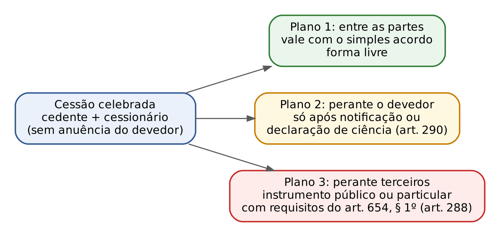
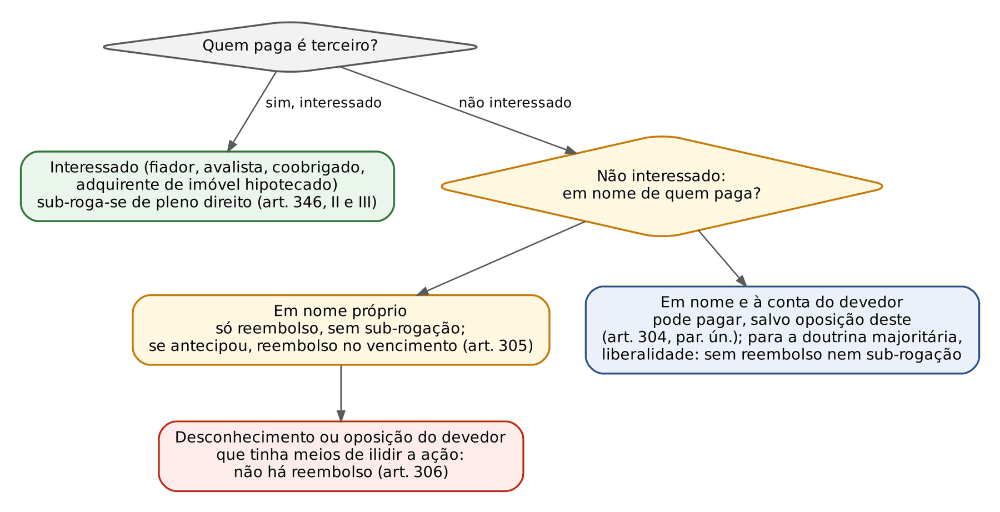
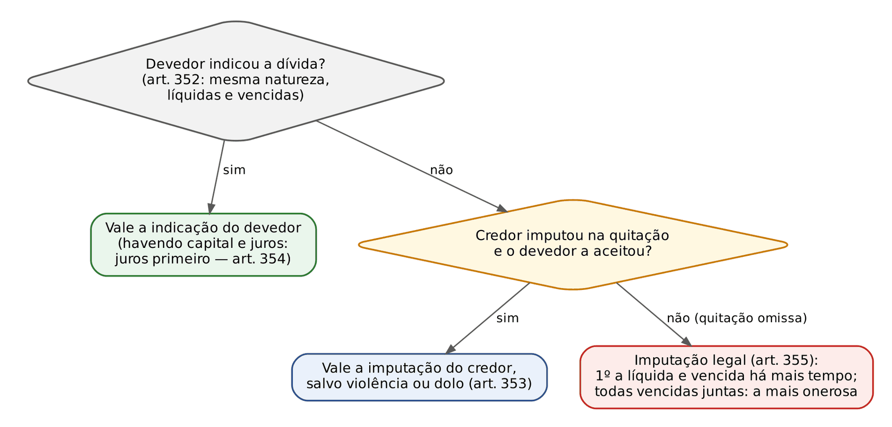
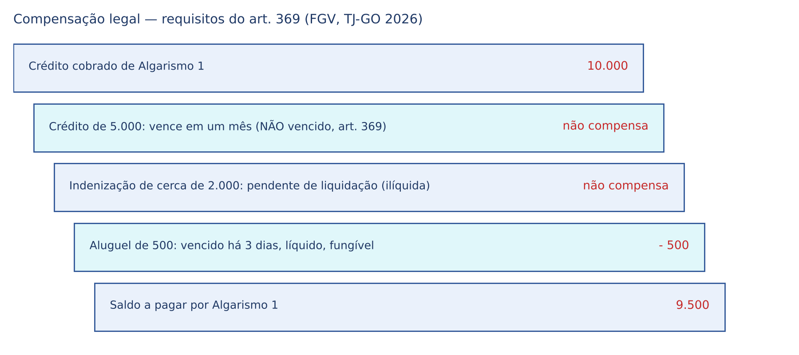

# CAPÍTULO 13 — OBRIGAÇÕES II: TRANSMISSÃO, ADIMPLEMENTO E EXTINÇÃO DAS OBRIGAÇÕES

:::INCIDENCIA
TRF5 p. 8; TJRS p. 11; TJSC p. 9; SEFAZ p. 7. Nível A. Lote: 42 questões (FGV 30, FCC 12), mais correlatas de outros capítulos.
O que mais cai: cessão de crédito (notificação, pagamento ao cedente, exceções, responsabilidade do cedente), dação com evicção da coisa dada, imputação legal (art. 355), terceiro que paga (reembolso x sub-rogação), compensação (requisitos e exclusões) e novação (fiador e devedores solidários).
:::

| Subtema | FGV | FCC | Padrão de cobrança |
|---|---|---|---|
| Cessão de crédito | 9 | 4 | Caso com pagamento ao cedente antes da notificação; exceções oponíveis; cláusula proibitiva fora do instrumento; cedente pro soluto; crédito penhorado; várias cessões |
| Assunção de dívida e cessão de posição contratual | 2 | 0 | Silêncio do credor (art. 299, par. ún., x art. 303); leasing quitado por cessionário |
| Quem paga e sub-rogação | 3 | 3 | Terceiro interessado x não interessado; sub-rogação legal (art. 346, I e II) |
| A quem, objeto, prova, lugar e tempo | 3 | 1 | Credor putativo; art. 330; art. 333, par. ún.; presunções de quitação |
| Consignação | 1 | 0 | Credor em lugar incerto |
| Imputação | 3 | 1 | Art. 355 (a mais antiga, não a mais onerosa); juros antes do capital |
| Dação em pagamento | 5 | 1 | Evicção da coisa dada restabelece a obrigação primitiva; consentimento do credor |
| Novação | 2 | 1 | Arts. 363, 365, 366 e 367 |
| Compensação | 2 | 1 | Dívidas vencidas e líquidas; exclusões do art. 373 |

## 13.1 Transmissão das obrigações: o mapa

O CC/2002 tipifica a cessão de crédito (polo ativo) e a assunção de dívida (polo passivo) (arts. 286 a 303); a cessão da posição contratual é atípica. Em todas, a obrigação permanece a MESMA: é isso que as distingue da novação subjetiva, em que a obrigação antiga se extingue e nasce outra (art. 360, II e III), e da sub-rogação, em que o crédito passa a quem pagou (art. 349). A transmissão *mortis causa* (herdeiros respondem nos limites da herança) é tema dos Caps. 42 e 45.

| Figura | O que muda | Consentimento de quem | Destino de garantias e exceções | Fundamento |
|---|---|---|---|---|
| Cessão de crédito | Credor | Cedente e cessionário; devedor só NOTIFICADO (eficácia) | Acessórios acompanham (art. 287); devedor opõe exceções que tinha contra o cedente ao tempo da ciência (art. 294) | Arts. 286 a 298 |
| Assunção de dívida | Devedor | Credor, EXPRESSAMENTE (art. 299) | Garantias especiais do devedor primitivo extinguem-se, salvo assentimento dele (art. 300); novo devedor não opõe exceções pessoais do primitivo (art. 302) | Arts. 299 a 303 |
| Cessão da posição contratual | Parte do contrato | Cedente, cessionário e cedido | Transfere-se o feixe contratual; aplicação analógica dos arts. 286 a 303 (Enunciado 648 do CJF) | Doutrina; Enunciado 648 |
| Sub-rogação pessoal | Credor (por efeito do pagamento) | Legal: ninguém; convencional: credor ou devedor (art. 347) | Transferem-se direitos, ações, privilégios e garantias (art. 349) | Arts. 346 a 351 |
| Novação subjetiva | Credor ou devedor, com OBRIGAÇÃO NOVA | Credor e novo sujeito; o devedor antigo pode ser dispensado (art. 362) | Extinguem-se acessórios e garantias, salvo estipulação (art. 364) | Arts. 360 a 367 |

## 13.2 Cessão de crédito

### 13.2.1 Conceito, objeto e limites

Cessão de crédito é o negócio jurídico bilateral pelo qual o credor (cedente) transfere a terceiro (cessionário) sua posição ativa, independentemente do consentimento do devedor (cedido). Pode ser onerosa ou gratuita, total ou parcial, voluntária, legal (ex.: art. 287, que leva os acessórios) ou judicial (adjudicação de crédito). A cessão não depende de anuência do devedor; a anuência é requisito de eficácia só quando a lei ou o contrato a exigem (ver adiante, consórcio).

:::LEI Código Civil, art. 286
Art. 286. O credor pode ceder o seu crédito, se a isso não se opuser a natureza da obrigação, a lei, ou a convenção com o devedor; a cláusula proibitiva da cessão não poderá ser oposta ao cessionário de boa-fé, se não constar do instrumento da obrigação.
:::

Três barreiras: natureza (créditos personalíssimos, alimentos — art. 1.707, ver Cap. 39), lei (ex.: crédito penhorado com ciência do credor, art. 298; direito de preferência, art. 520) e convenção (*pactum de non cedendo*). A cláusula proibitiva vale entre as partes, mas SÓ é oponível ao cessionário de boa-fé se constar do instrumento da obrigação. Se consta de instrumento apartado e o cessionário a ignorava, a cessão é eficaz contra o devedor, e a violação do pacto resolve-se em perdas e danos entre devedor e cedente.

:::QUESTAO FGV 2025 — TJ-SC — Juiz Substituto (Q3324231)
Caso: mútuo de cinco anos; dois anos depois, novo instrumento com pacto de não cessão; a credora cede o crédito a terceiro, que desconhecia o pacto e notifica a devedora para purgar a mora. Gabarito: A — a devedora deve cumprir perante a cessionária, apesar do ilícito contratual da cedente.
Fundamento: art. 286, parte final — o pacto não constava do instrumento da obrigação (estava em instrumento posterior) e a cessionária estava de boa-fé. Os acessórios da mora seguem o crédito (art. 287), o que derruba as alternativas que "fatiam" principal e consectários entre cedente e cessionária. Armadilha: alternativa de "remissão presumida", sem base legal.
:::

:::JURIS STJ, REsp 2.155.476-SP, j. 13/4/2026 (Info 887)
É válida e eficaz a cláusula contratual que condiciona a cessão de crédito à anuência da administradora de consórcio, ainda que se trate de cota cancelada. A cessão feita só com notificação à administradora não a impede de pagar ao consorciado excluído. Na mesma linha, a administradora não é obrigada a registrar, a pedido do cessionário, a cessão de direitos creditórios de cota cancelada (STJ, REsp 2.183.131-SP, j. 18/3/2025, Info 852).
:::

### 13.2.2 Os três planos de eficácia (arts. 288 e 290)

A cessão produz efeitos em planos distintos, e a banca explora a confusão entre eles: entre as partes, basta o acordo (forma livre, salvo se o crédito exigir forma especial); perante o DEVEDOR, só após notificação (art. 290); perante TERCEIROS (outros cessionários, credores do cedente), só se celebrada por instrumento público ou particular com os requisitos do art. 654, § 1º (lugar, qualificação, data, objeto), e, por coerência sistemática, registrado em títulos e documentos (art. 221 do CC; art. 129 da Lei 6.015/1973 — ver Cap. 33).

:::LEI Código Civil, arts. 288 e 290
Art. 288. É ineficaz, em relação a terceiros, a transmissão de um crédito, se não celebrar-se mediante instrumento público, ou instrumento particular revestido das solenidades do § 1 o do art. 654.
Art. 290. A cessão do crédito não tem eficácia em relação ao devedor, senão quando a este notificada; mas por notificado se tem o devedor que, em escrito público ou particular, se declarou ciente da cessão feita.
:::

- O devedor NÃO é terceiro para o art. 288: basta a notificação do art. 290 para que a cessão lhe seja eficaz (Enunciado 618 da VIII Jornada). Logo, a falta de forma do art. 288 não é defesa do devedor notificado.
- A notificação é ato de eficácia, não de validade, e pode ser feita por qualquer meio; a citação na ação de cobrança movida pelo cessionário supre a notificação (posição consolidada no STJ, adotada pela FGV na Q3849003).
- A falta de notificação NÃO torna a dívida inexigível nem impede o cessionário de praticar atos conservatórios, inclusive inscrever o devedor em cadastro de inadimplentes; o único efeito é proteger o devedor que paga ao cedente (STJ, REsp 1.603.683, 3ª Turma, Rel. Min. Nancy Andrighi, 2017).
- Atos conservatórios (interromper prescrição, protestar, requerer arresto) independem do conhecimento do devedor (art. 293).

:::PEGADINHA Validade x eficácia
Cessão por instrumento particular SEM data e lugar: é VÁLIDA entre as partes e eficaz perante o devedor notificado, mas INEFICAZ perante terceiros (art. 288). Não é nula, e não depende de concordância do devedor. FCC 2025 — MPE-PI — Analista (Q3530375), gabarito B: "válida, porém ineficaz em relação a terceiros". As alternativas de nulidade (por falta de anuência ou de instrumento público) são as armadilhas.
:::

### 13.2.3 Posição do devedor: pagamento, exceções e várias cessões

:::LEI Código Civil, arts. 292 e 294
Art. 292. Fica desobrigado o devedor que, antes de ter conhecimento da cessão, paga ao credor primitivo, ou que, no caso de mais de uma cessão notificada, paga ao cessionário que lhe apresenta, com o título de cessão, o da obrigação cedida; quando o crédito constar de escritura pública, prevalecerá a prioridade da notificação.
Art. 294. O devedor pode opor ao cessionário as exceções que lhe competirem, bem como as que, no momento em que veio a ter conhecimento da cessão, tinha contra o cedente.
:::

- Pagamento ao cedente antes da ciência é liberatório (art. 292). O cessionário volta-se contra o cedente (enriquecimento sem causa ou responsabilidade contratual), nunca contra o devedor que pagou de boa-fé.
- Exceções: o devedor opõe ao cessionário (a) as exceções próprias contra o cessionário e (b) as que TINHA contra o cedente no momento em que tomou ciência (pagamento, compensação, nulidade, exceção do contrato não cumprido). Exceções nascidas depois da ciência não se opõem.
- Compensação: regra especial no art. 377 — o devedor que, NOTIFICADO, NADA OPÕE à cessão perde a compensação que poderia opor ao cedente; se não foi notificado, pode opô-la ao cessionário (ver 13.11).
- Várias cessões do mesmo crédito: prevalece a que se completar com a TRADIÇÃO DO TÍTULO (art. 291); se notificadas várias, o devedor se libera pagando ao cessionário que apresentar o título da cessão e o da obrigação; crédito constante de escritura pública: prevalece a PRIORIDADE DA NOTIFICAÇÃO (art. 292, parte final).

:::QUESTAO FGV 2026 — TJ-SC — Oficial de Justiça (Q4153609)
Caso: devedor de 80.000 (oitenta mil) reais paga por depósito na conta pactuada com a cedente antes de ser comunicado da cessão; a cessionária notifica depois e exige novo pagamento. Gabarito: B — o pagamento ao credor originário é eficaz e extingue a obrigação também perante a cessionária (art. 292).
Armadilhas: exigir concordância do devedor para a cessão (art. 286 não exige); efeito imediato contra o devedor desde a celebração (contraria o art. 290); notificação posterior que "invalida" o pagamento.
No mesmo sentido: FGV 2024 — Câmara de Fortaleza — Advogado (Q2450538), gabarito C (devedora que pagou à cedente antes de conhecer a cessão fica desobrigada; a cedente não responde pela solvência — art. 296). O caso envolvia nota promissória: ver Nota de verificação.
:::

:::QUESTAO FGV 2026 — PC-PI — Delegado (Q3849003)
Caso: cessão a FIDC por instrumento particular sem as formalidades legais; o devedor, não notificado, paga 5.000 (cinco mil) reais à cedente; depois é citado na cobrança do cessionário e quer (i) efeito liberatório do pagamento parcial, (ii) opor desconto ajustado com a cedente e (iii) alegar invalidade por falta de forma. Gabarito: C — o pagamento parcial anterior à ciência libera nessa quantia, e o devedor opõe ao cessionário as exceções que tinha contra o cedente quando tomou ciência.
Por que (iii) falha: a forma do art. 288 é requisito de eficácia perante TERCEIROS, e o devedor não é terceiro (Enunciado 618); a citação equivale à notificação. Armadilhas: "inválida entre as partes" e "averbação em cartório" como condição da ação.
:::

:::QUESTAO FGV 2025 — TCE-PE — Analista (Q3593082)
Caso: cessão de 2.500.000 (dois milhões e quinhentos mil) reais a FIDC, notificada à devedora, que alega (a) falta de anuência, (b) cláusula proibitiva pactuada em termo aditivo e (c) crédito próprio vencido contra a cedente desde antes da cessão, de 1.000.000 (um milhão) de reais. Gabarito: D — a cessão é eficaz após a notificação, mas a devedora pode opor ao cessionário as exceções que tinha contra o cedente antes da ciência, incluindo a compensação com créditos vencidos.
Como resolver: anuência dispensável (art. 286); cláusula fora do instrumento da obrigação não se opõe ao cessionário de boa-fé; a devedora impugnou a cessão ao ser notificada, logo não incide a perda do art. 377, e a compensação preexistente é oponível (art. 294). Armadilha: cessão "livre de exceções pessoais".
:::

:::QUESTAO FCC 2024 — Prefeitura de Jaboatão dos Guararapes — Procurador (Q3542130)
Afirmação correta (D): ocorrendo várias cessões do mesmo crédito, prevalece a que se completar com a tradição do título (art. 291). Erradas: negar ao cessionário de crédito hipotecário o direito de averbar (o art. 289 o assegura); responsabilidade do cedente pela solvência com nulidade da cláusula em contrário (inverte o art. 296); devedor sem exceções (contraria o art. 294); atos conservatórios só após a ciência do devedor (contraria o art. 293).
No mesmo sentido: FCC 2024 — TRT-7 — Analista (Q3088386), gabarito D (art. 291), com distratores tirados dos arts. 302 (novo devedor NÃO opõe exceções pessoais do primitivo), 299 (assunção exige consentimento EXPRESSO), 287 (acessórios SÃO abrangidos) e 286 (a cessão pode ser vedada por convenção).
:::

### 13.2.4 Responsabilidade do cedente: *pro soluto* e *pro solvendo*

| Aspecto | Cessão onerosa | Cessão gratuita |
|---|---|---|
| Existência do crédito ao tempo da cessão (*veritas nominis*) | Responde SEMPRE, ainda que não se responsabilize (art. 295) e independentemente de culpa | Só se agiu de má-fé (art. 295, parte final) |
| Solvência do devedor (*bonitas nominis*) | Não responde, salvo estipulação (art. 296): regra *pro soluto* | Não responde |
| Se assumiu a solvência (*pro solvendo*) | Responde até o que recebeu do cessionário, com juros, mais despesas da cessão e da cobrança (art. 297) | — |

:::QUESTAO FGV 2025 — TRF-6 — Juiz Federal Substituto (Q3742385)
Caso: factoring adquire onerosamente créditos; parte já estava paga antes da cessão (inexistência) e parte não foi recebida por insolvência superveniente dos devedores; contrato silente. Gabarito: C — na cessão onerosa, o cedente responde pela existência do crédito ao tempo da cessão, independentemente de culpa, e pela solvência só se pactuado.
Armadilhas: responsabilidade integral presumida; só pela solvência; existência só com má-fé (regra da cessão GRATUITA).
No mesmo sentido: FGV 2024 — AL-PR — Procurador (Q2448958), gabarito D (cedente silente não responde pela insolvência do mutuário). Na mesma questão, a alternativa B (falta de notificação torna a cessão inexequível) contraria o entendimento do STJ citado em 13.2.2. FGV 2024 — São José dos Campos — Auditor (Q2348945): a alternativa C ("salvo estipulação em contrário, o cedente responde pela solvência") é a inversão literal do art. 296.
:::

### 13.2.5 Crédito penhorado e acessórios

Art. 298: o crédito penhorado não pode mais ser transferido pelo credor que tiver CONHECIMENTO da penhora; mas o devedor que paga sem NOTIFICAÇÃO dela fica exonerado, subsistindo contra o credor os direitos do terceiro. Combine com o art. 312: o devedor que paga ao credor apesar de INTIMADO da penhora paga mal e pode ser constrangido a pagar de novo, com regresso contra o credor.

:::QUESTAO FCC 2025 — UNICAMP — Procurador (Q3891318)
Gabarito: E — letra do art. 298. Armadilhas: trocar "conhecimento" (credor) por "notificação" (devedor), ou dizer que a transferência é possível "independentemente de conhecimento".
:::

Acessórios: salvo disposição em contrário, a cessão abrange todos (juros, cláusula penal, garantias reais e fidejussórias — art. 287); o cessionário de crédito hipotecário pode averbar a cessão no registro do imóvel (art. 289). Os acessórios da mora acompanham o crédito (Q3324231, acima).

:::QUESTAO FGV 2025 — TRF-5 — Juiz Substituto (Q3373877)
Caso: Tício deve 10.000 (dez mil) reais ao banco, que é condenado a lhe pagar 5.000 (cinco mil) reais de danos morais; Tício tem ainda 2.000 (dois mil) reais em conta-corrente no banco; o banco cede o crédito a uma faturizadora por 8.500 (oito mil e quinhentos) reais; Tício, notificado, nada objeta. Pergunta-se o valor máximo pelo qual a faturizadora pode securitizar o crédito. Gabarito: A — 10.000 (dez mil) reais.
Passos: a regra geral do art. 294 cede à especial do art. 377, que retira a compensação do devedor que, notificado, NADA OPÕE à cessão; o preço da cessão não mede o crédito. Armadilhas: abater 5.000 e 2.000 (B, C e D) ou adotar o preço (E).
:::

## 13.3 Assunção de dívida

### 13.3.1 Requisitos e espécies

:::LEI Código Civil, art. 299 e art. 303
Art. 299. É facultado a terceiro assumir a obrigação do devedor, com o consentimento expresso do credor, ficando exonerado o devedor primitivo, salvo se aquele, ao tempo da assunção, era insolvente e o credor o ignorava.
Parágrafo único. Qualquer das partes pode assinar prazo ao credor para que consinta na assunção da dívida, interpretando-se o seu silêncio como recusa.
Art. 303. O adquirente de imóvel hipotecado pode tomar a seu cargo o pagamento do crédito garantido; se o credor, notificado, não impugnar em trinta dias a transferência do débito, entender-se-á dado o assentimento.
:::

- Consentimento EXPRESSO do credor é requisito de eficácia: o patrimônio do devedor é a garantia do credor, e trocar o devedor pode esvaziá-la.
- Exoneração do primitivo, SALVO se o novo devedor já era insolvente ao tempo da assunção e o credor o ignorava: nesse caso o primitivo continua obrigado. Não confundir com o art. 363 (novação), em que o credor que aceitou o novo devedor insolvente NÃO tem regresso contra o primeiro, salvo má-fé deste (ver 13.10).
- Espécies (doutrina): por EXPROMISSÃO, contrato entre credor e terceiro, sem participação do devedor (o art. 299 não exige a anuência do devedor); por DELEGAÇÃO, acordo entre devedor (delegante) e terceiro (delegado), com consentimento do credor (delegatário). Quanto aos efeitos: LIBERATÓRIA (regra do art. 299) ou CUMULATIVA (reforço, coassunção), admitida pelo Enunciado 16 da I Jornada quando dois ou mais devedores se tornam responsáveis com a concordância do credor.

:::PEGADINHA O silêncio do credor
Regra geral (art. 299, par. ún.): assinado prazo ao credor, o SILÊNCIO é RECUSA. Exceção (art. 303): adquirente de imóvel HIPOTECADO que assume o crédito garantido; o credor notificado que não impugna em 30 DIAS é tido como ANUENTE. A FGV cobra exatamente a inversão.
:::

:::QUESTAO FGV 2025 — ENAC — 1º Exame Nacional dos Cartórios (Q3328197)
Caso: comprador de casa de veraneio hipotecada assume a dívida garantida, abatendo-a do preço; o credor é consultado com documentos e não responde em mais de 30 dias. Gabarito: A — presume-se o assentimento; a venda e a assunção produzem efeitos normalmente (art. 303).
Armadilhas: aplicar a regra geral do art. 299, par. ún. (silêncio como recusa), afirmar solidariedade entre alienante e adquirente ou nulidade por "contrato de gaveta". Enunciado 424 da V Jornada: a comprovada ciência do credor de que o pagamento reiterado é feito por terceiro no interesse próprio produz efeitos equivalentes aos da notificação do art. 303.
:::

### 13.3.2 Efeitos: garantias, invalidade e exceções

| Regra | Conteúdo | Artigo |
|---|---|---|
| Garantias especiais | Extinguem-se as garantias especiais dadas originariamente pelo devedor primitivo, salvo seu assentimento expresso. "Garantias especiais" = todas as reais ou fidejussórias prestadas voluntária e originariamente pelo devedor primitivo ou por terceiro (Enunciado 422 da V Jornada) | Art. 300 |
| Anulação da substituição | Restaura-se o débito com todas as garantias, SALVO as prestadas por terceiros, exceto se o terceiro conhecia o vício | Art. 301 |
| Exceções | O novo devedor NÃO opõe ao credor as exceções PESSOAIS do primitivo (ex.: compensação com crédito do primitivo, incapacidade do primitivo); opõe as exceções comuns, inerentes à dívida (pagamento, prescrição, nulidade) | Art. 302 |

:::QUESTAO FGV 2024 — Prefeitura de São José dos Campos — Auditor Tributário (Q2348945)
Gabarito: B — a assunção exonera o devedor primitivo quando há consentimento expresso do credor, salvo se o assuntor era insolvente ao tempo da assunção e o credor o ignorava (art. 299). Erradas: cessão "independente de notificação" quando por instrumento público (o art. 290 não distingue); cedente responde pela solvência (art. 296 diz o contrário); novo devedor opõe exceções pessoais do primitivo (art. 302 veda); cessionário sem legitimidade para atos conservatórios (art. 293 a confere).
:::

## 13.4 Cessão da posição contratual

Transmite-se a posição jurídica global de uma das partes em contrato bilateral, normalmente de execução diferida ou continuada (locação, promessa de compra e venda, arrendamento mercantil, empreitada), com créditos, débitos, deveres anexos e direitos potestativos (resolver, anular). Não é soma de cessão de crédito com assunção de dívida, mas negócio unitário (concepção dominante, de matriz italiana e portuguesa). Requisito central: consentimento do CEDIDO, que pode ser prévio (cláusula contratual), concomitante ou posterior. Enunciado 648 da IX Jornada: aplica-se à cessão da posição contratual, no que couber, a disciplina da transmissão das obrigações, em particular a expressa anuência do cedido (art. 299).

- Leis especiais: na locação, a cessão depende de consentimento prévio e escrito do locador (art. 13 da Lei 8.245/1991 — ver Cap. 18); no SFH, o STJ exige a anuência da instituição mutuante para que o cessionário (o "contrato de gaveta" posterior a 25/10/1996) tenha legitimidade ativa para revisar o contrato (Jurisprudência em Teses n. 92, tese 10; Tema 522 do STJ — ver Cap. 22).
- Anuência e boa-fé: a finalidade da anuência é permitir ao cedido avaliar a solvência do cessionário. Quando o contrato já foi integralmente cumprido pelo cessionário, a exigência perde sentido.

:::JURIS STJ, REsp 1.036.530, 4ª Turma, Rel. Min. Luis Felipe Salomão (noticiado em 2/4/2014)
Arrendamento mercantil de veículo cedido por contrato particular, sem anuência da arrendadora; o cessionário quitou todas as parcelas. A Turma, por maioria, reconheceu a eficácia da cessão da posição contratual e condenou a financeira a entregar os documentos de quitação para transferência do veículo: a anuência serve à avaliação da capacidade econômica do cessionário e pode ser posterior; quitada a obrigação, sua finalidade se esvazia, e a boa-fé objetiva impõe ao cedido reconhecer o direito do cessionário que cumpriu o contrato.
:::

:::QUESTAO FGV 2025 — TJ-SE — Juiz Substituto (Q3301220)
Caso: veículo em arrendamento mercantil em nome da sogra; o genro, negativado, pede para assumir e quitar à vista o saldo; o banco recusa por causa da negativação; ele deposita todo o saldo em agência do próprio banco. Gabarito: E — houve cessão de posição contratual que, embora não dispense a anuência do cedido, deve ser reconhecida como válida e eficaz no caso concreto, com transferência do veículo.
Fundamento: a linha do REsp 1.036.530 (acima): com a quitação integral, a recusa fundada na solvência do cessionário perde justificativa. Por que não C (assunção de dívida dependente de anuência): o que se transmite é o contrato inteiro, com o direito à opção de compra, e não só o débito. Por que não A: o terceiro pagador não é "interessado" e a sub-rogação não lhe daria a propriedade do bem. Gabarito construído sobre precedente de Turma: ver Nota de verificação.
:::

## 13.5 Pagamento: teoria e requisitos

Pagamento é o cumprimento voluntário da prestação devida; sua natureza (fato, ato *stricto sensu* ou negócio jurídico) é controvertida. Para a prova, importa o Enunciado 425 da V Jornada: o pagamento repercute no plano da EFICÁCIA, e não no da validade, como sugere a letra dos arts. 308, 309 e 310 ("só valer", "é válido", "não vale"). Requisitos clássicos: vínculo obrigacional, *animus solvendi*, cumprimento exato (sujeitos, objeto, modo, lugar e tempo — art. 336 aplica a mesma exigência à consignação).

### 13.5.1 Quem deve pagar (arts. 304 a 307)

:::LEI Código Civil, arts. 304 e 305
Art. 304. Qualquer interessado na extinção da dívida pode pagá-la, usando, se o credor se opuser, dos meios conducentes à exoneração do devedor.
Parágrafo único. Igual direito cabe ao terceiro não interessado, se o fizer em nome e à conta do devedor, salvo oposição deste.
Art. 305. O terceiro não interessado, que paga a dívida em seu próprio nome, tem direito a reembolsar-se do que pagar; mas não se sub-roga nos direitos do credor.
Parágrafo único. Se pagar antes de vencida a dívida, só terá direito ao reembolso no vencimento.
:::

Terceiro INTERESSADO é quem tem interesse JURÍDICO (patrimonial) na extinção: fiador, avalista, coobrigado solidário, adquirente de imóvel hipotecado, sublocatário, outro credor do mesmo devedor (art. 346, I). Interesse afetivo ou moral (pai, cônjuge, amigo, descendente do devedor vivo) não basta: o parente é terceiro NÃO interessado.

| Quem paga | Pode pagar contra a vontade do credor? | Contra a oposição do devedor? | Reembolso | Sub-rogação |
|---|---|---|---|---|
| Terceiro interessado | Sim, inclusive por consignação ("meios conducentes à exoneração") | Sim | Sim | SIM, legal (art. 346, III) |
| Não interessado, em nome próprio | Sim, se o credor aceitar; não tem os meios de exoneração do art. 304 | Pode, mas perde o reembolso se o devedor tinha meios de ilidir a ação (art. 306) | Sim (no vencimento, se antecipou) | NÃO (art. 305) |
| Não interessado, em nome e à conta do devedor | Sim, e pode consignar (art. 304, par. ún.) | NÃO, "salvo oposição deste" | Não (liberalidade, segundo a doutrina majoritária) | NÃO |

- Art. 306: o pagamento por terceiro com desconhecimento ou oposição do devedor não obriga ao reembolso se o devedor tinha meios para ilidir a ação (ex.: dívida prescrita, compensável, nula).
- Art. 307: pagamento que importa transmissão de propriedade só é eficaz se feito por quem possa alienar; mas coisa fungível recebida e consumida de boa-fé não pode ser reclamada do credor (par. ún.).

:::QUESTAO FCC 2026 — TJ-CE — Oficial de Justiça (Q4240014)
Caso: primo do devedor, terceiro sem interesse jurídico, paga a dívida "certo de que poderá cobrar os valores originalmente devidos" do primo. Gabarito: C — pagando em nome próprio, com conhecimento e sem oposição do devedor, tem direito a reembolso, mas não se sub-roga (art. 305).
Por que A e E estão erradas: a regra do art. 327 é o domicílio do DEVEDOR (dívida quesível), salvo convenção; A diz "credor"; E diz "ainda que as partes convencionem diversamente". B erra porque o não interessado pode pagar em nome e à conta do devedor (art. 304, par. ún.); D erra porque o não interessado nunca se sub-roga.
:::

:::QUESTAO FGV 2026 — TJ-BA — Juiz Leigo (Q4102100)
Caso: prima do locatário (sem relação jurídica) paga o aluguel de janeiro; o sublocatário, interessado na manutenção da locação, paga o de fevereiro. Gabarito: A — qualquer interessado pode pagar, usando, se o credor se opuser, dos meios conducentes à exoneração do devedor (art. 304, caput).
Armadilhas: B (não interessado que paga em nome próprio sub-roga-se: falso, art. 305); C e E (terceiro interessado sem reembolso ou sem sub-rogação: falso, art. 346, III); D distorce o art. 306, que exige desconhecimento ou oposição do devedor.
:::

:::QUESTAO FCC 2025 — PGE-TO — Procurador (Q3745583)
Gabarito: C — o fiador é terceiro interessado; o descendente do devedor vivo é terceiro não interessado (não responde pela dívida; herdeiro só responde após a abertura da sucessão e nos limites da herança). Armadilha: confundir afeição ou expectativa sucessória com interesse jurídico.
Correlata: FGV 2025 — TJ-SC — Juiz Substituto (Q3324227, Cap. 25): pais que querem pagar a reparação devida por adolescente podem usar, se o credor se opuser, os meios conducentes à exoneração do devedor (art. 304).
:::

### 13.5.2 A quem se deve pagar (arts. 308 a 312)

| Situação | Regra | Artigo |
|---|---|---|
| Pagamento ao credor ou a quem de direito o represente (legal, judicial ou convencional) | Eficaz | Art. 308 |
| Pagamento a quem não é credor nem representante | Só vale depois de RATIFICADO pelo credor, ou TANTO QUANTO reverter em seu proveito | Art. 308 |
| Credor putativo (aparente) | Pagamento de boa-fé é válido, ainda provado depois que não era credor (teoria da aparência; erro escusável) | Art. 309 |
| Credor incapaz de quitar, pagamento feito CIENTEMENTE | Não vale, se o devedor não provar que em benefício dele efetivamente reverteu | Art. 310 |
| Portador da quitação | Presume-se autorizado a receber, salvo se as circunstâncias contrariarem a presunção | Art. 311 |
| Devedor INTIMADO da penhora do crédito ou de impugnação de terceiros | O pagamento ao credor não vale contra estes, que podem constranger o devedor a pagar de novo; regresso contra o credor | Art. 312 |

:::QUESTAO FGV 2024 — TJ-MT — Juiz Substituto (Q3086923)
Caso: o comprador combinou retirar as refeições por transportadora; na segunda semana, o mesmo motorista da semana anterior, no dia e hora combinados, retira a mercadoria, mas já não atuava pelo comprador. Gabarito: B — a entrega pode ser reputada eficaz, porque feita de boa-fé a quem tinha aparência de preposto do credor (credor putativo, art. 309).
Armadilhas: exigir quitação (art. 311 é presunção a favor do devedor, não requisito) ou documento de preposição; E descreve o art. 308, que pressupõe pagamento a quem não tem aparência de legitimidade.
:::

:::PEGADINHA Credor incapaz
"Vale ainda que feito cientemente ao credor incapaz de quitar, independentemente de ter revertido em benefício dele" é FALSO (art. 310). Se o devedor IGNORAVA a incapacidade sem culpa, a doutrina admite a eficácia do pagamento (a regra sanciona só o pagamento feito "cientemente"). FCC 2026 — SEFAZ-GO — Auditor (Q4066824), alternativa C.
:::

### 13.5.3 Objeto do pagamento (arts. 313 a 318)

- Identidade: o credor não é obrigado a receber prestação diversa, ainda que mais valiosa (art. 313); a prestação diversa só extingue a obrigação se o credor consentir (dação, art. 356).
- Integralidade: ainda que divisível a prestação, nem o credor é obrigado a receber, nem o devedor a pagar por partes, se assim não se ajustou (art. 314). Por isso, na consignação, o depósito insuficiente leva à improcedência (Tema 967 do STJ, em 13.6).
- Nominalismo: dívidas em dinheiro pagam-se no vencimento, em moeda corrente e pelo valor nominal (art. 315); é lícito convencionar o aumento progressivo de prestações sucessivas (art. 316 — cláusula de escala móvel, que a doutrina distingue da mera correção monetária).
- Art. 317: desproporção manifesta por motivos imprevisíveis entre o valor da prestação devida e o do momento da execução autoriza o juiz a corrigi-lo, a pedido da parte, para assegurar o valor real (Enunciado 17 da I Jornada: "motivos imprevisíveis" abrange causas previsíveis de resultados imprevisíveis). A teoria da imprevisão e a revisão contratual são desenvolvidas no Cap. 16; correção monetária e IPCA após a Lei 14.905/2024, no Cap. 14.

Art. 318: são NULAS as convenções de pagamento em ouro ou em moeda estrangeira, bem como para compensar a diferença entre o valor desta e o da moeda nacional, excetuados os casos previstos na legislação especial.

A legislação especial hoje é o art. 13 da Lei 14.286/2021 (novo marco cambial), que admite a estipulação de pagamento em moeda estrangeira de obrigações exequíveis no Brasil, entre outros casos: contratos e títulos do comércio exterior, seu financiamento e garantias; obrigações em que credor ou devedor seja NÃO RESIDENTE (exceto locação de imóvel situado no território nacional); arrendamento mercantil entre residentes com recursos captados no exterior; cessão, transferência, delegação, assunção ou modificação dessas obrigações; compra e venda de moeda estrangeira; exportação indireta; contratos de exportadores com concessionárias de infraestrutura; situações previstas pelo CMN e outras previstas em lei. Fora dessas hipóteses, a estipulação é nula de pleno direito (parágrafo único). A jurisprudência do STJ, em contratos internos, admite a referência à moeda estrangeira como mero indexador convertido em reais na data da contratação, o que não se confunde com pagamento em moeda estrangeira (orientação descrita sem número de precedente: ver Nota).

:::PEGADINHA "Por via de regra"
"O pagamento pode, por via de regra, ser convencionado em ouro ou moeda estrangeira": FALSO; a regra é a NULIDADE (art. 318), e as exceções estão em lei especial (FCC 2026 — SEFAZ-GO, Q4066824, alternativa E).
:::

### 13.5.4 Prova do pagamento: quitação e presunções (arts. 319 a 326)

O devedor que paga tem direito a quitação regular e pode RETER o pagamento enquanto não lhe for dada (art. 319); a recusa de quitação autoriza a consignação (art. 335, I). A quitação sempre pode ser dada por instrumento particular, mesmo que o contrato exija escritura pública, e conterá valor e espécie da dívida, nome do devedor ou de quem pagou, tempo e lugar e assinatura do credor; sem esses requisitos, vale se de seus termos ou das circunstâncias resultar haver sido paga a dívida (art. 320). A quitação "regular" engloba a dada por meios eletrônicos ou de comunicação a distância (Enunciado 18 da I Jornada).

| Presunção | Conteúdo | Natureza |
|---|---|---|
| Quotas periódicas | A quitação da ÚLTIMA presume solvidas as anteriores | Relativa: "até prova em contrário" (art. 322) |
| Capital e juros | Quitação do capital SEM reserva dos juros presume os juros pagos | Relativa (art. 323) |
| Entrega do título | Firma a presunção do pagamento | Relativa: fica sem efeito se o credor provar, em 60 DIAS, a falta de pagamento (art. 324, par. ún.) |
| Título perdido | Devedor pode reter o pagamento e exigir declaração que inutilize o título (art. 321) | — |
| Despesas | Presumem-se a cargo do devedor; aumento por fato do credor corre por conta deste (art. 325) | — |
| Medida e peso | No silêncio, os do lugar da execução (art. 326) | — |

:::JURIS STJ, Tema 514 (REsp 1.183.474/DF)
A quitação relativa à restituição, por instrumento de transação, somente alcança as parcelas efetivamente quitadas, não tendo eficácia em relação às verbas por ele não abrangidas; recibo de quitação passado de forma geral não salda expurgos inflacionários não pagos. Quitação interpreta-se restritivamente (arts. 320 e 843). No mesmo espírito, o STJ negou a ampliação de indenização fixada em acordo de quitação quando o fato alegado (desvalorização de imóveis após o desastre de Brumadinho) não era superveniente nem imprevisível à época (REsp 2.198.074-MG, j. 1º/9/2025, Info 864).
:::

:::JURIS STJ, Tema 725 (REsp 1.339.436/SP)
No regime da Lei 9.492/1997, legitimamente protestado o título, salvo inequívoca pactuação em sentido contrário, incumbe ao DEVEDOR, após a quitação, providenciar o cancelamento do protesto. Coerente com o art. 325 (despesas do pagamento e da quitação a cargo do devedor).
:::

:::PEGADINHA Art. 324
"O pagamento não se presume pela entrega do título ao devedor": FALSO (art. 324). E a presunção é relativa, com prazo DECADENCIAL de 60 dias para o credor provar a falta de pagamento (Q4066824, alternativa D).
:::

### 13.5.5 Lugar do pagamento (arts. 327 a 330)

:::LEI Código Civil, arts. 327 e 330
Art. 327. Efetuar-se-á o pagamento no domicílio do devedor, salvo se as partes convencionarem diversamente, ou se o contrário resultar da lei, da natureza da obrigação ou das circunstâncias.
Parágrafo único. Designados dois ou mais lugares, cabe ao credor escolher entre eles.
Art. 330. O pagamento reiteradamente feito em outro local faz presumir renúncia do credor relativamente ao previsto no contrato.
:::

- Dívida QUESÍVEL (*quérable*): paga-se no domicílio do devedor, onde o credor deve buscá-la; é a REGRA supletiva. Dívida PORTÁVEL (*portable*): o devedor leva ao domicílio do credor; depende de convenção, lei ou natureza.
- Imóvel: tradição ou prestações relativas a imóvel, no lugar onde situado o bem (art. 328).
- Motivo grave: o devedor pode pagar em outro lugar, sem prejuízo do credor (art. 329).
- Art. 330: manifestação legal da *supressio* (perda de posição jurídica pelo não exercício prolongado, gerando confiança na outra parte) e da correlata *surrectio* para o devedor; as figuras parcelares da boa-fé são desenvolvidas no Cap. 15.

:::QUESTAO FGV 2024 — TJ-PE — Juiz Substituto (Q3117512)
Caso: locação de vaga de garagem com pagamento convencionado em dinheiro, na residência do locador; fiadora é a síndica. Gabarito: A — se o locador reiteradamente aceitar pagamento por Pix, presume-se sua renúncia ao lugar contratado (art. 330).
Erradas: B (sem vencimento antecipado automático: o art. 333, III, exige recusa do devedor intimado a reforçar a garantia); C (a fiadora interessada pode consignar e reter o pagamento até a quitação — arts. 304, 319 e 335, I); D (arts. 313 e 356); E (a fiadora sub-roga-se — arts. 346, III, e 831).
No mesmo sentido: FCC 2026 — SEFAZ-GO — Auditor (Q4066824), gabarito A (art. 330), com distratores dos arts. 304 (não interessado pode pagar), 310, 324 e 318.
:::

### 13.5.6 Tempo do pagamento (arts. 331 a 333)

- Sem época ajustada, o credor pode exigir IMEDIATAMENTE, salvo disposição legal em contrário (art. 331); a doutrina ressalva o prazo moral ou razoável decorrente da natureza da prestação (ex.: mútuo sem prazo — art. 592, ver Cap. 19).
- Obrigações condicionais cumprem-se na data do implemento da condição, cabendo ao CREDOR provar que o devedor teve ciência (art. 332).
- Vencimento antecipado legal (art. 333): falência do devedor ou concurso de credores; penhora, por outro credor, dos bens hipotecados ou empenhados; cessação ou insuficiência das garantias, fidejussórias ou reais, se o devedor, INTIMADO, se negar a reforçá-las. Parágrafo único: havendo solidariedade passiva, NÃO se reputa vencido quanto aos outros devedores solventes.
- Cláusula convencional de vencimento antecipado (ex.: três parcelas em atraso) é válida e comum em mútuo (Q2448958); na alienação fiduciária e na Lei 14.711/2023, ver Cap. 22.

:::QUESTAO FGV 2024 — TJ-SC — Juiz Substituto (Q3049337)
Caso: dívida solidária de marido e mulher; cláusula de eleição do foro do lugar do pagamento "quando vencida a dívida"; sem lugar convencionado (logo, domicílio dos devedores — art. 327); instaura-se concurso de credores contra o marido, que se declara insolvente; depois o casal se muda de Florianópolis para Blumenau, antes da data prevista para a última parcela; o credor cobra só da mulher. Gabarito: C — Blumenau.
Passos: (1) o concurso de credores antecipa o vencimento (art. 333, I), mas, pelo parágrafo único, NÃO quanto à devedora solidária solvente; (2) para a mulher, o vencimento é a data original, quando ela já residia em Blumenau; (3) o lugar do pagamento é o domicílio da devedora no vencimento (art. 327), e esse é o foro eleito. Armadilha: aplicar o vencimento antecipado a ambos e fixar Florianópolis.
:::

## 13.6 Pagamento em consignação (arts. 334 a 345; CPC, arts. 539 a 549)

Consignação é o depósito judicial ou em estabelecimento bancário da coisa devida, nos casos e forma legais, que se considera pagamento e extingue a obrigação (art. 334). É direito do devedor (e do terceiro, art. 539 do CPC) de se liberar quando o pagamento direto é impossível ou arriscado. Serve a obrigações de dar (dinheiro ou coisa), não às de fazer ou não fazer.

:::LEI Código Civil, art. 335
Art. 335. A consignação tem lugar:
I - se o credor não puder, ou, sem justa causa, recusar receber o pagamento, ou dar quitação na devida forma;
II - se o credor não for, nem mandar receber a coisa no lugar, tempo e condição devidos;
III - se o credor for incapaz de receber, for desconhecido, declarado ausente, ou residir em lugar incerto ou de acesso perigoso ou difícil;
IV - se ocorrer dúvida sobre quem deva legitimamente receber o objeto do pagamento;
V - se pender litígio sobre o objeto do pagamento.
:::

O rol é exemplificativo segundo a doutrina majoritária (há hipóteses em leis especiais, como a Lei 8.245/1991, art. 67 — ver Cap. 18). Incisos I e II correspondem à mora do credor (*mora accipiendi*, ver Cap. 14); III a V, a situações objetivas de risco ou incerteza.

| Regra | Conteúdo | Artigo |
|---|---|---|
| Requisitos | Devem concorrer, quanto a pessoas, objeto, modo e tempo, todos os requisitos de validade do pagamento | Art. 336 |
| Lugar e efeitos | Depósito no lugar do pagamento; cessam juros e riscos para o depositante desde o depósito, salvo improcedência | Art. 337 (CPC, art. 540) |
| Levantamento antes da aceitação ou impugnação | O devedor pode levantar, pagando despesas; a obrigação subsiste | Art. 338 |
| Levantamento após procedência | Só com acordo dos outros devedores e fiadores, ainda que o credor consinta | Art. 339 |
| Credor que, após contestar ou aceitar, aquiesce no levantamento | Perde preferência e garantia sobre a coisa; codevedores e fiadores que não anuíram ficam desobrigados | Art. 340 |
| Imóvel ou corpo certo | Citação do credor para vir ou mandar receber, sob pena de depósito | Art. 341 |
| Coisa indeterminada com escolha do credor | Citação para escolher, sob pena de perder o direito | Art. 342 |
| Despesas | Procedente: credor; improcedente: devedor | Art. 343 |
| Obrigação litigiosa | Consignação exonera; pagar a um dos pretendentes, ciente do litígio, é assumir o risco | Art. 344 |
| Litígio entre credores que se excluem | Qualquer deles pode requerer a consignação | Art. 345 |

:::QUESTAO FGV 2024 — TCE-GO — Analista (Q2524467)
Caso: mútuo a ser pago pessoalmente ao mutuante, que está em lugar incerto há mais de 40 dias; a esposa ajuizou ação declaratória de ausência, ainda não julgada. Gabarito: C — o devedor deve consignar, independentemente do julgamento da ausência, porque o credor reside em lugar incerto (art. 335, III).
Erradas: I (a comunhão parcial não torna a esposa credora solidária: a solidariedade não se presume — art. 265, ver Cap. 12); II (a ação de ausência não suspende o vencimento).
:::

:::PROCESSO Consignação extrajudicial e judicial (CPC)
- Extrajudicial (só obrigação em DINHEIRO): depósito em banco, oficial onde houver, no lugar do pagamento; credor cientificado por carta com AR, com 10 DIAS para recusa (art. 539, § 1º). Sem recusa no prazo, contado do retorno do AR, o devedor fica liberado (§ 2º). Com recusa escrita ao banco, a ação pode ser proposta em 1 MÊS, instruída com a prova do depósito e da recusa (§ 3º); não proposta, o depósito fica sem efeito (§ 4º).
- Prestações sucessivas: consignada uma, as que vencerem podem ser depositadas no mesmo processo em até 5 DIAS do vencimento (art. 541).
- Inicial: depósito em 5 dias do deferimento, sob pena de extinção sem resolução do mérito (art. 542).
- Defesa restrita: não houve recusa ou mora; recusa justa; depósito fora do prazo ou lugar; depósito não integral, caso em que o réu deve indicar o montante devido (art. 544).
- Insuficiência alegada: o autor pode completar em 10 DIAS, salvo prestação cujo inadimplemento acarrete rescisão (art. 545); o réu levanta desde logo a parte incontroversa; a sentença que reconhece a insuficiência fixa o montante e vale como título executivo para o credor (art. 545, § 2º).
:::

:::JURIS STJ, Tema 967 (j. 10/10/2018)
Em ação consignatória, a insuficiência do depósito realizado pelo devedor conduz ao julgamento de IMPROCEDÊNCIA do pedido, pois o pagamento parcial da dívida não extingue o vínculo obrigacional. Leitura combinada: improcedente a consignação, a sentença ainda serve de título ao credor pela diferença (art. 545, § 2º, do CPC), e o efeito liberatório se limita ao que foi depositado e levantado.
:::

:::SENTENCA Dispositivo de consignação
Procedência: "Julgo procedente o pedido para declarar extinta a obrigação descrita na inicial, no valor depositado de [valor] (extenso) reais, com efeitos desde a data do depósito (CC, arts. 334 e 337; CPC, art. 546), e condeno o réu ao pagamento das custas e honorários advocatícios, que fixo em [x]% sobre o valor da causa. Autorizo o levantamento do depósito pelo réu."
Insuficiência: "Reconhecida a insuficiência do depósito (Tema 967 do STJ), julgo improcedente o pedido; nos termos do art. 545, § 2º, do CPC, fixo o saldo devido em [valor], que o réu poderá executar nestes autos, autorizado desde já o levantamento da quantia depositada."
:::

## 13.7 Pagamento com sub-rogação (arts. 346 a 351)

Sub-rogação pessoal é a substituição do credor por quem pagou a dívida (ou emprestou para pagá-la), com transferência do crédito e de seus acessórios. Para o credor originário, há pagamento; para o devedor, a obrigação subsiste perante o sub-rogado. Não se confunde com a sub-rogação REAL (substituição de um bem por outro no mesmo patrimônio, como nos regimes de bens — ver Cap. 36).

Sub-rogação LEGAL, de pleno direito (art. 346): (I) do credor que paga a dívida do devedor comum; (II) do adquirente do imóvel hipotecado que paga ao credor hipotecário e do terceiro que paga para não ser privado de direito sobre imóvel; (III) do terceiro interessado que paga a dívida pela qual era ou podia ser obrigado, no todo ou em parte.

Sub-rogação convencional (art. 347): (I) o credor recebe de terceiro e EXPRESSAMENTE lhe transfere todos os seus direitos — rege-se pelas regras da cessão de crédito (art. 348); (II) terceiro empresta ao devedor a quantia para solver a dívida, sob a condição expressa de ficar sub-rogado nos direitos do credor satisfeito.

| Efeito | Sub-rogação legal | Sub-rogação convencional |
|---|---|---|
| Fonte | Lei (art. 346), de pleno direito | Vontade (art. 347) |
| Limite | O sub-rogado só exerce direitos até a soma que DESEMBOLSOU (art. 350): sem especulação | Pode transferir o crédito integral, ainda que o terceiro pague menos (inciso I segue a cessão — art. 348) |
| O que se transfere | Todos os direitos, ações, privilégios e garantias do primitivo, contra o devedor principal e os fiadores (art. 349) | Idem |
| Pagamento parcial | O credor originário, só em parte reembolsado, tem PREFERÊNCIA sobre o sub-rogado na cobrança do restante, se os bens do devedor não bastarem (art. 351) | Idem |

| Sub-rogação x cessão de crédito | Sub-rogação | Cessão |
|---|---|---|
| Causa | Pagamento (finalidade satisfativa) | Negócio de circulação do crédito (finalidade especulativa possível) |
| Legal sem acordo | Sim (art. 346) | Não, salvo cessão legal |
| Limite do direito | Legal: o que desembolsou (art. 350) | Valor nominal, qualquer que seja o preço |
| Responsabilidade do transmitente pela existência | Não há "cedente" que garanta | Cedente oneroso responde (art. 295) |

:::JURIS STJ, REsp 2.228.772-SP, 4ª Turma, Rel. Min. Antonio Carlos Ferreira, j. 3/3/2026 (Informativo de Jurisprudência n. 32, Edição Extraordinária)
1. O exercício do regresso pelo sub-rogado nos mesmos autos (art. 794, § 2º, do CPC: o fiador que pagar pode executar o afiançado no mesmo processo) depende da satisfação INTEGRAL do credor originário. 2. A sub-rogação do terceiro interessado pode ser parcial (art. 346, III), mas, havendo pagamento parcial, o credor originário conserva preferência sobre o sub-rogado quanto ao remanescente (art. 351).
:::

- Sub-rogação do segurador que paga a indenização: hoje regida pela Lei 15.040/2024 (ver Cap. 20). O STJ entende que a sub-rogação transfere apenas direitos MATERIAIS do credor, não prerrogativas processuais personalíssimas do consumidor (foro do art. 101, I, e inversão do ônus do art. 6º, VIII, do CDC).

:::QUESTAO FCC 2025 — TRT-15 — Oficial de Justiça (Q3302510)
Caso: André e Berenice são credores de Carlos por obrigações distintas; André, sem autorização de Carlos, paga a Berenice a dívida de Carlos. Gabarito: E — sub-rogação LEGAL em favor de André (art. 346, I: credor que paga a dívida do devedor comum). Armadilhas: "sub-rogação em favor de Carlos" (o devedor não se sub-roga) e "convencional" (não houve transferência expressa nem mútuo condicionado).
:::

:::QUESTAO FGV 2025 — CGE-SP — Auditor (Q3781256)
Caso: adquirente de imóvel hipotecado quita a dívida do alienante para evitar a execução, sem averbar a sub-rogação; depois o alienante oferece o mesmo imóvel em nova hipoteca, sustentando que não houve sub-rogação. Gabarito: A — a adquirente está sub-rogada de pleno direito nos direitos e garantias do banco, inclusive na hipoteca, até o limite do que pagou, ainda que sem averbação (arts. 346, II, 349 e 350).
Armadilhas: exigir autorização do credor e registro (isso seria convencional); negar qualquer efeito contra o devedor originário. A averbação tem efeito de publicidade perante terceiros, não é requisito da sub-rogação legal.
:::

:::QUESTAO FGV 2026 — TJ-MS — Outorga de Delegações (Q3914493)
Caso: amigo paga integralmente o mútuo da devedora "para ajudá-la", sem ser fiador, coobrigado ou autorizado; o credor perdoa juros e encargos moratórios; depois a devedora transfere ao amigo um veículo em "dação em pagamento parcial" do que ele desembolsou. Gabarito: B — o pagamento do amigo não gera sub-rogação legal.
Passos: terceiro não interessado não está no art. 346; não houve transferência expressa pelo credor (art. 347, I) nem mútuo condicionado (art. 347, II). Se pagou em nome próprio, tem só reembolso (art. 305); a transferência posterior do veículo é negócio válido entre eles (alternativas de "nulidade" ou "ineficácia" da dação estão erradas).
:::

## 13.8 Imputação do pagamento (arts. 352 a 355)

Imputação é a indicação de qual dívida se extingue quando o devedor tem dois ou mais débitos da MESMA NATUREZA (fungíveis entre si), com o MESMO credor, e paga quantia que não basta para todos. Requisitos: pluralidade de débitos, identidade de sujeitos, mesma natureza, dívidas líquidas e vencidas, pagamento suficiente para ao menos uma (o credor não é obrigado a receber parcialmente — art. 314, salvo concordância).

:::LEI Código Civil, arts. 352, 354 e 355
Art. 352. A pessoa obrigada por dois ou mais débitos da mesma natureza, a um só credor, tem o direito de indicar a qual deles oferece pagamento, se todos forem líquidos e vencidos.
Art. 354. Havendo capital e juros, o pagamento imputar-se-á primeiro nos juros vencidos, e depois no capital, salvo estipulação em contrário, ou se o credor passar a quitação por conta do capital.
Art. 355. Se o devedor não fizer a indicação do art. 352, e a quitação for omissa quanto à imputação, esta se fará nas dívidas líquidas e vencidas em primeiro lugar. Se as dívidas forem todas líquidas e vencidas ao mesmo tempo, a imputação far-se-á na mais onerosa.
:::

Ordem: (1) imputação pelo DEVEDOR (art. 352), limitada pelo art. 354 (não pode imputar no capital antes dos juros vencidos sem anuência do credor) e pela integralidade (art. 314); (2) imputação pelo CREDOR na quitação, que o devedor aceita e não pode impugnar salvo violência ou dolo (art. 353); (3) imputação LEGAL (art. 355): primeiro a líquida e vencida HÁ MAIS TEMPO; só se todas venceram ao mesmo tempo, a MAIS ONEROSA. As regras também orientam a compensação de várias dívidas (art. 379).

:::QUESTAO FGV 2025 — TJ-SE — Juiz Substituto (Q3301227)
Caso: cinco débitos com o mesmo credor; a devedora transfere 60.000 (sessenta mil) reais sem indicar a dívida e sem recibo. Débitos: (1) empréstimo de 50.000, vencido há 6 meses, juros de 0,5% ao mês, sem multa; (2) locação de 60.000, vencida há 2 meses, juros de 2% e multa de 10%; (3) indenização pendente de liquidação; (4) compra de 80.000, vencida há 3 meses, juros de 1% e multa de 5%; (5) empreitada de 40.000, a vencer. Gabarito: A — o primeiro.
Passos: excluem-se a ilíquida (3) e a não vencida (5); sem indicação nem quitação, aplica-se o art. 355: a vencida EM PRIMEIRO LUGAR é a (1); a mais onerosa só desempata dívidas vencidas ao mesmo tempo. Armadilha: a (2), de valor idêntico ao pago e mais onerosa.
No mesmo sentido: FGV 2024 — ENAM — 1º Exame (Q2459903), gabarito A (quitou o débito mais antigo, apesar de o segundo ter juros maiores); FCC 2026 — TJ-CE — Analista (Q4231767), gabarito E (letra do art. 352 combinada com o art. 355: "em primeiro lugar" e, se simultâneas, "a mais onerosa"; as alternativas trocam por "último lugar", "menos onerosa" ou capital antes dos juros).
:::

:::QUESTAO FGV 2024 — TJ-SC — Juiz Substituto (Q3049340)
Caso: título judicial que veda capitalização; execução com principal atualizado de 1.500.000 (um milhão e quinhentos mil) reais e juros de 100.000 (cem mil) reais; penhora de 25.000 (vinte e cinco mil) reais. Gabarito: A — imputa-se exatamente como prevê o CC, primeiro nos juros e depois no capital (art. 354), o que NÃO representa capitalização.
Lógica: capitalização é juro sobre juro; imputar nos juros vencidos só os extingue primeiro, e o capital segue rendendo juros simples.
:::

## 13.9 Dação em pagamento (arts. 356 a 359)

Dação (*datio in solutum*) é o acordo liberatório pelo qual o credor CONSENTE em receber prestação diversa da devida (art. 356), extinguindo a obrigação. Requisitos: obrigação preexistente, *animus solvendi*, entrega de coisa diversa (dinheiro por coisa, coisa por coisa, coisa por fato, título de crédito) e consentimento do credor (art. 313). É contrato real: aperfeiçoa-se com a entrega. Não se exige equivalência de valores; se a coisa vale mais que a dívida, o credor não é obrigado a aceitar.

| Regra | Conteúdo | Artigo |
|---|---|---|
| Preço determinado | Relações entre as partes regem-se pelas normas da COMPRA E VENDA (não da doação) | Art. 357 |
| Título de crédito dado em pagamento | A transferência importa CESSÃO | Art. 358 |
| Evicção da coisa dada | Restabelece-se a obrigação PRIMITIVA, sem efeito a quitação, ressalvados direitos de terceiros | Art. 359 |
| Fiador | Fica desobrigado se o credor aceitar do devedor objeto diverso, AINDA QUE depois o perca por evicção (a garantia não renasce) | Art. 838, III (ver Cap. 21) |
| Dação *pro solvendo* | Entrega de coisa para que o credor a venda e se pague com o produto, sem extinção imediata; extingue só na medida do que for obtido (construção doutrinária) | — |

:::PEGADINHA Evicção na dação x evicção na transação
Na DAÇÃO, evicta a coisa, REVIVE a obrigação primitiva (art. 359): o credor pode exigir a prestação ORIGINAL (o bem emprestado, o dinheiro), e não o valor da coisa perdida, sem prejuízo de perdas e danos. Na TRANSAÇÃO, ao contrário, a evicção da coisa transferida NÃO faz reviver a obrigação extinta; o evicto só reclama perdas e danos (art. 845, ver Cap. 21). FGV 2025 — MPE-RJ — Analista (Q3362519, Cap. 21) explorou justamente o acordo com entrega de veículo depois reivindicado.
:::

:::QUESTAO FGV 2026 — TJ-PE — Juiz Substituto (Q4349468)
Caso: comodatário de pulverizador, no vencimento, oferece ao comodante uma moto em lugar de devolver o bem; aceita a proposta, a moto é apreendida por ser roubada. Gabarito: D — o comodante pode exigir o pulverizador original de volta (art. 359), sem prejuízo das demais verbas.
Armadilhas: valor da moto ou outra moto (dação tratada como compra e venda); pulverizador novo ou seu valor (não são a obrigação primitiva).
No mesmo sentido: FGV 2025 — ENAM 2025.1 (Q3362364), gabarito E (o automóvel Y emprestado de volta, embora o X dado em pagamento valesse mais); FGV 2024 — São José dos Campos — Analista (Q2362716), gabarito C (dação, extinção da obrigação, mas a evicção torna sem efeito a quitação; distratores: "novação objetiva" e "sub-rogação objetiva").
:::

:::QUESTAO FCC 2025 — TRT-15 — Analista Judiciário (Q3295845)
Caso: mutuária oferece motocicleta avaliada em mais do dobro da dívida; o mutuante recusa. Gabarito: E — recusa lícita: o credor não é obrigado a receber prestação diversa, ainda que mais valiosa (art. 313). Armadilhas: regras inventadas (imóvel, proposta antes do vencimento, "dobro do valor") e a falta de dinheiro do devedor como justificativa.
No mesmo sentido: FGV 2026 — TJ-RS — Juiz Leigo (Q3978609), gabarito C (credor que aceita computador em lugar de 20.000 (vinte mil) reais: dação, não novação, compensação, remissão ou consignação); FGV 2024 — São José dos Campos — Procurador (Q3888033), gabarito A (dação exige concordância da credora; não se regula pela doação, mas pela compra e venda, art. 357).
:::

:::DICA Dação x novação objetiva
Na dação, a prestação diversa é ENTREGUE e a obrigação extingue-se pelo cumprimento substitutivo. Na novação objetiva, o devedor CONTRAI nova obrigação (a cumprir) para extinguir a anterior (art. 360, I). Se o devedor promete entregar um carro no mês seguinte em lugar do dinheiro, há novação; se entrega o carro na hora, dação. A consequência da evicção também difere: na dação, revive a obrigação primitiva (art. 359); na novação, a obrigação antiga está extinta e a nova é que se resolve em perdas e danos.
:::

## 13.10 Novação (arts. 360 a 367)

Novação é a criação de obrigação nova para extinguir e substituir a anterior. Requisitos: obrigação anterior válida (ou simplesmente anulável), obrigação nova, *animus novandi* e capacidade e legitimação das partes. Não há novação "legal": é sempre negócio jurídico.

| Espécie | O que muda | Artigo |
|---|---|---|
| Objetiva (real) | Nova dívida entre as mesmas partes (objeto, causa ou natureza) | Art. 360, I |
| Subjetiva passiva | Novo devedor sucede ao antigo, que fica quite. Por EXPROMISSÃO (sem o devedor antigo, art. 362) ou por DELEGAÇÃO (por iniciativa do devedor antigo, com consentimento do credor) | Art. 360, II; art. 362 |
| Subjetiva ativa | Novo credor substitui o antigo, por obrigação nova; o devedor fica quite com o antigo | Art. 360, III |
| Mista | Mudam sujeito e objeto (construção doutrinária) | — |

:::LEI Código Civil, arts. 361, 364, 365 e 366
Art. 361. Não havendo ânimo de novar, expresso ou tácito mas inequívoco, a segunda obrigação confirma simplesmente a primeira.
Art. 364. A novação extingue os acessórios e garantias da dívida, sempre que não houver estipulação em contrário. Não aproveitará, contudo, ao credor ressalvar o penhor, a hipoteca ou a anticrese, se os bens dados em garantia pertencerem a terceiro que não foi parte na novação.
Art. 365. Operada a novação entre o credor e um dos devedores solidários, somente sobre os bens do que contrair a nova obrigação subsistem as preferências e garantias do crédito novado. Os outros devedores solidários ficam por esse fato exonerados.
Art. 366. Importa exoneração do fiador a novação feita sem seu consenso com o devedor principal.
:::

- *Animus novandi*: não se presume; pode ser tácito, mas INEQUÍVOCO (art. 361). Simples alteração de prazo, parcelamento, redução de juros, emissão de título para documentar a dívida ou renegociação não novam, por si sós.
- Insolvência do novo devedor: o credor que o aceitou NÃO tem ação regressiva contra o primeiro, SALVO se este obteve a substituição por MÁ-FÉ (art. 363). Comparar com a assunção de dívida (art. 299: o primitivo continua obrigado se o assuntor já era insolvente e o credor o ignorava, independentemente de má-fé).
- Obrigações nulas ou extintas não podem ser novadas; as SIMPLESMENTE ANULÁVEIS podem (art. 367), porque a novação, feita com ciência do vício, equivale a confirmação (art. 172). Obrigação natural: a doutrina diverge sobre a possibilidade de novação (dívida prescrita, dívida de jogo — ver Cap. 12 e Cap. 21).
- Súmula 286 do STJ: a renegociação de contrato bancário ou a confissão da dívida não impede a discussão sobre eventuais ilegalidades dos contratos anteriores. A novação não convalida cláusulas nulas da obrigação novada (art. 367); os contratos bancários são tratados no Cap. 22.

:::QUESTAO FGV 2026 — MPE-GO — Promotor de Justiça (Q3865816)
Caso: mútuo de 1.200.000 (um milhão e duzentos mil) reais com duas devedoras solidárias (sociedade e controladora) e fiador com renúncia ao benefício de ordem; só a controladora negocia com o banco a assunção integral da dívida por terceira empresa; o banco dá quitação à controladora, altera prazo e encargos e documenta o ânimo de novar; o fiador não é comunicado; a nova devedora já era insolvente, fato dolosamente ocultado pela controladora. Gabarito: E — a dívida anterior foi extinta; a má-fé autoriza o banco a voltar-se apenas contra a controladora, permanecendo exonerados os demais coobrigados.
Passos: novação subjetiva passiva com *animus novandi* expresso (arts. 360, II, e 361); a outra devedora solidária e o fiador não anuente ficam exonerados (arts. 365 e 366); diante da insolvência do novo devedor, só cabe regresso contra quem obteve a substituição por má-fé (art. 363), a controladora. Armadilhas: A e C (má-fé "reviveria" tudo contra todos, inclusive o fiador); D (exoneração total, ignorando o art. 363).
:::

:::QUESTAO FGV 2025 — TRF-5 — Juiz Substituto (Q3373884)
Caso: aos 17 anos, comprador de moto paga metade e, já maior, no vencimento da segunda parcela, negocia sua substituição por serviço de transporte por duas semanas. Gabarito: C — o vendedor pode executar a nova obrigação: a obrigação anulável pode ser novada, e a novação confirma o negócio original.
Passos: o negócio do relativamente incapaz sem assistência é ANULÁVEL (art. 171, I); obrigações simplesmente anuláveis podem ser novadas (art. 367); novada por quem já é capaz, há confirmação tácita (arts. 172 e 174). Descumprida a nova obrigação, executa-se ela, e não a antiga (D), que se extinguiu.
:::

:::QUESTAO FCC 2025 — TRT-2 — Oficial de Justiça (Q3660525)
Itens: I (novação por substituição do devedor depende do consentimento deste) — falso, art. 362; II (podem ser novadas obrigações nulas ou extintas) — falso, art. 367; III (em regra, a novação extingue acessórios e garantias) — verdadeiro, art. 364; IV (exonera o fiador quando feita sem seu consenso) — verdadeiro, art. 366. Gabarito: C (III e IV).
:::

## 13.11 Compensação (arts. 368 a 380)

Compensação é a extinção de obrigações recíprocas entre as mesmas pessoas, até onde se compensarem (art. 368). Espécies: LEGAL (opera por força de lei, presentes os requisitos; o juiz a declara, com efeitos retroativos à data da coexistência das dívidas, segundo a doutrina majoritária; deve ser alegada pela parte), CONVENCIONAL (por acordo, dispensando requisitos legais, como a liquidez ou o vencimento) e JUDICIAL (reconhecida na sentença, por exemplo em reconvenção ou quando a liquidez se obtém no processo).

:::LEI Código Civil, arts. 369 e 373
Art. 369. A compensação efetua-se entre dívidas líquidas, vencidas e de coisas fungíveis.
Art. 373. A diferença de causa nas dívidas não impede a compensação, exceto:
I - se provier de esbulho, furto ou roubo;
II - se uma se originar de comodato, depósito ou alimentos;
III - se uma for de coisa não suscetível de penhora.
:::

Requisitos da compensação legal: (1) reciprocidade de créditos entre as mesmas pessoas (o devedor só compensa o que o credor LHE deve; exceção: o FIADOR pode compensar sua dívida com a do credor ao afiançado — art. 371; quem se obriga por terceiro não compensa essa dívida com a que o credor dele lhe dever — art. 376); (2) liquidez (certeza quanto à existência e determinação do valor); (3) exigibilidade (vencimento; os prazos de favor, ainda que consagrados pelo uso, não obstam — art. 372); (4) fungibilidade recíproca, inclusive na qualidade, quando especificada no contrato (art. 370).

:::QUESTAO FGV 2026 — TJ-GO — Juiz Substituto (Q3966630)
Caso: cobrança de 10.000 (dez mil) reais; a devedora tem três créditos contra a credora: 5.000 (cinco mil) reais a vencer em um mês; indenização estimada em 2.000 (dois mil) reais, pendente de liquidação judicial; 500 (quinhentos) reais de aluguel vencido há três dias. Gabarito: D — 9.500 (nove mil e quinhentos) reais.
Passos (figura acima): o crédito não vencido falha na exigibilidade; a indenização falha na liquidez; só o aluguel, líquido, vencido e fungível, compensa. Na mesma linha, questão FGV do TJSC de 2022 (reproduzida na obra de Ana Paula Dias) combinou três obstáculos: entrega de máquina (falta de fungibilidade com dinheiro), crédito a vencer (falta de exigibilidade) e crédito de subsidiária integral (falta de reciprocidade: pessoas jurídicas distintas).
:::

| Exclusões e limites | Conteúdo | Artigo |
|---|---|---|
| Causa ilícita | Dívida que provém de esbulho, furto ou roubo | Art. 373, I |
| Causa contratual especial | Comodato, depósito (devolução da coisa) ou alimentos | Art. 373, II |
| Impenhorabilidade | Coisa não suscetível de penhora (ex.: salário, no que impenhorável) | Art. 373, III |
| Exclusão voluntária | Mútuo acordo ou renúncia prévia de uma das partes | Art. 375 |
| Cessão não impugnada | Devedor notificado que nada opõe à cessão perde a compensação contra o cedente | Art. 377 |
| Lugares diversos | Compensa-se com dedução das despesas da operação | Art. 378 |
| Várias dívidas compensáveis | Aplicam-se as regras da imputação | Art. 379 |
| Direito de terceiro | Não se admite em prejuízo de terceiro; quem se torna credor do seu credor depois de penhorado o crédito deste não opõe a compensação ao exequente | Art. 380 |
| Dívidas fiscais | Art. 374 REVOGADO (Lei 10.677/2003); compensação tributária segue o CTN e lei específica (Enunciado 19 da I Jornada; ver Apostila de Direito Tributário, Cap. 14, seção 14.6) | Art. 374 |

:::QUESTAO FGV 2026 — TJ-PR — Juiz Substituto (Q3898893)
Caso: João é credor de Carlos por contrato de DEPÓSITO; Carlos é credor de João por prestação de serviços; ambas líquidas, vencidas e exigíveis; na cobrança movida por Carlos, João alega compensação. Gabarito: C — inadmissível, porque uma das obrigações se origina de depósito (art. 373, II).
Armadilhas: "irrelevante a causa" (a diferença de causa é irrelevante, salvo as exceções do art. 373); despesas do art. 378; penhora do crédito (art. 380) como única vedação.
No mesmo sentido: FCC 2025 — UNICAMP — Procurador (Q3891319), gabarito B — a diferença de causa não impede a compensação se uma dívida for de coisa SUSCETÍVEL de penhora (o art. 373, III, exclui a NÃO suscetível); as demais alternativas reproduzem as exceções (comodato, alimentos, esbulho, furto).
:::

:::JURIS STJ — prescrição superveniente não impede a compensação
A prescrição só obsta a compensação se for ANTERIOR ao momento da coexistência das dívidas (STJ, REsp 1.969.468-SP, j. 22/2/2022, Info 726). Na mesma linha, o VRG compensa-se com parcelas de arrendamento depois prescritas (REsp 1.983.238-SP, Info 850 — v. Cap. 11). Fundamento: art. 190 (a exceção prescreve no mesmo prazo da pretensão), lido com o efeito retroativo da compensação legal à data da coexistência.
:::

## 13.12 Confusão (arts. 381 a 384)

Extingue-se a obrigação quando na mesma pessoa se confundem as qualidades de credor e devedor (art. 381): devedor que é herdeiro único do credor, incorporação da sociedade credora pela devedora. Pode ser total ou parcial (art. 382); na solidariedade, só extingue até a parte do credor ou devedor em quem se operou, subsistindo quanto ao mais a solidariedade (art. 383). Cessando a confusão (anulação do testamento, por exemplo), restabelece-se a obrigação com todos os acessórios (art. 384), razão pela qual parte da doutrina fala em neutralização, e não em extinção definitiva.

## 13.13 Remissão das dívidas (arts. 385 a 388)

Remissão é o perdão da dívida pelo credor, ACEITO pelo devedor: negócio jurídico bilateral, que extingue a obrigação sem prejuízo de terceiro (art. 385). Não se confunde com a renúncia (unilateral, e que pode ter por objeto direitos em geral) nem com a remição (resgate de bem executado, arts. 826 e 877, § 3º, do CPC, ou do imóvel hipotecado). Remissão por credor insolvente pode ser fraude contra credores (art. 158, ver Cap. 9).

| Regra | Conteúdo | Artigo |
|---|---|---|
| Aceitação | Remissão aceita pelo devedor extingue a obrigação, sem prejuízo de terceiro | Art. 385 |
| Devolução voluntária do TÍTULO, se escrito particular | PROVA a desoneração do devedor e dos coobrigados, se o credor for capaz de alienar e o devedor capaz de adquirir | Art. 386 |
| Restituição voluntária do objeto EMPENHADO | Prova a renúncia à GARANTIA REAL, não a extinção da dívida | Art. 387 |
| Remissão a um dos codevedores | Extingue a dívida na parte dele; ainda que o credor reserve a solidariedade contra os outros, não lhes pode cobrar sem dedução da parte remitida | Art. 388 |

:::PEGADINHA Art. 386 x art. 324 x art. 387 x art. 844, § 3º
Devolução do título particular PROVA a remissão (art. 386); entrega do título PRESUME o pagamento, ilidível em 60 dias (art. 324); restituição do penhor só extingue a GARANTIA (art. 387). Remissão a um codevedor solidário extingue só a parte dele (art. 388), ao passo que a TRANSAÇÃO com um dos devedores solidários extingue a dívida em relação aos codevedores (art. 844, § 3º, ver Cap. 21); FGV 2025 — TRF-3 (questão reproduzida na obra de Ana Paula Dias) explorou esse contraste. Renúncia à solidariedade (o beneficiado segue devedor de sua quota): Enunciados 349 e 350, Cap. 12.
:::

## 13.14 Resumo para revisão pré-prova

| Instituto | Regra | Exceções e detalhes | Fundamento |
|---|---|---|---|
| Cessão de crédito | Livre, sem anuência do devedor | Vedada por natureza, lei ou convenção; pacto proibitivo só opõe ao cessionário de boa-fé se constar do instrumento | Art. 286 |
| Eficácia da cessão | Partes: acordo; devedor: notificação; terceiros: instrumento público ou particular do art. 654, § 1º | Devedor não é terceiro (Enunciado 618); falta de notificação não torna a dívida inexigível | Arts. 288, 290, 293 |
| Pagamento ao cedente | Libera o devedor que paga antes de conhecer a cessão | Várias cessões: tradição do título; escritura pública: prioridade da notificação | Arts. 291, 292 |
| Exceções do cedido | Próprias e as que tinha contra o cedente ao tempo da ciência | Compensação perdida se, notificado, nada opôs | Arts. 294, 377 |
| Responsabilidade do cedente | Oneroso: existência sempre; solvência só se pactuada (até o recebido, mais juros e despesas) | Gratuito: existência só com má-fé | Arts. 295 a 297 |
| Crédito penhorado | Credor ciente não pode ceder; devedor não notificado que paga se libera | Devedor intimado que paga ao credor paga mal | Arts. 298, 312 |
| Assunção de dívida | Consentimento EXPRESSO do credor; libera o primitivo | Primitivo responde se o assuntor já era insolvente e o credor ignorava; prazo assinado: silêncio = recusa | Art. 299 |
| Imóvel hipotecado | Silêncio do credor notificado por 30 dias = assentimento | Ciência de pagamentos reiterados equivale à notificação (Enunciado 424) | Art. 303 |
| Efeitos da assunção | Extinguem-se garantias especiais do primitivo; sem exceções pessoais do primitivo | Anulada a substituição, restaura-se o débito, salvo garantias de terceiro de boa-fé | Arts. 300 a 302 |
| Cessão da posição contratual | Atípica; exige anuência do cedido | Leasing quitado: recusa do cedido não prevalece (REsp 1.036.530) | Enunciado 648 |
| Terceiro interessado | Paga, consigna e sub-roga-se | Interesse jurídico, não afetivo | Arts. 304, 346, III |
| Terceiro não interessado | Em nome próprio: reembolso sem sub-rogação; em nome do devedor: pode pagar salvo oposição | Sem reembolso se o devedor desconhecia ou se opôs e tinha meios de ilidir a ação | Arts. 304 a 306 |
| A quem pagar | Credor ou representante | Credor putativo de boa-fé; incapaz ciente: só se reverteu; portador da quitação | Arts. 308 a 311 |
| Objeto | Identidade, integralidade, nominalismo | Escala móvel; revisão do art. 317; moeda estrangeira nula salvo Lei 14.286/2021, art. 13 | Arts. 313 a 318 |
| Quitação | Direito do devedor, com retenção; instrumento particular sempre | Presunções relativas: última quota, capital sem reserva de juros, entrega do título (60 dias) | Arts. 319 a 324 |
| Lugar | Domicílio do devedor (quesível) | Imóvel: situação; pagamento reiterado em outro local: renúncia (*supressio*) | Arts. 327 a 330 |
| Tempo | Sem prazo: imediatamente | Vencimento antecipado (falência, penhora da garantia, garantia insuficiente não reforçada), não para solidários solventes | Arts. 331 a 333 |
| Consignação | Depósito com efeito de pagamento nas hipóteses legais | Extrajudicial: 10 dias para recusa; ação em 1 mês; depósito insuficiente: improcedência (Tema 967) | Arts. 334 a 345; CPC, 539 a 546 |
| Sub-rogação | Legal (credor do devedor comum; adquirente de imóvel hipotecado; terceiro interessado) ou convencional | Legal limitada ao desembolso; credor parcialmente pago tem preferência | Arts. 346 a 351 |
| Imputação | Devedor indica; senão, credor na quitação aceita; senão, lei | Juros antes do capital; lei: vencida há mais tempo; simultâneas: mais onerosa | Arts. 352 a 355 |
| Dação | Prestação diversa com consentimento | Preço determinado: compra e venda; título: cessão; evicção revive a obrigação primitiva; fiador liberado | Arts. 356 a 359; 838, III |
| Novação | Obrigação nova com *animus novandi* inequívoco | Expromissão dispensa o devedor; acessórios extintos; solidários e fiador não anuentes exonerados; anuláveis podem ser novadas; novo devedor insolvente: regresso só contra o primeiro de má-fé | Arts. 360 a 367 |
| Compensação | Dívidas recíprocas, líquidas, vencidas, fungíveis | Exclusões: ilícito, comodato, depósito, alimentos, impenhorável; renúncia; terceiro; art. 374 revogado; prescrição posterior à coexistência não impede | Arts. 368 a 380 |
| Confusão | Mesma pessoa credora e devedora | Parcial; solidariedade: só a parte; cessando, a obrigação renasce | Arts. 381 a 384 |
| Remissão | Bilateral (aceita) | Devolução do título particular prova desoneração; penhor devolvido só renuncia à garantia; codevedor: abate-se a parte | Arts. 385 a 388 |

## 13.15 Artigos de lei incidentes

- Código Civil: arts. 172, 174, 265, 286 a 388, 654, § 1º, 831, 838, III, 843, 844, § 3º, e 845.
- CPC: arts. 539 a 546 e 794, § 2º.
- Lei 14.286/2021: art. 13 (pagamento em moeda estrangeira).
- Lei 8.245/1991: arts. 13 e 67 (remissão).
- Lei 9.492/1997 (cancelamento de protesto — Tema 725).

## 13.16 Julgados, temas e súmulas do capítulo

- STJ, REsp 1.603.683: falta de notificação da cessão não torna a dívida inexigível nem impede negativação.
- STJ, REsp 2.155.476-SP (Info 887): cláusula de anuência da administradora de consórcio para a cessão é válida.
- STJ, REsp 2.183.131-SP (Info 852): administradora não é obrigada a registrar cessão de cota cancelada.
- STJ, REsp 1.036.530: cessão de posição em leasing quitado é eficaz sem anuência prévia da arrendadora.
- STJ, Tema 514: quitação por transação alcança só as parcelas abrangidas.
- STJ, Tema 725: cabe ao devedor cancelar o protesto após a quitação.
- STJ, Tema 967: depósito insuficiente leva à improcedência da consignatória.
- STJ, REsp 2.228.772-SP (Info 32, Edição Extraordinária): regresso do sub-rogado nos mesmos autos exige satisfação integral do credor; art. 351.
- STJ, REsp 2.198.074-MG (Info 864): acordo de quitação não se amplia sem fato superveniente imprevisível.
- STJ, REsp 1.969.468-SP (Info 726): prescrição posterior à coexistência não impede compensação.
- Súmula 286 do STJ: renegociação ou confissão não impede discutir ilegalidades dos contratos anteriores.
- Enunciados do CJF: 16, 17, 18, 19 (I Jornada); 422, 424, 425 (V Jornada); 618 (VIII Jornada); 648 (IX Jornada).

Remissões a outros capítulos: Tema 522 do STJ e Jurisprudência em Teses n. 92 (SFH, contrato de gaveta — Cap. 22); Enunciados 348 a 351 (renúncia à solidariedade — Cap. 12); REsp 2.232.326-RJ (Info 892, regresso entre devedores solidários — Cap. 12); Lei 14.905/2024 (correção e juros — Cap. 14); Lei 15.040/2024 (sub-rogação do segurador — Cap. 20); REsp 1.983.238-SP (Info 850, VRG e compensação com parcelas depois prescritas — Cap. 11).

:::NOTA Notas de verificação
- Texto dos arts. 286 a 388 do CC, 539 a 546 e 794 do CPC e 13 da Lei 14.286/2021 conferido no Planalto em 29/10/2026: nenhuma alteração legislativa de 2019 a 2026 nos arts. 286 a 388 (o art. 374 segue revogado pela Lei 10.677/2003). Arts. 838, III, 844, § 3º, e 845 conferidos no Planalto em 30/10/2026.
- Fontes de jurisprudência: Radar do capítulo (Temas 514 e 725; Infos 850, 852, 864, 887 e 32-Extraordinária; Enunciados do CJF), Caderno Dizer o Direito (Info 852), Sinopse TJSC 2026 (leasing e cessão de posição contratual), obra de Ana Paula Dias (REsp 1.969.468, Info 726), Migalhas (REsp 1.603.683, data do julgamento não informada na fonte), ConJur (REsp 1.036.530, data do julgamento não informada; notícia de 2/4/2014), Damásio (Tema 967, j. 10/10/2018; número do REsp paradigma não confirmado, por isso omitido), revista de súmulas do STJ (Súmula 286).
- Descritos sem número de precedente, por não conferidos: citação supre a notificação da cessão; moeda estrangeira como indexador em contratos internos; sub-rogação do segurador não transfere prerrogativas processuais do consumidor (Info do Dizer o Direito não identificado com segurança); factoring *pro soluto*.
- Gabaritos discutíveis: Q3301220 (TJSE 2025) apoia-se em precedente de Turma, por maioria, sobre leasing quitado; Q2450538 (Fortaleza 2024) tratou como cessão civil a transferência de nota promissória, quando, em título de crédito, o pagamento sem resgate do título tem regime cambial próprio; Q3593082 (TCE-PE 2025) considera eficaz a cessão apesar de cláusula proibitiva em aditivo, solução que depende de se considerar o aditivo fora do "instrumento da obrigação" ou de presumir a boa-fé do FIDC.
- O Tartuce 2026 disponível no Drive trouxe só o sumário (texto do capítulo não extraível); posições doutrinárias foram atribuídas genericamente à doutrina.
:::
