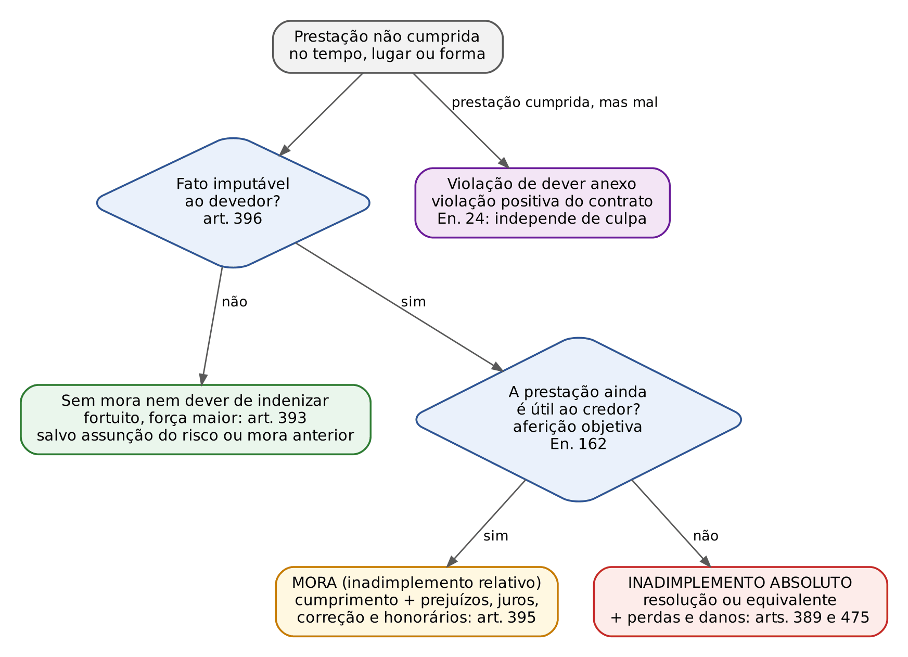
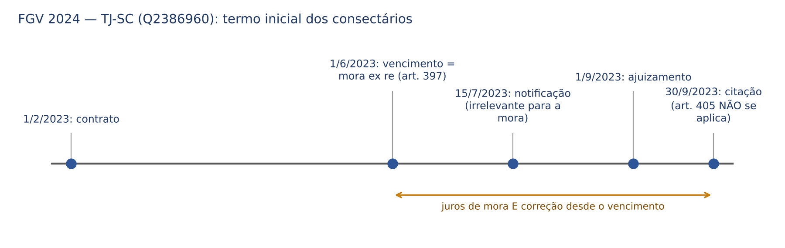
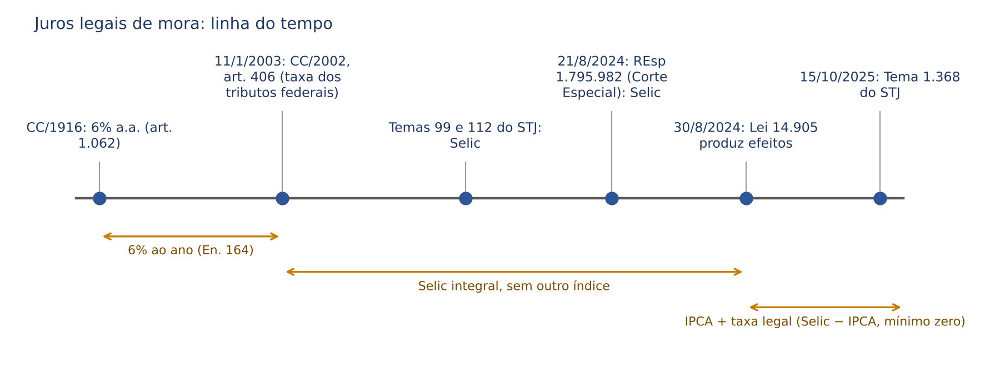
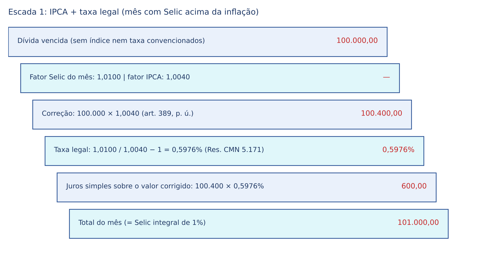
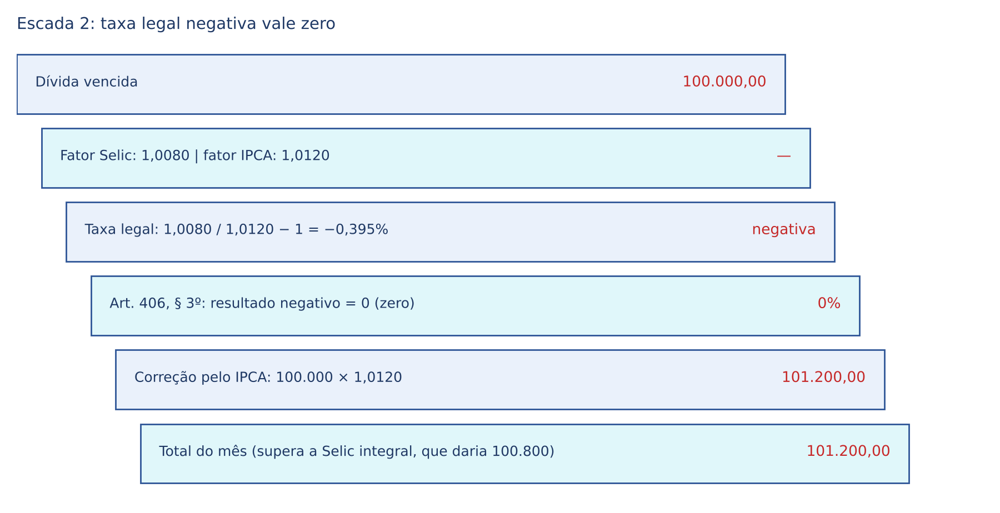
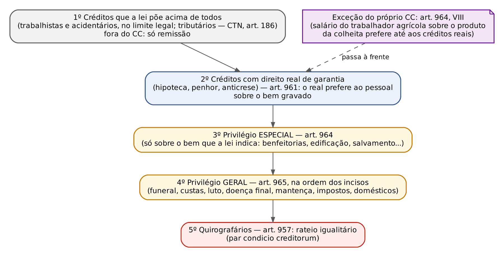

# CAPÍTULO 14 — OBRIGAÇÕES III: INADIMPLEMENTO, MORA, PERDAS E DANOS, JUROS E CORREÇÃO (LEI 14.905/2024), HONORÁRIOS, CLÁUSULA PENAL, ARRAS E PREFERÊNCIAS CREDITÓRIAS

:::INCIDENCIA
TRF5 p. 8; TJRS p. 11; TJSC p. 9; SEFAZ p. 7. Nível A+; lote de 30 questões (FGV 22, FCC 8).
O que mais cai: fortuito durante a mora (art. 399), mora *ex re* x *ex persona*, taxa legal da Lei 14.905/2024 (Selic menos IPCA, piso zero, direito intertemporal), cláusula penal (arts. 410, 411, 413 e 416; Tema 970 do STJ), arras (arts. 418 a 420) e concurso de credores (arts. 961 a 965).
:::

| Subtema | FGV | FCC | Padrão de cobrança |
|---|---|---|---|
| Mora, fortuito e responsabilidade contratual (arts. 390 a 399) | 6 | 4 | caso com fortuito ocorrido depois do vencimento; letra dos arts. 392, 393 e 397 |
| Juros e correção após a Lei 14.905/2024 | 4 | 1 | Selic menos IPCA, piso zero, vedação de cumular Selic integral com correção, regime do período anterior |
| Cláusula penal | 7 | 1 | compensatória x moratória, redução de ofício, indenização suplementar, Tema 970 |
| Arras | 1 | 1 | letra dos arts. 419 e 420 |
| Adimplemento substancial | 1 | 1 | limites (adjudicação compulsória) e efeitos (bloqueia a resolução e a *exceptio*) |
| Perdas e danos | 1 | 0 | dano comprovado, culpa presumida na responsabilidade contratual |
| Preferências e privilégios | 2 | 0 | cálculo do rateio no caso concreto; ordem IPTU, condomínio, hipoteca |

## 14.1 Inadimplemento: estrutura e disposições gerais (arts. 389 a 393)

### 14.1.1 As três figuras e o critério que as separa

O Título IV do Livro de Obrigações trata do "inadimplemento" em sentido amplo, que abrange três situações distintas. O inadimplemento absoluto ocorre quando a prestação não foi cumprida e não pode mais sê-lo de modo útil (por impossibilidade ou por perda do interesse do credor). O inadimplemento relativo, ou mora, ocorre quando a prestação não foi cumprida no tempo, lugar ou forma devidos, mas ainda pode sê-lo com utilidade. A terceira figura, de construção doutrinária, é a violação positiva do contrato, em que a prestação principal é cumprida, mas com violação de dever anexo decorrente da boa-fé (14.5).

O divisor entre mora e inadimplemento absoluto NÃO é o tempo de atraso, e sim a utilidade da prestação para o credor. O art. 395, parágrafo único, permite ao credor "enjeitar" a prestação que, "devido à mora", se tornou inútil, convertendo a mora em inadimplemento absoluto. O Enunciado 162 do CJF exige que essa inutilidade seja aferida objetivamente, conforme a boa-fé e a manutenção do sinalagma, e não pelo mero interesse subjetivo do credor: o credor que simplesmente "não quer mais" não converte a mora em inadimplemento absoluto.

| Critério | Mora (inadimplemento relativo) | Inadimplemento absoluto | Violação positiva do contrato |
|---|---|---|---|
| Situação | prestação ainda útil | prestação impossível ou inútil | prestação cumprida, dever anexo violado |
| Remédio típico | cumprimento + consectários (art. 395) | resolução ou equivalente + perdas e danos (arts. 389 e 475) | perdas e danos; resolução se grave (En. 24 e 437) |
| Culpa | exigida (art. 396) | exigida para indenizar (arts. 392 e 393) | dispensada (En. 24) |
| Cláusula penal | moratória, cumula com a prestação (art. 411) | compensatória, alternativa ao credor (art. 410) | conforme o que o contrato previr |
| Purgação | possível (art. 401) | impossível | — |

:::PEGADINHA
Nas obrigações negativas, a mora e o inadimplemento confundem-se com a prática do ato: "o devedor é havido por inadimplente desde o dia em que executou o ato de que se devia abster" (art. 390). Não há interpelação nem termo a esperar. A IX Jornada, porém, admite mora em obrigação de não fazer de execução continuada ou permanente ainda útil ao credor (Enunciado 647 do CJF): por exemplo, o dever de não poluir, cuja violação pode cessar e o interesse persistir.
:::

### 14.1.2 Responsabilidade contratual: imputabilidade, culpa presumida e graus de culpa

O art. 389 diz que, não cumprida a obrigação, o devedor responde por perdas e danos, mais juros, atualização monetária e honorários de advogado. A responsabilidade contratual é, em regra, subjetiva (art. 392, segunda parte, e art. 396), mas com uma diferença processual decisiva em relação à responsabilidade aquiliana: provado o inadimplemento, presume-se a culpa do devedor, a quem cabe demonstrar o fortuito, a força maior ou outra causa não imputável. O credor prova o contrato, o inadimplemento e o dano; não prova culpa. Nas obrigações de resultado, essa presunção é mais intensa; nas de meio, o credor precisa demonstrar que o devedor não empregou a diligência devida (ver Cap. 12 e Cap. 24).

:::QUESTAO FGV 2025 — Prefeitura de Canaã dos Carajás — Procurador Municipal (Q3265473)
Caso: construtora atrasa em mais de 30 dias reforma contratada para 60 dias; a contratante tem gastos com hospedagem e guarda-móveis. Gabarito: E, ela tem direito à indenização dos prejuízos comprovados, independentemente de prova de culpa, salvo se demonstrado que o atraso decorreu de fortuito ou força maior. Armadilhas: exigir cláusula penal para indenizar (alternativa A: errada, pois a indenização decorre do art. 395, e a cláusula penal apenas a prefixa); tratar o prejuízo como presumido (C: errada, o dano material da mora precisa ser provado; o que se presume é a culpa); negar indenização por ter havido cumprimento tardio (B e D: a mora gera dever de indenizar, art. 395).
:::

O art. 392 gradua a culpa conforme a natureza onerosa ou gratuita do contrato. É dispositivo de letra cobrada literalmente:

:::LEI Código Civil, art. 392
Nos contratos benéficos, responde por simples culpa o contratante, a quem o contrato aproveite, e por dolo aquele a quem não favoreça. Nos contratos onerosos, responde cada uma das partes por culpa, salvo as exceções previstas em lei.
:::

A lógica: quem nada ganha com o contrato só responde se agir com dolo (ao qual a jurisprudência equipara a culpa grave); quem dele se beneficia responde por qualquer culpa. No comodato, o comodatário (favorecido) responde por culpa simples e o comodante (que nada recebe) só por dolo. No transporte de cortesia, o transportador gratuito só responde por dolo ou culpa grave (o art. 736 exclui o transporte gratuito das regras do contrato de transporte; a matéria é desenvolvida no Cap. 19).

:::QUESTAO FCC 2025 — UNICAMP — Procurador de Universidade (Q3891314)
Cobrou a letra do art. 392. Gabarito: D (benéficos: simples culpa de quem aproveita, dolo de quem não é favorecido; onerosos: culpa de cada parte). As alternativas trocam "culpa" por "dolo" nos onerosos ou estendem a culpa simples a ambas as partes nos benéficos.
:::

:::QUESTAO FGV 2026 — TJ-RJ — Analista Judiciário (Q3878288)
Dois contratos: (i) prestação de serviços onerosa com cláusula de não divulgação de código-fonte, que a contratada viola publicando parte do código; (ii) comodato gratuito de notebook a engenheiro que, por descuido, deixa o aparelho exposto e ele é danificado por terceiro. Gabarito: B, o inadimplemento da obrigação negativa ocorreu no dia da divulgação (art. 390), e o comodatário responde por culpa pela negligência (art. 392: é o favorecido). Armadilhas: exigir interpelação para obrigação negativa (A e D); afirmar que o comodatário, por ser gratuito o contrato, só responde por dolo (D: inverte quem é o favorecido); exigir prova de prejuízo para configurar o inadimplemento (C).
:::

O art. 391 consagra a responsabilidade patrimonial: "pelo inadimplemento das obrigações respondem todos os bens do devedor", ressalvadas as impenhorabilidades (CPC, art. 833; Lei 8.009/1990, ver Cap. 40). É a base material da execução e do concurso de credores (14.12).

### 14.1.3 Caso fortuito e força maior (art. 393)

:::LEI Código Civil, art. 393
O devedor não responde pelos prejuízos resultantes de caso fortuito ou força maior, se expressamente não se houver por eles responsabilizado.
Parágrafo único. O caso fortuito ou de força maior verifica-se no fato necessário, cujos efeitos não era possível evitar ou impedir.
:::

O Código não distingue caso fortuito de força maior; equipara-os pelos requisitos da necessariedade (fato não imputável ao devedor) e da inevitabilidade. A imprevisibilidade não está na letra do parágrafo único, embora a doutrina a aponte como elemento frequente. Duas exceções retiram a exoneração: (i) a assunção expressa do risco (cláusula de assunção do fortuito, válida porque o art. 393 é dispositivo); (ii) a mora anterior do devedor (art. 399, 14.2.3). A distinção entre fortuito interno (ligado ao risco da atividade, que não exonera) e externo, a teoria do risco e as cláusulas de não indenizar são desenvolvidas no Cap. 24. Nas relações paritárias, a VIII Jornada admitiu cláusulas que excluem ou limitam a indenização por inadimplemento como instrumento de gestão de riscos (Enunciado 631 do CJF).

:::QUESTAO FCC 2024 — TRT 20ª Região — Técnico Judiciário (Q3169951)
Itens: (I) o devedor não pode assumir o fortuito nas relações civis; (II) sem termo, a mora se constitui por interpelação judicial ou extrajudicial; (III) as perdas e danos abrangem o que o credor perdeu e o que razoavelmente deixou de lucrar; (IV) a obrigação positiva e líquida não cumprida no termo só constitui em mora com interpelação. Gabarito: E (II e III). O item I contraria a ressalva do art. 393 (pode assumir, desde que expressamente); o IV inverte o art. 397 (a mora é de pleno direito).
:::

## 14.2 Mora

### 14.2.1 Conceito amplo: tempo, lugar e forma

Pelo art. 394, está em mora o devedor que não efetua o pagamento e o credor que não quer recebê-lo "no tempo, lugar e forma que a lei ou a convenção estabelecer". Mora, no direito brasileiro, não é só atraso: o pagamento feito no lugar errado ou de forma diversa da pactuada também é mora, desde que a prestação ainda seja útil. A mora pode ser do devedor (*mora solvendi* ou *debitoris*) ou do credor (*mora accipiendi* ou *creditoris*).

### 14.2.2 Mora do devedor: requisitos e constituição

Requisitos: (i) dívida exigível (vencida; o vencimento antecipado do art. 333 é estudado no Cap. 13); (ii) inexecução imputável ao devedor (art. 396: "Não havendo fato ou omissão imputável ao devedor, não incorre este em mora"); (iii) viabilidade do cumprimento posterior (senão, inadimplemento absoluto); (iv) nas obrigações sem termo, interpelação.

:::LEI Código Civil, art. 397
O inadimplemento da obrigação, positiva e líquida, no seu termo, constitui de pleno direito em mora o devedor.
Parágrafo único. Não havendo termo, a mora se constitui mediante interpelação judicial ou extrajudicial.
:::

Mora *ex re* (automática, *dies interpellat pro homine*): obrigação positiva, líquida e com termo certo (art. 397, *caput*), e obrigações provenientes de ato ilícito, em que o devedor está em mora "desde que o praticou" (art. 398). Mora *ex persona*: obrigação sem termo, em que é preciso interpelar (art. 397, parágrafo único); a citação válida também constitui em mora (CPC, art. 240). A interpelação extrajudicial admite meios eletrônicos (e-mail, aplicativos de mensagem), desde que demonstrada a ciência inequívoca, salvo disposição contratual em contrário (Enunciado 619 do CJF).

| Hipótese | Espécie | Marco da mora | Fundamento |
|---|---|---|---|
| Obrigação positiva, líquida e a termo | *ex re* | vencimento | art. 397, *caput* |
| Obrigação sem termo | *ex persona* | interpelação ou citação | art. 397, p. ú.; CPC, art. 240 |
| Ato ilícito extracontratual | *ex re* | data do ilícito | art. 398 (juros: Súmula 54 do STJ — ver Cap. 25) |
| Obrigação negativa | inadimplemento | prática do ato | art. 390 |
| Obrigação ilíquida | *ex persona*, em regra | citação | art. 405; En. 428 |
| Leis especiais que exigem notificação mesmo com termo | *ex re* com comprovação | vencimento, comprovado por notificação | alienação fiduciária (DL 911/1969) e compromisso de compra e venda de imóvel loteado (Lei 6.766/1979) — ver Caps. 17 e 22 |

:::DICA
Nos contratos com termo em que a lei especial exige notificação (alienação fiduciária de bens móveis, compromisso de compra e venda de imóveis), a mora continua *ex re*; a notificação serve para COMPROVÁ-LA e como pressuposto da ação, não para constituí-la. É a distinção cobrada na FGV 2024 — EPE (Q2758995, alternativa D errada ao dizer que a mora do fiduciante é *ex persona*). A disciplina de cada regime está nos Caps. 17 e 22.
:::

Prazo moral. Nas obrigações sem termo, a regra é a exigibilidade imediata (art. 331, Cap. 13), mas há prestações que, por sua natureza, exigem tempo razoável para o cumprimento (o art. 134 ressalva a execução que "depender de tempo"). Esse tempo razoável, apurado conforme a boa-fé e os usos (art. 113), é chamado pela doutrina de prazo moral. Como não há termo, a mora depende de interpelação: o prazo moral está ligado à mora *ex persona*.

:::QUESTAO FGV 2025 — TJ-SE — Juiz Substituto (Q3301221)
Pergunta seca: "O prazo moral" implica o quê? Gabarito: A, mora *ex persona*. A alternativa B (mútuo de dinheiro sem vencimento) é sedutora, mas o mútuo sem prazo tem regra própria de prazo supletivo (art. 592, II: 30 dias), o que afasta o prazo moral; as demais misturam o conceito com equidade em obrigações *causa mortis* ou com a redução de indenização por demora em ajuizar.
:::

:::QUESTAO FCC 2026 — SEFAZ-SP — Auditor Fiscal (Q3955845)
Não havendo data aprazada para o cumprimento, a mora se constitui mediante interpelação judicial ou extrajudicial (gabarito C, letra do art. 397, parágrafo único). As alternativas de inexistência, nulidade ou anulabilidade do contrato confundem elemento acidental (termo) com elemento essencial. É a pergunta típica do edital da SEFAZ-SC.
:::

Na obrigação sem termo (ex.: depósito), é a notificação que constitui o devedor em mora, e só dela corre a prescrição da pretensão de restituição (AgInt no AREsp 2.206.304-MS; v. Cap. 11).

Fatos que afastam a mora do devedor. A cobrança de encargos abusivos no período da normalidade descaracteriza a mora (Enunciado 354 do CJF; a aplicação em contratos bancários é desenvolvida no Cap. 22). Mas a simples propositura de ação revisional não impede a caracterização da mora do autor (Tema 29 do STJ): é preciso que a abusividade seja reconhecida.

### 14.2.3 Efeitos da mora do devedor e a *perpetuatio obligationis*

O art. 395 enumera os efeitos: o devedor responde pelos prejuízos a que a mora der causa, "mais juros, atualização dos valores monetários e honorários de advogado" (redação da Lei 14.905/2024); e, se a prestação se tornou inútil, o credor pode enjeitá-la e exigir perdas e danos (parágrafo único). O efeito mais cobrado, porém, é o do art. 399:

:::LEI Código Civil, art. 399
O devedor em mora responde pela impossibilidade da prestação, embora essa impossibilidade resulte de caso fortuito ou de força maior, se estes ocorrerem durante o atraso; salvo se provar isenção de culpa, ou que o dano sobreviria ainda quando a obrigação fosse oportunamente desempenhada.
:::

É a *perpetuatio obligationis*: a mora transfere ao devedor o risco do fortuito superveniente. Duas exceções, ambas a cargo do devedor: (i) isenção de culpa (que, a rigor, significa que não havia mora, art. 396); (ii) dano inevitável, isto é, o fortuito teria atingido a coisa mesmo que entregue no tempo certo (por exemplo, enchente que destruiria a mercadoria também no armazém do credor).

:::PASSO Como resolver a questão do "fortuito durante o atraso"
1. Fixe a data do vencimento e verifique se a mora era *ex re* (termo certo: mora no dia seguinte, sem interpelação).
2. Verifique se o atraso é imputável ao devedor (viagem, falha de organização, desinteresse = imputável; art. 396).
3. Situe o fortuito: antes do vencimento, exonera (art. 393); depois, durante a mora, NÃO exonera (art. 399).
4. Teste as duas saídas do art. 399: isenção de culpa e dano que ocorreria mesmo com o cumprimento oportuno. Pergunte: se a coisa tivesse sido entregue no dia certo, ela estaria no lugar atingido pelo fortuito?
5. Consequência: equivalente mais perdas e danos, juros, correção e honorários (arts. 389 e 395).
:::

:::QUESTAO FGV 2025 — TJ-MS — Juiz Substituto (Q3786339)
Vendedor de cavalo devia entregá-lo no dia 10; por falha de organização, só agendou o transporte para o dia 20; no dia 15, ainda no pasto do vendedor, o animal morre atingido por raio. Gabarito: D, o vendedor responde, porque o fortuito ocorreu durante a mora (art. 399). A armadilha mais forte é a C ("o dano sobreviria ainda que a prestação tivesse sido oportunamente cumprida"): FALSA no caso, porque, entregue no dia 10, o cavalo estaria no haras do comprador e não no pasto do vendedor no dia 15. A E (fortuito interno) é distração: raio é fortuito externo; a responsabilidade decorre da mora, não do risco da atividade.
:::

:::QUESTAO FGV 2026 — TJ-MS — Analista Judiciário (Q3856340)
Entrega de equipamento industrial vencida em 30/4/2025; o devedor não entrega por estar viajando; em 10/5/2025, incêndio imprevisível destrói o bem. Gabarito: A, o devedor está em mora desde o vencimento (mora *ex re*) e responde por perdas e danos, juros, atualização e honorários, ainda que a impossibilidade decorra do fortuito. Viagem de negócios não é causa não imputável (B); não era necessária interpelação (C); não houve mora do credor, porque o lugar do pagamento era o estabelecimento da credora (E: dívida portável).
:::

:::QUESTAO FGV 2026 — PGE-AC — Procurador do Estado (Q4079376)
Entrega com prazo certo em 10/3; o fornecedor não entrega; o comprador adquire equipamentos equivalentes de terceiro; em 15/3, incêndio destrói os bens no estabelecimento do fornecedor, que pede prazo adicional. Gabarito: C, o fornecedor responde, pois a mora já estava configurada quando ocorreu o fortuito. A alternativa D (a inutilidade não estaria caracterizada) é a sedutora: aqui a inutilidade é objetiva, porque o comprador já teve de suprir a necessidade com outro fornecedor para salvar contrato com terceiro (En. 162). No mesmo sentido, com fortuito ANTES do vencimento e solução oposta: FCC 2026 — PGM Manaus (Q4338799), gabarito A (sem mora e sem assunção expressa do risco, o fortuito exonera o devedor, e a cláusula penal não incide porque o art. 408 exige culpa).
:::

### 14.2.4 Mora do credor (art. 400)

A mora do credor dispensa culpa (o art. 396 se refere só ao devedor): basta a recusa injustificada em receber, ou em praticar o ato de cooperação necessário ao pagamento, no tempo, lugar e forma devidos. Pressupõe dívida vencida e oferta real e regular do devedor (nas dívidas quesíveis, o devedor deve estar pronto para pagar no domicílio dele).

:::LEI Código Civil, art. 400
A mora do credor subtrai o devedor isento de dolo à responsabilidade pela conservação da coisa, obriga o credor a ressarcir as despesas empregadas em conservá-la, e sujeita-o a recebê-la pela estimação mais favorável ao devedor, se o seu valor oscilar entre o dia estabelecido para o pagamento e o da sua efetivação.
:::

Três efeitos: (i) o devedor só responde pela coisa se agir com dolo (culpa, mesmo grave, já não basta, segundo a letra); (ii) o credor ressarce as despesas de conservação; (iii) havendo oscilação do valor, prevalece a estimação mais favorável ao DEVEDOR. Os juros moratórios deixam de correr contra o devedor, e o risco passa ao credor (para a compra e venda, art. 492, § 2º, Cap. 17). O meio técnico de liberação do devedor diante da mora do credor é a consignação em pagamento (art. 335, I e II, Cap. 13).

:::PEGADINHA
"A mora do credor isenta o devedor de qualquer responsabilidade pela conservação da coisa." Falso: só o devedor "isento de dolo". E "sujeita o credor a receber pela estimação mais favorável ao credor": falso, é ao DEVEDOR.
:::

Mora simultânea (de ambos): as moras se compensam e se neutralizam, nenhum pode exigir do outro os efeitos da mora; já a mora sucessiva produz efeitos próprios para cada período.

### 14.2.5 Purgação e cessação da mora

:::LEI Código Civil, art. 401
Purga-se a mora:
I - por parte do devedor, oferecendo este a prestação mais a importância dos prejuízos decorrentes do dia da oferta;
II - por parte do credor, oferecendo-se este a receber o pagamento e sujeitando-se aos efeitos da mora até a mesma data.
:::

A purgação (ou emenda) faz cessar a mora para o futuro, sem apagar os efeitos já produzidos: o devedor oferece a prestação mais os prejuízos (juros, correção, multa moratória) até o dia da oferta. Só é possível enquanto a prestação for útil; convertida a mora em inadimplemento absoluto, não há o que purgar. Purgação não se confunde com cessação da mora, que decorre de fato extintivo (novação, renúncia do credor, remissão).

Leis especiais regulam a purga com prazos e requisitos próprios: na locação, a emenda da mora na ação de despejo por falta de pagamento (Lei 8.245/1991, art. 62, Cap. 18; a Súmula 173 do STF admite a purga além do prazo legal em caso de obstáculo judicial); na alienação fiduciária de móveis, o pagamento da integralidade da dívida pendente para restituição do bem (DL 911/1969, Cap. 22); no compromisso de compra e venda de imóvel loteado, o prazo de 30 dias após a intimação do registrador (Lei 6.766/1979, art. 32, Cap. 17).

:::NOTA Cláusula resolutiva expressa e mora
A cláusula resolutiva expressa opera de pleno direito; a tácita depende de interpelação judicial (art. 474). Ver Cap. 16 e FCC 2025 — TRT 2ª Região (Q3627612, gabarito D). A purgação, nesses casos, depende do regime aplicável (o Código não a assegura contra a cláusula expressa, mas leis especiais a impõem).
:::

## 14.3 Adimplemento substancial

### 14.3.1 Fundamento e requisitos

A teoria do adimplemento substancial (*substantial performance*), de origem inglesa e difundida no Brasil por Clóvis do Couto e Silva, limita o direito potestativo de resolução do art. 475: quando o devedor cumpriu a obrigação quase integralmente, a resolução seria desproporcional, e o credor deve se valer de meios menos gravosos (cobrança do saldo, execução, perdas e danos). O fundamento é a boa-fé objetiva e a função social do contrato, como reconheceu o Enunciado 361 do CJF (IV Jornada), que associa a teoria à aplicação do art. 475. O Código não a positivou.

Requisitos usualmente apontados pela doutrina e pela jurisprudência do STJ: (i) proximidade entre o efetivamente cumprido e o devido; (ii) satisfação substancial do interesse do credor; (iii) possibilidade de conservação do negócio sem prejuízo ao direito do credor de obter o saldo por outros meios; (iv) boa-fé do devedor. A aferição não é só aritmética: o Enunciado 586 do CJF manda levar em conta aspectos quantitativos E qualitativos. Não há percentual mínimo legal; questões que tratam 90% como garantia de aplicação estão erradas, e uma prestação pequena em valor pode ser essencial ao interesse do credor.

### 14.3.2 Efeitos: escudo, não espada

O adimplemento substancial é DEFESA contra a resolução: bloqueia o desfazimento do contrato, mas não extingue a dívida residual nem a pretensão a perdas e danos. Por isso não serve de fundamento para o devedor exigir a contraprestação plena como se tivesse pago tudo.

| Efeito | Sim ou não | Observação |
|---|---|---|
| Impede a resolução pelo credor (art. 475) | sim | núcleo da teoria |
| Impede a *exceptio non adimpleti contractus* do credor quanto à parte essencial já recebida | sim | gabarito da FCC 2025 — DPE-RS (Q3386995) |
| Libera o devedor do saldo | NÃO | o credor cobra o saldo, com consectários |
| Afasta perdas e danos pela parte não cumprida | NÃO | falsa a alternativa B da Q3386995 |
| Autoriza adjudicação compulsória sem quitação | NÃO | STJ, REsp 2.207.433-SP (2025) |

:::JURIS STJ, REsp 2.207.433-SP, Terceira Turma, Rel. Min. Nancy Andrighi (acórdão publicado em junho de 2025)
Promitentes compradores que pagaram cerca de 80% do preço e cujas últimas parcelas prescreveram pediram adjudicação compulsória. O STJ negou: a adjudicação depende do pagamento integral do preço, ainda que as parcelas restantes estejam prescritas; o adimplemento substancial pode, em tese, obrigar o vendedor a buscar a resolução em juízo, mas não supre a quitação, sob pena de estimular o inadimplemento das últimas parcelas. Saídas indicadas: usucapião ou acordo.
:::

### 14.3.3 Onde o STJ não aplica a teoria

- Alienação fiduciária de bens móveis (DL 911/1969): a Segunda Seção afastou a teoria, prevalecendo a lei especial, que autoriza a busca e apreensão diante do inadimplemento, e o fato de a teoria não estar positivada (STJ, REsp 1.622.555-MG, Segunda Seção, j. 22/2/2017, relator para o acórdão Min. Marco Aurélio Bellizze). O regime da busca e apreensão está no Cap. 22.
- Obrigação alimentar: a Quarta Turma afastou a teoria no direito de família, de modo que o pagamento parcial da dívida alimentar não impede a prisão civil (julgado de 2018 em segredo de justiça, noticiado em 30/8/2018; ver Cap. 39).
- Adjudicação compulsória sem quitação (REsp 2.207.433-SP, acima).

:::QUESTAO FGV 2025 — ENAC — 2º Exame Nacional dos Cartórios (Q3673859)
Promitente compradora pagou mais de 90% do preço e, onze anos depois do vencimento da última parcela em aberto, pede adjudicação compulsória alegando adimplemento substancial; a promitente vendedora reconvém pedindo a rescisão. Gabarito: E, a adjudicação é improcedente porque o adimplemento substancial não se presta, nem em tese, a fundamentar a adjudicação (é escudo contra a resolução, não título para exigir a escritura sem quitação); e a reconvenção também falha, porque já fluiu o prazo para exercer a resolução. Passos: (1) o que se pede é a escritura, que pressupõe quitação: a teoria não a supre; (2) a pretensão de resolver o contrato por inadimplemento está ligada à pretensão de cobrar as parcelas; prescrita esta (passados mais de onze anos, além do quinquênio do art. 206, § 5º, I, e até do prazo geral de dez anos), a resolução não pode mais ser exercida. Armadilhas: D (aplica-se em tese, mas faltam requisitos) e B (resolução sem prazo). O impasse prático (comprador sem escritura, vendedor sem ação) resolve-se por usucapião ou acordo, como disse o STJ no REsp 2.207.433-SP. Nota: o enquadramento do prazo da resolução (prescrição da pretensão de cobrança, refletida na resolução) é doutrinário e jurisprudencial, não legal; ver a nota de verificação.
:::

:::QUESTAO FCC 2025 — DPE-RS — Defensor Público (Q3386995)
Compra e venda de veículo em 48 parcelas; a compradora pagou 44 e deixou de pagar as demais por grave doença do filho. Gabarito: D, configurado o adimplemento substancial, o vendedor não pode resolver o contrato nem opor a exceção do contrato não cumprido (recusando a transferência registral). Erradas: A (a teoria não se apoia no motivo do inadimplemento, independentemente do percentual), B (o credor mantém a pretensão ao saldo e às perdas e danos), C (o motivo subjetivo do inadimplemento é irrelevante para afastar a teoria) e E (a teoria se aplica aos contratos civis em geral).
:::

## 14.4 Inadimplemento antecipado (*anticipatory breach*)

Há inadimplemento antecipado quando, antes do vencimento, o devedor declara que não cumprirá ou pratica atos que tornam objetivamente certo que não cumprirá a tempo (por exemplo, obra paralisada, sem possibilidade de entrega no prazo). O credor não precisa esperar o termo para resolver o contrato: o Enunciado 437 do CJF afirma que "a resolução da relação jurídica contratual também pode decorrer do inadimplemento antecipado". O fundamento é a boa-fé (dever de cooperação e de lealdade) e a lógica da exceção de inseguridade do art. 477 (Cap. 16), que autoriza recusar a própria prestação diante de diminuição patrimonial que comprometa a contraprestação.

:::JURIS STJ, REsp 1.294.101, Quarta Turma, Rel. Min. Raul Araújo (noticiado em 21/3/2015)
O atraso significativo no andamento de obra de incorporação, com a entrega e o habite-se ainda distantes, configura inadimplemento antes mesmo de esgotado o prazo de entrega, autorizando o promitente comprador a pedir a resolução e a restituição das parcelas pagas. O ajuizamento dois meses antes do prazo não afasta o inadimplemento da incorporadora.
:::

| Figura | Momento | Efeito típico | Fundamento |
|---|---|---|---|
| Inadimplemento antecipado | antes do vencimento, certeza de descumprimento | resolução imediata, perdas e danos | boa-fé; En. 437 |
| Exceção de inseguridade | antes do vencimento, risco patrimonial | suspender a própria prestação até garantia | art. 477 |
| Mora | depois do vencimento, prestação útil | cumprimento + consectários | arts. 394 e 395 |
| Inadimplemento absoluto | depois do vencimento, prestação inútil ou impossível | resolução ou equivalente + perdas e danos | arts. 389 e 475 |

## 14.5 Violação positiva do contrato e figuras afins

A violação positiva do contrato (*positive Vertragsverletzung*, de Hermann Staub) abrange os casos em que o devedor cumpre a prestação principal, mas viola deveres anexos (laterais, de proteção) decorrentes da boa-fé objetiva: informação, cooperação, sigilo, proteção, lealdade. Exemplo: o pintor entrega o serviço no prazo, mas danifica os móveis do cliente; o vendedor entrega a máquina sem as informações de uso seguro. O Enunciado 24 do CJF afirma que, em virtude do art. 422, a violação dos deveres anexos constitui espécie de inadimplemento, INDEPENDENTEMENTE DE CULPA. A teoria dos deveres anexos e da obrigação como processo é desenvolvida nos Caps. 12 e 15; aqui interessa a consequência: indenização sem prova de culpa e, se a violação comprometer a finalidade do contrato, resolução.

:::PEGADINHA
A FGV usa o rótulo "violação positiva do contrato" como distrator em questões de resolução. Na FGV 2024 — Prefeitura de Vitória (Q3052483), a recusa do comprador em pagar o saldo enquanto a vendedora não liberava a hipoteca, prazo adicional já esgotado, NÃO era violação positiva: inadimplente era a vendedora, e o comprador podia exigir o cumprimento ou resolver, com perdas e danos (gabarito C; art. 475). Violação positiva pressupõe cumprimento da prestação principal com quebra de dever anexo.
:::

Figuras próximas, frequentemente misturadas nas alternativas: o inadimplemento eficiente (*efficient breach*), em que o devedor descumpre porque lhe é economicamente mais vantajoso pagar as perdas e danos; a doutrina e o STJ o veem com reservas, por estimular o ilícito (há referência no AREsp 1.863.800, citado em material de questões da FGV, à negativa deliberada de cobertura por operadoras); e a tutela externa do crédito (responsabilidade do terceiro que induz ao inadimplemento, art. 608), desenvolvida no Cap. 15 (FGV 2024 — TJ-SC, Q3049339).

## 14.6 Perdas e danos (arts. 402 a 405)

### 14.6.1 Composição: dano emergente e lucro cessante

:::LEI Código Civil, arts. 402 e 403
Art. 402. Salvo as exceções expressamente previstas em lei, as perdas e danos devidas ao credor abrangem, além do que ele efetivamente perdeu, o que razoavelmente deixou de lucrar.
Art. 403. Ainda que a inexecução resulte de dolo do devedor, as perdas e danos só incluem os prejuízos efetivos e os lucros cessantes por efeito dela direto e imediato, sem prejuízo do disposto na lei processual.
:::

Dano emergente é a diminuição efetiva do patrimônio; lucro cessante é o acréscimo que o credor razoavelmente teria. O advérbio "razoavelmente" exclui o lucro hipotético ou imaginário: exige-se probabilidade objetiva, segundo o curso normal das coisas (a distinção com a perda de uma chance, dano autônomo, está no Cap. 25). Três pontos de prova:

- O dolo NÃO amplia a indenização (art. 403): mesmo doloso o inadimplemento, só se indenizam os danos diretos e imediatos. É a teoria do dano direto e imediato (ou da causalidade necessária); o debate entre as teorias do nexo causal está no Cap. 24.
- As exceções legais ao art. 402 incluem, por exemplo, a prefixação pela cláusula penal (art. 416) e pelas arras (arts. 418 a 420), e os limites das obrigações de dinheiro (art. 404).
- Não se indeniza a interrupção de atividade ilícita: as perdas e danos pressupõem atividade lícita (Enunciado 658 do CJF).

:::JURIS STJ, REsp 2.216.463-MG, Terceira Turma, Rel. Min. Nancy Andrighi, j. 9/6/2026 (Informativo 896)
No inadimplemento de promessa de recompensa vinculada a concurso promocional, a liquidação das perdas e danos não se restringe aos lucros cessantes: abrange o equivalente pecuniário do prêmio prometido mais os demais prejuízos, como os ganhos que o credor teria se a obrigação fosse cumprida no tempo e modo ajustados. Lição geral: no inadimplemento absoluto, o equivalente da prestação integra a indenização, ao lado do dano emergente e do lucro cessante.
:::

Pluralidade de devedores. Na solidariedade passiva, se a prestação se impossibilita por culpa de um, todos continuam solidariamente obrigados pelo equivalente, mas pelas perdas e danos só responde o culpado (art. 279, Cap. 12; FGV 2024 — TJ-SC, Q2386947, gabarito C); os juros da mora, ao contrário, são de responsabilidade de todos, ainda que a ação tenha sido proposta só contra um, com regresso contra o culpado (art. 280). Na obrigação indivisível com perecimento por culpa de um dos devedores, todos respondem de modo divisível pelo equivalente e só o culpado pelas perdas e danos (Enunciado 540 do CJF; art. 263, Cap. 12).

### 14.6.2 Obrigações de dinheiro e indenização suplementar (art. 404)

Nas obrigações de pagamento em dinheiro, as perdas e danos são pagas com atualização monetária, juros, custas e honorários de advogado, sem prejuízo da pena convencional (art. 404, *caput*, redação da Lei 14.905/2024). Os juros moratórios funcionam como prefixação legal do dano da mora pecuniária, devidos ainda que não se alegue prejuízo (art. 407). Se o credor provar que os juros da mora não cobrem o prejuízo E não houver pena convencional, o juiz PODE conceder indenização suplementar (art. 404, parágrafo único).

| Hipótese | Indenização suplementar | Dispositivo |
|---|---|---|
| Juros da mora insuficientes, sem cláusula penal | sim, se provado o prejuízo maior | art. 404, p. ú. |
| Há cláusula penal, sem pacto de suplementar | NÃO | art. 416, p. ú. |
| Há cláusula penal com pacto de suplementar | sim; a pena vale como mínimo e o credor prova o excedente | art. 416, p. ú. |
| Arras confirmatórias | sim, provado maior prejuízo; arras como taxa mínima | art. 419 |
| Arras penitenciais | NÃO | art. 420 |
| Contrato de adesão com cláusula penal compensatória, prejuízo do aderente maior | sim, independentemente de convenção | En. 430 |

:::ESQUEMA Termo inicial: o que o art. 405 diz e o que ele não diz
O art. 405 ("Contam-se os juros de mora desde a citação inicial") é regra RESIDUAL. Ele se aplica quando a citação faz as vezes de interpelação (mora *ex persona*) ou quando a obrigação é ilíquida (Enunciado 428 do CJF). Não se aplica à mora *ex re* (art. 397, juros desde o vencimento) nem à responsabilidade extracontratual (art. 398, juros desde o evento danoso; Enunciado 163 do CJF e Súmula 54 do STJ — ver Cap. 25). Quadro completo de termos iniciais em 14.7.2.
:::

## 14.7 Juros

### 14.7.1 Classificação

| Critério | Espécies | Ponto de prova |
|---|---|---|
| Função | moratórios (indenizam o atraso) x remuneratórios ou compensatórios (remuneram o capital: mútuo, art. 591) | os moratórios são devidos sem prova de prejuízo (art. 407) e independem de pedido (CPC, art. 322, § 1º) |
| Origem | legais (taxa do art. 406) x convencionais | o art. 406 incide se não houver convenção, se convencionados sem taxa ou se decorrentes da lei |
| Forma de cálculo | simples x compostos (capitalizados) | a taxa legal é aplicada em juros simples (Resolução CMN 5.171/2024); capitalização em contratos bancários: Cap. 22 |

O art. 407 é literalidade de prova: "Ainda que se não alegue prejuízo, é obrigado o devedor aos juros da mora que se contarão assim às dívidas em dinheiro, como às prestações de outra natureza, uma vez que lhes esteja fixado o valor pecuniário por sentença judicial, arbitramento, ou acordo entre as partes."

### 14.7.2 Termo inicial dos juros de mora

| Situação | Juros de mora desde | Fundamento |
|---|---|---|
| Obrigação positiva, líquida e a termo | vencimento, ainda que cobrada por ação monitória ou de conhecimento | art. 397; En. 428; STJ, EREsp 1.250.382-PR (Corte Especial, 2014) |
| Obrigação sem termo ou ilíquida | citação, ou interpelação anterior | arts. 397, p. ú., e 405 |
| Responsabilidade extracontratual | evento danoso | art. 398; En. 163 (Súmula 54 do STJ e Tema 1.251 — ver Cap. 25) |
| Cheque, em qualquer ação do portador | primeira apresentação ao sacado ou à câmara de compensação (correção desde a emissão) | Tema 942 do STJ |
| Ação regressiva da seguradora contra o causador do dano | efetivo desembolso da indenização (também a correção) | Jurisprudência em Teses do STJ, ed. 116, tese 5 |
| Resolução de compromisso de compra e venda anterior à Lei 13.786/2018, por iniciativa do comprador, em termos diversos da cláusula penal | trânsito em julgado | Tema 1.002 do STJ (Cap. 17) |
| Ações convertidas em perdas e danos e dividendos (telefonia) | citação | Temas 658 e 659 do STJ |
| Fazenda Pública que aderiu a convenção de condomínio | encargos da convenção, não o art. 1º-F da Lei 9.494/1997 | STJ, REsp 2.214.098-PE (Quarta Turma, j. 22/9/2025, Informativo Extraordinário 29) |

:::QUESTAO FGV 2024 — TJ-SC — Juiz Substituto (Q2386960)
Arquiteto com honorários de 50.000 (cinquenta mil) reais vencidos em 1/6/2023; notificação em 15/7/2023; ação de execução em 1/9/2023; citação em 30/9/2023. Gabarito: B, atualização monetária e juros desde 1/6/2023. Passos: (1) obrigação positiva, líquida e com termo: mora *ex re* no vencimento (art. 397, *caput*); (2) a notificação de julho é irrelevante, porque a mora já existia; (3) o art. 405 (citação) é residual e não se aplica; (4) a correção recompõe o valor desde o vencimento da dívida líquida (não desde a celebração do contrato, alternativa C, nem desde o ajuizamento, D e E).
:::

### 14.7.3 A taxa legal antes da Lei 14.905/2024

Sob o CC/1916, os juros legais eram de 6% ao ano (art. 1.062). O art. 406 do CC/2002, na redação original, mandava aplicar "a taxa que estiver em vigor para a mora do pagamento de impostos devidos à Fazenda Nacional". Duas leituras disputaram o dispositivo: 1% ao mês (art. 161, § 1º, do CTN), defendida no Enunciado 20 do CJF; e a Selic, adotada pelo STJ em recursos repetitivos (Temas 99 e 112) e reafirmada pela Corte Especial no REsp 1.795.982-SP (j. 21/8/2024, Informativo 823). A controvérsia foi encerrada pelo Tema 1.368 do STJ (REsp 2.199.164-PR e REsp 2.070.882-RS, Corte Especial, Rel. Min. Ricardo Villas Bôas Cueva, j. 15/10/2025): antes da Lei 14.905/2024, a taxa do art. 406 é a Selic, "por ser esta a taxa em vigor para a atualização monetária e a mora no pagamento de impostos devidos à Fazenda Nacional". Como a Selic embute correção monetária e juros, ela NÃO se cumula com outro índice de correção (Tema 99; AgInt no AREsp 2.059.743-RJ, Quarta Turma, j. 11/2/2025, Informativo 842).

Mora iniciada sob o CC/1916: 6% ao ano até 10/1/2003 e, a partir de 11/1/2003, o art. 406 do CC/2002 (Enunciado 164 do CJF).

### 14.7.4 A Lei 14.905/2024: taxa legal e IPCA

:::LEI Código Civil, art. 406 (redação da Lei 14.905/2024)
Quando não forem convencionados, ou quando o forem sem taxa estipulada, ou quando provierem de determinação da lei, os juros serão fixados de acordo com a taxa legal.
§ 1º A taxa legal corresponderá à taxa referencial do Sistema Especial de Liquidação e de Custódia (Selic), deduzido o índice de atualização monetária de que trata o parágrafo único do art. 389 deste Código.
§ 2º A metodologia de cálculo da taxa legal e sua forma de aplicação serão definidas pelo Conselho Monetário Nacional e divulgadas pelo Banco Central do Brasil.
§ 3º Caso a taxa legal apresente resultado negativo, este será considerado igual a 0 (zero) para efeito de cálculo dos juros no período de referência.
:::

:::LEI Código Civil, art. 389 (redação da Lei 14.905/2024)
Não cumprida a obrigação, responde o devedor por perdas e danos, mais juros, atualização monetária e honorários de advogado.
Parágrafo único. Na hipótese de o índice de atualização monetária não ter sido convencionado ou não estar previsto em lei específica, será aplicada a variação do Índice Nacional de Preços ao Consumidor Amplo (IPCA), apurado e divulgado pela Fundação Instituto Brasileiro de Geografia e Estatística (IBGE), ou do índice que vier a substituí-lo.
:::

Pontos essenciais da lei (Lei 14.905, de 28/6/2024, publicada no DOU de 1/7/2024):

- Vigência e efeitos (art. 5º): a lei entrou em vigor na publicação, mas só o § 2º do art. 406 (competência do CMN) produziu efeitos desde então; os demais dispositivos produzem efeitos 60 dias após a publicação, ou seja, a partir de 30/8/2024.
- Dispositivos alterados no CC: arts. 389, 395, 404, 406, 418, 591, 772 e 1.336, § 1º. A expressão "segundo índices oficiais regularmente estabelecidos" saiu dos arts. 389 e 418.
- Correção supletiva: IPCA, salvo índice convencionado ou previsto em lei específica (art. 389, parágrafo único).
- Juros supletivos: taxa legal = Selic menos IPCA, com piso zero (art. 406, §§ 1º e 3º).
- Mútuo feneratício: presumem-se devidos juros; se a taxa não for pactuada, aplica-se a taxa legal (art. 591, nova redação). A redação anterior limitava os juros compensatórios do mútuo à taxa do art. 406 e permitia capitalização anual; esse teto saiu do art. 591 (o Enunciado 34 do CJF, que o refletia, perdeu o suporte textual).
- Condomínio edilício: correção monetária, juros convencionados ou, à falta, os do art. 406, e multa de até 2% (art. 1.336, § 1º; Cap. 30).
- Lei de Usura afastada (art. 3º da Lei 14.905/2024) nas obrigações: (I) contratadas entre pessoas jurídicas; (II) representadas por títulos de crédito ou valores mobiliários; (III) contraídas perante instituições financeiras e demais autorizadas pelo Banco Central, fundos ou clubes de investimento, sociedades de arrendamento mercantil e empresas simples de crédito, e OSCIPs dedicadas à concessão de crédito; (IV) realizadas nos mercados financeiro, de capitais ou de valores mobiliários.
- O Banco Central disponibiliza aplicação pública para simular a taxa legal (art. 4º).

Metodologia (Resolução CMN 5.171, de 29/8/2024, em vigor na publicação): a taxa legal é mensal e calculada como o maior valor entre zero e a razão entre o fator Selic e o fator de inflação, menos um; o fator Selic é o acumulado no mês anterior ao de referência, e o fator de inflação usa a variação do IPCA-15 do mês anterior ao de referência (porque o IPCA cheio do mês ainda não está disponível); aplicam-se juros SIMPLES, com juro diário proporcional aos dias corridos do mês; havendo correção monetária, a taxa legal incide sobre o valor já corrigido; o Banco Central divulga a taxa e os fatores. Em prova objetiva, responda pela letra da lei (Selic deduzido o IPCA); o detalhe do IPCA-15 é da regulamentação.

:::EXEMPLO Escadas de cálculo da taxa legal (valores hipotéticos, para entender o mecanismo)

Leitura: como a dedução é feita pela divisão dos fatores, IPCA mais taxa legal reproduz, em mês normal, a Selic integral (100.000 viram 101.000, exatamente como com 1% de Selic). A diferença aparece quando a inflação supera a Selic: a taxa legal vira zero, mas a correção pelo IPCA continua, e o credor recebe mais do que receberia com a Selic integral (101.200 contra 100.800). Por isso o § 3º é chamado de "piso" de proteção do credor.
:::

:::PEGADINHA
Quatro distratores clássicos: (i) "Selic sem qualquer dedução" (era o regime anterior, e mesmo assim sem correção à parte); (ii) "Selic deduzido o IPCA, inclusive se negativa" (o § 3º manda considerar zero); (iii) "Selic SOMADA ao índice de correção" (é deduzida); (iv) "metodologia definida pelo Banco Central" (é o CMN; o Banco Central só divulga). A FGV 2024 — ENAM (Q3058664) trouxe ainda "vedando-se a possibilidade de juros zerados", também falsa.
:::

:::QUESTAO FGV 2024 — TJ-PE — Juiz Substituto (Q3117509)
A partir da Lei 14.905/2024, sem convenção, os juros moratórios correspondem à Selic deduzida apenas do índice de correção monetária, salvo se negativa, caso em que será considerada zero (gabarito C). No mesmo sentido: FCC 2025 — TRT 15ª Região (Q3302507, gabarito A, que contrapõe a redação vigente à antiga "taxa dos impostos devidos à Fazenda Nacional" e ao teto do dobro), e FGV 2025 — TJ-SC — Juiz Leigo (Q3592849, gabarito E: juros exigíveis mesmo sem convenção, na Selic descontada a atualização, com piso zero; falsas a exigência de convenção, A, e a de prova do prejuízo, B, contra o art. 407).
:::

:::QUESTAO FGV 2026 — TJ-MS — Cartórios, Provimento (Q3914499)
Mútuo feneratício de 5.000.000 (cinco milhões) de reais, de 10/2/2025, vencido em 3/10/2025, com previsão de "juros moratórios legais"; a credora executa aplicando, cumulativamente, a atualização monetária e a Selic integral. Gabarito: C, há excesso de execução: a taxa legal é a Selic deduzida do índice de atualização, e não se cumulam ambos em sua integralidade. Erradas: A (cumular Selic integral e correção é *bis in idem*), B (o 1% ao mês não se aplica, e a regulamentação do CMN já existe desde 29/8/2024), D (não há opção do credor) e E (a lei não está suspensa).
:::

### 14.7.5 Direito intertemporal

A taxa de juros de mora é efeito da obrigação que se renova a cada período: a lei nova aplica-se aos períodos de mora transcorridos a partir de sua eficácia, sem atingir os períodos anteriores (efeito imediato, não retroativo; LINDB, art. 6º, Cap. 1). Assim: até 29/8/2024, Selic (que já engloba a correção); a partir de 30/8/2024, IPCA mais taxa legal. A coisa julgada que mandou aplicar "juros legais na forma do art. 406" não congela a taxa: remete à taxa legal vigente em cada período. O STJ aplicou a sistemática nova (Selic com dedução do IPCA) ao período posterior à lei, mesmo para obrigações anteriores, quando o título não fixou outro índice (AgInt no AREsp 2.059.743-RJ, Informativo 842).

:::QUESTAO FGV 2026 — TJ-GO — Juiz Substituto (Q3966635)
Sentença publicada em 1/10/2021 condena ao pagamento de 10.000 (dez mil) reais "acrescidos de juros legais na forma do Art. 406"; trânsito em maio de 2023; na impugnação ao cumprimento (13/3/2025), o devedor quer 1% ao mês por todo o período, e o credor quer a taxa nova por todo o período. Gabarito: D, Selic até a entrada em vigor (eficácia) da Lei 14.905/2024 e, a partir daí, a taxa legal. Passos: (1) a sentença remeteu à taxa do art. 406, não a percentual fixo; (2) antes da lei, a taxa do art. 406 era a Selic (Tema 1.368), não o 1% do CTN (alternativas B e E); (3) a lei nova não retroage a períodos de mora já transcorridos (C errada), mas rege os períodos posteriores (A errada). Atenção: se a sentença tivesse fixado expressamente "1% ao mês", a solução dependeria do respeito à coisa julgada.
:::

### 14.7.6 Juros convencionais e seus limites

- Juros convencionais podem ser livremente pactuados nas hipóteses do art. 3º da Lei 14.905/2024 (entre pessoas jurídicas, títulos de crédito, instituições financeiras e congêneres, mercados financeiro e de capitais). Fora delas (por exemplo, mútuo entre pessoas naturais, ou entre pessoa natural e pessoa jurídica não financeira), continua a incidir a Lei de Usura (Decreto 22.626/1933), cujo art. 1º veda "estipular em quaisquer contratos taxas de juros superiores ao dobro da taxa legal (Cod. Civil, art. n. 1.062)". A nulidade e a redução por usura, e a lesão, estão no Cap. 9.
- Qual "taxa legal" após a Lei 14.905/2024: o ponto é CONTROVERTIDO e não tem definição do STJ localizada até 30/10/2026. (i) Leitura que prevalece na doutrina e na literatura técnica consultadas: a remissão ao art. 1.062 do CC/1916 é dinâmica e hoje aponta para o art. 406 do CC, de modo que o teto é o dobro da taxa legal (Selic deduzido o IPCA), teto VARIÁVEL; o próprio art. 3º da Lei 14.905/2024, ao excluir certas obrigações da Lei de Usura, pressupõe que ela continua a limitar as demais. (ii) Leitura tradicional: mantém-se o parâmetro fixo de 12% ao ano (dobro dos 6% do art. 1.062 do CC/1916), na linha do que se aplicava ao mútuo entre particulares. (iii) Problemas abertos da primeira leitura: em que momento se afere a taxa legal (na contratação ou em cada período de fluência), e o que ocorre no mês em que a taxa legal é zero (§ 3º do art. 406), o que, levado à letra, zeraria o teto; há ainda quem sustente que a Lei de Usura deveria ser tida por esvaziada nessa parte. Em prova objetiva, a resposta mais segura é a literal (dobro da taxa legal do art. 406), sem afirmar percentual fixo.
- Instituições financeiras: não se submetem à Lei de Usura (Súmula 596 do STF, Cap. 22), agora também por força do art. 3º, III, a, da Lei 14.905/2024; juros remuneratórios, capitalização e abusividade em contratos bancários são matéria do Cap. 22.
- Fazenda Pública em condenações judiciais: regime próprio (art. 1º-F da Lei 9.494/1997, Tema 905 do STJ e emenda constitucional posterior que adotou a Selic); fora do escopo deste capítulo (ver Apostila de Direito Tributário quanto ao indébito tributário). Mas, se a Fazenda celebra negócio de direito privado e adere a convenção de condomínio, sujeita-se aos encargos convencionais (REsp 2.214.098-PE, 14.7.2).

:::SENTENCA Consectários na sentença condenatória contratual (redação-modelo)
"Condeno a ré a pagar ao autor a quantia de 50.000 (cinquenta mil) reais, corrigida monetariamente pelo IPCA desde o vencimento (1/6/2023) e acrescida de juros de mora desde a mesma data (art. 397 do Código Civil), observando-se: até 29/8/2024, exclusivamente a taxa Selic, que engloba juros e correção, vedada a cumulação com outro índice (Tema 1.368 do STJ); a partir de 30/8/2024, correção pelo IPCA (art. 389, parágrafo único) e juros pela taxa legal do art. 406, §§ 1º a 3º, do Código Civil, apurada segundo a Resolução CMN 5.171/2024."
Variações: obrigação sem termo ou ilíquida, juros desde a citação (art. 405); ilícito extracontratual, juros desde o evento danoso (Cap. 25); contrato com índice e taxa próprios, aplicar os pactuados, observados os limites legais. Juros legais são devidos ainda que omisso o pedido (CPC, art. 322, § 1º).
:::

## 14.8 Correção monetária

A correção monetária não é acréscimo nem pena: apenas recompõe o poder aquisitivo da moeda, mantendo o valor real da prestação. Por isso incide independentemente de pedido e de culpa, e a Súmula 562 do STF já afirmava, para a indenização por ato ilícito, o cabimento da atualização por índices de correção monetária. Pontos de prova:

- Índice: o convencionado; à falta, o previsto em lei específica; à falta de ambos, o IPCA (art. 389, parágrafo único). Exemplos de lei específica: TR no saldo devedor do SFH quando pactuada a correção pelos índices da poupança (Tema 53 do STJ, Cap. 22); INPC e IPCA-E nas condenações da Fazenda conforme a natureza (Tema 905 do STJ).
- Termo inicial: nas dívidas líquidas, o vencimento (Q2386960); no cheque, a data de emissão (Tema 942); no ilícito, a data do efetivo prejuízo e, no dano moral, a do arbitramento (Súmulas 43 e 362 do STJ — ver Cap. 25).
- Deflação: aplicam-se os índices negativos na correção de crédito oriundo de título judicial, preservado o valor nominal (Tema 678 do STJ). Não confundir com o § 3º do art. 406, que trata da taxa de JUROS negativa (vale zero).
- Selic e correção: no período em que a Selic é usada como taxa de juros (antes de 30/8/2024), ela substitui juros e correção; depois, a correção (IPCA) e os juros (taxa legal) são parcelas distintas que se somam.

| Item | Até 29/8/2024 | A partir de 30/8/2024 |
|---|---|---|
| Correção supletiva | "índices oficiais regularmente estabelecidos" | IPCA (art. 389, p. ú.) |
| Juros legais supletivos | Selic integral (Tema 1.368), sem outro índice | taxa legal = Selic − IPCA, piso zero (art. 406) |
| Cumulação | Selic sozinha | IPCA + taxa legal |
| Metodologia | jurisprudencial | Resolução CMN 5.171/2024 |
| Teto da Lei de Usura | dobro da taxa antiga (leitura tradicional: 12% ao ano) | dobro da taxa legal (leitura prevalente, controvertida), salvo art. 3º da Lei 14.905/2024 |

## 14.9 Honorários de advogado nos arts. 389, 395 e 404

Os arts. 389, 395 e 404 incluem "honorários de advogado" entre os consectários do inadimplemento. A questão é saber se o credor pode cobrar do devedor os honorários CONTRATUAIS que pagou ao próprio advogado.

- Honorários sucumbenciais pertencem ao advogado e são fixados pelo juiz no processo (CPC, art. 85); não se confundem com os do direito material.
- O Enunciado 161 do CJF limita os honorários dos arts. 389 e 404 aos casos de efetiva atuação profissional do advogado.
- A posição que prevaleceu no STJ é restritiva: a contratação de advogado para o ajuizamento de ação não constitui, por si só, dano material indenizável pela parte contrária, que arca apenas com a sucumbência (EREsp 1.507.864-RS, Corte Especial); antes disso, a Segunda Seção já restringira a aplicação dos arts. 389, 395 e 404 aos honorários contratuais de atuação extrajudicial (EREsp 1.155.527-MG).
- Nos contratos paritários, é válida cláusula que imponha ao devedor inadimplente o pagamento dos honorários contratuais do credor (REsp 1.644.890-PR, Terceira Turma, j. 18/8/2020, locação em *shopping center*).

:::DICA
Em prova: (i) "honorários de advogado" do art. 389 = consectário de direito material, ligado à atuação extrajudicial ou ao pacto; (ii) a parte vencida em juízo NÃO é condenada a reembolsar os honorários contratuais do vencedor, salvo previsão contratual válida; (iii) nas arras, o art. 418, II, menciona expressamente "honorários de advogado" na devolução pelo que as recebeu.
:::

## 14.10 Cláusula penal (arts. 408 a 416)

### 14.10.1 Conceito, funções e natureza

A cláusula penal (*stipulatio poenae*, pena convencional, multa contratual) é o pacto acessório pelo qual as partes prefixam a indenização devida em caso de inadimplemento absoluto ou de mora, e reforçam o cumprimento pela ameaça da pena. Tem dupla função, coercitiva (intimidatória) e indenizatória (liquidação antecipada das perdas e danos); a doutrina majoritária vê a função indenizatória como preponderante, o que explica o teto do art. 412 e a redução do art. 413. Características:

- Acessoriedade: segue a principal; nula a obrigação principal, nula a cláusula penal (art. 184), mas a recíproca não é verdadeira. Pode ser estipulada no mesmo instrumento ou em ato posterior (art. 409), desde que antes do inadimplemento.
- Exigibilidade de pleno direito, mas com culpa: "Incorre de pleno direito o devedor na cláusula penal, desde que, culposamente, deixe de cumprir a obrigação ou se constitua em mora" (art. 408). Sem culpa (fortuito), não há pena (FCC 2026 — PGM Manaus, Q4338799).
- Dispensa prova de prejuízo: "Para exigir a pena convencional, não é necessário que o credor alegue prejuízo" (art. 416, *caput*).
- Interpretação restritiva nas relações paritárias: por ser sanção derivada da autonomia privada, não se estende a situações não previstas, e o juiz não pode criar ou ampliar penalidades com base genérica na boa-fé ou na função social (STJ, REsp 2.013.493-SP, Quarta Turma, j. 5/5/2026, Informativo 889).

### 14.10.2 Compensatória x moratória

:::LEI Código Civil, arts. 409 a 411
Art. 409. A cláusula penal estipulada conjuntamente com a obrigação, ou em ato posterior, pode referir-se à inexecução completa da obrigação, à de alguma cláusula especial ou simplesmente à mora.
Art. 410. Quando se estipular a cláusula penal para o caso de total inadimplemento da obrigação, esta converter-se-á em alternativa a benefício do credor.
Art. 411. Quando se estipular a cláusula penal para o caso de mora, ou em segurança especial de outra cláusula determinada, terá o credor o arbítrio de exigir a satisfação da pena cominada, juntamente com o desempenho da obrigação principal.
:::

| Critério | Compensatória | Moratória |
|---|---|---|
| Hipótese | inadimplemento total (absoluto) | mora ou violação de cláusula especial |
| Relação com a prestação | alternativa a benefício do credor: OU a pena OU o cumprimento (com perdas e danos) | cumulativa: a pena E o cumprimento |
| Quem escolhe | o credor | não há escolha |
| Valor típico | próximo do valor da prestação | percentual menor (multa de 2% a 10%, por exemplo) |
| Cumulação com perdas e danos | não, salvo pacto de indenização suplementar (art. 416, p. ú.) | não com lucros cessantes do mesmo período se equivalente ao locativo (Tema 970) |
| Dispositivo | art. 410 | art. 411 |

:::PEGADINHA
"Converter-se-á em alternativa a benefício do credor" (art. 410) não cria obrigação alternativa no sentido dos arts. 252 a 256 (em que a escolha cabe, em regra, ao devedor): é FACULDADE do credor de optar entre a pena e o cumprimento. A FGV cobra a frase literal como correta (FGV 2025 — TJ-TO, Q3453224, gabarito C; FGV 2024 — Prefeitura de Caraguatatuba, Q3049078, gabarito B).
:::

:::QUESTAO FGV 2025 — TJ-TO — Juiz Substituto (Q3453224)
Cláusula penal de 100.000 (cem mil) reais para o inadimplemento total; o contratado descumpre por culpa exclusiva; o contratante cobra a pena e mais 300.000 (trezentos mil) reais de lucros cessantes, sem previsão contratual de indenização suplementar. Gabarito: C (a compensatória converte-se em alternativa a benefício do credor). A armadilha é a A (pena + suplementar provando o prejuízo, independentemente de cláusula): contraria o art. 416, parágrafo único. Também erradas: B (o inadimplemento total é justamente a hipótese da compensatória), D (basta culpa, art. 408) e E (o art. 413 permite e impõe a redução).
:::

:::QUESTAO FCC 2024 — Prefeitura de Jaboatão dos Guararapes — Procurador (Q3542129)
Cláusula penal para a mora; mora injustificada do devedor. Gabarito: B, o credor exige o cumprimento da obrigação principal cumulativamente com a pena, independentemente de prova de prejuízo (arts. 411 e 416). As alternativas exigem prova de prejuízo ou transformam a moratória em alternativa.
:::

:::QUESTAO FGV 2024 — Prefeitura de Caraguatatuba — Advogado (Q3049078)
Locação residencial com cláusula penal para inadimplemento total ou parcial. Gabarito: B (para o total inadimplemento, alternativa a benefício do credor, art. 410). Erradas: A (a pena não pode exceder a obrigação principal, art. 412), C (não exige prova de prejuízo, art. 416), D (a redução do art. 413 é obrigatória, mesmo sob o art. 421-A) e E (a cláusula penal incide em contratos bilaterais e onerosos).
:::

### 14.10.3 Limite e redução equitativa

O teto legal geral é o valor da obrigação principal: "O valor da cominação imposta na cláusula penal não pode exceder o da obrigação principal" (art. 412). Leis especiais fixam tetos menores: multa moratória de 2% no condomínio edilício (art. 1.336, § 1º) e nas relações de consumo com outorga de crédito (CDC, art. 52, § 1º); percentuais próprios no distrato imobiliário (Lei 13.786/2018, Cap. 17).

:::LEI Código Civil, art. 413
A penalidade deve ser reduzida eqüitativamente pelo juiz se a obrigação principal tiver sido cumprida em parte, ou se o montante da penalidade for manifestamente excessivo, tendo-se em vista a natureza e a finalidade do negócio.
:::

Duas hipóteses autônomas: cumprimento parcial OU excesso manifesto. O verbo é "deve", e o critério é a natureza e a finalidade do negócio (não o "estado anímico" das partes, distrator da FGV 2024 — ENAM, Q2507041). O CJF consolidou o regime:

| Enunciado | Conteúdo |
|---|---|
| 355 | as partes não podem renunciar à redução, porque o art. 413 é de ordem pública |
| 356 | o juiz deve reduzir de ofício |
| 358 | o excesso manifesto não se confunde com alteração das circunstâncias, onerosidade excessiva ou frustração do fim, que podem justificar revisão para mais ou para menos |
| 359 | a redução não precisa ser proporcionalmente idêntica ao percentual adimplido |
| 649 | o art. 421-A, I, permite às partes estabelecer critérios para a redução, desde que não afastem o art. 413 |
| 165 | a redução do art. 413 aplica-se também às arras, confirmatórias ou penitenciais, quando tiverem função de pena |
| 429 | multas de acordos e convenções coletivas de trabalho têm natureza de cláusula penal e podem ser reduzidas pelo juiz do trabalho |

:::QUESTAO FGV 2025 — TJ-TO — Juiz Substituto (Q3453217)
Contrato de fornecimento de papelaria com multa vultosa, desproporcional à natureza e à finalidade da obrigação; a fornecedora renunciou contratualmente à redução judicial e, na contestação, não alegou o excesso. Gabarito: A, o juiz pode reduzir equitativamente a multa de ofício, porque a norma é cogente, contanto que instaure debate prévio com contraditório (vedação da decisão-surpresa, CPC, arts. 9º e 10). Erradas: C e E (a renúncia é ineficaz, En. 355), D e E (o juiz conhece de ofício, En. 356) e B (não há exigência de intervenção do Ministério Público).
:::

:::QUESTAO FGV 2024 — ENAM — 1º Exame Nacional da Magistratura, reaplicação (Q2507041)
Gabarito: B, o credor não pode cumular a cláusula penal compensatória com perdas e danos, salvo se pactuado que ela funciona como mínimo da reparação, o que autoriza a indenização suplementar (art. 416, parágrafo único). Erradas: A (pode ser estipulada em ato posterior, art. 409); C (pena acima do valor da principal não invalida a cláusula: reduz-se ao teto, arts. 412 e 413); D ("facultado" e "estado anímico" desfiguram o art. 413); E (na obrigação indivisível, a pena integral só se exige do culpado, art. 414).
:::

Na jurisprudência recente, o STJ qualificou como cláusula penal a sobre-estadia (*demurrage*) de contêineres com valor prefixado em contrato, limitando-a ao valor do próprio contêiner, salvo prova de danos adicionais (REsp 1.577.138-SP, Quarta Turma, j. 2/9/2025, Informativo 862). Em contratos empresariais *built to suit*, é válida a cláusula penal compensatória equivalente à totalidade dos aluguéis a vencer, sem prejuízo do art. 416, parágrafo único (Enunciado 67 da II Jornada de Direito Comercial; locação no Cap. 18). Mesmo em contrato paritário, o art. 413 continua aplicável; o que a Lei 13.874/2019 permite é pactuar critérios objetivos (art. 421-A, I; En. 649).

### 14.10.4 Indenização suplementar

:::LEI Código Civil, art. 416
Para exigir a pena convencional, não é necessário que o credor alegue prejuízo.
Parágrafo único. Ainda que o prejuízo exceda ao previsto na cláusula penal, não pode o credor exigir indenização suplementar se assim não foi convencionado. Se o tiver sido, a pena vale como mínimo da indenização, competindo ao credor provar o prejuízo excedente.
:::

A cláusula penal é, em regra, teto e piso ao mesmo tempo: o credor não prova prejuízo para recebê-la, mas também não recebe além dela. Só o pacto expresso de indenização suplementar a transforma em piso. Exceção doutrinária: no contrato de adesão, o aderente pode exigir o prejuízo comprovado que exceder a cláusula penal compensatória independentemente de convenção (Enunciado 430 do CJF), porque o predisponente não pode, pela pena, limitar a própria responsabilidade.

### 14.10.5 Pluralidade de devedores

| Obrigação | Quem incorre na pena | Quanto se exige | Dispositivo |
|---|---|---|---|
| Indivisível | todos os devedores, caindo em falta um deles | integral só do culpado; dos demais, só a quota de cada um, com regresso contra o culpado | art. 414 |
| Divisível | só o devedor ou herdeiro que infringir | proporcionalmente à sua parte | art. 415 |
| Solidária | todos respondem pelo equivalente; agravamento só para o culpado (art. 278 e 279) | ver Cap. 12 | arts. 278 e 279 |

### 14.10.6 Cláusula penal moratória e lucros cessantes: Temas 970 e 971 do STJ

No atraso na entrega de imóvel em construção, discutia-se se o comprador pode cobrar a multa moratória e, ao mesmo tempo, lucros cessantes pelo aluguel que deixou de receber ou teve de pagar. A Jurisprudência em Teses (ed. 107, tese 1) chegou a admitir a cumulação pela diversidade de naturezas; a Segunda Seção, em recurso repetitivo, fixou orientação mais restritiva:

:::JURIS STJ, Tema 970 (REsp 1.498.484-DF e REsp 1.635.428-SC, Segunda Seção, j. 22/5/2019, Informativo 651)
"A cláusula penal moratória tem a finalidade de indenizar pelo adimplemento tardio da obrigação, e, em regra, estabelecida em valor equivalente ao locativo, afasta-se sua cumulação com lucros cessantes."
:::

:::JURIS STJ, Tema 971 (REsp 1.614.721-DF e REsp 1.631.485-DF, Segunda Seção)
No contrato de adesão entre comprador e construtora ou incorporadora, havendo cláusula penal apenas para o inadimplemento do adquirente, ela deve ser considerada para fixar a indenização pelo inadimplemento do vendedor; obrigações heterogêneas (de fazer e de dar) são convertidas em dinheiro por arbitramento judicial.
:::

Consequências práticas: (i) multa moratória equivalente ao locativo (algo em torno de 0,5% a 1% do valor do imóvel por mês, parâmetro usado pela jurisprudência e pelas bancas) = indenização do atraso, sem lucros cessantes no mesmo período; (ii) multa irrisória, sem equivalência com o locativo, não impede a busca da reparação integral do lucro cessante, que pode ser presumido pelo valor locativo; (iii) o mero atraso, em regra, não gera dano moral presumido (Cap. 25); (iv) a Lei 13.786/2018 (distratos) disciplina os contratos posteriores (Cap. 17; FGV 2025 — PGM-RJ, Q3606013, sobre a irretroatividade, Cap. 1).

:::QUESTAO FGV 2024 — AL-TO — Procurador Jurídico (Q2457288)
Multa mensal de 0,5% do valor do contrato pelo atraso na entrega, afastada a indenização suplementar; atraso de 11 meses; pedidos de multa, aluguéis pagos e danos morais. Gabarito: D, reprodução do Tema 970 (multa moratória em valor equivalente ao locativo afasta a cumulação com lucros cessantes). Erradas: A e C (cumulação), B (a "alternativa a benefício do credor" é da compensatória) e E (cláusula compensatória não é renúncia legal a lucros cessantes).
:::

:::QUESTAO FGV 2024 — Prefeitura de Macaé — Procurador (Q3049922)
Imóvel na planta, tolerância de seis meses e multa mensal de 0,5% sobre o valor do contrato; atraso; o comprador pagou aluguel de 2.500 (dois mil e quinhentos) reais mensais e pede a multa e os aluguéis. Gabarito: D, só a multa, sem os lucros cessantes. A justificativa da alternativa ("mesma natureza compensatória") é imprecisa, mas o resultado segue o Tema 970: a multa moratória equivalente ao locativo já indeniza o atraso. A sedutora E (cumular, com redução equitativa) contraria o repetitivo.
:::

:::QUESTAO FGV 2025 — TCE-PE — Analista de Gestão (Q3593086)
Contrato de 2013; multa moratória de 0,3% ao mês calculada só sobre os valores pagos; atraso de quase três anos; pedido de lucros cessantes pelo valor locativo (0,8% do valor do imóvel) e de danos morais. Gabarito: A, há direito aos lucros cessantes, porque a multa é desproporcional ao valor locativo usual (0,5% a 1% do valor total do bem), o que atrai a reparação integral (art. 944). É o reverso do Tema 970: a não cumulação pressupõe multa EQUIVALENTE ao locativo. Erradas: B ("sempre afasta"), C (não há pedido prévio obrigatório), D (a moratória é revisável, art. 413) e E (o lucro cessante pelo locativo é presumido no atraso de entrega).
:::

### 14.10.7 Ficha de consulta rápida e distinções

| Item | Cláusula penal |
|---|---|
| Natureza | pacto acessório, prefixação de perdas e danos e reforço do vínculo |
| Momento | com a obrigação ou em ato posterior, antes do inadimplemento (art. 409) |
| Exigibilidade | de pleno direito, com culpa do devedor (art. 408), sem prova de prejuízo (art. 416) |
| Espécies | compensatória (art. 410) e moratória (art. 411) |
| Teto | valor da obrigação principal (art. 412); 2% em condomínio e crédito ao consumidor |
| Redução | obrigatória, de ofício, irrenunciável (art. 413; Ens. 355, 356 e 649) |
| Suplementar | só se pactuada (art. 416, p. ú.); adesão: En. 430 |
| Pluralidade | arts. 414 e 415 |
| Jurisprudência-chave | Temas 970 e 971; REsp 2.013.493-SP (interpretação restritiva); REsp 1.617.652 (não cumula com arras) |

| Figura | Fonte | Finalidade | Teto | Redução |
|---|---|---|---|---|
| Cláusula penal | contrato | prefixar perdas e danos e coagir | valor da principal (art. 412) | art. 413 |
| Arras | contrato real (entrega de bem) | confirmar o negócio e prefixar indenização; nas penitenciais, preço do arrependimento | sem teto legal expresso | analogia ao art. 413 (En. 165) |
| Multa coercitiva judicial (astreintes) | decisão judicial (CPC, art. 537) | coagir ao cumprimento de ordem judicial | sem limite ao valor da obrigação | modificável pelo juiz |
| Juros moratórios | lei ou contrato | indenizar a mora pecuniária | Lei de Usura, fora do art. 3º da Lei 14.905/2024 | — |

## 14.11 Arras ou sinal (arts. 417 a 420)

### 14.11.1 Conceito e espécies

Arras (ou sinal) são o bem, em dinheiro ou outro bem móvel, que uma parte entrega à outra na conclusão do contrato. O pacto de arras é real: só se aperfeiçoa com a entrega. Em caso de execução, as arras são restituídas ou computadas na prestação devida, se do mesmo gênero da principal (art. 417). Há duas espécies:

- Arras confirmatórias (regra): confirmam o negócio, que se torna obrigatório, e servem de início de pagamento e de prefixação mínima de perdas e danos. NÃO conferem direito de arrependimento.
- Arras penitenciais: dependem de cláusula expressa de arrependimento; o arrependimento é lícito, e as arras funcionam como preço dele, com função "unicamente indenizatória" (art. 420).

:::LEI Código Civil, arts. 418 a 420
Art. 418. Na hipótese de inexecução do contrato, se esta se der: I - por parte de quem deu as arras, poderá a outra parte ter o contrato por desfeito, retendo-as; II - por parte de quem recebeu as arras, poderá quem as deu haver o contrato por desfeito e exigir a sua devolução mais o equivalente, com atualização monetária, juros e honorários de advogado.
Art. 419. A parte inocente pode pedir indenização suplementar, se provar maior prejuízo, valendo as arras como taxa mínima. Pode, também, a parte inocente exigir a execução do contrato, com as perdas e danos, valendo as arras como o mínimo da indenização.
Art. 420. Se no contrato for estipulado o direito de arrependimento para qualquer das partes, as arras ou sinal terão função unicamente indenizatória. Neste caso, quem as deu perdê-las-á em benefício da outra parte; e quem as recebeu devolvê-las-á, mais o equivalente. Em ambos os casos não haverá direito a indenização suplementar.
:::

| Critério | Arras confirmatórias (arts. 417 a 419) | Arras penitenciais (art. 420) |
|---|---|---|
| Direito de arrepender-se | não | sim, por cláusula expressa |
| Inexecução por quem deu | perde as arras (art. 418, I) | perde as arras |
| Inexecução por quem recebeu | devolve mais o equivalente, com correção, juros e honorários (art. 418, II) | devolve mais o equivalente |
| Indenização suplementar | sim, provado maior prejuízo; arras como taxa mínima | NÃO (art. 420; Súmula 412 do STF) |
| Execução específica | sim, com perdas e danos (art. 419) | não, o arrependimento é lícito |
| Redução equitativa | sim, por analogia ao art. 413 (En. 165) | sim (En. 165) |

A Súmula 412 do STF, anterior ao Código mas compatível com o art. 420: no compromisso de compra e venda com cláusula de arrependimento, a devolução do sinal por quem o deu, ou sua restituição em dobro por quem o recebeu, exclui indenização maior a título de perdas e danos, salvo os juros moratórios e os encargos do processo.

:::QUESTAO FCC 2025 — TRT 2ª Região — Oficial de Justiça (Q3660526)
Arras dadas por Romeu a Mário; inexecução por Romeu. Gabarito: B, Mário pode ter o contrato por desfeito retendo as arras e pedir indenização suplementar se provar maior prejuízo (arras como taxa mínima), ou exigir a execução do contrato com perdas e danos (arras como mínimo da indenização). A armadilha é a E, que troca "mínima" por "máxima": nas arras confirmatórias, as arras são PISO, não teto.
:::

:::QUESTAO FGV 2025 — TJ-ES — Cartórios, Remoção (Q3520294)
Contrato preliminar de compra e venda de imóvel de 650.000 (seiscentos e cinquenta mil) reais; sinal de 65.000 (sessenta e cinco mil) reais qualificado como "arras penitenciais" com direito de arrependimento até a escritura; o promitente vendedor desiste e oferece a devolução em dobro; a promitente compradora pede execução específica. Gabarito: B, a cláusula é válida e autoriza o arrependimento, sendo incabível a execução específica (art. 420). Passos: (1) há cláusula expressa de arrependimento: arras penitenciais; (2) o contrato preliminar só admite adjudicação compulsória se NÃO houver cláusula de arrependimento (art. 463, Cap. 15 e Cap. 17); (3) quem recebeu devolve mais o equivalente (130.000, cento e trinta mil reais), sem indenização suplementar.
:::

### 14.11.2 Arras e cláusula penal: não cumulação

:::JURIS STJ, REsp 1.617.652, Terceira Turma, Rel. Min. Nancy Andrighi (noticiado em janeiro de 2018)
Quando as arras têm natureza indenizatória, como no inadimplemento, exercem a mesma função da cláusula penal compensatória, de modo que não se cumulam com ela, sob pena de *bis in idem*. Previstas ambas para o inadimplemento, incide exclusivamente a pena de perda das arras, ou a sua devolução mais o equivalente, conforme a parte a quem se atribui a inexecução.
:::

| Critério | Cláusula penal | Arras |
|---|---|---|
| Aperfeiçoamento | consensual (promessa de pagar) | real (entrega efetiva) |
| Momento da prestação | depois do inadimplemento | na conclusão do contrato |
| Objeto | qualquer prestação, geralmente dinheiro | dinheiro ou bem móvel |
| Suplementar | só se pactuada (art. 416, p. ú.) | confirmatórias: sim, sem pacto (art. 419); penitenciais: não (art. 420) |
| Teto | valor da obrigação principal | não há teto legal expresso |
| Arrependimento | não confere | penitenciais conferem |

## 14.12 Preferências e privilégios creditórios (arts. 955 a 965)

### 14.12.1 Estrutura do Título X

O Título X do Livro de Obrigações disciplina o concurso de credores na insolvência civil do devedor não empresário. A falência e a recuperação do empresário seguem a Lei 11.101/2005 e não são objeto desta apostila. Processualmente, a insolvência civil continua regida pelo CPC/1973 até a edição de lei específica (CPC/2015, art. 1.052), o que a FGV cobrou ao perguntar o regime aplicável a fundo de investimento com patrimônio insuficiente (FGV 2024 — TJ-MT, Q3086915, gabarito C: insolvência civil e concurso de créditos).

| Artigo | Regra |
|---|---|
| 955 | declara-se a insolvência sempre que as dívidas excedam a importância dos bens do devedor |
| 956 | a discussão entre credores pode versar sobre preferência ou sobre nulidade, simulação, fraude ou falsidade das dívidas e contratos |
| 957 | sem título legal de preferência, os credores têm igual direito sobre os bens do devedor comum (*par condicio creditorum*) |
| 958 | os títulos legais de preferência são os privilégios e os direitos reais |
| 959 e 960 | sub-rogação real: credores hipotecários e privilegiados conservam seus direitos sobre o seguro, a indenização paga pelo responsável pela perda ou a indenização da desapropriação; o devedor do seguro ou da indenização exonera-se pagando sem oposição deles |
| 961 | hierarquia: crédito real > pessoal de qualquer espécie; pessoal privilegiado > simples; privilégio especial > geral |
| 962 | credores da mesma classe especialmente privilegiados sobre os mesmos bens: rateio proporcional |
| 963 | o privilégio especial compreende só os bens que a lei sujeita ao crédito; o geral, todos os bens não sujeitos a crédito real nem a privilégio especial |
| 964 | rol dos privilégios especiais |
| 965 | rol dos privilégios gerais, NA ORDEM dos incisos |

:::LEI Código Civil, art. 961
O crédito real prefere ao pessoal de qualquer espécie; o crédito pessoal privilegiado, ao simples; e o privilégio especial, ao geral.
:::

### 14.12.2 Privilégios especiais e gerais

Privilégios especiais (art. 964), cada um sobre o bem indicado: I, custas e despesas judiciais com a arrecadação e liquidação, sobre a coisa arrecadada; II, despesas de salvamento, sobre a coisa salvada; III, benfeitorias necessárias ou úteis, sobre a coisa beneficiada; IV, materiais, dinheiro ou serviços para edificação, reconstrução ou melhoramento, sobre os prédios e construções; V, sementes, instrumentos e serviços à cultura ou à colheita, sobre os frutos agrícolas; VI, aluguéis do ano corrente e do anterior, sobre as alfaias e utensílios de uso doméstico do prédio; VII, crédito do autor contra o editor, sobre os exemplares da obra na massa; VIII, salários do trabalhador agrícola, sobre o produto da colheita para a qual concorreu, "precipuamente a quaisquer outros créditos, ainda que reais"; IX, credor por animais, sobre os produtos do abate (incluído pela Lei 13.176/2015).

:::LEI Código Civil, art. 965
Goza de privilégio geral, na ordem seguinte, sobre os bens do devedor:
I - o crédito por despesa de seu funeral, feito segundo a condição do morto e o costume do lugar;
II - o crédito por custas judiciais, ou por despesas com a arrecadação e liquidação da massa;
III - o crédito por despesas com o luto do cônjuge sobrevivo e dos filhos do devedor falecido, se foram moderadas;
IV - o crédito por despesas com a doença de que faleceu o devedor, no semestre anterior à sua morte;
V - o crédito pelos gastos necessários à mantença do devedor falecido e sua família, no trimestre anterior ao falecimento;
VI - o crédito pelos impostos devidos à Fazenda Pública, no ano corrente e no anterior;
VII - o crédito pelos salários dos empregados do serviço doméstico do devedor, nos seus derradeiros seis meses de vida;
VIII - os demais créditos de privilégio geral.
:::

:::PEGADINHA
Prazos do art. 965 trocados pela banca: doença final, SEMESTRE anterior à morte (IV); mantença, TRIMESTRE anterior (V); impostos, ano corrente e anterior (VI); domésticos, últimos SEIS MESES de vida (VII). Aluguéis com privilégio especial: ano corrente e anterior (art. 964, VI). E o art. 964, VIII, é a única exceção do próprio Código à primazia do crédito real.
:::

Fora do Código Civil, há créditos que preferem a todos (créditos trabalhistas e decorrentes de acidente de trabalho, e o tributário, que prefere a qualquer outro, ressalvados aqueles, nos termos do art. 186 do CTN); são remissões, não objeto deste capítulo (ver Apostila de Direito Tributário quanto às preferências do crédito tributário). No processo de execução individual, a ordem de levantamento do produto da arrematação observa as preferências de direito material e, entre credores sem título legal de preferência, a anterioridade da penhora (CPC, arts. 905 a 909; Cap. 13 e apostila de Processo Civil).

### 14.12.3 A releitura do STJ: IPTU, condomínio e hipoteca

O STJ construiu uma hierarquia que não está no Código: (i) o crédito tributário (IPTU) prefere ao condominial, por força do art. 186 do CTN, sem que a natureza *propter rem* da cota condominial lhe dê primazia absoluta (REsp 1.584.162, Terceira Turma, Rel. Min. Nancy Andrighi, 2017); (ii) os créditos condominiais (e os honorários de sua cobrança) preferem ao crédito hipotecário, porque as despesas de condomínio conservam a própria coisa que garante a hipoteca (REsp 511.003, Quarta Turma, Rel. Min. Aldir Passarinho Junior, noticiado em 2010). Daí a ordem cobrada no ENAM: IPTU > condomínio > hipoteca.

:::QUESTAO FGV 2024 — ENAM — 1º Exame Nacional da Magistratura (Q2459897)
Releitura do STJ sobre a posição dos créditos em concurso. Gabarito: E, o crédito do IPTU prefere ao condominial, e este, ao hipotecário. A armadilha é aplicar literalmente o art. 961 (real > pessoal) e pôr a hipoteca à frente do condomínio (alternativas A, B e C). A natureza *propter rem* explica a preferência do condomínio sobre a hipoteca, mas não sobre o tributo (D errada).
:::

:::QUESTAO FGV 2024 — TRF 1ª Região — Analista Judiciário (Q3028425)
Saldo de leilão de 300.000 (trezentos mil) reais; habilitam-se: (1) possuidor de má-fé por benfeitorias úteis (50.000) e necessárias (50.000); (2) quem adiantou 100.000 para custear o tratamento da doença de que o devedor faleceu, nos meses finais; (3) banco com hipoteca sobre o imóvel, de 200.000. Gabarito: E. Resolução em passos:
1. O que se pergunta: a ordem de pagamento "exclusivamente à luz do Código Civil".
2. Classifique cada crédito. Hipoteca: crédito real (art. 961), primeiro lugar sobre o imóvel gravado. Benfeitorias: o possuidor de má-fé só tem direito ao ressarcimento das NECESSÁRIAS (art. 1.220, Cap. 27); as úteis não geram crédito; as necessárias têm privilégio especial sobre a coisa beneficiada (art. 964, III). Doença final: privilégio geral (art. 965, IV), atrás do especial (art. 961).
3. Aplique: 300.000 − 200.000 (hipoteca) = 100.000; − 50.000 (benfeitorias necessárias) = 50.000, que vão para o credor das despesas médicas, que recebe só parte do seu crédito.
4. Erros sedutores: B (ordem cronológica de habilitação, irrelevante sem penhora como critério), D (põe o privilégio especial à frente da hipoteca: só o art. 964, VIII, passa à frente dos reais) e C (esquece o privilégio geral e inclui as úteis).
:::

A FGV 2026 — TJ-GO (Q3966636) explorou o confronto entre a caução imobiliária da locação, averbada na matrícula, e a penhora de outro credor (gabarito C, equiparação a direito real com primazia); o regime das garantias reais e da caução da Lei 8.245/1991 está nos Caps. 18 e 32.

:::PROCESSO Concurso de credores na execução individual
Arrematado o bem, o juiz distribui o produto observando: (i) créditos com preferência de direito material (tributários, *propter rem* segundo o STJ, reais, privilégios); (ii) entre quirografários, a anterioridade das penhoras (CPC, arts. 797 e 908). O credor hipotecário tem preferência sobre o produto da arrematação mesmo sem ter penhorado o bem, desde que intimado e habilitado. Insolvência civil: rito do CPC/1973 (CPC/2015, art. 1.052), com concurso universal.
:::

## 14.13 Resumo para revisão pré-prova

| Instituto | Regra | Exceções e detalhes | Fundamento |
|---|---|---|---|
| Mora x inadimplemento absoluto | critério é a utilidade da prestação | inutilidade aferida objetivamente | art. 395, p. ú.; En. 162 |
| Obrigação negativa | inadimplente desde a prática do ato | mora possível em não fazer continuado ainda útil | art. 390; En. 647 |
| Graus de culpa | benéficos: culpa de quem aproveita, dolo de quem não favorece; onerosos: culpa | transporte de cortesia: dolo ou culpa grave | art. 392 |
| Fortuito | exonera | salvo assunção expressa ou mora anterior | arts. 393 e 399 |
| Mora do devedor | exige fato imputável | culpa presumida na responsabilidade contratual | art. 396 |
| Mora *ex re* | obrigação positiva, líquida e a termo; ilícito | leis especiais exigem notificação para comprovar | arts. 397 e 398 |
| Mora *ex persona* | sem termo: interpelação judicial ou extrajudicial; citação | interpelação eletrônica com ciência inequívoca | art. 397, p. ú.; En. 619; CPC, art. 240 |
| *Perpetuatio obligationis* | devedor em mora responde pelo fortuito | salvo isenção de culpa ou dano inevitável | art. 399 |
| Mora do credor | sem culpa; devedor sem dolo isento da conservação; ressarcimento de despesas; estimação mais favorável ao devedor | consignação como meio de liberação | arts. 400 e 335 |
| Purgação | devedor: prestação + prejuízos até a oferta; credor: receber + efeitos da mora | só enquanto útil; leis especiais | art. 401 |
| Adimplemento substancial | impede resolução e *exceptio* | não libera o saldo; não se aplica a AF de móveis, alimentos e adjudicação compulsória sem quitação | Ens. 361 e 586; REsp 1.622.555; REsp 2.207.433 |
| Inadimplemento antecipado | resolução antes do termo | certeza objetiva do descumprimento | En. 437; art. 477 |
| Violação positiva | inadimplemento por quebra de dever anexo | independe de culpa | art. 422; En. 24 |
| Perdas e danos | dano emergente + lucro cessante razoável | só danos diretos e imediatos, mesmo com dolo; atividade lícita | arts. 402 e 403; En. 658 |
| Obrigação pecuniária | correção, juros, custas e honorários | suplementar se juros insuficientes e sem pena | art. 404 |
| Juros: termo inicial | *ex re*: vencimento; *ex persona* e ilíquida: citação | ilícito: evento danoso (Cap. 25); cheque: 1ª apresentação | arts. 397, 398, 405; Tema 942 |
| Taxa legal até 29/8/2024 | Selic, sem outro índice | CC/1916: 6% até 10/1/2003 | Tema 1.368; En. 164 |
| Taxa legal desde 30/8/2024 | Selic − IPCA, piso zero, juros simples | CMN define metodologia; BC divulga | art. 406; Res. CMN 5.171/2024 |
| Correção supletiva | IPCA | salvo índice convencionado ou legal | art. 389, p. ú. |
| Lei de Usura | teto do dobro da taxa legal (a do art. 406, na leitura prevalente; controvertido) | afastada nas hipóteses do art. 3º da Lei 14.905/2024 | Decreto 22.626/1933 |
| Honorários do art. 389 | atuação extrajudicial ou pacto | não se reembolsam honorários contratuais da ação | En. 161; EREsp 1.507.864 |
| Cláusula penal | de pleno direito com culpa; sem prova de prejuízo | interpretação restritiva em contrato paritário | arts. 408 e 416 |
| Compensatória | alternativa a benefício do credor | suplementar só se pactuada | arts. 410 e 416, p. ú. |
| Moratória | cumula com a prestação | equivalente ao locativo não cumula com lucros cessantes | art. 411; Tema 970 |
| Teto e redução | valor da principal; redução obrigatória, de ofício, irrenunciável | 2% em condomínio e CDC; critérios pactuados (En. 649) | arts. 412 e 413; Ens. 355 e 356 |
| Pluralidade | indivisível: pena integral só do culpado; divisível: só o infrator, proporcional | regresso dos não culpados | arts. 414 e 415 |
| Arras confirmatórias | perda ou devolução + equivalente; suplementar como taxa mínima; execução possível | dinheiro ou bem móvel | arts. 417 a 419 |
| Arras penitenciais | arrependimento lícito; sem suplementar | redução equitativa possível | art. 420; Súmula 412 do STF; En. 165 |
| Arras x cláusula penal | não se cumulam | incide só a perda ou devolução das arras | REsp 1.617.652 |
| Concurso de credores | real > pessoal privilegiado > simples; especial > geral | art. 964, VIII, prefere aos reais | arts. 957 a 965 |
| Ordem do STJ | IPTU > condomínio > hipoteca | — | REsp 1.584.162; REsp 511.003 |

## 14.14 Artigos de lei incidentes

- Código Civil: arts. 389 a 420 (inadimplemento, mora, perdas e danos, juros legais, cláusula penal e arras); 955 a 965 (preferências e privilégios); correlatos: 134, 184, 263, 278 a 280, 331, 333, 335, 421-A, 422, 463, 474, 475, 477, 492, § 2º, 591, 592, II, 608, 736, 1.220 e 1.336, § 1º.
- Lei 14.905/2024: arts. 2º (alterações nos arts. 389, 395, 404, 406, 418, 591, 772 e 1.336 do CC), 3º (inaplicabilidade da Lei de Usura), 4º e 5º (efeitos).
- Resolução CMN 5.171/2024 (metodologia da taxa legal).
- Decreto 22.626/1933 (Lei de Usura), art. 1º.
- CPC: arts. 9º, 10, 85, 240, 322, § 1º, 537, 797, 833, 905 a 909 e 1.052.
- CDC, art. 52, § 1º. Lei 8.245/1991, art. 62. DL 911/1969. Lei 6.766/1979, art. 32. Lei 13.786/2018. CTN, art. 186. LINDB, art. 6º.

## 14.15 Julgados, temas e súmulas do capítulo

- Tema 1.368 do STJ: antes da Lei 14.905/2024, a taxa do art. 406 é a Selic.
- REsp 1.795.982-SP (Corte Especial, 21/8/2024): Selic como taxa do art. 406, sem cumulação.
- Temas 99 e 112 do STJ: Selic como taxa de juros moratórios do art. 406, sem outro índice.
- AgInt no AREsp 2.059.743-RJ (Informativo 842): Selic sem cumulação; dedução do IPCA após a Lei 14.905/2024.
- Tema 678 do STJ: índices de deflação na correção de título judicial, preservado o nominal.
- Súmula 562 do STF: correção monetária na indenização por ato ilícito.
- Tema 942 do STJ: cheque, correção desde a emissão e juros desde a primeira apresentação.
- Jurisprudência em Teses, ed. 116, tese 5: regressiva da seguradora, juros e correção desde o desembolso.
- Temas 658 e 659 do STJ: juros desde a citação na conversão de ações em perdas e danos e nos dividendos.
- EREsp 1.250.382-PR: juros desde o vencimento na obrigação líquida a termo, ainda que cobrada em monitória.
- REsp 2.214.098-PE (Informativo Extraordinário 29): Fazenda sujeita aos encargos da convenção de condomínio.
- Tema 29 do STJ: revisional não inibe a mora.
- Súmula 173 do STF: purga da mora do locatário além do prazo, havendo obstáculo judicial.
- REsp 1.622.555-MG: adimplemento substancial inaplicável à alienação fiduciária (DL 911/1969).
- REsp 2.207.433-SP: adimplemento substancial não autoriza adjudicação compulsória sem quitação.
- REsp 1.294.101: atraso de obra como inadimplemento antes do termo.
- REsp 2.216.463-MG (Informativo 896): perdas e danos incluem o equivalente do prêmio prometido.
- EREsp 1.507.864-RS e EREsp 1.155.527-MG: honorários contratuais não são dano indenizável pela parte contrária.
- REsp 1.644.890-PR: validade de cláusula de honorários contratuais em contrato paritário.
- Temas 970 e 971 do STJ: multa moratória equivalente ao locativo não cumula com lucros cessantes; inversão da cláusula penal.
- REsp 2.013.493-SP (Informativo 889): interpretação restritiva da cláusula penal em contrato paritário.
- REsp 1.577.138-SP (Informativo 862): sobre-estadia como cláusula penal, limitada ao valor do contêiner.
- REsp 1.617.652: arras indenizatórias não cumulam com cláusula penal compensatória.
- Súmula 412 do STF: arras penitenciais excluem indenização maior.
- REsp 1.584.162 e REsp 511.003: IPTU > condomínio > hipoteca.
- Enunciados do CJF: 20 (superado), 24, 34 (sem suporte após 2024), 161, 162, 163, 164, 165, 354, 355, 356, 358, 359, 361, 428, 429, 430, 437, 540, 586, 619, 631, 647, 649 e 658; Enunciado 67 da II Jornada de Direito Comercial.

Remissões a outros capítulos: AgInt no AREsp 2.206.304-MS, obrigação sem prazo e início da prescrição (Cap. 11); Súmulas 43, 54 e 362 do STJ e Tema 1.251 (Cap. 25); Súmula 596 do STF, Temas 53 e 1.095 e capitalização (Cap. 22); Tema 1.002 e Lei 13.786/2018 (Cap. 17); Tema 905 (Fazenda Pública, fora do escopo); Lei de Usura (Cap. 9); Q3966636, caução locatícia (Caps. 18 e 32).

:::NOTA Notas de verificação
Conferido no Planalto (página compilada do CC, em 29/10/2026): redação vigente dos arts. 389 a 420, 421-A e 955 a 965, inclusive as alterações da Lei 14.905/2024 nos arts. 389, 395, 404, 406 e 418 e a inclusão do inciso IX do art. 964 pela Lei 13.176/2015. Texto integral da Lei 14.905/2024 lido no PDF do Drive. Resolução CMN 5.171/2024 conferida no PDF do Banco Central (fórmula com IPCA-15 do mês anterior, juros simples, incidência sobre valor corrigido).
Conferidos em fonte secundária (notícias e informativos): REsp 1.622.555-MG (data e relator para acórdão), REsp 2.207.433-SP (data do julgamento não informada; acórdão publicado em junho de 2025), REsp 1.617.652 (data não informada), REsp 1.294.101 (data não informada), REsp 511.003 e REsp 1.584.162, EREsp 1.507.864-RS, EREsp 1.155.527-MG e REsp 1.644.890-PR (por artigo da ConJur), data do Tema 1.368 (15/10/2025) e do REsp 1.795.982-SP. EREsp 1.250.382-PR: visto apenas em material do Drive do usuário que o marca como conferido em fonte secundária; convém conferir relator e data. Julgado da Quarta Turma sobre adimplemento substancial e alimentos: número sob segredo.
Conferidos no Planalto em 30/10/2026: art. 1º do Decreto 22.626/1933 (agora transcrito em 14.7.6), arts. 463, 474, 592, II, e 1.220 do CC e art. 32 da Lei 6.766/1979. Taxa legal da Lei de Usura após a Lei 14.905/2024: sem julgado do STJ localizado; exposição apoiada em doutrina e literatura técnica publicadas em 2024 a 2026 (pesquisa na internet em 30/10/2026); posição harmonizada com o Cap. 9.
Não conferidos na literalidade: texto do Enunciado 361 do CJF (citado por paráfrase, com existência confirmada pela remissão do Enunciado 586); regime constitucional atual de juros da Fazenda Pública (não detalhado de propósito).
Questão Q3673859 (ENAC): o prazo para a resolução foi explicado pela vinculação à prescrição da pretensão de cobrança das parcelas (orientação doutrinária e de julgados antigos do STJ não conferidos); o gabarito oficial é E. Questão Q3049922 (Macaé): gabarito D correto no resultado, com justificativa imprecisa na alternativa. Q3265473: o gabarito E fala em "independentemente de prova de culpa"; tecnicamente, a culpa é presumida na responsabilidade contratual.
Não lidos: Sinopse TJSC 2026, Tartuce 2026 e Compilado Graal TRF6 (arquivos grandes; a jurisprudência do capítulo foi coberta pelo Radar, pelo Drive e por consulta à internet). Súmulas do TJRS sobre o tema: não localizadas nesta tarefa.
:::
