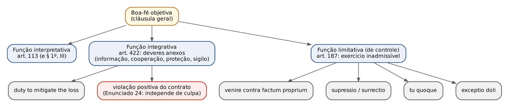
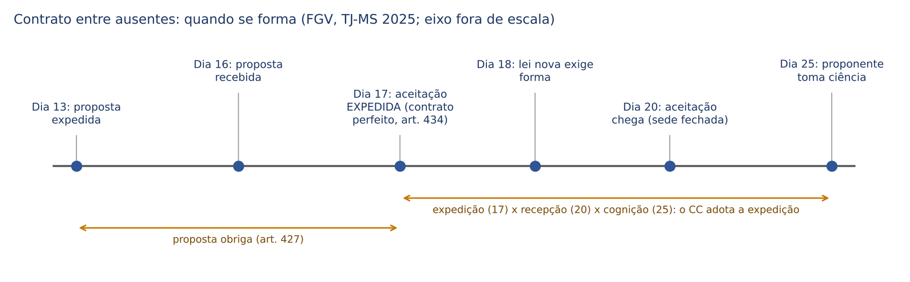
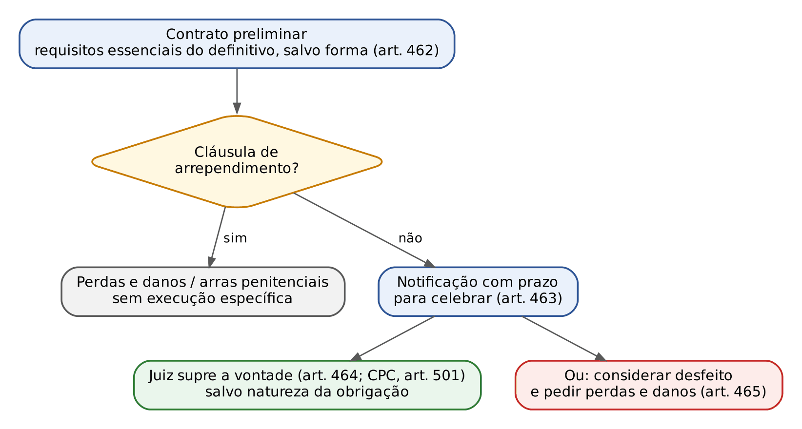
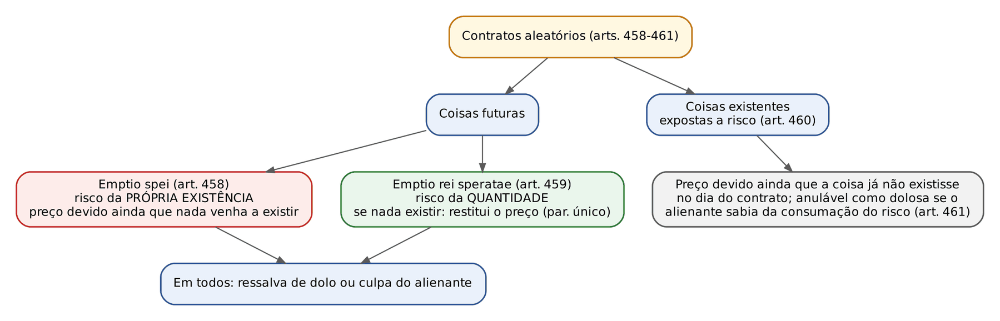
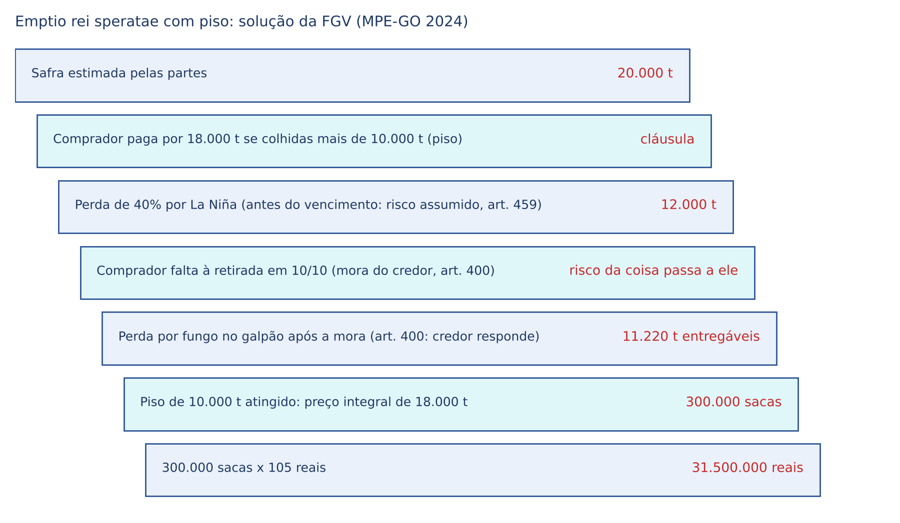
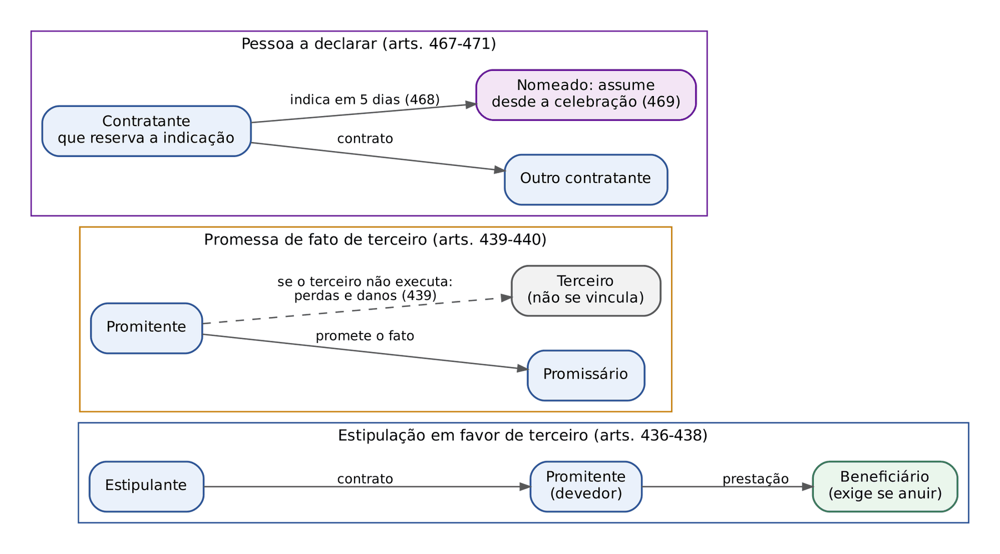

# CAPÍTULO 15 — TEORIA GERAL DOS CONTRATOS I: PRINCÍPIOS, LIBERDADE ECONÔMICA, CLASSIFICAÇÃO, FORMAÇÃO E EFEITOS PERANTE TERCEIROS

:::INCIDENCIA
Pontos: TRF5 p. 9; TJRS p. 12; TJSC p. 10, 11 e 12; SEFAZ p. 8. Nível A+. Lote: 33 questões (FGV 29, FCC 4).
O que mais cai: boa-fé objetiva (funções, deveres anexos e figuras parcelares em casos práticos), arts. 421 e 421-A (intervenção mínima e contratos paritários), formação entre ausentes (expedição x recepção), estipulação em favor de terceiro, promessa de fato de terceiro, pessoa a declarar e contrato preliminar.
:::

| Subtema | FGV | FCC | Padrão de cobrança |
|---|---|---|---|
| Boa-fé objetiva: funções, deveres anexos, figuras parcelares | 9 | 1 | caso concreto; "a cláusula não previa o dever"; inércia prolongada do credor |
| Arts. 421 e 421-A, Lei 13.874/2019, função social | 6 | 0 | revisão "ampla" x "excepcional e limitada"; paritário presumido; cláusulas que afastam boa-fé |
| Formação (proposta, aceitação, ausentes, silêncio) | 5 | 0 | linha do tempo de datas; aceitação com restrições; silêncio e usos |
| Estipulação em favor de terceiro | 4 | 1 | substituição antes x depois da anuência; quem pode exigir |
| Promessa de fato de terceiro | 3 | 0 | cônjuge (art. 439, par. único); fato de terceiro "público" |
| Pessoa a declarar | 2 | 0 | prazo de 5 dias, forma, insolvência conhecida x desconhecida |
| Contrato preliminar | 1 | 1 | execução específica; ausência de arrependimento |
| Adesão, atípicos, pacta corvina | 0 | 1 | letra dos arts. 424 a 426 |
| Aleatórios e coligados | 2 | 0 | emptio rei speratae com piso; coligação e regime de restituição |

## 15.1 Conceito, estrutura e situação do contrato no sistema

Contrato é o negócio jurídico bilateral ou plurilateral pelo qual duas ou mais partes, mediante declarações de vontade convergentes, criam, modificam ou extinguem relações jurídicas de conteúdo patrimonial. Três observações cobráveis:

- A bilateralidade do NEGÓCIO (número de centros de interesse que concorrem para a formação) não se confunde com a bilateralidade do CONTRATO (distribuição de obrigações). Doação pura é negócio bilateral (exige aceitação) e contrato unilateral (só o doador se obriga). O testamento e a promessa de recompensa são negócios unilaterais (Cap. 23). O contrato de sociedade é o exemplo clássico de negócio plurilateral, em que as prestações convergem para um fim comum, e não se trocam.
- Os planos da existência, validade e eficácia (Cap. 8) aplicam-se integralmente: elementos de existência (agentes, vontade, objeto, forma), requisitos de validade do art. 104 e fatores de eficácia (condição, termo, registro). A pergunta de banca "o registro do contrato preliminar é requisito de validade?" tem resposta negativa: é fator de eficácia perante terceiros (Enunciado 30 da I Jornada, ver 15.8).
- Contrato e propriedade (TJRS p. 12; TJSC p. 10): o contrato é o veículo de circulação da riqueza, mas, no sistema brasileiro, NÃO transfere por si o domínio. A propriedade imóvel transmite-se pelo registro e a móvel pela tradição (Cap. 28); o contrato gera apenas obrigação de dar. Daí a distinção entre título (causa) e modo (registro ou tradição), que explica por que a promessa de compra e venda registrada gera direito real à aquisição (art. 1.417), enquanto a não registrada gera direito pessoal oponível ao promitente vendedor (ver 15.8 e Cap. 31). O art. 2.035, parágrafo único, liga as duas funções sociais: nenhuma convenção prevalece se contrariar preceitos de ordem pública, "tais como os estabelecidos por este Código para assegurar a função social da propriedade e dos contratos".

:::DICA Civil law x common law no regime contratual (TJSC p. 12)
O tema geral das famílias jurídicas está no Cap. 2; aqui, só os pontos do contrato que costumam ser cobrados em comparação.

| Ponto | Common law | Direito brasileiro |
|---|---|---|
| Elemento de formação | exigência de *consideration* (contrapartida) para a força vinculante da promessa | basta o consenso; contrato gratuito é plenamente vinculante (doação, comodato) |
| Efeitos perante terceiros | *privity of contract* rígido, mitigado por leis específicas | relatividade, mitigada pela função social e pela tutela externa do crédito (15.2.3) |
| Remédio para o inadimplemento | regra: indenização (*damages*); execução específica é excepcional (*specific performance*) | primazia da tutela específica (CPC, arts. 497 e 501; art. 464 do CC) |
| Quebra eficiente | teoria do *efficient breach* aceita por parte da doutrina econômica | rejeitada pela boa-fé e pela força obrigatória; o devedor não "compra" o direito de inadimplir |
| Mitigação do dano | *duty to mitigate* de origem anglo-americana | recepcionado como dever anexo da boa-fé (Enunciado 169) |
| Alteração das circunstâncias | *frustration of purpose* e *hardship* (contratos internacionais) | imprevisão e onerosidade excessiva (arts. 317 e 478); frustração do fim pelo art. 421 (Enunciado 166) — Cap. 16 |
:::

:::QUESTAO FGV 2024 — TJ-SC — Juiz Substituto (Q3049339)
Cobrou-se qual teoria o art. 608 do CC (quem aliciar prestador de serviço obrigado em contrato escrito paga ao tomador o que o prestador receberia em dois anos) incorpora. Gabarito: C, tutela externa do crédito. Armadilhas: "lucro da intervenção" (que é enriquecimento sem causa pela exploração de direito alheio, Cap. 23) e "inadimplemento eficiente" (justamente o oposto do que a norma reprime). Fundamento em 15.2.3.
:::

## 15.2 Princípios do direito contratual

Os princípios clássicos (autonomia, força obrigatória, relatividade) convivem com os sociais (função social, boa-fé objetiva, equilíbrio) introduzidos pelo CC/2002 sob a diretriz da socialidade e da eticidade (Cap. 2). A Lei 13.874/2019 (Liberdade Econômica) não revogou os princípios sociais, mas reforçou os clássicos, especialmente nas relações paritárias. A FGV cobra exatamente essa tensão: a alternativa correta quase sempre é a que mantém os dois polos ("a revisão é excepcional, mas existe"; "a função social limita, mas não suprime a liberdade").

### 15.2.1 Autonomia privada e liberdade contratual

A doutrina contemporânea prefere "autonomia privada" a "autonomia da vontade": o que vincula não é a vontade psicológica, mas o poder normativo que o ordenamento reconhece aos particulares, dentro de limites (Tartuce; Farias e Rosenvald). Desdobra-se em liberdade de contratar (celebrar ou não; escolher com quem) e liberdade contratual (definir o conteúdo). A primeira sofre restrições nos contratos obrigatórios (seguro obrigatório, fornecimento de serviço público essencial) e a segunda nos contratos dirigidos (locação urbana, consumo, trabalho).

- Contratos atípicos são lícitos, "observadas as normas gerais fixadas neste Código" (art. 425). A ressalva é o ponto de prova: atipicidade não exime da teoria geral (boa-fé, função social, vícios do negócio).
- As partes podem pactuar garantias atípicas (Enunciado 582 da VII Jornada), e, em relações paritárias, cláusulas que excluem ou limitam o dever de indenizar (Enunciado 631 da VIII Jornada; limites da cláusula de não indenizar no Cap. 24) e pacto marciano (Enunciado 626 da VIII Jornada; Cap. 32).
- Limites gerais: ordem pública, bons costumes, função social (art. 421), boa-fé (art. 422), vedação da condição puramente potestativa (art. 122, Cap. 8) e normas imperativas especiais.

:::QUESTAO FCC 2026 — SEFAZ-CE — Auditor Fiscal (Q4221398)
Três assertivas de letra seca: contratos atípicos são lícitos observadas as normas gerais do CC (art. 425); não pode ser objeto de contrato a herança de pessoa viva (art. 426); nos contratos de adesão, são nulas as cláusulas de renúncia antecipada do aderente a direito resultante da natureza do negócio (art. 424). Gabarito: B (todas corretas). A FCC não inventou nada: copiou os artigos. Releia 15.4 e 15.5.
:::

### 15.2.2 Força obrigatória, intervenção mínima e excepcionalidade da revisão

*Pacta sunt servanda*: o contrato validamente celebrado faz lei entre as partes e vincula também o juiz, que não pode alterá-lo por mera equidade. A força obrigatória NÃO é absoluta: cede diante da imprevisão e da onerosidade excessiva (arts. 317 e 478, Cap. 16), da lesão e do estado de perigo (Cap. 9), da redução equitativa da cláusula penal (art. 413, Cap. 14) e das normas de ordem pública. A Lei 13.874/2019 positivou a diretriz de contenção judicial.

:::LEI Código Civil, arts. 421 e 421-A (redação e inclusão pela Lei 13.874/2019)
Art. 421. A liberdade contratual será exercida nos limites da função social do contrato.
Parágrafo único. Nas relações contratuais privadas, prevalecerão o princípio da intervenção mínima e a excepcionalidade da revisão contratual.
Art. 421-A. Os contratos civis e empresariais presumem-se paritários e simétricos até a presença de elementos concretos que justifiquem o afastamento dessa presunção, ressalvados os regimes jurídicos previstos em leis especiais, garantido também que:
I - as partes negociantes poderão estabelecer parâmetros objetivos para a interpretação das cláusulas negociais e de seus pressupostos de revisão ou de resolução;
II - a alocação de riscos definida pelas partes deve ser respeitada e observada; e
III - a revisão contratual somente ocorrerá de maneira excepcional e limitada.
:::

Leitura fina do texto, que é o que a FGV explora:

- A redação original do art. 421 dizia que a liberdade de contratar seria exercida "em razão e nos limites" da função social. A Lei 13.874/2019 suprimiu "em razão" e trocou "liberdade de contratar" por "liberdade contratual". A supressão foi interpretada como reforço da autonomia: a função social deixa de ser a razão de ser do contrato e permanece como limite.
- A presunção de paridade e simetria é RELATIVA ("até a presença de elementos concretos") e vale para contratos civis E empresariais (pegadinha recorrente: "só empresariais" ou "só civis"). Não alcança regimes de leis especiais: consumo, locação urbana (no que a Lei 8.245/1991 tiver de cogente), trabalho.
- A revisão não foi abolida: será "excepcional e limitada". Por isso estão erradas as alternativas que dizem que a liberdade foi "suprimida" pela função social, que a revisão é "mecanismo ordinário" ou, no extremo oposto, que cláusula de renúncia a qualquer revisão impede toda atuação judicial.
- O inciso I permite pactuar critérios de interpretação e de revisão ou resolução; o art. 113, § 2º, permite pactuar regras de interpretação, preenchimento de lacunas e integração. O limite é a ordem pública: o Enunciado 649 da IX Jornada admite, com base no art. 421-A, I, critérios para a redução da cláusula penal, "desde que não seja afastada a incidência do art. 413".
- Na Declaração de Direitos de Liberdade Econômica, o art. 3º, V, da Lei 13.874/2019 dá ao particular presunção de boa-fé nos atos da atividade econômica, resolvendo-se as dúvidas de interpretação do direito civil e empresarial "de forma a preservar a autonomia privada, exceto se houver expressa disposição legal em contrário"; o inciso VIII garante que os negócios empresariais paritários serão objeto de livre estipulação, aplicando-se as regras de direito empresarial "apenas de maneira subsidiária ao avençado, exceto normas de ordem pública". O § 5º do art. 3º exclui do inciso VIII a empresa pública e a sociedade de economia mista.

Mesmo em contrato paritário, boa-fé e função social não autorizam o juiz a criar ou ampliar a cláusula penal, que se interpreta restritivamente (STJ, REsp 2.013.493-SP, Info 889 — v. Cap. 14).

:::QUESTAO FGV 2026 — AL-RO — Analista Legislativo (Q3883084)
Duas grandes empresas, após ampla negociação, fixaram critérios objetivos de interpretação, alocação de riscos e hipóteses restritas de revisão; sobrevindo alteração econômica, uma pede revisão ampla invocando a função social. Gabarito: E — contratos civis e empresariais presumem-se paritários e simétricos, e o Judiciário deve, como regra, respeitar a alocação de riscos e os critérios pactuados, intervindo só excepcionalmente (art. 421-A). Alternativas sedutoras: "intervenção mínima só para contratos civis" (B) e "parâmetros objetivos são irrelevantes" (D), ambas contra a letra do art. 421-A.
No mesmo sentido: Q2564203 (FGV 2024 — TCE-PA — Auditor), gabarito A, transcrição do parágrafo único do art. 421; os distratores negam a função social nos contratos privados (B), presumem "assimetria" (C), proíbem contratos atípicos (D) e vedam parâmetros objetivos de interpretação (E).
:::

:::QUESTAO FGV 2026 — AMAZUL — Advogado (Q3846071)
Pediu-se a correta sobre contratos empresariais. Gabarito: D — "nos contratos empresariais, o dirigismo contratual deve ser mitigado, tendo em vista a simetria natural das relações interempresariais" (Enunciado 21 da I Jornada de Direito Comercial, literal). Os distratores são enunciados das Jornadas de Direito Comercial com UMA palavra trocada: (A) nega o Enunciado 110 da III Jornada, que manda aplicar aos negócios de propriedade intelectual a função social, a probidade e a boa-fé; (B) inverte o Enunciado 67 da II Jornada (na *built to suit*, a cláusula penal equivalente aos aluguéis vincendos é válida "SEM prejuízo" do art. 416, parágrafo único, e não "com prejuízo"); (E) inverte o Enunciado 27 da I Jornada ("NÃO se presume" violação à boa-fé se o empresário preserva segredo de empresa nas negociações). Lição: a FGV pesca enunciados das Jornadas e troca o advérbio.
:::

:::QUESTAO FGV 2025 — CGE-SP — Auditor Estadual (Q3781257)
Contrato de distribuição exclusiva redigido pela indústria continha: (I) proibição absoluta de a distribuidora pedir revisão, mesmo diante de eventos imprevisíveis; (II) exclusão da função social e da boa-fé; (III) dúvidas resolvidas a favor de quem redigiu; (IV) resilição imotivada a qualquer tempo pela indústria. Gabarito: B — a cláusula que veda a revisão judicial é nula, pois a liberdade contratual se exerce nos limites da função social e admite controle judicial excepcional. Por que as outras caem: boa-fé e função social são normas de ordem pública (art. 2.035, parágrafo único; Enunciado 363 da IV Jornada: probidade e confiança são de ordem pública), logo (C) erra; a interpretação a favor de quem redigiu contraria o art. 113, § 1º, IV, e, sendo adesão, o art. 423, logo (D) erra; a resilição unilateral imotivada é admitida pelo art. 473, com o limite do parágrafo único (prazo compatível com investimentos), logo (E) erra ao falar em nulidade "de pleno direito" (Cap. 16).
Atenção: cotejar com Q3898892 (FGV 2026 — TJ-PR — Juiz, Cap. 16), em que cláusula de renúncia à revisão por fatos PREVISÍVEIS, em contrato paritário, foi respeitada, e a revisão exigiu onerosidade excessiva nos termos legais ou quebra da base objetiva. A diferença está no objeto da renúncia: risco previsível e alocado (válida) x renúncia a toda revisão, inclusive por fato imprevisível (nula para a FGV).
:::

:::QUESTAO FGV 2025 — AL-AM — Assessor Jurídico (Q3777487)
Plataforma de entregas reduziu unilateralmente em 40%, sem aviso, a remuneração dos motoristas, com base em cláusula que lhe permitia "ajustar unilateralmente os valores conforme critérios internos de conveniência". Gabarito: B — a cláusula é nula por violar a boa-fé objetiva e o equilíbrio contratual, interpretando-se o contrato conforme a função social e a confiança legítima. Fundamento técnico adicional: a cláusula que sujeita o preço ao puro arbítrio de uma parte é condição puramente potestativa (art. 122) e, na compra e venda, há regra específica (art. 489: nulo o contrato que deixa ao arbítrio exclusivo de uma das partes a fixação do preço). Armadilha: (D) fala em mera ineficácia convalidada pela continuidade da prestação de serviços; a aceitação tácita não sana cláusula nula (art. 169).
:::

### 15.2.3 Relatividade dos efeitos e tutela externa do crédito

O contrato só vincula as partes (*res inter alios acta, aliis nec prodest nec nocet*). Exceções e mitigações:

- Exceções legais em que o contrato atinge terceiros: estipulação em favor de terceiro (beneficia), promessa de fato de terceiro (não vincula o terceiro, ver 15.11), contrato com pessoa a declarar, seguro de vida em favor de beneficiário, herdeiros que sucedem nas obrigações do falecido (nos limites da herança).
- Tutela externa do crédito: o terceiro que, sabendo do contrato, concorre para o seu inadimplemento responde perante o credor prejudicado. É a eficácia externa da função social (Enunciado 21 da I Jornada: a função social impõe a revisão da relatividade "implicando a tutela externa do crédito"). Base positiva: art. 608 (aliciamento de prestador de serviços) e o dever geral de não lesar (art. 186). A doutrina fala em "terceiro cúmplice"; o caso didático é o do artista que rompe contrato de publicidade para estrelar campanha da concorrente, com responsabilidade da nova contratante que conhecia o contrato anterior (julgado do TJSP citado por Tartuce; não confirmado nesta pesquisa, por isso sem número).
- Requisito da tutela externa: conhecimento (ou cognoscibilidade) do contrato alheio pelo terceiro. Sem isso, prevalece a liberdade de contratar do terceiro.

:::PEGADINHA Terceiro cúmplice x exceção do contrato não cumprido
Em Q3373880 (FGV 2025 — TRF5 — Juiz, Cap. 16), a teoria do terceiro cúmplice aparecia como distrator para justificar a exceção do contrato não cumprido arguida por seguradora. O terceiro cúmplice responde por indenização (tutela externa); a exceção oposta pela seguradora decorre da COLIGAÇÃO entre seguro-garantia e contrato garantido (ver 15.10 e Enunciado 24 da I Jornada de Direito Comercial).
:::

### 15.2.4 Função social do contrato

Cláusula geral (art. 421) com dupla eficácia:

- Eficácia externa (transubjetiva): protege terceiros e a coletividade contra efeitos nocivos do contrato e, inversamente, protege o contrato contra interferências de terceiros (tutela externa). O Enunciado 26 da I Jornada de Direito Comercial diz que o contrato empresarial cumpre sua função social quando não prejudica interesses difusos ou coletivos de não participantes.
- Eficácia interna: atua entre as próprias partes, impondo equilíbrio, conservação e proteção da dignidade (Enunciado 360 da IV Jornada: "também pode ter eficácia interna entre as partes contratantes"). Exemplos: conservação do contrato (Enunciado 22), adimplemento substancial (Enunciado 361, Cap. 14), nulidade de cláusulas abusivas em contratos civis, frustração do fim (Enunciado 166, Cap. 16).

Enunciados de base (I Jornada): 21 (relatividade e tutela externa), 22 (reforça a conservação, "assegurando trocas úteis e justas"), 23 (não elimina a autonomia, mas a atenua quando presentes interesses metaindividuais ou dignidade da pessoa). Consequência da violação: "invalidade ou ineficácia do contrato ou de cláusulas contratuais" (Enunciado 431 da V Jornada). Aplica-se também aos contratos empresariais, "em conformidade com as especificidades" deles (Enunciado 29 da I Jornada de Direito Comercial).

:::QUESTAO FGV 2026 — ENAM 2026.1 (Q4102450)
Afirmativa correta sobre a estrutura principiológica. Gabarito: C — a boa-fé objetiva atua como cânone interpretativo, fonte de deveres laterais e limite ao exercício abusivo de direitos, sendo vedado às partes afastá-la por convenção. Distratores: (A) diz que lesão e estado de perigo geram NULIDADE (são causas de ANULABILIDADE, art. 171, II, Cap. 9); (B) restringe a função social à eficácia externa, contrariando o Enunciado 360; (D) faz da boa-fé um impedimento a qualquer exercício de direito que cause prejuízo ao devedor, mesmo quando o prejuízo decorre do próprio comportamento dele (a boa-fé limita o exercício ABUSIVO, não o regular); (E) nega a tutela externa do crédito (Enunciado 21).
:::

:::QUESTAO FGV 2025 — TJ-MS — Juiz Substituto (Q3786335)
A partir do Enunciado 22 (conservação) e do art. 51, § 2º, do CDC, perguntou-se a que contrato o CC NÃO aplica o princípio da conservação. Gabarito: D, transação — o art. 848 estabelece que, sendo nula qualquer das cláusulas da transação, nula será esta (indivisibilidade da transação; Cap. 21). Os demais (solenes, aleatórios, simulados, com incapazes) não têm regra de contaminação total: no simulado, aliás, subsiste o dissimulado se válido na substância e na forma (art. 167), o que é conservação; no negócio com incapaz, aplica-se a redução do art. 184.
:::

:::JURIS STJ, REsp 2.135.783-DF, j. 18/6/2024 (Info 817)
Não há óbice à imediata suspensão do perfil profissional de motorista de aplicativo que pratica ato suficientemente gravoso, com possibilidade de posterior exercício de defesa visando ao recredenciamento. Gancho de prova: em contratos de plataforma, a suspensão cautelar por fato grave é exercício regular da autonomia contratual, compatível com a boa-fé, desde que assegurada defesa posterior (contraste com Q3777487, em que a alteração unilateral arbitrária de preço foi abusiva).
:::

### 15.2.5 Boa-fé objetiva: conceito e funções

Boa-fé subjetiva é estado psicológico (ignorância de vício ou de direito alheio: posse de boa-fé, casamento putativo, terceiro adquirente). Boa-fé objetiva é norma de conduta: padrão de lealdade, cooperação e confiança exigido de quem participa de uma relação obrigacional, aferido objetivamente, sem indagar a intenção (Enunciado 1 da I Jornada de Direito Processual Civil, aplicável por analogia: a verificação da violação "dispensa a comprovação do *animus*"). Em prova, "boa-fé subjetiva" como fundamento de procedência em litígio contratual é quase sempre distrator (Q3362362, alternativa E).

O art. 422 manda observar probidade e boa-fé "assim na conclusão do contrato, como em sua execução". O texto omite as fases pré e pós-contratual, mas a omissão não impede a incidência (Enunciados 25 e 170: na fase de negociações e após a execução, "quando tal exigência decorrer da natureza do contrato"). A boa-fé é cláusula geral de ordem pública: não pode ser afastada pelas partes (Enunciado 363 da IV Jornada; Q4102450 e Q3781257).

| Função | Base | Conteúdo | Exemplo cobrado |
|---|---|---|---|
| Interpretativa | art. 113, caput e § 1º, III | o contrato se interpreta pelo sentido que corresponda à boa-fé e ao comportamento das partes | cláusula de reajuste "conforme o mercado" lida segundo a prática posterior de negociar (Q4079375) |
| Integrativa (criadora de deveres) | art. 422 | deveres anexos, laterais ou instrumentais, que existem ainda que não escritos: informação, cooperação, proteção, lealdade, sigilo | contratada que omite falhas de equipamentos hospitalares alegando que "o contrato não previa o dever" (Q4283072) |
| Limitativa (de controle) | art. 187 | veda o exercício de direito que exceda manifestamente os limites da boa-fé (abuso de direito) | reajustes abusivos do fornecedor para compensar inadimplência (Q2482654) |

Pontos finos dos deveres anexos:

- A violação de dever anexo é inadimplemento, independentemente de culpa (Enunciado 24 da I Jornada): é a violação positiva do contrato, desenvolvida no Cap. 14. Também autoriza a exceção do contrato não cumprido (Enunciado 652 da IX Jornada; Cap. 16).
- A boa-fé gera deveres também para o credor: evitar o agravamento do próprio prejuízo (Enunciado 169) e reconhecer ao devedor um "direito a cumprir" (Enunciado 168), de que é exemplo a consignação em pagamento (Cap. 13).
- Pós-eficácia (*culpa post pactum finitum*): certos deveres sobrevivem à extinção (sigilo, não concorrência desleal com informações recebidas, fornecimento de peças de reposição). Desenvolvimento no Cap. 16; aqui basta saber que a boa-fé NÃO se encerra com o adimplemento (Q4338795, alternativas B e E).
- Fase pré-contratual: a ruptura injustificada de tratativas que criaram expectativa legítima gera responsabilidade civil (STJ, REsp 2.078.517-RJ, j. 14/5/2024, caso do spray de barreira usado pela FIFA). O regime dessa responsabilidade (natureza, extensão do dano, interesse negativo) está no Cap. 24; ver também Q4349469 (FGV 2026 — TJ-PE — Juiz: indenização por quebra de confiança, e não contratação forçada).
- Nos contratos empresariais, "não se presume violação à boa-fé objetiva" se o empresário, nas negociações, preserva segredo de empresa ou administra informações estratégicas (Enunciado 27 da I Jornada de Direito Comercial). O dever de informar não obriga a revelar a própria vantagem competitiva.

:::LEI Código Civil, art. 113 (§§ 1º e 2º incluídos pela Lei 13.874/2019)
Art. 113. Os negócios jurídicos devem ser interpretados conforme a boa-fé e os usos do lugar de sua celebração.
§ 1º A interpretação do negócio jurídico deve lhe atribuir o sentido que:
I - for confirmado pelo comportamento das partes posterior à celebração do negócio;
II - corresponder aos usos, costumes e práticas do mercado relativas ao tipo de negócio;
III - corresponder à boa-fé;
IV - for mais benéfico à parte que não redigiu o dispositivo, se identificável; e
V - corresponder a qual seria a razoável negociação das partes sobre a questão discutida, inferida das demais disposições do negócio e da racionalidade econômica das partes, consideradas as informações disponíveis no momento de sua celebração.
§ 2º As partes poderão livremente pactuar regras de interpretação, de preenchimento de lacunas e de integração dos negócios jurídicos diversas daquelas previstas em lei.
:::

A teoria geral da interpretação (arts. 112 e 114, reserva mental, interpretação restritiva dos benéficos) está no Cap. 8. Para contratos, guarde: o inciso I positiva a interpretação pela conduta posterior das partes (já defendida pelo Enunciado 409 da V Jornada: também "de acordo com as práticas habitualmente adotadas entre as partes"); o inciso IV generaliza a regra *contra proferentem*, que antes estava restrita à adesão (art. 423) e ao consumo (CDC, art. 47), exigindo apenas que o redator seja identificável; o inciso V adota a interpretação pela "razoável negociação", de inspiração na análise econômica.

:::QUESTAO FGV 2026 — PGE-AC — Procurador do Estado (Q4079375)
Contrato de fornecimento redigido por Ômega previa que ajustes de preço "poderão ser realizados conforme condições de mercado". Por mais de dois anos, Ômega só reajustou por índices setoriais, com comunicação e negociação prévias; depois, alegando mudança abrupta do mercado, reajustou unilateralmente. Gabarito: D — a cláusula se interpreta conforme o comportamento das partes após a celebração, que pode restringir o sentido literal (art. 113, § 1º, I). Somam-se os incisos III (boa-fé) e IV (sentido mais benéfico a quem não redigiu). Distratores: literalidade (A), interpretação a favor do mais forte ou do redator (B e E) e prevalência da intenção subjetiva de quem redigiu (C).
:::

:::QUESTAO FGV 2026 — TCE-PE — Analista de Controle Externo (Q4283072)
Contratada de manutenção hospitalar entregava relatórios, mas só fazia os reparos baratos e omitia falhas relevantes, alegando que nenhuma cláusula a obrigava a comunicar defeitos ou a priorizar reparos. Gabarito: A — a tese não prospera, porque a boa-fé impõe deveres anexos de lealdade, cooperação, informação e proteção da confiança ainda que não previstos (art. 422). Os distratores invertem a lógica: autonomia privada como licença para modificar a execução (B), responsabilidade limitada ao expresso (C e E), função social como autorização para a execução "mais eficiente" (D).
:::

:::QUESTAO FGV 2024 — SES-MT — Advogado (Q2482654)
Fornecedora, diante da inadimplência da associação hospitalar, passou a reajustar o preço muito acima da inflação. Gabarito: A — a boa-fé exerce, entre outras, a função de limitar o exercício de direitos subjetivos, no caso de abuso (art. 187). Distratores: poder "ilimitado" do Judiciário para revisar preços (B); revisão como intervenção "ordinária e natural" (C, contra o art. 421, parágrafo único); e (D), que exige imprevisibilidade do fato e desconsidera consequências imprevisíveis de fatos previsíveis, contrariando o Enunciado 175 da III Jornada (Cap. 16).
:::

:::QUESTAO FCC 2026 — PGM-Manaus — Procurador (Q4338795)
Locação de imóvel por empresa pública, precedida de instrumento com todos os elementos essenciais e obrigação recíproca de celebrar o definitivo, sem cláusula de arrependimento; fato extraordinário posterior e uso, após o fim do vínculo, de informações estratégicas obtidas nas tratativas. Gabarito: D — o instrumento pode caracterizar contrato preliminar e, sem arrependimento, admite tutela específica que supra a declaração de vontade do inadimplente (arts. 463 e 464), sem prejuízo da boa-fé na fase pós-contratual. Erros dos distratores: (A) trata o preliminar como mera negociação, sem execução específica; (B) e (E) negam a pós-eficácia da boa-fé; (C) admite resolução por onerosidade em contrato de execução instantânea já cumprido (o art. 478 exige execução continuada ou diferida, Cap. 16).
:::

### 15.2.6 Figuras parcelares da boa-fé (exercício inadmissível de posições jurídicas)

O Enunciado 412 da V Jornada as reúne: "as diversas hipóteses de exercício inadmissível de uma situação jurídica subjetiva, tais como *supressio*, *tu quoque*, *surrectio* e *venire contra factum proprium*, são concreções da boa-fé objetiva". O fundamento normativo é a conjugação dos arts. 187 e 422 (Enunciado 362 da IV Jornada, para o *venire*). A teoria do abuso de direito em geral (critério objetivo-finalístico, Enunciado 37; autonomia em relação à responsabilidade civil, Enunciado 539; Enunciado 617 sobre a ineficácia do ato abusivo) está no Cap. 10; aqui, o recorte contratual.

| Figura | Estrutura | Requisitos/efeito | Exemplo de prova |
|---|---|---|---|
| *Venire contra factum proprium* | conduta inicial (*factum proprium*) que gera confiança + conduta posterior contraditória | confiança legítima da outra parte, investimento nela e dano potencial; efeito: inadmissibilidade da conduta contraditória | parte que pede indenização com base no contrato e, ao mesmo tempo, tenta afastar a cláusula compromissória do mesmo contrato (STJ, REsp 2.143.882-SP, j. 11/6/2024, Info 817) |
| *Supressio* (*Verwirkung*) | não exercício de um direito por tempo prolongado, criando a expectativa de que não será exercido | perda da POSSIBILIDADE de exercício (não do direito em si), antes da prescrição; não há prazo fixo | credor que por anos aceita pagamento atrasado sem multa e depois cobra todas as multas pretéritas (Q4012600) |
| *Surrectio* (*Erwirkung*) | face oposta da *supressio*: surgimento de um direito pela prática reiterada | nasce para a outra parte posição jurídica que não existia no contrato | cessão de locação não autorizada, mas tolerada por seis anos, com aluguéis recebidos do cessionário (Q3362362) |
| *Tu quoque* | quem viola uma norma não pode exigir de outrem o seu cumprimento ou aproveitar-se da própria violação | quebra da sinalagmaticidade ética; ligada ao *nemo auditur propriam turpitudinem allegans* | art. 180 (pessoa entre 16 e 18 anos que oculta dolosamente a idade não invoca a incapacidade) e, para a FGV, art. 231 (quem recusa exame médico não se aproveita da recusa) |
| *Exceptio doli* | defesa contra quem age dolosamente ao exigir a prestação | *exceptio doli generalis* (contra a pretensão dolosa em si) | credor que exige a prestação para em seguida ter de devolvê-la (*dolo agit qui petit quod statim redditurus est*) |
| *Duty to mitigate the loss* | dever do credor de não agravar o próprio prejuízo | inércia deliberada reduz a indenização (culpa concorrente ou abuso, conforme o autor) | credor que deixa o devedor inadimplente na posse do imóvel por quase sete anos (STJ, REsp 758.518/PR, 3ª Turma, j. 17/6/2010: exclusão de um ano de ressarcimento) |
| Adimplemento substancial | inadimplemento mínimo impede a resolução | só perdas e danos ou cobrança; Enunciado 361 | ver Cap. 14 |

:::JURIS STJ, REsp 758.518/PR, 3ª Turma, j. 17/6/2010 (duty to mitigate)
Primeiro precedente do STJ a acolher expressamente o dever de mitigar o próprio prejuízo: o credor que permaneceu deliberadamente inerte por quase sete anos, deixando o devedor inadimplente na posse do imóvel, violou os deveres de cooperação e lealdade, e a Corte manteve a penalidade de exclusão de um ano do ressarcimento. Base doutrinária citada: Véra Maria Jacob de Fradera. A CEBRASPE (MPE-BA 2023) cobrou a tese como "abuso de direito".
:::

:::QUESTAO FCC 2026 — DPE-MA — Defensor Público (Q4012600)
Locatária de vaga de garagem há sete anos sempre pagou com atraso, mas regularizava até o fim do mês; o locador nunca cobrou a multa de 10% e, endividado, resolveu cobrar todas as multas anteriores. Gabarito: D — não pode cobrar, em atenção à boa-fé e à vedação do comportamento contraditório. Tecnicamente, a figura mais precisa é a *supressio* (perda da possibilidade de exigir pela inércia prolongada que gerou confiança); a FCC preferiu o rótulo genérico *venire*, o que não muda a resposta. Distratores: prescrição quinquenal (C: o problema não é prazo, é confiança), interpretação a favor do credor (B) e lesão (E: vício de formação, não de execução, Cap. 9).
:::

:::QUESTAO FGV 2025 — ENAM 2025.1 (Q3362362)
Locatária comercial transferiu verbalmente a locação a restaurante de terceira, sem anuência escrita exigida pelo contrato; notificou o locador, que ficou inerte e recebeu por seis anos os aluguéis depositados pela cessionária, inclusive purgações de mora. Depois, ajuizou despejo por violação da cláusula. Gabarito: C — improcedência, por respeito à boa-fé objetiva, em virtude da expectativa gerada pela conduta e inércia do locador. Combinam-se *supressio* (do locador quanto à faculdade de opor a cláusula) e *surrectio* (para a cessionária). Armadilhas: (B) diz que a cessão verbal é anulável e não convalidada; (E) usa "boa-fé subjetiva". Atenção prática: na Lei 8.245/1991, a cessão depende de consentimento prévio e escrito do locador (art. 13), e o § 1º do art. 13 diz que NÃO se presume o consentimento pela simples demora do locador; mas, notificado por escrito pelo locatário, o locador tem 30 dias para manifestar formalmente a oposição (§ 2º), e a leitura corrente é a de que o silêncio após a notificação vale como anuência (Cap. 18) — reforço legal da mesma solução, que depende da notificação, como no caso.
:::

:::QUESTAO FGV 2025 — TRF1 — Juiz Federal Substituto (Q3425310)
O art. 231 (quem se nega a exame médico necessário não pode aproveitar-se da recusa) densificaria qual figura parcelar? Gabarito: D, *tu quoque*. O raciocínio da banca: quem cria o obstáculo à prova não pode extrair vantagem da própria conduta, o que se aproxima da regra "não pode invocar em seu favor a violação que ele mesmo provocou". Há doutrina que enquadraria o dispositivo como *venire* ou como regra de prova (art. 232: a recusa pode suprir a prova). Para a FGV, memorize: art. 231 = *tu quoque*.
:::

:::QUESTAO FGV 2024 — TRF1 — Analista Judiciário (Q3028428)
Franqueada que não assinou nem devolveu o instrumento, mas recebeu treinamento, usou a marca, instalou as unidades e pagou as contraprestações. Qual instituto afere a declaração tácita? Gabarito: E, comportamento concludente (art. 107: forma livre; a vontade se manifesta por atos inequívocos). Não é *tu quoque* (A), nem gestão de negócios (B, que pressupõe atuação sem mandato no interesse alheio, Cap. 23), nem contrato preliminar (C), nem adimplemento substancial (D). Ligação com o *venire*: a franqueada que executou o contrato por anos não pode depois negar sua existência para fugir das obrigações.
:::

:::PEGADINHA Supressio x prescrição x decadência x renúncia tácita
A *supressio* NÃO extingue o direito por decurso de prazo legal (isso é prescrição ou decadência, Cap. 11) e NÃO depende de vontade de abdicar (isso seria renúncia tácita). Ela torna inadmissível o exercício porque a inércia, somada às circunstâncias, criou confiança legítima. Por isso: (1) pode ocorrer antes de findo o prazo prescricional; (2) não há prazo fixo; (3) o mero decurso de tempo, sem circunstâncias que gerem confiança, NÃO basta. Em Q3044242 (FGV 2024 — Procurador de Vitória, Cap. 11), a alternativa que via *supressio* em dívidas vencidas há mais de 4 anos foi considerada errada: simples inadimplência de clientes não gera confiança no não exercício; aplicou-se o prazo prescricional.
:::

:::DICA Como reconhecer a figura no enunciado
- "Por anos tolerou / nunca cobrou / sempre aceitou e agora exige": *supressio* (para quem perde) e *surrectio* (para quem ganha).
- "Primeiro afirmou X, a outra parte confiou e investiu, depois sustentou não-X": *venire*.
- "Descumpriu e agora exige do outro / quer se beneficiar da própria falta": *tu quoque*.
- "Deixou o prejuízo crescer podendo evitá-lo": *duty to mitigate* (Enunciado 169).
- "Pede o que terá de devolver em seguida": *exceptio doli*.
:::

### 15.2.7 Equilíbrio contratual (justiça contratual)

Princípio implícito, extraído da função social e de institutos que corrigem desequilíbrio originário (lesão e estado de perigo, arts. 156 e 157, Cap. 9; cláusulas abusivas na adesão, art. 424) ou superveniente (arts. 317 e 478 a 480, Cap. 16). Não autoriza o juiz a desfazer qualquer contrato "desvantajoso": o desequilíbrio relevante é o tipificado em lei. Erro comum de alternativa (Q4102450, A): chamar lesão e estado de perigo de causas de nulidade por "violação à ordem pública contratual"; são anulabilidades, sujeitas ao prazo decadencial de 4 anos do art. 178, II.

## 15.3 Lei de Liberdade Econômica (Lei 13.874/2019) no direito contratual

A Lei 13.874/2019 (conversão da MP 881/2019) instituiu a Declaração de Direitos de Liberdade Econômica e alterou o CC. O art. 1º, § 1º, manda observá-la "na aplicação e na interpretação do direito civil, empresarial, econômico, urbanístico e do trabalho"; o § 2º estabelece que se interpretam "em favor da liberdade econômica, da boa-fé e do respeito aos contratos, aos investimentos e à propriedade todas as normas de ordenação pública sobre atividades econômicas privadas". O § 3º (redação da Lei 14.195/2021) exclui o direito tributário e o financeiro, salvo o inciso X do art. 3º.

| Dispositivo | O que a Lei 13.874/2019 fez | Onde está desenvolvido |
|---|---|---|
| Art. 113, §§ 1º e 2º | critérios legais de interpretação e liberdade para pactuar regras de interpretação e integração | 15.2.5 e Cap. 8 |
| Art. 421 | "liberdade contratual" nos limites (não mais "em razão") da função social; parágrafo único: intervenção mínima e excepcionalidade da revisão | 15.2.2 |
| Art. 421-A | presunção relativa de paridade e simetria; parâmetros objetivos; alocação de riscos; revisão excepcional e limitada | 15.2.2 |
| Art. 49-A | autonomia patrimonial da pessoa jurídica como instrumento lícito de alocação e segregação de riscos | Cap. 5 |
| Art. 50 | requisitos da desconsideração (desvio de finalidade e confusão patrimonial definidos) | Cap. 6 |
| Lei 13.874, art. 3º, V e VIII | presunção de boa-fé do particular; livre estipulação nos negócios empresariais paritários, com regras empresariais apenas supletivas | 15.2.2 |

:::ATENCAO Três equívocos frequentes sobre a Lei 13.874/2019
1. Ela NÃO revogou a função social nem a boa-fé; pelo contrário, o art. 1º, § 2º, menciona a boa-fé como vetor interpretativo.
2. A presunção do art. 421-A NÃO é absoluta e NÃO se aplica a regimes especiais (consumo, locação naquilo que for cogente, trabalho).
3. A revisão NÃO foi proibida: é excepcional e limitada. Cláusula que proíbe toda e qualquer revisão, inclusive por fato imprevisível, tende a ser tida por inválida pela FGV (Q3781257); cláusula que aloca riscos previsíveis em contrato paritário deve ser respeitada (Q3898892, Cap. 16).
:::

## 15.4 Contratos de adesão

Contrato de adesão é aquele cujas cláusulas são estabelecidas unilateralmente por uma das partes, sem que a outra possa discutir ou modificar substancialmente o conteúdo; adere em bloco. Distinga do contrato-tipo (formulário que admite negociação) e do contrato de consumo:

- O contrato de adesão "não se confunde com o contrato de consumo" (Enunciado 171 da III Jornada). Há adesão sem consumo (franquia, *shopping center*, locação padronizada, contratos de plataforma com prestadores) e consumo sem adesão (contrato negociado com consumidor). A definição legal de adesão está no CDC, art. 54, que é a principal interface (Apostila de Direito do Consumidor).
- As cláusulas abusivas "não ocorrem exclusivamente nas relações jurídicas de consumo" (Enunciado 172), sendo exemplo a do art. 424.
- Houve "forte aproximação principiológica" entre CC e CDC em matéria contratual (Enunciado 167), o que fundamenta o diálogo das fontes (Cap. 2).

:::LEI Código Civil, arts. 423 e 424
Art. 423. Quando houver no contrato de adesão cláusulas ambíguas ou contraditórias, dever-se-á adotar a interpretação mais favorável ao aderente.
Art. 424. Nos contratos de adesão, são nulas as cláusulas que estipulem a renúncia antecipada do aderente a direito resultante da natureza do negócio.
:::

Detalhes que caem:

- O art. 423 só incide havendo ambiguidade ou contradição: cláusula clara, ainda que desfavorável, NÃO é reinterpretada (no CDC, o art. 47 manda interpretar "de maneira mais favorável ao consumidor" todas as cláusulas, sem exigir ambiguidade: diferença de amplitude cobrável).
- O art. 424 comina NULIDADE, não anulabilidade, à renúncia ANTECIPADA a direito "resultante da natureza do negócio". Renúncia posterior, feita conscientemente após o surgimento do direito, não é atingida.
- Aplicações das Jornadas: na fiança de adesão, nula a renúncia antecipada ao benefício de ordem (Enunciado 364 da IV Jornada; Cap. 21); na locação urbana de adesão, nula a renúncia antecipada à indenização e à retenção por benfeitorias NECESSÁRIAS (Enunciado 433 da V Jornada; Cap. 18); na adesão, o prejuízo do aderente que exceder a cláusula penal compensatória pode ser exigido independentemente de convenção (Enunciado 430 da V Jornada, em contraste com o art. 416, parágrafo único; Cap. 14).
- A cláusula de não indenizar em contrato de adesão foi distrator em Q3301222 (FGV 2025 — TJ-SE — Juiz, Cap. 24).

## 15.5 Contratos atípicos e pacta corvina

Contrato típico é o que tem disciplina legal própria (nominado e regulado); atípico, o que não a tem, sendo lícito "observadas as normas gerais" (art. 425). Contrato misto combina elementos de tipos diversos num só negócio (hospedagem: locação, depósito, prestação de serviços), distinto dos contratos coligados, que são vários contratos unidos por nexo funcional (15.10). Para regular o atípico, a doutrina aplica, nessa ordem, a vontade das partes, as normas gerais do CC e, por analogia, as do tipo mais próximo (teorias da absorção e da combinação). Exemplos clássicos: cessão de clientela, *shopping center* (Enunciado 30 da I Jornada de Direito Comercial sobre fiscalização de contas do lojista), hospedagem em plataformas, contratos de *know-how*.

Art. 426: "Não pode ser objeto de contrato a herança de pessoa viva" (vedação dos pactos sucessórios ou *pacta corvina*). Fundamentos: imoralidade do *votum mortis* e preservação da liberdade de testar e da ordem de vocação. Consequência: nulidade por ilicitude do objeto (art. 166, II). Exceções e falsas exceções:

- Partilha em vida pelo ascendente, por ato entre vivos ou de última vontade, desde que não prejudique a legítima (art. 2.018): é ato de disposição do próprio patrimônio, não contrato sobre herança de terceiro vivo (Cap. 45).
- Renúncia à concorrência sucessória em pacto antenupcial: tema controvertido na doutrina e em provimentos e propostas de reforma; não afirme como regra vigente (Cap. 36 e 43).
- Cessão de direitos hereditários só é possível APÓS a abertura da sucessão (art. 1.793; Cap. 42).
- Doação de ascendente a descendente é válida e importa adiantamento de legítima (art. 544): não é pacto sucessório.

## 15.6 Classificação dos contratos

A tabela é a ficha de consulta da classificação, com a consequência de regime de cada par (o que de fato a prova cobra).

| Critério | Espécies | Consequência prática (fundamento) |
|---|---|---|
| Distribuição de obrigações | unilaterais (só uma parte se obriga: doação pura, mútuo, comodato, depósito gratuito); bilaterais ou sinalagmáticos (obrigações recíprocas: compra e venda, locação); bilaterais imperfeitos (unilateral que gera obrigação eventual para a outra parte: depósito com despesas do depositário) | exceção do contrato não cumprido e cláusula resolutiva tácita só nos bilaterais (arts. 474 a 477, Cap. 16) |
| Vantagens | gratuitos ou benéficos (só uma parte aufere vantagem); onerosos (ambas) | interpretação restritiva dos benéficos (art. 114); fraude contra credores sem *consilium fraudis* nos gratuitos (art. 158); doador não responde por evicção nem vício salvo doação onerosa ou com encargo (arts. 441, parágrafo único, e 552) |
| Certeza das prestações | comutativos (prestações certas e equivalentes desde a formação); aleatórios (prestação de ao menos uma parte depende de risco) | vícios redibitórios só nos comutativos (art. 441; Enunciado 583 da VII Jornada para elementos não aleatórios); lesão tipicamente nos comutativos; onerosidade excessiva no aleatório só fora da álea (Enunciado 440 da V Jornada) — ver 15.9 |
| Formação | consensuais (formam-se com o consenso: compra e venda, locação); reais (exigem entrega da coisa: mútuo, comodato, depósito, arras) | antes da entrega, no contrato real, há apenas promessa de contratar |
| Forma | não solenes (forma livre, regra do art. 107); solenes ou formais (forma prescrita: escritura pública para direitos reais sobre imóveis de valor superior a 30 vezes o maior salário mínimo, art. 108; forma escrita na fiança, art. 819) | inobservância da forma prescrita: nulidade (art. 166, IV) |
| Disciplina legal | típicos; atípicos (art. 425); mistos | 15.5 |
| Pessoa do contratante | impessoais; personalíssimos ou *intuitu personae* (prestação infungível: obra de artista, mandato) | obrigação personalíssima não se transmite aos herdeiros; erro sobre a pessoa é relevante (art. 139, II); infungibilidade afasta execução por terceiro (Cap. 12) |
| Tempo de execução | instantâneos (execução imediata); de execução diferida (prestação única futura); de execução continuada ou de trato sucessivo (prestações periódicas) | onerosidade excessiva só nos continuados ou diferidos (art. 478); nulidade/resolução nos de trato sucessivo não atinge prestações já cumpridas |
| Negociação | paritários (discutidos); de adesão (arts. 423 e 424); contratos-tipo | presunção do art. 421-A; regras protetivas da adesão |
| Relação entre si | principais e acessórios (fiança, cláusula penal, arras) | o acessório segue o principal (art. 184 para a nulidade; art. 92); a recíproca não é verdadeira |
| Momento | preliminares (pré-contrato, promessa) e definitivos | execução específica do preliminar (15.8) |
| Partes | individuais e coletivos (convenção coletiva de consumo, CDC, art. 107) | — |
| Pessoas envolvidas no efeito | de efeitos limitados às partes; com eficácia em favor ou contra terceiros | 15.11 |

:::PEGADINHA Bilateral x oneroso; unilateral x gratuito
Não são sinônimos. Mútuo feneratício (com juros) é contrato UNILATERAL (só o mutuário se obriga, pois o empréstimo se aperfeiçoa com a entrega) e ONEROSO (ambos auferem vantagem). Doação com encargo é onerosa na medida do encargo e, segundo parte da doutrina, bilateral imperfeita. Comodato é unilateral e gratuito. Também não confunda negócio bilateral (duas vontades para formar) com contrato bilateral (obrigações recíprocas): toda doação é negócio bilateral, mas a pura é contrato unilateral.
:::

:::PEGADINHA Contrato real x direito real
"Contrato real" é categoria de FORMAÇÃO (exige a entrega da coisa para existir: mútuo, comodato, depósito). Nada tem a ver com direito real (categoria de eficácia *erga omnes*). O comodato é contrato real que gera direito pessoal; a hipoteca é direito real constituído por contrato consensual e solene, com registro.
:::

Interpretação e qualificação (TJRS p. 12): qualificar é enquadrar o contrato num tipo (ou concluir pela atipicidade) a partir do seu conteúdo, e não do nome dado pelas partes (*nomen iuris* não vincula; art. 112: atende-se mais à intenção consubstanciada na declaração do que ao sentido literal). A qualificação precede e condiciona a interpretação e a integração, pois define as normas supletivas aplicáveis. Exemplo de prova: "locação" que esconde compra e venda a prazo com reserva de domínio; "comodato" com contraprestação mensal (é locação).

## 15.7 Formação dos contratos

### 15.7.1 Fases e formação progressiva

O contrato forma-se pelo encontro de proposta e aceitação, mas a formação pode ser progressiva (TJRS p. 12):

- Negociações preliminares (tratativas): não vinculam a celebrar; geram apenas deveres de boa-fé (lealdade, informação, sigilo), cuja violação gera responsabilidade pré-contratual (Cap. 24). Cartas de intenção e memorandos de entendimento, em regra, são tratativas documentadas.
- Punctação (minuta): acordo progressivo sobre pontos do futuro contrato. Se as partes ajustaram os elementos essenciais e deixaram os secundários para depois, parte da doutrina admite a formação do contrato, integrando-se as lacunas pela lei e pela boa-fé; se ainda faltam elementos essenciais ou se as partes subordinaram a vinculação à redação final, não há contrato.
- Proposta (oferta, policitação) e aceitação (oblação): formam o contrato definitivo ou o preliminar.
- Contrato preliminar (15.8): já é contrato, cujo objeto é a obrigação de celebrar o definitivo.

O CC NÃO disciplina as tratativas; a FGV explora a diferença entre efeito das tratativas (indenização, nunca contratação forçada, Q4349469) e efeito do contrato preliminar (execução específica, Q3265471).

### 15.7.2 Proposta

:::LEI Código Civil, arts. 427 e 428
Art. 427. A proposta de contrato obriga o proponente, se o contrário não resultar dos termos dela, da natureza do negócio, ou das circunstâncias do caso.
Art. 428. Deixa de ser obrigatória a proposta:
I - se, feita sem prazo a pessoa presente, não foi imediatamente aceita. Considera-se também presente a pessoa que contrata por telefone ou por meio de comunicação semelhante;
II - se, feita sem prazo a pessoa ausente, tiver decorrido tempo suficiente para chegar a resposta ao conhecimento do proponente;
III - se, feita a pessoa ausente, não tiver sido expedida a resposta dentro do prazo dado;
IV - se, antes dela, ou simultaneamente, chegar ao conhecimento da outra parte a retratação do proponente.
:::

| Situação | A proposta vincula até... | Fundamento |
|---|---|---|
| Presente, sem prazo | aceitação imediata | art. 428, I |
| Presente, com prazo | fim do prazo | art. 427 |
| Ausente, sem prazo | decurso do "prazo moral" (tempo suficiente para a resposta chegar ao proponente) | art. 428, II |
| Ausente, com prazo | EXPEDIÇÃO da resposta dentro do prazo | art. 428, III |
| Qualquer caso | retratação que chegue ANTES ou SIMULTANEAMENTE à proposta a desvincula | art. 428, IV |
| Oferta ao público | vale como proposta se contiver os requisitos essenciais, salvo circunstâncias ou usos; revogável pela mesma via, SE ressalvada essa faculdade | art. 429 e parágrafo único |

Pontos finos:

- "Presente" é critério de comunicação instantânea, não de proximidade física: telefone "ou meio de comunicação semelhante" (videoconferência, chat em tempo real). Troca de e-mails é, em regra, entre ausentes (Q2375281 tratou e-mail como meio de proposta sem prazo, discutindo a aceitação modificada).
- A proposta é negócio jurídico unilateral receptício: a morte ou incapacidade superveniente do proponente não a extingue por si (art. 427, salvo o contrário resultar da natureza do negócio, como no *intuitu personae*), e o dever de mantê-la se transmite.
- O art. 429 trata da oferta ao público no CC; no CDC, a oferta suficientemente precisa vincula e integra o contrato (arts. 30 e 35), sem a ressalva da revogação pela mesma via. Diferença de regime cobrada em provas de consumo.

### 15.7.3 Aceitação

- A aceitação deve ser pura e simples e tempestiva. A "aceitação fora do prazo, com adições, restrições, ou modificações, importará nova proposta" (art. 431): inverte os papéis (contraproposta).
- Aceitação que chega tarde por circunstância imprevista: o proponente deve comunicá-lo imediatamente ao aceitante, "sob pena de responder por perdas e danos" (art. 430). Note: o contrato NÃO se forma; a sanção é indenizatória.
- Aceitação tácita: "se o negócio for daqueles em que não seja costume a aceitação expressa, ou o proponente a tiver dispensado, reputar-se-á concluído o contrato, não chegando a tempo a recusa" (art. 432). Conjuga-se com o art. 111: "o silêncio importa anuência, quando as circunstâncias ou os usos o autorizarem, e não for necessária a declaração de vontade expressa".
- Retratação do aceitante: considera-se inexistente a aceitação se, antes dela ou com ela, chegar ao proponente a retratação (art. 433). Simetria com o art. 428, IV.

:::QUESTAO FGV 2026 — MPE-MT — Promotor de Justiça (Q4116960)
Alfa enviou proposta de fornecimento com prazo de 10 dias; no histórico entre as partes, Beta costumava aceitar pelo simples silêncio, iniciando a execução. Beta silenciou no prazo, mas internamente decidiu recusar; Alfa produziu os insumos e exigiu o cumprimento. Gabarito: A — o contrato se formou, porque o silêncio, à luz das circunstâncias e dos usos entre as partes, importa anuência (arts. 111 e 432; art. 113, § 1º, I e II). A recusa interna é irrelevante: vontade não exteriorizada não produz efeitos, e a reserva mental não conhecida da outra parte não invalida a manifestação (art. 110, Cap. 8). Distratores absolutos ("jamais", "sempre expressa") caem pela letra do art. 111.
:::

:::QUESTAO FGV 2024 — TJ-RJ — Residência Jurídica (Q2375281)
Proposta por e-mail de renovação de locação por dez anos com reajuste de 23%; dois dias depois, a locadora "aceita" condicionando a cinco anos; o proponente perde o interesse. Gabarito: C — a aceitação com restrições é nova proposta (art. 431), que o destinatário (agora o restaurante) pode recusar. Distratores: (A) vinculação do proponente à proposta original, que caiu com a contraproposta; (E) retratação em "24 horas", prazo inexistente na lei (o critério do art. 428, IV, é chegar antes ou junto com a proposta).
:::

:::QUESTAO FGV 2025 — TCE-PE — Analista de Gestão (Q3593085)
Paulo enviou proposta escrita de locação de salão, sem prazo; antes que Maria respondesse, enviou revogação; Maria, que já havia contratado fornecedores, pede perdas e danos. Gabarito oficial: C — como a proposta foi feita sem prazo e não foi imediatamente aceita, Paulo podia revogá-la antes da aceitação. Análise crítica: a fundamentação da alternativa é a do art. 428, I (proposta a pessoa PRESENTE). Se a proposta escrita foi remetida a pessoa AUSENTE, ela obrigaria pelo prazo moral (art. 428, II), e a retratação só desvincularia se chegasse antes ou simultaneamente à proposta (art. 428, IV), o que tornaria a alternativa B tecnicamente defensável. Para a banca, o enunciado foi lido como proposta sem prazo não aceita de pronto. Registre a divergência; em prova, verifique se o enunciado diz "ausente" e se fala em "prazo razoável".
:::

### 15.7.4 Contratos entre ausentes: momento e lugar

| Teoria | O contrato se forma quando... | Posição no CC |
|---|---|---|
| Declaração (agnição) | o oblato redige a aceitação | rejeitada |
| Expedição | a aceitação é EXPEDIDA | REGRA do art. 434, caput |
| Recepção | a aceitação CHEGA ao proponente | incide nas exceções: retratação do aceitante (art. 433), proponente que se comprometeu a esperar resposta, resposta que não chega no prazo convencionado (art. 434, I a III); e, para contratos eletrônicos, Enunciado 173 da III Jornada |
| Cognição (informação) | o proponente TOMA CONHECIMENTO | rejeitada (salvo pactuada) |

Por isso a doutrina majoritária diz que o CC adotou a teoria da expedição MITIGADA (ou temperada): o art. 434, I, ao ressalvar o art. 433, faz com que a aceitação expedida ainda possa ser desfeita por retratação que chegue antes dela, o que, na prática, aproxima o sistema da recepção (posição de Tartuce e de Carlos Roberto Gonçalves, entre outros). O Enunciado 173 da III Jornada, sobre contratação eletrônica entre ausentes, adota a recepção: "completa-se com a recepção da aceitação pelo proponente".

Lugar: "reputar-se-á celebrado o contrato no lugar em que foi proposto" (art. 435). No plano internacional, a LINDB, art. 9º, § 2º, reputa constituída a obrigação no lugar em que residir o proponente (Cap. 1). Diferença sutil cobrável: CC fala em lugar da proposta; LINDB, em residência do proponente.

:::QUESTAO FGV 2025 — TJ-MS — Juiz Substituto (Q3786340)
O que se pergunta: em que data se formou o contrato, para saber se lei nova (vigente desde o dia 18), que exige forma especial sob pena de nulidade, o atinge. Fatos: proposta remetida pelo correio no dia 13, recebida no dia 16; aceitação decidida no dia 16, expedida pelo correio no dia 17; chegada à sede do proponente no dia 20 (fechada por greve); ciência no dia 25.
Passo 1, regra: entre ausentes, o contrato se torna perfeito com a EXPEDIÇÃO da aceitação (art. 434, caput), salvo as exceções dos incisos, nenhuma presente (não houve retratação, compromisso de esperar resposta nem prazo convencionado descumprido).
Passo 2, aplicação: perfeito no dia 17, antes da lei nova; ato jurídico perfeito (LINDB, art. 6º, § 1º; CC, art. 2.035, caput, para a validade pela lei do tempo da celebração).
Gabarito: C. Erros sedutores: dia 16 (B) confunde a decisão interna com a manifestação; dia 20 (D) adota a recepção; dia 25 (E) adota a cognição; dia 13 (A) inventa retroatividade da aceitação.
:::

## 15.8 Contrato preliminar

Contrato preliminar (pré-contrato, promessa de contrato, *pactum de contrahendo*) é aquele pelo qual as partes, ou uma delas, se obrigam a celebrar outro contrato, o definitivo. Objeto: obrigação de FAZER (emitir declaração de vontade). Espécies: bilateral (ambas se obrigam) e unilateral (opção: só uma se obriga, a outra tem a faculdade de exigir, art. 466).

:::LEI Código Civil, arts. 462 a 464
Art. 462. O contrato preliminar, exceto quanto à forma, deve conter todos os requisitos essenciais ao contrato a ser celebrado.
Art. 463. Concluído o contrato preliminar, com observância do disposto no artigo antecedente, e desde que dele não conste cláusula de arrependimento, qualquer das partes terá o direito de exigir a celebração do definitivo, assinando prazo à outra para que o efetive.
Parágrafo único. O contrato preliminar deverá ser levado ao registro competente.
Art. 464. Esgotado o prazo, poderá o juiz, a pedido do interessado, suprir a vontade da parte inadimplente, conferindo caráter definitivo ao contrato preliminar, salvo se a isto se opuser a natureza da obrigação.
:::

Pontos de prova:

- Forma livre (art. 462, "exceto quanto à forma"): a promessa de compra e venda de imóvel de alto valor pode ser feita por instrumento particular, embora o definitivo exija escritura pública (art. 108). O art. 1.417 confirma: promessa "celebrada por instrumento público ou particular".
- Registro (art. 463, parágrafo único): apesar do verbo "deverá", NÃO é requisito de validade nem de exigibilidade entre as partes; é fator de eficácia perante terceiros (Enunciado 30 da I Jornada). Reforço jurisprudencial: a adjudicação compulsória independe do registro do compromisso (Súmula 239 do STJ — v. Cap. 17). A promessa de permuta de imóveis também é registrável (Enunciado 435 da V Jornada).
- Execução específica: esgotado o prazo assinado na notificação, o juiz supre a vontade do inadimplente (art. 464), e a sentença transitada em julgado produz todos os efeitos da declaração não emitida (CPC, art. 501). Ressalva: "salvo se a isto se opuser a natureza da obrigação" (por exemplo, preliminar de contrato personalíssimo ou de contrato real cuja entrega não se pode forçar).
- Alternativa do credor: considerar desfeito o preliminar e pedir perdas e danos (art. 465). Escolha do credor, não imposição.
- Cláusula de arrependimento afasta a execução específica; resolve-se em perdas e danos ou nas arras penitenciais (art. 420; Súmula 412 do STF, para o compromisso com arrependimento: devolução do sinal ou restituição em dobro exclui indenização maior — Cap. 14).
- Promessa unilateral (opção): o credor deve manifestar-se no prazo nela previsto ou, inexistindo, no prazo razoável assinado pelo devedor, "sob pena de ficar a mesma sem efeito" (art. 466).
- Imóveis: a promessa irretratável registrada gera direito real à aquisição (arts. 1.417 e 1.418), com adjudicação compulsória inclusive contra terceiros cessionários; sem registro, o direito é pessoal, oponível só ao promitente (Cap. 17 para o compromisso de compra e venda e Cap. 31 para o direito real do promitente comprador; Súmula 413 do STF: o compromisso de imóveis, ainda que não loteados, dá direito à execução compulsória, reunidos os requisitos legais).
- Relação preliminar x definitivo: celebrado o definitivo, ele prevalece; não se confere ao preliminar eficácia maior que a do definitivo, sobretudo quando as partes pactuaram no definitivo obrigações opostas e desautorizaram expressamente a proposta original (STJ, REsp 2.054.411-DF, 3ª Turma, j. 3/10/2023).

:::QUESTAO FGV 2025 — Procurador de Canaã dos Carajás (Q3265471)
Contrato preliminar de compra e venda de imóvel por instrumento particular, irretratável, com preço, forma de pagamento e data do definitivo; o promitente vendedor desiste. Gabarito: A — a promitente compradora pode exigir judicialmente a celebração, porque o preliminar gera obrigação de fazer (arts. 463 e 464). Distratores: preliminar como "simples proposta" (B) ou obrigação apenas indenizatória (C); exigência de escritura pública e registro para a execução específica (E, contra o art. 462 e a Súmula 239 do STJ); e (D), que inventa previsão legal "expressa" protegendo o terceiro adquirente — na verdade, a questão do terceiro se resolve pelo registro (eficácia *erga omnes*) e pela boa-fé do adquirente, não por regra específica do art. 464.
No mesmo sentido: Q4338795 (FCC 2026 — PGM-Manaus), alternativa D, já analisada em 15.2.5.
:::

:::PROCESSO Execução específica do contrato preliminar e adjudicação compulsória
- Pressupostos materiais: preliminar com requisitos essenciais do definitivo (art. 462); ausência de cláusula de arrependimento; notificação com prazo para celebrar (art. 463); inércia ou recusa; prestação própria cumprida ou oferecida (exceção do contrato não cumprido, art. 476).
- Pedido: suprimento judicial da declaração de vontade (art. 464; CPC, art. 501) ou, no compromisso de compra e venda de imóvel quitado, adjudicação compulsória (art. 1.418), que independe de registro do compromisso (Súmula 239 do STJ).
- Via extrajudicial: a adjudicação compulsória extrajudicial perante o registro de imóveis foi introduzida pela Lei 14.382/2022 (art. 216-B da Lei 6.015/1973; Cap. 33).
- Sentença de procedência: título para o registro; transitada em julgado, substitui a escritura.
:::

:::SENTENCA Redação-modelo (dispositivo)
"Ante o exposto, JULGO PROCEDENTE o pedido para, nos termos dos arts. 463 e 464 do Código Civil e 501 do Código de Processo Civil, suprir a declaração de vontade do réu e conferir caráter definitivo ao contrato preliminar de fls., valendo esta sentença, após o trânsito em julgado, como título hábil ao registro da transmissão do imóvel matriculado sob o n. ... no Registro de Imóveis de ..., observado o recolhimento do imposto de transmissão. Condeno o réu ao pagamento das custas e dos honorários advocatícios, fixados em ...% sobre o valor atualizado da causa (CPC, art. 85, § 2º)."
:::

## 15.9 Contratos aleatórios

Aleatório é o contrato em que a prestação de ao menos uma das partes depende de evento incerto (*alea*), de modo que a vantagem não pode ser estimada na formação. Há aleatórios por natureza (seguro, jogo e aposta, constituição de renda) e aleatórios por convenção, regulados nos arts. 458 a 461 a propósito da compra e venda de coisas futuras ou expostas a risco.

| Espécie | Risco assumido pelo adquirente | Se nada vier a existir | Se vier em quantidade menor | Fundamento |
|---|---|---|---|---|
| *Emptio spei* (venda da esperança) | a própria existência da coisa futura | o preço é devido integralmente | o preço é devido integralmente | art. 458 |
| *Emptio rei speratae* (venda da coisa esperada) | apenas a quantidade | "alienação não haverá", e o alienante restitui o preço | o preço é devido integralmente | art. 459 e parágrafo único |
| Coisa existente exposta a risco | o perecimento já consumado ou futuro | o preço é devido ainda que a coisa já não existisse, em parte ou de todo, no dia do contrato | idem | art. 460 |
| Ressalva comum | dolo ou culpa do alienante afasta o direito ao preço (arts. 458 e 459); no art. 460, a alienação é anulável como dolosa se o alienante não ignorava a consumação do risco (art. 461) | | | |

Exemplos clássicos: compra da pescaria do dia, qualquer que seja o resultado (*emptio spei*); compra da safra futura por preço fixo, assumindo o comprador o risco da quantidade (*emptio rei speratae*); compra de mercadoria embarcada em navio cujo naufrágio é incerto (art. 460).

Interfaces com o Cap. 16:

- Vícios redibitórios: o art. 441 fala em contrato comutativo, mas o Enunciado 583 da VII Jornada estende a garantia aos aleatórios "desde que não inclua os elementos aleatórios do contrato".
- Onerosidade excessiva: possível em contratos aleatórios "desde que o evento superveniente, extraordinário e imprevisível não se relacione com a álea assumida" (Enunciado 440 da V Jornada). Não há revisão de derivativos por imprevisibilidade (Enunciado 35 da I Jornada de Direito Comercial).
- Lesão: em regra incompatível com o aleatório, salvo desproporção quanto aos elementos não aleatórios.

:::QUESTAO FGV 2024 — MPE-GO — Promotor de Justiça (Q2367626)
O que se pergunta: se o comprador de safra futura de soja deve pagar o preço integral ajustado, apesar de receber quantidade muito inferior à estimada.
Fatos-chave: estimativa de 20.000 t; o comprador assumiu adquirir 100% da safra pagando por 18.000 t ao preço de 105 (cento e cinco) reais a saca de 60 kg, "independentemente da quantidade colhida, desde que superior a 10.000 toneladas"; retirada a cargo do comprador em 10/10/2023, a que ele faltou; perda de 40% por La Niña antes da colheita e de mais 15% por fungo raro no galpão alugado depois da falta do comprador; entrega possível de 11.220 t.
Passo 1, qualificação: o comprador tomou o risco da QUANTIDADE (não da existência), com piso: *emptio rei speratae* convencional (art. 459).
Passo 2, perda climática: é exatamente a álea assumida, e não há culpa do vendedor; por isso não cabe resolução por onerosidade excessiva (Enunciado 440) nem redução por força maior.
Passo 3, perda por fungo: ocorreu após a mora do credor (o comprador não retirou no dia ajustado), e a mora do credor subtrai o devedor isento de dolo à responsabilidade pela conservação da coisa (art. 400; Cap. 14). O vendedor não sabia nem podia saber da contaminação.
Passo 4, piso: 11.220 t superam o mínimo de 10.000 t; mesmo antes do fungo (12.000 t) o piso estava atendido.
Conclusão: preço integral de 18.000 t. Gabarito: A. As alternativas B a E admitem, cada uma, um "mas" (resolução por imprevisão, perecimento por força maior, abatimento do fungo, enjeitamento total), todos afastados pelos passos 2 e 3.

:::

## 15.10 Contratos coligados (conexos, redes contratuais)

Contratos coligados são contratos estruturalmente distintos (cada um com causa e partes próprias), mas unidos por um nexo funcional ou econômico, de modo que a sorte de um repercute no outro. Distinguem-se do contrato misto (um só contrato com elementos de vários tipos) e da simples pluralidade de contratos independentes. A coligação pode ser necessária (por lei: fiança e contrato principal), voluntária (cláusula expressa) ou funcional (decorrente da operação econômica unitária: compra e venda financiada pelo próprio fornecedor ou banco a ele vinculado; *shopping center*; redes de distribuição).

Efeitos:

- Interpretação conjunta: "os contratos coligados devem ser interpretados segundo os critérios hermenêuticos do Código Civil, em especial os dos arts. 112 e 113, considerada a sua conexão funcional" (Enunciado 421 da V Jornada) e "a partir do exame do conjunto das cláusulas contratuais, de forma a privilegiar a finalidade negocial que lhes é comum" (Enunciado 621 da VIII Jornada).
- Propagação de vicissitudes: invalidade, resolução ou exceção de um podem atingir o outro, conforme o grau de dependência. Os contratos empresariais coligados, "concretamente formados por unidade de interesses econômicos, permitem a arguição da exceção de contrato não cumprido, salvo quando a obrigação inadimplida for de escassa importância" (Enunciado 24 da I Jornada de Direito Comercial). Aplicação: Q3373880 (FGV 2025 — TRF5 — Juiz, Cap. 16), em que a seguradora-garante pôde opor a exceção porque o segurado não adiantou os valores do contrato garantido.
- A coligação NÃO unifica tudo: cada contrato conserva sua estrutura, e a responsabilidade de cada parte é medida pelo que ela recebeu ou se obrigou.

:::QUESTAO FGV 2024 — TJ-SC — Juiz Substituto (Q3049338)
Compra de maquinário: a compradora pagou a entrada diretamente à fabricante e o restante em 20 parcelas; a fabricante cedeu ao banco, sem intervenção da compradora, o crédito do valor financiado, recebendo-o antecipadamente. Antes da décima parcela, sem nada ter entregado, a fabricante faliu. Pergunta: qual a situação do banco, à luz só do direito civil?
Passo 1, qualificação: há coligação funcional entre a compra e venda e a operação de financiamento por cessão de crédito; além disso, o cessionário sofre as exceções que o devedor tinha contra o cedente ao tempo da ciência da cessão (art. 294, Cap. 13).
Passo 2, efeito da coligação: a insubsistência do objeto da compra e venda (não entrega) contamina o financiamento; a compradora pode opor ao banco a falta da contraprestação e reaver o que pagou a ele.
Passo 3, limite: a entrada foi paga à fabricante, não ao banco; a coligação não unifica o regime de responsabilidade, e o banco não responde pelo que não recebeu.
Gabarito: E — o banco deve devolver os valores recebidos, mas não a entrada. Erros: (A) trata o inadimplemento da fabricante como *res inter alios acta* para o banco (nega a coligação); (C) manda devolver também a entrada (estende a coligação além do proveito); (B) e (D) mantêm com o banco o que ele recebeu por um negócio que perdeu a causa.
:::

## 15.11 Contratos e terceiros

### 15.11.1 Estipulação em favor de terceiro (arts. 436 a 438)

Contrato em que uma parte (estipulante) convenciona com outra (promitente) que esta realizará prestação em benefício de terceiro (beneficiário), estranho à formação. Exemplos: seguro de vida com beneficiário, doação com encargo em favor de terceiro, contrato de transporte de mercadoria para destinatário diverso, plano de saúde coletivo. O terceiro não precisa ser capaz nem determinado na formação (basta ser determinável), porque não participa do acordo.

:::LEI Código Civil, arts. 436 a 438
Art. 436. O que estipula em favor de terceiro pode exigir o cumprimento da obrigação.
Parágrafo único. Ao terceiro, em favor de quem se estipulou a obrigação, também é permitido exigi-la, ficando, todavia, sujeito às condições e normas do contrato, se a ele anuir, e o estipulante não o inovar nos termos do art. 438.
Art. 437. Se ao terceiro, em favor de quem se fez o contrato, se deixar o direito de reclamar-lhe a execução, não poderá o estipulante exonerar o devedor.
Art. 438. O estipulante pode reservar-se o direito de substituir o terceiro designado no contrato, independentemente da sua anuência e da do outro contratante.
Parágrafo único. A substituição pode ser feita por ato entre vivos ou por disposição de última vontade.
:::

| Pergunta | Resposta | Base |
|---|---|---|
| Quem pode exigir? | o estipulante E o terceiro, este se anuir (juntos ou separadamente) | art. 436 e parágrafo único |
| O estipulante pode exonerar o devedor? | sim, SALVO se ao terceiro se deixou o direito de reclamar a execução | art. 437 |
| O estipulante pode substituir o beneficiário? | sim, se reservou esse direito; independe da anuência do terceiro e do promitente | art. 438 |
| Por qual ato? | entre vivos ou de última vontade | art. 438, parágrafo único |
| A anuência do terceiro importa? | consolida seu direito de exigir e, segundo a leitura da FGV, impede a substituição posterior quando ele tem o direito de reclamar a execução | arts. 436, parágrafo único, e 437 |

:::QUESTAO FGV 2026 — TJ-SC — Analista Jurídico (Q4150711)
Alfa contratou com Beta pagamento mensal a Carlos, que poderia exigir diretamente; antes de qualquer manifestação de Carlos, aditivo substituiu-o por Daniela; depois Carlos anuiu e cobrou. Gabarito: D — a substituição é válida, pois feita antes da anuência, que só então consolidaria o direito do beneficiário. Distratores: direito definitivamente incorporado desde a celebração (A), ilegitimidade do terceiro (B), substituição livre mesmo após a anuência (C) e necessidade de concordância do devedor (E, contra a letra do art. 438). Observação: a letra do art. 438 fala em o estipulante "reservar-se" o direito de substituir; no caso, a substituição veio por aditivo bilateral com o próprio devedor, o que dispensa a discussão sobre a reserva.
No mesmo sentido, quanto à substituição sem anuência: Q4066825 (FCC 2026 — SEFAZ-GO — Auditor), gabarito C (substituição independentemente da anuência do terceiro); os distratores exigem concordância do outro contratante e ato só entre vivos (A), restringem a legitimidade ao terceiro (B) ou negam-na ao estipulante (E) e permitem exonerar o devedor mesmo tendo o terceiro o direito de reclamar (D, contra o art. 437).
:::

:::QUESTAO FGV 2025 — TJ-GO — Residência Jurídica (Q3345930)
Software encomendado por Lucas para ser entregue e licenciado ao sobrinho João, que anuiu expressamente e a quem se reservou o direito de reclamar a execução; com atraso, Lucas comunica "renúncia" ao benefício de João e manda entregar a outrem. Gabarito: D — João pode exigir a entrega, pois, tendo anuído e tendo o direito de reclamar a execução, não pode ser substituído unilateralmente nem o devedor exonerado (arts. 436, parágrafo único, e 437). O contraste com Q4150711 é o momento: lá a substituição veio ANTES da anuência; aqui, DEPOIS.
:::

:::QUESTAO FGV 2025 — TRF5 — Juiz Substituto (Q3373883)
Doação de fazenda com encargo de o donatário manter aberto, para uso do vizinho Deocleciano, galpão de defensivos. Quem pode exigir? Gabarito: E — o doador (estipulante) ou o vizinho (beneficiário), juntos ou separadamente. É estipulação em favor de terceiro embutida em doação modal: o art. 436 legitima ambos, e o art. 553 autoriza o doador a exigir a execução do encargo (Cap. 17). A pegadinha está nas alternativas "apenas" (A e B) e "necessariamente juntos/separados" (C e D).
:::

### 15.11.2 Promessa de fato de terceiro (arts. 439 e 440)

Alguém (promitente) promete ao promissário que um terceiro praticará determinado ato. O terceiro NÃO se vincula pela promessa alheia (relatividade); quem responde é o promitente, por perdas e danos, se o terceiro não executar (art. 439). Trata-se de obrigação de resultado do promitente, que não se exime provando que se esforçou.

- Exceção do cônjuge (art. 439, parágrafo único): não há responsabilidade se o terceiro for o cônjuge do promitente, se o ato depender da anuência dele e se, pelo regime de bens, a indenização de algum modo recair sobre os bens do cônjuge. Os três requisitos são cumulativos. Razão: evitar que o cônjuge que recusou a anuência acabe pagando, por via indireta, pelo que não quis.
- Terceiro que se obriga (art. 440): se o terceiro anuiu e assumiu a obrigação, o promitente fica liberado; o inadimplemento posterior é do terceiro, e "nenhuma obrigação haverá para quem se comprometer por outrem".
- O "terceiro" pode ser pessoa jurídica de direito público ou concessionária (fornecimento de energia, baixa de gravame por banco): a FGV usa exatamente isso.

:::QUESTAO FGV 2025 — TJ-SC — Juiz Substituto (Q3324232)
Josué, casado em comunhão parcial, ofereceu-se como fiador do amigo e fez constar do instrumento que a esposa daria a vênia depois; ela recusou. Gabarito: E — Josué não responde pela promessa nem pela fiança. Passo 1: a fiança exige autorização do cônjuge, salvo separação absoluta (art. 1.647, III). Passo 2: a promessa de que a esposa daria a vênia é promessa de fato de terceiro em que o terceiro é cônjuge, o ato depende de sua anuência e, na comunhão parcial, a indenização recairia sobre o patrimônio comum: incide a exceção do art. 439, parágrafo único. Passo 3: sem a outorga, a fiança não se aperfeiçoa validamente (Súmula 332 do STJ — ver Cap. 21). Ressalva: a alternativa diz que a garantia "é nula"; tecnicamente, a lei diz que a responsabilidade "não existirá", e o ato praticado sem outorga é anulável (art. 1.649), mas a conclusão da banca (nenhuma responsabilidade) é a correta.
Erros: (D) aplica o caput do art. 439 (perdas e danos), ignorando o parágrafo único; (A) obriga a esposa pela promessa do marido.
:::

:::QUESTAO FGV 2026 — TJ-BA — Juiz Substituto (Q4083713)
Promitente vendedor informou a hipoteca bancária e garantiu que obteria a baixa junto ao banco; a promitente compradora pagou tudo e sofreu a execução hipotecária. Gabarito: B — indenização pelo descumprimento da promessa de fato de terceiro (art. 439). Distratores: resignação porque conhecia o risco (A: ela conhecia o gravame, mas recebeu a promessa de baixa); condição resolutiva (C: não havia condição); preferência da promessa sobre a hipoteca anterior (D: a Súmula 308 do STJ trata de hipoteca firmada entre construtora e agente financeiro, Cap. 32; aqui o gravame foi constituído pelo próprio vendedor, antes, e era conhecido da compradora); responsabilidade solidária do banco como fornecedor (E).
No mesmo sentido: Q3301228 (FGV 2025 — TJ-SE — Juiz), gabarito C — a loteadora que se obrigou a entregar lotes com energia elétrica responde, porque prometeu fato de terceiro (concessionária ou poder público); não é fato do príncipe (B), não há nulidade (A) nem fiança da municipalidade (D), e cabe indenização, não só resolução (E).
:::

### 15.11.3 Contrato com pessoa a declarar (arts. 467 a 471)

No momento da conclusão, uma das partes reserva-se a faculdade de indicar a pessoa que adquirirá os direitos e assumirá as obrigações (art. 467). Usos: compra por intermediário que não quer revelar o adquirente final (evitar alta de preço), arrematação, promessa de compra e venda com cláusula "ou a quem indicar".

| Regra | Conteúdo | Artigo |
|---|---|---|
| Prazo da indicação | comunicação à outra parte em 5 dias da conclusão, se outro não tiver sido estipulado | 468 |
| Forma da aceitação do nomeado | "não será eficaz" se não tiver a mesma forma que as partes usaram para o contrato | 468, parágrafo único |
| Efeito da nomeação válida | o nomeado adquire direitos e assume obrigações desde a celebração (eficácia *ex tunc*); o nomeante sai da relação | 469 |
| Eficácia só entre os originários | se não houver indicação, se o nomeado recusar, ou se o nomeado era insolvente e a outra parte o desconhecia no momento da indicação | 470 |
| Incapacidade ou insolvência do nomeado | contrato produz efeitos entre os contratantes originários | 471 |

Distinções: na cessão da posição contratual (Cap. 13), a substituição é posterior e depende de anuência do cedido (Enunciado 648 da IX Jornada); na pessoa a declarar, a faculdade de substituição nasce com o contrato e independe de nova anuência da outra parte. Na estipulação em favor de terceiro, o terceiro só recebe vantagens; na pessoa a declarar, o nomeado assume TUDO, direitos e obrigações. No mandato, o representante age em nome do representado desde o início; na pessoa a declarar, o contratante age em nome próprio até a indicação.

:::QUESTAO FGV 2025 — TJ-CE — Juiz Substituto (Q3505766)
Promessa de compra e venda escrita com reserva de nomeação; três dias depois, o promitente comprador nomeia a sobrinha, comunicando por e-mail com assinatura digital, mas o contrato exigia forma escrita com assinatura presencial e reconhecimento de firma; a nomeada aceitou com firma reconhecida, mas era insolvente, fato conhecido do nomeante e ignorado pela incorporadora. Gabarito: C — a nomeação é ineficaz, pois não respeitou a forma exigida, e a insolvência, desconhecida da incorporadora, torna o contrato eficaz apenas entre os originários (arts. 468, parágrafo único, e 470, II).
Passo a passo: prazo (3 dias, dentro dos 5 do art. 468) atendido; forma: a lei exige a mesma forma para a ACEITAÇÃO do nomeado, e a banca estendeu o raciocínio à comunicação, por ter o contrato exigido forma específica; insolvência: o que importa é o desconhecimento da OUTRA parte (incorporadora), não o conhecimento do nomeante. Distratores: (A) e (D) ignoram a insolvência; (B) afirma que assinatura digital substitui "qualquer formalidade". A alternativa (E) ("a insolvência só teria relevância se a incorporadora a desconhecesse, sendo irrelevante a ciência do nomeante") reproduz, em abstrato, o critério do art. 470, II, e por isso é a mais perigosa; foi tida por errada porque, no caso, a ineficácia decorre também do vício de forma, e porque o art. 471 manda o contrato produzir efeitos entre os originários se o nomeado era insolvente no momento da nomeação, sem condicionar ao desconhecimento. A doutrina aponta antinomia entre os arts. 470, II, e 471; em prova, aplique o texto do artigo citado no enunciado.
:::

:::QUESTAO FGV 2024 — Câmara dos Deputados — Consultor Legislativo (Q2511476)
Consultor fecha contrato de 36 meses com cláusula que permite indicar terceiro em 48 horas para prestar os serviços. Gabarito: C — a cláusula é válida; se o indicado aceitar, observando a mesma forma usada pelas partes, adquire todos os direitos e assume todas as obrigações (arts. 467 a 469). Distratores: responsabilidade conjunta do nomeante após a aceitação (A, contra o art. 469); ineficácia da cláusula (B); inadimplemento relativo do nomeante mesmo se ele próprio executar ou indicar outro (D); extinção do contrato pela aceitação (E: o contrato continua, com o nomeado no lugar do nomeante).
:::

:::ESQUEMA Os três institutos que envolvem terceiro
| | Estipulação em favor de terceiro | Promessa de fato de terceiro | Pessoa a declarar |
|---|---|---|---|
| O terceiro se vincula? | só recebe vantagem; pode exigir se anuir | NÃO (salvo se anuir, art. 440) | sim, se aceitar a nomeação na forma do contrato |
| Quem responde perante o credor? | o promitente (devedor) | o promitente, por perdas e danos | o nomeado, desde a celebração; se ineficaz a nomeação, o nomeante |
| Exceção-chave | estipulante não exonera o devedor se o terceiro pode reclamar (art. 437) | cônjuge (art. 439, parágrafo único) | nomeado insolvente desconhecido ou incapaz (arts. 470 e 471) |
| Prazo legal | — | — | 5 dias, se outro não estipulado (art. 468) |
:::

Gestão de negócios (TJRS p. 12 e TJSC p. 12) é ato unilateral, sem contrato prévio, em que o gestor administra negócio alheio sem mandato; está no Cap. 23. A ratificação pelo dono retroage e equivale ao mandato (art. 873).

## 15.12 Resumo para revisão pré-prova

| Instituto | Regra | Exceções/detalhes | Fundamento |
|---|---|---|---|
| Liberdade contratual | exercida nos limites da função social | Lei 13.874/2019 suprimiu "em razão"; intervenção mínima e revisão excepcional | art. 421 e parágrafo único |
| Paridade | contratos civis e empresariais presumem-se paritários e simétricos | presunção relativa; ressalva de leis especiais; parâmetros objetivos, alocação de riscos, revisão excepcional e limitada | art. 421-A |
| Atípicos | lícitos | observadas as normas gerais do CC | art. 425 |
| Pacta corvina | herança de pessoa viva não pode ser objeto de contrato | partilha em vida (art. 2.018) não é pacto sucessório | art. 426 |
| Relatividade | contrato só vincula as partes | tutela externa do crédito (Enunciado 21; art. 608); estipulação, pessoa a declarar | art. 421 |
| Função social | eficácia externa e interna | conservação (Enunciado 22); violação gera invalidade ou ineficácia (Enunciado 431); transação não se conserva (art. 848) | arts. 421 e 2.035, parágrafo único |
| Boa-fé objetiva | conduta leal em todas as fases | funções interpretativa (113), integrativa (422) e limitativa (187); inafastável por convenção; deveres anexos independem de previsão | arts. 113, 187 e 422; Enunciados 24, 25, 26, 170, 363 |
| Interpretação | sentido confirmado pelo comportamento posterior, usos, boa-fé, favor a quem não redigiu, razoável negociação | partes podem pactuar regras de interpretação e integração | art. 113, §§ 1º e 2º |
| Figuras parcelares | *venire*, *supressio*, *surrectio*, *tu quoque*, *exceptio doli*, *duty to mitigate* | *supressio* não é prescrição; art. 231 = *tu quoque* (FGV) | Enunciados 169, 362, 412 |
| Adesão | cláusula ambígua ou contraditória interpreta-se a favor do aderente; nula a renúncia antecipada a direito da natureza do negócio | adesão não é consumo (Enunciado 171); fiança (Enunciado 364), benfeitorias necessárias na locação (Enunciado 433) | arts. 423 e 424 |
| Proposta | obriga o proponente | deixa de obrigar: presente sem prazo não aceita de imediato; ausente sem prazo após prazo moral; ausente com prazo sem expedição; retratação anterior ou simultânea | arts. 427 e 428 |
| Oferta ao público | equivale a proposta com requisitos essenciais | revogável pela mesma via se ressalvada | art. 429 |
| Aceitação | tardia, com adições ou restrições = nova proposta | chegada tardia imprevista: proponente avisa, sob pena de perdas e danos; retratação do aceitante que chega antes ou junto | arts. 430, 431 e 433 |
| Silêncio | importa anuência se circunstâncias ou usos autorizarem e não for exigida declaração expressa | aceitação tácita quando não é costume a expressa ou foi dispensada | arts. 111 e 432 |
| Contrato entre ausentes | perfeito com a EXPEDIÇÃO da aceitação | salvo retratação, compromisso de esperar resposta, resposta fora do prazo; eletrônico: recepção (Enunciado 173) | art. 434 |
| Lugar | onde foi proposto | LINDB: residência do proponente | art. 435; LINDB, art. 9º, § 2º |
| Contrato preliminar | requisitos essenciais do definitivo, salvo forma | sem arrependimento: notificação, suprimento judicial ou perdas e danos; registro = eficácia perante terceiros | arts. 462 a 465; Enunciado 30; Súmula 239 do STJ; CPC, art. 501 |
| Opção | credor manifesta-se no prazo previsto ou razoável | sob pena de ineficácia | art. 466 |
| Aleatórios | *emptio spei*: preço devido ainda que nada exista; *emptio rei speratae*: devido se vier qualquer quantidade, restituído se nada vier | coisa exposta a risco: preço devido; anulável se o alienante sabia do risco consumado; dolo ou culpa do alienante | arts. 458 a 461 |
| Coligados | contratos distintos com nexo funcional | interpretação conjunta; exceção do contrato não cumprido entre coligados; não unifica o regime de responsabilidade | Enunciados 421 e 621; Enunciado 24 da I Jornada de Direito Comercial |
| Estipulação em favor de terceiro | estipulante e terceiro (se anuir) podem exigir | estipulante não exonera o devedor se o terceiro pode reclamar; substituição se reservada, independe de anuência, por ato entre vivos ou *causa mortis* | arts. 436 a 438 |
| Promessa de fato de terceiro | promitente responde por perdas e danos | não responde se o terceiro é cônjuge cuja anuência é necessária e a indenização recairia sobre seus bens; liberado se o terceiro se obrigou | arts. 439 e 440 |
| Pessoa a declarar | reserva da faculdade de indicar quem assume o contrato | indicação em 5 dias; aceitação na mesma forma; efeitos desde a celebração; eficácia só entre originários se não houver indicação, recusa, insolvência desconhecida ou incapacidade | arts. 467 a 471 |

## 15.13 Artigos de lei incidentes

- Código Civil: arts. 104, 107, 108, 110, 111, 112, 113 (§§ 1º e 2º), 114, 122, 166, 167, 169, 171, 178, 180, 184, 187, 231, 232, 294, 400, 409, 413, 416, 420, 421, 421-A, 422, 423, 424, 425, 426, 427, 428, 429, 430, 431, 432, 433, 434, 435, 436, 437, 438, 439, 440, 441, 458, 459, 460, 461, 462, 463, 464, 465, 466, 467, 468, 469, 470, 471, 473, 476, 478, 489, 544, 553, 608, 819, 848, 873, 1.417, 1.418, 1.647, 1.649, 1.793, 2.018 e 2.035.
- Lei 13.874/2019 (Liberdade Econômica): art. 1º, §§ 1º a 3º; art. 3º, V e VIII, e § 5º.
- CPC: arts. 497 e 501.
- LINDB: art. 6º, § 1º; art. 9º, § 2º.
- Lei 8.245/1991: art. 13.
- Lei 6.015/1973: art. 216-B (adjudicação compulsória extrajudicial, Lei 14.382/2022).
- CDC (interface): arts. 30, 35, 47, 51, § 2º, e 54.

## 15.14 Julgados, temas e súmulas do capítulo

- Súmula 413 do STF: compromisso de compra e venda de imóveis, ainda que não loteados, dá direito à execução compulsória.
- STJ, REsp 2.054.411-DF (3ª Turma, j. 3/10/2023): definitivo prevalece sobre o preliminar que ele contrariou expressamente.
- STJ, REsp 2.135.783-DF (j. 18/6/2024, Info 817): suspensão imediata de motorista de aplicativo por ato grave, com defesa posterior.
- STJ, REsp 758.518/PR (3ª Turma, j. 17/6/2010): *duty to mitigate the loss*.
- STJ, REsp 2.143.882-SP (1ª Turma, j. 11/6/2024, Info 817): comportamento contraditório de quem invoca o contrato e recusa sua cláusula compromissória.
- Enunciados das Jornadas de Direito Civil: 21, 22, 23, 24, 25, 26, 27, 30, 166, 167, 168, 169, 170, 171, 172, 173, 360, 362, 363, 364, 409, 412, 421, 430, 431, 433, 435, 440, 582, 583, 621, 626, 631, 648, 649 e 652.
- Enunciados das Jornadas de Direito Comercial: 21, 24, 26, 27, 29, 35 e 110 (I e III Jornadas); 67 (II Jornada).

Remissões a outros capítulos: responsabilidade pré-contratual e REsp 2.078.517-RJ (Cap. 24); Súmula 412 do STF e arras (Cap. 14); Súmula 308 do STJ (Cap. 32); Súmula 332 do STJ (Cap. 21); Súmula 84 do STJ e compromisso de compra e venda (Cap. 17); adimplemento substancial e Enunciado 361 (Cap. 14); frustração do fim, onerosidade excessiva, exceção do contrato não cumprido e Enunciados 166, 175, 440 e 652 em seus aspectos de extinção e revisão (Cap. 16); abuso de direito e Enunciados 37, 539 e 617 (Cap. 10); REsp 2.013.493-SP e interpretação restritiva da cláusula penal (Cap. 14); Súmula 239 do STJ e adjudicação compulsória (Cap. 17).

:::NOTA Notas de verificação
- Conferidos no Planalto (29/10/2026): CC, arts. 107, 111, 113, 187, 231, 232, 409, 421 a 440, 441, 458 a 471, 608, 1.417, 1.418, 1.647 e 2.035; Lei 13.874/2019, arts. 1º a 3º; CPC, art. 501. Não há art. 466-A no CC (o briefing mencionava "466-A a 471"; tratados os arts. 466 a 471).
- Enunciados das Jornadas conferidos no portal do CJF (consulta individual de enunciados), inclusive os da I, II e III Jornadas de Direito Comercial e os 648 a 652 da IX Jornada de Direito Civil.
- Arts. 108, 110, 114, 122, 166, 167, 169, 171, 178, 180, 184, 294, 400, 413, 416, 420, 473, 476, 489, 544, 553, 819, 848, 873, 1.649, 1.793 e 2.018 do CC; LINDB, arts. 6º, § 1º, e 9º, § 2º; Lei 8.245/1991, art. 13; Lei 6.015/1973, art. 216-B: conferido no Planalto em 30/10/2026, sem divergência, salvo o art. 13 da Lei 8.245/1991, cujo § 1º diz que NÃO se presume o consentimento pela simples demora e cujo § 2º só dá 30 dias para oposição do locador notificado (texto do box Q3362362 corrigido; a anuência pelo silêncio pós-notificação é leitura doutrinária).
- Julgados: REsp 2.054.411-DF, REsp 2.078.517-RJ, REsp 2.013.493-SP, REsp 2.143.882-SP e REsp 2.135.783-DF vistos no Radar do briefing e/ou nas notas civ-0772, civ-0777, civ-0737 e civ-0783 do Drive (Caderno Dizer o Direito); REsp 758.518/PR visto no PDF "Julgados dos Tribunais Superiores — Contratos" do Drive; Súmulas 239 do STJ e 413 do STF nas notas de súmulas do Drive (civ-1150 e civ-1151). Turma do REsp 2.135.783-DF não confirmada.
- O caso do "terceiro cúmplice" (artista e campanhas publicitárias concorrentes) foi mencionado sem número por não ter sido conferido.
- Gabaritos discutíveis: Q3593085 (fundamentação da alternativa C é a do art. 428, I, para presentes; se entre ausentes, art. 428, II e IV); Q3425310 (enquadramento do art. 231 como *tu quoque*); Q4012600 (rótulo *venire* para hipótese típica de *supressio*); Q3324232 (alternativa fala em garantia "nula"; a lei diz que a responsabilidade não existe e o ato sem outorga é anulável); Q3505766 (antinomia entre os arts. 470, II, e 471 torna a alternativa E sedutora); Q4150711 (o art. 438 exige reserva do direito de substituir; resolvido pelo aditivo bilateral).
- Drive: lidos o Mapeamento de Direito Civil FGV, o PDF Julgados dos Tribunais Superiores — Contratos, notas atômicas da subpasta Contratos e de Súmulas. NÃO foram lidos, por tamanho, Tartuce 2026, Ana Paula Dias (CC para provas FGV), Sinopse TJSC 2026, Compilado Graal TRF6 e Jurisprudência em Teses; atribuições doutrinárias (expedição mitigada em Tartuce e Carlos Roberto Gonçalves) feitas de memória, com segurança razoável.
- Súmulas do TJRS sobre teoria geral dos contratos: não localizadas nesta pesquisa.
:::
