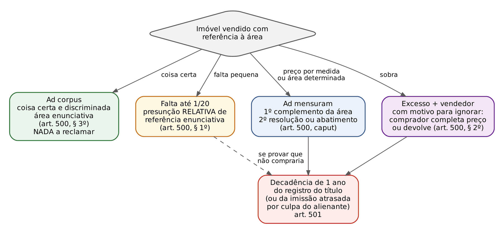
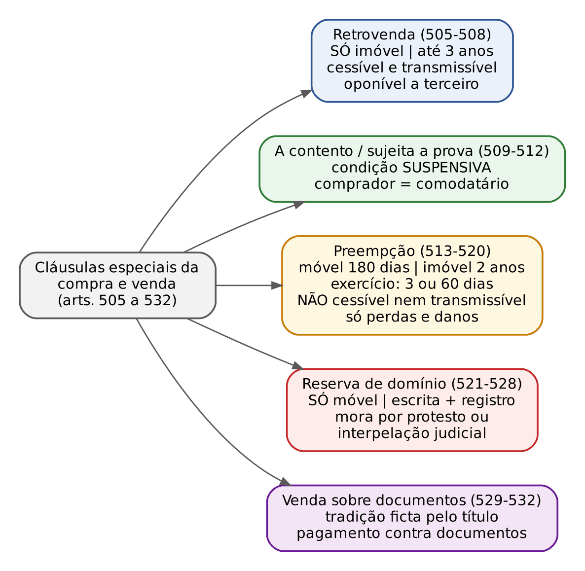
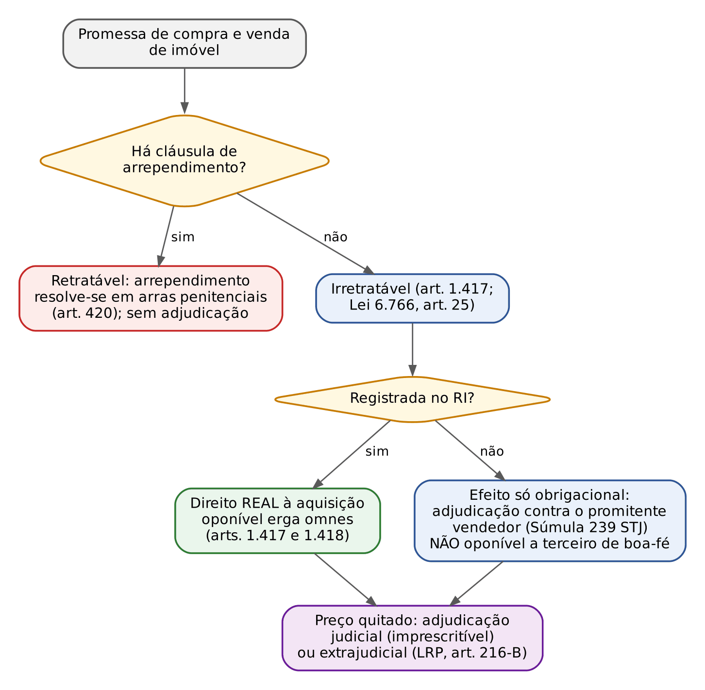
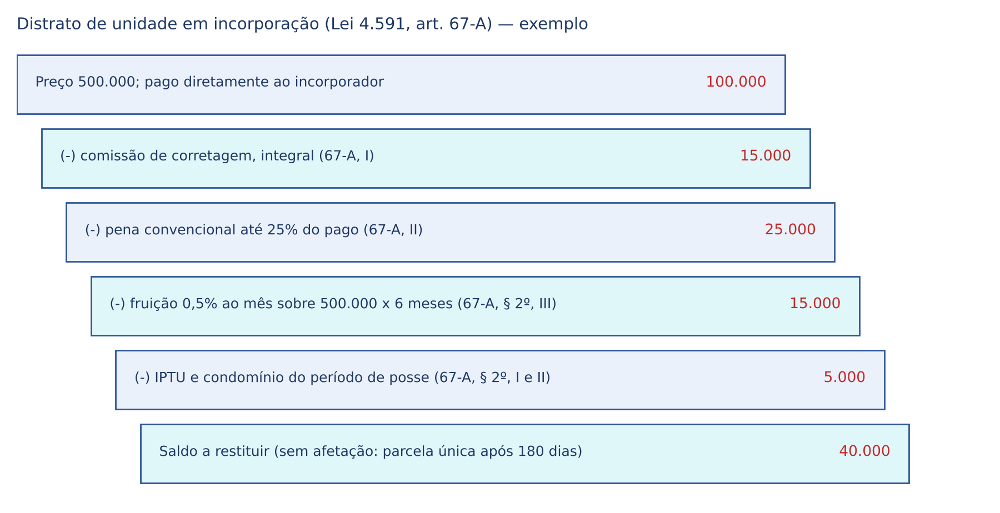
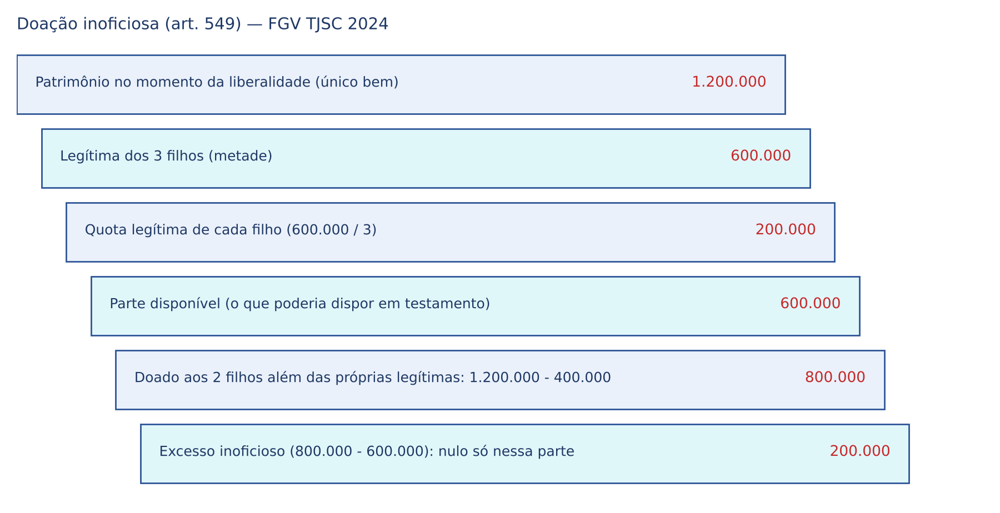
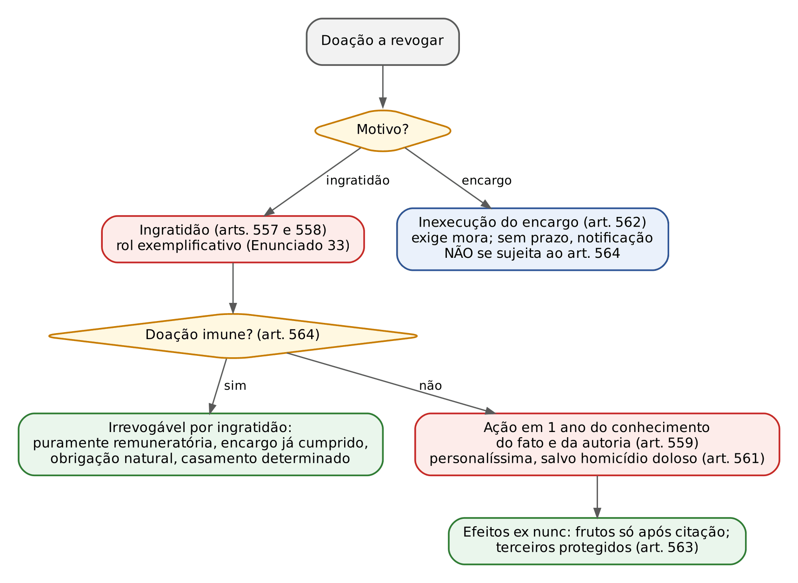

# CAPÍTULO 17 — COMPRA E VENDA E CLÁUSULAS ESPECIAIS, TROCA, CONTRATO ESTIMATÓRIO, COMPROMISSO DE COMPRA E VENDA E DOAÇÃO

:::INCIDENCIA
TRF5 p. 10; TJRS p. 13; TJSC p. 13; SEFAZ p. 10. Nível A+; lote de 31 questões (FGV 27, FCC 4).
Cai muito: doação (aceitação, forma, doação universal e inoficiosa, reversão, revogação por ingratidão e art. 564), contrato estimatório (riscos e disponibilidade), preempção e retrovenda, venda de ascendente a descendente, venda *ad corpus*, Súmulas 239 e 543 do STJ e distrato imobiliário.
:::

| Subtema | FGV | FCC | Padrão de cobrança |
|---|---|---|---|
| Doação: aceitação, forma, espécies, invalidade | 9 | 2 | casos com vários donatários (nascituro, incapaz, entidade futura, prole eventual); art. 548 x art. 549; reversão só para o doador |
| Revogação da doação | 6 | 0 | prazo de 1 ano do conhecimento do fato e da autoria; irrenunciabilidade; art. 564; herdeiros (arts. 560 e 561) |
| Contrato estimatório | 4 | 0 | risco do consignatário (art. 535); consignante não dispõe (art. 537); impenhorabilidade (art. 536) |
| Cláusulas especiais | 4 | 0 | preempção em comum (art. 517); retrovenda como pacto comissório; reserva de domínio e mora (art. 525) |
| Compra e venda: regras gerais | 2 | 1 | ascendente a descendente (anulável, 2 anos); *ad corpus*; coisa futura; preço potestativo nulo |
| Promessa e compromisso | 2 | 1 | Súmula 239 do STJ; distrato antes e depois da Lei 13.786/2018; qual contrato atende ao caso |

## 17.1 Compra e venda: estrutura, elementos e efeitos

### 17.1.1 Natureza: contrato obrigacional que não transfere o domínio

Pelo art. 481, um contratante "se obriga a transferir o domínio" e o outro a pagar "certo preço em dinheiro". O sistema brasileiro é o romano-germânico do título e modo: o contrato é só o título; a propriedade passa pela tradição (móveis, art. 1.267) ou pelo registro (imóveis, art. 1.245). Daí as consequências que a banca explora:

- a compra e venda é consensual, e não real: "obrigatória e perfeita" quando as partes acordam no objeto e no preço (art. 482). A FCC (TRT-20, 2024, Q3169952) pôs como distratores "é contrato real" e "se aperfeiçoa com a entrega da coisa";
- é bilateral, onerosa, em regra comutativa (pode ser aleatória: arts. 458 a 461 — ver Cap. 15), não solene como regra (escritura pública só para imóvel acima de 30 salários mínimos, art. 108 — ver Cap. 8);
- preço em dinheiro é elemento essencial: se a contraprestação for coisa, é troca (art. 533); se parte em dinheiro e parte em coisa, a doutrina majoritária classifica pelo elemento preponderante;
- venda de coisa alheia não é nula: é ineficaz em relação ao dono e se convalida pela aquisição superveniente (art. 1.268, § 1º, para móveis; raciocínio análogo ao art. 1.420, § 1º).

:::JURIS STF, Súmula 489
A compra e venda de automóvel não prevalece contra terceiros de boa-fé se o contrato não foi transcrito no Registro de Títulos e Documentos. Leitura atual: a súmula convive com o registro no órgão de trânsito; o ponto cobrável é que, entre as partes, a propriedade do veículo passa pela tradição, e a oponibilidade a terceiros depende de publicidade registral.
:::

Para a compra e venda internacional de mercadorias, aplica-se a CISG (Decreto 8.327/2014); os Enunciados 89 e 90 da III Jornada de Direito Comercial dizem que a natureza de venda de mercadoria não se descaracteriza por bens com funcionalidades digitais nem por serviços acessórios de instalação e atualização de *software*, e que a CISG se interpreta à luz da jurisprudência e da doutrina internacionais.

### 17.1.2 Objeto, preço e consentimento

Objeto. Pode ser coisa atual ou futura; se a futura não vier a existir, o contrato fica sem efeito, salvo intenção de contrato aleatório (art. 483). Foi o gabarito da FCC (Q3169952, letra D). Na venda à vista de amostras, protótipos ou modelos, o vendedor assegura as qualidades correspondentes e, havendo contradição com a descrição do contrato, PREVALECE a amostra (art. 484, parágrafo único).

Preço. Deve ser certo ou determinável. O quadro abaixo é cobrado literalmente:

| Forma de fixar o preço | Regra | Artigo |
|---|---|---|
| Arbítrio de terceiro designado ou a designar | válida; se o terceiro recusar, o contrato fica SEM EFEITO, salvo acordo para designar outro | 485 |
| Taxa de mercado ou de bolsa | válida, em certo e determinado dia e lugar | 486 |
| Índices ou parâmetros | válida, se suscetíveis de objetiva determinação | 487 |
| Silêncio sobre o preço | sujeição ao tabelamento oficial ou, na falta, ao preço corrente nas vendas habituais do vendedor; diversidade de preços: termo médio | 488 |
| Arbítrio exclusivo de UMA das partes | NULO | 489 |

:::PEGADINHA Preço deixado a uma das partes
O art. 489 comina NULIDADE (condição puramente potestativa, art. 122), não anulabilidade. A FCC (Q3169952, letra E) trocou por "anulável". Na FGV (TJSC 2022), a venda de soja com preço "ao arbítrio do comprador" foi a única nula; as vendas com preço por terceiro, por cotação de bolsa, por preço habitual e por tabelamento oficial eram válidas.
:::

O Enunciado 441 da V Jornada restringe o art. 488: na falta de acordo sobre o preço não se presume concluída a venda; o parágrafo único só se aplica se houver diversos preços habitualmente praticados pelo vendedor, prevalecendo o termo médio.

### 17.1.3 Despesas, riscos, tradição e garantias de pagamento

| Tema | Regra | Artigo |
|---|---|---|
| Despesas | escritura e registro: comprador; tradição: vendedor (salvo cláusula) | 490 |
| Ordem das prestações | na venda à vista, o vendedor não entrega antes de receber o preço | 491 |
| Riscos até a tradição | da coisa: vendedor; do preço: comprador (*res perit domino*) | 492, *caput* |
| Coisas que se contam, pesam ou medem | casos fortuitos no ato de contar ou marcar, já postas à disposição do comprador: risco do comprador | 492, § 1º |
| Mora do comprador em receber | risco do comprador | 492, § 2º |
| Lugar da tradição | onde a coisa estava ao tempo da venda, salvo estipulação | 493 |
| Expedição a lugar diverso por ordem do comprador | risco do comprador desde a entrega ao transportador, salvo se o vendedor se afastar das instruções | 494 |
| Insolvência do comprador antes da tradição, na venda a prazo | vendedor pode sobrestar a entrega até caução | 495 |
| Débitos que gravam a coisa | vendedor responde até a tradição, salvo convenção | 502 |
| Coisas vendidas conjuntamente | o defeito oculto de uma não autoriza rejeitar todas | 503 |

O art. 495 é aplicação específica da exceção de inseguridade do art. 477 (ver Cap. 16). O art. 502 não afasta a natureza *propter rem* das despesas condominiais perante o condomínio (ver Cap. 30): ele regula a relação interna entre vendedor e comprador, dando ao adquirente demandado direito de regresso.

### 17.1.4 Limitações à liberdade de vender e de comprar

São restrições de legitimação (não de capacidade). A tabela organiza a sanção de cada uma, que é a pegadinha recorrente:

| Hipótese | Sanção | Quem impugna e prazo | Artigo |
|---|---|---|---|
| Venda de ascendente a descendente sem consentimento expresso dos outros descendentes e do cônjuge | ANULÁVEL | demais descendentes e cônjuge; 2 anos (art. 179) | 496 |
| Compra por tutores, curadores, testamenteiros, administradores, servidores, juízes e auxiliares da justiça, leiloeiros (bens sob sua guarda, administração ou litígio) | NULA, ainda que em hasta pública; estende-se à cessão de crédito | qualquer interessado, MP, de ofício; imprescritível (art. 169) | 497 |
| Venda entre cônjuges | LÍCITA quanto aos bens excluídos da comunhão | — | 499 |
| Condômino de coisa indivisível que vende a estranho sem dar preferência | eficaz entre as partes, mas o preterido pode haver a parte depositando o preço | condômino preterido; 180 dias, decadência | 504 |
| Troca de valores desiguais entre ascendente e descendente | ANULÁVEL | como no art. 496 | 533, II |

O art. 498 excepciona o inciso III do art. 497: não se aplica à compra ou cessão entre coerdeiros, em pagamento de dívida ou para garantia de bens já pertencentes às pessoas ali designadas.

#### Venda de ascendente a descendente (art. 496)

:::LEI Código Civil, art. 496
Art. 496. É anulável a venda de ascendente a descendente, salvo se os outros descendentes e o cônjuge do alienante expressamente houverem consentido.
Parágrafo único. Em ambos os casos, dispensa-se o consentimento do cônjuge se o regime de bens for o da separação obrigatória.
:::

Pontos de prova:

- A ratio é impedir a doação disfarçada que frustre a igualdade das legítimas. Por isso a regra vale para a VENDA (e para a troca desigual), não para a DOAÇÃO: a doação a descendente é válida sem consentimento de ninguém e se resolve na colação (art. 544; ver 17.6.4). A FGV explora a troca de institutos (ENAM 2026, Q4102446, e TJ-MT 2024, Q3114493).
- Consentimento: dos OUTROS descendentes (os que seriam herdeiros no momento do ato; a doutrina inclui os netos que representariam filho pré-morto) e do cônjuge do alienante; deve ser expresso e, sendo imóvel, pela mesma forma exigida para o ato (art. 220). Dispensa-se o do cônjuge só na separação OBRIGATÓRIA (não na convencional).
- O Enunciado 177 da III Jornada manda desconsiderar a expressão "em ambos os casos" do parágrafo único, resíduo de erro de tramitação que retirou do projeto a venda de descendente a ascendente. Venda de descendente a ascendente é livre.
- Venda por interposta pessoa (pai vende a terceiro, que revende ao filho) é igualmente anulável, como fraude ao art. 496; o STJ aplicou o mesmo prazo de 2 anos do art. 179 (REsp 1.679.501-GO, j. 10/3/2020, Info 667).
- Prazo: 2 anos, decadencial, do art. 179 (Súmula 494 do STF superada; Enunciados 368 e 545 — v. Cap. 9). Em prova objetiva, "2 anos, decadencial, da conclusão do ato" (REsp 1.679.501, acima) é a resposta segura; o registro é o marco quando o enunciado da questão o destacar.
- Prejuízo. Parte da jurisprudência do STJ exige do autor a demonstração de prejuízo (preço vil, venda simulada) para anular; a lei não o menciona. Na FGV, o enunciado costuma trazer o "preço inferior ao de mercado" para afastar a discussão.

:::QUESTAO FGV 2024 — Câmara dos Deputados — Consultor Legislativo (Q2511471)
Caso: pai casado na comunhão parcial vende a um filho, por preço abaixo do mercado, uma de três casas, com consentimento da esposa e de um filho, mas não do terceiro, que descobre a venda 1 ano e 4 meses depois.
Gabarito: E — anulável; o descendente preterido tem prazo decadencial de 2 anos.
Armadilhas: "válida, porque os herdeiros têm mera expectativa" (a lei protege justamente a expectativa da legítima); "nula" ou "inexistente" (a sanção é anulabilidade, art. 496); "convalesceu pelo tempo" (ainda dentro dos 2 anos do art. 179).
:::

:::EXEMPLO Interposta pessoa e simulação
Geraldo quer vender apartamento ao primogênito sem a concordância dos outros filhos; doa-o ao amigo Júlio, que depois o vende ao primogênito. A FGV (TJSC 2022) qualificou como simulação (art. 167, § 1º, I: transmissão a pessoa diversa da real). Diferença prática: se o pedido for de nulidade por simulação, não há prazo (art. 169); se for de anulação pelo art. 496 aplicado à venda indireta, incide o prazo de 2 anos. A causa de pedir define o regime.
:::

#### Preferência do condômino (art. 504)

Condômino de coisa INDIVISÍVEL não pode vender sua parte a estranho se outro consorte a quiser, tanto por tanto. O preterido, depositando o preço, pode haver para si a parte vendida em 180 dias, sob pena de decadência. Entre vários condôminos interessados, prefere o que tiver benfeitorias de maior valor; na falta, o de quinhão maior; se iguais, todos os que quiserem, depositando o preço (parágrafo único). A FGV (TJES 2023) cobrou a ordem: benfeitorias primeiro, quinhão depois.

:::PEGADINHA Preferências legais que não se confundem
- Condômino (art. 504): coisa indivisível; 180 dias; ação de preferência com depósito do preço. A preferência NÃO se aplica à venda entre condôminos.
- Locatário (Lei 8.245, arts. 27 a 34): ver Cap. 18.
- Superficiário, laje (art. 1.510-D: titulares da construção-base e da laje, nessa ordem, cientificados por escrito para se manifestar em 30 dias, salvo disposição contratual diversa; preterido, haver para si a parte em 180 dias decadenciais da alienação, depositando o preço; havendo várias lajes, primeiro as ascendentes, depois as descendentes, com prioridade para a mais próxima) e arrendatário rural: ver Caps. 21 e 31. A FGV (ENAC 2026, Q4130159) resolveu o empate entre lajes pela preferência do pavimento superior em relação ao inferior, quando se aliena a construção-base.
- Preempção convencional (arts. 513 a 520): só perdas e danos, sem eficácia real (ver 17.2.3).
:::

### 17.1.5 Venda *ad mensuram* e venda *ad corpus* (arts. 500 e 501)

Na venda *ad mensuram*, o preço é estipulado por medida de extensão ou a área é determinada; se a área real não corresponder, o comprador pode exigir, nesta ordem, o complemento da área (ação *ex empto*) e, não sendo possível, a resolução ou o abatimento proporcional (ação redibitória ou estimatória, com natureza própria, que não se confunde com vício redibitório). Na venda *ad corpus*, o imóvel é vendido como coisa certa e discriminada, e a referência às dimensões é apenas enunciativa: não há complemento nem devolução de excesso, ainda que o contrato não diga expressamente "*ad corpus*" (art. 500, § 3º).

:::LEI Código Civil, arts. 500, § 1º, e 501
§ 1º Presume-se que a referência às dimensões foi simplesmente enunciativa, quando a diferença encontrada não exceder de um vigésimo da área total enunciada, ressalvado ao comprador o direito de provar que, em tais circunstâncias, não teria realizado o negócio.
Art. 501. Decai do direito de propor as ações previstas no artigo antecedente o vendedor ou o comprador que não o fizer no prazo de um ano, a contar do registro do título.
Parágrafo único. Se houver atraso na imissão de posse no imóvel, atribuível ao alienante, a partir dela fluirá o prazo de decadência.
:::

- Tolerância: um vigésimo (5%), presunção RELATIVA. A FGV (TJPR 2021) usou 460 m² contra 500 m² anunciados (8%): acima da tolerância e com dimensões afirmadas pelo vendedor, cabe resolução ou abatimento, pois o complemento era impossível (gabarito C). O distrator dizia "um décimo".
- Excesso: só se o vendedor provar que tinha motivos para ignorar a medida exata; a escolha (completar o preço ou devolver o excesso) é do COMPRADOR (§ 2º).
- Prazo: 1 ano, decadencial, do REGISTRO (não da escritura, não da descoberta). Não confundir com os prazos dos vícios redibitórios (art. 445: 30 dias móvel e 1 ano imóvel, da entrega) nem com o prazo de 4 anos de anulação por dolo (art. 178).

:::QUESTAO FGV 2024 — TJ-RJ — Residência Jurídica (Q2375282)
Caso: compra da centenária Fazenda Santa Helena, "porteira fechada", local de nascimento da avó do comprador; escritura com 187 hectares; perícia apura 163 hectares (falta de 24 hectares, cerca de 12,8%).
Gabarito: B — na venda *ad corpus*, o preço recai sobre o imóvel como um todo, desvinculado da medida.
Passos: (1) o que se pergunta: há direito a complemento? (2) regra: coisa certa e discriminada, individualizada pelo nome e pela história, com área apenas enunciativa, é *ad corpus* (art. 500, § 3º), e a diferença, ainda que acima de 1/20, é irrelevante; (3) aplicação: o comprador quis aquela fazenda, não aquela metragem. Erros sedutores: "complemento da área" (regra da venda *ad mensuram*), "vício redibitório e ação estimatória" (instituto diverso), "4 anos" (o prazo seria de 1 ano do registro), "dolo" (sem prova de artifício).
:::

## 17.2 Cláusulas especiais da compra e venda (arts. 505 a 532)

São pactos acessórios que modulam a eficácia da venda. O quadro abaixo é o mapa de prova; os detalhes vêm em cada subseção.

| Cláusula | Objeto | Natureza | Prazo | Transmissão | Eficácia perante terceiros |
|---|---|---|---|---|---|
| Retrovenda | SÓ imóvel | condição resolutiva potestativa do vendedor (propriedade resolúvel) | máximo de 3 anos, decadencial | cessível e transmissível a herdeiros e legatários | oponível ao terceiro adquirente (art. 507) |
| Venda a contento | móvel ou imóvel | condição SUSPENSIVA (gosto do comprador) | o fixado; sem prazo, intimação | — | comprador é mero comodatário |
| Venda sujeita a prova | idem | condição suspensiva (qualidades asseguradas e idoneidade) | idem | — | idem |
| Preempção | móvel ou imóvel | obrigação de oferecer, tanto por tanto | duração: até 180 dias (móvel) ou 2 anos (imóvel); exercício: 3 ou 60 dias | NÃO se cede nem passa aos herdeiros | só perdas e danos (adquirente solidário se de má-fé) |
| Reserva de domínio | SÓ móvel infungível caracterizável | propriedade transferida com o pagamento integral | — | — | depende de registro no domicílio do comprador |
| Venda sobre documentos | móveis (comércio) | tradição substituída pelo título representativo | pagamento na entrega dos documentos | — | — |

### 17.2.1 Retrovenda (*pactum de retrovendendo*)

O vendedor de coisa IMÓVEL pode reservar-se o direito de recobrá-la no prazo máximo de decadência de 3 anos, restituindo o preço recebido e reembolsando as despesas do comprador, inclusive as feitas no período de resgate com sua autorização escrita ou para benfeitorias necessárias (art. 505). Se o comprador recusar o valor, o vendedor o deposita judicialmente; depósito insuficiente não restitui o domínio até o pagamento integral (art. 506). O direito de retrato é cessível e transmissível a herdeiros e legatários e pode ser exercido contra o terceiro adquirente (art. 507). Havendo vários titulares do retrato e só um o exercendo, o comprador pode intimar os demais para acordarem; prevalece o pacto em favor de quem fez o depósito integral (art. 508).

- A propriedade do comprador é resolúvel (arts. 1.359 e 1.360 — ver Cap. 28); para opor o retrato ao terceiro, a cláusula deve constar do registro.
- Prazo: os 3 anos são TETO; as partes podem fixar prazo menor. Parte da doutrina admite retrovenda de móveis por analogia ou pela autonomia privada (atípica), mas a letra da lei (cobrada pela FGV) fala em coisa imóvel.
- Retrovenda x preempção: na retrovenda, o vendedor tem direito potestativo de recomprar, independentemente da vontade do comprador de vender; na preempção, só tem preferência SE o comprador decidir vender.

:::QUESTAO FGV 2024 — TJ-PE — Juiz Substituto (Q3117513)
Caso: para não executar hipoteca, a credora propõe que o devedor lhe "venda" a sala comercial pelo valor do empréstimo, com direito de recomprá-la em um ano pelo valor atualizado e com juros.
Gabarito: A — compra e venda com pacto de retrovenda, que deve ser reputada simulada porque visa a efetivar pacto comissório.
Fundamento: a retrovenda usada como garantia de mútuo dissimula a apropriação da garantia pelo credor, vedada pelo art. 1.428 (pacto comissório — ver Cap. 32); o negócio simulado é nulo (art. 167). Distratores: reserva de domínio (só móvel), alienação fiduciária (exige forma e regime próprios), venda a contento, contrato estimatório. Mesmo raciocínio: TJPE 2024 no livro de Ana Paula Dias.
:::

:::QUESTAO FGV 2024 — EPE — Advogado (Q2758992)
Caso: promessa irretratável de venda de imóvel, celebrada em 17/4/2021 pelo marido casado na separação de bens sem anuência da esposa, com cláusula que assegurava ao vendedor reaver o imóvel em 3 anos restituindo preço e despesas; a escritura definitiva (30/4/2021) não repetiu a cláusula; em 15/3/2024 o vendedor quer exercê-la.
Gabarito: D — a promessa, independentemente de registro, vincula as partes de forma recíproca e irretratável, e o vendedor tem direito de reaver o imóvel.
Passos: (1) na separação convencional (absoluta) dispensa-se a outorga do cônjuge (art. 1.647, *caput*); (2) a cláusula é retrovenda válida (imóvel, prazo de 3 anos, art. 505); (3) o exercício ocorreu dentro dos 3 anos; (4) a omissão na escritura não foi tratada como renúncia tácita, pois renúncia não se presume. Ponto discutível: o direito de retrato só é oponível a terceiros se registrado; entre as partes, vale o pactuado (ver nota de verificação).
:::

### 17.2.2 Venda a contento e venda sujeita a prova (arts. 509 a 512)

| Aspecto | Venda a contento (*ad gustum*) | Venda sujeita a prova |
|---|---|---|
| Critério | subjetivo: agrado do comprador, que pode recusar sem justificar | objetivo: a coisa ter as qualidades asseguradas e ser idônea para o fim |
| Natureza | condição suspensiva, "ainda que a coisa lhe tenha sido entregue" (art. 509) | condição suspensiva presumida (art. 510) |
| Posição do comprador antes da manifestação | mero comodatário (art. 511) | idem |
| Falta de prazo | vendedor intima o comprador, judicial ou extrajudicialmente, para declarar em prazo improrrogável (art. 512) | idem |

Consequências: enquanto pendente a condição, a propriedade e os riscos são do vendedor (*res perit domino*), e o comprador responde como comodatário (art. 582: conservação e, em mora, aluguel — ver Cap. 19). O direito de experimentar é personalíssimo segundo parte da doutrina. A FGV (TJPE 2024) cobrou a letra do art. 509 ("condição suspensiva, ainda que entregue"); o distrator usual é "resolutiva".

:::DICA Relação de consumo
O direito de arrependimento de 7 dias nas compras fora do estabelecimento (CDC, art. 49) é legal, não depende de cláusula e não se confunde com a venda a contento, que é convencional e civil. Em incorporações, o § 10 do art. 67-A da Lei 4.591 dá 7 dias de arrependimento nos contratos firmados em estandes de venda (ver 17.5.5).
:::

### 17.2.3 Preempção ou preferência convencional (arts. 513 a 520)

Impõe ao COMPRADOR a obrigação de oferecer ao VENDEDOR a coisa que vai vender ou dar em pagamento, para que este exerça a prelação tanto por tanto (art. 513). O vendedor também pode tomar a iniciativa, intimando o comprador quando souber que ele vai vender (art. 514), e quem exerce a preferência deve pagar, em condições iguais, o preço encontrado ou ajustado, sob pena de perdê-la (art. 515).

:::LEI Código Civil, arts. 513, parágrafo único, 516 e 517
Art. 513, parágrafo único. O prazo para exercer o direito de preferência não poderá exceder a cento e oitenta dias, se a coisa for móvel, ou a dois anos, se imóvel.
Art. 516. Inexistindo prazo estipulado, o direito de preempção caducará, se a coisa for móvel, não se exercendo nos três dias, e, se for imóvel, não se exercendo nos sessenta dias subseqüentes à data em que o comprador tiver notificado o vendedor.
Art. 517. Quando o direito de preempção for estipulado a favor de dois ou mais indivíduos em comum, só pode ser exercido em relação à coisa no seu todo. Se alguma das pessoas, a quem ele toque, perder ou não exercer o seu direito, poderão as demais utilizá-lo na forma sobredita.
:::

:::ESQUEMA Os quatro prazos da preempção
| Prazo | Móvel | Imóvel | Natureza |
|---|---|---|---|
| Duração máxima do direito (art. 513, parágrafo único) | 180 dias | 2 anos | limite à autonomia: cláusula maior é reduzida ao teto |
| Exercício após a notificação, no silêncio do contrato (art. 516) | 3 dias | 60 dias | decadencial |
| Retrovenda, para comparar (art. 505) | — | 3 anos | decadencial |
| Preferência do condômino preterido (art. 504) | 180 dias | 180 dias | decadencial |
:::

- Sanção da violação: o comprador que aliena sem dar ciência do preço e das vantagens responde por perdas e danos; o adquirente responde solidariamente se de má-fé (art. 518). NÃO há direito de haver a coisa (eficácia real), diferentemente da preferência do condômino (art. 504) e da do locatário com contrato averbado (Lei 8.245, art. 33 — ver Cap. 18).
- Intransmissibilidade: o direito de preferência não se cede nem passa aos herdeiros (art. 520). Contraste com o art. 507 (retrato cessível e transmissível): troca clássica de bancas.
- Preempção legal na desapropriação (retrocessão): se a coisa expropriada não tiver o destino previsto nem for usada em obras ou serviços públicos, o expropriado tem preferência pelo preço atual (art. 519). O Enunciado 592 da VII Jornada afirma que o art. 519 derroga o art. 35 do Decreto-Lei 3.365/1941 nos casos de tredestinação ilícita, de modo que a retrocessão não se resolve necessariamente em perdas e danos.

:::QUESTAO FGV 2026 — TJ-PR — Juiz Substituto (Q3898894)
Caso: preempção sobre imóvel em favor de Ana, Bruno e Carla, em comum, pelo prazo máximo. Notificados, Ana manifesta interesse, Bruno silencia e Carla declara não ter recursos; o comprador vende a terceiro sem esperar. Bruno quer comprar proporcionalmente; Carla quer indenização.
Gabarito: A — Ana pode exercer sozinha a preferência sobre a coisa toda.
Passos: (1) preferência em comum se exerce sobre o todo (art. 517, 1ª parte); (2) quem perde ou não exerce (Bruno, pela inércia no prazo; Carla, pela declaração) deixa os demais exercerem "na forma sobredita", isto é, sobre o todo (art. 517, 2ª parte); (3) Bruno não tem direito proporcional após a venda, e Carla, que não quis exercer, não sofreu dano indenizável. A alienação ao terceiro sem atender Ana gera perdas e danos (art. 518), não invalidade.
:::

### 17.2.4 Venda com reserva de domínio (arts. 521 a 528)

Na venda de coisa MÓVEL, o vendedor reserva para si a propriedade até o pagamento integral do preço (art. 521). Requisitos e efeitos:

- forma escrita e registro no domicílio do COMPRADOR (Registro de Títulos e Documentos) para valer contra terceiros (art. 522);
- coisa suscetível de caracterização perfeita, que a distinga das congêneres; na dúvida, decide-se a favor do terceiro adquirente de boa-fé (art. 523);
- a propriedade passa com o pagamento integral, mas os RISCOS são do comprador desde a entrega (art. 524): exceção expressa ao *res perit domino*, também presente no contrato estimatório (art. 535);
- execução da cláusula só após constituir o comprador em mora por PROTESTO DO TÍTULO ou INTERPELAÇÃO JUDICIAL (art. 525); depois, o vendedor escolhe entre cobrar as prestações vencidas e vincendas ou recuperar a posse (art. 526), podendo reter das prestações pagas o necessário para cobrir depreciação, despesas e o mais devido, devolvendo o excedente e cobrando o que faltar (art. 527);
- financiamento por instituição do mercado de capitais: a instituição exerce os direitos e ações do contrato; o Enunciado 178 da III Jornada manda ler "a benefício de seu crédito, excluída a concorrência de qualquer outro", corrigindo erro material do art. 528.

:::QUESTAO FGV 2025 — TJ-ES — Cartórios, Provimento (Q3520614)
Caso: venda de móvel com reserva de domínio, por escrito e com duas testemunhas, registrada no RTD; o comprador deixa de pagar a partir de maio de 2025.
Gabarito: B — o vendedor só executa a cláusula após constituir o comprador em mora por protesto do título ou interpelação judicial (art. 525).
Armadilhas: "mora *ex re*, protesto facultativo" (o art. 525 exige a constituição formal mesmo havendo termo); prazos de 30 ou 15 dias "sob pena de decadência" (inexistentes); "interpelação extrajudicial" (a lei diz judicial, ao lado do protesto).
:::

:::PROCESSO Reserva de domínio no CPC/2015
O CPC/2015 não reproduziu o procedimento especial dos arts. 1.070 e 1.071 do CPC/1973 (apreensão e depósito da coisa vendida). Hoje: comprovada a mora (art. 525), o vendedor ajuíza ação de cobrança (inclusive execução, se houver título executivo) ou ação de rescisão com reintegração/busca e apreensão pelo procedimento comum, com tutela de urgência, aplicando-se o acerto do art. 527 na sentença.
:::

### 17.2.5 Venda sobre documentos (arts. 529 a 532)

Típica do comércio internacional (*trust receipt*, conhecimento de embarque): a tradição é substituída pela entrega do título representativo e dos documentos exigidos pelo contrato ou pelos usos (art. 529). Com a documentação em ordem, o comprador não pode recusar o pagamento alegando defeito de qualidade ou estado da coisa, salvo se o defeito já tiver sido comprovado (parágrafo único). Pagamento, salvo estipulação, na data e no lugar da entrega dos documentos (art. 530). Se entre os documentos houver apólice de seguro de transporte, os riscos correm por conta do comprador, salvo se o vendedor, ao concluir o contrato, sabia da perda ou avaria (art. 531). Pagamento por banco: o banco paga contra documentos, sem verificar a coisa, e o vendedor só pode cobrar do comprador depois da recusa do banco (art. 532).

## 17.3 Troca ou permuta (art. 533)

Aplicam-se à troca as regras da compra e venda, com duas modificações: (I) salvo disposição em contrário, cada contratante paga METADE das despesas com o instrumento (na compra e venda, escritura e registro são do comprador, art. 490); (II) é ANULÁVEL a troca de valores DESIGUAIS entre ascendentes e descendentes sem consentimento dos outros descendentes e do cônjuge do alienante. Troca de valores iguais entre ascendente e descendente é válida sem consentimento, porque não há liberalidade a encobrir; troca desigual em que o descendente recebe MAIS é a que interessa ao art. 533, II (doutrina majoritária; a lei não distingue a direção).

:::DICA Permuta e evicção
Cada permutante é alienante e adquirente: responde pela evicção e pelos vícios da coisa que entregou (arts. 441 e 447 — ver Cap. 16). Na permuta imobiliária intermediada por corretor, a FGV (TJSC 2024, Q2386954) entendeu devida a comissão, porque o resultado útil (a conclusão do negócio) foi obtido antes da evicção superveniente (art. 725 — ver Cap. 19).
:::

## 17.4 Contrato estimatório ou venda em consignação (arts. 534 a 537)

O consignante entrega bens MÓVEIS ao consignatário, que fica autorizado a vendê-los, pagando ao consignante o preço ajustado (preço de estima), salvo se preferir, no prazo estabelecido, restituir a coisa (art. 534). O Enunciado 32 da I Jornada define: o consignante transfere TEMPORARIAMENTE o poder de alienação, com opção de pagamento do preço de estima ou de restituição ao final do prazo.

Características cobradas:

- é contrato real (aperfeiçoa-se com a entrega), bilateral, oneroso, típico;
- o consignatário NÃO adquire a propriedade: recebe o poder de dispor; vende em nome próprio e lucra com a diferença entre o preço que obtiver e o preço de estima (pode vender por mais);
- a escolha entre pagar o preço e restituir é do CONSIGNATÁRIO, que pode inclusive pagar o preço e ficar com a coisa sem tê-la vendido;
- não se confunde com comissão (art. 693: o comissário vende por conta do comitente e recebe remuneração) nem com distribuição ou agência (arts. 710 e seguintes — ver Cap. 19). A FGV (TJ-AP 2024, Q2442312) classificou como distribuição a concessionária que vende veículos da montadora, com exclusividade e remuneração, e não como estimatório.

:::LEI Código Civil, arts. 535 a 537
Art. 535. O consignatário não se exonera da obrigação de pagar o preço, se a restituição da coisa, em sua integridade, se tornar impossível, ainda que por fato a ele não imputável.
Art. 536. A coisa consignada não pode ser objeto de penhora ou seqüestro pelos credores do consignatário, enquanto não pago integralmente o preço.
Art. 537. O consignante não pode dispor da coisa antes de lhe ser restituída ou de lhe ser comunicada a restituição.
:::

:::PEGADINHA Quem suporta o risco no estimatório
O art. 535 desloca o risco para o consignatário, que NÃO é dono: perecimento por caso fortuito, furto ou incêndio não o libera de pagar o preço de estima. É exceção ao *res perit domino*, ao lado do art. 524 (reserva de domínio) e do art. 492, § 2º (mora do comprador). As bancas oferecem como distrator "o caso fortuito exclui a responsabilidade" e "*res perit domino*".
:::

:::QUESTAO FGV 2024 — AL-PR — Procurador (Q2448955)
Caso: fabricante entrega coleção à varejista, que pode vender a terceiros pelo preço que quiser e, findo o prazo, deve pagar o valor contratado ou devolver as mercadorias; o depósito da varejista é destruído por incêndio vindo de curto-circuito na via pública.
Gabarito: B — contrato estimatório; os riscos de perda são do consignatário, que deve pagar o valor integral (art. 535).
No mesmo sentido: FGV 2025, Prefeitura de Canaã dos Carajás, Procurador (Q3265472: furto de parte das mercadorias; a consignatária paga o valor estimado das furtadas, gabarito A). Armadilhas comuns às duas: "*res perit domino*", "resolução sem culpa (art. 234)", "contrato de agência", "propriedade transferida à varejista".
:::

:::QUESTAO FGV 2025 — TJ-TO — Juiz Substituto (Q3453219)
Caso: herdeira entrega roupas a brechó em consignação, com prazo para devolver ou pagar o preço estimado.
Gabarito: C — mesmo sem vender, o brechó pode pagar o preço estimado ao final do prazo e ficar com as roupas.
Erros sedutores: a consignante vender a terceiro com aviso prévio (vedado pelo art. 537); incêndio sem culpa libera o brechó (contraria o art. 535); o brechó não pode vender acima do preço estimado (pode, e o excedente é seu lucro); o brechó recebe a propriedade e as roupas podem ser penhoradas por seus credores (art. 536 proíbe). Mesmo padrão em FGV TJPE 2022 (estatueta em loja de antiguidades: gabarito "a escolha entre pagar e devolver é da loja").
:::

:::QUESTAO FGV 2025 — TRF 6ª Região — Juiz Federal Substituto (Q3742389)
Caso: designer consigna conjunto de joias a Carla para venda em bazar beneficente; depois, vende o mesmo conjunto a uma amiga, prometendo entregá-lo após a restituição; no bazar, Carla vende o conjunto pelo preço estimado a cliente que o leva na hora.
Gabarito: E — o designer deve restituir à amiga o valor recebido e indenizá-la por perdas e danos.
Passos: (1) durante o contrato, o consignante não pode dispor da coisa (art. 537), e o poder de alienar está com a consignatária; (2) a venda feita por Carla é válida e eficaz, e ela deve apenas pagar o preço de estima ao designer; (3) a venda do designer à amiga tornou-se impossível por fato a ele imputável, e ele responde pela restituição do preço com perdas e danos (arts. 389 e 402). A exclusividade ou não do pacto é irrelevante.
:::

## 17.5 Promessa e compromisso de compra e venda de imóvel

### 17.5.1 Natureza e regimes legais

A promessa de compra e venda é contrato preliminar (arts. 462 a 466 — ver Cap. 15) cujo objeto é a celebração do contrato definitivo. Quando irretratável (sem cláusula de arrependimento) e registrada no Registro de Imóveis, gera DIREITO REAL à aquisição (arts. 1.225, VII, 1.417 e 1.418), de modo que o promitente comprador, pago o preço, obtém a propriedade mesmo contra a vontade do promitente vendedor ou de seus cessionários. O direito real em si é estudado no Cap. 31; aqui interessam a formação, a execução e o desfazimento do contrato.

:::LEI Código Civil, arts. 1.417 e 1.418
Art. 1.417. Mediante promessa de compra e venda, em que se não pactuou arrependimento, celebrada por instrumento público ou particular, e registrada no Cartório de Registro de Imóveis, adquire o promitente comprador direito real à aquisição do imóvel.
Art. 1.418. O promitente comprador, titular de direito real, pode exigir do promitente vendedor, ou de terceiros, a quem os direitos deste forem cedidos, a outorga da escritura definitiva de compra e venda, conforme o disposto no instrumento preliminar; e, se houver recusa, requerer ao juiz a adjudicação do imóvel.
:::

| Regime | Campo | Irretratabilidade | Desfazimento por inadimplemento do comprador |
|---|---|---|---|
| Decreto-Lei 58/1937 | loteamentos antigos e também imóveis não loteados (art. 22, redação da Lei 6.014/1973, que positivou a orientação da Súmula 413 do STF): o compromisso sem arrependimento, inscrito a qualquer tempo, dá direito real e adjudicação compulsória | inadmissível o arrependimento no compromisso sujeito ao regime (Súmula 166 do STF) | interpelação prévia de 15 dias (Decreto-Lei 745/1969, art. 1º) |
| Lei 6.766/1979 (lotes) | parcelamento do solo urbano | irretratáveis os compromissos, cessões e promessas de cessão; dão adjudicação compulsória e, registrados, direito real oponível (art. 25) | intimação pelo oficial do RI; rescisão 30 dias após a mora (art. 32); restituição pelo art. 32-A |
| Lei 4.591/1964 (incorporação) | unidades em construção | contratos irretratáveis (art. 32, § 2º), salvo arrependimento de 7 dias em estande (art. 67-A, § 10) | distrato ou resolução com as deduções do art. 67-A |
| Código Civil | imóveis em geral | se não pactuado arrependimento (art. 1.417) | cláusula resolutiva (arts. 474 e 475), com interpelação |

As Súmulas 167 e 168 do STF, sobre o regime do Decreto-Lei 58/1937, são históricas: a primeira exigia a inscrição do compromisso, salvo obrigação do vendedor de registrar; a segunda admitia a inscrição no curso da ação. Ambas perderam relevância com a Súmula 239 do STJ.

:::JURIS STJ, Súmula 239
O direito à adjudicação compulsória não se condiciona ao registro do compromisso de compra e venda no cartório de imóveis.
Leitura: o registro é necessário para a EFICÁCIA REAL (oponibilidade a terceiros); entre as partes, a promessa irretratável e quitada basta para a adjudicação, como execução específica de obrigação de fazer (Enunciado 95 da I Jornada, no mesmo sentido). O Enunciado 87 da I Jornada considera a promessa quitada título translativo para registro (art. 1.245), e o Enunciado 253 da III Jornada reconhece ao promitente comprador com direito real a faculdade de reivindicar o imóvel de terceiro.
:::

:::QUESTAO FCC 2026 — DPE-MT — Defensor Público (Q3954599)
Caso: compromisso não registrado, preço quitado, posse de 11 anos como moradia, área superior a 250 m².
Gabarito: C — pode exigir a escritura definitiva mesmo sem registro do compromisso (Súmula 239 do STJ).
Armadilhas: "somente usucapião especial urbana" (área acima de 250 m² a exclui, art. 1.240); "somente usucapião ordinária" (o advérbio "somente" é o erro: a adjudicação está disponível); exigência de registro para a escritura.
:::

### 17.5.2 Qual contrato atende ao caso: promessa, reserva de domínio ou alienação fiduciária

:::QUESTAO FGV 2024 — AL-TO — Procurador Jurídico (Q2457286)
Caso: venda de imóvel com entrada de 60% e saldo em 24 parcelas, sem agente financiador; o vendedor quer manter a propriedade até a quitação, transferindo a posse desde logo e exigindo novo ato após o pagamento; a compradora quer obter a propriedade compulsoriamente se houver resistência e ter direito real pelo registro; ambos querem irretratabilidade.
Gabarito: B — promessa de compra e venda.
Passos: (1) reserva de domínio só existe para MÓVEIS (art. 521); (2) alienação fiduciária transfere a propriedade resolúvel ao credor, o oposto do que o vendedor quer; (3) arrendamento com opção não dá adjudicação; (4) a promessa irretratável registrada reúne propriedade retida, posse transferida, novo ato (escritura definitiva), adjudicação compulsória e direito real (arts. 1.417 e 1.418).
:::

Correlatas: a FCC (PGM-Manaus 2026, Q4338798) marcou como ERRADA a assertiva de que a promessa não registrada confere direito real oponível *erga omnes*; e a FGV (ENAC 2025, Q3328208) reconheceu a adjudicação ao promitente comprador de promessa irretratável registrada que cumprira todas as obrigações, afastando a tese de que o vendedor poderia "escolher" devolver o sinal em dobro (arras confirmatórias não dão direito de arrependimento — ver Cap. 14).

### 17.5.3 Adjudicação compulsória: judicial e extrajudicial

Judicial. Ação de obrigação de fazer (emissão de declaração de vontade) em que a sentença que julgar procedente o pedido, transitada em julgado, produz todos os efeitos da declaração não emitida (CPC, art. 501). Requisitos: promessa irretratável, quitação integral do preço e recusa do promitente vendedor. Legitimados passivos: o promitente vendedor ou seus cessionários (art. 1.418) e, falecido, o espólio ou herdeiros.

A adjudicação exige a quitação INTEGRAL do preço: o adimplemento substancial não a supre, ainda que prescritas as parcelas do saldo (REsp 2.207.433-SP — v. Cap. 14, onde também está resolvida a FGV ENAC 2025, Q3673859).

:::JURIS STJ, REsp 2.196.855-RJ, j. 14/4/2026 (Informativo 885)
A imprescritibilidade da pretensão de adjudicação compulsória estende-se à pretensão de indenização por perdas e danos quando a obrigação de fazer não puder ser cumprida de modo específico (conversão do art. 499 do CPC).
:::

Para unidade autônoma, é imprescindível a formalização da incorporação pelo registro do memorial na matrícula (Jurisprudência em Teses do STJ, ed. 229, tese 2).

Extrajudicial (Lei 6.015/1973, art. 216-B, incluído pela Lei 14.382/2022; regulamentado pelo Provimento CNJ 150, de 11/9/2023, incorporado ao Código Nacional de Normas). Pontos cobráveis do art. 216-B:

- "sem prejuízo da via jurisdicional": a via é FACULTATIVA;
- processa-se no registro de imóveis da situação do imóvel;
- legitimados: o promitente comprador, seus cessionários, promitentes cessionários ou sucessores, e TAMBÉM o promitente vendedor (que quer se livrar do imóvel e de seus encargos), sempre representados por ADVOGADO (§ 1º);
- documentos: instrumento de promessa, cessão ou sucessão; prova do inadimplemento pela não celebração do título no prazo de 15 dias contado da notificação extrajudicial pelo oficial (que pode delegar ao RTD); ATA NOTARIAL com identificação do imóvel, das partes, prova do pagamento do preço e caracterização do inadimplemento; certidões dos distribuidores que demonstrem inexistência de litígio sobre a promessa; comprovante do ITBI; procuração com poderes específicos (§ 1º, I a VI);
- independe de prévio registro da promessa e da regularidade fiscal do promitente vendedor (§ 2º);
- o título do registro é a própria promessa, cessão ou instrumento de sucessão (§ 3º).

:::PROCESSO Adjudicação compulsória: roteiro de decisão
- Petição inicial: instrumento da promessa (registrada ou não), prova de quitação integral, notificação ou recusa do promitente vendedor, matrícula atualizada.
- Polo passivo: promitente vendedor (ou espólio e herdeiros); cessionários dos direitos do vendedor, se houver.
- Prescrição: não há (pretensão imprescritível; Informativo 885 estende às perdas e danos).
- Saldo devedor: se pendente, improcedência (sem adimplemento substancial); o juiz não "adjudica mediante depósito" que a parte não fez.
- Sentença: julga procedente para adjudicar o imóvel e determina que a sentença transitada valha como título para registro (CPC, art. 501), condicionado o registro ao recolhimento do ITBI.
- Terceiro adquirente com registro anterior: sem registro da promessa, a adjudicação não o atinge; resta ao promitente comprador a via das perdas e danos.
:::

### 17.5.4 Oponibilidade e conflitos com terceiros

- Promessa não registrada x credor hipotecário: prevalece, em regra, a prioridade registral da hipoteca sobre imóvel comercial (REsp 2.141.417-SC); a proteção do adquirente de unidade residencial vem da Súmula 308 do STJ — v. Cap. 32.
- Embargos de terceiro: o STJ admite que o promitente comprador com posse oponha embargos de terceiro contra a constrição, ainda que a promessa não esteja registrada (súmula própria do STJ — ver Cap. 27).
- Despesas condominiais: legitimidade do promitente comprador imitido na posse e do promitente vendedor (Tema 886 do STJ e sua revisão afetada no Tema 1.349) — ver Cap. 30. IPTU: ambos são contribuintes (Tema 122 do STJ) — ver Apostila de Direito Tributário.
- Usucapião: a promessa é justo título para usucapião ordinária, e a posse dela decorrente pode induzir usucapião quando convertida em posse com ânimo de dono — ver Cap. 29 (FGV TJSC 2026, Q4153610, correlata).
- Mandato em causa própria outorgado pelo promitente vendedor ao comprador quitado: irrevogável, não se extingue pela morte, dispensa contas e permite ao mandatário transferir o bem para si (art. 685; FGV TJBA 2026, Q4083718 — ver Cap. 19).

### 17.5.5 Desfazimento por iniciativa ou culpa do promitente comprador

Constituição em mora. "A falta de registro do compromisso de compra e venda de imóvel não dispensa a prévia interpelação para constituir em mora o devedor" (Súmula 76 do STJ). A Lei 13.097/2015 deu nova redação ao art. 1º do Decreto-Lei 745/1969: nos compromissos do art. 22 do Decreto-Lei 58/1937, registrados ou não, o inadimplemento absoluto só se caracteriza se o promissário comprador, interpelado judicialmente ou pelo RTD, não purgar a mora em 15 dias; havendo cláusula resolutiva expressa, a resolução opera de pleno direito após esse prazo (parágrafo único).

Restituição: a regra-matriz é a Súmula 543 do STJ.

:::JURIS STJ, Súmula 543
Na hipótese de resolução de contrato de promessa de compra e venda de imóvel submetido ao Código de Defesa do Consumidor, deve ocorrer a imediata restituição das parcelas pagas pelo promitente comprador — integralmente, em caso de culpa exclusiva do promitente vendedor/construtor, ou parcialmente, caso tenha sido o comprador quem deu causa ao desfazimento.
:::

Com a Lei 13.786, de 27/12/2018 (Lei do Distrato), o regime ficou dividido no tempo:

| Ponto | Contratos anteriores à Lei 13.786/2018 | Incorporação (Lei 4.591, art. 67-A) | Loteamento (Lei 6.766, art. 32-A) |
|---|---|---|---|
| Retenção pelo vendedor | arbitrada entre 10% e 25% das parcelas pagas (JT ed. 110, tese 6) | corretagem integral + pena até 25% da quantia PAGA; até 50% se houver patrimônio de afetação (§ 5º) | cláusula penal e despesas administrativas limitadas a 10% do valor atualizado do CONTRATO |
| Fruição | aluguel pelo tempo de ocupação, desde a transferência da posse (JT ed. 107, tese 7) | 0,5% ao mês sobre o valor atualizado do contrato, *pro rata die* (§ 2º, III) | até 0,75% ao mês sobre o valor atualizado do contrato (inciso I) |
| Prazo de devolução | imediata (Súmula 543) | com afetação: até 30 dias após o habite-se; sem afetação: parcela única após 180 dias do desfazimento; revenda antes: 30 dias da revenda (§§ 5º a 7º) | até 12 parcelas, após carência (180 dias do prazo das obras ou 12 meses da rescisão, conforme o caso) |
| Limite das deduções | — | limitadas aos valores pagos, salvo fruição (§ 4º) | — |
| Juros de mora sobre a restituição | do trânsito em julgado, se a resolução é pedida pelo comprador de forma diversa da cláusula penal (Tema 1.002) | — | — |

Outras regras do art. 67-A cobráveis: a pena não exige prova de prejuízo (§ 1º); não incide a cláusula penal se o adquirente apresentar comprador substituto aceito pelo incorporador (§ 9º); direito de arrependimento de 7 dias nos contratos firmados em estandes e fora da sede, com devolução de tudo, inclusive corretagem (§ 10), provado por carta registrada com AR, valendo a data da postagem (§ 11); as partes podem pactuar condições diferentes em instrumento específico de distrato (§ 13).

:::JURIS STJ, AgInt no REsp 2.159.971-SP, j. 15/6/2026 (Informativo de Jurisprudência n. 32, edição extraordinária)
É válida, desde que expressamente pactuada, a cláusula de retenção de até 50% dos valores pagos nos contratos de incorporação sob patrimônio de afetação celebrados na vigência da Lei 13.786/2018 (art. 67-A, § 5º).
:::

:::JURIS STJ, REsp 2.104.086-SP, j. 7/10/2025 (Informativo 867)
A partir da Lei 13.786/2018, pode ser deduzida a taxa de fruição dos valores a restituir na rescisão de promessa de compra e venda de LOTE NÃO EDIFICADO, desde que respeitados os termos da lei e havendo expressa previsão contratual (art. 32-A, I, da Lei 6.766).
:::

:::ATENCAO Temas pendentes no STJ
Temas 1.464 e 1.465 (afetados pela Segunda Seção em 30/6/2026, DJEN 4/8/2026, Informativo 899): percentual e base de cálculo da retenção na rescisão por iniciativa e culpa do comprador, respectivamente em lote não edificado após a Lei 13.786/2018 e em imóvel com contrato anterior à lei. Até o julgamento, cite a jurisprudência em teses (10% a 25% dos valores pagos, para os contratos antigos) com a ressalva da afetação. Tema 1.466 (afetado, sobre o art. 67-A) também está pendente.
:::

:::QUESTAO FGV 2026 — TJ-MS — Cartórios, Remoção (Q3914287)
Caso: promessa de 3/4/2017 com construtora, com quadro-resumo e cláusula penal de 10% do valor do CONTRATO em caso de desistência; distrato pedido em 20/5/2019; o comprador quer que a base seja o valor PAGO.
Gabarito: A — cláusula inválida, por falta de suporte legal; a retenção deve observar o máximo de 25% dos valores pagos, segundo a jurisprudência do STJ.
Passos: (1) contrato anterior à Lei 13.786/2018: a lei não retroage (ver Cap. 1); (2) regime jurisprudencial: retenção de 10% a 25% das parcelas pagas, nunca sobre o valor do contrato, que pode absorver tudo o que foi pago (abusividade, CDC, art. 51); (3) as alternativas "válida e aplicável" e "redução equitativa a 20%" ignoram o marco temporal. Gabarito discutível na fundamentação "falta de supedâneo legal" (o problema é a abusividade da base), mas correto no resultado.
:::

:::SENTENCA Resolução de compromisso por desistência do comprador (contrato posterior à Lei 13.786/2018)
"Julgo parcialmente procedente o pedido para declarar resolvido o contrato e condenar a ré a restituir ao autor os valores pagos diretamente à incorporadora, corrigidos pelo índice contratual desde cada desembolso, deduzidos a comissão de corretagem e a pena convencional de 25% da quantia paga (Lei 4.591, art. 67-A, I e II), além da taxa de fruição de 0,5% ao mês sobre o valor atualizado do contrato, do IPTU e das cotas condominiais do período em que a unidade esteve disponibilizada ao autor (art. 67-A, § 2º), observado o limite do § 4º. O saldo será pago em parcela única no prazo do § 6º, com juros de mora a partir do vencimento desse prazo."
Para contratos anteriores à lei: retenção arbitrada entre 10% e 25% das parcelas pagas, restituição imediata (Súmula 543), correção desde cada desembolso e juros de mora do trânsito em julgado quando a resolução é pedida pelo comprador em termos diversos da cláusula penal (Tema 1.002 do STJ). Prazo para cobrar a restituição: decenal (art. 205; JT ed. 110, tese 4).
:::

### 17.5.6 Inadimplemento do promitente vendedor: atraso na entrega

| Situação | Orientação | Fonte |
|---|---|---|
| Atraso na entrega | prejuízo presumido; lucros cessantes no valor do aluguel que o comprador pagaria ou receberia | JT ed. 107, tese 4; JT ed. 110, tese 3 |
| Cláusula penal moratória x lucros cessantes | não se cumulam quando a multa equivale ao aluguel | Tema 970 do STJ (v. Cap. 14) |
| Cláusula penal só contra o adquirente (contrato de adesão) | serve de parâmetro para indenizar o inadimplemento do vendedor; obrigações heterogêneas convertidas em dinheiro por arbitramento | Tema 971 do STJ |
| Minha Casa Minha Vida (faixas 1,5, 2 e 3) | prazo certo de entrega, não vinculado ao financiamento, salvo tolerância; prejuízo presumido (aluguel); ilícita a cobrança de juros de obra após o prazo; troca do índice setorial pelo IPCA após o atraso, salvo se mais gravoso | Tema 996 do STJ |
| Comprador opta pela rescisão | devolução dos valores pagos, SEM lucros cessantes (estes pressupõem a manutenção do contrato) | AgInt no REsp 1.881.482-SP, j. 6/2/2024 (Informativo 800) |
| Juros "no pé" antes das chaves | não abusivos | JT ed. 107, tese 6 |
| Resíduos inflacionários | só anuais e se expressamente pactuados | JT ed. 110, tese 11 |
| Agente financeiro em sentido estrito | ilegítimo nas ações por atraso de obra, salvo se executa política pública de habitação; publicidade de "garantidor aparente" não basta | REsp 2.252.124-RS, j. 12/8/2026 (Informativo 904) |

Corretagem e SATI na promessa de unidade em incorporação: prescrição trienal, validade da transferência da comissão com informação prévia e abusividade da SATI (Tema 938 do STJ — v. Cap. 19). O Tema 960 estende a validade ao Minha Casa Minha Vida, salvo a Faixa 1. O corretor, em regra, não responde pelo descumprimento da incorporadora, salvo envolvimento na incorporação, mesmo grupo econômico ou confusão patrimonial (Tema 1.173 do STJ; no mesmo sentido, AgInt no AREsp 2.539.221-RJ, Informativo 866). A disciplina do contrato de corretagem está no Cap. 19.

:::PEGADINHA Três prazos na mesma relação
- Restituição de parcelas pagas após a resolução: 10 anos (art. 205).
- Restituição de corretagem ou SATI: 3 anos (art. 206, § 3º, IV; Tema 938).
- Adjudicação compulsória: imprescritível.
:::

## 17.6 Doação (arts. 538 a 564)

### 17.6.1 Conceito, natureza e fronteiras

"Considera-se doação o contrato em que uma pessoa, por liberalidade, transfere do seu patrimônio bens ou vantagens para o de outra" (art. 538). Elementos: *animus donandi* (elemento subjetivo), empobrecimento do doador com enriquecimento correspondente do donatário (elemento objetivo) e aceitação. É contrato (exige aceitação), em regra unilateral e gratuito (a doação com encargo é onerosa no limite do encargo), formal (art. 541) e obrigacional: como na compra e venda, a propriedade passa pela tradição ou pelo registro.

Fronteiras cobradas:

- Dízimo e liberalidades a instituições religiosas: não são doações propriamente ditas, mas cumprimento de obrigação moral ou religiosa; não se submetem aos arts. 538 e seguintes (STJ, REsp 2.216.962-DF, j. 9/12/2025, por maioria, Informativo de Jurisprudência n. 29, edição extraordinária). Consequência: não cabem anulação por inoficiosidade nem revogação nos moldes do Código.
- Promessa de doação: a doutrina diverge sobre sua exigibilidade (a liberalidade seria incompatível com a coerção). Quando inserida em transação, especialmente em acordo de separação ou divórcio em favor dos filhos, é exigível: perde o caráter de liberalidade e vira obrigação positiva (Enunciado 549 da VI Jornada). A FGV (TJPE 2022) qualificou como obrigação com eficácia real a promessa de doar imóveis aos filhos, homologada no divórcio e levada ao registro.
- Doação x pacto sucessório: a doação dispõe de bens presentes; contrato sobre herança de pessoa viva é nulo (art. 426, *pacta corvina* — ver Cap. 42).
- Doação dissimulada sob compra e venda: nula a venda simulada, subsiste a doação se válida na substância e na forma (art. 167 — ver Cap. 9). A FGV (São José dos Campos 2024, Q2362715, correlata) aplicou o raciocínio à "venda" por preço vil à amante: venda simulada nula; doação dissimulada anulável pelo art. 550; preservado o terceiro adquirente de boa-fé (art. 167, § 2º).

### 17.6.2 Aceitação

| Modalidade | Hipótese | Artigo |
|---|---|---|
| Expressa ou tácita | regra; a tácita decorre de comportamento (recebimento do bem, pagamento do ITCMD) | 538 |
| Presumida pelo silêncio | doador fixa prazo; o donatário ciente não se manifesta; SÓ se a doação NÃO for sujeita a encargo | 539 |
| Dispensada | donatário ABSOLUTAMENTE incapaz e doação PURA | 543 |
| Pelo representante legal | nascituro | 542 |
| Não pode ser impugnada por falta de aceitação | doação em contemplação de casamento futuro com pessoa determinada; fica sem efeito se o casamento não se realizar | 546 |

:::LEI Código Civil, arts. 541 a 543
Art. 541. A doação far-se-á por escritura pública ou instrumento particular.
Parágrafo único. A doação verbal será válida, se, versando sobre bens móveis e de pequeno valor, se lhe seguir incontinenti a tradição.
Art. 542. A doação feita ao nascituro valerá, sendo aceita pelo seu representante legal.
Art. 543. Se o donatário for absolutamente incapaz, dispensa-se a aceitação, desde que se trate de doação pura.
:::

Nascituro. A doação é válida e sua eficácia patrimonial fica condicionada ao nascimento com vida (teoria concepcionista mitigada adotada pelo art. 2º — ver Cap. 3). A FGV cobrou o ponto duas vezes em 2025 e 2026 (AL-AM, Q3777486, e AL-RO, Q3883083, correlatas): gabarito "válida, com efeitos condicionados ao nascimento com vida", afastando "nula por falta de personalidade" e "efeitos imediatos e definitivos".

Prole eventual. A doutrina admite doação aos filhos futuros de pessoa determinada, por analogia com a capacidade testamentária passiva do art. 1.799, I, e com o próprio art. 546 (filhos que os nubentes houverem um do outro). A FGV a considerou válida (ENAM 2024.2, Q3058658).

Entidade futura. A doação caduca se a entidade não estiver regularmente constituída em DOIS anos (art. 554). A FCC (UNICAMP 2025, Q3891320, letra D) trocou para "um ano".

:::QUESTAO FGV 2024 — ENAM 2024.2 (Q3058658)
Caso: doadora sem herdeiros necessários doa (I) ações a nascituro, com aceitação da mãe; (II) joia ao afilhado de 6 anos, sem encargo e sem aceitação dos pais; (III) sala comercial a associação em constituição; (IV) apartamento ao primeiro filho que Tobias vier a ter com a atual esposa.
Gabarito: E — todas válidas.
Passos: (I) art. 542; (II) absolutamente incapaz e doação pura, dispensa aceitação (art. 543); (III) entidade futura, sujeita à caducidade de 2 anos (art. 554); (IV) prole eventual, admitida pela doutrina. Sem herdeiros necessários, não há inoficiosidade.
No mesmo sentido: FGV 2025, TJ-SC, Juiz Leigo (Q3592852: casa a um filho, joia a associação constituída no ano seguinte, automóvel a nascituro com aceitação da mãe; todas válidas, gabarito A) e FGV 2025, ENAM 2025.2 (Q3692406: sala comercial doada a sobrinho de 12 anos, sem restrição; basta a declaração do doador, gabarito D). Armadilha da Q3692406: oferecer a aceitação de um ou de ambos os pais, ou do próprio donatário aos 16 ou 18 anos.
:::

### 17.6.3 Forma

- Regra: escritura pública ou instrumento particular (art. 541); para imóvel de valor superior a 30 salários mínimos, escritura pública (art. 108).
- Doação verbal (manual): só de bem MÓVEL de PEQUENO VALOR, seguida INCONTINENTI da tradição. "Pequeno valor" é relativo ao patrimônio do doador (Enunciado 622 da VIII Jornada).
- Doação verbal de imóvel é NULA por vício de forma (art. 166, IV). A FGV (TJSC 2025) armou a pegadinha com casa pré-fabricada de 20.000 (vinte mil) reais doada verbalmente: edificação que, separada do solo, conserva sua unidade e pode ser removida não perde o caráter de imóvel (art. 81, I — ver Cap. 7); doação nula.
- A FGV (TRF1 2023) entendeu inválida a doação verbal de 30 ambulâncias anunciada em entrevista (não são bens de pequeno valor, ainda que diante de patrimônio bilionário, e não houve tradição), mas reconheceu responsabilidade pré-contratual pela quebra da confiança do Município que fez despesas.

:::QUESTAO FCC 2025 — TRT 6ª Região — Analista Judiciário (Q3214733)
Assertivas: (I) doação verbal válida se de móveis de pequeno valor seguida incontinenti da tradição; (II) é vedada a doação de ascendente a descendente; (III) o doador pode estipular a volta dos bens se sobreviver ao donatário; (IV) é válida a doação de todos os bens sem reserva.
Gabarito: A — corretas I e III.
Erros: (II) a doação a descendente é permitida e importa adiantamento de legítima (art. 544); (IV) a doação universal é nula (art. 548). No mesmo sentido: FCC 2025, UNICAMP, Procurador (Q3891320, gabarito C: nula a doação universal; erradas a doação verbal de imóvel, a doação a descendente "sem" adiantamento, a caducidade em um ano e a doação a nascituro sem aceitação).
:::

### 17.6.4 Espécies

| Espécie | Regra | Artigo |
|---|---|---|
| Pura e simples | sem condição, termo ou encargo | 538 |
| Contemplativa (em razão do merecimento) | não perde o caráter de liberalidade | 540 |
| Remuneratória | retribui serviço prestado não exigível; é liberalidade só no EXCEDENTE ao valor do serviço; não se revoga por ingratidão se puramente remuneratória; dispensa outorga conjugal | 540, 564, I, e 1.647, IV |
| Com encargo (modal, onerosa) | encargo em benefício do doador, de terceiro ou do interesse geral; MP pode exigir o de interesse geral após a morte do doador; liberalidade no excedente ao encargo | 540, 553 |
| Com cláusula de reversão | bens voltam ao DOADOR se ele sobreviver ao donatário; NÃO prevalece em favor de terceiro | 547 |
| Conjuntiva | a mais de uma pessoa; presume-se distribuída por igual; se os donatários forem cônjuges, subsiste na totalidade para o sobrevivo | 551 |
| Em forma de subvenção periódica | extingue-se com a morte do doador, salvo disposição em contrário, e NUNCA ultrapassa a vida do donatário | 545 |
| Em contemplação de casamento futuro (*propter nuptias*) | sem necessidade de aceitação; ineficaz se o casamento não se realizar; doador responde pela evicção; irrevogável por ingratidão | 546, 552 e 564, IV |
| A entidade futura | caduca se não constituída em 2 anos | 554 |
| De ascendente a descendente ou entre cônjuges | adiantamento da legítima; sujeita à colação, salvo dispensa | 544 |
| Inoficiosa | nula no excesso | 549 |
| Universal | nula | 548 |
| Ao concubino | anulável | 550 |

Pontos finos:

- Encargo não suspende a aquisição nem o exercício do direito, salvo quando imposto como condição suspensiva (art. 136 — ver Cap. 8). A FGV (PGE-AC 2026, Q4079373) entendeu válida a cláusula de reversão para a hipótese de descumprimento do encargo, funcionando como condição RESOLUTIVA (gabarito B); não se confunde com a reversão do art. 547, ligada à sobrevivência do doador.
- Encargo em favor de terceiro: podem exigi-lo o doador e o terceiro beneficiário, isoladamente ou em conjunto, pois o terceiro é beneficiário de estipulação em seu favor (arts. 436 e 553). Foi o gabarito E da FGV no TRF5 2025 (Q3373883, correlata: galpão da fazenda doada que devia ficar aberto ao vizinho). O MP só tem legitimidade para o encargo de interesse geral e depois da morte do doador (art. 553, parágrafo único).
- Doação entre cônjuges na separação obrigatória: em regra válida (Enunciado 654 da IX Jornada), porque o art. 544 a trata como adiantamento de legítima e o cônjuge na separação obrigatória não concorre com descendentes (art. 1.829, I); a Súmula 377 do STF e o Tema 1.236 do STF ficam no Cap. 36.
- Doação de imóvel por pessoa casada exige outorga do outro cônjuge, salvo separação absoluta, ainda que o imóvel seja PARTICULAR na comunhão parcial, e independentemente de prejuízo à meação; a exigência de prejuízo só se coloca para a doação de MÓVEIS comuns do inciso IV (STJ, REsp 2.130.069-SP, j. 9/12/2025, Informativo 880). São válidas as doações nupciais feitas aos filhos (art. 1.647, parágrafo único). Imóvel doado pelo Poder Público em programa habitacional comunica-se na comunhão parcial — ver Cap. 36.
- Colação, dispensa expressa e valor do bem colacionado (Enunciado 644 da VIII Jornada): ver Cap. 45. Basta aqui: a doação a descendente NÃO depende de consentimento dos demais (diferença com o art. 496) e, sem dispensa expressa, é colacionável (FGV ENAM 2026.1, Q4102446, correlata).

:::QUESTAO FGV 2026 — TJ-BA — Juiz Leigo (Q4102101)
Gabarito: B — a doação de ascendentes a descendentes, ou de um cônjuge a outro, importa adiantamento do que lhes cabe por herança (art. 544).
Distratores: forma "exclusivamente por escritura pública registrada no RTD" (art. 541 admite instrumento particular e doação verbal); doação a nascituro "inválida" (art. 542); doação universal "anulável" (é nula, art. 548); subvenção periódica que "não se extingue" com a morte do doador e "pode ultrapassar a vida do donatário" (inversão do art. 545).
:::

:::QUESTAO FGV 2024 — AL-PR — Procurador (Q2448959)
Caso: avô doa imóvel ao neto com duas cláusulas de reversão, uma em benefício próprio e outra em favor da neta Vitória; o avô morre dias antes do neto.
Gabarito: C — válida a reversão em favor do doador e nula a estipulada em favor de Vitória.
Passos: (1) a reversão só opera se o DOADOR sobreviver ao donatário (art. 547, *caput*); como o avô morreu antes, a cláusula válida não se implementa e o imóvel integra a herança do neto; (2) a reversão em favor de terceiro não prevalece (art. 547, parágrafo único), porque seria fideicomisso por ato entre vivos, fora das hipóteses legais; (3) a nulidade não se sujeita a prazo, o que afasta as alternativas sobre prazo da viúva.
:::

### 17.6.5 Invalidade: doação universal, inoficiosa e ao concubino

:::LEI Código Civil, arts. 548 a 550
Art. 548. É nula a doação de todos os bens sem reserva de parte, ou renda suficiente para a subsistência do doador.
Art. 549. Nula é também a doação quanto à parte que exceder à de que o doador, no momento da liberalidade, poderia dispor em testamento.
Art. 550. A doação do cônjuge adúltero ao seu cúmplice pode ser anulada pelo outro cônjuge, ou por seus herdeiros necessários, até dois anos depois de dissolvida a sociedade conjugal.
:::

| Aspecto | Doação universal (art. 548) | Doação inoficiosa (art. 549) | Doação ao concubino (art. 550) |
|---|---|---|---|
| Bem protegido | mínimo existencial do doador (patrimônio mínimo) | legítima dos herdeiros necessários | patrimônio conjugal e família |
| Sanção | nulidade de TODA a doação | nulidade SÓ do excesso (redução) | anulabilidade |
| Quando se afere | no ato | no momento da LIBERALIDADE (não na abertura da sucessão) | — |
| Afastamento | reserva de parte ou de renda suficiente (usufruto basta) | inexistência de herdeiros necessários | separação de fato (parte da doutrina e julgados) |
| Legitimados | qualquer interessado | herdeiros necessários, inclusive em vida do doador | cônjuge ou herdeiros necessários |
| Prazo | imprescritível (art. 169) | prescrição decenal, contada do registro do ato, salvo ciência inequívoca anterior | 2 anos depois de dissolvida a sociedade conjugal |

Doação inoficiosa na jurisprudência do STJ:

- excesso aferido no momento da liberalidade, não no falecimento nem na abertura da sucessão (Jurisprudência em Teses, ed. 247, tese 7);
- ação de redução pode ser proposta em vida do doador (ed. 247, tese 6);
- prazo prescricional decenal (art. 205) se regida pelo CC/2002 (AgInt no AREsp 2.245.871-SP, j. 27/5/2024), contado do registro do ato que se pretende anular (ed. 247, tese 8), salvo ciência inequívoca anterior do prejudicado (REsp 1.933.685-SP, j. 15/3/2022, Informativo 729); o termo é o registro no Registro de Imóveis, não a lavratura da escritura (REsp 2.012.027-SP, j. 31/8/2026, Informativo 902, que também afastou a data do testamento como termo inicial da pretensão de reduzir disposições testamentárias);
- a doação remuneratória também respeita a legítima: não se admite doação universal sob esse rótulo (ed. 247, tese 9).

:::PEGADINHA "Nula", mas prescritível
O art. 549 fala em nulidade, e a regra geral é a imprescritibilidade (art. 169). O STJ, porém, submete a pretensão de redução ao prazo decenal. Em prova da FGV que pergunte "segundo o STJ", marque o prazo decenal do registro; alternativa com "a qualquer tempo, por se tratar de nulidade" está errada (FGV TJSC 2024, gabarito D: excesso de 200.000 (duzentos mil) reais, prazo decenal).
:::

:::EXEMPLO Doações aos três filhos com reserva de usufruto (FGV 2024 — TJ-MT, Oficial de Justiça, Q3114493)
Pai viúvo doa às três filhas, com reserva de usufruto vitalício: a Ana um apartamento de 1.000.000 (um milhão de) reais, a Bruna um terreno de 500.000 (quinhentos mil) reais e a Carla valores mobiliários de 300.000 (trezentos mil) reais. Patrimônio total: 1.800.000 (um milhão e oitocentos mil) reais.
| Passo | Cálculo | Valor |
|---|---|---|
| Legítima (metade) | 1.800.000 / 2 | 900.000 |
| Quota legítima de cada filha | 900.000 / 3 | 300.000 |
| Parte disponível | 1.800.000 - 900.000 | 900.000 |
| Recebido por cada uma além da própria quota legítima | Ana 700.000; Bruna 200.000; Carla 0 | 900.000 |
| Excesso sobre a disponível | 900.000 - 900.000 | zero |
Conclusão: não há inoficiosidade; não há doação universal (houve reserva de usufruto); a doação a descendente não exige consentimento dos irmãos (diferente da venda, art. 496). Gabarito A: as três doações são válidas e eficazes. A igualação das legítimas, se não houver dispensa, faz-se na colação (ver Cap. 45).
:::

:::QUESTAO FGV 2026 — TJ-BA — Juiz Substituto (Q4083710)
Caso: senhora de 83 anos doa ao namorado de 27 anos todo o patrimônio imobiliário e as ações, reservando para si o usufruto das ações; após sua morte, o filho obtém sentença que anula integralmente a doação; o donatário ajuíza ação rescisória alegando violação manifesta de norma jurídica e cumprimento de encargo.
Gabarito: C — rescisória procedente: houve apenas doação inoficiosa, e o ato deveria ter sido reduzido à parte disponível, e não anulado por inteiro.
Passos: (1) a reserva de usufruto garante renda ao doador e afasta a doação universal (art. 548); (2) havendo herdeiro necessário, o excesso sobre a metade disponível é nulo, mas só ele (art. 549); (3) anular tudo viola manifestamente o art. 549 (CPC, art. 966, V). Armadilhas: *pacta corvina* (não há contrato sobre herança de pessoa viva), "doação onerosa que impede o desfazimento" (o encargo não imuniza o excesso inoficioso) e a tipificação penal do Estatuto da Pessoa Idosa (irrelevante para o desfecho civil).
:::

:::QUESTAO FGV 2024 — AL-TO — Procurador Jurídico (Q2457291)
Caso: mãe viúva doa à filha, em 2010, imóvel de 2.000.000 (dois milhões de) reais; o filho participa como testemunha; a mãe morre em 2018 com patrimônio de cerca de 1.000.000 (um milhão de) reais; o filho ajuíza anulatória em 2021.
Gabarito: A — o excesso afere-se no momento da doação, e a pretensão sujeita-se ao prazo decenal contado da ciência inequívoca da liberalidade.
Por que a ciência: o filho foi testemunha da escritura, e a ciência inequívoca anterior antecipa o termo inicial que, em regra, é o registro (REsp 1.933.685). Ainda assim, 2010 a 2021 superaria os 10 anos, o que torna o caso discutível no desfecho; a banca pediu apenas a tese (ver nota de verificação).
:::

Fraude contra credores. Doação por devedor insolvente ou por ela reduzido à insolvência é anulável pelos credores quirografários anteriores, ainda que o devedor ignore a insolvência e independentemente da má-fé do donatário (art. 158 — ver Cap. 9; FGV TJES 2025, Q3520604, correlata).

### 17.6.6 Responsabilidade do doador (art. 552)

O doador não paga juros moratórios e não responde pela evicção nem pelos vícios redibitórios. Exceções: nas doações para casamento com pessoa determinada, responde pela evicção, salvo convenção (art. 552, parte final); na doação com encargo, responde pelos vícios redibitórios (art. 441, parágrafo único — ver Cap. 16). A FCC (TRT-20 2024, Q3233108, correlata) marcou como errada a assertiva de que o alienante não responde por vícios "ainda que onerosa" a doação; e a FGV (TRF1 2023) marcou como errada a de que o doador "como qualquer contratante" responde pela evicção.

### 17.6.7 Revogação da doação (arts. 555 a 564)

A doação pode ser revogada por ingratidão do donatário ou por inexecução do encargo (art. 555). A revogação é direito potestativo exercido por AÇÃO judicial (a sentença é constitutiva, não declaratória; não basta notificação extrajudicial).

:::LEI Código Civil, arts. 556 a 559
Art. 556. Não se pode renunciar antecipadamente o direito de revogar a liberalidade por ingratidão do donatário.
Art. 557. Podem ser revogadas por ingratidão as doações: I - se o donatário atentou contra a vida do doador ou cometeu crime de homicídio doloso contra ele; II - se cometeu contra ele ofensa física; III - se o injuriou gravemente ou o caluniou; IV - se, podendo ministrá-los, recusou ao doador os alimentos de que este necessitava.
Art. 558. Pode ocorrer também a revogação quando o ofendido, nos casos do artigo anterior, for o cônjuge, ascendente, descendente, ainda que adotivo, ou irmão do doador.
Art. 559. A revogação por qualquer desses motivos deverá ser pleiteada dentro de um ano, a contar de quando chegue ao conhecimento do doador o fato que a autorizar, e de ter sido o donatário o seu autor.
:::

Ingratidão: o que a banca explora.

- Rol exemplificativo: o Enunciado 33 da I Jornada admite, excepcionalmente, outras hipóteses (por exemplo, ofensa à companheira, equiparada ao cônjuge do art. 558, e difamação grave). A FGV (TJSC 2024, Q2386948) marcou como ERRADA a alternativa que dizia ser taxativo o rol e excluída a companheira.
- Não depende de condenação criminal (FGV TRF1 2025, Q3425312, letra B, errada).
- Prazo: 1 ano, decadencial, do conhecimento do FATO E da AUTORIA (cumulativamente): se o doador conhecia as ofensas, mas só depois soube quem as fazia, o prazo corre da ciência da autoria (TJSC 2024, gabarito A).
- Irrenunciabilidade ANTECIPADA (art. 556): a cláusula de irrevogabilidade "por qualquer motivo superveniente" é ineficaz quanto à ingratidão. Depois de conhecido o fato, o doador pode perdoar ou deixar correr o prazo.
- Personalíssima: o direito não se transmite aos herdeiros do doador nem prejudica os herdeiros do donatário; os herdeiros do doador apenas PROSSEGUEM na ação já ajuizada, e podem continuá-la contra os herdeiros do donatário que morrer depois do ajuizamento (art. 560). Exceção: homicídio doloso do doador, em que a ação cabe aos herdeiros, salvo se o doador houver perdoado (art. 561).
- Efeitos *ex nunc* (art. 563): preservam-se os direitos de terceiros; o donatário não restitui os frutos percebidos ANTES da citação válida, mas paga os posteriores; não podendo restituir em espécie, indeniza pelo MEIO-TERMO do valor.

:::LEI Código Civil, art. 564
Art. 564. Não se revogam por ingratidão: I - as doações puramente remuneratórias; II - as oneradas com encargo já cumprido; III - as que se fizerem em cumprimento de obrigação natural; IV - as feitas para determinado casamento.
:::

:::QUESTAO FGV 2026 — TJ-RJ — Analista Judiciário, Comissário da Infância (Q3870729)
Caso: tia de 72 anos doa ao sobrinho imóvel com reserva de usufruto e encargo de pagar seu plano de saúde por 24 meses, mais 80.000 (oitenta mil) reais, declarando as doações irrevogáveis "por qualquer motivo superveniente"; o sobrinho deixa de pagar o plano e depois a injuria gravemente por WhatsApp.
Gabarito: C — pode revogar por ingratidão em 1 ano do conhecimento do fato e da autoria, independentemente da cláusula de renúncia.
Passos: (1) injúria grave é causa do art. 557, III; (2) a renúncia antecipada é vedada (art. 556); (3) o encargo não foi cumprido, logo não incide o art. 564, II; (4) o prazo corre do conhecimento, não da doação. A alternativa D (revogável só pelo encargo, "por causa da renúncia") inverte a lógica: a renúncia antecipada não vale para a ingratidão.
:::

:::QUESTAO FGV 2025 — TJ-MS — Juiz Substituto (Q3786341)
Caso: sobrinha esfaqueia o tio-doador com intenção de matá-lo; ele morre dias depois; os filhos querem revogar a doação.
Gabarito: B — os herdeiros estariam impedidos de revogar se o doador tivesse perdoado a donatária antes de morrer (art. 561).
Erros: prazo decenal (é de 1 ano, art. 559); ação exclusiva do doador (o art. 561 abre exceção no homicídio doloso); restituição de frutos desde o recebimento (só após a citação, art. 563); herdeiros só prosseguem ação já iniciada (regra do art. 560, excepcionada pelo art. 561).
:::

:::QUESTAO FGV 2025 — TRF 1ª Região — Juiz Federal Substituto (Q3425312)
Caso: nora advogada recusa honorários por assessoria ao sogro; depois aceita, em retribuição e de valor equivalente, um quadro; descobre-se que ela divulgou nas redes fato vexatório sobre a falecida sogra; o sogro ajuíza a revogação e morre no curso da ação, que o filho prossegue.
Gabarito: E — improcedência, porque a doação é remuneratória (e puramente remuneratória, de valor equivalente ao serviço), o que impede a revogação por ingratidão (art. 564, I).
Por que as demais caem: a difamação pode ser enquadrada no rol exemplificativo (Enunciado 33); não se exige condenação criminal; o herdeiro pode prosseguir na ação iniciada pelo doador (art. 560); a ofensa ao cônjuge do doador é causa do art. 558.
:::

:::QUESTAO FGV 2025 — TJ-CE — Juiz Substituto (Q3505763)
Caso: tio doa imóvel à sobrinha "por ocasião do seu casamento", sem encargo; dois anos depois ela e o marido o injuriam e difamam, e o marido, por ordem dela, o agride gravemente.
Gabarito: C — revogação por ingratidão, a ser pleiteada em 1 ano do conhecimento dos fatos.
Pontos: (1) a agressão por ordem da donatária e as injúrias graves configuram os incisos II e III do art. 557; (2) a banca não aplicou o art. 564, IV, entendendo que doação "por ocasião" do casamento já realizado não é a doação "para determinado casamento" (art. 546), que é feita em contemplação de casamento FUTURO com pessoa certa; (3) o direito não se transmite automaticamente aos herdeiros (art. 560). Gabarito discutível: parte da doutrina leria o art. 564, IV, de forma mais ampla (ver nota de verificação).
:::

Inexecução do encargo (art. 562). Exige mora do donatário; não havendo prazo para cumprir, o doador notifica judicialmente o donatário, assinando prazo razoável. O art. 564 não se aplica (ele trata só da ingratidão), e o prazo de 1 ano do art. 559 também não: a doutrina majoritária e a jurisprudência aplicam o prazo geral, contado da mora. A revogação por encargo, como a por ingratidão, não atinge o terceiro adquirente de boa-fé; resta ao doador cobrar do donatário o valor do bem.

:::QUESTAO FGV 2025 — TJ-GO — Residente Jurídico (Q3345931)
Caso: doação de apartamento ao sobrinho com encargo de assistência pessoal ao tio na velhice e cláusula de reversão por descumprimento do encargo; o sobrinho se muda para o exterior, ignora a notificação, faz declarações depreciativas e vende o imóvel a terceiro de boa-fé no curso da ação.
Gabarito: B — a revogação por inexecução do encargo não atinge o terceiro adquirente de boa-fé, mas o doador pode exigir do donatário indenização pelo valor do imóvel.
Erros: encargo de cuidado pessoal é válido e exigível (não é condição impossível); a cláusula de reversão não opera automaticamente contra terceiro de boa-fé; ingratidão não exige violência física (art. 557, III); prazo de 1 ano contado "da primeira omissão" não se aplica ao encargo. Ponto discutível: se a cláusula resolutiva constasse do registro, a propriedade do donatário seria resolúvel e oponível ao adquirente (art. 1.359 — ver nota).
:::

:::SENTENCA Revogação por ingratidão
"Comprovado que o réu, donatário, injuriou gravemente o autor (art. 557, III, do CC), e ajuizada a ação dentro de um ano do conhecimento do fato e de sua autoria (art. 559), julgo procedente o pedido para revogar a doação formalizada na escritura de ..., determinando o cancelamento do registro na matrícula n. ... . Ressalvo os direitos adquiridos por terceiros e condeno o réu a restituir os frutos percebidos a partir da citação (art. 563). A cláusula de renúncia ao direito de revogar é ineficaz (art. 556)."
Defesas a enfrentar: decadência (contagem do fato E da autoria), perdão, doação imune (art. 564), legitimidade dos herdeiros (arts. 560 e 561).
:::

## 17.7 Resumo para revisão pré-prova

| Instituto | Regra | Exceções e detalhes | Fundamento |
|---|---|---|---|
| Compra e venda | consensual, obrigacional; perfeita com acordo sobre coisa e preço | domínio passa pela tradição ou registro; coisa futura: sem efeito se não existir, salvo aleatório | arts. 481 a 483 |
| Preço | certo ou determinável (terceiro, bolsa, índices, preço habitual) | arbítrio exclusivo de uma parte: NULO; terceiro que recusa: contrato sem efeito | arts. 485 a 489 |
| Riscos | coisa: vendedor até a tradição; preço: comprador | coisas postas à disposição, mora em receber, expedição por ordem do comprador | arts. 492 a 494 |
| Ascendente a descendente | anulável sem consentimento dos outros descendentes e do cônjuge | cônjuge dispensado só na separação obrigatória; 2 anos decadenciais (Súmula 494 do STF superada); venda indireta idem | arts. 496 e 179; Enunciados 177, 368 e 545 |
| Impedidos de comprar | nulidade, ainda que em hasta pública; estende-se à cessão de crédito | art. 498 (coerdeiros, pagamento de dívida, garantia) | arts. 497 e 498 |
| Condômino | preferência em coisa indivisível, tanto por tanto | 180 dias com depósito; benfeitorias, depois quinhão | art. 504 |
| *Ad mensuram* x *ad corpus* | complemento, depois resolução ou abatimento | tolerância de 1/20 (presunção relativa); coisa certa e discriminada: nada a reclamar; 1 ano do registro | arts. 500 e 501 |
| Retrovenda | só imóvel, até 3 anos | cessível, transmissível, oponível a terceiro; disfarce de pacto comissório é nulo | arts. 505 a 508 e 1.428 |
| A contento / sujeita a prova | condição suspensiva; comprador comodatário | sem prazo: intimação | arts. 509 a 512 |
| Preempção | até 180 dias (móvel) ou 2 anos (imóvel); exercício em 3 ou 60 dias | em comum: sobre o todo; violação: perdas e danos; não se cede nem transmite | arts. 513 a 520 |
| Reserva de domínio | só móvel caracterizável; escrito e registro no domicílio do comprador | riscos do comprador desde a entrega; mora por protesto ou interpelação judicial | arts. 521 a 528; Enunciado 178 |
| Venda sobre documentos | tradição pelo título; pagamento contra documentos | banco paga sem verificar a coisa | arts. 529 a 532 |
| Troca | regras da compra e venda | despesas por metade; troca desigual entre ascendente e descendente anulável | art. 533 |
| Contrato estimatório | consignatário paga o preço de estima ou restitui, à sua escolha | risco do consignatário mesmo no fortuito; impenhorável por credores do consignatário; consignante não dispõe | arts. 534 a 537; Enunciado 32 |
| Promessa irretratável | registrada: direito real à aquisição | adjudicação independe de registro; imprescritível; exige quitação integral; via extrajudicial facultativa | arts. 1.417 e 1.418; Súmula 239; LRP, art. 216-B |
| Resolução do compromisso | restituição imediata, integral ou parcial conforme a culpa | antes da Lei 13.786: retenção 10% a 25% do pago; depois: art. 67-A (25% ou 50%) e art. 32-A (10% do contrato); Temas 1.464 e 1.465 pendentes | Súmula 543; Tema 1.002 |
| Atraso na entrega | lucros cessantes presumidos (aluguel) | não cumula com cláusula penal moratória equivalente; inversão da cláusula penal; rescisão afasta lucros cessantes | Temas 970, 971 e 996 |
| Aceitação da doação | expressa, tácita ou presumida pelo silêncio (sem encargo) | dispensada para absolutamente incapaz em doação pura; nascituro pelo representante; casamento futuro | arts. 539, 542, 543 e 546 |
| Forma da doação | escritura ou instrumento particular | verbal só de móvel de pequeno valor com tradição incontinenti (valor relativo ao patrimônio) | art. 541; Enunciado 622 |
| Reversão | só ao doador que sobrevive ao donatário | nula em favor de terceiro | art. 547 |
| Doação a descendente ou cônjuge | adiantamento de legítima; sem consentimento dos demais | colação, salvo dispensa (Cap. 45) | art. 544 |
| Doação universal | nula | reserva de usufruto ou renda afasta | art. 548 |
| Doação inoficiosa | nula no excesso, aferido na liberalidade | ação em vida; prazo decenal do registro, salvo ciência inequívoca | art. 549; JT ed. 247 |
| Doação ao concubino | anulável | cônjuge ou herdeiros necessários, até 2 anos da dissolução | art. 550 |
| Encargo | exigível por doador, terceiro beneficiário e, após a morte do doador, MP (interesse geral) | não suspende o direito, salvo condição suspensiva | arts. 136 e 553 |
| Responsabilidade do doador | sem juros moratórios, evicção ou vício | evicção na doação para casamento; vícios na doação com encargo | arts. 552 e 441 |
| Revogação por ingratidão | 1 ano do conhecimento do fato e da autoria; ação judicial | irrenunciável antecipadamente; personalíssima (homicídio: herdeiros, salvo perdão); rol exemplificativo | arts. 555 a 561; Enunciado 33 |
| Efeitos da revogação | *ex nunc*; terceiros preservados | frutos só após citação; indenização pelo meio-termo do valor | art. 563 |
| Doações irrevogáveis por ingratidão | puramente remuneratórias, encargo cumprido, obrigação natural, casamento determinado | não se aplica à revogação por encargo | art. 564 |

## 17.8 Artigos de lei incidentes

- Código Civil: arts. 81, I; 108; 122; 136; 158; 166, IV; 167; 169; 179; 205; 206, § 3º, IV, e § 5º, I; 420; 426; 436; 441; 462 a 466; 474 e 475; 477; 481 a 564; 685; 1.225, VII; 1.245; 1.267; 1.268; 1.359; 1.417; 1.418; 1.428; 1.510-D; 1.647; 2.002 e 2.003 (remissão).
- CPC: arts. 499, 501 e 966, V.
- Lei 6.015/1973: art. 216-B (incluído pela Lei 14.382/2022); Provimento CNJ 150/2023.
- Lei 4.591/1964: arts. 32, § 2º, e 67-A (incluído pela Lei 13.786/2018).
- Lei 6.766/1979: arts. 25, 26, 26-A, 27, 32, 32-A, 34 e 35.
- Decreto-Lei 58/1937 (art. 22) e Decreto-Lei 745/1969, art. 1º (redação da Lei 13.097/2015).
- Lei 8.078/1990 (CDC): arts. 49 e 51 (interface).
- Decreto 8.327/2014 (CISG).

## 17.9 Julgados, temas e súmulas do capítulo

- Súmula 489 do STF: venda de automóvel não registrada no RTD não prevalece contra terceiro de boa-fé.
- Súmulas 166, 167, 168 e 413 do STF: regime histórico do compromisso no Decreto-Lei 58/1937; execução compulsória também de imóveis não loteados.
- Súmula 76 do STJ: falta de registro do compromisso não dispensa interpelação prévia.
- Súmula 239 do STJ: adjudicação compulsória independe de registro.
- Súmula 543 do STJ: restituição imediata, integral ou parcial conforme a culpa.
- Tema 1.002 do STJ: juros de mora do trânsito em julgado na resolução pedida pelo comprador (contratos anteriores à Lei 13.786).
- Temas 971 e 996 do STJ: inversão da cláusula penal; Minha Casa Minha Vida.
- Temas 960 e 1.173 do STJ: corretagem no Minha Casa Minha Vida; responsabilidade do corretor.
- Temas 1.464, 1.465 e 1.466 do STJ: retenção no distrato (afetados em 2026, pendentes).
- REsp 1.679.501-GO (Info 667): venda a descendente por interposta pessoa; anulável em 2 anos.
- REsp 2.196.855-RJ (Info 885): imprescritibilidade estende-se às perdas e danos substitutivas.
- AgInt no REsp 2.159.971-SP (Info 32 extra): retenção de até 50% com patrimônio de afetação.
- REsp 2.104.086-SP (Info 867): taxa de fruição em lote não edificado após a Lei 13.786.
- AgInt no REsp 1.881.482-SP (Info 800): rescisão por atraso sem lucros cessantes.
- REsp 2.252.124-RS (Info 904): ilegitimidade do agente financeiro em sentido estrito por atraso de obra.
- REsp 2.216.962-DF (Info 29 extra): dízimo não é doação.
- REsp 2.130.069-SP (Info 880): doação de imóvel particular exige outorga conjugal.
- REsp 1.933.685-SP (Info 729), REsp 2.012.027-SP (Info 902) e AgInt no AREsp 2.245.871-SP: prazo decenal da inoficiosidade, do registro, salvo ciência inequívoca.
- Jurisprudência em Teses do STJ: ed. 107, teses 4, 5, 6 e 7; ed. 110, teses 3, 4, 5, 6 e 11; ed. 229, tese 2; ed. 247, teses 6 a 9.
- Enunciados das Jornadas de Direito Civil: 32, 33, 87, 95, 177, 178, 253, 368, 441, 545, 549, 592, 622 e 654; Jornada de Direito Comercial: 89 e 90.

Remissões a outros capítulos: Súmula 494 do STF (Cap. 9); Tema 970 do STJ e REsp 2.207.433-SP (Cap. 14); REsp 2.141.417-SC (Cap. 32); Tema 938 do STJ (Cap. 19); Súmula 308 do STJ e AgInt nos EDcl no REsp 1.992.417 (Cap. 32); Tema 886 e Tema 1.349 do STJ e REsp 1.910.280 (Cap. 30); Tema 122 do STJ (Apostila de Direito Tributário); usucapião pelo promitente comprador (Cap. 29); colação e Enunciado 644 (Cap. 45); Súmula 377 do STF e Tema 1.236 do STF (Cap. 36); embargos de terceiro do promitente comprador (Cap. 27); corretagem e mandato em causa própria (Cap. 19).

:::NOTA Notas de verificação
- Conferido no Planalto em 29/10/2026: CC, arts. 421-A, 481 a 564, 1.245, 1.417, 1.418, 1.420, 1.647, 2.002 e 2.003 (sem alterações legislativas nos arts. 481 a 564); Lei 6.015, art. 216-B; Lei 4.591, art. 67-A; Lei 6.766, arts. 25 a 27, 32, 32-A, 34 e 35. Decreto-Lei 58/1937, art. 22 (redação da Lei 6.014/1973), Decreto-Lei 745/1969, art. 1º (redação da Lei 13.097/2015), e CC, art. 1.510-D: conferidos no Planalto em 30/10/2026; corrigido o quadro do 17.5.1, que atribuía só à jurisprudência (Súmula 413 do STF) a extensão do regime aos imóveis não loteados, hoje prevista no próprio art. 22.
- Enunciados 368, 545, 592 e 653 conferidos no portal do CJF; os demais, no Radar do briefing. Súmula 543 do STJ conferida no Dizer o Direito; Súmula 76 do STJ e Tema 970 conferidos em fontes secundárias (texto do enunciado localizado por busca exata). A súmula do STJ sobre embargos de terceiro do promitente comprador foi mencionada sem número, por não ter sido vista em fonte.
- Afirmação de que "parte da jurisprudência do STJ exige prova de prejuízo" na venda a descendente: sem julgado conferido; tratar como orientação a confirmar.
- Prazo da revogação por inexecução do encargo (prazo geral, da mora): orientação doutrinária e jurisprudencial não conferida em julgado específico.
- Gabaritos discutíveis: Q3505763 (alcance do art. 564, IV, na doação "por ocasião" do casamento); Q3345931 (cláusula resolutiva registrada seria oponível ao adquirente, art. 1.359); Q2457291 (a tese está correta, mas o caso, contado da ciência em 2010, sugeriria prescrição em 2021); Q3914287 (fundamento "falta de supedâneo legal"); Q2758992 (omissão da retrovenda na escritura definitiva tratada como irrelevante entre as partes).
- Temas 1.349, 1.464, 1.465 e 1.466 do STJ: afetados, sem julgamento noticiado até 29/10/2026. Tema 1.466: conteúdo exato da questão afetada não localizado no Radar.
- Livro de Ana Paula Dias (FGV, 5ª ed.): lidas as páginas 87 a 95 (PDF baixado do Drive; o texto via conector vinha truncado). Questões FGV anteriores a 2024 desse livro (TJPR 2021, TJSC 2022, TJPE 2022, TRF1 2023, TJGO 2023, TJES 2023, TJSC 2025) citadas só como reforço, sem box. Não foram lidos o Tartuce 2026, a Sinopse TJSC 2026 nem o Graal TRF6; posições doutrinárias atribuídas apenas genericamente. Súmulas do TJRS sobre o tema: não pesquisadas.
:::
