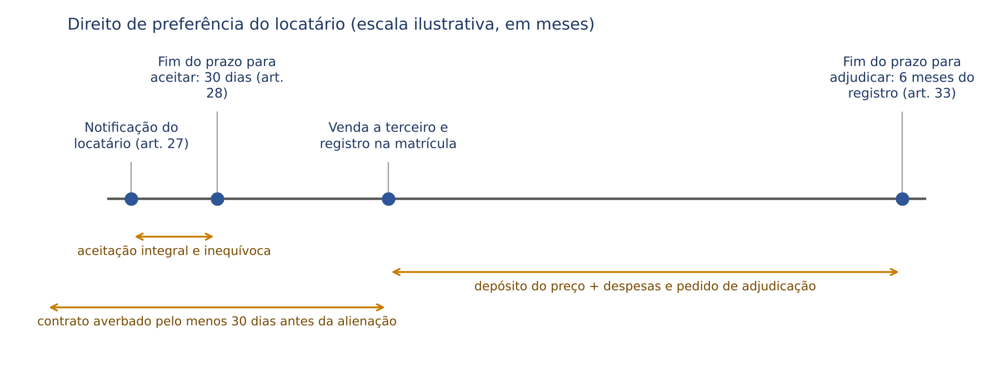
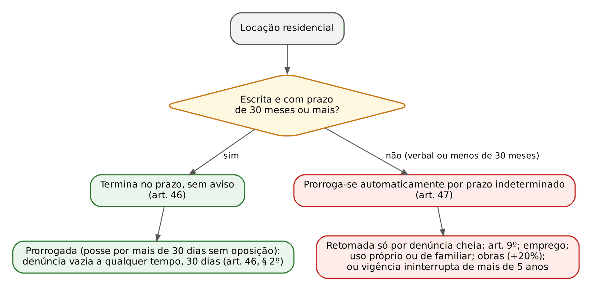
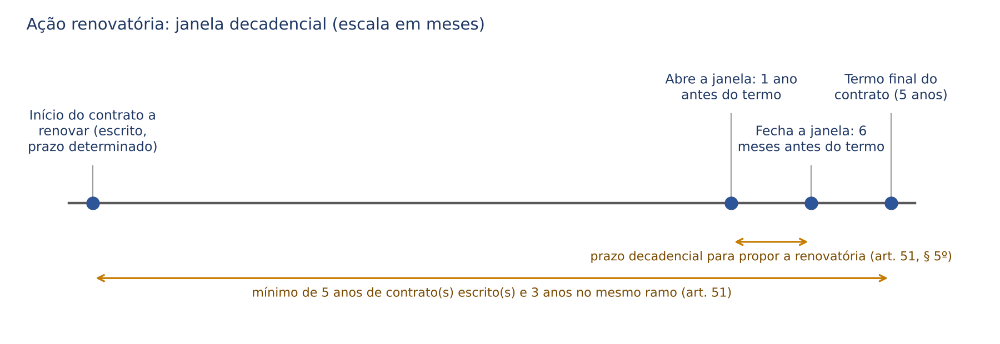
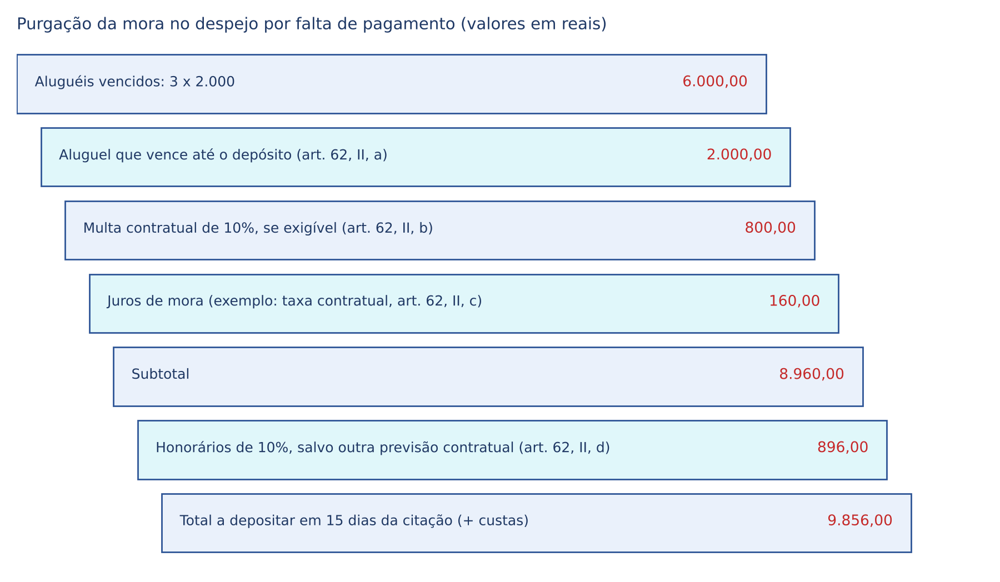

# CAPÍTULO 18 — LOCAÇÃO DE COISAS (CC) E LOCAÇÃO DE IMÓVEIS URBANOS (LEI 8.245/1991)

:::INCIDENCIA
TRF5 p. 10; TJRS p. 13 e 22; TJSC p. 13 e 23. Nível A. Lote: 9 questões (FGV 8, FCC 1), mais cerca de 25 correlatas localizadas no banco por palavra-chave.
O que mais cai: sub-rogação por morte (arts. 10 e 11) e alienação do imóvel (art. 8º), benfeitorias e cláusula de renúncia (art. 35 e Súmula 335 do STJ, agora com a discussão das acessões), denúncia vazia x cheia (arts. 46 e 47), sublocação (arts. 13 a 16), preferência (arts. 27 a 33) e fiança na locação.
:::

| Subtema | FGV | FCC | Padrão de cobrança |
|---|---|---|---|
| Morte de locador ou locatário; alienação do imóvel | 4 | 0 | caso longo com viúva, companheiro ou herdeiro; mistura com cláusula de vigência averbada e preferência |
| Benfeitorias e acessões | 2 | 0 | classificar obra por obra e aplicar art. 35, 36 e a cláusula de renúncia |
| Locação residencial: término e retomada | 1 | 1 | 30 meses (art. 46) x prazo inferior (art. 47, V: mais de 5 anos); vênia conjugal de 10 anos |
| Sublocação | 1 | 0 | extinção da locação extingue a sublocação; responsabilidade subsidiária e limitada do sublocatário |

## 18.1 Locação de coisas no Código Civil (arts. 565 a 578)

### 18.1.1 Conceito, campo de aplicação e convivência com a lei especial

A locação de coisas é contrato bilateral, oneroso, comutativo, consensual, de execução continuada e, em regra, não solene: uma parte cede à outra, por tempo determinado ou não, o uso e gozo de coisa NÃO fungível, mediante retribuição (art. 565). A infungibilidade é elemento do tipo: se a coisa é fungível e deve ser restituída em gênero, o contrato é mútuo (ver Cap. 19). A gratuidade desfigura a locação em comodato; e a fixação de "aluguel" pelo comodante após a notificação para restituir não converte o comodato em locação (art. 582, 2ª parte; Q4289328, FGV 2026, DPE-RJ — ver Cap. 19).

O CC é a disciplina residual. A locação de imóvel urbano rege-se pela Lei 8.245/1991 (art. 2.036 do CC: a locação de prédio urbano sujeita à lei especial "por esta continua a ser regida"), e a lei especial manda aplicar, no que for omissa, o CC e o CPC (art. 79). O CC rege, portanto: a locação de móveis (veículos, máquinas, equipamentos), a locação de imóveis excluídos da lei do inquilinato (art. 1º, parágrafo único, da Lei 8.245 — ver 18.2.1) e, supletivamente, a própria locação urbana. Imóveis rurais destinados à exploração agropecuária seguem o Estatuto da Terra (arrendamento rural — ver Cap. 21).

Súmula 492 do STF: a locadora de veículos responde solidariamente com o locatário perante terceiros (v. Cap. 24; Q3532379, FGV 2025, MPE-RJ).

### 18.1.2 Regras do CC que diferem da Lei 8.245 (o que a banca troca)

| Tema | Código Civil | Lei 8.245/1991 |
|---|---|---|
| Devolução antecipada pelo locador | só ressarcindo perdas e danos ao locatário, que tem retenção até ser ressarcido (art. 571 e parágrafo único) | o locador NÃO pode reaver o imóvel durante o prazo (art. 4º), salvo as hipóteses do art. 9º |
| Devolução antecipada pelo locatário | paga proporcionalmente a multa prevista (art. 571); o juiz fixa em bases razoáveis a indenização excessiva (art. 572) | multa pactuada proporcional ao período cumprido, ou a judicialmente estipulada (art. 4º); dispensa por transferência do empregado (parágrafo único) |
| Fim do prazo | cessa de pleno direito (art. 573); continuando o locatário na posse sem oposição, prorroga-se pelo mesmo aluguel sem prazo determinado (art. 574) | residencial: arts. 46 e 47; não residencial: arts. 56 e 57 (prorrogação presumida após 30 dias sem oposição) |
| Não restituição após notificação | aluguel-pena arbitrado pelo locador e responsabilidade pelo dano, ainda que por caso fortuito; juiz pode reduzir o manifestamente excessivo, "tendo sempre em conta o seu caráter de penalidade" (art. 575) | ação de despejo (art. 5º) |
| Alienação da coisa | adquirente só respeita o contrato com cláusula de vigência E registro (RTD do domicílio do locador, se móvel; Registro de Imóveis, se imóvel); imóvel: despedida só após 90 dias da notificação (art. 576) | cláusula de vigência + prazo determinado + averbação na matrícula; sem isso, denúncia com 90 dias, a exercer em 90 dias do registro (art. 8º) |
| Morte | transfere-se aos herdeiros a locação POR TEMPO DETERMINADO (art. 577) | morte do locador: transmite-se aos herdeiros (art. 10); do locatário: sub-rogação por categorias (art. 11) |

O Enunciado 180 da III Jornada estende o parágrafo único do art. 575 (redução judicial do aluguel-pena) ao aluguel arbitrado pelo comodante (art. 582, 2ª parte). A responsabilidade pelo fortuito do locatário em mora de restituir guarda simetria com o art. 399 (ver Cap. 14).

:::PEGADINHA Três armadilhas do CC
- Art. 577: a transmissão aos herdeiros por morte de qualquer das partes vale para a locação "por tempo determinado". Na locação de imóvel urbano, ao contrário, a morte do locador transmite a locação aos herdeiros sem essa restrição (art. 10 da Lei 8.245).
- Art. 576: no CC, a oponibilidade ao adquirente exige cláusula de vigência E registro; falta qualquer dos dois e o adquirente não está obrigado a respeitar o contrato. Mesmo assim, tratando-se de imóvel, ele só despede o locatário após 90 dias da notificação (§ 2º).
:::

#### Ficha: locação de coisas (CC)

| Natureza | Forma | Partes | Obrigações principais | Extinção | Pontos-chave |
|---|---|---|---|---|---|
| bilateral, onerosa, comutativa, consensual, de trato sucessivo | livre | locador não precisa ser proprietário (basta poder ceder o uso) | locador: entregar com pertenças, manter, garantir uso pacífico, responder por vícios anteriores (arts. 566 e 568); locatário: uso conforme, pagar, avisar turbações, restituir (art. 569) | termo (art. 573), resolução por uso diverso ou abuso com perdas e danos (art. 570), morte na locação por prazo determinado transmite (art. 577) | aluguel-pena (art. 575); alienação (art. 576); retenção (arts. 571 e 578) |

## 18.2 Lei 8.245/1991: âmbito e disposições gerais

### 18.2.1 Âmbito de incidência (art. 1º) e exclusões

A lei rege a locação de imóvel URBANO, critério que a doutrina majoritária e a jurisprudência fixam pela DESTINAÇÃO do imóvel (residencial, comercial, industrial), e não pela localização: imóvel situado na zona rural, mas usado como residência ou comércio, está sob a Lei 8.245; imóvel em perímetro urbano explorado em atividade agropecuária sujeita-se ao Estatuto da Terra (ver Cap. 21).

:::LEI Lei 8.245/1991, art. 1º, parágrafo único
Parágrafo único. Continuam regulados pelo Código Civil e pelas leis especiais:
a) as locações:
1. de imóveis de propriedade da União, dos Estados e dos Municípios, de suas autarquias e fundações públicas;
2. de vagas autônomas de garagem ou de espaços para estacionamento de veículos;
3. de espaços destinados à publicidade;
4. em apart-hotéis, hotéis-residência ou equiparados, assim considerados aqueles que prestam serviços regulares a seus usuários e como tais sejam autorizados a funcionar;
b) o arrendamento mercantil, em qualquer de suas modalidades.
:::

Leituras finas da exclusão:

- O item 1 alcança o imóvel PÚBLICO dado em locação; a Administração LOCATÁRIA de imóvel particular submete-se à Lei 8.245, com as derrogações da lei de licitações. Prescrição trienal também nesses contratos (Enunciado 418 da V Jornada).
- Empresa pública e sociedade de economia mista não estão no rol do item 1 (Q4338795, FCC 2026, PGM-Manaus, locação de empresa pública "regida pelo direito privado", com foco em contrato preliminar — ver Cap. 15).
- Vaga AUTÔNOMA de garagem segue o CC; a vaga acessória ao apartamento segue a locação principal. Locar imóvel para EXPLORAR estacionamento não afasta a Lei 8.245 (JT do STJ, ed. 53, tese 17).
- O CDC NÃO se aplica aos contratos locatícios regidos pela Lei 8.245 (JT do STJ, ed. 53, tese 1).

Vaga autônoma pelo CC, sem a solidariedade presumida do art. 2º: Q3362363 (FGV 2025, ENAM, gabarito A, a colocatária responde só por sua quota, arts. 257 e 265 do CC — box no Cap. 12).

Também com vaga autônoma regida pelo CC: Q4012600 (FCC 2026, DPE-MA), multas moratórias toleradas por anos não podem ser cobradas retroativamente (gabarito D, boa-fé e *venire contra factum proprium* — ver Cap. 15).

### 18.2.2 Pluralidade de partes, prazo e vênia conjugal (arts. 2º e 3º)

Havendo mais de um locador ou mais de um locatário, presume-se a solidariedade, salvo estipulação em contrário (art. 2º; JT do STJ, ed. 53, tese 11). É exceção expressa ao art. 265 do CC. Os ocupantes de habitações coletivas multifamiliares presumem-se locatários ou sublocatários (parágrafo único).

Vênia conjugal (art. 3º): a locação pode ter qualquer prazo, mas depende de vênia conjugal se "igual ou superior a dez anos" (exatos 10 anos já exigem). A sanção NÃO é nulidade nem anulabilidade: ausente a vênia, o cônjuge "não estará obrigado a observar o prazo excedente" (parágrafo único). Prevalece que a regra protege o patrimônio do LOCADOR. Em Q3888034 (FGV 2024, Procurador de São José dos Campos), contrato de 30 meses de locadora casada: errada a alternativa que exigia vênia "em razão da natureza imobiliária do bem".

### 18.2.3 Multa por devolução antecipada (art. 4º)

Durante o prazo, o locador NÃO pode reaver o imóvel; o locatário pode devolvê-lo pagando a multa pactuada, PROPORCIONAL ao período de cumprimento, ou a judicialmente estipulada (Leis 12.112/2009 e 12.744/2012), salvo no *built to suit* (art. 54-A, § 2º).

- Dispensa da multa (parágrafo único): transferência do locatário, pelo empregador privado OU público, para prestar serviços em localidade diversa da do início do contrato, com notificação escrita ao locador com no mínimo 30 dias de antecedência.
- O art. 413 do CC complementa o art. 4º (Enunciado 357 da IV Jornada): além da proporcionalidade, cabe redução equitativa da multa manifestamente excessiva.
- A multa compensatória do art. 4º não se confunde com a moratória pelo atraso; podem coexistir (cláusula penal: Cap. 14; Q3049078, FGV 2024).

:::EXEMPLO Multa proporcional
Contrato de 30 meses, multa de 3 aluguéis de 2.000 (dois mil) reais = 6.000 (seis mil) reais; devolução no fim do 12º mês; faltam 18/30 (60%). Multa devida: 3.600 (três mil e seiscentos) reais, ainda reduzível se excessiva (art. 413).
:::

### 18.2.4 Ação do locador, denúncia pelo locatário e usufruto (arts. 5º a 7º)

- Seja qual for o fundamento, a ação do locador para reaver o imóvel é a DE DESPEJO, salvo desapropriação com imissão do expropriante (art. 5º); não cabe reintegração de posse do locador. Já o locatário esbulhado pelo locador tem reintegração contra ele (Q3745586, FCC 2025, PGE-TO — ver Cap. 27).
- Locação por prazo indeterminado: o locatário denuncia por aviso escrito com antecedência mínima de 30 dias; sem aviso, o locador pode exigir um mês de aluguel e encargos vigentes na resilição (art. 6º).
- Extinto o usufruto ou o fideicomisso, a locação celebrada pelo usufrutuário ou fiduciário pode ser denunciada com 30 dias para desocupação, SALVO aquiescência escrita do nu-proprietário ou do fideicomissário, ou consolidação da propriedade nas mãos do usufrutuário ou fiduciário; a denúncia deve ser exercida em 90 dias da extinção do fideicomisso ou da AVERBAÇÃO da extinção do usufruto, presumindo-se depois a concordância com a manutenção (art. 7º).

O nu-proprietário que loca com anuência do usufrutuário tem legitimidade para o despejo (REsp 2.218.467-SP — v. Cap. 31, onde está também a divisão de aluguéis entre usufrutuários, Q4083723).

### 18.2.5 Alienação do imóvel locado (art. 8º)

:::LEI Lei 8.245/1991, art. 8º
Art. 8º Se o imóvel for alienado durante a locação, o adquirente poderá denunciar o contrato, com o prazo de noventa dias para a desocupação, salvo se a locação for por tempo determinado e o contrato contiver cláusula de vigência em caso de alienação e estiver averbado junto à matrícula do imóvel.
§ 1º Idêntico direito terá o promissário comprador e o promissário cessionário, em caráter irrevogável, com imissão na posse do imóvel e título registrado junto à matrícula do mesmo.
§ 2º A denúncia deverá ser exercitada no prazo de noventa dias contados do registro da venda ou do compromisso, presumindo-se, após esse prazo, a concordância na manutenção da locação.
:::

Venda rompe a locação (*emptio tollit locatum*) por DENÚNCIA do adquirente, salvo os três requisitos CUMULATIVOS do caput. Atenuação: o contrato com cláusula de vigência, ainda que NÃO averbado, não pode ser denunciado pelo adquirente que dele teve ciência inequívoca antes da aquisição (JT do STJ, ed. 53, tese 21).

:::PEGADINHA Averbação para a vigência x averbação para a preferência
Na alienação, a averbação é requisito para a oponibilidade da cláusula de vigência ao adquirente (art. 8º). Na preferência, a averbação "pelo menos trinta dias antes da alienação" é requisito apenas da adjudicação, não das perdas e danos (art. 33; ver 18.4). Em Q3328201 (FGV 2025, ENAC), o registro na preferência do locatário foi tratado como requisito de oponibilidade, não constitutivo (gabarito E).
:::

### 18.2.6 Desfazimento da locação (art. 9º)

A locação pode ser desfeita a qualquer tempo, mesmo no curso do prazo: (I) por mútuo acordo; (II) por infração legal ou contratual; (III) por falta de pagamento do aluguel e encargos; (IV) para reparações urgentes determinadas pelo Poder Público, que não possam ser executadas com a permanência do locatário ou que ele se recuse a consentir. Valem também na residencial prorrogada (art. 47, I) e no art. 53, I.

### 18.2.7 Morte, separação e divórcio (arts. 10 a 12)

:::LEI Lei 8.245/1991, arts. 10 a 12
Art. 10. Morrendo o locador, a locação transmite-se aos herdeiros.
Art. 11. Morrendo o locatário, ficarão sub-rogados nos seus direitos e obrigações:
I - nas locações com finalidade residencial, o cônjuge sobrevivente ou o companheiro e, sucessivamente, os herdeiros necessários e as pessoas que viviam na dependência econômica do de cujus, desde que residentes no imóvel;
II - nas locações com finalidade não residencial, o espólio e, se for o caso, seu sucessor no negócio.
Art. 12. Em casos de separação de fato, separação judicial, divórcio ou dissolução da união estável, a locação residencial prosseguirá automaticamente com o cônjuge ou companheiro que permanecer no imóvel.
§ 1º Nas hipóteses previstas neste artigo e no art. 11, a sub-rogação será comunicada por escrito ao locador e ao fiador, se esta for a modalidade de garantia locatícia.
§ 2º O fiador poderá exonerar-se das suas responsabilidades no prazo de 30 (trinta) dias contado do recebimento da comunicação oferecida pelo sub-rogado, ficando responsável pelos efeitos da fiança durante 120 (cento e vinte) dias após a notificação ao locador.
:::

Leituras finas: na morte do locador, qualquer herdeiro cobra o aluguel por inteiro (solidariedade ativa do art. 2º); no art. 11, I, a ordem é SUCESSIVA e só alcança quem RESIDE no imóvel, e a locação prossegue pelo prazo restante; o art. 12 só se aplica à locação RESIDENCIAL.

:::QUESTAO FGV 2025 — DPE-PE — Defensor Público (Q3390840)
Caso: locatário único de contrato residencial de 30 meses morre no 12º mês; residiam com ele a esposa e dois filhos com menos de 18 anos. O locador notifica a viúva para desocupar em 30 dias, considerando extinta a locação.
Gabarito: C (a morte não extingue a locação residencial; esposa e filhos que ali residiam sub-rogam-se e permanecem até o fim do prazo).
Fundamento: art. 11, I, norma cogente; "personalíssima" (B) e "cláusula de sucessão" (D) são as armadilhas.
No mesmo sentido, com companheiro sobrevivente e contrato averbado: Q2758997 (FGV 2024, EPE, gabarito D, sub-rogação em todos os direitos e obrigações, inclusive a preferência).
:::

:::QUESTAO FGV 2024 — TJ-MT — Analista Judiciário (Q3114269)
Caso: locação residencial de 30 meses com cláusula de vigência averbada; no 15º mês o locador oferece preferência, o locatário recusa, o imóvel é vendido e, semanas depois, o locatário morre. A adquirente quer imitir-se na posse.
Gabarito: A (a adquirente respeita o contrato até o fim do prazo, pela cláusula de vigência averbada, e a cônjuge sobrevivente sub-roga-se).
Passos: os três requisitos do art. 8º impedem a denúncia; a recusa da preferência só libera a venda a terceiro, sem extinguir a locação; a morte do locatário residencial gera sub-rogação (art. 11, I). Armadilha: as demais alternativas combinam "extinção pela morte" com a denúncia de 90 dias.
:::

:::QUESTAO FGV 2024 — TJ-SC — Analista Jurídico (Q2515297)
Caso: locadora morre; os inquilinos passam a pagar a um dos quatro herdeiros e, inadimplentes, alegam a ilegitimidade dele para a cobrança, porque não é o locador e porque há outros herdeiros.
Gabarito: A (não assiste razão aos réus).
Fundamento: art. 10 c/c art. 2º (solidariedade ativa presumida): cada herdeiro-locador exige o todo. Armadilha: "sub-roga-se o espólio" (B) é a regra do art. 11, II (morte do LOCATÁRIO não residencial).
:::

### 18.2.8 Cessão, sublocação e empréstimo (arts. 13 a 16 e 21)

- A cessão da locação (transfere a posição contratual), a sublocação (contrato derivado, sem vínculo do sublocatário com o locador, salvo os arts. 15, 16, 30, 51, § 1º, e 59, § 2º) e o empréstimo do imóvel, total ou parcial, dependem do consentimento PRÉVIO e ESCRITO do locador (art. 13).
- "Não se presume o consentimento pela simples demora do locador" (§ 1º); mas, notificado por escrito, o locador tem 30 dias para se opor formalmente (§ 2º), e o silêncio após a notificação é lido pelas bancas como anuência.
- Rescindida ou finda a locação, "qualquer que seja sua causa", resolvem-se as sublocações, assegurada ao sublocatário indenização contra o sublocador (art. 15). O sublocatário responde SUBSIDIARIAMENTE ao locador pela importância que dever ao sublocador, quando este for demandado, e pelos aluguéis vencidos durante a lide (art. 16).
- O locatário autorizado a ceder pode sublocar (Súmula 411 do STF); a sublocação não autorizada é infração (art. 9º, II).
- O aluguel da sublocação não excede o da locação; em habitações coletivas, a soma não supera o dobro; o excesso autoriza a redução pelo sublocatário (art. 21).

Cessão verbal notificada e aceita por seis anos: despejo improcedente pela boa-fé objetiva e pelo art. 13, § 2º (Q3362362, FGV 2025, ENAM, gabarito C — box no Cap. 15).

:::QUESTAO FGV 2026 — TJ-BA — Juiz Substituto (Q4083720)
Caso: locação residencial de 3 anos com sublocação total autorizada; o sublocatário paga em dia ao locatário-sublocador, que retém os valores; o locador obtém sentença de despejo por falta de pagamento que declara resolvido o contrato principal.
Gabarito: E (extinta a locação principal, extingue-se a sublocação; ao sublocatário resta pedir indenização ao sublocador).
Fundamento: art. 15 (extinção da sublocação e indenização contra o sublocador) e art. 16 (responsabilidade SUBSIDIÁRIA e LIMITADA ao que o sublocatário deve ao sublocador, nunca "pela integralidade da dívida", B, nem solidária, C). A sub-rogação do locador como sublocador (A) e a permanência até o fim da sublocação (D) não existem.
Correlata: Q4102100 (FGV 2026, TJ-BA, Juiz Leigo): o sublocatário que paga a dívida do locatário é terceiro interessado (art. 304 do CC; ver Cap. 13).
:::

No despejo, os sublocatários têm ciência do pedido e podem intervir como assistentes (art. 59, § 2º); embargos de terceiro só do sublocatário legítimo não intimado (JT do STJ, ed. 53, tese 2).

## 18.3 Aluguel, encargos e deveres das partes

### 18.3.1 Fixação, reajuste e revisão (arts. 17 a 21)

- Convenção livre do aluguel, VEDADAS a estipulação em moeda estrangeira e a vinculação à variação cambial ou ao salário mínimo (art. 17). Nas residenciais, observam-se os critérios de reajuste da legislação específica (parágrafo único). É nula de pleno direito a estipulação de reajuste ou correção monetária com periodicidade inferior a um ano (Lei 10.192/2001, art. 2º, § 1º).
- Revisão judicial: sem acordo, locador OU locatário podem pedir a revisão após TRÊS ANOS de vigência do contrato ou do acordo anterior, para ajustar o aluguel ao preço de mercado (art. 19). Para o STJ, o art. 19 consagrou a teoria da imprevisão nas locações urbanas (JT do STJ, ed. 53, tese 14); parte da doutrina prefere ver ali revisão por simples defasagem do valor locativo, que dispensa fato imprevisível (basta o decurso do triênio e a distância do preço de mercado). A renúncia à revisional durante a vigência é válida (Súmula 357 do STF; art. 54-A, § 1º).
- Pagamento antecipado do aluguel é VEDADO (art. 20), salvo (i) locação sem nenhuma garantia, em que o locador pode exigir o pagamento até o sexto dia útil do mês vincendo (art. 42), e (ii) locação para temporada (art. 49). Cobrar antecipadamente fora dessas hipóteses é contravenção penal (art. 43, III).

Lei nova de ordem pública sobre índice de reajuste alcança os reajustes FUTUROS de contrato anterior, sem retroatividade (Q3265470, FGV 2025, Canaã dos Carajás, gabarito B — ver Cap. 1).

### 18.3.2 Deveres do locador e do locatário (arts. 22 a 26)

Pontos cobrados: recibo discriminado, vedada quitação genérica (art. 22, VI); taxas de administração e intermediação, inclusive a ficha cadastral do pretendente e do fiador, pelo LOCADOR (VII); impostos, taxas e seguro contra fogo pelo locador, SALVO disposição expressa em contrário (VIII); seguro de fiança pelo LOCATÁRIO (art. 23, XI); proibição de alterar a forma do imóvel sem consentimento prévio e escrito (art. 23, VI).

| Despesas extraordinárias de condomínio: LOCADOR (art. 22, X e parágrafo único) | Despesas ordinárias de condomínio: LOCATÁRIO (art. 23, XII e § 1º) |
|---|---|
| obras de reforma ou acréscimos que interessem à estrutura integral do imóvel | salários, encargos trabalhistas e previdenciários dos empregados do condomínio |
| pintura das fachadas, empenas, poços de aeração e iluminação e esquadrias externas | consumo de água, esgoto, gás, luz e força das áreas comuns |
| obras para repor as condições de habitabilidade do edifício | limpeza, conservação e pintura das dependências de uso comum |
| indenizações trabalhistas e previdenciárias por dispensa de empregados ocorrida ANTES do início da locação | manutenção de instalações e equipamentos hidráulicos, elétricos, mecânicos, de segurança, de esporte e lazer; elevadores, porteiro eletrônico e antenas coletivas |
| instalação de equipamentos de segurança, incêndio, telefonia, intercomunicação, esporte e lazer | pequenos reparos nas instalações elétricas e hidráulicas de uso comum |
| decoração e paisagismo das partes comuns | rateios de saldo devedor, salvo se de período anterior ao início da locação |
| constituição de fundo de reserva | REPOSIÇÃO do fundo de reserva usado para custear despesas ordinárias, salvo de período anterior |

:::DICA Instalar x manter; constituir x repor
INSTALAR e CONSTITUIR (fundo de reserva): locador; MANTER e REPOR: locatário, desde que comprovados previsão orçamentária e rateio mensal (art. 23, § 2º). Na assembleia sobre despesas ordinárias, o locatário vota se o locador não comparecer (art. 24, § 4º, da Lei 4.591/1964 — ver Cap. 30).
:::

Reparos urgentes a cargo do locador: o locatário é obrigado a consenti-los; se durarem MAIS DE 10 DIAS, tem abatimento proporcional ao período excedente; se MAIS DE 30 DIAS, pode resilir o contrato (art. 26). Nas habitações coletivas multifamiliares em condições precárias declaradas pelo Poder Público, os ocupantes podem depositar judicialmente o aluguel (art. 24).

### 18.3.3 Prescrição da pretensão aos aluguéis

A pretensão de cobrança de aluguéis de prédios urbanos ou rústicos e acessórios prescreve em TRÊS ANOS (art. 206, § 3º, I, do CC; JT do STJ, ed. 53, tese 22, com a regra de transição do art. 2.028). A regra vale também para as locações com a Administração (Enunciado 418). Contra o fiador que não participou da ação de despejo, a interrupção da prescrição ocorrida naquela ação NÃO o atinge (JT do STJ, ed. 53, tese 10 — ver 18.6.4). Prazos, causas suspensivas e o art. 192 (prazos prescricionais não podem ser alterados por acordo) são do Cap. 11.

Cálculo com herdeiro absolutamente incapaz (art. 198, I): Q3453222 (FGV 2025, TJ-TO, gabarito C, fevereiro de 2031 — escada no Cap. 11). Correlata: Q2459902 (FGV 2024, 1º ENAM, gabarito A): cláusula que fixava em 5 anos o prazo para cobrar aluguéis é ineficaz (art. 192), e o casamento de UMA das locadoras com o devedor não suspende o prazo em favor do outro locador.

## 18.4 Direito de preferência (arts. 27 a 34)

### 18.4.1 Hipóteses, comunicação e prazo

O locatário tem preferência para adquirir o imóvel locado, em igualdade de condições com terceiros, no caso de venda, promessa de venda, cessão ou promessa de cessão de direitos ou dação em pagamento; o locador deve dar-lhe conhecimento do negócio por notificação judicial, extrajudicial ou outro meio de ciência inequívoca (art. 27), com TODAS as condições, em especial preço, forma de pagamento, ônus reais e local e horário para exame da documentação (parágrafo único). A preferência CADUCA se não manifestada, de maneira inequívoca, aceitação INTEGRAL à proposta no prazo de 30 dias (art. 28). Aceita a proposta, a desistência do locador o obriga pelos prejuízos, inclusive lucros cessantes (art. 29).

| Situação | Regra | Artigo |
|---|---|---|
| Imóvel sublocado em sua totalidade | preferência do sublocatário e, em seguida, do locatário; vários sublocatários: a todos em comum ou a qualquer deles | art. 30 |
| Pluralidade de pretendentes | locatário mais antigo; se da mesma data, o mais idoso | art. 30, parágrafo único |
| Alienação de mais de uma unidade | a preferência incide sobre a totalidade dos bens alienados | art. 31 |
| Condomínio no imóvel | a preferência do CONDÔMINO prevalece sobre a do locatário (art. 504 do CC — ver Cap. 30) | art. 34 |
| NÃO há preferência | perda da propriedade ou venda por decisão judicial, permuta, doação, integralização de capital, cisão, fusão e incorporação | art. 32 |
| Contratos firmados a partir de 1/10/2001 | também não alcança a constituição de propriedade fiduciária e a perda ou venda por realização de garantia, inclusive leilão extrajudicial, desde que a condição conste de cláusula específica destacada graficamente | art. 32, parágrafo único (MP 2.223/2001 e Lei 10.931/2004) |

### 18.4.2 Preterição: perdas e danos x adjudicação

:::LEI Lei 8.245/1991, art. 33
Art. 33. O locatário preterido no seu direito de preferência poderá reclamar do alienante as perdas e danos ou, depositando o preço e demais despesas do ato de transferência, haver para si o imóvel locado, se o requerer no prazo de seis meses, a contar do registro do ato no cartório de imóveis, desde que o contrato de locação esteja averbado pelo menos trinta dias antes da alienação junto à matrícula do imóvel.
Parágrafo único. A averbação far-se-á à vista de qualquer das vias do contrato de locação desde que subscrito também por duas testemunhas.
:::

| | Perdas e danos | Adjudicação (haver para si o imóvel) |
|---|---|---|
| Contra quem | o ALIENANTE (locador) | o adquirente (eficácia real) e o alienante |
| Registro do contrato | NÃO exigido (JT do STJ, ed. 80, tese 13) | averbação na matrícula pelo menos 30 dias ANTES da alienação |
| Depósito | não | preço e demais despesas do ato de transferência |
| Prazo | prescricional comum da reparação civil (ver Cap. 11) | 6 meses do registro do ato no cartório de imóveis (decadencial) |

:::PEGADINHA Os dois "30 dias" e os dois "6 meses"
- 30 dias para o locatário aceitar a proposta (art. 28) x averbação pelo menos 30 dias antes da alienação (art. 33).
- 6 meses do REGISTRO do ato para adjudicar (art. 33) x, na preempção convencional do CC, o prazo de exercício é de até 180 dias para móvel e 2 anos para imóvel (art. 513; ver Cap. 17). A preempção do CC é pacto adjeto à compra e venda e, se descumprida, gera apenas perdas e danos contra o comprador, com responsabilidade solidária do adquirente de má-fé (art. 518), sem eficácia real; a preferência do locatário com contrato averbado tem eficácia real.
- Em Q2758997 (FGV 2024, EPE), errada a alternativa que dava ao preterido a adjudicação mas negava as perdas e danos: são vias alternativas à sua escolha.
:::

A simulação de venda para burlar a preferência do locatário (por exemplo, preço declarado maior que o real, para desestimular o exercício) é hipótese clássica de simulação relativa, apta a ser reconhecida para viabilizar a adjudicação pelo preço real (Q3387000, FCC 2025, DPE-RS, gabarito B — o regime da simulação está no Cap. 9).

## 18.5 Benfeitorias e acessões

### 18.5.1 Regime legal e cláusula de renúncia

:::LEI Lei 8.245/1991, arts. 35 e 36
Art. 35. Salvo expressa disposição contratual em contrário, as benfeitorias necessárias introduzidas pelo locatário, ainda que não autorizadas pelo locador, bem como as úteis, desde que autorizadas, serão indenizáveis e permitem o exercício do direito de retenção.
Art. 36. As benfeitorias voluptuárias não serão indenizáveis, podendo ser levantadas pelo locatário, finda a locação, desde que sua retirada não afete a estrutura e a substância do imóvel.
:::

| Benfeitoria (art. 96 do CC — ver Cap. 7) | Indenização | Retenção | Observação |
|---|---|---|---|
| Necessária (conservar ou evitar deterioração) | sim, AINDA QUE não autorizada | sim | salvo cláusula expressa em contrário |
| Útil (aumentar ou facilitar o uso) | só se AUTORIZADA | sim, se autorizada | salvo cláusula expressa em contrário |
| Voluptuária (deleite, recreio, embelezamento) | NUNCA | não | pode ser levantada finda a locação, se a retirada não afetar estrutura e substância |

A renúncia contratual é válida: "Nos contratos de locação, é válida a cláusula de renúncia à indenização das benfeitorias e ao direito de retenção" (Súmula 335 do STJ). O art. 35 começa justamente com "salvo expressa disposição contratual em contrário". O regime do possuidor de boa-fé (art. 1.219 do CC: necessárias e úteis indenizáveis com retenção, independentemente de autorização) NÃO se aplica ao locatário, que tem regra especial. Na locação de coisas regida pelo CC, só há disciplina da RETENÇÃO (art. 578), com a mesma exigência de "expresso consentimento" para as úteis.

Exercício processual: nas ações de despejo, a retenção por benfeitorias deve ser alegada na CONTESTAÇÃO, admitindo-se também a reconvenção (JT do STJ, ed. 53, tese 20); não alegada no momento próprio, há preclusão para opor retenção ao mandado.

:::QUESTAO FGV 2024 — Prefeitura de Vitória — Procurador (Q3044241)
Caso: cláusula proibia qualquer obra sem autorização expressa; o locatário, sem autorização, troca o piso estufado e mofado por vazamento anterior ao contrato, instala ar-condicionado em todos os cômodos e põe banheira de hidromassagem na suíte; depois quer compensar os aluguéis com as benfeitorias.
Gabarito: D (indenização pela troca do piso, benfeitoria necessária; os aparelhos de ar-condicionado e a banheira podem ser retirados por serem removíveis sem detrimento da coisa).
Armadilha: a cláusula exigia AUTORIZAÇÃO, mas não RENUNCIAVA à indenização; a necessária a independe (art. 35). Ar-condicionado e banheira, não autorizados, são levantáveis (art. 36).
Correlata: Q2360727 (FGV 2024, PC-SC, Delegado, gabarito B): a pintura que transforma a fachada em "casa da Barbie" é VOLUPTUÁRIA ainda que valorize o imóvel em 50%; o critério do art. 96 é a finalidade, não o efeito econômico.
:::

### 18.5.2 Acessões: a virada do STJ em 2026

Benfeitoria é obra em coisa já existente para conservá-la, melhorá-la ou embelezá-la; acessão artificial (construção ou plantação, arts. 1.253 a 1.259 do CC — ver Cap. 28) é obra NOVA que se incorpora ao solo. A distinção tinha dois efeitos práticos na locação: (i) o STJ aplica por analogia às acessões os direitos de indenização e retenção do art. 35 (JT do STJ, ed. 53, tese 19); (ii) a cláusula de renúncia "a benfeitorias", interpretada restritivamente (art. 114 do CC), não alcançaria as acessões, que seriam indenizáveis ao construtor de boa-fé (art. 1.255). As provas FGV de 2025 e 2026 seguiram essa linha.

:::JURIS STJ, REsp 1.899.963-SP, j. 4/8/2026 (Info 898)
Quarta Turma, por maioria (relatora para o acórdão Ministra Maria Isabel Gallotti): a cláusula de renúncia à indenização por benfeitorias, em locação comercial, abrange também as acessões construídas pelo locatário. A Lei 8.245 usa "benfeitorias" de forma genérica para os haveres do locatário, conforme a praxe e os usos do mercado (art. 113 do CC); a vedação à interpretação extensiva da renúncia (art. 114) não autoriza distinguir rigorosamente benfeitorias de acessões. No caso, o locatário alugou terreno vazio sabendo que teria de construir para viabilizar a atividade: alterar depois a estrutura negocial seria interferência indevida na autonomia privada e enriquecimento sem causa do locatário.
:::

:::QUESTAO FGV 2026 — TJ-PE — Juiz Substituto (Q4349466)
Caso: sociedade locatária, com prévia autorização do proprietário e cláusula de renúncia à indenização "por benfeitorias", constrói um edifício em parte do terreno e pede indenização ao fim do contrato.
Gabarito oficial: B (é acessão, não sujeita à cláusula de renúncia; deve ser indenizada).
Análise: o gabarito segue a orientação anterior. O REsp 1.899.963-SP (Info 898), posterior, afirmou que a renúncia a benfeitorias abrange as acessões em locação comercial. A qualificação (acessão) continua correta; o efeito passou a ser controvertido.
No mesmo sentido do gabarito: Q3786334 (FGV 2025, TJ-MS, gabarito B): renúncia a "quaisquer benfeitorias", e o locatário construiu, com aprovação, piscina, sauna, churrasqueira e chalé, depois hidromassagem e toldo; a FGV deu indenização por TODAS as obras, como acessões fora da renúncia. Sob o Info 898, a resposta seria a A (nenhuma indenização). Ver nota.
:::

## 18.6 Garantias locatícias (arts. 37 a 42)

### 18.6.1 Modalidades e unicidade

O locador pode exigir caução, fiança, seguro de fiança locatícia ou cessão fiduciária de quotas de fundo de investimento (art. 37, I a IV); "é vedada, sob pena de nulidade, mais de uma das modalidades de garantia num mesmo contrato" (parágrafo único).

- A unicidade é de MODALIDADE: dois fiadores não violam a regra; fiança + caução, sim. Nula é a garantia excedente, não o contrato; exigir mais de uma é contravenção (art. 43, II).
- Fiança recíproca: havendo mais de um locatário, é válida a fiança prestada por um deles em relação aos demais (JT do STJ, ed. 53, tese 6).
- Caução (art. 38): móveis no RTD; imóveis averbada na matrícula; em DINHEIRO, no máximo TRÊS aluguéis, em poupança, com rendimentos ao locatário (Q3966636, FGV 2026, TJ-GO — ver Cap. 32). Seguro de fiança: abrange todas as obrigações (art. 41), prêmio do locatário. Sem garantia: aluguel até o sexto dia útil do mês VINCENDO (art. 42) e liminar do art. 59, § 1º, IX.

### 18.6.2 Duração da garantia e substituição (arts. 39 e 40)

:::LEI Lei 8.245/1991, arts. 39 e 40, X e parágrafo único
Art. 39. Salvo disposição contratual em contrário, qualquer das garantias da locação se estende até a efetiva devolução do imóvel, ainda que prorrogada a locação por prazo indeterminado, por força desta Lei.
Art. 40. O locador poderá exigir novo fiador ou a substituição da modalidade de garantia, nos seguintes casos: [...]
X - prorrogação da locação por prazo indeterminado uma vez notificado o locador pelo fiador de sua intenção de desoneração, ficando obrigado por todos os efeitos da fiança, durante 120 (cento e vinte) dias após a notificação ao locador.
Parágrafo único. O locador poderá notificar o locatário para apresentar nova garantia locatícia no prazo de 30 (trinta) dias, sob pena de desfazimento da locação.
:::

O rol do art. 40 inclui ainda morte, ausência, interdição, recuperação judicial, falência ou insolvência do fiador, alienação de todos os seus imóveis e prorrogação por prazo indeterminado de fiança por prazo certo. Sem nova garantia em 30 dias, despejo com LIMINAR (art. 59, § 1º, VII).

| Exoneração do fiador | Código Civil (art. 835 — ver Cap. 21) | Lei 8.245 (art. 40, X, e art. 12, § 2º) |
|---|---|---|
| Quando | fiança sem limitação de tempo, sempre que lhe convier | locação prorrogada por prazo indeterminado; ou sub-rogação por morte ou separação (art. 12) |
| Como | notificação ao credor | notificação ao locador (no art. 12, § 2º, em 30 dias do recebimento da comunicação do sub-rogado) |
| Até quando responde | 60 dias após a notificação do credor | 120 dias após a notificação ao locador |

:::JURIS STJ, REsp 2.121.585-PR, j. 14/5/2024 (Info 812)
Na locação por prazo DETERMINADO, a notificação exoneratória pode ser enviada na vigência, mas o fiador só se exonera no termo, ainda que alterado o quadro social da afiançada, ou em 120 dias a partir da indeterminação do contrato. A saída do sócio não exonera automaticamente (errada a D de Q2758993, FGV 2024, EPE).
:::

### 18.6.3 Fiança locatícia: súmulas e teses

- Súmula 214 do STJ: "O fiador na locação não responde por obrigações resultantes de aditamento ao qual não anuiu." Aditamento (aumento do aluguel, novo prazo convencionado) não se confunde com a prorrogação LEGAL por prazo indeterminado: nesta, a fiança subsiste por força do art. 39 ou de cláusula "até a efetiva entrega das chaves" (JT do STJ, ed. 101, tese 2), ressalvada a exoneração. Em Q3505760 (FGV 2025, TJ-CE, Juiz Substituto), a alternativa B (fiador responde pelo aditamento ao qual não anuiu) estava errada; o gabarito foi a ineficácia total da fiança sem outorga conjugal (Súmula 332 do STJ — ver Cap. 21).
- O fiador que não integrou a ação de despejo não responde pela execução do julgado (Súmula 268 do STJ); para alcançá-lo, cumula-se a cobrança e citam-se "o locatário e os fiadores" (art. 62, I). Não citado, fica isento das custas daquele processo, mas não dos encargos garantidos (JT do STJ, ed. 104, tese 10).
- A decretação de falência do locatário, sem denúncia da locação pelo administrador judicial (art. 119, VII, da Lei 11.101/2005), não altera a responsabilidade dos fiadores (JT do STJ, ed. 101, tese 11).
- Penhora do bem de família do fiador: válida em locação residencial e comercial (Súmula 549 do STJ e Tema 1.127 do STF — ver Cap. 40; cobrada em Q3531610, FCC 2025, DPE-AM, gabarito C, e Q3505760).
- Outorga conjugal, benefício de ordem, forma e fiança contra a vontade do devedor: Cap. 21 (Q3301230, Q3049925, Q3324232, Q2758993).

Fiador fora do despejo: a interrupção ali operada não o atinge, e o benefício de ordem decorre da lei (art. 827), só a renúncia exigindo cláusula (Q3692413, FGV 2025, ENAM, gabarito C — box no Cap. 11).

A extensão da garantia do art. 39 (Lei 12.112/2009) não alcança fiança anterior (Q3856336, FGV 2026, TJ-MS, gabarito C — box no Cap. 1).

:::QUESTAO FGV 2026 — TJ-BA — Juiz Leigo (Q4102107)
Caso: contrato e fiança prorrogados automaticamente por cláusula; despejo dois anos depois. Gabarito oficial: A (fiadora responde; cláusula válida; exoneração por notificação com responsabilidade por 60 dias, "nos termos do Código Civil"). Discutível: na locação urbana o prazo é de 120 dias (art. 40, X; Info 812); a A era apenas a menos errada (a E fala em 180 dias e via judicial). Ver nota.
:::

## 18.7 Locação residencial (arts. 46 e 47)

### 18.7.1 A linha divisória dos 30 meses

A lei premia o contrato escrito e longo com a denúncia vazia e pune o contrato verbal ou curto com a prorrogação compulsória e a retomada motivada.

:::LEI Lei 8.245/1991, art. 46
Art. 46. Nas locações ajustadas por escrito e por prazo igual ou superior a trinta meses, a resolução do contrato ocorrerá findo o prazo estipulado, independentemente de notificação ou aviso.
§ 1º Findo o prazo ajustado, se o locatário continuar na posse do imóvel alugado por mais de trinta dias sem oposição do locador, presumir-se-á prorrogada a locação por prazo indeterminado, mantidas as demais cláusulas e condições do contrato.
§ 2º Ocorrendo a prorrogação, o locador poderá denunciar o contrato a qualquer tempo, concedido o prazo de trinta dias para desocupação.
:::

:::LEI Lei 8.245/1991, art. 47
Art. 47. Quando ajustada verbalmente ou por escrito e com prazo inferior a trinta meses, findo o prazo estabelecido, a locação prorroga-se automaticamente, por prazo indeterminado, somente podendo ser retomado o imóvel:
I - nos casos do art. 9º;
II - em decorrência de extinção do contrato de trabalho, se a ocupação do imóvel pelo locatário relacionada com o seu emprego;
III - se for pedido para uso próprio, de seu cônjuge ou companheiro, ou para uso residencial de ascendente ou descendente que não disponha, assim como seu cônjuge ou companheiro, de imóvel residencial próprio;
IV - se for pedido para demolição e edificação licenciada ou para a realização de obras aprovadas pelo Poder Público, que aumentem a área construída, em, no mínimo, vinte por cento ou, se o imóvel for destinado a exploração de hotel ou pensão, em cinqüenta por cento;
V - se a vigência ininterrupta da locação ultrapassar cinco anos.
:::

Complementos do art. 47:

- Na retomada para uso próprio ou de familiar (inciso III), a necessidade se PRESUME, mas deve ser judicialmente demonstrada se o retomante, alegando necessidade, ocupa com a mesma finalidade outro imóvel próprio na mesma localidade ou, residindo em imóvel alheio, já tiver retomado o imóvel anteriormente; ou se o ascendente ou descendente beneficiário residir em imóvel próprio (§ 1º). As Súmulas 409, 410 e 483 do STF (necessidade presumida; escolha do prédio pelo retomante, salvo abuso) são da legislação revogada: só reforço.
- Nas retomadas dos incisos III e IV, o retomante deve provar ser proprietário, promissário comprador ou promissário cessionário em caráter irrevogável, imitido na posse e com título registrado (§ 2º); a petição inicial no caso do inciso IV vem instruída com a prova da propriedade ou do compromisso registrado (art. 60).
- Retomada para uso próprio é sancionada se o retomante não usar o imóvel para o fim declarado em 180 dias da entrega ou não o usar por no mínimo um ano: crime do art. 44, II, e multa civil de 12 a 24 aluguéis (art. 44, parágrafo único).
- O inciso V é a "denúncia vazia diferida": passados mais de 5 anos de vigência ininterrupta, o locador retoma sem motivo. O prazo conta desde o início da locação, somados os períodos prorrogados.

:::QUESTAO FCC 2026 — DPE-MA — Defensor Público (Q4012603)
Caso: locação residencial escrita de 12 meses, prorrogada automaticamente por prazo indeterminado. Quando pode o locador retomar?
Gabarito: D (se a vigência ininterrupta da locação ultrapassar cinco anos).
Armadilha: as alternativas A e C oferecem denúncia imotivada com 90 ou 30 dias, que é o regime do art. 46, § 2º (contrato escrito de 30 meses ou mais, depois prorrogado) ou do art. 57 (não residencial). A B restringe a retomada a infrações, ignorando os incisos II a V; a E (só mútuo acordo) ignora tudo.
:::

:::QUESTAO FGV 2024 — Prefeitura de São José dos Campos — Procurador (Q3888034)
Caso: locação residencial escrita por 30 meses, firmada por locadora casada; cláusula permite benfeitorias necessárias livremente e exige autorização para as demais.
Gabarito: E (findo o prazo, a resolução ocorre independentemente de notificação ou aviso — art. 46).
Erros: vênia só a partir de 10 anos (A); necessárias independem de autorização (B); a C descreve o art. 47; despesas ordinárias são do locatário (D).
:::

Na residencial comum não há liminar pelo simples término do prazo: ela existe só para a temporada (art. 59, § 1º, III) e a não residencial (art. 59, § 1º, VIII).

## 18.8 Locação para temporada (arts. 48 a 50)

Temporada é a locação destinada à residência TEMPORÁRIA do locatário (lazer, cursos, tratamento de saúde, obras no seu imóvel e outros fatos que decorrem tão somente de determinado tempo), contratada por prazo NÃO SUPERIOR A 90 DIAS, mobiliado ou não o imóvel; se mobiliado, o contrato descreve obrigatoriamente móveis, utensílios e seu estado (art. 48).

- É a única locação urbana em que o locador pode receber de uma só vez e antecipadamente os aluguéis e encargos, e ainda exigir qualquer das garantias do art. 37 para as demais obrigações (art. 49).
- Findo o prazo, se o locatário permanecer mais de 30 dias sem oposição, presume-se prorrogada por prazo indeterminado, deixando de ser exigível o pagamento antecipado; o locador só poderá denunciar após 30 MESES do início ou nas hipóteses do art. 47 (art. 50).
- Despejo com liminar se a ação for proposta em até 30 dias após o vencimento do contrato (art. 59, § 1º, III).
- Hospedagem por plataformas digitais: o STJ admitiu que a convenção de condomínio residencial proíba a locação de curta temporada por aplicativo, qualificando-a como contrato atípico de hospedagem e não como locação para temporada (orientação noticiada pela Quarta Turma em 2021; número do julgado não conferido nesta tarefa — ver Cap. 30 e a nota de verificação).

:::PEGADINHA 90 dias x 30 meses x 30 dias
- Teto da temporada: 90 dias (art. 48).
- Prorrogada a temporada, denúncia só após 30 MESES do início (art. 50, parágrafo único), não "30 dias".
- Despejo liminar da temporada: ação em até 30 dias após o vencimento (art. 59, § 1º, III).
- Pagamento antecipado: permitido na temporada (art. 49) e na locação sem garantia até o sexto dia útil do mês vincendo (art. 42); proibido nas demais (arts. 20 e 43, III).
:::

## 18.9 Locação não residencial (arts. 51 a 57)

### 18.9.1 Término, denúncia e equiparação (arts. 55 a 57)

- É não residencial a locação em que o locatário é pessoa jurídica e o imóvel se destina ao uso de seus titulares, diretores, sócios, gerentes, executivos ou empregados (art. 55), ainda que o uso efetivo seja moradia.
- Nas demais locações não residenciais, o contrato por prazo determinado cessa de pleno direito no termo, independentemente de notificação; se o locatário permanecer mais de 30 dias sem oposição, presume-se prorrogado nas condições ajustadas, sem prazo determinado (art. 56).
- Prazo indeterminado: denúncia escrita com 30 dias (art. 57), sem o requisito dos 30 meses; liminar se a ação for proposta em até 30 dias do termo ou da notificação (art. 59, § 1º, VIII).

### 18.9.2 Hospitais, escolas, asilos e entidades religiosas (art. 53)

Imóveis usados por hospitais, unidades sanitárias oficiais, asilos, estabelecimentos de saúde e de ensino autorizados e fiscalizados, e entidades religiosas registradas (Lei 9.256/1996): o contrato SOMENTE pode ser rescindido pelo art. 9º ou para demolição, edificação ou reforma que aumente em no mínimo 50% a ÁREA ÚTIL, a pedido de proprietário ou compromissário com título registrado e imissão na posse (art. 53). Não há denúncia vazia.

### 18.9.3 Shopping center (art. 54)

Prevalecem as condições livremente pactuadas entre lojistas e empreendedores e as disposições procedimentais da lei (art. 54), base do aluguel percentual e do "aluguel em dobro" de dezembro. Limites cogentes:

- Vedada a cobrança das despesas do art. 22, parágrafo único, a, b e d, e de obras que modifiquem o projeto ou memorial do habite-se e paisagismo (art. 54, § 1º); despesas previstas em orçamento, com comprovação exigível a cada 60 dias (§ 2º).
- O locador NÃO recusa a renovação por uso próprio (art. 52, § 2º).

### 18.9.4 Locação *built to suit* (art. 54-A, Lei 12.744/2012)

:::LEI Lei 8.245/1991, art. 54-A
Art. 54-A. Na locação não residencial de imóvel urbano na qual o locador procede à prévia aquisição, construção ou substancial reforma, por si mesmo ou por terceiros, do imóvel então especificado pelo pretendente à locação, a fim de que seja a este locado por prazo determinado, prevalecerão as condições livremente pactuadas no contrato respectivo e as disposições procedimentais previstas nesta Lei.
§ 1º Poderá ser convencionada a renúncia ao direito de revisão do valor dos aluguéis durante o prazo de vigência do contrato de locação.
§ 2º Em caso de denúncia antecipada do vínculo locatício pelo locatário, compromete-se este a cumprir a multa convencionada, que não excederá, porém, a soma dos valores dos aluguéis a receber até o termo final da locação.
:::

O aluguel do *built to suit* remunera o uso E amortiza o investimento feito sob medida; por isso a lei afasta a proporcionalidade do art. 4º (o próprio art. 4º ressalva o § 2º do art. 54-A), admite a renúncia à revisional e limita a multa ao total dos aluguéis vincendos. O Enunciado 67 da II Jornada de Direito Comercial: na locação *built to suit* é válida a cláusula penal compensatória equivalente à totalidade dos alugueres a vencer, "sem prejuízo da aplicação do art. 416, parágrafo único, do Código Civil" (indenização suplementar, se convencionada).

Em Q3846071 (FGV 2026, AMAZUL, gabarito D — box no Cap. 15), a alternativa B errava ao dizer "com prejuízo" do art. 416, parágrafo único: o Enunciado 67 diz "SEM prejuízo".

:::JURIS STJ, REsp 2.229.517-PR, j. 16/6/2026 (Info 896)
Em ação de rescisão de locação *built to suit*, o valor da causa é o equivalente a 12 meses de aluguel (art. 58, III, da Lei 8.245), e não o valor integral do contrato: o art. 54-A manda prevalecer as condições pactuadas no plano material, mas preserva "as disposições procedimentais" da lei.
:::

Trespasse: o Enunciado 234 (III Jornada de Direito Civil) nega a transmissão automática da locação do ponto ao adquirente do estabelecimento; o Enunciado 8 (I Jornada de Direito Comercial) afirma a sub-rogação como regra, "incluindo o contrato de locação". Divergência real; o art. 1.148 do CC é de Direito Empresarial.

#### Fichas por tipo de locação urbana

| Tipo | Prazo e forma | Fim do prazo | Retomada pelo locador | Liminar de despejo (art. 59, § 1º) | Fundamento |
|---|---|---|---|---|---|
| Residencial escrita de 30 meses ou mais | escrita, 30 meses ou mais | extingue-se sem aviso; prorroga-se após 30 dias sem oposição | prorrogada: denúncia vazia, 30 dias | não pelo término | art. 46 |
| Residencial verbal ou inferior a 30 meses | qualquer | prorrogação automática | só art. 47, I a V | só hipóteses específicas (I, II, IV, V...) | art. 47 |
| Temporada | até 90 dias | prorroga-se após 30 dias sem oposição | prorrogada: após 30 meses do início ou art. 47 | ação em até 30 dias do vencimento (III) | arts. 48 a 50 |
| Não residencial comum | livre | cessa no termo; prorroga-se após 30 dias | indeterminada: denúncia vazia, 30 dias; renovatória se art. 51 | ação em até 30 dias do termo ou da notificação (VIII) | arts. 51, 56 e 57 |
| Hospitais, ensino, asilos, entidades religiosas | livre | — | só art. 9º ou obras de +50% de área útil | — | arts. 53 e 63, §§ 2º e 3º |
| Shopping center | livre pactuação | como a não residencial | sem recusa da renovação por uso próprio | VIII | arts. 52, § 2º, e 54 |
| *Built to suit* | prazo determinado | como a não residencial | multa até os aluguéis vincendos; renúncia à revisional | VIII | art. 54-A |

## 18.10 Direito à renovação e ação renovatória

### 18.10.1 Requisitos (art. 51)

:::LEI Lei 8.245/1991, art. 51, caput e § 5º
Art. 51. Nas locações de imóveis destinados ao comércio, o locatário terá direito a renovação do contrato, por igual prazo, desde que, cumulativamente:
I - o contrato a renovar tenha sido celebrado por escrito e com prazo determinado;
II - o prazo mínimo do contrato a renovar ou a soma dos prazos ininterruptos dos contratos escritos seja de cinco anos;
III - o locatário esteja explorando seu comércio, no mesmo ramo, pelo prazo mínimo e ininterrupto de três anos.
[...]
§ 5º Do direito a renovação decai aquele que não propuser a ação no interregno de um ano, no máximo, até seis meses, no mínimo, anteriores à data da finalização do prazo do contrato em vigor.
:::

:::ESQUEMA Os três requisitos cumulativos e os legitimados
- Formal: contrato ESCRITO e com prazo DETERMINADO (contrato verbal ou prorrogado por prazo indeterminado não renova).
- Temporal: 5 anos no contrato a renovar ou na SOMA de contratos escritos ininterruptos (*accessio temporis*); o sucessor ou cessionário soma os prazos do antecessor (Súmula 482 do STF, a *contrario sensu*; art. 51, § 1º).
- Material: exploração do MESMO RAMO por 3 anos ininterruptos (protege o fundo de comércio formado).
- Legitimados: locatário, cessionários e sucessores; na sublocação TOTAL, só o sublocatário (§ 1º); a sociedade que recebeu o fundo (§ 2º); o sócio sobrevivente no mesmo ramo (§ 3º); indústrias e sociedades civis com fim lucrativo (§ 4º).
- Prazo: decadencial, entre 1 ano e 6 meses antes do termo (§ 5º). Não se suspende nem se interrompe (art. 207 do CC — ver Cap. 11).
:::

- Renovação "por igual prazo", mas com TETO de 5 anos: o prazo máximo da prorrogação fixada na renovatória é de cinco anos (JT do STJ, ed. 53, tese 15; no mesmo sentido, sob o Decreto 24.150, a Súmula 178 do STF).
- A cláusula que afasta o direito à renovação, ou impõe obrigações pecuniárias para tanto (as "luvas" na renovação), é nula de pleno direito (art. 45). Quanto às luvas cobradas na contratação inicial, o tema é controvertido: parte da doutrina e da jurisprudência as admite na locação não residencial, em que remuneram o ponto, enquanto na residencial esbarram na contravenção do art. 43, I (exigir quantia além do aluguel e encargos).
- A sucessão do ausente para preservar a renovatória foi cenário de Q3673863 (FGV 2025, ENAC, gabarito E): a abertura direta da sucessão definitiva quando o ausente teria 80 anos e as últimas notícias datam de 5 anos (art. 38 do CC — ver Cap. 3).

### 18.10.2 Exceções de retomada e indenização (arts. 52 e 72)

O locador não está obrigado a renovar se: (I) por determinação do Poder Público, tiver de fazer obras que importem radical transformação do imóvel, ou modificações que aumentem o valor do negócio ou da propriedade; (II) o imóvel for utilizado por ele próprio ou para transferência de fundo de comércio existente há mais de um ano, sendo detentor da maioria do capital o locador, seu cônjuge, ascendente ou descendente (art. 52). No caso do inciso II, o imóvel não pode ser destinado ao uso do MESMO RAMO do locatário, salvo se a locação também envolvia o fundo de comércio, com instalações e pertences (§ 1º). No shopping center, o inciso II não pode ser invocado (§ 2º).

Contestação adstrita, quanto aos fatos (art. 72), a: falta de requisitos; proposta abaixo do valor locativo real (excluída a valorização trazida pelo locatário), com contraproposta; proposta de terceiro, documentada e assinada por duas testemunhas, em ramo DIVERSO do locatário (que pode aceitá-la na réplica); hipóteses do art. 52.

O locatário tem direito a indenização de prejuízos e lucros cessantes (mudança, perda do lugar, desvalorização do fundo de comércio) se a renovação não ocorrer por proposta de terceiro em melhores condições, ou se o locador, em TRÊS MESES da entrega, não der o destino alegado ou não iniciar as obras (art. 52, § 3º).

- Na hipótese de proposta de terceiro, a sentença fixa desde logo a indenização, devida SOLIDARIAMENTE pelo locador e pelo proponente (art. 75).
- A indenização pelo fundo de comércio está ligada ao exercício da renovatória (JT do STJ, ed. 53, tese 16): sem ação no prazo, não há indenização pelo ponto.

## 18.11 Procedimentos: despejo, consignatória, revisional e renovatória

### 18.11.1 Disposições comuns (art. 58)

:::PROCESSO Art. 58: regras comuns às ações locatícias (exceto as locações do art. 1º, parágrafo único)
| Regra | Conteúdo | Observação |
|---|---|---|
| Férias forenses (I) | os processos tramitam durante as férias e não se suspendem por elas | discute-se a compatibilidade com a suspensão de prazos de 20/12 a 20/1 (art. 220 do CPC); prevalece que o art. 220 suspende prazos também aqui |
| Competência (II) | foro da situação do imóvel, salvo foro de eleição no contrato | competência relativa |
| Valor da causa (III) | 12 meses de aluguel; no despejo do art. 47, II (contrato de trabalho), 3 salários vigentes no ajuizamento | aplica-se ao *built to suit* (Info 896) |
| Comunicações (IV) | se autorizado no contrato, por carta com AR (pessoa jurídica: também telex ou fac-símile) | — |
| Recursos (V) | efeito SOMENTE devolutivo | JT do STJ, ed. 53, teses 12 e 13: apelação no despejo, renovatória e revisional sem efeito suspensivo, que o relator pode atribuir excepcionalmente (hoje, art. 1.012, §§ 3º e 4º, do CPC) |
:::

As ações de despejo podem ser consideradas causas cíveis de menor complexidade (art. 80); a Lei 9.099/1995 admite no Juizado o despejo para uso próprio (art. 3º, III).

### 18.11.2 Ação de despejo

Rito: procedimento comum com as modificações da lei (art. 59, caput, que ainda fala em "rito ordinário"). Petição inicial com prova da propriedade ou do compromisso registrado nas ações fundadas no art. 9º, IV, art. 47, IV, e art. 53, II (art. 60).

Liminar para desocupação em 15 DIAS, sem ouvir a parte contrária, mediante CAUÇÃO de 3 MESES de aluguel, quando a ação tiver por fundamento EXCLUSIVO (art. 59, § 1º):

| Inciso | Hipótese |
|---|---|
| I | descumprimento de mútuo acordo escrito, assinado pelas partes e por duas testemunhas, com prazo mínimo de 6 meses para desocupação contado da assinatura |
| II | extinção do contrato de trabalho (art. 47, II), com prova escrita ou demonstrada em audiência prévia |
| III | término da locação para temporada, com ação proposta em até 30 dias após o vencimento |
| IV | morte do locatário sem sucessor legítimo (art. 11, I), permanecendo no imóvel pessoas não autorizadas por lei |
| V | permanência do sublocatário após extinta a locação |
| VI | reparações urgentes determinadas pelo Poder Público (art. 9º, IV), recusadas ou incompatíveis com a permanência |
| VII | término do prazo de 30 dias para apresentar nova garantia (art. 40, parágrafo único) |
| VIII | término da locação não residencial, com ação proposta em até 30 dias do termo ou do cumprimento da notificação |
| IX | falta de pagamento em contrato SEM nenhuma garantia (não contratada, extinta ou exonerada) |

:::PEGADINHA A liminar do art. 59, § 1º
- Caução de 3 meses de aluguel para a liminar x caução de 6 a 12 meses para a execução provisória do despejo (art. 64).
- Inciso IX: a liminar por falta de pagamento só existe se o contrato estiver DESPROVIDO de garantia; havendo fiança válida, não cabe liminar com base nesse inciso. O locatário pode elidir a liminar depositando em 15 dias a totalidade do débito na forma do art. 62, II (art. 59, § 3º).
- Qualquer que seja o fundamento, dá-se ciência do pedido aos sublocatários, que podem intervir como assistentes (art. 59, § 2º).
- Histórico: o art. 9º da Lei 14.010/2020 vedou as liminares dos incisos I, II, V, VII, VIII e IX até 30/10/2020, e a Lei 14.216/2021 suspendeu despejos na pandemia; normas exauridas (ver Cap. 46).
:::

Despejo para uso próprio, demolição ou denúncia vazia do art. 46, § 2º: se o locatário, no prazo da contestação, CONCORDAR com a desocupação, o juiz fixa 6 meses para desocupar, contados da citação, e impõe custas e honorários de 20% do valor da causa, dos quais o réu fica isento se desocupar no prazo (art. 61).

#### Despejo por falta de pagamento e purgação da mora (art. 62)

:::LEI Lei 8.245/1991, art. 62, I e II e parágrafo único
I – o pedido de rescisão da locação poderá ser cumulado com o pedido de cobrança dos aluguéis e acessórios da locação; nesta hipótese, citar-se-á o locatário para responder ao pedido de rescisão e o locatário e os fiadores para responderem ao pedido de cobrança, devendo ser apresentado, com a inicial, cálculo discriminado do valor do débito;
II – o locatário e o fiador poderão evitar a rescisão da locação efetuando, no prazo de 15 (quinze) dias, contado da citação, o pagamento do débito atualizado, independentemente de cálculo e mediante depósito judicial, incluídos: a) os aluguéis e acessórios da locação que vencerem até a sua efetivação; b) as multas ou penalidades contratuais, quando exigíveis; c) os juros de mora; d) as custas e os honorários do advogado do locador, fixados em dez por cento sobre o montante devido, se do contrato não constar disposição diversa;
Parágrafo único. Não se admitirá a emenda da mora se o locatário já houver utilizado essa faculdade nos 24 (vinte e quatro) meses imediatamente anteriores à propositura da ação.
:::

- O art. 62 abrange também o despejo fundado em falta de pagamento de aluguel provisório, diferenças de aluguéis ou somente de acessórios (caput, Lei 12.112/2009).
- Purgação e contestação NÃO se cumulam: na ação de despejo por falta de pagamento não se admite cumular o pedido de purgação com a contestação, e por isso não é obrigatório depositar os valores tidos por incontroversos (JT do STJ, ed. 53, tese 3). O réu escolhe: purga (reconhece o débito) ou contesta.
- Oferta não integral: complementação em 10 dias da intimação (que pode ser ao patrono); sem ela, a rescisão prossegue pela diferença (incisos III e IV). Cumulados despejo e cobrança, a execução da cobrança pode começar antes da desocupação (inciso VI), ao contrário da reconvenção na consignatória (art. 67, VIII).
- Encargos vencidos após o ajuizamento até a efetiva desocupação entram na condenação mesmo sem discriminação pormenorizada na inicial, por serem prestações periódicas (art. 323 do CPC), desde que haja referência às obrigações contratuais (STJ, REsp 2.091.358-DF, j. 16/9/2025, Info 870).

:::SENTENCA Despejo por falta de pagamento cumulado com cobrança
Roteiro: legitimidade (locador, ainda que não proprietário; fiador citado para a cobrança, art. 62, I); prova do pagamento a cargo do locatário (art. 373, II, do CPC); purgação não requerida ou vedada; consectários até a desocupação (art. 323 do CPC; Lei 14.905/2024 — ver Cap. 14); prazo de desocupação e caução (arts. 63 e 64).
Modelo: "Ante o exposto, JULGO PROCEDENTES os pedidos para: a) declarar rescindido o contrato de locação e decretar o despejo, concedendo ao réu o prazo de 15 (quinze) dias para desocupação voluntária (art. 63, § 1º, b, da Lei 8.245/1991), sob pena de despejo compulsório; b) condenar os réus locatário e fiador, solidariamente, ao pagamento dos aluguéis e encargos vencidos de [mês/ano] até a efetiva desocupação, acrescidos de multa contratual de 10%, correção monetária pelo IPCA desde cada vencimento e juros de mora desde cada vencimento, na forma dos arts. 389 e 406 do Código Civil. Fixo em [6 a 12] aluguéis a caução para a execução provisória (arts. 63, § 4º, e 64). Condeno os réus ao pagamento das custas e de honorários de [10 a 20]% sobre o valor atualizado da condenação."
:::

#### Prazos de desocupação, execução provisória e cumprimento (arts. 63 a 66)

| Situação | Prazo para desocupação voluntária | Fundamento |
|---|---|---|
| Regra | 30 dias, no mandado de despejo | art. 63 |
| Mais de 4 meses entre citação e sentença; ou despejo fundado no art. 9º; ou no art. 46, § 2º | 15 dias | art. 63, § 1º |
| Estabelecimento de ensino | mínimo 6 meses e máximo 1 ano, coincidindo com férias escolares | art. 63, § 2º |
| Hospitais, repartições públicas, unidades sanitárias, asilos, saúde, ensino e entidades religiosas, despejo pelo art. 9º, IV, ou art. 53, II | 1 ano; 6 meses se entre citação e sentença decorreu mais de 1 ano | art. 63, § 3º |
| Concordância com a desocupação (art. 61) | 6 meses da citação | art. 61 |
| Renovatória improcedente, com pedido na contestação | 30 dias, no mandado de despejo | art. 74 (Lei 12.112/2009) |

- Execução provisória: caução de 6 a 12 aluguéis, real ou fidejussória, SALVO nas ações fundadas no art. 9º; reformada a decisão, a caução reverte ao réu como indenização mínima (art. 64).
- Na execução provisória, é indispensável a notificação PESSOAL do locatário por mandado de despejo com o prazo de 30 dias do art. 74 (JT do STJ, ed. 53, tese 4).
- Despejo suspenso até o 30º dia após o falecimento de cônjuge, ascendente, descendente ou irmão de quem habite o imóvel (art. 65, § 2º; crime do art. 44, IV). Imóvel abandonado após o ajuizamento: imissão na posse (art. 66).

A Súmula 370 do STF (prazo de 6 a 18 meses para desocupar após a renovatória improcedente) estava ligada ao Decreto 24.150/1934 e foi superada pelo art. 74 (hoje, mandado com 30 dias).

### 18.11.3 Consignação de aluguel e acessórios (art. 67)

Depósito em 24 HORAS após a determinação de citação, sob pena de extinção; o pedido abrange as prestações que vencerem até a sentença; sem contestação ou com recebimento, quitação e honorários de 20% dos depósitos; defesa de fato limitada (não houve recusa ou mora, recusa justa, depósito fora do prazo ou do lugar, depósito não integral); reconvenção com despejo e cobrança, complementação em 5 dias com acréscimo de 10% sobre a diferença (elide a rescisão, mas o autor paga custas e honorários de 20%), e execução da cobrança só APÓS a desocupação.

### 18.11.4 Ação revisional (arts. 68 a 70)

| Etapa | Regra |
|---|---|
| Cabimento | após 3 anos de vigência do contrato ou do último acordo (art. 19); NÃO cabe na pendência de prazo para desocupação (arts. 46, § 2º, e 57) ou quando estipulado amigável ou judicialmente (art. 68, § 1º) |
| Aluguel provisório | fixado ao designar a audiência de conciliação, se houver pedido, devido desde a citação: na ação do locador, NÃO excede 80% do pedido; na do locatário, NÃO é inferior a 80% do aluguel vigente (art. 68, II) |
| Revisão do provisório | o réu pode pedir até a audiência; o pedido INTERROMPE o prazo do recurso contra a decisão que fixou o provisório (art. 68, III e V) |
| Sentença | o aluguel fixado retroage à CITAÇÃO; as diferenças, descontados os provisórios, são pagas corrigidas, exigíveis a partir do trânsito em julgado (art. 69) |

:::DICA Os "80%" da lei
Aluguel provisório na revisional proposta pelo locador: teto de 80% do pedido; proposta pelo locatário: piso de 80% do aluguel vigente (art. 68, II). Na renovatória, o locador pode pedir, na contestação, aluguel provisório para vigorar desde o primeiro mês do contrato renovado, não excedente a 80% do pedido (art. 72, § 4º). As Súmulas 179 e 180 do STF (aluguel arbitrado vigora a partir do laudo) foram editadas sob leis revogadas e estão superadas pelo art. 69 (retroação à citação).
:::

### 18.11.5 Ação renovatória: aspectos procedimentais (arts. 71 a 75)

A inicial prova os requisitos do art. 51, o EXATO cumprimento do contrato, a quitação dos tributos a seu cargo, as condições oferecidas e indica o fiador com prova ATUAL da idoneidade, MESMO QUE NÃO HAJA ALTERAÇÃO dele, e de que aceita os encargos com autorização do cônjuge (art. 71). Proposta pelo sublocatário, citam-se sublocador e locador como litisconsortes (parágrafo único). Renovada a locação, as diferenças são executadas nos próprios autos (art. 73); não renovada, mandado de despejo com 30 dias, se pedido na contestação (art. 74).

:::PROCESSO Qual recurso cabe
| Decisão | Recurso | Efeito |
|---|---|---|
| Liminar de despejo (art. 59, § 1º) ou que fixa aluguel provisório (art. 68, II) | agravo de instrumento (art. 1.015, I, do CPC: tutela provisória) | sem efeito suspensivo automático; o pedido de revisão do provisório ao juiz interrompe o prazo recursal (art. 68, V) |
| Sentença em despejo, consignatória, revisional ou renovatória | apelação | somente devolutivo (art. 58, V); efeito suspensivo excepcional pelo relator (art. 1.012, § 4º, do CPC; JT do STJ, ed. 53, tese 13) |
| Execução provisória do despejo | — | caução de 6 a 12 aluguéis (art. 64), dispensada nas ações do art. 9º |
:::

## 18.12 Resumo para revisão pré-prova

| Instituto | Regra | Exceções e detalhes | Fundamento |
|---|---|---|---|
| Locação de coisas (CC) | uso e gozo de coisa infungível mediante retribuição | aluguel-pena reduzível (também no comodato); alienação: vigência + registro; morte transmite a locação por tempo determinado | arts. 565, 575, 576 e 577 do CC; Enunciado 180 |
| Âmbito da Lei 8.245 | imóvel urbano pela destinação | excluídos imóveis públicos, vagas autônomas, publicidade, apart-hotéis, leasing; CDC inaplicável | art. 1º; JT 53.1 e 53.17 |
| Solidariedade e vênia | solidariedade presumida; vênia conjugal se 10 anos ou mais | sem vênia: prazo excedente ineficaz perante o cônjuge | arts. 2º e 3º |
| Devolução antecipada | multa proporcional ao período cumprido | dispensa por transferência do empregado; art. 413 do CC; *built to suit* à parte | art. 4º; Enunciado 357 |
| Alienação do imóvel | denúncia com 90 dias, exercida em 90 dias do registro | prazo determinado + cláusula de vigência + averbação (ou ciência inequívoca) | art. 8º; JT 53.21 |
| Morte e separação | locador: herdeiros; locatário residencial: cônjuge ou companheiro, depois herdeiros necessários e dependentes residentes; não residencial: espólio | fiador comunicado: exoneração em 30 dias, responde 120 dias | arts. 10 a 12 |
| Cessão e sublocação | consentimento prévio e escrito; notificado, 30 dias para se opor | extinta a locação, extingue-se a sublocação; sublocatário responde subsidiariamente até o que deve | arts. 13, 15 e 16 |
| Aluguel e revisional | livre, sem moeda estrangeira, câmbio ou salário mínimo; revisão após 3 anos | provisório de 80%; sentença retroage à citação; antecipação só sem garantia ou na temporada | arts. 17, 19, 20, 42, 68 e 69 |
| Despesas e reparos | ordinárias: locatário; extraordinárias: locador | reparos urgentes: abatimento após 10 dias, resilição após 30 | arts. 22, 23 e 26 |
| Prescrição dos aluguéis | 3 anos | interrupção no despejo não atinge fiador ausente | art. 206, § 3º, I, do CC; JT 53.22 e 53.10 |
| Preferência | igualdade de condições, aceitação integral em 30 dias | não há em permuta, doação, venda judicial, integralização, cisão, fusão, incorporação; condômino prefere | arts. 27, 28, 32 e 34 |
| Preterição | perdas e danos sem registro; adjudicação com averbação 30 dias antes, depósito e 6 meses do registro | vias alternativas | art. 33; JT 80.13 |
| Benfeitorias | necessárias sempre; úteis se autorizadas; com retenção; voluptuárias levantáveis | renúncia válida e, para a 4ª Turma (2026), abrange acessões; retenção na contestação | arts. 35 e 36; Súmula 335; Info 898; JT 53.19 e 53.20 |
| Garantias | uma só modalidade, sob pena de nulidade; caução em dinheiro até 3 aluguéis | duram até a devolução, ainda que prorrogada (não retroage a contrato anterior a 2009) | arts. 37 a 39 |
| Fiança | exoneração na prorrogação: responde 120 dias após notificar | prazo determinado: só no termo; aditamento sem anuência não obriga; fiador fora do despejo não responde | art. 40, X; Info 812; Súmulas 214 e 268 do STJ |
| Residencial | escrita de 30 meses ou mais: extingue-se no termo; prorrogada, denúncia vazia com 30 dias | verbal ou menor: prorrogação e denúncia cheia (art. 9º, emprego, uso próprio, obras de +20%, mais de 5 anos) | arts. 46 e 47 |
| Temporada | até 90 dias; aluguel antecipado | prorrogada: denúncia após 30 meses ou art. 47 | arts. 48 a 50 |
| Não residencial | cessa no termo; indeterminada: denúncia com 30 dias | hospitais, escolas e entidades religiosas: só art. 9º ou obras de +50% | arts. 53, 56 e 57 |
| Shopping e *built to suit* | prevalece o pactuado | shopping: despesas vedadas, sem recusa por uso próprio; *built to suit*: renúncia à revisional, multa até os aluguéis vincendos, valor da causa de 12 aluguéis | arts. 52, § 2º, 54 e 54-A; Info 896 |
| Renovatória | contrato escrito e determinado; 5 anos (soma); 3 anos no ramo | ação entre 1 ano e 6 meses antes do termo; renovação de até 5 anos; recusa: art. 52; indenização: art. 52, § 3º | art. 51; JT 53.15 e 53.16 |
| Processo | foro do imóvel; valor de 12 aluguéis; apelação só devolutiva | efeito suspensivo excepcional | art. 58; JT 53.12 e 53.13 |
| Despejo | liminar em 15 dias com caução de 3 aluguéis (rol do art. 59, § 1º); desocupação em 30 ou 15 dias | purgação em 15 dias, uma vez a cada 24 meses, sem cumular com contestação; execução provisória com caução de 6 a 12 aluguéis | arts. 59, 62, 63 e 64; JT 53.3 |
| Consignatória | depósito em 24 horas | execução da reconvenção só após a desocupação | art. 67 |

## 18.13 Artigos de lei incidentes

- Código Civil: arts. 96, 113, 114, 192, 196, 198, I, 204, § 3º, 206, § 3º, I, 207, 257, 265, 304, 399, 410, 413, 416, parágrafo único, 513, 518, 565 a 578, 582, 827, 828, 835, 1.215, 1.219, 1.255, 2.028 e 2.036.
- Lei 8.245/1991: arts. 1º a 13, 14 a 16, 17 a 26, 27 a 34, 35 e 36, 37 a 42, 43 a 45, 46 e 47, 48 a 50, 51 a 57 (incluído o 54-A), 58, 59 a 66, 67, 68 a 70, 71 a 75, 79, 80, 83 e 90.
- Leis alteradoras: Lei 9.256/1996 (arts. 53 e 63, § 3º); MP 2.223/2001 e Lei 10.931/2004 (art. 32, parágrafo único); Lei 11.196/2005 (arts. 37, IV, e 40, VIII e IX); Lei 12.112/2009 (arts. 4º, 12, 39, 40, 59, 62, 63, 64, 68, 71 e 74); Lei 12.744/2012 (arts. 4º e 54-A). Não há alteração posterior a 2012 no texto compilado (conferido em 29/10/2026).
- Normas temporárias exauridas: Lei 14.010/2020, art. 9º; Lei 14.216/2021.
- CPC: arts. 220, 300, 323, 373, II, 1.012, §§ 3º e 4º, e 1.015, I.
- Lei 4.591/1964: art. 24, § 4º. Lei 8.009/1990: art. 3º, VII (remissão ao Cap. 40). Lei 11.101/2005: art. 119, VII.

## 18.14 Julgados, temas e súmulas do capítulo

- Súmula 335 do STJ: renúncia a benfeitorias e à retenção é válida.
- Súmula 214 do STJ: fiador não responde por aditamento sem anuência.
- Súmula 268 do STJ: fiador fora do despejo não responde pela execução.
- Súmulas 411 e 482 do STF: autorizado a ceder pode sublocar; só sucessor ou cessionário soma prazos.
- Súmulas 178, 357 e 370 do STF: renovação até 5 anos; renúncia à revisional; prazo da renovatória superado pelo art. 74.
- JT do STJ, ed. 53 (teses 1 a 6, 10 a 17 e 19 a 22), ed. 80 (tese 13), ed. 101 (teses 2 e 11) e ed. 104 (tese 10): ver texto.
- STJ, REsp 2.121.585-PR (Info 812): exoneração do fiador no termo ou 120 dias após a indeterminação.
- STJ, REsp 2.091.358-DF (Info 870): encargos vincendos até a desocupação entram na condenação.
- STJ, REsp 2.229.517-PR (Info 896): valor da causa no *built to suit* = 12 aluguéis.
- STJ, REsp 1.899.963-SP (Info 898): renúncia a benfeitorias abrange acessões.
- Enunciados 180, 234, 357 e 418 (Direito Civil); 8 e 67 (Direito Comercial).

Remissões a outros capítulos: Súmula 492 do STF (Cap. 24); REsp 2.218.467-SP (Cap. 31); Súmula 549 do STJ e Tema 1.127 do STF (Cap. 40); Súmula 332 do STJ e fiança em geral (Cap. 21); prescrição (Cap. 11); Lei 14.905/2024 (Cap. 14); *supressio* (Cap. 15); preempção (Cap. 17); comodato (Cap. 19); acessões (Cap. 28); condomínio e plataformas (Cap. 30); usufruto (Cap. 31); Lei 14.010/2020 (Cap. 46).

:::NOTA Notas de verificação
- Texto da Lei 8.245/1991 conferido no compilado do Planalto (Drive, baixado em 22/10/2026, e página do Planalto em 29/10/2026): as únicas alterações são de 1996 a 2012. Arts. 413, 565 a 578, 1.219, 1.255 e 2.036 do CC conferidos no Planalto. Art. 9º da Lei 14.010/2020 e ementa da Lei 14.216/2021 conferidos no Planalto.
- Lei 10.192/2001, art. 2º, § 1º (nulidade do reajuste com periodicidade inferior a um ano): conferido no Planalto em 30/10/2026.
- O briefing cita a "Lei 13.912/2019": conferida no Planalto, ela altera o Estatuto do Torcedor e nada tem com locação; não foi usada.
- Súmulas, teses da JT e informativos citados foram vistos no Radar do capítulo e nas notas do Caderno Dizer o Direito do Drive (civ-0101 a 0122, 0260, 0261, 0279, 0730, 0732, 0756, 0782). O Enunciado 67 da II Jornada de Direito Comercial foi conferido em artigo do Migalhas que o transcreve. Súmula 492 do STF vista no Radar.
- Não conferidos em fonte nesta tarefa (citados sem número ou com ressalva): o julgado do STJ de 2021 sobre proibição, pela convenção, de locação por plataformas; a posição sobre luvas na contratação inicial; a compatibilidade do art. 58, I, com o art. 220 do CPC.
- Gabaritos discutíveis: Q4349466 (FGV 2026, TJ-PE) e Q3786334 (FGV 2025, TJ-MS) consideram as acessões fora da cláusula de renúncia; o REsp 1.899.963-SP (4ª Turma, 4/8/2026, Info 898, por maioria) decidiu o contrário em locação comercial. Q4102107 (FGV 2026, TJ-BA, Juiz Leigo) aplica o prazo de 60 dias do art. 835 do CC à exoneração do fiador em locação urbana, quando a lei especial prevê 120 dias (art. 40, X).
- Obras do Drive: o "Código Civil para as provas da FGV" e o "Manual" de Tartuce 2026 vieram truncados na leitura pelo conector (o primeiro interrompido antes dos arts. 565 a 578; o segundo, só o sumário), sem o trecho de locação; o mapeamento FGV do Drive não detalha subtemas de locação. As atribuições doutrinárias foram mantidas genéricas ("parte da doutrina").
:::
