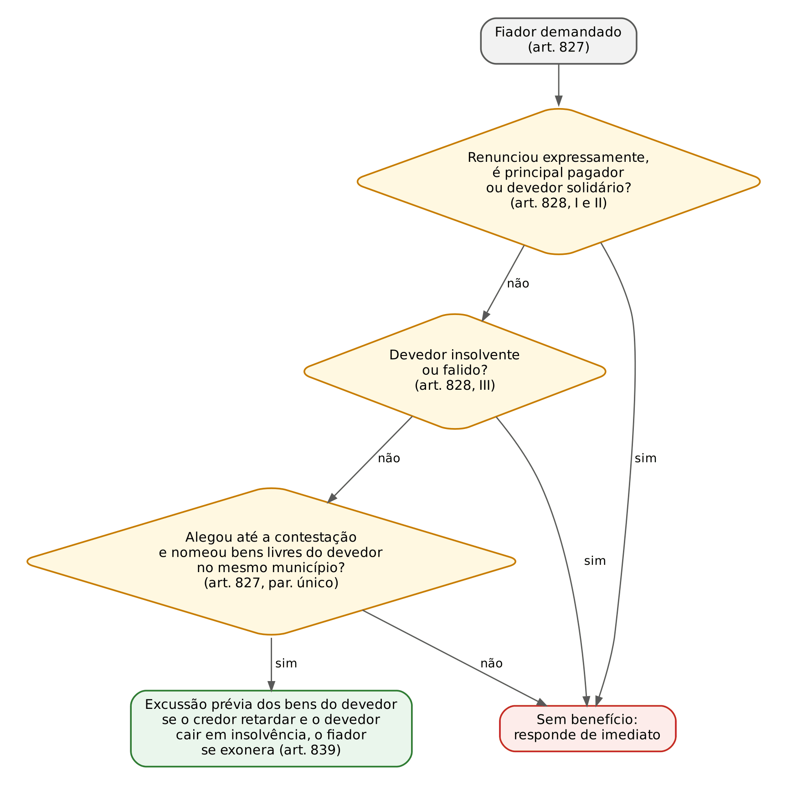
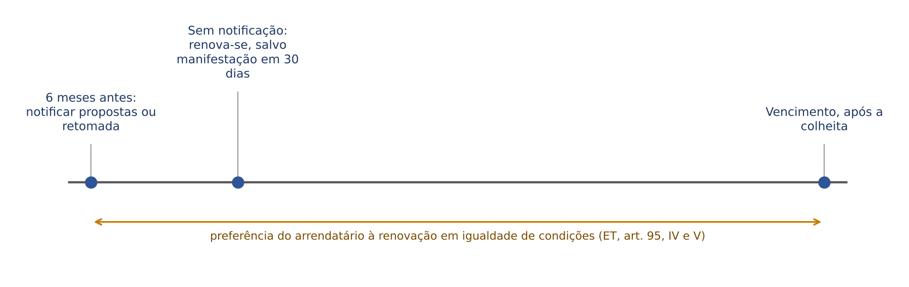

# CAPÍTULO 21 — FIANÇA, CONSTITUIÇÃO DE RENDA, JOGO E APOSTA, TRANSAÇÃO E COMPROMISSO (ARBITRAGEM), ADMINISTRAÇÃO FIDUCIÁRIA DE GARANTIAS, CONTRATOS ATÍPICOS E CONTRATOS AGRÁRIOS

:::INCIDENCIA
TRF5 p. 10; TJRS p. 13; TJSC p. 13; SEFAZ p. 10. Nível B; lote de 13 questões (FGV 12, FCC 1).
O que mais cai: fiança (forma escrita, outorga conjugal e Súmula 332, benefício de ordem, exoneração e Súmula 656), transação (arts. 844, 845, 849 e 850), nulidade da renda do art. 808, jogo lícito no exterior e agente de garantia (art. 853-A).
:::

| Subtema | FGV | FCC | Padrão |
|---|---|---|---|
| Fiança | 6 | 1 | caso com locação; outorga conjugal; forma; benefício de ordem; prorrogação e exoneração |
| Transação | 3 | 0 | evicção da coisa dada (art. 845); nulidade do art. 850; efeitos sobre fiador e solidários (art. 844) |
| Constituição de renda | 1 | 0 | nulidade do art. 808 (30 dias, moléstia preexistente) |
| Jogo e aposta | 1 | 0 | dívida contraída licitamente no exterior: exigível |
| Agente de garantia | 1 | 0 | atua em nome próprio; patrimônio separado; 10 dias úteis; substituição só eficaz com publicidade |

## 21.1 Fiança (arts. 818 a 839 do CC)

### 21.1.1 Natureza e classificação

Pela fiança, uma pessoa garante satisfazer ao credor obrigação assumida pelo devedor, caso este não a cumpra (art. 818). É garantia pessoal (fidejussória): o fiador responde com todo o seu patrimônio, sem vínculo de bem determinado, o que a distingue do penhor e da hipoteca. Na linguagem do binômio débito e responsabilidade, o fiador tem responsabilidade (*Haftung*) sem débito próprio (*Schuld*) (ver Cap. 12).

Classificação: acessória (segue a principal, art. 824), subsidiária (benefício de ordem, art. 827), unilateral (o devedor é terceiro: art. 820), em regra gratuita, formal (art. 819) e *intuitu personae* (recusa do fiador inidôneo e substituição do insolvente ou incapaz: arts. 825 e 826).

:::LEI CC, arts. 819, 820, 821 e 822
Art. 819. A fiança dar-se-á por escrito, e não admite interpretação extensiva.
Art. 820. Pode-se estipular a fiança, ainda que sem consentimento do devedor ou contra a sua vontade.
Art. 821. As dívidas futuras podem ser objeto de fiança; mas o fiador, neste caso, não será demandado senão depois que se fizer certa e líquida a obrigação do principal devedor.
Art. 822. Não sendo limitada, a fiança compreenderá todos os acessórios da dívida principal, inclusive as despesas judiciais, desde a citação do fiador.
:::

Pontos de letra:

- Forma escrita é requisito de VALIDADE, não só de prova: a fiança verbal é nula (forma prescrita em lei, art. 166, IV).
- Interpretação restritiva (art. 819): o fiador responde nos limites do que expressamente garantiu; o STJ consolidou que a responsabilidade do fiador "se resume aos termos do pactuado no ajuste original" (JT do STJ, ed. 101, tese 1). Daí a Súmula 214 do STJ (aditamento sem anuência; ver Cap. 18).
- Fiança ilimitada abrange acessórios e despesas judiciais, mas estas só "desde a citação do fiador" (art. 822): o fiador não paga custas de processo do qual não participou (JT do STJ, ed. 104, tese 10, na locação — ver Cap. 18).
- Fiança de valor menor ou em condições menos onerosas é válida; a que exceder a dívida ou for mais onerosa NÃO é nula: vale "até ao limite da obrigação afiançada" (art. 823). Redução, não invalidade.
- Obrigação nula não admite fiança, salvo se a nulidade resultar apenas de incapacidade pessoal do devedor; essa exceção NÃO abrange o mútuo feito a pessoa com menos de 18 anos sem autorização (art. 824, parágrafo único; art. 588). Coerência com o art. 837 (ver 21.1.6).

:::PEGADINHA
"A fiança depende da anuência do afiançado." Errado: o devedor é estranho ao contrato de fiança, que pode ser estipulado sem seu consentimento ou contra a sua vontade (art. 820). Foi exatamente o gabarito da Q2758993 (FGV 2024, EPE, Advogado: alternativa E), em que a locatária se opusera à fiadora Patrícia. Na mesma questão eram falsas: fiadores respondem por aditamento sem anuência (Súmula 214 do STJ); fiança recíproca é inadmissível (é admitida: JT do STJ, ed. 53, tese 6 — ver Cap. 18); fiança sem outorga conjugal é "mera irregularidade" (Súmula 332); retirada do sócio-fiador exonera automaticamente (não exonera: JT do STJ, ed. 101, tese 10).
:::

:::QUESTAO FGV 2025 — TJ-SE — Juiz Substituto (Q3301230)
Fiança locatícia celebrada VERBALMENTE, com o fiador declarado solidário. Gabarito: B (nula).
Passos: (1) o art. 819 exige forma escrita; (2) inobservada forma prescrita em lei, o negócio é nulo (art. 166, IV); (3) a solidariedade estipulada não supre a forma.
Armadilha: "inexistente" (E) e "ineficaz" (D). O negócio existe (há declaração de vontade), mas é inválido; a ineficácia é a consequência da falta de outorga conjugal (Súmula 332), não da falta de forma.
:::

### 21.1.2 Outorga conjugal: Súmula 332 do STJ

O art. 1.647, III, exige autorização do cônjuge para prestar fiança ou aval, "exceto no regime da separação absoluta" (a convencional; a doutrina e o STJ discutem a extensão à separação obrigatória: ver Cap. 36). A falta de autorização, não suprida pelo juiz, torna o ato ANULÁVEL, podendo o outro cônjuge pleitear a anulação até dois anos depois de terminada a sociedade conjugal (art. 1.649); a aprovação posterior convalida, se por instrumento público ou particular autenticado (art. 1.649, parágrafo único); só o cônjuge que deveria autorizar, ou seus herdeiros, tem legitimidade (art. 1.650).

:::JURIS STJ, Súmula 332
"A fiança prestada sem autorização de um dos cônjuges implica a ineficácia total da garantia."
:::

Leitura de prova da Súmula 332:

- Ineficácia TOTAL: não se preserva a meação do fiador. Errada a tese da ineficácia "relativa, atingindo apenas a meação" (alternativa D da Q3505760).
- Exceção jurisprudencial: o fiador que emite declaração falsa, ocultando o estado de casado, não pode invocar a ausência de outorga (boa-fé objetiva, *venire contra factum proprium*; a vedação consta das teses do STJ sobre fiança — JT do STJ, ed. 101, segundo a divulgação oficial da edição).
- Legitimidade: a invalidade só pode ser demandada pelo cônjuge que não a subscreveu ou por seus herdeiros (art. 1.650; JT do STJ, ed. 101, tese 9). O próprio fiador não pode alegar a falta de outorga para se livrar, salvo na posição de herdeiro do cônjuge preterido.
- União estável: a fiança prestada por companheiro sem a anuência do outro NÃO é nula nem anulável (JT do STJ, ed. 101, tese 8).
- Regime da comunhão universal NÃO dispensa a outorga: a dispensa é só na separação absoluta (Q4150712, FGV 2026, TJ-SC, Analista: a alternativa C, que validava a fiança pela comunhão universal, estava errada).
- Tensão terminológica: a lei fala em anulabilidade (art. 1.649); a súmula, em ineficácia total. Em prova, siga o enunciado: se perguntar "segundo o STJ", ineficácia total; se perguntar "segundo o CC", anulável no prazo de dois anos. A FGV às vezes chama de "nulidade" (Q3914481, abaixo) e de "nula" (Q3324232, ver Cap. 15).

:::QUESTAO FGV 2025 — TJ-CE — Juiz Substituto (Q3505760)
Locação com fiador casado em comunhão parcial, sem outorga da esposa; aditamento (prorrogação e aumento do aluguel) sem anuência do fiador; único imóvel do fiador, onde reside. Gabarito: C (a falta de outorga torna a fiança totalmente ineficaz, salvo se o fiador emitiu declaração falsa ocultando o estado civil).
Erradas: A e E (a penhora do bem de família do fiador locatício é válida: Súmula 549 do STJ e Tema 1.127 do STF — ver Cap. 40); B (fiador não responde por aditamento ao qual não anuiu: Súmula 214 — ver Cap. 18); D (a ineficácia não é parcial, limitada à meação).
:::

:::QUESTAO FGV 2026 — TJ-MS — Outorga de Delegações (Q3914481)
Caio, casado em comunhão parcial, afiança a locação da mãe; a esposa recusa a outorga; inadimplência; penhora do imóvel residencial de propriedade exclusiva de Caio. Gabarito: B (penhora plenamente inválida, como consequência da "nulidade" da fiança sem outorga).
Passos: (1) a penhora não cai por ser bem de família (o fiador locatício não tem essa proteção: Súmula 549 do STJ); (2) cai porque o título que a fundamenta, a fiança, não produz efeito algum sem a outorga (Súmula 332); (3) ser o bem particular do fiador é irrelevante: a exigência do art. 1.647, III, independe do bem que venha a responder.
Armadilhas: C e E (validade por ser bem exclusivo de Caio) e D (reserva de valor para outro bem de família). A banca disse "nulidade"; ver a tensão terminológica acima.
:::

No mesmo sentido, com a promessa de que a esposa daria a vênia depois (art. 439, parágrafo único): Q3324232 (FGV 2025, TJ-SC, Juiz Substituto — box no Cap. 15).

### 21.1.3 Benefício de ordem (excussão)

:::LEI CC, arts. 827 e 828
Art. 827. O fiador demandado pelo pagamento da dívida tem direito a exigir, até a contestação da lide, que sejam primeiro executados os bens do devedor.
Parágrafo único. O fiador que alegar o benefício de ordem, a que se refere este artigo, deve nomear bens do devedor, sitos no mesmo município, livres e desembargados, quantos bastem para solver o débito.
Art. 828. Não aproveita este benefício ao fiador:
I - se ele o renunciou expressamente;
II - se se obrigou como principal pagador, ou devedor solidário;
III - se o devedor for insolvente, ou falido.
:::

- O benefício decorre da LEI; a cláusula que o prevê só o reafirma (Q3692413, FGV 2025, ENAM: "existiria independentemente de cláusula expressa" — box no Cap. 11). A renúncia é que precisa ser expressa.
- Momento: "até a contestação da lide". Alegado depois, preclui. No CPC, o fiador executado pode indicar bens do devedor situados na mesma comarca, livres e desembargados (art. 794 do CPC), e o fiador que paga pode executar o afiançado nos autos do mesmo processo (art. 794, § 2º, do CPC — ver Cap. 13).
- Risco do credor que retarda (art. 839): invocado o benefício, se o credor demora a execução e o devedor cai em insolvência, o fiador fica exonerado, provando que os bens indicados eram suficientes ao tempo da penhora. O fiador pode, ainda, promover o andamento da execução demorada sem justa causa (art. 834).
- Contrato de adesão: é nula a cláusula de renúncia antecipada ao benefício de ordem inserida em contrato de adesão (Enunciado 364 da IV Jornada de Direito Civil), por aplicação do art. 424 do CC (renúncia antecipada a direito resultante da natureza do negócio — ver Cap. 15). Na locação comum, porém, a renúncia é amplamente aceita.
- Fiador que renunciou ao benefício ou se declarou principal pagador NÃO ganha legitimidade para revisar o contrato principal: o STJ afirmou que o fiador não tem legitimidade ativa para revisar, em nome próprio, cláusulas do contrato principal, dada a natureza acessória da fiança, sendo irrelevantes essas qualificações (STJ, REsp 1.977.431-RS, Quarta Turma, j. 22/6/2026, Info 898). Ele pode, contudo, opor as exceções do art. 837 quando demandado.

:::QUESTAO FCC 2024 — Prefeitura de Jaboatão dos Guararapes — Procurador (Q3542125)
Assertivas sobre fiança no CC e nas súmulas do STJ. Gabarito: D (é válida a cláusula de prorrogação automática da fiança em caso de renovação do contrato principal — Súmula 656 do STJ).
Erros: A inverte o art. 837 (o fiador PODE opor as exceções extintivas do devedor, salvo as de mera incapacidade pessoal); B contraria o art. 838, I (moratória sem consentimento desobriga o fiador "ainda que solidário"); C contraria o art. 836 (a obrigação passa aos herdeiros, limitada às forças da herança e ao tempo até a morte); E contraria o art. 828, III (insolvência ou falência do devedor afasta o benefício).
:::

### 21.1.4 Pluralidade de fiadores: solidariedade e benefício de divisão

- Cofiança: vários fiadores do mesmo débito são SOLIDÁRIOS entre si, se não reservarem declaradamente o benefício de divisão (art. 829). A solidariedade aqui é legal (ver Cap. 12), mas é entre os fiadores, não entre fiador e devedor.
- Benefício de divisão estipulado: cada fiador responde só pela parte que proporcionalmente lhe couber (art. 829, parágrafo único). Fiança limitada: cada fiador pode fixar a parte da dívida que garante (art. 830).
- Fiador que paga integralmente sub-roga-se nos direitos do credor, mas só cobra de cada cofiador a respectiva quota; a parte do insolvente reparte-se entre os demais (art. 831). Além disso, o devedor responde perante o fiador por todas as perdas e danos que pagar ou sofrer em razão da fiança (art. 832), e o fiador tem juros do desembolso pela taxa da obrigação principal ou, à falta, pelos juros legais da mora (art. 833; taxa legal após a Lei 14.905/2024 — ver Cap. 14).
- Fiador e devedor NÃO são solidários por força de lei no CC (Q3745584, FCC 2025, PGE-TO: a alternativa "solidariedade legal nas obrigações decorrentes de fiança regulada pelo CC" estava errada).
- O fiador é terceiro INTERESSADO (art. 346, III; Q3745583, FCC 2025, PGE-TO — ver Cap. 13).

### 21.1.5 Exoneração (art. 835), prorrogação e Súmula 656

:::LEI CC, art. 835
Art. 835. O fiador poderá exonerar-se da fiança que tiver assinado sem limitação de tempo, sempre que lhe convier, ficando obrigado por todos os efeitos da fiança, durante sessenta dias após a notificação do credor.
:::

- Só a fiança "sem limitação de tempo" admite exoneração unilateral (resilição). Fiança por prazo determinado obriga até o termo: na locação por prazo determinado, a notificação pode ser enviada na vigência, mas a exoneração só opera ao término do prazo ou 120 dias após a indeterminação (STJ, REsp 2.121.585-PR, j. 14/5/2024, Info 812 — desenvolvido no Cap. 18).
- Prazo de sujeição pós-notificação: 60 dias no CC (art. 835); 120 dias na locação de imóvel urbano (art. 40, X, da Lei 8.245/1991 — ver Cap. 18).
- A notificação é receptícia: o prazo conta da notificação AO CREDOR. Extraviada por erro do fiador (endereço errado), não há exoneração (Q3049925, abaixo).
- A retirada do sócio-fiador da sociedade afiançada não exonera automaticamente: é preciso notificar ou ajuizar ação de exoneração (JT do STJ, ed. 101, tese 10).
- Alteração da obrigação principal sem consentimento do fiador: a exoneração é automática, sem o prazo de 60 ou 120 dias do art. 835 (Enunciado 547 da VI Jornada de Direito Civil). Coerente com a interpretação restritiva (art. 819) e com o art. 366 (novação sem consenso do fiador o exonera — ver Cap. 13; Q3865816 e Q3660525).
- Morte do fiador: a obrigação passa aos herdeiros, limitada ao tempo decorrido até a morte e às forças da herança (art. 836). Não gera vencimento antecipado automático da dívida (Q3117512, FGV 2024, TJ-PE — ver Cap. 13); na locação, autoriza o locador a exigir substituição (art. 40, I, da Lei 8.245).

:::JURIS STJ, Súmula 656 (j. 9/11/2022)
"É válida a cláusula de prorrogação automática de fiança na renovação do contrato principal. A exoneração do fiador depende da notificação prevista no art. 835 do Código Civil."
:::

A súmula generalizou o que o STJ afirmava para contratos bancários (JT do STJ, ed. 104, tese 11). Prorrogação automática pactuada não é "aditamento" (Súmula 214): o fiador anuiu antecipadamente, e sua proteção é notificar. Cobrada em Q3542125 (FCC, acima) e em Q4102107 (FGV 2026, TJ-BA, Juiz Leigo: gabarito A, com a responsabilidade por 60 dias após a notificação — na locação urbana o prazo legal é de 120 dias, razão pela qual o gabarito é discutível; análise no box do Cap. 18).

:::QUESTAO FGV 2024 — Prefeitura de Macaé — Procurador (Q3049925)
Fiador casado em comunhão parcial (sem outorga, segundo a premissa da banca) de locação comercial; cláusula de responsabilidade até a entrega das chaves, sem renúncia ao benefício de ordem; locação prorrogada por prazo indeterminado; notificação exoneratória extraviada porque o próprio fiador indicou endereço errado. Gabarito: D (II e III corretas).
Item I (falso): não há exoneração sem recebimento da notificação pelo credor; o prazo de sujeição corre da notificação, que é receptícia (art. 835; na locação, art. 40, X, da Lei 8.245, 120 dias).
Item II (verdadeiro): não renunciado, o benefício de ordem pode ser exigido até a contestação (art. 827).
Item III (verdadeiro): mesmo sem exoneração, o fiador não paga, porque a falta de outorga implica a ineficácia total (Súmula 332).
:::

### 21.1.6 Exceções oponíveis e extinção (arts. 837 a 839)

:::LEI CC, arts. 837 e 838
Art. 837. O fiador pode opor ao credor as exceções que lhe forem pessoais, e as extintivas da obrigação que competem ao devedor principal, se não provierem simplesmente de incapacidade pessoal, salvo o caso do mútuo feito a pessoa menor.
Art. 838. O fiador, ainda que solidário, ficará desobrigado:
I - se, sem consentimento seu, o credor conceder moratória ao devedor;
II - se, por fato do credor, for impossível a sub-rogação nos seus direitos e preferências;
III - se o credor, em pagamento da dívida, aceitar amigavelmente do devedor objeto diverso do que este era obrigado a lhe dar, ainda que depois venha a perdê-lo por evicção.
:::

- Exceções pessoais do fiador (nulidade da própria fiança, falta de outorga, compensação com crédito próprio contra o credor — art. 371) e exceções extintivas do devedor (pagamento, prescrição, novação, compensação). A incapacidade pessoal do devedor NÃO aproveita ao fiador (ele garante justamente contra esse risco), salvo o mútuo a pessoa com menos de 18 anos (art. 588).
- "Ainda que solidário" (art. 838, caput): a solidariedade e a renúncia ao benefício de ordem não afastam as causas de desobrigação.
- Moratória: é a concessão de prazo novo ao devedor; segundo a doutrina, mera tolerância no recebimento não é moratória; o parcelamento formal sem anuência do fiador o desobriga.
- Dação em pagamento com posterior evicção: a obrigação primitiva se restabelece entre credor e devedor (art. 359), mas a fiança NÃO renasce (art. 838, III; ver Cap. 13).
- Transação entre credor e devedor desobriga o fiador (art. 844, § 1º — ver 21.4).
- Prescrição: a interrupção produzida contra o principal devedor prejudica o fiador (art. 204, § 3º; Q4066823, FCC 2026, SEFAZ-GO; Q4012598, FCC 2026, DPE-MA; Q3593761, FGV 2025, TCE-PE; Q2564474, FCC 2024, TRF3 — desenvolvido no Cap. 11), com a ressalva da locação: o fiador não citado no despejo não é atingido (ver Cap. 18).

### 21.1.7 Interfaces

Fiança locatícia: Cap. 18; bem de família do fiador: Cap. 40. Fiança x aval: a fiança é acessória e subsidiária, com benefício de ordem; o aval é cambial, autônomo e solidário; ambos constam do art. 1.647, III. Fiança bancária e seguro-garantia na execução: matéria processual e tributária.

:::SENTENCA Fiança: roteiro na cobrança contra o fiador
Ordem de exame: (1) forma e outorga; (2) limites da garantia (aditamento, prorrogação, exoneração recebida); (3) causas de desobrigação; (4) benefício de ordem; (5) despesas só desde a citação do fiador (art. 822).
Modelo: "A fiança foi prestada por escrito, com a outorga do cônjuge do réu, e contém cláusula de prorrogação automática com a renovação do contrato principal, válida nos termos da Súmula 656 do STJ. A notificação exoneratória não chegou ao credor, de modo que não se iniciou o prazo do art. 835 do Código Civil. Tendo o fiador se obrigado como principal pagador e devedor solidário (art. 828, II), JULGO PROCEDENTE o pedido para condenar o fiador, solidariamente com o afiançado, ao pagamento de [valor], com despesas judiciais contadas da sua citação (art. 822)."
:::

## 21.2 Constituição de renda (arts. 803 a 813)

Contrato pelo qual uma pessoa (rendeiro ou censuário) se obriga a uma prestação periódica em favor de outra (credor ou rentista) ou de terceiro. Pode ser gratuito (art. 803) ou oneroso, quando o instituidor entrega bens móveis ou imóveis ao rendeiro (art. 804). É contrato aleatório quando vitalício (ver Cap. 15) e, no CC/2002, pessoal: o direito real de "rendas constituídas sobre imóveis" do CC/1916 não foi reproduzido.

| Ponto | Regra | Artigo |
|---|---|---|
| Forma | Escritura pública, sempre (gratuita ou onerosa) | 807 |
| Garantia | No oneroso, o credor PODE exigir garantia real ou fidejussória: faculdade, não requisito de validade | 805 |
| Duração | Prazo certo ou por vida; pode ultrapassar a vida do DEVEDOR, mas não a do CREDOR (contratante ou terceiro) | 806 |
| Nulidade | Em favor de pessoa já falecida, ou que, nos 30 dias seguintes, vier a falecer de moléstia que já sofria ao tempo do contrato | 808 |
| Domínio dos bens | Passam ao rendeiro desde a tradição | 809 |
| Inadimplemento | Credor pode cobrar atrasadas e exigir garantias das futuras, sob pena de rescisão | 810 |
| Aquisição da renda | Dia a dia, se não for paga adiantada no começo de cada período | 811 |
| Vários beneficiários | Direitos iguais; salvo estipulação, NÃO há acréscimo aos sobreviventes | 812 |
| Impenhorabilidade | Renda gratuita pode ser isentada de execuções pelo instituidor; de pleno direito em montepios e pensões alimentícias | 813 |

A lógica do art. 808: no contrato vitalício, a álea é a duração da vida do credor; se ele já está condenado por moléstia preexistente, não há risco real, e o negócio serve de fraude (transferência de bens com contraprestação fictícia). Os dois requisitos são cumulativos: morte em 30 dias E moléstia que já sofria. Morte por acidente no 10º dia não anula.

:::QUESTAO FGV 2026 — ENAC — Exame Nacional dos Cartórios (Q4130155)
Carlos transfere imóvel de alto valor a Helena, por escritura pública, obrigando-se ela a pagar renda mensal a Ana, terceira gravemente enferma, que morre 20 dias depois da moléstia preexistente; não se exigiu garantia. Gabarito: A (negócio nulo, art. 808).
Erradas: B (garantia do art. 805 é faculdade do credor, não requisito de validade); C (o estado de saúde do beneficiário é decisivo); D (a escritura pública é requisito de forma, art. 807, e não sana a nulidade do art. 808); E (o domínio passa ao rendeiro desde a tradição, art. 809; não há reserva de domínio).
:::

## 21.3 Jogo e aposta (arts. 814 a 817)

A natureza (obrigação natural: inexigível, mas o pagamento voluntário não se repete) e as exceções à irrepetibilidade (dolo do ganhador; perdente "menor ou interdito") estão no Cap. 12. Aqui, o regime contratual:

:::LEI CC, arts. 814, §§ 1º a 3º, e 815
§ 1º Estende-se esta disposição a qualquer contrato que encubra ou envolva reconhecimento, novação ou fiança de dívida de jogo; mas a nulidade resultante não pode ser oposta ao terceiro de boa-fé.
§ 2º O preceito contido neste artigo tem aplicação, ainda que se trate de jogo não proibido, só se excetuando os jogos e apostas legalmente permitidos.
§ 3º Excetuam-se, igualmente, os prêmios oferecidos ou prometidos para o vencedor em competição de natureza esportiva, intelectual ou artística, desde que os interessados se submetam às prescrições legais e regulamentares.
Art. 815. Não se pode exigir reembolso do que se emprestou para jogo ou aposta, no ato de apostar ou jogar.
:::

Três categorias que a banca confunde:

| Categoria | Exemplo | Efeito |
|---|---|---|
| Jogo proibido | Jogo de azar ilícito (contravenção) | Obrigação natural (art. 814, caput) |
| Jogo tolerado (não proibido, mas não autorizado) | Jogo entre amigos, sem banca | TAMBÉM obrigação natural (art. 814, § 2º: "ainda que se trate de jogo não proibido") |
| Jogo legalmente permitido | Loterias oficiais; apostas de quota fixa autorizadas (Lei 14.790/2023); prêmios em competições esportivas, intelectuais ou artísticas (§ 3º) | Obrigação civil plena, exigível |

- Contratos acessórios (reconhecimento, novação, fiança) de dívida de jogo também são inexigíveis (§ 1º); mas a "nulidade" não se opõe ao terceiro de boa-fé (por exemplo, endossatário de cheque dado em pagamento).
- Empréstimo para jogo: inexigível só o emprestado "no ato de apostar ou jogar" (art. 815), isto é, ao jogador, no momento e para o jogo. O empréstimo feito antes, por quem não participa do jogo, é mútuo comum.
- Contratos diferenciais sobre títulos de bolsa, mercadorias ou valores, liquidados pela diferença de cotação, não são jogo (art. 816): são exigíveis.
- Sorteio para dirimir questões ou dividir coisas comuns vale como partilha ou transação (art. 817).

O STJ admite a cobrança, no Brasil, de dívida de jogo contraída por brasileiro em cassino que funciona licitamente no exterior: a obrigação rege-se pela lei do lugar em que se constituiu (art. 9º da LINDB), não há ofensa à ordem pública (art. 17 da LINDB), pois o próprio art. 814, § 2º, admite jogos legalmente permitidos, e a recusa geraria enriquecimento sem causa (STJ, REsp 1.891.844-SP, Quarta Turma, j. 13/5/2025, Info 852; no mesmo sentido, REsp 1.628.974-SP, Terceira Turma, j. 13/6/2017, Info 610).

:::QUESTAO FGV 2024 — TJ-MT — Juiz Substituto (Q3086914)
Brasileiro joga licitamente em cassinos de Las Vegas, perde e emite cheques de banco americano sem fundos; o cassino executa no Brasil. Gabarito: A (obrigação válida, eficaz e exigível).
Passos: (1) a questão é de direito internacional privado: lei do lugar da constituição (art. 9º da LINDB); (2) lá o jogo é lícito; (3) não há ofensa à ordem pública brasileira, que admite jogos autorizados (art. 814, § 2º). Armadilha: E (obrigação natural), que aplica o art. 814, caput, como se o jogo fosse no Brasil.
:::

Correlata: Q2507039 (FGV 2024, ENAM reaplicação): empréstimo de cartão de crédito a amigo para aposta em site de país onde é legal; gabarito A (a quantia é devida com juros após 30 dias do mútuo, art. 592, II; a multa não, por falta de previsão). O empréstimo não foi feito "no ato de apostar" pelo parceiro de jogo, e a aposta era lícita no lugar: não incide o art. 815.

## 21.4 Transação (arts. 840 a 850)

### 21.4.1 Conceito, objeto e forma

Transação é o negócio jurídico pelo qual os interessados previnem ou terminam litígio mediante concessões MÚTUAS (art. 840). Sem reciprocidade, há renúncia ou reconhecimento do pedido, não transação. No CC/2002 é contrato típico (no CC/1916 era modo de extinção das obrigações), embora produza efeito extintivo.

| Ponto | Regra | Artigo |
|---|---|---|
| Objeto | SÓ direitos patrimoniais de caráter privado | 841 |
| Forma | Escritura pública quando a lei a exigir; instrumento particular quando admitido; direitos contestados em juízo: escritura pública ou termo nos autos assinado pelos transigentes e homologado | 842 |
| Interpretação | Restritiva; não transmite, apenas declara ou reconhece direitos (natureza declaratória) | 843 |
| Evicção | Não revive a obrigação extinta; o evicto tem perdas e danos | 845 |
| Delito | Não extingue a ação penal pública | 846 |
| Indivisibilidade | Nula uma cláusula, nula a transação; salvo direitos independentes entre si | 848 |
| Anulação | Só dolo, coação ou erro essencial quanto à pessoa ou coisa controversa; NÃO por erro de direito sobre a questão controvertida | 849 |

:::LEI CC, arts. 844 e 850
Art. 844. A transação não aproveita, nem prejudica senão aos que nela intervierem, ainda que diga respeito a coisa indivisível.
§ 1º Se for concluída entre o credor e o devedor, desobrigará o fiador.
§ 2º Se entre um dos credores solidários e o devedor, extingue a obrigação deste para com os outros credores.
§ 3º Se entre um dos devedores solidários e seu credor, extingue a dívida em relação aos co-devedores.
Art. 850. É nula a transação a respeito do litígio decidido por sentença passada em julgado, se dela não tinha ciência algum dos transatores, ou quando, por título ulteriormente descoberto, se verificar que nenhum deles tinha direito sobre o objeto da transação.
:::

### 21.4.2 Distinções de prova

| | Transação com evicção (art. 845) | Dação com evicção (art. 359) |
|---|---|---|
| Obrigação original | NÃO revive | Restabelece-se |
| Remédio do evicto | Perdas e danos | Cobrar a obrigação primitiva |
| Fiador | Já desobrigado pela transação (art. 844, § 1º) | Não renasce a fiança (art. 838, III) |
| Razão | A transação é declaratória e põe fim à incerteza; reabrir o litígio a frustraria | A dação é pagamento; sem a coisa, não houve pagamento |

- Defeitos: a transação NÃO se anula por lesão nem por estado de perigo segundo a letra do art. 849, que é taxativo (só dolo, coação e erro de fato essencial). Parte da doutrina admite a lesão pela cláusula geral do art. 157; em prova objetiva, siga a letra.
- Erro de direito (art. 849, parágrafo único) x erro de direito como defeito em geral (art. 139, III): na transação, ele não anula quanto às questões controvertidas, porque transigir é justamente aceitar o risco sobre o direito discutido.
- Nulidade de uma cláusula contamina toda a transação (art. 848): a FGV cobrou exatamente isso ao perguntar em que contratos a nulidade de uma cláusula invalida o todo, em contraste com o art. 51, § 2º, do CDC (Q3786335, FGV 2025, TJ-MS, Juiz Substituto: gabarito D, "de transação").

### 21.4.3 Efeitos sobre terceiros: fiador e solidários

O art. 844 abre exceções à relatividade justamente onde a obrigação tem pluralidade de sujeitos: fiador (§ 1º), credores solidários (§ 2º) e devedores solidários (§ 3º). Duas observações de prova:

- O § 1º pressupõe transação entre credor e DEVEDOR sobre a dívida afiançada. Se a transação é entre terceiros que disputam a titularidade do crédito, o fiador não é atingido (é estranho ao acordo: caput).
- O § 3º convive com o art. 388 (remissão a um devedor solidário só extingue a dívida na parte dele) e com o art. 277 (pagamento parcial e remissão aproveitam aos codevedores até a concorrência da quantia paga ou relevada). Quando a quitação a um codevedor ressalva expressamente os demais, aplica-se a lógica dos arts. 277 e 388: os outros respondem pelo saldo, abatida a parte quitada.

:::QUESTAO FGV 2025 — MPE-RJ — Analista do MP, Área Processual (Q3362519)
Dívida de 100.000 (cem mil) reais; acordo: 50.000 (cinquenta mil) reais em dinheiro e um veículo para quitar o restante; dois meses depois, terceiro reivindica e obtém o veículo. Pedro quer reaver o crédito integral. Gabarito: A (João indeniza a evicção; a transação continua válida e a obrigação extinta não se restabelece).
Passos: (1) houve concessões recíprocas em acordo que pôs fim à dívida: transação, não simples dação; (2) art. 845: a evicção não revive a obrigação extinta; (3) o evicto tem perdas e danos. Armadilhas: C (restabelecimento da dívida: é o regime da DAÇÃO, art. 359); D (exige dolo para indenizar: o art. 845 não exige); E (a transação não é oponível ao terceiro proprietário).
:::

:::QUESTAO FGV 2026 — TJ-MS — Outorga de Delegações (Q3914501)
Transação homologada sobre a titularidade de crédito; depois se descobre sentença transitada anterior, que ambos desconheciam, segundo a qual nenhum deles era titular; um transator pretende efeitos automáticos sobre o fiador e os coobrigados solidários do contrato originário. Gabarito: B (transação nula; e ainda que válida não produziria efeitos automáticos sobre fiadores e coobrigados estranhos ao acordo).
Passos: (1) art. 850: litígio já decidido por sentença transitada desconhecida, e ainda nenhum dos transatores tinha direito: nulidade (não anulabilidade); (2) art. 844, caput: a transação só atinge quem dela participou. Armadilhas: A e C (tratam o caso como erro de direito do art. 849, parágrafo único, que gera, no máximo, discussão de anulabilidade); D e E (validade). Atenção: o § 1º do art. 844 (desobriga o fiador) não incidia porque a transação não foi entre credor e devedor da obrigação afiançada.
:::

:::QUESTAO FGV 2024 — Câmara dos Deputados — Consultor Legislativo (Q2510972)
Vazamento após explosão de navio; vítimas fazem acordo com a armadora, dão quitação plena "para nada mais dela reclamar", ressalvando expressamente o terminal portuário; depois acionam só o terminal. Gabarito: C (somente III: o terminal pode exigir que a quitação lhe aproveite até a concorrência da quantia paga).
Item I (falso): o terminal não continua devedor da integralidade; abate-se o que foi pago (arts. 277 e 388). Item II (falso): demandar um só devedor não importa renúncia à solidariedade (art. 275, parágrafo único). Item III (verdadeiro). Nota: a ressalva expressa afasta a extinção total do art. 844, § 3º, que pressupõe transação sobre a dívida inteira sem reserva.
:::

## 21.5 Compromisso (arts. 851 a 853) e arbitragem nos aspectos civis

### 21.5.1 O CC e a Lei 9.307/1996

O CC trata o compromisso como contrato típico e remete à lei especial (art. 853). Os pontos de letra do CC:

- Admitido compromisso judicial ou extrajudicial entre "pessoas que podem contratar" (art. 851).
- VEDADO para questões de estado, de direito pessoal de família e outras sem caráter estritamente patrimonial (art. 852). Alimentos, guarda, filiação e estado civil não vão à arbitragem; os efeitos patrimoniais disponíveis (partilha de bens) podem ir.
- Cláusula compromissória admitida nos contratos (art. 853).

:::LEI Lei 9.307/1996, art. 4º, § 2º
§ 2º Nos contratos de adesão, a cláusula compromissória só terá eficácia se o aderente tomar a iniciativa de instituir a arbitragem ou concordar, expressamente, com a sua instituição, desde que por escrito em documento anexo ou em negrito, com a assinatura ou visto especialmente para essa cláusula.
:::

Arbitragem só para litígios relativos a direitos patrimoniais disponíveis, entre pessoas capazes de contratar (art. 1º); a convenção de arbitragem é gênero, com duas espécies: cláusula compromissória e compromisso arbitral (art. 3º).

### 21.5.2 Cláusula compromissória x compromisso arbitral

| | Cláusula compromissória | Compromisso arbitral |
|---|---|---|
| Momento | Antes do litígio, para litígios futuros do contrato | Litígio já existente |
| Forma | Escrita, no contrato ou em documento apartado (art. 4º, § 1º) | Judicial: termo nos autos; extrajudicial: escrito particular com duas testemunhas ou instrumento público (art. 9º) |
| Conteúdo | Basta a vontade de arbitrar | Requisitos obrigatórios do art. 10 (partes, árbitros ou entidade, matéria, lugar da sentença) |
| Autonomia | Autônoma em relação ao contrato: a nulidade deste não a contamina necessariamente (art. 8º) | — |

- Cláusula CHEIA: contém os elementos para instituir a arbitragem (remete a regras de órgão arbitral institucional ou fixa a forma de instituição — art. 5º): a arbitragem se instala sem intervenção judicial.
- Cláusula VAZIA (em branco): só prevê a arbitragem; havendo resistência, a parte interessada requer a citação da outra para lavrar o compromisso em juízo (arts. 6º e 7º); a sentença que julga procedente o pedido vale como compromisso (art. 7º, § 7º); ausência injustificada do autor extingue o processo; do réu, o juiz estatui o compromisso e nomeia árbitro único (art. 7º, §§ 5º e 6º).
- *Kompetenz-Kompetenz*: cabe ao árbitro decidir, de ofício ou por provocação, sobre existência, validade e eficácia da convenção e do contrato que contém a cláusula (art. 8º, parágrafo único); o STJ reconhece a primazia do juízo arbitral nessas questões (JT do STJ, ed. 122, tese 3), admitindo apenas que o Judiciário declare, em situações excepcionais, a nulidade de cláusula "claramente ilegal" (patológica) (JT do STJ, ed. 122, tese 4).
- Medidas de urgência antes de instituída a arbitragem podem ser pedidas ao Judiciário (art. 22-A), cessando a eficácia se a arbitragem não for requerida em 30 dias da efetivação; instituída, os árbitros mantêm, modificam ou revogam a medida (art. 22-B). O prévio ajuizamento da medida de urgência não afasta a cláusula (JT do STJ, ed. 122, tese 6).
- Prescrição: a instituição da arbitragem a interrompe, retroagindo à data do requerimento, ainda que extinta por ausência de jurisdição (art. 19, § 2º, incluído pela Lei 13.129/2015); o STJ aplicou a interrupção mesmo antes dessa lei (STJ, REsp 1.981.715-GO, j. 17/9/2024, Info 826).
- Sentença arbitral: o árbitro é juiz de fato e de direito, sem recurso nem homologação (art. 18); a sentença condenatória é título executivo (art. 31; título judicial no CPC). O árbitro não pratica atos executivos (JT do STJ, ed. 122, tese 7). Nulidade (art. 32) por ação no prazo de 90 dias do recebimento da notificação da sentença (art. 33, § 1º) ou na impugnação ao cumprimento (art. 33, § 3º).
- Direito intertemporal: a Lei de Arbitragem aplica-se aos contratos com cláusula arbitral celebrados antes de sua edição (Súmula 485 do STJ).
- Vinculação de terceiros: adquirente de cotas ou ações adere à cláusula do contrato social ou estatuto (Enunciado 16 da I Jornada de Direito Comercial); condômino que ingressa no condomínio fica vinculado à cláusula arbitral da convenção (JT do STJ, ed. 122, tese 12); a União sucessora de sociedade que pactuou a cláusula não pode descumpri-la (REsp 2.143.882-SP; o fundamento do *venire contra factum proprium* está no Cap. 15).

:::PEGADINHA
Arbitragem e consumidor: o CDC (art. 51, VII) torna nula a cláusula que determine a utilização COMPULSÓRIA de arbitragem; o STJ entende que a legislação consumerista impede a adoção prévia e compulsória, mas não proíbe que, surgido o litígio, as partes instaurem consensualmente a arbitragem (JT do STJ, ed. 122, tese 11). O art. 4º, § 2º, da Lei 9.307 (adesão) e o art. 51, VII, do CDC (consumo) são regimes distintos: o primeiro vale para qualquer contrato de adesão, inclusive empresarial; o segundo, só para relação de consumo (desenvolvimento na Apostila de Direito do Consumidor).
:::

## 21.6 Contrato de administração fiduciária de garantias (art. 853-A, Lei 14.711/2023)

A Lei 14.711/2023 (marco legal das garantias) incluiu o Capítulo XXI no Título VI do Livro I da Parte Especial, com um único artigo. A figura vem do mercado de crédito sindicado: vários credores designam um AGENTE DE GARANTIA que constitui, registra, administra e executa a garantia em favor de todos, evitando que cada credor tenha de agir isoladamente. O restante da Lei 14.711 (alienação fiduciária, execução extrajudicial, hipoteca) fica nos Caps. 22 e 32.

Ficha de consulta (letra do art. 853-A conferida):

| Elemento | Regra |
|---|---|
| Objeto | "Qualquer garantia" (real ou fiduciária; a letra não exclui as pessoais) |
| Designação | Pelos credores da obrigação garantida |
| Atuação | Em NOME PRÓPRIO e em benefício dos credores (legitimação extraordinária), inclusive em ações sobre existência, validade ou eficácia do crédito garantido |
| Cláusula vedada | A que afaste essa regra em desfavor do devedor ou do terceiro garantidor |
| Execução extrajudicial | Possível quando a lei especial da modalidade a preveja (§ 1º) |
| Dever | Fiduciário perante os credores; responde por todos os seus atos (§ 2º) |
| Substituição | A qualquer tempo, por credor único ou maioria SIMPLES dos créditos em assembleia; eficácia só após publicidade pela mesma forma da garantia (§ 3º); convocação e instalação previstas no ato de designação (§ 4º) |
| Produto da garantia | Patrimônio separado, imune às obrigações do agente por até 180 dias do recebimento (§ 5º) |
| Repasse | 10 dias úteis (§ 6º) |
| Contratos paralelos com o devedor | Pesquisa de crédito, formalização, intermediação, outros serviços não vedados (§ 7º), com estrita boa-fé perante o devedor (§ 8º) |

:::QUESTAO FGV 2026 — ENAM 2026.1 (Q4102452)
Crédito sindicado de três bancos com alienação fiduciária de imóvel e cessão fiduciária de recebíveis; agente de garantia designado; ele executa extrajudicialmente, não repassa em 10 dias úteis, sofre execução de credor próprio que pede penhora do produto, e é substituído por maioria simples sem publicidade. Gabarito: E (atua em nome próprio, com legitimidade para execução judicial ou extrajudicial; o produto constitui patrimônio separado e não responde por suas obrigações pelo prazo legal).
Erradas: A (penhorabilidade do produto: contraria o § 5º); B (ilegitimidade do agente: contraria o caput e o § 1º); C (substituição eficaz sem publicidade: contraria o § 3º, eficácia só após publicidade); D (extinção automática pelo atraso: a lei prevê responsabilidade e substituição, não extinção automática).
:::

Correlata: Q3328201 (FGV 2025, ENAC, 1º Exame — ver Cap. 33): a legitimidade do agente de garantia decorre da lei e do ato de designação; sua oponibilidade NÃO depende de registro (gabarito E: dependia de registro só a preferência do locatário). O que precisa de publicidade é a SUBSTITUIÇÃO do agente (§ 3º).

## 21.7 Contratos atípicos (art. 425)

O art. 425 permite estipular contratos atípicos, "observadas as normas gerais fixadas neste Código" (Q4221398, FCC 2026, SEFAZ-CE: afirmação I correta; Q2564203, FGV 2024, TCE-PA: errada a alternativa que os dizia ilícitos sem autorização legal). A qualificação pelo conteúdo e não pelo nome, a distinção entre tipicidade legal e social e os contratos coligados estão no Cap. 15. Para a prova, bastam:

- Típicos x nominados: há contratos nominados (com nome consagrado) e legalmente atípicos (hospedagem, garagem, *factoring*, cessão de clientela, contratos de *shopping center* em parte). Tipicidade é ter disciplina legal.
- Atípicos mistos (combinam elementos de tipos diversos) x atípicos puros. Regime dos mistos: teoria da absorção (aplica-se o tipo prevalente), da combinação (aplica-se a cada elemento a regra do seu tipo) e da analogia; parte da doutrina prefere a combinação temperada pela finalidade econômica do negócio.
- Limites: teoria geral do negócio e dos contratos (arts. 104, 166, 421, 422), normas de ordem pública, e o princípio da intervenção mínima e da excepcionalidade da revisão nos contratos civis e empresariais (art. 421, parágrafo único, e art. 421-A — Lei 13.874/2019; Q2564203, gabarito A; ver Cap. 15).

## 21.8 Contratos agrários: arrendamento e parceria rural

### 21.8.1 Fontes e dirigismo

Regem-se pelo Estatuto da Terra (Lei 4.504/1964, arts. 92 a 96, com a redação da Lei 11.443/2007) e pelo Decreto 59.566/1966; o CC é subsidiário (art. 92, § 9º, do ET). É microssistema de dirigismo contratual protetivo do arrendatário e do parceiro-outorgado: cláusulas obrigatórias, irrenunciabilidade de direitos (art. 13, I, do Decreto), prazos mínimos e tetos de remuneração. O STJ aplica as regras protetivas sobretudo quando o cultivador é pequeno produtor; em contratos entre grandes empresas rurais, a jurisprudência tem relativizado a proteção (orientação a conferir — ver nota).

Arrendamento x parceria (ficha de consulta):

| | Arrendamento rural | Parceria rural |
|---|---|---|
| Conceito | Cessão do USO E GOZO do imóvel rural mediante certa retribuição ou aluguel (art. 3º do Decreto) | Cessão do USO ESPECÍFICO do imóvel ou entrega de animais, com PARTILHA de riscos (caso fortuito e força maior) e de frutos, produtos ou lucros (art. 96, § 1º, do ET; art. 4º do Decreto) |
| Natureza | Próximo da locação | Próximo da sociedade (regras do contrato de sociedade supletivamente: art. 96, VII, do ET) |
| Risco | Do arrendatário | Partilhado |
| Remuneração | Preço em QUANTIA FIXA de dinheiro, pagável em dinheiro ou em frutos pelo preço corrente; VEDADO fixar como preço quantidade fixa de frutos (art. 18 do Decreto); teto de 15% do valor cadastral do imóvel, até 30% em arrendamento parcial de glebas de exploração intensiva (art. 95, XII, do ET) | Quota do proprietário limitada conforme sua contribuição: 20%, 25%, 30%, 40%, 50% ou 75% (art. 96, VI, do ET, redação da Lei 11.443/2007); admite prefixação com ajuste final (§ 2º) |
| Prazo mínimo | 3, 5 ou 7 anos conforme a atividade (art. 13, II, a, do Decreto); indeterminado presume-se de 3 anos (art. 95, II, do ET) | 3 anos, se não convencionado (art. 96, I, do ET; o Decreto fala em 3 anos "em todos os casos de parceria") |
| Preferência | Na aquisição do imóvel (art. 92, §§ 3º e 4º) e na renovação (art. 95, IV) | Na renovação, se o proprietário não for explorar diretamente (art. 96, II) |
| Forma e prova | Escrito ou verbal; prova testemunhal em qualquer valor (art. 92, § 8º, do ET; arts. 11 e 14 do Decreto) | Idem; a parceria agrícola produz efeitos perante terceiros independentemente de registro (JT do STJ, ed. 228, tese 6) |

Prazos mínimos do arrendamento (art. 13, II, a, do Decreto): 3 anos para lavoura temporária ou pecuária de pequeno e médio porte; 5 anos para lavoura permanente ou pecuária de grande porte (criação de gado bovino é de grande porte: STJ, REsp 1.336.293-RS, j. 24/5/2016, Info 584); 7 anos para exploração florestal. Os prazos terminam sempre DEPOIS de ultimada a colheita, prorrogando-se em caso de retardamento por força maior (art. 95, I, do ET).

:::PEGADINHA
O art. 35 do Decreto 59.566 ainda traz os percentuais antigos da parceria (10%, 20%, 30%, 50%, 75%). Prevalecem os do art. 96, VI, do ET com a redação da Lei 11.443/2007: 20% (terra nua), 25% (terra preparada), 30% (terra preparada e moradia), 40% (conjunto básico de benfeitorias), 50% (terra preparada, benfeitorias, máquinas, sementes e animais de tração) e 75% (pecuária ultraextensiva). E o contrato que paga o trabalhador parte em dinheiro e parte em percentual da lavoura, com direção e risco exclusivos do proprietário, é locação de serviço trabalhista, não parceria (art. 96, § 4º, do ET): a chamada "falsa parceria".
:::

### 21.8.2 Direito de preferência e renovação

- Preferência na AQUISIÇÃO é do ARRENDATÁRIO (art. 92, § 3º; art. 45 do Decreto). O ET não a estende ao parceiro: a letra fala em "imóvel arrendado". Com vários arrendatários, a preferência só se exerce para a aquisição total da área, podendo qualquer deles adquirir se os outros não exercerem (art. 46 do Decreto).
- Prazos: 30 dias da notificação para exercer; 6 meses da transcrição (registro) da alienação para a adjudicação compulsória com depósito do preço. Compare com a locação urbana: 30 dias para manifestar e 6 meses do registro, mas lá exige-se contrato averbado na matrícula pelo menos 30 dias antes da alienação (art. 33 da Lei 8.245 — ver Cap. 18); no arrendamento rural a lei não exige registro do contrato (o ET não condiciona a preferência ao registro do contrato).
- Venda não rompe o arrendamento nem a parceria: o adquirente se sub-roga (art. 92, § 5º, do ET; art. 15 do Decreto). Diferente da locação urbana, em que o adquirente pode denunciar salvo cláusula de vigência registrada (art. 8º da Lei 8.245).
- Renovação: o arrendatário tem preferência em igualdade de condições; o arrendador deve notificá-lo das propostas até 6 meses antes do vencimento; sem notificação, o contrato renova-se automaticamente (art. 95, IV, do ET). A preferência cede se, no mesmo prazo, o proprietário notificar a intenção de retomar para exploração direta ou por descendente (art. 95, V); a insinceridade da retomada gera perdas e danos (art. 22, § 4º, do Decreto).

### 21.8.3 Extinção, despejo e perda da propriedade

- Extinção (art. 26 do Decreto): entre outras causas, término do prazo e da renovação, retomada, aquisição da gleba pelo arrendatário, resolução ou extinção do direito do arrendador, perda do imóvel e desapropriação. A morte do chefe do conjunto familiar arrendatário não extingue o contrato se outro membro qualificado prosseguir.
- Extinto o direito do arrendador, o arrendatário pode permanecer até concluir os trabalhos da colheita (art. 28 do Decreto).
- Subarrendamento depende de consentimento EXPRESSO (art. 95, VI, do ET). Benfeitorias: necessárias e úteis indenizáveis, com retenção; voluptuárias só se autorizadas (art. 95, VIII). Proibições do art. 93 do ET (serviço gratuito, exclusividade de venda da colheita, beneficiamento obrigatório, compras no barracão, pagamento em "vales").

:::JURIS STJ, REsp 2.187.412-MT, j. 10/2/2026 (Info 879)
A perda da propriedade do imóvel rural pelo arrendador implica a extinção do contrato de arrendamento, de modo a impedir que o arrendatário seja mantido na posse até o término previsto. No caso, a perda decorreu de decisão em ação reivindicatória contra o espólio do arrendador, com imissão na posse do vencedor. Distinção: a sub-rogação do art. 92, § 5º, do ET pressupõe ALIENAÇÃO ou imposição de ônus real; a perda por decisão judicial não é alienação, e impor ao novo proprietário um arrendamento que ele não celebrou criaria obrigação sem consentimento. Extinto o contrato, cai também a preferência à renovação. Terceira Turma, relatora Ministra Nancy Andrighi.
:::

Correlata: Q3324225 (FGV 2025, TJ-SC, Juiz Substituto; box no Cap. 19): comodatário de imóvel rural penhorado celebra parceria; o imóvel é arrematado; o parceiro consigna os frutos em dúvida sobre o credor. Gabarito: C (o arrematante tornou-se credor), na linha da sub-rogação do adquirente (art. 92, § 5º, do ET; art. 15 do Decreto). Note a diferença em relação ao Info 879: a arrematação é tratada como alienação (forçada); a perda por reivindicatória, não.

:::PROCESSO Ações agrárias
Despejo rural pelo procedimento comum, só nas causas taxativas do art. 32 do Decreto (término do prazo, subarrendamento sem consentimento, falta de pagamento, dano, mudança de destinação, abandono, retomada sincera, infração grave), com purga da mora no prazo da contestação (pagamento em até 30 dias fixados pelo juiz). Preferência: adjudicação com depósito do preço em 6 meses do registro da alienação. Notificações por carta via Registro de Títulos e Documentos ou requerimento judicial (art. 22, § 3º, do Decreto).
:::

## 21.9 Resumo para revisão pré-prova

| Instituto | Regra | Exceções e detalhes | Fundamento |
|---|---|---|---|
| Fiança: forma | Escrita; sem ela, nula | Interpretação restritiva; contra a vontade do devedor é válida | Arts. 819, 820, 166, IV |
| Fiança: objeto | Dívidas atuais e futuras (estas só cobráveis após líquidas); acessórios e despesas desde a citação | Excesso reduz-se ao limite da dívida; nula a principal, nula a fiança, salvo incapacidade pessoal (não no mútuo a pessoa com menos de 18 anos) | Arts. 821 a 824 |
| Outorga conjugal | Fiança sem autorização: ineficácia total (STJ); anulável em 2 anos (CC) | Separação absoluta dispensa; união estável não exige; declaração falsa do fiador; só o cônjuge ou herdeiros alegam | Art. 1.647, III, 1.649, 1.650; Súmula 332 |
| Benefício de ordem | Legal; alegar até a contestação e nomear bens livres do devedor no município | Afastado por renúncia expressa, principal pagador ou solidário, devedor insolvente ou falido; nula a renúncia em adesão (En. 364) | Arts. 827, 828, 839 |
| Cofiadores e herdeiros | Cofiadores solidários entre si; herdeiros respondem até a morte e nas forças da herança | Benefício de divisão expresso; regresso pela quota | Arts. 829 a 831, 836 |
| Exoneração e prorrogação | Prorrogação automática pactuada é válida; fiança sem prazo: notificação; responde 60 dias (CC) ou 120 dias (locação urbana) | Prazo determinado: só no termo; retirada do sócio não exonera; alteração sem anuência exonera de imediato (En. 547) | Art. 835; Súmula 656; JT 101.10 |
| Desobrigação | Moratória sem consentimento; impossível a sub-rogação; dação (mesmo com evicção) | "Ainda que solidário"; novação e transação também | Arts. 838, 366, 844, § 1º |
| Exceções do fiador | Pessoais e extintivas do devedor | Não a incapacidade pessoal do devedor, salvo mútuo a pessoa com menos de 18 anos; sem legitimidade para revisar o contrato principal (Info 898) | Art. 837 |
| Constituição de renda | Gratuita ou onerosa; escritura pública | Garantia é faculdade; não ultrapassa a vida do credor; nula se beneficiário morre em 30 dias de moléstia preexistente | Arts. 803 a 808 |
| Jogo e aposta | Inexigíveis, inclusive o jogo não proibido; fiança, novação e reconhecimento também | Jogos legalmente permitidos, prêmios de competição; terceiro de boa-fé; contratos diferenciais | Arts. 814 a 816 |
| Jogo no exterior | Dívida lícita no lugar é exigível no Brasil | Art. 9º e 17 da LINDB | REsp 1.891.844-SP; REsp 1.628.974-SP |
| Transação: requisitos | Concessões mútuas; só direitos patrimoniais privados | Forma do art. 842; termo nos autos homologado | Arts. 840 a 842 |
| Transação: efeitos | Declaratória; interpretação restritiva; só entre partes | Desobriga fiador; extingue em relação a credores e devedores solidários | Arts. 843, 844 |
| Transação: evicção | Não revive a obrigação; perdas e danos | Dação: revive (art. 359) | Art. 845 |
| Transação: invalidade | Nula uma cláusula, nula toda; anula só por dolo, coação ou erro essencial de fato | Não por erro de direito; nula se litígio já decidido por sentença desconhecida ou nenhum tinha direito | Arts. 848 a 850 |
| Compromisso | Entre quem pode contratar; só patrimoniais | Vedado em estado e direito pessoal de família | Arts. 851 a 853 |
| Convenção de arbitragem | Cláusula compromissória (futuro) e compromisso (litígio atual) | Cláusula autônoma; adesão: iniciativa ou concordância expressa destacada; consumidor: vedada a compulsória | Lei 9.307, arts. 3º, 4º, 8º, 9º; JT 122.11 |
| Arbitragem: efeitos | *Kompetenz-Kompetenz*; interrompe a prescrição; sentença sem recurso | Nulidade em 90 dias ou na impugnação; urgência prévia ao Judiciário (30 dias) | Lei 9.307, arts. 8º, 19, 22-A, 32, 33 |
| Agente de garantia | Designado pelos credores; atua em nome próprio | Substituição por maioria simples, eficaz após publicidade; produto: patrimônio separado por até 180 dias; repasse em 10 dias úteis | Art. 853-A |
| Contratos atípicos | Lícitos | Observadas as normas gerais | Art. 425 |
| Arrendamento x parceria | Retribuição certa x partilha de riscos e frutos | Teto de 15% (30%) x quotas de 20% a 75% | ET, arts. 95, XII, e 96, VI |
| Prazos mínimos | 3, 5 (grande porte, gado bovino) e 7 anos (florestal); indeterminado = 3 anos | Terminam após a colheita; parceria: 3 anos | Dec. 59.566, art. 13; ET, art. 95, I e II |
| Preferência do arrendatário | Aquisição: 30 dias da notificação; adjudicação em 6 meses do registro | Renovação: notificação 6 meses antes; retomada para exploração direta | ET, arts. 92, §§ 3º e 4º, 95, IV e V |
| Alienação do imóvel rural | Não interrompe o contrato; adquirente se sub-roga | Perda por decisão judicial extingue o arrendamento | ET, art. 92, § 5º; Info 879 |

## 21.10 Artigos de lei incidentes

- Código Civil: arts. 204, § 3º; 366; 425; 424; 439, parágrafo único; 588; 661, §§ 1º e 2º; 803 a 853-A; 1.647, III; 1.649; 1.650.
- Lei 9.307/1996: arts. 1º, 3º, 4º, 5º, 6º, 7º, 8º, 9º, 10, 18, 19, § 2º, 20, 22-A, 22-B, 31, 32 e 33.
- Lei 4.504/1964 (Estatuto da Terra): arts. 92 a 96.
- Decreto 59.566/1966: arts. 1º, 3º, 4º, 5º, 11, 13, 14, 15, 17, 18, 21, 22, 26, 28, 32, 34, 35, 45 a 47.
- LINDB: arts. 9º e 17.
- Lei 8.245/1991: arts. 39 e 40, X (remissão).
- CPC: art. 794.
- CDC: art. 51, VII (remissão).
- Lei 14.711/2023 (inclusão do art. 853-A); Lei 14.790/2023 (apostas de quota fixa, menção).

## 21.11 Julgados, temas e súmulas do capítulo

- Súmula 332 do STJ: fiança sem autorização do cônjuge é totalmente ineficaz.
- Súmula 656 do STJ: válida a prorrogação automática da fiança; exoneração pela notificação do art. 835.
- Súmula 485 do STJ: Lei de Arbitragem aplica-se a contratos anteriores com cláusula arbitral.
- JT do STJ, ed. 101, teses 1, 8, 9 e 10: interpretação restritiva; união estável sem outorga; legitimidade do cônjuge; retirada do sócio-fiador.
- JT do STJ, ed. 104, tese 11: prorrogação automática da fiança bancária.
- JT do STJ, ed. 122, teses 3, 4, 6, 7, 11 e 12: *Kompetenz-Kompetenz*; cláusula patológica; urgência prévia; árbitro sem poder executivo; consumidor; convenção condominial.
- JT do STJ, ed. 228, tese 6: parceria agrícola eficaz perante terceiros sem registro.
- STJ, REsp 1.977.431-RS (Info 898): fiador sem legitimidade para revisar o contrato principal.
- STJ, REsp 1.891.844-SP (Info 852) e REsp 1.628.974-SP (Info 610): dívida de jogo lícita no exterior é exigível.
- STJ, REsp 1.981.715-GO (Info 826): arbitragem interrompe a prescrição mesmo antes da Lei 13.129/2015.
- STJ, REsp 1.336.293-RS (Info 584): gado bovino, pecuária de grande porte, prazo mínimo de 5 anos.
- STJ, REsp 2.187.412-MT (Info 879): perda da propriedade por decisão judicial extingue o arrendamento.
- Enunciados 364 e 547 da Jornada de Direito Civil; Enunciado 16 da Jornada de Direito Comercial.

Remissões a outros capítulos: REsp 2.143.882-SP (Cap. 15); Súmulas 214 e 268 do STJ, art. 40, X, da Lei 8.245 e REsp 2.121.585-PR (Cap. 18); Súmula 549 do STJ e Tema 1.127 do STF (Cap. 40); obrigação natural e art. 814, caput (Cap. 12); art. 204, § 3º (Cap. 11); arts. 359, 366 e 794 do CPC (Cap. 13); art. 425, qualificação e contratos coligados (Cap. 15); promessa de fato de terceiro, art. 439 (Cap. 15); Lei 14.711/2023 na alienação fiduciária e na hipoteca (Caps. 22 e 32); arbitragem no consumo (Apostila de Direito do Consumidor).

:::NOTA Notas de verificação
- Conferidos no Planalto (aba própria do Chrome, 29/10/2026): CC, arts. 366, 425, 803 a 853-A, 1.647, 1.649 e 1.650; Lei 9.307/1996, arts. 1º a 11, 18 a 20, 22-A, 22-B, 23, 31 a 33; Estatuto da Terra, arts. 92 a 96; Decreto 59.566/1966, arts. 1º a 5º, 11, 13 a 18, 21, 22, 26 a 28, 32, 34, 35, 38, 45 a 47. Art. 794 do CPC e art. 51, VII, do CDC conferidos no Planalto em 30/10/2026.
- Precedentes: Radar do briefing; REsp 1.891.844-SP e 1.628.974-SP conferidos no Dizer o Direito; REsp 2.187.412-MT em notícia do IRIB.
- Exceção da declaração falsa do estado civil (Súmula 332): vista na divulgação da JT do STJ, ed. 101 (portal do IRTDPJ), sem o número exato da tese.
- Não conferido em fonte e por isso sem julgado citado: relativização da proteção do ET em contratos entre grandes produtores; desnecessidade de registro do arrendamento para a preferência do art. 92, § 3º, afirmada só pela letra do ET.
- ET, art. 95, IV, fala em desistência do "arrendador" nos 30 dias; o art. 22, § 1º, do Decreto fala em "arrendatário". O texto segue o ET.
- Gabaritos discutíveis: Q4102107 (60 dias, quando a locação urbana tem 120 — ver Cap. 18); Q3914481 e Q3324232 ("nulidade" da fiança sem outorga, quando o STJ fala em ineficácia e o CC em anulabilidade); Q3324225 (arrematação tratada como alienação com sub-rogação, em tensão com a noção de aquisição originária e com o Info 879).
- Q4102107 (atribuída a este capítulo) tem box no Cap. 18; aqui só remissão. Drive: lido o Mapeamento FGV; os demais arquivos não foram abertos (letra da lei conferida no Planalto).
:::
