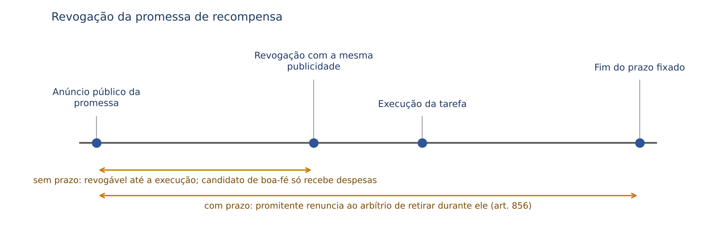
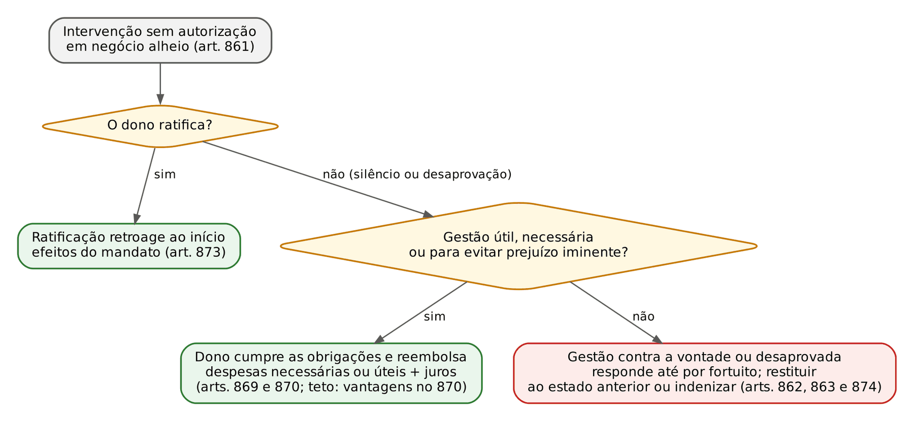
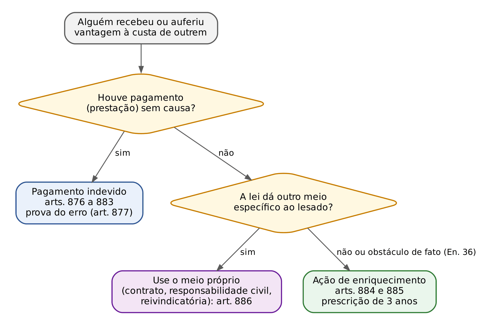

# CAPÍTULO 23 — ATOS UNILATERAIS: PROMESSA DE RECOMPENSA, GESTÃO DE NEGÓCIOS, PAGAMENTO INDEVIDO E ENRIQUECIMENTO SEM CAUSA

:::INCIDENCIA
TRF5 p. 10; TJRS p. 12 e 14; TJSC p. 12 e 14. Nível B. Lote: 15 questões (FGV 14, FCC 1), quase todas com caso concreto.
O que mais cai: letra dos arts. 856, 857, 877, 879, 880 e 881; subsidiariedade do art. 886; lucro da intervenção (TJSC 2024); gestão de negócios em alimentos (art. 871, prazo decenal).
:::

| Subtema | FGV | FCC | Padrão de cobrança |
|---|---|---|---|
| Promessa de recompensa (natureza, revogação, prazo, pluralidade) | 5 | 0 | Caso com revogação antes da execução; quem executou primeiro; promessa com prazo |
| Gestão de negócios | 2 | 0 | Despesas necessárias x melhorias; substituto do gestor; alimentos pagos por terceiro |
| Pagamento indevido | 6 | 1 | Arts. 876, 877, 879, 880 e 881 em caso; Pix ou transferência errada |
| Enriquecimento sem causa e lucro da intervenção | 1 | 0 | Reversão do lucro obtido com bem alheio; subsidiariedade |

## 23.1 Os atos unilaterais como fonte de obrigações

O Título VII do Livro das Obrigações (arts. 854 a 886) reúne, sob o rótulo "atos unilaterais", figuras de natureza heterogênea. Só a promessa de recompensa é negócio jurídico unilateral em sentido técnico: a obrigação nasce da declaração de vontade de uma só parte, sem aceitação. A gestão de negócios é ato jurídico em sentido estrito (ou, para parte da doutrina, quase contrato): os efeitos decorrem da lei, não da vontade do gestor. O pagamento indevido e o enriquecimento sem causa são fontes legais de obrigações restitutórias, ligadas a um fato (o deslocamento patrimonial sem causa), e não à vontade de quem se obriga. Classificação geral: Cap. 8.

:::QUESTAO FGV 2024 — TJ-AP — Analista Judiciário, Área Judiciária (Q2442313)
Dono que distribui cartazes prometendo 10.000 (dez mil) reais a quem achar o cachorro: de onde nasce a obrigação de pagar a quem o devolveu? Gabarito C: ato unilateral (art. 854). Armadilhas: "contrato" (não há aceitação: quem acha o animal não aceita proposta, cumpre condição) e "lei" (a lei só reconhece a força vinculante da declaração; a fonte é a vontade do promitente).
:::

:::DICA
Promessa de recompensa x oferta ao público (art. 429): a oferta ao público é proposta de CONTRATO e exige aceitação; a promessa de recompensa obriga por si só e o credor é quem preenche a condição ou presta o serviço, ainda que sem saber da promessa (art. 855). Exemplo de indeterminação subjetiva temporária do credor (Cap. 12).
:::

## 23.2 Promessa de recompensa (arts. 854 a 860)

### 23.2.1 Requisitos e eficácia

Requisitos extraídos do art. 854: (a) declaração do promitente capaz; (b) publicidade, por "anúncios públicos" (cartazes, jornais, redes sociais: o meio é livre, desde que dirigido a pessoas indeterminadas; promessa feita a pessoa certa é proposta de contrato); (c) especificação da condição a preencher ou do serviço a desempenhar; (d) indicação da recompensa ou gratificação, que pode ser em dinheiro ou outra vantagem. Preenchida a condição, o promitente "contrai obrigação de cumprir o prometido": o credor tem ação de cobrança, e o inadimplemento gera perdas e danos (quanto à liquidação, que abrange o equivalente do prêmio e os demais prejuízos, ver o REsp 2.216.463-MG desenvolvido no Cap. 14).

O credor não precisa ter agido por causa da promessa, nem conhecê-la (art. 855: "ainda que não pelo interesse da promessa"). Também não precisa ser capaz: a capacidade é exigida do promitente, não de quem executa o ato, porque a execução é ato-fato que gera crédito em favor de quem o pratica; o incapaz recebe por seu representante.

:::QUESTAO FGV 2024 — ENAM — 1º Exame Nacional da Magistratura, reaplicação (Q2507040)
Adolescente de 15 anos acha o gato anunciado em rede social com recompensa de 1.000 (mil) reais, entrega o animal sem saber do anúncio e depois pede o prêmio. Gabarito C: a tutora deve pagar a recompensa ao adolescente, representado pela mãe. Fundamento: art. 855 (direito mesmo sem interesse na promessa) e capacidade de direito do credor. Armadilhas: "obrigação natural" (A: a promessa é exigível), "incapacidade impede" (B), "desconhecimento afasta o crédito" (D) e "a mãe é a credora" (E: ela só representa).
:::

### 23.2.2 Revogação

:::LEI CC, arts. 856 a 858
Art. 856. Antes de prestado o serviço ou preenchida a condição, pode o promitente revogar a promessa, contanto que o faça com a mesma publicidade; se houver assinado prazo à execução da tarefa, entender-se-á que renuncia o arbítrio de retirar, durante ele, a oferta.
Parágrafo único. O candidato de boa-fé, que houver feito despesas, terá direito a reembolso.
Art. 857. Se o ato contemplado na promessa for praticado por mais de um indivíduo, terá direito à recompensa o que primeiro o executou.
Art. 858. Sendo simultânea a execução, a cada um tocará quinhão igual na recompensa; se esta não for divisível, conferir-se-á por sorteio, e o que obtiver a coisa dará ao outro o valor de seu quinhão.
:::

Quatro pontos de prova no art. 856:

- Momento: só ANTES de prestado o serviço ou preenchida a condição. Depois disso, o crédito já nasceu e a revogação é ineficaz.
- Forma: "com a mesma publicidade" do anúncio. Revogação por meio menos amplo não alcança quem confiou na promessa. Satisfeita a publicidade equivalente, a revogação é eficaz ainda que o candidato não a tenha conhecido: o critério é objetivo, não depende de ciência individual.
- Prazo: se o promitente fixou prazo para a execução, presume-se ("entender-se-á") a renúncia ao direito de revogar durante esse prazo; revogação feita no curso dele é ineficaz e quem cumprir a tarefa no prazo recebe a recompensa integral.
- Efeito da revogação eficaz: o candidato de boa-fé não recebe a recompensa, mas tem direito ao reembolso das despesas feitas. A boa-fé é requisito expresso do reembolso.

:::PEGADINHA As duas questões FGV que parecem iguais e têm gabaritos opostos
Sem prazo fixado (FGV 2026, TJ-BA, Juiz Leigo, Q4102110): a promitente revogou a promessa de 5.000 (cinco mil) reais pelo colar perdido, com a mesma publicidade, antes do achado; o candidato, sem saber da revogação, achou o colar depois de gastar 400 (quatrocentos) reais num detector de metais. Gabarito A: apenas reembolso das despesas, desde que de boa-fé. Erram as alternativas que dão a recompensa a quem "não teve conhecimento cabal da revogação" (C, D e E): a eficácia da revogação depende da publicidade equivalente, não da ciência do candidato; e B erra ao dispensar a boa-fé.
Com prazo fixado (FGV 2025, TRF6, Juiz Federal, Q3742386): editora promete 50.000 (cinquenta mil) reais ao melhor conto entregue até 31 de outubro e revoga em 20 de outubro, alegando dificuldades financeiras; o escritor entrega no prazo e vence. Gabarito B: tem direito ao prêmio, porque a fixação de prazo implica renúncia ao arbítrio de revogar durante ele. Armadilhas: D (só despesas, regra que vale para a promessa SEM prazo), C (eficácia condicionada à ciência) e E (generaliza a irrevogabilidade "mesmo antes do prazo" para todo concurso, o que a lei não diz: o fundamento é o prazo, não o concurso).
:::

### 23.2.3 Pluralidade de executores e concursos

Mais de um executor: recebe o que PRIMEIRO executou (art. 857); execução simultânea, partilha em quinhões iguais; recompensa indivisível, sorteio, e quem ficar com a coisa paga ao outro o valor do quinhão (art. 858).

:::QUESTAO FGV 2024 — ENAM — 1º Exame Nacional da Magistratura (Q2459906)
Promessa de 1.000 (mil) reais a quem, em sete dias, desenvolvesse programa capaz de restaurar dissertação perdida; três técnicos conseguem, no quinto, no sexto e no sétimo dias. Gabarito B: recebe só o primeiro (art. 857). Armadilhas: divisão entre os três (A: a divisão só ocorre na execução SIMULTÂNEA, art. 858), escolha pela promitente (C), pagamento a cada um (D) e divisão escalonada (E). O prazo não transforma a promessa em concurso: o critério é a prioridade da execução, não o mérito.
:::

O concurso com promessa pública de recompensa (art. 859) tem regras próprias:

| Ponto | Regra | Artigo |
|---|---|---|
| Prazo | Condição ESSENCIAL de validade do concurso | Art. 859, caput |
| Julgamento | A decisão da pessoa nomeada nos anúncios como juiz obriga os interessados | Art. 859, § 1º |
| Sem julgador designado | Entende-se que o promitente se reservou a função | Art. 859, § 2º |
| Empate de mérito | Aplicam-se os arts. 857 (primeiro a executar) e 858 (quinhões iguais ou sorteio) | Art. 859, § 3º |
| Obras premiadas | Só passam ao promitente se assim estipulado na publicação | Art. 860 |

:::PEGADINHA
- No concurso, o prazo é requisito de VALIDADE (art. 859); na promessa comum, o prazo é facultativo e, se existir, torna a promessa irrevogável durante ele (art. 856).
- O art. 860 protege o autor: a obra premiada NÃO passa automaticamente ao promitente; a cessão de direitos depende de estipulação na própria publicação (interface com a Lei 9.610/1998, Cap. 48).
:::

## 23.3 Gestão de negócios (arts. 861 a 875)

### 23.3.1 Conceito, requisitos e distinções

Há gestão de negócios (*negotiorum gestio*) quando alguém, sem autorização do interessado, intervém na administração de negócio alheio, dirigindo-o segundo o interesse e a vontade presumível do dono (art. 861). Requisitos usualmente apontados pela doutrina: (a) negócio alheio, ainda que conexo com o do gestor (art. 875); (b) ausência de autorização (mandato, representação legal ou dever legal ou contratual de agir); (c) intenção de agir no interesse do dono (*animus negotia aliena gerendi*), que falta em quem administra coisa alheia julgando-a própria; (d) atuação conforme a vontade presumível do dono; (e) limitação a atos patrimoniais.

| Gestão de negócios | Mandato |
|---|---|
| Sem autorização: nasce da intervenção espontânea | Contrato: nasce do acordo de vontades (art. 653) |
| Gestor responde perante o dono e perante os terceiros com quem tratar (art. 861) | Mandatário que age nos limites dos poderes não se obriga pessoalmente; obriga o mandante |
| Reembolso condicionado à utilidade ou necessidade (arts. 869 e 870) | Reembolso das despesas da execução, independentemente do resultado, salvo culpa do mandatário |
| Ratificada, produz todos os efeitos do mandato, retroativamente (art. 873) | Ratificação dos atos do mandatário sem poderes: art. 662 (Cap. 19) |

A ratificação "pura e simples" converte a gestão em mandato e retroage ao início da gestão (art. 873). Silêncio do dono não é ratificação; e, mesmo sem ratificação, a gestão útil gera o dever de reembolso (art. 869). É a diferença essencial com a representação sem poderes do art. 662, cujos atos são ineficazes perante o representado até a ratificação.

### 23.3.2 Deveres e responsabilidade do gestor

O gestor deve comunicar a gestão ao dono "tanto que se possa", aguardando a resposta se a espera não trouxer perigo (art. 864); velar pelo negócio até levá-lo a cabo enquanto o dono não providenciar, aguardando instruções dos herdeiros se o dono falecer, sem descuidar das medidas urgentes (art. 865); empregar "toda sua diligência habitual" e ressarcir o prejuízo resultante de "qualquer culpa" (art. 866: culpa levíssima, segundo a leitura tradicional da expressão).

| Situação | Responsabilidade do gestor | Artigo |
|---|---|---|
| Gestão regular | Culpa (qualquer culpa), com a diligência habitual | Art. 866 |
| Gestão contra a vontade manifesta ou presumível do dono | Até pelo caso fortuito, salvo prova de que o dano sobreviria ainda que não interviesse | Art. 862 |
| Prejuízos da gestão contrária à vontade superiores ao proveito | Dono pode exigir a restituição ao estado anterior ou a indenização da diferença | Art. 863 |
| Operações arriscadas (ainda que o dono costumasse fazê-las) ou preterição do interesse do dono em favor do próprio | Responde pelo caso fortuito | Art. 868, caput |
| Substituição por outrem | Responde pelas faltas do substituto, AINDA QUE IDÔNEO, sem prejuízo de ação contra ele | Art. 867, caput |
| Pluralidade de gestores | Responsabilidade solidária | Art. 867, parágrafo único |
| Negócios conexos inseparáveis | Gestor é tratado como sócio; o beneficiado só se obriga na razão das vantagens | Art. 875 |

:::PEGADINHA
- Substituição: no mandato, sem poderes para substabelecer, o mandatário responde pelos prejuízos causados culposamente pelo substituto, e, com poderes, só por culpa na escolha ou nas instruções (art. 667, caput e § 2º; Cap. 19). Na gestão, o gestor responde pelas faltas do substituto "ainda que seja pessoa idônea" (art. 867): não há a exoneração pela boa escolha.
- Fortuito: o gestor responde pelo fortuito em três hipóteses (gestão contra a vontade, operações arriscadas e preterição do interesse do dono). Nas duas primeiras do art. 868, a ressalva "ainda que o dono costumasse fazê-las" é a pegadinha recorrente.
- Solidariedade entre gestores é legal (art. 867, parágrafo único), não presumida: exemplo de solidariedade passiva por força de lei (art. 265, Cap. 12).
:::

### 23.3.3 Obrigações do dono do negócio

:::LEI CC, arts. 869 e 870
Art. 869. Se o negócio for utilmente administrado, cumprirá ao dono as obrigações contraídas em seu nome, reembolsando ao gestor as despesas necessárias ou úteis que houver feito, com os juros legais, desde o desembolso, respondendo ainda pelos prejuízos que este houver sofrido por causa da gestão.
§ 1º A utilidade, ou necessidade, da despesa, apreciar-se-á não pelo resultado obtido, mas segundo as circunstâncias da ocasião em que se fizerem.
§ 2º Vigora o disposto neste artigo, ainda quando o gestor, em erro quanto ao dono do negócio, der a outra pessoa as contas da gestão.
Art. 870. Aplica-se a disposição do artigo antecedente, quando a gestão se proponha a acudir a prejuízos iminentes, ou redunde em proveito do dono do negócio ou da coisa; mas a indenização ao gestor não excederá, em importância, as vantagens obtidas com a gestão.
:::

Leitura de prova:

- A utilidade é aferida *ex ante*, pelas circunstâncias do momento (art. 869, § 1º): despesa razoável para conter um incêndio é reembolsável ainda que o imóvel acabe destruído.
- Os juros correm "desde o desembolso" (exceção à regra da citação do art. 405) e são os juros legais, hoje calculados pela Selic menos o IPCA após a Lei 14.905/2024 (Cap. 14).
- Gestão de emergência ou que redunde em proveito do dono (art. 870): reembolso com TETO nas vantagens obtidas. O art. 870 é o fundamento do reembolso também quando o dono desaprova a gestão (art. 874, que ressalva os arts. 869 e 870).
- Querendo aproveitar-se da gestão mesmo nos casos do art. 868 (operações arriscadas, preterição de interesses), o dono indeniza as despesas NECESSÁRIAS e os prejuízos sofridos pelo gestor (art. 868, parágrafo único): aqui não entram as úteis.
- Desaprovação (art. 874): se o dono considerar a gestão contrária aos seus interesses, aplicam-se os arts. 862 e 863 (responsabilidade agravada e restituição ao estado anterior), "salvo o estabelecido nos arts. 869 e 870": a desaprovação não afasta o reembolso do que foi útil ou necessário.

:::QUESTAO FGV 2026 — TCE-SC — Auditor Fiscal de Controle Externo, Direito (Q4088901)
Caso: na ausência do dono da fazenda, o vizinho contrata empresa para conter praga que ameaçava a safra, mas também faz melhorias estruturais para aumentar a produtividade futura; delega a supervisão a terceiro, que aplica produto inadequado e danifica a lavoura. O dono aprova o combate à praga, recusa as melhorias e desaprova a delegação.
Passo 1, o que se pergunta: quais despesas o dono reembolsa e quem responde pelo dano do terceiro.
Passo 2, regras: reembolso das despesas necessárias ou úteis da gestão útil ou de emergência (arts. 869 e 870); desaprovação com os efeitos dos arts. 862 e 863, ressalvados os arts. 869 e 870 (art. 874); gestor responde pelas faltas do substituto (art. 867).
Passo 3, aplicação: o combate à praga é gestão de emergência (prejuízo iminente) e deve ser reembolsado; as melhorias não atendiam à vontade presumível do dono nem a prejuízo iminente e foram desaprovadas; o dano do terceiro é imputável ao gestor.
Gabarito C. Armadilhas: A e E (reembolso de todas as despesas, "sob pena de enriquecimento sem causa": o reembolso é medido pela utilidade e pela necessidade, não por tudo o que se gastou); B (recomposição integral do estado anterior: a desaprovação não afasta o reembolso do necessário); D (isenta o gestor pelo fato do substituto, contra o art. 867).
:::

### 23.3.4 Alimentos e despesas de enterro (arts. 871 e 872)

Quem presta alimentos a quem deles precisa, na ausência do devedor, pode reaver deste a importância, "ainda que este não ratifique o ato" (art. 871). As despesas de enterro, proporcionais aos usos locais e à condição do falecido, feitas por terceiro, podem ser cobradas de quem teria a obrigação de alimentar o falecido, "ainda mesmo que esta não tenha deixado bens" (art. 872). Ambas as pretensões cessam se provado que o gestor agiu "com o simples intento de bem-fazer" (art. 872, parágrafo único): o *animus donandi* afasta o reembolso.

:::JURIS STJ, Jurisprudência em Teses, edição 77 (Alimentos II), tese 2
A pretensão creditícia ao reembolso de despesas alimentícias efetuadas por terceiro, no lugar de quem tinha a obrigação de prestar alimentos, por equiparar-se à gestão de negócios, é de direito comum e prescreve em 10 anos. Não se aplica o prazo bienal do art. 206, § 2º, que é próprio das prestações alimentares devidas ao alimentando; quem cobra aqui é o terceiro que pagou, em nome próprio, por crédito de reembolso.
:::

:::QUESTAO FGV 2025 — AL-AM — Procurador (Q3777935)
Caso: a mãe custeou sozinha, por cerca de 18 meses, o sustento da filha antes da fixação dos alimentos provisórios e depois ajuizou ação autônoma contra o pai para reaver metade das despesas; o réu alegou caráter personalíssimo dos alimentos, impossibilidade de sub-rogação e prescrição bienal.
Gabarito B: há direito ao reembolso, por se tratar de gestão de negócios (art. 871), com pretensão de natureza pessoal sujeita ao prazo decenal (JT 77, tese 2). Armadilhas: C (sub-rogação nos direitos da filha com prazo bienal: a mãe não cobra alimentos da filha, cobra reembolso próprio); D (exige ratificação, quando o art. 871 a dispensa expressamente); A (o caráter personalíssimo dos alimentos não impede o reembolso de quem os prestou); E (competência da Vara de Família: o gabarito não a acolheu, e a natureza do crédito é obrigacional).
:::

:::DICA
Prazo do reembolso: gestão de negócios (art. 871) = 10 anos (art. 205). Enriquecimento sem causa = 3 anos (art. 206, § 3º, IV). Alimentos devidos ao próprio alimentando = 2 anos a partir do vencimento de cada prestação (art. 206, § 2º). As três qualificações aparecem juntas nas alternativas.
:::

## 23.4 Pagamento indevido (arts. 876 a 883)

### 23.4.1 Conceito, espécies e requisitos

Pagamento indevido é o que se faz sem causa jurídica que o justifique, gerando para quem recebe a obrigação de restituir (art. 876) e, para quem pagou, a pretensão de repetição (*condictio indebiti*). É espécie qualificada de enriquecimento sem causa: por ter disciplina própria nos arts. 876 a 883, afasta a cláusula geral dos arts. 884 e 885 (art. 886; ver 23.5.3).

| Espécie | O que falta | Exemplo |
|---|---|---|
| Indébito objetivo | A própria dívida: inexiste, foi extinta, é nula ou já foi paga | Pagamento em duplicidade de fatura; benefício pago após a morte do beneficiário |
| Indébito subjetivo (*ex latere creditoris*) | A dívida existe, mas é paga a quem não é credor | Pix para conta errada; pagamento ao credor putativo de má-fé |
| Indébito subjetivo (*ex latere debitoris*) | A dívida existe, mas quem paga não é o devedor, supondo sê-lo | Quem paga dívida alheia julgando-a própria |

:::QUESTAO FGV 2025 — Prefeitura de Canaã dos Carajás (PA) — Procurador Municipal (Q3265474)
Transferência bancária de 5.000 (cinco mil) reais feita por engano à conta errada; o recebedor se recusa a devolver porque já gastou o dinheiro em despesas pessoais. Gabarito A: há dever de restituir, independentemente do uso do dinheiro (art. 876). Armadilhas: o gasto não converte o indébito em liberalidade (B); a restituição não depende de má-fé (C: a boa-fé só influi nos frutos, benfeitorias e alienação, arts. 878 e 879), nem de prévia declaração judicial (D), nem se limita a parte do valor (E). A boa-fé de quem recebe dinheiro e o consome não o exonera: dinheiro é fungível, e o art. 879 só protege a alienação de IMÓVEL.
:::

Requisitos: (a) pagamento (*solutio*), isto é, prestação feita com a intenção de extinguir obrigação; (b) ausência de causa; (c) erro de quem pagou, quando o pagamento foi voluntário (art. 877). A segunda parte do art. 876 manda restituir também quem "recebe dívida condicional antes de cumprida a condição": antes do implemento da condição suspensiva o direito não foi adquirido (art. 125), logo o pagamento é indevido.

:::PEGADINHA Condição x termo
Dívida sob condição suspensiva paga antes do implemento: REPETÍVEL (art. 876, parte final). Dívida a termo paga antes do vencimento: NÃO repetível, porque o termo suspende só o exercício, não a aquisição do direito (art. 131), e o prazo se presume em favor do devedor, que pode renunciar a ele (art. 133). Quem antecipa paga o devido. Não confundir com o terceiro não interessado que antecipa o pagamento: só se reembolsa no vencimento (art. 305, parágrafo único, Cap. 13).
:::

### 23.4.2 Prova do erro e Súmula 322 do STJ

:::LEI CC, art. 877 e Súmula 322 do STJ
Art. 877. Àquele que voluntariamente pagou o indevido incumbe a prova de tê-lo feito por erro.
Súmula 322 do STJ: Para a repetição de indébito, nos contratos de abertura de crédito em conta-corrente, não se exige a prova do erro.
:::

A exigência da prova do erro tem duas leituras: quem paga voluntariamente, sabendo que nada deve, pratica liberalidade ou cumpre dever moral, e não pode repetir; quem paga por erro (de fato ou de direito) tem a repetição. O ônus é de quem pagou. Afasta-se o requisito:

- quando o pagamento não foi voluntário: pagamento sob coação, sob protesto ou por exigência a que o devedor não podia resistir (a leitura *a contrario* do advérbio "voluntariamente" é pacífica na doutrina);
- nos contratos de abertura de crédito em conta-corrente, em que os lançamentos são feitos pelo próprio banco, a débito automático (Súmula 322 do STJ);
- nas relações de consumo, em que a repetição do que foi cobrado indevidamente segue o art. 42, parágrafo único, do CDC (restituição em dobro, salvo engano justificável), objeto da apostila de Direito do Consumidor.

:::QUESTAO FGV 2024 — ENAM — Exame Nacional da Magistratura, 2024.2 (Q3058666)
Entidade de previdência privada, já notificada da morte do beneficiário de renda vitalícia sem pensão a terceiros, continua depositando o benefício por seis meses e quer a restituição. Gabarito D: como o pagamento foi voluntário, cabe à entidade o ônus de provar o erro (art. 877). Armadilhas: A (repetição de obrigação judicialmente inexigível: o art. 882 diz o contrário); B (ausência de relação jurídica com a família desobriga: é justamente a falta de causa que funda a restituição); C (restituição sem atualização: o art. 884 manda atualizar); E (restituição indevida quando a causa deixa de existir: o art. 885 diz que é devida).
:::

### 23.4.3 Destino da coisa recebida: frutos, benfeitorias e alienação

Frutos, acessões, benfeitorias e deteriorações seguem as regras do possuidor de boa ou de má-fé (art. 878; regime dos arts. 1.214 a 1.222 no Cap. 27). Quem recebeu de boa-fé faz seus os frutos percebidos e é indenizado pelas benfeitorias necessárias e úteis, com retenção; o de má-fé responde pelos frutos e só é ressarcido das necessárias, sem retenção.

:::LEI CC, art. 879
Art. 879. Se aquele que indevidamente recebeu um imóvel o tiver alienado em boa-fé, por título oneroso, responde somente pela quantia recebida; mas, se agiu de má-fé, além do valor do imóvel, responde por perdas e danos.
Parágrafo único. Se o imóvel foi alienado por título gratuito, ou se, alienado por título oneroso, o terceiro adquirente agiu de má-fé, cabe ao que pagou por erro o direito de reivindicação.
:::

| Accipiens que alienou o imóvel | Terceiro adquirente | Consequência | Artigo |
|---|---|---|---|
| De boa-fé, a título oneroso | De boa-fé | Restitui SOMENTE a quantia recebida; o imóvel fica com o terceiro | Art. 879, caput, 1ª parte |
| De má-fé, a título oneroso | De boa-fé | Valor do imóvel MAIS perdas e danos; o imóvel fica com o terceiro | Art. 879, caput, 2ª parte |
| Qualquer, a título gratuito | Qualquer | Quem pagou por erro reivindica o imóvel | Art. 879, parágrafo único |
| Qualquer, a título oneroso | De má-fé | Reivindicação | Art. 879, parágrafo único |

A lei prefere o adquirente oneroso de boa-fé a quem errou ao pagar; o donatário, que nada perde ao devolver, não tem a mesma proteção.

:::QUESTAO FGV 2026 — TJ-PR — Juiz Substituto (Q3898895)
Caso: pagamento feito por erro com base em título absolutamente nulo, incluindo um imóvel; o credor aparente inutiliza o título e depois aliena o imóvel, a título oneroso, a terceiro de boa-fé.
Passo 1: há indébito? Sim: título nulo não gera dívida, logo não é obrigação natural nem dívida verdadeira.
Passo 2: o art. 880 isenta quem inutilizou o título? Não: a isenção exige recebimento "como parte de dívida verdadeira", e aqui não havia dívida alguma.
Passo 3: o imóvel pode ser reivindicado? Não: alienação onerosa a terceiro de boa-fé (art. 879, caput).
Gabarito E: repete o valor, sem reivindicar o imóvel, limitada a restituição à quantia recebida. Armadilhas: A (confunde título nulo com obrigação judicialmente inexigível do art. 882); B (aplica o art. 880 sem dívida verdadeira); C (perdas e danos "irrelevante a boa-fé": só há perdas e danos se o accipiens agiu de má-fé); D (reivindicação contra terceiro oneroso de boa-fé).
:::

### 23.4.4 Isenção de restituir: o art. 880

:::LEI CC, art. 880
Art. 880. Fica isento de restituir pagamento indevido aquele que, recebendo-o como parte de dívida verdadeira, inutilizou o título, deixou prescrever a pretensão ou abriu mão das garantias que asseguravam seu direito; mas aquele que pagou dispõe de ação regressiva contra o verdadeiro devedor e seu fiador.
:::

O dispositivo resolve o indébito subjetivo *ex latere debitoris*: alguém paga dívida alheia julgando-a própria, e o credor verdadeiro, confiando no pagamento, se desfaz da proteção do seu crédito. Requisitos cumulativos: (a) existência de dívida verdadeira, devida ao accipiens por outrem; (b) recebimento de boa-fé, "como parte" dessa dívida; (c) prejuízo à posição do credor: inutilização do título, prescrição da pretensão contra o verdadeiro devedor ou renúncia às garantias. Consequência: o credor fica com o pagamento, e quem pagou volta-se, em regresso, contra o verdadeiro devedor e seu fiador (é a dívida deles que se extinguiu).

:::QUESTAO FGV 2025 — ENAM — Exame Nacional da Magistratura 2025.1 (Q3362358)
Caso: Pix de 2.000 (dois mil) reais feito por engano a um locador, que o recebeu supondo ser o aluguel do inquilino, de mesmo valor; a depositante pede a devolução. Afirmativas: I, a pretensão segue prioritariamente as regras gerais do enriquecimento sem causa; II, cabe devolução em dobro; III, o locador pode recusar a devolução se, entre o depósito e o pedido, prescreveu sua pretensão contra o inquilino.
Gabarito C (só III). III é a letra do art. 880 ("deixou prescrever a pretensão"). I é falsa porque há disciplina específica do pagamento indevido, e a cláusula geral do enriquecimento é subsidiária (art. 886). II é falsa: a dobra do art. 940 do CC pressupõe demanda judicial por dívida já paga e má-fé, e a do CDC pressupõe cobrança indevida ao consumidor; nenhuma se aplica a quem pagou espontaneamente por engano.
:::

:::QUESTAO FGV 2026 — MPE-GO — Promotor de Justiça Substituto (Q3865814)
Construtora devia duas faturas a uma fornecedora, uma vencida e outra já quitada; por erro, paga de novo a quitada, julgando pagar a vencida; a fornecedora, de boa-fé, imputa o valor à fatura vencida, inutiliza o título e libera a garantia bancária. Gabarito A: isenção de restituir (art. 880). Armadilhas: B (a boa-fé do credor não afastaria a restituição: afasta, somada à perda da garantia), C (restituição proporcional, sem base legal), D (restituição simples com regresso contra o banco garantidor) e E (perda só da atualização).
Nota crítica: a "dívida verdadeira" era do próprio pagador; a FGV aplicou o art. 880 ao erro de imputação, e o regresso "contra o verdadeiro devedor" perde sentido, mas o resultado (fatura vencida extinta) é coerente.
:::

:::QUESTAO FGV 2025 — TJ-GO — Residente Jurídico (Q3345924)
Contratante paga de uma vez, por erro contábil, os 500.000 (quinhentos mil) reais que deviam ser pagos em três parcelas conforme o avanço da obra; a construtora já aplicou parte dos recursos e destruiu o título de crédito. Gabarito oficial E: a construtora pode ser dispensada da restituição se provar que recebeu acreditando tratar-se de antecipação legítima e destruiu o título. Comentário: o resultado está certo, mas o fundamento mais sólido é outro: a dívida existia e era do próprio pagador; pagamento antecipado de dívida a termo não é indevido (ver 23.4.1). A banca invocou a hipótese da inutilização do título do art. 880. Erram A (restituição integral por falta de vencimento), B (erro "exclusivo" do pagador como causa de isenção) e D (troca a repetição por indenização).
:::

### 23.4.5 Obrigação de fazer ou de não fazer (art. 881)

Se o pagamento indevido consistiu no desempenho de obrigação de fazer, ou em abstenção para eximir-se de obrigação de não fazer, quem recebeu a prestação indeniza quem a cumpriu "na medida do lucro obtido" (art. 881). O limite é o enriquecimento do accipiens, não o custo do solvens: serviço que nada acrescentou não gera restituição pelo seu valor de mercado.

:::QUESTAO FCC 2025 — TRT-2 (SP) — Analista Judiciário, Área Judiciária (Q3627609)
Questão de letra de lei. Gabarito C: no pagamento indevido por obrigação de fazer, quem recebeu indeniza "na medida do lucro obtido" (art. 881). Erradas: A (repetição de dívida prescrita, contra o art. 882); B (repetição para fim imoral "não proibido por lei", contra o art. 883, que veda a repetição para fim ilícito, imoral OU proibido); D (inverte o ônus da prova do erro do art. 877); E (perdas e danos ao alienante de boa-fé, contra o art. 879).
:::

### 23.4.6 Irrepetibilidade: dívida prescrita, obrigação inexigível e fim ilícito (arts. 882 e 883)

Não se repete o que se pagou para solver dívida prescrita ou cumprir obrigação judicialmente inexigível (art. 882): é a *soluti retentio* da obrigação natural, desenvolvida no Cap. 12 (jogo e aposta: art. 814, Cap. 21). A FGV costuma colocar na alternativa errada o oposto ("é possível repetir"), como fez nas Q3627609 e Q3058666, e a distinção que importa é com a dívida NULA: o pagamento de dívida nula é repetível, porque não há obrigação nenhuma (Q3898895).

O art. 883 nega a repetição a quem deu alguma coisa "para obter fim ilícito, imoral, ou proibido por lei" e, no parágrafo único, manda que o que se deu reverta "em favor de estabelecimento local de beneficência, a critério do juiz". Ninguém pode alegar a própria torpeza (*nemo auditur propriam turpitudinem allegans*), mas, diferentemente da máxima *in pari causa turpitudinis*, quem recebeu também não retém: o valor vai para entidade beneficente.

:::PEGADINHA
- "Fim ilícito, imoral, OU proibido por lei": três hipóteses alternativas. Alternativa que diz "fim imoral, desde que não proibido por lei, permite a repetição" está errada (Q3627609, B).
- O destino é estabelecimento LOCAL de beneficência, escolhido A CRITÉRIO DO JUIZ: não é a Fazenda Pública, nem o fundo de direitos difusos.
- O art. 883 não se confunde com o art. 814 (dívida de jogo): neste, o perdente que pagou não repete, salvo dolo do ganhador ou perdente incapaz, e o ganhador fica com o valor.
:::

### 23.4.7 Pagamento indevido x cobrança indevida (art. 940)

O pagamento indevido é iniciativa de quem paga e gera só a repetição simples do que se pagou (art. 876); a demanda por dívida já paga ou a maior é iniciativa de quem cobra e atrai as penas privadas dos arts. 939 a 941, que pressupõem cobrança judicial e má-fé do credor (v. Cap. 24, 24.1.2). Por isso, quem pagou espontaneamente por engano não tem direito à dobra, nem pelo art. 940 nem pelo art. 42, parágrafo único, do CDC (Q3362358, 23.4.4).

Restituição em contratos bancários: a repetição do indébito não se faz com os mesmos encargos remuneratórios previstos no contrato de mútuo feneratício (Tema 968 do STJ, REsp 1.552.434-GO, Segunda Seção, j. 13/6/2018, Info 628); aplicam-se correção e juros legais. Detalhes de contratos bancários: Cap. 22.

## 23.5 Enriquecimento sem causa (arts. 884 a 886)

### 23.5.1 Cláusula geral e requisitos

:::LEI CC, arts. 884 a 886
Art. 884. Aquele que, sem justa causa, se enriquecer à custa de outrem, será obrigado a restituir o indevidamente auferido, feita a atualização dos valores monetários.
Parágrafo único. Se o enriquecimento tiver por objeto coisa determinada, quem a recebeu é obrigado a restituí-la, e, se a coisa não mais subsistir, a restituição se fará pelo valor do bem na época em que foi exigido.
Art. 885. A restituição é devida, não só quando não tenha havido causa que justifique o enriquecimento, mas também se esta deixou de existir.
Art. 886. Não caberá a restituição por enriquecimento, se a lei conferir ao lesado outros meios para se ressarcir do prejuízo sofrido.
:::

Cláusula geral nova no CC/2002 (o CC/1916 só tinha aplicações pontuais), a vedação do enriquecimento sem causa é ao mesmo tempo princípio interpretativo e fonte autônoma de obrigação, com ação própria (*actio de in rem verso*).

Requisitos da ação de enriquecimento:

| Requisito | Conteúdo | Observação de prova |
|---|---|---|
| Enriquecimento | Qualquer vantagem patrimonial: aumento do ativo, diminuição do passivo ou poupança de despesa | Inclui o uso de coisa alheia e o lucro obtido com direito alheio |
| À custa de outrem | Vantagem obtida com bem, direito ou prestação de outrem | NÃO exige empobrecimento correlato (Enunciado 35 do CJF) |
| Ausência de justa causa | Falta de título jurídico (contrato, lei, decisão) que legitime a vantagem | Originária ou superveniente (art. 885) |
| Subsidiariedade | Inexistência de outro meio legal de ressarcimento | Art. 886, temperado pelo Enunciado 36 do CJF |

:::JURIS CJF, Enunciados 35 e 36 da I Jornada de Direito Civil
Enunciado 35: a expressão "se enriquecer à custa de outrem" não significa, necessariamente, que deverá haver empobrecimento.
Enunciado 36: o art. 886 não exclui o direito à restituição do que foi objeto de enriquecimento sem causa nos casos em que os meios alternativos conferidos ao lesado encontram obstáculos de fato.
(Os enunciados mencionam o "art. 886", mas o Enunciado 35 interpreta a expressão do art. 884.)
:::

A justa causa típica é o negócio jurídico válido e eficaz: vantagem prevista em contrato não é enriquecimento sem causa, ainda que desequilibrada, e o controle do desequilíbrio se faz pelos institutos contratuais (lesão, onerosidade excessiva, redução da cláusula penal). O enriquecimento sem causa não serve para rever contrato válido.

### 23.5.2 Causa superveniente que deixa de existir e medida da restituição

O art. 885 abrange a causa que existia e deixou de existir (*condictio ob causam finitam*): resolução e anulação de contrato, revogação de tutela provisória, extinção da relação que justificava contribuições.

:::JURIS STJ, Tema 371, REsp 1.122.387-DF, recurso repetitivo
Ex-contribuintes do extinto Instituto de Previdência dos Congressistas (IPC), fundo fechado de previdência, têm direito à restituição das contribuições pagas, porque, extinto o fundo, nenhum benefício receberão em contrapartida, evitando-se o enriquecimento sem causa da União, sucessora nos direitos e obrigações do IPC. É exemplo didático de causa que deixou de existir (art. 885).
:::

Medida da restituição:

- Restitui-se o "indevidamente auferido", com atualização monetária (art. 884, caput). Após a Lei 14.905/2024, a correção legal supletiva é pelo IPCA (art. 389, parágrafo único) e os juros legais pela Selic menos o IPCA (art. 406); detalhes no Cap. 14.
- Coisa determinada: restitui-se a própria coisa; se não mais subsistir, o valor "na época em que foi exigido" (art. 884, parágrafo único), e não o da época do recebimento.
- Na doutrina clássica, a restituição tem duplo limite: o enriquecimento de um e o empobrecimento do outro (o menor dos dois). Com o Enunciado 35, o limite do empobrecimento cai nos casos de intervenção, em que a medida é o próprio lucro obtido.
- A restituição não pode virar fonte de novo enriquecimento: o credor que opta pela resolução e recebe de volta o que pagou não pode exigir também o equivalente da prestação inadimplida (STJ, REsp 2.225.449-RJ, cirurgia estética; v. Cap. 26).

### 23.5.3 Subsidiariedade (art. 886)

A ação de enriquecimento só cabe quando a lei não conferir ao lesado outro meio de ressarcimento (art. 886). Não cabe, por exemplo, quando há ação contratual (cobrança, resolução, restituição prevista em contrato), ação de responsabilidade civil, reivindicatória ou regime específico (pagamento indevido, benfeitorias, acessões). Três matizes que a prova explora:

- A subsidiariedade é abstrata, não concreta: se o meio próprio existia e o lesado o perdeu pela prescrição, não pode ressuscitá-lo pela ação de enriquecimento. Por isso a prescrição de pretensão contratual não abre caminho ao art. 884 (posição de parte expressiva da doutrina; o ponto é controvertido).
- Obstáculos DE FATO ao meio alternativo (insolvência, paradeiro desconhecido do responsável, impossibilidade material) não bloqueiam a ação (Enunciado 36 do CJF).
- A subsidiariedade não impede cumular, na mesma ação, reparação de danos e restituição do lucro da intervenção, porque cada pedido tem fundamento e medida próprios (REsp 1.698.701, 23.5.4).

Prazo: a pretensão de ressarcimento de enriquecimento sem causa prescreve em 3 anos (art. 206, § 3º, IV). Quando a restituição tem fundamento contratual, o prazo é o da pretensão contratual (5 anos para dívida líquida em instrumento, art. 206, § 5º, I, ou 10 anos, art. 205). O quadro de temas repetitivos (Temas 560, 574, 310 e 919, Súmula 547 do STJ) e a distinção entre enriquecimento e contrato estão no Cap. 11 (11.6.3). A repetição do pagamento indevido (arts. 876 a 883) é pretensão de enriquecimento em sentido amplo, mas a qualificação do prazo varia conforme a relação subjacente (por exemplo, tarifas de água e esgoto e repetição em contratos): os precedentes estão reunidos no Cap. 11.

### 23.5.4 Lucro da intervenção

Lucro da intervenção é a vantagem patrimonial obtida com a exploração não autorizada de bem ou direito alheio (imagem, nome, marca, obra, coisa). O ponto sensível é que a responsabilidade civil mede a indenização pela extensão do DANO (art. 944): se o lucro do interventor supera o dano da vítima, a diferença ficaria com quem violou o direito, e a violação compensaria. A restituição do lucro, fundada na vedação do enriquecimento sem causa, fecha essa porta. Na doutrina brasileira, o tema ganhou corpo sobretudo com a monografia de Sérgio Savi sobre responsabilidade civil e enriquecimento sem causa.

:::JURIS STJ, REsp 1.698.701-RJ, Terceira Turma, Rel. Min. Ricardo Villas Bôas Cueva, j. 2/10/2018 (Informativo 634)
Farmácia de manipulação usou sem autorização o nome e a imagem de atriz em propaganda de remédio para emagrecer. Além dos danos morais e materiais, a autora tem direito à restituição do lucro da intervenção, com fundamento no art. 884. Teses: (a) a ação de enriquecimento é subsidiária, mas nada impede cumular a reparação dos danos e a restituição do indevidamente auferido; (b) o enriquecimento por intervenção dispensa deslocamento patrimonial e empobrecimento do titular, bastando o enriquecimento do interventor; (c) a quantificação segue o critério do lucro patrimonial, apurado por perícia na liquidação, delimitado ao período da intervenção, com aferição do grau de contribuição de cada parte e distribuição do lucro proporcional a essa contribuição.
Mesmo fundamento: Enunciado 620 da VIII Jornada de Direito Civil (a obrigação de restituir o lucro da intervenção, entendido como a vantagem patrimonial auferida a partir da exploração não autorizada de bem ou direito alheio, fundamenta-se na vedação do enriquecimento sem causa).
:::

:::QUESTAO FGV 2024 — TJ-SC — Juiz Substituto (Q2386956)
Caso: o motorista de um colecionador usou, às escondidas, um dos carros do patrão para disputar corridas e venceu o torneio anual em 12/12/2020, com prêmio de 150.000 (cento e cinquenta mil) reais; o dono descobriu em 13/12/2023. O que ele pode pedir?
Passo 1: há dois prejuízos distintos: o uso não autorizado do veículo (que, explorado economicamente, renderia aluguel) e o lucro obtido com o bem alheio.
Passo 2: o aluguel que o dono deixou de receber é lucro cessante (responsabilidade civil, art. 402); o prêmio é lucro da intervenção (enriquecimento sem causa, art. 884), e os dois pedidos são cumuláveis.
Gabarito D: aluguéis como lucros cessantes e reversão do prêmio para evitar o enriquecimento sem causa. Armadilhas: B (aluguéis como danos emergentes), A (só aluguéis), C e E (perda de uma chance: a vítima não perdeu chance alguma de ganhar o torneio; quem ganhou foi o interventor, com o bem dela).
Prazo: entre o prêmio e a descoberta passaram-se 3 anos e 1 dia; a questão não cobrou prescrição (termo inicial pela ciência, *actio nata* subjetiva: Cap. 11).
:::

:::PEGADINHA Lucro da intervenção x figuras vizinhas
- x perda de uma chance (Cap. 25): a chance perdida é da vítima; no lucro da intervenção, o ganho é do interventor.
- x tutela externa do crédito (art. 608; Cap. 15): ali o terceiro responde por aliciar o devedor; não é restituição de lucro (FGV 2024, TJ-SC, Q3049339, em que "lucro da intervenção" foi distrator).
- x danos existenciais e reflexos (FGV 2026, MPE-RJ, Q4088274) e perda de uma chance x causalidade virtual (FGV 2024, ENAM, Q2507037): nas duas, "lucro da intervenção" apareceu como distrator.
- x *disgorgement* do *common law*: ideia próxima, mas aqui o fundamento é o art. 884, não função punitiva (Cap. 2).
- Aplicação na tutela da personalidade (uso de nome e imagem): Cap. 4.
:::

:::SENTENCA Restituição de lucro da intervenção cumulada com indenização
Dispositivo-modelo: "Julgo procedentes os pedidos para: (a) condenar a ré a pagar à autora indenização por danos morais de X (por extenso) reais, com correção e juros na forma da fundamentação; (b) condenar a ré a restituir à autora o lucro obtido com a exploração não autorizada de seu nome e imagem, no período de [data] a [data], a ser apurado em liquidação por arbitramento (art. 509, I, do CPC), segundo o critério do lucro patrimonial, considerada a contribuição de cada parte para o resultado, com atualização monetária desde a data de cada ingresso (art. 884 do CC)."
Cautelas: delimitar na sentença o período da intervenção e os critérios da perícia; não duplicar verbas (lucro cessante pela mesma exploração e restituição integral do lucro não se somam sem dedução); no pedido de restituição, o termo de correção é o do enriquecimento, não o do evento danoso; juros moratórios da obrigação restitutória correm, em regra, da citação (art. 405), salvo má-fé comprovada.
:::

## 23.6 Resumo para revisão pré-prova

| Instituto | Regra | Exceções e detalhes | Fundamento |
|---|---|---|---|
| Natureza dos atos unilaterais | Só a promessa de recompensa é negócio jurídico unilateral; gestão é ato jurídico em sentido estrito; pagamento indevido e enriquecimento são fontes legais restitutórias | Obrigação de recompensa nasce de ato unilateral, não de contrato nem da lei | Arts. 854 a 886 |
| Promessa de recompensa: crédito | Quem presta o serviço ou preenche a condição exige a recompensa | Mesmo sem saber da promessa; credor incapaz recebe representado | Arts. 854 e 855 |
| Revogação | Antes da execução, com a MESMA publicidade; eficaz sem ciência individual do candidato | Com prazo fixado: renúncia ao arbítrio de revogar durante ele; candidato de boa-fé revogado recebe só despesas | Art. 856 |
| Vários executores | O primeiro que executou | Simultâneos: quinhões iguais; indivisível: sorteio e compensação do quinhão | Arts. 857 e 858 |
| Concurso | Prazo é condição essencial; decisão do juiz nomeado obriga | Sem juiz designado, julga o promitente; obra premiada só é do promitente se estipulado | Arts. 859 e 860 |
| Gestão: conceito | Intervenção sem autorização, segundo interesse e vontade presumível do dono; gestor responde ao dono e a terceiros | Ratificação pura e simples retroage e produz efeitos do mandato | Arts. 861 e 873 |
| Gestão: deveres | Comunicar, velar até o fim, diligência habitual, responder por qualquer culpa | Faltas do substituto, ainda que idôneo; vários gestores, solidariedade | Arts. 864 a 867 |
| Gestão: fortuito | Responde pelo fortuito se agiu contra a vontade do dono, fez operações arriscadas ou preteriu interesses do dono | Prejuízos maiores que o proveito: restituição ao estado anterior ou indenização da diferença | Arts. 862, 863 e 868 |
| Gestão: reembolso | Gestão útil: dono cumpre obrigações e reembolsa despesas necessárias ou úteis, com juros desde o desembolso, e prejuízos | Utilidade aferida pelas circunstâncias da ocasião; emergência: teto nas vantagens; desaprovação não afasta 869 e 870 | Arts. 869, 870 e 874 |
| Alimentos e enterro | Terceiro que presta alimentos reembolsa-se do devedor sem ratificação; despesas de enterro cobráveis de quem devia alimentos | Cessa se houve intento de bem-fazer; prazo do reembolso de alimentos: 10 anos | Arts. 871 e 872; JT 77, tese 2 |
| Pagamento indevido | Quem recebeu o indevido restitui, inclusive dívida condicional antes da condição | Dívida a termo paga antes do vencimento não se repete | Art. 876 |
| Prova do erro | Quem pagou voluntariamente prova o erro | Dispensada na abertura de crédito em conta-corrente | Art. 877; Súmula 322 do STJ |
| Imóvel recebido e alienado | Alienante de boa-fé, título oneroso: só a quantia; de má-fé: valor mais perdas e danos | Título gratuito ou adquirente de má-fé: reivindicação | Art. 879 |
| Isenção de restituir | Credor que recebeu como parte de dívida verdadeira e inutilizou o título, deixou prescrever ou abriu mão de garantias | Quem pagou tem regresso contra o verdadeiro devedor e o fiador | Art. 880 |
| Fazer ou não fazer | Indenização na medida do lucro obtido | Limite: enriquecimento de quem recebeu | Art. 881 |
| Irrepetibilidade | Dívida prescrita e obrigação judicialmente inexigível; fim ilícito, imoral ou proibido | No art. 883, o valor vai a estabelecimento local de beneficência, a critério do juiz | Arts. 882 e 883 |
| Pagamento x cobrança indevida | Quem pagou por engano tem só a repetição simples | Dobra e equivalente: penas da cobrança judicial de má-fé (Cap. 24) | Arts. 876 e 940 |
| Enriquecimento sem causa | Restituir o indevidamente auferido, atualizado; coisa determinada ou seu valor na época da exigência | Não exige empobrecimento; causa que deixou de existir também gera restituição | Arts. 884 e 885; Enunciado 35 |
| Subsidiariedade | Não cabe se a lei der outro meio ao lesado | Obstáculo de fato ao meio alternativo não impede; cumulação com indenização no lucro da intervenção | Art. 886; Enunciado 36; REsp 1.698.701 |
| Lucro da intervenção | Restitui-se o lucro obtido com exploração não autorizada de bem ou direito alheio | Critério do lucro patrimonial, perícia na liquidação, contribuição de cada parte | Art. 884; Enunciado 620; REsp 1.698.701 |
| Prescrição | Enriquecimento sem causa: 3 anos | Restituição contratual: 5 ou 10 anos; gestão de negócios: 10 anos | Arts. 205 e 206, § 3º, IV e § 5º, I |

## 23.7 Artigos de lei incidentes

- Código Civil: arts. 125, 131, 133, 206, § 3º, IV, 305, 389, 402, 405, 406, 475, 662, 667, 814, 854 a 886, 940, 941, 944, 1.214 a 1.222.
- CDC: art. 42, parágrafo único (remissão).
- CPC: art. 509, I (liquidação por arbitramento).
- Lei 14.905/2024 (juros legais e correção: remissão ao Cap. 14).

## 23.8 Julgados, temas e súmulas do capítulo

- Súmula 322 do STJ: dispensa da prova do erro na repetição em contrato de abertura de crédito em conta-corrente.
- STJ, REsp 1.698.701-RJ (Info 634, j. 2/10/2018): lucro da intervenção; cumulação com indenização; critério do lucro patrimonial.
- STJ, Tema 968 (REsp 1.552.434-GO, Info 628): repetição de indébito sem os encargos do contrato de mútuo bancário.
- STJ, Tema 371 (REsp 1.122.387-DF): restituição das contribuições ao extinto IPC por causa que deixou de existir.
- STJ, Jurisprudência em Teses 77, tese 2: reembolso de alimentos prestados por terceiro equipara-se à gestão de negócios e prescreve em 10 anos.
- CJF, Enunciados 35 e 36 (I Jornada) e 620 (VIII Jornada): empobrecimento dispensável, obstáculos de fato à via alternativa e lucro da intervenção.

Remissões a outros capítulos: REsp 2.225.449-RJ (resolução x equivalente da prestação: Cap. 26); arts. 939 a 941, Tema 622 do STJ e Súmula 159 do STF (penas da cobrança indevida: Cap. 24); Súmula 547 e Temas 560, 574, 310 e 919 do STJ (prazos de restituição: Cap. 11); REsp 2.216.463-MG (liquidação da promessa de recompensa inadimplida: Cap. 14); REsp 1.891.844-SP (dívida de jogo lícita no exterior: Caps. 1, 12 e 21); obrigação natural e art. 882 (Cap. 12); posse de boa e de má-fé (Cap. 27); prazo trienal x decenal da reparação civil (Cap. 11).

:::NOTA Notas de verificação
- Texto dos arts. 206, 305, 854 a 886, 940 e 941 do CC conferido no Planalto (compilado) em 29/10/2026; nenhuma alteração legislativa posterior a 2002 nos arts. 854 a 886. Arts. 125, 131, 133, 405, 475, 667 e 1.214 a 1.222, citados por paráfrase: conferido no Planalto em 30/10/2026 (paráfrases corretas). REsp 1.111.270 (Tema 622) e Súmula 159 do STF passaram ao Cap. 24; REsp 2.225.449 ao Cap. 26.
- Súmula 322 do STJ conferida no índice de súmulas do caderno do Dizer o Direito (Drive). REsp 1.698.701, Tema 968 e JT 77, tese 2, conferidos nas notas atômicas do Dizer o Direito no Drive; Tema 371, Enunciados 35, 36 e 620 conferidos no Radar do capítulo (Enunciados 35 e 620 também em artigo do Migalhas). - Não localizado em fonte nesta tarefa o número do enunciado do CJF sobre o negócio jurídico válido como justa causa do enriquecimento: a ideia foi exposta sem número.
- Atribuição a Sérgio Savi da monografia sobre lucro da intervenção feita de memória, com segurança razoável; demais posições doutrinárias atribuídas genericamente à "doutrina". Tartuce 2026 e o trecho de Ana Paula Dias sobre os arts. 854 a 886 não foram lidos (cache local parcial; arquivos grandes).
- Juros na obrigação restitutória "em regra desde a citação" (box SENTENCA): orientação geral do art. 405, sem precedente específico conferido.
- Gabaritos discutíveis: Q3865814 (art. 880 aplicado a erro de imputação do próprio devedor) e Q3345924 (o resultado decorre melhor da validade do pagamento antecipado de dívida a termo do que do art. 880); em Q2386956 o intervalo de 3 anos e 1 dia entre o prêmio e a ciência não foi objeto da questão; em Q3058666 a regra cobrada é a do ônus (art. 877), embora o caso torne a prova do erro improvável.
- Nenhuma súmula do TJRS sobre os temas do capítulo foi localizada.
:::
