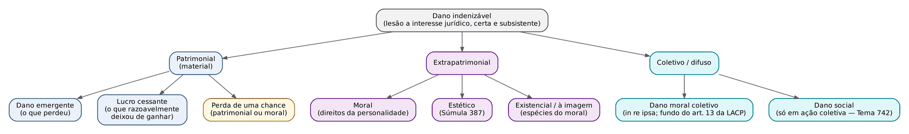
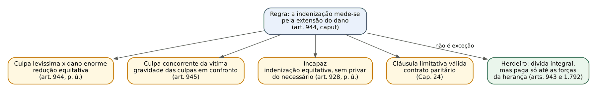
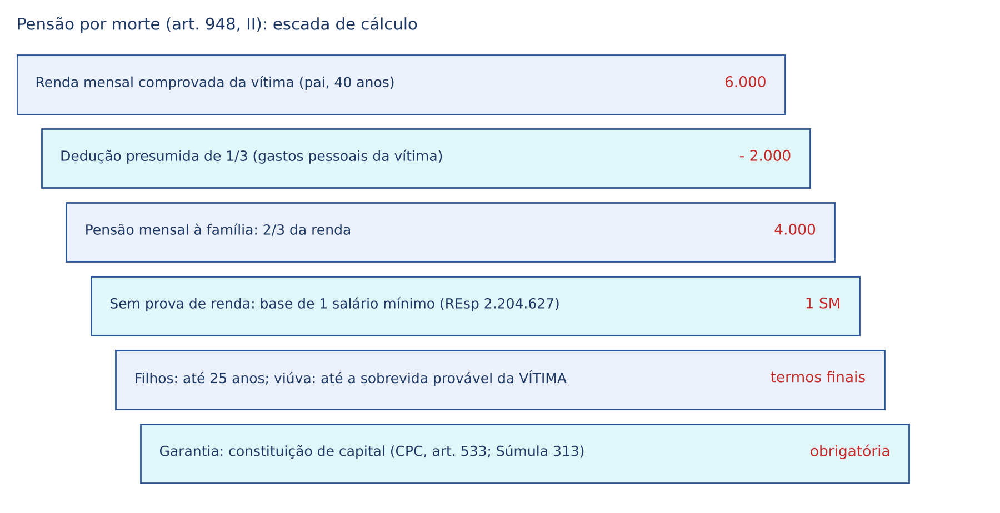
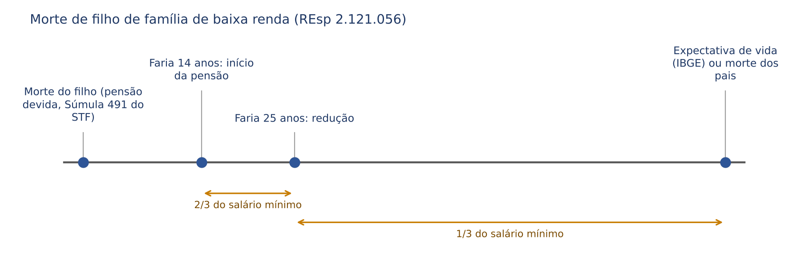
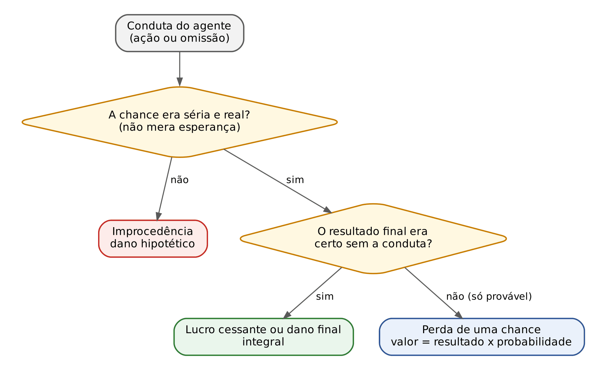
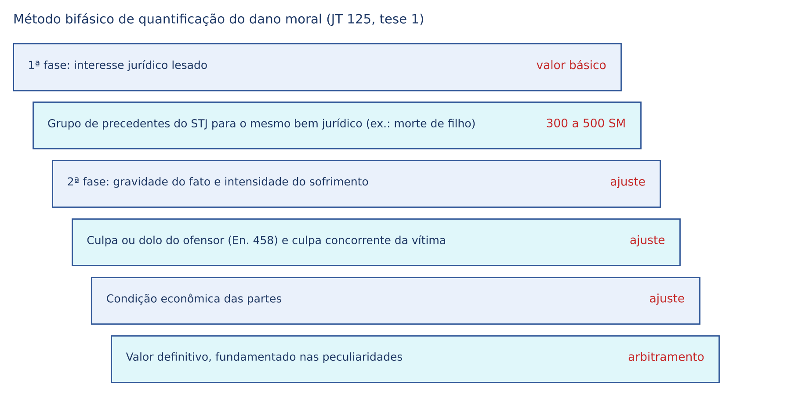
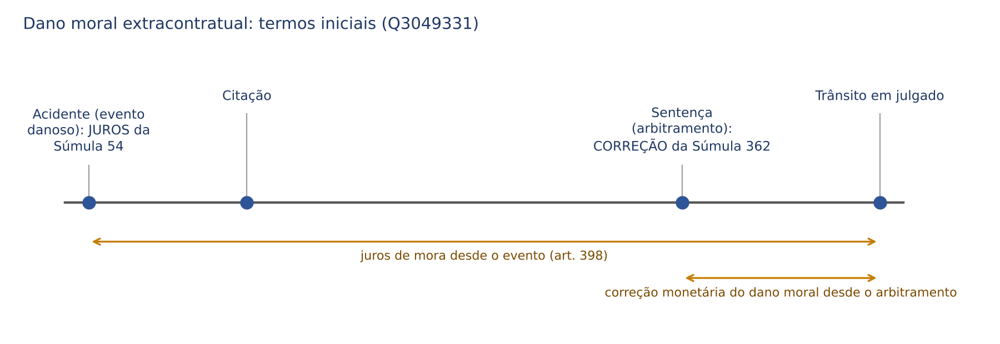

# CAPÍTULO 25 — RESPONSABILIDADE CIVIL II: DANO PATRIMONIAL E EXTRAPATRIMONIAL, PERDA DE UMA CHANCE, DANO MORAL COLETIVO, DANOS NAS RELAÇÕES FAMILIARES, QUANTIFICAÇÃO, JUROS E CORREÇÃO

:::INCIDENCIA
TRF5 p. 11; TJRS p. 15; TJSC p. 15; SEFAZ p. 9. Nível A+. Lote: 12 questões (FGV 12, FCC 0), mais 9 correlatas localizadas por palavra-chave.
O que mais cai: pensionamento (arts. 948 e 950: base de 2/3, salário mínimo, criança e filho falecido), termos iniciais de juros e correção (Súmulas 54 e 362), redução equitativa e culpa concorrente (arts. 944 e 945), perda de uma chance x causalidade virtual, dano existencial e reflexo, dano moral coletivo *in re ipsa*.
:::

| Subtema | FGV | FCC | Padrão de cobrança |
|---|---|---|---|
| Pensionamento (morte e incapacidade) | 3 | 0 | caso concreto com jurisprudência do STJ: 2/3, salário mínimo, presunções para criança e família de baixa renda |
| Reparação integral, redução equitativa, culpa concorrente | 2 | 0 | letra dos arts. 944 e 945 e exceções à *restitutio in integrum* |
| Espécies de dano (existencial, reflexo, estético, coletivo) | 3 | 0 | nomear a categoria a partir do caso; Súmula 387; dano coletivo *in re ipsa* |
| Quantificação e consectários | 2 | 0 | método bifásico; Súmulas 54 e 362 |
| Perda de uma chance | 1 | 0 | distinguir de causalidade virtual e de lucro da intervenção |
| Dano moral e liberdade de expressão; estelionato sentimental | 2 | 0 | ilicitude e prova do dano moral |

## 25.1 O dano indenizável: requisitos e mapa das espécies

Sem dano não há responsabilidade civil (salvo as tutelas preventivas e inibitórias, que dispensam dano e culpa: art. 12 do CC; Cap. 4). O dano indenizável exige: (i) lesão a interesse juridicamente protegido, patrimonial ou existencial; (ii) certeza, que exclui o dano hipotético ou eventual, mas não o dano futuro que seja desdobramento certo do evento (pensões vincendas, tratamento futuro); (iii) subsistência, isto é, o dano não pode já ter sido reparado pelo próprio ofensor. Não se exige atualidade: o dano futuro e certo é indenizável. A perda de uma chance (25.8) é a ponte entre o dano certo e o hipotético: indeniza-se a probabilidade séria, não o resultado final.

Distinção útil, cara à doutrina contemporânea (Schreiber, Tepedino): dano-evento (a lesão ao interesse) e dano-prejuízo (a consequência patrimonial ou existencial). O dano moral, no conceito que prevaleceu, é definido pelo dano-evento (lesão a direito da personalidade), não pela dor: "O dano moral indenizável não pressupõe necessariamente a verificação de sentimentos humanos desagradáveis como dor ou sofrimento" (Enunciado 445 do CJF). É por isso que a pessoa jurídica, o recém-nascido e a pessoa em estado vegetativo podem sofrer dano moral.

| Classificação | Espécies | Ponto de prova |
|---|---|---|
| Quanto ao conteúdo | patrimonial (emergente, lucro cessante) x extrapatrimonial (moral, estético, existencial) | cumuláveis (Súmulas 37 e 387 do STJ) |
| Quanto à vítima | direto x reflexo ou em ricochete | o reflexo é dano próprio do terceiro, inclusive se a vítima direta sobreviver (25.6.6) |
| Quanto à titularidade | individual x individual homogêneo x coletivo (difuso ou coletivo *stricto sensu*) | dano moral coletivo não serve para direitos individuais homogêneos (25.9) |
| Quanto ao momento | presente x futuro | o futuro certo é indenizável; o hipotético, não |
| Quanto à prova | provado x presumido (*in re ipsa*) | presunção só nas hipóteses consolidadas (25.6.2) |
| Novos danos | existencial, perda do tempo útil (desvio produtivo), dano social, perda de uma chance | a FGV pede que o candidato NOMEIE a categoria a partir do caso |

:::PEGADINHA Dano-evento x dano reparável
"Todo ilícito gera dano moral." ERRADO: o ilícito (art. 186) só obriga a indenizar se houver dano (art. 927). O mero aborrecimento inerente a prejuízo material não caracteriza dano moral (Enunciado 159 do CJF), e o descumprimento de contrato só gera dano moral quando atinge valor fundamental protegido pela Constituição (Enunciado 411 do CJF). Já o abuso de direito é ilícito (art. 187) e, havendo dano, obriga a reparar (Cap. 10).
:::

## 25.2 Reparação integral e suas exceções (arts. 944 e 945)

:::LEI Código Civil, arts. 944 e 945
Art. 944. A indenização mede-se pela extensão do dano.
Parágrafo único. Se houver excessiva desproporção entre a gravidade da culpa e o dano, poderá o juiz reduzir, eqüitativamente, a indenização.
Art. 945. Se a vítima tiver concorrido culposamente para o evento danoso, a sua indenização será fixada tendo-se em conta a gravidade de sua culpa em confronto com a do autor do dano.
:::

O *caput* do art. 944 consagra o princípio da reparação integral (*restitutio in integrum*): a indenização não pode ficar aquém nem ir além do dano, sob pena de enriquecimento sem causa. Três consequências cobradas: (i) a gravidade da culpa, em regra, NÃO mede a indenização (o dolo não amplia a indenização patrimonial: art. 403; Cap. 14); (ii) a condição econômica do ofensor não reduz a indenização material, salvo as exceções legais; (iii) a indenização é DEVIDA, mesmo que o ofensor seja pobre, e só se modula nas hipóteses abaixo.

### 25.2.1 Redução equitativa (art. 944, parágrafo único)

Requisitos cumulativos: (a) excessiva desproporção entre a GRAVIDADE DA CULPA (leve ou levíssima) e a EXTENSÃO do dano (grande); (b) juízo de equidade do juiz ("poderá": faculdade, não direito do ofensor). A lei só autoriza REDUZIR; jamais majorar (pegadinha recorrente: "se houver dolo, poderá o juiz elevar equitativamente a indenização" — ERRADO; Q2375285 e Q3052479, alternativas C e D).

Controvérsia: aplicação à responsabilidade objetiva. Como a norma mede a "gravidade da culpa", a posição tradicional, que constava de enunciado das Jornadas depois revisto, era de que ela não se aplica à responsabilidade objetiva; parte da doutrina (Tartuce, Schreiber) admite aplicá-la excepcionalmente quando houver culpa a aferir. Para a prova: a regra é de interpretação restritiva e excepcional, pois limita a reparação integral.

:::DOUTRINA Fundamento da redução
A regra rompe com a lógica pura da reparação integral e reintroduz a culpa como fator de medida, em homenagem à equidade e à proteção do patrimônio mínimo do ofensor (Cavalieri; Farias e Rosenvald). Não se confunde com o caráter punitivo: aqui a culpa leve beneficia o ofensor; a função punitiva (25.11.3) agravaria a condenação, e não tem previsão expressa no CC.
:::

### 25.2.2 Culpa concorrente (art. 945)

Concorrendo a vítima culposamente para o dano, a indenização é fixada pela gravidade das culpas em confronto. Não há exclusão do nexo (isso só ocorre no fato EXCLUSIVO da vítima: Cap. 24), mas repartição. O Enunciado 630 do CJF afirma que "culpas não se compensam" e exige que as condutas se reportem ao mesmo fato e se considere o "percentual causal do agir de cada um": a doutrina atual lê o art. 945 como concausalidade (contribuição causal), não como compensação moral de culpas. A redução atinge todas as parcelas, patrimoniais e extrapatrimoniais. Na responsabilidade objetiva a concorrência da vítima também reduz a indenização (STJ, atropelamento em via férrea com concorrência de causas, na nota adm-0141 do Caderno Dizer o Direito).

:::QUESTAO FGV 2026 — AL-RO — Analista Legislativo (Q3882264)
Caso: condutor de bicicleta elétrica, com culpa leve, atinge pedestre que atravessava fora da faixa usando o celular; danos patrimoniais e extrapatrimoniais significativos. Gabarito: C (o juiz poderá reduzir equitativamente pela desproporção entre culpa e dano E deverá considerar a culpa concorrente da vítima).
Passos: (1) culpa leve + dano grande: art. 944, parágrafo único ("poderá"); (2) conduta culposa da vítima: art. 945 ("será fixada", comando); (3) os dois mecanismos são cumuláveis e distintos. Armadilhas: A (grau de culpa irrelevante: ignora as duas exceções); B (concorrência não exclui o nexo, só a culpa exclusiva); D (equidade e culpa da vítima não se excluem); E (a concorrência reduz também os danos patrimoniais).
:::

### 25.2.3 Quadro das exceções à reparação integral

| Mecanismo | Pressuposto | Efeito | Fundamento |
|---|---|---|---|
| Redução equitativa | culpa levíssima x dano enorme | redução facultativa | art. 944, p. ú. |
| Culpa concorrente | contribuição causal da vítima | fixação proporcional (obrigatória) | art. 945; En. 630 |
| Responsabilidade do incapaz | responsáveis sem obrigação ou sem meios | indenização equitativa; não pode privar do necessário | art. 928, p. ú. (Cap. 24) |
| Cláusula limitativa | contrato paritário, sem dolo ou culpa grave, fora de consumo | limite convencional | Cap. 24 |
| Prefixação | cláusula penal, arras | limite, salvo indenização suplementar pactuada | arts. 416 e 419 (Cap. 14) |
| Injúria, difamação, calúnia e ofensa à liberdade sem prova de prejuízo material | impossibilidade de prova | fixação equitativa | arts. 953 e 954 |
| Herdeiro | dívida do falecido | NÃO é exceção: a indenização é integral; o herdeiro só responde até as forças da herança | arts. 943 e 1.792 |

:::QUESTAO FGV 2024 — TJ-AP — Analista Judiciário (Q2449074)
Pediu-se a situação em que o princípio da reparação integral "deve ser observado mesmo quando" ocorre. Gabarito oficial: B (herdeiro chamado a responder por ato do falecido que deixou herança inferior à dívida).
Raciocínio da banca: as alternativas A (art. 944, p. ú.), C (art. 928, p. ú.), D (art. 953, p. ú.) e E (cláusula limitativa) são exceções legais ou convencionais à reparação integral. Na B, o dano é apurado por inteiro (art. 943: a obrigação de reparar transmite-se com a herança); o limite das forças da herança (art. 1.792) diz respeito à responsabilidade patrimonial do herdeiro, não à MEDIDA da indenização. Gabarito discutível: o credor, na prática, não recebe tudo; ver nota de verificação.
:::

No mesmo eixo: FGV 2024 — Prefeitura de Vitória (Q3052479), em que se afirmava que o juiz poderia "majorar" a indenização pela desproporção entre culpa e dano (errado), e FCC 2025 — DPE-RS (Q3386996), em que se afirmava ser "absolutamente vedada" a redução equitativa (errado) e que o dano material "cinge-se àquilo que a vítima efetivamente perdeu" (errado: há o lucro cessante).

## 25.3 Dano patrimonial

### 25.3.1 Dano emergente, lucro cessante e prova

Conceitos, art. 402, art. 403 (dano direto e imediato) e a não indenização de atividade ilícita estão no Cap. 14 (14.6.1). Aqui, o que a responsabilidade extracontratual acrescenta:

- Prova efetiva: o dano material só é indenizável mediante prova efetiva de sua ocorrência; não há lucro cessante dissociado do dano demonstrado. Exemplo do STJ: pescadores atingidos por dano ambiental não recebem lucros cessantes pelo período de defeso, em que a pesca estava proibida de qualquer modo (Tema 834 do STJ).
- Lucros cessantes presumidos: há presunções jurisprudenciais, como o valor locativo no atraso na entrega de imóvel (Q3593086, gabarito A; Temas 970 e 971 — ver Cap. 14) e a capacidade laborativa futura da criança (25.5).
- Liquidação: o *an debeatur* (existência do dano) deve ser provado na fase de conhecimento; o *quantum* pode ser apurado em liquidação (art. 946 do CC; arts. 491 e 509 do CPC; 25.13).
- Danos patrimoniais reflexos: no plano patrimonial, o dano por ricochete não se restringe ao art. 948 (Enunciado 560 do CJF); exemplo: o empregador que custeia o tratamento do empregado atropelado.
- Danos materiais em violação de propriedade industrial: reparam-se danos patrimoniais e extrapatrimoniais (Enunciado 551 do CJF).

:::ATENCAO Resolução x equivalente: não cumular
Na resolução por inadimplemento (cirurgia estética malsucedida), a restituição do preço não se cumula com o custeio de nova cirurgia por terceiro, o equivalente da prestação (REsp 2.225.449-RJ — v. Cap. 26); danos moral e estético continuam cumuláveis com a restituição.
:::

### 25.3.2 Usurpação, esbulho e coisa que falta (arts. 947 e 952)

Na usurpação ou esbulho, além de restituir a coisa, o ofensor paga as deteriorações e os lucros cessantes; faltando a coisa, reembolsa o equivalente (art. 952). E, se faltar a coisa, além do equivalente indenizam-se também os lucros cessantes (Enunciado 561 do CJF).

:::LEI Código Civil, art. 952, parágrafo único
Para se restituir o equivalente, quando não exista a própria coisa, estimar-se-á ela pelo seu preço ordinário e pelo de afeição, contanto que este não se avantaje àquele.
:::

Pegadinha da letra: o valor de afeição é indenizável, mas limitado: não pode superar o preço ordinário. O art. 947 trata da substituição da prestação pelo seu valor em moeda, quando impossível cumpri-la na espécie ajustada.

:::QUESTAO FGV 2024 — TJ-SC — Juiz Substituto (Q2386956)
Motorista usou secretamente o carro do patrão em corridas e ganhou prêmio de 150.000 (cento e cinquenta mil) reais. Gabarito: D. Lição para este capítulo: o lucro cessante mede o que o DONO deixou de ganhar (valor de uso); o prêmio é lucro do OFENSOR, recuperável pelo lucro da intervenção, não pela perda de uma chance, que exigiria chance do próprio titular (alternativas C e E) (questão comentada por inteiro no Cap. 23).
:::

### 25.3.3 Compensação de vantagens (*compensatio lucri cum damno*)

Deduz-se da indenização a vantagem que o próprio evento trouxe à vítima quando a vantagem tiver a mesma causa e a mesma finalidade reparatória. Aplicações cobráveis:

- Seguro obrigatório: "O valor do seguro obrigatório deve ser deduzido da indenização judicialmente fixada" (Súmula 246 do STJ — v. Cap. 20).
- Benefício previdenciário: NÃO se deduz automaticamente da pensão civil, porque tem causa diversa (contribuição); a pensão por morte paga pelo Estado ao companheiro de servidor não impede a pensão indenizatória do art. 948, II, desde que demonstrado decréscimo na situação financeira dos dependentes (STJ, REsp 1.392.730-DF, Quarta Turma, j. 5/3/2024, Informativo 804).
- Seguro de vida ou de acidentes pessoais contratado pela vítima: não se deduz, por ter causa contratual própria (orientação tradicional; ver Cap. 20).

## 25.4 Indenização em caso de homicídio (art. 948)

:::LEI Código Civil, art. 948
Art. 948. No caso de homicídio, a indenização consiste, sem excluir outras reparações:
I - no pagamento das despesas com o tratamento da vítima, seu funeral e o luto da família;
II - na prestação de alimentos às pessoas a quem o morto os devia, levando-se em conta a duração provável da vida da vítima.
:::

Pontos de letra: (i) "sem excluir outras reparações": o rol é exemplificativo e admite dano moral dos familiares (reflexo) e dano moral da própria vítima transmitido aos herdeiros (25.6.5); (ii) os alimentos são devidos às pessoas "a quem o morto os devia" (dependência econômica); (iii) a duração considerada é a provável da vida DA VÍTIMA, não a do pensionista (pegadinha da alternativa D da Q4083796); (iv) "homicídio" abrange qualquer morte imputável, dolosa ou culposa, e o art. 951 estende o regime aos profissionais (Cap. 26). Não se aplica à morte o pagamento de uma só vez do art. 950, parágrafo único: a pensão por morte é paga em prestações (STJ, REsp 1.045.775/ES, Terceira Turma, DJe 4/8/2009).

### 25.4.1 Alimentos indenizatórios: natureza e beneficiários

A pensão do art. 948, II, tem natureza indenizatória (reparar a perda do sustento), embora a lei a chame de "alimentos". Consequências: não depende do binômio necessidade e possibilidade do art. 1.694, mas da renda que a vítima destinava aos dependentes; mede-se pela vítima, não pelo pensionista; é cumulável com benefício previdenciário (25.3.3). A prisão civil, por outro lado, NÃO cabe para alimentos indenizatórios, segundo orientação consolidada do STJ (o tema da prisão civil é do Cap. 39).

| Beneficiário | Dependência | Termo final usual na jurisprudência |
|---|---|---|
| Cônjuge ou companheiro | presumida em família de baixa renda; provada nas demais | sobrevida provável da vítima (tabela do IBGE) ou morte do beneficiário |
| Filhos da vítima | presumida | 25 anos de idade (idade em que se presume concluída a formação; ver nota) |
| Pais da vítima (filho falecido) | presumida em família de baixa renda (Súmula 491 do STF) | data em que a vítima atingiria a expectativa de vida, ou morte dos pais |
| Outros parentes | provada | conforme a dependência |

:::JURIS STJ, REsp 2.204.627-DF, j. 3/2/2026 (Informativo 876)
O pensionamento mensal decorrente de ato ilícito deve limitar-se a 2/3 dos rendimentos auferidos pela vítima falecida ou equivaler a um salário mínimo, quando não houver comprovação dos rendimentos. Rejeitou-se a tese da Fazenda de que, sem prova de renda, os dependentes receberiam apenas 2/3 do salário mínimo.
:::

Lógica do 2/3: presume-se que a vítima gastaria 1/3 de sua renda consigo mesma; os dependentes recebem os outros 2/3. Sem prova de renda, presume-se que a vítima ganharia ao menos o salário mínimo e a pensão corresponde a 1 (um) salário mínimo, sem o redutor (é a solução do REsp 2.204.627; em julgados mais antigos, aplicava-se 2/3 do salário mínimo, inclusive na morte de filho: 25.4.2). O 13º salário (e as férias com o terço) integra a base quando comprovado o vínculo empregatício da vítima (STJ, REsp 659.715-RJ, j. 14/10/2008, e REsp 507.521-RJ, j. 9/6/2009, citados em pesquisa do TJSP).

:::QUESTAO FGV 2026 — TJ-BA — Juiz Substituto (Q4083796)
Morte por negligência em hospital público; a juíza, sem prova de renda, fixou 1/3 do salário mínimo para a mãe da vítima (até a data em que a vítima faria 78 anos ou a morte da beneficiária) e 2/3 para a filha (até 24 anos); a Fazenda alegou que a soma não poderia passar de 2/3. Gabarito: E (o pensionamento deve limitar-se a 2/3 dos rendimentos da vítima ou equivaler a um salário mínimo, se não houver comprovação de rendimentos).
Passos: (1) o redutor de 2/3 incide sobre RENDIMENTOS comprovados; (2) sem prova, a pensão total equivale a um salário mínimo, repartido entre os dependentes (1/3 + 2/3 = 1 SM): a sentença estava correta; (3) a responsabilidade do Estado é objetiva (CF, art. 37, § 6º), o que elimina a A. Armadilhas: B (na família de baixa renda a dependência é presumida); C (não há regra de média da CTPS); D (copia o art. 948, II, mas troca "vida da vítima" por "vida do pensionista").
:::

### 25.4.2 Morte de filho

"É indenizável o acidente que cause a morte de filho menor, ainda que não exerça trabalho remunerado" (Súmula 491 do STF). Em família de baixa renda, presume-se que o filho contribuiria para o sustento da família; nas demais, a dependência deve ser provada.

:::JURIS STJ, REsp 2.121.056-PR, Terceira Turma, j. 21/5/2024 (Informativo 814)
Morte de recém-nascido por erro médico: pensão aos pais devida, com termo inicial na data em que a vítima completaria 14 anos (idade mínima para contrato de trabalho, como aprendiz), de 2/3 do salário mínimo até a data em que completaria 25 anos, reduzida a 1/3 a partir daí, até a idade correspondente à expectativa média de vida (IBGE) ou a morte dos beneficiários, o que ocorrer primeiro. Na família de baixa renda há presunção relativa de dependência econômica; nas demais, exige-se prova.
:::

Lógica da redução aos 25 anos: presume-se que o filho constituiria família própria e passaria a contribuir menos. Termo inicial em regra: a data do óbito (evento danoso), mesmo que a vítima não pudesse trabalhar naquele momento, como o detento morto no presídio (STJ, AgInt no AREsp 2.529.276-CE, Segunda Turma, j. 21/10/2024, Informativo 836); a exceção é a vítima criança, para a qual a pensão começa na idade em que poderia trabalhar.

:::QUESTAO FGV 2024 — TJ-MT — Juiz Substituto (Q3086916)
Morte de filho de 15 anos; no saneador, o juiz exigiu do autor prova de (i) contribuição da vítima para o sustento da família de baixa renda, (ii) exercício de atividade laborativa e (iii) valor dos rendimentos. Gabarito: A (errou ao impor tais comprovações).
Passos: (i) em família de baixa renda, a dependência é presumida; (ii) a Súmula 491 do STF dispensa trabalho remunerado; (iii) sem renda, a base é o salário mínimo. As três exigências contrariam presunções jurisprudenciais, de modo que nenhuma alternativa "acertou" se sustenta.
:::

No mesmo sentido, em edição anterior: FGV 2023 — TJ-ES (citada na obra de Ana Paula Dias, gabarito B), em que se afirmava não ser devido pensionamento à família de "modestos agricultores" pela morte de criança de 12 anos (errado) e que o agravamento por fragilidade especial da vítima (*thin skull rule*, teoria da vítima de "crânio fino") não teria previsão expressa no CC (certo, na leitura da banca).

## 25.5 Lesão à saúde e incapacidade (arts. 949 e 950)

:::LEI Código Civil, arts. 949 e 950
Art. 949. No caso de lesão ou outra ofensa à saúde, o ofensor indenizará o ofendido das despesas do tratamento e dos lucros cessantes até ao fim da convalescença, além de algum outro prejuízo que o ofendido prove haver sofrido.
Art. 950. Se da ofensa resultar defeito pelo qual o ofendido não possa exercer o seu ofício ou profissão, ou se lhe diminua a capacidade de trabalho, a indenização, além das despesas do tratamento e lucros cessantes até ao fim da convalescença, incluirá pensão correspondente à importância do trabalho para que se inabilitou, ou da depreciação que ele sofreu.
Parágrafo único. O prejudicado, se preferir, poderá exigir que a indenização seja arbitrada e paga de uma só vez.
:::

Estrutura: (i) lesão sem sequela (art. 949): despesas de tratamento + lucros cessantes ATÉ O FIM DA CONVALESCENÇA + "algum outro prejuízo que o ofendido prove" (cláusula aberta, que abarca dano moral e estético: Enunciado 192 do CJF manda analisar os arts. 949 e 950 em conjunto para cumular perdas e danos materiais, moral e estético); (ii) lesão com sequela incapacitante (art. 950): tudo do art. 949 + PENSÃO correspondente à importância do trabalho para que se inabilitou (incapacidade total: 100% da renda) ou à depreciação sofrida (incapacidade parcial: percentual da perda).

Diferenças com a pensão por morte, todas cobráveis:

| Ponto | Morte (art. 948, II) | Incapacidade (art. 950) |
|---|---|---|
| Credor | dependentes (alimentos a quem o morto os devia) | a própria vítima |
| Medida | 2/3 da renda (dedução dos gastos pessoais) | 100% na incapacidade total; percentual da depreciação na parcial |
| Duração | sobrevida provável da vítima | vitalícia (a vítima está viva; não se limita à expectativa de vida) |
| Pagamento de uma só vez | não cabe | faculdade da vítima (p. ú.), não absoluta |
| Exercício de atividade remunerada | presumido para filhos de baixa renda | presumida a limitação futura na criança ou adolescente lesionado |

Pontos jurisprudenciais:

- A perda ou redução da capacidade laborativa gera pensão ainda que a vítima continue trabalhando ou não tenha perda salarial imediata: indeniza-se a depreciação da capacidade, que exige maior esforço (orientação do STJ refletida nas questões).
- A pensão do art. 950 é cumulável com benefício previdenciário (causas distintas).
- Pagamento de uma só vez: o direito do prejudicado NÃO é absoluto; o juiz pode avaliar, caso a caso, se a parcela única é conveniente, considerando a capacidade econômica do ofensor para não levá-lo à ruína (STJ, REsp 1.531.096, Terceira Turma, noticiado em 29/5/2016). Na prática, o valor único é calculado com redutor (antecipação de parcelas futuras), questão de liquidação.

:::JURIS STJ, REsp 1.993.028-DF, Quarta Turma, j. 4/11/2025 (Informativo Extraordinário 29)
A perda da visão em idade escolar presume a limitação da capacidade laborativa, justificando o pensionamento vitalício. É desnecessário provar exercício de atividade remunerada ou redução efetiva de rendimentos.
:::

:::QUESTAO FGV 2026 — TRF2 — Juiz Federal Substituto (Q3996856)
Aluno de 14 anos de colégio de aplicação federal perde a visão de um olho atingido por lapiseira; a coordenação só aplicou compressa fria. Pedido de pensão vitalícia contra a União. Gabarito: E (a perda da visão em idade escolar faz presumir a limitação da capacidade laborativa futura; pensão vitalícia devida, sem prova de atividade remunerada ou redução de rendimentos).
Armadilhas: A (exigir perícia de incapacidade total: o art. 950 indeniza também a redução); B (culpa *in eligendo*: a responsabilidade do Estado e da escola pela guarda do aluno é objetiva); C (pensão "só a partir da idade laboral, com novo pedido": a pensão é fixada desde logo, e a idade mínima é termo inicial de pagamento, quando o caso exigir, não condição para novo processo); D (converter a pensão em dano moral confunde dano patrimonial com extrapatrimonial).
:::

:::QUESTAO FGV 2024 — Prefeitura de Macaé — Procurador (Q3049924)
Advogada jovem fica tetraplégica no desabamento do telhado de shopping em reforma. Afirmações: I (dano moral, danos emergentes, lucros cessantes e dano estético), II (método bifásico) e III (dano estético autônomo, mas "limitado ao patamar" do dano moral). Gabarito: B (I e II corretas).
Erro da III: a Súmula 387 do STJ admite a cumulação sem qualquer teto vinculado ao dano moral; o estético pode, em tese, superar o moral. Observe que a afirmação I também comporta pensão vitalícia (art. 950), não mencionada.
:::

### 25.5.1 Constituição de capital e garantia da pensão

:::LEI Código de Processo Civil, art. 533, caput e §§ 1º a 4º
Art. 533. Quando a indenização por ato ilícito incluir prestação de alimentos, caberá ao executado, a requerimento do exequente, constituir capital cuja renda assegure o pagamento do valor mensal da pensão.
§ 1º O capital a que se refere o caput, representado por imóveis ou por direitos reais sobre imóveis suscetíveis de alienação, títulos da dívida pública ou aplicações financeiras em banco oficial, será inalienável e impenhorável enquanto durar a obrigação do executado, além de constituir-se em patrimônio de afetação.
§ 2º O juiz poderá substituir a constituição do capital pela inclusão do exequente em folha de pagamento de pessoa jurídica de notória capacidade econômica ou, a requerimento do executado, por fiança bancária ou garantia real, em valor a ser arbitrado de imediato pelo juiz.
§ 3º Se sobrevier modificação nas condições econômicas, poderá a parte requerer, conforme as circunstâncias, redução ou aumento da prestação.
§ 4º A prestação alimentícia poderá ser fixada tomando por base o salário-mínimo.
:::

"Em ação de indenização, procedente o pedido, é necessária a constituição de capital ou caução fidejussória para a garantia de pagamento da pensão, independentemente da situação financeira do demandado" (Súmula 313 do STJ). Pegadinhas: (i) o CPC fala em "a requerimento do exequente", mas a Súmula 313 diz ser "necessária" a garantia "independentemente da situação financeira do demandado"; a solidez da empresa autoriza a SUBSTITUIÇÃO por inclusão em folha (§ 2º), não a dispensa pura; (ii) a pensão pode ter por base o salário mínimo (§ 4º), sem ofensa ao art. 7º, IV, da CF, porque se trata de indexar prestação alimentar; (iii) a pensão é revisável (§ 3º): é sentença sujeita a cláusula *rebus sic stantibus*; (iv) findo o pensionamento, libera-se o capital (§ 5º).

:::PROCESSO Pensão indenizatória: do pedido ao cumprimento
- Pedido: pensão vencida e vincenda; valor da causa = vencidas + 12 vincendas, se por tempo indeterminado ou superior a um ano (CPC, art. 292, § 1º e § 2º).
- Sentença: base (renda ou salário mínimo), percentual, beneficiários, termos inicial e final, 13º salário quando houver vínculo, correção e juros, constituição de capital (art. 533; Súmula 313).
- Parcelas vencidas: pagas de uma vez, corrigidas e com juros contados do vencimento de cada prestação, porque cada parcela é dano que nasce mês a mês (25.12; ver nota de verificação).
- Cumprimento: pelo art. 533; inclusão em folha substitui o capital; revisão por mudança econômica (§ 3º).
:::

## 25.6 Dano moral

### 25.6.1 Conceito e fundamento

O dano moral é reparável por força constitucional (CF, art. 5º, V e X) e legal ("ainda que exclusivamente moral": art. 186; Cap. 10). Duas concepções disputam o conceito: (a) a negativa ou subjetiva, que o identifica com dor, sofrimento, humilhação (estado anímico da vítima); (b) a positiva ou objetiva, hoje prevalente no STJ e na doutrina (Cavalieri, Schreiber, Tepedino, Farias e Rosenvald, Tartuce), que o define como lesão a direito da personalidade ou à dignidade da pessoa humana. Dor e sofrimento são consequências eventuais, não o conteúdo do dano (Enunciado 445 do CJF). A natureza da indenização é compensatória (satisfação), não reparatória em sentido estrito, porque não há equivalência entre dinheiro e bem existencial.

Consequências da concepção objetiva: (i) titularidade de quem não sente dor (recém-nascido, pessoa em coma, pessoa jurídica); (ii) desnecessidade de provar o sofrimento quando a lesão ao direito da personalidade é evidente (*in re ipsa*); (iii) exclusão dos meros dissabores, que não atingem a personalidade.

:::QUESTAO FGV 2026 — MPE-RJ — Promotor de Justiça Substituto (Q4088274)
Jovem de 18 anos morre após sucessivos atendimentos negligentes durante epidemia de H1N1; deixa filha de meses. O TJRJ reconheceu à criança indenização por ter sido privada da assistência moral e afetiva materna, com prejuízo relevante à formação da personalidade. Gabarito: A (danos existenciais).
Passos: (1) a lesão não é dor atual (a recém-nascida não a sente), mas o comprometimento do projeto de vida e da convivência, que é a marca do dano existencial (25.6.7); (2) não é "moral clássico" (B), centrado no sofrimento; (3) não é lucro da intervenção (C), que pressupõe lucro do ofensor; (4) o dano reflexo (D) seria a categoria mais próxima, mas o enunciado enfatiza a privação de convivência e a formação da personalidade; (5) a perda da chance de cura (E) é da vítima direta (a mãe), não da filha. Gabarito discutível na fronteira com o dano reflexo: ver nota.
:::

### 25.6.2 Dano *in re ipsa* x dano a provar

O dano moral presumido dispensa prova do abalo, não do fato. Mesmo quando presumido, o juiz pode investigar as circunstâncias para QUANTIFICAR, inclusive com depoimento pessoal e testemunhas (Enunciado 455 do CJF).

| Presumido (*in re ipsa*) | Fundamento |
|---|---|
| Inscrição indevida em cadastro de inadimplentes | JT 59, tese 1 |
| Devolução indevida de cheque | Súmula 388 do STJ |
| Apresentação antecipada de cheque pré-datado | Súmula 370 do STJ |
| Publicação não autorizada da imagem com fins econômicos ou comerciais | Súmula 403 do STJ (Cap. 4) |
| Uso indevido do nome com intuito comercial | JT 138, tese 10 |
| Uso não autorizado da imagem de criança ou adolescente | JT 137, tese 9 |
| Disponibilização de dados de histórico de crédito a consulentes sem autorização do cadastrado (Lei 12.414/2011) | REsp 2.201.694-SP (v. Cap. 47) |
| Morte de filho por homicídio enquanto sob a guarda de instituição de ensino | processo em segredo, Quarta Turma, j. 3/2/2026 (Informativo 878) |
| Dano moral coletivo | JT 125, tese 2 (25.9) |

| Exige prova do abalo | Fundamento |
|---|---|
| Atraso ou cancelamento de voo (mero inadimplemento contratual) | AgInt no AREsp 2.150.150-SP, j. 21/5/2024 |
| Mera cobrança indevida, sem inscrição | Caderno Dizer o Direito (civ-0141) |
| Atraso do banco na baixa do gravame de alienação fiduciária | Caderno Dizer o Direito (civ-0645) |
| Pessoa jurídica de direito público (honra objetiva) | REsp 2.039.663-PR, j. 19/5/2025 |
| Pessoa jurídica de direito privado: deve ser demonstrada ofensa à honra objetiva | JT 125, tese 10; Enunciado 189 do CJF |
| Transtornos genéricos de motorista pelo rompimento da barragem de Brumadinho | REsp 2.198.056-MG (v. Cap. 24) |
| Descontos indevidos em benefício previdenciário | PENDENTE: Tema 1.435 do STJ, afetado em 5/5/2026 |

:::ATENCAO Súmula 385 do STJ: a inscrição preexistente
"Da anotação irregular em cadastro de proteção ao crédito, não cabe indenização por dano moral, quando preexistente legítima inscrição, ressalvado o direito ao cancelamento." Quem já tinha restrição legítima não sofre abalo de crédito novo; permanece o direito de cancelar a anotação irregular.
:::

:::NOTA Temas pendentes sobre dano moral presumido (situação em 29/10/2026)
Tema 1.435 do STJ (Segunda Seção, afetação em 5/5/2026, REsp 2.232.320-SC e outros): definir se há dano moral *in re ipsa* em descontos indevidos em benefício previdenciário. Tema 1.414 (afetado): cartão de crédito consignado e eventual dano moral *in re ipsa* na invalidação (v. Cap. 22). O Tema 1.328, sobre o cartão com reserva de margem consignável, consta como cancelado no Radar. Não há tese firmada: em prova, não afirme presunção nessas hipóteses.
:::

### 25.6.3 Mero aborrecimento e inadimplemento contratual

O dano moral não se caracteriza "quando há mero aborrecimento inerente a prejuízo material" (Enunciado 159 do CJF), e o descumprimento de contrato só gera dano moral "quando envolver valor fundamental protegido pela Constituição Federal de 1988" (Enunciado 411 do CJF). Exemplos de inadimplemento que ultrapassa o dissabor: vícios de construção que comprometem a habitabilidade de imóvel do Programa Minha Casa, Minha Vida, (REsp 2.153.450-RJ — v. Cap. 22); recusa indevida de cobertura de plano de saúde em situação de urgência (Cap. 20).

Desvio produtivo (perda do tempo útil): construção de Marcos Dessaune, acolhida pelo STJ nas relações de CONSUMO para indenizar o tempo que o consumidor desperdiça para resolver problema criado pelo fornecedor (REsp 1.634.851/RJ, Terceira Turma, j. 12/9/2017; REsp 1.737.412/SE, j. 5/2/2019). A teoria NÃO se aplica a relações regidas exclusivamente pelo Direito Civil, pela ausência de vulnerabilidade (REsp 2.017.194-SP, Terceira Turma, j. 25/10/2022, Informativo Especial 9). Interface com o CDC: apostila de Consumidor.

### 25.6.4 Pessoa jurídica

"A pessoa jurídica pode sofrer dano moral" (Súmula 227 do STJ), desde que demonstrada ofensa à sua HONRA OBJETIVA (reputação, bom nome no mercado), não à honra subjetiva, que não possui (JT 125, tese 10; Enunciado 189 do CJF: o fato lesivo deve ser demonstrado). O fundamento é o art. 52 do CC ("no que couber"; Cap. 5). Exemplos: protesto indevido de título, inscrição indevida, notícia falsa sobre a empresa.

Pessoa jurídica de DIREITO PÚBLICO: o STJ firmou que ela não é titular de dano moral por ofensa à honra ou imagem, porque direitos fundamentais têm como titular imediato o particular e reconhecê-lo ao Estado subverteria a ordem dos direitos fundamentais, servindo de instrumento contra a crítica (JT 125, tese 11). Julgados posteriores temperaram a regra: admite-se, excepcionalmente, quando a ofensa à credibilidade institucional for grave e comprovada, sendo imprescindível a demonstração do efetivo prejuízo extrapatrimonial (REsp 2.039.663-PR, Quarta Turma, j. 19/5/2025). Em prova objetiva: regra = não; exceção = prova efetiva de prejuízo à honra objetiva.

:::PEGADINHA Condomínio e entes despersonalizados
Condomínio edilício, segundo julgado da Terceira Turma de 2020 citado no Cap. 5, não sofre dano moral por ser ente despersonalizado; a lesão é dos condôminos. Não estender a Súmula 227 a todo ente que tem capacidade processual.
:::

### 25.6.5 Transmissibilidade e legitimidade

:::LEI Código Civil, art. 943
O direito de exigir reparação e a obrigação de prestá-la transmitem-se com a herança.
:::

O crédito de dano moral transmite-se aos herdeiros, que podem ajuizar ou prosseguir a ação, ainda que a vítima não a tenha iniciado (Súmula 642 do STJ e Enunciado 454 do CJF — v. Cap. 24). O que se transmite é o crédito (patrimonial), não o direito da personalidade (intransmissível: art. 11). Legitimidade concorrente do espólio e dos herdeiros (JT 125, tese 5); inclui sucessores de vítimas de perseguição e tortura no regime militar (JT 125, tese 6).

Distinguir três pretensões, que podem coexistir no mesmo processo:

| Pretensão | Titular | Fundamento |
|---|---|---|
| Dano moral sofrido pela vítima em vida e transmitido | espólio ou herdeiros | art. 943; Súmula 642 |
| Dano moral próprio dos familiares pela morte (reflexo) | cada familiar, em nome próprio | art. 948 ("sem excluir outras reparações"); JT 125, tese 4 |
| Tutela da personalidade do morto (ofensa *post mortem*) | cônjuge, parentes em linha reta e colaterais até o 4º grau (art. 12, p. ú.); para imagem, cônjuge, ascendentes e descendentes (art. 20, p. ú.) | Cap. 4 |

:::PEGADINHA Os dois parágrafos únicos
Art. 12, parágrafo único: legitimados o cônjuge sobrevivente, qualquer parente em linha reta ou colateral até o QUARTO grau. Art. 20, parágrafo único (imagem, escritos, palavra de morto ou ausente): cônjuge, ascendentes ou descendentes (sem colaterais). A FGV troca os róis.
:::

### 25.6.6 Dano moral reflexo ou em ricochete

A legitimidade é, em regra, do próprio ofendido, mas pessoas muito próximas afetivamente da vítima, atingidas indiretamente pelo evento, são colegitimadas: é o dano moral reflexo ou em ricochete (JT 125, tese 4). É dano PRÓPRIO do terceiro, pessoal e autônomo em relação ao da vítima direta, e não exige a morte desta: pais de criança gravemente lesionada (nove cirurgias e amputação de dedos) recebem indenização própria (REsp 1.697.723-RJ, Quarta Turma, j. 1/10/2024, Informativo 832).

Presunção do vínculo afetivo: presume-se para o núcleo familiar próximo (cônjuge, companheiro, pais, filhos, irmãos); para os demais, deve ser provado. A indenização é fixada para cada legitimado, por ser dano próprio de cada um.

### 25.6.7 Dano existencial e outros "novos danos"

| Figura | Conteúdo | Situação |
|---|---|---|
| Dano existencial | frustração do projeto de vida ou da vida de relações (convivência, lazer, formação) | categoria doutrinária (origem italiana); no Brasil, espécie de dano moral, com reconhecimento expresso na CLT (dano extrapatrimonial trabalhista); cobrado pela FGV (Q4088274) |
| Perda do tempo útil | desvio produtivo do consumidor | só em relações de consumo (25.6.3) |
| Dano social | lesão ao nível de vida da sociedade por conduta socialmente reprovável (Antônio Junqueira de Azevedo) | só em ação coletiva, com pedido expresso (Tema 742 do STJ; 25.9) |
| Perda de uma chance | probabilidade séria e real | 25.8 |
| Lucro da intervenção | restituição do lucro obtido com a interferência em direito alheio | enriquecimento sem causa, não responsabilidade civil (Cap. 23) |

:::QUESTAO FGV 2025 — MPE-RJ — Promotor de Justiça Substituto (Q3532382)
Ação de viúva aposentada contra companheira 12 anos mais nova que, durante o relacionamento, obteve cerca de 40.000 (quarenta mil) reais em dinheiro e presentes, alegando dificuldades financeiras, e deixou o lar quando o dinheiro foi negado. Gabarito: A (danos materiais procedentes se comprovado o dolo de obter vantagem mediante envolvimento amoroso; danos morais procedentes desde que comprovada a real afetação de direitos da personalidade decorrente do ardil).
Fundamento: o estelionato sentimental é ato ilícito que gera dano moral e dano material pelas despesas extraordinárias decorrentes do relacionamento (STJ, REsp 2.208.310-SP, Quarta Turma, j. 20/5/2025, Informativo 852). Armadilhas: B e C (autonomia privada não protege o ardil); D (o dano moral não foi afirmado como *in re ipsa*); E (não são doações perfeitas e acabadas, mas transferências obtidas por dolo).
:::

:::QUESTAO FGV 2025 — PC-MG — Delegado de Polícia Substituto (Q3171391)
Pai é xingado em público de "péssimo pai" por terceiro, em cena gravada e viralizada; a repercussão acaba favorável e lhe rende trabalhos publicitários. Gabarito: A (procedência, pela violação aos direitos da personalidade).
Passos: (1) a ofensa verbal pública à honra é ilícita e o dano moral se configura pela lesão à personalidade (concepção objetiva), não pelo saldo financeiro; (2) benefícios posteriores não compensam a lesão existencial (B); (3) o xingamento não é exercício regular da liberdade de expressão (C) nem legítima defesa (E); (4) a divulgação por terceiro amplia o dano, mas não rompe o nexo da ofensa original (D).
:::

Correlata: FGV 2025 — TCE-PE (Q3593081, Cap. 26): a responsabilidade por publicação jornalística se funda nos arts. 186 e 953 e ocorre quando a crítica ultrapassa os limites da liberdade de expressão (gabarito A); é ERRADO que o dano moral do art. 953 só seja reparável se houver prejuízo econômico: o parágrafo único manda fixar equitativamente quando não houver prova de prejuízo material.

:::LEI Código Civil, arts. 953 e 954
Art. 953. A indenização por injúria, difamação ou calúnia consistirá na reparação do dano que delas resulte ao ofendido.
Parágrafo único. Se o ofendido não puder provar prejuízo material, caberá ao juiz fixar, eqüitativamente, o valor da indenização, na conformidade das circunstâncias do caso.
Art. 954. A indenização por ofensa à liberdade pessoal consistirá no pagamento das perdas e danos que sobrevierem ao ofendido, e se este não puder provar prejuízo, tem aplicação o disposto no parágrafo único do artigo antecedente.
Parágrafo único. Consideram-se ofensivos da liberdade pessoal:
I - o cárcere privado;
II - a prisão por queixa ou denúncia falsa e de má-fé;
III - a prisão ilegal.
:::

Pegadinhas do art. 954: a prisão por queixa ou denúncia falsa só gera o dever quando "de má-fé" (quem noticia crime de boa-fé exerce direito regular); a prisão ilegal não exige má-fé. A responsabilidade do Estado por prisão ilegal ou erro judiciário tem base também no art. 5º, LXXV, da CF.

## 25.7 Dano estético e dano à imagem

"É lícita a cumulação das indenizações de dano estético e dano moral" (Súmula 387 do STJ). O dano estético é lesão à integridade física que altera a aparência de modo duradouro (cicatriz, amputação, deformidade, perda de membro), aferível objetivamente; o dano moral é o sofrimento ou a lesão existencial pelo mesmo fato. Fixam-se em parcelas separadas, sem teto recíproco (Q3049924, item III). "São cumuláveis as indenizações por dano material e dano moral oriundos do mesmo fato" (Súmula 37 do STJ). O dano estético pode ter reflexo patrimonial (modelo que perde contratos), indenizável como lucro cessante, além do extrapatrimonial. Cobertura securitária do dano estético e do moral: Súmula 402 do STJ e cláusula de exclusão (ver Cap. 20).

:::PEGADINHA Dano estético reparado por cirurgia
O custeio da cirurgia reparadora é dano emergente; se a cirurgia eliminar a deformidade, desaparece o dano estético futuro, mas subsiste o moral pelo período vivido. Afirmação "o pagamento do tratamento, incluindo o dano estético, exclui os lucros cessantes" é ERRADA (Q3052479, alternativa E): são parcelas distintas.
:::

Dano à imagem: a imagem é direito autônomo da personalidade (CF, art. 5º, X; CC, art. 20). Sua violação pode gerar (i) dano moral, presumido no uso comercial (Súmula 403) e no uso da imagem de criança e adolescente (JT 137, tese 9); (ii) dano material (o preço que se pagaria pela licença: critério do "preço de mercado" da imagem); (iii) restituição do lucro da intervenção (REsp 1.698.701; Cap. 4 e Cap. 23). Hipóteses de exclusão e de figurante, documentários e torcedor em multidão: desenvolvidas no Cap. 4 (04.7). Aqui interessa a quantificação: o uso comercial indevido se indeniza pelo valor de mercado da exploração, somado ao dano moral.

## 25.8 Perda de uma chance

### 25.8.1 Conceito e natureza

A perda de uma chance (*perte d'une chance*) indeniza a frustração de uma oportunidade séria e real de obter vantagem ou evitar prejuízo, quando não se pode afirmar que o resultado final ocorreria. O objeto da indenização é a CHANCE, não o resultado final. Requisitos: (i) chance séria e real, "muito mais do que simples esperança subjetiva" (Rafael Peteffi da Silva; Cavalieri); (ii) perda causada por conduta do agente (o nexo se estabelece entre a conduta e a chance perdida, não com o dano final: REsp 2.108.182-MG); (iii) incerteza irredutível sobre o resultado.

Natureza: (a) dano autônomo, intermediário entre o lucro cessante e o dano hipotético (posição majoritária na doutrina e no STJ); (b) para parte da doutrina francesa e brasileira, técnica de flexibilização do nexo causal (causalidade parcial ou probabilística), sobretudo na chance de cura. A chance perdida pode ter natureza patrimonial ou extrapatrimonial, conforme o caso, e não está adstrita a percentuais apriorísticos (Enunciado 444 do CJF).

| Instituto | O que se indeniza | Certeza exigida |
|---|---|---|
| Lucro cessante | o ganho que razoavelmente ocorreria | probabilidade objetiva de que o ganho viria (curso normal das coisas) |
| Perda de uma chance | a probabilidade perdida, em valor proporcional | chance séria e real, resultado incerto |
| Dano hipotético | nada | mera esperança |

### 25.8.2 Quantificação

A indenização é sempre INFERIOR ao valor do resultado final: aplica-se ao benefício esperado o percentual de probabilidade de alcançá-lo (critério estatístico, com perícia, quando possível) e, não sendo possível, arbitramento equitativo. O STJ, no "Show do Milhão" (pergunta sem resposta correta que impediu a participante de disputar o prêmio máximo), fixou a indenização em 1/4 do valor em jogo, porque havia quatro alternativas (caso clássico citado pela doutrina; número do recurso não conferido nesta tarefa: ver nota).

:::EXEMPLO Advogado que perde o prazo do recurso
Advogado deixa de interpor apelação contra sentença que negou crédito de 100.000 (cem mil) reais. Passo 1: a chance de reforma era séria? Depende da jurisprudência dominante sobre a tese: se o recurso era manifestamente inviável, não há chance (improcedência). Passo 2: se havia, por exemplo, 40% de probabilidade de provimento (tese com divisão nos tribunais), a indenização patrimonial seria de 40.000 (quarenta mil) reais, mais eventual dano moral. Passo 3: nunca se condena o advogado aos 100.000 (cem mil) reais, salvo se o êxito fosse certo, quando já não se trataria de chance, mas de lucro cessante.
:::

### 25.8.3 Aplicações e limites na jurisprudência

- Perda da chance de cura ou sobrevivência (seara médica): o STJ aplica a teoria quando a falha (diagnóstico tardio, não internação, descumprimento de protocolo do Ministério da Saúde) suprime chance concreta de evitar o óbito (REsp 1.985.977-DF — v. Cap. 26). Organizadora de rali que dispunha de ambulâncias e não as enviou ao piloto acidentado responde pela chance de sobrevivência perdida (REsp 2.108.182-MG, Terceira Turma, j. 16/4/2024, Informativo 811). Responsabilidade médica em geral: Cap. 26.
- Concurso público e carreira: chance não séria quando restavam várias fases e não havia como aferir aprovação e classificação dentro das vagas (AgRg no REsp 1.220.911-RS, Segunda Turma, j. 17/3/2011). No mesmo sentido, a FGV considerou correto que o jovem lesionado em acidente pode cobrar dano moral, mas NÃO indenização pela chance de chegar a almirante na Marinha (FGV 2022 — TJ-GO, Juiz Leigo, citada no material de julgados do Drive).
- Não se aplica para compensar dano final certo: se a conduta certamente causou o resultado, indeniza-se o resultado inteiro.

:::QUESTAO FGV 2024 — ENAM — 1º Exame Nacional da Magistratura (Reaplicação) (Q2507037)
Candidata eliminada indevidamente pelo fiscal quando já tinha marcado respostas suficientes para passar; pede danos e os salários futuros. O réu prova que o cartão estava preenchido a caneta vermelha, o que causaria eliminação pelo edital. Gabarito: A (perda de uma chance, para a autora; causalidade virtual, para a contestação).
Passos: (1) a autora não pode provar que seria nomeada (havia outra fase): pede a chance; (2) o réu alega que o mesmo resultado (eliminação) ocorreria de qualquer forma por outra causa: é a causalidade virtual (ou hipotética), que, se acolhida, afasta a chance porque ela já não existia; (3) a causalidade alternativa trata de pluralidade de possíveis autores sem identificação de qual causou o dano (Cap. 24), e o lucro da intervenção pressupõe lucro do ofensor.
:::

## 25.9 Dano moral coletivo e danos sociais

:::JURIS STJ, Jurisprudência em Teses, ed. 125, tese 2
O dano moral coletivo, aferível *in re ipsa*, é categoria autônoma de dano relacionado à violação injusta e intolerável de valores fundamentais da coletividade.
:::

Características (REsp 1.610.821-RJ, Quarta Turma, j. 15/12/2020): (i) dispensa demonstração de prejuízos concretos ou de abalo moral, bastando conduta ilícita que viole, de modo injusto e intolerável, direitos extrapatrimoniais da coletividade; (ii) a lesão deve ser significativa, ofendendo de forma inescusável os valores coletivos fundamentais, independentemente do número de atingidos; (iii) é essencialmente transindividual (difusos e coletivos) e NÃO se compatibiliza com a tutela de direitos individuais homogêneos, cujas indenizações vão às vítimas, por condenação genérica liquidada nos arts. 97 a 100 do CDC; (iv) tem natureza eminentemente sancionatória, e o valor vai ao fundo do art. 13 da Lei 7.347/1985 (*fluid recovery*). Também não exige demonstração de dor ou repulsa individual (JT 138, tese 1, referida no Cap. 4).

| Reconhecido | Afastado |
|---|---|
| Oferta irregular de cursos superiores e terceirização ilícita de atividades acadêmicas; admitida, em tese, a publicação da sentença em jornais (REsp 2.078.628-PE, j. 16/12/2025, Informativo 882) | Declarações em trote universitário dirigidas a grupo específico e divulgadas nas redes (REsp 2.060.852-SP, j. 14/10/2025, Informativo 870) |
| Protestos sem comunicação prévia, obstruindo vias de acesso à capital por tempo considerável (REsp 2.026.929-ES, j. 9/9/2025, Informativo 862) | Estacionamento indevido, sem credencial, em vaga de pessoa com deficiência (Caderno Dizer o Direito, civ-0444) |
| Cumulável com sanções administrativas e, segundo o Caderno, possível em ação de improbidade mesmo após a Lei 14.230/2021 | Pretensão de dano social em ação individual (Tema 742) |

Danos sociais (Antônio Junqueira de Azevedo): lesão ao patrimônio social por rebaixamento do nível de vida coletivo, com função punitiva e dissuasória. Não se confundem com danos material, moral ou estético; o juiz não pode condenar a eles de ofício (decisão *extra petita*), e só podem ser pleiteados em ação coletiva pelos legitimados (STJ, Rcl 12.062-GO, Segunda Seção, j. 12/11/2014, Tema 742, Informativo 552).

Dano ambiental individual (reflexo): o pescador artesanal privado das condições de trabalho por dano ambiental tem dano moral indenizável (Tema 439 do STJ); a responsabilidade é objetiva pelo risco integral, sem excludentes (Tema 707), com arbitramento caso a caso e moderação (Tema 707, item c); o STJ não revisou, em recurso especial, o valor de 3.000 (três mil) reais por pescador fixado para o dano no rio Sergipe (Tema 683); e não há lucros cessantes no período de defeso (Tema 834).

:::QUESTAO FGV 2025 — MPU — Analista do MPU — Direito (Q3339800)
Líder religioso concita advogados de sua fé a ajuizarem demandas indenizatórias em juizados de todo o país contra comediante (assédio processual, *sham litigation*); o MPF propõe ação civil pública por danos à liberdade de expressão. Gabarito: A (responsabilidade objetiva; danos coletivos *in re ipsa*).
Passos: (1) o assédio processual é abuso do direito de ação (art. 187), e a responsabilidade por abuso de direito independe de culpa, segundo a orientação majoritária das Jornadas (critério objetivo-finalístico; Cap. 10); (2) a lesão é à liberdade de expressão da coletividade, dano moral COLETIVO, aferível *in re ipsa* (JT 125, tese 2). Armadilhas: B (subjetiva); C e D (danos "sociais" não são o objeto: o pedido é de dano coletivo); E (exigir prova do dano coletivo).
:::

## 25.10 Danos nas relações familiares

### 25.10.1 Premissa: a família não é zona de imunidade, mas também não é zona de indenização automática

A doutrina majoritária (Maria Berenice Dias, Rolf Madaleno, Tartuce, Paulo Lôbo) aplica às relações familiares a cláusula geral do art. 186, mas exige ilícito qualificado: o fim do afeto, a separação e o descumprimento de deveres conjugais, por si sós, não geram dano moral. Medidas próprias do Direito de Família (perda ou suspensão do poder familiar, guarda, alimentos, alienação parental) não se confundem com a indenização (Cap. 38).

### 25.10.2 Abandono afetivo

Evolução jurisprudencial, em três camadas:

- Regra: "O abandono afetivo de filho, em regra, não gera dano moral indenizável, podendo, em hipóteses excepcionais, se comprovada a ocorrência de ilícito civil que ultrapasse o mero dissabor, ser reconhecida a existência do dever de indenizar" (JT 125, tese 7).
- O dever jurídico é de CUIDADO, não de amar: a omissão do genitor no dever de cuidado (criação, educação e companhia) é ilícito civil por omissão (REsp 1.159.242-SP, Terceira Turma, Rel. Min. Nancy Andrighi, j. 24/4/2012; REsp 1.887.697-RJ, j. 21/9/2021; na Quarta Turma, REsp 2.173.153/TO, j. 25/8/2025). Exige-se conduta omissiva, dano à personalidade e nexo causal (art. 186).
- Limites: não há dano moral por abandono afetivo ANTES do reconhecimento da paternidade (JT 125, tese 8); a prescrição da pretensão começa a fluir a partir da maioridade do autor (JT 125, tese 9), pois não corre prescrição entre ascendentes e descendentes durante o poder familiar (art. 197, II; Cap. 11).

:::LEI Lei 8.069/1990 (ECA), arts. 4º, §§ 2º e 3º, e 5º, parágrafo único (redação da Lei 15.240/2025)
Art. 4º (...) § 2º Compete aos pais, além de zelar pelos direitos de que trata o art. 3º desta Lei, prestar aos filhos assistência afetiva, por meio de convívio ou de visitação periódica, que permita o acompanhamento da formação psicológica, moral e social da pessoa em desenvolvimento.
§ 3º Para efeitos desta Lei, considera-se assistência afetiva:
I – orientação quanto às principais escolhas e oportunidades profissionais, educacionais e culturais;
II – solidariedade e apoio nos momentos de intenso sofrimento ou de dificuldade;
III – presença física espontaneamente solicitada pela criança ou adolescente quando possível de ser atendida.
Art. 5º (...) Parágrafo único. Considera-se conduta ilícita, sujeita a reparação de danos, sem prejuízo de outras sanções cabíveis, a ação ou a omissão que ofenda direito fundamental de criança ou de adolescente previsto nesta Lei, incluídos os casos de abandono afetivo.
:::

A Lei 15.240, de 28/10/2025 (publicada no DOU de 29/10/2025, com vigência na data da publicação), alterou o ECA para caracterizar o abandono afetivo como ilícito civil. Alterou também o art. 22 (aos pais incumbe o dever de sustento, guarda, convivência, assistência material e AFETIVA e educação), o art. 56 (comunicação ao Conselho Tutelar de negligência, abuso ou abandono na forma dos arts. 4º e 5º), o art. 129, parágrafo único, e o art. 130 (afastamento cautelar do agressor nos casos de maus-tratos, negligência, opressão ou abuso sexual).

Efeitos práticos da lei: (i) o ilícito passa a ter tipificação legal expressa, o que reforça, mas não dispensa, a prova do dano e do nexo (a lei fala em conduta "sujeita a reparação de danos"); (ii) a assistência afetiva recebe conteúdo legal objetivo (os três incisos do § 3º), o que facilita a demonstração da omissão; (iii) direito intertemporal: a lei não retroage para qualificar condutas anteriores a 29/10/2025, que continuam regidas pela construção jurisprudencial (art. 6º da LINDB; Cap. 1); (iv) a JT 125, tese 7 ("em regra, não gera") deve ser lida à luz da lei nova: a omissão no dever de assistência afetiva é ilícita; o que permanece excepcional é a demonstração de dano relevante.

:::QUESTAO FGV 2026 — TRF2 — Juiz Federal Substituto (Q3996849, atribuída ao Cap. 38)
Pai que paga pontualmente a pensão, mas há seis anos não exerce a convivência, ausente em hospitalização grave e episódio de *bullying* da filha; laudo atesta depressão, ansiedade e nexo com a ausência. Gabarito: C (conduta ilícita que gera dever de indenizar, com previsão expressa no ECA, que tipifica como ilícita a ação ou omissão que ofenda direito fundamental da criança, incluídos os casos de abandono afetivo, em consonância com o STJ).
Armadilhas: A (lícita, mas com responsabilidade objetiva pelo "risco da atividade parental": contraditória); B (diz que "não há previsão legal expressa": desatualizada desde a Lei 15.240/2025, que é exatamente o diferencial da C); D (efeitos só no poder familiar); E (só medidas de proteção). O pagamento dos alimentos não afasta o ilícito: assistência material e afetiva são deveres distintos (art. 22 do ECA).
:::

Correlata: FCC 2025 — DPE-AM (Q3531612, comentada no Cap. 4): medidas que o STJ admite como decorrência do abandono afetivo: indenização, supressão do patronímico e medida de proteção (gabarito E); não cabem prisão civil nem declaração de ausência.

### 25.10.3 Outras situações

| Situação | Orientação |
|---|---|
| Infidelidade conjugal | por si só não gera dano moral; pode gerar quando acompanhada de exposição vexatória ou humilhação pública (orientação majoritária; ver nota) |
| Estelionato sentimental | ilícito; danos materiais e morais (REsp 2.208.310-SP; 25.6.7) |
| Rompimento de noivado | em regra, exercício regular de direito; indenizam-se despesas e, excepcionalmente, dano moral por ruptura abusiva (doutrina majoritária) |
| Alienação parental, violência doméstica | medidas próprias e indenização (Cap. 38) |
| Abandono afetivo inverso (filhos em relação aos pais idosos) | construção doutrinária; deveres do art. 229 da CF e do Estatuto da Pessoa Idosa (Cap. 46) |

## 25.11 Quantificação do dano moral

### 25.11.1 Arbitramento e vedação da tarifação

O dano moral não tem extensão aritmética: o art. 944 é aplicado por arbitramento judicial, guiado por critérios. Os mais citados: gravidade e extensão da lesão, intensidade do sofrimento, grau de culpa ou dolo do ofensor ("O grau de culpa do ofensor, ou a sua eventual conduta intencional, deve ser levado em conta pelo juiz para a quantificação do dano moral": Enunciado 458 do CJF), eventual culpa concorrente da vítima, condição econômica das partes e caráter pedagógico, sem enriquecimento sem causa da vítima e com efetiva compensação (Tema 707 do STJ, item c, que recomenda arbitramento "caso a caso e com moderação").

Tarifação: "A indenização por dano moral não está sujeita à tarifação prevista na Lei de Imprensa" (Súmula 281 do STJ), e "A quantificação da reparação por danos extrapatrimoniais não deve estar sujeita a tabelamento ou a valores fixos" (Enunciado 550 do CJF). A Lei 5.250/1967 foi, depois, considerada não recepcionada pelo STF em sua integralidade. Na Justiça do Trabalho, os tetos do art. 223-G da CLT foram lidos pelo STF como parâmetros orientadores, e não como limites máximos (ver nota de verificação). Valores de referência da jurisprudência, como a faixa de morte de familiar, não são tarifas: orientam, mas cedem às peculiaridades.

:::JURIS STJ, REsp 2.240.249-SP, Quarta Turma, j. 3/2/2026 (Informativo 878)
Adolescente de 17 anos assassinada durante excursão escolar, com falhas graves de vigilância e comunicação. O STJ restabeleceu a indenização de 1.000.000 (um milhão) de reais por dano moral ao pai, que o tribunal local reduzira a 400.000 (quatrocentos mil) reais sem fundamentar nas particularidades. A faixa usual de 300 a 500 salários mínimos para morte de familiar é parâmetro orientador e pode ser superada em gravidade extraordinária; a morte de filho por homicídio configura dano moral *in re ipsa* qualificado. Na responsabilidade contratual, juros desde a citação; correção desde o arbitramento (Súmula 362).
:::

### 25.11.2 Método bifásico

:::JURIS STJ, Jurisprudência em Teses, ed. 125, tese 1
A fixação do valor devido a título de indenização por danos morais deve considerar o método bifásico, que conjuga os critérios da valorização das circunstâncias do caso e do interesse jurídico lesado, e minimiza eventual arbitrariedade ao se adotar critérios unicamente subjetivos do julgador, além de afastar eventual tarifação do dano.
:::

Primeira fase: fixa-se um valor básico conforme o interesse jurídico lesado e o grupo de precedentes que apreciaram casos semelhantes (coerência e isonomia). Segunda fase: ajusta-se o valor às circunstâncias do caso (gravidade do fato, culpabilidade, culpa concorrente, condição econômica das partes), chegando ao montante definitivo. Método sistematizado no STJ pelo Ministro Paulo de Tarso Sanseverino.

:::PEGADINHA Ordem das fases
A FGV inverteu as fases em alternativas de outras provas; a Q3049924 trouxe a ordem correta (item II, certo): primeiro o valor básico pelo interesse jurídico lesado e pelos precedentes; DEPOIS o ajuste às peculiaridades. Também é errado dizer que o método "tarifa" o dano: ele serve justamente para afastar a tarifação.
:::

:::SENTENCA Fixação do dano moral e consectários (redação-modelo)
"Reconhecido o dano moral, passo à quantificação pelo método bifásico (STJ, JT 125, tese 1). Na primeira fase, considerado o interesse jurídico lesado (integridade física, com fratura e afastamento de 60 dias), os precedentes desta Corte e do STJ indicam valor básico de 15.000 (quinze mil) reais. Na segunda fase, pondero a culpa grave do réu, que trafegava acima da velocidade (Enunciado 458 do CJF), a ausência de culpa da vítima e a capacidade econômica das partes, e elevo a indenização para 20.000 (vinte mil) reais, valor que compensa sem enriquecer. Corrigido monetariamente pelo IPCA desde esta data (Súmula 362 do STJ; art. 389, parágrafo único, do CC), com juros de mora pela taxa legal do art. 406 do CC desde o evento danoso, 10/3/2025 (art. 398 do CC; Súmula 54 do STJ). A condenação em valor inferior ao pedido não implica sucumbência recíproca (Súmula 326 do STJ)."
:::

### 25.11.3 Função punitiva e *punitive damages*

O direito brasileiro não adota *punitive damages* autônomos (indenização punitiva somada à compensatória, como no *common law*): falta previsão legal (princípio da legalidade das sanções) e o art. 944 mede a indenização pelo dano. O STJ, todavia, reconhece ao dano moral um caráter pedagógico ou dissuasório como CRITÉRIO dentro do arbitramento, especialmente diante de dolo ou conduta reiterada. Na doutrina, há defensores da função punitiva (Rosenvald, em obra sobre as funções da responsabilidade civil; Cap. 24) e críticos (Schreiber; Maria Celina Bodin de Moraes). A função punitiva está mais nítida no dano moral coletivo (25.9) e no dano social. Funções da responsabilidade civil em geral: Cap. 24.

### 25.11.4 Controle no STJ e sucumbência

- Revisão do valor em recurso especial: em regra, vedada pela Súmula 7 do STJ; excepcionalmente, quando o valor for irrisório ou exorbitante, ou quando a redução ou majoração pelo tribunal local não estiver fundamentada nas peculiaridades (REsp 2.240.249-SP). O mesmo vale para a responsabilidade do Estado.
- Valor da causa: na ação indenizatória, inclusive a fundada em dano moral, é o valor pretendido (CPC, art. 292, V).
- "Na ação de indenização por dano moral, a condenação em montante inferior ao postulado na inicial não implica sucumbência recíproca" (Súmula 326 do STJ). Editada sob o CPC/1973, segue sendo aplicada pelo STJ, apesar da crítica de que o CPC/2015 passou a exigir valor certo na inicial (ver nota).

## 25.12 Juros e correção nas indenizações

Taxa de juros e índice de correção (Lei 14.905/2024: IPCA e taxa legal = Selic menos IPCA, piso zero, desde 30/8/2024) e direito intertemporal: ver Cap. 14 (14.7 e 14.8). Aqui, os TERMOS INICIAIS próprios das indenizações.

:::LEI Código Civil, art. 398
Nas obrigações provenientes de ato ilícito, considera-se o devedor em mora, desde que o praticou.
:::

| Verba | Correção monetária desde | Juros de mora desde | Fundamento |
|---|---|---|---|
| Dano material, responsabilidade extracontratual | efetivo prejuízo | evento danoso | Súmulas 43 e 54 do STJ; art. 398 |
| Dano moral, responsabilidade extracontratual | arbitramento | evento danoso | Súmulas 362 e 54 do STJ |
| Dano material, responsabilidade contratual | efetivo prejuízo (ou desembolso) | citação | art. 405 do CC |
| Dano moral, responsabilidade contratual | arbitramento | citação | Súmula 362; art. 405; REsp 2.240.249-SP |
| Dano moral a anistiado político (Lei 10.559/2002) | arbitramento | evento danoso | Tema 1.251 do STJ |
| Dano moral por mau cheiro de estação de esgoto (serviço público) | arbitramento | citação válida, salvo mora anterior comprovada | Tema 1.221 do STJ |
| Pensão mensal | vencimento de cada parcela | vencimento de cada parcela | ver nota |
| Regresso da seguradora contra o causador | desembolso | desembolso | Cap. 14 (JT 116, tese 5) |

Textos: "Os juros moratórios fluem a partir do evento danoso, em caso de responsabilidade extracontratual" (Súmula 54); "Incide correção monetária sobre dívida por ato ilícito a partir da data do efetivo prejuízo" (Súmula 43); "A correção monetária do valor da indenização do dano moral incide desde a data do arbitramento" (Súmula 362). Arbitramento é a data da decisão que fixa ou altera o valor: se o tribunal majora ou reduz, a correção conta da data do acórdão quanto ao novo valor.

:::JURIS STJ, Tema 1.251 (Primeira Seção, Rel. Min. Afrânio Vilela, j. 10/12/2025, publicação em 2/3/2026)
Reconhecido judicialmente o direito à indenização por danos morais decorrentes de perseguição política sofrida durante a ditadura militar, os juros de mora incidem a partir do evento danoso, nos termos da Súmula 54 do STJ.
:::

:::JURIS STJ, Tema 1.221 (Primeira Seção, Rel. Min. Sérgio Kukina, j. 27/11/2024)
Nas ações de indenização por danos morais decorrentes de mau cheiro oriundo de serviço público de tratamento de esgoto, os juros moratórios fluem a partir da citação válida, salvo se comprovada mora anterior da prestadora.
:::

Por que os dois temas não se contradizem: no Tema 1.251 há ilícito extracontratual típico (perseguição política); no Tema 1.221, a relação é de prestação de serviço público ao usuário (natureza contratual ou de consumo), atraindo a citação como marco (art. 405).

:::QUESTAO FGV 2024 — TJ-SC — Juiz Substituto (Q3049331)
Motorista, ao manobrar para estacionar, atinge pedestre e causa ferimentos leves; condenado a 5.000 (cinco mil) reais de danos morais. Gabarito: D (atualização monetária desde o arbitramento e juros desde o acidente).
Passos: (1) relação extracontratual (atropelamento); (2) correção do dano moral: Súmula 362; (3) juros: art. 398 e Súmula 54. Armadilhas: A (inverte os marcos e usa a citação, que serve à responsabilidade contratual); E (arbitramento e citação: só valeria para dano moral CONTRATUAL).
:::

No mesmo sentido: FGV 2021 — TJ-PR (citada na obra de Ana Paula Dias, gabarito A): o causador do acidente de março de 2015 está em mora desde o próprio acidente, e não da citação, da sentença ou do trânsito em julgado.

:::PEGADINHA Juros antes da correção
No dano moral extracontratual, os juros correm desde o evento, ANTES do valor ser corrigido (correção só desde o arbitramento). Não é erro: o valor arbitrado já é atual na data da sentença, e os juros remuneram o atraso desde o ilícito. Sob a Lei 14.905/2024 a convivência é mais coerente: juros pela taxa legal (Selic menos IPCA) desde o evento e IPCA desde o arbitramento, sem a sobreposição que a Selic integral (que embute correção) provocava no regime anterior (Cap. 14).
:::

Súmula 186 do STJ ("Nas indenizações por ato ilícito, os juros compostos somente são devidos por aquele que praticou o crime"): editada à luz do art. 1.544 do CC/1916, sem correspondente no CC/2002; sua aplicação atual é controvertida (ver nota). Fazenda Pública: regime próprio de juros e correção (EC 113/2021 e Tema 905 do STJ — ver Cap. 14 e Apostila de Direito Tributário quanto à repetição de indébito).

## 25.13 Liquidação do dano

"Se a obrigação for indeterminada, e não houver na lei ou no contrato disposição fixando a indenização devida pelo inadimplente, apurar-se-á o valor das perdas e danos na forma que a lei processual determinar" (art. 946).

:::PROCESSO Liquidação da indenização
- Pedido genérico: admitido "quando não for possível determinar, desde logo, as consequências do ato ou do fato" (CPC, art. 324, § 1º, II), típico de lesões em evolução; no dano moral, o valor pretendido deve constar da inicial (art. 292, V).
- Sentença: mesmo com pedido genérico, deve definir desde logo a extensão da obrigação, o índice de correção, a taxa de juros, o termo inicial de ambos e a periodicidade da capitalização, salvo impossibilidade ou prova demorada (CPC, art. 491).
- Espécies de liquidação: por arbitramento (perícia para apurar lucro cessante, depreciação da capacidade, valor de uso) e pelo procedimento comum (fato novo a provar, como a extensão de danos futuros) (art. 509, I e II); cálculo aritmético dispensa liquidação (§ 2º).
- Vedado rediscutir a lide ou modificar a sentença na liquidação (art. 509, § 4º): o *an debeatur* não volta à discussão.
- Liquidação "zero": admitida quando, na liquidação, não se prova a extensão do dano reconhecido em abstrato (orientação tradicional do STJ).
:::

## 25.14 Resumo para revisão pré-prova

| Instituto | Regra | Exceções e detalhes | Fundamento |
|---|---|---|---|
| Reparação integral | indenização mede-se pela extensão do dano | redução equitativa; culpa concorrente; incapaz; cláusula limitativa; prefixação | arts. 944, 945, 928 |
| Redução equitativa | culpa levíssima x dano enorme; "poderá" | só reduz, nunca majora; aplicação restrita; debate na objetiva | art. 944, p. ú. |
| Culpa concorrente | fixação pela gravidade das culpas em confronto | lida como contribuição causal; culpas não se compensam; reduz todas as verbas | art. 945; En. 630 |
| Herdeiro | indenização integral transmite-se | responde até as forças da herança | arts. 943 e 1.792 |
| Dano material | prova efetiva; emergente + lucro cessante | sem lucro cessante no defeso; presunções jurisprudenciais | Tema 834; Cap. 14 |
| Esbulho e usurpação | restituição + deteriorações + lucros cessantes; faltando, equivalente | afeição não supera preço ordinário; lucros cessantes também se faltar a coisa | art. 952; En. 561 |
| Compensação de vantagens | DPVAT deduz | benefício previdenciário não deduz, se houver decréscimo | Súmula 246; REsp 1.392.730 |
| Homicídio | despesas, funeral, luto + alimentos a quem o morto os devia | duração provável da vida da VÍTIMA; rol exemplificativo; sem pagamento de uma só vez | art. 948 |
| Base da pensão por morte | 2/3 dos rendimentos | sem prova: 1 salário mínimo; 13º com vínculo | REsp 2.204.627 |
| Morte de filho | pensão devida mesmo sem trabalho | baixa renda: dependência presumida; 14 anos; 2/3 até 25; 1/3 até expectativa | Súmula 491 do STF; REsp 2.121.056 |
| Termo inicial da pensão | data do óbito | criança: idade de 14 anos | AgInt no AREsp 2.529.276 |
| Lesão sem sequela | tratamento + lucros cessantes até a convalescença + outro prejuízo provado | análise conjunta com moral e estético | art. 949; En. 192 |
| Incapacidade | pensão de 100% (total) ou pela depreciação (parcial), vitalícia | uma só vez: faculdade não absoluta; criança: limitação presumida | art. 950; REsp 1.531.096; REsp 1.993.028 |
| Garantia | constituição de capital, inalienável e impenhorável | substituível por folha, fiança bancária ou garantia real; base em salário mínimo; revisável | CPC, art. 533; Súmula 313 |
| Dano moral | lesão a direito da personalidade; dor é consequência | mero aborrecimento e inadimplemento comum não bastam | En. 445, 159 e 411 |
| *In re ipsa* | inscrição indevida, cheque, imagem comercial, nome comercial, imagem de criança | voo, cobrança sem inscrição, gravame: prova; inscrição preexistente: Súmula 385 | JT 59 e 125; Súmulas 370, 385, 388 |
| Pessoa jurídica | sofre dano moral (honra objetiva demonstrada) | direito público: regra não; exceção com prova efetiva | Súmula 227; JT 125, teses 10 e 11 |
| Transmissão | crédito transmite-se, ainda que a ação não iniciada | espólio e herdeiros legitimados | Súmula 642; En. 454 |
| Dano reflexo | dano próprio de pessoas próximas | não exige morte da vítima direta | JT 125, tese 4; REsp 1.697.723 |
| Dano existencial | frustração de projeto de vida e de convivência | ex.: criança privada da mãe | Q4088274 |
| Desvio produtivo | tempo útil do consumidor | não se aplica a relações civis | REsp 2.017.194 |
| Estelionato sentimental | danos materiais e morais | moral depende de afetação real | REsp 2.208.310 |
| Ofensa à honra e à liberdade | reparação do dano resultante | sem prova de prejuízo material: equidade; prisão por denúncia falsa exige má-fé | arts. 953 e 954 |
| Dano estético | autônomo e cumulável com o moral | sem teto vinculado ao moral | Súmulas 37 e 387 |
| Perda de uma chance | chance séria e real; indeniza a probabilidade | patrimonial ou moral; sem percentuais apriorísticos; causalidade virtual a afasta | En. 444; REsp 2.108.182 |
| Dano moral coletivo | *in re ipsa*; violação intolerável de valores coletivos | não para individuais homogêneos; fundo do art. 13 da LACP | JT 125, tese 2; REsp 1.610.821 |
| Dano social | autônomo | só ação coletiva e com pedido | Tema 742 |
| Abandono afetivo | ilícito civil (ECA, art. 5º, p. ú.) | antes do reconhecimento da paternidade não; prescrição desde a maioridade | Lei 15.240/2025; JT 125, teses 7 a 9 |
| Quantificação | arbitramento por método bifásico | sem tarifação; faixas são orientadoras | JT 125, tese 1; Súmula 281; En. 550 |
| Sucumbência | valor menor que o pedido não gera sucumbência recíproca | valor da causa = pretendido | Súmula 326; CPC, art. 292, V |
| Juros (extracontratual) | desde o evento danoso | anistiado: evento (Tema 1.251) | art. 398; Súmula 54 |
| Juros (contratual) | desde a citação | esgoto: citação (Tema 1.221) | art. 405 |
| Correção | material: efetivo prejuízo; moral: arbitramento | IPCA e taxa legal (Cap. 14) | Súmulas 43 e 362 |

## 25.15 Artigos de lei incidentes

- Constituição Federal: art. 5º, V, X e LXXV; art. 37, § 6º; art. 229.
- Código Civil: arts. 11, 12, 20, 52, 186, 187, 197, II, 398, 402, 403, 405, 406, 389, parágrafo único, 884, 927, 928, 943, 944 a 954, 1.792.
- Código de Processo Civil: arts. 292, V e §§ 1º e 2º; 324, § 1º, II; 491; 509; 533.
- Lei 8.069/1990 (ECA): arts. 4º, §§ 2º e 3º; 5º, parágrafo único; 22; 56, IV; 129, parágrafo único; 130 (redação da Lei 15.240/2025).
- Lei 7.347/1985: art. 13. CDC: arts. 97 a 100. Lei 10.559/2002 (anistia política). Lei 12.414/2011 (cadastro positivo). Lei 14.905/2024 (remissão ao Cap. 14).

## 25.16 Julgados, temas e súmulas do capítulo

- Súmula 491 do STF: morte de filho indenizável ainda que sem trabalho remunerado.
- Súmula 37 do STJ: cumulação de danos material e moral.
- Súmula 43 do STJ: correção desde o efetivo prejuízo no ilícito.
- Súmula 54 do STJ: juros desde o evento danoso na responsabilidade extracontratual.
- Súmula 186 do STJ: juros compostos só para o autor do crime (aplicação atual controvertida).
- Súmula 227 do STJ: pessoa jurídica sofre dano moral.
- Súmula 281 do STJ: sem tarifação da Lei de Imprensa.
- Súmula 313 do STJ: constituição de capital ou caução para a pensão.
- Súmula 326 do STJ: condenação inferior ao pedido não gera sucumbência recíproca.
- Súmulas 370, 385 e 388 do STJ: cheque pré-datado, inscrição preexistente, devolução indevida de cheque.
- Súmula 387 do STJ: cumulação de dano estético e moral.
- Súmula 362 do STJ: correção do dano moral desde o arbitramento.
- Temas 439, 683, 707 e 834 do STJ: dano ambiental individual a pescadores (dano moral, valor, risco integral, sem lucros cessantes no defeso).
- Tema 742 do STJ (Rcl 12.062-GO): dano social só em ação coletiva e com pedido.
- Tema 1.221 do STJ: juros desde a citação no dano moral por mau cheiro de esgoto.
- Tema 1.251 do STJ: juros desde o evento no dano moral de anistiado político.
- Tema 1.435 do STJ: dano moral *in re ipsa* em descontos indevidos em benefício previdenciário (pendente).
- JT 125, teses 1, 2, 4 a 11: bifásico, dano coletivo, ricochete, legitimidade, abandono afetivo, pessoa jurídica e de direito público. JT 59, tese 1: inscrição indevida.
- REsp 2.204.627-DF (2026): pensão de 2/3 da renda ou um salário mínimo.
- REsp 2.121.056-PR (2024): pensão pela morte de recém-nascido (14 anos, 2/3, 25 anos, 1/3).
- AgInt no AREsp 2.529.276-CE (2024): termo inicial da pensão na data do óbito.
- REsp 1.392.730-DF (2024): pensão indenizatória cumulável com pensão previdenciária.
- REsp 1.045.775/ES (2009): na morte não cabe pagamento de uma só vez.
- REsp 1.531.096: pagamento de uma só vez do art. 950 não é absoluto.
- REsp 1.993.028-DF (2025): perda da visão em idade escolar presume limitação laboral.
- REsp 1.697.723-RJ (2024): ricochete sem morte da vítima direta.
- REsp 2.039.663-PR (2025): dano moral de pessoa jurídica de direito público exige prova efetiva.
- AgInt no AREsp 2.150.150-SP (2024): atraso de voo não gera dano moral presumido.
- REsp 2.017.194-SP (2022): desvio produtivo só no consumo.
- REsp 2.208.310-SP (2025): estelionato sentimental.
- REsp 2.108.182-MG (2024): perda da chance de sobrevivência (rali).
- AgRg no REsp 1.220.911-RS (2011): chance não séria em concurso.
- REsp 1.610.821-RJ (2020): dano moral coletivo incompatível com individuais homogêneos.
- REsp 2.078.628-PE (2025), REsp 2.026.929-ES (2025), REsp 2.060.852-SP (2025): dano moral coletivo reconhecido e afastado.
- REsp 1.159.242-SP (2012), REsp 1.887.697-RJ (2021), REsp 2.173.153/TO (2025): abandono afetivo.
- REsp 2.240.249-SP (2026): faixa de 300 a 500 salários mínimos é orientadora; juros contratuais desde a citação.

Remissões a outros capítulos: Súmulas 403 do STJ e lucro da intervenção na imagem (Cap. 4); art. 52 do CC e condomínio (Cap. 5); abuso de direito (Cap. 10); prescrição e art. 197 (Cap. 11); arts. 402 a 405, Lei 14.905/2024, Temas 970 e 971 (Cap. 14); Súmula 402 do STJ (Cap. 20); enriquecimento sem causa e lucro da intervenção (Cap. 23); nexo causal, causalidade alternativa, excludentes, responsabilidade do incapaz, cláusula de não indenizar e funções da responsabilidade (Cap. 24); responsabilidade médica, de imprensa, de provedores e de instituições financeiras (Cap. 26); poder familiar e alienação parental (Cap. 38); alimentos e prisão civil (Cap. 39); Súmula 246 do STJ (Cap. 20); Tema 1.414 do STJ e REsp 2.153.450-RJ (Cap. 22); Súmula 642 do STJ e REsp 2.198.056-MG (Cap. 24); REsp 2.225.449-RJ e REsp 1.985.977-DF (Cap. 26); REsp 2.201.694-SP (Cap. 47).

:::NOTA Notas de verificação
Conferido no Planalto em 30/10/2026: CC, arts. 12, 20, 398, 928, 943 a 954; CPC, arts. 292, 324, 491, 509 e 533; Lei 15.240/2025 (texto integral, publicada no DOU de 29/10/2025, vigência na publicação). Súmulas: textos conferidos no Radar e no índice do Caderno Dizer o Direito (src/ch22/sumulas.md e Drive); Súmula 186 do STJ (texto conferido; aplicação atual sob o CC/2002 não verificada em fonte). Temas 1.221 e 1.251 conferidos em página de temas do STJ (Trilhante); Tema 1.251 julgado em 10/12/2025, número dos recursos não informado. REsp 1.045.775 (Dizer o Direito, 2014) e REsp 1.531.096 (ConJur, 29/5/2016, data do julgamento não informada). REsp 659.715 e 507.521 (13º salário) só em pesquisa do TJSP de 2013.
Não conferido e por isso sem número: julgado do "Show do Milhão" (1/4 do prêmio); ADPF sobre a não recepção da Lei de Imprensa; ADIs sobre o art. 223-G da CLT (parâmetros orientadores) e o próprio art. 223-B da CLT (dano existencial); enunciado das Jornadas sobre o art. 944, parágrafo único, e responsabilidade objetiva (redação original e revisão); enunciado sobre abuso de direito e critério objetivo; orientação sobre prisão civil por alimentos indenizatórios (só remissão); infidelidade e noivado (orientação doutrinária).
Incertos: termo final da pensão dos filhos da vítima (25 anos é o usual; a Q4083796 usou 24 anos sem que isso fosse objeto do gabarito); juros sobre pensões vencidas contados de cada vencimento (orientação usual, não conferida em julgado nesta tarefa); manutenção da Súmula 326 após o CPC/2015 (aplicação reiterada pelo STJ não conferida em julgado nesta tarefa).
Gabaritos discutíveis: Q2449074 (gabarito B: o limite das forças da herança não altera a medida do dano, mas impede o recebimento integral; aceitar a leitura da banca). Q4088274 (gabarito A, dano existencial: a filha também é vítima reflexa; a banca privilegiou a privação de convivência e de formação). Q3339800 (gabarito A: qualificar como objetiva a responsabilidade por abuso do direito de ação segue a corrente objetivista do art. 187; há quem exija dolo ou culpa grave no assédio processual). Q3996849 (gabarito C pressupõe a Lei 15.240/2025; a B estaria certa antes de 29/10/2025).
Tartuce 2026 do Drive não foi aberto (o arquivo devolve só o sumário, conforme a FILA); os volumes de Rosenvald 2026 não foram abertos por instrução.
:::
