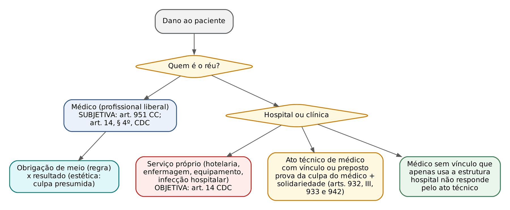
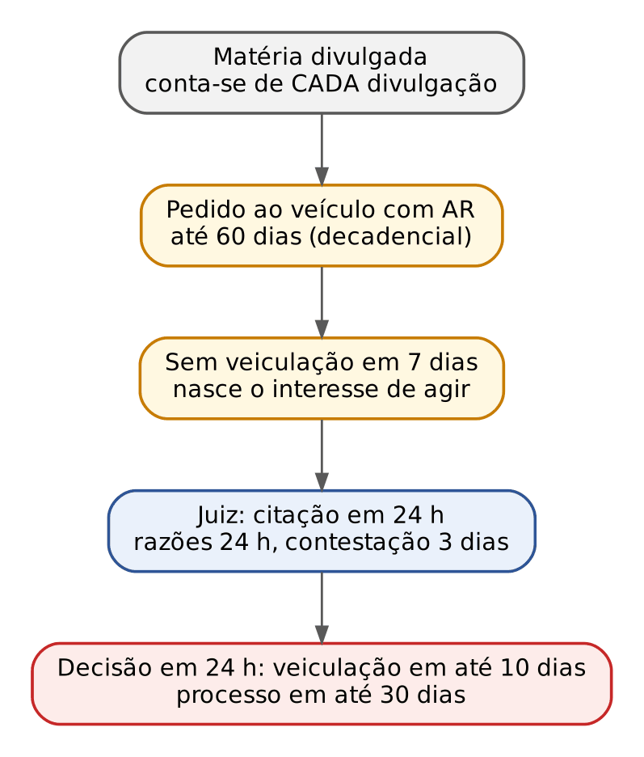
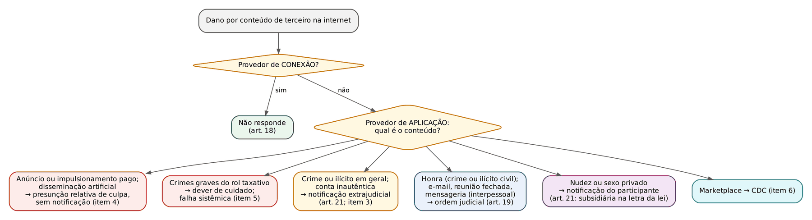

# CAPÍTULO 26 — RESPONSABILIDADE CIVIL III: RESPONSABILIDADES ESPECIAIS (MÉDICA, PROFISSIONAIS LIBERAIS, HOSPITAIS, IMPRENSA, PROVEDORES DE INTERNET, INCORPORADORES, TRANSPORTE, INSTITUIÇÕES FINANCEIRAS) E O NOVO DIREITO DE DANOS

:::INCIDENCIA
TRF5 p. 11; TJRS p. 15 e 22; TJSC p. 15 e 23. Nível A. Lote: 3 questões (FGV 2, FCC 1), mais 12 correlatas localizadas por palavra-chave no banco inteiro.
O que mais cai: fortuito interno x externo (transporte, bancos, estacionamentos), médico (culpa) x hospital (objetiva), Súmula 221 do STJ e limites da crítica jornalística, art. 19 do Marco Civil depois dos Temas 987 e 533 do STF (teses ajustadas em 17/6/2026).
:::

## 26.1 Chave de leitura: qual é o critério de imputação em cada atividade

Os Caps. 24 e 25 fixaram a teoria geral (elementos, nexo, excludentes, dano e quantificação). Este capítulo aplica essa teoria a atividades com regime próprio. Em cada uma, a prova pergunta três coisas: (i) a responsabilidade é subjetiva, objetiva ou com culpa presumida; (ii) o evento é risco da atividade (fortuito INTERNO, não exclui) ou estranho a ela (fortuito EXTERNO, exclui); (iii) quem responde e com quem (solidariedade, subsidiariedade, regresso).

| Atividade | Regime | Excludente típica | Fundamento |
|---|---|---|---|
| Médico e demais profissionais liberais | Subjetiva (culpa provada); obrigação de meio, salvo resultado prometido | Ausência de culpa; risco inerente informado | CC, art. 951; CDC, art. 14, § 4º |
| Hospital, clínica (serviço próprio) | Objetiva | Inexistência do defeito; culpa exclusiva da vítima ou de terceiro | CDC, art. 14 |
| Hospital por ato técnico do médico vinculado | Objetiva em relação ao vínculo, mas depende da culpa do médico | Ausência de culpa do médico | CC, arts. 932, III, 933 e 942; Enunciado 191 |
| Imprensa | Subjetiva (ilícito: excesso, falsidade, ofensa) | Exercício regular do direito de informar e criticar | CC, arts. 186, 187, 188, I, e 953; Súmula 221 do STJ |
| Provedor de conexão | Não responde por conteúdo de terceiro | — | MCI, art. 18 |
| Provedor de aplicação | Subjetiva, com regimes de notificação e presunção relativa de culpa (sem responsabilidade objetiva) | Dúvida razoável após diligência qualificada; atuação diligente e tempestiva | MCI, arts. 19 e 21; Temas 987 e 533 do STF |
| Incorporador | Responde pela execução da incorporação, com regresso contra o construtor culpado | Fortuito externo; culpa do adquirente | Lei 4.591/1964, arts. 43, II, e 43-A |
| Transportador de pessoas | Objetiva; culpa de terceiro não exclui | Força maior, fortuito externo (assalto), culpa exclusiva da vítima | CC, arts. 734 e 735 (Cap. 19) |
| Instituição financeira | Objetiva; fraude de terceiro é fortuito interno | Culpa exclusiva da vítima sem falha de segurança | Súmula 479 do STJ; CDC, art. 14 |
| Estacionamento | Responde por dano e furto; roubo conforme a expectativa de segurança | Área aberta, gratuita e de livre acesso | Súmula 130 do STJ |

:::DICA Como a FGV monta a questão
Quase sempre o enunciado traz um "terceiro" (assaltante, fraudador, motorista subcontratado, ciclista, oficina credenciada) e a defesa alega fato de terceiro ou caso fortuito. A resposta depende de um único teste: o evento integra o risco do empreendimento (interno) ou é estranho a ele (externo)? Sobre a distinção em si, ver Cap. 24; aqui estão as aplicações.
:::

## 26.2 Responsabilidade médica e dos profissionais liberais

### 26.2.1 Regime: culpa, no CC e no CDC

:::LEI Código Civil, art. 951, e CDC, art. 14, § 4º
CC, art. 951: "O disposto nos arts. 948, 949 e 950 aplica-se ainda no caso de indenização devida por aquele que, no exercício de atividade profissional, por negligência, imprudência ou imperícia, causar a morte do paciente, agravar-lhe o mal, causar-lhe lesão, ou inabilitá-lo para o trabalho."
CDC, art. 14, § 4º: "A responsabilidade pessoal dos profissionais liberais será apurada mediante a verificação de culpa."
:::

Os dois dispositivos convergem: o profissional liberal (médico, dentista, advogado, engenheiro, psicólogo que atua pessoalmente) responde por culpa, ainda que a relação seja de consumo. Pontos de prova:

- O art. 951 é norma de REMISSÃO: manda aplicar à responsabilidade profissional as verbas dos arts. 948 (morte: despesas, luto, alimentos), 949 (lesão: tratamento e lucros cessantes até a convalescença) e 950 (incapacidade: pensão, que o prejudicado pode exigir de uma só vez). A quantificação dessas verbas é do Cap. 25.
- A exceção do § 4º é PESSOAL: alcança o profissional que presta o serviço com autonomia técnica. Sociedade de médicos, clínica organizada como empresa ou hospital não são "profissionais liberais" para esse efeito e respondem objetivamente pelo serviço que prestam (26.3).
- Subjetiva não significa que o paciente sempre carregue todo o ônus: sendo relação de consumo, cabe inversão do ônus da prova (CDC, art. 6º, VIII), e a prova da culpa pode vir de presunções e da distribuição dinâmica (CPC, art. 373, § 1º). A culpa médica mede-se pelo padrão do profissional diligente da mesma especialidade, observados os protocolos vigentes (a *lex artis*).
- Erro de diagnóstico, por si, não é culpa; culpa é o diagnóstico feito sem os exames e cuidados que o quadro exigia.

### 26.2.2 Obrigação de meio x obrigação de resultado; cirurgia estética

A regra é a obrigação de MEIO: o médico promete empregar a técnica adequada, não curar. Na cirurgia estética embelezadora e em procedimentos odontológicos estéticos, a jurisprudência do STJ vê obrigação de RESULTADO: não alcançado o resultado prometido, presume-se a culpa, e o profissional só se exime provando caso fortuito, culpa exclusiva do paciente ou fator imprevisível alheio à sua atuação. A cirurgia reparadora (pós-acidente, pós-bariátrica com fim funcional) volta a ser de meio. A classificação das obrigações está no Cap. 12.

:::JURIS STJ, REsp 2.225.449-RJ, Terceira Turma, Rel. Min. Nancy Andrighi, j. 16/6/2026 (Info 893)
Cirurgia estética odontológica (obrigação de resultado) com resultado assimétrico. Constatado o inadimplemento ABSOLUTO e tendo o paciente optado pela RESOLUÇÃO com restituição do preço pago, não pode exigir também o custeio de nova cirurgia por outro profissional (equivalente da prestação), sob pena de enriquecimento sem causa: são as duas vias alternativas do art. 475 do CC. Danos moral e estético ficam fora dessa vedação.
:::

:::PEGADINHA "Obrigação de resultado" não é "responsabilidade objetiva"
Na obrigação de resultado o regime continua sendo de culpa, apenas PRESUMIDA (inversão do ônus). A afirmação "na cirurgia estética o médico responde objetivamente" é imprecisa e costuma ser dada como errada. Também é falso que o insucesso estético gere indenização automática: provando que o resultado decorreu de reação orgânica imprevisível do paciente, o cirurgião se exime.
:::

### 26.2.3 Consentimento informado

O dever de informar é dever principal do contrato médico (CDC, arts. 6º, III, e 14, caput, que fala em "informações insuficientes ou inadequadas sobre sua fruição e riscos"). A violação gera responsabilidade AUTÔNOMA: ainda que a técnica tenha sido impecável, responde o médico que não esclareceu os riscos relevantes e a materialização deles atinge o paciente, porque lhe tirou a escolha. O consentimento deve ser específico e esclarecido; formulário genérico não supre a informação sobre os riscos do procedimento concreto. Duas balizas das Jornadas:

- Enunciado 533 da VI Jornada: o paciente plenamente capaz pode deliberar sobre todos os aspectos do tratamento que possa lhe causar risco de vida, imediato ou mediato, salvo emergência ou curso de procedimento cirúrgico que não possa ser interrompido.
- Enunciado 403 da V Jornada: a liberdade de crença (CF, art. 5º, VI) alcança quem recusa tratamento, inclusive transfusão, com ou sem risco de morte, desde que haja capacidade civil plena (excluído o suprimento pelo representante), vontade livre, consciente e informada e oposição que diga respeito exclusivamente ao declarante.

A recusa de tratamento (art. 15 do CC) e os Temas 952 e 1.069 do STF estão no Cap. 4 (04.4.3). Aqui importa o reflexo: o médico que respeita recusa válida não responde pelo resultado; o que trata contra a vontade validamente manifestada, fora da emergência, viola a autonomia.

### 26.2.4 Perda de uma chance na medicina

A teoria (chance séria e real; indenização da chance, não do resultado final; quantificação proporcional) é do Cap. 25. Na medicina, ela resolve o problema do nexo quando não se pode afirmar que o tratamento correto teria salvado o paciente, mas se pode afirmar que a omissão suprimiu uma probabilidade concreta de cura ou sobrevida.

:::JURIS STJ, REsp 1.985.977-DF, Primeira Turma, Rel. Min. Sérgio Kukina, j. 18/6/2024 (Info Extraordinário 19)
Aplica-se a perda de uma chance quando a equipe médica não observa orientação do Ministério da Saúde e deixa de internar criança com pneumonia bacteriana grave: retirou-se do paciente a chance concreta e real de diagnóstico correto e de monitoramento que poderia evitar a morte.
:::

A FGV cobrou o mesmo cenário (atendimentos repetidos em pronto-socorro sem internação, morte da paciente durante epidemia) pedindo a classificação do dano da filha recém-nascida privada da assistência materna: gabarito "dano existencial", não "perda da chance de cura" (FGV 2026, MPE-RJ, Q4088274, desenvolvida no Cap. 25). A armadilha é confundir a perda da chance, que é da VÍTIMA direta, com o dano sofrido pelo terceiro.

### 26.2.5 Advogado e demais profissionais liberais

O advogado assume obrigação de meio e responde por culpa (art. 14, § 4º, do CDC, quando houver relação de consumo, e Estatuto da OAB). A hipótese típica é a perda do prazo recursal ou da propositura da ação: indeniza-se a chance de êxito, avaliada pela probabilidade séria de reforma ou procedência, nunca o valor integral do que se pedia (Cap. 25). Dentista segue o regime médico (meio, salvo resultado estético prometido). Engenheiro e arquiteto que atuam pessoalmente respondem por culpa; a empresa construtora, objetivamente perante o consumidor, e com a garantia do art. 618 (Cap. 19).

## 26.3 Hospitais, clínicas e operadoras de saúde

### 26.3.1 Três situações que a prova separa

O hospital é fornecedor de serviços e responde OBJETIVAMENTE (CDC, art. 14) pelos serviços que presta diretamente: internação e hotelaria, enfermagem, alimentação, exames, equipamentos, esterilização e infecção hospitalar. Pelo ato técnico do médico, porém, a responsabilidade do hospital depende da culpa do profissional, e o vínculo define se há responsabilidade do hospital:

| Situação | Responde o hospital? | Precisa provar culpa? |
|---|---|---|
| Falha de serviço próprio (enfermagem, equipamento, infecção hospitalar) | Sim, objetivamente | Não |
| Erro técnico de médico empregado, preposto ou integrante do corpo clínico | Sim, solidariamente com o médico | Sim, culpa do médico (depois disso, o hospital não a discute) |
| Erro de médico sem vínculo que só utiliza as instalações (médico escolhido pelo paciente, que "aluga" o centro cirúrgico) | Não pelo ato técnico; só por falha do próprio serviço | — |

Por isso o Enunciado 191 da III Jornada afirma que a instituição hospitalar privada responde, na forma do art. 932, III, do CC, pelos atos culposos dos médicos integrantes de seu corpo clínico: a responsabilidade do comitente é objetiva (art. 933), mas pressupõe ato culposo do preposto. A solidariedade vem do art. 942, parágrafo único.

:::JURIS STJ, EDcl no REsp 2.069.914-DF, Quarta Turma, Rel. Min. Marco Buzzi, j. 3/2/2026 (Info 878)
Recém-nascido prematuro contrai infecção hospitalar na UTI neonatal. Prematuridade e baixo peso não são concausas que rompam ou reduzam o nexo: são riscos inerentes à atividade hospitalar (causalidade adequada; responsabilidade objetiva do art. 14 do CDC). Em embargos, o STJ determinou o custeio integral, sem limite temporal, de tratamentos, terapias e medicamentos futuros, apurados continuamente em liquidação, e restabeleceu a pensão fixada na sentença (reparação integral, arts. 944, 949 e 950).
:::

Morte de recém-nascido por erro médico no hospital: médico e hospital podem ser condenados a pensionar os pais (REsp 2.121.056-PR — v. Cap. 25, onde estão os parâmetros do pensionamento).

:::PEGADINHA Hospital público
Hospital público responde pelo art. 37, § 6º, da CF (objetiva, risco administrativo), não pelo CDC nem pelo art. 951. A FGV cobrou o pensionamento num caso de negligência em hospital estadual (FGV 2026, TJ-BA, Q4083796, Cap. 25) com a alternativa sedutora "a responsabilidade do Estado é subjetiva". O médico servidor não é parte legítima para a ação da vítima (tese da dupla garantia, fixada pelo STF em repercussão geral — ver Apostila de Direito Administrativo); responde em regresso, por dolo ou culpa.
:::

### 26.3.2 Operadoras de planos de saúde e cooperativas

A operadora responde solidariamente pela falha do hospital próprio, de médicos contratados ou credenciados que indicou (Jurisprudência em Teses, ed. 4, tese 2), porque o credenciamento integra o serviço que ela vende. O regime do contrato, o rol da ANS, o reembolso fora da rede (só em hipóteses excepcionais, como inexistência ou insuficiência de credenciado e urgência ou emergência, conforme a Jurisprudência em Teses, ed. 4, tese 3) e a recusa indevida de cobertura estão no Cap. 20 (20.12). A cooperativa médica que comercializa plano responde como operadora.

:::SENTENCA Fundamentação-modelo (erro médico com hospital no polo passivo)
"A responsabilidade do médico é subjetiva (CC, art. 951; CDC, art. 14, § 4º). O laudo pericial demonstrou que a alta foi dada sem a radiografia de tórax que o protocolo exigia diante da febre persistente e da dispneia, o que caracteriza negligência. Integrando o médico o corpo clínico do réu, responde o hospital solidariamente (CC, arts. 932, III, 933 e 942; Enunciado 191 do CJF). Quanto à infecção contraída na internação, a responsabilidade do hospital é objetiva (CDC, art. 14), e as condições prévias do paciente não rompem o nexo, por constituírem risco inerente à atividade."
:::

## 26.4 Imprensa e meios de comunicação

### 26.4.1 Ilicitude, legitimidade e liberdade de informar

A ponderação entre liberdade de informação e direitos da personalidade (veracidade, interesse público, pertinência, ausência de excesso; pessoa pública com esfera de privacidade reduzida) está no Cap. 4 (04.7.4 e 04.8). Desde que o STF declarou não recepcionada a Lei de Imprensa (ADPF 130), a responsabilidade civil por publicação segue a cláusula geral do CC: ilícito pelos arts. 186 e 187, excludente do exercício regular de direito (art. 188, I), reparação pelo art. 953 (injúria, difamação e calúnia), sem tarifação (Súmula 281 do STJ — ver Cap. 25). Ficam neste capítulo a legitimidade passiva e o direito de resposta.

:::JURIS STJ, Súmula 221
"São civilmente responsáveis pelo ressarcimento de dano, decorrente de publicação pela imprensa, tanto o autor do escrito quanto o proprietário do veículo de divulgação."
:::

Aplicações: o autor (jornalista, colunista, entrevistado que faz a afirmação ofensiva) e a empresa jornalística respondem solidariamente; a vítima escolhe contra quem demandar. Para a empresa, a responsabilidade decorre da escolha editorial de publicar; não se exige prova de culpa *in eligendo*. Em entrevista "ao vivo", o STJ costuma examinar se o veículo endossou ou apenas reproduziu fielmente a fala; em matéria editada, responde o veículo. Comentários de leitores no portal do veículo seguem o regime dos provedores (26.5), não a Súmula 221, e são expressamente excluídos do conceito de "matéria" da Lei 13.188/2015 (art. 2º, § 2º).

:::QUESTAO FGV 2025 — TCE-PE — Analista de Gestão, Julgamento (Q3593081)
Empresário do setor educacional processa editora e dois jornalistas por reportagem investigativa que, além de relatar supostas irregularidades, usa expressões depreciativas insinuando manobras para escapar de obrigações legais. Gabarito: A (a responsabilização tem base nos arts. 186 e 953 e ocorre quando a crítica ultrapassa os limites da liberdade de expressão e atinge honra ou imagem). Armadilhas: B (crítica ácida "protegida pelo art. 187" e nunca ilícita: o art. 187 define abuso, não protege); C (exigir prova de falsidade objetiva: a ofensa pode vir do excesso, mesmo com fato verdadeiro); D (exigir prejuízo econômico: o parágrafo único do art. 953 trata da fixação equitativa quando não há prova de prejuízo material, não condiciona a reparação a ele); E (exigir intenção deliberada de causar dano: basta culpa ou abuso). Note que o polo passivo com editora e jornalistas é exatamente o da Súmula 221.
:::

O STJ tem reafirmado os dois lados da balança: reportagem que excede os fins informativos gera indenização (REsp 2.230.995, j. 18/11/2025, Info 873), e notícia sobre crime verídico pode ser ilícita quando acrescenta menções injuriosas à vítima (REsp 1.875.402, Quarta Turma, j. 23/4/2024, Info 810); de outro lado, empresário notório envolvido em disputas de interesse público suporta crítica severa e irônica (AgInt no REsp 1.814.115, j. 16/6/2026, Info 895 — desenvolvido no Cap. 4).

### 26.4.2 Direito de resposta (Lei 13.188/2015)

O direito de resposta tem assento constitucional (CF, art. 5º, V: "proporcional ao agravo, além da indenização") e é AUTÔNOMO em relação à indenização. A Lei 13.188/2015 regula o exercício e um rito especial. A banca explora prazos e vedações:

:::LEI Lei 13.188/2015, arts. 2º, §§ 2º e 3º, e 3º, caput
"Art. 2º [...] § 2º São excluídos da definição de matéria estabelecida no § 1º deste artigo os comentários realizados por usuários da internet nas páginas eletrônicas dos veículos de comunicação social. § 3º A retratação ou retificação espontânea, ainda que a elas sejam conferidos os mesmos destaque, publicidade, periodicidade e dimensão do agravo, não impedem o exercício do direito de resposta pelo ofendido nem prejudicam a ação de reparação por dano moral.
Art. 3º O direito de resposta ou retificação deve ser exercido no prazo decadencial de 60 (sessenta) dias, contado da data de cada divulgação, publicação ou transmissão da matéria ofensiva, mediante correspondência com aviso de recebimento encaminhada diretamente ao veículo de comunicação social ou, inexistindo pessoa jurídica constituída, a quem por ele responda, independentemente de quem seja o responsável intelectual pelo agravo."
:::

| Ponto | Regra | Dispositivo |
|---|---|---|
| Objeto | Matéria (reportagem, nota ou notícia) que atente, AINDA QUE POR EQUÍVOCO, contra honra, intimidade, reputação, conceito, nome, marca ou imagem de pessoa física ou jurídica | Art. 2º, § 1º |
| Gratuidade e proporção | Resposta gratuita e proporcional; mesmo destaque, publicidade, periodicidade e dimensão ou duração | Arts. 2º e 4º |
| Prazo | 60 dias, DECADENCIAL, de cada divulgação; na divulgação continuada, do início do agravo | Art. 3º, caput e § 3º |
| Legitimação extraordinária | Representante do incapaz ou da pessoa jurídica; cônjuge, descendente, ascendente ou irmão do ofendido ausente do País ou falecido depois do agravo e antes da decadência | Art. 3º, § 2º |
| Interesse de agir | Surge se o veículo não divulgar a resposta em 7 dias do recebimento do pedido | Art. 5º |
| Competência | Domicílio do ofendido ou, à escolha dele, lugar de maior repercussão | Art. 5º, § 1º |
| Rito | Inicial com prova do agravo, do pedido não atendido e o texto da resposta, sob pena de inépcia; processamento em até 30 dias; VEDADOS cumulação de pedidos, reconvenção, litisconsórcio, assistência e intervenção de terceiros | Art. 5º, § 2º |
| Defesa | Citação em 24 h; razões em 24 h e contestação em 3 dias; injúria não admite prova da verdade | Art. 6º |
| Tutela | Nas 24 h seguintes à citação, havendo verossimilhança ou receio de ineficácia, o juiz fixa a veiculação em prazo não superior a 10 dias; multa diária de ofício | Art. 7º |

:::PEGADINHA Quatro armadilhas da Lei 13.188
(1) O prazo de 60 dias é DECADENCIAL e corre de cada divulgação, não da ciência do ofendido. (2) A retratação espontânea, mesmo com igual destaque, NÃO impede a resposta nem a indenização. (3) Pessoa jurídica também tem direito de resposta (inclusive pela "marca"). (4) Como é vedada a cumulação, o pedido de dano moral vai em ação própria; o pedido de resposta segue o rito especial.
:::

## 26.5 Responsabilidade civil digital: provedores de internet

### 26.5.1 Categorias e o desenho original do Marco Civil

O Marco Civil da Internet (Lei 12.965/2014; aspectos de dados, guarda de registros e LGPD no Cap. 47) distingue provedor de CONEXÃO (habilita o terminal a acessar a rede: a operadora de banda larga ou de telefonia móvel) e provedor de APLICAÇÃO (oferece funcionalidades acessadas pela internet: redes sociais, buscadores, plataformas de vídeo, mensageria, marketplaces, sites). A responsabilidade por conteúdo gerado por TERCEIRO é tema próprio; pelo conteúdo que o próprio provedor produz ou pela falha do seu serviço, ele responde como qualquer fornecedor.

:::LEI Lei 12.965/2014 (Marco Civil da Internet), arts. 18, 19, caput e § 1º, e 21
"Art. 18. O provedor de conexão à internet não será responsabilizado civilmente por danos decorrentes de conteúdo gerado por terceiros.
Art. 19. Com o intuito de assegurar a liberdade de expressão e impedir a censura, o provedor de aplicações de internet somente poderá ser responsabilizado civilmente por danos decorrentes de conteúdo gerado por terceiros se, após ordem judicial específica, não tomar as providências para, no âmbito e nos limites técnicos do seu serviço e dentro do prazo assinalado, tornar indisponível o conteúdo apontado como infringente, ressalvadas as disposições legais em contrário. § 1º A ordem judicial de que trata o caput deverá conter, sob pena de nulidade, identificação clara e específica do conteúdo apontado como infringente, que permita a localização inequívoca do material.
[...]
Art. 21. O provedor de aplicações de internet que disponibilize conteúdo gerado por terceiros será responsabilizado subsidiariamente pela violação da intimidade decorrente da divulgação, sem autorização de seus participantes, de imagens, de vídeos ou de outros materiais contendo cenas de nudez ou de atos sexuais de caráter privado quando, após o recebimento de notificação pelo participante ou seu representante legal, deixar de promover, de forma diligente, no âmbito e nos limites técnicos do seu serviço, a indisponibilização desse conteúdo."
:::

Pelo desenho original: (i) conexão nunca responde por conteúdo de terceiro; (ii) aplicação só responde depois de descumprir ordem JUDICIAL específica (sistema *judicial notice and takedown*), com exceções: nudez e sexo privado (art. 21, notificação do próprio participante) e direitos autorais (art. 19, § 2º, que remeteu a lei específica nunca editada; enquanto isso, o STJ aplica a Lei de Direitos Autorais às infrações cometidas por provedores de aplicação — Jurisprudência em Teses, ed. 266, tese 5, REsp 2.057.908-SC, Terceira Turma, DJe 10/4/2024); (iii) as causas sobre honra, reputação e personalidade na internet podem ir ao juizado especial (art. 19, § 3º), com tutela antecipada (§ 4º).

Antes do Marco Civil (fatos anteriores a 2014), o STJ adotava a notificação EXTRAJUDICIAL: o provedor que, cientificado, não removia o conteúdo em prazo razoável respondia solidariamente. Para fatos anteriores à lei, essa orientação continua a reger o caso (direito intertemporal).

### 26.5.2 Temas 987 e 533 do STF: inconstitucionalidade parcial e progressiva do art. 19

Em junho de 2025 (julgamento concluído em 27/6/2025) o STF decidiu o julgamento conjunto do RE 1.037.396 (Tema 987, Rel. Min. Dias Toffoli) e do RE 1.057.258 (Tema 533, Rel. Min. Luiz Fux) e declarou o art. 19 PARCIALMENTE inconstitucional, por proteção insuficiente a direitos fundamentais e à democracia, fixando tese de 14 itens (Info 1184; ata publicada em 5/8/2025). Em 17/6/2026, concluiu o julgamento de nove embargos de declaração e ajustou a redação (Info 1222). A tese definitiva, em síntese fiel:

:::JURIS STF, Temas 987 e 533 (RE 1.037.396 ED e RE 1.057.258), Plenário, teses ajustadas em 17/6/2026 (Info 1222)
1. O art. 19 é parcialmente inconstitucional: a regra geral não protege suficientemente bens jurídicos constitucionais de alta relevância.
2. Até nova lei, os provedores de aplicação sujeitam-se à responsabilização civil nos termos da tese, ressalvadas a legislação eleitoral e os atos do TSE.
3. Regra geral: responsabilidade SOLIDÁRIA, nos termos do art. 21, por conteúdo de terceiro em caso de crime ou ato ilícito, sem prejuízo do dever de remoção, SALVO dúvida razoável sobre a ilicitude após diligência qualificada do provedor. 3.1: igual regra para contas denunciadas como não autênticas. 3.2: nos crimes ou ilícitos civis CONTRA A HONRA aplica-se o art. 19 (ordem judicial), sem prejuízo da remoção por notificação extrajudicial. 3.3: reconhecida judicialmente a ofensa, todas as redes sociais devem remover as replicações idênticas a partir de notificação judicial ou extrajudicial, sem nova decisão. 3.4: o art. 19 continua a reger e-mail e mensageria instantânea (só quanto às comunicações interpessoais, protegidas pelo sigilo), aplicações de reuniões fechadas por vídeo ou voz e outros provedores sem interferência no fluxo comunicativo.
4. Presunção RELATIVA de culpa, independentemente de notificação, para anúncios e impulsionamentos pagos e para mecanismos artificiais de disseminação inorgânica de conteúdos ilícitos; o provedor se exime provando atuação diligente e em tempo razoável.
5. Dever de cuidado: responde o provedor que não indisponibiliza IMEDIATAMENTE conteúdos de rol TAXATIVO de crimes graves (atos antidemocráticos, terrorismo, induzimento ao suicídio ou à automutilação, discriminação, crimes contra a mulher por razões da condição do sexo feminino, crimes sexuais contra vulneráveis e pornografia infantil, tráfico de pessoas), desde que configurada FALHA SISTÊMICA (ausência de medidas adequadas, segundo o estado da técnica); conteúdo isolado ou atomizado segue o art. 21; quem teve o conteúdo removido pode pedir o restabelecimento (e tutela provisória contra a retirada), sem indenização a cargo do provedor.
6. Marketplaces respondem segundo o CDC.
7 a 10. Deveres estruturais: autorregulação com sistema de notificações, devido processo e relatórios anuais de transparência; canais de atendimento a usuários e não usuários; regras públicas e revisadas; sede e representante (pessoa jurídica) no Brasil com plenos poderes.
11. NÃO há responsabilidade objetiva na aplicação da tese.
12. Apelo ao legislador.
13. Efeitos *ex nunc*, a partir da publicação da ata (5/8/2025), ressalvados atos continuados ou permanentes e respeitada a coisa julgada.
14. Prazo de 60 dias, da publicação da ata dos embargos, para implementar as obrigações do item 5.
:::

| Ponto | Antes (redação literal do art. 19) | Depois dos Temas 987 e 533 |
|---|---|---|
| Regra geral para conteúdo ilícito de terceiro | Ordem judicial específica | Notificação extrajudicial (regime do art. 21), responsabilidade solidária, salvo dúvida razoável após diligência qualificada |
| Ofensa à honra | Ordem judicial | Continua a ordem judicial (art. 19); remoção por notificação extrajudicial é possível, mas a responsabilidade civil depende da ordem |
| Anúncio pago, impulsionamento, robôs | Ordem judicial | Presunção relativa de culpa, sem notificação |
| Crimes graves do rol taxativo | Ordem judicial | Dever de cuidado; responde por falha sistêmica |
| E-mail, mensageria privada, reunião fechada | Ordem judicial | Continua a ordem judicial (comunicações interpessoais) |
| Marketplace | Debate sobre o art. 19 | CDC |
| Natureza | Subjetiva | Subjetiva (vedada a objetiva) |

:::PEGADINHA O que a banca vai trocar
(1) "O STF declarou o art. 19 inconstitucional e instituiu responsabilidade objetiva das plataformas": ERRADO duas vezes (parcial e progressiva; item 11 veda a objetiva). (2) "Nos crimes contra a honra basta notificação extrajudicial para responsabilizar": ERRADO (item 3.2: art. 19; com os embargos, também ilícitos CIVIS contra a honra). (3) "A presunção do item 4 é absoluta": ERRADO (relativa, de culpa — a redação de 2025 falava em "presunção de responsabilidade" e foi ajustada). (4) "A tese se aplica a fatos de 2023": em regra NÃO (efeitos a partir de 5/8/2025, salvo ilícitos continuados ou permanentes). (5) "O WhatsApp passou ao regime da notificação extrajudicial": ERRADO quanto às comunicações interpessoais (item 3.4). (6) Provedor de conexão continua isento (art. 18 não foi atingido).
:::

### 26.5.3 Jurisprudência do STJ que continua útil (e como ler à luz da tese)

| Questão | Orientação | Precedente |
|---|---|---|
| Indicação do conteúdo | A ordem de remoção exige indicação das URLs específicas (art. 19, § 1º); vale também para buscadores | REsp 1.969.219-SP, Quarta Turma, j. 24/3/2025 (Info 848); Jurisprudência em Teses, ed. 138, tese 12 (Cap. 4) |
| Conteúdo massivamente replicado por hashtags | A indicação das URLs vinculadas às hashtags é meio idôneo para o provedor identificar o conjunto de conteúdos ilícitos, sobretudo envolvendo crianças e adolescentes | REsp 2.239.457-RJ, Terceira Turma, j. 14/4/2026 (Info 885) |
| Hospedagem e bloqueio | O Enunciado 554 da VI Jornada dispensa a indicação do local específico para o bloqueio de conteúdo pelo provedor de hospedagem; prevalece no STJ a exigência de URL (cobrar com cautela: a letra do § 1º é a da exigência) | Enunciado 554 do CJF; art. 19, § 1º |
| Mensageria e pornografia de vingança | O WhatsApp responde solidariamente se, instado a cumprir ordem de remoção de imagens íntimas, permanece inerte; impossibilidade técnica sem perícia é vista com ceticismo; cabem medidas equivalentes (suspensão ou banimento das contas infratoras) | REsp 2.172.296-RJ, Terceira Turma, j. 4/2/2025 (Info 839) |
| Identificação do ofensor | O provedor de conexão deve fornecer os dados do usuário a partir do IP, sem exigir que o provedor de aplicação informe a porta lógica, pois também deve guardar o IP e, portanto, a porta | REsp 2.170.872-SP, Terceira Turma, j. 18/3/2025 (Info 844) |
| Desindexação | Excepcionalmente, quando o nome é o único critério de busca e não há interesse público, cabe desindexar resultados desabonadores, mantida a matéria acessível por outros termos | REsp 2.242.808-ES, Terceira Turma, j. 14/4/2026 (Info 887); distinção com o Tema 786 no Cap. 4 |
| Moderação voluntária | Remover, sem ordem judicial, vídeos de desinformação médica sobre a Covid-19 contrários às políticas de uso aceitas é exercício regular de direito (art. 188, I) | REsp 2.084.220-SP, Terceira Turma, j. 13/4/2026 (Info 896); no mesmo sentido, REsp 2.139.749-SP, j. 27/8/2024 (Info 823) |
| Sites de reclamação | O Reclame Aqui submete-se ao art. 19: não responde automaticamente por reclamações legítimas, ainda que negativas, nem deve controlá-las previamente; ofensa à honra segue exigindo ordem judicial (item 3.2 do Tema 987) | REsp 2.225.111-SP, Terceira Turma, j. 1/9/2026 (Info 902) |
| Anúncio que só viola termos de uso | O marketplace não é obrigado a retirar, por notificação de concorrente, anúncio que apenas descumpre os termos de uso; depois do Tema 987, se o anúncio configurar crime ou ilícito, aplica-se o item 3 e, ao consumidor, o CDC (item 6) | REsp 2.088.236-PR, Terceira Turma, j. 23/4/2024 (Info 810), lido à luz do Tema 987 |

:::EXEMPLO Aplicando a tese a três casos
(1) Perfil falso ("conta inautêntica") publica que uma médica vende atestados; ela notifica a rede pelo canal de denúncias; a rede não remove. Há imputação de crime e conta inautêntica, mas o núcleo é ofensa à honra: incide o item 3.2 (art. 19), e a rede só responde se descumprir ordem judicial; a denúncia extrajudicial autoriza, mas não obriga, a remoção. Se o perfil fosse apenas inautêntico e praticasse estelionato contra seguidores, o item 3.1 levaria à responsabilidade solidária após a notificação. (2) Página impulsionada mediante pagamento divulga golpe financeiro: presunção relativa de culpa (item 4), sem necessidade de notificação; a plataforma se exime provando atuação diligente e em tempo razoável. (3) Vídeo íntimo de adolescente circula em grupo de mensageria: comunicações interpessoais seguem o art. 19 (item 3.4), mas há ordem judicial e o STJ exige medidas efetivas, inclusive banimento de contas (REsp 2.172.296); o conteúdo também integra o rol do item 5 (crimes sexuais contra vulneráveis) se circular em rede aberta.
:::

:::ATENCAO Normas que dialogam com a tese
O Estatuto Digital da Criança e do Adolescente (Lei 15.211/2025, em vigor desde 17/3/2026, art. 41-A, incluído pela Lei 15.352/2026) impõe deveres próprios aos provedores quanto a crianças e adolescentes; o Enunciado 691 da IX Jornada pede que a divulgação de dados e imagens de crianças e adolescentes na internet atenda ao melhor interesse, considerados os riscos da superexposição. Dados pessoais e responsabilidade dos agentes de tratamento (LGPD, arts. 42 a 45): Cap. 47. A tese ressalva a legislação eleitoral.
:::

:::PROCESSO Ação contra provedor: o que pedir e contra quem
- Pedidos típicos: obrigação de fazer (indisponibilizar, com indicação das URLs), fornecimento de dados de identificação (registros de conexão e de acesso a aplicações, MCI, art. 22: fundados indícios do ilícito, utilidade da prova e período, sob pena de inadmissibilidade) e indenização.
- Polos: o autor do conteúdo (sempre legitimado, art. 186) e o provedor de aplicação, nas hipóteses da tese; o provedor de conexão só para fornecer dados.
- Juizado especial admitido para honra, reputação e personalidade (art. 19, § 3º).
- Prova: atas notariais e preservação das URLs; o descumprimento da ordem específica é o fato gerador da responsabilidade no regime do art. 19.
:::

## 26.6 Incorporadores e construtores

### 26.6.1 Quem responde e por quê

O incorporador é o centro de imputação do empreendimento: ainda que não construa, responde perante os adquirentes pela execução da incorporação, com regresso contra o construtor culpado.

:::LEI Lei 4.591/1964, art. 43, II
"[O incorporador deverá] II - responder civilmente pela execução da incorporação, devendo indenizar os adquirentes ou compromissários, dos prejuízos que a êstes advierem do fato de não se concluir a edificação ou de se retardar injustificadamente a conclusão das obras, cabendo-lhe ação regressiva contra o construtor, se fôr o caso e se a êste couber a culpa;"
:::

Perante o adquirente consumidor, incorporador e construtor integram a cadeia de fornecimento e respondem solidária e objetivamente pelos vícios e defeitos da obra (CDC, arts. 12, 18 e 25, § 1º — tema da apostila de Consumidor). Entre dono da obra e empreiteiro, vale a garantia de solidez e segurança do art. 618 do CC (prazo de garantia de 5 anos, decadência de 180 dias do aparecimento do vício, prescrição decenal da pretensão indenizatória e Súmula 194 do STJ adaptada): tudo no Cap. 19 (19.5.4). A ruína de edifício que atinge terceiros segue o art. 937 do CC (Cap. 24). Incorporação, patrimônio de afetação e comissão de representantes: Cap. 30.

### 26.6.2 Atraso na entrega: o mapa das regras

| Questão | Regra | Onde está |
|---|---|---|
| Cláusula de tolerância | Válida até 180 dias corridos, se pactuada de forma clara e destacada; nesse período o atraso não autoriza resolução nem penalidade | Lei 4.591, art. 43-A, caput (Lei 13.786/2018) |
| Atraso além da tolerância, com resolução | Devolução integral do que foi pago e da multa contratual, em até 60 dias da resolução | Art. 43-A, § 1º |
| Atraso além da tolerância, sem resolução | Indenização de 1% do valor efetivamente pago, por mês de atraso, *pro rata die*, na entrega | Art. 43-A, § 2º |
| Cumulação das duas multas legais | Proibida em qualquer hipótese (mora x inexecução total) | Art. 43-A, § 3º |
| Cláusula penal moratória x lucros cessantes | Não se cumulam se a multa equivale ao locativo; multa irrisória atrai lucros cessantes (reparação integral) | Tema 970 do STJ (Cap. 14) |
| Cláusula penal só contra o adquirente | Serve de parâmetro para indenizar o inadimplemento do incorporador (inversão) | Tema 971 do STJ (Cap. 14) |
| Restituição na resolução do compromisso | Súmula 543 do STJ (Cap. 17) | Cap. 17 |
| Devolução da corretagem por atraso | Prescrição decenal, da ciência da recusa da restituição integral | Tema 1.099 do STJ (Cap. 11) |
| Dano moral pelo atraso | Em regra, o simples atraso é inadimplemento contratual e não gera dano moral presumido; exige-se circunstância excepcional que afete a personalidade | Orientação reiterada do STJ (Cap. 25) |

:::PEGADINHA Tolerância de 180 dias
Três detalhes: dias CORRIDOS (não úteis); a tolerância exige pactuação EXPRESSA, clara e destacada; e a indenização legal do § 2º tem base no valor EFETIVAMENTE PAGO, não no valor do imóvel. Os lucros cessantes pelo valor locativo (0,5% a 1% do valor do bem, na prática do STJ) são outra via, cuja cumulação com a cláusula penal segue o Tema 970.
:::

Questão correlata: Q3593086 (FGV, TCE-PE, 2025) — cláusula penal moratória desproporcional ao valor locativo não afasta os lucros cessantes pelo atraso na entrega do imóvel (art. 944; reverso do Tema 970); comentada no Cap. 14.

## 26.7 Transporte: só o que é deste capítulo

O regime do transportador (arts. 730 a 756 do CC; nulidade da cláusula de não indenizar, art. 734; culpa de terceiro não exclui, art. 735; culpa concorrente do passageiro, art. 738, parágrafo único; transporte de cortesia e Súmula 145 do STJ; transporte aéreo internacional) está no Cap. 19 (19.11). Aqui ficam as duas aplicações do teste fortuito interno x externo cobradas no lote e a responsabilidade pelo risco da atividade no transporte de carga perigosa.

:::QUESTAO FCC 2026 — DPE-MT — Defensor Público (Q3954598)
Passageira roubada à mão armada, com outros passageiros, dentro de ônibus coletivo. Pergunta-se a solução segundo a jurisprudência consolidada do STJ. Gabarito: A (responsabilidade afastada: ato doloso de terceiro estranho ao transporte é fortuito externo). Passos: (1) o transportador responde objetivamente pela incolumidade do passageiro (art. 734); (2) a culpa de terceiro NÃO o exime (art. 735), mas isso pressupõe fato ligado aos riscos do transporte (colisão, freada); (3) o assalto é risco da segurança pública, não do deslocamento. Armadilhas: B (força maior condicionada a "local de alto índice de criminalidade": a conexão com o risco do transporte é o critério, não a estatística); C e D (responsabilidade objetiva mantida); E (responsabilidade subjetiva "subsidiária").
:::

:::ATENCAO Quando o assalto deixa de ser fortuito externo
A lógica do fortuito externo cede quando a própria empresa concorre para o evento (preposto que participa ou facilita o crime, falha de segurança que ela se obrigou a prestar) ou quando a segurança integra o próprio serviço contratado (transporte de valores, estacionamento com vigilância, agência bancária). Nessas hipóteses o crime passa a ser risco do empreendimento. Na prova objetiva, sem dado assim no enunciado, aplique a regra do fortuito externo.
:::

:::QUESTAO FGV 2026 — PGE-AC — Procurador do Estado (Q4079377)
Transportadora de cargas perigosas subcontrata outra empresa para transportar inflamáveis "em seu nome e sob sua supervisão operacional"; o motorista, sem culpa, sofre falha de freios em veículo revisado três semanas antes por oficina credenciada pela própria contratante; a explosão atinge imóveis vizinhos e transeuntes, que processam só a contratante. Gabarito: E (responsabilidade objetiva; a falha no veículo revisado por oficina por ela credenciada é fortuito INTERNO, que não rompe o nexo no regime do risco da atividade). Passos: (1) o que se pergunta: se a contratante responde e sob qual regime, "exclusivamente pelo CC"; (2) a regra: atividade que, por sua natureza, implica risco (transporte de inflamáveis) atrai a responsabilidade objetiva do art. 927, parágrafo único; quem executa em nome e sob supervisão é preposto (arts. 932, III, e 933); (3) aplicação: as vítimas são terceiros (aquiliana); a falha mecânica é risco típico da frota e foi gerida pela própria contratante. Armadilhas: A (falha mecânica como caso fortuito "independentemente do regime"); B (culpa *in eligendo* ou *in vigilando*: superada pelo art. 933); C (subsidiariedade: não há benefício de ordem; responsabilidade solidária, art. 942, parágrafo único); D (subcontratação não transfere responsabilidade perante terceiros). A ausência de vínculo empregatício é irrelevante: preposição dispensa contrato de trabalho.
:::

Correlata: FGV 2025, TJ-CE, Juiz Substituto (Q3505756, no Cap. 19): porta de ônibus que se abre por defeito de trava é fortuito interno; a passageira em pé junto à porta, contra a sinalização, concorre e tem a indenização reduzida, não excluída.

## 26.8 Instituições financeiras

### 26.8.1 Súmula 479 e o fortuito interno bancário

:::JURIS STJ, Súmula 479 (origem: Tema repetitivo 466)
"As instituições financeiras respondem objetivamente pelos danos gerados por fortuito interno relativo a fraudes e delitos praticados por terceiros no âmbito de operações bancárias." (Jurisprudência em Teses, ed. 83, tese 2)
:::

A súmula tem três elementos: responsabilidade OBJETIVA (CDC, art. 14; incidência do CDC aos bancos: Súmula 297 do STJ — ver Cap. 22); FORTUITO INTERNO (a fraude integra o risco da atividade de quem guarda dinheiro e opera meios de pagamento); e operação "no âmbito de operações bancárias" (abertura de conta com documentos falsos, empréstimo fraudulento, clonagem de cartão, invasão de conta, saques e transferências não autorizados). Conta aberta por fraudador e usada para receber o produto de golpe também atrai a responsabilidade do banco que falhou na verificação.

### 26.8.2 Golpes digitais (Pix, falsa central, engenharia social): a responsabilidade não é automática

Nos golpes em que a própria vítima, enganada, realiza as operações, o STJ separa duas situações:

| Situação | Solução | Precedente |
|---|---|---|
| Operações atípicas para o perfil do cliente (valor, frequência, horário, tipo), aprovadas sem bloqueio ou checagem | Defeito do serviço: o banco deve ter mecanismos para identificar e barrar transações incompatíveis com o perfil; responde objetivamente | REsp 2.052.228, Terceira Turma, Rel. Min. Nancy Andrighi (2023) |
| Operações compatíveis com o histórico, feitas pessoalmente pela vítima, sem falha de segurança demonstrada | Rompe-se o nexo: culpa exclusiva da vítima e de terceiro; não se aplica automaticamente a Súmula 479 | REsp 2.209.868, Terceira Turma, Rel. Min. Humberto Martins (noticiado em 20/7/2026) |
| Compras com cartão perdido, furtado ou fraudado, com uso da senha correta ou digitação de todos os dados na compra on-line | O LOJISTA não responde pela fraude (questão diversa da responsabilidade do emissor) | REsp 2.095.413-SC, Quarta Turma, j. 24/10/2023 (Info Extraordinário 15) |
| *Chargeback* por fraude entre credenciadora e lojista | Cláusula que atribui sempre ao lojista o risco é abusiva entre empresários; ele só arca sozinho se descumpriu deveres contratuais e contribuiu decisivamente para a fraude | AREsp 2.455.757-SP, Quarta Turma, j. 14/4/2026 (Info 885) |

:::PASSO Como decidir o "golpe do Pix"
1) Houve operação bancária (transferência, empréstimo, Pix) ligada à fraude? Se a fraude ocorreu inteiramente fora do sistema (pagamento a falso vendedor, por exemplo), não há fortuito interno do banco do pagador. 2) O banco falhou em algum dever próprio: autenticação, vazamento de dados, bloqueio de operação atípica, abertura de conta do recebedor sem verificação, demora em bloquear após a comunicação do golpe? 3) Se falhou, Súmula 479 e responsabilidade objetiva; a conduta descuidada da vítima pode, no máximo, reduzir a indenização (culpa concorrente, art. 945). 4) Se não falhou e as operações eram compatíveis com o perfil, culpa exclusiva da vítima e de terceiro (CDC, art. 14, § 3º, II). 5) Dano moral não é automático: depende da repercussão (comprometimento de verba alimentar, inscrição indevida), e não do simples prejuízo patrimonial.
:::

### 26.8.3 Cadastros de inadimplentes (interface com Consumidor)

O tema é do Direito do Consumidor (CDC, art. 43), mas aparece nas provas de Civil como responsabilidade de bancos e de mantenedores de cadastro. As orientações que a banca repete:

| Regra | Fonte |
|---|---|
| Inscrição indevida gera dano moral *in re ipsa* | Jurisprudência em Teses, ed. 59, tese 1 |
| Preexistindo inscrição legítima, a nova anotação irregular não gera dano moral, ressalvado o cancelamento (aplica-se também na ação contra o credor) | Súmula 385 do STJ (v. Cap. 25); Temas 41 e 922 do STJ |
| Notificação prévia cabe ao mantenedor do cadastro, que tem legitimidade passiva pela sua falta; dispensado o AR | Súmula 359; Temas 37 e 59 (Súmula 404) |
| Pago o débito, o credor exclui o registro em 5 dias úteis | Súmula 548 do STJ |
| Prazo máximo de manutenção: 5 anos, independentemente da prescrição da execução | Súmula 323 do STJ |
| Reprodução fiel de dados do distribuidor judicial não gera dano | Tema 793 do STJ |
| Prescrição da indenização por inscrição indevida: 3 anos (CC, art. 206, § 3º, V), da ciência do registro | Jurisprudência em Teses, ed. 59, teses 17 e 18 |

## 26.9 Estabelecimentos: estacionamentos, shoppings, escolas, condomínios e cartórios

### 26.9.1 Estacionamento e shopping center

:::JURIS STJ, Súmula 130
"A empresa responde, perante o cliente, pela reparação de dano ou furto de veículo ocorridos em seu estacionamento."
:::

O fundamento é o dever de guarda e segurança assumido ao oferecer estacionamento como atrativo, pago ou gratuito. Para ROUBO à mão armada, o STJ distingue pela legítima expectativa de segurança:

| Situação | Responde? | Precedente |
|---|---|---|
| Furto ou dano no estacionamento (pago ou gratuito) do estabelecimento | Sim | Súmula 130 |
| Roubo em estacionamento de shopping, hipermercado ou estacionamento pago com controle de acesso | Sim (fortuito interno: a segurança integra a oferta) | EREsp 1.431.606-SP, Segunda Seção, DJe 2/5/2019 |
| Roubo em estacionamento de mera comodidade, área aberta, gratuita e de livre acesso (lanchonete, farmácia) | Não (fortuito externo) | EREsp 1.431.606-SP |
| Roubo na cancela de entrada do shopping, ainda em via pública | Sim (a cancela integra o serviço de estacionamento) | REsp 2.031.816-RJ, Terceira Turma, j. 14/3/2023 (Info 767); na cancela de saída, REsp 1.269.691-PB (Info 534) |
| Roubo no *drive-thru* de lanchonete | Sim (dever implícito de segurança) | REsp 1.450.434-SP, Quarta Turma, j. 18/9/2018 (Info 637) |
| Manobrista (*valet*) em via pública | Exigências de segurança menos intensas; roubo armado tende a fortuito externo | REsp 1.321.739-SP |

Questão correlata: Q3592841 (FGV, TJ-SC, 2025) — furto em estacionamento pago de shopping obriga a empresa a indenizar (Súmula 130 do STJ), ainda que empregado seu tenha facilitado a ação do ladrão; comentada no Cap. 24.

Questão correlata: Q3301222 (FGV, TJ-SE, 2025) — é válida a cláusula de não indenizar na convenção condominial quanto a furtos no estacionamento privativo dos moradores, não no transporte, no depósito ou na adesão de consumo; comentada no Cap. 24.

### 26.9.2 Instituições de ensino

:::JURIS STJ, Súmula 595
"As instituições de ensino superior respondem objetivamente pelos danos suportados pelo aluno/consumidor pela realização de curso não reconhecido pelo Ministério da Educação, sobre o qual não lhe tenha sido dada prévia e adequada informação."
:::

O núcleo é o dever de INFORMAR: se o aluno foi prévia e adequadamente informado de que o curso não era reconhecido, não há defeito. A escola responde ainda pela integridade física e psíquica do aluno sob sua guarda (art. 932, IV, e CDC, art. 14), inclusive por *bullying* entre alunos que ela poderia prevenir.

### 26.9.3 Cartórios e notários

A responsabilidade de notários e registradores pelos danos causados a terceiros (art. 22 da Lei 8.935/1994, redação da Lei 13.286/2016: responsabilidade pessoal "por culpa ou dolo", com prescrição de três anos contados da lavratura do ato) e a do Estado pelos atos dos delegatários (Tema 777 do STF) estão no Cap. 33. Para este capítulo basta a regra de reconhecimento: o Estado responde objetivamente, com regresso; o titular da serventia responde por dolo ou culpa.

## 26.10 O novo direito de danos: reflexos na imputação e no nexo causal

O ponto 15 do TJRS e do TJSC fala em "novo direito de danos e os reflexos na imputação e no nexo causal". O rótulo designa o deslocamento do eixo da responsabilidade civil: da punição do culpado para a proteção da vítima e, mais recentemente, para a PREVENÇÃO do dano. As funções (reparatória, preventiva e punitiva) e os princípios (reparação integral, prevenção, solidariedade) são do Cap. 24; aqui se mostra como isso aparece nas responsabilidades especiais, que são o laboratório do fenômeno.

### 26.10.1 Reflexos na imputação

- Objetivação: o fundamento passa da culpa ao RISCO (art. 927, parágrafo único; CDC, arts. 12 e 14; art. 931, aplicável haja ou não relação de consumo segundo o Enunciado 378 da IV Jornada, sem afastar o regime do CDC, mais favorável, conforme o Enunciado 190 da III Jornada). Hospitais, bancos, transportadores e estacionamentos deste capítulo respondem pelo risco.
- Ampliação do fortuito interno: eventos antes tratados como fato de terceiro (fraude bancária, infecção hospitalar, falha de oficina credenciada) são absorvidos pelo risco do empreendimento.
- Culpa normativa e presumida: mesmo onde a culpa permanece (profissionais liberais, provedores), ela é aferida por padrões objetivos (protocolos, *lex artis*, estado da técnica) e frequentemente presumida (obrigação de resultado; item 4 dos Temas 987 e 533).
- Deveres de cuidado e de organização: a tese do STF sobre provedores exemplifica a responsabilidade por FALHA SISTÊMICA, que não pergunta pela culpa no caso isolado, mas pela adequação das medidas de prevenção adotadas segundo o estado da técnica (item 5.2 e 5.3). É imputação por defeito de organização, sem ser responsabilidade objetiva.

### 26.10.2 Reflexos no nexo causal

Anderson Schreiber descreve a "erosão dos filtros tradicionais da reparação": com a culpa enfraquecida pela objetivação, o nexo causal passou a ser o principal filtro e também se flexibiliza. Manifestações cobráveis:

| Manifestação | Exemplo neste capítulo |
|---|---|
| Causalidade adequada aplicada em favor da vítima, afastando concausas preexistentes como excludentes | Prematuridade do recém-nascido não rompe nem reduz o nexo da infecção hospitalar (EDcl no REsp 2.069.914) |
| Perda de uma chance como solução para a incerteza causal | Omissão de internação contra protocolo do Ministério da Saúde (REsp 1.985.977) |
| Ampliação do fortuito interno, que deixa de excluir o nexo | Súmula 479; falha mecânica em veículo de frota (Q4079377) |
| Presunções de causalidade e de culpa | Anúncios pagos e robôs (item 4 dos Temas 987 e 533) |
| Teorias de causalidade alternativa e responsabilidade de grupo (dano causado por membro não identificado de grupo) | Parte da doutrina; aplicação pontual (coisas caídas de edifício, art. 938 — ver Cap. 24) |

### 26.10.3 Prevenção, precaução e função punitiva

- Prevenção: a tutela inibitória e de remoção do ilícito (CPC, art. 497, parágrafo único: dispensa prova de dano, culpa ou dolo) é a resposta preventiva por excelência; os deveres estruturais impostos às plataformas (itens 7 a 10 da tese) são prevenção regulatória. A precaução atua diante do risco incerto (dano ambiental, novas tecnologias).
- Função punitiva: o direito brasileiro não adota indenização punitiva autônoma (*punitive damages*) como verba separada; o STJ admite, porém, que o caráter pedagógico e dissuasório influa na fixação do dano moral, dentro do método bifásico (Cap. 25). O art. 944 continua a medir a indenização pela extensão do dano. O dano social e o dano moral coletivo, com destinação a fundo, aproximam-se de uma função sancionatória (Cap. 25).
- Lucro da intervenção: quem lucra com a violação de direito alheio (uso indevido de imagem, por exemplo) restitui o lucro com base no enriquecimento sem causa, não na responsabilidade civil (Caps. 23 e 25).
- Projeto de reforma do Código Civil (PL 4/2025): propõe disciplina expressa da função preventiva e da responsabilidade civil digital, mas NÃO foi aprovado até esta data; não aplique suas regras como direito vigente.

:::DOUTRINA Terceiro ofensor e terceiro ofendido (TJRS, ponto 15)
O "terceiro ofensor" é quem, estranho ao contrato, contribui para seu inadimplemento (tutela externa do crédito, com base na função social do contrato — Cap. 15). O "terceiro ofendido" é a vítima estranha ao contrato que sofre dano por defeito da prestação: na relação de consumo, é o consumidor por equiparação (CDC, art. 17), que se beneficia do regime objetivo, como os transeuntes e vizinhos atingidos pela explosão da carga em Q4079377 e as vítimas de queda de avião em solo.
:::

## 26.11 Resumo para revisão pré-prova

| Instituto | Regra | Exceções e detalhes | Fundamento |
|---|---|---|---|
| Médico e profissionais liberais | Responsabilidade subjetiva, pessoal | Obrigação de meio; estética embelezadora é de resultado (culpa presumida); inversão do ônus possível | CC, art. 951; CDC, art. 14, § 4º |
| Cirurgia estética malsucedida | Resolução com restituição do preço OU equivalente; não ambos | Danos moral e estético à parte | CC, art. 475; REsp 2.225.449 |
| Consentimento informado | Falta de informação sobre riscos gera responsabilidade autônoma | Emergência; paciente capaz decide; recusa por crença (Enunciado 403) | CDC, arts. 6º, III, e 14; Enunciados 403 e 533 |
| Perda de chance médica | Indeniza-se a chance séria e real perdida | Dano de terceiro (filho) não é perda de chance | REsp 1.985.977 |
| Hospital, serviço próprio | Objetiva | Infecção hospitalar: condições prévias não rompem o nexo | CDC, art. 14; EDcl no REsp 2.069.914 |
| Hospital, ato do médico vinculado | Solidária, depende de culpa do médico | Médico sem vínculo que só usa a estrutura: hospital não responde pelo ato técnico | CC, arts. 932, III, 933 e 942; Enunciado 191 |
| Hospital público | Objetiva do Estado | Médico servidor só em regresso | CF, art. 37, § 6º |
| Operadora de plano | Solidária pela falha de credenciados | Reembolso fora da rede só excepcionalmente | Cap. 20 |
| Imprensa | Autor do escrito e dono do veículo respondem | Comentários de leitores: regime de provedor; crítica e notícia verídica = exercício regular | Súmula 221; CC, arts. 186, 188, I, e 953 |
| Direito de resposta | 60 dias decadenciais de cada divulgação; pedido com AR; ação após 7 dias sem resposta | Retratação espontânea não impede; rito sem cumulação, reconvenção ou intervenção; injúria sem prova da verdade | Lei 13.188/2015, arts. 2º a 7º |
| Provedor de conexão | Não responde por conteúdo de terceiro | Fornece dados de identificação (IP e porta lógica) | MCI, art. 18; REsp 2.170.872 |
| Provedor de aplicação, regra | Solidária após notificação extrajudicial, em crime ou ilícito | Dúvida razoável após diligência qualificada; contas inautênticas | Temas 987 e 533, item 3 |
| Provedor, honra | Ordem judicial (art. 19) | Remoção por notificação extrajudicial possível; réplicas idênticas: basta notificação | Item 3.2 e 3.3 |
| Provedor, mensageria, e-mail, reuniões | Ordem judicial | Só comunicações interpessoais | Item 3.4; REsp 2.172.296 |
| Anúncios pagos e robôs | Presunção relativa de culpa, sem notificação | Exime-se provando diligência tempestiva | Item 4 |
| Crimes graves (rol taxativo) | Dever de cuidado; responde por falha sistêmica | Conteúdo isolado: art. 21 | Item 5 |
| Marketplace | CDC | — | Item 6 |
| Tese dos provedores: natureza e efeitos | Sem responsabilidade objetiva | *Ex nunc* desde 5/8/2025; 60 dias para obrigações estruturais após a ata dos embargos | Itens 11, 13 e 14 |
| Nudez e sexo privado | Responde após notificação do participante | Notificação deve identificar o material e a legitimidade | MCI, art. 21 |
| Direito autoral na internet | Aplica-se a Lei 9.610/1998 | Art. 19, § 2º, aguarda lei específica | JT ed. 266, tese 5 |
| Incorporador | Responde pela execução e pelo atraso injustificado | Regresso contra o construtor culpado | Lei 4.591, art. 43, II |
| Tolerância | Até 180 dias corridos, se pactuada clara e destacadamente | Depois: resolução com devolução integral em 60 dias ou 1% ao mês do valor pago; multas não se cumulam | Lei 4.591, art. 43-A |
| Atraso: cláusula penal x lucros cessantes | Não cumulam se equivalente ao locativo | Inversão da cláusula contra o incorporador | Temas 970 e 971 (Cap. 14) |
| Transporte: assalto no coletivo | Fortuito externo, exclui | Concurso da empresa ou segurança contratada | Q3954598; Cap. 19 |
| Atividade de risco com subcontratado | Objetiva; falha mecânica é fortuito interno | Preposição dispensa vínculo empregatício; solidariedade | CC, arts. 927, p. ú., 932, III, 933 e 942 |
| Bancos | Objetiva por fraudes de terceiros (fortuito interno) | Golpe sem falha do banco e com operações compatíveis com o perfil: nexo rompido | Súmula 479; REsp 2.052.228; REsp 2.209.868 |
| Estacionamento | Responde por dano e furto | Roubo: responde se há expectativa de segurança; não, em área aberta, gratuita e de livre acesso | Súmula 130; EREsp 1.431.606 |
| Condomínio | Não responde por furto em área comum se a convenção exclui | Cláusula válida na convenção | Q3301222 |
| Ensino superior | Objetiva por curso não reconhecido sem informação prévia | Aluno informado: sem defeito | Súmula 595 |
| Novo direito de danos | Objetivação, ampliação do fortuito interno, flexibilização do nexo, prevenção | Sem *punitive damages* autônomos | Arts. 927, p. ú., e 944; CPC, art. 497, p. ú. |

## 26.12 Artigos de lei incidentes

- Constituição Federal: art. 5º, V (direito de resposta), VI, X e XII; art. 37, § 6º.
- Código Civil: arts. 186, 187, 188, I; 475; 618 (Cap. 19); 734, 735 e 738 (Cap. 19); 927, parágrafo único; 931; 932, III e IV; 933; 937; 938; 942, parágrafo único; 944; 945; 948 a 951; 953.
- CDC: arts. 6º, III e VIII; 12; 14, caput e §§ 1º a 4º; 17; 43; 51, I.
- Lei 12.965/2014 (Marco Civil da Internet): arts. 18 a 22.
- Lei 13.188/2015 (direito de resposta): arts. 2º a 7º.
- Lei 4.591/1964: arts. 43, II, e 43-A (Lei 13.786/2018).
- Lei 8.935/1994: art. 22 (Cap. 33).
- Lei 15.211/2025 (Estatuto Digital da Criança e do Adolescente): remissão ao Cap. 47.
- CPC: arts. 373, § 1º; 497, parágrafo único.

## 26.13 Julgados, temas e súmulas do capítulo

- STF, Temas 987 e 533 (RE 1.037.396 e RE 1.057.258; teses de 2025 ajustadas em 17/6/2026, Info 1222): art. 19 do MCI parcialmente inconstitucional; regimes de notificação, presunção relativa de culpa e falha sistêmica.
- STJ, Súmula 221: autor do escrito e proprietário do veículo respondem.
- STJ, Súmula 479 (Tema 466): fraude de terceiro é fortuito interno bancário.
- STJ, Súmula 130 e EREsp 1.431.606-SP: estacionamento; roubo conforme a expectativa de segurança.
- STJ, Súmula 595: curso superior não reconhecido sem informação.
- STJ, REsp 2.031.816-RJ (Info 767): roubo na cancela do shopping.
- STJ, REsp 1.450.434-SP (Info 637): roubo no *drive-thru*.
- STJ, REsp 2.052.228: banco deve barrar transação atípica.
- STJ, REsp 2.209.868: golpe da falsa central sem falha do banco.
- STJ, REsp 2.095.413-SC: lojista não responde por compra com cartão e senha corretos.
- STJ, AREsp 2.455.757-SP (Info 885): *chargeback* e cláusula abusiva entre empresários.
- STJ, REsp 2.225.449-RJ (Info 893): cirurgia estética, resolução x equivalente.
- STJ, REsp 1.985.977-DF: perda de chance por desrespeito a protocolo.
- STJ, EDcl no REsp 2.069.914-DF (Info 878): infecção hospitalar e reparação integral.
- STJ, REsp 2.172.296-RJ (Info 839): WhatsApp e pornografia de vingança.
- STJ, REsp 2.170.872-SP (Info 844): IP e porta lógica.
- STJ, REsp 1.969.219-SP (Info 848): URL também para buscadores.
- STJ, REsp 2.239.457-RJ (Info 885): URLs de hashtags.
- STJ, REsp 2.242.808-ES (Info 887): desindexação pelo nome.
- STJ, REsp 2.084.220-SP (Info 896) e REsp 2.139.749-SP (Info 823): moderação voluntária lícita.
- STJ, REsp 2.225.111-SP (Info 902): Reclame Aqui e art. 19.
- STJ, REsp 2.088.236-PR (Info 810): anúncio que viola termos de uso.
- STJ, REsp 1.875.402 (Info 810): notícia de crime com menções injuriosas à vítima.
- STJ, Jurisprudência em Teses, ed. 266, tese 5: Lei de Direitos Autorais aplicável aos provedores.
- STJ, cadastros: Súmulas 323, 359, 404 e 548; Temas 37, 41, 59, 793 e 922.
- CJF: Enunciados 190, 191, 378, 403, 533, 554 e 691.

Remissões a outros capítulos: art. 618 e Súmula 194 do STJ (Cap. 19); transporte, Súmulas 145 do STJ e 161 e 187 do STF (Cap. 19); Temas 970 e 971 do STJ (Cap. 14); Tema 1.099 do STJ (Cap. 11); Súmula 543 do STJ (Cap. 17); Súmula 297 do STJ (Cap. 22); planos de saúde e Jurisprudência em Teses, ed. 4 (Cap. 20); Súmulas 281 e 37 do STJ, pensionamento e critério bifásico (Cap. 25); Tema 786 do STF, imprensa e honra (Cap. 4); Temas 952 e 1.069 do STF (Cap. 4); Tema 777 do STF e art. 22 da Lei 8.935 (Cap. 33); LGPD e ECA Digital (Cap. 47); Súmula 385 do STJ e REsp 2.121.056-PR, pensão pela morte de recém-nascido (Cap. 25).

:::NOTA Notas de verificação
- Conferidos no texto oficial: CC, arts. 186 a 188, 927 a 953 (PDF do Planalto no Drive, 22/10/2026); CDC, art. 14 (Planalto, 30/10/2026); Lei 13.188/2015, arts. 2º a 7º (Planalto); Lei 12.965/2014, arts. 18 a 23 (PDF do Planalto no Drive); Lei 4.591/1964, arts. 43 e 43-A (PDF do Planalto no Drive).
- Temas 987 e 533: redação definitiva lida na nota civ-0997 (Dizer o Direito, Info 1222) e confirmada em notícias (Conjur, 17/6/2026 e 24/8/2026); trânsito em julgado do Tema 987 em 17/6/2026 segundo o portal do STF. O texto do capítulo é síntese fiel, não transcrição integral; a data de conclusão do mérito aparece como 26/6 ou 27/6/2025 conforme a fonte (adotada a do Dizer o Direito).
- REsp 2.052.228 e REsp 2.209.868: vistos apenas em notícias (Conjur, 2023; Rota Jurídica, 20/7/2026); datas de julgamento não confirmadas.
- ADI 5.436 (Lei 13.188): o Planalto remete a ela em vários artigos; o resultado não foi conferido nesta tarefa e por isso não foi descrito.
- Afirmações sem número de precedente, por não vistas em fonte nesta tarefa: obrigação de resultado na cirurgia estética com culpa presumida (orientação reiterada do STJ, confirmada indiretamente pelo REsp 2.225.449); não responsabilidade do hospital pelo ato técnico de médico sem vínculo; mero atraso de obra sem dano moral presumido; rejeição de *punitive damages* autônomos; tese da dupla garantia do STF; ADPF 130 (citada de memória, com alta segurança).
- Jurisprudência em Teses, ed. 4, tese 2 (operadora e credenciados): número tomado do Cap. 20, não reconferido.
- Lei 15.211/2025: vigência em 17/3/2026 (art. 41-A, incluído pela Lei 15.352/2026) conferida no Planalto em 30/10/2026.
- Lei 8.935/1994, art. 22: redação vigente (Lei 13.286/2016) conferida no Planalto em 30/10/2026; o texto do capítulo está conforme.
- Gabaritos: nenhum discutível no lote; em Q3954598 (FCC) a solução é a regra geral, que admite exceções não referidas no enunciado.
:::
