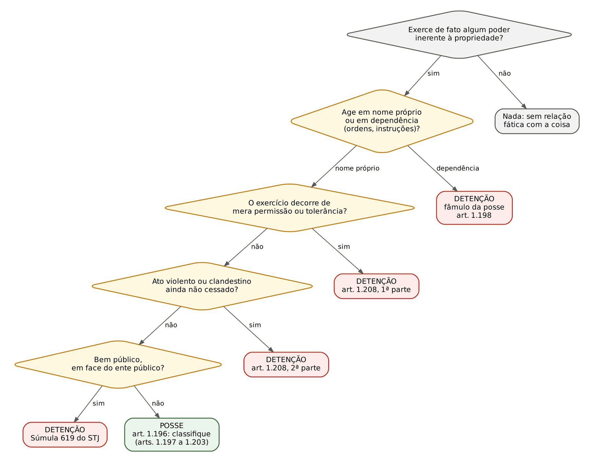
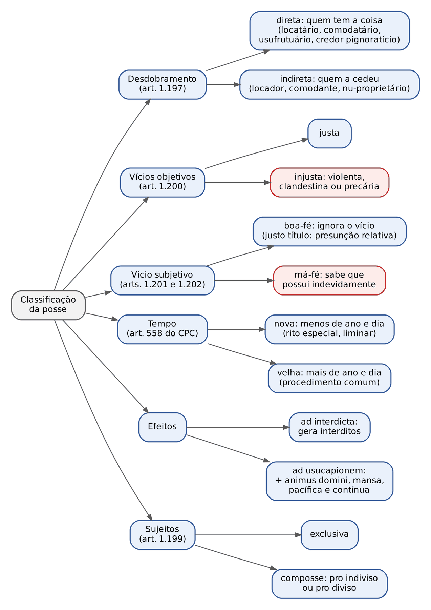
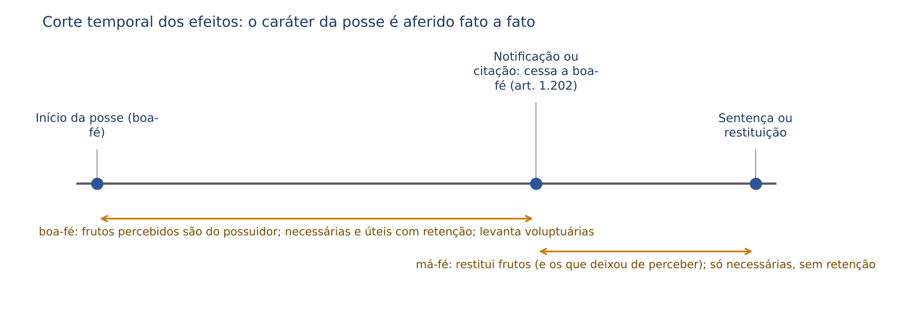
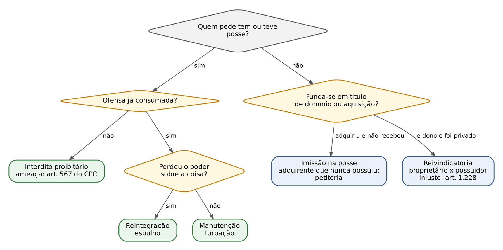
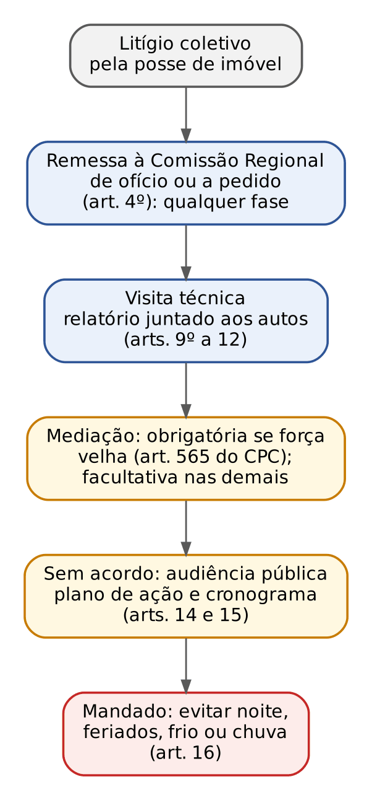

# CAPÍTULO 27 — POSSE: TEORIAS, CONCEITO, DETENÇÃO, CLASSIFICAÇÃO, AQUISIÇÃO E PERDA, EFEITOS, PROTEÇÃO POSSESSÓRIA, IMISSÃO, EMBARGOS DE TERCEIRO E RESOLUÇÃO CNJ 510/2023

:::INCIDENCIA
TRF5 p. 12; TJRS p. 16; TJSC p. 16; SEFAZ p. 10 (posse como forma de exploração da propriedade). Nível A+. Lote: 23 questões (FGV 14, FCC 9).
O que mais cai: efeitos da posse em caso concreto (frutos e benfeitorias antes e depois da notificação ou da citação, retenção, valor atual x custo), posse x detenção (art. 1.198, art. 1.208, Súmula 619 do STJ) e letra dos arts. 1.197, 1.199, 1.200, 1.201, 1.205 a 1.211 e 1.219 a 1.222. Em seguida: composse, posse precária do comodatário notificado e proteção possessória (exceptio proprietatis, locatário contra locador, bem público entre particulares).
:::

| Subtema | FGV | FCC | Padrão de cobrança |
|---|---|---|---|
| Efeitos: frutos, benfeitorias, retenção, perda ou deterioração | 9 | 3 | Caso com linha do tempo: o que foi feito antes e depois da notificação ou da citação; classificar cada despesa (necessária, útil, voluptuária, despesa ordinária, acessão) e aplicar arts. 1.214 a 1.222 |
| Posse x detenção; classificação; composse | 4 | 4 | Comodatário é possuidor direto (não detentor); comodato findo + notificação = posse precária; vícios objetivos x subjetivos; letra dos arts. 1.199, 1.200, 1.201 e 1.209 |
| Aquisição, transmissão e presunções | 0 | 1 | Arts. 1.205, 1.206, 1.207 e 1.211 em assertivas |
| Proteção possessória | 1 | 1 | Locatário contra locador; ocupante de bem público contra particular |

## 27.1 Teorias, conceito e natureza da posse

### 27.1.1 Savigny, Ihering e o art. 1.196

A teoria SUBJETIVA (Savigny) exige *corpus* (poder físico sobre a coisa) e *animus domini* (intenção de tê-la como dono). Consequência: locatário, comodatário e depositário seriam meros detentores, protegidos só por via derivada. A teoria OBJETIVA (Ihering) dispensa o *animus* qualificado: posse é a exteriorização (visibilidade) da propriedade, o comportamento de quem age como dono age em relação à coisa, segundo sua destinação econômica; o *animus* está implícito no *corpus*, e a distinção entre posse e detenção é feita pela LEI (detenção é posse desqualificada pelo ordenamento).

O CC adotou, como regra, a teoria objetiva de Ihering: "Considera-se possuidor todo aquele que tem de fato o exercício, pleno ou não, de algum dos poderes inerentes à propriedade" (art. 1.196). Basta exercer de fato UM dos poderes do art. 1.228 (usar, gozar, dispor, reaver). Por isso o locatário e o comodatário são possuidores (diretos), e a detenção só existe onde a lei a declara (arts. 1.198 e 1.208).

:::PEGADINHA Onde Savigny sobrevive no CC
- Na USUCAPIÃO, o *animus domini* é requisito (arts. 1.238 e seguintes: "possuir como seu"): a posse *ad usucapionem* é posse qualificada pela intenção de dono, ideia subjetivista (ver Cap. 29).
- Afirmar que "o CC adotou a teoria de Savigny" é errado; afirmar que adotou "exclusivamente" a de Ihering também é arriscado. A formulação segura: adotou a teoria objetiva como regra, com temperamentos (função social e *animus domini* na usucapião).
:::

### 27.1.2 Teorias sociológicas e função social da posse

Parte expressiva da doutrina (Tartuce, Farias e Rosenvald, entre outros, a partir de Saleilles, Perozzi e Hernández Gil) sustenta a autonomia da posse em relação à propriedade e sua leitura pela função social: a posse é fato socialmente relevante, protegido pelo que realiza (moradia, trabalho), e não só como sentinela avançada do domínio. O CJF acolheu a ideia: "A posse constitui direito autônomo em relação à propriedade e deve expressar o aproveitamento dos bens para o alcance de interesses existenciais, econômicos e sociais merecedores de tutela" (Enunciado 492 da V Jornada). Reflexos legais da posse-trabalho: redução dos prazos de usucapião (arts. 1.238, parágrafo único, e 1.242, parágrafo único) e desapropriação judicial privada (art. 1.228, §§ 4º e 5º — ver Cap. 28).

Critério supletivo de "melhor posse": na falta de demonstração inequívoca de posse que atenda à função social, usam-se os critérios do art. 507, parágrafo único, do CC/1916 (posse com título, mais antiga, atual) — Enunciado 239 da III Jornada.

### 27.1.3 Natureza jurídica e objeto

Natureza: fato (Savigny, na origem), direito (Ihering: "interesse juridicamente protegido") ou fato com efeitos jurídicos. O CC trata a posse fora do rol dos direitos reais (art. 1.225 não a menciona; Título I do Livro III é "Da Posse", e o Título II é "Dos Direitos Reais"), o que sustenta a leitura de que não é direito real, embora tenha efeitos erga omnes na tutela. Para prova: posse NÃO está no rol taxativo do art. 1.225.

Processualmente, o art. 73, § 2º, do CPC dispensa a participação do cônjuge nas ações possessórias, salvo composse ou ato por ambos praticado, o que reforça a natureza não real (as ações reais imobiliárias exigem consentimento do cônjuge, art. 73, caput).

Objeto: coisas corpóreas e, segundo a doutrina clássica, direitos reais suscetíveis de exercício continuado (servidão, usufruto). Direitos pessoais e bens imateriais não comportam tutela possessória: "É inadmissível o interdito proibitório para a proteção do direito autoral" (Súmula 228 do STJ). A proteção do direito autoral se faz por tutela inibitória (art. 497 do CPC).

Servidões: os interditos NÃO protegem as servidões não aparentes, salvo quando os títulos provierem do possuidor do prédio serviente ou de quem este o houve (art. 1.213); a servidão de trânsito tornada permanente por obras visíveis é tratada como aparente e protegida (Súmula 415 do STF, v. Cap. 31). Não confundir com a passagem forçada, direito de vizinhança do prédio encravado (art. 1.285 — ver Cap. 28; correlata FGV 2025 — TJ-CE, Q3505768).

## 27.2 Detenção

### 27.2.1 Hipóteses legais

Detenção é a situação em que há poder fático sobre a coisa, mas a lei nega a qualidade de posse. Não gera interditos nem usucapião, nem direito a frutos ou benfeitorias como possuidor. Três grupos:

| Hipótese | Fundamento | Exemplos | Pode virar posse? |
|---|---|---|---|
| Fâmulo da posse (servidor da posse) | art. 1.198 | caseiro, motorista, empregado, bibliotecário quanto aos livros, preposto | sim, rompida a subordinação e exercidos atos em nome próprio (Enunciado 301) |
| Atos de mera permissão ou tolerância | art. 1.208, 1ª parte | vizinho que atravessa o terreno com consentimento revogável; familiar que mora por liberalidade | sim, por inversão do título com oposição inequívoca (Enunciado 237) |
| Atos violentos ou clandestinos enquanto não cessados | art. 1.208, 2ª parte | invasor no momento da invasão; ocupação às escondidas | sim, cessada a violência ou a clandestinidade (posse injusta, ver 27.3.2) |
| Ocupação indevida de bem público | Súmula 619 do STJ; art. 102 do CC | ocupação de área pública em face do ente | não em face do Poder Público; entre particulares há proteção possessória |

:::LEI Código Civil, arts. 1.198 e 1.208
Art. 1.198. Considera-se detentor aquele que, achando-se em relação de dependência para com outro, conserva a posse em nome deste e em cumprimento de ordens ou instruções suas.
Parágrafo único. Aquele que começou a comportar-se do modo como prescreve este artigo, em relação ao bem e à outra pessoa, presume-se detentor, até que prove o contrário.
Art. 1.208. Não induzem posse os atos de mera permissão ou tolerância assim como não autorizam a sua aquisição os atos violentos, ou clandestinos, senão depois de cessar a violência ou a clandestinidade.
:::

Pontos finos do fâmulo:

- O detentor pode exercer a autodefesa do bem no interesse do possuidor: "O detentor (art. 1.198 do Código Civil) pode, no interesse do possuidor, exercer a autodefesa do bem sob seu poder" (Enunciado 493 da V Jornada). Não pode, porém, ajuizar interditos em nome próprio; se demandado, deve nomear o possuidor (nomeação à autoria foi extinta no CPC/2015; hoje, alegação de ilegitimidade com indicação do sujeito passivo, arts. 338 e 339 do CPC).
- A presunção do parágrafo único do art. 1.198 é relativa: quem começou como detentor presume-se detentor até prova em contrário. É a porta para a conversão: "É possível a conversão da detenção em posse, desde que rompida a subordinação, na hipótese de exercício em nome próprio dos atos possessórios" (Enunciado 301 da IV Jornada). Exemplo: o caseiro que, morto o patrão e ausentes os herdeiros por anos, passa a explorar o sítio em nome próprio, sem prestar contas a ninguém.

### 27.2.2 Permissão e tolerância x comodato

A distinção cai em caso concreto. Permissão e tolerância são consentimentos que NÃO transferem poder sobre a coisa: o dono continua a exercer sua posse e apenas não se opõe a um uso pontual e revogável. No comodato, ainda que verbal, há contrato que transfere a posse direta (art. 1.197). A FGV qualifica como comodato (portanto posse direta e justa) a cessão gratuita, ainda que informal, de imóvel para moradia ou atividade econômica estável; reserva a "tolerância" para usos episódicos sem transferência de poder ou para a ocupação familiar por liberalidade sem relação jurídica autônoma.

:::QUESTAO FGV 2024 — Prefeitura de São José dos Campos — Procurador (Q3888036)
Sociedade de três sócios instala o restaurante, desde 2021, em imóvel do pai de uma sócia, sem contrato escrito. Gabarito: B (a posse da sociedade é justa, pois não é violenta, clandestina nem precária — art. 1.200).
Armadilhas: A (seria detentora por não ter o domínio: detenção não decorre da falta de domínio, e o uso estável cedido gratuitamente configura comodato verbal, com posse direta); C (presunção ABSOLUTA de boa-fé pelo justo título: é relativa, art. 1.201, parágrafo único); D (a posse direta "anula" a indireta: o art. 1.197 diz o contrário); E (atos de mera permissão ou tolerância NÃO induzem posse, art. 1.208).
:::

:::QUESTAO FGV 2024 — PC-SC — Delegado (Q2360729)
Proprietários dão imóvel em comodato escrito ao sobrinho por dez anos, com dever de conservação. Gabarito: E (os comodantes são possuidores indiretos).
Armadilhas: A (comodatário detentor "em virtude do dever de conservação": dever contratual não gera dependência do art. 1.198); B (comodato não é ato de mera permissão); C (não há má-fé, e a responsabilidade por perda acidental é do possuidor de má-fé, art. 1.218); D (atribui ao comodatário os poderes do proprietário do art. 1.228).
:::

:::JURIS STJ, AREsp 2.983.084-AL, j. 9/6/2026 (Info 894)
Quarta Turma: o descendente que ocupa imóvel de ascendente, integrante de acervo hereditário ainda indiviso, em contexto de administração familiar, exerce posse fundada em mera liberalidade e tolerância, precária, incompatível com o *animus domini*; não adquire por usucapião, ainda que a ocupação dure décadas. A usucapião não pode servir de burla ao regime sucessório e à legítima (arts. 496 e 544).
Uso na prova: liberalidade familiar é o exemplo clássico do art. 1.208, 1ª parte; a conversão exige ato exterior e inequívoco de oposição (ver 27.3.4). Contraponto: o herdeiro que exerce posse exclusiva, com *animus domini* e sem oposição dos demais, tem legitimidade para usucapir em nome próprio (STJ, AgInt no AREsp 2.355.307-SP, Info 822 — ver Cap. 29).
:::

### 27.2.3 Ocupação de bem público

:::JURIS STJ, Súmula 619
"A ocupação indevida de bem público configura mera detenção, de natureza precária, insuscetível de retenção ou indenização por acessões e benfeitorias."
:::

A súmula opera na relação particular x Poder Público: o ocupante não tem interditos contra o ente, não usucape (arts. 183, § 3º, e 191, parágrafo único, da CF; art. 102 do CC; Súmula 340 do STF — ver Cap. 29) e não é indenizado por benfeitorias ou acessões. Entre PARTICULARES que disputam a área pública, o STJ admite proteção possessória: quem ocupa há anos e sofre esbulho de outro particular pode valer-se dos interditos, porque a relação entre eles é de posse. O ente público, por sua vez, "detém legitimidade e interesse para intervir, incidentalmente, na ação possessória entre particulares, podendo deduzir qualquer matéria defensiva, inclusive, se for o caso, o domínio" (Súmula 637 do STJ).

:::QUESTAO FGV 2024 — MPE-GO — Promotor de Justiça Substituto (Q2367638)
Ocupante de bem dominical estadual há mais de vinte anos, com moradia, tem a área invadida por particular enquanto viajava. Gabarito: E (sem proteção possessória em face do ente, mas com proteção nas contendas entre particulares).
Armadilhas: A (usucapião de bem público: vedada); B (efeitos da posse "inclusive em face do Poder Público": é o oposto da Súmula 619); C (proteção só se o bem fosse de uso comum: o critério é a relação entre particulares, não a espécie do bem); D (nenhuma proteção nem contra o particular).
:::

:::ATENCAO Bem público: a súmula não esgota tudo
- A Súmula 619 fala em ocupação INDEVIDA. Ocupação titulada (concessão de uso especial para fins de moradia, concessão de direito real de uso, permissão) é posse legítima, com regime próprio (ver Cap. 31).
- Desapropriação judicial privada (art. 1.228, §§ 4º e 5º) e bens dominicais: ver Cap. 28.
- O posseiro, por não ser titular de direito real, não tem legitimidade para discutir a regularidade da matrícula do imóvel que ocupa (Jurisprudência em Teses do STJ, ed. 228, tese 8).
:::

## 27.3 Classificação da posse

### 27.3.1 Direta e indireta (desdobramento)

:::LEI Código Civil, art. 1.197
Art. 1.197. A posse direta, de pessoa que tem a coisa em seu poder, temporariamente, em virtude de direito pessoal, ou real, não anula a indireta, de quem aquela foi havida, podendo o possuidor direto defender a sua posse contra o indireto.
:::

O desdobramento pressupõe relação jurídica (pessoal ou real) pela qual o titular cede temporariamente o poder físico: locação, comodato, depósito, usufruto, penhor, alienação fiduciária (o devedor fiduciante é possuidor direto; o credor, indireto). Ambos são possuidores e ambos têm interditos contra terceiros. Entre eles, a proteção é recíproca: "O possuidor direto tem direito de defender a sua posse contra o indireto, e este, contra aquele (art. 1.197, in fine, do novo Código Civil)" (Enunciado 76 da I Jornada). O art. 567 do CPC confirma: o interdito proibitório cabe ao possuidor "direto ou indireto".

A posse indireta é transmissível e pode desdobrar-se em graus (sublocação: o locador é possuidor indireto de 1º grau; o locatário-sublocador, indireto de 2º grau; o sublocatário, direto).

:::PEGADINHA "Posse direta" no art. 1.240-A
"O conceito de posse direta referido no art. 1.240-A do Código Civil não coincide com a acepção empregada no art. 1.197 do mesmo Código" (Enunciado 502 da V Jornada). Na usucapião familiar, "posse direta" significa posse pessoal e efetiva do cônjuge que ficou no imóvel, não o desdobramento contratual (ver Cap. 29).
:::

:::QUESTAO FCC 2025 — PGE-TO — Procurador do Estado (Q3745586)
O locador-proprietário esbulha o imóvel locado após desentendimento com o inquilino. Gabarito: E (o locatário pode ajuizar reintegração de posse contra o locador).
Fundamento: art. 1.197 (o possuidor direto defende sua posse contra o indireto) e art. 1.210, § 2º (a propriedade não obsta a reintegração). Armadilhas: só interdito proibitório (A), só manutenção sem fungibilidade (B — o art. 554 do CPC consagra a fungibilidade), só reivindicatória (C — ação do proprietário, não do locatário) e só rescisão com perdas e danos (D).
:::

No mesmo sentido, letra de lei: FCC 2024 — TRT 20ª Região — Oficial de Justiça (Q3233109, assertiva II verdadeira); FCC 2025 — TRF 4ª Região — Oficial de Justiça (Q3562209, assertiva IV falsa: "É defeso ao possuidor direto defender sua posse contra o indireto"); FCC 2026 — TJ-CE — Oficial de Justiça (Q4240011, alternativa D, correta, que combina o art. 1.197 com o art. 1.210, § 2º).

### 27.3.2 Justa e injusta: os vícios objetivos

"É justa a posse que não for violenta, clandestina ou precária" (art. 1.200). Os vícios são aferidos no modo de AQUISIÇÃO (origem), e o art. 1.203 presume que a posse mantém o caráter com que foi adquirida.

| Vício | Conceito | Momento | Correspondência penal (didática) | Convalesce? |
|---|---|---|---|---|
| Violência (*vi*) | aquisição pela força física ou grave ameaça contra o possuidor | no ato de aquisição; violência posterior para MANTER a posse não a vicia retroativamente | roubo, esbulho possessório com violência | cessada a violência, nasce posse (injusta); art. 1.208 |
| Clandestinidade (*clam*) | aquisição às ocultas, sem conhecimento de quem tinha interesse em se opor | idem | furto | cessada a clandestinidade (publicidade), nasce posse (injusta) |
| Precariedade (*precario*) | quem recebeu a coisa com obrigação de restituir recusa-se a devolvê-la no tempo devido (abuso de confiança) | NASCE depois: no momento da recusa (fim do prazo ou notificação) | apropriação indébita | doutrina majoritária: NÃO convalesce, pois não cessa (art. 1.208 só fala em violência e clandestinidade); ver ressalva |

Notas de prova:

- A precariedade não é vício da origem, mas da inversão do título: o comodatário, o locatário e o depositário possuem justamente até o momento em que devem restituir; a recusa transforma a posse em injusta e de má-fé, e a permanência caracteriza ESBULHO (reintegração). É o padrão das questões de comodato.
- Relatividade dos vícios: a posse é injusta apenas em relação a quem foi vítima do vício. Contra terceiros, o possuidor injusto é protegido (o invasor que sofre novo esbulho de terceiro pode reintegrar-se). Erra a alternativa que nega interditos ao possuidor violento "contra terceiros" (FCC 2025 — DPE-RS — Defensor, Q3386993, alternativa E).
- Precariedade e usucapião: a posse precária, enquanto mantida a relação com o possuidor indireto, não conduz à usucapião. A inversão do título exige ato exterior e inequívoco de oposição (Enunciado 237 — ver 27.3.4). Há corrente (minoritária, mas presente em provas) segundo a qual a precariedade também cessa quando o possuidor indireto, ciente da oposição, se queda inerte por longo tempo.

:::LEI Código Civil, arts. 1.200 a 1.203
Art. 1.200. É justa a posse que não for violenta, clandestina ou precária.
Art. 1.201. É de boa-fé a posse, se o possuidor ignora o vício, ou o obstáculo que impede a aquisição da coisa.
Parágrafo único. O possuidor com justo título tem por si a presunção de boa-fé, salvo prova em contrário, ou quando a lei expressamente não admite esta presunção.
Art. 1.202. A posse de boa-fé só perde este caráter no caso e desde o momento em que as circunstâncias façam presumir que o possuidor não ignora que possui indevidamente.
Art. 1.203. Salvo prova em contrário, entende-se manter a posse o mesmo caráter com que foi adquirida.
:::

:::QUESTAO FCC 2024 — TRT 20ª Região — Analista Judiciário (Q3170836)
Pergunta qual atributo torna a posse NÃO justa. Gabarito: E (precária). Distratores: mansa, condicional, temporária e indireta (a posse indireta é perfeitamente justa).
:::

:::QUESTAO FGV 2025 — TJ-RS — Analista Judiciário (Q3744570)
Comodato de área a uma ONG até 31/12/2021; notificada para restituir, a ONG permanece alegando interesse público; depois, o espaço passa a uso particular. Ação de reintegração em 2025. Gabarito: A (a posse, inicialmente justa e direta pelo comodato, tornou-se precária e injusta após a notificação).
Armadilhas: B (notificação insuficiente para alterar a natureza: é exatamente ela que marca a recusa); C (não haveria esbulho e caberia reivindicatória: a permanência após o termo é esbulho, e a possessória dispensa prova de domínio); D (os atos do presidente são atos da pessoa jurídica); E ("interesse público" não qualifica posse privada nem afasta a reintegração).
:::

Correlata: FGV 2026 — DPE-RJ — Defensor (Q4289328, Cap. 19): escoado o prazo da notificação no comodato, a permanência é esbulho, autoriza a reintegração e a cobrança do aluguel arbitrado pela comodante (art. 582).

### 27.3.3 Boa-fé e má-fé: o vício subjetivo

A boa-fé possessória é SUBJETIVA (estado de ignorância do vício ou do obstáculo à aquisição, art. 1.201), não a boa-fé objetiva do art. 422. Classificação independente da anterior: há posse injusta de boa-fé (o herdeiro que recebe coisa que o autor da herança obtivera com violência e ignora o fato) e posse justa de má-fé (hipóteses raras, como a do locatário que sabe que o locador não tinha poderes para locar, para parte da doutrina).

Justo título: ato jurídico em tese hábil a transmitir a posse ou o domínio, ainda que portador de vício que o possuidor ignora (escritura de quem não era dono, compromisso de compra e venda, cessão de direitos, formal de partilha). O CJF ampliou o conceito: "Considera-se justo título, para a presunção relativa da boa-fé do possuidor, o justo motivo que lhe autoriza a aquisição derivada da posse, esteja ou não materializado em instrumento público ou particular. Compreensão na perspectiva da função social da posse" (Enunciado 303 da IV Jornada); e "Pode ser considerado justo título para a posse de boa-fé o ato jurídico capaz de transmitir a posse *ad usucapionem*, observado o disposto no art. 113 do Código Civil" (Enunciado 302). Na usucapião ordinária, o STJ aceitou mero recibo de compra e venda como justo título (REsp 2.215.421-SE, Info 882 — ver Cap. 29).

Três regras literais de prova:

1. A presunção decorrente do justo título é RELATIVA ("salvo prova em contrário") e cede quando a lei a exclui (art. 1.201, parágrafo único). Alternativas com "presunção absoluta" estão erradas (Q3888036, C; Q3233109, assertiva I correta por dizer "relativa").
2. A boa-fé cessa "no caso e desde o momento" em que as circunstâncias façam presumir que o possuidor sabe que possui indevidamente (art. 1.202). Marcos usuais: notificação extrajudicial clara, ciência inequívoca do vício e, no mínimo, a citação na ação (a doutrina majoritária e o STJ tomam a citação como marco quando não houver outro anterior, porque a partir dela o possuidor conhece a pretensão do adversário).
3. O caráter da posse permanece o da aquisição, salvo prova em contrário (art. 1.203): quem adquiriu de boa-fé presume-se de boa-fé até prova da ciência; quem adquiriu precariamente presume-se possuidor precário até prova da interversão.

:::DICA Os dois vícios "viajam" de modo diferente na sucessão
- Vícios OBJETIVOS (violência, clandestinidade, precariedade) acompanham a posse transmitida: "A posse transmite-se aos herdeiros ou legatários do possuidor com os mesmos caracteres" (art. 1.206), e o sucessor universal continua a posse do antecessor (art. 1.207).
- A boa-fé, estado psicológico, é aferida na pessoa de cada possuidor: o herdeiro pode estar de boa-fé, mesmo recebendo posse injusta.
- O sucessor singular pode optar por não somar a posse do antecessor, mas "ao optar por nova contagem" não se livra do vício objetivo que maculava a posse anterior (Enunciado 494 da V Jornada).
:::

:::QUESTAO FCC 2025 — DPE-AM — Defensor Público (Q3531617)
Mãe e filho maior moram em imóvel emprestado por comodato sem prazo; pouco antes de morrer, a mãe recebe notificação para desocupar, não sai e nada conta ao filho, que passa a morar sozinho. Gabarito: E (posse direta, injusta e de boa-fé).
Passos: (1) desdobramento: o comodato dá posse direta (art. 1.197); (2) vício objetivo: notificada a comodatária e escoado o prazo, a posse tornou-se precária, e esse caráter se transmite ao sucessor (arts. 1.203, 1.206 e 1.207): injusta; (3) vício subjetivo: o filho ignora a notificação, logo está de boa-fé (art. 1.201) até que as circunstâncias indiquem o contrário (art. 1.202). Armadilha: as alternativas que casam injusta com má-fé ou justa com boa-fé tratam os dois critérios como se fossem um só.
:::

### 27.3.4 Interversão do título (*interversio possessionis*)

A posse conserva o caráter da aquisição (art. 1.203), mas a presunção é relativa e admite a modificação do título: "É cabível a modificação do título da posse — *interversio possessionis* — na hipótese em que o até então possuidor direto demonstrar ato exterior e inequívoco de oposição ao antigo possuidor indireto, tendo por efeito a caracterização do *animus domini*" (Enunciado 237 da III Jornada). Na mesma linha, "A posse decorrente do contrato de promessa de compra e venda de imóvel não induz usucapião, exceto se verificada a conversão da posse não própria em própria, momento a partir do qual o possuidor passa a se comportar como se dono fosse" (Jurisprudência em Teses do STJ, ed. 110, tese 10).

Exemplos de ato inequívoco: deixar de pagar aluguéis afirmando-se dono e o locador nada fazer; registrar-se como proprietário perante o fisco e o condomínio com ciência do possuidor indireto; repelir o comodante que vai retomar a coisa. Não bastam: a mera permanência, o pagamento de IPTU em nome alheio, benfeitorias. A morte do comodante não converte, por si, a posse do comodatário em posse com *animus domini*; os herdeiros sucedem na posse indireta (*saisine*).

:::NOTA Questão correlata com gabarito discutível
FGV 2025 — MPE-ES — Promotor (Q3752738, classificada no Cap. 29) deu como correta a assertiva de que a morte do comodante extinguiu o comodato e converteu a posse do comodatário em posse *ad usucapionem*, viabilizando a usucapião extraordinária. A afirmação vai além do que a doutrina e o Enunciado 237 admitem (exigem ato exterior de oposição); no caso, o comodatário passara a explorar economicamente o imóvel, construíra casa e alienara parte da posse a terceiro, atos que a banca deve ter lido como oposição inequívoca. Em prova, marque a interversão quando o enunciado narrar atos de dono ostensivos e prolongados; não a presuma do mero óbito.
:::

### 27.3.5 Outras classificações

| Critério | Espécies | Notas de prova |
|---|---|---|
| Tempo | nova (menos de ano e dia) x velha (mais de ano e dia) | interessa ao RITO da possessória (art. 558 do CPC), não ao direito material; não se confunde com ação de força nova ou velha, que se mede pela data da ofensa (ver 27.6.3) |
| Efeitos | *ad interdicta* x *ad usucapionem* | toda posse (ainda que injusta em relação a outrem) gera interditos contra terceiros; só a posse com *animus domini*, mansa, pacífica e contínua conduz à usucapião (Cap. 29) |
| Título | com título x sem título (posse natural ou *ius possessionis*, decorrente do fato; posse civil ou *ius possidendi*, decorrente de direito) | o *ius possidendi* (direito à posse fundado em propriedade ou contrato) é discutido no juízo petitório; o *ius possessionis*, no possessório |
| Exclusividade | exclusiva x composse | ver 27.3.6 |
| Pessoas | individual x coletiva | ver 27.3.7 |

### 27.3.6 Composse

:::LEI Código Civil, art. 1.199
Art. 1.199. Se duas ou mais pessoas possuírem coisa indivisa, poderá cada uma exercer sobre ela atos possessórios, contanto que não excluam os dos outros compossuidores.
:::

Fontes: condomínio, comunhão de bens entre cônjuges ou companheiros, herança antes da partilha (*saisine*, art. 1.784, e indivisibilidade até a partilha, art. 1.791), posse conjunta de fato. Espécies: *pro indiviso* (todos exercem sobre o todo, sem divisão de fato) e *pro diviso* (há divisão de fato, cada um ocupa área certa, embora a coisa seja juridicamente indivisa). Na *pro diviso*, cada compossuidor tem interditos inclusive contra o outro que invade sua parte de fato.

Regras de prova: (1) cada compossuidor pode exercer atos possessórios sobre a coisa, mas NÃO os que excluam os dos demais (Q3233109, assertiva III falsa: "apenas em conjunto"; Q4240011, alternativa C falsa: "ainda que tais atos excluam"); (2) cada compossuidor pode defender a posse comum contra terceiros, sozinho; (3) o compossuidor excluído pode usar os interditos contra o outro; (4) a posse exclusiva de um condômino, com *animus domini* e sem oposição, pode levar à usucapião em nome próprio (ver 27.2.2 e Cap. 29).

:::QUESTAO FGV 2025 — TCE-PE — Procurador (Q3592154)
Filha mora em imóvel do pai por comodato verbal; morto o pai em 2023, permanece e faz benfeitorias; encerrado o inventário em 2024 com condomínio entre os irmãos, o irmão ajuíza reintegração alegando que ela o impede de exercer a posse. Gabarito: C (com a abertura da sucessão constitui-se condomínio *pro indiviso* e, pela *saisine*, composse entre os herdeiros, vedado a qualquer deles praticar atos de exclusão).
Armadilhas: A e D (detenção: a filha era possuidora direta por comodato e, depois, compossuidora como herdeira); B (precariedade: a filha não recebeu a coisa do irmão com dever de restituí-la; a exclusão do compossuidor é esbulho a ser removido pelo interdito, não vício que retire dela toda proteção possessória); E (a posse exclusiva com *animus domini* desde a abertura da sucessão descaracterizaria a composse: a mera alegação de *animus*, dois anos após o óbito, não afasta a composse decorrente da lei).
:::

### 27.3.7 Posse coletiva

"Considera-se possuidor, para todos os efeitos legais, também a coletividade desprovida de personalidade jurídica" (Enunciado 236 da III Jornada). A posse coletiva aparece na usucapião coletiva (art. 10 do Estatuto da Cidade — ver Cap. 29), na desapropriação judicial privada (art. 1.228, §§ 4º e 5º, que exige "considerável número de pessoas") e no processo: citação dos ocupantes no litígio multitudinário (art. 554, §§ 1º a 3º, do CPC) e mediação obrigatória no litígio coletivo de força velha (art. 565), com o regime da Resolução CNJ 510/2023 (ver 27.7). O reconhecimento da posse pelo Poder Público competente, anterior à legitimação de posse da Lei 11.977/2009, "constitui título possessório" (Enunciado 563 da VI Jornada); a legitimação de posse hoje está na Lei 13.465/2017 (REURB — ver Cap. 29).

## 27.4 Aquisição, transmissão e perda da posse

### 27.4.1 Aquisição

"Adquire-se a posse desde o momento em que se torna possível o exercício, em nome próprio, de qualquer dos poderes inerentes à propriedade" (art. 1.204). O CC/2002 abandonou a enumeração casuística do art. 493 do CC/1916 (apreensão, exercício do direito, disposição) e adotou fórmula aberta, coerente com Ihering. A expressão "em nome próprio" exclui o fâmulo (art. 1.198).

:::LEI Código Civil, arts. 1.205 a 1.207
Art. 1.205. A posse pode ser adquirida:
I - pela própria pessoa que a pretende ou por seu representante;
II - por terceiro sem mandato, dependendo de ratificação.
Art. 1.206. A posse transmite-se aos herdeiros ou legatários do possuidor com os mesmos caracteres.
Art. 1.207. O sucessor universal continua de direito a posse do seu antecessor; e ao sucessor singular é facultado unir sua posse à do antecessor, para os efeitos legais.
:::

| Modo | Conceito | Exemplos |
|---|---|---|
| Originário | sem relação com possuidor anterior; posse nasce livre de vícios anteriores (mas pode nascer viciada pelo próprio modo) | apreensão de coisa sem dono (*res nullius*) ou abandonada (*res derelicta*); ocupação; esbulho (posse injusta) |
| Derivado | por transmissão do possuidor anterior; recebe os caracteres do antecessor | tradição real (entrega física), simbólica ou ficta; sucessão *mortis causa*; constituto possessório |
| Tradição ficta: constituto possessório (cláusula *constituti*) | quem possuía em nome próprio passa a possuir em nome alheio; o adquirente recebe a posse indireta sem entrega física | vendedor que continua no imóvel como locatário ou comodatário do comprador; doação com reserva de usufruto |
| Tradição ficta: *traditio brevi manu* | o inverso: quem possuía em nome alheio passa a possuir em nome próprio | locatário que compra o imóvel locado; comodatário que recebe a coisa em doação |
| *Traditio longa manu* | entrega pela indicação ou disponibilização da coisa, sem contato físico com todas as suas partes | entrega das chaves; fazenda indicada dos marcos |

O constituto possessório aplica-se a móveis e imóveis ("A posse das coisas móveis e imóveis também pode ser transmitida pelo constituto possessório" — Enunciado 77 da I Jornada) e é implícito na alienação fiduciária (o fiduciante permanece possuidor direto). Para prova: a cláusula *constituti* não se presume, deve resultar do título ou das circunstâncias (doutrina); a tradição ficta transmite posse e, sendo móvel, também propriedade (art. 1.267, parágrafo único — ver Cap. 28).

Representação e gestão: a posse pode ser adquirida pelo próprio interessado ou por representante (legal ou convencional) e, ainda, por terceiro sem mandato, caso em que depende de ratificação (art. 1.205, II), que retroage (raciocínio do art. 873 sobre gestão de negócios — ver Cap. 23).

Sucessão na posse: o sucessor UNIVERSAL (herdeiro) continua de direito a posse do antecessor (*successio possessionis*), com os mesmos caracteres, sem escolha; o sucessor SINGULAR (comprador, donatário, legatário) PODE unir sua posse à do antecessor (*accessio possessionis*), o que interessa sobretudo à usucapião (art. 1.243 — ver Cap. 29). Atenção: o art. 1.206 menciona expressamente herdeiros E legatários (FCC 2024 — Jaboatão dos Guararapes — Procurador, Q3542128, alternativa B falsa ao excluir os legatários), embora o legatário, sucessor singular, tenha a faculdade do art. 1.207, 2ª parte.

:::QUESTAO FCC 2026 — SEFAZ-GO — Auditor Fiscal (Q4066826)
Letra de lei sobre posse. Gabarito: E (pode ser adquirida pela própria pessoa que a pretende ou por seu representante — art. 1.205, I).
Armadilhas: A (permissão ou tolerância "induz" posse: o art. 1.208 diz que NÃO induz); B (atribui à posse "justa" a definição de posse de BOA-FÉ do art. 1.201: troca clássica da FCC); C (a posse do imóvel "não faz presumir" a dos móveis: o art. 1.209 diz que faz, até prova contrária); D (direta "anula" a indireta).
No mesmo sentido: FCC 2024 — Jaboatão dos Guararapes — Procurador (Q3542128), alternativa E falsa ("não pode ser adquirida por representante").
:::

### 27.4.2 Presunções processuais de posse (arts. 1.209 e 1.211)

- "A posse do imóvel faz presumir, até prova contrária, a das coisas móveis que nele estiverem" (art. 1.209): presunção RELATIVA. FCC cobra a troca para "não faz presumir" (Q3562209, assertiva II; Q4066826, C) e para "presunção absoluta" (Q3233109, assertiva IV).
- "Quando mais de uma pessoa se disser possuidora, manter-se-á provisoriamente a que tiver a coisa, se não estiver manifesto que a obteve de alguma das outras por modo vicioso" (art. 1.211): regra de tutela provisória da situação de fato, afastada se manifesta a obtenção viciosa.

:::QUESTAO FCC 2025 — TRF 4ª Região — Oficial de Justiça Avaliador Federal (Q3562209)
Quatro assertivas: I (art. 1.211), II (posse do imóvel "não faz presumir" a dos móveis), III (art. 1.207, 1ª parte), IV (vedação de o possuidor direto defender-se contra o indireto). Gabarito: B (I e III). II contraria o art. 1.209; IV, o art. 1.197.
:::

### 27.4.3 Perda da posse

:::LEI Código Civil, arts. 1.223 e 1.224
Art. 1.223. Perde-se a posse quando cessa, embora contra a vontade do possuidor, o poder sobre o bem, ao qual se refere o art. 1.196.
Art. 1.224. Só se considera perdida a posse para quem não presenciou o esbulho, quando, tendo notícia dele, se abstém de retornar a coisa, ou, tentando recuperá-la, é violentamente repelido.
:::

A fórmula aberta do art. 1.223 abrange as hipóteses do art. 520 do CC/1916: abandono (perda voluntária do *corpus* com intenção de não mais possuir), tradição (transferência), perda ou destruição da coisa, colocação fora do comércio, posse de outrem (esbulho não repelido) e constituto possessório (perde-se a posse direta, conserva-se a indireta).

O art. 1.224 protege o ausente: quem não presenciou o esbulho só perde a posse quando, sabendo dele, se abstém de retomá-la ou é violentamente repelido ao tentar. Duas consequências: (1) o desforço imediato do ausente conta "logo" a partir da ciência (ver 27.6.1); (2) não é necessário notificar o invasor antes de ajuizar a possessória (FGV 2024 — TJ-RJ — Residência, Q2375284, alternativa E falsa ao afirmar perda automática e notificação prévia obrigatória).

Perda da posse x perda da propriedade: o abandono do imóvel com cessação dos atos de posse autoriza a arrecadação como vago (art. 1.276), mas "A aplicação do art. 1.276 depende do devido processo legal, em que seja assegurado ao interessado demonstrar a não cessação da posse" (Enunciado 242 da III Jornada), e "A posse impeditiva da arrecadação, prevista no art. 1.276 do Código Civil, é efetiva e qualificada por sua função social" (Enunciado 597 da VII Jornada) — desenvolvimento no Cap. 28.

## 27.5 Efeitos da posse

Efeitos materiais (arts. 1.210 a 1.222): tutela possessória (interditos e autotutela — 27.6), percepção dos frutos, responsabilidade pela perda ou deterioração, indenização e retenção por benfeitorias; e, fora do capítulo, a usucapião (Cap. 29). A classificação das benfeitorias (necessárias, úteis, voluptuárias, art. 96) e a distinção entre benfeitoria, acessão e melhoramento natural estão no Cap. 7 (07.4.4); aqui se desenvolvem as CONSEQUÊNCIAS na relação entre possuidor e reivindicante.

:::PASSO Como resolver o caso de frutos e benfeitorias
1. Fixe a linha do tempo: início da posse, momento em que cessou a boa-fé (ciência do vício, notificação ou, no mínimo, citação — art. 1.202) e restituição.
2. Classifique cada despesa: benfeitoria necessária, útil ou voluptuária (art. 96); despesa ordinária de uso (combustível, conservação corriqueira do comodatário — art. 584 — não é benfeitoria); acessão (construção ou plantação nova, arts. 1.253 a 1.259); fruto natural, industrial ou civil, colhido, pendente ou percebido.
3. Posicione cada item na linha do tempo: o efeito depende do caráter da posse QUANDO o item foi feito ou percebido.
4. Aplique: frutos (arts. 1.214 a 1.216), perda ou deterioração (arts. 1.217 e 1.218), benfeitorias (arts. 1.219 a 1.222) e retenção.
5. Verifique o valor: possuidor de boa-fé, valor atual; de má-fé, opção do reivindicante entre valor atual e custo (art. 1.222); compense com os danos (art. 1.221).
:::

### 27.5.1 Frutos

:::LEI Código Civil, arts. 1.214 a 1.216
Art. 1.214. O possuidor de boa-fé tem direito, enquanto ela durar, aos frutos percebidos.
Parágrafo único. Os frutos pendentes ao tempo em que cessar a boa-fé devem ser restituídos, depois de deduzidas as despesas da produção e custeio; devem ser também restituídos os frutos colhidos com antecipação.
Art. 1.215. Os frutos naturais e industriais reputam-se colhidos e percebidos, logo que são separados; os civis reputam-se percebidos dia por dia.
Art. 1.216. O possuidor de má-fé responde por todos os frutos colhidos e percebidos, bem como pelos que, por culpa sua, deixou de perceber, desde o momento em que se constituiu de má-fé; tem direito às despesas da produção e custeio.
:::

| Fruto | Possuidor de boa-fé | Possuidor de má-fé |
|---|---|---|
| Percebidos (colhidos) durante a boa-fé | são seus; nada restitui (art. 1.214) | — |
| Pendentes quando cessa a boa-fé | restitui, deduzidas as despesas de produção e custeio (art. 1.214, parágrafo único) | — |
| Colhidos por antecipação | restitui (art. 1.214, parágrafo único, parte final) | — |
| Colhidos e percebidos desde a má-fé | — | responde por todos (art. 1.216) |
| Que deixou de perceber por culpa | — | responde também (frutos *percipiendi*) |
| Despesas de produção e custeio | deduzidas dos pendentes | tem DIREITO a elas (art. 1.216, parte final: vedação do enriquecimento sem causa do reivindicante) |

Momento da percepção (art. 1.215): naturais e industriais, com a separação; civis (aluguéis, juros), dia a dia (*pro rata die*). Assim, se a boa-fé cessa no dia 10, o possuidor que locou o imóvel fica com os aluguéis até o dia 10 e responde pelos posteriores.

:::PEGADINHA Três trocas frequentes nos frutos
- "O possuidor de má-fé não tem direito às despesas da produção e custeio": FALSO; o art. 1.216 assegura esse direito (FCC 2026 — TJ-CE — Oficial de Justiça, Q4240011, alternativa A).
- "O possuidor de má-fé responde pelos frutos colhidos, mas não pelos percebidos": FALSO (art. 1.216: "colhidos e percebidos" — FCC 2025 — DPE-RS, Q3386993, C).
- Atribuir ao possuidor de BOA-FÉ o regime do art. 1.216 (responder pelos frutos que deixou de perceber) ou o dever de "compensar" os frutos percebidos: FALSO (FGV 2025 — TCE-RR, Q3186475, A e D; FGV 2024 — Cuiabá, Q3113953, B).
:::

### 27.5.2 Responsabilidade pela perda ou deterioração da coisa

- Possuidor de boa-fé: "não responde pela perda ou deterioração da coisa, a que não der causa" (art. 1.217). Responde só se der causa (culpa ou dolo).
- Possuidor de má-fé: "responde pela perda, ou deterioração da coisa, ainda que acidentais, salvo se provar que de igual modo se teriam dado, estando ela na posse do reivindicante" (art. 1.218). Responsabilidade agravada, como a do devedor em mora (art. 399 — ver Cap. 14), com a mesma escusa da causa virtual.

Erros de prova: afirmar que o possuidor de má-fé "não responde pela perda acidental" (Q3386993, A) e atribuir ao possuidor de boa-fé a responsabilidade por perda acidental "salvo se provar que se teria dado na posse do reclamante" (Q3186475, B: é o regime do art. 1.218, de má-fé).

### 27.5.3 Benfeitorias e direito de retenção

:::LEI Código Civil, arts. 1.219 a 1.222
Art. 1.219. O possuidor de boa-fé tem direito à indenização das benfeitorias necessárias e úteis, bem como, quanto às voluptuárias, se não lhe forem pagas, a levantá-las, quando o puder sem detrimento da coisa, e poderá exercer o direito de retenção pelo valor das benfeitorias necessárias e úteis.
Art. 1.220. Ao possuidor de má-fé serão ressarcidas somente as benfeitorias necessárias; não lhe assiste o direito de retenção pela importância destas, nem o de levantar as voluptuárias.
Art. 1.221. As benfeitorias compensam-se com os danos, e só obrigam ao ressarcimento se ao tempo da evicção ainda existirem.
Art. 1.222. O reivindicante, obrigado a indenizar as benfeitorias ao possuidor de má-fé, tem o direito de optar entre o seu valor atual e o seu custo; ao possuidor de boa-fé indenizará pelo valor atual.
:::

| | Necessárias | Úteis | Voluptuárias | Retenção | Valor |
|---|---|---|---|---|---|
| Boa-fé (art. 1.219) | indeniza | indeniza | não indeniza; *ius tollendi* (levantar sem detrimento), se não pagas | SIM, pelas necessárias e úteis | ATUAL (art. 1.222) |
| Má-fé (art. 1.220) | indeniza (vedação do enriquecimento sem causa) | nada | nada; nem levantar | NÃO | opção do reivindicante: atual OU custo |

Pontos que decidem questões:

- O caráter da posse é aferido no momento de CADA benfeitoria (linha do tempo acima). O mesmo possuidor tem indenização e retenção pelas úteis feitas antes da notificação ou citação e nada pelas úteis feitas depois.
- Retenção: direito de não restituir a coisa até ser pago; meio de coerção, não de satisfação. Só o possuidor de boa-fé a tem, e só pelas necessárias e úteis. O CJF estende-a às acessões: "O direito de retenção previsto no art. 1.219 do Código Civil, decorrente da realização de benfeitorias necessárias e úteis, também se aplica às acessões (construções e plantações) nas mesmas circunstâncias" (Enunciado 81 da I Jornada). Para a indenização das acessões, aplicam-se os arts. 1.253 a 1.259 (construtor de boa-fé indenizado — ver Cap. 28).
- Exercício processual: na ação possessória ou reivindicatória, a existência das benfeitorias deve ser alegada na fase de conhecimento, em contestação, de forma discriminada e com atribuição do valor sempre que possível, e o direito de retenção também deve ser exercido na contestação (art. 538, §§ 1º e 2º, do CPC, no cumprimento de sentença de entrega de coisa), sob pena de preclusão no cumprimento; a indenização não pleiteada pode, segundo a orientação prevalente, ser buscada em ação autônoma, mas sem retenção. Na liquidação, a perícia avalia as benfeitorias.
- Valor atual x custo: ao possuidor de boa-fé, sempre o valor ATUAL; ao de má-fé (necessárias), o reivindicante ESCOLHE entre atual e custo, direito potestativo que lhe permite pagar o menor (FCC 2025 — DPE-RS — Defensor, Q3386993, gabarito D; FGV 2024 — Cuiabá, Q3113953, gabarito E: o reivindicante indeniza as necessárias e úteis ao possuidor de boa-fé "pelo valor atual"; FGV 2026 — TJ-MS — Cartórios, Q3914492, alternativa E falsa ao falar em custo acrescido de juros e correção).
- Compensação: as benfeitorias compensam-se com os danos que o possuidor causou à coisa e só se indenizam se ainda existirem ao tempo da evicção (art. 1.221; a palavra "evicção" aqui significa a perda da coisa para o reivindicante).
- Ocupante de bem público: nem indenização nem retenção (Súmula 619 do STJ).
- Locação: regime especial (art. 35 da Lei 8.245/1991, cláusula de renúncia válida — Súmula 335 do STJ); comodato: despesas ordinárias de uso não se reembolsam (art. 584). Ver Caps. 18 e 19.

:::QUESTAO FGV 2026 — TJ-PE — Juiz Substituto (Q4349470)
Costureira leva máquina deixada em frente a galpão, crendo-a descartada; no dia seguinte, a empresa a reclama, mas ela a retém por uma semana para terminar um serviço; nesse período, troca a fiação em curto (risco de incêndio) e instala motor mais eficiente; ao devolver, cobra ambos. Gabarito: B (ressarcimento só da fiação, sem retenção).
Passos: (1) boa-fé no apossamento (crê em coisa abandonada); (2) a reclamação da dona no dia seguinte faz cessar a boa-fé (art. 1.202); (3) ambas as despesas são posteriores, logo sob má-fé; (4) fiação = necessária (evitar a deterioração e o incêndio): indeniza, sem retenção (art. 1.220); motor = útil (aumenta a eficiência): nada. Armadilhas: C e E (retenção, só de boa-fé), D e E (indenização do motor), A (negar até a necessária: o art. 1.220 a assegura).
:::

:::QUESTAO FGV 2026 — TJ-PE — Juiz Substituto (Q4349465)
Ocupante de cobertura, com recibo manuscrito de quem lhe cedeu o imóvel, faz por anos benfeitorias necessárias, úteis e voluptuárias; o imóvel é arrematado em execução de cotas condominiais; notificado em 8/8/2024 a desocupar em 30 dias, permanece e continua a construir; pede perícia das benfeitorias para indenização sob pena de retenção. Gabarito: E (avaliar todas as necessárias; das úteis, só as anteriores à notificação; e o levantamento das voluptuárias também só para as anteriores, sem prejuízo da coisa).
Passos: (1) até a notificação, posse de boa-fé (justo título em sentido amplo, ainda que mero recibo — Enunciado 303); (2) após, má-fé (art. 1.202); (3) necessárias: indenizáveis em qualquer período (arts. 1.219 e 1.220), donde a perícia de todas; úteis: só as de boa-fé; voluptuárias: *ius tollendi* só das de boa-fé (o art. 1.220 nega o levantamento ao possuidor de má-fé). Armadilhas: A (só necessárias, sem retenção alguma: há retenção pelas necessárias e úteis anteriores), B e D (todas as úteis), C (levantamento de todas as voluptuárias).
:::

:::QUESTAO FGV 2025 — TJ-TO — Juiz Substituto (Q3453220)
Ex-patrão cede ao ex-empregado a posse de casebre; ele instala rede elétrica e conserta o telhado que ameaçava cair; morto o cedente, os herdeiros exigem o imóvel; mesmo intimado judicialmente, ele recusa a restituição e instala água encanada; é desalojado com força policial. Gabarito: B (ressarcimento da rede elétrica e do telhado).
Passos: (1) cessão gratuita (comodato): posse justa e de boa-fé; (2) rede elétrica, útil, e telhado, necessária, feitas de boa-fé: indenizáveis (art. 1.219); (3) após a exigência dos herdeiros e a intimação judicial, posse precária e de má-fé: a água encanada (útil) não se indeniza (art. 1.220). Armadilhas: A e D (esquecem uma das benfeitorias de boa-fé), C e E (indenizam a útil feita de má-fé).
:::

:::QUESTAO FGV 2024 — ENAM 2024.2 — Exame Nacional da Magistratura (Q3058659)
Irmã recebe carro emprestado e se recusa a devolvê-lo no prazo; devolve duas semanas depois e cobra gasolina, conserto de vazamento de óleo que degradava o motor e instalação de ar-condicionado, todos do período de atraso. Gabarito: B (só o conserto do vazamento).
Passos: (1) recusa após o termo: comodatária em mora, posse precária e de má-fé; (2) gasolina não é benfeitoria, é despesa de uso a cargo do comodatário (art. 584); (3) vazamento = necessária: indeniza (art. 1.220), sem retenção; (4) ar-condicionado = útil: nada.
:::

:::QUESTAO FGV 2026 — TJ-PA — Juiz Substituto (Q3951720)
Vizinho passa a colher carambolas de terreno desocupado e sem cerca e faz trilha de pedras para facilitar a colheita; notificado pelo proprietário a não mais usar o imóvel, continua colhendo. Gabarito: D (ressarcimento da trilha e retenção dos frutos colhidos até a notificação; restituição dos colhidos depois).
Passos: (1) a banca tratou a posse inicial como de boa-fé (terreno aparentemente abandonado); (2) trilha = útil (facilita o uso) feita de boa-fé: indenizável; (3) frutos percebidos até a notificação são do possuidor (art. 1.214); depois, responde (art. 1.216). Armadilhas: A (reter todos os frutos), B e C (devolver todos), E (negar a trilha).
Ressalva: a boa-fé de quem sabe que o terreno é do vizinho é discutível (ver nota de verificação); a banca a aceitou pela aparência de abandono.
:::

:::QUESTAO FGV 2026 — TJ-MS — Outorga de Delegações (Q3914492)
Adquirente por escritura pública de quem não era dono, de boa-fé desde 2010, colhe frutos civis e industriais e faz benfeitorias de todas as espécies; citado em reivindicatória em 3/2/2025, continua fazendo necessárias e úteis. Gabarito: D (pelo período de boa-fé, indenização das necessárias e úteis e direito aos frutos civis e industriais percebidos).
Armadilhas: A ("restituição" das voluptuárias e "indenização" pelos frutos: o regime é levantamento e titularidade dos frutos); B (má-fé durante todo o período: o justo título faz presumir a boa-fé, art. 1.201, parágrafo único); C (restituição dos frutos desde 2010 por efeito da citação: a citação não retroage); E (custo com juros e correção: o critério é o valor atual).
:::

:::QUESTAO FGV 2025 — TCE-RR — Auditor de Controle Externo (Q3186475)
Adquirente de boa-fé de imóvel rural vendido por quem não era dono faz cercas, casa de alvenaria e lago ornamental; vencida na reivindicatória, pede indenização e retenção. Gabarito: C (necessárias e úteis indenizáveis; voluptuárias, se não indenizadas, podem ser levantadas sem detrimento da coisa).
Armadilhas: A e D (atribuem ao possuidor de boa-fé o dever de restituir frutos, regime de má-fé); B (perda acidental: art. 1.218, de má-fé); E (frutos pendentes pertencem ao possuidor, com indenização pelo valor de mercado: o art. 1.214, parágrafo único, manda restituí-los, deduzidas as despesas).
Observação: a casa de alvenaria construída no imóvel rural é, a rigor, acessão (art. 1.255), não benfeitoria; a banca não explorou a distinção, e o Enunciado 81 estende a retenção às acessões.
:::

:::QUESTAO FGV 2024 — Prefeitura de Cuiabá — Auditor Fiscal (Q3113953)
Comprador de imóvel rural, por escritura de vendedora cujo registro era falso, constrói pousada e planta árvores frutíferas; é surpreendido por reivindicatória do verdadeiro dono. Gabarito: E (o reivindicante indeniza as necessárias e úteis ao possuidor de boa-fé pelo valor atual).
Armadilhas: A (frutos pendentes pertencem ao proprietário "sem direito à restituição" das despesas: o art. 1.214, parágrafo único, manda deduzi-las); B (regime de má-fé); C (indenização e retenção de "todas" as benfeitorias: voluptuárias só se levantam); D (perda de toda indenização pela cessação da boa-fé com a citação: a cessação não apaga o passado).
:::

:::QUESTAO FGV 2024 — TJ-RJ — Programa de Residência (Q2375284)
Vizinho invade terreno da proprietária ausente desde 2020, faz obras e horta que explora economicamente; dez meses após saber da invasão, ela busca orientação. Gabarito: D (ao possuidor de má-fé ressarcem-se só as benfeitorias necessárias, sem retenção — art. 1.220).
Armadilhas: A (reintegração "por meio da ação petitória" e por "turbação": reintegração é possessória e remédio do esbulho); B (posse de boa-fé do invasor); C (acessões indenizáveis ao invasor de má-fé: o art. 1.255 só indeniza o que planta ou edifica de boa-fé); E (perda automática da posse e notificação prévia obrigatória: art. 1.224).
:::

No mesmo sentido, letra de lei do art. 1.220: FCC 2024 — Jaboatão dos Guararapes — Procurador (Q3542128, gabarito A: ao possuidor de má-fé ressarcem-se as benfeitorias necessárias); FCC 2026 — TJ-CE — Oficial de Justiça (Q4240011, alternativa B falsa: voluptuárias "indenizáveis" ao possuidor de boa-fé).

:::SENTENCA Frutos e benfeitorias no dispositivo
"Julgo procedente o pedido reivindicatório para condenar o réu a restituir o imóvel no prazo de 30 dias. Reconheço que a boa-fé do réu cessou com a notificação de 8/8/2024 (art. 1.202 do CC). Condeno a autora a indenizar, pelo valor atual a apurar em liquidação por arbitramento, as benfeitorias necessárias realizadas em qualquer tempo e as úteis anteriores àquela data (arts. 1.219, 1.220 e 1.222), assegurado ao réu o direito de retenção quanto às necessárias e úteis anteriores à notificação, até o pagamento; autorizo o levantamento das voluptuárias anteriores à notificação, sem detrimento da coisa. Condeno o réu a restituir os frutos civis percebidos desde 8/8/2024, deduzidas as despesas de produção e custeio (art. 1.216), compensando-se os créditos recíprocos (art. 1.221)."
Cuidado: retenção não alegada em contestação não pode ser concedida de ofício nem inovada no cumprimento de sentença.
:::

:::QUESTAO FCC 2025 — DPE-RS — Defensor Público (Q3386993)
Assertivas sobre posse. Gabarito: D (quem indeniza as necessárias ao possuidor de má-fé tem o direito potestativo de optar entre o valor atual e o de custo — art. 1.222).
Armadilhas: A (má-fé não responde por perda acidental: art. 1.218 diz o contrário); B (na composse os demais ficariam privados temporariamente da coisa: art. 1.199 veda a exclusão); C (frutos colhidos sim, percebidos não); E (posse violenta sem interditos contra terceiros: os vícios são relativos).
:::

## 27.6 Proteção possessória

:::LEI Código Civil, arts. 1.210 a 1.212
Art. 1.210. O possuidor tem direito a ser mantido na posse em caso de turbação, restituído no de esbulho, e segurado de violência iminente, se tiver justo receio de ser molestado.
§ 1º O possuidor turbado, ou esbulhado, poderá manter-se ou restituir-se por sua própria força, contanto que o faça logo; os atos de defesa, ou de desforço, não podem ir além do indispensável à manutenção, ou restituição da posse.
§ 2º Não obsta à manutenção ou reintegração na posse a alegação de propriedade, ou de outro direito sobre a coisa.
Art. 1.211. Quando mais de uma pessoa se disser possuidora, manter-se-á provisoriamente a que tiver a coisa, se não estiver manifesto que a obteve de alguma das outras por modo vicioso.
Art. 1.212. O possuidor pode intentar a ação de esbulho, ou a de indenização, contra o terceiro, que recebeu a coisa esbulhada sabendo que o era.
:::

Fundamento da tutela: para Ihering, proteger a posse é proteger a propriedade em sua exteriorização (o possuidor é presumivelmente dono); para as teorias sociológicas, proteger a paz social e a função social do uso. Na prova, importa o efeito: a tutela possessória é concedida a QUALQUER possuidor (inclusive o injusto, contra terceiros), sem discussão de domínio.

### 27.6.1 Autotutela: legítima defesa da posse e desforço imediato

| | Legítima defesa da posse | Desforço imediato |
|---|---|---|
| Ofensa | turbação (o possuidor ainda tem a coisa) | esbulho (o possuidor perdeu a coisa) |
| Finalidade | manter-se | restituir-se |
| Requisitos comuns | reação "logo" (imediata) e moderação: meios indispensáveis (art. 1.210, § 1º) | idem |
| Excesso | ilícito; responde pelo excesso (art. 187 e art. 188, I — ver Cap. 10) | idem |

"No desforço possessório, a expressão 'contanto que o faça logo' deve ser entendida restritivamente, apenas como a reação imediata ao fato do esbulho ou da turbação, cabendo ao possuidor recorrer à via jurisdicional nas demais hipóteses" (Enunciado 495 da V Jornada). Para o possuidor ausente, o "logo" conta da ciência (art. 1.224). O detentor pode exercer a autotutela no interesse do possuidor (Enunciado 493). Fora desses limites, o uso da força pode configurar exercício arbitrário das próprias razões (art. 345 do CP — ver Apostila de Direito Penal).

### 27.6.2 Os interditos: manutenção, reintegração e interdito proibitório

| Ofensa | Conceito | Ação | Requisitos (art. 561 do CPC) |
|---|---|---|---|
| Ameaça | justo receio de turbação ou esbulho iminente | interdito proibitório (art. 567), com cominação de pena pecuniária | posse; ameaça séria e iminente; justo receio |
| Turbação | embaraço ao exercício da posse, sem privação (cortar cerca, passar gado, abrir caminho) | manutenção de posse | posse; turbação; data; continuação da posse, embora turbada |
| Esbulho | privação total ou parcial da posse (invasão, recusa de restituir após o termo) | reintegração de posse | posse; esbulho; data; perda da posse |

:::PROCESSO Ficha das ações possessórias (CPC, arts. 554 a 568)
- Fungibilidade: "A propositura de uma ação possessória em vez de outra não obstará a que o juiz conheça do pedido e outorgue a proteção legal correspondente àquela cujos pressupostos estejam provados" (art. 554). Só entre as três possessórias: não converte reivindicatória em possessória nem imissão em reintegração.
- Cumulação (art. 555): perdas e danos, indenização dos frutos e medidas para evitar nova turbação ou esbulho ou cumprir a tutela.
- Natureza dúplice: o réu pode, NA CONTESTAÇÃO, alegando que foi o ofendido, pedir proteção possessória e indenização (art. 556), sem reconvenção.
- Força nova x força velha (art. 558): proposta dentro de ano e dia da turbação ou esbulho afirmado, segue o procedimento especial (liminar dos arts. 562 e 563); depois, procedimento comum, "não perdendo, contudo, o caráter possessório" (parágrafo único). Na força velha, cabe tutela provisória com os requisitos gerais (art. 300) — na linha do Enunciado 238 da III Jornada, redigido à luz do CPC/1973.
- Liminar (art. 562): sem ouvir o réu, se a inicial estiver devidamente instruída; senão, justificação prévia com citação do réu para a audiência. Contra pessoa jurídica de direito público, NÃO há liminar de manutenção ou reintegração sem prévia audiência dos seus representantes judiciais (parágrafo único).
- Citação em 5 dias e contestação em 15 dias (art. 564); com justificação, o prazo de contestação conta da intimação da decisão sobre a liminar (parágrafo único).
- Caução (art. 559): se o autor mantido ou reintegrado provisoriamente carece de idoneidade financeira, o juiz lhe dá 5 dias para caução real ou fidejussória, sob pena de depósito da coisa, ressalvada a parte hipossuficiente.
- Interdito proibitório (arts. 567 e 568): cabe ao possuidor direto ou indireto; aplica-se o rito da manutenção e da reintegração.
- Cônjuge: só é litisconsorte necessário na composse ou em ato por ambos praticado (art. 73, § 2º).
:::

Turbação e esbulho por ato de terceiro de boa-fé: "O possuidor pode intentar a ação de esbulho, ou a de indenização, contra o terceiro, que recebeu a coisa esbulhada sabendo que o era" (art. 1.212). Contra o terceiro de BOA-FÉ, não cabe possessória: "É inadmissível o direcionamento de demanda possessória ou ressarcitória contra terceiro possuidor de boa-fé, por ser parte passiva ilegítima diante do disposto no art. 1.212 do novo Código Civil. Contra o terceiro de boa-fé, cabe tão-somente a propositura de demanda de natureza real" (Enunciado 80 da I Jornada). O possuidor não proprietário, nesse caso, fica sem ação real; resta-lhe a indenização contra o esbulhador.

Servidões não aparentes e art. 1.213: ver 27.1.3.

### 27.6.3 Juízo possessório x juízo petitório: a *exceptio proprietatis*

No juízo possessório discute-se o *ius possessionis* (o fato da posse e sua ofensa); no petitório, o *ius possidendi* (o direito à posse fundado em título, normalmente a propriedade). O CC/2002 consagrou a separação: "Não obsta à manutenção ou reintegração na posse a alegação de propriedade, ou de outro direito sobre a coisa" (art. 1.210, § 2º; reproduzido no art. 557, parágrafo único, do CPC). E o CPC veda a ação petitória na pendência da possessória: "Na pendência de ação possessória é vedado, tanto ao autor quanto ao réu, propor ação de reconhecimento do domínio, exceto se a pretensão for deduzida em face de terceira pessoa" (art. 557, caput).

:::JURIS STF, Súmula 487 x Enunciado 79 da I Jornada
Súmula 487 do STF (1969): "Será deferida a posse a quem, evidentemente, tiver o domínio, se com base neste for ela disputada."
Enunciado 79 do CJF: "A *exceptio proprietatis*, como defesa oponível às ações possessórias típicas, foi abolida pelo Código Civil de 2002, que estabeleceu a absoluta separação entre os juízos possessório e petitório."
Leitura para prova: a doutrina majoritária (Tartuce, Farias e Rosenvald, entre outros) considera a súmula superada como regra geral. Parte da doutrina e julgados mantêm aplicação RESIDUAL: quando AMBAS as partes disputam a posse com base no domínio (nenhuma demonstra posse anterior autônoma), a posse vai a quem evidentemente tiver o domínio. A FCC cobra a letra do art. 1.210, § 2º (Q4240011, D; Q3542128, C falsa: "a alegação de propriedade impede a manutenção de posse").
:::

Exceção à vedação do art. 557: o ente público pode intervir na possessória entre particulares e deduzir o domínio (Súmula 637 do STJ); e a vedação não impede o réu de alegar usucapião como matéria de defesa (Súmula 237 do STF — ver Cap. 29), nem de, em pedido contraposto na reivindicatória ou na possessória, pedir a declaração da usucapião (Enunciado 315 da IV Jornada, sobre o art. 1.241 — ver Cap. 29).

:::DICA Ano e dia: três coisas diferentes
- Ação de força nova x força velha: data da OFENSA até o ajuizamento (art. 558 do CPC) — define rito e liminar específica.
- Posse nova x posse velha: tempo da POSSE do réu — critério doutrinário, de pouca utilidade hoje.
- Litígio coletivo de força velha: mediação obrigatória ANTES da liminar (art. 565 — ver 27.7).
:::

:::SENTENCA Dispositivo de reintegração com pedidos cumulados
"Julgo procedentes os pedidos para: (a) reintegrar definitivamente o autor na posse do imóvel descrito na inicial, confirmando a liminar; (b) condenar o réu a indenizar os frutos civis do período da ocupação, à razão de 2.000 (dois mil) reais mensais, de 10/3/2025 até a efetiva desocupação, com correção pelo IPCA e juros legais desde cada vencimento (art. 555, II, do CPC e art. 1.216 do CC); (c) cominar multa de 500 (quinhentos) reais por ato de nova turbação ou esbulho, limitada a 20.000 (vinte mil) reais (art. 555, parágrafo único, I). Rejeito a alegação de domínio deduzida pelo réu, irrelevante no juízo possessório (art. 1.210, § 2º, do CC e art. 557, parágrafo único, do CPC)."
Antes do dispositivo, fixe: posse do autor anterior à ofensa; data e natureza da ofensa (esbulho); boa ou má-fé do réu para frutos e benfeitorias (27.5).
:::

### 27.6.4 Pontos específicos da jurisprudência

- Direito autoral: não cabe interdito proibitório (Súmula 228 do STJ — ver 27.1.3).
- Arrendamento mercantil: a reintegração de posse do bem arrendado e a devolução do VRG seguem regras próprias (Súmula 564 e Tema 500 do STJ; despesas de pátio a cargo do arrendante — REsp 1.828.147-SP, Info 665): desenvolvimento no Cap. 22.
- Promessa de compra e venda com cláusula resolutiva expressa: cabe possessória sem prévia ação de resolução (REsp 1.789.863-MS — ver Cap. 16).
- Competência: compete à Justiça Estadual julgar reintegração de posse ajuizada pelo Banco do Brasil, como gestor, de imóvel do Programa Minha Casa Minha Vida adquirido com recursos do FAR (STJ, REsp 2.204.632-MG, Terceira Turma, j. 9/12/2025, Info 874).
- A citação em possessória julgada improcedente não interrompe o prazo da usucapião (Jurisprudência em Teses do STJ, ed. 133, tese 9 — ver Cap. 29).

## 27.7 Litígio coletivo pela posse: art. 565 do CPC, ADPF 828 e Resolução CNJ 510/2023

### 27.7.1 CPC

- Polo passivo com grande número de pessoas (art. 554, § 1º): citação pessoal dos ocupantes encontrados no local (o oficial procura uma única vez, § 2º) e por edital dos demais; intimação do Ministério Público e, se houver hipossuficientes, da Defensoria Pública; ampla publicidade por jornal, rádio, cartazes (§ 3º).
- Litígio coletivo de FORÇA VELHA (art. 565, caput): antes de apreciar a liminar, o juiz DEVE designar audiência de mediação em até 30 dias, com MP e, havendo beneficiário da gratuidade, Defensoria (§ 2º); podem ser intimados os órgãos de política agrária e urbana da União, do Estado, do DF e do Município (§ 4º); o juiz pode comparecer à área (§ 3º).
- Liminar concedida e não executada em 1 ano da distribuição: o juiz designa audiência de mediação (§ 1º).
- O art. 565 aplica-se também ao litígio sobre PROPRIEDADE de imóvel (§ 5º).

:::PEGADINHA Art. 565: os números
"Ano e dia" (força velha) para a mediação prévia obrigatória; "30 dias" para realizar a audiência; "1 ano" da DISTRIBUIÇÃO para a liminar não executada. Na força nova coletiva, a mediação prévia não é imposta pelo CPC (a Resolução CNJ 510/2023 a faculta, art. 13, § 1º).
:::

### 27.7.2 ADPF 828

Na ADPF 828 (relator Ministro Luís Roberto Barroso), que suspendera desocupações coletivas durante a pandemia, o Plenário referendou, em 2/11/2022, regime de transição para a retomada: (a) os TJs e TRFs devem instalar imediatamente comissões de conflitos fundiários, como apoio operacional aos juízes; (b) inspeções judiciais e audiências de mediação pelas comissões são etapa prévia e necessária às ordens de desocupação coletiva, inclusive quanto a mandados já expedidos, com participação do MP e da Defensoria e, quando cabível, dos órgãos de política agrária e urbana (art. 565 do CPC e art. 2º, § 4º, da Lei 14.216/2021); (c) remoções coletivas de pessoas vulneráveis exigem ciência prévia e oitiva das comunidades, prazo razoável, encaminhamento a abrigo ou local com condições dignas e vedação de separar membros da mesma família. Foi retomado de imediato o regime legal dos despejos em locações urbanas (art. 59, § 1º, da Lei 8.245/1991).

### 27.7.3 Resolução CNJ 510, de 26/6/2023

Regulamenta a Comissão Nacional e as Comissões Regionais de Soluções Fundiárias, as visitas técnicas e os protocolos para ações de despejo ou reintegração em imóveis de moradia coletiva ou área produtiva de populações vulneráveis, urbanos ou rurais.

| Tema | Regra | Artigo |
|---|---|---|
| Comissão Nacional | 1 conselheiro do CNJ (presidente) + no mínimo 4 magistrados indicados pela Presidência do CNJ; fixa normas gerais; NÃO é instância revisora das regionais | art. 1º, caput e § 2º |
| Comissões Regionais | constituídas pelos tribunais em 30 dias; mínimo de 1 desembargador (presidente) + 4 magistrados escolhidos em lista aberta, com suplentes; tribunais podem compartilhar a comissão | arts. 1º, § 4º, 2º e 18 |
| Acionamento | decisão do juiz da causa, que remete os autos; pedido do MP, da Defensoria, das partes ou de qualquer interessado, em qualquer fase | art. 4º, caput e § 1º |
| Momento | a qualquer momento, inclusive ANTES do ajuizamento e DEPOIS do trânsito em julgado da ordem de despejo ou reintegração | art. 4º, § 2º |
| Princípios e prazo | princípios da mediação e conciliação; esforço de solução em 90 dias, prorrogáveis; processos fora das metas de nivelamento enquanto durar a atuação | arts. 5º e 6º |
| Boas práticas | cadastramento dos ocupantes, perfil socioeconômico, placas ou cartazes informando o litígio | art. 5º, parágrafo único |
| Visita técnica | NÃO se confunde com a inspeção judicial dos arts. 440 e 481 do CPC; fundamento no art. 126, parágrafo único, da CF e no art. 2º, § 4º, da Lei 14.216/2021; relatório (modelo do Anexo II) juntado aos autos, preservados imagem e dados de crianças e adolescentes | arts. 9º a 12 |
| Mediação | designada de ofício ou a pedido, em qualquer fase; OBRIGATÓRIA no litígio coletivo de força velha (art. 565 do CPC), facultativa nos demais; antes dela, visita técnica, com audiência posterior à juntada do relatório; mediador preferencialmente o magistrado da visita | art. 13 |
| Cumprimento | mandado precedido de audiência pública ou reunião preparatória com plano de ação e cronograma; Município intimado para cadastrar as famílias e indicar local de realocação; desocupação assistida com Conselho Tutelar, CREAS e secretarias | arts. 14 e 15 |
| Execução do mandado | recomendação de não iniciar à noite, em feriados ou datas comemorativas, em dias de muito frio ou chuva | art. 16 |
| Magistrados | atuação nas comissões é acúmulo de função e, excepcionalmente, implica afastamento temporário da jurisdição; capacitação pela ENFAM | arts. 19 e 20 |

:::ATENCAO O que a Resolução 510 NÃO faz
Não cria requisito de procedência nem suspende, por si, a eficácia de liminares; organiza a atuação administrativa de apoio ao juiz e protocolos de cumprimento. A obrigatoriedade da mediação prévia decorre do art. 565 do CPC (força velha) e da ADPF 828 (ordens de desocupação coletiva de vulneráveis). A resolução vale para imóveis de moradia coletiva ou área produtiva de populações vulneráveis, não para toda possessória com vários réus.
:::

## 27.8 Ações afins: imissão na posse, nunciação de obra nova e embargos de terceiro

### 27.8.1 Imissão na posse

Ação PETITÓRIA (funda-se no *ius possidendi*) de quem adquiriu o direito à posse por título, mas NUNCA a teve: comprador ou donatário cujo alienante (ou terceiro que dele derive) não entrega o imóvel; arrematante ou adjudicante que não recebe a posse. Não é possessória (o autor não tem posse anterior a proteger), por isso não cabem a fungibilidade do art. 554 nem a liminar do art. 562; segue o procedimento comum (o CPC/1973 já não a previa como especial), com tutela provisória pelos requisitos gerais. No processo de execução, a arrematação de imóvel gera ordem de imissão nos próprios autos (art. 901, § 1º, do CPC); a ação autônoma é necessária quando o ocupante é terceiro estranho à execução.

| | Possessórias | Imissão na posse | Reivindicatória |
|---|---|---|---|
| Fundamento | posse anterior (*ius possessionis*) | título aquisitivo sem posse anterior (*ius possidendi*) | domínio (art. 1.228, *in fine*) |
| Autor | possuidor, inclusive não proprietário | adquirente, arrematante, adjudicante | proprietário não possuidor |
| Réu | ofensor | alienante ou quem detém a coisa em nome dele ou sem título oponível | possuidor ou detentor injusto |
| Prova do domínio | irrelevante (art. 1.210, § 2º) | prova do título | indispensável |
| Rito | especial na força nova (arts. 560 a 566) | comum | comum |
| Prescrição | — | — | imprescritível enquanto não consumada usucapião (Cap. 11 e Cap. 29) |

### 27.8.2 Nunciação de obra nova

O CPC/2015 extinguiu a ação de nunciação de obra nova como procedimento especial (prevista nos arts. 934 a 940 do CPC/1973). A pretensão material subsiste: o proprietário ou possuidor pode impedir obra vizinha que prejudique seu prédio ou viole normas edilícias e de vizinhança (arts. 1.277, 1.299 a 1.313 — ver Cap. 28), pelo procedimento comum, com tutela de urgência inibitória (embargo da obra) e pedido de demolição. Obra que já embaraça a posse pode ser atacada por manutenção ou reintegração. O embargo extrajudicial (verbal, ratificado em juízo em 3 dias, do art. 935 do CPC/1973) não existe mais.

### 27.8.3 Embargos de terceiro

Ação de quem, não sendo parte no processo, sofre constrição ou ameaça de constrição sobre bens que possua ou sobre os quais tenha direito incompatível com o ato constritivo (art. 674 do CPC). Tutela da posse e da propriedade contra atos judiciais.

:::PROCESSO Ficha dos embargos de terceiro (CPC, arts. 674 a 681)
- Legitimidade ativa (art. 674, §§ 1º e 2º): terceiro proprietário, inclusive fiduciário, ou possuidor; o cônjuge ou companheiro que defende bens próprios ou sua meação (ressalvado o art. 843); o adquirente de bens cuja constrição decorreu de decisão que declarou a ineficácia da alienação em fraude à execução; quem sofre constrição por desconsideração da personalidade jurídica de cujo incidente não participou; o credor com garantia real não intimado dos atos expropriatórios.
- Prazo (art. 675): no processo de conhecimento, a qualquer tempo antes do trânsito em julgado; no cumprimento de sentença ou na execução, até 5 dias depois da adjudicação, da alienação por iniciativa particular ou da arrematação, mas sempre ANTES da assinatura da carta. O juiz que identifica terceiro interessado manda intimá-lo pessoalmente (parágrafo único).
- Competência (art. 676): distribuição por dependência ao juízo da constrição; na carta, juízo deprecado, salvo se o bem foi indicado pelo deprecante ou a carta já devolvida.
- Inicial (art. 677): prova sumária da posse ou do domínio e da qualidade de terceiro; audiência preliminar facultativa para prova da posse; o possuidor direto pode alegar, além da posse, o domínio alheio; legitimado passivo é quem se beneficia da constrição e, se indicou o bem, também seu adversário no processo principal.
- Liminar (art. 678): suspensão das medidas constritivas e manutenção ou reintegração provisória, com caução facultativa (dispensada ao hipossuficiente).
- Contestação em 15 dias e procedimento comum (art. 679); contra embargos do credor com garantia real, defesa restrita (art. 680: insolvência do devedor comum, nulidade do título ou ineficácia perante terceiro, coisa diversa).
- Procedência (art. 681): cancelamento da constrição, com reconhecimento do domínio, da manutenção ou da reintegração definitiva.
:::

:::JURIS STJ, Súmulas 84 e 303
Súmula 84: "É admissível a oposição de embargos de terceiro fundados em alegação de posse advinda do compromisso de compra e venda de imóvel, ainda que desprovido do registro." Superou a Súmula 621 do STF ("Não enseja embargos de terceiro à penhora a promessa de compra e venda não inscrita no registro de imóveis"). Limite: afastadas a má-fé e a fraude à execução.
Súmula 303: "Em embargos de terceiro, quem deu causa à constrição indevida deve arcar com os honorários advocatícios." Princípio da causalidade: se o compromissário não registrou o contrato nem atualizou o cadastro, foi ele quem deu causa à penhora, e não o credor embargado, que pode até ter os embargos acolhidos contra si sem arcar com a sucumbência, salvo se resistir à pretensão depois de ciente da posse do embargante.
:::

Nos embargos de terceiro não se anula ato por fraude contra credores (Súmula 195 do STJ — ver Cap. 9); a fraude à execução, ao contrário, é reconhecida incidentalmente, e o adquirente é legitimado a embargar (art. 674, § 2º, II).

### 27.8.4 Interface com a usucapião

A posse que gera usucapião é a posse *ad usucapionem*: com *animus domini*, mansa, pacífica, contínua e pelo prazo legal; a posse direta derivada de contrato (locação, comodato, promessa ainda não quitada) não a gera sem interversão (27.3.4). Espécies, prazos, *accessio possessionis* e usucapião como defesa: Cap. 29.

## 27.9 Resumo para revisão pré-prova

| Instituto | Regra | Exceções e detalhes | Fundamento |
|---|---|---|---|
| Conceito | possuidor é quem exerce de fato algum poder inerente à propriedade (teoria objetiva) | *animus domini* só na usucapião; posse não é direito real do rol | art. 1.196; art. 1.225 |
| Função social | posse autônoma, merecedora de tutela pelo aproveitamento existencial e econômico | "melhor posse" como critério supletivo | Enunciados 492 e 239 |
| Objeto | coisas corpóreas e direitos reais de exercício continuado | não há interdito para direito autoral; servidão não aparente sem interditos, salvo título do serviente; trânsito com obras permanentes é aparente (Cap. 31) | Súmula 228 do STJ; art. 1.213 |
| Detenção | fâmulo (dependência e ordens); permissão ou tolerância; violência ou clandestinidade não cessadas | presunção relativa do art. 1.198, parágrafo único; conversão rompida a subordinação; detentor pode autodefender | arts. 1.198 e 1.208; Enunciados 301 e 493 |
| Bem público | ocupação indevida = detenção perante o ente, sem indenização nem retenção | entre particulares há interditos; ente pode intervir e alegar domínio | Súmulas 619 e 637 do STJ |
| Direta e indireta | desdobramento por direito pessoal ou real; uma não anula a outra | proteção recíproca e contra terceiros; "posse direta" do art. 1.240-A é outra coisa | art. 1.197; Enunciados 76 e 502 |
| Justa e injusta | injusta = violenta, clandestina ou precária | vícios relativos; precariedade nasce da recusa de restituir; violência e clandestinidade cessam (art. 1.208) | art. 1.200 |
| Boa-fé e má-fé | boa-fé = ignorância do vício; justo título gera presunção RELATIVA | cessa quando as circunstâncias indicam ciência (notificação, citação); caráter da aquisição se presume mantido | arts. 1.201 a 1.203; Enunciados 302 e 303 |
| Interversão | posse direta vira posse com *animus domini* por ato exterior e inequívoco de oposição | liberalidade familiar e mera permanência não bastam | Enunciado 237; JT 110, tese 10; AREsp 2.983.084-AL |
| Composse | cada compossuidor exerce atos sem excluir os dos demais | herança gera composse (*saisine*); compossuidor excluído tem interditos | art. 1.199 |
| Posse coletiva | coletividade sem personalidade é possuidora | citação dos ocupantes e mediação no litígio coletivo | Enunciado 236; arts. 554 e 565 do CPC |
| Aquisição | desde que possível o exercício, em nome próprio, de poder dominial | pelo interessado, representante ou terceiro sem mandato com ratificação; constituto possessório e *traditio brevi manu* | arts. 1.204 e 1.205; Enunciado 77 |
| Transmissão | herdeiros e legatários com os mesmos caracteres; universal continua; singular pode unir | nova contagem não apaga o vício objetivo | arts. 1.206 e 1.207; Enunciado 494 |
| Presunções | posse do imóvel presume a dos móveis (relativa); mantém-se provisoriamente quem tem a coisa | salvo obtenção viciosa manifesta | arts. 1.209 e 1.211 |
| Perda | cessa o poder sobre o bem, ainda que contra a vontade | ausente só perde se, ciente, não retoma ou é repelido | arts. 1.223 e 1.224 |
| Frutos | boa-fé: seus os percebidos; pendentes e antecipados restituídos, deduzidas despesas | má-fé: responde por colhidos, percebidos e que deixou de perceber, com direito às despesas; civis dia a dia | arts. 1.214 a 1.216 |
| Perda ou deterioração | boa-fé só responde se der causa | má-fé responde ainda que acidental, salvo se igual dano ocorreria com o reivindicante | arts. 1.217 e 1.218 |
| Benfeitorias | boa-fé: necessárias e úteis com retenção; voluptuárias levantáveis | má-fé: só necessárias, sem retenção nem levantamento; compensação com danos | arts. 1.219 a 1.221; Enunciado 81 (acessões) |
| Valor | boa-fé: valor atual | má-fé: reivindicante escolhe atual ou custo | art. 1.222 |
| Autotutela | legítima defesa (turbação) e desforço (esbulho), "logo" e com moderação | "logo" = reação imediata; ausente conta da ciência | art. 1.210, § 1º; Enunciado 495 |
| Interditos | manutenção (turbação), reintegração (esbulho), proibitório (ameaça) | fungibilidade; cumulação; natureza dúplice; liminar só na força nova; sem liminar contra o Poder Público sem audiência | art. 1.210; arts. 554 a 568 do CPC |
| *Exceptio proprietatis* | propriedade não obsta a manutenção ou reintegração; vedada a petitória na pendência da possessória | Súmula 487 do STF superada como regra (residual se ambos disputam com base no domínio); exceção para terceiro e para o ente público | art. 1.210, § 2º; art. 557 do CPC; Enunciado 79 |
| Terceiro | ação contra terceiro que recebeu a coisa sabendo do esbulho | contra terceiro de boa-fé, só ação real | art. 1.212; Enunciado 80 |
| Litígio coletivo | força velha: mediação em 30 dias antes da liminar; liminar não cumprida em 1 ano: mediação | aplicável ao litígio sobre propriedade; ADPF 828; Comissões de Soluções Fundiárias, visita técnica, plano de ação | art. 565 do CPC; Res. CNJ 510/2023 |
| Imissão na posse | petitória do adquirente que nunca teve posse | procedimento comum; sem fungibilidade com possessórias | doutrina; art. 901, § 1º, do CPC |
| Nunciação de obra nova | extinta como procedimento especial | tutela inibitória pelo procedimento comum | CPC/2015; arts. 1.299 a 1.313 do CC |
| Embargos de terceiro | terceiro possuidor ou proprietário contra constrição judicial | até 5 dias após arrematação, adjudicação ou alienação, antes da carta; compromisso sem registro legitima; honorários por quem deu causa | arts. 674 a 681 do CPC; Súmulas 84 e 303 do STJ |

## 27.10 Artigos de lei incidentes

- Código Civil: arts. 96 e 97 (remissão), 102, 1.196 a 1.224, 1.225, 1.228, §§ 4º e 5º (remissão), 1.238 a 1.244 (remissão), 1.253 a 1.259 (remissão), 1.276, 1.285 (remissão), 584 e 582 (remissão).
- CPC: arts. 73, § 2º, 538, §§ 1º e 2º, 554 a 568, 674 a 681, 901, § 1º.
- Constituição Federal: arts. 126, parágrafo único, 183, § 3º, e 191, parágrafo único.
- Lei 14.216/2021, art. 2º, § 4º; Lei 8.245/1991, art. 59, § 1º (remissão); Lei 13.465/2017 (remissão).
- Resolução CNJ 510, de 26/6/2023, arts. 1º a 21.

## 27.11 Julgados, temas e súmulas do capítulo

- STF, Súmula 487: posse a quem evidentemente tiver o domínio, se com base nele disputada (superada como regra).
- STF, Súmula 621: compromisso não inscrito não ensejava embargos de terceiro (superada pela Súmula 84 do STJ).
- STF, ADPF 828 (referendo de 2/11/2022): regime de transição, comissões de conflitos fundiários e mediação prévia às desocupações coletivas.
- STJ, Súmula 619: ocupação indevida de bem público é detenção, sem retenção nem indenização.
- STJ, Súmula 637: ente público pode intervir na possessória entre particulares e alegar domínio.
- STJ, Súmula 228: não cabe interdito proibitório para direito autoral.
- STJ, Súmula 84: embargos de terceiro com base em compromisso de compra e venda sem registro.
- STJ, Súmula 303: honorários nos embargos de terceiro a cargo de quem deu causa à constrição.
- STJ, AREsp 2.983.084-AL (Info 894): ocupação familiar por liberalidade é precária e não gera usucapião.
- STJ, REsp 2.204.632-MG (Info 874): reintegração de imóvel do FAR pelo Banco do Brasil é da Justiça Estadual.
- STJ, Jurisprudência em Teses, ed. 110, tese 10: promessa de compra e venda não induz usucapião sem conversão da posse.
- STJ, Jurisprudência em Teses, ed. 228, tese 8: posseiro não discute a regularidade da matrícula.
- Enunciados das Jornadas de Direito Civil: 76, 77, 79, 80, 81, 236, 237, 238, 239, 242, 301, 302, 303, 492, 493, 494, 495, 502, 563 e 597.

Remissões a outros capítulos: Súmula 415 do STF (servidão de trânsito aparente: Cap. 31); Súmula 340 do STF e Súmula 237 do STF, Enunciado 315, JT 133 tese 9, AgInt no AREsp 2.355.307-SP (Info 822) e REsp 2.215.421-SE (Info 882) (Cap. 29); Súmula 195 do STJ (Cap. 9); Súmula 335 do STJ (Cap. 18); comodato, art. 582 e REsp 1.188.315 (Cap. 19); Súmula 564, Tema 500 do STJ e REsp 1.828.147-SP (Cap. 22); REsp 1.789.863-MS (Cap. 16); classificação das benfeitorias (Cap. 7); acessões, vizinhança, arrecadação e desapropriação judicial privada (Cap. 28); concessões de uso de bem público (Cap. 31).

:::NOTA Notas de verificação
- Planalto (30/10/2026, Chrome): conferidos os arts. 1.196 a 1.224 do CC (sem alterações desde 2002) e os arts. 554 a 568 e 674 a 681 do CPC. Arts. 73, § 2º, 300, 338, 339, 538, §§ 1º e 2º, e 901, § 1º, do CPC, art. 584 do CC e art. 59, § 1º, da Lei 8.245/1991: conferido no Planalto em 30/10/2026 (paráfrases corretas).
- Drive: Resolução CNJ 510/2023 (íntegra, base do quadro 27.7.3); Mapeamento FGV; notas civ-0863, 0866, 0881, 0883, 1088, 1095, 1096, 1126, 1130, 1278 e índice de súmulas (415, 487, 619, 637, 84, 621, 195, 228). Radar do capítulo: Súmulas 487 e 415, Súmula 228, Enunciados do CJF, JT 110.10 e 228.8, Info 874 e 665. Não lidos (tamanho): Tartuce 2026, Sinopse TJSC, Ana Paula Dias, Graal TRF6; atribuições doutrinárias limitadas a posições notórias.
- Súmula 303 do STJ: texto confirmado em busca (revista de súmulas do STJ). A ressalva de que o credor que resiste após ciência da posse responde pela sucumbência reflete orientação repetitiva do STJ cujo número não foi conferido: não citado.
- ADPF 828: conteúdo do referendo de 2/11/2022 extraído de resumo secundário (Trilhante); número do informativo não confirmado, por isso omitido.
- Não citados por falta de fonte vista: número do julgado do STJ que admite possessória entre particulares sobre bem público (descrito sem número); marco da citação como fim da boa-fé apresentado como orientação doutrinária e jurisprudencial geral.
- Gabaritos discutíveis: Q3951720 (boa-fé de quem colhe frutos em terreno que sabe ser do vizinho; a banca a presumiu pela aparência de abandono); Q3186475 (casa de alvenaria tratada como benfeitoria, quando é acessão); Q3752738, correlata do Cap. 29 (morte do comodante como causa de conversão da posse em *ad usucapionem*, sem ato exterior de oposição).
:::
