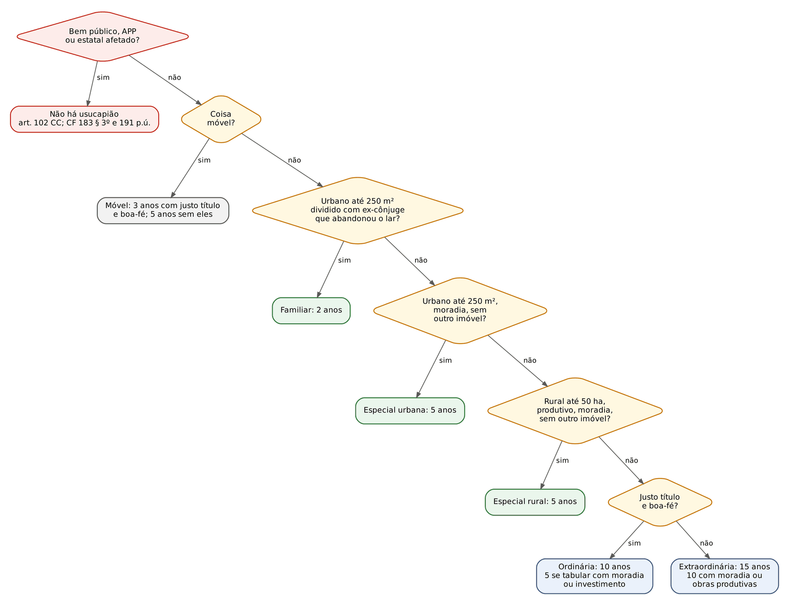
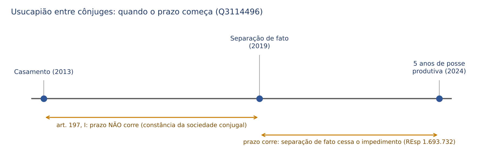
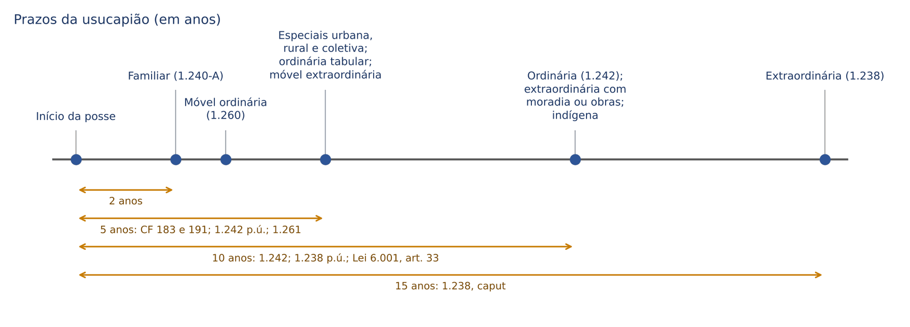
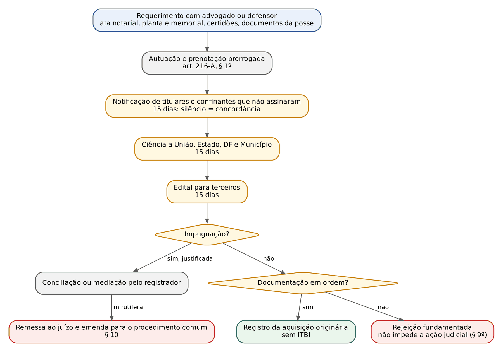

# CAPÍTULO 29 — USUCAPIÃO: REQUISITOS GERAIS, ESPÉCIES, USUCAPIÃO EXTRAJUDICIAL E ADMINISTRATIVA, BENS PÚBLICOS E JURISPRUDÊNCIA

:::INCIDENCIA
TRF5 p. 12; TJRS p. 17; TJSC p. 17. Nível A+. Lote: 22 questões (FGV 15, FCC 7).
O que mais cai: caso concreto em que é preciso escolher a espécie e conferir prazo, área, moradia e "não ser proprietário de outro imóvel"; usucapião familiar (2 anos, abandono do lar); módulo urbano e rural (Tema 815 do STF e Tema 985 do STJ); justo título (promessa e recibo); natureza originária e efeitos sobre ônus.
:::

| Subtema | FGV | FCC | Padrão |
|---|---|---|---|
| Especial urbana (CF 183; art. 1.240; Estatuto da Cidade) | 5 | 2 | caso com 250 m², moradia da família, outro imóvel, uso misto, metade ideal, módulo municipal |
| Familiar (art. 1.240-A) | 3 | 1 | prazo de 2 anos, abandono do lar, divórcio dispensável, "domínio integral" |
| Posse *ad usucapionem*, interversão, herdeiro, oposição | 3 | 0 | comodato, herdeiro condômino, notificação extrajudicial, locação de parte |
| Ordinária e justo título | 2 | 1 | promessa não registrada, recibo, prazo de 10 anos sem moradia |
| Extraordinária e Tema 985 | 1 | 1 | 10 anos com moradia; área inferior ao módulo |
| Especial rural | 1 | 0 | 50 ha, separação de fato e art. 197, I |
| Natureza, objeto e bens públicos | 0 | 2 | originária e declaratória; móveis e imóveis, salvo públicos |

## 29.1 Noção, natureza e objeto

### 29.1.1 Aquisição originária pela posse qualificada no tempo

Usucapião é a aquisição da propriedade (ou de outro direito real) pela posse prolongada, com os qualificativos que a lei exige para cada espécie. Seu fundamento é a função social da posse e da propriedade (Cap. 28) somado à segurança jurídica: o proprietário inerte não perde por não usar (a propriedade não prescreve), perde porque outro adquiriu. É por isso que a reivindicatória não "prescreve": ela só fica sem objeto quando consumada a usucapião em favor de alguém (STJ, REsp 1.837.425-PR, 3ª Turma, j. 13/6/2023, que também afastou a *actio nata* subjetiva na prescrição aquisitiva: o prazo corre do início da posse *ad usucapionem*, não da ciência do proprietário, ainda que a invasão só tenha sido constatada em demarcatória).

Três consequências da natureza ORIGINÁRIA são cobradas em série:

- Não há relação jurídica com o antigo dono: o usucapiente não "sucede" o proprietário. A FGV considerou errada a afirmação de que, na usucapião, o adquirente "sucede juridicamente" o anterior proprietário em aquisição "indireta" (ENAM 2024, Q2459907, correlata do Cap. 28).
- Os ônus reais anteriores não sobrevivem: "A usucapião é forma de aquisição originária da propriedade, de modo que não permanecem os ônus reais que gravavam o imóvel antes da sua declaração" (Jurisprudência em Teses do STJ, ed. 133, tese 8). Hipoteca anterior não impede a usucapião (FGV TJCE 2025, Q3505764, alternativa D errada).
- Não incide ITBI no registro (não há transmissão), regra positivada para a via extrajudicial no art. 421 do CNN (Provimento CNJ 149/2023). A tributação fica na Apostila de Direito Tributário.

:::PEGADINHA Originária, mas não "purificadora" de tudo na via extrajudicial
Na via judicial, a sentença declara aquisição originária e os ônus reais anteriores caem (JT 133.8). Na via extrajudicial, o CNN tem duas regras que a banca pode explorar: a existência de ônus ou gravame na matrícula NÃO impede o reconhecimento extrajudicial (art. 411), mas a impugnação do titular desse direito, frustrada a conciliação, impede a via extrajudicial (art. 411, parágrafo único); e o registro extrajudicial NÃO extingue restrições administrativas nem gravames judiciais regularmente inscritos, cujo cancelamento deve ser pedido à autoridade que os ordenou (art. 418). Ver 29.12.
:::

### 29.1.2 A sentença é declaratória

A propriedade se adquire quando se completam os requisitos; a sentença apenas declara e serve de título para o registro (art. 1.238, *caput*, in fine, e art. 1.241, parágrafo único). O registro, aqui, tem função de publicidade e de disponibilidade, não constitutiva. Consequências: o usucapiente já é dono antes da sentença e pode opor a usucapião como defesa (29.11); a ação pode ser julgada procedente com o prazo completado no curso do processo (29.2.4).

:::QUESTAO FCC 2025 — TRF4 — Analista Judiciário, Oficial de Justiça (Q3562210)
Pergunta-se a natureza da usucapião e da sentença. Gabarito: C, aquisição originária e sentença declaratória.
Armadilhas: "derivada" (A, B e D) e "constitutiva" (D e E). A alternativa B ("concretizando-se com o registro da sentença") confunde a usucapião com a aquisição pelo registro do título (art. 1.245, Cap. 28).
:::

### 29.1.3 O que pode ser usucapido

Usucapem-se a propriedade de imóveis e de móveis e os direitos reais que se exercem pela posse: servidão aparente (art. 1.379: 10 anos com título, 20 sem título; o Enunciado 251 da III Jornada sustenta que o prazo máximo deve ser 15 anos, por coerência com o art. 1.238), usufruto (art. 1.391 menciona expressamente o usufruto "que resulte de usucapião"), uso, habitação, superfície e laje em terreno privado (Enunciado 627 da VIII Jornada). Também o direito de uso de linha telefônica (Súmula 193 do STJ). O condomínio edilício pode adquirir imóvel por usucapião (Enunciado 596 da VII Jornada). A servidão e seus prazos são desenvolvidos no Cap. 31.

Não se usucapem: bens públicos de qualquer categoria, inclusive dominicais (29.10), e coisas fora do comércio por natureza. Direitos reais de garantia não se adquirem por usucapião, porque não se exercem pela posse do credor (salvo o penhor, que pressupõe tradição, mas nasce de contrato; tema doutrinário sem cobrança no lote).

:::QUESTAO FCC 2025 — MPE-PI — Analista Ministerial (Q3530381)
De acordo com o CC, o que pode ser usucapido? Gabarito: B, bens móveis e imóveis, com exceção dos públicos (arts. 102, 1.238 e 1.260).
Armadilhas: "inclusive os públicos" (A, C e D; o art. 102 não distingue móveis de imóveis nem dominicais de afetados) e "somente imóveis" (E, ignora os arts. 1.260 a 1.262).
:::

## 29.2 Requisitos gerais: a posse *ad usucapionem*

Toda espécie exige posse com *animus domini*, mansa e pacífica (sem oposição), contínua (sem interrupção) e pelo tempo legal, sobre coisa hábil. Justo título e boa-fé só na ordinária (imóveis e móveis); nas demais, a lei os dispensa ("independentemente de título e boa-fé", art. 1.238), e a doutrina diz que se presumem de modo absoluto. A teoria da posse e os vícios objetivos estão no Cap. 27; aqui, só o que decide a usucapião.

### 29.2.1 *Animus domini*: quem possui "como seu"

A posse apta é a de quem se comporta como dono, sem reconhecer domínio alheio. Por isso não usucapem, enquanto durar a relação: o locatário, o comodatário, o depositário, o usufrutuário, o credor pignoratício e, em regra, o promitente comprador antes de quitar o preço. Também não há posse nos atos de mera permissão ou tolerância (art. 1.208, primeira parte), e o detentor (fâmulo da posse) não usucape. Violência e clandestinidade impedem a posse enquanto não cessarem (art. 1.208, segunda parte); a precariedade, para a doutrina tradicional, não convalesce.

O STJ, porém, admite a mudança do caráter da posse (*interversio possessionis*) quando há alteração substancial da situação de fato, com atos exteriores inequívocos de oposição ao possuidor indireto. Precedentes: locatário que por décadas deixou de pagar aluguel, sem qualquer reação do locador (REsp 154.733-DF, 4ª Turma, j. 5/12/2000), e possuidores que ficaram mais de 30 anos sem contrato regular nem aluguel, fizeram benfeitorias, compraram metade do apartamento e pagaram todos os tributos e taxas (REsp 1.909.276-RJ, 3ª Turma, j. 27/9/2022, Informativo 753). A regra de partida é o art. 1.203: presume-se que a posse mantém o caráter com que foi adquirida, salvo prova em contrário. Quem alega a interversão prova o ato de oposição.

:::JURIS Jurisprudência em Teses do STJ, ed. 110, tese 10
"A posse decorrente do contrato de promessa de compra e venda de imóvel não induz usucapião, exceto se verificada a conversão da posse não própria em própria, momento a partir do qual o possuidor passa a se comportar como se dono fosse."
Leitura: a promessa é justo título (29.4.1), mas a posse do promissário só é *ad usucapionem* quando ele passa a se comportar como dono, o que em geral coincide com a quitação.
:::

| Situação | Há *animus domini*? | Fundamento |
|---|---|---|
| Locatário, comodatário, depositário durante o contrato | NÃO | posse direta derivada (art. 1.197); art. 1.203 |
| Comodatário que, findo o contrato, passa a agir como dono, com oposição inequívoca | Pode haver, a partir da interversão | REsp 154.733; REsp 1.909.276 |
| Descendente que mora em imóvel do ascendente por tolerância familiar, acervo indiviso | NÃO, ainda que por décadas | AREsp 2.983.084-AL, Informativo 894 |
| Herdeiro com posse EXCLUSIVA do imóvel da herança, sem oposição dos demais | SIM | REsp 1.631.859-SP; AgInt no AREsp 2.355.307-SP, Informativo 822 |
| Ex-cônjuge que exerce posse exclusiva (mesmo indireta, recebendo aluguéis) sobre fração do outro, sem oposição | SIM | REsp 1.840.561-SP, 3ª Turma, j. 3/5/2022 |
| Família que ocupa terreno há décadas sem pagar IPTU | SIM: o não pagamento do IPTU não afasta o *animus* | AgInt no AREsp 2.306.673-SP, Informativo 830 |
| Possuidor que loca parte do imóvel a terceiro | SIM: locar é conduta de dono (posse indireta) | art. 1.197; FGV TJSC 2026, Q4153610 |
| Caseiro, empregado, preposto | NÃO enquanto detentor (art. 1.198); pode haver posse depois de extinto o vínculo | CC 211.941-PR, Informativo 856 |

:::ATENCAO Herdeiro: Informativo 822 x Informativo 894
A ocupação do imóvel do ascendente por liberalidade familiar, com acervo indiviso, é posse precária e não gera usucapião, ainda que dure décadas (AREsp 2.983.084-AL, Informativo 894 — v. Cap. 27). Os dois julgados convivem. O herdeiro condômino PODE usucapir contra os demais (condomínio *pro indiviso* desde a abertura da sucessão, arts. 1.784 e 1.791, parágrafo único) se provar posse exclusiva, com ânimo de dono e sem oposição. Não pode quando a ocupação nasceu e continuou como favor familiar, sem ato que revele oposição aos demais. Na prova, procure no enunciado: posse exclusiva, despesas suportadas sozinho, ausência de oposição (favorece) ou "permissão", "administração", "tolerância" (desfavorece).
:::

:::QUESTAO FGV 2026 — TJ-PE — Juiz Substituto (Q4349484)
Caso: filho mora há 17 anos, sem oposição do irmão, no imóvel deixado pelo pai; o registrador rejeitou o pedido extrajudicial por falta de documentos e ele ajuizou ação de usucapião extraordinária.
Gabarito: D, reconhecer legitimidade e interesse e prosseguir.
Passos: (1) o herdeiro condômino tem legitimidade para usucapir em nome próprio se a posse for exclusiva (REsp 1.631.859; Informativo 822); (2) a rejeição do pedido extrajudicial não impede a ação (art. 216-A, § 9º, da Lei 6.015/1973), e a via judicial nem sequer exige prévio pedido extrajudicial (REsp 1.796.394-RJ, j. 24/5/2022; REsp 1.824.133).
Armadilhas: "já é proprietário em condomínio" (A: a usucapião abrange a parte do irmão); "só o espólio" (B); litisconsórcio ativo com o irmão (C: o irmão é réu, não autor); coisa julgada administrativa (E).
:::

:::QUESTAO FGV 2025 — MPE-ES — Promotor de Justiça Substituto (Q3752738)
Caso: comodato verbal de sítio de 5 ha por 48 meses, a partir de 2006; o comodante morre em 2011, as herdeiras nunca reivindicam; o comodatário constrói casa, explora e vende a produção; em 2020 transfere 1 ha a terceiro, que em 2025, réu em reivindicatória, alega usucapião.
Gabarito oficial: B, a morte do comodante extinguiu o comodato, convertendo a posse em *ad usucapionem*, com usucapião extraordinária "após 15 anos".
Comentário: a banca premiou a ideia de interversão (fim do título derivado mais atos inequívocos de dono, sem oposição das herdeiras). Observe que, com moradia e obras produtivas, o prazo seria de 10 anos (art. 1.238, parágrafo único), e o termo inicial mais seguro é o fim do prazo do comodato somado à conduta de dono, não a morte em si (ver nota). As demais estão claramente erradas: A (precariedade perpétua), C (a cessão da posse não interrompe; o cessionário soma a posse, art. 1.243), D (justo título e boa-fé "em qualquer modalidade") e E (a usucapião pode ser alegada em defesa, Súmula 237 do STF, e a composse não a impede).
Correlatas sobre comodato e posse precária: Q4289328 (Cap. 19).
:::

### 29.2.2 Posse mansa e pacífica: o que é "oposição"

"Sem oposição" significa ausência de resistência eficaz do proprietário à posse durante o prazo. A oposição juridicamente relevante é a judicial e idônea; atos extrajudiciais isolados não bastam. Pontos cobrados:

- Citação em possessória julgada improcedente NÃO interrompe o prazo (JT do STJ, ed. 133, tese 9). A citação só interrompe se a demanda for acolhida, isto é, se o proprietário retomar a posse.
- A contestação na própria ação de usucapião não é oposição à posse; exprime discordância com a aquisição (REsp 1.361.226-MG, 3ª Turma, j. 5/6/2018; REsp 1.909.276-RJ).
- Notificação extrajudicial do proprietário (inclusive por e-mail) sem medida judicial posterior não interrompe: as causas interruptivas aplicáveis por força do art. 1.244 são as do art. 202 (despacho que ordena a citação, protesto judicial, ato judicial que constitua em mora, ato inequívoco do PRÓPRIO possuidor que importe reconhecimento do direito alheio).
- A morte do proprietário e a abertura do inventário não interrompem (os herdeiros recebem a propriedade como estava, art. 1.784, e nada fizeram contra o possuidor).

:::QUESTAO FGV 2026 — TJ-SC — Oficial de Justiça e Avaliador (Q4153610)
Caso: em 2004, promessa de compra e venda quitada, sem registro, com imissão na posse, moradia, benfeitorias e tributos pagos; em 2011, morte do promitente vendedor e inventário que incluiu o imóvel, sem pretensão do possuidor nos autos; em 2025, locação de parte autônoma a terceiro; em janeiro de 2026, notificação por e-mail pedindo desocupação, sem ação; em março de 2026, ação de usucapião.
Gabarito: D, a notificação por e-mail, sem medida judicial, não impede a usucapião.
Passos: posse com ânimo de dono desde 2004 (promessa quitada é justo título e revela intenção de dono); mais de 20 anos, suficientes até para a extraordinária de 15. Erros: A (promessa não registrada é relevante: JT 133, tese 6); B (morte e inventário não interrompem); C (locar parte é exercício da posse como dono); E (natureza da posse é essencial; "cinco anos independentemente da natureza" não existe).
:::

### 29.2.3 Continuidade, *accessio* e *successio possessionis*

A posse deve ser contínua, sem intervalos. Para completar o tempo, o possuidor pode somar a posse dos antecessores, desde que todas sejam contínuas e pacíficas e, na ordinária, com justo título e boa-fé (art. 1.243, que remete ao art. 1.207). O sucessor universal (herdeiro) continua de direito a posse do antecessor (*successio possessionis*); ao sucessor singular (comprador, cessionário) é facultado unir as posses (*accessio possessionis*).

:::LEI Código Civil, arts. 1.243 e 1.244
Art. 1.243. O possuidor pode, para o fim de contar o tempo exigido pelos artigos antecedentes, acrescentar à sua posse a dos seus antecessores (art. 1.207), contanto que todas sejam contínuas, pacíficas e, nos casos do art. 1.242, com justo título e de boa-fé.
Art. 1.244. Estende-se ao possuidor o disposto quanto ao devedor acerca das causas que obstam, suspendem ou interrompem a prescrição, as quais também se aplicam à usucapião.
:::

Nas especiais (urbana e rural), a soma é restrita: o Enunciado 317 da IV Jornada afirma que a *accessio possessionis* do art. 1.243, primeira parte, NÃO se aplica aos arts. 1.239 e 1.240, dado o caráter pessoal da posse-moradia e da posse-trabalho exigidas pela CF. Para a urbana individual, há regra própria só para a sucessão causa mortis: o herdeiro legítimo continua de pleno direito a posse do antecessor, desde que já resida no imóvel ao abrir-se a sucessão (art. 9º, § 3º, do Estatuto da Cidade). Na coletiva, ao contrário, a soma é expressamente permitida (art. 10, § 1º).

| Espécie | Soma de posses | Fundamento |
|---|---|---|
| Extraordinária e ordinária | Sim (na ordinária, todas com justo título e boa-fé) | art. 1.243 |
| Especial urbana individual | Só a do herdeiro legítimo que já residia no imóvel | art. 9º, § 3º, do Estatuto; Enunciado 317 |
| Especial rural | Não (*accessio* inter vivos) | Enunciado 317 |
| Coletiva | Sim, se ambas contínuas | art. 10, § 1º, do Estatuto |
| Móveis | Sim | art. 1.262 |

### 29.2.4 Tempo: completado no curso do processo; causas que impedem, suspendem e interrompem

O prazo pode completar-se no curso da ação, ressalvada a má-fé processual do autor (Enunciado 497 da V Jornada; REsp 1.361.226-MG, aplicando o atual art. 493 do CPC). O juiz considera o fato constitutivo superveniente.

O art. 1.244 manda aplicar à usucapião as causas impeditivas, suspensivas e interruptivas da prescrição (arts. 197 a 204; Cap. 11). As que a prova explora:

- Entre cônjuges, na constância da sociedade conjugal (art. 197, I): o prazo não corre. Mas a separação de fato por longo período faz cessar o impedimento, como o divórcio e a separação judicial (STJ, REsp 1.693.732-MG, 3ª Turma, j. 5/5/2020). A usucapião familiar (29.8) é, por definição, exceção: pressupõe o abandono do lar.
- Entre ascendentes e descendentes durante o poder familiar (art. 197, II); entre tutelado ou curatelado e tutor ou curador (art. 197, III).
- Contra os absolutamente incapazes (art. 198, I): hoje, só a pessoa com menos de 16 anos. Contra ausentes do País em serviço público e contra quem serve nas Forças Armadas em tempo de guerra (art. 198, II e III).
- Pendente condição suspensiva, não vencido o prazo ou pendente ação de evicção (art. 199).
- Interrupção: despacho que ordena a citação em ação idônea (art. 202, I, com retroação à propositura, art. 240, § 1º, do CPC), protesto judicial, ato judicial que constitua em mora e ato inequívoco do possuidor que reconheça o direito do dono (por exemplo, propor comprar o imóvel do proprietário ou pagar-lhe aluguel).
- Regime emergencial da pandemia: o art. 10 da Lei 14.010/2020 suspendeu os prazos de aquisição por usucapião de 12/6/2020 a 30/10/2020 (desenvolvimento da lei no Cap. 46). Em cálculo de prazo que atravesse 2020, some esses dias.

:::DICA Direito intertemporal dos prazos
Os prazos reduzidos do CC/2002 (15 e 10 anos na extraordinária; 10 e 5 na ordinária) têm aplicação imediata, sem a regra de transição do art. 2.028, por beneficiarem o possuidor (Enunciado 564 da VI Jornada). O art. 2.029 acrescentou dois anos aos prazos dos parágrafos únicos dos arts. 1.238 e 1.242 nos dois primeiros anos de vigência do Código, regra hoje só histórica. Para a familiar, o prazo de 2 anos só começou a correr com a vigência da Lei 12.424/2011 (Enunciado 498 da V Jornada).
:::

## 29.3 Usucapião extraordinária (art. 1.238)

:::LEI Código Civil, art. 1.238
Art. 1.238. Aquele que, por quinze anos, sem interrupção, nem oposição, possuir como seu um imóvel, adquire-lhe a propriedade, independentemente de título e boa-fé; podendo requerer ao juiz que assim o declare por sentença, a qual servirá de título para o registro no Cartório de Registro de Imóveis.
Parágrafo único. O prazo estabelecido neste artigo reduzir-se-á a dez anos se o possuidor houver estabelecido no imóvel a sua moradia habitual, ou nele realizado obras ou serviços de caráter produtivo.
:::

Requisitos: posse com ânimo de dono, sem interrupção nem oposição, por 15 anos; ou 10 anos se houver moradia habitual OU obras ou serviços produtivos (posse-trabalho, que a doutrina chama de função social da posse). Não há limite de área, não se exige que o possuidor não tenha outro imóvel, nem justo título ou boa-fé. O CC/1916 exigia 20 anos.

Duas notas finas. Primeira: no parágrafo único os requisitos são ALTERNATIVOS ("ou"), ao contrário do art. 1.242, parágrafo único, que exige aquisição onerosa com base em registro cancelado E moradia ou investimento. Segunda: a extraordinária é a espécie residual, que absorve quem não cabe nas especiais (área maior, outro imóvel, imóvel comercial).

:::JURIS STJ, Tema 985 (REsp 1.667.842-SC e REsp 1.667.843-SC, 2ª Seção, j. 3/12/2020)
"O reconhecimento da usucapião extraordinária, mediante o preenchimento dos requisitos específicos, não pode ser obstado em razão de a área usucapienda ser inferior ao módulo estabelecido em lei municipal."
Leitura: a lógica é a do Tema 815 do STF (29.5.2), estendida à extraordinária. A lei de parcelamento do solo regula o loteamento, não a aquisição originária.
:::

:::QUESTAO FCC 2025 — DPE-SP — Analista de Defensoria (Q3304105)
Caso: posse de imóvel urbano há 11 anos, sem interrupção nem oposição, com moradia habitual; orientaram a possuidora de que faltava tempo e de que a área inferior ao módulo municipal impediria a usucapião.
Gabarito: A, prazo cumprido (10 anos com moradia, art. 1.238, parágrafo único) e área inferior ao módulo não é óbice (Tema 985).
Armadilhas: B e C (módulo como óbice), C e D (prazo de 15 anos sem considerar a moradia), E (justo título e boa-fé "em qualquer hipótese").
:::

:::QUESTAO FGV 2024 — AL-PR — Analista Legislativo, Advogado (Q2449765)
Caso: posse mansa de 2006 a 2023 sobre imóvel de 100 m², sem registro e com área inferior ao módulo local; a possuidora morre em 2024 deixando três filhos.
Gabarito: D, transcrição do Tema 985.
Armadilhas: A (falta de registro gera presunção ABSOLUTA de terra devoluta: errado, JT 133, tese 7, em 29.10); B (aquisição derivada, com ônus mantidos: errado, JT 133, tese 8); C (a morte interrompe o prazo e os herdeiros não têm legitimidade: errado; o prazo já se consumara, a propriedade adquirida integra a herança e os herdeiros continuam a posse, arts. 1.207 e 1.784); E (sentença como requisito constitutivo: errado, é declaratória).
:::

## 29.4 Usucapião ordinária (art. 1.242)

:::LEI Código Civil, art. 1.242
Art. 1.242. Adquire também a propriedade do imóvel aquele que, contínua e incontestadamente, com justo título e boa-fé, o possuir por dez anos.
Parágrafo único. Será de cinco anos o prazo previsto neste artigo se o imóvel houver sido adquirido, onerosamente, com base no registro constante do respectivo cartório, cancelada posteriormente, desde que os possuidores nele tiverem estabelecido a sua moradia, ou realizado investimentos de interesse social e econômico.
:::

### 29.4.1 Justo título

É o título que, em tese, seria hábil a transferir a propriedade, mas não a transferiu por um vício (aquisição *a non domino*, vício de forma, falta de registro). O conceito é amplo: "A expressão 'justo título' contida nos arts. 1.242 e 1.260 do Código Civil abrange todo e qualquer ato jurídico hábil, em tese, a transferir a propriedade, independentemente de registro" (Enunciado 86 da I Jornada). O STJ consolidou:

- Promessa de compra e venda, mesmo não registrada, é justo título (JT do STJ, ed. 133, tese 6).
- Recibo de compra e venda basta para o justo título; o requisito deve ser interpretado extensivamente, sob pena de a usucapião ordinária tornar-se supérflua (quem tem título formal perfeito usaria a adjudicação compulsória) (REsp 2.215.421-SE, 3ª Turma, j. 10/3/2026, Informativo 882).

Formal de partilha, carta de arrematação, escritura de compra e venda de quem não era dono, cessão de direitos hereditários e doação viciada também servem. A via extrajudicial tem rol exemplificativo próprio (art. 410 do CNN, em 29.12).

### 29.4.2 Boa-fé

É a boa-fé subjetiva do art. 1.201: ignorância do vício que impede a aquisição. Quem tem justo título presume-se de boa-fé, salvo prova em contrário ou quando a lei não admite a presunção (art. 1.201, parágrafo único). A boa-fé deve existir durante TODO o prazo (a posse de boa-fé perde esse caráter quando as circunstâncias fazem presumir que o possuidor sabe que possui indevidamente, art. 1.202). Consumado o prazo, a ciência posterior do vício é irrelevante.

### 29.4.3 Ordinária tabular (parágrafo único)

O prazo cai para 5 anos se o possuidor adquiriu ONEROSAMENTE com base em registro que foi depois CANCELADO e, cumulativamente, nele estabeleceu moradia ou fez investimentos de interesse social e econômico. É a chamada usucapião tabular (ou *secundum tabulas*): o usucapiente chegou a figurar como proprietário no registro. Por isso, ele pode alegá-la em defesa na ação que pretende anular o registro, sem necessidade de ação própria (Enunciado 569 da VI Jornada). Há correlação com o art. 214, § 5º, da Lei 6.015/1973 (a nulidade do registro não será decretada se atingir terceiro de boa-fé que já tiver preenchido as condições de usucapião), tema do Cap. 33.

| | Ordinária comum | Ordinária tabular | Extraordinária com moradia ou obras |
|---|---|---|---|
| Prazo | 10 anos | 5 anos | 10 anos |
| Justo título e boa-fé | sim | sim, e o título foi REGISTRADO e depois cancelado | não |
| Aquisição onerosa | não exigida | exigida | não exigida |
| Função social | não exigida | moradia OU investimentos de interesse social e econômico | moradia habitual OU obras e serviços produtivos |
| Erro típico de prova | exigir moradia | aceitar título gratuito ou não registrado | exigir justo título |

:::QUESTAO FGV 2025 — ENAM 2025.2 (Q3692414)
Caso: em 15/3/2013, promessa de compra e venda quitada, por instrumento particular, com quem se dizia dono (tinha só direitos hereditários não formalizados); posse pública, contínua, com moradia; em agosto de 2025, o verdadeiro proprietário notifica e ajuíza reivindicatória; o réu alega usucapião ordinária.
Gabarito: B, a defesa procede, pois a promessa não registrada é justo título.
Passos: justo título (JT 133, tese 6; Enunciado 86) e boa-fé (acreditava negociar com o dono) desde 2013; 10 anos completos em março de 2023, antes da notificação; usucapião pode ser alegada em defesa (Súmula 237 do STF, 29.11).
Armadilhas: A (exige ação declaratória incidental: Súmula 237); C (a ciência do vício pela notificação de 2025 não desfaz aquisição consumada em 2023); D (escritura e registro como requisitos do justo título); E (moradia e investimentos são requisitos só da redução para 5 anos).
:::

:::QUESTAO FGV 2025 — TJ-CE — Juiz Substituto (Q3505764)
Caso: posse de 12 anos de terreno de 250 m², com moradia da família, benfeitorias e tributos pagos, decorrente de promessa não registrada firmada com quem se dizia dono; a Prefeitura afirma tratar-se de terra devoluta por falta de registro; havia hipoteca anterior em favor de banco.
Gabarito: E, a promessa é justo título apto, comprovados boa-fé e posse mansa, pacífica e ininterrupta pelo prazo da modalidade adequada.
Erros: A (registro como requisito do justo título); B (12 anos bastam para a ordinária, para a especial urbana e até para a extraordinária com moradia); C (especial urbana tem prazo de 5, não 10 anos); D (hipoteca anterior não impede: aquisição originária, JT 133, tese 8). A tese de terra devoluta não se presume pela falta de registro (JT 133, tese 7).
:::

:::QUESTAO FCC 2024 — TRT11 — Analista Judiciário, Área Judiciária (Q2400471)
Caso: posse de imóvel urbano de 300 m², com justo título e boa-fé, sem moradia nem investimentos. Prazo mínimo?
Gabarito: B, 10 anos (art. 1.242, *caput*).
Armadilhas: 15 anos (E, extraordinária sem considerar o justo título); 2 anos (A, familiar); a especial urbana está afastada pela área e pela falta de moradia.
:::

Correlata de imóvel com garantia fiduciária e usucapião extraordinária (FCC PGM Manaus 2026, Q4338798): a banca reputou errado exigir justo título e boa-fé na extraordinária (Cap. 32).

## 29.5 Usucapião especial urbana individual (CF, art. 183; CC, art. 1.240; Estatuto da Cidade, arts. 9º a 14)

### 29.5.1 Requisitos

:::LEI Constituição Federal, art. 183
Art. 183. Aquele que possuir como sua área urbana de até duzentos e cinqüenta metros quadrados, por cinco anos, ininterruptamente e sem oposição, utilizando-a para sua moradia ou de sua família, adquirir-lhe-á o domínio, desde que não seja proprietário de outro imóvel urbano ou rural.
§ 1º O título de domínio e a concessão de uso serão conferidos ao homem ou à mulher, ou a ambos, independentemente do estado civil.
§ 2º Esse direito não será reconhecido ao mesmo possuidor mais de uma vez.
§ 3º Os imóveis públicos não serão adquiridos por usucapião.
:::

O art. 1.240 do CC repete o *caput* e os §§ 1º e 2º. O art. 9º do Estatuto da Cidade fala em "área ou edificação urbana" e acrescenta o § 3º (herdeiro residente, 29.2.3). Chamada também de *pro misero*, pró-moradia ou constitucional urbana. Requisitos:

1. Área urbana de até 250 m² (edificada ou não, inclusive unidade autônoma de condomínio edilício: Enunciado 85 da I Jornada).
2. Posse com ânimo de dono, por 5 anos, ininterrupta e sem oposição.
3. Moradia do possuidor OU de sua família (não é preciso que o próprio possuidor resida, se a família reside: FGV TJBA 2026, Q4102130).
4. Não ser proprietário de outro imóvel urbano ou rural (requisito aferido durante o prazo e no momento da aquisição; posse de outro imóvel não é propriedade).
5. Não ter sido beneficiado antes pela mesma modalidade.

Dispensam-se justo título e boa-fé. Não se exige que o possuidor seja pobre: a renda não é requisito.

### 29.5.2 Área: os quatro pontos que a prova explora

- Módulo urbano: "Preenchidos os requisitos do art. 183 da Constituição Federal, o reconhecimento do direito à usucapião especial urbana não pode ser obstado por legislação infraconstitucional que estabeleça módulos urbanos na respectiva área em que situado o imóvel (dimensão do lote)" (Tema 815 do STF, RE 422.349-RS, Plenário, j. 29/4/2015). No caso, o módulo era de 360 m² e a área usucapida, 225 m² destacados de um todo maior.
- Área comum de condomínio edilício: "Para os efeitos do art. 1.240, não se deve computar, para fins de limite de metragem máxima, a extensão compreendida pela fração ideal correspondente à área comum" (Enunciado 314 da IV Jornada).
- Posse sobre área maior: "Quando a posse ocorre sobre área superior aos limites legais, não é possível a aquisição pela via da usucapião especial, ainda que o pedido restrinja a dimensão do que se quer usucapir" (Enunciado 313 da IV Jornada). Na familiar, o STJ seguiu a mesma lógica (Informativo 892, 29.8).
- Regularização urbanística pendente não impede: "É cabível a aquisição de imóveis particulares situados no Setor Tradicional de Planaltina/DF, por usucapião, ainda que pendente o processo de regularização urbanística" (Tema 1.025 do STJ, REsp 1.818.564-DF, 2ª Seção, j. 9/6/2021).

:::PEGADINHA Tema 815 do STF x Tema 985 do STJ
Mesmo raciocínio, objetos diferentes. Tema 815 (STF, repercussão geral): especial URBANA e módulo urbano municipal, fundamento constitucional (art. 183). Tema 985 (STJ, repetitivo): EXTRAORDINÁRIA e módulo municipal. Na rural, o equivalente é o Enunciado 594 da VII Jornada (área menor que o módulo rural, 29.7). Alternativa que diga que a área inferior ao módulo impede qualquer usucapião está errada nas três frentes.
:::

### 29.5.3 Moradia, uso misto e "outro imóvel": a jurisprudência que vira questão

- Uso misto: o art. 1.240 não exige destinação EXCLUSIVAMENTE residencial; a pequena atividade comercial exercida pela família que mora no imóvel (no caso, uma bicicletaria) não impede a usucapião especial urbana da totalidade (STJ, 3ª Turma, REsp 1.777.404-TO, Rel. Min. Nancy Andrighi, j. 5/5/2020).
- Metade ideal: ser proprietário de metade do próprio imóvel usucapiendo não é ser proprietário de "outro imóvel" (REsp 1.909.276-RJ, Informativo 753).
- Possuidor de direito de laje em outro lugar: posse não é propriedade; não incide a vedação (Q4102130).
- Proprietário de pequena área rural: incide a vedação, ainda que ali só trabalhe temporariamente (FGV Câmara de São Paulo 2024, Q2351244).

:::QUESTAO FCC 2026 — TJ-CE — Analista Judiciário, Área Judiciária (Q4231766)
Caso: possuidor sem outros imóveis mora há oito anos, com a família, em imóvel urbano de 200 m², tomado sem negócio jurídico; sabia que o dono morrera e que o único herdeiro, no exterior, foi avisado da ocupação no primeiro dia e nada fez.
Gabarito: C, adquire pelo art. 1.240 (250 m², 5 anos, moradia, sem outro imóvel).
Armadilhas: limites trocados (150 m² em A, 10 anos em B, 2 anos em D) e boa-fé como requisito (E). A ciência do herdeiro, sem oposição, é irrelevante; a má-fé do possuidor também.
:::

:::QUESTAO FGV 2025 — DPE-PE — Defensor Público (Q3390831)
Caso: idosa reside desde 2010, de forma contínua e exclusiva, em imóvel urbano de 180 m² construído pelo irmão falecido sem herdeiros; no registro consta construtora extinta informalmente em 2005; paga tributos e não tem outro imóvel.
Gabarito: A, cabe a especial urbana (mais de 5 anos, até 250 m², moradia, sem outro imóvel).
Armadilhas: área de "200 m²" e autorização municipal (B); exigência de ocupação coletiva (C); imóvel registrado em nome de pessoa jurídica de direito privado como óbice (D: só o bem público é insuscetível); políticas públicas prévias (E).
:::

:::QUESTAO FCC 2025 — DPE-RS — Defensor Público (Q3387012)
Sobre a usucapião especial urbana, à luz da lei e dos informativos. Gabarito: A, ser proprietário da metade ideal do imóvel usucapiendo não impede a declaração (REsp 1.909.276, Informativo 753).
Armadilhas: B (associação de moradores "constituída há mais de um ano" e "dispensando autorização": o art. 12, III, do Estatuto exige personalidade jurídica e autorização EXPLÍCITA dos representados, e não fixa tempo de constituição); C (*successio possessionis* incompatível: o art. 9º, § 3º, a admite para o herdeiro residente); D (pequena atividade comercial impede: REsp 1.777.404); E (gratuidade condicionada à prova de hipossuficiência: o art. 12, § 2º, a confere ao autor sem essa condição, inclusive perante o registro de imóveis).
:::

:::QUESTAO FGV 2025 — TJ-SE — Juiz Substituto (Q3301303)
Na contestação de usucapião constitucional urbana, o réu sustenta: I, imóvel em condomínio edilício com 250 m² de área privativa ultrapassaria o limite, computada a fração ideal das áreas comuns; II, impossibilidade de *accessio possessionis*; III, uso parcial comercial limitaria a declaração à parte residencial. Quais teses improcedem?
Gabarito: C, improcedem I e III.
Passos: I improcede (Enunciado 314: a fração ideal da área comum não se computa); II procede (Enunciado 317: a *accessio* do art. 1.243 não se aplica às especiais; só o herdeiro residente soma, art. 9º, § 3º); III improcede (uso misto não impede a usucapião da totalidade, REsp 1.777.404).
:::

:::QUESTAO FGV 2024 — Câmara Municipal de São Paulo — Procurador Legislativo (Q2351244)
Caso: família reside há cinco anos em área urbana de 250 m²; durante dois meses trabalhou como agricultora em sua pequena propriedade rural, continuando a pernoitar no imóvel; o módulo urbano é de 300 m²; reconheceu-se a usucapião.
Gabarito: C, só há irregularidade quanto aos requisitos do possuidor (era proprietário de imóvel rural).
Armadilhas: o tempo está cumprido e não houve interrupção (B e D); o módulo não importa (E, Tema 815).
:::

:::QUESTAO FGV 2026 — TJ-BA — Juiz Leigo (Q4102130)
Caso: há cinco anos, posse de terreno urbano de 250 m² com casebre, onde moram o marido e os filhos da possuidora, que trabalha e não reside ali; ela não é proprietária de imóvel, mas possui direito de laje com habitação precária em outra cidade.
Gabarito: B, requisitos preenchidos.
Passos: moradia "sua ou de sua família" (art. 183); 250 m² está no limite ("até"); a vedação é ser PROPRIETÁRIO de outro imóvel, e ela é apenas possuidora da laje.
:::

:::QUESTAO FGV 2025 — TJ-ES — Outorga de Delegações, Remoção (Q3520311)
Caso: posse de 6 anos, ininterrupta, de área urbana de 260 m², com moradia, sem outro imóvel; o plano diretor fixa módulo mínimo de 320 m².
Gabarito oficial: D, preenche os requisitos.
Comentário: o foco da banca foi o Tema 815 (módulo municipal não é óbice). Pela letra do art. 183, porém, 260 m² excede o limite de 250 m², e o Enunciado 313 impede restringir o pedido. Gabarito discutível; verifique se o enunciado original não mencionava 250 m² (ver nota). Na prova, se a área exceder 250 m², a especial urbana está afastada.
:::

### 29.5.4 Aspectos processuais do Estatuto da Cidade

:::PROCESSO Ação de usucapião especial urbana (arts. 11 a 14 do Estatuto da Cidade)
- Pendente a ação, ficam sobrestadas quaisquer outras ações, petitórias ou possessórias, que venham a ser propostas sobre o imóvel (art. 11).
- Legitimidade (art. 12): o possuidor, isoladamente ou em litisconsórcio originário ou superveniente; os possuidores em composse; e, como SUBSTITUTO PROCESSUAL, a associação de moradores regularmente constituída, com personalidade jurídica, "desde que explicitamente autorizada pelos representados".
- Intervenção OBRIGATÓRIA do Ministério Público (art. 12, § 1º). No CPC/2015, fora dessa regra especial, a usucapião não está entre as hipóteses gerais de intervenção do MP (art. 178).
- Gratuidade ao autor, inclusive perante o cartório de registro de imóveis (art. 12, § 2º).
- Pode ser invocada como matéria de defesa, valendo a sentença como título para registro (art. 13).
- Rito "sumário" (art. 14): extinto o procedimento sumário pelo CPC/2015, aplica-se o procedimento comum (art. 1.049, parágrafo único, do CPC).
:::

## 29.6 Usucapião especial urbana coletiva (art. 10 do Estatuto da Cidade)

:::LEI Lei 10.257/2001, art. 10, caput (redação da Lei 13.465/2017)
Art. 10. Os núcleos urbanos informais existentes sem oposição há mais de cinco anos e cuja área total dividida pelo número de possuidores seja inferior a duzentos e cinquenta metros quadrados por possuidor são suscetíveis de serem usucapidos coletivamente, desde que os possuidores não sejam proprietários de outro imóvel urbano ou rural.
:::

O que mudou com a Lei 13.465/2017: a redação original exigia "áreas urbanas com mais de 250 m², ocupadas por população de baixa renda para sua moradia", em que não fosse possível identificar os terrenos de cada possuidor. Hoje bastam: núcleo urbano informal (conceito do art. 11 da Lei 13.465/2017), existente sem oposição há mais de 5 anos, área total dividida pelo número de possuidores INFERIOR a 250 m² por possuidor e possuidores sem outro imóvel urbano ou rural. Saíram a baixa renda, a finalidade de moradia e a impossibilidade de identificar os lotes.

Regime (§§ 1º a 5º):

- Soma de posses com a do antecessor, desde que ambas contínuas (§ 1º).
- Declaração por sentença, que é título para registro (§ 2º).
- O juiz atribui IGUAL fração ideal a cada possuidor, independentemente da área que cada um ocupe, salvo acordo ESCRITO entre os condôminos fixando frações diferenciadas (§ 3º).
- Forma-se condomínio especial INDIVISÍVEL, insuscetível de extinção, salvo deliberação de, no mínimo, DOIS TERÇOS dos condôminos, no caso de execução de urbanização posterior à constituição do condomínio (§ 4º).
- Deliberações de administração por maioria dos condôminos PRESENTES, obrigando discordantes e ausentes (§ 5º).

:::PEGADINHA Números da coletiva
"Inferior a" 250 m² por possuidor (na individual é "até" 250 m²). Frações IGUAIS, salvo acordo escrito. Extinção do condomínio só com 2/3 e só para urbanização posterior. Administração pela maioria dos PRESENTES. As bancas trocam "presentes" por "totais" e "dois terços" por "maioria absoluta".
:::

## 29.7 Usucapião especial rural (CF, art. 191; CC, art. 1.239; Lei 6.969/1981)

Também chamada *pro labore*, agrária ou constitucional rural. Texto do art. 1.239 (idêntico ao art. 191 da CF): "Aquele que, não sendo proprietário de imóvel rural ou urbano, possua como sua, por cinco anos ininterruptos, sem oposição, área de terra em zona rural não superior a cinqüenta hectares, tornando-a produtiva por seu trabalho ou de sua família, tendo nela sua moradia, adquirir-lhe-á a propriedade." O parágrafo único do art. 191 da CF repete a vedação dos imóveis públicos.

Requisitos cumulativos: zona rural; área de até 50 ha; posse com ânimo de dono por 5 anos ininterruptos e sem oposição; terra tornada produtiva pelo trabalho do possuidor ou de sua família; moradia no imóvel; não ser proprietário de imóvel rural ou urbano. Dispensam-se justo título e boa-fé.

| Ponto | Regra | Fonte |
|---|---|---|
| Área inferior ao módulo rural | possível | Enunciado 594 da VII Jornada; STJ, REsp 1.040.296-ES, 4ª Turma, j. 2/6/2015 |
| Área máxima concreta | observado o teto de 50 ha, considera-se o módulo rural e a atividade agrária regionalizada | Enunciado 312 da IV Jornada |
| Posse sobre área maior que 50 ha | não cabe a especial, ainda que se restrinja o pedido | Enunciado 313 da IV Jornada |
| *Accessio possessionis* | não se aplica | Enunciado 317 da IV Jornada |
| Competência quando a União intervém | foro da situação do imóvel | Súmula 11 do STJ |
| Moradia E trabalho | cumulativos (diferente da urbana, que exige só moradia) | art. 1.239 |

:::JURIS STJ, Súmula 11
"A presença da União ou de qualquer de seus entes, na ação de usucapião especial, não afasta a competência do foro da situação do imóvel."
Leitura: a súmula foi editada à luz da Lei 6.969/1981; sua compatibilidade com o art. 109, I, da CF, quando a União intervém com interesse jurídico, deve ser vista com cautela. Na prova, a súmula é cobrada pela literalidade.
:::

:::QUESTAO FGV 2024 — TJ-MT — Oficial de Justiça (Q3114496)
Caso: casados desde 2013 sob separação de bens, residiam em imóvel rural de 30 ha herdado pelo marido; separação de fato em 2019, quando ele desapareceu; desde então a mulher cultiva grãos e sustenta os filhos; ela não tem outro imóvel e quer regularizar o bem, registrado em nome do marido.
Gabarito: C, especial rural após 5 anos ininterruptos e sem oposição.
Passos: (1) bem exclusivo do marido, rural: a familiar está afastada (só imóvel URBANO e em copropriedade); (2) art. 197, I: o prazo entre cônjuges não corre na constância da sociedade conjugal, mas a separação de fato faz cessar o impedimento (REsp 1.693.732); (3) 30 ha, trabalho, moradia, sem outro imóvel, 5 anos desde 2019.
Armadilhas: A (familiar com 5 anos); B (ordinária: não há justo título); D (desaparecimento do proprietário não impede); E (exigência de divórcio).
:::

## 29.8 Usucapião familiar (art. 1.240-A)

:::LEI Código Civil, art. 1.240-A (incluído pela Lei 12.424/2011)
Art. 1.240-A. Aquele que exercer, por 2 (dois) anos ininterruptamente e sem oposição, posse direta, com exclusividade, sobre imóvel urbano de até 250m² (duzentos e cinquenta metros quadrados) cuja propriedade divida com ex-cônjuge ou ex-companheiro que abandonou o lar, utilizando-o para sua moradia ou de sua família, adquirir-lhe-á o domínio integral, desde que não seja proprietário de outro imóvel urbano ou rural.
§ 1º O direito previsto no caput não será reconhecido ao mesmo possuidor mais de uma vez.
:::

Chamada também usucapião por abandono do lar, pró-família ou conjugal. É o MENOR prazo de usucapião do sistema, menor até que o dos móveis. Requisitos:

1. Imóvel URBANO de até 250 m² (o limite é da área TOTAL do imóvel: Informativo 892).
2. Propriedade COMUM do casal (condomínio ou mancomunhão com o ex-cônjuge ou ex-companheiro). Se o imóvel é só do outro, não é familiar; se é só de terceiro, também não.
3. Abandono do lar pelo outro.
4. Posse direta, exclusiva, por 2 anos ininterruptos e sem oposição.
5. Moradia do possuidor ou de sua família.
6. Não ser proprietário de outro imóvel urbano ou rural; e uma só vez.

Efeito: aquisição do "domínio integral", isto é, da fração do que abandonou.

| Enunciado | Conteúdo |
|---|---|
| 498 (V Jornada) | o prazo de 2 anos só começou a correr com a vigência da Lei 12.424/2011 |
| 499 (V Jornada) | REVOGADO pelo 595 (exigia descumprimento simultâneo de outros deveres conjugais e falava em alteração do regime de bens) |
| 500 (V Jornada) | pressupõe a propriedade comum do casal e alcança todas as entidades familiares, inclusive homoafetivas |
| 501 (V Jornada) | "ex-cônjuge" e "ex-companheiro" correspondem à situação fática da separação, INDEPENDENTEMENTE de divórcio |
| 502 (V Jornada) | a "posse direta" do art. 1.240-A não coincide com a acepção do art. 1.197 |
| 595 (VII Jornada) | abandono do lar = abandono VOLUNTÁRIO da posse do imóvel somado à ausência da tutela da família, SEM averiguação de culpa pelo fim da relação |
| 664 (IX Jornada) | o prazo só começa quando a composse cessa de forma efetiva; não basta o fim do contato físico com o imóvel |

:::JURIS STJ, 4ª Turma, processo em segredo de justiça, Rel. Min. Antonio Carlos Ferreira, j. 19/5/2026 (Informativo 892)
"O limite de 250 m² estabelecido no art. 1.240-A do Código Civil refere-se à área total do imóvel urbano objeto da posse, de modo que a usucapião familiar não pode incidir sobre fração de imóvel de maior dimensão para fins de adequação ao referido parâmetro legal."
Leitura: casa de 360 m²; a autora pediu a usucapião de só 250 m², renunciando ao resto. Negado: norma restritiva da propriedade (art. 5º, XXII, da CF) aplica-se nos exatos limites. Mesma lógica do Enunciado 313 para as especiais.
:::

:::ATENCAO Abandono do lar não é "saída do lar"
Para o Enunciado 595, conta o abandono voluntário da posse somado à falta de assistência à família; não se discute culpa pelo fim do casamento. Sair de casa por ordem judicial (medida protetiva), por acordo, ou continuar pagando as despesas e visitando os filhos NÃO caracteriza abandono. E o prazo só corre quando cessa a composse de fato (Enunciado 664). Ajuizada pelo que saiu ação possessória, de partilha ou de arbitramento de aluguel antes dos 2 anos, há oposição.
:::

:::QUESTAO FGV 2026 — DPE-RJ — Defensor Público (Q4289325)
Caso: companheiros adquiriram em copropriedade imóvel urbano de 180 m², único bem, residência da família; em fevereiro de 2023 o companheiro saiu voluntária e definitivamente, deixou de exercer posse e de prestar assistência material, sem oposição; a companheira ficou com os filhos, não tem outro imóvel e nunca usou a modalidade; ação em julho de 2026.
Gabarito: E, procedência: mais de dois anos de posse exclusiva sobre a quota do ex-companheiro que abandonou o lar.
Armadilhas: A (prazo de 5 anos); B (copropriedade impede: é PRESSUPOSTO, Enunciado 500); C ("mera separação de fato, independentemente das circunstâncias": o abandono exige saída voluntária mais ausência de tutela, Enunciado 595); D (justo título e boa-fé).
:::

:::QUESTAO FCC 2025 — DPE-RS — Defensor Público (Q3386997)
Sobre a usucapião familiar. Gabarito: B, prazo de 2 anos contado do abandono, dispensando formalização do divórcio ou da dissolução da união estável (Enunciado 501).
Armadilhas: A (judicialização da posse pelo que saiu, no curso do prazo, é oposição); C (imóveis rurais: só urbanos); D (protege o que ficou, não "ambos"); E (mais de uma vez: § 1º).
:::

:::QUESTAO FGV 2025 — ENAM 2025.1 (Q3362367)
Caso: união estável de 2015 a dezembro de 2020, quando o companheiro abandonou o lar; casa em lote de 200 m², em bairro periférico; em 2025 ele pede dissolução e partilha; ela alega em contestação a usucapião, com posse exclusiva desde o abandono.
Gabarito: E, art. 1.240-A, 2 anos de posse exclusiva, imóvel de até 250 m².
Armadilhas: A (só imóvel rural: é o oposto); B (entre conviventes não corre prazo: o abandono rompe a vida em comum e a própria lei cria a modalidade); C (10 anos); D (4 anos). A alegação em contestação é admitida (Súmula 237 do STF).
:::

:::QUESTAO FGV 2024 — TJ-SC — Oficial de Justiça (Q2515572)
Caso: casada há 20 anos, a mulher foi abandonada pelo marido, que nunca mais deu notícias; quatro anos depois, quer usucapir o imóvel de 100 m² de propriedade de ambos, onde ficou com o filho.
Gabarito: A, pode usucapir o domínio integral, desde que não seja proprietária de outro imóvel.
Armadilhas: C (não corre prescrição porque ainda casada: o art. 1.240-A é exceção ao art. 197, I, e o divórcio é dispensável, Enunciado 501); B e E (prazos de 5 e 10 anos); D (mesmo proprietária de outro imóvel).
:::

## 29.9 Usucapião indígena e usucapião de bens móveis

### 29.9.1 Indígena (Lei 6.001/1973, art. 33)

"O índio, integrado ou não, que ocupe como próprio, por dez anos consecutivos, trecho de terra inferior a cinqüenta hectares, adquirir-lhe-á a propriedade plena." O parágrafo único exclui as terras do domínio da União ocupadas por grupos tribais, as áreas reservadas do Estatuto e as terras de propriedade coletiva de grupo tribal.

Notas: prazo de 10 anos; área "inferior a" 50 ha (na rural, "não superior a" 50 ha); não exige moradia, trabalho nem ausência de outro imóvel; independe do grau de integração. As terras tradicionalmente ocupadas pelos indígenas são bens da União (art. 20, XI, da CF) e, como bens públicos, insuscetíveis de usucapião: a usucapião indígena só alcança terras particulares.

### 29.9.2 Bens móveis (arts. 1.260 a 1.262)

| Espécie | Prazo | Requisitos | Artigo |
|---|---|---|---|
| Ordinária | 3 anos | posse contínua e incontestada, como sua, com justo título e boa-fé | 1.260 |
| Extraordinária | 5 anos | posse prolongada, independentemente de título ou boa-fé | 1.261 |
| Regras comuns | soma de posses e causas impeditivas, suspensivas e interruptivas | arts. 1.243 e 1.244 | 1.262 |

Pontos de prova: o art. 1.262 remete aos arts. 1.243 e 1.244, e NÃO ao art. 1.238 (não há redução por moradia ou obras para móveis); veículos usucapem-se pelos mesmos prazos, e o registro no órgão de trânsito não é constitutivo; coisa furtada ou roubada só induz posse depois de cessada a violência ou a clandestinidade (art. 1.208), tema com precedentes do STJ não conferidos nesta tarefa (ver nota). A aquisição *a non domino* de móvel em estabelecimento comercial e a revalidação da tradição pela aquisição superveniente do domínio pelo alienante (art. 1.268) são do Cap. 28 (FGV TJPR 2026, Q3898896, correlata: a usucapião ordinária de 3 anos era a alternativa sedutora, mas a solução estava no art. 1.268, § 1º).

## 29.10 Bens insuscetíveis de usucapião

### 29.10.1 Bens públicos

A vedação é tripla: art. 183, § 3º, e art. 191, parágrafo único, da CF; art. 102 do CC ("Os bens públicos não estão sujeitos a usucapião"). Alcança os de uso comum, os de uso especial e os DOMINICAIS.

:::JURIS STF, Súmula 340
"Desde a vigência do Código Civil, os bens dominicais, como os demais bens públicos, não podem ser adquiridos por usucapião."
Leitura: o "Código Civil" da súmula é o de 1916 (a súmula é de 1963). A classificação dos bens públicos está no Cap. 7.
:::

Desdobramentos jurisprudenciais:

- Terras devolutas: são bens públicos, mas a falta de registro NÃO gera presunção de que o imóvel seja devoluto; cabe ao Estado provar a titularidade como óbice à usucapião (JT do STJ, ed. 133, tese 7). Na via extrajudicial, a impugnação fundada apenas nessa presunção é injustificada (Enunciado 32 da Jornada de Direito Notarial e Registral do CJF, sobre o art. 216-A, § 10).
- Bens de empresa pública e sociedade de economia mista: em regra são privados e usucapíveis, MAS não quando afetados a serviço público. Não é possível usucapião de imóvel afetado a finalidade pública essencial de sociedade de economia mista que atua em regime não concorrencial, e a "destinação pública" é interpretada de modo abrangente, alcançando imóveis momentaneamente sem uso, com potencial de afetação (STJ, REsp 2.173.088-DF, 3ª Turma, j. 8/10/2024, Informativo 829: terreno da companhia de saneamento junto a reservatório).
- Imóveis vinculados ao Sistema Financeiro da Habitação, de titularidade da Caixa e afetados à política habitacional, são tratados como bens públicos insuscetíveis de usucapião (STJ, REsp 1.631.446, 3ª Turma, Rel. Min. Nancy Andrighi, noticiado em 8/2/2018).
- Área de Preservação Permanente: a ocupação de imóvel em APP não gera direito à aquisição por usucapião (STJ, REsp 2.211.711-MT, 3ª Turma, j. 9/12/2025, Informativo 874).
- O possuidor de bem público não usucape, mas pode ter proteção possessória contra outro particular (FGV MPE-GO 2024, Q2367638, correlata; Súmula 619 do STJ e benfeitorias — ver Cap. 27).

:::PEGADINHA "Imprescritível" e bem de estatal
Bem dominical é alienável (observadas as exigências legais), mas é imprescritível: alienabilidade e usucapibilidade não andam juntas (Cap. 7). Já o bem de sociedade de economia mista NÃO é público pelo art. 98 (pertence a pessoa jurídica de direito privado); só fica a salvo da usucapião se afetado a serviço público. Alternativa que diga que "todo bem de estatal é imprescritível" ou que "todo bem de estatal é usucapível" está errada.
:::

### 29.10.2 Imóveis gravados com garantia

Hipoteca anterior não impede a usucapião e se extingue com ela (JT 133, tese 8; Q3505764). Na alienação fiduciária, o devedor fiduciante possui em nome do credor por força do contrato (posse direta derivada) e não usucape contra o fiduciário enquanto vigente a relação; a doutrina admite a usucapião por terceiro possuidor com ânimo de dono. O STJ já negou usucapião de veículo alienado fiduciariamente e transferido a terceiro sem anuência do credor, tratando a transferência como ato clandestino perante o credor (número do precedente não conferido nesta tarefa: ver nota). O regime da garantia está nos Caps. 22 e 32.

## 29.11 A ação de usucapião e a usucapião como defesa

:::JURIS STF, Súmula 237
"O usucapião pode ser arguído em defesa."
Leitura: na reivindicatória ou possessória, o réu alega a usucapião como fato extintivo do direito do autor. Para que a sentença valha como título registral, a doutrina e o Enunciado 315 da IV Jornada admitem pedido contraposto ("ao possuidor que figurar como réu em ação reivindicatória ou possessória formular pedido contraposto e postular ao juiz seja declarada adquirida, mediante usucapião, a propriedade imóvel, valendo a sentença como instrumento para registro imobiliário, ressalvados eventuais interesses de confinantes e terceiros"). No CPC/2015, a reconvenção também serve. Na especial urbana, o art. 13 do Estatuto da Cidade diz expressamente que a sentença que acolhe a defesa vale como título para registro; na ordinária tabular, o Enunciado 569 dispensa ação própria porque o usucapiente já é titular no registro.
:::

:::PROCESSO Ação de usucapião de imóvel: o que decide o processo
- Não há procedimento especial no CPC/2015: procedimento comum, com regras próprias de citação e edital.
- Citação PESSOAL dos confinantes, salvo se o objeto for unidade autônoma de prédio em condomínio, caso em que é dispensada (art. 246, § 3º, do CPC). Cita-se também quem figura no registro como proprietário (e seu cônjuge, nas ações reais imobiliárias, art. 73, § 1º, I).
- Editais para interessados incertos ou desconhecidos (art. 259, I, do CPC).
- Intimação dos entes públicos para manifestarem interesse (prática consolidada, por simetria com o art. 216-A, § 3º, da Lei 6.015/1973). Interesse jurídico da União desloca para a Justiça Federal; a Súmula 11 do STJ trata do foro na especial rural (29.7).
- MP: intervém na especial urbana (art. 12, § 1º, do Estatuto da Cidade) e quando houver interesse de incapaz ou interesse público ou social (art. 178 do CPC).
- Competência: Justiça comum estadual, ainda que a posse tenha origem em vínculo de emprego extinto (STJ, CC 211.941-PR, 2ª Seção, j. 5/6/2025, Informativo 856).
- Interesse de agir: independe de prévio pedido extrajudicial (REsp 1.796.394-RJ, 3ª Turma, j. 24/5/2022; REsp 1.824.133, 3ª Turma, 2020); a rejeição extrajudicial também não impede a ação (art. 216-A, § 9º).
- Prazo completado no curso do processo: considera-se (art. 493 do CPC; Enunciado 497).
- Sobrestamento de outras ações petitórias e possessórias na especial urbana (art. 11 do Estatuto).
:::

:::SENTENCA Dispositivo de procedência em usucapião extraordinária com moradia
Fundamentação, em síntese: "Comprovada a posse mansa, pacífica e ininterrupta, com ânimo de dono, desde [data], por mais de dez anos, com moradia habitual no imóvel (art. 1.238, parágrafo único, do CC), sem oposição eficaz do titular registral (a notificação extrajudicial de [data] não interrompe o prazo, e a contestação não constitui oposição à posse), sendo irrelevante que a área seja inferior ao módulo municipal (Tema 985 do STJ)."
Dispositivo: "Ante o exposto, julgo procedente o pedido para DECLARAR que [autor], [qualificação], adquiriu por usucapião extraordinária a propriedade do imóvel descrito no memorial e na planta de fls. [x], com área de [x] m², situado em [endereço], matriculado sob n. [x] do [x] Registro de Imóveis (ou: sem matrícula). A sentença servirá de título para registro (art. 1.241, parágrafo único, do CC), independentemente do recolhimento de ITBI, com abertura de matrícula, se for o caso, e cancelamento dos ônus reais anteriores incompatíveis com a aquisição originária. Custas e honorários conforme a causalidade [ver nota abaixo]."
Sucumbência: sem resistência dos réus, parte da jurisprudência imputa as custas ao autor, que precisava da sentença para regularizar a situação; havendo contestação de mérito, o vencido responde. Matéria de processo, apenas sinalizada.
:::

## 29.12 Usucapião extrajudicial (Lei 6.015/1973, art. 216-A; CNN, arts. 398 a 423)

Introduzida pelo art. 1.071 do CPC/2015, reformada pela Lei 13.465/2017 (que inverteu o sentido do silêncio) e pela Lei 14.382/2022 (impugnação injustificada). Regulamentada pelo Código Nacional de Normas do Foro Extrajudicial (Provimento CNJ 149/2023, arts. 398 a 423, que incorporou o antigo Provimento 65/2017). É FACULTATIVA: "Sem prejuízo da via jurisdicional" (art. 216-A, *caput*). O procedimento registral geral (prenotação, dúvida) está no Cap. 33; aqui, o específico da usucapião.

:::LEI Lei 6.015/1973, art. 216-A, §§ 2º, 9º e 10
§ 2º Se a planta não contiver a assinatura de qualquer um dos titulares de direitos registrados ou averbados na matrícula do imóvel usucapiendo ou na matrícula dos imóveis confinantes, o titular será notificado pelo registrador competente, pessoalmente ou pelo correio com aviso de recebimento, para manifestar consentimento expresso em quinze dias, interpretado o silêncio como concordância. (Redação dada pela Lei nº 13.465, de 2017)
§ 9º A rejeição do pedido extrajudicial não impede o ajuizamento de ação de usucapião.
§ 10. Em caso de impugnação justificada do pedido de reconhecimento extrajudicial de usucapião, o oficial de registro de imóveis remeterá os autos ao juízo competente da comarca da situação do imóvel, cabendo ao requerente emendar a petição inicial para adequá-la ao procedimento comum, porém, em caso de impugnação injustificada, esta não será admitida pelo registrador, cabendo ao interessado o manejo da suscitação de dúvida nos moldes do art. 198 desta Lei. (Redação dada pela Lei nº 14.382, de 2022)
:::

Roteiro, com o que a prova pergunta:

- Onde: no registro de imóveis da comarca (o CNN diz "circunscrição") da situação do imóvel ou da maior parte dele.
- Quem: o interessado, representado por ADVOGADO (o CNN admite também DEFENSOR PÚBLICO, art. 399). Mais de um requerente só em caso de posse comum (art. 405).
- Objeto: propriedade e demais direitos reais usucapíveis; NUNCA bens públicos (art. 399, §§ 1º e 4º, do CNN).
- Instrução (art. 216-A, I a IV): ata notarial do tabelião do município do imóvel, atestando tempo e características da posse do requerente e antecessores (não pode basear-se só em declarações do requerente; art. 402, § 2º, do CNN); planta e memorial descritivo com ART ou RRT, assinados pelos titulares de direitos na matrícula do imóvel e dos confinantes; certidões negativas dos distribuidores; justo título ou documentos da origem, continuidade, natureza e tempo da posse (tributos pagos, por exemplo). Na falta de documentos, cabe justificação administrativa perante a própria serventia (§ 15).
- Prenotação: prorrogada até o acolhimento ou a rejeição (§ 1º).
- Silêncio: notificado o titular que não assinou a planta, tem 15 dias; o SILÊNCIO É CONCORDÂNCIA (§ 2º, desde a Lei 13.465/2017; antes, o silêncio era discordância). Notificando em lugar incerto: edital publicado duas vezes, com prazo de 15 dias cada, silêncio como concordância (§ 13).
- Condomínio edilício: se o imóvel é unidade autônoma, basta notificar o síndico, dispensado o consentimento dos titulares dos confinantes (§ 11); se o confinante é condomínio, basta notificar o síndico (§ 12). O CNN exige só a anuência do síndico para unidade de condomínio regularmente constituído com construção averbada (art. 403), e de todos os titulares da matrícula se o condomínio é de fato (art. 404).
- Entes públicos: ciência a União, Estado, DF e Município, que se manifestam em 15 dias (§ 3º). A inércia não impede o procedimento; qualquer ressalva, óbice ou oposição do ente público encerra a via extrajudicial e remete ao juízo (art. 412, §§ 1º e 3º, do CNN).
- Terceiros: edital, com 15 dias para manifestação (§ 4º); pode ser eletrônico se regulamentado (§ 14).
- Impugnação: o registrador tenta conciliação ou mediação (art. 415 do CNN); frustrada, e sendo a impugnação JUSTIFICADA, remete os autos ao juízo e o requerente emenda para o procedimento comum (§ 10). Impugnação INJUSTIFICADA não é admitida; o inconformado suscita dúvida (§ 10, Lei 14.382/2022).
- Desfecho: documentação em ordem, registro da aquisição, com abertura de matrícula se for o caso (§ 6º); fora de ordem, rejeição fundamentada (§ 8º), que NÃO impede a ação (§ 9º); dúvida sempre cabível (§ 7º).

:::DICA Pontos do CNN com cara de questão
- Justo título dispensa notificação: considera-se outorgado o consentimento, dispensada a notificação, se o requerente apresenta justo título ou instrumento de relação jurídica com o titular registral, com prova de quitação e certidão negativa de ação (art. 410). O rol exemplificativo inclui compromisso ou recibo de compra e venda, cessão de direitos, pré-contrato, proposta de compra, procuração com poderes de alienação, escritura de cessão de direitos hereditários e documentos judiciais de partilha, arrematação ou adjudicação. O registrador deve exigir justificativa do óbice à escrituração regular, para que a usucapião não seja burla ao sistema registral e ao ITBI (art. 410, § 2º).
- Ônus na matrícula não impede; impugnação do titular do ônus, frustrada a conciliação, impede a via extrajudicial (art. 411).
- O registro não extingue restrições administrativas nem gravames judiciais inscritos (art. 418).
- Sem ITBI (art. 421).
- Imóvel rural: registro exige CAR, CCIR quitado e certificação do georreferenciamento pelo Incra (art. 416).
- Opção entre vias: o interessado pode pedir a suspensão do processo judicial por 30 dias ou desistir dele para usar a via extrajudicial, aproveitando as provas (art. 399, §§ 2º e 3º).
- Dispensa da intimação dos confrontantes se o imóvel já matriculado tem descrição precisa e idêntica à do requerimento (art. 407, § 10).
:::

:::PEGADINHA Silêncio no art. 216-A x silêncio no CPC
Na usucapião extrajudicial, silêncio do titular notificado = CONCORDÂNCIA (Lei 13.465/2017). A redação original do CPC/2015 dizia o contrário, e há questões antigas com esse gabarito, hoje desatualizado. Na ação judicial, a revelia dos réus citados por edital leva à nomeação de curador especial (art. 72, II, do CPC), sem concordância presumida.
:::

Correlata: a FGV (TJMS 2026, Q3914491) explorou a acessão invertida "requerida extrajudicialmente, havendo acordo", distinguindo-a da usucapião extrajudicial (Cap. 28).

## 29.13 Usucapião administrativa e regularização fundiária (Lei 13.465/2017)

A expressão "usucapião administrativa" designava a conversão do título de legitimação de posse em propriedade, pelo registrador, após 5 anos do registro, prevista no art. 60 da Lei 11.977/2009 (Minha Casa, Minha Vida), dispositivo revogado pela Lei 13.465/2017, que levou o instituto para os arts. 25 a 27 e criou a legitimação fundiária (art. 23). Parte da doutrina usa "usucapião administrativa" também como sinônimo da extrajudicial: na prova, leia o contexto.

:::LEI Lei 13.465/2017, art. 26, caput e § 2º
Art. 26. Sem prejuízo dos direitos decorrentes do exercício da posse mansa e pacífica no tempo, aquele em cujo favor for expedido título de legitimação de posse, decorrido o prazo de cinco anos de seu registro, terá a conversão automática dele em título de propriedade, desde que atendidos os termos e as condições do art. 183 da Constituição Federal, independentemente de prévia provocação ou prática de ato registral.
§ 2º A legitimação de posse, após convertida em propriedade, constitui forma originária de aquisição de direito real, de modo que a unidade imobiliária com destinação urbana regularizada restará livre e desembaraçada de quaisquer ônus, direitos reais, gravames ou inscrições, eventualmente existentes em sua matrícula de origem, exceto quando disserem respeito ao próprio beneficiário.
:::

| | Legitimação de posse (arts. 25 a 27) | Legitimação fundiária (art. 23) |
|---|---|---|
| Natureza | ato do poder público que confere TÍTULO de posse, conversível em propriedade | forma ORIGINÁRIA de aquisição da propriedade, por ato do poder público |
| Âmbito | exclusivamente Reurb | exclusivamente Reurb |
| Área pública | NÃO se aplica a imóveis urbanos em área de titularidade do poder público (art. 25, § 2º) | SIM: alcança quem detém área pública ou possui área privada |
| Marco temporal | não há data fixa | núcleo urbano informal consolidado existente em 22/12/2016 |
| Aquisição da propriedade | conversão AUTOMÁTICA após 5 anos do registro, se atendidas as condições do art. 183 da CF; nos demais casos, conversão a requerimento perante o registro de imóveis, se satisfeitos os requisitos de alguma usucapião (art. 26, § 1º) | imediata, com o registro da CRF |
| Ônus anteriores | extintos com a conversão, salvo os do próprio beneficiário (art. 26, § 2º) | adquire livre de ônus, salvo os do próprio legitimado (art. 23, § 2º) |
| Transmissibilidade | causa mortis ou inter vivos (art. 25, § 1º) | — |
| Cancelamento | pelo poder público, se deixarem de ser satisfeitas as condições, sem indenização (art. 27) | — |
| Condições na Reurb-S | — | não ser concessionário, foreiro ou proprietário EXCLUSIVO de imóvel urbano ou rural (redação da Lei 14.118/2021); não ter sido contemplado antes com legitimação de posse ou fundiária; imóvel não residencial só com interesse público reconhecido (art. 23, § 1º) |

:::ATENCAO Legitimação fundiária e bem público
A legitimação fundiária é a única via deste capítulo que permite ao particular adquirir imóvel PÚBLICO (art. 23, § 4º: os entes, quando titulares do domínio, ficam autorizados a reconhecer a propriedade aos ocupantes na Reurb-S). Não é usucapião: é aquisição originária por ato administrativo. Por isso não contraria os arts. 183, § 3º, e 191, parágrafo único, da CF, nem a Súmula 340 do STF. Os conceitos de Reurb-S, Reurb-E, núcleo urbano informal e CRF ficam no Cap. 33.
:::

## 29.14 Ficha comparativa de todas as espécies

| Espécie | Prazo | Área | Justo título e boa-fé | Moradia ou trabalho | Não ser proprietário de outro imóvel | Uma só vez | Soma de posses | Fundamento |
|---|---|---|---|---|---|---|---|---|
| Extraordinária | 15 anos | sem limite | dispensados | não exigidos | não exigido | não | sim | art. 1.238, *caput* |
| Extraordinária com posse-trabalho | 10 anos | sem limite | dispensados | moradia habitual OU obras e serviços produtivos | não exigido | não | sim | art. 1.238, p.ú. |
| Ordinária | 10 anos | sem limite | exigidos | não exigidos | não exigido | não | sim, todas com título e boa-fé | art. 1.242, *caput* |
| Ordinária tabular | 5 anos | sem limite | exigidos; aquisição onerosa com registro cancelado | moradia OU investimentos sociais e econômicos | não exigido | não | sim | art. 1.242, p.ú. |
| Especial urbana individual | 5 anos | até 250 m² | dispensados | moradia própria ou da família | exigido (urbano ou rural) | sim | só herdeiro residente | CF 183; art. 1.240; Estatuto, art. 9º |
| Especial urbana coletiva | 5 anos (mais de 5) | área total por possuidor inferior a 250 m² | dispensados | não exigidos desde 2017 | exigido | — | sim | Estatuto, art. 10 |
| Familiar | 2 anos | até 250 m² (área total), urbano, copropriedade com ex-cônjuge ou ex-companheiro | dispensados | moradia própria ou da família | exigido | sim | — | art. 1.240-A |
| Especial rural | 5 anos | até 50 ha, zona rural | dispensados | trabalho E moradia | exigido (rural ou urbano) | — | não (Enunciado 317) | CF 191; art. 1.239; Lei 6.969/1981 |
| Indígena | 10 anos | inferior a 50 ha, terra particular | dispensados | não exigidos | não exigido | — | — | Lei 6.001/1973, art. 33 |
| Móvel ordinária | 3 anos | — | exigidos | — | — | — | sim | art. 1.260 |
| Móvel extraordinária | 5 anos | — | dispensados | — | — | — | sim | art. 1.261 |
| Servidão aparente | 10 anos com título; 20 sem título (Enunciado 251: 15) | — | título conforme o art. 1.242 | — | — | — | sim | art. 1.379 |

:::PASSO Como resolver uma questão de caso sobre usucapião
1. O bem é público, de estatal afetada, do SFH ou em APP? Se sim, não há usucapião (29.10).
2. A posse é *ad usucapionem*? Procure título derivado (locação, comodato, tolerância familiar, detenção) e, se houver, ato inequívoco de interversão (29.2.1).
3. Houve oposição judicial eficaz ou causa impeditiva (cônjuges sem separação de fato, absolutamente incapaz)? Notificação extrajudicial e possessória improcedente não contam (29.2.2 e 29.2.4).
4. Enquadre na espécie de MENOR prazo cujos requisitos estejam todos presentes: familiar (2), especiais e tabular (5), ordinária ou extraordinária com moradia (10), extraordinária (15).
5. Confira as travas de cada especial: área (total, sem fração para "caber"), moradia ou trabalho, outro imóvel em PROPRIEDADE, uma só vez.
6. Ignore o módulo urbano ou rural (Temas 815 e 985; Enunciado 594) e a boa-fé fora da ordinária.
7. Termo final: o prazo pode completar-se no curso do processo (Enunciado 497); some 2020 suspenso (Lei 14.010/2020, art. 10) se atravessar o período.
:::

## 29.15 Resumo para revisão pré-prova

| Instituto | Regra | Exceções e detalhes | Fundamento |
|---|---|---|---|
| Natureza | aquisição originária; sentença declaratória | ônus reais anteriores caem; sem ITBI; na via extrajudicial, gravames judiciais e restrições administrativas permanecem | arts. 1.238 e 1.241; JT 133, tese 8; CNN, arts. 418 e 421 |
| Objeto | móveis, imóveis e direitos reais exercidos pela posse | servidão aparente, usufruto, laje (Enunciado 627), linha telefônica (Súmula 193 do STJ); condomínio edilício pode usucapir (Enunciado 596) | arts. 1.379 e 1.391 |
| Posse *ad usucapionem* | ânimo de dono, mansa, pacífica, contínua | locatário, comodatário e detentor não usucapem; interversão por ato inequívoco; descendente por tolerância familiar não usucape; herdeiro com posse exclusiva usucape | arts. 1.203 e 1.208; REsp 1.909.276; Informativos 822 e 894 |
| Oposição | só a judicial eficaz | possessória improcedente não interrompe; contestação não é oposição; notificação extrajudicial não interrompe | JT 133, tese 9; REsp 1.361.226; art. 202 |
| Causas impeditivas | as da prescrição | entre cônjuges, até a separação de fato; contra absolutamente incapaz; suspensão de 12/6 a 30/10/2020 | arts. 1.244, 197 e 198; REsp 1.693.732; Lei 14.010/2020, art. 10 |
| Soma de posses | permitida | não nas especiais (salvo herdeiro residente na urbana); sim na coletiva | art. 1.243; Enunciado 317; Estatuto, arts. 9º, § 3º, e 10, § 1º |
| Tempo | pode completar-se no curso da ação | salvo má-fé processual | Enunciado 497 |
| Extraordinária | 15 anos; 10 com moradia OU obras produtivas | módulo municipal não impede | art. 1.238; Tema 985 do STJ |
| Ordinária | 10 anos com justo título e boa-fé | 5 anos se onerosa, com registro cancelado e moradia ou investimentos; promessa e recibo são justo título | art. 1.242; Enunciados 86 e 569; JT 133, tese 6; Informativo 882 |
| Especial urbana | 250 m², 5 anos, moradia própria ou da família, sem outro imóvel, uma vez | módulo irrelevante; área comum não se computa; uso misto admitido; metade ideal não é "outro imóvel"; MP obrigatório; gratuidade; defesa | CF 183; art. 1.240; Tema 815; Enunciados 85, 313 e 314; REsps 1.777.404 e 1.909.276; Estatuto, arts. 11 a 14 |
| Coletiva | núcleo urbano informal, mais de 5 anos, menos de 250 m² por possuidor, sem outro imóvel | frações iguais salvo acordo escrito; condomínio indivisível, extinção por 2/3 após urbanização; maioria dos presentes | Estatuto, art. 10 |
| Especial rural | 50 ha, 5 anos, trabalho e moradia, sem outro imóvel | área menor que o módulo rural admitida; posse sobre área maior impede | CF 191; art. 1.239; Enunciados 312, 313 e 594; REsp 1.040.296; Súmula 11 do STJ |
| Familiar | 2 anos, urbano até 250 m² (área total), copropriedade com quem abandonou o lar, moradia, sem outro imóvel, uma vez | divórcio dispensável; abandono sem culpa, mas voluntário e com ausência de tutela; prazo desde 2011 e desde a cessação efetiva da composse | art. 1.240-A; Enunciados 498, 500, 501, 502, 595 e 664; Informativo 892 |
| Indígena | 10 anos, menos de 50 ha | não em terras da União ocupadas por grupos tribais, áreas reservadas e terras coletivas | Lei 6.001/1973, art. 33 |
| Móveis | 3 anos com justo título e boa-fé; 5 anos sem | arts. 1.243 e 1.244 aplicáveis | arts. 1.260 a 1.262 |
| Bens públicos | insuscetíveis, inclusive dominicais | terra devoluta não se presume; estatal só se afetada; SFH; APP | CF 183, § 3º, e 191, p.ú.; art. 102; Súmula 340 do STF; JT 133, tese 7; REsps 2.173.088, 1.631.446 e 2.211.711 |
| Defesa | usucapião pode ser alegada em defesa | pedido contraposto ou reconvenção para valer como título; tabular dispensa ação | Súmula 237 do STF; Enunciados 315 e 569; Estatuto, art. 13 |
| Ação | procedimento comum; citação pessoal dos confinantes (salvo unidade em condomínio); editais | Justiça estadual mesmo com vínculo de emprego extinto; sem exigência de prévia via extrajudicial | CPC, arts. 246, § 3º, e 259, I; CC 211.941; REsp 1.796.394 |
| Extrajudicial | facultativa, no registro de imóveis, com advogado ou defensor | silêncio = concordância; impugnação justificada remete ao juízo; injustificada não admitida; rejeição não impede ação; bens públicos excluídos | Lei 6.015/1973, art. 216-A; CNN, arts. 398 a 423 |
| Reurb | legitimação de posse converte-se em propriedade após 5 anos do registro (art. 183 da CF) | legitimação fundiária é aquisição originária, inclusive de área pública, para núcleos existentes em 22/12/2016 | Lei 13.465/2017, arts. 23 e 25 a 27 |

## 29.16 Artigos de lei incidentes

- Constituição Federal: arts. 5º, XXII e XXIII; 20, XI; 183; 191.
- Código Civil: arts. 102; 197 a 204; 1.196 a 1.208 (posse, no que interessa); 1.238 a 1.244; 1.260 a 1.262; 1.379; 1.391; 1.784 e 1.791; 2.028 e 2.029.
- Lei 10.257/2001 (Estatuto da Cidade): arts. 9º a 14.
- Lei 6.015/1973: arts. 214, § 5º; 216-A.
- Lei 13.465/2017: arts. 11, 23, 25 a 27.
- Lei 11.977/2009: art. 60 (revogado).
- Lei 6.001/1973 (Estatuto do Índio): art. 33.
- Lei 6.969/1981 (usucapião especial rural).
- Lei 14.010/2020: art. 10.
- Código de Processo Civil: arts. 72, II; 73, § 1º; 178; 246, § 3º; 259, I; 493; 1.049, parágrafo único; 1.071.
- Provimento CNJ 149/2023 (CNN do Foro Extrajudicial): arts. 398 a 423.

## 29.17 Julgados, temas e súmulas do capítulo

- Súmula 340 do STF: bens dominicais, como os demais públicos, não se usucapem.
- Súmula 237 do STF: usucapião arguível em defesa.
- Súmula 11 do STJ: presença da União na usucapião especial não afasta o foro da situação do imóvel.
- Súmula 193 do STJ: direito de uso de linha telefônica é usucapível.
- Tema 815 do STF (RE 422.349): módulo urbano não obsta a usucapião especial urbana.
- Tema 985 do STJ (REsps 1.667.842 e 1.667.843): módulo municipal não obsta a extraordinária.
- Tema 1.025 do STJ (REsp 1.818.564): usucapião em área com regularização urbanística pendente.
- JT do STJ, ed. 133, teses 6, 7, 8 e 9: promessa como justo título; terra devoluta não se presume; ônus extintos; possessória improcedente não interrompe.
- JT do STJ, ed. 110, tese 10: posse do promissário só induz usucapião após conversão em posse própria.
- REsp 1.631.859 e AgInt no AREsp 2.355.307 (Informativo 822): herdeiro com posse exclusiva usucape.
- REsp 1.840.561: ex-cônjuge usucape fração do outro com posse exclusiva.
- AgInt no AREsp 2.306.673 (Informativo 830): IPTU não pago não afasta o *animus domini*.
- REsp 154.733 e REsp 1.909.276 (Informativo 753): interversão da posse; metade ideal não é "outro imóvel".
- REsp 1.361.226: prazo completado no curso do processo; contestação não é oposição.
- REsp 1.837.425: termo inicial na posse, sem *actio nata* subjetiva.
- REsp 1.693.732: separação de fato faz cessar o impedimento do art. 197, I.
- REsp 2.215.421 (Informativo 882): recibo de compra e venda é justo título.
- REsp 1.777.404: uso misto não impede a especial urbana.
- REsp 1.040.296: especial rural de área inferior ao módulo.
- Informativo 892 (segredo de justiça): na familiar, 250 m² é a área total.
- REsp 2.173.088 (Informativo 829): imóvel de estatal afetado a serviço público essencial não se usucape.
- REsp 1.631.446: imóvel vinculado ao SFH não se usucape.
- REsp 2.211.711 (Informativo 874): ocupação em APP não gera usucapião.
- CC 211.941 (Informativo 856): competência da Justiça comum mesmo com vínculo de emprego extinto.
- REsp 1.796.394 e REsp 1.824.133: ação judicial independe de prévio pedido extrajudicial.
- Enunciados das Jornadas: 85, 86, 251, 312, 313, 314, 315, 317, 497, 498, 499 (revogado), 500, 501, 502, 564, 569, 594, 595, 596, 627 e 664; Enunciado 32 da Jornada de Direito Notarial e Registral.

Remissões a outros capítulos: classificação dos bens públicos (Cap. 7); prescrição, arts. 197 a 204 (Cap. 11); Súmula 239 do STJ e adjudicação compulsória (Cap. 17, Q3954599); comodato e posse precária (Cap. 19, Q4289328); garantias fiduciárias (Caps. 22 e 32); posse, Súmulas 487 do STF e 619 do STJ e AREsp 2.983.084-AL, Informativo 894 (Cap. 27); aquisição pelo registro, acessão invertida e art. 1.268 (Cap. 28); servidões, laje e superfície (Cap. 31); Reurb, retificação e registro (Cap. 33); Lei 14.010/2020 (Cap. 46); ITBI na usucapião (Apostila de Direito Tributário).

:::NOTA Notas de verificação
- Conferidos no Planalto (29 e 30/10/2026): CC, arts. 102, 197, 1.203, 1.207, 1.208, 1.238 a 1.244, 1.260 a 1.262, 1.379 e 1.391; CF, arts. 183 e 191 (o 191 integralmente conferido em 30/10/2026); Estatuto da Cidade, arts. 9º a 14; Lei 6.015/1973, art. 216-A; Lei 13.465/2017, arts. 23, 25, 26 e 27; Lei 6.001/1973, art. 33; CPC, arts. 246, § 3º, e 259. CNN (Provimento CNJ 149/2023), arts. 398 a 423, conferidos em atos.cnj.jus.br.
- Arts. 1.201, 1.202 e 2.029 do CC; art. 214, § 5º, da Lei 6.015/1973; arts. 72, 73, 178, 493 e 1.049 do CPC; art. 60 da Lei 11.977/2009 (revogado pela Lei 13.465/2017); redação original do art. 10 do Estatuto da Cidade: conferido no Planalto em 30/10/2026.
- AgInt no AREsp 2.355.307-SP (Quarta Turma, j. 17/6/2024, Informativo 822) e AREsp 2.983.084-AL (Quarta Turma, j. 9/6/2026, Informativo 894): números confirmados em 30/10/2026 (Trilhante, juris.damasio.com.br e IBDFAM).
- Julgados: números e teses vistos no Radar do briefing, nas notas civ (Dizer o Direito) do Drive, no material Emagis "Usucapião, Parte III" do Drive e em páginas consultadas (Trilhante: REsp 1.909.276; IRIB: REsp 1.693.732; Portal DORI: REsp 1.631.446 e REsp 1.777.404, este com o número completo confirmado na ementa do material Emagis). Data exata do julgamento do REsp 1.631.446 não localizada (notícia de 8/2/2018). REsp 1.824.133: data informada só como "fevereiro de 2020" pela fonte. Informativo 892: a nota do Dizer o Direito indica REsp 1.949.761-MG, mas o Radar registra processo em segredo de justiça; mantido sem número.
- Não citados por número (não vistos em fonte): enunciado da III Jornada sobre *interversio possessionis*; precedente do STJ sobre veículo alienado fiduciariamente transferido a terceiro; precedentes sobre usucapião de coisa furtada ou roubada.
- Gabaritos discutíveis: Q3520311 (área de 260 m² excede o limite do art. 183; gabarito D só se explica pelo foco no Tema 815; conferir o texto original da questão); Q3752738 (gabarito B atribui à morte do comodante a conversão da posse e fala em 15 anos, quando o caso indica moradia e produção, com prazo de 10 anos); Q3301303 (a tese II foi tratada como procedente com base no Enunciado 317, que parte da doutrina critica).
- Súmulas do TJRS sobre usucapião: nenhuma localizada nas fontes consultadas nesta tarefa.
- Fontes do Drive não lidas na parte do tema: Tartuce 2026, Ana Paula Dias (FGV) e Sinopse TJSC (a leitura pela API devolve só o início desses arquivos grandes).
:::
