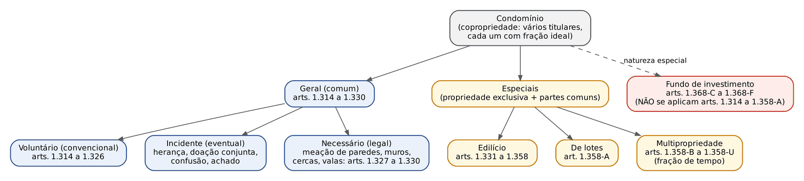
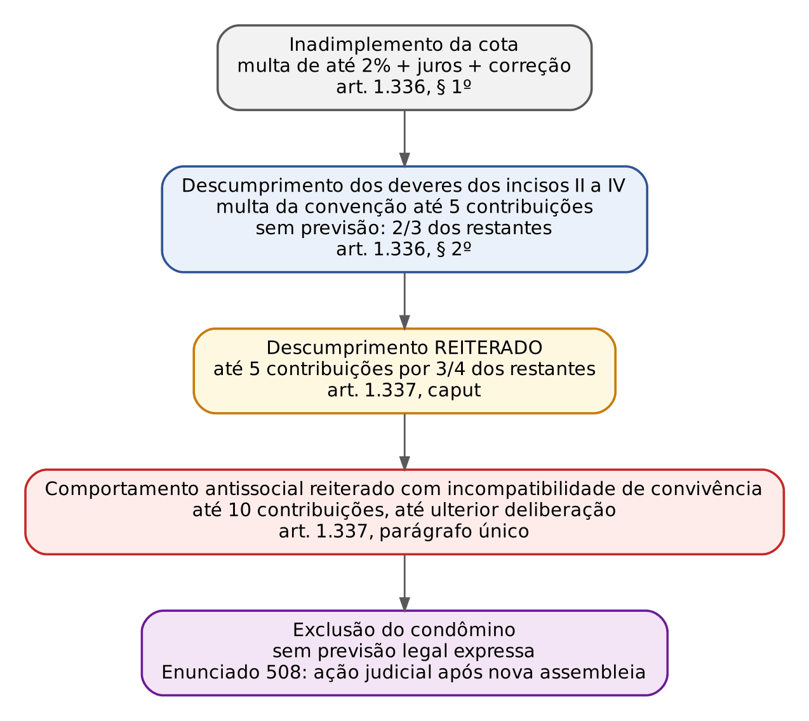
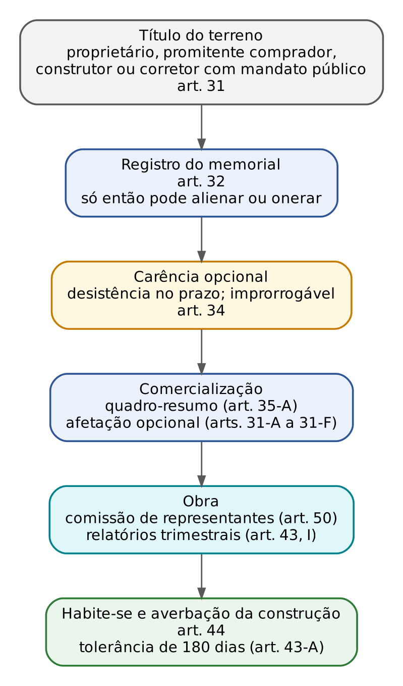
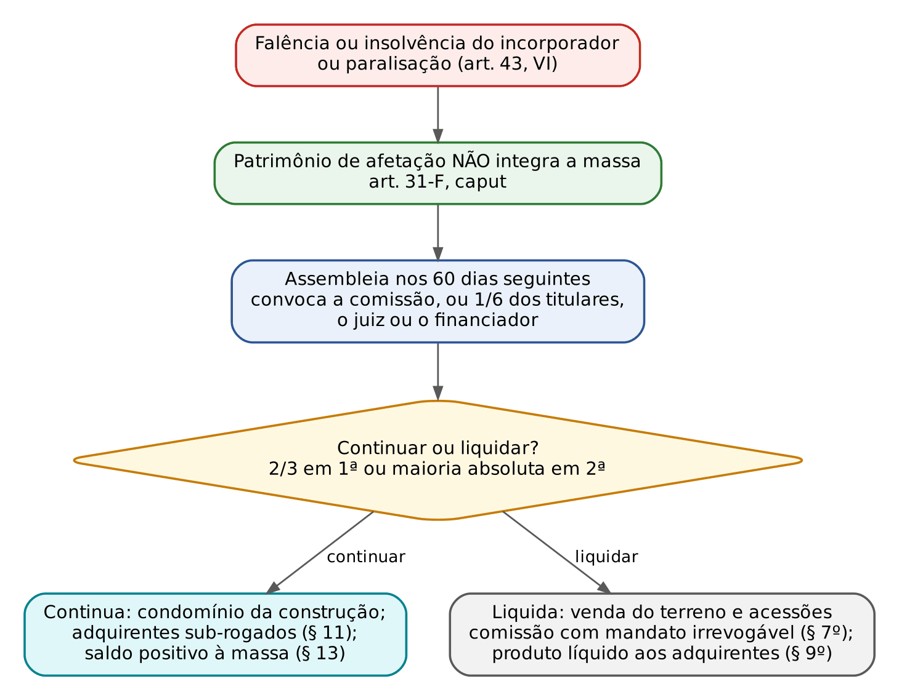

# CAPÍTULO 30 — CONDOMÍNIO GERAL, CONDOMÍNIO EDILÍCIO, CONDOMÍNIO DE LOTES, MULTIPROPRIEDADE, FUNDO DE INVESTIMENTO E INCORPORAÇÃO IMOBILIÁRIA

:::INCIDENCIA
TRF5 p. 12; TJRS p. 17 e 22; TJSC p. 23. Nível A. Lote: 15 questões (FGV 14, FCC 1).
O que mais cai: natureza *propter rem* das cotas (adquirente, promitente comprador, arrematante), quóruns de obras e de alteração da convenção, sanções dos arts. 1.336 e 1.337, letra dos arts. 1.358-C a 1.358-L (multipropriedade), arts. 31 e 32 da Lei 4.591/1964.
:::

| Subtema | FGV | FCC | Padrão |
|---|---|---|---|
| Despesas: *propter rem*, adquirente, promitente comprador, arrematante | 4 | 0 | caso com bem de família, convenção não registrada e prescrição como distratores |
| Quóruns e obras | 2 | 0 | contar votos e classificar a obra (necessária, útil, voluptuária) |
| Convenção, garagem, fachada e sanções | 3 | 0 | letra dos arts. 1.331, § 1º, 1.336, 1.337, 1.339, § 2º, 1.351; art. 10 da Lei 4.591 |
| Seguro, sinistro e reconstrução | 1 | 0 | arts. 13 a 15 da Lei 4.591 |
| Multipropriedade | 2 | 1 | 7 dias; indivisibilidade; instituição por testamento; preferência só se pactuada |
| Incorporação | 1 | 0 | quem pode ser incorporador; mandato por instrumento público |
| Fundo de investimento | 1 | 0 | insuficiência patrimonial: regras de insolvência (arts. 955 a 965) |

## 30.1 Condomínio: noção e classificação

Há condomínio quando o mesmo direito de propriedade pertence a mais de um titular ao mesmo tempo, cada qual com uma fração ideal (quota abstrata, não localizada) sobre o todo. A doutrina majoritária (Caio Mário, Orlando Gomes, Tartuce) adota a teoria da propriedade integral ou total: cada condômino tem direito sobre a coisa inteira, limitado pelos direitos iguais dos consortes, e a fração ideal mede apenas a participação em proveitos e encargos. Daí as regras de que qualquer condômino pode reivindicar a coisa toda de terceiro e defender a posse (art. 1.314), e de que as partes se presumem iguais (art. 1.315, parágrafo único).

Classificações cobradas:

| Critério | Espécies | Observação |
|---|---|---|
| Origem | voluntário ou convencional (ato de vontade); incidente ou eventual (herança, doação conjunta, confusão, achado de tesouro); necessário ou legal (meação de paredes, cercas, muros e valas) | o incidente segue as regras do voluntário (arts. 1.314 a 1.326) |
| Forma | *pro indiviso* (todos exercem a posse em comum) ou *pro diviso* (cada um ocupa porção certa, mas a divisão jurídica ainda não ocorreu) | no *pro diviso* cada um pode ter proteção possessória contra os consortes quanto à sua porção (ver Cap. 27) |

:::PEGADINHA Fundo de investimento e o regime do condomínio
O fundo de investimento é "condomínio de natureza especial", mas a ele NÃO se aplicam os arts. 1.314 a 1.358-A (art. 1.368-C, § 1º). Logo, quem responde à pergunta "fundo sem patrimônio suficiente" com o art. 1.315 (cada condômino concorre para as despesas na proporção de sua parte) erra: aplica-se a insolvência dos arts. 955 a 965 (ver 30.9).
:::

## 30.2 Condomínio geral voluntário

### 30.2.1 Direitos e deveres dos condôminos

Pontos de prova (arts. 1.314 e 1.315):

- Alienar e gravar a parte ideal: livre, sem anuência dos demais (art. 1.314, caput). MAS, na coisa INDIVISÍVEL, a venda a ESTRANHO exige dar preferência aos consortes, tanto por tanto (art. 504; ver 30.2.4). Para gravar (hipoteca da fração ideal) não há preferência.
- Dar posse, uso ou gozo a estranhos (locar, emprestar) e alterar a destinação: exigem o CONSENSO dos outros (parágrafo único). A deliberação de alugar a coisa comum, porém, é tomada pela maioria (art. 1.323), com preferência do condômino ao estranho em igualdade de condições. A conciliação doutrinária: o parágrafo único veda o ato isolado de um condômino; a locação deliberada pela maioria, na forma do art. 1.323, é legítima.
- Frutos e danos: cada condômino responde aos outros pelos frutos que percebeu e pelo dano que causou (art. 1.319). Os frutos partilham-se na proporção dos quinhões, salvo estipulação ou disposição de última vontade (art. 1.326).
- Uso exclusivo por um dos condôminos: o STJ admite o arbitramento de aluguel em favor dos demais, a partir da oposição inequívoca (notificação ou citação), como decorrência do art. 1.319 e da vedação ao enriquecimento sem causa; entre ex-cônjuges, depois da partilha ou quando a fração de cada um estiver definida (orientação reiterada; número do julgado não conferido nesta tarefa). Remissão: quando houver direito real de habitação do cônjuge ou companheiro sobrevivente, não cabe aluguel nem extinção (ver 30.2.4 e Cap. 43).

### 30.2.2 Despesas, dívidas e renúncia

| Situação | Regra | Artigo |
|---|---|---|
| Despesas de conservação ou divisão; ônus da coisa | cada um, na proporção de sua parte | 1.315 |
| Condômino que não quer pagar | pode RENUNCIAR à parte ideal; se os demais assumem as despesas e dívidas, adquirem a parte renunciada na proporção dos pagamentos; se ninguém paga, a coisa é DIVIDIDA | 1.316 e §§ |
| Dívida contraída por TODOS, sem discriminar a parte de cada um nem estipular solidariedade | cada um se obriga proporcionalmente ao seu quinhão (não há solidariedade presumida: art. 265) | 1.317 |
| Dívida contraída por UM, em proveito da comunhão e durante ela | obriga o contratante, que tem ação regressiva contra os demais | 1.318 |

:::PEGADINHA Renúncia: geral x edilício x multipropriedade
- Condomínio geral: a renúncia à parte ideal exonera o renunciante das despesas e dívidas (art. 1.316).
- Condomínio edilício: a renúncia "em caso algum valerá como escusa" para exonerar o condômino de seus encargos (Lei 4.591, art. 12, § 5º); a cota é devida ainda que o condômino não use as partes comuns.
- Multipropriedade: o multiproprietário paga a contribuição "ainda que renuncie ao uso e gozo" (art. 1.358-J, I), e só pode renunciar de forma TRANSLATIVA, em favor do condomínio edilício, estando quite (art. 1.358-T).
:::

:::JURIS STJ, Jurisprudência em Teses, ed. 241, tese 3 (REsp 1.994.565-MG, Terceira Turma, DJe 3/10/2023)
Subsistindo, após a partilha, condomínio voluntário entre coerdeiros sobre imóvel, os coproprietários respondem SOLIDARIAMENTE pelas despesas condominiais, independentemente da expedição do formal de partilha, ressalvado o regresso do art. 283. A solidariedade, aqui, decorre da natureza *propter rem* da dívida perante o condomínio edilício, não do art. 1.317 (que rege dívidas contratadas pelos comunheiros perante terceiros).
:::

### 30.2.3 Administração

- A maioria delibera sobre a administração e escolhe o administrador, que pode ser estranho; se resolver alugar, prefere o condômino em condições iguais (art. 1.323).
- O condômino que administra sem oposição presume-se representante comum (art. 1.324): mandato tácito, com efeitos perante terceiros.
- Maioria calculada pelo VALOR DOS QUINHÕES, e não por cabeça (art. 1.325); deliberações obrigatórias se tomadas por MAIORIA ABSOLUTA (§ 1º); não alcançada, decide o JUIZ a requerimento de qualquer condômino, ouvidos os outros (§ 2º); dúvida sobre o valor do quinhão: avaliação judicial (§ 3º).

:::EXEMPLO Maioria por quinhões
A tem 50%, B 30% e C 20%. A propõe alugar o imóvel; B e C votam contra. Não há maioria absoluta (A tem exatamente metade, não mais da metade), e a decisão vai ao juiz (art. 1.325, § 2º). Se A e C votassem a favor (70%), a locação estaria aprovada, ainda que B, sozinho, se opusesse, e B teria preferência para locar em igualdade de condições (art. 1.323).
:::

### 30.2.4 Divisão, extinção e direito de preferência

:::LEI Código Civil, arts. 1.320 e 1.322
Art. 1.320. A todo tempo será lícito ao condômino exigir a divisão da coisa comum, respondendo o quinhão de cada um pela sua parte nas despesas da divisão.
§ 1º Podem os condôminos acordar que fique indivisa a coisa comum por prazo não maior de cinco anos, suscetível de prorrogação ulterior.
§ 2º Não poderá exceder de cinco anos a indivisão estabelecida pelo doador ou pelo testador.
§ 3º A requerimento de qualquer interessado e se graves razões o aconselharem, pode o juiz determinar a divisão da coisa comum antes do prazo.
Art. 1.322. Quando a coisa for indivisível, e os consortes não quiserem adjudicá-la a um só, indenizando os outros, será vendida e repartido o apurado, preferindo-se, na venda, em condições iguais de oferta, o condômino ao estranho, e entre os condôminos aquele que tiver na coisa benfeitorias mais valiosas, e, não as havendo, o de quinhão maior.
Parágrafo único. Se nenhum dos condôminos tem benfeitorias na coisa comum e participam todos do condomínio em partes iguais, realizar-se-á licitação entre estranhos e, antes de adjudicada a coisa àquele que ofereceu maior lanço, proceder-se-á à licitação entre os condôminos, a fim de que a coisa seja adjudicada a quem afinal oferecer melhor lanço, preferindo, em condições iguais, o condômino ao estranho.
:::

- O direito de pedir a divisão é potestativo e imprescritível enquanto durar o condomínio. Note a assimetria do § 2º: a indivisão imposta por doador ou testador não tem a ressalva de prorrogação do § 1º. Divisão amigável entre maiores e capazes: escritura pública.

:::ESQUEMA Duas preferências que a banca troca: art. 504 x art. 1.322
| | Art. 504 (venda VOLUNTÁRIA da fração a estranho) | Art. 1.322 (VENDA JUDICIAL da coisa indivisível) |
|---|---|---|
| Quando | condômino quer vender sua parte a terceiro | extinção do condomínio sem adjudicação a um só |
| Quem prefere | o consorte, "tanto por tanto" | o condômino ao estranho, em igualdade de oferta |
| Entre condôminos | benfeitorias de maior valor; depois quinhão maior; partes iguais: todos os que quiserem, depositando o preço | benfeitorias mais valiosas; depois quinhão maior; partes iguais e sem benfeitorias: licitação entre estranhos e depois entre condôminos |
| Sanção | preterido pode haver para si a parte vendida, depositando o preço, em 180 DIAS, prazo DECADENCIAL | — |
:::

- Termo inicial dos 180 dias do art. 504: a lei não o fixa; parte da doutrina conta do registro da escritura (publicidade), e há quem exija a ciência efetiva do preterido. Na dúvida da prova, a resposta segura é "180 dias, decadencial, com depósito do preço" (desenvolvimento da preempção legal no Cap. 17).
- Enunciado 623 da VIII Jornada: não há preferência na venda da fração de um coproprietário a OUTRO coproprietário, ainda que sejam muitos os condôminos; o parágrafo único do art. 504 só resolve a concorrência entre condôminos quando a alienação é a ESTRANHO.
- Preferência do condômino x preferência do locatário: prevalece a do condômino (Lei 8.245, art. 34; ver Cap. 18).
- Condômino de coisa DIVISÍVEL não tem preferência (o art. 504 fala em coisa indivisível); a doutrina estende a regra ao imóvel divisível ainda não dividido (*pro indiviso*), mas a letra da lei, que é o que a FGV cobra, restringe-a à coisa indivisível.

O direito real de habitação do cônjuge ou companheiro sobrevivente, enquanto perdurar, impede a extinção do condomínio e a alienação judicial do imóvel em copropriedade com os herdeiros (REsp 2.189.529-SP — v. Cap. 43, também quanto à Q3786330).

:::PROCESSO Extinção de condomínio e arbitramento de aluguel
- Coisa divisível: ação de divisão (CPC, arts. 569 e seguintes), com as regras de partilha da herança no que couber (CC, art. 1.321); demanda real imobiliária (outorga conjugal: CPC, art. 73).
- Coisa indivisível: alienação judicial (CPC, art. 725, IV, e art. 730), com preferência do art. 1.322 e, havendo direito real de habitação, improcedência enquanto ele perdurar.
- Aluguel pelo uso exclusivo: devido desde a oposição inequívoca (citação ou notificação), proporcional à fração dos demais; cumula-se com o pedido de extinção.
:::

## 30.3 Condomínio necessário (arts. 1.327 a 1.330)

Resulta da lei, sobre paredes, cercas, muros e valas divisórias (remissão aos direitos de vizinhança: arts. 1.297, 1.298 e 1.304 a 1.307 — ver Cap. 28). Regras próprias:

- O proprietário que tem direito de estremar o imóvel tem também o de adquirir meação na parede, muro, valado ou cerca do vizinho, embolsando METADE do que atualmente valer a obra e o terreno por ela ocupado (art. 1.328): é aquisição compulsória, por ato unilateral.
- Divergência sobre o preço: arbitramento por peritos, à custa de AMBOS os confinantes (art. 1.329).
- Enquanto não pagar ou depositar o valor, o interessado NÃO pode fazer uso algum da obra divisória (art. 1.330).
- O condomínio necessário é, por natureza, insuscetível de divisão enquanto subsistir a finalidade (separar prédios).

## 30.4 Condomínio edilício: estrutura, instituição e convenção

### 30.4.1 Estrutura e fontes

O condomínio edilício combina propriedade exclusiva (unidade autônoma) e copropriedade indissolúvel das partes comuns, ligadas por uma fração ideal inseparável (art. 1.331, § 3º). Fontes: CC, arts. 1.331 a 1.358; a Lei 4.591/1964, nos arts. 1º a 27, foi tacitamente revogada no que o Código regulou inteiramente (ver Cap. 1), mas permanecem aplicáveis os dispositivos não incompatíveis, que a FGV continua cobrando (art. 10, fachada; arts. 13 a 16, seguro e reconstrução); o art. 1.332 manda observar "o disposto em lei especial". A parte de incorporação (arts. 28 e seguintes) está plenamente em vigor (30.10).

:::LEI Código Civil, art. 1.331, §§ 1º a 5º
§ 1º As partes suscetíveis de utilização independente, tais como apartamentos, escritórios, salas, lojas e sobrelojas, com as respectivas frações ideais no solo e nas outras partes comuns, sujeitam-se a propriedade exclusiva, podendo ser alienadas e gravadas livremente por seus proprietários, exceto os abrigos para veículos, que não poderão ser alienados ou alugados a pessoas estranhas ao condomínio, salvo autorização expressa na convenção de condomínio. (Redação dada pela Lei nº 12.607, de 2012)
§ 2º O solo, a estrutura do prédio, o telhado, a rede geral de distribuição de água, esgoto, gás e eletricidade, a calefação e refrigeração centrais, e as demais partes comuns, inclusive o acesso ao logradouro público, são utilizados em comum pelos condôminos, não podendo ser alienados separadamente, ou divididos.
§ 3º A cada unidade imobiliária caberá, como parte inseparável, uma fração ideal no solo e nas outras partes comuns, que será identificada em forma decimal ou ordinária no instrumento de instituição do condomínio. (Redação dada pela Lei nº 10.931, de 2004)
§ 4º Nenhuma unidade imobiliária pode ser privada do acesso ao logradouro público.
§ 5º O terraço de cobertura é parte comum, salvo disposição contrária da escritura de constituição do condomínio.
:::

Distinções de garagem (a banca mistura as três regras):

| Situação | Regra | Fundamento |
|---|---|---|
| Vaga como unidade autônoma ou acessória: ALIENAR ou ALUGAR a estranho | vedado, SALVO autorização EXPRESSA na convenção | art. 1.331, § 1º (Lei 12.607/2012) |
| Parte ACESSÓRIA da unidade: alienar a OUTRO condômino | livre | art. 1.339, § 2º |
| Parte acessória: alienar a TERCEIRO | só se a faculdade constar do ATO CONSTITUTIVO e a ASSEMBLEIA não se opuser (dois requisitos cumulativos) | art. 1.339, § 2º |
| Condômino que resolve ALUGAR área no abrigo | preferência de qualquer condômino a estranhos e, entre todos, dos POSSUIDORES | art. 1.338 |

Ainda sobre a estrutura:

- Terraço de cobertura: parte comum, salvo disposição em contrário (art. 1.331, § 5º); se for de propriedade exclusiva, as despesas de conservação são do proprietário, de modo que não haja danos às unidades inferiores (art. 1.344).
- Despesas de partes comuns de uso exclusivo de um ou alguns condôminos incumbem a quem delas se serve (art. 1.340). A loja térrea com acesso próprio à via pública não concorre com gastos de serviços que não lhe sejam úteis, salvo disposição condominial em contrário (Jurisprudência em Teses, ed. 68, tese 17).
- Natureza jurídica: tema do Cap. 5 (Enunciados 90 e 246 x STJ: ente despersonalizado). Para este capítulo importam os efeitos práticos admitidos: o condomínio pode adquirir imóvel por usucapião (Enunciado 596 da VII Jornada) e adjudicar unidades; NÃO responde pelo IPTU das áreas comuns (não é titular nem possuidor com ânimo de dono: Jurisprudência em Teses, ed. 68, tese 11); e nas relações entre condomínio e condôminos NÃO incide o CDC (ed. 68, tese 10).
- O regime do condomínio edilício aplica-se, no que couber, a "condomínios assemelhados" (loteamentos fechados, multipropriedade, clubes de campo: Enunciado 89 da I Jornada), hoje com disciplina legal própria (30.7 e 30.8). O "shopping do tipo vendido" (unidades comerciais autônomas sem exploração unitária coordenada) é condomínio edilício, não contrato de *shopping center* (Enunciado 83 da III Jornada de Direito Comercial).

### 30.4.2 Instituição e convenção

| | Ato de instituição (art. 1.332) | Convenção (arts. 1.333 e 1.334) |
|---|---|---|
| Função | cria o condomínio: individualiza unidades e partes comuns, fixa as frações ideais e o fim das unidades | estatuto normativo: rateio, administração, assembleias, sanções, regimento interno |
| Forma | ato entre vivos ou TESTAMENTO | escritura pública ou instrumento particular (art. 1.334, § 1º) |
| Quórum | — | subscrita por titulares de, no mínimo, 2/3 das FRAÇÕES IDEAIS |
| Registro | registro no RI é constitutivo do condomínio | obrigatória desde logo entre titulares, possuidores e detentores; registro SÓ para oponibilidade a TERCEIROS (art. 1.333, parágrafo único) |

- Titular único de edificação com unidades autônomas: a escritura declaratória de instituição e convenção é título hábil para o registro (Enunciado 504 da V Jornada).
- Equiparam-se aos proprietários, para fins da convenção, salvo disposição em contrário, os promitentes compradores e os cessionários de direitos (art. 1.334, § 2º).
- Na incorporação, a minuta de convenção integra o memorial (Lei 4.591, art. 32, "j"), e o registro do memorial e da instituição do condomínio sobre as frações constitui ato registral único (art. 32, § 15, incluído pela Lei 14.382/2022).

:::JURIS STJ, Súmula 260
"A convenção de condomínio aprovada, ainda que sem registro, é eficaz para regular as relações entre os condôminos." Consequências práticas: a falta de registro não descaracteriza o título executivo das cotas nem exonera o adquirente; só impede a oponibilidade a terceiros estranhos ao condomínio. O Código positivou a súmula no art. 1.333 (obrigatória "desde logo"; registro para eficácia *erga omnes*).
:::

- Regimento interno: integra a convenção por exigência do art. 1.334, V, mas o quórum para alterá-lo pode ser livremente fixado na convenção (Enunciado 248 da III Jornada). Normas complementares sobre assembleia eletrônica podem ir ao regimento por maioria simples dos presentes (art. 1.354-A, § 5º).
- Cláusula compromissória na convenção vincula todo condômino que ingressar no condomínio, inclusive adquirentes posteriores, afastando o Judiciário dos conflitos condominiais abrangidos (Jurisprudência em Teses, ed. 122, tese 12, REsp 1.733.370-GO).
- A convenção ou a assembleia pode vedar a locação de garagem a estranhos (Enunciado 91 da I Jornada), o que hoje decorre da própria regra do art. 1.331, § 1º.

:::QUESTAO FGV 2026 — TJ-MS — Outorga de Delegações, Remoção (Q3914286)
Atualização de convenção de 1965 ao CC/2002. I: alienação de vaga a estranhos, se a assembleia não se opuser e o ato constitutivo permitir; II: multa de 20% reduzida "à metade", autorizado desconto por pontualidade; III: quórum de alteração, antes de 3/5 na própria convenção, passa a 2/3. Gabarito: C (I e III). Por quê: I reproduz o art. 1.339, § 2º; III aplica o art. 1.351, norma cogente que se impõe à convenção antiga. Armadilha em II: a multa moratória cai para 2% (art. 1.336, § 1º), e não para 10%; o desconto de pontualidade que embute multa acima de 2% é nulo por fraude à lei (Enunciado 505; ver 30.5.2).
:::

## 30.5 Condomínio edilício: direitos, deveres, sanções e despesas

### 30.5.1 Direitos e deveres

:::LEI Código Civil, arts. 1.335 e 1.336
Art. 1.335. São direitos do condômino:
I - usar, fruir e livremente dispor das suas unidades;
II - usar das partes comuns, conforme a sua destinação, e contanto que não exclua a utilização dos demais compossuidores;
III - votar nas deliberações da assembléia e delas participar, estando quite.
Art. 1.336. São deveres do condômino:
I - contribuir para as despesas do condomínio na proporção das suas frações ideais, salvo disposição em contrário na convenção; (Redação dada pela Lei nº 10.931, de 2004)
II - não realizar obras que comprometam a segurança da edificação;
III - não alterar a forma e a cor da fachada, das partes e esquadrias externas;
IV - dar às suas partes a mesma destinação que tem a edificação, e não as utilizar de maneira prejudicial ao sossego, salubridade e segurança dos possuidores, ou aos bons costumes.
§ 1º O condômino que não pagar a sua contribuição ficará sujeito à correção monetária e aos juros moratórios convencionados ou, não sendo previstos, aos juros estabelecidos no art. 406 deste Código, bem como à multa de até 2% (dois por cento) sobre o débito. (Redação dada pela Lei nº 14.905, de 2024)
§ 2º O condômino, que não cumprir qualquer dos deveres estabelecidos nos incisos II a IV, pagará a multa prevista no ato constitutivo ou na convenção, não podendo ela ser superior a cinco vezes o valor de suas contribuições mensais, independentemente das perdas e danos que se apurarem; não havendo disposição expressa, caberá à assembléia geral, por dois terços no mínimo dos condôminos restantes, deliberar sobre a cobrança da multa.
:::

Desdobramentos jurisprudenciais cobráveis:

- Inadimplente e áreas comuns: o direito de usar as partes comuns NÃO depende da quitação; a sanção do inadimplente é pecuniária e a restrição legal é só a do voto (art. 1.335, III). O STJ (Terceira Turma, Rel. Min. Marco Aurélio Bellizze, notícia de 18/8/2016) declarou ilícita a cláusula que proibia o inadimplente e seus familiares de usar áreas de lazer, por expor a dívida e ferir a dignidade (número do REsp não conferido nesta tarefa).
- Uso exclusivo de área "comum" que, pelas características da edificação, não se presta ao uso comum: admitido (Enunciado 247 da III Jornada); reforma ou uso exclusivo de área comum dependem de autorização da assembleia (Jurisprudência em Teses, ed. 68, tese 16).
- Rateio: pela fração ideal, SALVO disposição em contrário na convenção (art. 1.336, I, na redação da Lei 10.931/2004; Lei 4.591, art. 12, § 1º); a convenção pode adotar critério diverso, por exemplo igualitário (Jurisprudência em Teses, ed. 68, tese 9).
- Animais: a convenção NÃO pode proibir genericamente a criação e guarda de animais de qualquer espécie nas unidades; a restrição é legítima quando o animal concretamente põe em risco a segurança, a higiene, a saúde ou o sossego (STJ, REsp 1.783.076-DF, j. 14/5/2019, Informativo 649).

:::JURIS STJ, REsp 2.121.055-MG, Segunda Seção, j. 7/5/2026, por maioria (Informativo 889)
A utilização do imóvel em contratos atípicos de curta estadia, com reiterada exploração econômica ou profissionalização do serviço, descaracteriza a destinação residencial, devendo haver previsão na convenção aprovada por DOIS TERÇOS dos condôminos. Pendente: Tema 1.443 do STJ (afetado pela Segunda Seção em 26/5/2026, DJEN 1º/6/2026, a partir de recurso de Santa Catarina, REsp 2.272.537-SC), para definir se a cláusula de destinação residencial basta para impedir a locação de curta duração por plataformas digitais, independentemente de proibição expressa. Remissão: qualificação como hospedagem atípica e não locação para temporada (Cap. 18).
:::

:::QUESTAO FGV 2026 — ENAC — 3º Exame Nacional dos Cartórios (Q4130121)
Condômino pinta as partes e esquadrias externas do apartamento com cores diversas do conjunto. Gabarito: A — agiu ilicitamente, sujeita-se à multa da convenção ou do regulamento e pode ser compelido a desfazer a obra, cabendo ao síndico, com autorização JUDICIAL, mandar desmanchá-la à custa do transgressor, se ele não o fizer no prazo. Fundamento: Lei 4.591, art. 10, II e § 1º (e CC, art. 1.336, III, e § 2º). Armadilhas: "vedada a multa" (B) ou "vedado o desfazimento" (E): as sanções são CUMULATIVAS; "autonomia do proprietário" (D): a fachada é dever do condômino, não matéria de livre disposição da unidade.
:::

:::ATENCAO Fachada: unanimidade?
O art. 10, § 2º, da Lei 4.591 admite obra que modifique a fachada se houver aquiescência da UNANIMIDADE dos condôminos; o CC não reproduziu a regra (o art. 1.336, III, veda a alteração sem ressalva). Parte da doutrina entende que a ressalva da unanimidade persiste por compatível; outra parte, que a alteração da fachada, por mudar a configuração do edifício, exigiria ao menos a alteração da convenção (2/3, art. 1.351). Em prova FGV fundada na Lei 4.591, use a unanimidade. Pequenas intervenções padronizadas (fechamento de varanda por vidro incolor, telas de proteção) costumam ser admitidas pela jurisprudência estadual quando não alteram a harmonia estética.
:::

### 30.5.2 Sanções: escada de gravidade

:::LEI Código Civil, art. 1.337
Art. 1.337. O condômino, ou possuidor, que não cumpre reiteradamente com os seus deveres perante o condomínio poderá, por deliberação de três quartos dos condôminos restantes, ser constrangido a pagar multa correspondente até ao quíntuplo do valor atribuído à contribuição para as despesas condominiais, conforme a gravidade das faltas e a reiteração, independentemente das perdas e danos que se apurem.
Parágrafo único. O condômino ou possuidor que, por seu reiterado comportamento anti-social, gerar incompatibilidade de convivência com os demais condôminos ou possuidores, poderá ser constrangido a pagar multa correspondente ao décuplo do valor atribuído à contribuição para as despesas condominiais, até ulterior deliberação da assembléia.
:::

| Multa | Hipótese | Teto | Quórum | Artigo |
|---|---|---|---|---|
| Moratória | não pagar a cota | 2% do débito (+ correção + juros) | — (legal) | 1.336, § 1º |
| Por infração | descumprir deveres dos incisos II a IV | 5 contribuições mensais | prevista na convenção; se não houver, 2/3 dos condôminos RESTANTES | 1.336, § 2º |
| Por reiteração | descumprimento reiterado de deveres | 5 vezes a contribuição | 3/4 dos condôminos RESTANTES | 1.337, caput |
| Antissocial | comportamento antissocial reiterado + incompatibilidade de convivência | 10 vezes a contribuição | a lei não fixa quórum; aplica-se "até ulterior deliberação da assembleia" | 1.337, parágrafo único |

- Todas as multas são independentes das perdas e danos (arts. 1.336, § 2º, e 1.337).
- Os sujeitos passivos do art. 1.337 são o condômino OU o POSSUIDOR (locatário, comodatário).
- Contraditório: as sanções do art. 1.337 não podem ser aplicadas sem garantir defesa ao condômino nocivo (Enunciado 92 da I Jornada); o STJ exige prévia notificação e oportunidade de defesa, por eficácia horizontal dos direitos fundamentais (orientação da Quarta Turma; número não conferido nesta tarefa).
- Exclusão do condômino antissocial: NÃO há previsão legal expressa. O Enunciado 508 da V Jornada admite-a quando a multa se mostrar ineficaz, com fundamento na função social da propriedade (CF, art. 5º, XXIII; CC, art. 1.228, § 1º) e na vedação ao abuso do direito (arts. 187 e 1.228, § 2º), desde que a "ulterior assembleia" delibere propor ação judicial, com devido processo legal. A exclusão alcança o direito de uso e habitação, não a propriedade (o condômino pode alugar ou vender). Há decisões de tribunais estaduais aplicando a tese; não se localizou precedente do STJ que a tenha chancelado.

:::QUESTAO FGV 2025 — TJ-MS — Juiz Substituto (Q3786342)
Condômino promove festas com música alta e trânsito de convidados de madrugada; assegurados contraditório e ampla defesa, o que pode a assembleia? Gabarito: E — as multas não prejudicam perdas e danos, e NÃO há previsão legal expressa para a exclusão. Passo a passo: (i) não há exigência de advertência prévia em ata (A); (ii) a multa por reiteração vai até 5 vezes, por 3/4 dos restantes, e não "até 2 vezes, se prevista na convenção" (B); (iii) não existe degrau de "3 vezes" (C); (iv) a incompatibilidade de convivência autoriza até 10 vezes, não "5 vezes após duas multas" (D). Armadilha: confundir o caput (5x) com o parágrafo único (10x) e inventar requisitos procedimentais.
:::

:::PEGADINHA Multa moratória de 2%: o que mudou e o que não mudou
- A Lei 14.905/2024 alterou o § 1º do art. 1.336 só quanto aos JUROS supletivos: antes, 1% ao mês; agora, os do art. 406 (Selic menos IPCA — ver Cap. 14). Juros convencionados continuam prevalecendo, e a correção monetária ficou expressa.
- A multa de até 2% vem da redação original do CC/2002 e substituiu a de até 20% da Lei 4.591 (art. 12, § 3º). Para cotas vencidas após 11/1/2003, aplica-se o teto de 2%, ainda que a convenção anterior previsse 20% (orientação consolidada do STJ).
- "Desconto de pontualidade" que dissimula multa acima de 2% é NULO, por fraude à lei (Enunciado 505 da V Jornada). Teste: se o "desconto" for maior que 2% do valor cheio, a diferença é multa disfarçada.
- Fazenda Pública condômina que aderiu à convenção sujeita-se aos encargos moratórios desta, e não ao art. 1º-F da Lei 9.494/1997 (REsp 2.214.098-PE — ver Cap. 14).
:::

### 30.5.3 Despesas condominiais: obrigação *propter rem* e quem responde

:::LEI Código Civil, art. 1.345
Art. 1.345. O adquirente de unidade responde pelos débitos do alienante, em relação ao condomínio, inclusive multas e juros moratórios.
:::

A cota condominial é obrigação *propter rem* (ambulatória: acompanha a coisa; conceito no Cap. 12). Por isso o adquirente responde pelos débitos anteriores à aquisição, inclusive multas e juros (art. 1.345; Jurisprudência em Teses, ed. 68, tese 3), com direito de REGRESSO contra o alienante, que responde pelos débitos anteriores à tradição (art. 502, na compra e venda — ver Cap. 17). A responsabilidade do adquirente perante o condomínio não depende de ciência, de administração profissional, de registro da convenção (Súmula 260) nem de cláusula contratual; a declaração de quitação é cautela do comprador, não requisito.

:::QUESTAO FGV 2026 — ENAM 2026.1 (Q4102442)
Adquirente com escritura registrada em janeiro de 2024; cotas de 2023 não pagas pelo antigo dono; convenção aprovada, nunca registrada; execução em 2025; embargos (ilegitimidade e inexigibilidade) rejeitados; depois, alegação de bem de família. Gabarito: C — responde pelos débitos de 2023, pois a obrigação é *propter rem*. Por que as outras falham: (A) a impenhorabilidade NÃO se opõe às cotas condominiais, que são contribuições devidas em função do imóvel (Lei 8.009, art. 3º, IV — ver Cap. 40); (B) natureza "pessoal": errado; (D) prescrição de 1 ano: o prazo é de 5 anos (Tema 949 do STJ — ver Cap. 11); (E) a falta de registro da convenção não retira sua eficácia entre condôminos (Súmula 260) nem a executividade da cota (CPC, art. 784, X).
No mesmo sentido: FGV 2025, TJ-SC, Juiz Leigo (Q3592851, gabarito C: a adquirente responde pelas cotas do trimestre anterior à compra e tem ação regressiva contra o alienante; armadilha: a alternativa A fala em "ônus reais", e a cota não é ônus real, mas obrigação *propter rem*).
:::

Promitente comprador e promitente vendedor:

:::JURIS STJ, Tema 886 (REsp 1.345.331-RS, Segunda Seção, Rel. Min. Luis Felipe Salomão, notícia de 5/5/2015)
(a) O que define a responsabilidade pelas despesas condominiais não é o registro do compromisso, mas a relação jurídica material com o imóvel, representada pela imissão do promissário comprador na posse e pela ciência inequívoca do condomínio. (b) Havendo compromisso não registrado, a ação pode ser proposta contra o promitente vendedor ou contra o promissário comprador, a depender das circunstâncias. (c) Comprovadas a imissão na posse e a ciência do condomínio, afasta-se a legitimidade do promitente vendedor quanto ao período em que a posse foi do comprador.
Revisão pendente: Tema 1.349 do STJ (afetado; relatoria da Ministra Isabel Gallotti), para definir se há legitimidade CONCORRENTE entre promitente vendedor (titular do domínio) e promitente comprador quanto aos débitos posteriores à imissão na posse, independentemente da ciência inequívoca do condomínio. Em 5/2/2026 (última atualização consultada), a tese não havia sido fixada.
:::

:::QUESTAO FGV 2026 — TJ-PA — Juiz Substituto (Q3951726)
Promissária compradora imitida na posse deixa de pagar as cotas; o condomínio a cobra. Gabarito: E — responde, se o condomínio provar a imissão na posse e a ciência da transação, e o próprio imóvel pode ser penhorado ainda que bem de família. Erros: (A) ilegitimidade por não ser proprietária (o Tema 886 desloca a legitimidade pela relação material); (B) responsabilidade limitada ao período posterior à imissão "não se responsabilizando pelos anteriores" (como possuidora com ânimo de adquirir, sujeita-se ao art. 1.345, por equiparação do art. 1.334, § 2º); (C) "subsiste a solidariedade do promitente vendedor": contraria a letra (c) do Tema 886 — atenção, porém, ao Tema 1.349, que pode mudar esse ponto; (D) registro como critério: é exatamente o que o Tema 886 rejeita.
:::

Arrematante, credor hipotecário e credor fiduciário:

| Situação | Regra | Fonte |
|---|---|---|
| Arrematante e débito anterior à hasta | responde pelo saldo remanescente SÓ se o edital mencionar o ônus; se não mencionar, o débito sub-roga-se no preço | Jurisprudência em Teses, ed. 68, tese 5 |
| Arrematante e cumprimento de sentença de cotas | NÃO pode ser incluído no polo passivo do cumprimento de sentença da ação de cobrança, porque não participou da formação do título | ed. 68, tese 6 |
| Concurso com o credor HIPOTECÁRIO | o crédito condominial PREFERE ao hipotecário | Súmula 478 do STJ (ed. 68, tese 2); ordem completa IPTU > condomínio > hipoteca no Cap. 14 |
| Imóvel alienado fiduciariamente | é possível penhorar o PRÓPRIO imóvel na execução da cota, dada a natureza *propter rem*, desde que haja prévia CITAÇÃO do credor fiduciário | REsp 2.100.103-PR, Segunda Seção, j. 12/3/2025, por maioria (Informativo de Jurisprudência n. 26, edição extraordinária) |
| Idem, em caráter vinculante | Tema 1.266 do STJ, pendente (questão: penhorabilidade do imóvel alienado fiduciariamente antes da consolidação, por dívida condominial do fiduciante) | coluna publicada em 5/5/2026, sem tese fixada |
| Recuperação judicial do condômino | cotas condominiais, mesmo anteriores ao pedido, são créditos EXTRACONCURSAIS e podem ser executadas no juízo cível | Tema 1.391 do STJ (REsp 2.206.633-PR e outros; Informativo 889) |
| Responsabilidade do credor fiduciário pelas cotas | marco temporal (consolidação x imissão na posse) disciplinado pela Lei 9.514 e pela jurisprudência | ver Cap. 22 (correlata: FGV 2024, ENAM reaplicação, Q2507036, gabarito: desde a consolidação) |

:::QUESTAO FGV 2025 — TJ-CE — Juiz Substituto (Q3505761)
Adquirente cobrado por 30.000 (trinta mil) reais de cotas de 2021 e 2022; alega natureza pessoal e bem de família; paralelamente, banco credor hipotecário executa, e o imóvel é arrematado por terceiro, de quem o condomínio quer cobrar o saldo. Gabarito: D — o arrematante só responde pelo saldo das cotas anteriores se o edital da hasta fizer referência expressa ao ônus. Erros: A (bem de família não se opõe à cota), B (natureza pessoal), C e E (o crédito hipotecário NÃO prefere ao condominial: Súmula 478).
:::

Outros pontos de cobrança e execução:

- Título executivo extrajudicial: crédito de contribuições ordinárias ou extraordinárias previstas na convenção ou aprovadas em assembleia, documentalmente comprovadas (CPC, art. 784, X).
- Honorários advocatícios CONVENCIONAIS (previstos na convenção) NÃO podem ser incluídos pelo condomínio no valor executado das cotas inadimplidas (STJ, REsp 2.187.308-TO, Terceira Turma, j. 16/9/2025, Informativo 863).
- Prescrição: 5 anos, a contar do dia seguinte ao vencimento de cada prestação (Tema 949 do STJ — ver Cap. 11; correlata: FGV 2025, TRF6, Juiz Federal, Q3742391: convenção que reduz o prazo a 1 ano é ilegal, art. 192).
- Penhora de bem de família de condômino, na proporção de sua fração, por dívida do CONDOMÍNIO perante terceiro, quando o condomínio não tiver patrimônio próprio (Jurisprudência em Teses, ed. 204, tese 10 — ver Cap. 40).
- Herdeiros coproprietários: solidariedade pelas cotas (30.2.2).
- Tarifa de água com hidrômetro único: ilícita a cobrança do consumo mínimo multiplicado pelo número de unidades (Tema 414 do STJ, na Jurisprudência em Teses, ed. 68, tese 13; correlata: FGV 2025, TJ-SE, Juiz, Q3301307).

:::SENTENCA Cobrança de cotas condominiais (dispositivo-modelo)
"Julgo procedente o pedido para condenar a ré ao pagamento das contribuições condominiais vencidas de 3/2022 a 8/2025, e das que se vencerem no curso do processo até o efetivo pagamento (CPC, art. 323), acrescidas de correção monetária pelo índice previsto na convenção, ou, na sua falta, pelo IPCA (CC, art. 389, parágrafo único), desde cada vencimento; de juros moratórios convencionados ou, na falta, pela taxa legal do art. 406 do CC, desde cada vencimento (mora *ex re*); e de multa de 2% sobre cada parcela (CC, art. 1.336, § 1º), afastado o excesso previsto na convenção. Rejeito a alegação de ilegitimidade passiva: a ré adquiriu a unidade e responde pelos débitos do alienante (art. 1.345), ressalvado o regresso. Rejeito a prescrição quanto às parcelas vencidas nos cinco anos anteriores ao ajuizamento (Tema 949 do STJ)." Observações: obrigação de trato sucessivo autoriza incluir as parcelas vincendas; na execução extrajudicial (art. 784, X), não se incluem honorários convencionais.
:::

## 30.6 Condomínio edilício: obras, quóruns, administração e extinção

### 30.6.1 Obras

:::LEI Código Civil, art. 1.341
Art. 1.341. A realização de obras no condomínio depende:
I - se voluptuárias, de voto de dois terços dos condôminos;
II - se úteis, de voto da maioria dos condôminos.
§ 1º As obras ou reparações necessárias podem ser realizadas, independentemente de autorização, pelo síndico, ou, em caso de omissão ou impedimento deste, por qualquer condômino.
§ 2º Se as obras ou reparos necessários forem urgentes e importarem em despesas excessivas, determinada sua realização, o síndico ou o condômino que tomou a iniciativa delas dará ciência à assembléia, que deverá ser convocada imediatamente.
§ 3º Não sendo urgentes, as obras ou reparos necessários, que importarem em despesas excessivas, somente poderão ser efetuadas após autorização da assembléia, especialmente convocada pelo síndico, ou, em caso de omissão ou impedimento deste, por qualquer dos condôminos.
§ 4º O condômino que realizar obras ou reparos necessários será reembolsado das despesas que efetuar, não tendo direito à restituição das que fizer com obras ou reparos de outra natureza, embora de interesse comum.
:::

:::PASSO Como resolver questão de obra no condomínio
1. Classifique a obra pelo art. 96 (ver Cap. 7): necessária (conservar ou evitar deterioração), útil (aumentar ou facilitar o uso), voluptuária (mero deleite, embelezamento).
2. Necessária: sem autorização (síndico; na omissão, qualquer condômino). Se urgente e cara: faz e dá ciência à assembleia, convocada imediatamente. Se não urgente e cara: autorização prévia da assembleia.
3. Útil: maioria dos condôminos. Voluptuária: 2/3 dos condôminos. Acréscimo em partes comuns: 2/3 dos votos. Novo pavimento ou edifício com novas unidades: unanimidade.
4. Conte os votos sobre o TOTAL de condôminos (o art. 1.341 fala em "condôminos", não em presentes).
5. Reembolso: o condômino só é reembolsado de obra NECESSÁRIA (§ 4º).
:::

:::QUESTAO FGV 2026 — TJ-BA — Juiz Substituto (Q4083717)
Doze unidades com votos iguais; sete votos a favor de três obras: ampliação das vagas da garagem, reforma da rede elétrica com risco de incêndio e reforma estética da portaria. Gabarito: E (garagem e rede elétrica). Resolução: rede elétrica = necessária e urgente, independe de votação; garagem = útil (aumenta a utilidade), basta a maioria (7 de 12 supera 6); portaria estética = voluptuária, exige 2/3 (8 de 12), e 7 não bastam. Ponto discutível: se a ampliação de vagas exigir construção que acresça partes comuns, incidiria o art. 1.342 (2/3 dos votos), e a obra não estaria aprovada; a banca a tratou como útil (art. 1.341, II).
No mesmo sentido: FGV 2025, ENAM 2025.2 (Q3692407, gabarito A: o reparo urgente e caro da tubulação pode ser feito logo pelo síndico, com imediata convocação da assembleia para ciência; a pintura meramente estética da garagem exige 2/3).
:::

### 30.6.2 Quadro completo de quóruns

| Matéria | Quórum | Base de cálculo | Artigo |
|---|---|---|---|
| Subscrever a convenção | mínimo de 2/3 | frações ideais | 1.333 |
| Alterar a convenção; mudar a destinação do edifício ou da unidade | 2/3 | votos dos condôminos | 1.351 (Lei 14.405/2022) |
| Deliberação comum, 1ª convocação | maioria dos presentes que representem pelo menos metade das frações ideais | presentes + frações | 1.352 |
| Deliberação comum, 2ª convocação | maioria dos presentes | presentes | 1.353 |
| Obra voluptuária | 2/3 | condôminos | 1.341, I |
| Obra útil | maioria | condôminos | 1.341, II |
| Acréscimo em partes comuns | 2/3 | votos dos condôminos | 1.342 |
| Novo pavimento ou novo edifício | unanimidade | condôminos | 1.343 |
| Multa por infração sem previsão na convenção | 2/3 no mínimo | condôminos restantes | 1.336, § 2º |
| Multa por descumprimento reiterado | 3/4 | condôminos restantes | 1.337 |
| Destituir o síndico | maioria absoluta, em assembleia especialmente convocada | membros da assembleia | 1.349 |
| Convocar assembleia (ordinária omitida ou extraordinária) | 1/4 | condôminos | 1.350, § 1º, e 1.355 |
| Reconstruir ou vender após destruição considerável | metade mais uma | frações ideais | 1.357; Lei 4.591, art. 14 |
| Converter assembleia em sessão permanente | maioria dos presentes | presentes | 1.353, § 1º |
| Instituir multipropriedade em unidades do edifício | maioria absoluta | condôminos | 1.358-O, II |
| Alterar vedação à multipropriedade | no mínimo maioria absoluta | condôminos | 1.358-U |
| Normas de assembleia eletrônica no regimento | maioria simples dos presentes | presentes | 1.354-A, § 5º |
| Locação de curta temporada em edifício residencial | previsão na convenção aprovada por 2/3 | condôminos | REsp 2.121.055 (30.5.1) |
| Alterar a fachada | unanimidade | condôminos | Lei 4.591, art. 10, § 2º (ver 30.5.1) |

:::PEGADINHA Lei 14.405/2022
Antes dela, o art. 1.351 exigia 2/3 para alterar a convenção e UNANIMIDADE para mudar a destinação do edifício ou da unidade. Desde 2022, as duas matérias exigem 2/3 dos votos dos condôminos. Alternativa com "unanimidade para mudar a destinação" está desatualizada.
:::

### 30.6.3 Síndico, assembleia e conselho fiscal

- Síndico: escolhido pela assembleia, pode NÃO ser condômino, mandato de até 2 anos, renovável (art. 1.347). Do rol do art. 1.348, a banca cobra: representar o condomínio ativa e passivamente; dar IMEDIATO conhecimento à assembleia de processo judicial ou administrativo; impor e cobrar multas; prestar contas ANUALMENTE e quando exigidas; realizar o seguro.
- A assembleia pode investir outra pessoa nos poderes de representação (art. 1.348, § 1º); o síndico pode transferir a outrem, total ou parcialmente, poderes de representação ou funções administrativas, com aprovação da assembleia, salvo disposição em contrário da convenção (§ 2º).
- Destituição: maioria absoluta dos membros da assembleia especialmente convocada, por irregularidades, falta de prestação de contas ou má administração (art. 1.349).
- Assembleia ordinária anual: aprova orçamento, contribuições e contas; eventualmente elege substituto e altera o regimento (art. 1.350). Omissão do síndico: 1/4 dos condôminos convoca; não se reunindo, decide o juiz a requerimento de qualquer condômino (§§ 1º e 2º).
- Nulidade: a assembleia não pode deliberar se TODOS os condôminos não forem convocados (art. 1.354).
- Conselho fiscal: FACULTATIVO ("poderá haver"), 3 membros, mandato de até 2 anos, parecer sobre as contas do síndico (art. 1.356).
- Votos proporcionais às frações ideais, salvo disposição diversa da convenção (art. 1.352, parágrafo único); só vota o condômino quite (art. 1.335, III).
- Legitimidade: o condomínio tem legitimidade ativa para pleitear o cumprimento de obrigações e reparar vícios de construção nas partes comuns e nas unidades (Jurisprudência em Teses, ed. 68, tese 15); na exibição de documentos (prestação de contas), a legitimidade passiva é do SÍNDICO, não do condomínio (tese 14). A ação de prestação de contas contra o síndico é da coletividade (condomínio, por deliberação da assembleia), e não do condômino isolado, segundo a orientação dominante do STJ (número não conferido nesta tarefa).
- Coisas caídas ou lançadas de unidade não identificada: responde o condomínio, com regresso (Enunciado 557 da VI Jornada — ver Cap. 24). Cláusula de não indenizar furtos em garagem prevista na convenção é válida (correlata: FGV 2025, TJ-SE, Juiz, Q3301222 — ver Cap. 24).

Lei 14.309/2022 (assembleias):

- Assembleia eletrônica em QUALQUER modalidade, desde que a convenção não a vede e se preservem voz, debate e voto (art. 1.354-A, I e II).
- Eletrônica ou híbrida (presença física e virtual simultâneas: art. 1.354-A, § 4º); a convocação deve informar o meio eletrônico e as instruções de acesso e votação (§ 1º); a administração não responde por falhas de equipamento ou conexão dos condôminos (§ 2º); a ata, também eletrônica, só é lavrada após a soma e a divulgação de todos os votos (§ 3º).
- Sessão permanente (art. 1.353, §§ 1º a 3º): quando o quórum especial não é atingido, a maioria dos presentes pode autorizar o presidente a converter a reunião em sessão permanente, cumulativamente com: data e hora da continuação em até 60 DIAS, identificadas as deliberações pendentes; convocação expressa dos presentes e obrigatória dos ausentes; ata parcial com transcrição dos argumentos, remetida aos ausentes; continuidade e ata consolidada. Os votos já dados ficam registrados (podem ser alterados até o desfecho), e a sessão pode ser prorrogada quantas vezes necessário, desde que a assembleia se conclua em 90 DIAS da abertura.

### 30.6.4 Seguro, destruição e extinção

- Seguro de toda a edificação contra incêndio ou destruição total ou parcial: OBRIGATÓRIO (art. 1.346), a cargo do síndico (art. 1.348, IX). A Lei 4.591 (art. 13, parágrafo único) fixa prazo de 120 DIAS da concessão do habite-se, sob pena de multa mensal de 1/12 do imposto predial, cobrável pelo Município.
- Destruição total ou considerável, ou ameaça de ruína: assembleia delibera reconstrução ou venda por votos que representem METADE MAIS UMA das frações ideais (art. 1.357). Deliberada a reconstrução, o condômino pode eximir-se das despesas alienando seus direitos a outros condôminos, mediante avaliação judicial (§ 1º). Na venda, prefere-se o condômino ao estranho, e o apurado é repartido proporcionalmente ao valor das unidades (§ 2º). Desapropriação: indenização repartida na mesma proporção (art. 1.358).
- Lei 4.591, arts. 14 a 16 (sinistro total ou que destrua mais de 2/3): mesmo quórum; a reconstrução guarda o mesmo destino, forma externa e disposição interna (art. 14, § 2º); a minoria não pode ser obrigada a contribuir, e a maioria pode adquirir as partes dos dissidentes mediante avaliação judicial em vistoria (§ 3º); ação de adjudicação com depósito prévio do valor arbitrado (art. 15, § 1º); o juiz pode autorizar LIMINARMENTE a adjudicação, a minoria levanta o depósito e o oficial faz constar do registro que a adjudicação resultou de liminar (art. 15, § 2º); a sentença transitada é título definitivo (§ 7º). Sinistro que destrói MENOS de 2/3: o síndico recebe o seguro e promove reconstrução ou reparos (art. 16).
- A reconstrução de edifício com comercialização das unidades durante a obra sujeita-se ao regime da incorporação e exige registro do memorial (Enunciado 665 da IX Jornada).

:::QUESTAO FGV 2026 — ENAC — 3º Exame Nacional dos Cartórios (Q4130085)
Seguro contratado 100 dias após o habite-se; sinistro destrói mais de 2/3; reconstrução aprovada por metade mais uma das frações; a minoria não quer contribuir, e a maioria pede adjudicação com depósito do valor da vistoria. Gabarito: D — se autorizada liminarmente, a adjudicação é levada ao registro com a indicação de que resultou de liminar (Lei 4.591, art. 15, § 2º). Erros: (A) 100 dias estão dentro dos 120; (B) o quórum é exatamente o legal; (C) a adjudicação pode produzir efeitos desde a liminar, não só após o trânsito; (E) a lei prevê a adjudicação justamente para a minoria dissidente.
:::

## 30.7 Condomínio de lotes e loteamentos de acesso controlado

:::LEI Código Civil, art. 1.358-A (Lei 13.465/2017; § 2º com redação da Lei 14.382/2022)
Art. 1.358-A. Pode haver, em terrenos, partes designadas de lotes que são propriedade exclusiva e partes que são propriedade comum dos condôminos.
§ 1º A fração ideal de cada condômino poderá ser proporcional à área do solo de cada unidade autônoma, ao respectivo potencial construtivo ou a outros critérios indicados no ato de instituição.
§ 2º Aplica-se, no que couber, ao condomínio de lotes:
I - o disposto sobre condomínio edilício neste Capítulo, respeitada a legislação urbanística; e
II - o regime jurídico das incorporações imobiliárias de que trata o Capítulo I do Título II da Lei nº 4.591, de 16 de dezembro de 1964, equiparando-se o empreendedor ao incorporador quanto aos aspectos civis e registrários.
§ 3º Para fins de incorporação imobiliária, a implantação de toda a infraestrutura ficará a cargo do empreendedor.
:::

- No condomínio de lotes, a unidade autônoma é o LOTE (não a edificação), e vias e áreas de lazer são propriedade COMUM dos condôminos (não públicas): há cotas condominiais *propter rem*, convenção e todo o regime do edilício. A incorporação de condomínio de lotes pode adotar o patrimônio de afetação (Enunciado 625 da VIII Jornada), e a Lei 14.382/2022 equiparou o empreendedor ao incorporador.
- Distinga do LOTEAMENTO de acesso controlado (Lei 6.766, art. 2º, § 8º, incluído pela Lei 13.465/2017): as vias e áreas são PÚBLICAS, o controle de acesso é autorizado pelo poder público municipal, vedado impedir o acesso de pedestres ou condutores de veículos, não residentes, devidamente identificados ou cadastrados; a gestão costuma caber a associação de moradores (Lei 6.766, art. 36-A; ver Cap. 48). Aqui não há cota condominial, mas contribuição associativa.

| | Condomínio de lotes | Loteamento de acesso controlado |
|---|---|---|
| Vias e áreas verdes | propriedade comum dos condôminos | bens públicos (municipais) |
| Ente gestor | condomínio (síndico, assembleia) | associação de moradores ou administradora |
| Cobrança | cota condominial *propter rem*, obrigatória | contribuição associativa: só obriga associado ou quem anuiu (Tema 882 do STJ) ou, após a Lei 13.465/2017, quem adquiriu com ato constitutivo registrado (Tema 492 do STF — desenvolvidos no Cap. 5) |
| Base | CC, art. 1.358-A | Lei 6.766, arts. 2º, § 8º, e 36-A |

Julgados recentes do STJ que complementam os Temas 882 e 492 (o núcleo está no Cap. 5):

- Anuência contratual EXPRESSA do adquirente legitima a cobrança em condomínio irregular ("de fato"), afastando os Temas 492 e 882, que protegem quem não consentiu (REsp 1.968.030-DF, Terceira Turma, j. 19/5/2026, Informativo de Jurisprudência n. 32, edição extraordinária).
- É válida a cobrança em condomínio atípico quando há contrato-padrão depositado no registro imobiliário com previsão da taxa, ao qual o adquirente anuiu (AgInt no AgInt no REsp 1.975.502-SP, Quarta Turma, j. 10/2/2025, Informativo 842); as restrições do contrato-padrão de loteamento incorporam-se ao registro e vinculam os adquirentes posteriores (Jurisprudência em Teses, ed. 80, tese 10).
- Contribuições VOLUNTÁRIAS feitas por anos por um edifício em bairro aberto com restrição de vias NÃO configuram adesão formal à associação nem autorizam cobrança futura (AgInt no AgInt no AREsp 1.060.252-RJ, Quarta Turma, j. 17/2/2025, Informativo 846).
- A associação pode controlar o acesso ao loteamento fechado, desde que não impeça o ingresso de terceiros identificados, inclusive para atender moradores não associados (REsp 2.191.745-SP, Quarta Turma, j. 9/12/2025, Informativo de Jurisprudência n. 29, edição extraordinária).
- Pendente: Tema 1.183 do STJ (natureza *propter rem* ou pessoal da taxa de associação, com reflexo no bem de família — ver Cap. 12).

## 30.8 Condomínio em multipropriedade (arts. 1.358-B a 1.358-U)

Instituída pela Lei 13.777/2018, a multipropriedade (*time sharing* imobiliário) é condomínio em que cada proprietário é titular de uma FRAÇÃO DE TEMPO, com faculdade de uso e gozo EXCLUSIVO da TOTALIDADE do imóvel, exercida de forma ALTERNADA (art. 1.358-C). É direito real (espécie de propriedade condominial), regido pelo capítulo próprio e, supletiva e subsidiariamente, pelo restante do CC, pela Lei 4.591 e pelo CDC (art. 1.358-B). Antes da lei, o STJ já reconhecera natureza real à multipropriedade imobiliária, afastando a penhora da totalidade do imóvel por dívida de um multiproprietário (orientação da Terceira Turma; número não conferido nesta tarefa). Na Lei de Registros Públicos, cada fração de tempo tem matrícula própria, além da matrícula do imóvel (Lei 6.015, art. 176, §§ 10 a 12, incluídos pela Lei 13.777/2018 — ver Cap. 33).

:::ESQUEMA Ficha da multipropriedade
| Ponto | Regra | Artigo |
|---|---|---|
| Objeto | imóvel + instalações, equipamentos e mobiliário; indivisível, sem ação de divisão ou extinção | 1.358-D |
| Fração de tempo | indivisível; mínimo 7 dias, seguidos ou intercalados; fixo, flutuante ou misto | 1.358-E |
| Extinção por confusão | NÃO ocorre automaticamente se todas as frações forem do mesmo titular | 1.358-C, parágrafo único |
| Instituição | ato entre vivos ou testamento, registrado no RI, com a duração dos períodos | 1.358-F |
| Convenção | poderes e deveres, número máximo de ocupantes, acesso do administrador, fundo de reserva, regime de perda ou destruição, multas | 1.358-G |
| Limite de frações por titular | pode ser fixado; na instituição para venda posterior, só obriga após a venda | 1.358-H |
| Direitos | usar e gozar no seu período; LOCAR ou dar em COMODATO; alienar ou onerar (inter vivos ou *causa mortis*), informando o ADMINISTRADOR; votar se quite | 1.358-I |
| Obrigações | pagar a contribuição ainda que renuncie ao uso; reparar danos; não alterar mobiliário; desocupar no dia e hora, sob multa diária; permitir reparos urgentes | 1.358-J |
| Sanções (se previstas na convenção) | multa; multa progressiva e perda temporária do direito de uso, em caso de descumprimento reiterado | 1.358-J, § 1º |
| Reparos | desgaste natural: todos; uso anormal: só o responsável | 1.358-J, § 2º |
| Equiparados | promitentes compradores e cessionários | 1.358-K |
| Transferência | independe de anuência ou cientificação dos demais multiproprietários | 1.358-L |
| Preferência | NÃO há, salvo se prevista no instrumento de instituição ou na convenção | 1.358-L, § 1º |
| Débitos na aquisição | adquirente solidário com o alienante se não obtiver declaração de inexistência de débitos | 1.358-L, § 2º |
| Administração | pessoa indicada no instrumento ou na convenção; na falta, escolhida pela assembleia; troca de mobiliário aprovada por maioria simples | 1.358-M |
| Fração para reparos | pode ser prevista e atribuída ao instituidor ou a todos | 1.358-N |
:::

Disposições específicas da multipropriedade em unidades de condomínio edilício (arts. 1.358-O a 1.358-U):

- Adoção em parte ou na totalidade das unidades, por previsão no instrumento de instituição ou por deliberação da MAIORIA ABSOLUTA dos condôminos (art. 1.358-O).
- Administrador PROFISSIONAL obrigatório, com prazo de contrato livremente convencionado; é mandatário legal de todos os multiproprietários só para atos de gestão ordinária; pode alterar o regimento em aspectos estritamente operacionais; pode ser ou não prestador de serviço de hospedagem (art. 1.358-R).
- Inadimplemento do custeio: cabe ADJUDICAÇÃO da fração de tempo ao condomínio edilício, na forma da lei processual (art. 1.358-S). Em empreendimento com *pool* de locação, a convenção pode proibir o uso pelo inadimplente, incluir sua fração no *pool* e autorizar a administradora a reter as receitas para amortizar a dívida (parágrafo único).
- Renúncia: só TRANSLATIVA, em favor do condomínio edilício, e se o multiproprietário estiver em dia com contribuições, tributos e, se houver, foro ou taxa de ocupação (art. 1.358-T).
- Convenções de condomínios edilícios, memoriais de loteamento e instrumentos de venda de lotes podem LIMITAR ou IMPEDIR a multipropriedade; a vedação só se altera por, no mínimo, maioria absoluta dos condôminos (art. 1.358-U).

:::ATENCAO Remissão a parágrafo vetado
O § 2º do art. 1.358-L torna o adquirente solidário pelas "obrigações de que trata o § 5º do art. 1.358-J", mas os §§ 3º a 5º do art. 1.358-J foram VETADOS. Parte da doutrina lê a remissão como referente às contribuições condominiais do art. 1.358-J, I. Na prova, a responsabilidade do adquirente pelos débitos condominiais da fração decorre, de qualquer modo, da natureza *propter rem* da obrigação (aplicação supletiva do art. 1.345 pelo art. 1.358-B).
:::

:::QUESTAO FCC 2026 — TJ-CE — Analista Judiciário, Área Judiciária (Q4231771)
Afirmações sobre a multipropriedade. Gabarito: E — não se extingue automaticamente se todas as frações forem do mesmo multiproprietário (art. 1.358-C, parágrafo único). Armadilhas, uma por alternativa: institui-se também por TESTAMENTO (A); cada titular tem fração de TEMPO, com uso EXCLUSIVO e ALTERNADO, não fração ideal com uso simultâneo (B); mínimo de 7 dias, não 5 (C); o imóvel é INDIVISÍVEL e não se sujeita a divisão ou extinção (D).
:::

:::QUESTAO FGV 2026 — TJ-MS — Outorga de Delegações, Provimento (Q3914500)
Titular de fração de 14 dias, inadimplente há três meses, vende-a sem comunicar ninguém; a compradora registra; o condomínio a cobra pelas cotas atrasadas; outra multiproprietária pede anulação por violação da preferência. Gabarito: B — a adquirente responde pelos débitos anteriores (*propter rem*), e a venda não é anulável, porque a preferência só existe se prevista no instrumento de instituição ou na convenção (art. 1.358-L, § 1º). Armadilhas: (D) e (E) condicionam a transferência à quitação ou à aprovação do condomínio, quando a lei a dispensa de anuência e de cientificação dos demais (art. 1.358-L, caput); a omissão de informar o ADMINISTRADOR (art. 1.358-I, III) não invalida a alienação.
:::

:::QUESTAO FGV 2025 — ENAC — 1º Exame Nacional dos Cartórios (Q3328207)
Empreendimento turístico em multipropriedade: dúvidas sobre constituição e natureza do direito. Gabarito: A — o ato de instituição deve prever o regime e ser registrado no RI, com a individualização das frações de tempo (art. 1.358-F). Erros: dispensa de registro com instrumento particular e testemunhas (B); "direito pessoal de uso" averbado na convenção (C: é direito real de propriedade); o que se registra é o ato de instituição, não o contrato entre adquirentes e construtora (D); preferência obrigatória dos demais (E: só se prevista).
:::

## 30.9 Fundo de investimento (arts. 1.368-C a 1.368-F)

Incluídos pela Lei 13.874/2019 (Liberdade Econômica) e regulamentados pela CVM (art. 1.368-C, § 2º; Resolução CVM 175/2022, marco regulatório dos fundos).

- Natureza: comunhão de recursos constituída sob a forma de condomínio de natureza ESPECIAL, destinada à aplicação em ativos financeiros, bens e direitos de qualquer natureza (art. 1.368-C). NÃO se aplicam os arts. 1.314 a 1.358-A (§ 1º). O registro do regulamento na CVM basta para a publicidade e a oponibilidade a terceiros (§ 3º): não há registro civil.
- O regulamento pode estabelecer (art. 1.368-D): responsabilidade de cada investidor LIMITADA ao valor de suas cotas; responsabilidade dos prestadores de serviço limitada aos deveres de cada um, SEM solidariedade; CLASSES de cotas com direitos e obrigações distintos e possibilidade de PATRIMÔNIO SEGREGADO por classe, que só responde pelas obrigações da classe (§ 3º).
- A limitação adotada por fundo antes constituído sem ela só abrange fatos posteriores à mudança do regulamento (art. 1.368-D, § 1º). A responsabilidade dos prestadores é aferida considerando os riscos do mercado e a natureza de obrigação de MEIO de seus serviços (§ 2º).
- Responsabilidade: o fundo responde diretamente por suas obrigações; os prestadores de serviço NÃO respondem por elas, mas respondem pelos prejuízos que causarem com DOLO ou MÁ-FÉ (art. 1.368-E).
- Insuficiência patrimonial de fundo com responsabilidade limitada: aplicam-se as regras de INSOLVÊNCIA dos arts. 955 a 965 do CC (art. 1.368-E, § 1º), requerida pelos credores, pelos cotistas (deliberação conforme o regulamento) ou pela CVM (§ 2º); havendo classes, cada classe é considerada individualmente (§ 3º, incluído pela Lei 14.754/2023).
- Fundos constituídos por lei específica e regulados pela CVM seguem o capítulo no que couber (art. 1.368-F).
- Desconsideração: o fundo constituído fraudulentamente para ocultar patrimônio pode sofrer os efeitos da desconsideração (ver Cap. 6).

:::QUESTAO FGV 2024 — TJ-MT — Juiz Substituto (Q3086915)
FIDC constituído como condomínio especial com limitação de responsabilidade acumula prejuízos e não tem patrimônio para as dívidas. Gabarito: C — aplicam-se as regras da insolvência civil e do concurso de créditos (art. 1.368-E, § 1º, que remete aos arts. 955 a 965). Armadilhas: (B) reproduz o art. 1.315, inaplicável ao fundo (art. 1.368-C, § 1º); (A) e (E) responsabilizam gestores subsidiariamente, quando eles só respondem pelos prejuízos que causarem com dolo ou má-fé, e não pelas dívidas do fundo (art. 1.368-E, caput); (D) falência é instituto da Lei 11.101/2005, e o fundo não é empresário.
:::

## 30.10 Incorporação imobiliária (Lei 4.591/1964)

### 30.10.1 Conceito, incorporador e legitimados

Incorporação é a atividade exercida com o intuito de promover e realizar a construção, para alienação total ou parcial, de edificações ou conjunto de edificações compostas de unidades autônomas (art. 28, parágrafo único). Incorporador é a pessoa física ou jurídica, comerciante ou não, que, embora não efetuando a construção, compromisse ou efetive a venda de frações ideais de terreno, vinculando-as a unidades autônomas em edificações a construir ou em construção, ou que meramente aceite propostas para essas transações, coordenando e levando a termo a incorporação e responsabilizando-se pela entrega, a certo prazo, preço e condições, das obras concluídas (art. 29).

- Presunção de vinculação: se, ao contratar a venda ou promessa das frações, já houver projeto aprovado, em vigor ou pendente de aprovação, o alienante responde como incorporador (art. 29, parágrafo único).
- Extensão: proprietários e titulares de direitos aquisitivos que contratem a construção para constituição de condomínio são incorporadores se iniciarem as alienações antes da conclusão das obras (art. 30).
- Na alienação de imóveis em construção ou já construídos, o quadro-resumo é obrigação do incorporador (Enunciado 653 da IX Jornada).

:::LEI Lei 4.591/1964, art. 31
Art. 31. A iniciativa e a responsabilidade das incorporações imobiliárias caberão ao incorporador, que sòmente poderá ser:
a) o proprietário do terreno, o promitente comprador, o cessionário dêste ou promitente cessionário com título que satisfaça os requisitos da alínea a do art. 32;
b) o construtor (...) ou corretor de imóveis (...).
c) o ente da Federação imitido na posse a partir de decisão proferida em processo judicial de desapropriação em curso ou o cessionário deste, conforme comprovado mediante registro no registro de imóveis competente. (Incluído pela Lei nº 12.424, de 2011)
§ 1º No caso da alínea b, o incorporador será investido, pelo proprietário de terreno, o promitente comprador e cessionário dêste ou o promitente cessionário, de mandato outorgado por instrumento público, onde se faça menção expressa desta Lei e se transcreva o disposto no § 4º, do art. 35, para concluir todos os negócios tendentes à alienação das frações ideais de terreno, mas se obrigará pessoalmente pelos atos que praticar na qualidade de incorporador.
§ 2º Nenhuma incorporação poderá ser proposta à venda sem a indicação expressa do incorporador, devendo também seu nome permanecer indicado ostensivamente no local da construção.
§ 3º Tôda e qualquer incorporação, independentemente da forma por que seja constituída, terá um ou mais incorporadores solidàriamente responsáveis, ainda que em fase subordinada a período de carência, referido no art. 34.
:::

:::QUESTAO FGV 2026 — TJ-MS — Outorga de Delegações, Provimento (Q3914469)
Construtora compromissa a venda de frações ideais de terreno alheio, com aquiescência da proprietária, vinculando-as a unidades a construir e responsabilizando-se pela entrega. Gabarito: C — deve estar investida, pela proprietária, de MANDATO por INSTRUMENTO PÚBLICO, com poderes para concluir os negócios de alienação das frações (art. 31, § 1º). Armadilhas: (A) ela se obriga PESSOALMENTE pelos atos que praticar como incorporadora (parte final do § 1º); (B) a solidariedade do § 3º é entre INCORPORADORES, não com o dono do terreno que apenas outorga mandato; (D) e (E) exigem que a construtora seja promitente compradora ou proprietária, quando a alínea "b" admite construtor ou corretor sem título sobre o terreno, desde que com mandato.
:::

### 30.10.2 Memorial de incorporação, carência e quadro-resumo

- Registro prévio do memorial: o incorporador SOMENTE pode alienar ou onerar as frações e acessões das futuras unidades após o registro do memorial no RI (art. 32, caput, na redação da Lei 14.382/2022), composto pelos documentos das alíneas: título do terreno (com cláusula de imissão na posse, sem impedimento de alienação em frações e com consentimento para demolição e construção), certidões, histórico de 20 ANOS dos títulos, projeto aprovado, cálculo de áreas, memorial descritivo, avaliação do custo global, instrumento de divisão do terreno em frações, MINUTA DA CONVENÇÃO, mandato do art. 31, § 1º, declaração de prazo de carência, declaração sobre vagas de garagem.
- O registro do memorial sujeita as frações e acessões a regime condominial ESPECIAL, investe incorporador e adquirentes na faculdade de livre disposição ou oneração e independe de anuência dos demais condôminos (art. 32, § 1º-A).
- Contratos de compra e venda, promessa, cessão ou promessa de cessão de unidades são IRRETRATÁVEIS e, registrados, conferem direito real oponível a terceiros e adjudicação compulsória perante o incorporador ou seu sucessor, inclusive na insolvência posterior ao término da obra (art. 32, § 2º). Ressalva: arrependimento de 7 dias nos contratos firmados em estande ou fora da sede (art. 67-A, § 10 — ver Cap. 17).
- Falta de registro do memorial NÃO invalida o compromisso de compra e venda, que produz efeitos obrigacionais entre as partes e contra terceiros (Jurisprudência em Teses, ed. 229, tese 1, REsp 1.490.802-DF); a sanção é administrativa, penal e indenizatória, e o adquirente pode resolver o contrato.
- Número do registro e cartório obrigatórios em anúncios, impressos, propostas e contratos, salvo anúncios classificados (art. 32, § 3º). Oficial: 10 dias ÚTEIS para exigências e, satisfeitas, 10 dias úteis para certidão (§ 6º).
- Atualização (art. 33, Lei 14.382/2022): se, após 180 DIAS do registro, a incorporação não se concretizou (alienação ou oneração de alguma unidade, contratação de financiamento ou início das obras), o incorporador só pode negociar unidades depois de averbar a atualização das certidões e documentos vencidos, repetindo o procedimento a cada 180 dias enquanto não concretizada. A redação anterior falava em "validade" do registro por 180 dias.
- Prazo de carência (art. 34): FACULTATIVO, fixado na declaração da alínea "n", dentro do qual o incorporador pode desistir; não pode ultrapassar o prazo de validade do registro ou de sua revalidação; IMPRORROGÁVEL (§ 6º); a desistência é denunciada por escrito ao RI e comunicada a cada adquirente, sob pena de responsabilidade civil e criminal, e averbada (§§ 4º e 5º). Mesmo na carência, há incorporador solidariamente responsável (art. 31, § 3º).
- Quadro-resumo (art. 35-A, Lei 13.786/2018): abre os contratos com preço, entrada, corretagem e beneficiário, índices, consequências do desfazimento, juros, arrependimento, ônus, registro do memorial e prazo do habite-se. Omissão: 30 DIAS para aditamento; não sanada, JUSTA CAUSA para rescisão pelo adquirente (§ 1º); as cláusulas de desfazimento exigem anuência específica, com assinatura junto a elas (§ 2º).

### 30.10.3 Obrigações do incorporador, destituição e comissão de representantes

Quando contrata a entrega a prazo e preço certos, determinados ou determináveis, o incorporador (art. 43):

- encaminha à comissão de representantes, a cada 3 MESES, demonstrativo do estado da obra e, quando solicitada, relação dos adquirentes com endereços (tratamento conforme a LGPD) (inciso I, Lei 14.382/2022);
- responde civilmente pela execução, indenizando os adquirentes pela não conclusão ou pelo atraso injustificado, com regresso contra o construtor culpado (II);
- na falência sem possibilidade de a maioria prosseguir, os adquirentes são credores PRIVILEGIADOS pelas quantias pagas, respondendo subsidiariamente os bens pessoais do incorporador (III);
- não pode alterar o projeto, as especificações ou o plano da construção, salvo autorização UNÂNIME dos interessados ou exigência legal (IV);
- não pode reajustar o preço, ainda que subam materiais e mão de obra, salvo faculdade expressamente ajustada (V);
- paralisação por mais de 30 DIAS sem justa causa, ou retardamento excessivo: o juiz pode notificá-lo para reiniciar em prazo mínimo de 30 dias; desatendida, pode ser DESTITUÍDO pela MAIORIA ABSOLUTA dos votos dos adquirentes (VI);
- insolvência com afetação: a assembleia, por 2/3 dos adquirentes, pode deliberar a venda do terreno, acessões e bens do patrimônio de afetação (VII).

Destituição extrajudicial (art. 43, §§ 1º a 5º, Lei 14.382/2022): deliberada a destituição, o oficial do RI notifica o incorporador para, em 15 DIAS, imitir a comissão na posse e entregar documentos e comprovantes das quotas de construção (ou pagá-las); a ata, registrada em títulos e documentos, é título para averbar a destituição e imitir a comissão na posse; as unidades não negociadas vinculadas a quotas de construção ficam indisponíveis e impenhoráveis por dívidas estranhas à incorporação até a prova do pagamento.

- Tolerância de atraso: entrega em até 180 DIAS CORRIDOS após a data prevista, se pactuada de forma clara e destacada, não dá causa à resolução nem a penalidade (art. 43-A; consequências do atraso além da tolerância no Cap. 17).
- Habite-se: incumbe ao incorporador averbar a construção, respondendo por perdas e danos pela demora; na omissão, o construtor (solidariamente responsável) e, por fim, qualquer adquirente (art. 44).
- Comissão de representantes: no mínimo 3 MEMBROS escolhidos entre os adquirentes, designada no contrato de construção ou eleita em assembleia convocada pelo incorporador em até 6 MESES do registro do memorial; representa os adquirentes perante construtor ou incorporador e terceiros, inclusive nos atos dos arts. 31-A a 31-F (art. 50); a ata registrada em títulos e documentos a investe de pleno direito (§ 1º).
- Inadimplemento do adquirente na construção por administração ou empreitada: o contrato pode prever que a falta de pagamento de 3 PRESTAÇÕES, após notificação com 10 DIAS para purgar a mora, implique rescisão ou leilão da fração pela comissão (art. 63).

Responsabilidade de terceiros na cadeia (com desenvolvimento da responsabilidade do incorporador e do construtor no Cap. 26):

- O corretor de imóveis NÃO responde, em regra, pelo descumprimento da incorporadora (Tema 1.173 do STJ — v. Cap. 17).
- A administradora da rede hoteleira não integra a cadeia de fornecimento da incorporação e não responde solidariamente pelo descumprimento do contrato de construção ou comercialização (AgInt no AREsp 2.440.237-RJ, EDcl, Quarta Turma, j. 1º/9/2025, Informativo 864).
- O financiador que recebe garantia ou cessão de créditos NÃO assume obrigações do incorporador ou do construtor (art. 31-A, § 12); a hipoteca do financiador sobre as unidades é ineficaz perante os adquirentes (Súmula 308 do STJ — ver Cap. 32).

### 30.10.4 Patrimônio de afetação (arts. 31-A a 31-F, Lei 10.931/2004)

:::LEI Lei 4.591/1964, arts. 31-A, caput e § 1º, e 31-B
Art. 31-A. A critério do incorporador, a incorporação poderá ser submetida ao regime da afetação, pelo qual o terreno e as acessões objeto de incorporação imobiliária, bem como os demais bens e direitos a ela vinculados, manter-se-ão apartados do patrimônio do incorporador e constituirão patrimônio de afetação, destinado à consecução da incorporação correspondente e à entrega das unidades imobiliárias aos respectivos adquirentes.
§ 1º O patrimônio de afetação não se comunica com os demais bens, direitos e obrigações do patrimônio geral do incorporador ou de outros patrimônios de afetação por ele constituídos e só responde por dívidas e obrigações vinculadas à incorporação respectiva.
Art. 31-B. Considera-se constituído o patrimônio de afetação mediante averbação, a qualquer tempo, no Registro de Imóveis, de termo firmado pelo incorporador e, quando for o caso, também pelos titulares de direitos reais de aquisição sobre o terreno.
Parágrafo único. A averbação não será obstada pela existência de ônus reais que tenham sido constituídos sobre o imóvel objeto da incorporação para garantia do pagamento do preço de sua aquisição ou do cumprimento de obrigação de construir o empreendimento.
:::

- Opção do INCORPORADOR ("a critério"): não é obrigatória. Constitui-se por AVERBAÇÃO do termo de afetação, a qualquer tempo, inclusive antes do registro do memorial (Enunciado 324 da IV Jornada), DISPENSADA a anuência dos adquirentes (Enunciado 323 da IV Jornada).
- O incorporador responde pelos prejuízos que causar ao patrimônio afetado (art. 31-A, § 2º). Bens afetados só podem ser dados em garantia real em operação de crédito cujo produto se destine INTEGRALMENTE à edificação e à entrega das unidades e pertenças (§ 3º, Lei 14.620/2023). O produto da cessão de créditos da comercialização integra o patrimônio afetado (§ 4º).
- Fiscalização e deveres: comissão e financiador podem nomear fiscal, sem assumir responsabilidade pela obra (art. 31-C); o incorporador mantém conta de depósito específica, balancetes TRIMESTRAIS à comissão e escrituração completa, ainda que desobrigado pela lei tributária (art. 31-D). Em conjuntos de edificações, pode haver afetações separadas, declaradas no memorial (art. 31-A, §§ 9º e 10).
- Extinção (art. 31-E): averbação da construção com registro dos títulos dos adquirentes (e quitação perante o financiador); revogação por denúncia da incorporação após restituição das quantias; liquidação deliberada pela assembleia. Desde a Lei 14.382/2022, averbada a construção, o registro de cada contrato com o termo de quitação do financiador extingue automaticamente a afetação quanto à unidade, sem averbação específica (§ 1º); a extinção da afetação não extingue o regime especial de tributação da Lei 10.931/2004 (§ 3º; RET — ver Apostila de Direito Tributário).
- Distrato com afetação: retenção de até 50% e devolução em até 30 dias após o habite-se (art. 67-A, § 5º; validade da cláusula e Tema 1.466 pendente — ver Cap. 17).

:::LEI Lei 4.591/1964, art. 31-F, caput
Art. 31-F. Os efeitos da decretação da falência ou da insolvência civil do incorporador não atingem os patrimônios de afetação constituídos, não integrando a massa concursal o terreno, as acessões e demais bens, direitos creditórios, obrigações e encargos objeto da incorporação.
:::

Pontos de letra do art. 31-F não visíveis na figura: a comissão recebe mandato IRREVOGÁVEL, válido mesmo após a conclusão da obra, para outorgar os contratos definitivos aos adquirentes adimplentes ou, na liquidação, alienar terreno e acessões e entregar o produto líquido em 5 DIAS (§§ 3º a 9º); na continuação, cada adquirente responde pelo saldo entre receitas e custo de conclusão na proporção dos coeficientes de construção, salvo outro critério aprovado por 2/3 (§ 12); as unidades não alienadas vão a leilão em 60 dias, com preferência sucessiva do dono do terreno e do condomínio (§§ 14 e 17); os adquirentes NÃO respondem pelo IR e pela CSLL do incorporador (§ 20).

:::PEGADINHA Afetação x ausência de afetação na quebra
- Com afetação: o empreendimento fica fora da massa; os adquirentes decidem continuar ou liquidar (art. 31-F).
- Sem afetação: os adquirentes são credores PRIVILEGIADOS pelas quantias pagas, com responsabilidade subsidiária dos bens pessoais do incorporador (art. 43, III).
- Com afetação e insolvência sem possibilidade de prosseguir: venda por 2/3 dos adquirentes e, se o produto não repuser os aportes, os adquirentes são credores privilegiados pela diferença (art. 43, VII).
- Quórum para destituir o incorporador: maioria ABSOLUTA dos adquirentes (art. 43, VI), e não 2/3.
:::

## 30.11 Resumo para revisão pré-prova

| Instituto | Regra | Exceções e detalhes | Fundamento |
|---|---|---|---|
| Condomínio geral: uso e disposição | usa conforme a destinação, reivindica, defende a posse, aliena e grava a parte ideal | dar posse a estranho e mudar destinação: consenso; coisa indivisível: preferência do consorte | arts. 1.314 e 504 |
| Despesas e renúncia (geral) | proporcionais ao quinhão; partes presumidas iguais | renúncia exonera; dívida de todos sem solidariedade: proporcional | arts. 1.315 a 1.318 |
| Administração (geral) | maioria absoluta pelo valor dos quinhões | sem maioria: juiz | art. 1.325 |
| Divisão | a todo tempo | indivisão de até 5 anos (prorrogável se convencional); juiz antecipa por graves razões; DRH impede extinção | arts. 1.320 a 1.322 |
| Preferência na venda a estranho | consorte, tanto por tanto, 180 dias decadenciais com depósito | não há entre condôminos (En. 623); prevalece sobre o locatário | art. 504 |
| Condomínio necessário | meação compulsória pagando metade do valor | sem pagar, nenhum uso | arts. 1.327 a 1.330 |
| Garagem | não se aliena nem aluga a estranho | salvo autorização expressa da convenção | art. 1.331, § 1º |
| Instituição e convenção | ato entre vivos ou testamento registrado; convenção por 2/3 das frações | eficaz entre condôminos sem registro (Súmula 260) | arts. 1.332 e 1.333 |
| Multa moratória | até 2% + juros convencionados ou do art. 406 + correção | desconto de pontualidade disfarçado é nulo (En. 505) | art. 1.336, § 1º |
| Multas por infração | até 5 contribuições (convenção ou 2/3 dos restantes); reiteração: até 5x por 3/4; antissocial: até 10x | exclusão sem lei expressa (En. 508); defesa prévia (En. 92) | arts. 1.336, § 2º, e 1.337 |
| Cotas: *propter rem* | adquirente responde pelos débitos anteriores, com multas e juros | regresso contra o alienante; bem de família não protege; prescrição de 5 anos | art. 1.345; Lei 8.009, art. 3º, IV; Tema 949 |
| Promitente comprador | responde se imitido na posse e com ciência do condomínio | Tema 1.349 pendente (legitimidade concorrente) | Tema 886 |
| Arrematante | saldo só se previsto no edital | não entra no cumprimento de sentença | JT ed. 68, teses 5 e 6 |
| Crédito condominial | prefere ao hipotecário; extraconcursal na recuperação | imóvel alienado fiduciariamente penhorável com citação do fiduciário (Tema 1.266 pendente) | Súmula 478; Tema 1.391; REsp 2.100.103 |
| Obras | necessárias: síndico; úteis: maioria; voluptuárias: 2/3; acréscimo: 2/3; novo pavimento: unanimidade | urgente e cara: faz e convoca; não urgente e cara: autorização prévia | arts. 1.341 a 1.343 |
| Convenção e destinação | alteração por 2/3 dos votos | mudança de destinação também 2/3 desde a Lei 14.405/2022 | art. 1.351 |
| Assembleia | 1ª: maioria dos presentes com metade das frações; 2ª: maioria dos presentes | todos convocados; eletrônica se a convenção não vedar; sessão permanente: 60 e 90 dias | arts. 1.352 a 1.354-A |
| Síndico | até 2 anos, renovável, pode ser estranho | destituição por maioria absoluta da assembleia especial | arts. 1.347 a 1.349 |
| Seguro e destruição | seguro obrigatório em 120 dias do habite-se; reconstrução ou venda por metade mais uma das frações | minoria dissidente: adjudicação, inclusive liminar averbada | art. 1.357; Lei 4.591, arts. 13 a 15 |
| Curta temporada | exige previsão na convenção aprovada por 2/3 se houver exploração econômica reiterada | Tema 1.443 pendente | REsp 2.121.055 |
| Condomínio de lotes | lote é unidade autônoma; vias comuns | empreendedor equiparado a incorporador | art. 1.358-A |
| Multipropriedade | fração de tempo, uso exclusivo e alternado; mínimo 7 dias; imóvel e fração indivisíveis | instituição também por testamento; sem preferência salvo previsão; não se extingue por concentração | arts. 1.358-C a 1.358-L |
| Multipropriedade em edifício | maioria absoluta; administrador profissional; adjudicação do inadimplente | renúncia só translativa e estando quite | arts. 1.358-O a 1.358-U |
| Fundo de investimento | condomínio especial; arts. 1.314 a 1.358-A inaplicáveis | insuficiência: insolvência dos arts. 955 a 965; prestadores só por dolo ou má-fé | arts. 1.368-C a 1.368-F |
| Incorporador | proprietário, promitente comprador ou cessionário; construtor ou corretor com mandato por instrumento público | obriga-se pessoalmente; incorporadores solidários | Lei 4.591, arts. 29 a 31 |
| Memorial | alienar só após o registro; atualização a cada 180 dias se não concretizada | falta de registro não invalida o compromisso | arts. 32 e 33; JT ed. 229, tese 1 |
| Carência, tolerância, destituição | carência improrrogável; tolerância de 180 dias se pactuada; destituição por maioria absoluta após paralisação de 30 dias | comissão de no mínimo 3 adquirentes | arts. 34, 43, 43-A e 50 |
| Patrimônio de afetação | opcional; averbação a qualquer tempo, sem anuência dos adquirentes | fora da massa falida; continuação ou liquidação pela assembleia | arts. 31-A a 31-F |

## 30.12 Artigos de lei incidentes

- Código Civil: arts. 504, 1.314 a 1.358-U, 1.368-C a 1.368-F; correlatos 96, 187, 265, 283, 406, 502, 955 a 965, 1.228, 1.297, 1.298, 1.304 a 1.307.
- Lei 4.591/1964: arts. 10, 12, 13 a 16, 28 a 35-A, 43, 43-A, 44, 50, 63, 67-A.
- Lei 10.931/2004 (inclusão dos arts. 31-A a 31-F na Lei 4.591; redação dos arts. 1.331, § 3º, e 1.336, I, do CC).
- Lei 12.607/2012 (garagem); Lei 13.465/2017 (condomínio de lotes); Lei 13.777/2018 (multipropriedade); Lei 13.786/2018 (quadro-resumo e distrato); Lei 13.874/2019 (fundo de investimento); Lei 14.309/2022 (assembleias); Lei 14.382/2022 (incorporação e condomínio de lotes); Lei 14.405/2022 (art. 1.351); Lei 14.754/2023 (art. 1.368-E, § 3º); Lei 14.905/2024 (art. 1.336, § 1º).
- Lei 6.766/1979: arts. 2º, § 8º, e 36-A. Lei 8.009/1990: art. 3º, IV. Lei 8.245/1991: art. 34.
- CPC: arts. 73, 323, 569 e seguintes, 725, IV, 730, 784, X.
- CF: art. 5º, XX e XXIII.

## 30.13 Julgados, temas e súmulas do capítulo

- Súmula 260 do STJ: convenção não registrada é eficaz entre condôminos.
- Súmula 478 do STJ: crédito condominial prefere ao hipotecário.
- Tema 886 do STJ (REsp 1.345.331): relação material com o imóvel define o responsável pelas cotas.
- Tema 1.349 do STJ (pendente): legitimidade concorrente de promitentes vendedor e comprador.
- Tema 1.391 do STJ: cotas condominiais são extraconcursais na recuperação judicial.
- Tema 1.443 do STJ (pendente): cláusula residencial e locação por plataformas.
- Tema 1.266 do STJ (pendente): penhora do imóvel alienado fiduciariamente por dívida condominial.
- REsp 2.121.055-MG (Informativo 889): curta estadia profissionalizada exige previsão na convenção por 2/3.
- REsp 2.100.103-PR (Informativo Extraordinário 26): penhora do imóvel alienado fiduciariamente com citação do fiduciário.
- REsp 2.187.308-TO (Informativo 863): honorários convencionais fora da execução de cotas.
- REsp 1.783.076-DF (Informativo 649): convenção não pode proibir genericamente animais.
- REsp 1.968.030-DF (Informativo Extraordinário 32): anuência expressa legitima taxa em condomínio irregular.
- AgInt no AgInt no REsp 1.975.502-SP (Informativo 842): contrato-padrão registrado e anuído legitima a cobrança.
- AgInt no AgInt no AREsp 1.060.252-RJ (Informativo 846): contribuições voluntárias não são adesão.
- REsp 2.191.745-SP (Informativo Extraordinário 29): controle de acesso sem impedir terceiros identificados.
- EDcl no AgInt no AREsp 2.440.237-RJ (Informativo 864): rede hoteleira fora da cadeia da incorporação.
- Jurisprudência em Teses, ed. 68 (teses 3, 5, 6, 9, 10, 11, 14, 15, 16 e 17), ed. 80 (tese 10), ed. 122 (tese 12), ed. 229 (tese 1), ed. 241 (tese 3).
- Enunciados 83 (Comercial), 89, 91, 92, 247, 248, 323, 324, 504, 505, 508, 557, 596, 623, 625, 653 e 665 das Jornadas.

Remissões a outros capítulos: personalidade do condomínio e Temas 882 e 492 (Cap. 5); desconsideração de fundo (Cap. 6); Tema 949 e prescrição das cotas (Cap. 11); obrigação *propter rem* e Tema 1.183 (Cap. 12); IPTU > condomínio > hipoteca e REsp 2.214.098 (Cap. 14); art. 502, preempção, distrato, art. 67-A, Tema 1.466, Tema 1.173 e REsp 2.159.971 (Cap. 17); locação para temporada e preferência do locatário (Cap. 18); cotas e credor fiduciário (Cap. 22); Enunciado 557 e cláusula de não indenizar (Cap. 24); responsabilidade do incorporador e construtor (Cap. 26); Súmula 308 (Cap. 32); matrícula das frações de tempo (Cap. 33); direito real de habitação e REsp 2.189.529-SP (Cap. 43); bem de família e ed. 204, tese 10 (Cap. 40); loteamento e Lei 6.766 (Cap. 48).

:::NOTA Notas de verificação
- Conferidos no Planalto em 30/10/2026: CC, arts. 504, 1.314 a 1.358-U e 1.368-C a 1.368-F (alterações 2019 a 2026 localizadas: Lei 14.309/2022, Lei 14.382/2022, Lei 14.405/2022, Lei 14.754/2023 e Lei 14.905/2024); Lei 4.591, arts. 10, 12 a 16, 28 a 34, 35-A, 43, 43-A (caput), 44, 50, 63 e 67-A (incluídas as alterações das Leis 13.786/2018, 14.382/2022 e 14.620/2023). Os §§ 3º a 5º do art. 1.358-J constam como vetados, embora o art. 1.358-L, § 2º, remeta ao § 5º.
- Fontes dos julgados: Radar do briefing (temas, súmulas, enunciados, Jurisprudência em Teses e informativos); Tema 886 na notícia do STJ de 5/5/2015 (data exata do julgamento não confirmada); Tema 1.349 em juris.damasio.com.br (ficha atualizada em 5/2/2026, sem tese); Tema 1.266 em coluna de 5/5/2026 (pendente); REsp 1.783.076 em juris.damasio.com.br (Informativo 649). Drive: lido o Mapeamento FGV de Direito Civil; não lidos Tartuce 2026, Sinopse TJSC e Caderno Dizer o Direito (o Radar supriu os precedentes).
- Não conferidos e descritos sem número: julgados do STJ sobre arbitramento de aluguel entre condôminos, uso de áreas comuns pelo inadimplente (notícia de 18/8/2016), multa de 2% para convenções anteriores ao CC, defesa prévia do condômino antissocial, prestação de contas pelo síndico e natureza real da multipropriedade antes da Lei 13.777. CPC, arts. 725, IV, 730 e 784, X; Lei 6.766, art. 2º, § 8º; Lei 6.015, art. 176, §§ 10 a 12: conferido no Planalto em 30/10/2026. Resolução CVM 175/2022: citação não conferida nesta tarefa.
- Gabarito discutível: Q4083717 (ampliação de vagas tratada como obra útil, quando poderia ser acréscimo do art. 1.342, com quórum de 2/3). Q3951726 pode ficar desatualizada se o Tema 1.349 admitir legitimidade concorrente do promitente vendedor.
- Extensão: o capítulo ultrapassa levemente o teto do nível A, por concentrar a letra de lei que as questões do lote exploram (quóruns, sanções, multipropriedade e Lei 4.591).
:::
