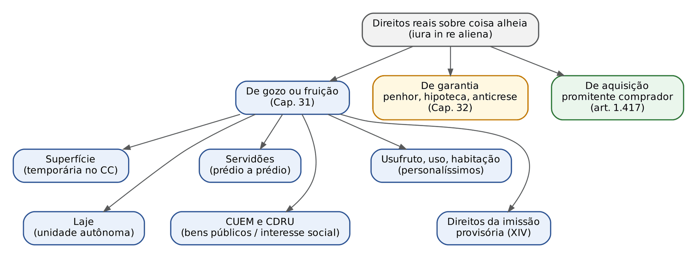
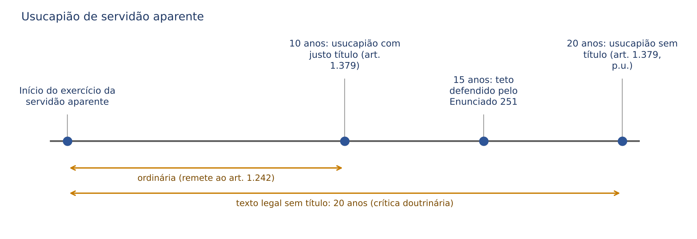
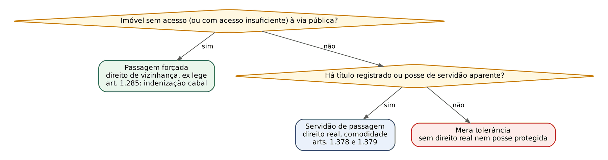
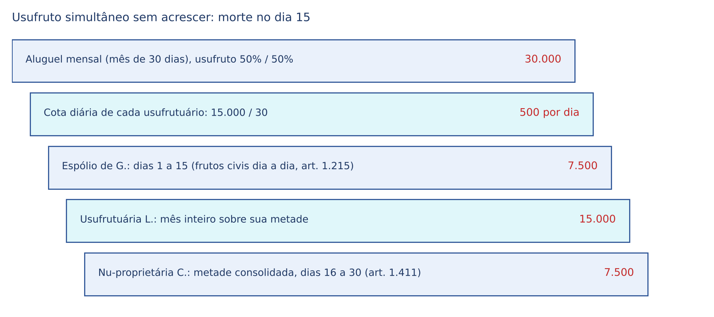
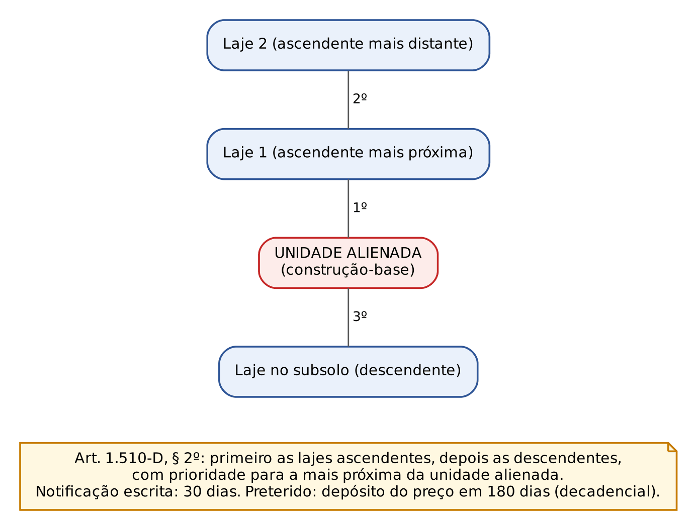

# CAPÍTULO 31 — DIREITOS REAIS SOBRE COISA ALHEIA DE GOZO E FRUIÇÃO: SUPERFÍCIE, SERVIDÕES, USUFRUTO, USO, HABITAÇÃO, LAJE, CONCESSÕES DE USO, DIREITOS DA IMISSÃO PROVISÓRIA NA POSSE E DIREITO DO PROMITENTE COMPRADOR

:::INCIDENCIA
TRF5 p. 12; TJRS p. 17; TJSC p. 17; SEFAZ p. 10. Nível A; lote de 15 questões (FGV 12, FCC 3).
Cai muito: laje (matrícula própria, sem fração ideal, laje sucessiva, preferência ascendente, ruína e 5 anos), usufruto (inalienável com cessão do exercício, art. 1.411, frutos civis), superfície (transmissibilidade sem pagamento ao concedente, destinação diversa) e servidão x passagem forçada.
:::

| Subtema | FGV | FCC | Padrão de cobrança |
|---|---|---|---|
| Laje | 5 | 1 | letra do art. 1.510-A (§§ 2º, 4º, 5º e 6º), preferência do art. 1.510-D, prazo de reconstrução do art. 1.510-E |
| Usufruto | 3 | 0 | inalienabilidade x cessão do exercício; usufruto simultâneo (art. 1.411); frutos civis (art. 1.398) |
| Servidões | 2 | 0 | usucapião de servidão aparente; extinção só nas hipóteses legais; indivisibilidade |
| Superfície | 1 | 0 | transferência livre e vedação de pagamento ao concedente; resolução por destinação diversa; subsolo |
| Uso e habitação | 0 | 1 | habitação: só ocupar com a família, sem alugar nem emprestar |
| Rol do art. 1.225 e promitente comprador | 1 | 1 | o que é e o que não é direito real; adjudicação compulsória |

## 31.1 Os direitos reais limitados de gozo: quadro geral

### 31.1.1 Rol do art. 1.225 e o que mudou desde 2017

Os direitos reais sobre coisa alheia (*iura in re aliena*) desmembram faculdades do domínio (usar, gozar, dispor, reaver) e as atribuem a outrem com eficácia *erga omnes*, sequela e, quando registrados, oponibilidade a terceiros. Os de gozo ou fruição recaem sobre a utilidade da coisa; os de garantia, sobre o seu valor (Cap. 32); o do promitente comprador é direito real de aquisição.

:::LEI Código Civil, art. 1.225 (com as Leis 11.481/2007, 13.465/2017 e 14.620/2023)
Art. 1.225. São direitos reais: I - a propriedade; II - a superfície; III - as servidões; IV - o usufruto; V - o uso; VI - a habitação; VII - o direito do promitente comprador do imóvel; VIII - o penhor; IX - a hipoteca; X - a anticrese. XI - a concessão de uso especial para fins de moradia; XII - a concessão de direito real de uso; XIII - a laje; XIV - os direitos oriundos da imissão provisória na posse, quando concedida à União, aos Estados, ao Distrito Federal, aos Municípios ou às suas entidades delegadas e a respectiva cessão e promessa de cessão.
:::

Linha do tempo legislativa que as bancas exploram: os incisos XI e XII vieram com a Lei 11.481/2007; a laje (XIII) entrou pela Lei 13.465/2017 (REURB); a Lei 14.620/2023 (novo Minha Casa, Minha Vida) acrescentou o XIV e deu nova redação aos incisos XII e XIII. A propriedade fiduciária não está no rol, mas é direito real disciplinado nos arts. 1.361 e seguintes (Cap. 32); a enfiteuse saiu do rol: o art. 2.038 proíbe constituir novas enfiteuses e subenfiteuses e submete as existentes, até a extinção, ao Código de 1916, vedada a cobrança de laudêmio sobre o valor das construções ou plantações. Para as enfiteuses remanescentes continuam úteis as Súmulas 170 (é resgatável a enfiteuse instituída antes da vigência do Código Civil de 1916), 169 (o comisso depende de sentença) e 122 do STF (o enfiteuta pode purgar a mora enquanto não decretado o comisso por sentença).

Taxatividade e tipicidade: só a lei cria direito real (*numerus clausus*), mas o rol do art. 1.225 não é exaustivo do sistema: leis especiais criam outros (a concessão do DL 271/1967 já era direito real antes de entrar no Código; a caução imobiliária averbada da Lei 8.245/1991 foi tratada pela FGV como direito real equiparado à hipoteca, TJ-GO 2026, Q3966636 — ver Cap. 32). O conteúdo de cada tipo, contudo, admite modelação pela autonomia privada dentro do que a lei permite (rateio de tributos na superfície, cláusula de acrescer no usufruto, prazo e forma da servidão).

:::QUESTAO FCC 2025 — TRT 15ª Região — Analista Judiciário (Q3295846)
Pediu-se a alternativa que só contivesse direitos reais segundo o Código Civil.
Gabarito: C — a laje, a habitação e o uso (art. 1.225, XIII, VI e V).
Armadilhas: fiança (garantia pessoal, contrato); herança (o direito à sucessão aberta é bem imóvel por ficção do art. 80, II, mas não é direito real do art. 1.225); direito à imagem e direito à vida (direitos da personalidade).
:::

### 31.1.2 Constituição: o registro como modo e as exceções

Regra: direitos reais sobre imóveis constituídos ou transmitidos por ato entre vivos só se adquirem com o registro do título (art. 1.227; ver Cap. 33). Exceções que caem: usucapião (o usufruto "quando não resulte de usucapião", art. 1.391; a servidão aparente usucapida, art. 1.379), os direitos reais legais (usufruto dos pais sobre bens dos filhos, art. 1.689, I; direito real de habitação do cônjuge e do companheiro sobrevivente, art. 1.831 — ver Cap. 43), e a eficácia entre as partes do negócio não registrado.

:::JURIS STJ, REsp 1.860.313 (3ª Turma, DJe 29/8/2023) — Jurisprudência em Teses, eds. 227 e 228
O registro do usufruto de imóvel é requisito de eficácia *erga omnes* (art. 1.391); mas é prescindível nas discussões entre usufrutuário e nu-proprietário quando o negócio é existente, válido e eficaz. Uso em prova: a falta de registro não serve ao nu-proprietário como defesa contra o usufrutuário que contratou com ele.
:::

:::PEGADINHA Registro da habitação na Lei 6.015/1973
O art. 167, I, item 7, manda registrar "o usufruto e o uso sobre imóveis e da habitação, quando não resultarem do direito de família". A habitação legal do sobrevivente (art. 1.831) e o usufruto dos pais independem de registro para existir. Já a superfície urbana, a CUEM, a CDRU e a imissão provisória do Poder Público têm itens próprios (39, 37, 40 e 36).
:::

### 31.1.3 Interface processual comum: penhora e expropriação

Toda constrição que atinja bem gravado por direito real de gozo exige intimação do titular do outro direito, sob pena de ineficácia da alienação em relação a ele: CPC, art. 799, II (usufruto, uso, habitação), III e IV (promessa registrada), V e VI (superfície, enfiteuse, CUEM e CDRU) e X e XI (laje e construção-base, incluídos pela Lei 13.465/2017); a consequência está no art. 804, §§ 1º a 6º. Na superfície, a responsabilidade patrimonial é separada: a dívida do proprietário só atinge o terreno; a do superficiário, só a construção ou a plantação (CPC, art. 791, aplicável no que couber à enfiteuse, à CUEM e à CDRU, § 2º).

## 31.2 Superfície

### 31.2.1 Conceito, forma e objeto

O proprietário concede a outrem o direito de construir ou de plantar em seu terreno, por tempo determinado, mediante escritura pública registrada (art. 1.369). Suspende-se a acessão (*superficies solo cedit*): durante a concessão, a construção ou a plantação é do superficiário (propriedade superficiária), separada do solo, que continua do concedente. Por isso a propriedade superficiária pode ser hipotecada (art. 1.473, X, com a redação da Lei 14.620/2023) e alienada fiduciariamente (Lei 9.514/1997, art. 22, § 1º, IV), limitadas essas garantias à duração da concessão (art. 1.473, § 2º; Enunciado 249 da III Jornada, que afasta o prazo mínimo do art. 1.474 e admite direitos reais de gozo e garantia sobre a propriedade superficiária no limite da concessão).

:::LEI Código Civil, arts. 1.369, parágrafo único, 1.372 e 1.374
Art. 1.369, parágrafo único. O direito de superfície não autoriza obra no subsolo, salvo se for inerente ao objeto da concessão.
Art. 1.372. O direito de superfície pode transferir-se a terceiros e, por morte do superficiário, aos seus herdeiros. Parágrafo único. Não poderá ser estipulado pelo concedente, a nenhum título, qualquer pagamento pela transferência.
Art. 1.374. Antes do termo final, resolver-se-á a concessão se o superficiário der ao terreno destinação diversa daquela para que foi concedida.
:::

Pontos de letra: a concessão é gratuita ou onerosa (o pagamento, chamado *solarium* ou cânon, à vista ou parcelado, art. 1.370); o superficiário responde pelos encargos e tributos do imóvel (art. 1.371), mas o Enunciado 94 da I Jornada reconhece liberdade plena para as partes deliberarem o rateio; há preferência recíproca, em igualdade de condições, na alienação do imóvel ou da superfície (art. 1.373); extinta a concessão, o proprietário recebe terreno, construção ou plantação "independentemente de indenização, se as partes não houverem estipulado o contrário" (art. 1.375); na desapropriação, a indenização é repartida segundo o valor do direito real de cada um (art. 1.376); a superfície constituída por pessoa jurídica de direito público interno rege-se pelo Código no que a lei especial não dispuser diversamente (art. 1.377).

Construção já existente e espaço aéreo: o Enunciado 250 da III Jornada admite a superfície "por cisão" (o proprietário destaca a construção preexistente e a concede como propriedade superficiária), e o Enunciado 568 da VI Jornada afirma que a superfície abrange solo, subsolo ou espaço aéreo, na forma do contrato, admitindo-se a sobrelevação (direito de construir sobre a construção alheia), atendida a legislação urbanística. A sobrelevação contratual é a ancestral doutrinária da laje (31.6).

### 31.2.2 Código Civil x Estatuto da Cidade

As duas disciplinas convivem: o Enunciado 93 da I Jornada afirma que as normas do Código não revogam as do Estatuto da Cidade (arts. 21 a 24 da Lei 10.257/2001), instrumento de política urbana. O critério prático é o da especialidade: imóvel urbano em contexto de política urbana, Estatuto; nos demais casos (inclusive imóvel rural), Código.

| Ponto | Código Civil (arts. 1.369 a 1.377) | Estatuto da Cidade (arts. 21 a 24) |
|---|---|---|
| Imóvel | urbano ou rural | somente urbano |
| Prazo | SOMENTE determinado | determinado OU indeterminado |
| Objeto | construir ou plantar; subsolo só se inerente ao objeto | utilizar solo, subsolo ou espaço aéreo, na forma do contrato |
| Forma | escritura pública registrada | escritura pública registrada |
| Encargos e tributos | superficiário (art. 1.371), salvo rateio pactuado (Enunciado 94) | integralmente os da propriedade superficiária e, proporcionalmente à ocupação efetiva, os da área concedida, salvo contrato |
| Transferência | livre, inclusive *causa mortis*; vedado qualquer pagamento ao concedente | "obedecidos os termos do contrato"; herdeiros sucedem |
| Preferência | recíproca (art. 1.373) | recíproca (art. 22) |
| Extinção antecipada | destinação diversa (art. 1.374) | destinação diversa (art. 24, § 1º) e descumprimento das obrigações contratuais (art. 23, II) |
| Reversão | sem indenização, salvo estipulação (art. 1.375) | sem indenização, salvo estipulação (art. 24); extinção averbada (§ 2º) |

:::PEGADINHA Superfície por prazo indeterminado
"O direito de superfície pode ser concedido por tempo indeterminado" é FALSO à luz do Código (art. 1.369: "por tempo determinado") e VERDADEIRO no Estatuto da Cidade (art. 21). Leia o comando: "segundo o Código Civil" ou "segundo o Estatuto da Cidade". Outro clássico: a cláusula que garante ao concedente percentual sobre a cessão da superfície é nula no regime do Código (art. 1.372, parágrafo único), diferentemente do laudêmio enfitêutico, que a superfície veio substituir.
:::

:::QUESTAO FGV 2026 — MPE-GO — Promotor de Justiça Substituto (Q3865815)
Caso: superfície de 20 anos para construir e explorar supermercado, com cláusulas de (i) 20% ao proprietário sobre o valor de qualquer transferência, (ii) reversão das construções com indenização integral e (iii) tributos a cargo do superficiário; no 7º ano a superficiária transfere a uma construtora, que muda o projeto para estúdios residenciais e escava estacionamento subterrâneo.
Gabarito: A — a transferência é válida (livre transmissibilidade), a mudança de destinação autoriza a resolução antecipada e é vedado o pagamento adicional ao proprietário.
Passos: (1) transferência sem anuência: válida (art. 1.372); (2) cláusula (i): nula (parágrafo único); (3) destinação diversa: resolução (art. 1.374); (4) subsolo: só se inerente ao objeto (art. 1.369, parágrafo único), nunca "automaticamente" (erro da E); (5) cláusulas (ii) e (iii) são válidas (arts. 1.375 e 1.371). Erro da B: não existe "rigidez do título" que condicione a transferência à autorização.
:::

## 31.3 Servidões

### 31.3.1 Conceito e características

A servidão "proporciona utilidade para o prédio dominante, e grava o prédio serviente, que pertence a diverso dono" (art. 1.378). É relação entre prédios (predial), não entre pessoas: acompanha os imóveis em qualquer transmissão (ambulatoriedade), exige prédios de donos diversos (*nemini res sua servit*: a reunião no mesmo domínio a extingue, art. 1.389, I) e não se presume (interpretação restritiva: na dúvida, a favor da liberdade do serviente). Características cobradas:

- Indivisibilidade: as servidões prediais são indivisíveis e subsistem, na divisão dos imóveis, em favor de cada porção do dominante e gravando cada porção do serviente, salvo se, por natureza ou destino, só se aplicarem a certa parte (art. 1.386). A FGV usa a negação ("são divisíveis e não subsistem na partilha") como distrator.
- Inalienabilidade em separado: a servidão não se destaca do prédio dominante para ser cedida a terceiro.
- Perpetuidade como regra, admitida a servidão a termo (como no caso da Q2515298, por 20 anos).
- Vinculação à finalidade: constituída para certo fim, não se amplia a outro (art. 1.385, § 1º); nas de trânsito, a de maior ônus inclui a de menor e a menor exclui a mais onerosa (§ 2º); se a cultura ou a indústria do dominante exigirem maior largueza, o serviente a sofre, com indenização pelo excesso (§ 3º).

Servidão administrativa (passagem de linhas de transmissão, aquedutos públicos) é instituto de Direito Administrativo, com regime de indenização próprio: o STJ firmou na Jurisprudência em Teses (ed. 127, tese 8) que, demonstrado que a servidão de passagem abrange área superior à da escritura, impõe-se indenizar, sob pena de violar o princípio do justo preço. Aqui interessa só a servidão civil.

### 31.3.2 Classificações que decidem questões

| Critério | Espécies | Consequência prática |
|---|---|---|
| Visibilidade | aparentes (obras ou sinais exteriores: caminho calçado, aqueduto) x não aparentes (não construir acima de certa altura; não abrir janela) | SÓ as aparentes podem ser usucapidas (art. 1.379) e protegidas pelos interditos (Súmula 415 do STF) |
| Exercício | contínuas (exercem-se sem ato humano atual: aqueduto, luz) x descontínuas (dependem de ato do titular: trânsito, tirada de água) | a combinação contínua e aparente é a mais protegida; a de trânsito é descontínua, mas pode ser aparente |
| Conteúdo | positivas (o dominante faz algo no serviente) x negativas (o serviente deixa de fazer) | as negativas são, em regra, não aparentes |
| Origem | convencionais, testamentárias, por usucapião, por destinação do proprietário (doutrina) e judiciais (ação divisória, CPC) | a servidão legal do CC/1916 virou direito de vizinhança (passagem forçada, aquedutos, cabos) |

:::JURIS STF, Súmula 415
Servidão de trânsito não titulada, mas tornada permanente, sobretudo pela natureza das obras realizadas, considera-se aparente, conferindo direito à proteção possessória.
Leitura: a servidão de trânsito é descontínua, e por isso o CC/1916 negava proteção possessória às não tituladas; a súmula a equipara à aparente quando há obras permanentes (caminho aterrado, ponte, porteira). Sem obras visíveis, a passagem tolerada não gera posse (art. 1.208: atos de mera tolerância não induzem posse).
:::

### 31.3.3 Constituição e usucapião

Constituição voluntária: declaração expressa dos proprietários ou testamento, e subsequente registro (art. 1.378; Lei 6.015, art. 167, I, item 6). A doutrina admite ainda a servidão por destinação do proprietário (o dono de dois prédios estabelece serventia visível de um em favor do outro e depois os aliena a pessoas diversas sem ressalva), sem previsão expressa no Código de 2002.

:::LEI Código Civil, art. 1.379
Art. 1.379. O exercício incontestado e contínuo de uma servidão aparente, por dez anos, nos termos do art. 1.242, autoriza o interessado a registrá-la em seu nome no Registro de Imóveis, valendo-lhe como título a sentença que julgar consumado a usucapião. Parágrafo único. Se o possuidor não tiver título, o prazo da usucapião será de vinte anos.
:::

O prazo de 20 anos sem título é o maior do sistema de usucapião (a extraordinária de imóvel é de 15 anos, art. 1.238). Por isso parte da doutrina, sintetizada no Enunciado 251 da III Jornada, sustenta que o prazo máximo para a usucapião extraordinária de servidão deve ser de 15 anos, em coerência com o sistema. Em prova objetiva, a letra é 10 anos (com justo título e boa-fé, por remissão ao art. 1.242) e 20 anos (sem título); a tese dos 15 anos só deve ser marcada se o enunciado pedir a posição das Jornadas.

:::QUESTAO FGV 2024 — Câmara Municipal de São Paulo — Procurador Legislativo (Q2351276)
Caso: há mais de 30 anos o dono de um imóvel transita, inclusive com veículos, por corredor murado e afastado no terreno vizinho; o vizinho, que pretende vender o bem, coloca porteira e alega que existe estrada nos fundos do imóvel do primeiro, de 5 metros de largura, até a via pública.
Gabarito: D — o exercício incontestado e contínuo de servidão aparente autoriza a aquisição por usucapião (art. 1.379).
Passos: (1) o corredor murado é obra visível: servidão aparente (Súmula 415 do STF); (2) 30 anos superam até o prazo de 20 anos sem título; (3) a existência de outro acesso só importa para a passagem forçada, não para a servidão (erro da A); (4) servidão não nasce só de acordo (erro da B: há testamento e usucapião); (5) as servidões são indivisíveis e acompanham os imóveis (erro da E, art. 1.386). Alternativa C (passagem forçada quando o acesso não atende à função econômica) reproduz a ideia do Enunciado 88 da I Jornada, mas não responde ao caso, em que o dominante tem acesso adequado: a resposta é a usucapião da servidão (ver nota de verificação).
:::

### 31.3.4 Exercício

- Obras de conservação e uso: o dono da servidão as faz, rateando-se as despesas se a servidão pertencer a mais de um prédio (art. 1.380); cabem ao dominante, salvo disposição expressa do título (art. 1.381). Se o título as atribuir ao serviente, este pode exonerar-se abandonando, total ou parcialmente, a propriedade ao dominante; se o dominante recusar recebê-la, custeia as obras (art. 1.382).
- O serviente não pode embaraçar de modo algum o exercício legítimo (art. 1.383); a defesa do dominante é a ação possessória (servidão aparente) ou a ação confessória (petitória).
- Remoção (art. 1.384): pelo serviente, à sua custa, se em nada diminuir as vantagens do dominante; pelo dominante, à sua custa, se houver considerável incremento da utilidade e não prejudicar o serviente. Assimetria cobrada: o serviente precisa de "em nada diminuir"; o dominante precisa de "considerável incremento" e "não prejudicar".

:::JURIS STJ, REsp 1.642.994 (3ª Turma, Rel. Min. Nancy Andrighi, 2019)
A abertura, pelo dono do prédio serviente, de via alternativa que preserva a passagem dos dominantes é fato superveniente que afasta a reintegração na servidão antiga, desde que atendidos os requisitos de remoção do art. 1.384. No mesmo julgado, o STJ repetiu a distinção: a passagem forçada decorre da lei e supre necessidade (imóvel sem acesso); a servidão de passagem nasce, em regra, de ato voluntário e atende à comodidade do dominante.
:::

### 31.3.5 Extinção

:::LEI Código Civil, arts. 1.387 a 1.389
Art. 1.387. Salvo nas desapropriações, a servidão, uma vez registrada, só se extingue, com respeito a terceiros, quando cancelada. Parágrafo único. Se o prédio dominante estiver hipotecado, e a servidão se mencionar no título hipotecário, será também preciso, para a cancelar, o consentimento do credor.
Art. 1.388. O dono do prédio serviente tem direito, pelos meios judiciais, ao cancelamento do registro, embora o dono do prédio dominante lho impugne: I - quando o titular houver renunciado a sua servidão; II - quando tiver cessado, para o prédio dominante, a utilidade ou a comodidade, que determinou a constituição da servidão; III - quando o dono do prédio serviente resgatar a servidão.
Art. 1.389. Também se extingue a servidão, ficando ao dono do prédio serviente a faculdade de fazê-la cancelar, mediante a prova da extinção: I - pela reunião dos dois prédios no domínio da mesma pessoa; II - pela supressão das respectivas obras por efeito de contrato, ou de outro título expresso; III - pelo não uso, durante dez anos contínuos.
:::

Leitura dos três artigos: (1) perante terceiros, a servidão registrada só se extingue com o cancelamento (eficácia do registro), salvo desapropriação; (2) o art. 1.388 dá ao serviente ação para cancelar MESMO contra a impugnação do dominante, mas só em três hipóteses (renúncia, perda da utilidade, resgate); (3) o art. 1.389 lista fatos extintivos cujo cancelamento é mero ato de prova (confusão, supressão das obras por título, não uso por 10 anos contínuos). Não há extinção por abuso no exercício: o remédio é conter o exercício nos limites do art. 1.385, com tutela inibitória e indenização.

:::QUESTAO FGV 2024 — TJ-SC — Analista Jurídico (Q2515298)
Caso: servidão de passagem onerosa, por 20 anos, entre dois condomínios; os condôminos do dominante passeiam com cães, causando mau cheiro e acidentes; o serviente quer extinguir a servidão.
Gabarito: E — não é possível extinguir a servidão; cabe apenas regular o seu uso, inclusive judicialmente, com eficácia obrigacional.
Passos: (1) as causas de extinção são legais (arts. 1.388 e 1.389) e o uso inadequado não está entre elas; (2) o exercício se restringe às necessidades do dominante e não se amplia a outro fim (art. 1.385), o que autoriza a regulação; (3) o resgate (art. 1.388, III) pressupõe faculdade prevista no título ou acordo, e não é imposto judicialmente "mesmo sem acordo" (erro da D); (4) as alternativas A e B inventam cancelamento com devolução ou perda do preço. A expressão "eficácia obrigacional (não real)" da alternativa correta é discutível (a disciplina do exercício integra o próprio direito real), mas não altera o núcleo da resposta (ver nota).
:::

### 31.3.6 Servidão de passagem x passagem forçada

É a distinção mais cobrada do tema, inclusive em prova de juiz (FGV, TJ-CE 2025, Q3505768). A passagem forçada é direito de vizinhança (art. 1.285; desenvolvimento no Cap. 28); a servidão é direito real limitado.

| Ponto | Passagem forçada (art. 1.285) | Servidão de passagem (arts. 1.378 e 1.379) |
|---|---|---|
| Natureza | direito de vizinhança, limitação legal do domínio, obrigação *propter rem* | direito real sobre coisa alheia |
| Pressuposto | imóvel sem acesso a via pública, nascente ou porto (encravamento); o Enunciado 88 da I Jornada estende ao acesso insuficiente ou inadequado | utilidade ou comodidade do dominante, sem exigência de encravamento |
| Fonte | a lei; o rumo é fixado judicialmente, se necessário | negócio (declaração ou testamento) com registro, ou usucapião |
| Contraprestação | indenização cabal, OBRIGATÓRIA | gratuita ou onerosa, conforme o título |
| Escolha do serviente | o vizinho cujo imóvel mais natural e facilmente se prestar (§ 1º) | o prédio indicado no título |
| Extinção | cessa com o fim do encravamento | só pelas causas dos arts. 1.388 e 1.389 e cancelamento |

Na Q3505768 (gabarito D, box no Cap. 28), o uso tolerado por décadas não afastou o encravamento: coube a passagem forçada, pelo caminho natural e menos gravoso, mediante indenização; a armadilha era "usucapião mediante indenização".

:::PROCESSO Ações em matéria de servidão
- Ação confessória: do dominante, para declarar a existência da servidão e fazer cessar a turbação (petitória).
- Ação negatória: do dono do imóvel, para declarar a inexistência de servidão alegada por outrem.
- Interditos possessórios: só para servidão aparente ou tornada aparente pelas obras (Súmula 415 do STF); a exceção de domínio não é discutida no juízo possessório (ver Cap. 27).
- Usucapião de servidão: judicial (art. 1.379) ou extrajudicial (Lei 6.015, art. 216-A — ver Cap. 29); a sentença é título para registro.
- Cancelamento: pela via judicial (art. 1.388) ou por prova da extinção perante o registrador (art. 1.389; Lei 6.015, arts. 256 e 257); se o dominante estiver hipotecado com menção à servidão, exige-se o consentimento do credor (art. 1.387, parágrafo único).
:::

## 31.4 Usufruto

### 31.4.1 Conceito, objeto e características

Usufruto é o direito real de usar e fruir coisa alheia, temporariamente, conservando-lhe a substância. Desmembra a propriedade: o usufrutuário fica com o uso, a fruição, a posse direta e a administração (art. 1.394); o nu-proprietário, com a disposição, a posse indireta e a expectativa de consolidação. Pode recair em um ou mais bens, móveis ou imóveis, em um patrimônio inteiro ou parte dele, abrangendo no todo ou em parte os frutos e utilidades (art. 1.390), e estende-se, salvo disposição em contrário, aos acessórios e acrescidos (art. 1.392).

Características: (1) temporário: no máximo vitalício para pessoa natural; para pessoa jurídica, extingue-se com ela ou, se perdurar, em 30 anos contados do início do exercício (art. 1.410, III); (2) intransmissível e inalienável (art. 1.393), por isso não passa aos herdeiros do usufrutuário; (3) personalíssimo (*intuitu personae*); (4) impenhorável enquanto direito, embora penhoráveis os frutos (31.4.6).

### 31.4.2 Espécies e constituição

| Critério | Espécies | Observações de prova |
|---|---|---|
| Origem | legal (pais sobre os bens dos filhos sob poder familiar, art. 1.689, I — ver Cap. 36); convencional (inter vivos ou testamento); por usucapião | o usufruto vidual do art. 1.611, § 1º, do CC/1916 NÃO foi reproduzido em 2002: o sobrevivente tem concorrência sucessória e direito real de habitação (Cap. 43) |
| Modo convencional | por alienação (o dono concede o usufruto e conserva a nua-propriedade) x por retenção ou reserva (o dono aliena a nua-propriedade e reserva o usufruto: doação com reserva de usufruto) | na reserva, o doador não presta caução (art. 1.400, parágrafo único) |
| Objeto | próprio (coisas inconsumíveis) x impróprio ou quase usufruto (consumíveis: restitui-se o equivalente, art. 1.392, § 1º) | títulos de crédito (art. 1.395) e rebanho (art. 1.397) têm regras próprias |
| Extensão | pleno x restrito (exclui parte dos frutos ou utilidades) | art. 1.390, "no todo ou em parte" |
| Titulares | simultâneo (dois ou mais usufrutuários ao mesmo tempo) x sucessivo | o simultâneo é admitido, com a regra do art. 1.411; o sucessivo (um usufrutuário após o outro) é rejeitado pela doutrina majoritária, porque a morte extingue o usufruto (art. 1.410, I) |
| Duração | vitalício x a termo | sem termo, presume-se vitalício para pessoa natural; nunca perpétuo |

Usufruto de imóvel, quando não resultar de usucapião, constitui-se pelo registro (art. 1.391; ver 31.1.2). A doação com reserva de usufruto, figura de planejamento sucessório, é estudada nos Caps. 17 e 45 (validade, colação, inoficiosidade); a FGV a cobra em casos de doação de pais a filhos (TJ-MT 2024, Q3114493: doações a cada filha com reserva de usufruto vitalício são válidas e dispensam o consentimento das demais) e de revogação por ingratidão (TJ-RJ 2026, Q3870729 — ver Cap. 17). O imposto sobre a instituição e a extinção do usufruto é tema da Apostila de Direito Tributário (ITCMD).

### 31.4.3 Inalienabilidade e cessão do exercício

:::LEI Código Civil, art. 1.393
Art. 1.393. Não se pode transferir o usufruto por alienação; mas o seu exercício pode ceder-se por título gratuito ou oneroso.
:::

O direito permanece com o usufrutuário; só o exercício (a utilidade econômica) circula: locação, arrendamento, comodato, cessão onerosa dos rendimentos. Se o usufrutuário morre, extingue-se o usufruto e, com ele, a cessão do exercício. O CC/1916 permitia expressamente a alienação ao nu-proprietário; o Código de 2002 silenciou, e a doutrina trata a hipótese como renúncia ou consolidação, não como alienação a terceiro. A FCC (PGM-Manaus 2026, Q4338798) marcou como ERRADA a assertiva de que o usufruto registrado torna o bem inalienável: o nu-proprietário pode alienar a nua-propriedade, e o adquirente a recebe gravada (sequela).

:::QUESTAO FGV 2025 — TRF 6ª Região — Juiz Federal Substituto (Q3742388)
Caso: por testamento, o avô deixa o usufruto de imóvel ao neto e a nua-propriedade à mãe deste; o neto, em dificuldade financeira, quer alienar o usufruto.
Gabarito: A — é inviável, pois o usufruto é inalienável (art. 1.393).
Armadilhas: "basta renunciá-lo previamente" (a renúncia extingue o usufruto e consolida a propriedade na nu-proprietária, não gera nada para vender); "respeitado o direito de preferência da nu-proprietária" (preferência existe na superfície e na laje, não no usufruto); "ilegal por não ser oneroso" (a onerosidade é irrelevante). Saída lícita que a banca não ofereceu: ceder o exercício, por exemplo alugando o imóvel.
:::

### 31.4.4 Direitos do usufrutuário

- Posse, uso, administração e percepção dos frutos (art. 1.394). Pode usufruir pessoalmente ou mediante arrendamento, mas não mudar a destinação econômica sem expressa autorização do proprietário (art. 1.399).
- Títulos de crédito: percebe os frutos e cobra as dívidas; cobradas, aplica de imediato a importância em títulos da mesma natureza ou em títulos da dívida pública federal com atualização monetária (art. 1.395); não aplicar é causa de extinção por culpa (art. 1.410, VII).
- Rebanho: as crias pertencem ao usufrutuário, deduzidas quantas bastem para inteirar as cabeças existentes no início (art. 1.397).
- Florestas e recursos minerais: dono e usufrutuário prefixam a extensão do gozo e a maneira de exploração (art. 1.392, § 2º). Se o usufruto recai sobre universalidade ou quota-parte, o usufrutuário tem direito à parte do tesouro achado por outrem e ao preço pago pelo vizinho pela meação em parede, cerca, muro, vala ou valado (§ 3º).
- Quotas e ações: o Enunciado 63 da II Jornada de Direito Comercial admite que o nu-proprietário de quotas ou ações gravadas com usufruto exerça o direito de fiscalização da sociedade, quando o ato institutivo não regular a matéria.

Frutos: a regra muda conforme sejam naturais ou civis, e a FGV troca uma pela outra.

| Momento | Frutos naturais (art. 1.396) | Frutos civis (art. 1.398) |
|---|---|---|
| Início do usufruto | os pendentes são do usufrutuário, sem pagar despesas de produção (salvo direito adquirido por outrem) | os VENCIDOS na data inicial são do PROPRIETÁRIO |
| Fim do usufruto | os pendentes são do dono, também sem compensação de despesas | os vencidos na data em que cessa o usufruto são do USUFRUTUÁRIO |
| Lógica | o que está pendurado acompanha a coisa | o que venceu pertence a quem era titular no vencimento; o que vence depois reparte-se dia a dia (art. 1.215) |

:::QUESTAO FGV 2024 — Câmara Municipal de São Paulo — Procurador Legislativo (Q2351273)
Caso: tio concede às duas sobrinhas, conjuntamente e com cláusula de acrescer, usufruto registrado sobre imóvel comercial já alugado.
Gabarito: C — falecendo uma, seu quinhão cabe necessariamente à outra, sem que o nu-proprietário reivindique a consolidação daquela parte.
Passos: (1) a regra do art. 1.411 é a extinção parcial em relação a cada usufrutuário que morre; (2) a exceção é a estipulação expressa de acrescer, que existe no caso; (3) erros: "pode transferir o usufruto por alienação" (art. 1.393); "aluguéis vencidos na data inicial são das usufrutuárias" (são do proprietário, art. 1.398); "sem prazo, é perpétuo e passa aos herdeiros" (vitalício e intransmissível); "podem arrendar e mudar a destinação" (arrendar sim, mudar a destinação não, art. 1.399).
:::

### 31.4.5 Deveres do usufrutuário e repartição de despesas

- Inventário, à sua custa, dos bens recebidos e caução, fidejussória ou real, se o dono a exigir (art. 1.400); o doador que reserva o usufruto está dispensado (parágrafo único). Sem caução suficiente, perde a administração: o proprietário administra, mediante caução, e entrega o rendimento líquido, deduzidas as despesas e a remuneração fixada pelo juiz (art. 1.401).
- Não responde pelas deteriorações do exercício regular (art. 1.402).
- Incumbem-lhe as despesas ordinárias de conservação e as prestações e tributos devidos pela posse ou rendimento da coisa (art. 1.403): IPTU, condomínio, seguro (art. 1.407). O STJ reconhece legitimidade ativa do usufrutuário de imóvel urbano para questionar o IPTU (Jurisprudência em Teses, ed. 55, tese 8).
- Incumbem ao dono as reparações extraordinárias e as que não forem de custo módico; o usufrutuário paga juros do capital despendido nas necessárias à conservação ou que aumentem o rendimento (art. 1.404). Não são módicas as despesas superiores a 2/3 do líquido rendimento de um ano (§ 1º). Se o dono não fizer as reparações indispensáveis, o usufrutuário as faz e cobra (§ 2º).
- Usufruto sobre patrimônio: o usufrutuário paga os juros da dívida que o onera (art. 1.405); deve dar ciência ao dono de lesão à posse ou aos direitos deste (art. 1.406).

:::EXEMPLO Despesa módica ou extraordinária
Imóvel rende líquido 60.000 (sessenta mil) reais por ano. Limite de despesa módica: 2/3 de 60.000 = 40.000 (quarenta mil) reais. Troca de telhado de 25.000 (vinte e cinco mil) reais é módica: paga o usufrutuário. Reforço estrutural de 90.000 (noventa mil) reais não é módico: paga o nu-proprietário, e o usufrutuário lhe paga os juros sobre os 90.000 (noventa mil) reais, porque a obra é necessária à conservação (art. 1.404, *caput* e § 1º).
:::

Seguro, destruição e sub-rogação: se o usufrutuário faz o seguro, o direito contra o segurador é do proprietário, ficando o usufruto sub-rogado na indenização (art. 1.407, §§ 1º e 2º). Destruído o edifício sem culpa do proprietário, este não é obrigado a reconstruir, nem o usufruto renasce se ele reconstruir à sua custa; mas se a indenização do seguro for aplicada à reconstrução, o usufruto se restabelece (art. 1.408). Na desapropriação ou no dano causado por terceiro, o usufruto se sub-roga na indenização (art. 1.409).

### 31.4.6 Penhora, legitimidade e locação

- Penhora: o direito de usufruto, inalienável, é impenhorável; os frutos e o exercício são penhoráveis; a nua-propriedade é penhorável, respeitado o usufruto (sequela), salvo se for bem de família. O STJ (4ª Turma, Rel. Min. Luis Felipe Salomão, notícia de 24/4/2012) manteve impenhorável a nua-propriedade do único imóvel do devedor, ocupado pela mãe usufrutuária (ver Cap. 40). Penhorado o bem gravado, intima-se o usufrutuário (CPC, art. 799, II), sob pena de ineficácia da alienação perante ele (art. 804, § 6º).
- Ação petitória: o usufrutuário tem legitimidade e interesse para a ação reivindicatória contra o nu-proprietário ou terceiros, por força da sequela (STJ, REsp 1.202.843-PR, 3ª Turma, Rel. Min. Ricardo Villas Bôas Cueva, j. 21/10/2014, Informativo 550).
- Locação: o usufrutuário pode alugar sem anuência do nu-proprietário. O nu-proprietário só pode figurar como locador com o consentimento do usufrutuário; havendo esse consentimento, tem legitimidade para o despejo, e o locatário que contratou com ele não pode alegar o contrário, por ofensa à boa-fé (STJ, REsp 2.218.467-SP, 3ª Turma, Rel. Min. Nancy Andrighi, j. 14/9/2026, Informativo 902). Extinto o usufruto, a locação celebrada pelo usufrutuário pode ser denunciada pelo nu-proprietário, com prazo de 30 dias para desocupação, salvo se ele anuiu por escrito ou se a propriedade se consolidou no usufrutuário; a denúncia deve ser exercida em 90 dias da averbação da extinção do usufruto, presumindo-se, depois disso, a concordância com a manutenção da locação (Lei 8.245/1991, art. 7º e parágrafo único — ver Cap. 18).

### 31.4.7 Extinção

:::LEI Código Civil, arts. 1.410 e 1.411
Art. 1.410. O usufruto extingue-se, cancelando-se o registro no Cartório de Registro de Imóveis: I - pela renúncia ou morte do usufrutuário; II - pelo termo de sua duração; III - pela extinção da pessoa jurídica, em favor de quem o usufruto foi constituído, ou, se ela perdurar, pelo decurso de trinta anos da data em que se começou a exercer; IV - pela cessação do motivo de que se origina; V - pela destruição da coisa, guardadas as disposições dos arts. 1.407, 1.408, 2ª parte, e 1.409; VI - pela consolidação; VII - por culpa do usufrutuário, quando aliena, deteriora, ou deixa arruinar os bens, não lhes acudindo com os reparos de conservação, ou quando, no usufruto de títulos de crédito, não dá às importâncias recebidas a aplicação prevista no parágrafo único do art. 1.395; VIII - Pelo não uso, ou não fruição, da coisa em que o usufruto recai (arts. 1.390 e 1.399).
Art. 1.411. Constituído o usufruto em favor de duas ou mais pessoas, extinguir-se-á a parte em relação a cada uma das que falecerem, salvo se, por estipulação expressa, o quinhão desses couber ao sobrevivente.
:::

Não uso sem prazo: o inciso VIII não fixa prazo, ao contrário da servidão (10 anos, art. 1.389, III). O Enunciado 252 da III Jornada afirma que a extinção pelo não uso independe do prazo do art. 1.389, III, e o STJ seguiu essa linha: a extinção pode ocorrer independentemente de prazo certo, quando as circunstâncias revelarem que o bem não cumpre sua função (3ª Turma, Rel. Min. Nancy Andrighi, notícia de 28/5/2013), e a vitaliciedade não impede a extinção pelo não uso, porque não significa eternizar o usufruto (REsp 1.651.270-SP, 3ª Turma, Rel. Min. Ricardo Villas Bôas Cueva).

Usufruto simultâneo: sem cláusula de acrescer, a parte do falecido consolida-se na nua-propriedade, não acresce ao cousufrutuário (art. 1.411). O acréscimo do usufruto deixado em legado conjunto é regra própria do direito testamentário (art. 1.946 — ver Cap. 44).

:::JURIS STJ, REsp 1.942.097-MT (4ª Turma, Rel. Min. Maria Isabel Gallotti, DJe 10/11/2023) — Jurisprudência em Teses, ed. 242, tese 4
No usufruto inter vivos simultâneo, o usufrutuário sobrevivente não deve prestar contas, no inventário do usufrutuário falecido, dos frutos relativos ao quinhão deste: o quinhão não acresceu ao sobrevivente nem se transmitiu aos herdeiros, apenas retornou ao nu-proprietário (arts. 1.410, I, e 1.411).
:::

:::QUESTAO FGV 2026 — TJ-BA — Juiz Substituto (Q4083723)
Caso: usufruto vitalício de imóvel comercial em favor de dois usufrutuários, 50% para cada, sem cláusula de acrescer; o imóvel está alugado; um usufrutuário morre no dia 15; no fim do mês, o locatário paga o aluguel inteiro à sobrevivente; o espólio do falecido reclama sua parte.
Gabarito: D — os frutos civis reputam-se percebidos dia por dia; o espólio tem direito à cota-parte do aluguel *pro rata die* até o óbito, consolidando-se a propriedade da nu-proprietária sobre a fração de 50% a partir de então.
Passos: (1) a morte extingue a parte do falecido (art. 1.411), sem acrescer à sobrevivente (erro da C) e sem extinguir o usufruto inteiro (erro da B); (2) frutos civis repartem-se dia a dia (art. 1.215), não são "indivisíveis" (erro da E); (3) ceder o exercício por locação é lícito (art. 1.393; erro da A).

:::

:::PROCESSO Extinção e cancelamento do usufruto
- Morte, termo e consolidação: cancelamento direto no registro, à vista da prova (certidão de óbito, decurso do termo, título de consolidação).
- Demais causas (não uso, culpa, cessação do motivo): procedimento de jurisdição voluntária para extinção de usufruto "quando não decorrer da morte do usufrutuário, do termo da sua duração ou da consolidação" (CPC, art. 725, VI), com citação do usufrutuário; havendo litígio, ação de rito comum.
- Na sentença: declarar extinto o usufruto, indicar a causa e o inciso do art. 1.410 e determinar o cancelamento do registro (art. 1.410, *caput*), com prestação de contas, se houver, em capítulo próprio.
:::

:::SENTENCA Extinção do usufruto pelo não uso
"Comprovado que o usufrutuário, desde 2016, não reside no imóvel, não o explora nem dele percebe frutos, deixando-o em abandono, configura-se a causa extintiva do art. 1.410, VIII, do Código Civil, que não se sujeita ao prazo decenal do art. 1.389, III (Enunciado 252 da III Jornada de Direito Civil), nem é obstada pela vitaliciedade do direito. Ante o exposto, JULGO PROCEDENTE o pedido para declarar extinto o usufruto registrado sob o R-3 da matrícula n. ..., consolidando-se a propriedade plena na autora, e determino a expedição de mandado de cancelamento ao Registro de Imóveis."
:::

## 31.5 Uso e habitação

### 31.5.1 Uso

O usuário usa a coisa e percebe os seus frutos "quanto o exigirem as necessidades suas e de sua família" (art. 1.412). As necessidades pessoais avaliam-se conforme a condição social e o lugar onde ele vive (§ 1º); as da família compreendem as do cônjuge, dos filhos solteiros e das pessoas de seu serviço doméstico (§ 2º). Aplicam-se ao uso, no que não contrariar sua natureza, as regras do usufruto (art. 1.413), o que traz a constituição pelo registro, os deveres de conservação e as causas de extinção. O uso pode recair sobre móveis ou imóveis. Por ser limitado às necessidades pessoais e familiares, prevalece que o exercício do uso NÃO pode ser cedido, ao contrário do usufruto (a cessão do art. 1.393 é contrária à natureza do uso).

### 31.5.2 Habitação

:::LEI Código Civil, arts. 1.414 e 1.415
Art. 1.414. Quando o uso consistir no direito de habitar gratuitamente casa alheia, o titular deste direito não a pode alugar, nem emprestar, mas simplesmente ocupá-la com sua família.
Art. 1.415. Se o direito real de habitação for conferido a mais de uma pessoa, qualquer delas que sozinha habite a casa não terá de pagar aluguel à outra, ou às outras, mas não as pode inibir de exercerem, querendo, o direito, que também lhes compete, de habitá-la.
:::

A habitação é o mais restrito dos direitos reais de gozo: só imóvel residencial, só moradia, gratuita e sem fruição econômica. Aplicam-se, no que couber, as regras do usufruto (art. 1.416). O direito real de habitação LEGAL do cônjuge e do companheiro sobrevivente (art. 1.831; Lei 9.278/1996, art. 7º, parágrafo único) — seus requisitos, a desnecessidade de inexistirem outros bens, o imóvel em copropriedade anterior e a recente orientação sobre o último domicílio do casal — é desenvolvido no Cap. 43; aqui só a habitação convencional.

:::QUESTAO FCC 2024 — TRT 11ª Região — Analista Judiciário (Q2400472)
Pediu-se o que pode fazer o titular do direito real de habitação.
Gabarito: D — simplesmente ocupá-lo com sua família (art. 1.414).
Armadilhas: ceder o exercício, gratuita ou onerosamente (permitido no usufruto, não na habitação); emprestar com responsabilidade pela manutenção; ocupar sozinho, vedada a família (a lei inclui a família); alugar revertendo parte à manutenção. A letra do art. 1.414 proíbe as duas condutas: alugar e emprestar.
:::

### 31.5.3 Usufruto, uso e habitação lado a lado

| Ponto | Usufruto | Uso | Habitação |
|---|---|---|---|
| Objeto | móveis, imóveis, patrimônio, universalidade, créditos | móveis ou imóveis | só casa (imóvel residencial) |
| Conteúdo | usar e fruir integralmente | usar e fruir na medida das necessidades pessoais e da família | só morar, com a família |
| Frutos | todos (salvo restrição do título) | só os necessários (art. 1.412) | nenhum |
| Cessão do exercício | SIM, gratuita ou onerosa (art. 1.393) | não (prevalece) | NÃO: não pode alugar nem emprestar (art. 1.414) |
| Pluralidade de titulares | art. 1.411 (extinção parcial, salvo acrescer) | regras do usufruto | quem habita sozinho não paga aluguel aos demais, mas não os impede de habitar (art. 1.415) |
| Fonte legal típica | pais sobre bens dos filhos (art. 1.689, I) | — | cônjuge ou companheiro sobrevivente (art. 1.831 — Cap. 43) |
| Regra supletiva | — | regras do usufruto (art. 1.413) | regras do usufruto (art. 1.416) |

## 31.6 Direito real de laje

### 31.6.1 Origem, natureza e requisitos

Criada pela Lei 13.465/2017 (conversão da MP 759/2016) para regularizar a realidade das construções sobrepostas em áreas urbanas consolidadas ("puxadinhos", "lajes" de favelas verticalizadas), a laje permite ao proprietário de uma construção-base ceder a superfície superior ou inferior para que o titular mantenha unidade distinta da originalmente construída sobre o solo (art. 1.510-A). A natureza é discutida: parte da doutrina a trata como direito real sobre coisa alheia (está no art. 1.225 ao lado deles e depende da construção-base); outra parte a vê como direito real sobre coisa própria, uma nova modalidade de propriedade sobre unidade autônoma, dado que o titular pode usar, gozar e DISPOR (§ 3º) e não há prazo. Para a prova, o que importa é a letra.

:::LEI Código Civil, art. 1.510-A, §§ 1º a 6º
§ 1º O direito real de laje contempla o espaço aéreo ou o subsolo de terrenos públicos ou privados, tomados em projeção vertical, como unidade imobiliária autônoma, não contemplando as demais áreas edificadas ou não pertencentes ao proprietário da construção-base.
§ 2º O titular do direito real de laje responderá pelos encargos e tributos que incidirem sobre a sua unidade.
§ 3º Os titulares da laje, unidade imobiliária autônoma constituída em matrícula própria, poderão dela usar, gozar e dispor.
§ 4º A instituição do direito real de laje não implica a atribuição de fração ideal de terreno ao titular da laje ou a participação proporcional em áreas já edificadas.
§ 5º Os Municípios e o Distrito Federal poderão dispor sobre posturas edilícias e urbanísticas associadas ao direito real de laje.
§ 6º O titular da laje poderá ceder a superfície de sua construção para a instituição de um sucessivo direito real de laje, desde que haja autorização expressa dos titulares da construção-base e das demais lajes, respeitadas as posturas edilícias e urbanísticas vigentes.
:::

Requisitos e traços, todos cobrados:

- Unidade autônoma e funcionalmente distinta (acesso independente), em projeção vertical, acima ou abaixo da construção-base; terrenos públicos ou privados (§ 1º).
- Matrícula própria: a instituição se faz pela abertura de matrícula própria e pela averbação na matrícula da construção-base e nas das lajes anteriores, com remissão recíproca (Lei 6.015/1973, art. 176, § 9º).
- Sem fração ideal do terreno e sem participação nas áreas já edificadas (§ 4º): por isso a laje NÃO é condomínio edilício.
- Encargos e tributos da unidade: do titular da laje (§ 2º). Despesas das partes que servem a todo o edifício (alicerces, colunas, pilares, paredes-mestras, telhado ou terraços de cobertura, ainda que de uso exclusivo do titular da laje, instalações gerais): partilhadas entre o dono da construção-base e o titular da laje na proporção do contrato, sem prejuízo das normas do condomínio edilício no que couber (art. 1.510-C), assegurado a qualquer interessado promover reparações urgentes (§ 2º, com remissão ao art. 249, parágrafo único).
- Vedação legal, independentemente de contrato: prejudicar com obras novas ou falta de reparação a segurança, a linha arquitetônica ou o arranjo estético do edifício, observadas as posturas locais (art. 1.510-B).
- Laje sucessiva (sobrelaje): depende de autorização EXPRESSA dos titulares da construção-base e das demais lajes, e do respeito às posturas urbanísticas (§ 6º).
- Laje anterior à lei e usucapião: o Enunciado 669 da IX Jornada admite o registro de laje sobre construção edificada antes da vigência da lei, respeitados os requisitos de forma e conteúdo; o Enunciado 627 da VIII Jornada admite a usucapião do direito real de laje em terreno privado. Ser titular de laje não impede a usucapião especial urbana de outro imóvel, porque a laje não é propriedade de imóvel urbano para fins do art. 183 da CF (FGV, TJ-BA 2026, Q4102130 — ver Cap. 29).

:::QUESTAO FGV 2026 — DPE-RJ — Defensor Público (Q4289326)
Caso: proprietária cede onerosamente, por escritura registrada com matrícula própria, a superfície superior de sua casa; a titular da laje edifica e depois ajusta com terceira nova laje sobre a sua, contra a oposição expressa da dona da construção-base, e passa a afirmar que recebeu fração ideal do terreno para discutir tributos.
Gabarito: C — a nova laje depende de autorização expressa da dona da construção-base e dos demais titulares, e a titular da laje responde pelos tributos de sua unidade.
Fundamento: art. 1.510-A, §§ 6º e 2º. Erros: fração ideal e participação nas áreas edificadas (§ 4º nega); tributos da construção-base (§ 2º); "livremente dispor" para criar sobrelaje (o § 3º permite dispor da própria unidade, não criar nova laje sem autorização); "direito de superfície temporário sem matrícula" (é laje, perpétua, com matrícula).
No mesmo sentido: FGV 2025, AL-AM, Procurador (Q3777934: cessão registrada com matrícula própria constitui laje, não superfície nem tolerância; gabarito B, com base no art. 1.510-A); FGV 2024, TJ-AP, Analista (Q2449075: segundo andar construído pela filha sobre a casa da mãe, com matrícula própria, é laje, não benfeitoria, multipropriedade, condomínio edilício ou superfície).
:::

:::QUESTAO FCC 2025 — DPE-RS — Defensor Público (Q3386994)
Gabarito: E — configura-se a laje quando o proprietário de uma construção-base cede a superfície superior ou inferior para que o titular mantenha unidade autônoma e funcionalmente distinta (art. 1.510-A, *caput*).
Armadilhas: "usar, gozar e dispor, exceto por ato inter vivos" (dispõe livremente, § 3º); "prescinde de matrícula própria" (§ 3º e Lei 6.015, art. 176, § 9º); "projeção de parte ideal, sem desdobramento, não sendo unidade autônoma" (é o contrário); "configurado o condomínio edilício, atribui fração ideal" (§ 4º).
:::

### 31.6.2 Direito de preferência e extinção

:::LEI Código Civil, arts. 1.510-D e 1.510-E
Art. 1.510-D. Em caso de alienação de qualquer das unidades sobrepostas, terão direito de preferência, em igualdade de condições com terceiros, os titulares da construção-base e da laje, nessa ordem, que serão cientificados por escrito para que se manifestem no prazo de trinta dias, salvo se o contrato dispuser de modo diverso. § 1º O titular da construção-base ou da laje a quem não se der conhecimento da alienação poderá, mediante depósito do respectivo preço, haver para si a parte alienada a terceiros, se o requerer no prazo decadencial de cento e oitenta dias, contado da data de alienação. § 2º Se houver mais de uma laje, terá preferência, sucessivamente, o titular das lajes ascendentes e o titular das lajes descendentes, assegurada a prioridade para a laje mais próxima à unidade sobreposta a ser alienada.
Art. 1.510-E. A ruína da construção-base implica extinção do direito real de laje, salvo: I - se este tiver sido instituído sobre o subsolo; II - se a construção-base for reconstruída no prazo de 5 (cinco) anos. Parágrafo único. O disposto neste artigo não afasta o direito a eventual reparação civil contra o culpado pela ruína.
:::

Pontos finos: (1) a ordem do *caput* é "construção-base e laje, nessa ordem": se uma laje é alienada, prefere o dono da construção-base; (2) entre várias lajes, ascendentes antes de descendentes, e a mais próxima antes da mais distante (§ 2º); (3) 30 dias para manifestação após ciência escrita, salvo contrato; (4) preterido: depósito do preço e pedido em 180 dias, prazo DECADENCIAL, contado da alienação, não da ciência (§ 1º); (5) o inciso II do art. 1.510-E tem redação dada pela Lei 14.382/2022, e o prazo de reconstrução é de 5 anos (a FGV trocou por 10 na Q4102104); (6) a laje no subsolo sobrevive à ruína da construção-base, porque não depende dela como apoio.

:::QUESTAO FGV 2026 — ENAC — Exame Nacional dos Cartórios (Q4130159)
Caso: há duas lajes sobre a mesma construção-base, uma no pavimento superior e outra no subsolo; o dono da construção-base a aliena, notifica ambos, e os dois oferecem exatamente as condições do terceiro.
Gabarito: D — prefere o titular da laje superior, porque a lei dá prioridade às lajes ascendentes (art. 1.510-D, § 2º).
Armadilhas: livre escolha do alienante; condomínio entre os interessados; primazia do subsolo como "suporte estrutural"; caducidade da preempção sem acordo. Nenhuma tem base legal: o critério é legal e objetivo.
:::

:::QUESTAO FGV 2026 — TJ-BA — Juiz Leigo (Q4102104)
Gabarito: A — os Municípios e o Distrito Federal poderão dispor sobre posturas edilícias e urbanísticas associadas à laje (art. 1.510-A, § 5º).
Armadilhas: reconstrução em 10 anos (são 5, art. 1.510-E, II); vedação de prejudicar segurança e estética "desde que prevista em contrato registrado" (a vedação é legal, art. 1.510-B); laje sucessiva proibida mesmo com autorização (é permitida com autorização, § 6º); laje não contempla espaço aéreo nem subsolo (contempla, § 1º).
:::

### 31.6.3 Laje x superfície x condomínio edilício

| Ponto | Laje | Superfície | Condomínio edilício |
|---|---|---|---|
| Objeto | unidade autônoma sobre ou sob construção-base | construir ou plantar no terreno alheio | unidades autônomas em edificação |
| Fração ideal do solo | NÃO | não | SIM (art. 1.331, § 3º) |
| Prazo | perpétua | determinado (CC) | perpétuo |
| Matrícula | própria, com averbação recíproca | registro na matrícula do terreno | matrícula de cada unidade |
| Transferência | livre, com preferência (art. 1.510-D) | livre, sem pagamento ao concedente | livre (abrigo de veículos não se aliena nem se aluga a estranhos sem autorização da convenção, art. 1.331, § 1º — ver Cap. 30) |
| Fim | ruína da construção-base, salvo subsolo ou reconstrução em 5 anos | termo, destinação diversa, consolidação | regras do condomínio |
| Penhora | intimação do titular da construção-base e das lajes anteriores (CPC, art. 799, X); na penhora da construção-base, intimação dos titulares das lajes (XI) | intimação cruzada (art. 799, V e VI) e responsabilidade separada (art. 791) | regras gerais |

## 31.7 Concessão de uso especial para fins de moradia (CUEM) e concessão de direito real de uso (CDRU)

### 31.7.1 CUEM (MP 2.220/2001)

Como os imóveis públicos não são usucapíveis (CF, arts. 183, § 3º, e 191, parágrafo único; Súmula 340 do STF — ver Cap. 29), a MP 2.220/2001, editada após o veto aos arts. 15 a 20 do Estatuto da Cidade e mantida em vigor pela EC 32/2001, criou para o ocupante de bem público urbano um direito subjetivo análogo à usucapião especial urbana: não a propriedade, mas a concessão de uso.

:::LEI MP 2.220/2001, art. 1º (redação da Lei 13.465/2017)
Art. 1º Aquele que, até 22 de dezembro de 2016, possuiu como seu, por cinco anos, ininterruptamente e sem oposição, até duzentos e cinquenta metros quadrados de imóvel público situado em área com características e finalidade urbanas, e que o utilize para sua moradia ou de sua família, tem o direito à concessão de uso especial para fins de moradia em relação ao bem objeto da posse, desde que não seja proprietário ou concessionário, a qualquer título, de outro imóvel urbano ou rural.
:::

| Ponto | CUEM (MP 2.220/2001) | Usucapião especial urbana (CF, art. 183; CC, art. 1.240) |
|---|---|---|
| Bem | público, em área urbana | particular, urbano |
| Marco temporal | posse de 5 anos completada até 22/12/2016 (data fixada pela Lei 13.465/2017) | nenhum: 5 anos a qualquer tempo |
| Área | até 250 m² | até 250 m² |
| Destinação | moradia própria ou da família | moradia própria ou da família |
| Requisito negativo | não ser proprietário NEM concessionário de outro imóvel urbano ou rural | não ser proprietário de outro imóvel urbano ou rural |
| Resultado | direito real de uso (CUEM), gratuito, sem propriedade | propriedade |
| Reiteração | não se reconhece ao mesmo concessionário mais de uma vez (art. 1º, § 2º) | não se reconhece mais de uma vez (art. 1.240, § 2º) |
| Sucessão na posse | o herdeiro legítimo continua de pleno direito, se já residia no imóvel na abertura da sucessão (art. 1º, § 3º) | regra equivalente no Estatuto da Cidade (art. 9º, § 3º — Cap. 29) |

Demais regras: (1) concessão gratuita, ao homem ou à mulher, ou a ambos, independentemente do estado civil (art. 1º, § 1º); (2) CUEM coletiva para áreas acima de 250 m² ocupadas por população de baixa renda, quando a divisão pelo número de possuidores der menos de 250 m² por possuidor, com frações ideais iguais salvo acordo escrito, nenhuma acima de 250 m² (art. 2º); (3) risco à vida ou à saúde: o Poder Público DEVE garantir o exercício em outro local (art. 4º); bem de uso comum do povo, destinado a urbanização, de interesse da defesa nacional ou ambiental, reservado a represas ou situado em via de comunicação: é FACULTADO realocar (art. 5º); (4) obtenção pela via administrativa, com prazo máximo de 12 meses para decidir, ou judicial em caso de recusa ou omissão, servindo o título ou a sentença para registro (art. 6º); (5) transferível por ato inter vivos ou *causa mortis* (art. 7º); (6) extingue-se se o concessionário der destinação diversa da moradia ou adquirir a propriedade ou a concessão de outro imóvel urbano ou rural, averbando-se a extinção por declaração do Poder Público (art. 8º); (7) para uso comercial nas mesmas condições há apenas AUTORIZAÇÃO de uso, faculdade do Poder Público, gratuita (art. 9º). A CUEM pode ser hipotecada (art. 1.473, VIII) e alienada fiduciariamente (Lei 9.514/1997, art. 22, § 1º, II).

:::PEGADINHA Direito subjetivo x faculdade
Moradia: a CUEM é DIREITO do ocupante que preenche os requisitos ("tem o direito"), obtido até por sentença. Uso comercial: o Poder Público "é facultado" a conceder AUTORIZAÇÃO de uso (art. 9º). Realocação: obrigatória no risco à vida ou à saúde (art. 4º) e facultativa nas hipóteses do art. 5º.
:::

### 31.7.2 CDRU (Decreto-Lei 271/1967, arts. 7º e 8º)

Concessão de uso de terrenos públicos OU particulares, remunerada ou gratuita, por tempo certo ou indeterminado, "como direito real resolúvel", para fins específicos de regularização fundiária de interesse social, urbanização, industrialização, edificação, cultivo da terra, aproveitamento sustentável das várzeas, preservação das comunidades tradicionais ou outras modalidades de interesse social em áreas urbanas (art. 7º, com a redação da Lei 11.481/2007).

- Forma: instrumento público ou particular, ou simples termo administrativo, inscrito e cancelado em livro especial (§ 1º); nos programas habitacionais de interesse social, o contrato tem caráter de escritura pública e é título de aceitação obrigatória em garantia de financiamentos habitacionais (Estatuto da Cidade, art. 48).
- Efeitos: desde a inscrição, o concessionário frui plenamente do terreno para os fins do contrato e responde por todos os encargos civis, administrativos e tributários (§ 2º).
- Resolução antes do termo: destinação diversa ou descumprimento de cláusula resolutória, PERDENDO as benfeitorias de qualquer natureza (§ 3º).
- Transferência: por ato inter vivos ou sucessão legítima ou testamentária, salvo disposição contratual em contrário, registrando-se (§ 4º).
- Espaço aéreo: admite-se a concessão de uso do espaço aéreo sobre a superfície de terrenos, em projeção vertical (art. 8º).
- Garantias: objeto de hipoteca (art. 1.473, IX) e de alienação fiduciária, "desde que suscetível de alienação" (Lei 9.514/1997, art. 22, § 1º, III), limitadas à duração da concessão se transferida por prazo determinado (art. 1.473, § 2º).

| Ponto | CUEM | CDRU |
|---|---|---|
| Bem | só público urbano | público ou particular |
| Natureza do ato | direito subjetivo do possuidor (vinculado) | contrato ou termo, discricionário quanto à outorga |
| Onerosidade | gratuita | remunerada ou gratuita |
| Prazo | sem termo (perdura enquanto houver moradia) | certo ou indeterminado |
| Finalidade | moradia | interesse social (urbanização, cultivo, regularização, etc.) |
| Perda das benfeitorias na resolução | não prevista | sim (art. 7º, § 3º) |

## 31.8 Direitos oriundos da imissão provisória na posse (art. 1.225, XIV)

Na desapropriação, o expropriante pode ser imitido provisoriamente na posse antes da indenização final; a propriedade só se transfere com o pagamento e o registro da sentença ou do acordo. Para destravar o financiamento de obras e de programas habitacionais nesse intervalo, a Lei 14.620/2023 elevou a direito real os direitos oriundos da imissão provisória concedida à União, aos Estados, ao Distrito Federal, aos Municípios ou às suas entidades delegadas, "e a respectiva cessão e promessa de cessão" (art. 1.225, XIV).

Consequências que a banca cobra:

- Registro: a imissão provisória do Poder Público e sua cessão e promessa de cessão já eram registráveis desde a Lei 12.424/2011 (Lei 6.015/1973, art. 167, I, item 36); a Lei 14.620/2023 deu-lhes natureza de direito real.
- Garantias: podem ser hipotecados (art. 1.473, XI) e alienados fiduciariamente (Lei 9.514/1997, art. 22, § 1º, V, ambos incluídos pela Lei 14.620/2023).
- Unificação de matrículas: admite-se a fusão de imóveis contíguos objeto de imissão provisória registrada em nome do Poder Público ou de entidades delegadas ou contratadas (Lei 6.015/1973, art. 235, III — ver Cap. 33).
- Titular: SOMENTE a imissão concedida aos entes federativos ou às suas entidades delegadas; a imissão provisória concedida a particular em outras ações (por exemplo, a imissão na posse do adquirente) não é direito real.

:::DICA Como lembrar o inciso XIV
"Entes e delegadas + cessão + promessa de cessão". Os três complementos aparecem idênticos nos arts. 1.225, XIV, 1.473, XI, na Lei 9.514/1997, art. 22, § 1º, V, e na Lei 6.015/1973, art. 167, I, item 36. Alternativa que estende o direito real a "qualquer imitido na posse" ou que omite a cessão está errada.
:::

## 31.9 Direito do promitente comprador

A promessa de compra e venda sem cláusula de arrependimento, por instrumento público ou particular, registrada no Registro de Imóveis, gera direito real à aquisição (art. 1.417), oponível ao promitente vendedor e aos terceiros cessionários, com execução específica pela adjudicação (art. 1.418). A estrutura do contrato, a Súmula 239 do STJ (a adjudicação não depende do registro), a adjudicação compulsória judicial e extrajudicial (Lei 6.015/1973, art. 216-B), o cancelamento do registro por inadimplemento (art. 251-A) e os conflitos com credores hipotecários estão no Cap. 17 (17.5). Aqui só o recorte real: o registro é o que transforma o direito obrigacional à escritura em direito real oponível *erga omnes*; sem registro, o direito à adjudicação existe entre as partes, mas não prevalece contra terceiro adquirente de boa-fé que registrou primeiro. Penhorado o bem prometido, intima-se o promitente comprador com promessa registrada (CPC, art. 799, III), e a alienação é ineficaz perante ele se não intimado (art. 804, § 1º). O promitente vendedor que readquire o imóvel pode responder pelas cotas condominiais do período em que o promissário comprador esteve na posse, com regresso (Jurisprudência em Teses, ed. 133, tese 5 — ver Cap. 30).

:::QUESTAO FGV 2025 — ENAC — Exame Nacional dos Cartórios (Q3328208)
Caso: promessa irretratável e registrada de compra de imóvel; o comprador cumpriu todas as obrigações; a vendedora desiste e oferece devolver o sinal.
Gabarito: A — cabe adjudicação compulsória (arts. 1.417 e 1.418).
Armadilhas: "sem integralização não exige escritura" (o caso diz que todas as obrigações foram cumpridas); devolução do sinal em dobro como escolha do vendedor (sem cláusula de arrependimento, não há direito de arrepender-se; arras confirmatórias — Cap. 14); "ação declaratória de propriedade" como etapa prévia (a adjudicação é a via direta). Desenvolvimento no Cap. 17.
:::

## 31.10 Fichas de consulta rápida

Uso e habitação: ver o quadro de 31.5.3; promitente comprador: Cap. 17.

| Direito | Constituição | Prazo | Transmissão | Extinção típica | Fundamento |
|---|---|---|---|---|---|
| Superfície | escritura pública + registro | determinado (CC); indeterminado possível (EC) | livre, *inter vivos* e *causa mortis*; sem pagamento ao concedente | termo, destinação diversa, consolidação, desapropriação | CC, arts. 1.369 a 1.377; EC, arts. 21 a 24 |
| Servidão | declaração ou testamento + registro; usucapião (10 ou 20 anos, só aparente) | perpétua, em regra | acompanha os prédios | renúncia, perda de utilidade, resgate, confusão, supressão das obras, não uso por 10 anos | arts. 1.378 a 1.389 |
| Usufruto | registro (imóvel), legal, testamento, usucapião | vitalício (pessoa natural); 30 anos (pessoa jurídica) | inalienável; só o exercício se cede | art. 1.410 (8 incisos); morte de cotitular (art. 1.411) | arts. 1.390 a 1.411 |
| Laje | título + matrícula própria + averbações recíprocas | perpétua | livre, com preferência (30 dias; 180 dias decadenciais) | ruína da base, salvo subsolo ou reconstrução em 5 anos | arts. 1.510-A a 1.510-E |
| CUEM | administrativa (12 meses) ou sentença + registro | sem termo | *inter vivos* e *causa mortis* | destinação diversa; aquisição de outro imóvel | MP 2.220/2001 |
| CDRU | instrumento público, particular ou termo + inscrição | certo ou indeterminado | *inter vivos* e *causa mortis*, salvo contrato | destinação diversa; cláusula resolutória (perde benfeitorias) | DL 271/1967, arts. 7º e 8º |
| Imissão provisória (XIV) | registro da imissão concedida ao Poder Público | até a desapropriação definitiva | cessão e promessa de cessão | conversão em propriedade ou desistência | art. 1.225, XIV; Lei 14.620/2023 |

## 31.11 Resumo para revisão pré-prova

| Instituto | Regra | Exceções e detalhes | Fundamento |
|---|---|---|---|
| Rol | 14 incisos; XI e XII (2007), XIII laje (2017), XIV imissão provisória (2023) | enfiteuse fora do rol, só as antigas (art. 2.038); propriedade fiduciária fora do rol, mas direito real | art. 1.225 |
| Constituição | registro do título (imóveis, inter vivos) | usucapião; direitos reais legais; entre as partes vale o negócio não registrado | arts. 1.227 e 1.391 |
| Superfície (CC) | construir ou plantar; prazo determinado; escritura pública registrada | subsolo só se inerente; tributos ao superficiário salvo rateio | arts. 1.369 a 1.371 |
| Superfície: circulação | transferível e transmissível aos herdeiros; preferência recíproca | nulo qualquer pagamento ao concedente pela transferência | arts. 1.372 e 1.373 |
| Superfície: extinção | termo; destinação diversa resolve antes do termo | reversão sem indenização, salvo pacto; desapropriação reparte a indenização | arts. 1.374 a 1.376 |
| Superfície (EC) | só urbano; prazo determinado ou indeterminado; solo, subsolo e espaço aéreo | extinção também por descumprimento contratual; averbação | Lei 10.257, arts. 21 a 24; Enunciado 93 |
| Servidão | utilidade do prédio dominante, de dono diverso; não se presume | indivisível; não se amplia a outro fim | arts. 1.378, 1.385 e 1.386 |
| Usucapião de servidão | só aparente; 10 anos com título; 20 sem título | Enunciado 251 defende teto de 15 anos | art. 1.379 |
| Posse de servidão | trânsito com obras permanentes é aparente e protegida | atos de mera tolerância não induzem posse | Súmula 415 do STF; art. 1.208 |
| Remoção da servidão | serviente: à sua custa, sem diminuir vantagens; dominante: à sua custa, com considerável incremento e sem prejuízo | via alternativa superveniente afasta reintegração (REsp 1.642.994) | art. 1.384 |
| Extinção da servidão | registrada, só se extingue perante terceiros com cancelamento | judicial contra a vontade do dominante: renúncia, perda de utilidade, resgate; por prova: confusão, supressão das obras, não uso por 10 anos | arts. 1.387 a 1.389 |
| Passagem forçada | vizinhança; imóvel sem acesso; indenização cabal obrigatória | acesso insuficiente ou inadequado (Enunciado 88) | art. 1.285 (Cap. 28) |
| Usufruto: objeto | bens móveis ou imóveis, patrimônio ou parte; acessórios | consumíveis: restitui o equivalente; títulos: reaplica; rebanho: repõe as cabeças | arts. 1.390 a 1.397 |
| Usufruto: inalienável | só o exercício se cede, gratuita ou onerosamente | nua-propriedade é alienável e penhorável (salvo bem de família) | art. 1.393 |
| Usufruto: frutos | naturais pendentes acompanham a coisa | civis vencidos no início: proprietário; vencidos no fim: usufrutuário; dia a dia | arts. 1.396, 1.398 e 1.215 |
| Usufruto: destinação | pode arrendar | não muda a destinação econômica sem autorização expressa | art. 1.399 |
| Usufruto: caução e despesas | inventário e caução se exigida | doador com reserva dispensado; não módica = acima de 2/3 do líquido anual | arts. 1.400 a 1.404 |
| Usufruto: extinção | 8 incisos do art. 1.410 | pessoa jurídica: 30 anos; não uso sem prazo (Enunciado 252) | art. 1.410 |
| Usufruto simultâneo | parte do falecido se extingue e consolida no nu-proprietário | acresce ao sobrevivente só por estipulação expressa | art. 1.411 |
| Legitimidade | usufrutuário: reivindicatória, IPTU; nu-proprietário locador com anuência: despejo | locação do usufrutuário pode ser denunciada pelo nu-proprietário na extinção | REsp 1.202.843; REsp 2.218.467; Lei 8.245, art. 7º |
| Uso | frutos na medida das necessidades do usuário e da família | família: cônjuge, filhos solteiros, serviço doméstico | arts. 1.412 e 1.413 |
| Habitação | só ocupar com a família, gratuitamente | não aluga nem empresta; cotitular que habita sozinho não paga aluguel | arts. 1.414 a 1.416 |
| Laje: estrutura | unidade autônoma, matrícula própria, sem fração ideal | tributos da unidade: titular da laje; posturas: Municípios e DF | art. 1.510-A; Lei 6.015, art. 176, § 9º |
| Laje sucessiva | possível | autorização expressa da base e das demais lajes + posturas | art. 1.510-A, § 6º |
| Laje: preferência | base e laje, nessa ordem; 30 dias | entre lajes: ascendentes, depois descendentes, a mais próxima primeiro; preterido: 180 dias decadenciais da alienação | art. 1.510-D |
| Laje: ruína | extingue | salvo laje no subsolo ou reconstrução em 5 anos | art. 1.510-E |
| CUEM | bem público urbano, até 250 m², 5 anos até 22/12/2016, moradia, sem outro imóvel nem concessão | coletiva; realocação obrigatória (risco) ou facultativa; comercial: só autorização facultativa | MP 2.220/2001 |
| CDRU | terreno público ou particular; direito real resolúvel; interesse social | resolução por desvio perde benfeitorias; espaço aéreo | DL 271/1967, arts. 7º e 8º |
| Imissão provisória | direito real se concedida a ente federativo ou delegada; cessão e promessa de cessão | hipotecável e alienável fiduciariamente | art. 1.225, XIV; art. 1.473, XI |
| Promitente comprador | sem arrependimento + registro = direito real à aquisição | adjudicação não depende de registro entre as partes (Súmula 239 do STJ — Cap. 17) | arts. 1.417 e 1.418 |
| Penhora | intimar titulares dos direitos reais sobre o bem | sem intimação, alienação ineficaz perante eles; superfície: patrimônios separados | CPC, arts. 791, 799 e 804 |

## 31.12 Artigos de lei incidentes

- Código Civil: arts. 1.208, 1.215, 1.225, 1.227, 1.285, 1.369 a 1.377, 1.378 a 1.389, 1.390 a 1.411, 1.412 e 1.413, 1.414 a 1.416, 1.417 e 1.418, 1.473, VIII a XI e § 2º, 1.510-A a 1.510-E, 1.689, I, 1.831 (remissão), 1.946 (remissão), 2.038.
- Lei 10.257/2001 (Estatuto da Cidade): arts. 21 a 24 e 48.
- MP 2.220/2001: arts. 1º a 9º.
- Decreto-Lei 271/1967: arts. 7º e 8º.
- Lei 6.015/1973: art. 167, I, itens 6, 7, 9, 36, 37, 39 e 40; art. 176, § 9º; art. 235, III; arts. 256 e 257.
- Lei 9.514/1997: art. 22, § 1º, II a V, e § 2º.
- Lei 8.245/1991: art. 7º.
- Lei 14.620/2023 (inclusão do art. 1.225, XIV, e do art. 1.473, XI); Lei 14.382/2022 (art. 1.510-E, II); Lei 13.465/2017 (laje).
- CPC: arts. 725, VI, 791, 799, II a VI, X e XI, e 804.
- CF: arts. 183, § 3º, e 191, parágrafo único.

## 31.13 Julgados, temas e súmulas do capítulo

- Súmula 415 do STF: servidão de trânsito com obras permanentes é aparente e tem proteção possessória.
- Súmulas 122, 169 e 170 do STF: enfiteuses remanescentes (purga da mora, comisso por sentença, resgate).
- STJ, REsp 1.860.313 (JT eds. 227 e 228): registro do usufruto é requisito de eficácia *erga omnes*, dispensável entre as partes.
- STJ, REsp 1.942.097 (JT ed. 242, tese 4): no usufruto simultâneo inter vivos, o sobrevivente não presta contas do quinhão do falecido.
- STJ, REsp 1.202.843-PR (Informativo 550): usufrutuário tem legitimidade para a reivindicatória.
- STJ, REsp 2.218.467-SP (Informativo 902): nu-proprietário locador com anuência do usufrutuário tem legitimidade para o despejo.
- STJ, REsp 1.651.270-SP: vitaliciedade não impede a extinção do usufruto pelo não uso.
- STJ, REsp 1.642.994: via alternativa aberta pelo serviente afasta a reintegração na servidão antiga.
- STJ, Jurisprudência em Teses, ed. 55, tese 8: usufrutuário pode questionar o IPTU.
- Enunciados das Jornadas de Direito Civil: 88 (passagem forçada), 93, 94, 249, 250 e 568 (superfície), 251 (usucapião de servidão), 252 (não uso no usufruto), 627 e 669 (laje); Enunciado 63 da II Jornada de Direito Comercial (usufruto de quotas).

Remissões a outros capítulos: Súmula 239 do STJ e adjudicação compulsória (Cap. 17); JT ed. 133, tese 5, cotas condominiais do promitente vendedor (Cap. 30); Súmula 340 do STF e usucapião especial (Cap. 29); direito real de habitação do sobrevivente, JT eds. 50, 133 e 242 e Informativo 871 (Cap. 43); usufruto legal dos pais e Informativo 889 (Cap. 36); bem de família e nua-propriedade (Cap. 40); hipoteca da propriedade superficiária, caução imobiliária e garantias fiduciárias (Cap. 32); JT ed. 127, tese 8, servidão administrativa (Apostila de Direito Administrativo).

:::NOTA Notas de verificação
- Conferidos no Planalto (30/10/2026): CC, arts. 1.225, 1.227, 1.285, 1.369 a 1.418, 1.473 e 1.510-A a 1.510-E; Estatuto da Cidade, arts. 21 a 24 e 48; MP 2.220/2001, arts. 1º a 9º; DL 271/1967, arts. 7º e 8º; Lei 6.015/1973 (itens do art. 167, I, art. 176, § 9º, arts. 256 e 257); Lei 9.514/1997, art. 22, § 1º; CPC, arts. 791, 799 e 804.
- CPC, art. 725, VI; Lei 8.245/1991, art. 7º e parágrafo único; arts. 1.946, 2.038 e 1.510-E, II (redação vigente, da Lei 14.382/2022), do CC; art. 235, III, da Lei 6.015/1973; veto dos arts. 15 a 20 do Estatuto da Cidade: conferido no Planalto em 30/10/2026. A redação original do art. 1.510-E, II, não aparece no compilado do Planalto e não é afirmada no texto.
- Enunciados: textos de 93, 94, 249, 250, 252, 568, 627, 669 e 63 (Comercial) vistos no Radar; o 88 visto parcialmente em artigo doutrinário; o 251 apenas pelo número e pelo sentido (teto de 15 anos), sem o texto oficial.
- Julgados citados sem número porque a fonte (notícias do STJ) não o trazia: penhora da nua-propriedade ocupada pela mãe usufrutuária (4ª Turma, 2012) e extinção do usufruto pelo não uso sem prazo (3ª Turma, 2013). REsp 1.651.270: data de julgamento não localizada. REsp 1.642.994: data vista só pela notícia (julho de 2019).
- Posições doutrinárias atribuídas de forma genérica ("parte da doutrina"): natureza da laje, usufruto sucessivo, intransmissibilidade do exercício do uso e servidão por destinação do proprietário.
- Gabaritos discutíveis: Q2351276 (a alternativa C reproduz o Enunciado 88 e só é afastada por não responder ao caso concreto); Q2515298 (a expressão "eficácia obrigacional (não real)" da alternativa correta é imprecisa).
- Fontes do Drive: Mapeamento de Direito Civil FGV; notas Dizer o Direito civ-0860, civ-0341, adm-0309 e trb-0052. Não foram abertos Tartuce 2026, Ana Paula Dias, Sinopse TJSC e Graal TRF6 (economia de leitura; a letra da lei e o banco de questões cobriram o lote).
:::
