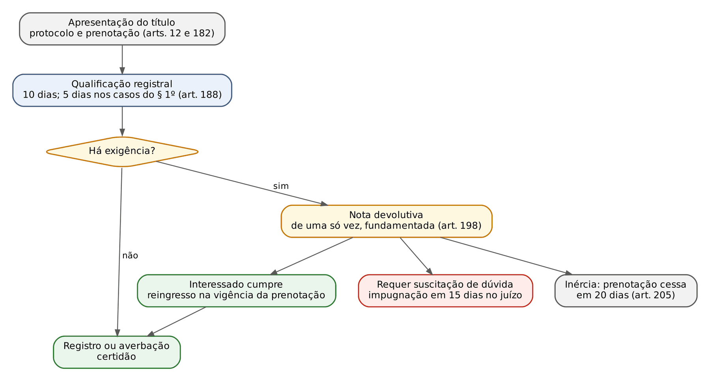
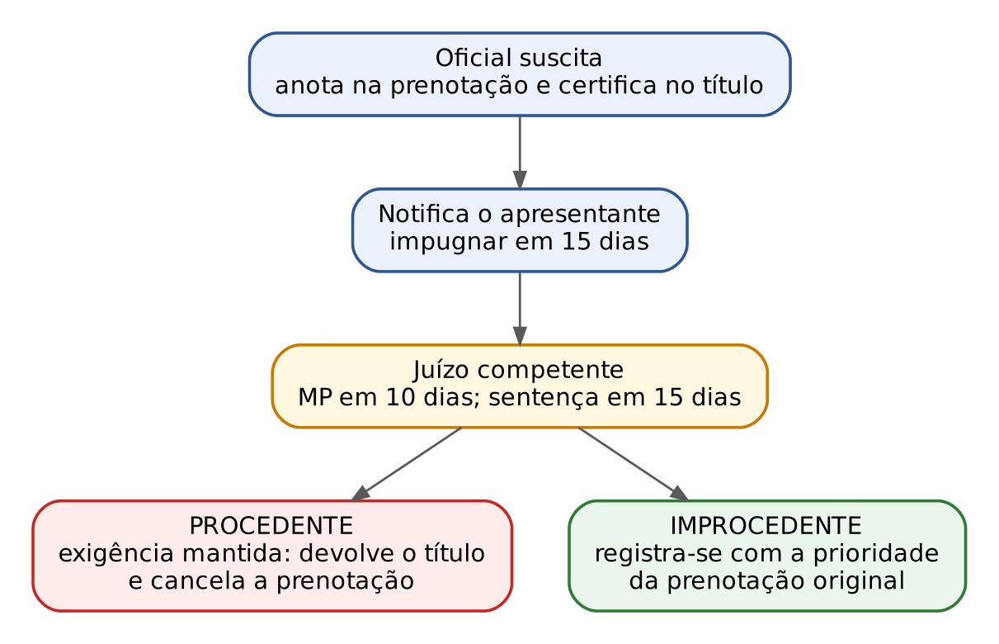
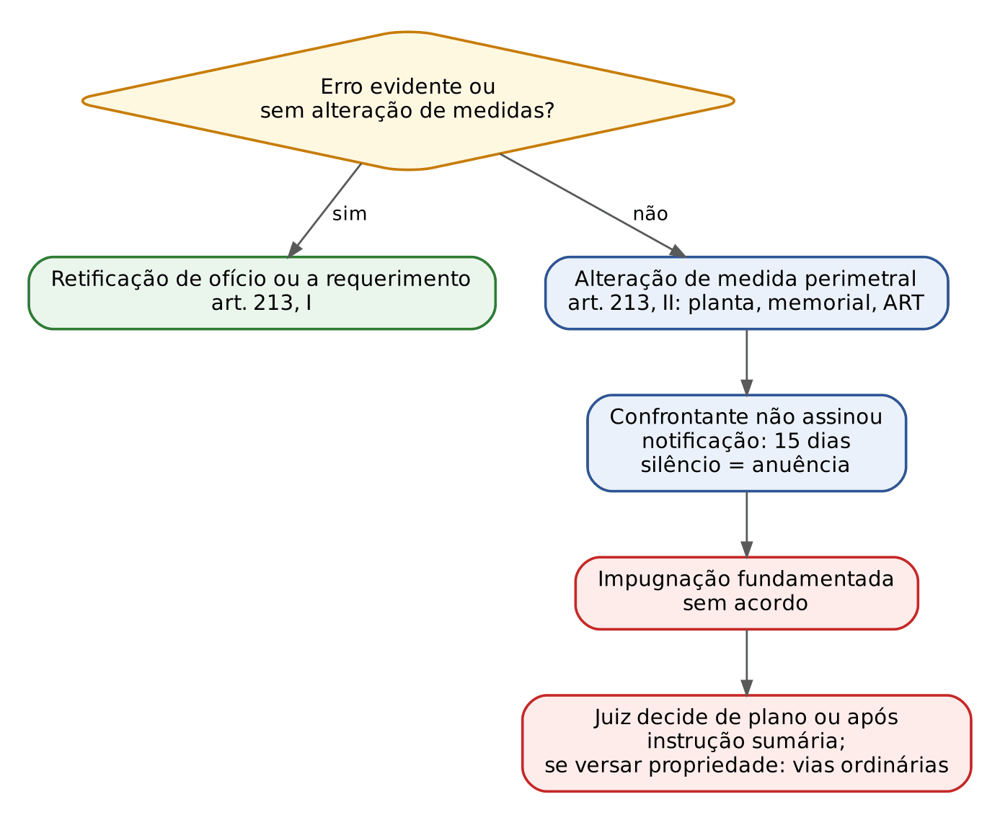

# CAPÍTULO 33 — REGISTROS PÚBLICOS E SERVIÇOS NOTARIAIS

:::INCIDENCIA
TRF5 p. 12; TJRS p. 21 e 22; TJSC p. 22 e 23. Nível A. Lote: 2 questões atribuídas (FGV 2, FCC 0), ambas do ENAC, mais correlatas de outros capítulos.
O que mais cai: registro constitutivo x mera oponibilidade, procedimento de dúvida (procedente = nega o registro), responsabilidade civil do notário (Tema 777 do STF e art. 22 da Lei 8.935), retificação e suprimento extrajudiciais, letra da Lei 8.935 (atribuições exclusivas, concurso, incompatibilidades).
:::

## 33.1 Natureza dos serviços, delegação e fé pública

### 33.1.1 O art. 236 da CF e o modelo de delegação

:::LEI CF, art. 236
Art. 236. Os serviços notariais e de registro são exercidos em caráter privado, por delegação do Poder Público.
§ 1º Lei regulará as atividades, disciplinará a responsabilidade civil e criminal dos notários, dos oficiais de registro e de seus prepostos, e definirá a fiscalização de seus atos pelo Poder Judiciário.
§ 2º Lei federal estabelecerá normas gerais para fixação de emolumentos relativos aos atos praticados pelos serviços notariais e de registro.
§ 3º O ingresso na atividade notarial e de registro depende de concurso público de provas e títulos, não se permitindo que qualquer serventia fique vaga, sem abertura de concurso de provimento ou de remoção, por mais de seis meses.
:::

O serviço é PÚBLICO na titularidade e PRIVADO no modo de execução. O delegatário é pessoa natural, particular em colaboração com o Poder Público, que exerce *in nomine* do Estado um feixe de competências estatais e, por isso, qualifica-se como agente público (fundamentação do RE 842.846, Tema 777 do STF, ver 33.1.4). Daí três consequências cobradas:

- A serventia (o "cartório") NÃO tem personalidade jurídica: quem responde é a pessoa natural do titular à época do fato (Jurisprudência em Teses do STJ, ed. 80, tese 1). O sucessor na delegação não responde por atos do antecessor (STJ, REsp 852.770, j. 3/5/2007: entender diferente seria adotar risco integral). A serventia tem, quando muito, capacidade judiciária para certos fins (CNPJ, obrigações fiscais), o que não a transforma em pessoa.
- O gerenciamento administrativo e financeiro é responsabilidade EXCLUSIVA do titular, inclusive despesas de pessoal; os prepostos são empregados celetistas com remuneração livremente ajustada (Lei 8.935, arts. 20 e 21).
- A fiscalização é do Poder Judiciário (juiz corregedor permanente, Corregedoria-Geral de Justiça e Corregedoria Nacional de Justiça, que normatiza pelo Código Nacional de Normas, ver 33.2.3). Os emolumentos têm natureza de taxa (orientação pacífica do STF), fixados por lei estadual nos limites da lei federal de normas gerais (Lei 10.169/2000). Não se aplica aos serviços cartorários e notariais o regime de alíquota fixa do ISS do art. 9º, § 1º, do DL 406/1968 (Jurisprudência em Teses do STJ, ed. 64, tese 14; o ISS sobre esses serviços é tema da Apostila de Direito Tributário).

Legislar sobre registros públicos é competência PRIVATIVA da União (CF, art. 22, XXV), mas é constitucional lei estadual que manda o RCPN comunicar óbitos ao TRE e ao órgão de identificação, por não tratar de validade, forma ou eficácia dos atos registrais (STF, ADI 2.254, j. 15/12/2016).

:::LEI Lei 8.935/1994, arts. 1º e 3º
Art. 1º Serviços notariais e de registro são os de organização técnica e administrativa destinados a garantir a publicidade, autenticidade, segurança e eficácia dos atos jurídicos.
Art. 3º Notário, ou tabelião, e oficial de registro, ou registrador, são profissionais do direito, dotados de fé pública, a quem é delegado o exercício da atividade notarial e de registro.
:::

Compare com o art. 1º da Lei 6.015/1973: os registros públicos destinam-se a "autenticidade, segurança e eficácia" (três finalidades); a Lei 8.935 acrescenta a "publicidade" (quatro). A banca troca as listas.

Fé pública é a presunção RELATIVA de veracidade do que o delegatário declara ter ocorrido em sua presença ou lança no fólio (CC, art. 215; CPC, art. 405).

### 33.1.2 Espécies de titulares e atribuições

A Lei 8.935 (art. 5º) arrola sete titularidades: tabeliães de notas; tabeliães e oficiais de registro de contratos marítimos; tabeliães de protesto de títulos; oficiais de registro de imóveis; oficiais de registro de títulos e documentos e civis das pessoas jurídicas; oficiais de registro civis das pessoas naturais e de interdições e tutelas; oficiais de registro de distribuição. Repare que RTD e RCPJ formam UMA só titularidade, assim como RCPN e interdições e tutelas.

| Ponto | Notários (tabeliães) | Registradores (oficiais) |
|---|---|---|
| Função | Formalizar a vontade das partes, intervir em atos e negócios, autenticar fatos (art. 6º) | Praticar os atos de registro previstos na legislação dos registros públicos (art. 12) |
| Territorialidade | LIVRE escolha do tabelião de notas, qualquer que seja o domicílio das partes ou a situação dos bens (art. 8º); mas o tabelião não pratica atos fora do Município da delegação (art. 9º) | Registro de imóveis e RCPN sujeitos a circunscrições geográficas (art. 12); RI da situação do imóvel (LRP, art. 169) |
| Distribuição prévia | Protesto: obrigatória se houver mais de um tabelião na localidade (art. 11, parágrafo único) | Independe de prévia distribuição (art. 12; LRP, art. 131 para RTD) |
| Exclusividade | Tabelião de notas: escrituras e procurações públicas, testamento público e aprovação do cerrado, ata notarial, reconhecimento de firma e autenticação de cópia (art. 7º) | Cada especialidade: atos da respectiva lei |

:::LEI Lei 8.935/1994, art. 7º, caput, e art. 7º-A
Art. 7º Aos tabeliães de notas compete com exclusividade: I - lavrar escrituras e procurações, públicas; II - lavrar testamentos públicos e aprovar os cerrados; III - lavrar atas notariais; IV - reconhecer firmas; V - autenticar cópias.
Art. 7º-A Aos tabeliães de notas também compete, sem exclusividade, entre outras atividades: I - certificar o implemento ou a frustração de condições e outros elementos negociais, respeitada a competência própria dos tabeliães de protesto; II - atuar como mediador ou conciliador; III - atuar como árbitro.
:::

O art. 7º-A e o art. 6º-A foram incluídos pela Lei 14.711/2023 (Marco Legal das Garantias). O § 1º do art. 7º-A autoriza o tabelião a receber ou consignar o preço em conta vinculada que constitui PATRIMÔNIO SEGREGADO, insuscetível de constrição judicial ou fiscal por obrigação estranha ao negócio (a chamada conta notarial ou *escrow* notarial); o § 2º prevê ata notarial que certifica a ocorrência ou a frustração das condições e serve de título para registro (LRP, art. 221). O art. 6º-A disciplina a comunicação, pelo tabelião, de negociação em curso de precatório ou crédito judicial: são ineficazes as cessões a pessoas não identificadas na comunicação se a escritura de cessão for lavrada em 15 dias corridos do recebimento pelo juízo.

:::PEGADINHA Exclusividade e substitutos
- Mediação, conciliação e arbitragem pelo tabelião: SEM exclusividade (art. 7º-A). Ata notarial: COM exclusividade (art. 7º, III).
- Os substitutos praticam, simultaneamente com o titular, todos os atos próprios do titular, EXCETO, nos tabelionatos de notas, lavrar testamentos (art. 20, § 4º). Escreventes: só os atos que o titular autorizar (art. 20, § 3º).
- É vedada a exigência de testemunhas apenas porque o ato envolve pessoa com deficiência, salvo disposição em contrário (art. 7º, § 2º, incluído pelo Estatuto da Pessoa com Deficiência).
:::

O tabelião exerce qualificação notarial e deve recusar o ato diante de fundada dúvida sobre capacidade ou liberdade da parte: testador desorientado, família alegando ausência de interdição — o tabelião RECUSA motivadamente (FGV 2026, ENAC, Q4130102, gabarito A; "lavrar com ressalva" e "lavrar porque não há interdição" são as armadilhas; ver Cap. 44). No mesmo ENAC (Q4130160), o tabelião deve alertar que a venda de imóvel de tutelado sem autorização judicial é NULA (CC, art. 1.750; ver Cap. 41), e, em prova de auditor (FGV 2025, SEFAZ-PR, Q3363372), a exigência da outorga conjugal pelo tabelião na comunhão parcial foi tida por correta (ver Cap. 36).

### 33.1.3 Ingresso, vacância, incompatibilidades e perda da delegação

:::ESQUEMA Lei 8.935 em números
| Tema | Regra | Artigo |
|---|---|---|
| Requisitos da delegação | concurso de provas e títulos; nacionalidade brasileira; capacidade civil; quitação eleitoral e militar; bacharel em direito; conduta condigna | art. 14 |
| Quem realiza o concurso | Poder Judiciário, com participação, em TODAS as fases, da OAB, do MP, de um notário e de um registrador | art. 15 |
| Não bacharel | pode concorrer se tiver 10 anos de exercício em serviço notarial ou de registro até a primeira publicação do edital | art. 15, § 2º |
| Preenchimento das vagas | 2/3 por provimento (provas e títulos) e 1/3 por remoção (concurso de títulos), alternadamente; nenhuma vaga sem concurso por mais de 6 meses | art. 16 |
| Critério da alternância | data da vacância; se na mesma data, a da criação do serviço | art. 16, parágrafo único |
| Penas | repreensão, multa, suspensão por 90 dias prorrogável por mais 30, perda da delegação | art. 32 |
| Perda da delegação | sentença transitada em julgado OU processo administrativo com ampla defesa | art. 35 |
| Extinção da delegação | morte, aposentadoria facultativa, invalidez, renúncia, perda, descumprimento comprovado da gratuidade da Lei 9.534/1997 | art. 39 |
| Após a extinção | declara-se vago, designa-se o substituto mais antigo para responder e abre-se concurso | art. 39, § 2º |
:::

Incompatibilidade: a atividade é incompatível com a advocacia, com a intermediação de seus serviços e com qualquer cargo, emprego ou função públicos, ainda que em comissão; no mandato eletivo, a diplomação (e, nos demais casos, a posse) implica afastamento da atividade (art. 25). Os delegatários gozam de independência, têm direito aos emolumentos integrais e só perdem a delegação nas hipóteses legais (art. 28).

Jurisprudência que o leitor deve dominar:

- O substituto NÃO tem direito adquirido à efetivação na titularidade se a vacância ocorreu após a CF de 1988, que passou a exigir concurso (Jurisprudência em Teses do STJ, ed. 80, tese 2; no STF a orientação é a mesma e reiterada).
- Se a vacância decorre do reconhecimento da NULIDADE da investidura do titular, não se aplica a designação do substituto mais antigo do art. 39, § 2º (Jurisprudência em Teses do STJ, ed. 229, tese 9, RMS 69.678): o interino será outro, segundo as normas do CNJ.
- O interventor que substitui titular afastado e depois condenado pode levantar a metade da renda líquida depositada judicialmente (art. 36) sem submissão ao teto do art. 37, XI, da CF (Jurisprudência em Teses do STJ, ed. 229, tese 7). Não confunda com o interino designado em vacância, que, segundo orientação do STF e do CNJ, se sujeita ao teto.
- O titular de serventia extrajudicial NÃO se submete à aposentadoria compulsória do art. 40, § 1º, II, da CF, porque não ocupa cargo efetivo nem é remunerado pelos cofres públicos (orientação do STF; a FGV, no concurso de cartórios do TJSC de 2021, cobrou a distinção entre serventias judiciais estatizadas, sujeitas à compulsória, e extrajudiciais, não sujeitas).

### 33.1.4 Responsabilidade civil: Lei 13.286/2016 e Tema 777 do STF

:::LEI Lei 8.935/1994, art. 22 (redação da Lei 13.286/2016)
Art. 22. Os notários e oficiais de registro são civilmente responsáveis por todos os prejuízos que causarem a terceiros, por culpa ou dolo, pessoalmente, pelos substitutos que designarem ou escreventes que autorizarem, assegurado o direito de regresso.
Parágrafo único. Prescreve em três anos a pretensão de reparação civil, contado o prazo da data de lavratura do ato registral ou notarial.
:::

Linha do tempo: a redação original (1994) e a da Lei 13.137/2015 diziam que os delegatários "responderão pelos danos que eles e seus prepostos causem a terceiros" (texto que o STJ lia como responsabilidade objetiva); a Lei 13.286/2016 introduziu a culpa ou o dolo e o prazo trienal. Hoje a responsabilidade do delegatário é SUBJETIVA, em harmonia com o art. 28 da LRP ("por culpa ou dolo") e com o art. 38 da Lei 9.492/1997 para o tabelião de protesto.

:::JURIS STF, Tema 777 (RE 842.846-SC, Pleno, j. 27/2/2019)
Tese: o Estado responde, objetivamente, pelos atos dos tabeliães e registradores oficiais que, no exercício de suas funções, causem dano a terceiros, assegurado o direito de regresso contra o responsável, nos casos de dolo ou culpa, sob pena de improbidade administrativa.
Fundamentos cobrados: o art. 37, § 6º, da CF fala em "pessoas jurídicas" prestadoras de serviço público, e o delegatário é pessoa natural, de modo que a ele não se estende a responsabilidade objetiva; responsabilidade objetiva exige previsão expressa e não admite interpretação extensiva; quem responde objetivamente é o Estado, porque o delegatário é agente público. O caso concreto era de Santa Catarina (dano por registrador; responsabilidade objetiva do Estado de SC).
:::

:::PEGADINHA Os três erros clássicos
- "O tabelião responde objetivamente porque presta serviço público": ERRADO desde a Lei 13.286/2016; responde por culpa ou dolo.
- "O Estado responde subsidiariamente": ERRADO; responde direta e objetivamente (Tema 777); o regresso contra o delegatário exige dolo ou culpa e é DEVER (sob pena de improbidade).
- "A prescrição contra o delegatário conta da ciência do dano": ERRADO; o prazo é de 3 anos contados da LAVRATURA do ato (art. 22, parágrafo único) — regra especial que afasta a *actio nata* subjetiva (Cap. 11).
:::

O tabelião não tem legitimidade passiva em ação declaratória de nulidade de documento público sem pedido indenizatório (Jurisprudência em Teses do STJ, ed. 229, tese 10).

:::SENTENCA Ação indenizatória por erro registral
Como decidir: (1) legitimidade: o autor pode demandar o Estado (objetiva, Tema 777); se demandar o delegatário pessoa natural, exige-se culpa ou dolo e responde o titular À ÉPOCA do ato, não o atual (Jurisprudência em Teses, ed. 80, tese 1); (2) prescrição: em ação contra o delegatário, 3 anos da lavratura; contra o Estado, o prazo quinquenal das pretensões contra a Fazenda (Cap. 11); (3) mérito: nexo entre o ato da serventia e o prejuízo.
Redação-modelo: "Tratando-se de pretensão dirigida pessoalmente ao delegatário, sua responsabilidade é subjetiva (art. 22 da Lei 8.935/1994, na redação da Lei 13.286/2016), e o prazo prescricional de três anos flui da data da lavratura do ato, e não da ciência do dano. Lavrado o ato em [data] e ajuizada a demanda em [data], pronuncio a prescrição (art. 487, II, do CPC)."
:::

Há debate sobre se a vítima pode escolher demandar diretamente o delegatário (a tese da "dupla garantia" fixada pelo STF em repercussão geral exige, para servidores, ação contra o Estado, e não contra o agente). Para notários e registradores, a responsabilidade pessoal subjetiva está prevista em lei própria (art. 22), e o STJ tem admitido a ação contra o titular, provada a culpa; trate como ponto controvertido e registre na sentença a opção feita.

## 33.2 Lei 6.015/1973: estrutura, regras comuns, SERP e Código Nacional de Normas

### 33.2.1 Espécies de registro e regras comuns

A LRP disciplina quatro registros (art. 1º, § 1º): civil das pessoas naturais; civil das pessoas jurídicas; de títulos e documentos; e de imóveis. Os demais (empresarial nas Juntas, de marcas e patentes no INPI, de veículos no Detran, aeronaves no RAB, embarcações no Tribunal Marítimo) regem-se por leis próprias (art. 1º, § 2º). A Lei 14.382/2022 impôs escrituração, publicidade e conservação em MEIO ELETRÔNICO, nos termos da Corregedoria Nacional de Justiça, e proibiu as serventias de recusar documentos eletrônicos produzidos nos padrões do CNJ (art. 1º, §§ 3º e 4º).

Regras gerais de prova:

- Rogação (instância): salvo anotações e averbações obrigatórias, os atos são praticados por ordem judicial, a requerimento verbal ou escrito do interessado ou a requerimento do MP quando a lei autorizar (art. 13). O oficial NÃO age de ofício, salvo exceções legais (retificações de ofício dos arts. 110 e 213, I; averbação de nomes de logradouros; saneamento de matrículas do Provimento 195/2025).
- Nulidade temporal: é NULO o registro lavrado fora das horas regulamentares ou em dias sem expediente, respondendo civil e criminalmente o oficial (art. 9º).
- Prazos em DIAS E HORAS ÚTEIS para prenotação, emolumentos, atos do RI, do RTD e do RCPJ e emissão de certidões, salvo os contados em meses e anos; contagem segundo a legislação processual (art. 9º, §§ 1º a 3º, Lei 14.382/2022). O RCPN não está na lista do § 1º.
- Publicidade indireta: qualquer pessoa pode requerer certidão SEM informar o motivo ou o interesse (art. 17). Exceções de sigilo existem em leis e normas específicas (por exemplo, a alteração de gênero de pessoa trans, Tema 761 do STF — ver Cap. 4; filiação, art. 19, § 3º; legitimação adotiva e adoção).
- Certidões: prazo geral de até 5 dias (art. 19); no registro de imóveis, prazos máximos contados do pagamento: 4 horas para a certidão de inteiro teor da matrícula em meio eletrônico (com o número fornecido), 1 dia para a certidão da situação jurídica atualizada do imóvel e 5 dias para transcrições e demais casos (art. 19, § 10). A certidão de inteiro teor da matrícula basta para comprovar propriedade, direitos, ônus reais e restrições (art. 19, § 11).
- Responsabilidade dos oficiais: subjetiva, por culpa ou dolo, pessoalmente ou pelos prepostos e substitutos (art. 28; ver 33.1.4).
- Gratuidade: registro de nascimento e assento de óbito e a primeira certidão respectiva são gratuitos para todos; para os reconhecidamente pobres, também as demais certidões do RCPN, vedada a menção à pobreza na certidão (art. 30; Lei 8.935, art. 45). O descumprimento reiterado da gratuidade é causa de extinção da delegação (Lei 8.935, art. 39, VI; LRP, art. 30, § 3º-B).

### 33.2.2 Sistema Eletrônico dos Registros Públicos (SERP)

A Lei 14.382/2022 (resultante da MP 1.085/2021) criou o SERP, de que trata o art. 37 da Lei 11.977/2009. Pontos cobráveis:

- Objetivos (art. 3º): registro eletrônico, interconexão e interoperabilidade das serventias, atendimento remoto, recepção de títulos e expedição de certidões eletrônicas (inclusive centralizadas), intercâmbio com entes públicos (inclusive o SIRA) e usuários, e consulta a indisponibilidades, gravames e pessoas que figurem como devedoras de título protestado, garantidoras reais, cedentes de crédito ou titulares de bens constritos.
- Integram o SERP os oficiais dos registros da LRP; a adesão é OBRIGATÓRIA, também para os interinos, sob as penas do art. 32 da Lei 8.935 (arts. 3º, § 1º, e 4º). Os tabeliães de notas e de protesto não são "integrantes" no sentido do art. 3º, § 1º, mas interagem como usuários.
- Operador nacional: pessoa jurídica de direito privado sem fins lucrativos (associação ou fundação), conforme a Corregedoria Nacional (art. 3º, § 4º). No registro de imóveis já existia o ONR (Lei 13.465/2017, art. 76), que opera o SREI.
- Custeio: Fundo para a Implementação e Custeio do SERP (FICS), subvencionado pelos oficiais, com dispensa para quem desenvolver plataformas interoperáveis (art. 5º).
- Extratos eletrônicos (art. 6º): o oficial qualifica o título pelos elementos do extrato; para imóveis, arquiva-se a íntegra do instrumento, dispensa-se a atualização prévia da matrícula quanto a dados não imprescindíveis e dispensa-se a apresentação do pacto antenupcial se o extrato indicar seu registro e o regime.

A mesma lei reescreveu boa parte da LRP (prazos, dúvida, prenotação, RTD, habilitação, união estável, nome — Cap. 4 — e adjudicação compulsória extrajudicial — Cap. 17), tratadas nos itens próprios.

### 33.2.3 Código Nacional de Normas e o Provimento 195/2025

O Provimento CNJ 149/2023 instituiu o Código Nacional de Normas da Corregedoria Nacional de Justiça — Foro Extrajudicial (CNN/CN/CNJ-Extra), que consolidou dezenas de provimentos anteriores (atos eletrônicos notariais, reconhecimento de paternidade socioafetiva, alteração de nome e gênero, usucapião extrajudicial, entre outros) e vem sendo alterado por provimentos posteriores. O fundamento é o poder normativo e fiscalizatório do art. 103-B, § 4º, e do art. 236, § 1º, da CF.

O Provimento CNJ 195, de 3/6/2025 (DJe/CNJ 4/6/2025), citado no edital do TJRS, conferido no arquivo do Drive, altera o CNN para:

- criar, como módulos do SREI operado pelo ONR, o Inventário Estatístico Eletrônico (IERI-e) e o Sistema de Informações Geográficas do Registro de Imóveis (SIG-RI), ao lado da CNIB e do SAEC (art. 320-O);
- definir RESTAURAÇÃO (recompor folha extraviada ou danificada que inviabilize leitura e certidão), SUPRIMENTO PARCIAL (dado obrigatório ou recomendável não inserido na lavratura) e SUPRIMENTO TOTAL (ato não consumado no livro, embora certificado a terceiros), esclarecendo que a via perante o juiz corregedor NÃO exclui a extrajudicial (art. 197-A) e permitindo ao RI restaurar e suprir de ofício ou a requerimento (art. 205-N);
- ampliar os dados obrigatórios da matrícula (Código Nacional de Matrícula, área em m² ou hectares, georreferenciamento e códigos dos cadastros fiscais, rurais e ambientais, art. 440-AQ) e instituir as AVERBAÇÕES DE SANEAMENTO: erro material com prova no acervo é retificado de ofício; fora disso, nota devolutiva em 10 dias apontando o saneamento necessário antes do ato pedido (art. 440-AR); averbações de estado civil em atos autônomos, observada a continuidade (art. 440-AU);
- disciplinar o saneamento de sobreposição de áreas, duplicidade de matrículas (de ofício quando não há contradição de titularidade), matrícula aberta em serventia incompetente e encerramento gradual das transcrições (arts. 440-AY a 440-BF);
- criar a AUTOTUTELA REGISTRAL (art. 440-BG): em caso de alta indagação ou potencial litígio entre titulares tabulares, incidente prenotado, relatório preliminar, notificação para manifestação em 15 dias (silêncio = anuência), tentativa de conciliação e, sem consenso, remessa ao juiz corregedor, que prossegue na forma do art. 214 da LRP.

:::DICA Como o Provimento 195 aparece em prova
É provimento técnico; a cobrança provável é conceitual: (i) distinção restauração x suprimento parcial x suprimento total; (ii) possibilidade de via extrajudicial além da judicial; (iii) retificação de ofício de erro material à vista do acervo; (iv) autotutela registral que desemboca no juiz corregedor (art. 214 da LRP). A questão do ENAC 2026 do 33.6.3 já explorou o suprimento parcial extrajudicial.
:::

## 33.3 Registro de imóveis: princípios de regência

### 33.3.1 Quadro dos princípios

O sistema brasileiro é de registro de DIREITOS (não de mera transcrição de documentos), de fólio real (organizado por imóvel, na matrícula) e de eficácia constitutiva para os direitos reais por ato *inter vivos* (CC, arts. 1.227 e 1.245), com presunção relativa de veracidade (CC, art. 1.247). Não adotamos o sistema alemão de abstração e fé pública absoluta: o registro é causal e pode ser invalidado com o título (ver propriedade imóvel e aquisição pelo registro no Cap. 28).

| Princípio | Conteúdo | Fundamento |
|---|---|---|
| Inscrição (constitutividade) | Direitos reais sobre imóveis por ato *inter vivos* só se adquirem com o registro; antes dele há direito pessoal | CC, arts. 1.227 e 1.245 |
| Presunção relativa e fé pública | O registro presume o direito do titular inscrito, até que se promova a invalidação e o cancelamento; "enquanto não cancelado, produz todos os efeitos legais" | CC, arts. 1.245, § 2º, e 1.247; LRP, art. 252 |
| Publicidade | O registro é público; certidão a qualquer pessoa, sem motivação | LRP, arts. 16, 17 e 19 |
| Rogação (instância) | O oficial age por provocação, salvo exceções legais | LRP, art. 13 |
| Prioridade | O número de ordem no Protocolo determina a prioridade do título e esta a preferência dos direitos reais | LRP, arts. 182, 186, 190 a 192 |
| Legalidade (qualificação) | O oficial examina a legalidade formal e a aptidão do título, podendo exigir e negar | LRP, arts. 198 e 221 |
| Continuidade (trato sucessivo) | Ninguém transmite o que não consta em seu nome: exige-se o registro do título anterior | LRP, arts. 195, 222 e 237 |
| Especialidade objetiva | Identificação precisa do imóvel (características, confrontações, área, georreferenciamento) | LRP, arts. 176, 225; Provimento 195/2025 |
| Especialidade subjetiva | Qualificação completa das partes (CPF, estado civil, regime de bens) | LRP, art. 176, § 1º, II, 4, e III, 2 |
| Unitariedade da matrícula | Cada imóvel tem uma matrícula e cada matrícula um imóvel | LRP, art. 176, § 1º, I |
| Territorialidade | Atos na serventia da situação do imóvel | LRP, art. 169 |
| Tipicidade (taxatividade mitigada) | Só se registram os atos previstos em lei; a Lei 14.711/2023 acrescentou cláusula geral (art. 167, I, 48) e o art. 246 abre a averbação a "outras ocorrências" | LRP, arts. 167, 172 e 246 |
| Concentração | A matrícula deve concentrar as situações jurídicas oponíveis; o que nela não está não se opõe ao terceiro de boa-fé | Lei 13.097/2015, art. 54 |

### 33.3.2 Prioridade, continuidade e concentração na prática

Prioridade: nenhuma exigência fiscal ou dúvida obsta a apresentação do título e seu lançamento no Protocolo, quando da precedência decorra prioridade (art. 12); títulos apresentados só para exame e cálculo de emolumentos não são protocolados. Não se registram no mesmo dia títulos que constituam direitos reais contraditórios sobre o mesmo imóvel (art. 190); prevalece o de número de ordem mais baixo, protelando-se o posterior por pelo menos um dia útil (art. 191), EXCETO escrituras públicas da mesma data, apresentadas no mesmo dia, que declarem a hora da lavratura: prevalece a lavrada primeiro (art. 192). Em ação reivindicatória com dois registros hígidos para o mesmo imóvel, prevalece o primeiro título registrado (Jurisprudência em Teses do STJ, ed. 227, tese 6).

Continuidade: se o imóvel não estiver matriculado ou registrado em nome do outorgante, o oficial exige a prévia matrícula e o registro do título anterior (art. 195); ainda que matriculado o imóvel, não se faz registro que dependa da apresentação de título anterior (art. 237). Aplicação típica: formal de partilha não registrado impede o registro da venda feita pelo herdeiro; mudança de estado civil não averbada impede o registro da alienação pelo divorciado (averbação de saneamento, art. 440-AU do CNN).

:::LEI Lei 13.097/2015, art. 54, caput e § 1º (concentração da matrícula)
Art. 54. Os negócios jurídicos que tenham por fim constituir, transferir ou modificar direitos reais sobre imóveis são eficazes em relação a atos jurídicos precedentes, nas hipóteses em que não tenham sido registradas ou averbadas na matrícula do imóvel as seguintes informações: I - registro de citação de ações reais ou pessoais reipersecutórias; II - averbação, por solicitação do interessado, de constrição judicial, de que a execução foi admitida pelo juiz ou de fase de cumprimento de sentença [...]; III - averbação de restrição administrativa ou convencional ao gozo de direitos registrados, de indisponibilidade ou de outros ônus quando previstos em lei; e IV - averbação, mediante decisão judicial, da existência de outro tipo de ação cujos resultados ou responsabilidade patrimonial possam reduzir seu proprietário à insolvência [...]; V - averbação, mediante decisão judicial, de qualquer tipo de constrição judicial incidente sobre o imóvel ou sobre o patrimônio do titular do imóvel, inclusive a proveniente de ação de improbidade administrativa ou a oriunda de hipoteca judiciária.
§ 1º Não poderão ser opostas situações jurídicas não constantes da matrícula no registro de imóveis, inclusive para fins de evicção, ao terceiro de boa-fé que adquirir ou receber em garantia direitos reais sobre o imóvel, ressalvados o disposto nos arts. 129 e 130 da Lei nº 11.101, de 9 de fevereiro de 2005, e as hipóteses de aquisição e extinção da propriedade que independam de registro de título de imóvel.
:::

O inciso V veio da Lei 14.825/2024; a Lei 14.382/2022 deu a redação atual e passou a dispensar certidões forenses e de distribuidores para a validade do negócio e a boa-fé do adquirente (§ 2º, paráfrase). Ressalvas do § 1º: ineficácia falimentar e aquisições originárias (usucapião, acessão). O art. 55 blinda o adquirente de unidade de incorporação, loteamento ou condomínio registrado (sem evicção nem ineficácia; credores do alienante sub-rogam-se no preço); o art. 58 exclui imóveis públicos. Na fraude à execução, a Súmula 375 do STJ exige registro da penhora ou prova de má-fé do terceiro, e a averbação premonitória e a da penhora geram presunção absoluta de conhecimento (CPC, arts. 828 e 844).

:::ATENCAO Registros de particulares em terrenos de marinha
Os registros de propriedade particular de imóveis situados em terrenos de marinha NÃO são oponíveis à União (Tema 419 do STJ; Súmula 496 do STJ, v. Cap. 7). A presunção do art. 1.247 do CC cede diante do domínio público originário (CF, art. 20, VII). Na mesma linha, a falta de registro do "contrato de gaveta" não impede o fato gerador do laudêmio, e o prazo para constituir o crédito conta do conhecimento pela União, não da data do registro (Tema 1.142 do STJ).
:::

### 33.3.3 Fé pública relativa e cancelamento

O registro, enquanto não cancelado, produz todos os efeitos legais ainda que se prove que o título está desfeito, anulado, extinto ou rescindido (LRP, art. 252). Daí:

- A mera existência de ação de nulidade do registro não retira a legitimidade de quem, com base nele, propõe reivindicatória (Tema 39 do STJ); e o efeito suspensivo dado a agravo não desfaz adjudicação já registrada, que exige ação anulatória (Jurisprudência em Teses do STJ, ed. 229, tese 4).
- A anulação do registro (CC, art. 1.247) NÃO autoriza apagar da matrícula os dados invalidados: o cancelamento se faz por averbação, preservando o histórico (Enunciado 624 do CJF).
- As nulidades de pleno direito do registro, provadas, invalidam-no independentemente de ação direta, ouvidos os atingidos (LRP, art. 214, caput e § 1º), por decisão do juiz corregedor; cabe apelação ou agravo conforme o caso (§ 2º). O juiz pode BLOQUEAR a matrícula de ofício se novos registros puderem causar dano de difícil reparação; bloqueada, só se pratica ato com autorização judicial, admitida a prenotação, cujo prazo fica prorrogado (§§ 3º e 4º). A nulidade NÃO será decretada se atingir terceiro de boa-fé que já tiver preenchido as condições de usucapião (§ 5º).
- Ao terceiro prejudicado é lícito, em juízo, provar a extinção dos ônus reais e promover o cancelamento (art. 253); o registro pode ser retificado ou anulado por sentença em processo contencioso, em ação de anulação ou nulidade do ato jurídico ou em julgado sobre fraude à execução (art. 216).

Presunção cobrada em outro capítulo: o prazo de 2 anos para anular venda de ascendente a descendente conta da ciência, presumida ABSOLUTAMENTE a partir do registro imobiliário (Enunciado 545 do CJF; Cap. 17).

## 33.4 Matrícula, registro e averbação

### 33.4.1 Livros e matrícula

Livros do RI (art. 173): nº 1 Protocolo; nº 2 Registro Geral (matrícula e atos do art. 167 não atribuídos ao Livro 3); nº 3 Registro Auxiliar (atos que não dizem respeito diretamente a imóvel matriculado, como convenção de condomínio, pacto antenupcial e cédulas); nº 4 Indicador Real; nº 5 Indicador Pessoal. A matrícula é aberta por ocasião do primeiro ato de registro ou de averbação (art. 176, § 1º, I), à vista do título e do registro anterior do próprio cartório (art. 196); seus requisitos (art. 176, § 1º, II) são número de ordem que segue ao infinito, data, identificação do imóvel (rural: código e dados do CCIR, denominação, características, confrontações, localização e área; urbano: características, confrontações, localização, área, logradouro, número e designação cadastral), qualificação do proprietário e número do registro anterior; para a multipropriedade, a indicação da existência das matrículas das frações de tempo.

Imóvel em duas ou mais circunscrições: matrículas em ambas, com remissões recíprocas, praticando-se os atos só na da MAIOR área; áreas idênticas, na escolhida pelo interessado (art. 169, II e § 3º). Averbações vão à matrícula ou ao registro a que se referem, ainda que o imóvel tenha passado a outra circunscrição (art. 169, I).

Títulos admitidos a registro (art. 221): escrituras públicas, inclusive consulares; escritos particulares autorizados em lei, com firmas reconhecidas; atos autênticos estrangeiros, legalizados, traduzidos e registrados no RTD, e sentenças estrangeiras homologadas (hoje pelo STJ, CF, art. 105, I, i — o inciso III ainda fala em STF); cartas de sentença, formais de partilha, certidões e mandados judiciais; contratos e termos administrativos de regularização fundiária e de desapropriação extrajudicial.

### 33.4.2 Registro x averbação

Registro (*stricto sensu*) é o ato que constitui, transmite, declara ou extingue direito real ou que dá publicidade a direito pessoal com eficácia real (art. 172); averbação é o ato acessório que modifica, cancela ou noticia ocorrência que altere o registro ou repercuta nos direitos relativos ao imóvel (arts. 167, II, e 246). Na designação genérica "registro" englobam-se a antiga inscrição e a transcrição (art. 168). Todos os atos do art. 167 são OBRIGATÓRIOS (art. 169).

| Ato | Registro ou averbação? | Item do art. 167 |
|---|---|---|
| Bem de família convencional | Registro | I, 1 |
| Hipotecas legais, judiciais e convencionais | Registro | I, 2 |
| Locação com cláusula de VIGÊNCIA em caso de alienação | Registro | I, 3 |
| Locação para fins de DIREITO DE PREFERÊNCIA | Averbação | II, 16 |
| Penhoras, arrestos e sequestros | Registro (no texto do item); na prática do CPC, a penhora é "averbada" (art. 844) — atenção à redação cobrada | I, 5 |
| Servidões, usufruto, uso e habitação (não decorrentes do direito de família) | Registro | I, 6 e 7 |
| Compromisso de compra e venda de imóvel não loteado | Registro | I, 9 |
| Convenções antenupciais | Registro (no Livro 3) | I, 12 |
| Convenção antenupcial e regime diverso do legal na matrícula dos imóveis do cônjuge | Averbação | II, 1 |
| Incorporações, instituições e convenções de condomínio | Registro | I, 17 |
| Citações de ações reais ou pessoais reipersecutórias | Registro | I, 21 |
| Sentenças de usucapião | Registro | I, 28 |
| Alienação fiduciária de imóvel | Registro | I, 35 |
| Superfície; concessão de direito real de uso; legitimação fundiária; CRF | Registro | I, 39, 40, 43, 44 |
| Outros negócios de transmissão ou instituição de direito real (cláusula geral) | Registro | I, 48 |
| Cancelamento de ônus e direitos reais | Averbação | II, 2 |
| Edificação, demolição, desmembramento, loteamento, mudança de numeração | Averbação | II, 4 |
| Alteração de nome por casamento, divórcio e outras circunstâncias pessoais | Averbação | II, 5 |
| Caução e cessão fiduciária de direitos reais relativos a imóveis | Averbação | II, 8 |
| Cláusulas de inalienabilidade, impenhorabilidade e incomunicabilidade; fideicomisso | Averbação | II, 11 |
| Cessão de crédito com garantia real sobre imóvel | Averbação | II, 21 |
| Reserva legal; servidão ambiental | Averbação | II, 22 e 23 |
| Sub-rogação de dívida e da garantia (art. 347 do CC ou art. 31 da Lei 9.514) | Averbação | II, 30 |
| Extinção do direito de superfície | Averbação | II, 20 |

:::PEGADINHA Locação: registro ou averbação?
Para opor a VIGÊNCIA ao adquirente: REGISTRO (art. 167, I, 3; Lei 8.245, art. 8º). Para o DIREITO DE PREFERÊNCIA com eficácia real (haver o imóvel para si): AVERBAÇÃO pelo menos 30 dias antes da alienação (art. 167, II, 16; Lei 8.245, art. 33). Ambos se fazem no RI da circunscrição em que o imóvel estiver matriculado, com uma via do contrato assinada pelas partes, admitida a forma eletrônica e bastando a coincidência entre o nome de um dos proprietários e o do locador (art. 167, parágrafo único). A inscrição no RI dispensa a transcrição no RTD para a cláusula de vigência (Súmula 442 do STF). Sem a averbação, o locatário não exerce a preferência real (Jurisprudência em Teses do STJ, ed. 80, tese 12; ed. 133, tese 12: depósito do preço, pedido em 6 meses do registro da venda e averbação 30 dias antes), restando-lhe perdas e danos (ver Cap. 18).
:::

Casos FGV correlatos: caução locatícia de imóvel AVERBADA na matrícula tem eficácia real equiparada à hipoteca e prefere ao credor quirografário penhorante (FGV 2026, TJ-GO, Juiz, Q3966636, gabarito C; Lei 8.245, art. 38, § 1º); a cessão do crédito hipotecário independe de averbação entre as partes, mas a averbação é DIREITO do cessionário necessário para valer-se da garantia (FGV 2025, ENAC, Q3328196, gabarito D; art. 167, II, 21; ver Cap. 13 e 32); quem paga dívida hipotecária de imóvel adquirido sub-roga-se de pleno direito na hipoteca, ainda que não averbe (FGV 2025, CGE-SP, Q3781256, gabarito A; CC, art. 346, II); a adjudicação de frações da minoria em condomínio edilício após sinistro, deferida liminarmente, deve ser averbada com indicação de que resultou de liminar (FGV 2026, ENAC, Q4130085, gabarito D; Lei 4.591, art. 15; ver Cap. 30).

### 33.4.3 Registro constitutivo, declaratório e de mera oponibilidade

A FGV tem cobrado a função do registro em cada instituto. O registro pode ser constitutivo (sem ele, o direito real não nasce), declaratório (o direito já existe; o registro dá publicidade e disponibilidade) ou de mera eficácia perante terceiros (o negócio vale entre as partes; o registro o torna oponível).

| Situação | Função do registro | Fundamento |
|---|---|---|
| Compra e venda, doação, hipoteca, usufruto convencional, servidão, superfície, alienação fiduciária de imóvel | Constitutiva | CC, arts. 1.227, 1.245, 1.369, 1.378, 1.391, 1.492; Lei 9.514, art. 23 |
| Usucapião, sucessão *causa mortis*, acessão | Declaratória (a aquisição é anterior; o registro dá disponibilidade) | CC, arts. 1.238, 1.241, parágrafo único, e 1.784 |
| Bem de família CONVENCIONAL | Constitutiva | CC, art. 1.714 |
| Bem de família LEGAL | Nenhuma: independe de registro | Lei 8.009/1990 |
| Locação (vigência e preferência) | Oponibilidade | LRP, art. 167; Lei 8.245, arts. 8º e 33 |
| Promessa de compra e venda | Oponibilidade e direito real à aquisição | CC, arts. 1.417 e 1.418; súmula do STJ segundo a qual a adjudicação compulsória independe do registro do compromisso (Cap. 17) |
| Alienação fiduciária de veículo | Eficácia perante terceiros (anotação no CRV); não é requisito de validade | Jurisprudência em Teses do STJ, ed. 80, tese 8; Súmula 92 do STJ (Cap. 22) |
| Alienação fiduciária de imóvel não registrada | Vale entre as partes, mas sem registro não há propriedade fiduciária nem execução extrajudicial | EREsp 1.866.844 (Jurisprudência em Teses do STJ, ed. 229, tese 3; Cap. 22) |
| Usufruto não registrado nas relações entre usufrutuário e nu-proprietário | Prescindível entre as partes do negócio válido e eficaz | Jurisprudência em Teses do STJ, ed. 228, tese 7 |
| Parceria agrícola | Prescinde de registro para valer perante terceiros | Jurisprudência em Teses do STJ, ed. 228, tese 6 |
| Pessoa jurídica de direito privado | Constitutiva da personalidade | CC, art. 45 (Cap. 5) |

:::QUESTAO FGV 2025 — ENAC — Exame Nacional dos Cartórios, 1º Exame (Q3328201)
O que se pergunta: diante de (i) impenhorabilidade do bem de família, (ii) legitimidade do agente de garantias para execução e ações sobre o crédito garantido e (iii) direito de preferência do locatário, qual a função do registro em cada um.
Gabarito: E (em nenhuma hipótese o registro é constitutivo; a oponibilidade depende de registro apenas na hipótese iii).
Passos: (i) a questão fala genericamente em bem de família e mira o LEGAL, cuja impenhorabilidade decorre da lei, sem registro; (ii) a legitimidade do agente de garantias decorre do contrato e da lei (CC, art. 853-A, incluído pela Lei 14.711/2023; ver Cap. 21), não de registro; (iii) a preferência real do locatário exige a averbação do contrato (Lei 8.245, art. 33; LRP, art. 167, II, 16) — e averbação não é constitutiva da locação.
Armadilhas: B diz que o registro do bem de família é constitutivo (verdade só para o CONVENCIONAL, art. 1.714); D inclui a hipótese ii entre as dependentes de registro.
:::

## 33.5 Procedimento registral, prazos e dúvida

### 33.5.1 Do protocolo ao registro

:::PROCESSO Prazos do registro de imóveis (Lei 6.015, redação da Lei 14.382/2022)
| Ato | Prazo | Artigo |
|---|---|---|
| Registro ou nota devolutiva | 10 dias do protocolo | art. 188, caput |
| Registro sem exigências: escritura de compra e venda sem cláusulas especiais, averbação de construção e cancelamento de garantias; documentos eletrônicos via SERP; títulos que reingressam com exigências cumpridas na vigência da prenotação | 5 dias | art. 188, § 1º |
| Vigência da prenotação | 20 dias do lançamento, se o título não for registrado por omissão do interessado | art. 205 |
| Prenotação em regularização fundiária de interesse social | 40 dias | art. 205, parágrafo único |
| Depósito do restante dos emolumentos (opção do art. 206-A, II) | 5 dias da análise que concluiu pela aptidão; prenotação mantida; prazo não computado no do art. 188 | art. 206-A |
| Nota devolutiva de saneamento da matrícula | 10 dias do protocolo | CNN, art. 440-AR, § 2º |
| Contagem | dias e horas úteis | art. 9º, § 1º |
:::

A nota devolutiva deve ser única ("de uma só vez"), articulada, clara e objetiva, datada e assinada (art. 198, caput). Formular exigências parceladas é infração disciplinar (art. 198, § 2º, com remissão às penas do art. 32 da Lei 8.935). O descumprimento dos prazos do art. 188 também (art. 188, § 2º).

### 33.5.2 Procedimento de dúvida

:::LEI Lei 6.015/1973, art. 198 (redação da Lei 14.382/2022) e art. 204
Art. 198. Se houver exigência a ser satisfeita, ela será indicada pelo oficial por escrito, dentro do prazo previsto no art. 188 desta Lei e de uma só vez, articuladamente, de forma clara e objetiva, com data, identificação e assinatura do oficial ou preposto responsável, para que: [...] V - o interessado possa satisfazê-la; ou VI - caso não se conforme ou não seja possível cumprir a exigência, o interessado requeira que o título e a declaração de dúvida sejam remetidos ao juízo competente para dirimi-la.
§ 1º O procedimento da dúvida observará o seguinte: I - no Protocolo, o oficial anotará, à margem da prenotação, a ocorrência da dúvida; II - após certificar a prenotação e a suscitação da dúvida no título, o oficial rubricará todas as suas folhas; III - em seguida, o oficial dará ciência dos termos da dúvida ao apresentante, fornecendo-lhe cópia da suscitação e notificando-o para impugná-la perante o juízo competente, no prazo de 15 (quinze) dias; e IV - certificado o cumprimento do disposto no inciso III deste parágrafo, serão remetidos eletronicamente ao juízo competente as razões da dúvida e o título.
Art. 204 - A decisão da dúvida tem natureza administrativa e não impede o uso do processo contencioso competente.
:::

Sequência: sem impugnação, a dúvida ainda assim é julgada por sentença (art. 199); impugnada, ouve-se o MP em 10 dias (art. 200); sem diligências, decisão em 15 dias (art. 201); da sentença cabe APELAÇÃO com efeitos devolutivo e suspensivo, interponível pelo interessado, pelo MP e pelo terceiro prejudicado — NÃO pelo oficial (art. 202). Transitada em julgado: dúvida PROCEDENTE, os documentos são restituídos e cancela-se a prenotação; IMPROCEDENTE, o interessado reapresenta o título com o mandado ou certidão da sentença e procede-se desde logo ao registro, aproveitando a prioridade da prenotação original (art. 203).

:::PEGADINHA Os pontos que a banca inverte
- Quem suscita é o OFICIAL, a requerimento do interessado (art. 198, VI); o interessado impugna em 15 dias perante o juízo (não perante o cartório).
- Dúvida PROCEDENTE = o oficial tinha razão = registro NEGADO. Improcedente = registra-se.
- Natureza ADMINISTRATIVA: não faz coisa julgada material, não impede ação contenciosa (art. 204) e não desafia recurso especial (Jurisprudência em Teses do STJ, ed. 80, tese 3); a apelação vai, conforme a organização judiciária, ao Conselho Superior da Magistratura ou a órgão do tribunal com competência administrativa.
- A prenotação permanece eficaz durante a dúvida: os efeitos só cessam em 20 dias se o título não for registrado "por omissão do interessado" (art. 205).
- Dúvida "inversa" (interessado direto ao juiz) não está na LRP; parte da doutrina e normas estaduais a admitem.
- Competência: juiz corregedor ou vara de registros públicos, segundo a lei de organização judiciária; tratando-se de imóvel de autarquia federal, compete à Justiça Federal (Jurisprudência em Teses do STJ, ed. 227, tese 3) — ponto de interesse para o TRF5.
:::

:::QUESTAO FGV 2024 — TJ-SC — Juiz Substituto (Q3049341)
Dúvida suscitada pelo registrador contra o cancelamento de hipoteca requerido pelo devedor com base na prescrição da dívida. Gabarito: D. Para este capítulo, o item (i): o cancelamento de ônus real exige título — anuência do credor, sentença ou outra hipótese legal (CC, art. 1.499; LRP, arts. 250 e 251) — e o registrador não declara prescrição em procedimento registral (questão comentada por inteiro no Cap. 32).
:::

## 33.6 Retificação, restauração e suprimento

### 33.6.1 Retificação no registro de imóveis (arts. 212 e 213)

Se o registro ou a averbação for omisso, impreciso ou não exprimir a verdade, a retificação é feita pelo próprio oficial em procedimento administrativo (art. 213), FACULTADA a via judicial; a opção administrativa não exclui a jurisdição a pedido do prejudicado (art. 212).

| Hipótese | Procedimento | Artigo |
|---|---|---|
| Omissão ou erro na transposição do título; indicação ou atualização de confrontação; alteração de nome de logradouro comprovada; inserção de rumos, ângulos ou coordenadas georreferenciadas SEM alterar medidas perimetrais; mero cálculo matemático; reprodução de divisa já retificada do confrontante; dados de qualificação das partes | De OFÍCIO ou a requerimento | art. 213, I |
| Inserção ou alteração de MEDIDA PERIMETRAL, com ou sem alteração de área | SÓ a requerimento, com planta e memorial assinados por profissional habilitado (com ART) e pelos confrontantes | art. 213, II |

Rito do inciso II: confrontante que não assinou é notificado para se manifestar em 15 dias (pessoalmente, pelo correio com AR ou pelo RTD); não encontrado, edital publicado duas vezes em jornal local; o silêncio presume ANUÊNCIA (art. 213, §§ 2º a 4º). Não identificados os titulares confrontantes, colhe-se a anuência do ocupante e publica-se edital eletrônico, uma vez, com prazo de 15 dias úteis (§ 17). Havendo impugnação fundamentada, ouvem-se o requerente e o profissional em 5 dias; sem transação, o oficial remete ao juiz, que decide de plano ou após instrução sumária, SALVO se a controvérsia versar sobre o direito de propriedade, caso em que remete às vias ordinárias (§§ 5º e 6º; Jurisprudência em Teses do STJ, ed. 227, tese 5: impugnação de legítimo interessado gera pretensão resistida e remessa à jurisdição contenciosa). Confrontantes são proprietários e titulares de direitos reais e aquisitivos sobre imóveis contíguos (condomínio geral representado por qualquer condômino; edilício, pelo síndico), NÃO os credores hipotecários ou pignoratícios (§ 10), e, no inciso II, só os das divisas alcançadas (§ 16). Confrontantes podem alterar divisas entre si por escritura pública, independentemente de retificação (§ 9º).

### 33.6.2 Retificação no registro civil das pessoas naturais (arts. 109 e 110)

A retificação JUDICIAL (art. 109) cabe para restaurar, suprir ou retificar assento, com petição fundamentada, oitiva do MP e dos interessados em 5 dias; havendo impugnação, prova em 10 dias e decisão em 5; da sentença cabe apelação com ambos os efeitos; o mandado é cumprido com "cumpra-se" do juiz da outra jurisdição, se for o caso.

A retificação EXTRAJUDICIAL (art. 110, redação da Lei 13.484/2017) é feita pelo oficial, de ofício ou a requerimento, SEM autorização judicial nem manifestação do MP, nos casos de: (I) erros que não exijam qualquer indagação para constatação imediata; (II) erro na transposição de elementos de ordens, mandados, termos, requerimentos ou títulos; (III) inexatidão da ordem cronológica de livro, folha, página, termo ou data; (IV) ausência do Município de nascimento ou naturalidade quando houver descrição precisa do endereço do parto; (V) elevação de distrito a Município ou alteração de nomenclatura por lei. Se o erro for imputável ao oficial, não se cobram selos e taxas (§ 5º).

:::ATENCAO Limites cobrados
- É inadmissível homologar em juízo acordo extrajudicial de retificação de registro civil de criança: direitos da personalidade não se transacionam e a retificação segue a forma legal (Jurisprudência em Teses do STJ, ed. 226, tese 2).
- A alteração de nome (prenome e sobrenomes, inclusive pelas vias extrajudiciais dos arts. 56 e 57 da LRP) é do Cap. 4; a alteração de nome e gênero de pessoa trans (Tema 761 do STF), também do Cap. 4. Aqui importa a distinção procedimental: retificação corrige ERRO; alteração muda o nome correto por vontade ou justo motivo.
- Averba-se no registro dos filhos a alteração do nome dos genitores, para espelhar a verdade atual (Jurisprudência em Teses do STJ, ed. 226, tese 1).
:::

### 33.6.3 Restauração e suprimento

Restaurar é recompor assento perdido ou ilegível; suprir é completar dado omitido (parcial) ou o próprio ato não consumado (total). As definições, agora normativas, estão no art. 197-A do CNN (Provimento 195/2025, ver 33.2.3), e o pedido ao juiz corregedor NÃO exclui a via extrajudicial.

:::QUESTAO FGV 2026 — ENAC — Exame Nacional dos Cartórios, 3º Exame (Q4130099)
Caso: o assento de casamento foi lavrado sem indicar o regime de bens; anos depois, o cônjuge precisa comprovar o regime para alienar imóvel; o registrador confirma a omissão na lavratura e há elementos seguros na habilitação.
Gabarito: C (suprimento parcial de assento, que pode ser feito na via extrajudicial).
Passos: (1) não é retificação, porque nada foi lançado errado: o dado obrigatório simplesmente faltou; (2) não é restauração, porque o assento não se perdeu nem ficou ilegível; (3) é suprimento PARCIAL (dado obrigatório não inserido quando da lavratura), e, com prova segura no próprio acervo (autos da habilitação), o oficial o faz administrativamente, sem prejuízo da via judicial.
Armadilhas: E (retificação extrajudicial) seduz pela lembrança do art. 110; B e D condicionam à via judicial, ignorando a desjudicialização.
:::

## 33.7 Registro de títulos e documentos

### 33.7.1 Atribuições: o RTD como registro residual

O RTD tem três funções: prova e conservação (transcrição de instrumentos particulares para prova de obrigações de qualquer valor e registro facultativo para conservação, art. 127, I e VII); eficácia perante terceiros (art. 129); e competência RESIDUAL — cabe-lhe qualquer registro não atribuído expressamente a outro ofício (art. 127, parágrafo único).

:::LEI Lei 6.015/1973, art. 129 (atos sujeitos a registro no RTD para surtir efeitos em relação a terceiros), em síntese literal dos itens
1º) os contratos de locação de prédios, sem prejuízo do disposto do artigo 167, I, nº 3; 3º) as cartas de fiança, em geral, feitas por instrumento particular, seja qual for a natureza do compromisso por elas abonado; 4º) os contratos de locação de serviços não atribuídos a outras repartições; 5º) os contratos de compra e venda em prestações, com reserva de domínio ou não, qualquer que seja a forma de que se revistam, e os contratos de alienação ou de promessas de venda referentes a bens móveis; 6º) todos os documentos de procedência estrangeira, acompanhados das respectivas traduções, para produzirem efeitos em repartições da União, dos Estados, do Distrito Federal, dos Territórios e dos Municípios ou em qualquer instância, juízo ou tribunal; 7º) as quitações, recibos e contratos de compra e venda de automóveis, bem como o penhor destes, qualquer que seja a forma que revistam; [...] 9º) os instrumentos de sub-rogação e de dação em pagamento; 10º) a cessão de direitos e de créditos, a reserva de domínio e a alienação fiduciária de bens móveis; e 11º) as constrições judiciais ou administrativas sobre bens móveis corpóreos e sobre direitos de crédito.
§ 2º O disposto no caput deste artigo não se aplica ao registro e à constituição de ônus e de gravames previstos em legislação específica, inclusive o estabelecido: I - na Lei nº 9.503, de 23 de setembro de 1997 (Código de Trânsito Brasileiro); e II - no art. 26 da Lei nº 12.810, de 15 de maio de 2013.
:::

Outros atos do art. 127: penhor comum sobre coisas móveis; caução de títulos de crédito pessoal e da dívida pública; contrato de parceria agrícola ou pecuária (que, contudo, prescinde de registro para valer contra terceiros, Jurisprudência em Teses do STJ, ed. 228, tese 6); mandado de renovação de arrendamento. O penhor de máquinas industriais instaladas, o penhor rural e as cédulas vão ao REGISTRO DE IMÓVEIS (art. 167, I, 4, 14 e 15) — distinção clássica.

Novidades da Lei 14.382/2022:

- Registro facultativo para conservação (art. 127-A): só arquiva conteúdo e data; NÃO gera efeitos perante terceiros e NÃO pode servir para cobrança de dívida, ainda que velada, protesto, notificação extrajudicial, medida judicial ou negativação; acesso restrito ao requerente, salvo requisição da autoridade tributária (após negativa injustificada) e determinação judicial. Vai ao Livro F, com indicador pessoal no Livro G (art. 132).
- Competência territorial (art. 130): os atos dos arts. 127 e 129 registram-se no domicílio das partes, se residentes na mesma circunscrição; de um dos devedores ou garantidores, se em circunscrições diversas; de uma das partes, se não houver devedor ou garantidor. Os efeitos contam da DATA DO REGISTRO (§ 1º). O RTD NÃO exige reconhecimento de firma, cabendo ao apresentante a responsabilidade pela autenticidade (§ 2º), mas a quitação ou exoneração apresentada em papel exige firma reconhecida do credor (§ 3º).
- Os registros independem de prévia distribuição (art. 131).
- Inscrição em dívida ativa não depende de registro no RTD para a presunção de fraude do art. 185 do CTN (art. 129, § 1º).

:::PEGADINHA Alienação fiduciária e reserva de domínio de veículos
A regra geral do art. 129, 5º e 10º (registro no RTD) NÃO se aplica aos gravames com disciplina específica, como os do CTB (anotação no órgão de trânsito) e os registrados em entidades autorizadas pelo Banco Central (art. 129, § 2º). O STJ já assentava que o registro no RTD e a anotação no Detran não são requisitos de VALIDADE da alienação fiduciária, apenas de eficácia perante terceiros (Jurisprudência em Teses, ed. 80, tese 8); e que a alienação não anotada no certificado do veículo não é oponível ao terceiro de boa-fé (Súmula 92 do STJ). A propriedade fiduciária do CC, contudo, constitui-se "com o registro do contrato" no RTD do domicílio do devedor ou, para veículos, na repartição de licenciamento (CC, art. 1.361, § 1º; ver Cap. 32; a FGV considerou falsa alternativa que fala em "local da situação do bem" — FGV 2026, TJ-MS, cartórios, Q3914528).
:::

A notificação extrajudicial pelo RTD é instrumento clássico de constituição em mora. Vale a notificação por RTD de outra comarca entregue por AR no endereço do devedor (Tema 530 do STJ, v. Cap. 5); após a Lei 14.382, as normas do CNJ passaram a disciplinar a circunscrição territorial do RTD para notificações; registre a possível tensão entre a tese e as regras novas (ver nota). A reserva de domínio registrada no RTD exige, para a execução da cláusula, a constituição em mora por protesto do título ou interpelação judicial (CC, art. 525; FGV 2025, TJ-ES, cartórios, Q3520614, gabarito B — ver Cap. 17).

Documento estrangeiro, traduzido, registra-se no RTD para produzir efeitos em repartições públicas ou em juízo (art. 129, 6º); é por essa via que atos autênticos estrangeiros chegam ao RI (art. 221, III). A apostila (Decreto 8.660/2016) substitui a legalização consular, não a tradução.

## 33.8 Registro civil das pessoas jurídicas

O RCPJ inscreve (art. 114): contratos, atos constitutivos, estatutos ou compromissos das sociedades civis (hoje, sociedades SIMPLES), religiosas, pias, morais, científicas ou literárias, fundações e associações; sociedades simples que adotem as formas das leis comerciais, salvo as anônimas; atos constitutivos e estatutos dos PARTIDOS POLÍTICOS; e, no mesmo cartório, o registro de jornais, oficinas impressoras, empresas de radiodifusão e agências de notícias. O registro é feito com uma via do estatuto em papel ou eletrônica, a requerimento do representante legal, dispensado o requerimento se ele subscreveu o ato (art. 121, Lei 14.382/2022); documentos em papel podem ser retirados em 180 dias, após o que são descartados.

:::ESQUEMA Onde se registra a pessoa jurídica de direito privado
| Ente | Registro | Observação |
|---|---|---|
| Empresário e sociedade empresária (inclusive sociedade anônima, sempre empresária) | Junta Comercial (Registro Público de Empresas Mercantis) | CC, arts. 967, 982, parágrafo único, e 1.150 |
| Sociedade simples, inclusive a que adota forma limitada | RCPJ | CC, arts. 998 e 1.150 |
| Associações, fundações e organizações religiosas | RCPJ | CC, arts. 44, 45 e 46; organizações religiosas têm liberdade de organização (art. 44, § 1º) |
| Partidos políticos | RCPJ (personalidade); depois, registro do estatuto no TSE (participação eleitoral e fundo partidário) | LRP, art. 114, III; Lei 9.096/1995; ver Cap. 5 |
| Sociedade de advogados | Conselho Seccional da OAB, NÃO o RCPJ | Lei 8.906/1994, art. 15 |
:::

O registro é constitutivo da personalidade (CC, art. 45; Cap. 5). A integralização de capital com imóvel pode ser feita por instrumento particular ainda que a sociedade se registre só no RCPJ (Enunciado 478 do CJF). As "sociedades religiosas" do edital são hoje organizações religiosas (CC, art. 44, IV), registradas no RCPJ, vedado ao poder público negar-lhes registro (art. 44, § 1º).

## 33.9 Registro civil das pessoas naturais

### 33.9.1 Atos de registro, averbação e anotação

O que o CC manda registrar e averbar (arts. 9º e 10) e a emancipação, interdição e ausência no Livro "E" estão no Cap. 3; aqui, a estrutura da LRP e o que o RCPN faz hoje além do registro.

| Livro | Conteúdo (art. 33) |
|---|---|
| A | Nascimento |
| B | Casamento (inclusive conversão de união estável, art. 70-A, § 4º) |
| B Auxiliar | Casamento religioso para efeitos civis |
| C | Óbito |
| C Auxiliar | Natimorto |
| D | Proclamas |
| E (só no 1º Ofício ou 1ª subdivisão da comarca) | Demais atos do estado civil: emancipação, interdição, ausência, opção de nacionalidade, sentenças e termos de união estável (art. 94-A), traslados de assentos do exterior |

Ofícios da cidadania: os RCPN podem prestar serviços remunerados por convênio com órgãos e entidades (documentos de identidade, CPF), convênio que independe de homologação (art. 29, §§ 3º e 4º), e emitir certificado de vida, de estado civil e de domicílio (art. 29, § 6º).

### 33.9.2 Nascimento, óbito e natimorto

- Prazo do registro de nascimento: 15 dias, ampliado em até 3 meses para lugares a mais de 30 km da sede do cartório; no lugar do parto OU da residência dos pais (art. 50). Declaram pai ou mãe, isoladamente ou em conjunto; na falta ou impedimento de um, o outro, com prazo prorrogado por 45 dias; depois, parentes, hospitais, médicos e parteiras (art. 52). No registro tardio, havendo dúvida, o oficial pode requerer providências ao juiz (art. 52, § 2º).
- Registro de filhos de casais homoafetivos por reprodução assistida e reconhecimento de filiação socioafetiva fazem-se diretamente no RCPN, nos termos do CNN (Enunciado 608 do CJF; FGV 2026, TJ-MS, cartórios, Q3914268, gabarito E: reconhecimento extrajudicial de filho de 12 anos, irrevogável salvo vício, fraude ou simulação; Cap. 37).
- Óbito: nenhum sepultamento sem certidão do oficial do lugar do falecimento ou da residência do falecido, à vista de atestado médico ou, na falta, de duas pessoas que presenciaram ou verificaram a morte; antes do óbito de criança com menos de 1 ano, verifica-se o registro de nascimento; a CREMAÇÃO exige vontade manifestada ou interesse da saúde pública, atestado firmado por 2 médicos ou 1 legista e, em morte violenta, autorização judicial (art. 77). Morte presumida e justificação de óbito: Cap. 3.
- Natimorto: Livro C Auxiliar (Cap. 3).

### 33.9.3 Habilitação, casamento e união estável no registro

| Ato | Regra registral atual | Artigo |
|---|---|---|
| Habilitação | Requerida ao oficial do distrito de residência de UM dos nubentes; documentação em ordem: publicidade ELETRÔNICA e certificado em até 5 dias | LRP, art. 67, caput e § 1º |
| Local da celebração | Qualquer RCPN de livre escolha, no prazo de eficácia de 90 dias do certificado (CC, art. 1.532), com comunicação ao cartório da habilitação | art. 67, §§ 1º e 6º |
| Identificação e documentos | Podem ser eletrônicos | art. 67, § 4º-A |
| Celebração | Pode ser por VIDEOCONFERÊNCIA, a requerimento dos nubentes | art. 67, § 8º |
| Impedimento ou causa suspensiva arguidos | Ciência aos nubentes para indicar prova em 24 horas, remessa ao juiz, provas em 3 dias, oitiva do MP e interessados em 5 dias, decisão em 5 | art. 67, § 5º |
| Conversão de união estável em casamento | Perante o RCPN da residência; rito da habilitação; procuração PÚBLICA de no máximo 30 dias; lavrado o assento independentemente de autorização judicial e SEM celebração; não consta a data de início da união, salvo certificação eletrônica prévia; a morte de um no curso da habilitação não impede o assento | art. 70-A |
| Registro de união estável | Livro E do último domicílio dos companheiros: sentenças, termos declaratórios lavrados no RCPN, escrituras e distratos; VEDADO para pessoas casadas, ainda que separadas de fato, salvo separação judicial ou extrajudicial ou sentença transitada em julgado | art. 94-A |

Aplicações: casamento religioso sem prévia habilitação registra-se depois, mediante habilitação, suprida judicialmente a discordância injustificada de um dos pais (FGV 2026, TJ-PR, Juiz, Q3898899, gabarito C; Cap. 34). Dissolução conjugal por escritura é possível, segundo o Enunciado 571 do CJF, se as questões relativas aos filhos incapazes já tiverem sido resolvidas judicialmente (normas posteriores do CNJ ampliaram as hipóteses — ver Caps. 34 e 45). O ex-cônjuge que mantiver o nome de casado pode depois retomar o de solteiro por requerimento pessoal ao oficial, sem ação judicial (FGV 2026, DPE-RJ, Q4289332, gabarito C; LRP, art. 57 — ver Cap. 4).

## 33.10 Tabelionato de notas

### 33.10.1 Escritura pública, procuração e testamento

A escritura pública é documento dotado de fé pública que faz prova plena (CC, art. 215), com requisitos do § 1º desse artigo (data e local, qualificação, manifestação de vontade, referência às formalidades, declaração de leitura, assinaturas). É ESSENCIAL à validade dos negócios que visem à constituição, transferência, modificação ou renúncia de direitos reais sobre imóveis de valor superior a 30 vezes o maior salário mínimo vigente no país (CC, art. 108; Cap. 8), ao pacto antenupcial (art. 1.653) e a outros atos indicados em lei; é FACULTATIVA nos demais (opção pela forma pública). Lembre a exceção: instrumentos particulares com força de escritura pública no SFH, no SFI e na alienação fiduciária de imóvel (Lei 9.514, art. 38).

O tabelião de notas é de livre escolha (Lei 8.935, art. 8º): a escritura de venda de imóvel situado em Porto Alegre pode ser lavrada em Florianópolis; mas o tabelião não sai do Município da delegação para praticar o ato (art. 9º). Com os atos eletrônicos, o CNN fixou regras de competência territorial para a lavratura remota por videoconferência (em regra, ligação com o domicílio das partes ou a situação do imóvel; ver nota de verificação).

### 33.10.2 Ata notarial

Instrumento pelo qual o tabelião, a requerimento do interessado, documenta a existência e o modo de existir de fato que presenciou ou constatou (CPC, art. 384), inclusive dados representados por imagem ou som em arquivos eletrônicos (parágrafo único). Exclusiva do tabelião de notas (Lei 8.935, art. 7º, III). Diferença cobrada: a escritura documenta DECLARAÇÕES DE VONTADE; a ata documenta FATOS, sem juízo de valor. Usos em prova: conteúdo de página da internet ou de mensagem eletrônica; instrução da usucapião extrajudicial (LRP, art. 216-A, I — ver Cap. 29); ata da Lei 14.711 que certifica o implemento de condições e o repasse de valores (art. 7º-A, § 2º); prova solicitada no procedimento de autotutela registral (CNN, art. 440-BG, § 2º).

### 33.10.3 Atos eletrônicos e desjudicialização

O CNN disciplina os atos notariais eletrônicos (e-Notariado, assinatura digital e videoconferência). Somam-se ao inventário, partilha e divórcio extrajudiciais (CPC, arts. 610 e 733 — Caps. 34 e 45) a usucapião e a adjudicação compulsória extrajudiciais (Caps. 29 e 17) e as funções do art. 7º-A. A execução extrajudicial da hipoteca, pela Lei 14.711/2023, depende de previsão no título (FGV 2026, ENAC, Q4130104, gabarito D; Cap. 32).

## 33.11 Tabelionato de protesto

### 33.11.1 Conceito, objeto e competência

:::LEI Lei 9.492/1997, arts. 1º e 9º
Art. 1º Protesto é o ato formal e solene pelo qual se prova a inadimplência e o descumprimento de obrigação originada em títulos e outros documentos de dívida.
Parágrafo único. Incluem-se entre os títulos sujeitos a protesto as certidões de dívida ativa da União, dos Estados, do Distrito Federal, dos Municípios e das respectivas autarquias e fundações públicas.
Art. 9º Todos os títulos e documentos de dívida protocolizados serão examinados em seus caracteres formais e terão curso se não apresentarem vícios, não cabendo ao Tabelião de Protesto investigar a ocorrência de prescrição ou caducidade.
Parágrafo único. Qualquer irregularidade formal observada pelo Tabelião obstará o registro do protesto.
:::

O protesto alcança "outros documentos de dívida", inclusive sentença transitada em julgado após o prazo de pagamento voluntário (CPC, art. 517) e a CDA. O STF declarou constitucional o protesto da CDA, que não é sanção política (ADI 5.135, j. 9/11/2016), e o STJ, em repetitivo, afirmou que a Fazenda pode efetivá-lo (REsp 1.686.659, Primeira Seção, j. 28/11/2018). O tabelião faz controle apenas FORMAL: não examina prescrição ou caducidade (art. 9º). Compete-lhe PRIVATIVAMENTE protocolar, intimar, receber o pagamento e dar quitação, lavrar e registrar o protesto, acatar a desistência, averbar o cancelamento e expedir certidões (art. 3º; Lei 8.935, art. 11). Cheque: protesto no lugar do pagamento ou do domicílio do emitente, com prova da apresentação ao banco (art. 6º). Duplicatas eletrônicas protestam-se por indicação e, com o instrumento de protesto e o comprovante de entrega da mercadoria ou do serviço, constituem título executivo (Enunciado 461 do CJF).

### 33.11.2 Procedimento, intimação e prazos

:::PROCESSO Prazos e ritos da Lei 9.492/1997
| Etapa | Regra | Artigo |
|---|---|---|
| Registro do protesto | 3 dias úteis da protocolização; exclui-se o dia da protocolização e inclui-se o do vencimento; dia sem expediente bancário normal não é útil | art. 12 |
| Intimação | No endereço fornecido pelo apresentante; cumprida com a entrega no endereço; por portador, AR ou equivalente | art. 14, caput e § 1º |
| Intimação eletrônica (Lei 14.711/2023) | Meio eletrônico ou aplicativo de mensagens; cumprida com a confirmação de recebimento; sem confirmação em 3 dias úteis, intimação física | art. 14, §§ 3º e 4º |
| Edital | Devedor desconhecido, em local incerto ou ignorado, domiciliado fora da competência territorial, ou ninguém se dispõe a receber; publicação no sítio da central nacional dos tabeliães de protesto | art. 15 |
| Pagamento | No tabelionato, pelo valor declarado mais emolumentos; não pode ser recusado se oferecido no prazo e no horário; valor ao apresentante no primeiro dia útil seguinte | art. 19 |
| Espécies | Falta de pagamento, de aceite ou de devolução; após o vencimento, sempre por falta de pagamento; não se protesta letra contra sacado não aceitante | art. 21 |
:::

:::JURIS STJ, Tema 921 (REsp 1.398.356, Segunda Seção)
1. O tabelião, antes de intimar o devedor por edital, deve esgotar os meios de localização, notadamente por meio do envio de intimação por via postal, no endereço fornecido por aquele que procedeu ao apontamento do protesto. 2. É possível, à escolha do credor, o protesto de cédula de crédito bancário garantida por alienação fiduciária no tabelionato em que se situa a praça de pagamento indicada no título ou no domicílio do devedor.
:::

Quem fornece endereço incorreto de má-fé responde por perdas e danos (art. 15, § 2º).

### 33.11.3 Cancelamento e bancos de dados

O cancelamento é requerido DIRETAMENTE no tabelionato por qualquer interessado, com o título protestado ou, na sua falta, com carta de anuência com firma reconhecida do credor (no endosso-mandato, basta a do endossante); fundado em motivo diverso do pagamento, depende de ordem judicial; extinta a obrigação em processo, basta certidão do juízo com trânsito em julgado (art. 26).

O contraste com o cadastro de inadimplentes é clássico: no protesto LEGÍTIMO, salvo pacto em contrário, o ônus de cancelar após a quitação é do devedor (Tema 725 do STJ, v. Cap. 13), ao passo que, na negativação em cadastro privado, cabe ao credor excluir o registro após a quitação (matéria do Direito do Consumidor). A reprodução fiel dos dados do cartório de protesto (Tema 806) e do distribuidor judicial (Tema 793, v. Cap. 26) em bancos de proteção ao crédito, ainda sem ciência do consumidor, não gera dano moral, dada a publicidade legal desses registros. As certidões diárias fornecidas a entidades de proteção ao crédito são informação reservada e só podem refletir protestos não cancelados (art. 29). O deferimento da recuperação judicial não cancela protestos nem negativações (Enunciado 54 da I Jornada de Direito Comercial).

:::DICA Protesto e prescrição (ponte com o Cap. 11)
O protesto cambial INTERROMPE a prescrição (CC, art. 202, III), superada a antiga súmula do STF em sentido contrário (Cap. 11). Como o tabelião não examina prescrição (art. 9º), o protesto de título prescrito é lavrado; a discussão sobre a abusividade do protesto de dívida prescrita fica para o Judiciário (cancelamento por ordem judicial, art. 26, § 3º, e eventual dano moral — Cap. 25).
:::

## 33.12 Resumo para revisão pré-prova

| Instituto | Regra | Exceções/detalhes | Fundamento |
|---|---|---|---|
| Natureza | Serviço público exercido em caráter privado por delegação; titular pessoa natural; serventia sem personalidade | Responde o titular à época do fato, não o sucessor | CF, art. 236; Lei 8.935, art. 3º |
| Ingresso | Concurso de provas e títulos; 2/3 provimento e 1/3 remoção; vaga sem concurso no máximo 6 meses | Não bacharel com 10 anos de serviço; substituto sem direito à efetivação pós-1988 | Lei 8.935, arts. 14 a 16 |
| Responsabilidade | Delegatário: subjetiva, prescrição de 3 anos da lavratura; Estado: objetiva com regresso obrigatório | Lei 13.286/2016 | Lei 8.935, art. 22; Tema 777 do STF |
| Tabelião de notas | Livre escolha; atua só no Município da delegação; exclusividade de escritura, procuração pública, testamento público, ata notarial, firma e cópia | Sem exclusividade: mediação, conciliação, arbitragem, certificação de condições; substituto não lavra testamento | Lei 8.935, arts. 7º, 7º-A, 8º, 9º e 20, § 4º |
| Registros da LRP | RCPN, RCPJ, RTD, RI; eletrônicos; certidão sem motivação | Prazos em dias úteis (não no RCPN) | LRP, arts. 1º, 9º e 17 |
| SERP | Adesão obrigatória dos oficiais, inclusive interinos; operador nacional sem fins lucrativos; FICS | Extratos eletrônicos | Lei 14.382/2022, arts. 3º a 6º |
| Princípios do RI | Inscrição, presunção relativa, prioridade, continuidade, especialidade, legalidade, rogação, concentração | Registro não cancelado produz efeitos | CC, arts. 1.245 a 1.247; LRP, arts. 186, 195, 252 |
| Concentração | Não se opõe ao terceiro de boa-fé o que não está na matrícula | Falência; aquisições originárias | Lei 13.097, art. 54 |
| Locação | Vigência: registro; preferência: averbação 30 dias antes | Súmula 442 do STF dispensa RTD | LRP, art. 167, I, 3, e II, 16 |
| Prazos do RI | Registro ou nota devolutiva em 10 dias (5 dias nas hipóteses do § 1º); prenotação 20 dias (40 na Reurb-S) | Certidões: 4 horas, 1 dia, 5 dias | LRP, arts. 19, 188 e 205 |
| Dúvida | Oficial suscita a pedido; impugnação em 15 dias; MP 10; sentença 15; apelação do interessado, MP ou terceiro | Procedente nega o registro; natureza administrativa, sem REsp | LRP, arts. 198 a 204 |
| Retificação no RI | Administrativa ou judicial; de ofício nos erros do inciso I; medidas perimetrais só a requerimento, com anuência ou notificação dos confrontantes | Impugnação sem acordo vai ao juiz; propriedade: vias ordinárias | LRP, arts. 212 e 213 |
| Retificação no RCPN | Extrajudicial sem juiz nem MP nas hipóteses do art. 110; demais, judicial com MP | Suprimento e restauração também extrajudiciais (CNN) | LRP, arts. 109 e 110; CNN, art. 197-A |
| RTD | Residual; registro para eficácia perante terceiros; domicílio das partes ou devedores | Registro de conservação não gera efeitos nem serve à cobrança; gravames de veículos seguem o CTB | LRP, arts. 127, 127-A, 129 e 130 |
| RCPJ | Sociedades simples, associações, fundações, organizações religiosas, partidos | Empresárias na Junta; advogados na OAB | LRP, art. 114; CC, art. 1.150 |
| RCPN | Nascimento em 15 dias (até 3 meses se distante mais de 30 km); habilitação eletrônica e certificado em 5 dias | Conversão de união estável sem celebração; união estável de casado não registra no Livro E | LRP, arts. 50, 67, 70-A e 94-A |
| Protesto | Prova formal da inadimplência; títulos e outros documentos de dívida, inclusive CDA; registro em 3 dias úteis | Tabelião não examina prescrição; edital só após esgotar a via postal | Lei 9.492, arts. 1º, 9º, 12, 15; Tema 921 do STJ |
| Cancelamento do protesto | Ônus do devedor após quitação | Motivo diverso do pagamento: ordem judicial | Lei 9.492, art. 26; Tema 725 do STJ |

## 33.13 Artigos de lei incidentes

- Constituição Federal: arts. 22, XXV; 103-B, § 4º; 236.
- Lei 8.935/1994: arts. 1º, 3º, 5º a 12, 14 a 16, 20 a 25, 28, 30, 32, 35, 36, 39 e 45.
- Lei 6.015/1973: arts. 1º, 9º, 12, 13, 17, 19, 28 a 30, 33, 50, 52, 67, 70-A, 77, 94-A, 109, 110, 114, 121, 127, 127-A, 129 a 132, 167 a 169, 172, 173, 176, 182, 186, 188, 190 a 192, 195, 196, 198 a 206-A, 212 a 214, 216, 221, 225, 237, 246, 252 e 253.
- Lei 14.382/2022: arts. 1º a 6º.
- Lei 13.097/2015: arts. 54 a 56 e 58.
- Lei 9.492/1997: arts. 1º, 3º, 6º, 9º, 12, 14, 15, 19 a 21, 26, 29 e 38.
- Código Civil: arts. 44, 45, 108, 215, 1.227, 1.245 a 1.247, 1.361, § 1º, 1.714.
- CPC: arts. 384, 517, 828 e 844.
- Lei 8.245/1991: arts. 8º, 33 e 38, § 1º.
- Provimento CNJ 149/2023 (CNN) e Provimento CNJ 195/2025: arts. 197-A, 205-N, 320-O, 343-A, 440-AQ a 440-BG do CNN.

## 33.14 Julgados, temas e súmulas do capítulo

- STF, Tema 777 (RE 842.846): Estado responde objetivamente pelos atos de notários e registradores; regresso por dolo ou culpa.
- STF, ADI 2.254: lei estadual que manda comunicar óbitos ao TRE é constitucional.
- STF, ADI 5.135: protesto de CDA é constitucional, não é sanção política.
- STF, Súmula 442: locação inscrita no RI dispensa transcrição no RTD.
- STJ, REsp 1.686.659 (repetitivo): Fazenda pode protestar CDA.
- STJ, REsp 852.770: sucessor na delegação não responde por ato do antecessor.
- STJ, Tema 806: reprodução fiel de dados do protesto em cadastros não gera dano moral.
- STJ, Tema 921: edital só após esgotar a intimação postal; praça de pagamento ou domicílio na CCB.
- STJ, Tema 39: ação de nulidade do registro não retira legitimidade para reivindicar.
- STJ, Tema 419: registros particulares em terrenos de marinha não se opõem à União.
- STJ, Tema 1.142: falta de registro não impede o fato gerador do laudêmio.
- STJ, EREsp 1.866.844: alienação fiduciária de imóvel não registrada vale entre as partes, mas não permite execução extrajudicial.
- STJ, Jurisprudência em Teses, eds. 64, 80, 226, 227, 228 e 229 (teses citadas no texto): serventia sem personalidade, dúvida sem REsp, retificação e dúvida, prioridade do primeiro registro, vacância e interinidade.
- CJF, Enunciados 461, 478, 545, 571, 608 e 624; I Jornada de Direito Comercial, Enunciado 54.

- Remissões: STJ, Tema 530 (Cap. 5); Súmula 496 do STJ (Cap. 7); Tema 725 do STJ (Cap. 13); Tema 793 do STJ (Cap. 26).

Remissões a outros capítulos: Súmula 375 do STJ (fraude à execução, só menção); Súmula 92 do STJ e alienação fiduciária (Cap. 22); Tema 761 do STF, alterações de nome e teses do Radar sobre prenome e sobrenome (Cap. 4); registro e averbação dos atos do CC, emancipação, ausência e natimorto (Cap. 3); registro constitutivo da pessoa jurídica (Cap. 5); usucapião extrajudicial (Cap. 29); adjudicação compulsória extrajudicial (Cap. 17); locação e preferência (Cap. 18).

:::NOTA Notas de verificação
- Conferidos no Planalto (30/10/2026): os artigos transcritos ou parafraseados da Lei 6.015, Lei 8.935 (inclusive arts. 6º-A, 7º-A e art. 22 na redação da Lei 13.286/2016 — a página do Planalto mantém redações antigas sem tachado), Lei 9.492, Lei 13.097 (arts. 54 a 58) e Lei 14.382 (arts. 1º a 6º). Provimento CNJ 195/2025 lido no Drive. Tema 777, ADIs 2.254 e 5.135 e REsps 1.686.659 e 852.770 conferidos no PDF de julgados notariais e registrais do Drive; demais teses e enunciados, no Radar.
- Conferidos no Planalto em 30/10/2026 (antes pendentes): CF, art. 236; Lei 13.097, art. 54, § 2º (incluído pela Lei 14.382/2022) e inciso V (Lei 14.825/2024); LRP, arts. 173, 250 e 251; CC, arts. 215, 525, 1.361, § 1º, e 1.499; CPC, arts. 384, 828 e 844; Lei 8.245, art. 38, § 1º; redação do art. 110 da LRP pela Lei 13.484/2017. CORRIGIDO: o item 48 do art. 167, I, da LRP foi incluído pela Lei 14.711/2023, e não pela Lei 14.382/2022.
- Descritos sem número de precedente: natureza de taxa dos emolumentos; não sujeição à aposentadoria compulsória; teto dos interinos; ação direta contra o delegatário; adjudicação compulsória sem registro.
- Tema 530 do STJ é anterior à nova redação do art. 130 da LRP (Lei 14.382/2022): confirmar se foi revisitado.
- Não conferidos artigo por artigo: regras do CNN sobre competência territorial na lavratura por videoconferência e alterações do CNJ sobre divórcio e inventário extrajudiciais com incapazes (Caps. 34 e 45); seção do CNN sobre suprimento perante o RCPN (a Q4130099 foi resolvida pelo art. 197-A do CNN e pelo art. 110 da LRP).
- Gabaritos das duas questões do lote: coerentes com a lei vigente.
:::
