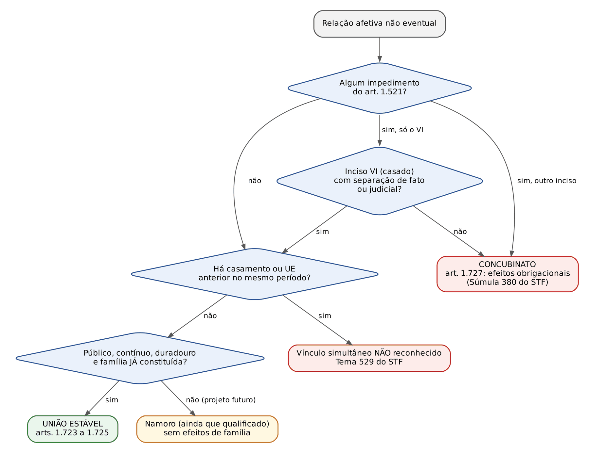
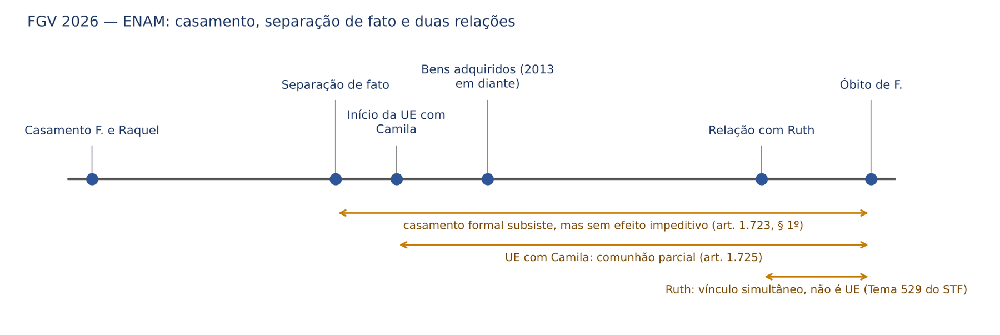

# CAPÍTULO 35 — DIREITO DAS FAMÍLIAS II: UNIÃO ESTÁVEL, CONCUBINATO, UNIÕES SIMULTÂNEAS E UNIÃO HOMOAFETIVA

:::INCIDENCIA
TRF5 p. 13; TJRS p. 19; TJSC p. 19. Nível A. Lote: FGV 7, FCC 2 (correlatas por palavra-chave: Q3531613, Q3390836, Q3362521, Q3868584, Q3898899, Q3052476, Q3954594).
O que mais cai: uniões simultâneas e pessoa casada (Tema 529 do STF), comunhão parcial sem contrato e presunção de esforço comum, separação obrigatória do maior de 70 e sua alteração por escritura, publicidade na união homoafetiva, legitimidade na ação post mortem e concubinato (Tema 526 do STF).
:::

| Subtema | FGV | FCC | Padrão |
|---|---|---|---|
| Uniões simultâneas, pessoa casada, concubinato | 2 | 0 | Caso com casamento formal + separação de fato + segunda relação; pensão por morte |
| Regime de bens (art. 1.725, maior de 70, alteração) | 1 | 2 | Doação a um companheiro x aquisição onerosa; escritura que muda o regime: efeitos *ex nunc* |
| Requisitos (publicidade, coabitação, contrato escrito) | 2 | 0 | Homoafetiva discreta; UE "verbal" sem registro |
| Processo (post mortem, legitimidade) | 1 | 0 | Polo passivo: herdeiros, curador especial para incapazes |
| União homoafetiva e família | 1 | 0 | Família homoparental com plenos direitos |

## 35.1 Natureza, fontes e o grau de equiparação ao casamento

A união estável é entidade familiar (art. 226, § 3º, da CF: "é reconhecida a união estável entre o homem e a mulher como entidade familiar, devendo a lei facilitar sua conversão em casamento"). O texto constitucional não a hierarquiza abaixo do casamento, mas a própria Constituição manda facilitar a conversão, o que a doutrina majoritária lê como reconhecimento de que são institutos DIFERENTES, não de que um vale menos. A disciplina legal sucessiva foi: Lei 8.971/1994 (alimentos e sucessão, exigindo cinco anos ou prole), Lei 9.278/1996 (sem prazo mínimo; presunção de esforço comum; direito real de habitação; competência da vara de família) e arts. 1.723 a 1.727 do CC/2002. A Lei 9.278/1996 não foi expressamente revogada; prevalece o entendimento de revogação tácita no que o CC regulou inteiramente, com sobrevivência pontual (o direito real de habitação do art. 7º, parágrafo único, é invocado pelo Enunciado 117 da I Jornada; o art. 9º, competência da vara de família, segue aplicado).

Natureza jurídica: a união estável nasce de um FATO, não de um ato solene. A melhor doutrina (Paulo Lôbo, Zeno Veloso) a qualifica como ato-fato jurídico: a lei atribui efeitos à convivência qualificada independentemente da vontade dirigida a esses efeitos. Por isso não depende de escritura, registro, contrato ou sentença para existir; a escritura e o registro apenas a PROVAM e lhe dão publicidade perante terceiros. A FGV explorou exatamente isso no Q3898986 (alternativa B, errada, dizia que a união estável dependeria de declaração formal ou contrato escrito).

Grau de equiparação. Depois de o STF declarar inconstitucional o art. 1.790 do CC (Temas 498 e 809 — ver Cap. 43), a pergunta passou a ser quais regras do casamento se estendem à união estável. O Enunciado 641 da VIII Jornada dá o critério cobrado em prova: estendem-se apenas as regras "que tenham por fundamento a solidariedade familiar"; é constitucional a distinção baseada "na solenidade do ato jurídico que funda o casamento, ausente na união estável".

| Estende-se à união estável (solidariedade) | NÃO se estende automaticamente (solenidade e publicidade) |
|---|---|
| Regras sucessórias do art. 1.829 (Tema 809 — Cap. 43) | Presunções de paternidade do art. 1.597 (controvertido; ver Cap. 37 e Q3301219) |
| Direito real de habitação (JT 50, tese 8) | Estado civil próprio (o companheiro continua solteiro, divorciado ou viúvo) |
| Alimentos (art. 1.694) e afinidade (art. 1.595) | Oponibilidade automática a terceiros do regime e da necessidade de outorga (ver 35.5.5) |
| Impedimento da prescrição (Enunciado 296 da IV Jornada) | Forma: o regime diverso não exige escritura (basta "contrato escrito") |
| Legitimidade do companheiro nos arts. 12 e 20, parágrafo único (Enunciados 275 e 400) | Conversão e dissolução seguem ritos próprios (35.7 e 35.8) |
| Curadoria dos bens do ausente (Enunciado 97 da I Jornada) | Não há "separação" de companheiros: há dissolução |

:::DICA Como a FGV formula
Quando a alternativa diz que união estável e casamento são "idênticos em tudo" ou que a união estável "só produz efeitos após a conversão em casamento", está errada (Q4102129, alternativa A). O ponto de equilíbrio cobrado é o do Enunciado 641: igualdade no que decorre da solidariedade, diferença no que decorre da forma.
:::

## 35.2 Requisitos caracterizadores (art. 1.723, caput)

:::LEI CC, art. 1.723
Art. 1.723. É reconhecida como entidade familiar a união estável entre o homem e a mulher, configurada na convivência pública, contínua e duradoura e estabelecida com o objetivo de constituição de família.
§ 1º A união estável não se constituirá se ocorrerem os impedimentos do art. 1.521; não se aplicando a incidência do inciso VI no caso de a pessoa casada se achar separada de fato ou judicialmente.
§ 2º As causas suspensivas do art. 1.523 não impedirão a caracterização da união estável.
:::

A leitura do caput se faz em dois blocos: três requisitos OBJETIVOS (publicidade, continuidade, durabilidade) e um SUBJETIVO, que é o decisivo (*affectio maritalis*, objetivo de constituição de família). A expressão "entre o homem e a mulher" recebeu interpretação conforme a Constituição na ADI 4.277 e na ADPF 132 (ver 35.11).

| Requisito | O que é | O que NÃO é exigido | Fonte |
|---|---|---|---|
| Publicidade | Relação notória, não clandestina, no meio social do casal | Exposição ampla; pode ser relativizada em contexto de discriminação | REsp 2.203.770-GO (Info 873) |
| Continuidade | Estabilidade, sem rupturas frequentes | Ausência de qualquer crise; rompimentos breves seguidos de retorno não descaracterizam por si | Doutrina |
| Durabilidade | Tempo suficiente para revelar estabilidade | Prazo mínimo legal (a Lei 8.971/1994 exigia 5 anos; a Lei 9.278/1996 e o CC eliminaram) | Art. 1.723 |
| Objetivo de constituir família | Família JÁ constituída, comunhão de vida e de esforços no presente | Mera intenção futura (namoro qualificado), filhos, coabitação | REsp 1.454.643-RJ |
| Coabitação | Indício relevante | NÃO é requisito | Súmula 382 do STF; JT 50, tese 2 |
| Forma | Nenhuma | Escritura, contrato, registro ou sentença | Ato-fato; Prov. CNJ 149/2023, art. 537 (registro facultativo) |
| Diversidade de sexos | Superada | — | ADI 4.277 e ADPF 132 |

A Súmula 382 do STF ("A vida em comum sob o mesmo teto, *more uxorio*, não é indispensável à caracterização do concubinato") foi editada em 1964, quando "concubinato" designava também a união livre entre desimpedidos; hoje é lida como aplicável à união estável. A Jurisprudência em Teses do STJ (edição 50, tese 2) reafirma que a coabitação não é elemento indispensável. Casais que moram em casas separadas por razões profissionais, de saúde ou de filhos de relações anteriores podem viver em união estável.

:::QUESTAO FGV 2025 — MPE-ES — Promotor de Justiça Substituto (Q3752736)
Caso: relacionamento público, contínuo e duradouro de 2017 a 2024, sem contrato escrito nem registro; aquisição onerosa de imóvel e veículo; o falecido mantinha, em paralelo, relação antiga com outra mulher, com filho. Pergunta-se sobre reconhecimento e partilha.
Gabarito oficial: B — inexistindo contrato escrito, a união é reconhecível judicialmente e aplica-se, por presunção legal, a comunhão parcial (art. 1.725).
Armadilhas: A e D exigem coabitação (Súmula 382 do STF); E nega partilha por "falta de título" (a união é ato-fato e a comunhão parcial é o regime legal supletivo); C admite uniões simultâneas com boa-fé (contraria o Tema 529 do STF — ver 35.10). Observação: o gabarito trata da relação com Capitu sem enfrentar qual das duas relações paralelas era a anterior; numa prova discursiva, esse seria o ponto a decidir (o vínculo preexistente impede o posterior no mesmo período).
:::

### 35.2.1 Publicidade relativizada

A Terceira Turma do STJ admitiu relativizar a publicidade em união homoafetiva vivida com discrição por causa do preconceito, desde que presentes os demais requisitos (REsp 2.203.770-GO, Rel. Min. Nancy Andrighi, j. 4/11/2025, Info 873). Fundamentos: a publicidade não se confunde com exposição pública ampla; basta que a união NÃO seja clandestina; o critério se interpreta segundo isonomia, dignidade, liberdade sexual e intimidade. O limite está na própria tese: a relativização recai sobre a publicidade, não sobre a continuidade, a durabilidade ou a *affectio maritalis*.

:::QUESTAO FGV 2026 — TJ-PR — Juiz Substituto (Q3898986)
Caso: dois homens viveram juntos por mais de vinte anos no interior, apresentando-se como "amigos" por medo de preconceito; o pedido de reconhecimento post mortem foi julgado improcedente por falta de publicidade.
Gabarito oficial: D — é possível o reconhecimento, pois a publicidade pode ser relativizada diante de vulnerabilidade e preconceito estrutural, desde que presentes os demais elementos.
Armadilhas: E é a mais sedutora e erra por um detalhe: admite a relativização "ainda que ausentes os demais requisitos". C inverte a isonomia (igualdade material não exige o mesmo grau de exposição). B nega a natureza de ato-fato. A trata a publicidade como requisito absoluto.
:::

### 35.2.2 Namoro qualificado e contrato de namoro

O traço que separa a união estável do namoro, inclusive do namoro longo, com viagens, pernoites e até coabitação, é o objetivo de constituir família NO PRESENTE. O STJ, no leading case do namoro qualificado (REsp 1.454.643-RJ, Rel. Min. Marco Aurélio Bellizze, Terceira Turma, j. 3/3/2015), assentou que o propósito de constituir família "não consubstancia mera proclamação, para o futuro"; deve estar presente durante toda a convivência, com efetivo compartilhamento de vidas e irrestrito apoio moral e material; a família deve "de fato, restar constituída". Coabitação motivada por contingências (estudo e trabalho no exterior) não basta. O casal que namora, noiva e depois casa elegendo comunhão parcial manifesta a vontade de constituir família A PARTIR do casamento; o imóvel comprado por um deles no período anterior não se comunica.

| Critério | Namoro qualificado | União estável |
|---|---|---|
| Projeto de família | Futuro ("vamos casar", "um dia teremos filhos") | Presente (a família já existe) |
| Patrimônio | Separado; cada um paga o seu | Comunhão de esforços; despesas comuns |
| Tratamento social | Namorados ou noivos | Marido e mulher, companheiros |
| Coabitação | Pode existir (contingência) | Pode faltar (Súmula 382 do STF) |
| Efeitos | Nenhum efeito de família (sem meação, alimentos, herança) | Todos os efeitos dos arts. 1.723 a 1.727 |
| Dissolução | Desfazimento livre; danos só por ilícito autônomo | Dissolução com partilha, alimentos, guarda |

Contrato de namoro é o instrumento pelo qual o casal declara que a relação é namoro e não união estável. Parte da doutrina o reputa nulo, por tentar afastar por convenção a incidência de norma cogente sobre um fato; outra parte admite sua validade como meio de PROVA da ausência de *affectio maritalis*, sempre relativo: se os fatos demonstrarem família constituída, prevalece a realidade (primazia dos fatos sobre o rótulo). A posição segura para prova objetiva: o contrato de namoro não impede o reconhecimento da união estável se presentes os requisitos do art. 1.723; vale como indício, não como renúncia. Não confundir com o contrato de convivência (35.5.2), que pressupõe a união estável e regula seus efeitos patrimoniais.

:::EXEMPLO Namoro e compra de bens
Bianca compra, em seu nome e com seu cartão, uma televisão pedida pelo namorado, que tinha restrição de crédito; ele rompe o namoro e fica com o aparelho. Não há união estável a dissolver nem meação de dívida: o negócio com a loja é válido e eficaz, e Bianca cobra do ex-namorado o que pagou (FCC 2026, DPE-MT, Q3954594, gabarito E; a alternativa B, que remetia à "meação da dívida em ação de dissolução de união estável", supunha um vínculo que o enunciado não descreve).
:::

## 35.3 Impedimentos e causas suspensivas

### 35.3.1 Impedimentos (art. 1.723, § 1º)

Todos os impedimentos do art. 1.521 obstam a união estável. A ressalva única é a do inciso VI (pessoas casadas): não incide se a pessoa casada está separada de fato ou judicialmente. Os demais incisos (ascendentes e descendentes; afins em linha reta; adotante e ex-cônjuge do adotado; irmãos e colaterais até o terceiro grau; adotado e filho do adotante; cônjuge sobrevivente e condenado por homicídio ou tentativa contra o consorte) incidem sem exceção. A relação não eventual entre impedidos é concubinato (art. 1.727 — ver 35.9).

:::PEGADINHA Separação de fato: o CC não exige prazo
O art. 1.723, § 1º, NÃO fixa prazo mínimo de separação de fato para que o casado constitua união estável. O prazo de "mais de cinco anos" aparece em outro dispositivo, o art. 1.801, III (o concubino do testador casado não pode ser nomeado herdeiro ou legatário, "salvo se este, sem culpa sua, estiver separado de fato do cônjuge há mais de cinco anos"). E mesmo esse prazo NÃO se aplica ao companheiro: o Enunciado 269 da III Jornada afirma que a vedação do art. 1.801, III, "não se aplica à união estável, independentemente do período de separação de fato (art. 1.723, § 1º)". Também não confundir com o art. 1.830 (sucessão do cônjuge separado de fato — Cap. 43).
:::

Duas consequências práticas da ressalva. Primeira: a existência de casamento válido não obsta o reconhecimento da união estável, desde que haja separação de fato ou judicial (JT 50, tese 5; JT 113, tese 11). Segunda: no plano REGISTRAL a regra é mais estreita. O art. 94-A, § 1º, da Lei 6.015/1973 (incluído pela Lei 14.382/2022) e o art. 545 do Provimento CNJ 149/2023 vedam o registro, no Livro E, de união estável de pessoas casadas, "ainda que separadas de fato", salvo se separadas judicial ou extrajudicialmente ou se a união decorrer de sentença transitada em julgado. Ou seja: o separado de fato pode VIVER em união estável e obter seu reconhecimento judicial, mas não pode REGISTRAR escritura ou termo declaratório dessa união enquanto não regularizar o estado civil.

Inversamente, a união estável anterior NÃO é impedimento matrimonial: o art. 1.521, VI, fala em "pessoas casadas". O companheiro que se casa com terceiro dissolve, de fato, a união; não comete bigamia nem gera nulidade (FGV 2026, TJ-PR, Q3898899, gabarito C: a alegação não comprovada de união estável com terceira não impede o registro do casamento religioso).

### 35.3.2 Causas suspensivas (art. 1.723, § 2º)

As causas suspensivas do art. 1.523 (viúvo com filho do falecido antes do inventário; viúva ou mulher cujo casamento se desfez, nos dez meses seguintes; divorciado antes da partilha; tutor ou curador e parentes em relação ao tutelado ou curatelado antes de saldadas as contas) "não impedirão" a caracterização da união estável. Não se confundem com impedimentos: no casamento, a causa suspensiva não invalida o ato, apenas impõe a separação obrigatória (art. 1.641, I).

A pergunta de segunda ordem é se a união estável constituída com causa suspensiva sofre a separação obrigatória do art. 1.641, I. A doutrina se divide: parte entende que a norma restritiva de direitos não se estende por analogia (Paulo Lôbo; Maria Berenice Dias), parte aplica a mesma lógica do casamento para evitar fraude ao regime legal. O CNN do Foro Extrajudicial resolveu o ponto no momento da CONVERSÃO: "Não se impõe o regime de separação legal de bens, previsto no art. 1.641, inciso I, [...] se superada a causa suspensiva do casamento quando da conversão" (Prov. CNJ 149/2023, art. 550, § 4º). A separação obrigatória por idade (art. 1.641, II) segue regra própria (35.5.6).

## 35.4 Deveres e efeitos pessoais

:::LEI CC, art. 1.724
Art. 1.724. As relações pessoais entre os companheiros obedecerão aos deveres de lealdade, respeito e assistência, e de guarda, sustento e educação dos filhos.
:::

| Casamento (art. 1.566) | União estável (art. 1.724) |
|---|---|
| I - fidelidade recíproca | lealdade |
| II - vida em comum, no domicílio conjugal | NÃO há dever de coabitação |
| III - mútua assistência | assistência |
| IV - sustento, guarda e educação dos filhos | guarda, sustento e educação dos filhos (mesma ordem invertida) |
| V - respeito e consideração mútuos | respeito |

As diferenças textuais são o alvo da FGV e da FCC: "lealdade" no lugar de "fidelidade" (a doutrina majoritária vê na lealdade conceito mais amplo, que abrange a fidelidade, e o STF, no Tema 529, fundou a monogamia da união estável justamente no dever de fidelidade e no art. 226, § 3º, da CF); ausência do dever de "vida em comum, no domicílio conjugal"; e ausência da expressão "consideração". A Lei 9.278/1996, art. 2º, falava em "respeito e consideração mútuos" e "assistência moral e material recíproca" — redação que, por ser mais próxima do art. 1.566, é usada como distrator.

Outros efeitos pessoais e transversais, desenvolvidos nos capítulos próprios:

- Afinidade: "Cada cônjuge ou companheiro é aliado aos parentes do outro pelo vínculo da afinidade" (art. 1.595); na linha reta a afinidade não se extingue com a dissolução (art. 1.595, § 2º) e gera impedimento (art. 1.521, II) — ver Cap. 34.
- Alimentos entre companheiros (art. 1.694; Lei 9.278/1996, art. 7º) e cessação pelo casamento, união estável ou concubinato do credor (art. 1.708) — ver Cap. 39.
- Nome: os conviventes em união estável REGISTRADA no RCPN podem incluir o sobrenome do companheiro a qualquer tempo (Lei 6.015/1973, art. 57, § 2º, na redação da Lei 14.382/2022), e o retorno ao nome anterior se faz pela averbação da extinção da união (art. 57, § 3º-A) — ver Cap. 4.
- Prescrição: "Não corre a prescrição entre os companheiros, na constância da união estável" (Enunciado 296 da IV Jornada), por extensão do art. 197, I — ver Cap. 11.
- Legitimidade para tutela post mortem dos direitos da personalidade: Enunciados 275 e 400 (arts. 12 e 20, parágrafo único) — ver Cap. 4.
- Curatela: o companheiro integra a ordem de preferência para curador (art. 1.775) e a curadoria dos bens do ausente (Enunciado 97) — ver Caps. 3 e 41.
- Usucapião familiar (art. 1.240-A), que alcança ex-companheiro que abandona o lar — ver Cap. 29 (Q3362367, Q3386997).
- Filiação: o reconhecimento de filho havido por reprodução assistida heteróloga consentida pelo companheiro formaliza vínculo constituído no início da gravidez (Enunciado 570 da VI Jornada) — ver Cap. 37.

## 35.5 Regime patrimonial

:::LEI CC, art. 1.725
Art. 1.725. Na união estável, salvo contrato escrito entre os companheiros, aplica-se às relações patrimoniais, no que couber, o regime da comunhão parcial de bens.
:::

Três expressões do artigo são cobradas: "salvo contrato escrito" (não "escritura pública"), "entre os companheiros" (o contrato é bilateral e não depende de homologação) e "no que couber" (as regras da comunhão parcial se adaptam à informalidade da união, sobretudo na relação com terceiros — 35.5.5). O regime em si (bens que entram e que não entram, arts. 1.658 a 1.666) é matéria do Cap. 36; aqui se desenvolve o que é PRÓPRIO da união estável.

### 35.5.1 Presunção de esforço comum

Na falta de contrato, os bens adquiridos onerosamente na constância da união comunicam-se SEM necessidade de provar esforço comum. A Lei 9.278/1996, art. 5º, já dizia que tais bens "são considerados fruto do trabalho e da colaboração comum, passando a pertencer a ambos, em condomínio e em partes iguais"; o Enunciado 115 da I Jornada reafirma, sob o CC, a "presunção de comunhão de aquestos [...] sendo desnecessária a prova do esforço comum". É a grande diferença em relação ao concubinato, regido pela Súmula 380 do STF, em que o esforço comum PRECISA ser provado (35.9).

A presunção só cede a contrato escrito que estipule regime diverso. O STJ decidiu que declarações de percentuais de copropriedade em escritura de compra e venda (70% para um, 30% para outro) NÃO afastam a partilha igualitária: o imóvel adquirido durante a união divide-se em metades (REsp 1.852.363-SP, Rel. Min. Humberto Martins, Terceira Turma, j. 3/6/2025, Info 26 — Edição Extraordinária). A lógica: a escritura de compra e venda não é contrato de convivência entre os companheiros; o percentual declarado ao vendedor não altera o regime.

Regras de fronteira (Jurisprudência em Teses do STJ, edição 50):

- São incomunicáveis os bens adquiridos ANTES da união, ainda que o registro imobiliário ocorra na constância (tese 7): vale a data do título aquisitivo, não a do registro.
- A valorização de imóveis ou de cotas sociais adquiridos antes da convivência não se comunica, por decorrer de fator econômico e não de esforço comum (tese 11).
- A incomunicabilidade do produto de bens anteriores (sub-rogação — Lei 9.278/1996, art. 5º, § 1º) não afeta a comunicabilidade dos FRUTOS (art. 1.660, V) (tese 12).
- Bens adquiridos antes da Lei 9.278/1996, em uniões anteriores a ela, não se beneficiam da presunção do art. 5º; a partilha depende de prova do esforço comum (tese 16). O Enunciado 346 da IV Jornada generaliza: o regime patrimonial "obedecerá à norma vigente no momento da aquisição de cada bem, salvo contrato escrito".

:::QUESTAO FCC 2024 — TRT 11ª Região — Analista Judiciário (Q2400473)
Caso: união estável homoafetiva informal; Ana compra uma motocicleta por 10.000 (dez mil) reais; Carla recebe de sua mãe, por doação, um carro de 60.000 (sessenta mil) reais. Como fica a partilha?
Gabarito oficial: C — Carla faz jus à meação da motocicleta; Ana não tem direito à partilha do carro.
Passos: (1) regime: sem contrato escrito, comunhão parcial (art. 1.725), que também se aplica à união homoafetiva (35.11); (2) motocicleta: aquisição onerosa na constância, comunica-se sem prova de esforço comum (art. 1.660, I; Enunciado 115); (3) carro: doação é título gratuito, excluído da comunhão (art. 1.659, I).
Armadilhas: B confunde união estável com sociedade de fato (Súmula 380 do STF, própria do concubinato); D partilha também o bem doado; E nega partilha por falta de formalização (o que ignora a natureza de ato-fato).
:::

:::QUESTAO FCC 2026 — DPE-BA — Defensor Público (Q4037456)
Afirmações sobre regime de bens e sucessão na união estável.
Gabarito oficial: A — é obrigatória a separação de bens se um dos companheiros for maior de setenta anos, salvo se afastada por manifestação expressa de ambos em escritura pública (Tema 1.236 do STF — ver 35.5.6 e Cap. 36).
Erros das demais: B — o direito real de habitação do companheiro NÃO depende de prévio reconhecimento judicial em ação própria; pode ser invocado até em demanda possessória (JT 50, tese 9; Cap. 43). C — sem separação de fato, a coexistência com casamento é vedada (art. 1.723, § 1º; Tema 529). D — o prêmio de jogo é bem adquirido por fato eventual e ENTRA na comunhão (art. 1.660, II); o STJ aplicou a regra até na separação obrigatória, para o prêmio de loteria (REsp 2.097.324-SP, j. 24/9/2024, Info 827 — Cap. 36). E — a recusa de conversão de união homoafetiva em casamento não se justifica por liberdade religiosa do oficial; deve ser comunicada ao juiz corregedor (Prov. CNJ 149/2023, art. 554; Resolução CNJ 175/2013 — Cap. 34).
:::

### 35.5.2 Contrato de convivência: forma, conteúdo e eficácia no tempo

Forma. O art. 1.725 exige apenas "contrato escrito": basta instrumento particular entre os companheiros, ao contrário do pacto antenupcial, que exige escritura pública sob pena de nulidade (art. 1.653 — Cap. 36). A escritura pública, o termo declaratório no RCPN e o registro no Livro E não são requisitos de validade, mas de publicidade e oponibilidade perante terceiros (Prov. CNJ 149/2023, art. 537, § 1º: o registro "confere efeitos jurídicos à união estável perante terceiros"). Exceção relevante: para afastar a separação obrigatória do maior de 70, o STF exigiu ESCRITURA PÚBLICA (Tema 1.236 — 35.5.6).

Conteúdo. O contrato pode adotar qualquer regime típico (separação, comunhão universal, participação final), combiná-los ou criar regime misto, e pode partilhar ou declarar a titularidade de bens. Cláusulas existenciais que restrinjam direitos indisponíveis (renúncia antecipada a alimentos, exclusão de deveres do art. 1.724) são de eficácia duvidosa; e a renúncia à herança do companheiro em contrato de convivência esbarra na vedação dos pactos sucessórios (art. 426 — ver Cap. 42), tema em debate doutrinário que não convém afirmar como resolvido.

Eficácia no tempo. A cláusula que atribui efeito RETROATIVO ao regime eleito é inválida; o contrato vale do momento da assinatura em diante. O STJ fixou que não é lícito aos conviventes atribuírem efeitos retroativos ao contrato de união estável para eleger o regime do período anterior à sua assinatura (REsp 1.383.624-MG, Rel. Min. Moura Ribeiro, Terceira Turma, j. 2/6/2015, Info 563) e reiterou que a escolha do regime por contrato escrito produz efeitos *ex nunc*, sendo inválida a retroação sem autorização judicial, por analogia ao art. 1.639, § 2º (AREsp 1.631.112-MT, Rel. Min. Antonio Carlos Ferreira, Quarta Turma, j. 26/10/2021, Info 715). O período anterior ao contrato fica sob a comunhão parcial legal.

### 35.5.3 Alteração do regime durante a união

Diferentemente do casamento, em que a mudança depende de autorização judicial em pedido motivado de ambos (art. 1.639, § 2º; art. 734 do CPC — Cap. 36), na união estável basta novo contrato escrito; e o CNN admite o processamento EXTRAJUDICIAL da alteração no próprio registro da união, no RCPN (Prov. CNJ 149/2023, arts. 547 e 548):

- requerimento de ambos, pessoalmente perante o registrador ou por procuração pública (art. 547, caput);
- instrução com certidões dos distribuidores cível e de execução fiscal, de protesto, da Justiça do Trabalho e de interdições, todas dos últimos cinco anos, e proposta de partilha ou declaração de que não querem partilhar ou de que não há bens (art. 548);
- certidão de interdições positiva: a alteração tem de ser JUDICIAL (art. 547, § 2º);
- partilha proposta ou certidões positivas: assistência obrigatória de advogado ou defensor (art. 547, § 3º);
- averbação com a ressalva de que a alteração "não prejudicará terceiros de boa-fé, inclusive os credores dos companheiros cujos créditos já existiam antes da alteração do regime" (art. 547, § 1º).

:::LEI Provimento CNJ 149/2023 (CNN do Foro Extrajudicial), art. 547, § 4º
§ 4.º O novo regime de bens produzirá efeitos a contar da respectiva averbação no registro da união estável, não retroagindo aos bens adquiridos anteriormente em nenhuma hipótese, em virtude dessa alteração, observado que, se o regime escolhido for o da comunhão universal de bens, os seus efeitos atingem todos os bens existentes no momento da alteração, ressalvados os direitos de terceiros.
:::

Leia com atenção a ressalva final: a comunhão universal, por sua natureza, alcança os bens EXISTENTES no momento da mudança (inclusive os particulares de cada um), mas isso não é retroatividade do regime: os atos e aquisições anteriores continuam regidos pelo regime da época, e terceiros ficam ressalvados.

:::QUESTAO FGV 2026 — ENAC — Exame Nacional dos Cartórios (Q4130162)
Caso: união iniciada em 2018 por pessoas já maiores de 70 anos; escritura adotando separação de bens "dada a impossibilidade de regime diverso"; em 2025, nova escritura mudando para comunhão universal; óbito em 2026 e disputa com os herdeiros.
Gabarito oficial: E — a alteração por escritura pública é válida, respeitados os direitos de terceiros, com efeitos prospectivos.
Passos: (1) o Tema 1.236 do STF (fevereiro de 2024) permitiu afastar a separação do art. 1.641, II, por escritura pública, inclusive em uniões já existentes, com efeitos para o futuro; (2) na união estável, a mudança de regime não exige autorização judicial (art. 1.725; Prov. CNJ 149/2023, art. 547); (3) efeitos *ex nunc*.
Armadilhas: A exige autorização judicial (regra do casamento, art. 1.639, § 2º); B trata a separação etária como intransponível (superado pelo Tema 1.236); C exige homologação judicial para eficácia; D atribui efeito retroativo "convertendo automaticamente" bens anteriores — note que a comunhão universal atinge os bens existentes no momento da alteração (art. 547, § 4º), mas não por retroação.
:::

No mesmo sentido, com variações: FGV 2025, MPE-RJ, Q3362521 (companheiros de 73 e 68 anos, com escritura de comunhão parcial desde 2005: podem alterar o regime pela via extrajudicial e escolher livremente — gabarito B); FCC 2025, DPE-AM, Q3531613 (companheiro de 72 anos sob separação obrigatória pede em juízo a comunhão parcial: o pedido pode ser atendido, com efeitos para o futuro, resguardados direitos adquiridos — gabarito B; a oposição de herdeiro necessário, alternativa D, não impede); FGV 2024, Prefeitura de Vitória, Q3052476 (não há direito adquirido a regime jurídico que impeça a alteração; gabarito C, que define ato jurídico perfeito — Cap. 1).

### 35.5.4 Separação convencional e esforço comum comprovado

Na separação CONVENCIONAL eleita pelos companheiros, a regra é a incomunicabilidade; a Súmula 377 do STF não se aplica, porque é restrita à separação obrigatória (Cap. 36). Mesmo assim, o STJ admitiu, em caráter excepcional, a partilha PROPORCIONAL de bens adquiridos durante a união estável sob separação convencional, desde que comprovada a contribuição efetiva da companheira, para evitar enriquecimento sem causa: a separação convencional gera presunção RELATIVA de titularidade (REsp 2.219.797-DF, Rel. Min. Ricardo Villas Bôas Cueva, Terceira Turma, j. 9/9/2025, Info 29 — Edição Extraordinária). Distinga: na comunhão parcial, partilha em metades sem prova; na separação convencional, partilha excepcional, proporcional e com prova; no concubinato, partilha proporcional com prova (Súmula 380 do STF).

### 35.5.5 Alienação sem anuência do companheiro e proteção de terceiros

A necessidade de anuência do outro companheiro para alienar imóvel comum decorre da comunhão parcial estendida pelo art. 1.725 e do condomínio do art. 5º da Lei 9.278/1996; o STJ reconheceu a incidência do art. 1.647, I, às uniões estáveis, "adequando-se, todavia, os efeitos do seu desrespeito" à informalidade dessa entidade: a invalidação da venda feita sem consentimento depende da PUBLICIDADE conferida à união (averbação do contrato de convivência ou da decisão declaratória no Registro de Imóveis) ou da prova de má-fé do adquirente; sem isso, preserva-se o terceiro de boa-fé (REsp 1.424.275-MT, Rel. Min. Paulo de Tarso Sanseverino, Terceira Turma, j. 4/12/2014). É a tradução prática do "no que couber". Ao companheiro prejudicado resta a pretensão contra o outro (compensação na partilha, perdas e danos).

No processo, o art. 73, § 3º, do CPC estende a exigência de consentimento e de litisconsórcio necessário dos cônjuges nas ações sobre direito real imobiliário "à união estável comprovada nos autos".

:::EXEMPLO Venda simulada às vésperas da ruptura
Durante união estável de 14 anos, o companheiro, titular registral do apartamento da família, "vende" o imóvel à sobrinha por preço vil, que ela nunca paga, e continua morando no bem e pagando IPTU e condomínio; ao fim da relação, a companheira é intimada a sair. Há simulação (art. 167 do CC): o negócio é NULO e o imóvel volta ao acervo comum para partilha; a sobrinha, que participou da simulação, não é terceira de boa-fé (FGV 2026, TJ-RJ, Q3868584, gabarito B — Cap. 9). Note-se que a via adequada não é a pauliana (fraude contra credores), porque a companheira não é credora, mas meeira.
:::

### 35.5.6 Separação obrigatória do maior de 70 na união estável

A tese do Tema 1.236 do STF (ARE 1.309.642-SP, Rel. Min. Luís Roberto Barroso, j. 1/2/2024, Info 1122) é desenvolvida no Cap. 36. O que importa aqui é sua aplicação à união estável, que a própria tese menciona expressamente ("Nos casamentos e uniões estáveis envolvendo pessoa maior de 70 anos..."):

- A separação do art. 1.641, II, aplica-se também à união estável em que um dos companheiros tem mais de 70 anos (a Jurisprudência em Teses do STJ, edição 50, já registrava a imposição da separação obrigatória na união estável de pessoa maior de setenta anos; a tese do STF a pressupõe).
- O afastamento exige escritura pública com manifestação expressa de AMBOS. Na união estável, ao contrário do casamento, não há pacto antenupcial nem habilitação; a escritura de união estável ou de alteração de regime cumpre a função. Por isso o advogado do Q3390836 (FGV 2025, DPE-PE) acertou ao dizer que o afastamento se faz por autorização judicial no casamento já celebrado e por escritura pública na união estável (gabarito D).
- Quando a união começou ANTES dos 70, não incide a separação obrigatória nem na conversão posterior em casamento: é a lógica do Enunciado 261 da III Jornada (editado quando o limite era 60 anos) e é regra expressa do CNN: "Não se aplica o regime da separação legal de bens do art. 1.641, inciso II, [...] se inexistia essa obrigatoriedade na data a ser indicada como início da união estável no assento de conversão" (Prov. CNJ 149/2023, art. 550, § 3º).

:::PEGADINHA Duas datas que a banca troca
Para o art. 1.641, II, na união estável, conta a idade na data de INÍCIO da união (Prov. 149/2023, art. 550, § 3º), não na data da escritura, do registro ou da conversão. E a alteração posterior do regime (inclusive para afastar a separação etária) só produz efeitos para o futuro (art. 547, § 4º; Tema 1.236).
:::

## 35.6 Prova, formalização e registro

Por ser ato-fato, a união estável prova-se por qualquer meio (testemunhas, fotografias, contas conjuntas, dependência em plano de saúde e previdência, declaração de imposto de renda, filhos). Os instrumentos formais servem à prova pré-constituída e à oponibilidade.

| Instrumento | Quem lavra | Requisitos e alcance | Fonte |
|---|---|---|---|
| Contrato particular | Os companheiros | Basta para afastar a comunhão parcial (art. 1.725) | CC, art. 1.725 |
| Escritura pública declaratória | Tabelião de notas | Prova pré-constituída; pode eleger regime; título para registro no Livro E | Prov. 149/2023, art. 537, § 3º, II |
| Termo declaratório | Oficial do RCPN de livre escolha | Declaração conjunta com todas as cláusulas admitidas nos demais títulos, inclusive regime; vedado se já houver termo anterior dos mesmos companheiros (consulta à CRC) | Prov. 149/2023, art. 538 |
| Sentença declaratória | Juiz | Reconhecimento ou dissolução; registro não altera a coisa julgada (art. 542) | Lei 6.015, art. 94-A |
| Certificação eletrônica | Oficial do RCPN | Procedimento facultativo para fazer constar do registro as datas de início e fim; entrevista dos companheiros e testemunhas; indeferimento comporta suscitação de dúvida em 15 dias | Lei 6.015, art. 70-A, § 6º; Prov. 149/2023, art. 553 |

Registro no Livro E. É FACULTATIVO (Prov. 149/2023, art. 537, caput) e se faz no RCPN da última residência dos companheiros (Lei 6.015/1973, art. 94-A, incluído pela Lei 14.382/2022), com os dados dos incisos I a VIII (inclusive regime de bens e nome adotado). Pontos de prova:

- Datas de início e fim só constam do registro se vierem de decisão judicial, de certificação eletrônica ou de escritura ou termo cuja data coincida com a da lavratura, com declaração expressa; fora disso, o campo consta como "não informado" (art. 537, §§ 4º e 5º).
- Pessoa casada, ainda que separada de fato, não registra (art. 94-A, § 1º; art. 545) — ver 35.3.1.
- Toda certidão do Livro E adverte que o registro "não produz os efeitos da conversão da união estável em casamento" (art. 546).
- Não se exige registro prévio da união para registrar sua dissolução (art. 544).
- É vedada a representação de companheiro por curador ou tutor, salvo autorização judicial (art. 537, § 7º).
- Título estrangeiro com ao menos um brasileiro pode ser registrado, legalizado ou apostilado e traduzido, se referir-se a união regida pela lei brasileira ou houver sentença que reconheça a equivalência (art. 94-A, §§ 2º e 3º; Prov. 149/2023, art. 539, § 1º).

## 35.7 Conversão em casamento

Três textos convivem e a banca explora o contraste entre eles:

| Diploma | O que diz | Situação |
|---|---|---|
| CF, art. 226, § 3º | A lei deve "facilitar sua conversão em casamento" | Mandamento ao legislador |
| CC, art. 1.726 | "mediante pedido dos companheiros ao juiz e assento no Registro Civil" | Via judicial (criticada por dificultar o que a CF manda facilitar) |
| Lei 9.278/1996, art. 8º | "requerimento ao Oficial do Registro Civil da Circunscrição de seu domicílio" | Superado pela disciplina posterior |
| Lei 6.015/1973, art. 70-A (Lei 14.382/2022) | Requerimento ao oficial do RCPN da residência; habilitação pelo mesmo rito do casamento; assento lavrado "independentemente de autorização judicial" | Via extrajudicial, hoje a usual |
| Prov. CNJ 149/2023, art. 551 | A conversão extrajudicial "é facultativa e não obrigatória, cabendo sempre a via judicial" | As duas vias coexistem |

:::LEI Lei 6.015/1973, art. 70-A (incluído pela Lei 14.382/2022), §§ 1º, 3º, 5º e 7º
§ 1º Recebido o requerimento, será iniciado o processo de habilitação sob o mesmo rito previsto para o casamento, e deverá constar dos proclamas que se trata de conversão de união estável em casamento.
§ 3º Se estiver em termos o pedido, será lavrado o assento da conversão da união estável em casamento, independentemente de autorização judicial, prescindindo o ato da celebração do matrimônio.
§ 5º A conversão da união estável dependerá da superação dos impedimentos legais para o casamento, sujeitando-se à adoção do regime patrimonial de bens, na forma dos preceitos da lei civil.
§ 7º Se estiver em termos o pedido, o falecimento da parte no curso do processo de habilitação não impedirá a lavratura do assento de conversão de união estável em casamento.
:::

Demais regras da conversão (art. 70-A e Prov. 149/2023, arts. 549 a 552):

- Procuração para requerer a conversão: pública e com prazo máximo de 30 dias (art. 70-A, § 2º).
- Não há celebração: o assento vai ao Livro B sem data e testemunhas da celebração e sem nome do presidente do ato (art. 70-A, § 4º).
- Data de início ou duração da união NÃO constam do assento, salvo prévia certificação eletrônica (art. 70-A, § 6º). Consequência: a conversão não "prova" o período anterior; quem quiser fixá-lo precisa de certificação ou de sentença.
- Regime: mantém-se o regime vigente na união, salvo pacto antenupcial em sentido contrário; adotando-se regime novo, exige-se pacto, salvo se o novo for a comunhão parcial, caso em que basta declaração expressa (Prov. 149/2023, art. 550, §§ 1º e 2º). Causa suspensiva superada não impõe separação (§ 4º); idade de 70 anos só impõe separação se já existia no início da união (§ 3º — ver 35.5.6).
- "Em termos" o pedido, a morte de um dos companheiros durante a habilitação não impede o assento; consideram-se em termos pendências não essenciais, sanáveis pelos herdeiros (art. 552).
- Pessoas do mesmo sexo: conversão admitida (Enunciado 526 da V Jornada); a recusa deve ser comunicada ao juiz corregedor (art. 554) — ver 35.11.

:::PEGADINHA Registro da união x conversão
Registrar a união estável no Livro E NÃO a converte em casamento e não altera o estado civil; as certidões devem trazer essa advertência (Prov. 149/2023, art. 546). E a conversão, por sua vez, não "retroage" o casamento à data de início da união: os efeitos patrimoniais do período anterior são os da união estável (com o regime então vigente), e a data inicial só aparece no assento se houver certificação eletrônica.
:::

## 35.8 Dissolução e ações relativas à união estável

### 35.8.1 Dissolução consensual extrajudicial

O art. 733 do CPC admite a extinção consensual de união estável por escritura pública, "não havendo nascituro ou filhos incapazes", com assistência obrigatória de advogado ou defensor (§ 2º); a escritura não depende de homologação e é título para registro e levantamento de valores (§ 1º). O CNN acrescentou o termo declaratório de dissolução perante o RCPN, também com advogado ou defensor (Prov. 149/2023, art. 537, § 3º, IV).

A restrição da existência de filhos incapazes foi flexibilizada pelo CNJ: na redação dada pelo Provimento CN 202, de 19/8/2025, ao art. 537, § 6º, do CNN, havendo nascituro ou filhos incapazes, a dissolução extrajudicial é possível "desde que devidamente comprovada a prévia resolução judicial de todas as questões referentes à guarda, visitação e alimentos deles", o que deve constar do título. A regra paralela para o divórcio é do Cap. 34.

:::ATENCAO Letra do CPC x norma do CNJ
O art. 733 do CPC continua dizendo "não havendo nascituro ou filhos incapazes". Em questão que pergunte "segundo o CPC", a resposta é a letra do art. 733; em questão sobre normas do foro extrajudicial, a do art. 537, § 6º, do CNN (redação de 2025).
:::

### 35.8.2 Dissolução judicial e ação de reconhecimento

- Competência material: vara de família, com segredo de justiça (Lei 9.278/1996, art. 9º), inclusive para união homoafetiva (JT 50, tese 3; Enunciado 524 da V Jornada).
- Foro (art. 53, I, do CPC): domicílio do guardião de filho incapaz; não havendo filho incapaz, último domicílio do casal; se nenhuma das partes reside no antigo domicílio, domicílio do réu; e domicílio da vítima de violência doméstica (alínea d, incluída pela Lei 13.894/2019). O STJ aplica o último domicílio do casal também à ação proposta após o falecimento do convivente, na ausência de filhos incapazes (Terceira Turma, Rel. Min. Ricardo Villas Bôas Cueva, j. 3/12/2024, Info 23 — Edição Extraordinária).
- Procedimento: ações de família dos arts. 693 e seguintes do CPC (a lista do art. 693 inclui "reconhecimento e extinção de união estável"); a homologação da extinção consensual segue o rito do divórcio consensual (art. 732).
- Justiça Federal: compete a ela analisar, INCIDENTALMENTE e como prejudicial de mérito, a existência de união estável quando se pede benefício previdenciário ao INSS (JT 50, tese 15).

### 35.8.3 Reconhecimento post mortem

A ação de reconhecimento de união estável após a morte do companheiro é proposta contra os HERDEIROS do falecido, não contra o espólio, porque o que se discute é estado de família e a qualidade sucessória, que afetam direitos próprios de cada herdeiro. Sendo herdeiros os próprios filhos incapazes da autora, há colisão de interesses com a representante legal: o juiz nomeia curador especial (art. 72, I, do CPC).

:::QUESTAO FGV 2026 — TJ-RJ — Analista Judiciário (Comissário da Infância) (Q3870737)
Caso: Rita quer o reconhecimento post mortem da união com Manoel, com quem teve três filhos de 2, 5 e 8 anos, únicos herdeiros; não há documento da união.
Gabarito oficial: E — a ação é proposta em face dos três filhos incapazes, nomeando-se curador especial.
Armadilhas: A — o falecido não tem capacidade de ser parte; B — o espólio não é o legitimado passivo para a declaração do estado de companheira (questão de estado que afeta os herdeiros); C e D — os filhos não são autores nem Rita os substitui: os interesses deles são opostos ao dela, pois o reconhecimento da união reduz seus quinhões (meação e concorrência — Cap. 43).
:::

Outras regras cobradas sobre a ação post mortem:

- Legitimidade ativa do herdeiro: o herdeiro pode propor ação de reconhecimento e dissolução de união estável entre companheiros JÁ FALECIDOS, sobretudo para aferir doação inoficiosa feita por um deles (REsp 1.791.674-MG, Rel. Min. João Otávio de Noronha, Quarta Turma, j. 20/2/2024).
- Colaterais do falecido podem intervir como assistentes simples na ação de reconhecimento post mortem (JT 242, tese 5).
- O companheiro sobrevivente pode opor o direito real de habitação em possessória, sem prévia ação declaratória (JT 50, tese 9 — Cap. 43).

### 35.8.4 Partilha e pretensões acessórias

- Anulação da partilha amigável: a Jurisprudência em Teses (edição 113, tese 2) registra o prazo decadencial de QUATRO anos do art. 178 do CC para anular partilha em dissolução de sociedade conjugal ou de união estável; o Enunciado 612 da VII Jornada sustenta UM ano do trânsito em julgado da homologação judicial, aplicando o art. 2.027, parágrafo único, do CC e o art. 657, parágrafo único, do CPC. Para prova objetiva, a tese do STJ é a de referência; o enunciado é a posição minoritária a citar como controvérsia (detalhes no Cap. 45).
- Indenização por serviços domésticos: não cabe, com o fim do casamento, da união estável ou do concubinato (JT 50, tese 14).
- Bens em condomínio após a dissolução e uso exclusivo por um: aluguel e arbitramento — Cap. 36.

:::SENTENCA Dispositivo de reconhecimento e dissolução com partilha
Modelo: "Ante o exposto, JULGO PROCEDENTE o pedido para declarar a existência de união estável entre A. e B. no período de 3/2015 a 8/2024, nos termos do art. 1.723 do Código Civil, e decretar sua dissolução. Sem contrato escrito, aplica-se o regime da comunhão parcial (art. 1.725 do CC), pelo que determino a partilha, em partes iguais, do imóvel matriculado sob n. X e do veículo placa Y, adquiridos onerosamente na constância da união, excluído o bem recebido por doação pela autora (art. 1.659, I, do CC). Expeça-se mandado ao Registro Civil das Pessoas Naturais para registro no Livro E (art. 94-A da Lei 6.015/1973)."
Pontos que decidem a sentença: termo inicial e final (fixar com base em prova; é o que define a massa partilhável); bens adquiridos antes do termo inicial com registro posterior (incomunicáveis — JT 50, tese 7); valorização de cotas anteriores (não se comunica); contrato de convivência posterior ao início (efeitos *ex nunc*); ônus da prova da sub-rogação de bens particulares (de quem a alega).
:::

## 35.9 Concubinato

:::LEI CC, art. 1.727
Art. 1.727. As relações não eventuais entre o homem e a mulher, impedidos de casar, constituem concubinato.
:::

Elementos: relação NÃO EVENTUAL (o encontro fortuito não é concubinato) entre pessoas IMPEDIDAS de casar. Pela sistemática do art. 1.723, § 1º, o concubinato abrange as relações atingidas por impedimento do art. 1.521, exceto a do casado separado de fato ou judicialmente (que pode constituir união estável). A hipótese de prova é quase sempre a relação paralela ao casamento (ou a união estável) de quem convive com o cônjuge ou companheiro. A terminologia doutrinária antiga distinguia concubinato "puro" (entre desimpedidos, hoje união estável) e "impuro" (adulterino ou incestuoso, hoje o concubinato do art. 1.727); as bancas ainda usam "concubinato impuro".

Efeitos. O concubinato NÃO é entidade familiar e não gera efeitos de direito de família (meação, alimentos, herança, direito real de habitação). Seus efeitos são OBRIGACIONAIS:

- Súmula 380 do STF: "Comprovada a existência de sociedade de fato entre os concubinos, é cabível a sua dissolução judicial, com a partilha do patrimônio adquirido pelo esforço comum." Exige-se PROVA do esforço comum (não há presunção), e a partilha é proporcional à contribuição. A doutrina debate se a contribuição deve ser econômica ou se basta a indireta; o texto da súmula fala em "esforço comum", e a jurisprudência pós-2002 tende a exigir contribuição efetiva.
- Súmula 35 do STF (1963): a concubina tem direito à indenização pela morte do "amásio" em acidente do trabalho ou de transporte "se entre eles não havia impedimento para o matrimônio" — hoje lida como referente à companheira, pois a ressalva exclui exatamente o concubinato do art. 1.727.
- Serviços domésticos: não se indenizam (JT 50, tese 14).

Restrições legais ao concubino (todas cobradas pela literalidade):

| Dispositivo | Regra | Observação |
|---|---|---|
| Art. 1.642, V | O cônjuge pode reivindicar os bens comuns doados ou transferidos pelo outro ao concubino, desde que provado que os bens não foram adquiridos pelo esforço comum destes, se o casal estiver separado de fato por mais de cinco anos | Cap. 36 |
| Art. 550 | Doação do cônjuge adúltero ao seu cúmplice pode ser anulada pelo outro cônjuge ou herdeiros necessários até dois anos depois de dissolvida a sociedade conjugal | Cap. 17 |
| Art. 1.801, III | Concubino do testador casado não pode ser herdeiro ou legatário, salvo separação de fato há mais de cinco anos sem culpa do testador | Não se aplica ao companheiro (Enunciado 269) |
| Art. 1.708 | O concubinato do CREDOR faz cessar o dever de alimentos | Enunciado 265: exige-se prova de assistência material prestada pelo concubino (Cap. 39) |

Concubinato e previdência: Tema 526 do STF. O STF negou pensão por morte à concubina de segurado casado, com a tese: "É incompatível com a Constituição Federal o reconhecimento de direitos previdenciários (pensão por morte) à pessoa que manteve, durante longo período e com aparência familiar, união com outra casada, porquanto o concubinato não se equipara, para fins de proteção estatal, às uniões afetivas resultantes do casamento e da união estável" (RE 883.168-SC, Rel. Min. Dias Toffoli, j. 3/8/2021).

:::QUESTAO FGV 2026 — TJ-BA — Juiz Leigo (Q4102129)
Caso: João, casado com Maria há três décadas, manteve por vinte anos, em outra cidade, relação com Joana, aparentando família; morto João, ambas, que se desconheciam, pedem pensão por morte.
Gabarito oficial: C — Joana não faz jus à pensão, pois o concubinato não se equipara, para fins de proteção estatal, às uniões do casamento e da união estável (Tema 526 do STF; também Tema 529).
Armadilhas: B (rateio proporcional ao tempo) e E (isonomia, negando estatura constitucional à monogamia) reproduzem os votos vencidos e a tese doutrinária das famílias paralelas; D cria critério de duração inexistente; A erra o fundamento (a união estável produz efeitos independentemente de conversão). A boa-fé de Joana, que desconhecia o casamento, não altera o gabarito pela orientação do STF; ver a discussão da união putativa em 35.10.
:::

| Critério | União estável | Concubinato |
|---|---|---|
| Natureza | Entidade familiar (CF, art. 226, § 3º) | Relação obrigacional (sociedade de fato) |
| Pressuposto | Ausência de impedimentos, salvo casado separado | Impedimento para casar (art. 1.727) |
| Patrimônio | Comunhão parcial, presunção de esforço comum | Partilha só com prova do esforço comum, proporcional (Súmula 380 do STF) |
| Alimentos | Sim (art. 1.694) | Não |
| Sucessão | Sim, como o cônjuge (Tema 809 — Cap. 43) | Não; e o concubino não pode ser herdeiro testamentário (art. 1.801, III) |
| Previdência | Pensão por morte | Não (Tema 526 do STF) |
| Juízo | Vara de família | Discute-se; a sociedade de fato tem feição obrigacional, mas a relação afetiva tende a atrair a vara de família (verifique a lei de organização judiciária local) |

## 35.10 Uniões simultâneas e famílias paralelas

A questão é se uma pessoa pode manter, ao mesmo tempo, duas entidades familiares juridicamente reconhecidas (casamento + união estável, ou duas uniões estáveis). A resposta vinculante é NÃO.

:::JURIS STF, Tema 529 (RE 1.045.273-SE)
Tese: "A preexistência de casamento ou de união estável de um dos conviventes, ressalvada a exceção do artigo 1.723, § 1º, do Código Civil, impede o reconhecimento de novo vínculo referente ao mesmo período, inclusive para fins previdenciários, em virtude da consagração do dever de fidelidade e da monogamia pelo ordenamento jurídico-constitucional brasileiro."
Rel. Min. Alexandre de Moraes, Plenário, sessão virtual concluída em dezembro de 2020 (Info 1003). O caso envolvia duas uniões estáveis concomitantes, uma heteroafetiva e outra homoafetiva; a tese vale independentemente da orientação sexual.
:::

Leitura de prova da tese:

- "Preexistência": decide a ANTERIORIDADE. A primeira relação válida bloqueia a segunda no mesmo período; a mais recente, ainda que vigente na data do óbito, não prevalece por isso (erro da alternativa D do Q4102443).
- "Ressalvada a exceção do artigo 1.723, § 1º": o casamento do separado de fato ou judicialmente NÃO é óbice.
- "Referente ao mesmo período": após a ruptura da primeira relação, a segunda pode passar a ser união estável.
- "Inclusive para fins previdenciários": afasta o rateio de pensão entre a viúva ou primeira companheira e a segunda.
- O STJ tem a mesma orientação (JT 50, tese 4: "Não é possível o reconhecimento de uniões estáveis simultâneas").

:::QUESTAO FGV 2026 — ENAM 2026.1 — Exame Nacional da Magistratura (Q4102443)
Caso: Francisco, formalmente casado com Raquel mas separado de fato desde 2008, vive com Camila, desde 2010, relação pública, contínua, duradoura e com objetivo de família, sem contrato escrito; desde 2022 mantém também relação pública com Ruth. Morre em 2025, sem testamento, com patrimônio oneroso adquirido entre 2013 e 2025. Camila e Ruth pedem reconhecimento post mortem.
Gabarito oficial: C — apenas a união com Camila pode ser reconhecida; a relação com Ruth é concubinato impuro, diante da impossibilidade de uniões simultâneas.
Passos: (1) o casamento com Raquel não impede a união com Camila, porque Francisco estava separado de fato desde 2008 (art. 1.723, § 1º); (2) a união com Camila é PREEXISTENTE à relação com Ruth e impede novo vínculo no mesmo período (Tema 529); (3) sem contrato escrito, comunhão parcial (art. 1.725): Camila tem meação dos bens onerosos de 2013 a 2025 e direitos sucessórios (Cap. 43).
Armadilhas: A ignora a separação de fato; B admite duas uniões e partilha entre as companheiras; D privilegia a relação mais recente; E presume separação de bens sem contrato.
:::

Famílias paralelas na doutrina. Parte expressiva da doutrina (Maria Berenice Dias; Carlos Eduardo Pianovski Ruzyk; o IBDFAM) defende a tutela das famílias simultâneas, com base na afetividade, no pluralismo e na boa-fé, e vê na monogamia um princípio que orienta o Estado, não um limite à proteção de quem efetivamente forma família. O STF rejeitou essa leitura nos Temas 529 e 526 (votos vencidos defendiam o rateio da pensão). O ponto do edital do TJRS ("famílias paralelas") cobra essa tensão: em prova objetiva, prevalece a tese do STF; em discursiva, convém expor a posição doutrinária e a distinção a seguir.

União estável putativa. Por analogia ao casamento putativo (art. 1.561 — Cap. 34), parte da doutrina e de tribunais estaduais admite efeitos à companheira de BOA-FÉ que ignorava o casamento ou a outra união do parceiro (por exemplo, partilha do patrimônio que ajudou a construir e, para alguns, alimentos). A tese do Tema 529 não trata expressamente da boa-fé, e o Tema 526 foi além ao negar pensão mesmo diante de "aparência familiar". Em prova objetiva, a boa-fé não transforma o concubinato em união estável (Q4102129; Q3752736, alternativa C); os efeitos patrimoniais possíveis à concubina de boa-fé seguem a via obrigacional (Súmula 380 do STF; vedação ao enriquecimento sem causa).

:::PEGADINHA Três situações que parecem iguais
(1) Casado e separado de fato que vive com outra pessoa: UNIÃO ESTÁVEL (art. 1.723, § 1º), mesmo sem divórcio e sem prazo mínimo de separação. (2) Casado que vive com o cônjuge e mantém outra relação estável: CONCUBINATO (art. 1.727; Tema 526). (3) Companheiro em união estável que inicia segunda relação estável: a segunda NÃO é união estável enquanto durar a primeira (Tema 529; JT 50, tese 4).
:::

## 35.11 União homoafetiva

No julgamento conjunto da ADI 4.277 e da ADPF 132 (Rel. Min. Ayres Britto, j. 5/5/2011), o STF deu ao art. 1.723 do CC interpretação conforme a Constituição "para dele excluir todo significado que impeça o reconhecimento da união contínua, pública e duradoura entre pessoas do mesmo sexo como entidade familiar, entendida esta como sinônimo perfeito de família", com os MESMOS efeitos da união estável heteroafetiva. Desdobramentos:

- O STJ já admitia a possibilidade jurídica do pedido de reconhecimento de união homoafetiva (REsp 827.962-RS, Rel. Min. João Otávio de Noronha, Quarta Turma, j. 21/6/2011) e a meação dos bens adquiridos onerosamente pelo companheiro sobrevivente (JT 50, tese 13).
- Competência: vara de família (JT 50, tese 3; Enunciado 524 da V Jornada: as demandas sobre união estável entre pessoas do mesmo sexo "constituem matéria de Direito de Família").
- Conversão em casamento: possível (Enunciado 526 da V Jornada); a recusa de habilitação, celebração ou conversão deve ser comunicada ao juiz corregedor (Prov. CNJ 149/2023, art. 554, remetendo à Resolução CNJ 175/2013). O casamento homoafetivo (REsp 1.183.378-RS e Resolução 175) é desenvolvido no Cap. 34.
- Regime de bens, alimentos, sucessão e previdência: idênticos aos da união heteroafetiva (Q2400473 resolveu a partilha de união entre duas mulheres pela comunhão parcial).
- Monogamia: o Tema 529 aplica-se igualmente às uniões homoafetivas (o caso paradigma tinha uma delas).
- Publicidade: pode ser relativizada no contexto de discriminação (35.2.1).
- Filiação: dupla maternidade ou paternidade, reprodução assistida e adoção conjunta por casal homoafetivo — Caps. 37 e 38.

:::QUESTAO FGV 2026 — AL-RO — Analista Legislativo (Psicologia) (Q3882084)
Caso: Júlio e José formalizaram em cartório a união estável e adotaram conjuntamente duas crianças; Júlio, aprovado em concurso, quer incluir companheiro e filhas como dependentes no plano de saúde da instituição.
Gabarito oficial: D — a entidade familiar formada pela união estável homoafetiva e pela adoção é família com plenos direitos.
Armadilhas: B nega efeitos à união para fins de dependência; C discrimina filhos adotivos (art. 227, § 6º, da CF); E inventa exigência de representante do gênero feminino; A limita a inclusão às filhas.
:::

## 35.12 Efeitos sucessórios e previdenciários (remissão)

Os efeitos sucessórios da união estável são desenvolvidos no Cap. 43: inconstitucionalidade do art. 1.790 e aplicação do art. 1.829 ao companheiro (Temas 498 e 809 do STF; JT 246, tese 2), direito real de habitação (JT 50, tese 8; Enunciado 117), concorrência do cônjuge separado de fato com o companheiro quanto aos bens onerosos da união (Enunciado 525 da V Jornada) e a discussão sobre o companheiro como herdeiro necessário. Os efeitos previdenciários pertencem ao Direito Previdenciário; aqui interessam apenas as teses de família que os condicionam (Temas 526 e 529) e a competência incidental da Justiça Federal (35.8.2).

## 35.13 Resumo para revisão pré-prova

| Instituto | Regra | Exceções e detalhes | Fundamento |
|---|---|---|---|
| Natureza | Ato-fato; entidade familiar | Equiparação ao casamento só no que decorre da solidariedade | CF, art. 226, § 3º; Enunciado 641 |
| Requisitos | Convivência pública, contínua, duradoura, com objetivo atual de família | Sem prazo mínimo; coabitação dispensável; publicidade relativizável (homoafetiva discreta) | Art. 1.723; Súmula 382 do STF; REsp 2.203.770 |
| Namoro qualificado | Projeto de família futuro não é união estável | Contrato de namoro é só indício; prevalece a realidade | REsp 1.454.643 |
| Impedimentos | Todos os do art. 1.521 obstam | Casado separado de fato ou judicialmente pode; sem prazo mínimo | Art. 1.723, § 1º |
| Registro do separado de fato | Vedado no Livro E | Salvo separação judicial ou extrajudicial ou sentença transitada | Lei 6.015, art. 94-A, § 1º; CNN, art. 545 |
| Causas suspensivas | Não impedem a união | Superadas, não impõem separação na conversão | Art. 1.723, § 2º; CNN, art. 550, § 4º |
| UE anterior | Não é impedimento matrimonial | Art. 1.521, VI, fala só em pessoas casadas | Q3898899 |
| Deveres | Lealdade, respeito, assistência; guarda, sustento e educação dos filhos | Sem dever de vida em comum no domicílio | Art. 1.724 x art. 1.566 |
| Regime legal | Comunhão parcial, no que couber | Presunção de esforço comum; percentuais em escritura de compra não afastam | Art. 1.725; Enunciado 115; REsp 1.852.363 |
| Bens anteriores | Incomunicáveis, mesmo com registro posterior | Valorização não se comunica; frutos sim | JT 50, teses 7, 11 e 12 |
| Direito intertemporal | Norma vigente na aquisição de cada bem | Antes da Lei 9.278/1996: provar esforço comum | Enunciado 346; JT 50, tese 16 |
| Contrato de convivência | Escrito (particular basta) | Efeitos *ex nunc*; cláusula retroativa inválida | REsp 1.383.624; AREsp 1.631.112 |
| Alteração do regime | Por contrato ou no RCPN, sem juiz | Interdição positiva: via judicial; efeitos da averbação em diante; comunhão universal atinge bens existentes | CNN, arts. 547 e 548 |
| Separação convencional | Incomunicabilidade | Partilha excepcional e proporcional com prova de contribuição | REsp 2.219.797 |
| Maior de 70 | Separação obrigatória também na UE | Afastável por escritura pública de ambos; não incide se a união começou antes dos 70 | Tema 1.236 do STF (Cap. 36); CNN, art. 550, § 3º |
| Venda sem anuência | Invalidação depende de publicidade da união ou má-fé do adquirente | CPC, art. 73, § 3º | REsp 1.424.275 |
| Instrumentos | Escritura, termo declaratório no RCPN, sentença; registro facultativo no Livro E | Datas só com sentença, certificação ou coincidência com a lavratura; registro não converte em casamento | CNN, arts. 537 a 546 e 553 |
| Conversão | Extrajudicial no RCPN, sem celebração | Via judicial sempre possível; procuração pública de até 30 dias; morte no curso não impede | Lei 6.015, art. 70-A; CC, art. 1.726; CNN, arts. 549 a 552 |
| Dissolução extrajudicial | Escritura ou termo, com advogado | Filhos incapazes: só com prévia solução judicial de guarda, convivência e alimentos (CNN 2025); CPC: vedada | CPC, art. 733; CNN, art. 537, § 6º |
| Competência | Vara de família; foro do art. 53, I, do CPC | Previdenciário: Justiça Federal, incidentalmente | Lei 9.278, art. 9º; JT 50, teses 3 e 15 |
| Post mortem | Réus: herdeiros (curador especial se incapazes e em conflito) | Herdeiro pode propor; colaterais como assistentes | REsp 1.791.674; JT 242, tese 5 |
| Concubinato | Relação não eventual entre impedidos; não é família | Partilha só com prova do esforço comum; sem pensão | Art. 1.727; Súmula 380 do STF; Tema 526 |
| Uniões simultâneas | Vínculo preexistente impede o novo no mesmo período | Ressalva do separado de fato; inclusive para previdência | Tema 529 do STF; JT 50, tese 4 |
| União homoafetiva | Mesmo regime da heteroafetiva | Conversão em casamento; vara de família | ADI 4.277 e ADPF 132; Enunciados 524 e 526 |

## 35.14 Artigos de lei incidentes

- Constituição Federal: art. 226, § 3º; art. 227, § 6º.
- Código Civil: arts. 197, I; 426; 550; 1.521; 1.523; 1.561; 1.566; 1.595; 1.639, § 2º; 1.641; 1.642, V; 1.647, I; 1.653; 1.659, I; 1.660, I, II e V; 1.694; 1.708; 1.723 a 1.727; 1.775; 1.790; 1.801, III; 1.829.
- Lei 9.278/1996: arts. 1º, 2º, 5º, 7º, 8º e 9º.
- Lei 6.015/1973: arts. 57, §§ 2º e 3º-A; 70-A; 94-A (redação e inclusões da Lei 14.382/2022).
- Código de Processo Civil: arts. 53, I; 72, I; 73, § 3º; 693; 732; 733; 734.
- Provimento CNJ 149/2023 (CNN do Foro Extrajudicial): arts. 537 a 554 (com as redações dos Provimentos CN 182/2024 e 202/2025).

## 35.15 Julgados, temas e súmulas do capítulo

- Súmula 380 do STF: concubinato; partilha do patrimônio adquirido pelo esforço comum provado.
- Súmula 382 do STF: coabitação dispensável.
- Súmula 35 do STF: indenização à companheira por morte em acidente, sem impedimento matrimonial.
- Tema 529 do STF (RE 1.045.273): vínculo preexistente impede novo no mesmo período, inclusive para previdência.
- Tema 526 do STF (RE 883.168): concubina não tem direito a pensão por morte.
- STF, ADPF 132 (julgamento conjunto com a ADI 4.277, 5/5/2011): interpretação conforme do art. 1.723; união homoafetiva é entidade familiar.
- STJ, REsp 1.454.643-RJ: namoro qualificado.
- STJ, REsp 2.203.770-GO (Info 873): publicidade relativizada na união homoafetiva.
- STJ, REsp 1.852.363-SP: percentuais em escritura de compra não afastam a meação.
- STJ, REsp 1.383.624-MG (Info 563) e AREsp 1.631.112-MT (Info 715): contrato de convivência com efeitos *ex nunc*.
- STJ, REsp 2.219.797-DF: separação convencional e partilha proporcional com prova.
- STJ, REsp 1.424.275-MT: venda sem anuência do companheiro e terceiro de boa-fé.
- STJ, REsp 1.791.674-MG: herdeiro legitimado para reconhecer união de falecidos.
- STJ, REsp 827.962-RS: possibilidade jurídica do pedido de união homoafetiva.
- STJ, Info 23 (Ed. Extraordinária, 3/12/2024): foro do último domicílio do casal na ação post mortem.
- Jurisprudência em Teses do STJ, edição 50, teses 2, 3, 4, 5, 7, 9, 11 a 16; edição 113, tese 2; edição 242, tese 5.
- Enunciados das Jornadas de Direito Civil: 97, 115, 261, 265, 269, 275, 296, 346, 400, 524, 526, 570 e 641.

- Remissões: STF, ADI 4.277 e rol exemplificativo das entidades familiares (Cap. 34).

Remissões a outros capítulos: Tema 1.236 do STF, Súmula 377 do STF, REsp 2.097.324 e regimes em geral (Cap. 36); Temas 498 e 809 do STF, direito real de habitação e Enunciado 525 (Cap. 43); Resolução CNJ 175/2013 e REsp 1.183.378 (Cap. 34); alimentos e art. 1.708 (Cap. 39); nome e Lei 14.382/2022 (Cap. 4); usucapião familiar (Cap. 29); simulação (Cap. 9); prescrição entre companheiros (Cap. 11); anulação de partilha e Enunciado 612 (Cap. 45); filiação e presunções (Cap. 37).

:::NOTA Notas de verificação
1) Conferidos no Planalto, pelo Chrome, em 30/10/2026: CC, arts. 197, 1.521, 1.523, 1.566, 1.641, 1.694, 1.723 a 1.727, 1.790 e 1.801; Lei 9.278/1996 (íntegra); Lei 6.015/1973, arts. 57, 70-A e 94-A; CPC, arts. 53, 73, 693, 732 e 733. Prov. CNJ 149/2023, arts. 537 a 554, lidos no texto compilado do portal atos.cnj.jus.br (inclui a redação do art. 537, § 6º, dada pelo Provimento CN 202, de 19/8/2025). Conferidos no Planalto em 30/10/2026 (antes pendentes): CF, art. 226, § 3º; CC, arts. 550, 1.595, 1.642, V, 1.653, 1.708 e 1.775; CPC, arts. 72, I, e 734 — sem divergência com o texto.
2) Temas do STF: 529 (tese lida em fonte secundária e no acórdão reproduzido no PDF de Julgados de Família do Drive; o Dizer o Direito data o julgamento em 18/12/2020 e a ementa reproduzida registra 21/12/2020 — por isso o texto diz "dezembro de 2020"); 1.236 (tese confirmada; Info 1122; data 1/2/2024 em uma fonte e 2/2/2024 no Dizer o Direito); 526 (RE 883.168, j. 3/8/2021: início da tese confirmado literalmente em fonte secundária; o restante da tese foi conferido apenas no sentido, não na literalidade).
3) Julgados do STJ: todos os números citados foram vistos no Radar, nas notas do Caderno Dizer o Direito (Drive), no PDF de Julgados dos Tribunais Superiores — Família ou em página do Dizer o Direito/Trilhante. Não localizei o número do julgado do STJ sobre a validade de contrato de convivência por instrumento particular nem sobre o polo passivo (herdeiros x espólio) na ação post mortem: descritos sem número.
4) Gabaritos: Q3752736 (o gabarito B não enfrenta qual das relações paralelas era a preexistente); Q3870737 (gabarito E coerente com a orientação dominante, sem precedente citado); Q4102129 (boa-fé da segunda companheira irrelevante pelo Tema 526, ponto discutível na doutrina). Os demais sem ressalva.
5) Não lidos ou lidos parcialmente: o "Código Civil para as provas da FGV" retornou texto truncado antes do capítulo da união estável; Sinopse TJSC, Graal TRF6 e Tartuce 2026 não lidos; súmulas do TJRS sobre o tema não pesquisadas. Mapeamento FGV não reaberto.
6) Ponto em aberto para conferência: aplicação do art. 1.641, I (causa suspensiva) à união estável não convertida, sem orientação firme localizada no STJ.
:::
