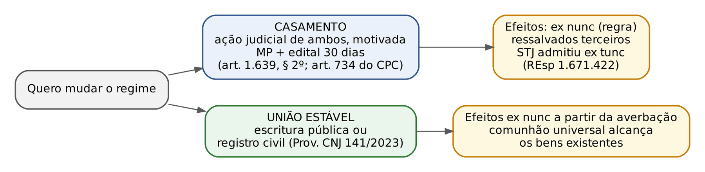
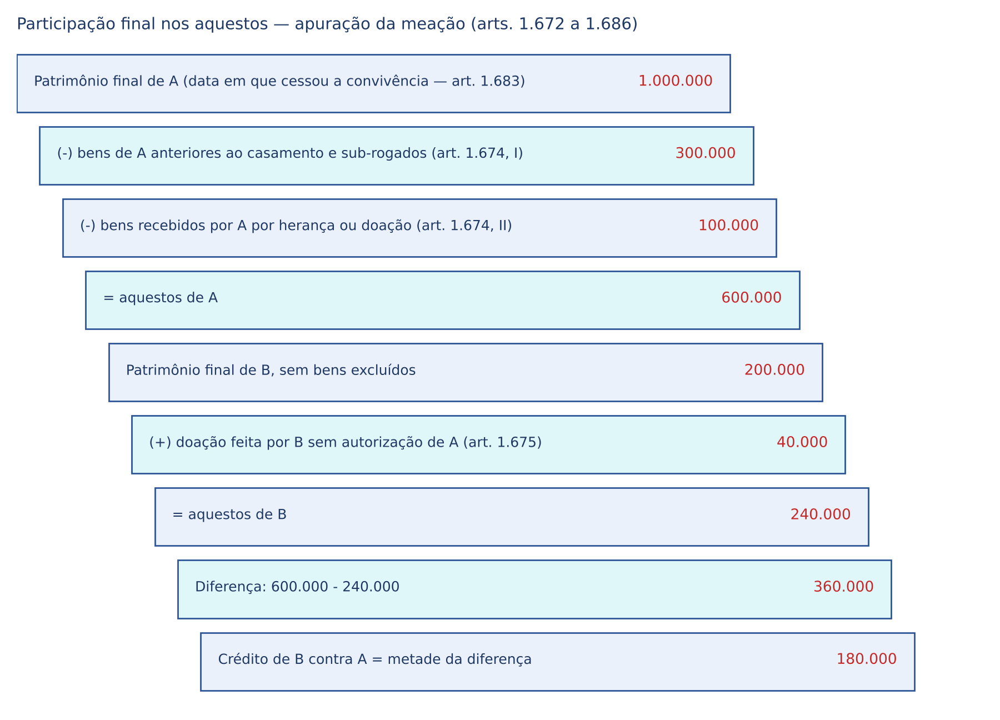
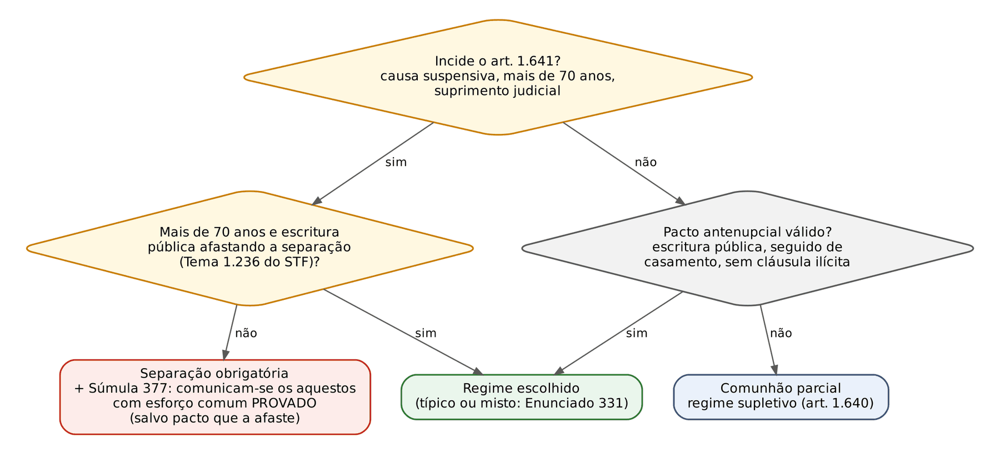

# CAPÍTULO 36 — DIREITO DAS FAMÍLIAS III: REGIMES DE BENS, PACTO ANTENUPCIAL, OUTORGA CONJUGAL, PARTILHA E BENS DOS FILHOS

:::INCIDENCIA
TRF5 p. 13; TJRS p. 19; TJSC p. 20. Nível A. Lote: FGV 27, FCC 6 (33 questões), mais correlatas por palavra-chave.
O que mais cai: o que entra e o que não entra na comunhão parcial (herança, sub-rogação, loteria, frutos, benfeitorias), atos que exigem outorga conjugal e sua consequência (anulável, 2 anos), Tema 1.236 do STF (maior de 70) e Súmula 377, forma e eficácia do pacto, alteração do regime e aluguel entre ex-cônjuges.
:::

| Subtema | FGV | FCC | Padrão de cobrança |
|---|---|---|---|
| Comunhão parcial: bens comuns x particulares | 9 | 1 | caso com 3 bens (herança, sub-rogação, loteria, frutos, benfeitoria); "registro em nome de um" é irrelevante |
| Outorga conjugal | 5 | 0 | classificar atos (anulável x válido); economia doméstica dispensa vênia |
| Separação obrigatória, Súmula 377 e Tema 1.236 | 6 | 2 | maior de 70 com escritura; como afastar já estando casado |
| Alteração do regime | 4 | 2 | via judicial no casamento x extrajudicial na união estável; efeitos ex nunc e exceção |
| Pacto antenupcial | 3 | 0 | instrumento particular = NULO; sem casamento = INEFICAZ; cláusula de conversão automática = nula |
| Participação final nos aquestos | 1 | 1 | art. 1.656 (livre disposição de imóveis particulares) |
| Partilha e pós-divórcio | 3 | 1 | aluguel entre ex-cônjuges; partilha desigual como doação; renda pactuada não é alimentos |
| Bens dos filhos | 1 | 0 | venda de imóvel do filho sem autorização judicial |

## 36.1 Disposições gerais: princípios e eficácia do regime

Os regimes de bens obedecem a quatro princípios cobráveis: (a) liberdade de escolha (art. 1.639, caput: "o que lhes aprouver"), limitada pelas normas de ordem pública (art. 1.655) e pelo art. 1.641; (b) variedade de regimes (quatro tipos legais, mais regimes mistos ou atípicos — Enunciado 331 da IV Jornada); (c) mutabilidade justificada (art. 1.639, § 2º, novidade do CC/2002 diante da imutabilidade do CC/1916); (d) indispensabilidade: não há casamento sem regime, e na falta ou invalidade da escolha incide o supletivo (art. 1.640).

:::LEI Código Civil, arts. 1.639 e 1.640
Art. 1.639. É lícito aos nubentes, antes de celebrado o casamento, estipular, quanto aos seus bens, o que lhes aprouver.
§ 1º O regime de bens entre os cônjuges começa a vigorar desde a data do casamento.
§ 2º É admissível alteração do regime de bens, mediante autorização judicial em pedido motivado de ambos os cônjuges, apurada a procedência das razões invocadas e ressalvados os direitos de terceiros.
Art. 1.640. Não havendo convenção, ou sendo ela nula ou ineficaz, vigorará, quanto aos bens entre os cônjuges, o regime da comunhão parcial.
Parágrafo único. Poderão os nubentes, no processo de habilitação, optar por qualquer dos regimes que este código regula. Quanto à forma, reduzir-se-á a termo a opção pela comunhão parcial, fazendo-se o pacto antenupcial por escritura pública, nas demais escolhas.
:::

Três literalidades: o regime vigora "desde a data do casamento", e não dos proclamas nem da habilitação; a comunhão parcial dispensa pacto (basta termo no processo de habilitação); qualquer outro regime exige escritura pública. Na união estável, o supletivo é o mesmo (art. 1.725), mas a escolha diversa se faz por "contrato escrito", sem exigência de escritura (ver Cap. 35).

Casamentos anteriores a 11/1/2003 continuam regidos pelo regime do CC/1916 (art. 2.039), inclusive o antigo supletivo da comunhão universal para casamentos anteriores à Lei 6.515/1977; isso não impede a alteração com base no CC/2002 (Enunciado 260 da III Jornada; ver Cap. 1).

### 36.1.1 Atos livres a qualquer cônjuge e dívidas domésticas

Qualquer que seja o regime, cada cônjuge pode livremente (art. 1.642): praticar os atos de disposição e administração necessários à profissão, ressalvado o art. 1.647, I (imóveis); administrar os bens próprios; desobrigar ou reivindicar imóveis gravados ou alienados sem seu consentimento ou suprimento; demandar a "rescisão" da fiança e da doação, ou a invalidação do aval, prestados pelo outro com infração do art. 1.647, III e IV; reivindicar bens comuns doados ou transferidos ao concubino, se não adquiridos pelo esforço comum deste, "se o casal estiver separado de fato por mais de cinco anos" (inciso V); e praticar tudo o que não lhe for expressamente vedado.

:::PEGADINHA Inciso V do art. 1.642: o prazo de cinco anos
A leitura literal produz um resultado estranho: o cônjuge só reivindicaria os bens doados ao concubino "se" separado de fato há MAIS de cinco anos. A doutrina majoritária (Tartuce, Farias e Rosenvald) lê o dispositivo em sentido inverso, combinado com o art. 550 (doação do cônjuge adúltero ao cúmplice, anulável até dois anos depois de dissolvida a sociedade conjugal): a reivindicação é cabível ENQUANTO não houver separação de fato superior a cinco anos. Em prova objetiva, prevalece a letra.
:::

Economia doméstica. Os cônjuges podem, sem autorização um do outro, comprar a crédito o necessário à economia doméstica e obter empréstimo para essa aquisição (art. 1.643), e essas dívidas "obrigam solidariamente ambos os cônjuges" (art. 1.644). É solidariedade legal (ver Cap. 12), que independe do regime de bens. As ações dos incisos III, IV e V do art. 1.642 competem ao cônjuge prejudicado e a seus herdeiros (art. 1.645); o terceiro prejudicado pela sentença tem regresso contra o cônjuge que realizou o negócio ou seus herdeiros (art. 1.646).

:::QUESTAO FCC 2024 — TRT 20ª Região — Oficial de Justiça Avaliador (Q3233111)
Pediu-se a assertiva conforme o CC sobre regime de bens. Gabarito B: em qualquer regime, inclusive na comunhão parcial, o cônjuge administra livremente os bens próprios (art. 1.642, II). Armadilhas: o regime começa a vigorar da data do casamento, não dos proclamas (art. 1.639, § 1º); a alteração exige autorização judicial e motivação (§ 2º); a idade da separação obrigatória é 70, não 60 (art. 1.641, II, redação da Lei 12.344/2010); e a separação absoluta é justamente o regime que DISPENSA a outorga para alienar imóveis (art. 1.647, caput).
:::

Impossibilidade de administrar. Se um cônjuge não puder exercer a administração que lhe cabe, o outro gere os bens comuns e os do consorte e aliena os móveis comuns livremente, mas só aliena imóveis comuns e móveis ou imóveis do consorte "mediante autorização judicial" (art. 1.651). Quem estiver na posse dos bens particulares do outro responde como usufrutuário (rendimento comum), procurador (mandato expresso ou tácito) ou depositário (nos demais casos) (art. 1.652).

## 36.2 Pacto antenupcial

Negócio jurídico de direito de família, solene, acessório e condicional (sua eficácia depende do casamento). Forma e eficácia estão no art. 1.653, o dispositivo mais cobrado do capítulo.

:::LEI Código Civil, arts. 1.653 a 1.657
Art. 1.653. É nulo o pacto antenupcial se não for feito por escritura pública, e ineficaz se não lhe seguir o casamento.
Art. 1.654. A eficácia do pacto antenupcial, realizado por menor, fica condicionada à aprovação de seu representante legal, salvo as hipóteses de regime obrigatório de separação de bens.
Art. 1.655. É nula a convenção ou cláusula dela que contravenha disposição absoluta de lei.
Art. 1.656. No pacto antenupcial, que adotar o regime de participação final nos aqüestos, poder-se-á convencionar a livre disposição dos bens imóveis, desde que particulares.
Art. 1.657. As convenções antenupciais não terão efeito perante terceiros senão depois de registradas, em livro especial, pelo oficial do Registro de Imóveis do domicílio dos cônjuges.
:::

| Vício ou situação | Consequência | Fundamento |
|---|---|---|
| Pacto por instrumento particular | NULO (forma) e, por isso, vigora a comunhão parcial | arts. 1.653 e 1.640 |
| Pacto por escritura sem casamento posterior | INEFICAZ (válido, mas sem efeitos) | art. 1.653 |
| Pacto de nubente com menos de 18 anos sem aprovação do representante | eficácia condicionada (salvo separação obrigatória) | art. 1.654 |
| Cláusula contrária a disposição absoluta de lei | NULA a cláusula (preserva-se o restante, art. 184) | art. 1.655 |
| Pacto válido não registrado no Registro de Imóveis | válido e eficaz entre os cônjuges; INOPONÍVEL a terceiros | art. 1.657; Lei 6.015/1973, art. 167, I, 12, e art. 178, V |

:::QUESTAO FGV 2025 — TJ-SC — Juiz Substituto (Q3324233)
Pacto por instrumento particular adotando a separação de bens; dois imóveis comprados por Fábio na constância; no divórcio, Cássia pede partilha. Gabarito C: o pacto é NULO (art. 1.653, primeira parte). Aplicação: nulo o pacto, vigora a comunhão parcial (art. 1.640), e os imóveis adquiridos onerosamente se comunicam (art. 1.660, I). Armadilhas: "ineficaz" é a sanção para o pacto sem casamento; "anulável" não existe no art. 1.653.
:::

:::QUESTAO FGV 2024 — ENAM — 1º Exame Nacional da Magistratura (Q2459901)
Pacto antenupcial de participação final nos aquestos; o casal rompe antes do casamento. Gabarito B: ineficaz (art. 1.653, segunda parte). O casamento funciona como condição suspensiva legal; não há nulidade, anulabilidade nem "revogação".
:::

Cláusulas admitidas e vedadas. São lícitos os regimes mistos (por exemplo, comunhão parcial com incomunicabilidade de determinado bem, ou separação com comunicação de bens de certa origem) e, segundo o Enunciado 635 da VIII Jornada, cláusulas existenciais, desde que não violem a dignidade, a igualdade entre os cônjuges e a solidariedade familiar. São nulas, por contrariarem disposição absoluta de lei (art. 1.655), as que afastem deveres conjugais (art. 1.566), renunciem previamente a alimentos, alterem a ordem de vocação hereditária ou disponham sobre herança de pessoa viva (art. 426), e as que dispensem a autorização judicial exigida para mudar o regime.

:::QUESTAO FGV 2026 — TJ-MS — Outorga de Delegações, Remoção (Q3914298)
Pacto de comunhão parcial com cláusula de conversão "automática" em separação total após 10 anos, sem autorização judicial; após os 10 anos, o marido promete vender imóvel adquirido onerosamente sem outorga da esposa. Gabarito E: a cláusula é NULA, porque a alteração do regime depende de decisão judicial motivada (art. 1.639, § 2º; art. 1.655); continua a comunhão parcial e a outorga é necessária. Armadilha: a autonomia privada do pacto não alcança a mutabilidade, que a lei submeteu a controle judicial e à proteção de terceiros.
:::

:::ATENCAO Renúncia à concorrência sucessória no pacto
A cláusula de renúncia prévia do cônjuge ao direito de concorrer na herança do outro é tema de forte divergência doutrinária e não tem acolhida firme na jurisprudência; o art. 426 (pacta corvina) é o obstáculo tradicional e a proposta de reforma do CC (PL 4/2025, não aprovado) pretende admiti-la. Em prova, trate como NÃO admitida pelo direito vigente. Na mesma linha, a separação convencional não exclui o cônjuge da herança: o STJ afirma que o pacto de separação total só rege a incomunicabilidade durante o casamento, sem "ultratividade" após a morte, e que o cônjuge é herdeiro necessário independentemente do regime (Jurisprudência em Teses, ed. 241, teses 7 e 8 — desenvolvimento no Cap. 43).
:::

## 36.3 Alteração do regime de bens

### 36.3.1 Casamento: via judicial

Requisitos do art. 1.639, § 2º: pedido de AMBOS os cônjuges (não há alteração litigiosa), motivado, apuração da procedência das razões, ressalva dos direitos de terceiros e autorização judicial. O procedimento é de jurisdição voluntária (art. 734 do CPC): petição assinada por ambos, intimação do Ministério Público, edital, decisão só depois de 30 dias da publicação; os cônjuges podem propor meio alternativo de divulgação (§ 2º); após o trânsito, mandados de averbação ao registro civil, ao registro de imóveis e, se empresário, à Junta Comercial (§ 3º).

:::LEI CPC, art. 734, § 1º
§ 1º Ao receber a petição inicial, o juiz determinará a intimação do Ministério Público e a publicação de edital que divulgue a pretendida alteração de bens, somente podendo decidir depois de decorrido o prazo de 30 (trinta) dias da publicação do edital.
:::

Pontos de prova:

- Motivação: o Enunciado 113 da I Jornada pede pedido motivado e "perquirição de inexistência de dívida de qualquer natureza", com ampla publicidade. O STJ vem flexibilizando a exigência de provas exaustivas: basta justificativa plausível e a ausência de indícios de prejuízo, já que terceiros estão ressalvados de todo modo.
- Não há prazo mínimo de casamento nem idade mínima para pedir a alteração.
- Casamentos regidos pelo CC/1916 também podem alterar (Enunciado 260; art. 2.039 não impede).
- Separação obrigatória dos incisos I e III do art. 1.641: superada a causa (por exemplo, feita a partilha do casamento anterior, ou atingida a maioridade), é possível a alteração (Enunciado 262 da III Jornada). Para o inciso II, ver o Tema 1.236 (36.9.3).
- Terceiros: a alteração é ineficaz perante credores anteriores; o meio próprio para eles não é anular a sentença, mas invocar a ineficácia relativa.

Efeitos no tempo. A regra, afirmada pela doutrina e pela jurisprudência tradicional, é a eficácia *ex nunc*: o novo regime rege os bens a partir do trânsito em julgado, preservados os atos anteriores. O STJ, porém, admitiu eficácia *ex tunc* na mudança de separação total para comunhão universal, ressalvados terceiros, ao argumento de que a ampliação da comunhão só reforça a garantia dos credores (REsp 1.671.422, 4ª Turma, Rel. Min. Raul Araújo, noticiado em abril de 2023). A doutrina que comenta o caso restringe a retroação à passagem de regime mais restritivo para mais inclusivo. Na prática, a comunhão universal já alcança, por definição, os bens presentes (art. 1.667), o que aproxima as duas leituras.

### 36.3.2 União estável: via extrajudicial

O Provimento CNJ 141/2023 (incorporado ao Código Nacional de Normas) admite a alteração do regime de bens da união estável REGISTRADA diretamente no Registro Civil das Pessoas Naturais, a requerimento pessoal de ambos os companheiros (ou por procurador com instrumento público), instruído com certidões dos distribuidores cíveis e de execução fiscal, protestos, Justiça do Trabalho e interdições dos últimos cinco anos. Certidão de interdição positiva impõe a via judicial; havendo partilha ou certidões positivas de dívidas, exige-se advogado ou defensor. O novo regime produz efeitos a partir da averbação e não retroage, salvo a comunhão universal, que alcança os bens existentes, sempre ressalvados terceiros de boa-fé. Além dessa via, os companheiros podem simplesmente celebrar novo contrato escrito ou escritura pública (art. 1.725), com efeitos prospectivos (ver Cap. 35).

:::PEGADINHA Casamento x união estável
Para o CASAMENTO não existe alteração extrajudicial do regime: o art. 1.639, § 2º, exige autorização judicial, e nenhum provimento pode dispensá-la. Para a UNIÃO ESTÁVEL basta a via extrajudicial (escritura ou registro civil). Afirmativa que diz "pode ser modificado extrajudicialmente, desde que não prejudique terceiros" referindo-se a CASAMENTO está ERRADA.
:::

:::QUESTAO FCC 2025 — TRT 2ª Região — Analista Judiciário (Q3627610)
Casamento em 2020 sob comunhão universal: o regime "só poderá ser modificado por requerimento de ambos os cônjuges mediante autorização judicial" (gabarito E; art. 1.639, § 2º). Erradas: imutabilidade (regra do CC/1916), prazo mínimo de 10 anos (inexistente) e via extrajudicial (só para união estável).
:::

:::QUESTAO FGV 2025 — TJ-GO — Residente Jurídico (Q3345929)
Casamento aos 16 anos com suprimento judicial do consentimento dos pais: o regime foi o da separação obrigatória (art. 1.641, III). Cinco anos depois, o casal quer a comunhão universal. Gabarito B: a alteração é permitida mediante autorização judicial, com concordância expressa de ambos, ressalvados terceiros. Fundamento adicional: superada a causa que impôs a separação (a necessidade de suprimento), cabe a mudança (Enunciado 262). Armadilhas: imutabilidade "por força da decisão judicial", escritura pública sem motivação, prazo de dez anos.
:::

:::QUESTAO FGV 2025 — TJ-ES — Atividade Notarial, Remoção (Q3520289)
Casados em separação convencional desde 2010; a esposa quer mudar o regime para que o marido participe inclusive dos bens que ela herdará. Gabarito oficial E: a alteração tem, em regra, eficácia *ex nunc*, mas no caso os efeitos retroativos são corolário lógico da vontade de ampliar a comunhão e devem ser admitidos. A banca seguiu o REsp 1.671.422 (ver 36.3.1). Gabarito discutível: a regra *ex nunc* é a orientação tradicional e a do Tema 1.236 para quem já está casado. Lembre também que bens herdados só entram na comunhão se o novo regime for o da comunhão universal e não houver cláusula de incomunicabilidade (art. 1.668, I).
:::

:::QUESTAO FGV 2025 — MPE-RJ — Analista, Área Processual (Q3362521)
Companheiros (73 e 68 anos) em união estável desde 2005, formalizada em escritura com comunhão parcial, querem mudar o regime. Gabarito B: podem alterar pela via extrajudicial e escolher livremente o novo regime. Passos: (1) é união estável, logo a via extrajudicial está aberta (Provimento CNJ 141/2023; art. 1.725); (2) a idade não impõe separação obrigatória, porque a união começou antes dos 70 (lógica do Enunciado 261) e, de todo modo, o Tema 1.236 permite afastar a separação por escritura pública. Erradas as alternativas que exigem via judicial ou impõem a separação obrigatória.
:::

No mesmo sentido, para a união estável: FGV 2026, ENAC (Q4130162, correlata): alteração por escritura pública de separação para comunhão universal é válida e produz efeitos prospectivos, respeitados terceiros.

## 36.4 Outorga conjugal (vênia conjugal)

:::LEI Código Civil, arts. 1.647, 1.649 e 1.650
Art. 1.647. Ressalvado o disposto no art. 1.648, nenhum dos cônjuges pode, sem autorização do outro, exceto no regime da separação absoluta:
I - alienar ou gravar de ônus real os bens imóveis;
II - pleitear, como autor ou réu, acerca desses bens ou direitos;
III - prestar fiança ou aval;
IV - fazer doação, não sendo remuneratória, de bens comuns, ou dos que possam integrar futura meação.
Parágrafo único. São válidas as doações nupciais feitas aos filhos quando casarem ou estabelecerem economia separada.
Art. 1.649. A falta de autorização, não suprida pelo juiz, quando necessária (art. 1.647), tornará anulável o ato praticado, podendo o outro cônjuge pleitear-lhe a anulação, até dois anos depois de terminada a sociedade conjugal.
Parágrafo único. A aprovação torna válido o ato, desde que feita por instrumento público, ou particular, autenticado.
Art. 1.650. A decretação de invalidade dos atos praticados sem outorga, sem consentimento, ou sem suprimento do juiz, só poderá ser demandada pelo cônjuge a quem cabia concedê-la, ou por seus herdeiros.
:::

A outorga não é questão de capacidade, mas de legitimação: o cônjuge é capaz, mas não está legitimado a praticar sozinho certos atos que afetam o patrimônio da família. Daí a sanção ser a anulabilidade com legitimidade restrita ao cônjuge preterido e seus herdeiros (art. 1.650), e não a nulidade.

### 36.4.1 Alcance de cada inciso

- Inciso I: TODOS os imóveis, inclusive os particulares, em qualquer regime salvo a separação absoluta. A natureza particular do bem na comunhão parcial NÃO dispensa a vênia (o art. 1.665 permite convenção diversa no pacto quanto aos particulares; sem ela, aplica-se o art. 1.647, I — Enunciado 340 da IV Jornada: na comunhão parcial a autorização é "sempre indispensável" para disposição de imóveis). Na participação final, o pacto pode dispensá-la para imóveis particulares (art. 1.656).
- Inciso II: ações reais imobiliárias, ativas ou passivas (o art. 73 do CPC exige o consentimento para propor e a citação de ambos quando réus, salvo separação absoluta). Ação para INVALIDAR ato do outro praticado sem outorga não depende de vênia, porque é direito próprio do cônjuge (art. 1.642, III e IV).
- Inciso III: fiança e aval. Na fiança, a consequência é a anulação (art. 1.649), e a Súmula 332 do STJ acrescenta que a fiança prestada sem autorização de um dos cônjuges implica a ineficácia TOTAL da garantia (ver Cap. 21). No aval, ver 36.4.3.
- Inciso IV: doação não remuneratória de bens COMUNS (móveis ou imóveis) ou que possam integrar futura meação. Doação de imóvel particular cai no inciso I: o STJ exige a outorga como requisito de validade, sendo irrelevante a incomunicabilidade do bem ou a falta de prejuízo à meação (REsp 2.130.069-SP, Info 880 — ver também Cap. 17). Ficam fora as doações remuneratórias e as nupciais aos filhos (parágrafo único).

:::DICA Separação "absoluta": só a convencional?
O caput dispensa a outorga "no regime da separação absoluta". Para a corrente majoritária (Tartuce, entre outros), separação absoluta é a CONVENCIONAL, porque na separação obrigatória incide a Súmula 377 e os aquestos podem se comunicar; logo, na obrigatória a vênia é exigida. Corrente oposta (José Fernando Simão, por exemplo) dispensa a vênia também na obrigatória. Em prova: separação convencional dispensa; separação obrigatória exige (salvo pacto que afaste a Súmula 377, quando passa a funcionar como separação absoluta). A participação final nos aquestos EXIGE outorga para imóveis, salvo cláusula do art. 1.656.
:::

### 36.4.2 Suprimento, prazo e convalidação

- Suprimento judicial: quando a recusa é injusta ou é impossível ao cônjuge concedê-la (art. 1.648). Procedimento de jurisdição voluntária; o art. 74 do CPC trata do suprimento do consentimento para DEMANDAR (art. 73), não da outorga para o ato do art. 1.647.
- Prazo: decadencial de DOIS anos contados do TÉRMINO DA SOCIEDADE CONJUGAL, não da data do ato (art. 1.649). É exceção ao prazo geral de dois anos do art. 179, que conta da conclusão do ato (ver Cap. 9 e Cap. 11).
- Convalidação: aprovação por instrumento público ou particular autenticado (art. 1.649, parágrafo único).
- Terceiro de boa-fé prejudicado: regresso contra o cônjuge que contratou (art. 1.646).
- União estável: o STJ não aplica automaticamente a anulabilidade ao terceiro adquirente quando a união não tinha publicidade registral; o tema e seus requisitos estão no Cap. 35.

### 36.4.3 Aval

O art. 1.642, IV, fala em "invalidação do aval", mas a doutrina empresarial e o Enunciado 114 da I Jornada sustentam que o aval sem vênia não pode ser anulado: há apenas inoponibilidade do título ao cônjuge que não assentiu. O STJ foi além: o art. 1.647, III, só se aplica aos títulos de crédito ATÍPICOS (inominados), regidos pelo CC; para os títulos típicos regidos por lei especial (nota promissória, letra de câmbio, cheque, duplicata), a outorga é dispensada, pela incompatibilidade com a circulação cambial (REsp 1.526.560-MG, 3ª Turma, Rel. Min. Paulo de Tarso Sanseverino, j. 16/3/2017, Info 604). Em prova FGV, a letra do art. 1.647, III (aval exige outorga) ainda é dada como correta quando a questão pede "segundo o Código Civil".

:::ESQUEMA Fiança x aval sem outorga conjugal
| Ponto | Fiança | Aval |
|---|---|---|
| Exige outorga? | sim (art. 1.647, III), salvo separação absoluta | pela letra do CC, sim; para o STJ, só nos títulos atípicos |
| Sanção | anulável (art. 1.649) e ineficácia total da garantia (Súmula 332 do STJ — Cap. 21) | Enunciado 114: inoponível ao cônjuge que não consentiu; títulos típicos: válido e eficaz |
| Quem alega | só o cônjuge preterido ou herdeiros (art. 1.650), nunca o próprio fiador | idem |
| Prazo | 2 anos do término da sociedade conjugal | idem, quando cabível |
:::

### 36.4.4 Questões do lote

:::QUESTAO FGV 2026 — TJ-GO — Juiz Substituto (Q3966632)
Diana, em comunhão parcial e sem vênia: (I) vendeu imóvel adquirido onerosamente na constância; (II) tomou empréstimo para a economia doméstica; (III) demandou a invalidação de doação de casa feita pelo marido sem a sua vênia. Gabarito D: anulável, válido, válido. (I) art. 1.647, I, c/c art. 1.649; (II) arts. 1.643, II, e 1.644, dispensa autorização e obriga ambos solidariamente; (III) é direito próprio do cônjuge (arts. 1.642, IV, e 1.645), sem necessidade de vênia. A armadilha das alternativas com "nulo" é confundir falta de outorga com nulidade.
:::

No mesmo sentido: FGV 2024, TJ-SC, Juiz Substituto (Q3049330: passíveis de invalidação a hipoteca de imóvel comum e a doação de lancha comprada na constância, porque o inciso IV alcança bens MÓVEIS comuns; o mútuo para economia doméstica é válido — gabarito C) e FGV 2025, ENAM 2025.2 (Q3692405: exigem vênia a ação sobre imóvel do casal e a hipoteca de fazenda adquirida antes do casamento — imóvel particular continua exigindo vênia —, mas não o empréstimo doméstico; gabarito D).

:::QUESTAO FGV 2025 — TJ-SE — Juiz Substituto (Q3301231)
Casal em comunhão parcial: automóvel comprado na constância, chácara herdada pela esposa, apartamento comprado com recursos comuns e registrado só em nome do marido. Gabarito D: para vender o apartamento, Roberto precisa da vênia de Laura. Erradas: a chácara herdada não se partilha (art. 1.659, I); a venda ou oneração do automóvel (móvel) NÃO exige vênia, pois o art. 1.647 só alcança móveis no inciso IV (doação); o registro em nome de um só não afasta a comunhão (art. 1.660, I: "ainda que só em nome de um dos cônjuges").
:::

No mesmo sentido: FGV 2025, SEFAZ-PR, Auditor Fiscal (Q3363372: sem pacto, regime da comunhão parcial; imóvel adquirido em nome exclusivo do marido exige outorga — gabarito C).

:::QUESTAO FGV 2026 — TJ-SC — Analista Jurídico (Q4150712)
Carlos (75) e Helena (60) casam em 2024 adotando, por escritura pública, a comunhão universal; depois, Carlos presta fiança sem consentimento e toma empréstimo para a economia doméstica. Gabarito B: o regime é válido (Tema 1.236 do STF — ver 36.9.3) e o empréstimo doméstico obriga ambos (art. 1.644). Erradas: a fiança NÃO é válida, porque a comunhão universal não dispensa a outorga (só a separação absoluta dispensa); e o empréstimo doméstico não depende de autorização (art. 1.643).
:::

## 36.5 Comunhão parcial de bens

Regime legal supletivo do casamento e da união estável. Estrutura: três massas (bens particulares de cada um e bens comuns). Regra-matriz: comunicam-se os bens que sobrevierem ao casal na constância, com as exceções legais (art. 1.658). A lógica é a da CAUSA da aquisição: comunica-se o que foi adquirido onerosamente durante o casamento, presumidamente com esforço comum; não se comunica o que tem causa anterior ou é gratuito e pessoal.

:::LEI Código Civil, arts. 1.659 e 1.660
Art. 1.659. Excluem-se da comunhão:
I - os bens que cada cônjuge possuir ao casar, e os que lhe sobrevierem, na constância do casamento, por doação ou sucessão, e os sub-rogados em seu lugar;
II - os bens adquiridos com valores exclusivamente pertencentes a um dos cônjuges em sub-rogação dos bens particulares;
III - as obrigações anteriores ao casamento;
IV - as obrigações provenientes de atos ilícitos, salvo reversão em proveito do casal;
V - os bens de uso pessoal, os livros e instrumentos de profissão;
VI - os proventos do trabalho pessoal de cada cônjuge;
VII - as pensões, meios-soldos, montepios e outras rendas semelhantes.
Art. 1.660. Entram na comunhão:
I - os bens adquiridos na constância do casamento por título oneroso, ainda que só em nome de um dos cônjuges;
II - os bens adquiridos por fato eventual, com ou sem o concurso de trabalho ou despesa anterior;
III - os bens adquiridos por doação, herança ou legado, em favor de ambos os cônjuges;
IV - as benfeitorias em bens particulares de cada cônjuge;
V - os frutos dos bens comuns, ou dos particulares de cada cônjuge, percebidos na constância do casamento, ou pendentes ao tempo de cessar a comunhão.
:::

Complementos: são incomunicáveis os bens cuja aquisição tiver por título causa anterior ao casamento (art. 1.661: por exemplo, imóvel compromissado antes e escriturado depois; bem reivindicado em ação ajuizada antes); presumem-se adquiridos na constância os bens MÓVEIS, salvo prova de data anterior (art. 1.662). O STJ afirma que são incomunicáveis os bens adquiridos antes, ainda que o registro imobiliário ocorra na constância (Jurisprudência em Teses, ed. 50, tese 7).

### 36.5.1 Os incisos mais difíceis à luz do STJ

Proventos do trabalho (art. 1.659, VI). Lido literalmente, o inciso esvaziaria a comunhão (quase tudo se compra com salário). A jurisprudência restringe a incomunicabilidade ao DIREITO de perceber os proventos; os valores recebidos durante o casamento e os bens com eles adquiridos se comunicam. Daí:

- Verbas trabalhistas nascidas e pleiteadas na constância integram o patrimônio comum, ainda que recebidas depois (Jurisprudência em Teses, ed. 113, tese 3). O critério é o período aquisitivo, não a data do pagamento.
- FGTS: há meação dos depósitos feitos na constância, ainda que não sacados imediatamente após a separação ou usados na compra de imóvel do casal (Jurisprudência em Teses, ed. 113, tese 4).
- Créditos de previdência pública concedidos na constância comunicam-se, ainda que recebidos após o divórcio (REsp 2.138.877-MG, 3ª Turma, j. 13/5/2025, Info 858).

Pensões e rendas semelhantes (art. 1.659, VII):

- Previdência privada FECHADA: excluída da partilha, por analogia ao inciso VII (Jurisprudência em Teses, ed. 113, tese 6).
- Previdência privada ABERTA (PGBL, VGBL) em fase de acumulação: tem natureza de investimento e é partilhável (REsp 1.698.774-RS, 3ª Turma, Rel. Min. Nancy Andrighi, 2020).

Valorização e frutos:

- A valorização de imóveis ou de cotas de sociedade limitada adquiridos ANTES do casamento não se comunica, porque decorre de fenômeno econômico, sem esforço comum (Jurisprudência em Teses, ed. 113, tese 5). Mas as cotas ADQUIRIDAS na constância se comunicam e o cônjuge não sócio tem direito à meação dos lucros e dividendos distribuídos desde a separação de fato até a apuração de haveres, apurados pelo balanço de determinação (REsp 2.223.719-SP, 3ª Turma, j. 2/9/2025, Info 864; art. 600, parágrafo único, do CPC).
- Frutos de bens particulares percebidos na constância se comunicam (art. 1.660, V), assim como as benfeitorias neles feitas (inciso IV). O STJ aplicou ambos às crias de rebanho de fazendas herdadas e às benfeitorias nelas feitas durante o casamento, e afirmou que o esforço comum se PRESUME e abrange a dedicação ao lar, sendo inadequado exigir prova por cotejo da atividade doméstica (REsp 1.959.926-PR, 3ª Turma, Rel. Min. Humberto Martins, j. 8/6/2026, Info 895).

Fato eventual (art. 1.660, II): loteria, prêmios, sorteios, tesouro. Comunica-se "com ou sem o concurso de trabalho ou despesa anterior": não importa quem pagou a aposta nem com que dinheiro.

Doação do Poder Público: o imóvel doado em programa habitacional, ainda que escriturado em nome de um só cônjuge, destina-se à entidade familiar e se comunica na comunhão parcial (REsp 2.204.798-TO, 3ª Turma, Rel. Min. Nancy Andrighi, j. 10/6/2025, Info 26 — Edição Extraordinária). É exceção ao inciso I do art. 1.659 (doação a um só).

Dívidas: o FIES tem natureza personalíssima e não se partilha (REsp 2.062.166-RS, 3ª Turma, j. 5/11/2024, Info 23 — Edição Extraordinária); as obrigações anteriores ao casamento e as de ato ilícito (salvo reversão em proveito do casal) são particulares (art. 1.659, III e IV).

Imóvel financiado antes do casamento e quitado na constância: comunica-se a fração correspondente às parcelas pagas com recursos comuns durante o casamento; o restante é particular (art. 1.661 x art. 1.660, I). Reformas e manutenção não tornam comum o imóvel, apenas as benfeitorias (inciso IV).

:::ESQUEMA Comunhão parcial — o que entra e o que fica de fora
| Entra (comum) | Fica fora (particular) |
|---|---|
| compra onerosa na constância, mesmo em nome de um só (1.660, I) | bens anteriores e sub-rogados (1.659, I) |
| loteria, prêmios, fato eventual (1.660, II) | herança e doação a um só, e sub-rogados (1.659, I e II) |
| doação, herança ou legado a AMBOS (1.660, III) | bem com causa anterior ao casamento (1.661) |
| benfeitorias em bens particulares (1.660, IV) | uso pessoal, livros, instrumentos de profissão (1.659, V) |
| frutos de bens comuns ou particulares (1.660, V) | direito aos proventos e pensões (1.659, VI e VII); previdência fechada |
| verbas trabalhistas e FGTS do período; previdência aberta em acumulação | valorização de bem ou cotas anteriores |
| parcelas pagas na constância de bem financiado antes | parcelas pagas antes do casamento; FIES |
| imóvel de programa habitacional, mesmo em nome de um | dívidas anteriores e de ato ilícito sem proveito comum |
:::

:::EXEMPLO Caso de três bens (padrão FGV)
Casados em comunhão parcial em 2010. Bem 1: apartamento comprado em 2015 por 1.000.000 (um milhão de) reais. Bem 2: casa de 600.000 (seiscentos mil) reais comprada pelo marido em 2017 só com o produto da venda de terreno herdado. Bem 3: prêmio de loteria de 15.000.000 (quinze milhões de) reais ganho pela esposa em 2023. Solução: Bem 1 comum (art. 1.660, I); Bem 2 particular por sub-rogação (art. 1.659, I e II), desde que provada a origem exclusiva dos valores; Bem 3 comum (art. 1.660, II), sendo irrelevante que o marido não trabalhasse. É o gabarito B da FGV 2025, MPE-ES, Promotor (Q3752739).
:::

No mesmo sentido, todos resolvidos pelos mesmos dispositivos:

- FGV 2025, TCE-PE, Procurador (Q3592152): herança de um e automóvel comprado com dinheiro doado só a um são particulares; a casa comprada com economias do casal é comum sem prova de contribuição (gabarito D).
- FGV 2025, ENAM 2025.1 (Q3362360): comuns o prêmio de loteria, o apartamento comprado e os aluguéis dele (frutos); particular o terreno herdado (gabarito D).
- FGV 2024, TJ-PE, Juiz Substituto (Q3117514): entram na partilha as obras de conserto em casa particular (benfeitorias, art. 1.660, IV) e o carro ganho em sorteio de Natal (fato eventual); não entram os apartamentos herdados (gabarito E).
- FGV 2024, Prefeitura de São José dos Campos, Procurador (Q3888037): benfeitorias em bens particulares entram na comunhão (gabarito C); a casa de veraneio comprada com recursos de herança e a lancha anterior ao casamento são particulares; frutos dos particulares se comunicam.
- FGV 2025, TJ-ES, Atividade Notarial, Provimento (Q3520601): imóvel financiado antes e quitado na constância com recursos do casal comunica-se parcialmente, na proporção do valor quitado durante o casamento (gabarito C).

:::QUESTAO FGV 2025 — TJ-MS — Juiz Substituto (Q3786337)
Haverá meação? (I) casa recebida por doação em programa governamental, registrada só em nome da esposa, em comunhão parcial; (II) aluguéis futuros de imóvel particular do marido falecido; (III) prêmio de loteria recebido por cônjuge em separação obrigatória "ratificada em cartório em 2025". Gabarito D: meação no caso I e no caso III. Passos: (I) imóvel de programa habitacional destina-se à família (REsp 2.204.798-TO); (II) os frutos só se comunicam se percebidos na constância ou pendentes ao cessar a comunhão (art. 1.660, V); os aluguéis que vencerem após a morte pertencem a quem herdar o imóvel, não ao meeiro; (III) o STJ reconhece que o prêmio de loteria é bem comum mesmo na separação obrigatória, como fato eventual, independentemente de prova de esforço comum (REsp 2.097.324-SP, 4ª Turma, j. 24/9/2024, Info 827 — ver 36.9.2).
:::

:::QUESTAO FCC 2026 — TJ-CE — Oficial de Justiça (Q4240013)
José, 72 anos, casa em 2025 com Belmira mediante pacto por escritura pública adotando a comunhão parcial; meses depois ganha na loteria jogando com dinheiro da aposentadoria; Belmira pede o divórcio e metade do prêmio. Gabarito B: vale a escolha da comunhão parcial (Tema 1.236 do STF: o maior de 70 pode afastar a separação por escritura pública) e o prêmio se comunica como fato eventual, "ainda que sem o concurso de trabalho ou despesa anterior" de Belmira (art. 1.660, II). Armadilha mais sedutora (D): sub-rogação de proventos da aposentadoria (art. 1.659, VI). Não há sub-rogação: o bem não foi "adquirido com valores exclusivos em sub-rogação de bens particulares", mas por fato eventual, e o inciso II do art. 1.660 dispensa perquirir a origem da despesa. O casamento não é nulo (alternativa C): o desrespeito ao art. 1.641 nunca gera nulidade do casamento, apenas a imposição do regime legal.
:::

### 36.5.2 Administração e dívidas na comunhão parcial

- Administração do patrimônio comum: qualquer dos cônjuges (art. 1.663). Dívidas contraídas nessa administração obrigam os bens comuns e os particulares do administrador, e os do outro na medida do proveito (§ 1º).
- Atos GRATUITOS que impliquem cessão do uso ou gozo dos bens comuns (comodato, por exemplo) exigem anuência de ambos (§ 2º).
- Malversação: o juiz pode atribuir a administração a apenas um (§ 3º).
- Os bens comuns respondem pelas obrigações para atender aos encargos da família, às despesas de administração e às decorrentes de imposição legal (art. 1.664).
- Bens particulares: administração e disposição pelo proprietário, salvo convenção diversa no pacto (art. 1.665); as dívidas contraídas na administração dos particulares e em benefício deles não obrigam os bens comuns (art. 1.666).

## 36.6 Comunhão universal de bens

Comunicam-se todos os bens presentes e futuros e as dívidas passivas, com as exceções do art. 1.668 (art. 1.667). Exige pacto por escritura pública. A administração segue as regras da comunhão parcial (art. 1.670).

Excluídos da comunhão (art. 1.668):

- I: bens doados ou herdados com cláusula de INCOMUNICABILIDADE e os sub-rogados em seu lugar (sem a cláusula, herança e doação a um só COMUNICAM-SE — diferença central para a comunhão parcial; a cláusula sobre bens da legítima exige justa causa no testamento, art. 1.848 — Cap. 44);
- II: bens gravados de fideicomisso e o direito do fideicomissário antes de realizada a condição suspensiva;
- III: dívidas anteriores ao casamento, salvo as de aprestos (preparativos do casamento) ou as que reverterem em proveito comum;
- IV: doações antenupciais de um cônjuge ao outro com cláusula de incomunicabilidade;
- V: bens dos incisos V a VII do art. 1.659 (uso pessoal, instrumentos de profissão, proventos do trabalho, pensões e rendas semelhantes).

A incomunicabilidade NÃO se estende aos frutos percebidos ou vencidos durante o casamento (art. 1.669). Extinta a comunhão e feita a divisão do ativo e do passivo, cessa a responsabilidade de cada cônjuge pelos credores do outro (art. 1.671).

Jurisprudência recente:

- Há meação de crédito rural decorrente de valor pago a maior em contratação anuída e vencida no curso do casamento sob comunhão universal, ainda que o crédito seja reconhecido retroativamente após a separação (REsp 2.144.296-TO, 3ª Turma, Rel. Min. Nancy Andrighi, j. 18/2/2025, Info 843). O critério é o fato gerador do crédito na constância.
- Na comunhão universal, a herança recebida por um cônjuge integra o patrimônio comum; por isso o ex-cônjuge tem legitimidade para pedir prestação de contas à inventariante (a sogra) dos bens deixados pelo pai do outro cônjuge (REsp 2.172.029-SP, 3ª Turma, Rel. Min. Marco Aurélio Bellizze, j. 8/10/2024, Info 829).

Restrição societária: é vedado aos cônjuges casados em comunhão universal ou em separação obrigatória contratar sociedade entre si ou com terceiros (art. 977). A proibição só atinge sociedades constituídas após a vigência do CC/2002 (Enunciado 204 da III Jornada).

## 36.7 Participação final nos aquestos

Regime híbrido (inspirado no direito alemão e no Código de Quebec): durante o casamento funciona como separação (cada cônjuge tem patrimônio próprio e o administra com exclusividade — arts. 1.672 e 1.673); na dissolução, funciona como comunhão de aquestos, cabendo a cada cônjuge a metade dos bens adquiridos pelo casal, a título oneroso, na constância (art. 1.672). A meação não é de bens, mas, em regra, um CRÉDITO pela diferença entre os aquestos de cada um (arts. 1.684 e 1.685).

Regras cobradas:

- Patrimônio próprio: bens que cada um possuía ao casar e os por ele adquiridos "a qualquer título" na constância (art. 1.673). Móveis podem ser alienados livremente (parágrafo único); IMÓVEIS exigem outorga, salvo convenção no pacto quanto aos PARTICULARES (art. 1.656).
- Apuração dos aquestos: excluem-se os bens anteriores e sub-rogados, os recebidos por sucessão ou liberalidade e as dívidas a eles relativas (art. 1.674); presumem-se adquiridos na constância os móveis (parágrafo único).
- Doações sem autorização entram no cálculo (o bem pode ser reivindicado ou declarado no monte pelo valor da época da dissolução — art. 1.675); bens alienados em detrimento da meação também (art. 1.676).
- Dívidas posteriores ao casamento: responde só quem as contraiu, salvo prova de proveito do outro (art. 1.677); pagamento de dívida de um com bens do outro é imputado, atualizado, na meação do devedor (art. 1.678).
- Bens adquiridos pelo trabalho conjunto: quota igual no condomínio (art. 1.679).
- Perante terceiros, os móveis presumem-se do cônjuge devedor, salvo uso pessoal do outro (art. 1.680); os imóveis são de quem consta no registro (art. 1.681).
- O direito à meação é irrenunciável, incessível e impenhorável na vigência do regime (art. 1.682).
- Marco temporal: na separação judicial ou no divórcio, os aquestos se verificam na data em que CESSOU A CONVIVÊNCIA (art. 1.683). Na morte, apura-se a meação e defere-se a herança (art. 1.685).
- Reposição em dinheiro quando a divisão em natureza não for possível nem conveniente; sem dinheiro, alienação judicial de bens (art. 1.684). Dívidas de um superiores à sua meação não obrigam o outro nem seus herdeiros (art. 1.686).

Leitura da escada: A tinha 1.000.000 (um milhão de) reais ao fim da convivência, dos quais 300.000 (trezentos mil) anteriores ao casamento e 100.000 (cem mil) herdados; seus aquestos são 600.000 (seiscentos mil). B tem 200.000 (duzentos mil) adquiridos na constância e fez doação de 40.000 (quarenta mil) sem autorização de A, que se computa (art. 1.675): aquestos de 240.000 (duzentos e quarenta mil). Cada um tem direito à metade do total dos aquestos (840.000 / 2 = 420.000); como B já detém 240.000, seu crédito contra A é de 180.000 (cento e oitenta mil) reais, que é a metade da diferença (360.000 / 2).

:::QUESTAO FCC 2024 — TRT 20ª Região — Analista Judiciário (Q3170837)
Sobre a participação final nos aquestos, o correto é que o pacto pode convencionar a livre disposição dos bens imóveis, desde que particulares (gabarito B; art. 1.656). Erradas: pacto por instrumento particular (só escritura, art. 1.653), vedação ao empresário (inexistente; a vedação do art. 977 é para comunhão universal e separação obrigatória), proibição do regime e obrigatoriedade aos maiores de 60.
:::

:::QUESTAO FGV 2025 — TJ-TO — Juiz Substituto (Q3453215)
Nubentes de 60 anos querem (i) alienar imóveis particulares sem vênia e (ii) que integrem o patrimônio próprio de cada um os bens anteriores e os adquiridos a qualquer título na constância. Gabarito E: separação convencional e participação final nos aquestos. (i) Na separação convencional, a dispensa decorre da lei (art. 1.647, caput, e art. 1.687); na participação final, de cláusula do pacto (art. 1.656). (ii) A fórmula é a do art. 1.673 (participação final) e também descreve a separação (art. 1.687). A separação obrigatória não serve: não é escolhida e, aos 60 anos, nem incide (art. 1.641, II, exige mais de 70).
:::

## 36.8 Separação convencional de bens

Estipulada a separação, os bens permanecem sob a administração exclusiva de cada cônjuge, que pode livremente aliená-los ou gravá-los de ônus real (art. 1.687) — é a "separação absoluta" do art. 1.647. Ambos contribuem para as despesas do casal na proporção dos rendimentos do trabalho e dos bens, salvo estipulação diversa no pacto (art. 1.688).

Pontos jurisprudenciais:

- A separação convencional cria presunção RELATIVA de que os bens adquiridos na constância pertencem ao respectivo titular; o outro pode afastá-la provando sua efetiva contribuição, e a partilha será proporcional (REsp 2.219.797-DF, v. Cap. 35). A Súmula 377 do STF NÃO se aplica à separação convencional.
- Terreno adquirido por ambos em partes iguais: presume-se que a construção também lhes pertence na mesma proporção (art. 1.253), presunção relativa que o cônjuge que alega ter custeado sozinho deve afastar (REsp 2.126.992-DF, 4ª Turma, Rel. Min. Raul Araújo, j. 9/12/2025, Info 874).
- Efeitos sucessórios: a separação convencional não afasta a qualidade de herdeiro necessário e permite a concorrência com descendentes (art. 1.829, I) — ver Cap. 43.

## 36.9 Separação obrigatória (legal) de bens

### 36.9.1 Hipóteses

:::LEI Código Civil, art. 1.641
Art. 1.641. É obrigatório o regime da separação de bens no casamento:
I - das pessoas que o contraírem com inobservância das causas suspensivas da celebração do casamento;
II – da pessoa maior de 70 (setenta) anos; (Redação dada pela Lei nº 12.344, de 2010)
III - de todos os que dependerem, para casar, de suprimento judicial.
:::

- Inciso I: causas suspensivas do art. 1.523 (viúvo com filho sem inventário, viúva nos dez meses, divorciado sem partilha homologada ou decidida, tutor ou curador antes das contas — ver Cap. 34). É sanção patrimonial: o casamento é válido. O juiz pode afastar as causas dos incisos I, III e IV do art. 1.523 provada a ausência de prejuízo (art. 1.523, parágrafo único).
- Inciso II: idade de 70 anos (era 60 até a Lei 12.344/2010). Não incide se o casamento for precedido de união estável iniciada antes dessa idade (Enunciado 261 da III Jornada, redigido quando a idade era 60, mas de lógica idêntica). Aplica-se à união estável de septuagenário (Súmula 655 do STJ, abaixo).
- Inciso III: quem depende de suprimento judicial para casar (por exemplo, pessoa de 16 ou 17 anos cujos pais negaram a autorização — art. 1.519). Desde a Lei 13.811/2019, não se admite casamento de quem não atingiu a idade núbil (art. 1.520 — Cap. 34).
- Superada a causa dos incisos I e III, admite-se a alteração do regime (Enunciado 262).

:::PEGADINHA Violação do art. 1.641 não invalida o casamento
Se o oficial celebrar o casamento de pessoa sujeita ao art. 1.641 com outro regime, a consequência é a ineficácia ou nulidade da escolha (art. 1.655) e a incidência do regime legal. O casamento permanece válido. Alternativas que falam em "casamento nulo" por inobservância do regime obrigatório estão erradas (Q4240013, alternativa C).
:::

### 36.9.2 Súmula 377 do STF e esforço comum

:::JURIS STF, Súmula 377
"No regime de separação legal de bens, comunicam-se os adquiridos na constância do casamento."
:::

Editada em 1964 sob o CC/1916, a súmula sobreviveu ao CC/2002 (que não reproduziu o art. 259 do código anterior) por construção jurisprudencial. Divergência histórica: comunicação automática (esforço presumido) ou dependente de prova. A 2ª Seção do STJ pacificou: na separação legal, comunicam-se os adquiridos na constância, DESDE QUE COMPROVADO o esforço comum, que não se presume (EREsp 1.623.858-MG, Rel. Min. Lázaro Guimarães, desembargador convocado, j. 23/5/2018, Info 628). O esforço comum pode ser indireto, conforme a orientação dominante, mas precisa ser demonstrado.

:::JURIS STJ, Súmula 655
"Aplica-se à união estável contraída por septuagenário o regime da separação obrigatória de bens, comunicando-se os adquiridos na constância, quando comprovado o esforço comum."
:::

A súmula repete a Jurisprudência em Teses, ed. 50, tese 6. Contraste com a união estável sem restrição de idade: lá o esforço comum se presume e dispensa prova (Enunciado 115 da I Jornada — ver Cap. 35).

Exceção relevante: o prêmio de loteria auferido na constância é bem comum mesmo na separação legal, por ser fato eventual (art. 1.660, II), e deve ser partilhado independentemente da avaliação sobre esforço comum (REsp 2.097.324-SP, 4ª Turma, Rel. Min. Antonio Carlos Ferreira, j. 24/9/2024, Info 827; o caso envolvia casamento precedido de longa união estável). A FGV aplicou a tese de modo geral (Q3786337, caso III).

Afastamento da Súmula 377 por pacto: os que se enquadram no art. 1.641 podem estipular, por pacto antenupcial ou contrato de convivência, a separação de bens "a fim de assegurar os efeitos de tal regime e afastar a incidência da Súmula 377" (Enunciado 634 da VIII Jornada). O STJ admitiu o pacto mais restritivo em casamento sob separação obrigatória (REsp 1.922.347-PR, 4ª Turma, Rel. Min. Luis Felipe Salomão, 2021).

Doação entre cônjuges na separação obrigatória: em regra válida (Enunciado 654 da IX Jornada — ver Cap. 17).

### 36.9.3 Tema 1.236 do STF: o maior de 70 anos

:::JURIS STF, Tema 1.236 (ARE 1.309.642/SP, Rel. Min. Luís Roberto Barroso, Plenário, j. 2/2/2024, Info 1.122)
Tese: "Nos casamentos e uniões estáveis envolvendo pessoa maior de 70 anos, o regime de separação de bens previsto no artigo 1.641, II, do Código Civil, pode ser afastado por expressa manifestação de vontade das partes mediante escritura pública."
:::

O STF deu interpretação conforme ao inciso II: a separação continua sendo o regime LEGAL (supletivo) do maior de 70, mas deixou de ser impositiva. Fundamentos (cobrados no ENAM): a igualdade restringe a idade como fator de desequiparação sem fundamento razoável, e a dignidade inclui a autonomia para escolhas existenciais; a imposição tratava o idoso como incapaz. Consequências práticas assentadas no julgamento:

- Quem vai casar ou constituir união estável depois dos 70 escolhe outro regime por escritura pública (pacto antenupcial ou escritura de união estável). Sem escritura, vale a separação obrigatória, com a Súmula 377 e a exigência de prova do esforço comum.
- Quem JÁ é casado ou vive em união estável sob a separação obrigatória pode mudar: no casamento, por AUTORIZAÇÃO JUDICIAL (art. 1.639, § 2º); na união estável, por ESCRITURA PÚBLICA; em ambos os casos, com efeitos patrimoniais APENAS PARA O FUTURO.
- Os incisos I e III do art. 1.641 não foram alcançados pela tese.

:::QUESTAO FGV 2025 — DPE-PE — Defensor Público (Q3390836)
Rodrigo (72) casou em 2021 sem pacto; Cláudio (74) vive em união estável desde 2020 sem escritura. Podem afastar a separação obrigatória? Gabarito D: sim, mediante manifestação expressa, por autorização judicial no casamento e por escritura pública na união estável. Erradas: inconstitucionalidade com desconsideração automática do regime (A), escritura conjunta com efeitos retroativos para ambos (B: efeitos só para o futuro e casamento exige juízo), imutabilidade do casamento (C), "herança sobre bens adquiridos em conjunto" (E: confunde meação com herança).
:::

No mesmo sentido: FGV 2026, TJ-RJ, Analista (Q3870718: o regime do art. 1.641, II, pode ser afastado por escritura pública — gabarito C; erradas as que exigem anuência de herdeiros, parecer do MP ou instrumento particular) e FCC 2025, DPE-AM, Defensor (Q3531613: união estável formalizada em 2021 por escritura com separação obrigatória; pedido judicial de mudança para comunhão parcial em 2025 "poderá ser atendido", com efeitos para o futuro, resguardados direitos adquiridos — gabarito B; a oposição de herdeiros necessários não impede a alteração).

:::QUESTAO FGV 2024 — ENAM — 1º Exame Nacional da Magistratura (Q2459856)
Assertivas sobre os fundamentos do Tema 1.236. Gabarito C (I e II corretas): a igualdade restringe o uso da idade para desequiparar salvo fundamento razoável para fim legítimo; a dignidade inclui o valor intrínseco e a autonomia para escolhas existenciais. A III está errada porque a união estável também forma entidade familiar (art. 226, § 3º, da CF).
:::

## 36.10 Quadro comparativo dos regimes (ficha de consulta)

| Ponto | Comunhão parcial | Comunhão universal | Participação final | Separação convencional | Separação obrigatória |
|---|---|---|---|---|---|
| Forma | termo na habilitação; supletivo | pacto por escritura | pacto por escritura | pacto por escritura | imposto por lei (art. 1.641) |
| Bens anteriores | particulares | comuns | próprios | próprios | próprios |
| Herança e doação a um | particulares | comuns, salvo cláusula de incomunicabilidade | próprios, fora dos aquestos | próprios | próprios |
| Aquisição onerosa na constância | comum | comum | própria; meação na dissolução | própria (presunção relativa) | própria; comunica com esforço comum provado (Súmula 377) |
| Fato eventual (loteria) | comum | comum | aquesto | próprio | comum, segundo o STJ (REsp 2.097.324) |
| Outorga para imóveis | exige (mesmo particulares) | exige | exige, salvo pacto para particulares (art. 1.656) | DISPENSA | exige (corrente majoritária) |
| Fiança e aval | exige | exige | exige | dispensa | exige (idem) |
| Sociedade entre cônjuges (art. 977) | pode | NÃO pode | pode | pode | NÃO pode |
| Concorrência com descendentes (art. 1.829, I) | só sobre os particulares | não concorre | só sobre os particulares (Enunciado 270) | concorre | não concorre |
| Alteração | judicial (casamento) | judicial | judicial | judicial | judicial, superada a causa ou pelo Tema 1.236 (inciso II) |

## 36.11 Meação x herança (remissão)

Meação é efeito do regime de bens e preexiste à morte: o meeiro já é titular de sua metade e não a recebe por sucessão; herança é o patrimônio do falecido, que só abrange a meação dele. Por isso o regime interfere apenas na concorrência do cônjuge com os DESCENDENTES (Enunciado 609 da VII Jornada; Enunciado 270 da III Jornada; art. 1.829, I). Toda a disciplina da concorrência, do direito real de habitação e da sucessão do companheiro (Tema 809 do STF) está no Cap. 43.

## 36.12 Partilha dos bens na dissolução

### 36.12.1 Momento, forma e prazo

- O divórcio pode ser concedido sem prévia partilha (art. 1.581; Súmula 197 do STJ — ver Cap. 34); a partilha se faz depois, pelo procedimento dos arts. 647 a 658 do CPC (art. 731, parágrafo único). Correlata: FGV 2026, TJ-PE, Juiz (Q4349473: a falta de partilha simultânea não compromete a validade nem a eficácia do divórcio — gabarito C). Enquanto não homologada ou decidida a partilha, o divorciado que se casar incide em causa suspensiva (art. 1.523, III) e, portanto, na separação obrigatória (art. 1.641, I).
- Marco final da comunhão: a orientação consolidada é que a SEPARAÇÃO DE FATO põe fim ao regime de bens; bens adquiridos depois dela não se comunicam, e a participação final adota expressamente a data em que cessou a convivência (art. 1.683).
- Forma: a partilha dos bens do casamento só se faz por ação judicial ou escritura pública; o instrumento particular de partilha é NULO (arts. 166, IV e V, e 169), e qualquer das partes pode propor ação autônoma de partilha (REsp 2.206.085-RJ, 3ª Turma, Rel. Min. Nancy Andrighi, j. 3/3/2026, Info 881).
- Prazo para pedir: nenhum. A partilha é direito POTESTATIVO, não sujeito a prescrição nem a decadência (REsp 1.817.812-SP, v. Cap. 2).
- Anulação da partilha feita na dissolução de sociedade conjugal ou união estável: prazo decadencial de QUATRO anos (art. 178; Jurisprudência em Teses, ed. 113, tese 2). Não confundir com a partilha amigável do inventário, anulável em UM ano (art. 2.027 do CC; art. 657, parágrafo único, do CPC — ver Cap. 45).
- Sobrepartilha: destina-se a bens sonegados ou desconhecidos à época da partilha, não a corrigir arrependimento quanto à divisão feita (REsp 1.959.926-PR, Info 895; art. 669 do CPC, aplicado por analogia).
- Competência: mesmo havendo violência doméstica, a partilha fica com a Vara de Família, pois o art. 14-A, § 1º, da Lei 11.340/2006 a exclui do Juizado de Violência Doméstica (REsp 2.106.115-BA, v. Cap. 38).
- Bem omitido por desconhecimento pode ser incluído no próprio processo de divórcio, mesmo após a contestação, se juntado documento novo de boa-fé e respeitado o contraditório (REsp 2.138.877-MG, Info 858).

### 36.12.2 Mancomunhão, administração e aluguel entre ex-cônjuges

Entre a separação de fato e a partilha, os bens comuns ficam em estado de mancomunhão (comunhão de mão comum, sem quotas definidas). Efeitos:

- Quem estiver na posse ou na administração do patrimônio partilhável, como administrador provisório ou inventariante, deve prestar contas ao ex-consorte enquanto durar a mancomunhão (Jurisprudência em Teses, ed. 113, tese 7).
- Uso exclusivo de imóvel comum: a ausência de partilha formal NÃO é empecilho automático à indenização (aluguel), desde que a parte de cada um esteja definida por qualquer meio inequívoco (Jurisprudência em Teses, ed. 113, tese 8). A tese 9 da mesma edição, mais restritiva (aluguel só depois de efetuada a partilha), reflete julgados anteriores; a FGV e a FCC cobram a tese 8.
- Termo inicial: em regra, a indenização é devida a partir da citação na ação de arbitramento (ou da notificação inequívoca), não da separação de fato, porque a fruição até então se presume consentida (raciocínio dos arts. 1.319 e 1.326).
- Não há aluguel quando o ex-cônjuge reside no imóvel com o filho comum: o uso não é exclusivo, mas compartilhado com a prole, o que beneficia também o outro genitor; a fruição pode, no máximo, ser considerada como parcela *in natura* dos alimentos, em ação própria (REsp 1.699.013-DF, 4ª Turma, Rel. Min. Luis Felipe Salomão, j. 4/5/2021, Info 695; REsp 2.082.584-SP, 3ª Turma, Rel. Min. Nancy Andrighi, j. 24/10/2023).
- Também é indevido o aluguel contra a mulher vítima de violência doméstica que permanece no imóvel com os filhos após o afastamento do agressor por medida protetiva (REsp 2.166.825-SC, v. Cap. 38).

:::QUESTAO FCC 2026 — DPE-MT — Defensor Público (Q3954597)
Ex-cônjuges em comunhão parcial, separados de fato em 2024; Ana permanece no imóvel comum com exclusividade, sem filhos. Gabarito D: o arbitramento de indenização pelo uso exclusivo INDEPENDE de prévia partilha e tem como marco inicial a CITAÇÃO na ação de arbitramento. Erradas as alternativas que exigem partilha prévia e as que fixam a separação de fato ou a sentença como marco.
:::

:::QUESTAO FGV 2026 — DPE-RJ — Defensor Público (Q4289331)
Divorciados em 2023 sem partilha; a ex-esposa reside no apartamento comum com o filho de dez anos (guarda compartilhada); o ex-marido, que paga alimentos descontados em folha, pede aluguel. Gabarito B: a pretensão não deve ser acolhida, porque a residência do filho comum descaracteriza o uso exclusivo em benefício da genitora, fato gerador da indenização. Erradas: mancomunhão como óbice absoluto (C, contraria a tese 8), compensação automática com a pensão (D: alimentos são incompensáveis, art. 1.707) e exigência de regularização registral (E).
:::

### 36.12.3 Negócios na partilha: liberalidade e renda pactuada

- Partilha desigual sem compensação ao cônjuge menos aquinhoado é transferência por liberalidade (doação do excesso de meação), fato gerador do ITCMD; se houver reposição onerosa, ITBI (ver Apostila de Direito Tributário, Caps. 15 e 29). FGV 2026, TJ-MS, Outorga de Delegações (Q3914284): gabarito D. Não são doação: a renúncia abdicativa à herança, a renúncia em favor do monte e a não aceitação (Cap. 42), nem a mera promessa de doação aos filhos na partilha.
- Pagamento periódico ajustado na partilha como contrapartida patrimonial (por exemplo, para equilibrar a divisão de bens que geram renda) NÃO é pensão alimentícia: decorre da partilha, não da necessidade, e não se sujeita à revisão nem à exoneração do art. 1.699. Diferente é o caso dos alimentos vitalícios fixados em escritura de divórcio, que são alimentos e, por isso, revisáveis (Cap. 39).

:::QUESTAO FGV 2025 — TJ-SE — Juiz Substituto (Q3301226)
Partilha igualitária em comunhão universal, com cláusula pela qual o ex-marido, que ficou com os bens rentáveis, pagaria vitaliciamente 30.000 (trinta mil) reais à ex-esposa; anos depois, doente, pede exoneração. Gabarito E: não cabe exoneração nem revisão dos pagamentos livremente pactuados "dentro do figurino legal". Passos: (1) natureza: obrigação de origem patrimonial, compensatória da partilha, não alimentos; (2) logo, inaplicável o art. 1.699 (B); (3) a constituição de renda pode ser vitalícia (art. 806), afastando a "nulidade" da alternativa C; (4) doença do devedor não é fato extraordinário que desequilibre a prestação a ponto de justificar resolução por onerosidade excessiva (D).
:::

:::SENTENCA Dispositivo-modelo (divórcio com partilha em comunhão parcial)
"Ante o exposto, JULGO PROCEDENTES os pedidos para: (a) decretar o divórcio das partes; (b) determinar a partilha, na proporção de 50% para cada parte, do imóvel de matrícula n. ..., adquirido onerosamente na constância do casamento (art. 1.660, I, do CC), e dos depósitos de FGTS realizados entre a data do casamento e a separação de fato, ocorrida em 1/3/2024; (c) declarar incomunicável o imóvel de matrícula n. ..., adquirido pelo réu com o produto exclusivo da alienação de bem herdado, conforme prova da sub-rogação (art. 1.659, I e II, do CC); (d) reconhecer a comunicação das benfeitorias realizadas no bem particular, cujo valor será apurado em liquidação (art. 1.660, IV, do CC)."
Na fundamentação, fixe o marco da separação de fato, enfrente a prova da sub-rogação (ônus de quem alega a incomunicabilidade) e, se houver pedido de aluguel, examine a exclusividade do uso e o termo inicial.
:::

:::PROCESSO Vias processuais do capítulo
| Situação | Via | Fundamento |
|---|---|---|
| Alteração do regime no casamento | jurisdição voluntária; MP; edital; 30 dias; averbações | art. 734 do CPC |
| Alteração do regime na união estável | escritura ou registro civil; judicial se interdição positiva | art. 1.725 do CC; Provimento CNJ 141/2023 |
| Suprimento de outorga | jurisdição voluntária | art. 1.648 do CC (para demandar: arts. 73 e 74 do CPC) |
| Anulação de ato sem outorga | ação anulatória pelo cônjuge ou herdeiros, 2 anos do fim da sociedade conjugal | arts. 1.649 e 1.650 do CC |
| Partilha posterior ao divórcio | procedimento dos arts. 647 a 658 do CPC; sem prazo | art. 731, parágrafo único, do CPC |
| Haveres do cônjuge do sócio | ação de dissolução parcial ou apuração de haveres | art. 600, parágrafo único, do CPC |
| Venda de imóvel do filho | alvará judicial prévio | art. 1.691 do CC |
:::

## 36.13 Usufruto e administração dos bens dos filhos

Enquanto no exercício do poder familiar, os pais são USUFRUTUÁRIOS dos bens dos filhos e têm a ADMINISTRAÇÃO dos bens dos filhos menores sob sua autoridade (art. 1.689). É usufruto legal, inerente ao poder familiar: dispensa caução e registro e, segundo a doutrina, não gera dever ordinário de prestar contas dos rendimentos, que se destinam ao sustento da família; o abuso é coibido pela suspensão do poder familiar quando os pais arruinarem os bens dos filhos (art. 1.637 — Cap. 38). Os pais representam os filhos com menos de 16 anos e os assistem até a maioridade ou emancipação (art. 1.690); decidem em comum as questões relativas aos filhos e a seus bens e, havendo divergência, qualquer deles pode recorrer ao juiz (parágrafo único).

:::LEI Código Civil, art. 1.691
Art. 1.691. Não podem os pais alienar, ou gravar de ônus real os imóveis dos filhos, nem contrair, em nome deles, obrigações que ultrapassem os limites da simples administração, salvo por necessidade ou evidente interesse da prole, mediante prévia autorização do juiz.
Parágrafo único. Podem pleitear a declaração de nulidade dos atos previstos neste artigo:
I - os filhos;
II - os herdeiros;
III - o representante legal.
:::

Colidindo os interesses dos pais com os do filho, o juiz dá curador especial, a requerimento do filho ou do Ministério Público (art. 1.692; art. 72, I, do CPC). Excluem-se do usufruto e da administração dos pais (art. 1.693): os bens adquiridos pelo filho havido fora do casamento antes do reconhecimento; os valores auferidos pelo filho maior de 16 anos no exercício de atividade profissional e os bens com eles adquiridos; os bens deixados ou doados sob a condição de não serem usufruídos ou administrados pelos pais; e os bens que couberem ao filho na herança quando os pais forem excluídos da sucessão (indignidade ou deserdação — o excluído não administra nem usufrui, art. 1.816, parágrafo único).

:::QUESTAO FGV 2025 — DPE-PE — Defensor Público (Q3390833)
Adolescente de 15 anos herda apartamento da avó; a mãe, sem anuência do pai (que se opõe) e sem autorização judicial, firma contrato particular de venda para custear intercâmbio do filho. Gabarito oficial C: a venda é "anulável", por falta de autorização judicial e de concordância do outro genitor, por exceder a simples administração. Fundamentos do acerto quanto ao vício: art. 1.691 (autorização judicial prévia, mesmo com "evidente interesse") e art. 1.690, parágrafo único (decisão comum; divergência vai ao juiz). Ponto discutível: o parágrafo único do art. 1.691 fala em "declaração de NULIDADE"; parte da doutrina lê a hipótese como nulidade relativa, porque a legitimidade é restrita e o ato admite convalidação, e a banca adotou a anulabilidade. Erradas com segurança: a venda não é válida pela destinação educacional (A e D), os pais não estão excluídos do usufruto de bens herdados pelo filho (B: a exclusão do art. 1.693, IV, só ocorre se os pais forem excluídos da sucessão) e a escritura pública não supre a autorização judicial (E).
:::

## 36.14 Resumo para revisão pré-prova

| Instituto | Regra | Exceções e detalhes | Fundamento |
|---|---|---|---|
| Início do regime | data do casamento | não dos proclamas nem da habilitação | art. 1.639, § 1º |
| Regime supletivo | comunhão parcial (termo na habilitação) | demais regimes: pacto por escritura | arts. 1.640 e 1.725 |
| Pacto antenupcial | escritura pública | sem escritura: NULO; sem casamento: INEFICAZ; sem registro: inoponível a terceiros; nubente com menos de 18 anos: eficácia depende do representante | arts. 1.653 a 1.657 |
| Cláusulas do pacto | regimes mistos e cláusulas existenciais lícitas | nulas as contrárias a disposição absoluta de lei (ex.: conversão automática de regime) | art. 1.655; Enunciados 331 e 635 |
| Alteração (casamento) | judicial, ambos, motivada, ressalva de terceiros; MP e edital de 30 dias | regra ex nunc; STJ admitiu ex tunc para ampliar a comunhão (REsp 1.671.422) | art. 1.639, § 2º; art. 734 do CPC |
| Alteração (união estável) | escritura ou registro civil | efeitos a partir da averbação; comunhão universal alcança bens existentes | art. 1.725; Provimento CNJ 141/2023 |
| Atos livres | administração dos próprios bens; economia doméstica (solidariedade) | invalidar atos do outro sem outorga é direito próprio | arts. 1.642 a 1.646 |
| Outorga | imóveis (alienar, gravar, litigar), fiança e aval, doação de bens comuns | dispensada na separação absoluta (convencional); suprimento judicial | arts. 1.647 e 1.648 |
| Falta de outorga | anulável; 2 anos do fim da sociedade conjugal; só o cônjuge ou herdeiros | convalidação por instrumento público ou particular autenticado; fiança: Súmula 332; aval: títulos típicos dispensam (STJ) | arts. 1.649 e 1.650 |
| Comunhão parcial | comunicam-se os adquiridos onerosamente na constância | particulares: anteriores, herança, doação, sub-rogados, proventos (direito), pensões; comuns: fato eventual, benfeitorias, frutos, FGTS e verbas do período | arts. 1.658 a 1.666 |
| Comunhão universal | todos os bens presentes e futuros e dívidas | exclusões do art. 1.668 (incomunicabilidade, fideicomisso, dívidas anteriores, incisos V a VII do 1.659); frutos se comunicam | arts. 1.667 a 1.671 |
| Participação final | separação durante, comunhão de aquestos na dissolução | crédito pela metade da diferença; data em que cessou a convivência; meação irrenunciável na vigência | arts. 1.672 a 1.686 |
| Separação convencional | administração e disposição livres | contribuição proporcional às despesas; presunção relativa de titularidade | arts. 1.687 e 1.688 |
| Separação obrigatória | causas suspensivas, mais de 70, suprimento judicial | Súmula 377 com esforço comum provado; loteria comunica; pacto pode afastar a súmula | art. 1.641; EREsp 1.623.858; Súmula 655 |
| Tema 1.236 | maior de 70 afasta a separação por escritura pública | já casados: via judicial; união estável: escritura; efeitos só para o futuro | ARE 1.309.642 |
| Partilha | sem prazo (potestativo); escritura ou ação | instrumento particular nulo; anulação em 4 anos (divórcio) x 1 ano (inventário) | REsp 1.817.812; REsp 2.206.085 |
| Aluguel entre ex-cônjuges | cabível por uso exclusivo, sem partilha prévia, desde a citação | não há se o filho comum reside no imóvel ou em violência doméstica | JT 113, tese 8; REsp 1.699.013; REsp 2.166.825 |
| Bens dos filhos | pais usufrutuários e administradores | imóvel: autorização judicial prévia; colidência: curador especial; exclusões do art. 1.693 | arts. 1.689 a 1.693 |

## 36.15 Artigos de lei incidentes

- Código Civil: arts. 426, 977, 1.253, 1.519, 1.520, 1.523, 1.581, 1.637, 1.639 a 1.693, 1.725, 1.829, I, 2.027 e 2.039.
- CPC: arts. 72, I, 73, 74, 600, parágrafo único, 647 a 658, 669, 731 e 734.
- Lei 6.015/1973: art. 167, I, 12, e art. 178, V (registro do pacto).
- Lei 11.340/2006: art. 14-A, § 1º.
- Lei 12.344/2010 (idade de 70 anos no art. 1.641, II).
- Provimento CNJ 141/2023 (alteração extrajudicial do regime da união estável), incorporado ao Código Nacional de Normas.

## 36.16 Julgados, temas e súmulas do capítulo

- Súmula 377 do STF: comunicação dos aquestos na separação legal.
- Súmula 655 do STJ: separação obrigatória na união estável de septuagenário, com esforço comum provado.
- Tema 1.236 do STF (ARE 1.309.642): maior de 70 pode afastar a separação por escritura pública.
- EREsp 1.623.858-MG (Info 628): Súmula 377 exige prova do esforço comum.
- REsp 2.097.324-SP (Info 827): loteria comunica mesmo na separação obrigatória.
- REsp 1.922.347-PR: pacto pode afastar a Súmula 377.
- REsp 1.671.422: alteração do regime com efeitos ex tunc.
- REsp 1.526.560-MG (Info 604): aval em título típico dispensa outorga.
- REsp 2.204.798-TO (Info 26 Extraordinária): imóvel de programa habitacional comunica.
- REsp 1.959.926-PR (Info 895): crias e benfeitorias comunicam; esforço doméstico; sobrepartilha.
- REsp 2.223.719-SP (Info 864): lucros e dividendos ao cônjuge não sócio até a apuração de haveres.
- REsp 2.062.166-RS (Info 23 Extraordinária): FIES não se partilha.
- REsp 2.138.877-MG (Info 858): crédito previdenciário público comunica; documento novo.
- REsp 1.698.774-RS: previdência privada aberta em acumulação é partilhável.
- REsp 2.144.296-TO (Info 843): crédito rural na comunhão universal.
- REsp 2.172.029-SP (Info 829): prestação de contas contra inventariante de herança comunicada.
- REsp 2.126.992-DF (Info 874): construção em terreno comum na separação convencional.
- REsp 2.206.085-RJ (Info 881): partilha por instrumento particular é nula.
- REsp 1.699.013-DF (Info 695) e REsp 2.082.584-SP: sem aluguel se o filho reside no imóvel.
- Jurisprudência em Teses, ed. 113, teses 2 a 9: anulação em 4 anos, verbas trabalhistas, FGTS, valorização de cotas, previdência fechada, prestação de contas, aluguel.
- Jurisprudência em Teses, ed. 50, teses 6 e 7: septuagenário na união estável; registro posterior de bem anterior.
- Enunciados CJF 113, 114, 204, 260, 261, 262, 331, 340, 634, 635.

- Remissões: REsp 1.817.812-SP (Cap. 2); REsp 2.219.797-DF (Cap. 35); REsp 2.106.115-BA e REsp 2.166.825-SC (Cap. 38).

Remissões a outros capítulos: Súmula 197 do STJ e causas suspensivas (Cap. 34); Enunciado 115, união estável e outorga na união estável, REsp 1.852.363-SP (Cap. 35); Súmula 332 do STJ (Cap. 21); REsp 2.130.069-SP e Enunciado 654 (Cap. 17); Jurisprudência em Teses, ed. 241, teses 7 e 8, Enunciados 270 e 609, Tema 809 do STF (Cap. 43); anulação da partilha do inventário (Cap. 45); alimentos vitalícios em escritura e art. 1.707 (Cap. 39); suspensão do poder familiar (Cap. 38); ITCMD sobre excesso de meação (Apostila de Direito Tributário, Caps. 15 e 29).

:::NOTA Notas de verificação
Conferidos no Planalto (29 e 30/10/2026): arts. 977, 1.523 e 1.639 a 1.693 do CC; arts. 600, 647, 669, 731 e 734 do CPC. Conferidos no Planalto em 30/10/2026 (antes pendentes): arts. 1.725, 2.027 e 2.039 do CC; arts. 72 a 74 do CPC; Lei 6.015/1973, art. 167, I, 12, e art. 178, V; Lei 11.340/2006, art. 14-A, § 1º. CORRIGIDO: a remissão ao art. 74 do CPC como procedimento do suprimento da outorga do art. 1.648 (o art. 74 supre o consentimento para demandar do art. 73). Não se localizou alteração legislativa de 2019 a 2026 nos arts. 1.639 a 1.693.
Julgados: teses e números vistos no Radar do briefing e nas notas civ-NNNN do Drive (Dizer o Direito), exceto REsp 1.526.560 (Dizer o Direito, página web), REsp 1.671.422, REsp 1.698.774, REsp 1.922.347, REsp 1.699.013 e REsp 2.082.584 (notícias de IRIB, Colégio Notarial, Portal DOI e Correio Braziliense). As datas exatas de julgamento destes três primeiros e de REsp 1.922.347 não foram confirmadas. Tema 1.236: o Radar e o Dizer o Direito indicam 2/2/2024; algumas fontes registram a sessão de 1/2/2024.
Sem número citado, por não confirmação: a flexibilização da motivação na alteração do regime; o fim do regime com a separação de fato; o termo inicial do aluguel na citação (apoiado no gabarito da FCC); a exigência de outorga na separação obrigatória (posição doutrinária majoritária, sem julgado conferido); a natureza não alimentar da renda pactuada na partilha (apoiada no gabarito da FGV Q3301226); a proporcionalidade no imóvel financiado antes do casamento (gabarito Q3520601).
Numeração do Provimento CNJ 141/2023 dentro do Código Nacional de Normas não conferida; o conteúdo foi conferido no texto original do provimento (arts. 9º-A e 9º-B do antigo Provimento 37/2014).
Gabaritos discutíveis: Q3520289 (efeitos ex tunc da alteração, contra a regra ex nunc tradicional e o Tema 1.236); Q3390833 (anulabilidade, embora o art. 1.691, parágrafo único, fale em nulidade); Q3786337, caso III (aplica de modo geral o REsp 2.097.324, julgado em caso com longa união estável anterior).
:::
