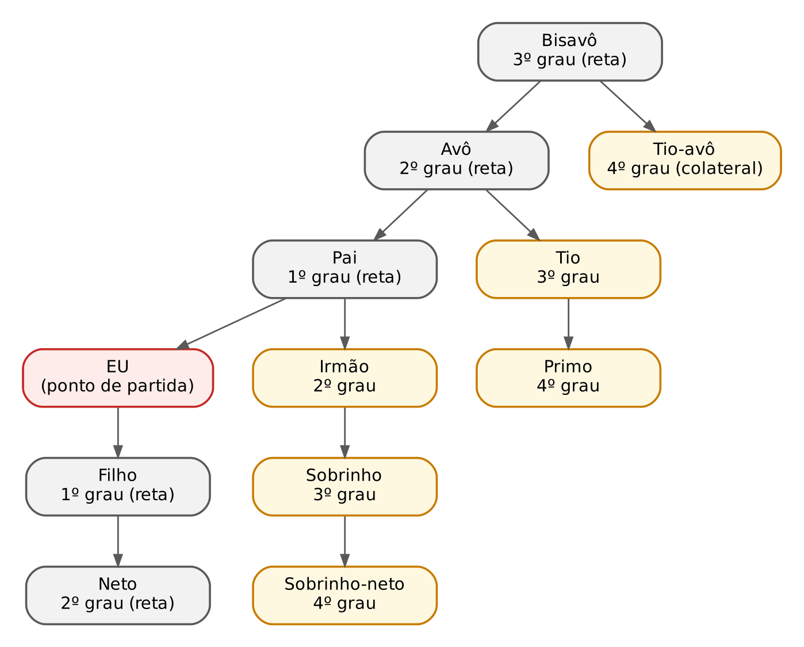
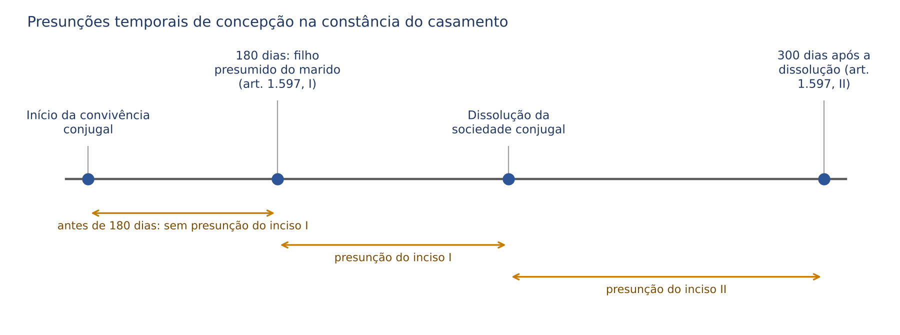
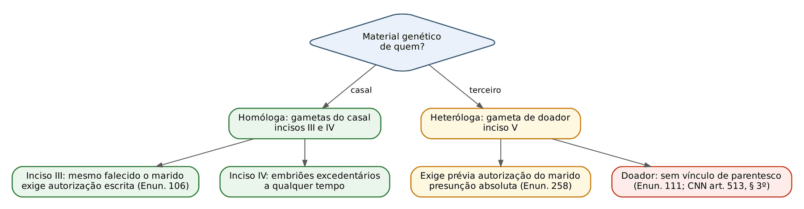
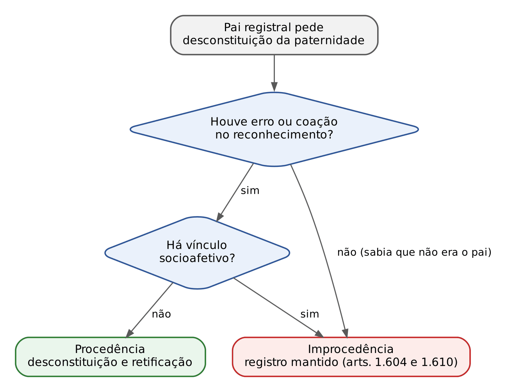
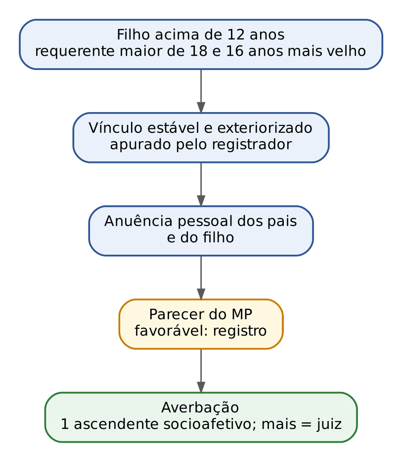
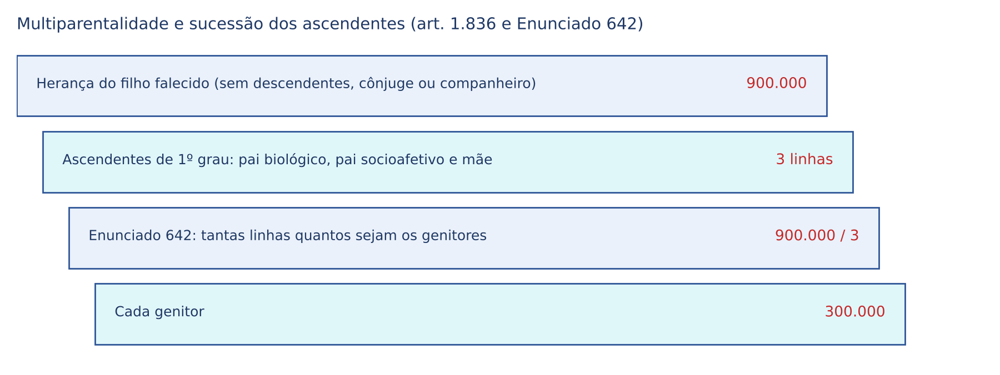

# CAPÍTULO 37 — DIREITO DAS FAMÍLIAS IV: PARENTESCO E FILIAÇÃO (PRESUNÇÕES, REPRODUÇÃO ASSISTIDA, SOCIOAFETIVIDADE, MULTIPARENTALIDADE, RECONHECIMENTO, INVESTIGAÇÃO E NEGATÓRIA, PATERNIDADE POST MORTEM E ASPECTOS CIVIS DA ADOÇÃO)

:::INCIDENCIA
Pontos: TRF5 p. 13; TJRS p. 19; TJSC p. 18. Nível A+; lote de 13 questões (FGV 10, FCC 3), mais correlatas de afinidade (Cap. 34) e de petição de herança (Cap. 42).
O que mais cai: multiparentalidade (Tema 622 do STF) com efeitos sucessórios; requisitos cumulativos da negatória (vício de vontade + ausência de socioafetividade); irrevogabilidade do reconhecimento (arts. 1.609 e 1.610); presunções do art. 1.597 (inclusive na união estável e na inseminação caseira); afinidade em linha reta que não se extingue (art. 1.595, § 2º); reconhecimento socioafetivo extrajudicial (CNN, arts. 505 a 511).
:::

| Subtema | FGV | FCC | Padrão de cobrança |
|---|---|---|---|
| Multiparentalidade (Tema 622) | 3 | 2 | caso de pai registral socioafetivo x pai biológico; alternativa certa = coexistência com todos os efeitos, inclusive sucessórios |
| Socioafetividade e reconhecimento extrajudicial | 2 | 0 | padrasto que quer formalizar o vínculo; requisitos do Provimento (idade, diferença de 16 anos, irrevogabilidade) |
| Negatória e anulação do registro | 1 | 1 | DNA negativo NÃO basta; exige vício + inexistência de socioafetividade |
| Reconhecimento voluntário | 1 | 0 | irrevogável; arrependimento por motivo familiar não desfaz |
| Presunções do art. 1.597 | 1 | 0 | caso com união estável, novo casamento e adultério (arts. 1.598, 1.600 e 1.602) |
| Reprodução assistida | 1 | 0 | registro de dupla maternidade, inseminação caseira, doador omitido |
| Igualdade da filiação e adoção multiparental | 1 | 0 | ECA e art. 227, § 6º, da CF; adoção sem rompimento de vínculo |

## 37.1 Parentesco (arts. 1.591 a 1.595)

### 37.1.1 Espécies: natural, civil e por afinidade

O art. 1.593 é a chave do subtítulo: "O parentesco é natural ou civil, conforme resulte de consangüinidade ou OUTRA ORIGEM". A expressão aberta "outra origem" (o CC/1916 falava só em adoção) é o fundamento positivo de três vínculos civis não consanguíneos: a adoção, a reprodução assistida heteróloga em relação ao pai ou mãe que não forneceu gameta e a socioafetividade (posse do estado de filho). É exatamente o Enunciado 103 da I Jornada, complementado pelo Enunciado 256 da III Jornada ("A posse do estado de filho (parentalidade socioafetiva) constitui modalidade de parentesco civil").

| Espécie | Origem | Fundamento | Observação de prova |
|---|---|---|---|
| Natural (consanguíneo) | Vínculo biológico | art. 1.593, primeira parte | prova por DNA; presunções do art. 1.597 |
| Civil: adoção | Sentença constitutiva | arts. 1.593, 1.618 e 1.619; ECA, art. 41 | rompe o vínculo com a família de origem, salvo impedimentos |
| Civil: reprodução heteróloga | Vontade de quem consentiu | art. 1.597, V; Enunciados 103 e 111 | o doador NÃO é parente |
| Civil: socioafetivo | Posse do estado de filho | art. 1.593 ("outra origem"); Enunciados 103, 256 e 519 | prova da posse de estado; registro judicial ou extrajudicial |
| Por afinidade | Casamento ou união estável | art. 1.595 | é parentesco "por aliança", com limites próprios (37.1.3) |

:::PEGADINHA Art. 1.593 é rol aberto
A FGV (PC-PI 2026, Delegado, Q3849005) colocou como alternativa a afirmação de que a filiação socioafetiva reconhecida judicialmente "não gera parentesco civil" porque o art. 1.593 só admitiria consanguinidade ou adoção. Falso: a "outra origem" abrange a socioafetividade (Enunciado 256). Desconfie de alternativa que trate a adoção como única forma de parentesco civil.
:::

### 37.1.2 Linhas e contagem dos graus

Linha reta: ascendentes e descendentes, SEM limite de grau (art. 1.591). Linha colateral ou transversal: pessoas de um só tronco, sem descenderem uma da outra, ATÉ O QUARTO GRAU (art. 1.592). Contagem (art. 1.594): na reta, pelo número de gerações; na colateral, também pelo número de gerações, "subindo de um dos parentes até ao ascendente comum, e descendo até encontrar o outro parente". Consequência que a banca adora: NÃO existe parente colateral de 1º grau (irmãos são o colateral mais próximo, em 2º grau).

| Parente | Linha | Grau | Por que |
|---|---|---|---|
| Pai, filho | reta | 1º | uma geração |
| Avô, neto | reta | 2º | duas gerações |
| Irmão | colateral | 2º | sobe ao pai (1) e desce ao irmão (2) |
| Tio, sobrinho | colateral | 3º | sobe ao avô (2) e desce ao tio (3) |
| Primo-irmão, tio-avô, sobrinho-neto | colateral | 4º | último grau de parentesco civil |
| Filho do primo, primo do pai | colateral | 5º | NÃO são parentes para o CC |

:::QUESTAO FGV 2026 — PC-PI — Perito Médico Legista (Q3852400)
Com quem se pode casar: bisneto, avó, tio, sobrinha-neta ou sobrinho? Gabarito: D. Para este capítulo, a contagem: a sobrinha-neta é colateral de 4º grau (sobe ao pai, desce ao irmão, ao sobrinho e à sobrinha-neta). Armadilha: confundir o limite do parentesco colateral (4º grau, art. 1.592) com o limite do impedimento matrimonial (3º grau, art. 1.521, IV) (questão comentada por inteiro no Cap. 34).
:::

:::DICA Onde cada limite de grau aparece
4º grau: limite do parentesco colateral (art. 1.592), da sucessão dos colaterais (art. 1.839 — ver Cap. 43), da legitimação para a tutela póstuma dos direitos da personalidade (art. 12, parágrafo único — ver Cap. 4) e do direito sucessório recíproco do adotado (ECA, art. 41, § 2º). 3º grau: impedimento matrimonial dos colaterais (art. 1.521, IV — ver Cap. 34) e impedimento de testemunha (art. 228, V — ver Cap. 10). 2º grau: obrigação alimentar entre irmãos (art. 1.697 — ver Cap. 39).
:::

### 37.1.3 Afinidade

"Cada cônjuge ou companheiro é aliado aos parentes do outro pelo vínculo da afinidade" (art. 1.595). Três regras de letra:

:::LEI Código Civil, art. 1.595
Art. 1.595. Cada cônjuge ou companheiro é aliado aos parentes do outro pelo vínculo da afinidade.
§ 1º O parentesco por afinidade limita-se aos ascendentes, aos descendentes e aos irmãos do cônjuge ou companheiro.
§ 2º Na linha reta, a afinidade não se extingue com a dissolução do casamento ou da união estável.
:::

- Alcance: sogro, sogra, padrasto, madrasta, enteado, genro, nora (reta, sem limite: o avô do cônjuge também é afim em 2º grau) e cunhados (colateral, SOMENTE os irmãos do cônjuge: 2º grau). Tio do cônjuge, sobrinho do cônjuge e "concunhados" (cônjuge do cunhado) NÃO são afins. Afinidade não gera afinidade: os parentes de um cônjuge não são afins dos parentes do outro.
- A união estável gera afinidade (art. 1.595, caput e § 2º, mencionam expressamente o companheiro).
- Extinção: a afinidade colateral (cunhadio) extingue-se com a dissolução do casamento ou da união estável; a afinidade em LINHA RETA é perpétua (§ 2º). Daí o impedimento do art. 1.521, II ("os afins em linha reta"), que torna NULO o casamento de ex-sogro com ex-nora, mesmo após divórcio ou viuvez.
- Socioafetividade gera afinidade: se o pai socioafetivo é pai para todos os efeitos, o genro do filho socioafetivo é seu afim em linha reta.

:::QUESTAO FGV 2026 — PC-PI — Delegado de Polícia (Q3849005)
Casal divorciado; a ex-esposa pretende casar com o pai do ex-marido. Gabarito: C (nulo, porque a afinidade em linha reta não se extingue com a dissolução do casamento anterior). Erradas: A (diz que a afinidade "desaparece" com o divórcio, verdade só para a colateral), B (trata o impedimento como causa de anulabilidade), D (diz que a afinidade com a ex-cunhada subsiste: a colateral se extingue) e E (nega parentesco civil à filiação socioafetiva).
No mesmo sentido: Q3744571 (FGV 2025, TJ-RS, Analista, gabarito C: ex-sogro e ex-nora, casamento nulo). Correlata, com sinal invertido: Q2386949 (FGV 2024, TJ-SC, Juiz Substituto, gabarito E: após o divórcio o ex-marido pode casar com a irmã da ex-mulher, pois a afinidade colateral se extingue).
:::

Questão correlata: Q3914289 (FGV, TJ-MS, 2026) — o pai socioafetivo gera afinidade em linha reta com o genro, que sobrevive ao divórcio, e o casamento entre eles é nulo (arts. 1.593, 1.595, § 2º, 1.521, II, e 1.548, II); comentada no Cap. 34.

### 37.1.4 Efeitos do parentesco (mapa de remissões)

| Efeito | Regra | Onde está |
|---|---|---|
| Impedimentos matrimoniais | reta (natural, civil e afim) e colaterais até o 3º grau | art. 1.521 (Cap. 34) |
| Alimentos | reciprocidade entre pais e filhos, extensiva aos ascendentes; na falta, descendentes e irmãos | arts. 1.694 a 1.697 (Cap. 39) |
| Sucessão legítima | descendentes, ascendentes e colaterais até o 4º grau | arts. 1.829 e 1.839 (Cap. 43) |
| Poder familiar, guarda, convivência avoenga | pais e avós | arts. 1.589, parágrafo único, e 1.630 (Cap. 38) |
| Tutela e curatela legítimas | ordem de parentes | arts. 1.731 e 1.775 (Cap. 41) |
| Prova testemunhal | impedimento até o 3º grau, consanguíneo ou afim | art. 228, V (Cap. 10) |
| Legitimação post mortem | direitos da personalidade: colateral até o 4º grau | art. 12, parágrafo único (Cap. 4) |

## 37.2 Filiação: igualdade e critérios

### 37.2.1 Princípio da igualdade entre os filhos

:::LEI Código Civil, art. 1.596 (repete o art. 227, § 6º, da CF)
Art. 1.596. Os filhos, havidos ou não da relação de casamento, ou por adoção, terão os mesmos direitos e qualificações, proibidas quaisquer designações discriminatórias relativas à filiação.
:::

As antigas categorias (legítimos, ilegítimos, naturais, adulterinos, incestuosos) foram abolidas. Reflexos de letra: no registro "não se fará qualquer referência à natureza da filiação" (Lei 8.560/1992, art. 5º); das certidões não constarão indícios de concepção extraconjugal (art. 6º), nem o estado civil dos pais e a natureza da filiação (§ 1º), ressalvadas certidões de inteiro teor por decisão judicial fundamentada (§ 2º); é vedado "legitimar e reconhecer filho na ata do casamento" (art. 3º).

A distinção entre filhos "havidos no casamento" e "fora do casamento" sobrevive apenas como técnica de ESTABELECIMENTO da paternidade (presunção para os primeiros, reconhecimento voluntário ou judicial para os segundos), nunca como diferença de direitos. O art. 1.617 completa: a filiação pode resultar de casamento declarado nulo, "ainda mesmo sem as condições do putativo".

:::QUESTAO FGV 2025 — AgSUS — Analista de Gestão (Psicologia) (Q3660368)
Pai com filha do casamento, filho extraconjugal e, depois, dois filhos adotados com o companheiro. Pergunta: quem é filho para direitos integrais segundo o ECA. Gabarito: E (filhos havidos ou não da relação do casamento e filhos por adoção — ECA, art. 20; CF, art. 227, § 6º). Armadilhas: "legítimos", "naturais" e restrição a casais heterossexuais são categorias incompatíveis com a igualdade.
:::

### 37.2.2 Os três critérios de determinação da filiação

| Critério | Fundamento | Quando prevalece |
|---|---|---|
| Jurídico ou presuntivo | presunção *pater is est* (art. 1.597) e registro (art. 1.603) | estabelece a paternidade sem prova; cede à impugnação procedente |
| Biológico (genético) | DNA; investigação de paternidade | regra na ação investigatória movida pelo FILHO; não prevalece contra a socioafetividade na negatória do pai registral |
| Socioafetivo | posse do estado de filho (art. 1.593) | protege o filho contra a desconstituição; pode coexistir com o biológico (Tema 622) |

A síntese jurisprudencial: o critério que prevalece depende de QUEM pede e CONTRA QUEM. O filho pode buscar a verdade biológica a qualquer tempo, sem perder o vínculo socioafetivo (multiparentalidade, 37.9); o pai registral que reconheceu sabendo ou que construiu vínculo afetivo não pode desfazê-lo invocando o DNA (37.6). A socioafetividade funciona como escudo do filho, não como arma contra ele (Enunciado 339: "A paternidade socioafetiva, calcada na vontade livre, não pode ser rompida em detrimento do melhor interesse do filho").

## 37.3 Presunções de paternidade (arts. 1.597 a 1.602)

### 37.3.1 O art. 1.597

:::LEI Código Civil, art. 1.597
Art. 1.597. Presumem-se concebidos na constância do casamento os filhos:
I - nascidos cento e oitenta dias, pelo menos, depois de estabelecida a convivência conjugal;
II - nascidos nos trezentos dias subsequentes à dissolução da sociedade conjugal, por morte, separação judicial, nulidade e anulação do casamento;
III - havidos por fecundação artificial homóloga, mesmo que falecido o marido;
IV - havidos, a qualquer tempo, quando se tratar de embriões excedentários, decorrentes de concepção artificial homóloga;
V - havidos por inseminação artificial heteróloga, desde que tenha prévia autorização do marido.
:::

Pontos de letra:
- Inciso I: o termo inicial é a "convivência conjugal", não a celebração (casamento por procuração seguido de coabitação posterior conta da coabitação). São 180 dias "pelo menos".
- Inciso II: 300 dias "subsequentes à dissolução da sociedade conjugal", com rol de causas (morte, separação judicial, nulidade, anulação). O divórcio não está no rol porque pressupõe dissolução anterior ou concomitante; a separação de fato, embora não esteja no rol, é tratada por parte da doutrina e da jurisprudência como marco que afasta a presunção quando comprovada (a convivência é o substrato fático do *pater is est*).
- Incisos III a V: reprodução assistida (37.4). Note que o inciso I usa "nascidos" e os incisos III a V usam "havidos".
- O artigo fala em "casamento" e "marido". A presunção estende-se à união estável (o STJ aplica o art. 1.597 por analogia à união estável, hetero ou homoafetiva — REsp 2.137.415, 37.4.5), mas a banca pode cobrar a literalidade: presunção LEGAL expressa só no casamento.

### 37.3.2 Conflito de presunções: o art. 1.598

Se a mulher contrai novas núpcias antes de decorridos os 10 meses da causa suspensiva (art. 1.523, II — ver Cap. 34) e lhe nasce filho, presume-se: (a) do PRIMEIRO marido, se nascido dentro dos 300 dias a contar do falecimento deste; (b) do SEGUNDO, se nascido após esse período e já decorridos 180 dias do novo casamento (art. 1.597, I). Tudo "salvo prova em contrário". O artigo resolve o *turbatio sanguinis*, razão de ser da causa suspensiva.

:::QUESTAO FGV 2025 — TJ-SE — Juiz Substituto (Q3301219)
Caso: união estável de dez anos (Valdinho) rompida em fevereiro de 2024, após romance da companheira com Romeu em janeiro; em maio ela se casa com Toninho; em julho de 2024 nasce Vaninha. Na investigação, só há carta da mãe confessando que usava, às escondidas, métodos contraceptivos com Valdinho e Romeu. Gabarito: A (o pai presumido é Valdinho).
Passos: (1) o nascimento ocorreu a menos de 300 dias da dissolução da união com Valdinho, presunção do inciso II aplicada à união estável; (2) o nascimento ocorreu a menos de 180 dias da convivência com Toninho, logo NÃO incide a presunção do inciso I em favor deste (art. 1.598, a contrario); (3) o adultério, "ainda que confessado", não ilide a presunção (art. 1.600) e a confissão materna não basta para excluí-la (art. 1.602).
Armadilhas: C e E apostam em Toninho, ignorando o prazo de 180 dias; C ainda nega presunção à união estável; B "presume" a incapacidade de conceber de Valdinho, quando só a prova da impotência à época da concepção ilide a presunção (art. 1.599); D inventa marco na homologação da partilha.
:::

### 37.3.3 Como se ilide a presunção

| Meio | Basta? | Fundamento |
|---|---|---|
| Prova da impotência do cônjuge para gerar, à época da concepção | SIM | art. 1.599 (*impotentia generandi*, não *coeundi*) |
| Adultério da mulher, ainda que confessado | NÃO | art. 1.600 |
| Confissão materna | NÃO | art. 1.602 |
| Exame de DNA negativo, na ação negatória do marido | Em regra sim quanto ao vínculo biológico, mas a ação pode ser julgada improcedente pela socioafetividade | arts. 1.601 e 1.604; 37.6 |
| Separação de fato comprovada à época da concepção | Afasta o substrato fático da presunção | construção doutrinária e jurisprudencial |

:::PEGADINHA Presunção relativa x absoluta
As presunções dos incisos I a IV são relativas (*iuris tantum*), afastáveis na negatória (art. 1.601). A do inciso V (heteróloga consentida) é tratada como ABSOLUTA: o marido que autorizou não pode contestar a paternidade (Enunciado 258: "Não cabe a ação prevista no art. 1.601 do Código Civil se a filiação tiver origem em procriação assistida heteróloga, autorizada pelo marido"). Fundamento: *venire contra factum proprium* e a vontade como causa do vínculo (Enunciado 104).
:::

### 37.3.4 Maternidade

A maternidade é, em regra, certa (*mater semper certa est*), provada pela DNV e pelo registro. Constando a maternidade do termo de nascimento, a mãe "só poderá contestá-la, provando a falsidade do termo, ou das declarações nele contidas" (art. 1.608). A regra é relativizada pela gestação de substituição (a parturiente não é a mãe registral — CNN, art. 513, § 1º, 37.4.4) e pela maternidade socioafetiva e dupla maternidade (37.4.5 e 37.8).

## 37.4 Reprodução assistida

### 37.4.1 Conceitos e leitura dos incisos III a V

Reprodução homóloga: gametas do próprio casal. Heteróloga: gameta (sêmen, óvulo ou embrião) de terceiro doador. As expressões do CC ("fecundação artificial", "concepção artificial", "inseminação artificial") devem ser lidas como "técnica de reprodução assistida" em geral (Enunciado 105), mas, para a PRESUNÇÃO legal, interpretam-se restritivamente, "não abrangendo a utilização de óvulos doados e a gestação de substituição" (Enunciado 257). Ou seja: a presunção do CC é desenhada para a paternidade do marido; a maternidade com óvulo doado e a cessão de útero se resolvem pela regulamentação administrativa e pelo critério volitivo.

| Inciso | Técnica | Requisito | Pegadinha |
|---|---|---|---|
| III | Homóloga, "mesmo que falecido o marido" | autorização ESCRITA do marido para uso póstumo e mulher na condição de VIÚVA (Enunciado 106) | se a viúva se casa de novo, a presunção não se aplica |
| IV | Embriões excedentários homólogos, "a qualquer tempo" | embrião formado com gametas do casal | sem limite temporal: pode nascer anos após a morte |
| V | Heteróloga | "prévia autorização do marido" (a lei não exige forma escrita) | presunção absoluta (Enunciado 258); doador não é pai |

### 37.4.2 Reprodução post mortem e direito sucessório

O inciso III resolve a FILIAÇÃO, não a sucessão. O art. 1.798 legitima a suceder as pessoas nascidas ou JÁ CONCEBIDAS no momento da abertura da sucessão: o embrião implantado após a morte e o filho concebido com sêmen congelado depois do óbito têm filiação presumida, mas sua vocação hereditária legítima é controvertida (parte da doutrina sustenta o direito à herança com base na igualdade dos filhos; outra parte nega, por falta de concepção na abertura; a via segura é a prole eventual testamentária do art. 1.799, I, com o prazo de dois anos do art. 1.800, § 4º — ver Cap. 44). Registro: além da DNV e da declaração da clínica, exige-se "termo de autorização prévia específica do falecido ou falecida para uso do material biológico preservado, lavrado por instrumento público ou particular com firma reconhecida" (CNN, art. 513, § 2º).

O Enunciado 633 da VIII Jornada admite que o viúvo ou companheiro sobrevivente recorra à reprodução póstuma por maternidade de substituição, "desde que haja expresso consentimento manifestado em vida" pela esposa ou companheira. E o Enunciado 570 diz que o reconhecimento de filho havido em união estável por heteróloga *a patre* consentida pelo companheiro apenas formaliza vínculo que se constituiu "no momento do início da gravidez".

### 37.4.3 Heteróloga: vínculo pela vontade e anonimato do doador

Na heteróloga, o pressuposto fático da relação sexual é substituído pela vontade juridicamente qualificada (Enunciado 104). O doador NÃO adquire vínculo de parentesco: "enquanto na adoção haverá o desligamento dos vínculos entre o adotado e seus parentes consangüíneos, na reprodução assistida heteróloga sequer será estabelecido o vínculo de parentesco entre a criança e o doador" (Enunciado 111). No plano registral: o conhecimento da ascendência biológica "não importará no reconhecimento do vínculo de parentesco e dos respectivos efeitos jurídicos entre o doador ou a doadora e o filho" (CNN, art. 513, § 3º), e o oficial "não poderá exigir a identificação do doador de material genético como condição para a lavratura do registro" (CNN, art. 479).

O anonimato é norma ética do CFM (Resolução CFM 2.320/2022, que revogou a 2.294/2021): mantém-se o sigilo entre doadores e receptores, com exceção para doação de gametas por parente de até 4º grau de um dos receptores, desde que não haja consanguinidade. O conflito com o direito ao conhecimento da origem genética é tratado em 37.11.

### 37.4.4 Gestação de substituição (cessão temporária de útero)

Não há lei federal; a disciplina é deontológica (Resolução CFM 2.320/2022) e registral (CNN). Pontos cobráveis da resolução: a cedente deve ter ao menos um filho vivo e pertencer à família de um dos parceiros em parentesco consanguíneo até o 4º grau; fora disso, exige-se autorização do Conselho Regional de Medicina; a cessão NÃO pode ter caráter lucrativo ou comercial (a "barriga de aluguel" onerosa é vedada; a doutrina invoca também o art. 199, § 4º, da CF, que veda a comercialização de órgãos, tecidos e substâncias humanas).

No registro, "não constará do registro o nome da parturiente, informado na declaração de nascido vivo, devendo ser apresentado termo de compromisso firmado pela doadora temporária do útero, esclarecendo a questão da filiação" (CNN, art. 513, § 1º). A regra *mater semper certa est* cede: mãe é quem planejou a gestação.

:::JURIS STJ, REsp 1.608.005 (Jurisprudência em Teses, ed. 226, tese 4)
"A inclusão de dupla paternidade no registro de nascimento de criança concebida com técnicas de reprodução assistida heteróloga e gestação por substituição não viola o instituto da adoção unilateral." Ou seja: casal homoafetivo masculino que usa óvulo doado e cessão de útero registra ambos os pais diretamente, sem precisar que o pai não biológico adote o filho do companheiro.
:::

### 37.4.5 Registro extrajudicial e a inseminação caseira

O CNN (Provimento CNJ 149/2023, arts. 512 a 515) permite o assento de nascimento do filho havido por reprodução assistida no Livro A, "independentemente de prévia autorização judicial" (art. 512), com o comparecimento de ambos os pais ou de um só, se casados ou em união estável (§ 1º). Para casais homoafetivos, o assento constará os nomes dos ascendentes "sem referência a distinção quanto à ascendência paterna ou materna" (§ 2º). Documentos (art. 513): DNV; declaração, com firma reconhecida, do diretor técnico da clínica indicando a técnica heteróloga e os beneficiários; certidão de casamento ou documento da união estável, "quando houver" (redação do Provimento CNJ 237, de 13/7/2026). É vedada a recusa do registro (art. 514). O Enunciado 608 já previa o registro direto de filhos de casais do mesmo sexo.

:::JURIS STJ, REsp 2.137.415-SP, Terceira Turma, Rel. Min. Nancy Andrighi, j. 15/10/2024 (Info 830)
É possível presumir a maternidade da mãe não biológica de criança gerada por inseminação artificial "caseira" (autoinseminação) durante união estável homoafetiva. Fundamentos: aplicação analógica do art. 1.597, V, à união estável (ADI 4.277 e ADPF 132); presença dos três requisitos (concepção na constância da união, técnica heteróloga, prévia autorização da companheira); inexistência de vedação legal; livre planejamento familiar e melhor interesse da criança. A exigência de declaração da clínica (CNN, art. 513, II) não se aplica à autoinseminação.
:::

:::QUESTAO FGV 2026 — MPE-RJ — Promotor de Justiça Substituto (Q4088277)
Duas mulheres pedem, na Justiça Itinerante, o registro da filha de seis dias, nascida de inseminação heteróloga em uma delas com consentimento da outra. Gabarito: D (pode ser admitido, inclusive preterindo-se a indicação do genitor biológico, se o nascimento ocorreu na constância de casamento OU união estável, com aplicação indistinta do art. 1.597, V, mesmo se a inseminação foi caseira).
Armadilhas: A restringe ao casamento; B exige acompanhamento clínico (afastado pelo REsp 2.137.415); C exige prova de maternidade socioafetiva; E impõe a indicação do genitor biológico, contrariando o anonimato e os arts. 479 e 513, § 3º, do CNN.
:::

## 37.5 Prova da filiação e mapa das ações de estado

### 37.5.1 Prova (arts. 1.603 a 1.606)

A filiação prova-se pela certidão do termo de nascimento (art. 1.603), e no "fato jurídico do nascimento" compreende-se a filiação consanguínea e também a socioafetiva (Enunciado 108). Na falta ou defeito do termo, admite-se qualquer prova "quando houver começo de prova por escrito, proveniente dos pais", ou "quando existirem veementes presunções resultantes de fatos já certos" (art. 1.605) — a posse do estado de filho é a principal dessas presunções.

:::LEI Código Civil, arts. 1.604 e 1.606
Art. 1.604. Ninguém pode vindicar estado contrário ao que resulta do registro de nascimento, salvo provando-se erro ou falsidade do registro.
Art. 1.606. A ação de prova de filiação compete ao filho, enquanto viver, passando aos herdeiros, se ele morrer menor ou incapaz.
Parágrafo único. Se iniciada a ação pelo filho, os herdeiros poderão continuá-la, salvo se julgado extinto o processo.
:::

O art. 1.606 é personalíssimo: os herdeiros só AJUÍZAM se o filho morreu antes dos 18 anos ou incapaz; se morreu capaz sem ajuizar, perderam a legitimidade própria para a ação de prova de filiação (mas podem ter legitimidade para a investigação avoenga ou para a ação de parentesco por direito próprio — Enunciado 521, 37.10.1). Se o filho ajuizou, os herdeiros CONTINUAM, salvo extinção do processo.

### 37.5.2 Quadro das ações de filiação

:::PROCESSO Ações de estado de filiação: quem, contra quem, prazo
| Ação | Legitimidade ativa | Prazo | Fundamento |
|---|---|---|---|
| Negatória de paternidade (contestação da paternidade presumida) | SOMENTE o marido (personalíssima); herdeiros apenas prosseguem | imprescritível | art. 1.601 |
| Anulatória de registro (erro ou falsidade) | qualquer interessado (moral ou material) | imprescritível em regra (ação de estado) | art. 1.604; REsp 1.952.565 |
| Contestação de maternidade | mãe, provando falsidade do termo ou das declarações | — | art. 1.608 |
| Impugnação do reconhecimento pelo filho | filho reconhecido antes dos 18 anos | 4 anos após a maioridade ou emancipação | art. 1.614 |
| Prova de filiação | filho; herdeiros se morreu antes dos 18 anos ou incapaz | imprescritível | art. 1.606 |
| Investigação de paternidade ou maternidade | filho (representado ou assistido); MP (Lei 8.560, art. 2º, § 4º); descendentes contra avós (Enunciado 521) | imprescritível | ECA, art. 27; arts. 1.615 e 1.616 |
| Petição de herança cumulada | herdeiro | prescreve em 10 anos da abertura da sucessão | Súmula 149 do STF (ver Cap. 42) |
:::

## 37.6 Ação negatória de paternidade e anulação do registro

### 37.6.1 Regime legal

:::LEI Código Civil, art. 1.601
Art. 1.601. Cabe ao marido o direito de contestar a paternidade dos filhos nascidos de sua mulher, sendo tal ação imprescritível.
Parágrafo único. Contestada a filiação, os herdeiros do impugnante têm direito de prosseguir na ação.
:::

Três notas de letra: (1) imprescritível (o CC/1916 tinha prazos exíguos; o CC/2002 os aboliu); (2) legitimidade EXCLUSIVA do marido (e, por extensão jurisprudencial, do companheiro e do pai registral), sem iniciativa dos herdeiros, que apenas prosseguem; (3) o artigo trata da paternidade PRESUMIDA (filhos "nascidos de sua mulher"); o pai que reconheceu filho fora do casamento desconstitui o vínculo por anulatória (arts. 1.604 e 1.609, com prova de vício), não pela negatória do art. 1.601 — na prática forense ambas são chamadas de "negatória".

:::JURIS STJ, REsp 1.952.565-DF, Terceira Turma, Rel. Min. Marco Aurélio Bellizze, j. 12/3/2024 (Info 20, edição extraordinária)
Negatória (art. 1.601) e anulatória (art. 1.604) não se confundem: a primeira é personalíssima do pai registral; a segunda, fundada em erro ou falsidade, pode ser movida por qualquer interessado. No caso, a viúva do pai registral teve legitimidade para anular registro em que o bisavô registrara o bisneto como filho (falsidade ideológica).
:::

### 37.6.2 Requisitos para desconstituir a paternidade registral

A orientação consolidada do STJ exige DOIS requisitos CUMULATIVOS: (a) vício de consentimento no reconhecimento (erro ou coação: o pai foi induzido a crer que era o genitor) e (b) inexistência de vínculo socioafetivo. O DNA negativo, isoladamente, NÃO basta. Em 2025, a Terceira Turma (Rel. Min. Nancy Andrighi, por maioria, processo em segredo de justiça, notícia de 10/6/2025) reafirmou que a divergência entre a paternidade biológica e a registral não anula, por si só, o registro: provado o erro, mas demonstrado o afeto por depoimentos, o pedido foi rejeitado.

Consequências do roteiro:
- Reconhecimento consciente de filho alheio ("adoção à brasileira") não é erro: não há vício a anular. O STJ (REsp 1.352.529-SP, Quarta Turma, Rel. Min. Luis Felipe Salomão, j. 24/2/2015) negou a negatória de quem registrou o filho da namorada sabendo não ser o pai e, após o fim do relacionamento, quis desfazer o vínculo por razões patrimoniais: "em linha de princípio, a paternidade socioafetiva prevalece sobre a verdade biológica" na ação do pai registral.
- O conhecimento da ausência de vínculo biológico somado à posse de estado de filho "obstam a contestação da paternidade presumida" (Enunciado 520).
- Na heteróloga consentida, sequer cabe a ação (Enunciado 258).

:::QUESTAO FCC 2025 — DPE-AM — Defensor Público (Q3531641)
Pai que registrou a filha logo após o nascimento, durante união estável de cinco anos com a mãe, quer excluir a paternidade da adolescente de 12 anos, alegando não ser o pai biológico. Gabarito: C (é possível desde que presentes duas condições: prova de que foi coagido ou induzido a erro e inexistência de relação socioafetiva).
Armadilhas: A (a divergência biológica "por si só" anularia o registro); B (cabe negatória mesmo com dolo ou culpa do pai); D (via administrativa com DNA negativo: não existe desconstituição extrajudicial; o próprio CNN, art. 505, § 1º, só admite desconstituição judicial do reconhecimento); E (concordância da mãe e anuência da adolescente como condições).
:::

:::QUESTAO FGV 2024 — Câmara Municipal de São Paulo — Procurador Legislativo (Q2351277)
Marido descobre infidelidade da esposa; DNA nega o vínculo com o filho de 14 anos, a quem sempre dedicou cuidado e afeto, e confirma o da filha de 10. Quer divórcio culposo e negatória com anulação do registro. Gabarito: E (para a negatória cumulada com anulação do registro é preciso demonstrar a inexistência de relação socioafetiva).
Armadilhas: A e B ressuscitam a culpa no divórcio (abolida — ver Cap. 34); C diz que "basta o exame negativo"; D exige confissão da mãe e consentimento do adolescente (o art. 1.602 mostra que a confissão materna nem sequer basta para excluir a paternidade).
:::

### 37.6.3 Rompimento do vínculo a pedido do FILHO: abandono

A socioafetividade, que protege o filho, também pode justificar a desconstituição quando AUSENTE e quando o pedido parte do filho.

:::JURIS STJ, REsp 2.117.287-PR, Terceira Turma, Rel. Min. Nancy Andrighi, j. 18/2/2025 (Info 842)
É possível o rompimento do vínculo de filiação entre pai e filho MAIOR de idade se constatada a inexistência de relação socioafetiva, além da quebra dos deveres de cuidado do pai registral, consubstanciada no abandono material e afetivo. Se a socioafetividade autoriza criar vínculo, sua ausência, somada à violação da paternidade responsável, pode autorizar desfazê-lo.
:::

Distinga: a supressão do sobrenome paterno por abandono, sem desconstituir a filiação, é tema de nome (ver Cap. 4); a indenização por abandono afetivo é tema do Cap. 38 (danos nas relações familiares).

:::SENTENCA Dispositivo de improcedência da negatória
"Embora o exame pericial tenha excluído a paternidade biológica, a prova oral demonstrou que o autor exerceu, por mais de dez anos, de forma pública e contínua, a função paterna, configurada a posse do estado de filho. Ausente vício de consentimento no reconhecimento e presente o vínculo socioafetivo, não se autoriza a desconstituição do registro (arts. 1.593, 1.604 e 1.610 do CC). Julgo improcedente o pedido." Lembre: o réu é o filho (representado, com curador especial se houver colidência com a mãe-representante), com intervenção obrigatória do MP se houver interesse de incapaz.
:::

## 37.7 Reconhecimento voluntário de filhos (arts. 1.607 a 1.614; Lei 8.560/1992)

### 37.7.1 Natureza e formas

O reconhecimento (perfilhação) é ato jurídico em sentido estrito, unilateral, declaratório (efeitos *ex tunc*, desde o nascimento ou a concepção), personalíssimo, formal e irrevogável. Pode ser feito pelos pais "conjunta ou separadamente" (art. 1.607). O reconhecimento por pessoa relativamente incapaz independe de assistência de pais, tutor ou curador (CNN, art. 501, § 4º).

:::LEI Código Civil, arts. 1.609 e 1.610 (o art. 1º da Lei 8.560/1992 repete os incisos)
Art. 1.609. O reconhecimento dos filhos havidos fora do casamento é irrevogável e será feito:
I - no registro do nascimento;
II - por escritura pública ou escrito particular, a ser arquivado em cartório;
III - por testamento, ainda que incidentalmente manifestado;
IV - por manifestação direta e expressa perante o juiz, ainda que o reconhecimento não haja sido o objeto único e principal do ato que o contém.
Parágrafo único. O reconhecimento pode preceder o nascimento do filho ou ser posterior ao seu falecimento, se ele deixar descendentes.
Art. 1.610. O reconhecimento não pode ser revogado, nem mesmo quando feito em testamento.
:::

Detalhes de letra que viram alternativa:
- Escrito particular basta (inciso II), "a ser arquivado em cartório"; o CNN (art. 501) admite o reconhecimento espontâneo perante qualquer oficial de registro civil, a qualquer tempo, por escrito particular ou termo, com averbação direta e sem MP ou juiz, mas com anuência escrita do filho maior ou, se criança ou adolescente, da mãe (art. 502).
- Testamento: o reconhecimento vale "ainda que incidentalmente manifestado" e NÃO se revoga com a revogação do testamento (art. 1.610). Também vale se o testamento for nulo por vício de forma? A doutrina majoritária admite que a declaração valha como escrito particular (aproveitamento), mas a banca cobra a letra do art. 1.610.
- Manifestação perante o juiz em qualquer processo (audiência de alimentos, inventário), "ainda que o reconhecimento não haja sido o objeto único e principal do ato".
- Nascituro: o reconhecimento pode PRECEDER o nascimento. Filho falecido: só pode ser reconhecido "se ele deixar descendentes" (impede o reconhecimento interesseiro para herdar do filho morto sem prole).
- É VEDADO reconhecer filho na ata do casamento (Lei 8.560, art. 3º), ressalvada a averbação da alteração do patronímico materno.

### 37.7.2 Irrevogabilidade x invalidade

Irrevogável não significa inatacável. Não se REVOGA (arrependimento, novo casamento, desavença com a mãe, mudança de testamento), mas se ANULA por vício de vontade (erro, coação), fraude ou simulação, ou se desconstitui por falsidade (art. 1.604), sempre pela via judicial (CNN, art. 505, § 1º, para o socioafetivo) e observado o filtro da socioafetividade (37.6.2).

:::QUESTAO FGV 2026 — MPE-GO — Promotor de Justiça Substituto (Q3865818)
Homem reconheceu por escritura pública, sem DNA, o filho de 10 anos de relacionamento eventual; casou-se depois e, porque a esposa se incomodava com o enteado, ajuizou anulação alegando ter sido "induzido em erro" por não ter feito exame. Gabarito: B (o reconhecimento é irrevogável, sendo ineficaz qualquer tentativa de revogação, inclusive por novo instrumento ou testamento).
Por que: não houve erro (ele próprio afirmou não ter dúvidas e dispensou o exame); o motivo é conjugal superveniente, típica tentativa de revogação. Armadilhas: A ("revogável a qualquer tempo com motivo justo"); C (exige homologação judicial da escritura: o inciso II dispensa); D (revogação por erro "desde que não haja vínculo socioafetivo" — mistura revogação com anulação e não se ajusta ao caso); E (irrevogabilidade só após DNA e anuência materna).
:::

### 37.7.3 Consentimento do filho maior e impugnação pelo filho reconhecido antes dos 18 anos

:::LEI Código Civil, art. 1.614
Art. 1.614. O filho maior não pode ser reconhecido sem o seu consentimento, e o menor pode impugnar o reconhecimento, nos quatro anos que se seguirem à maioridade, ou à emancipação.
:::

- Filho maior: o consentimento é requisito de EFICÁCIA do reconhecimento (também Lei 8.560, art. 4º). Para o socioafetivo extrajudicial, o consentimento é exigido também do filho com mais de 12 anos (CNN, art. 507, §§ 4º e 5º).
- Prazo de 4 anos (decadencial) para o filho reconhecido durante a menoridade impugnar o reconhecimento. Atenção: o STJ entende que esse prazo se refere à impugnação do reconhecimento em si (desfazer o vínculo sem buscar outro), NÃO alcançando a investigação da verdadeira paternidade, que é imprescritível (ECA, art. 27).
- Condição e termo apostos ao reconhecimento são INEFICAZES (art. 1.613): o ato vale, a cláusula é que se tem por não escrita. Não é nulidade do reconhecimento.

### 37.7.4 Efeitos e regras de convivência

| Regra | Conteúdo | Fundamento |
|---|---|---|
| Lar conjugal | O filho havido fora do casamento, reconhecido por um dos cônjuges, NÃO poderá residir no lar conjugal sem o consentimento do outro | art. 1.611 (leitura constitucional: cede ao melhor interesse da criança) |
| Guarda | O filho reconhecido, enquanto criança ou adolescente, fica sob a guarda do genitor que o reconheceu; se ambos o reconheceram e não houver acordo, de quem melhor atender a seus interesses | art. 1.612 (ver guarda no Cap. 38) |
| Sentença de investigação | Produz os mesmos efeitos do reconhecimento, mas pode ordenar que o filho se crie fora da companhia dos pais ou daquele que contestou a qualidade | art. 1.616 |
| Nome | Inclusão do sobrenome e efeito expansivo aos descendentes e cônjuge | LRP, art. 57, IV (ver Cap. 4) |

### 37.7.5 Averiguação oficiosa (Lei 8.560, art. 2º)

Registro de criança apenas com a maternidade estabelecida: o oficial remete ao juiz certidão e os dados do suposto pai indicado pela mãe; o juiz ouve a mãe "sempre que possível" e notifica o suposto pai, "independente de seu estado civil" (§ 1º), podendo determinar segredo de justiça (§ 2º). Confirmada a paternidade, lavra-se termo e averba-se (§ 3º). Se o suposto pai não atender em 30 DIAS ou negar, os autos vão ao MP para, havendo elementos suficientes, propor a investigação (§ 4º) — o CNN, art. 499, § 4º, menciona também a Defensoria Pública. A ação do MP é dispensável se a criança for encaminhada para adoção (§ 5º), e sua iniciativa não impede a de quem tenha legítimo interesse (§ 6º). O procedimento não pode ser usado se já pleiteado em juízo o reconhecimento (CNN, art. 500).

:::PEGADINHA Legitimidade do MP
O MP tem legitimidade extraordinária para a investigação de paternidade (Lei 8.560, art. 2º, § 4º), mas ela é concorrente, não exclusiva (§ 6º), e depende de "elementos suficientes". Não confunda com a legitimidade do MP para a ação de alimentos de criança (matéria do Cap. 39).
:::

## 37.8 Socioafetividade e posse do estado de filho

### 37.8.1 Conceito e prova

A parentalidade socioafetiva assenta na posse do estado de filho, tradicionalmente decomposta em três elementos: *nomen* (uso do nome familiar, dispensável), *tractatus* (tratamento recíproco como pai e filho) e *fama* ou *reputatio* (reconhecimento social da relação). O reconhecimento judicial "deve ocorrer a partir da relação entre pai(s) e filho(s), com base na posse do estado de filho, para que produza efeitos pessoais e patrimoniais" (Enunciado 519). Gera todos os efeitos do parentesco: alimentos (Enunciado 341: a relação socioafetiva "pode ser elemento gerador de obrigação alimentar"), sucessão, impedimentos, afinidade, nome.

Não se exige forma: a socioafetividade NÃO depende de escritura ou adoção (é a alternativa errada E da Q4116956). Nem se confunde com mero afeto ou com a convivência de padrasto e enteado: exige-se exercício da função parental de modo público, contínuo e duradouro, com intenção de ser pai ou mãe.

:::JURIS STJ, REsp 2.075.230-RJ, Terceira Turma, Rel. Min. Nancy Andrighi, j. 11/2/2025 (Info 842)
É cabível o reconhecimento de filiação socioafetiva APÓS A MORTE do pai ou mãe socioafetivos, desde que verificada a posse do estado de filho e o conhecimento público e contínuo dessa condição. A filiação socioafetiva difere da adoção por dispensar procedimento formal e solene, bastando o reconhecimento judicial de vínculo preexistente; a mudança de convivência na fase adulta não descaracteriza o afeto construído na infância e juventude.
:::

### 37.8.2 Socioafetividade x adoção: avós e irmãos

O art. 42, § 1º, do ECA proíbe a adoção por ascendentes e irmãos do adotando. A pergunta de prova: o impedimento se estende à socioafetividade?

| Situação | Solução | Fonte |
|---|---|---|
| Reconhecimento JUDICIAL de filiação socioafetiva entre avós e neto, mantido o vínculo com a mãe biológica | Juridicamente possível: o art. 42, § 1º, do ECA não se aplica à socioafetividade, que não exige destituição do poder familiar e apenas declara vínculo consolidado | STJ, REsp 2.107.638-SP, Terceira Turma, Rel. Min. Nancy Andrighi, j. 12/11/2024 (Info 834) |
| ADOÇÃO de neto por avós | Vedada em regra; admitida excepcionalmente quando presentes requisitos cumulativos (avós exercendo com exclusividade as funções parentais desde o nascimento, estudo psicossocial, adotando que vê os avós como pais e o genitor como irmão, ausência de conflito familiar e de motivo econômico, reais vantagens) | STJ, REsp 1.587.477-SC, Quarta Turma, Rel. Min. Luis Felipe Salomão, j. 10/3/2020 |
| Adoção avoenga baseada apenas em convivência e no tratamento do avô como pai, por neto concebido por inseminação artificial | Insuficiente para afastar a vedação | STJ, j. 5/11/2024 (Info 833), processo em segredo |
| Reconhecimento EXTRAJUDICIAL socioafetivo por irmão ou ascendente | Vedado | CNN, art. 505, § 3º |

:::PEGADINHA Extrajudicial x judicial
A vedação de reconhecimento socioafetivo por irmãos e ascendentes está no PROVIMENTO (via cartório). Pela via judicial, o STJ admitiu o vínculo socioafetivo entre avós e neto (REsp 2.107.638). Alternativa que diga que "avós jamais podem ser reconhecidos como pais socioafetivos" está errada.
:::

### 37.8.3 Reconhecimento extrajudicial da parentalidade socioafetiva (CNN, arts. 505 a 511)

O Provimento CNJ 63/2017 (alterado pelo 83/2019) foi incorporado ao Código Nacional de Normas (Provimento CNJ 149/2023).

:::LEI Provimento CNJ 149/2023 (CNN), art. 505
Art. 505. O reconhecimento voluntário da paternidade ou da maternidade socioafetiva de pessoas acima de 12 anos de idade será autorizado perante os oficiais de registro civil das pessoas naturais.
§ 1º O reconhecimento voluntário da paternidade ou da maternidade será irrevogável, somente podendo ser desconstituído pela via judicial, nas hipóteses de vício de vontade, fraude ou simulação.
§ 2º Poderão requerer o reconhecimento da paternidade ou da maternidade socioafetiva de filho os maiores de 18 anos de idade, independentemente do estado civil.
§ 3º Não poderão reconhecer a paternidade ou a maternidade socioafetiva os irmãos entre si nem os ascendentes.
§ 4º O pretenso pai ou mãe será pelo menos 16 anos mais velho que o filho a ser reconhecido.
:::

| Requisito | Regra | Artigo do CNN |
|---|---|---|
| Idade do filho | acima de 12 anos (abaixo: só judicial) | 505, caput |
| Requerente | maior de 18, qualquer estado civil, 16 anos mais velho; não irmão nem ascendente | 505, §§ 2º a 4º |
| Vínculo | estável e exteriorizado socialmente; registrador apura por elementos concretos (matrícula escolar, plano de saúde, mesma residência, casamento ou união com o genitor, fotos, testemunhas) | 506 |
| Anuências | pai e mãe do reconhecido, se criança ou adolescente; consentimento do filho; colheita PESSOAL; falta ou impossibilidade: juiz | 507, §§ 3º a 6º |
| Pessoa com deficiência | regras da tomada de decisão apoiada | 507, § 7º |
| Disposição de última vontade | admitida, por documento público ou particular | 507, § 8º |
| MP | parecer obrigatório; favorável, registra; desfavorável, arquiva; dúvida, juiz | 507, § 9º |
| Suspeita de fraude, vício ou dúvida sobre a posse de estado | recusa fundamentada e remessa ao juiz | 508 |
| Litígio | discussão judicial sobre filiação ou adoção obsta a via extrajudicial; declaração do requerente sob pena de ilícito civil e penal | 509 |
| Limite | somente unilateral; no máximo 2 pais e 2 mães; via cartório só UM ascendente socioafetivo; mais de um: judicial | 510 |
| Verdade biológica | o reconhecimento socioafetivo não obsta a discussão judicial da verdade biológica | 511 |

:::QUESTAO FGV 2026 — TJ-MS — Delegações de Notas e de Registro, Remoção (Q3914268)
Companheiro de 28 anos quer reconhecer, no cartório, a paternidade socioafetiva do filho de 12 anos da companheira (que tem pai registral), vínculo exteriorizado socialmente; foi advertido da irrevogabilidade, salvo desconstituição judicial por vício de vontade, fraude ou simulação. Gabarito: E (pode ser realizado da forma alvitrada, correta a explicação sobre a irrevogabilidade).
Por que: diferença de 16 anos atendida; requerente maior; o pai registral permanece (até 2 pais no campo filiação, art. 510), sem destituição do poder familiar (A errada); a via judicial não é obrigatória (C errada); a irrevogabilidade está no art. 505, § 1º (D errada). Ponto discutível: o caput fala em "acima de 12 anos" e o enteado tem exatamente 12; a banca tratou como apto (ver nota de verificação).
:::

:::QUESTAO FGV 2025 — DPE-RO — Analista em Psicologia (Q3401944)
Menino que perdeu o pai aos 4 anos, guarda fotos dele e chama de pai o padrasto, com quem convive desde os 6; o padrasto quer formalizar o vínculo. Gabarito: C (reconhecimento de paternidade socioafetiva).
Armadilhas: E (adoção cumulada com suspensão do poder familiar: rompe a memória e o vínculo com o pai falecido, desnecessariamente); B (investigação é para vínculo biológico); A e D (tutela e guarda não criam filiação).
:::

## 37.9 Multiparentalidade (Tema 622 do STF)

### 37.9.1 A tese

:::JURIS STF, RE 898.060-SC, Plenário, Rel. Min. Luiz Fux, j. 21 e 22/9/2016 (Tema 622; Info 840)
"A paternidade socioafetiva, declarada ou não em registro público, não impede o reconhecimento do vínculo de filiação concomitante baseado na origem biológica, com os efeitos jurídicos próprios." O STJ reproduz a tese na Jurisprudência em Teses, ed. 226, tese 3.
:::

Leitura que a banca explora:
- "Declarada ou não em registro": vale para socioafetividade registral (adoção à brasileira, reconhecimento extrajudicial) e para a meramente fática.
- "Concomitante": não há hierarquia; nenhum vínculo exclui o outro (erradas, sempre, as alternativas "prevalece automaticamente", "impede", "exige prévia exclusão do registro", "escolher um vínculo principal").
- "Com os efeitos jurídicos próprios": efeitos pessoais e patrimoniais plenos de ambos os vínculos: nome, parentesco com as duas famílias, alimentos (inclusive do pai biológico, que não se exime pelo fato de existir pai socioafetivo), poder familiar, guarda e convivência, e sucessão.
- O filho pode herdar de todos os ascendentes reconhecidos (Enunciado 632). Na sucessão do filho pelos ascendentes, "a herança deverá ser dividida em tantas linhas quantos sejam os genitores" (Enunciado 642), afastando a divisão rígida em linha paterna e materna do art. 1.836, § 2º.

:::EXEMPLO Sucessão com multiparentalidade
Filho morre solteiro, sem descendentes, deixando 900.000 (novecentos mil) reais; tem pai biológico, pai socioafetivo e mãe. Pelo art. 1.836, § 2º, lido literalmente, metade iria à linha paterna (dividida entre os dois pais: 225.000 cada) e metade à materna (450.000). Pelo Enunciado 642, a divisão é por cabeça de genitor: 300.000 (trezentos mil) reais para cada um. Havendo cônjuge sobrevivente em concorrência (art. 1.837 — ver Cap. 43), a fração do cônjuge diante de três ascendentes de 1º grau não tem solução legal nem jurisprudencial consolidada; registre o debate na prova discursiva.
:::

:::QUESTAO FGV 2026 — MPE-MT — Promotor de Justiça Substituto (Q4116956)
Filho registrado e criado pelo pai socioafetivo descobre na vida adulta o pai biológico e pede o reconhecimento biológico sem excluir o socioafetivo; o pai registral alega exclusão necessária. Gabarito: B (reconhecimento simultâneo, com efeitos próprios, inclusive sucessórios: multiparentalidade).
Armadilhas: A ("filiação una e indivisível"), C (socioafetivo impede o biológico), D (anulação prévia do registro), E (socioafetividade só por escritura ou adoção).
No mesmo sentido: Q3856338 (FGV 2026, TJ-MS, Analista, gabarito D: reconhecimento simultâneo com todos os efeitos; erradas a prevalência automática do biológico, a unicidade do vínculo, a exclusão prévia e a restrição a efeitos registrais).
:::

:::QUESTAO FCC 2026 — DPE-MA — Defensor Público (Q4012595)
Rapaz sem pai registral, criado pelo padrasto desde os 2 anos e por ele reconhecido extrajudicialmente aos 16, descobre aos 18 que o pai biológico já morreu. Gabarito: C (pode ter o vínculo biológico reconhecido no registro, inclusive participando da sucessão do pai biológico).
Passos: (1) Tema 622: o vínculo socioafetivo registrado não impede o biológico; (2) "com os efeitos jurídicos próprios" inclui herança; (3) investigação post mortem contra os herdeiros do pai biológico (37.10.3), imprescritível, mas a petição de herança prescreve em 10 anos da abertura da sucessão (Súmula 149 do STF — ver Cap. 42). Armadilhas: A (só se não houvesse registro socioafetivo), B (registro sem sucessão), D (exclusão automática), E (vínculo "principal").
:::

:::QUESTAO FCC 2025 — DPE-RS — Defensor Público (Q3386998)
Afirmações sobre multiparentalidade. Gabarito: A (determina a coexistência das responsabilidades entre todos os genitores, sem excluir os direitos e deveres dos pais biológicos). Erradas: B (cabe o registro na certidão), C (nega a coexistência socioafetiva x biológica), D (herança restrita à filiação biológica), E (prevalência do interesse dos genitores: o norte é o melhor interesse do filho).
:::

### 37.9.2 Limites e desdobramentos

- Registro: até dois pais e duas mães no campo filiação; via cartório, só um ascendente socioafetivo (CNN, art. 510).
- Adoção prévia: como a adoção rompe os vínculos com a família de origem (ECA, art. 41), parte da doutrina (Tartuce) sustenta a impossibilidade de multiparentalidade biológica após adoção regular, pois o vínculo biológico foi juridicamente extinto; o direito do adotado é de conhecer a origem (ECA, art. 48), não de restabelecer o parentesco.
- Multiparentalidade como alternativa à destituição: no AREsp 2.775.957-MT (Quarta Turma, Rel. Min. Raul Araújo, j. 12/8/2025, Info 858), o STJ manteve acórdão que, em vez de destituir do poder familiar a mãe biológica (vítima de violência sexual aos 14 anos, que entregara a filha sem saber que poderia permanecer com ela no acolhimento institucional), reconheceu a multiparentalidade com o casal guardião, com direito de visitas à mãe, por não se enquadrar ela em nenhuma hipótese do art. 1.638 do CC.
- Uso abusivo: a doutrina admite negar efeitos patrimoniais quando a busca do vínculo biológico tem finalidade exclusivamente econômica (por exemplo, pedido feito só após a morte do genitor rico, sem qualquer interesse existencial), mas a orientação do STF não estabeleceu essa restrição; trate como tese doutrinária.

:::QUESTAO FGV 2025 — AgSUS — Analista de Gestão (Psicologia) (Q3660377)
Jovem acolhido afetivamente por um casal tem uma filha que passa a ser criada pelo casal, reconhecendo como pais o avô afetivo e o próprio genitor; a Defensoria pede adoção multiparental. Gabarito: B (a proposta está correta, pois garante o reconhecimento legal do que já existe afetivamente).
Armadilhas: A (toda adoção rompe vínculos: a multiparental preserva o genitor), C (legitimidade exclusiva do MP), D (a criança já tem pai) e E (vedação a dois pais do mesmo sexo).
:::

## 37.10 Investigação de paternidade (e de maternidade)

### 37.10.1 Natureza, legitimidade e imprescritibilidade

:::LEI ECA, art. 27
Art. 27. O reconhecimento do estado de filiação é direito personalíssimo, indisponível e imprescritível, podendo ser exercitado contra os pais ou seus herdeiros, sem qualquer restrição, observado o segredo de Justiça.
:::

A tese é reproduzida pelo STJ na Jurisprudência em Teses, ed. 138, tese 4 ("direito personalíssimo, indisponível e imprescritível, assentado no princípio da dignidade da pessoa humana"). A ação é declaratória de estado, por isso imprescritível; a petição de herança, condenatória, prescreve (Súmula 149 do STF, termo inicial na abertura da sucessão — ver Cap. 42; correlatas Q3505758 e Q3390841, ambas com gabarito "10 anos da abertura da sucessão, ainda que a paternidade seja reconhecida depois").

| Polo | Quem | Fundamento |
|---|---|---|
| Ativo | o filho (criança ou adolescente representado ou assistido) | ECA, art. 27 |
| Ativo | MP, havendo elementos, após a averiguação oficiosa; legitimidade concorrente | Lei 8.560, art. 2º, §§ 4º e 6º |
| Ativo | descendentes, por direito próprio, contra avós ou ascendentes de grau superior, ainda que o pai não tenha iniciado a ação em vida (investigação avoenga) | Enunciado 521 |
| Ativo | herdeiros do filho: continuam a ação; ajuízam só se ele morreu antes dos 18 anos ou incapaz (ação de prova de filiação) | art. 1.606 |
| Passivo | o suposto pai; se falecido, seus HERDEIROS (não o espólio, que não tem estado de família) | ECA, art. 27 ("contra os pais ou seus herdeiros") |
| Contestação | "Qualquer pessoa, que justo interesse tenha" (cônjuge, outros filhos, herdeiros) | art. 1.615 |

### 37.10.2 Prova: DNA, recusa e presunção

:::LEI Lei 8.560/1992, art. 2º-A (com a Lei 14.138/2021)
Art. 2º-A. Na ação de investigação de paternidade, todos os meios legais, bem como os moralmente legítimos, serão hábeis para provar a verdade dos fatos.
§ 1º A recusa do réu em se submeter ao exame de código genético - DNA gerará a presunção da paternidade, a ser apreciada em conjunto com o contexto probatório.
§ 2º Se o suposto pai houver falecido ou não existir notícia de seu paradeiro, o juiz determinará, a expensas do autor da ação, a realização do exame de pareamento do código genético (DNA) em parentes consanguíneos, preferindo-se os de grau mais próximo aos mais distantes, importando a recusa em presunção da paternidade, a ser apreciada em conjunto com o contexto probatório.
:::

:::JURIS STJ, Súmula 301
"Em ação investigatória, a recusa do suposto pai a submeter-se ao exame de DNA induz presunção juris tantum de paternidade."
:::

Distinções cobráveis:
- A presunção é RELATIVA e deve ser "apreciada em conjunto com o contexto probatório": a recusa sozinha, sem nenhum indício do relacionamento, não autoriza procedência automática. É a mesma lógica dos arts. 231 e 232 do CC (quem se nega à perícia não aproveita a recusa; a recusa "poderá suprir" a prova — ver Cap. 10).
- Ninguém é conduzido coercitivamente ao exame (integridade física); a consequência é processual-probatória.
- A Lei 14.138/2021 (§ 2º) estendeu a presunção à recusa dos PARENTES consanguíneos do suposto pai falecido ou desaparecido, com custeio pelo autor e preferência pelos de grau mais próximo. Antes dela, a recusa de terceiros não gerava presunção, por não serem parte.
- Gratuidade: o exame é custeado pelo Estado para o beneficiário da justiça gratuita (CPC, art. 98, § 1º, V).

### 37.10.3 Investigação post mortem

Falecido o suposto pai, a ação é proposta contra seus herdeiros (37.10.1). Prova: DNA com parentes (avós, irmãos unilaterais ou bilaterais, filhos reconhecidos), com presunção pela recusa (Lei 8.560, art. 2º-A, § 2º); exumação como medida excepcional; prova testemunhal e documental. A procedência projeta efeitos sucessórios, mas a pretensão à herança submete-se à prescrição da petição de herança, com termo inicial na abertura da sucessão (ver Cap. 42), e à proteção dos terceiros de boa-fé que adquiriram do herdeiro aparente (art. 1.827, parágrafo único — ver Cap. 42; correlatas Q3882042 e Q2351275).

Paternidade post mortem tem três faces que a banca mistura:

| Situação | Regra | Fonte |
|---|---|---|
| Filho investiga pai já falecido | ação contra herdeiros; DNA em parentes; imprescritível | ECA, art. 27; Lei 8.560, art. 2º-A, § 2º |
| Pai quer reconhecer filho já falecido | só se o filho deixou descendentes | art. 1.609, parágrafo único |
| Reconhecimento de filiação socioafetiva após a morte do pai ou mãe socioafetivos | admitido com prova de posse de estado pública e contínua | REsp 2.075.230 (Info 842) |
| Concepção após a morte (reprodução póstuma) | presunção do art. 1.597, III e IV; autorização prévia específica para registro | Enunciado 106; CNN, art. 513, § 2º |
| Adoção póstuma | deferida se o adotante, após inequívoca manifestação de vontade, falecer no curso do procedimento; efeitos retroagem ao óbito | ECA, arts. 42, § 6º, e 47, § 7º |

### 37.10.4 Processo, alimentos e coisa julgada

:::PROCESSO Investigação de paternidade: pontos processuais decisivos
| Ponto | Regra | Fonte |
|---|---|---|
| Competência | foro do domicílio ou residência do alimentando, quando cumulada com alimentos | CPC, art. 53, II; Súmula 1 do STJ (v. Cap. 39) |
| Segredo de justiça | obrigatório | ECA, art. 27; CPC, art. 189, II |
| Alimentos | fixados na sentença de primeiro grau que reconhecer a paternidade (provisionais ou definitivos) | Lei 8.560, art. 7º |
| Termo inicial dos alimentos | a partir da CITAÇÃO | Súmula 277 do STJ |
| Natureza da sentença | declaratória, efeitos *ex tunc*; mesmos efeitos do reconhecimento | art. 1.616 |
| Estrangeiro sem domicílio no Brasil | investigação: fora da jurisdição brasileira; petição de herança de bens situados no Brasil: competência brasileira, podendo a paternidade ser examinada como causa de pedir | STJ, REsp 2.030.897-DF, Terceira Turma, j. 20/8/2024 |
:::

Coisa julgada. O STF admitiu a relativização da coisa julgada formada em investigação julgada sem exame de DNA (RE 363.889, Plenário, Rel. Min. Dias Toffoli, j. 2/6/2011, Tema 392): prevalece o direito fundamental à identidade genética quando, na ação anterior, o exame não pôde ser feito (em geral, por falta de recursos e de custeio estatal). A regra do STJ é admitir a repropositura quando o DNA não foi realizado por razões alheias à vontade das partes; não a admite, em princípio, quando o próprio interessado frustrou a perícia. Mas, no Resp 1.639.372-SC (Quarta Turma, Rel. Min. Raul Araújo, j. 4/6/2024), o STJ relativizou a coisa julgada em favor do pai que se recusara ao DNA na investigação de 1992, porque novo exame, autorizado pelo próprio Judiciário em negatória posterior, afastou o vínculo genético.

:::SENTENCA Dispositivo de procedência da investigação cumulada com alimentos
"Ante o resultado do exame de DNA (probabilidade de paternidade superior a 99,99%), JULGO PROCEDENTE o pedido para declarar que o réu é pai da autora, determinando a averbação no registro de nascimento, com inclusão do sobrenome paterno e dos avós paternos (Lei 6.015/1973, art. 57, IV). Condeno o réu ao pagamento de alimentos de 25% de seus rendimentos líquidos, devidos desde a citação (Súmula 277 do STJ). Segredo de justiça (ECA, art. 27)." Se houver recusa ao exame: "A recusa injustificada do réu, aliada à prova testemunhal do relacionamento à época da concepção, autoriza a presunção relativa de paternidade (Súmula 301 do STJ; Lei 8.560/1992, art. 2º-A, § 1º)".
:::

## 37.11 Direito ao conhecimento da origem genética x estado de filiação

São direitos distintos. O estado de filiação é vínculo jurídico de parentesco, com efeitos pessoais e patrimoniais; o conhecimento da origem genética é direito da personalidade (identidade, saúde, prevenção de impedimentos), que NÃO cria parentesco.

| Hipótese | Conhecer a origem? | Gera parentesco com o genitor biológico? | Fonte |
|---|---|---|---|
| Adotado | sim, e acesso irrestrito ao processo após 18 anos; antes, a pedido, com orientação jurídica e psicológica | não (a adoção rompeu o vínculo; salvo impedimentos matrimoniais) | ECA, arts. 41 e 48 |
| Filho de heteróloga | tutela da identidade em tensão com o anonimato do doador; admite-se acesso a dados por razões médicas | não | Enunciado 111; CNN, art. 513, § 3º |
| Filho com pai registral socioafetivo | sim, e pode, além disso, pedir o vínculo jurídico (multiparentalidade) | sim, se pedido | Tema 622 |
| Entrega voluntária para adoção | sigilo do nascimento garantido à mãe, respeitado o direito do art. 48 | — | ECA, art. 19-A, § 9º |

A ação de investigação de origem genética, sem pretensão de estado, é admitida pela doutrina como ação declaratória de direito da personalidade; seu resultado não altera o registro.

## 37.12 Adoção: aspectos civis

### 37.12.1 Divisão de competências normativas

O CC, depois da Lei 12.010/2009, tem só dois artigos: a adoção de crianças e adolescentes "será deferida na forma prevista" pelo ECA (art. 1.618); a de maiores de 18 anos "dependerá da assistência efetiva do poder público e de sentença constitutiva, aplicando-se, no que couber, as regras gerais" do ECA (art. 1.619). Consequência: NÃO existe adoção por escritura pública, nem para maiores (Enunciado 272). Procedimento, cadastros, estágio de convivência e destituição do poder familiar são de Direito da Criança e do Adolescente; aqui interessam os requisitos e efeitos civis.

### 37.12.2 Ficha da adoção

| Item | Regra | ECA |
|---|---|---|
| Natureza | medida excepcional e IRREVOGÁVEL; vedada por procuração; prevalecem os interesses do adotando | art. 39, §§ 1º a 3º |
| Idade do adotando | no máximo 18 anos à data do pedido, salvo se já sob guarda ou tutela dos adotantes | art. 40 |
| Adotante | maior de 18, qualquer estado civil; pelo menos 16 anos mais velho | art. 42, caput e § 3º |
| Impedidos | ascendentes e irmãos do adotando | art. 42, § 1º (mitigação excepcional: 37.8.2) |
| Adoção conjunta | casados civilmente ou em união estável, com estabilidade; divorciados e ex-companheiros, se o estágio começou na constância, com acordo de guarda e visitas | art. 42, §§ 2º, 4º e 5º |
| Póstuma | falecimento no curso do procedimento após inequívoca manifestação de vontade; efeitos retroagem à data do óbito | arts. 42, § 6º, e 47, § 7º |
| Requisitos materiais | reais vantagens para o adotando e motivos legítimos | art. 43 |
| Consentimento | dos pais ou representante; dispensado se pais desconhecidos ou destituídos; adotando maior de 12 anos também consente | art. 45 |
| Consentimento dos pais (procedimento) | só vale após o nascimento; ratificado em audiência; retratável até a audiência; arrependimento em 10 dias da sentença de extinção do poder familiar | art. 166, §§ 1º, 4º, 5º e 6º |
| Efeitos pessoais | condição de filho, com os mesmos direitos e deveres, inclusive sucessórios; desligamento de pais e parentes, SALVO impedimentos matrimoniais | art. 41, caput |
| Unilateral | adoção do filho do cônjuge ou companheiro mantém o vínculo com este e seus parentes | art. 41, § 1º |
| Sucessão | recíproca entre adotado, seus descendentes e o adotante, seus ascendentes, descendentes e colaterais até o 4º grau | art. 41, § 2º |
| Constituição | sentença; efeitos a partir do trânsito em julgado (exceto póstuma) | art. 47, § 7º |
| Registro | cancela o registro original; novo registro, sem observação sobre a origem; pode ser lavrado no município de residência do adotante | art. 47, §§ 2º a 4º |
| Nome | sobrenome do adotante; prenome pode ser modificado; se pedido pelo adotante, oitiva obrigatória do adotando | art. 47, §§ 5º e 6º |
| Prazo | conclusão em 120 dias, prorrogável uma vez | art. 47, § 10 |
| Morte dos adotantes | NÃO restabelece o poder familiar dos pais naturais | art. 49 |
| Revogação do consentimento | não impede, por si só, a adoção, observado o melhor interesse | Enunciado 259 |

:::PEGADINHA Adoção x reconhecimento socioafetivo: idade e diferença
Os números coincidem e a banca cruza os institutos: adotante maior de 18 e 16 anos mais velho (ECA, art. 42); requerente socioafetivo maior de 18 e 16 anos mais velho (CNN, art. 505). Mas: consentimento do adotando acima de 12 anos (ECA, art. 45, § 2º, "maior de doze anos") x reconhecimento socioafetivo extrajudicial só "acima de 12 anos" (CNN, art. 505). E a diferença decisiva: a adoção ROMPE o vínculo com a família de origem; o reconhecimento socioafetivo SOMA um vínculo.
:::

### 37.12.3 Registro da adoção após o Provimento CNJ 240/2026

O CNN (arts. 511-A a 511-F, redação do Provimento CNJ 240, de 16/7/2026) distingue: (a) adoção de criança ou adolescente: cancelamento do registro primitivo e lavratura de novo assento, com cancelamento do CPF anterior e emissão de nova inscrição, preservados os dados fáticos do nascimento (art. 511-A); (b) adoção de pessoa maior de 18 anos e adoção UNILATERAL: exclusivamente AVERBAÇÃO no assento original (e no de casamento, se houver), sem cancelamento do registro primitivo, sem novo registro no município do adotante e mantido o CPF; na unilateral, substitui-se apenas um dos campos de filiação (art. 511-B). A solução para a unilateral já era a do Enunciado 273 (averbação da substituição do nome do genitor natural, quando preservado o vínculo com o outro).

### 37.12.4 Adoção de maiores

Regida pelo art. 1.619: "assistência efetiva do poder público" (processo judicial com intervenção do MP) e "sentença constitutiva". Aplicam-se, no que couber, as regras do ECA: diferença de 16 anos, vedação de adoção por ascendentes e irmãos, irrevogabilidade, efeitos sucessórios. Competência: vara de família (não da infância). Consentimento do adotando maior é indispensável; o dos pais biológicos, em regra, é dispensado pela jurisprudência quando o adotando é capaz, mas a questão é controvertida. Adoção de maior por escritura: inadmissível (Enunciado 272).

### 37.12.5 Adoção à brasileira

É o registro de filho alheio como próprio, sem processo de adoção. No plano penal, configura o crime do art. 242 do CP (ver Apostila de Direito Penal). No plano civil: (a) quem registrou conscientemente não pode depois anular o registro alegando a ausência de vínculo biológico, se formada a socioafetividade (REsp 1.352.529, 37.6.2); (b) o FILHO, porém, pode buscar a verdade biológica e o vínculo jurídico com o genitor biológico, sem necessariamente perder o socioafetivo (Tema 622); (c) a entrega irregular do filho a terceiros para fins de adoção é causa de PERDA do poder familiar (art. 1.638, V, incluído pela Lei 13.509/2017 — ver Cap. 38); (d) terceiros interessados podem anular o registro por falsidade (art. 1.604; REsp 1.952.565), sempre sob o filtro do melhor interesse da criança.

Em regra, habeas corpus não é via para discutir guarda, adoção ou destituição do poder familiar, ressalvadas situações excepcionais, como o acolhimento institucional de criança em razão de adoção irregular (STJ, Terceira Turma, Rel. Min. Moura Ribeiro, j. 12/8/2025, Info 29 edição extraordinária, processo em segredo).

:::ESQUEMA Adoção x reprodução heteróloga x socioafetividade x multiparentalidade
| Critério | Adoção | Heteróloga | Socioafetividade | Multiparentalidade |
|---|---|---|---|---|
| Fonte do vínculo | sentença constitutiva | vontade (consentimento prévio) | posse do estado de filho | soma de vínculos (biológico + socioafetivo) |
| Vínculo anterior | rompido (salvo impedimentos e unilateral) | doador nunca foi parente | preservado | preservado |
| Via | judicial sempre | registro direto no cartório | judicial ou extrajudicial (acima de 12 anos, um ascendente) | judicial (via cartório, só um ascendente socioafetivo) |
| Revogabilidade | irrevogável | presunção absoluta para o marido que consentiu | irrevogável; desconstituição judicial por vício | irrevogável |
| Avós e irmãos | vedados (mitigação excepcional) | — | vedados no cartório; admitidos judicialmente (avós) | — |
:::

## 37.13 Resumo para revisão pré-prova

| Instituto | Regra | Exceções e detalhes | Fundamento |
|---|---|---|---|
| Parentesco natural e civil | consanguinidade ou "outra origem" | civil: adoção, heteróloga, socioafetividade | art. 1.593; Enunciados 103 e 256 |
| Linha reta | sem limite de grau | conta-se por gerações | arts. 1.591 e 1.594 |
| Linha colateral | até o 4º grau | sobe ao tronco comum e desce; não há colateral de 1º grau | arts. 1.592 e 1.594 |
| Afinidade | ascendentes, descendentes e irmãos do cônjuge ou companheiro | reta: perpétua; colateral: extingue-se com a dissolução | art. 1.595 |
| Igualdade dos filhos | mesmos direitos, vedadas designações discriminatórias | registro sem referência à natureza da filiação | art. 1.596; CF, art. 227, § 6º; Lei 8.560, arts. 5º e 6º |
| Presunção temporal | 180 dias após a convivência; 300 dias após a dissolução | conflito com novas núpcias: art. 1.598 | art. 1.597, I e II |
| Ilisão da presunção | impotência para gerar à época da concepção | adultério confessado e confissão materna NÃO bastam | arts. 1.599, 1.600 e 1.602 |
| Reprodução homóloga | presunção mesmo após a morte; embriões excedentários a qualquer tempo | autorização escrita para uso póstumo; viúva | art. 1.597, III e IV; Enunciado 106 |
| Reprodução heteróloga | presunção com prévia autorização do marido | absoluta; doador não é parente; aplica-se à união estável e à inseminação caseira | art. 1.597, V; Enunciados 111 e 258; REsp 2.137.415 |
| Gestação de substituição | parturiente fora do registro; termo de compromisso | parente até o 4º grau; sem fim lucrativo | CNN, art. 513, § 1º; Res. CFM 2.320/2022 |
| Registro de reprodução assistida | direto no cartório, sem autorização judicial | casais homoafetivos sem distinção de ascendência; não se exige identificar o doador | CNN, arts. 479 e 512 a 515 |
| Negatória | só o marido; imprescritível; herdeiros prosseguem | exige vício + ausência de socioafetividade; não cabe na heteróloga consentida | art. 1.601; Enunciados 258 e 520 |
| Anulatória de registro | erro ou falsidade; qualquer interessado | filtro da socioafetividade | art. 1.604; REsp 1.952.565 |
| Rompimento a pedido do filho | filho maior, sem socioafetividade e com abandono | — | REsp 2.117.287 |
| Reconhecimento voluntário | registro, escritura ou escrito particular, testamento, declaração ao juiz | irrevogável; antes do nascimento; após a morte só se houver descendentes | arts. 1.609 e 1.610 |
| Condição e termo no reconhecimento | ineficazes | o ato vale | art. 1.613 |
| Filho maior | não pode ser reconhecido sem consentimento | criança ou adolescente impugna em 4 anos após a maioridade | art. 1.614 |
| Averiguação oficiosa | oficial remete ao juiz; notificação do suposto pai | 30 dias sem resposta ou negativa: MP | Lei 8.560, art. 2º |
| Socioafetividade | posse do estado de filho | gera alimentos e sucessão; reconhecível post mortem; avós (judicial) | Enunciados 341 e 519; REsp 2.075.230; REsp 2.107.638 |
| Socioafetivo no cartório | acima de 12 anos; requerente maior de 18 e 16 anos mais velho | vedado a irmãos e ascendentes; parecer do MP; um ascendente | CNN, arts. 505 a 511 |
| Multiparentalidade | socioafetivo não impede o biológico, com efeitos próprios | herança de todos os ascendentes; divisão por linhas de genitores | Tema 622; Enunciados 632 e 642 |
| Investigação | imprescritível; contra pais ou herdeiros | petição de herança prescreve (Cap. 42) | ECA, art. 27 |
| Recusa ao DNA | presunção relativa | estendida aos parentes do falecido ou desaparecido | Súmula 301 do STJ; Lei 8.560, art. 2º-A |
| Alimentos na investigação | fixados na sentença; desde a citação | — | Lei 8.560, art. 7º; Súmula 277 do STJ |
| Competência | domicílio do alimentando quando cumulada com alimentos | — | Súmula 1 do STJ (v. Cap. 39) |
| Coisa julgada sem DNA | relativização admitida | regra: DNA não feito por razão alheia às partes | Tema 392; REsp 1.639.372 |
| Origem genética | direito da personalidade, sem parentesco | adotado: acesso irrestrito aos 18 anos | ECA, art. 48 |
| Adoção | judicial, irrevogável, rompe vínculos | unilateral mantém um; maiores: art. 1.619; nunca por escritura | ECA, arts. 39 a 49; Enunciado 272 |
| Registro da adoção | criança: novo registro; maior e unilateral: averbação | CPF mantido na averbação | CNN, arts. 511-A e 511-B |

## 37.14 Artigos de lei incidentes

- Constituição Federal: arts. 199, § 4º, e 227, § 6º.
- Código Civil: arts. 12, parágrafo único; 228, V; 231 e 232; 1.521, I a V; 1.523, II; 1.591 a 1.619; 1.638, V; 1.798 a 1.800; 1.827; 1.836 e 1.837.
- Lei 8.560/1992: arts. 1º a 7º (art. 2º-A, §§ 1º e 2º, com a Lei 14.138/2021).
- ECA (Lei 8.069/1990): arts. 19-A, 20, 27, 28, 39 a 50 e 166.
- Código de Processo Civil: arts. 53, II; 98, § 1º, V; 189, II.
- Lei 6.015/1973: art. 57, IV.
- Provimento CNJ 149/2023 (CNN): arts. 479, 499 a 515 e 511-A a 511-F (redações dos Provimentos 237/2026 e 240/2026).
- Resolução CFM 2.320/2022 (reprodução assistida).

## 37.15 Julgados, temas e súmulas do capítulo

- STF, Tema 622 (RE 898.060-SC, j. 21 e 22/9/2016, Info 840): multiparentalidade, com efeitos próprios.
- STF, Tema 392 (RE 363.889, j. 2/6/2011): relativização da coisa julgada na investigação sem DNA.
- Súmula 301 do STJ: recusa ao DNA gera presunção relativa.
- Súmula 277 do STJ: alimentos desde a citação na investigação procedente.
- STJ, REsp 2.137.415-SP (j. 15/10/2024, Info 830): dupla maternidade na inseminação caseira.
- STJ, REsp 1.608.005-SC (JT 226, tese 4): dupla paternidade com heteróloga e gestação de substituição.
- STJ, REsp 1.952.565-DF (j. 12/3/2024): negatória personalíssima x anulatória por qualquer interessado.
- STJ, REsp 1.352.529-SP (j. 24/2/2015): pai registral que reconheceu sabendo não ser o genitor; socioafetividade prevalece.
- STJ, Terceira Turma, segredo (notícia de 10/6/2025): DNA negativo não basta; vício + ausência de socioafetividade.
- STJ, REsp 2.117.287-PR (j. 18/2/2025, Info 842): rompimento do vínculo a pedido do filho maior abandonado.
- STJ, REsp 2.075.230-RJ (j. 11/2/2025, Info 842): socioafetividade reconhecida post mortem.
- STJ, REsp 2.107.638-SP (j. 12/11/2024, Info 834): filiação socioafetiva entre avós e neto.
- STJ, REsp 1.587.477-SC (j. 10/3/2020): adoção avoenga excepcional.
- STJ, Info 833 (j. 5/11/2024): adoção avoenga negada por falta dos requisitos excepcionais.
- STJ, AREsp 2.775.957-MT (j. 12/8/2025, Info 858): multiparentalidade em vez de destituição do poder familiar.
- STJ, REsp 1.639.372-SC (j. 4/6/2024): relativização da coisa julgada em favor do pai após DNA judicial negativo.
- STJ, REsp 2.030.897-DF (j. 20/8/2024): estrangeiro sem domicílio; investigação x petição de herança.
- STJ, Info 29 edição extraordinária (j. 12/8/2025): habeas corpus e adoção irregular.
- JT do STJ: ed. 138, tese 4; ed. 226, teses 3 e 4.
- Enunciados das Jornadas: 103, 104, 105, 106, 108, 111, 256, 257, 258, 259, 272, 273, 339, 341, 519, 520, 521, 570, 608, 632, 633 e 642.

Remissões a outros capítulos: impedimentos matrimoniais e nulidade do casamento (Cap. 34); Súmula 149 do STF, petição de herança e herdeiro aparente (Cap. 42); sucessão dos ascendentes, colaterais e concorrência do cônjuge (Cap. 43); prole eventual (Cap. 44); poder familiar, art. 1.638, guarda e abandono afetivo (Cap. 38); alimentos gravídicos, avoengos, Súmulas de alimentos e Súmula 1 do STJ (Cap. 39); arts. 231 e 232 e prova pericial (Cap. 10); nome e efeito expansivo do art. 57, IV, da LRP (Cap. 4); nascituro (Cap. 3); registro civil das pessoas naturais (Cap. 33); art. 242 do CP (Apostila de Direito Penal).

:::NOTA Notas de verificação
- Conferido no Planalto (Chrome, 30/10/2026): arts. 1.521, 1.591 a 1.619 e 1.638 do CC; Lei 8.560/1992 integral (art. 2º-A com a Lei 14.138/2021); arts. 19-A, 27, 28, 39 a 43, 45, 47 a 50 e 166 do ECA. Conferidos no portal atos.cnj.jus.br os arts. 479, 499 a 515 e 511-A a 511-F do CNN, inclusive as redações dos Provimentos 191/2025, 237/2026 e 240/2026; a extração não removeu eventual texto tachado, de modo que a redação anterior do art. 513, III, apareceu ao lado da nova.
- Resolução CFM 2.320/2022: em 30/10/2026, nova busca (portal do CFM, IBDFAM, Migalhas, JBRA 2025, prova Fuvest 2026) não localizou resolução posterior; segue tratada como vigente, mas convém confirmar no portal de normas do CFM antes da publicação. A vedação de caráter lucrativo ou comercial da cessão de útero (seção VII, item 2) e a revogação da Resolução 2.294/2021 (art. 2º) foram conferidas no PDF oficial da resolução (sistemas.cfm.org.br) em 30/10/2026.
- Gabarito discutível: Q3914268 (FGV TJ-MS 2026) considerou apto o reconhecimento socioafetivo extrajudicial de adolescente com exatamente 12 anos, embora o art. 505 do CNN fale em "acima de 12 anos".
- Requisitos cumulativos da negatória: o julgado de 2025 da Terceira Turma foi visto apenas em notícia do IRIB (sem número de processo); o REsp 1.352.529 e o REsp 1.952.565 foram vistos nas notas do Caderno Dizer o Direito.
- Afirmações sem fonte vista nesta tarefa, mantidas de forma genérica: restrição do prazo de 4 anos do art. 1.614 à impugnação pura do reconhecimento (orientação do STJ lembrada de memória); legitimidade passiva dos herdeiros e não do espólio na investigação post mortem; dispensa do consentimento dos pais biológicos na adoção de maior capaz; controvérsia sobre a vocação hereditária do concebido post mortem.
- Info 833 (adoção avoenga negada): número do processo não divulgado (segredo); dados vistos em resumo do portal Damásio.
- Tese do Tema 392: redação vista na nota do Caderno Dizer o Direito ("em regra, é possível a relativização..."), não no portal do STF.
- Tartuce 2026 e o livro da FGV não foram lidos (arquivos grandes); posições doutrinárias atribuídas de forma genérica, salvo a de Tartuce sobre multiparentalidade após adoção, vista em título de artigo seu.
:::
