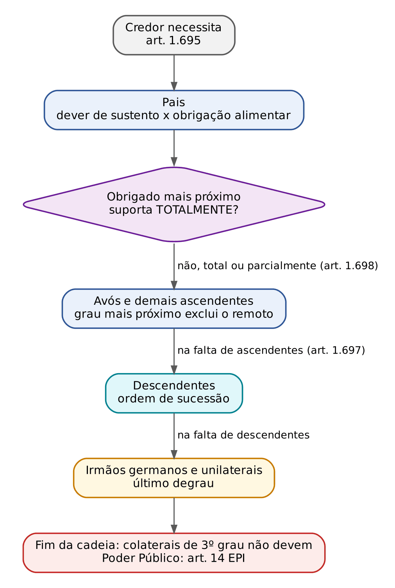
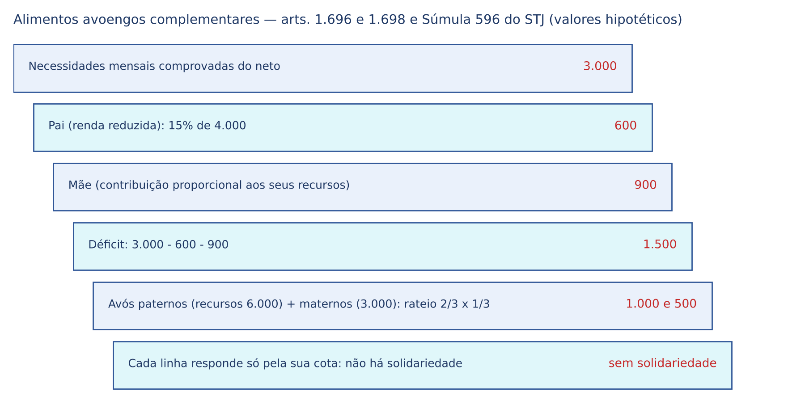
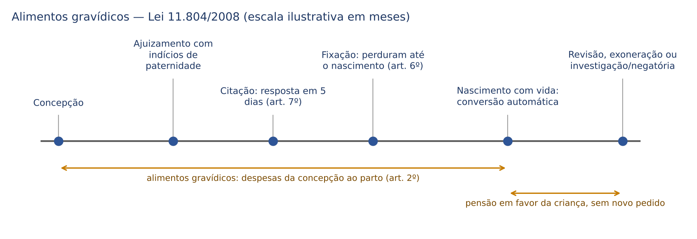
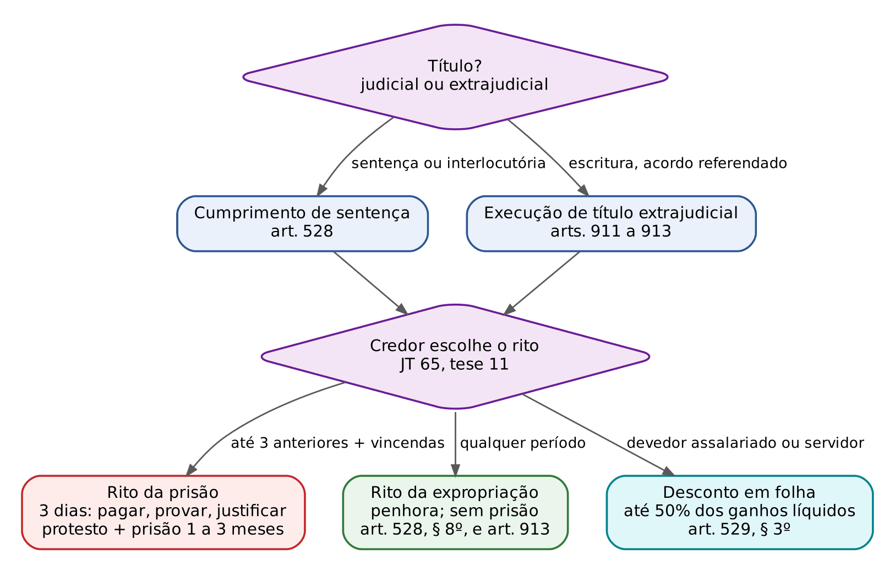
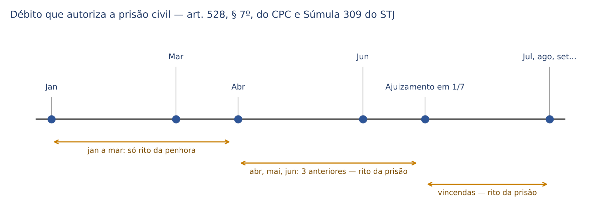

# CAPÍTULO 39 — DIREITO DAS FAMÍLIAS VI: ALIMENTOS

:::INCIDENCIA
TRF5 p. 13; TJRS p. 19 e 22 (Decreto 9.176/2017); TJSC p. 20. Nível A+. Lote: 17 questões (FGV 13, FCC 4).
O que mais cai: alimentos avoengos (subsidiários, complementares e sem solidariedade, Súmula 596 do STJ) em contraste com a solidariedade em favor da pessoa idosa (art. 12 do Estatuto); gravídicos (conversão automática, 5 dias, irrepetibilidade); Súmula 358 do STJ; quebra de sigilo bancário; compensatórios x indenizatórios; prisão civil.
:::

| Subtema | FGV | FCC | Padrão de cobrança |
|---|---|---|---|
| Obrigação avoenga (arts. 1.696 e 1.698) | 5 | 2 | caso com pai desempregado ou com renda reduzida; "solidária", "primária", "litisconsórcio necessário" e "só após prisão do pai" como distratores |
| Pessoa idosa: solidariedade (art. 12 do Estatuto) | 3 | 0 | pai idoso escolhe o filho mais rico; distratores "divide em partes iguais", "todos no polo passivo" |
| Alimentos gravídicos (Lei 11.804/2008) | 2 | 1 | conversão automática; irrepetibilidade após DNA negativo; prazo de 5 dias; despesas psicológicas |
| Maioridade e exoneração (Súmula 358) | 0 | 2 | cessação automática na sentença; "24 anos" automático |
| Quebra de sigilo e fixação | 1 | 1 | sigilo bancário cede à apuração da capacidade; provisórios dispensados pela autora |
| Prisão civil e espécies (compensatórios, indenizatórios, devedor adolescente) | 2 | 0 | natureza indenizatória afasta a prisão; ECA protege o emancipado |

## 39.1 Conceito, fundamento e fontes da obrigação alimentar

Alimentos são as prestações destinadas a satisfazer as necessidades vitais de quem não pode provê-las por si, abrangendo não só o sustento, mas habitação, vestuário, saúde, lazer e, expressamente, educação (art. 1.694, *caput*: "inclusive para atender às necessidades de sua educação"). O fundamento constitucional é duplo: a dignidade da pessoa humana e a solidariedade familiar (arts. 1º, III, 3º, I, 229 e 230 da CF). O art. 229 da CF, aliás, é a fonte da reciprocidade entre pais e filhos ("os filhos maiores têm o dever de ajudar e amparar os pais na velhice, carência ou enfermidade").

Quanto à fonte, a classificação que decide a aplicação de regras é a tripartite:

| Fonte | Exemplo | Critério de fixação | Prisão civil? | Onde |
|---|---|---|---|---|
| Legais ou familiares (*ex lege*) | parentesco, casamento, união estável | necessidade, possibilidade e proporcionalidade (art. 1.694, § 1º) | SIM (art. 528, § 3º, do CPC) | este capítulo |
| Voluntários (convencionais ou testamentários) | contrato de renda, legado de alimentos (art. 1.920) | a vontade (contrato, testamento) | não, salvo se substituem obrigação familiar | Caps. 21 e 44 |
| Indenizatórios (ressarcitórios) | pensão por morte ou incapacidade da vítima (arts. 948, II, e 950) | extensão do dano | NÃO (HC 523.357, ver 39.9.3) | Cap. 25 |

### 39.1.1 Dever de sustento x obrigação alimentar

A distinção é clássica (Yussef Cahali, seguido por Carlos Roberto Gonçalves e Tartuce) e cai em prova porque muda o ônus da prova e o termo final:

| | Dever de sustento | Obrigação alimentar |
|---|---|---|
| Fonte | poder familiar (arts. 1.566, IV, e 1.634; art. 22 do ECA) | parentesco, casamento ou união estável (art. 1.694) |
| Credor | filho criança ou adolescente | filho maior, demais parentes, cônjuge, companheiro |
| Necessidade | PRESUMIDA | deve ser PROVADA |
| Reciprocidade | não (é unilateral) | sim (art. 1.696) |
| Termo | cessa com a maioridade ou emancipação, mas a pensão não cai automaticamente (Súmula 358 do STJ) | enquanto durar o binômio |

O ponto prático: atingida a maioridade, a pensão fixada a título de sustento NÃO se extingue de pleno direito; converte-se em obrigação alimentar fundada no parentesco, mas a necessidade, antes presumida, passa a ter de ser demonstrada pelo filho na ação de exoneração (ver 39.6.6).

### 39.1.2 Alimentos naturais e civis

Alimentos naturais (necessários, *necessarium vitae*) são os indispensáveis à subsistência; alimentos civis (côngruos, *necessarium personae*) são os que permitem "viver de modo compatível com a sua condição social" (art. 1.694, *caput*). A regra é a fixação dos civis. A exceção, cobrada pela literalidade, é a do § 2º do art. 1.694: "os alimentos serão apenas os indispensáveis à subsistência, quando a situação de necessidade resultar de culpa de quem os pleiteia". O mesmo corte aparece em duas outras regras: o cônjuge declarado culpado na separação judicial só recebe "o valor indispensável à sobrevivência" (art. 1.704, parágrafo único), e o Enunciado 345 do CJF admite que o procedimento indigno do credor leve não à exoneração, mas à redução da pensão ao indispensável (ver 39.7.2).

:::PEGADINHA Culpa: quem a tem importa
A culpa que reduz os alimentos aos naturais é a do CREDOR pela própria necessidade (o filho maior que abandona o emprego e o curso, o cônjuge que dilapidou o patrimônio). A culpa do devedor pelo fim da relação não aumenta a pensão: alimentos não são pena. Afirmação do tipo "fixados acima da necessidade como sanção ao cônjuge infiel" está errada.
:::

## 39.2 Pressupostos e critérios de fixação

### 39.2.1 O trinômio

:::LEI Código Civil, arts. 1.694 e 1.695
Art. 1.694. Podem os parentes, os cônjuges ou companheiros pedir uns aos outros os alimentos de que necessitem para viver de modo compatível com a sua condição social, inclusive para atender às necessidades de sua educação.
§ 1º Os alimentos devem ser fixados na proporção das necessidades do reclamante e dos recursos da pessoa obrigada.
§ 2º Os alimentos serão apenas os indispensáveis à subsistência, quando a situação de necessidade resultar de culpa de quem os pleiteia.
Art. 1.695. São devidos os alimentos quando quem os pretende não tem bens suficientes, nem pode prover, pelo seu trabalho, à própria mantença, e aquele, de quem se reclamam, pode fornecê-los, sem desfalque do necessário ao seu sustento.
:::

Pressupostos: (a) vínculo jurídico (parentesco, casamento, união estável); (b) necessidade do credor (não tem bens suficientes NEM pode prover pelo trabalho: os requisitos são cumulativos no art. 1.695); (c) possibilidade do devedor "sem desfalque do necessário ao seu sustento"; (d) proporcionalidade ou razoabilidade, que a doutrina (Tartuce, Farias e Rosenvald, Maria Berenice Dias) acrescenta ao binômio legal para formar o trinômio. O Enunciado 675 do CJF já fala expressamente em "trinômio da necessidade, possibilidade e proporcionalidade". A fixação do *quantum* é matéria de fato e esbarra na Súmula 7 do STJ (Jurisprudência em Teses, ed. 65, tese 18).

Aspectos de prova que a banca explora:

- Sinais exteriores de riqueza: "na apuração da possibilidade do alimentante, observar-se-ão os sinais exteriores de riqueza" (Enunciado 573 do CJF). É a ferramenta para o devedor autônomo, informal ou que oculta renda (a teoria da aparência aplicada à capacidade contributiva).
- Quebra de sigilo fiscal e bancário: admitida, como medida excepcional, quando não houver outro meio idôneo de apurar a real capacidade econômico-financeira do alimentante (STJ, Terceira Turma, Rel. Min. Moura Ribeiro, j. 18/3/2025, Informativo de Jurisprudência Edição Extraordinária 26, processo em segredo). O art. 20 da Lei 5.478/1968 já obriga as repartições públicas, "inclusive do Imposto de Renda", a prestar as informações necessárias, e o art. 5º, § 7º, manda o juiz oficiar ao empregador.
- Revelia: os efeitos da revelia não obrigam o juiz a fixar o valor pedido na inicial; é possível fixar abaixo do postulado, porque o *quantum* depende do binômio e de prova da possibilidade (STJ, REsp 1.971.966/SP, j. 5/3/2024). O art. 7º da Lei 5.478 fala em revelia "além de confissão quanto à matéria de fato", mas a capacidade do réu continua a ser aferida.
- Devedor preso: a prisão por crime não é "alvará exoneratório"; é preciso aferir a possibilidade concreta, porque há trabalho no cárcere e fora dele conforme o regime (STJ, REsp 1.882.798/DF, Terceira Turma, Rel. Min. Ricardo Villas Bôas Cueva, j. 10/8/2021).
- Nova família: a constituição de nova família pelo alimentante não acarreta revisão automática da pensão dos filhos anteriores (Jurisprudência em Teses, ed. 65, tese 13); pode ser fator na revisional, se demonstrada a redução da possibilidade.
- Guarda compartilhada não dispensa pensão (Enunciado 607 do CJF): o compartilhamento é da responsabilidade e das decisões, não necessariamente das despesas em partes iguais.

:::QUESTAO FGV 2026 — TJ-PE — Juiz Substituto (Q4349483)
Caso: criança de 5 anos, representada pela mãe (cirurgiã renomada), pede alimentos ao pai; a inicial declara que não precisa de provisórios e pede quebra do sigilo bancário do réu, sem emprego formal, mas com vida de luxo nas redes e inadimplente quanto aos alimentos fixados extrajudicialmente. O réu junta carteira de trabalho sem anotações e diz que a quebra só caberia diante de crime. Gabarito oficial: E (não fixar provisórios, ante a declaração de desnecessidade, e deferir a quebra do sigilo).
Passos: (1) provisórios: o art. 4º da Lei 5.478 manda fixá-los "desde logo", "salvo se o credor expressamente declarar que deles não necessita"; a renúncia é vedada, mas o NÃO EXERCÍCIO é permitido (art. 1.707, primeira parte; art. 23 da Lei 5.478: o direito "pode ser provisoriamente dispensado"). Por isso as alternativas que mandam fixar provisórios "independentemente da declaração" confundem renúncia (proibida) com dispensa (permitida). (2) Sigilo: a privacidade financeira cede diante da necessidade de apurar a capacidade contributiva quando não há outro meio (ver acima); a alternativa D (exigir documentos "sob pena de desobediência") é inferior porque a medida adequada é a requisição judicial às instituições. Ressalva: com credora criança, a declaração de desnecessidade feita pela representante merece olhar crítico do juiz e do MP; o gabarito segue a letra do art. 4º (ver a nota de verificação).
:::

No mesmo sentido, quanto ao sigilo: FCC 2026 — DPE-MT — Defensor (Q3954595, item I correto: a quebra cabe também em ação de OFERTA de alimentos, pois o problema é o mesmo, apurar a real capacidade do alimentante).

### 39.2.2 Base de cálculo da pensão em percentual

Quando os alimentos são fixados em percentual sobre rendimentos, a pergunta recorrente é o que entra na base. Quadro do estado atual:

| Verba | Integra a base? | Fonte |
|---|---|---|
| 13º salário e terço constitucional de férias | SIM, salvo disposição expressa em contrário | Tema 192 do STJ (REsp 1.106.654/RJ, Segunda Seção) |
| Horas extras, mesmo não habituais | SIM (caráter remuneratório, acréscimo de possibilidade) | REsp 1.741.716/SP (Terceira Turma, j. 25/5/2021); Quarta Turma, j. 9/3/2026 (Informativo Edição Extraordinária 32) |
| Participação nos lucros e resultados (PLR) e bônus | DIVIDIDO: ver abaixo | JT ed. 77, tese 11; Informativo Extraordinário 32 (2026); EREsp 1.964.261 (Segunda Seção, notícia de 4/9/2026) |
| Verbas indenizatórias (diárias, auxílio-alimentação, FGTS como base) | em regra NÃO integram a base; o FGTS e o PIS podem ser PENHORADOS na execução de alimentos | JT ed. 77, tese 12 |

A PLR é o ponto vivo. A Jurisprudência em Teses (ed. 77, tese 11) afirmava que a PLR integra a base quando a pensão é fixada em percentual sobre os rendimentos, salvo disposição em contrário. A Quarta Turma, em 9/3/2026, decidiu que a PLR, por sua natureza indenizatória e eventual, NÃO se incorpora automaticamente, exigindo prova de necessidade específica do alimentado (no mesmo acórdão em que afirmou a inclusão das horas extras). A Segunda Seção, no EREsp 1.964.261 (por maioria, voto vencedor do Min. Ricardo Villas Bôas Cueva, noticiado em 4/9/2026), manteve a incidência de 10% sobre PLR e bônus, mas pelas circunstâncias concretas do caso, afastando a semelhança com os precedentes da Quarta Turma. Para a prova: a afirmação segura é que a PLR não integra AUTOMATICAMENTE a base; a inclusão depende do título (se o acordo ou a sentença a incluiu ou a excluiu) e da demonstração da necessidade. Não há tema repetitivo julgado sobre o ponto.

Outras regras de fixação:

- Salário mínimo como indexador: admitido (JT ed. 65, tese 17; art. 533, § 4º, do CPC para os indenizatórios). A vedação constitucional de vinculação ao salário mínimo não alcança a prestação alimentar, que tem natureza de subsistência.
- Atualização: "as prestações alimentícias, de qualquer natureza, serão atualizadas segundo índice oficial regularmente estabelecido" (art. 1.710). Pensão fixada em valor nominal fixo, sem indexador, é corrigida pelo índice oficial.
- Fixação dúplice (percentual dos rendimentos líquidos se houver emprego formal; percentual do salário mínimo se autônomo ou desempregado): técnica usual, aceita (foi a sentença do caso da Q3531614, censurada só na parte da cessação automática).

### 39.2.3 Forma da prestação: pecúnia ou *in natura*

O devedor "poderá pensionar o alimentando, ou dar-lhe hospedagem e sustento, sem prejuízo do dever de prestar o necessário à sua educação, quando menor" (art. 1.701), e "compete ao juiz, se as circunstâncias o exigirem, fixar a forma do cumprimento" (parágrafo único). A escolha do devedor NÃO é absoluta: o juiz decide, e o art. 25 da Lei 5.478 exige a anuência do alimentado capaz para a prestação não pecuniária. Duas teses: é possível modificar a forma (espécie ou *in natura*) sem alteração financeira das partes, desde que demonstrado que a modalidade anterior não atende à finalidade (JT ed. 65, tese 7); e NÃO se compensam alimentos fixados em pecúnia com parcelas pagas *in natura* (JT ed. 65, tese 16), ressalvado o enriquecimento sem causa (ver 39.3.4).

:::SENTENCA Dispositivo de sentença de fixação de alimentos
"Ante o exposto, JULGO PROCEDENTE EM PARTE o pedido para condenar o réu a pagar à autora alimentos mensais correspondentes a 25% de seus rendimentos líquidos (assim entendidos os brutos deduzidos apenas os descontos obrigatórios de imposto de renda e contribuição previdenciária), incidentes sobre 13º salário, terço de férias e horas extras e excluídas as verbas de natureza indenizatória e a participação nos lucros, mediante desconto em folha e depósito na conta indicada (art. 529 do CPC); em caso de desemprego ou trabalho autônomo, os alimentos corresponderão a 40% do salário mínimo, vencíveis no dia 10 de cada mês. Os alimentos são devidos desde a citação (art. 13, § 2º, da Lei 5.478/1968), compensando-se os provisórios pagos." Dicas: (a) defina rendimentos líquidos e o tratamento de 13º, férias, horas extras e PLR no próprio dispositivo, porque o silêncio gera a controvérsia do quadro acima; (b) termo inicial é a citação, não o ajuizamento; (c) apelação só no efeito devolutivo (art. 1.012, § 1º, II, do CPC).
:::

## 39.3 Características da obrigação alimentar

| Característica | Regra | Exceção ou nuance | Fundamento |
|---|---|---|---|
| Personalíssima | o direito é inerente à pessoa do credor | crédito vencido incorpora-se ao patrimônio e se transmite | arts. 1.700 e 1.707; Info 870 do STJ |
| Irrenunciável | veda-se renunciar ao DIREITO | pode-se não exercer; renúncia a parcelas vencidas; renúncia entre cônjuges na dissolução | art. 1.707; Enunciado 263 |
| Incessível | o crédito não pode ser cedido | parcelas vencidas: a doutrina admite cessão | art. 1.707 |
| Incompensável | não se compensa com dívida do credor | enriquecimento sem causa do alimentando | art. 1.707; art. 373, II; JT 77, tese 13 |
| Impenhorável | o crédito alimentar não é penhorável | o que for adquirido com ele pode ser | art. 1.707; art. 833, IV, do CPC |
| Irrepetível | o que foi pago não se devolve | má-fé, dolo, erro grosseiro (doutrina); Súmula 621 veda a repetição na revisional | Súmula 621 do STJ |
| Imprescritível o direito | pode-se pedir a qualquer tempo | parcelas fixadas prescrevem em 2 anos | art. 206, § 2º (Cap. 11) |
| Recíproca | entre pais e filhos e demais parentes | não há no dever de sustento | art. 1.696; art. 229 da CF |
| Divisível e não solidária | cada obrigado responde na proporção de seus recursos | solidária em favor da pessoa idosa | art. 1.698; art. 12 do Estatuto |
| Transmissível (passivamente) | aos herdeiros do devedor, nos limites da herança | intransmissível se morre o credor | art. 1.700 |
| Atual e periódica | para o presente e o futuro | não há alimentos pretéritos ao pedido (retroação só até a citação) | art. 13, § 2º, da Lei 5.478 |
| Variável | revisável a qualquer tempo | coisa julgada *rebus sic stantibus* | art. 1.699; art. 15 da Lei 5.478; art. 505, I, do CPC |

### 39.3.1 Irrenunciabilidade e seus limites

:::LEI Código Civil, arts. 1.707 a 1.709
Art. 1.707. Pode o credor não exercer, porém lhe é vedado renunciar o direito a alimentos, sendo o respectivo crédito insuscetível de cessão, compensação ou penhora.
Art. 1.708. Com o casamento, a união estável ou o concubinato do credor, cessa o dever de prestar alimentos.
Parágrafo único. Com relação ao credor cessa, também, o direito a alimentos, se tiver procedimento indigno em relação ao devedor.
Art. 1.709. O novo casamento do cônjuge devedor não extingue a obrigação constante da sentença de divórcio.
:::

Três camadas, todas cobradas:

- Direito x exercício: o art. 1.707 proíbe renunciar ao DIREITO; o credor pode simplesmente não exercê-lo. É a base da dispensa dos provisórios (art. 4º da Lei 5.478) e da regra de que o direito a alimentos não prescreve (só as prestações).
- Parcelas pretéritas: é válida a renúncia (ou o acordo com remissão) a alimentos vencidos e não pagos, porque a irrenunciabilidade atinge o direito, não o seu exercício; o que não se admite é a renúncia aos presentes e futuros (STJ, REsp 1.529.532/DF, Terceira Turma, Rel. Min. Ricardo Villas Bôas Cueva, j. 9/6/2020: acordo em execução que exonerou o débito de alimentandas crianças, mantidos os vincendos). A CEBRASPE cobrou como errada a assertiva de que tal acordo seria impossível.
- Cônjuges e companheiros: a Súmula 379 do STF ("No acordo de desquite não se admite renúncia aos alimentos, que poderão ser pleiteados ulteriormente") é de 1964 e foi superada na prática do STJ, que admite a renúncia manifestada na separação, no divórcio ou na dissolução da união estável, por não haver mais vínculo familiar que a sustente. O Enunciado 263 do CJF: o art. 1.707 "não impede seja reconhecida válida e eficaz a renúncia manifestada por ocasião do divórcio (direto ou indireto) ou da dissolução da união estável", porque a irrenunciabilidade "somente é admitida enquanto subsistir vínculo de Direito de Família". A FGV aceitou a renúncia recíproca em divórcio (Q4289332, DPE-RJ 2026, questão do Cap. 34, em que a renúncia não era o ponto controvertido).

:::DICA Súmula 336 do STJ: a renúncia não apaga a pensão previdenciária
"A mulher que renunciou aos alimentos na separação judicial tem direito à pensão previdenciária por morte do ex-marido, comprovada a necessidade econômica superveniente." A renúncia civil não impede o benefício previdenciário; exige-se a necessidade SUPERVENIENTE. A súmula é anterior à linguagem neutra de gênero, mas se aplica a qualquer ex-cônjuge.
:::

### 39.3.2 Irrepetibilidade

Alimentos pagos não se restituem, ainda que depois se reconheça que não eram devidos: foram consumidos na subsistência. A regra tem três projeções cobradas: (a) na revisional e na exoneratória, os efeitos retroagem à citação, mas são "vedadas a compensação e a repetibilidade" (Súmula 621 do STJ, ver 39.7.1); (b) nos gravídicos, o DNA negativo posterior não autoriza a devolução (ver 39.6.4); (c) o ressarcimento, quando admitido pela doutrina, é contra quem agiu de má-fé (a mãe que sabia não ser o réu o pai), por responsabilidade civil, não por repetição de alimentos. O veto ao art. 10 do projeto da Lei 11.804/2008, que previa responsabilidade OBJETIVA da autora pelos danos causados pelo resultado negativo do exame, reforça que só a culpa ou o dolo abrem essa via.

### 39.3.3 Imprescritibilidade e prescrição bienal

O direito a alimentos é imprescritível (o art. 23 da Lei 5.478 já dizia que a prescrição "só alcança as prestações mensais e não o direito a alimentos"). A pretensão às prestações fixadas prescreve em 2 anos "a partir da data em que se vencerem" (art. 206, § 2º). A armadilha de prova é a causa impeditiva: não corre prescrição entre ascendentes e descendentes durante o poder familiar (art. 197, II), de modo que o filho cobra todas as parcelas inadimplidas na infância até 2 anos depois dos 18 anos. O desenvolvimento, com as questões FGV 2026 — TJ-PA — Juiz (Q3951721) e FCC 2026 — TJ-CE (Q4231769), está no Cap. 11 (11.3.2). Duas notas complementares deste capítulo: o prazo bienal NÃO se aplica ao terceiro que pagou as despesas no lugar do devedor (ver 39.7.4), e a regra dos "três últimos meses" é critério para o rito da PRISÃO, não prazo prescricional (alternativa B da Q4231769).

### 39.3.4 Incompensabilidade e suas exceções

O crédito alimentar não se compensa (art. 1.707; art. 373, II, ver Cap. 13). A jurisprudência abre exceção quando a compensação é necessária para evitar o enriquecimento sem causa do alimentando (JT ed. 77, tese 13), por exemplo, despesas extraordinárias de saúde ou educação pagas diretamente pelo devedor, em substituição à pensão, com anuência ou em benefício evidente do credor. O que não se admite é a compensação unilateral de "presentes", roupas e passeios com a pensão em dinheiro (JT ed. 65, tese 16). Tampouco se compensa o aluguel devido pelo uso exclusivo de imóvel comum com a pensão (alternativa D da Q4289331, DPE-RJ 2026, questão do Cap. 36).

### 39.3.5 Transmissibilidade (art. 1.700)

"A obrigação de prestar alimentos transmite-se aos herdeiros do devedor, na forma do art. 1.694" (art. 1.700). A remissão ao art. 1.694 (e não mais ao art. 1.997, como no CC/1916, que limitava a transmissão às forças da herança) gerou intensa controvérsia, hoje resolvida assim pelo STJ (JT ed. 77, tese 7): a obrigação é personalíssima e extingue-se com o óbito do alimentante, cabendo ao ESPÓLIO pagar apenas os débitos alimentares já fixados por acordo ou sentença e não adimplidos em vida, "ressalvados os casos em que o alimentado seja herdeiro, hipóteses nas quais a prestação perdurará ao longo do inventário". Os herdeiros não respondem com patrimônio próprio (art. 1.792), só nas forças da herança. Não cabe prisão civil do inventariante pelo descumprimento do espólio (JT ed. 77, tese 6).

Do lado ativo (morte do CREDOR), duas decisões recentes que parecem colidir e não colidem:

- O direito a alimentos é intransmissível aos herdeiros da alimentada, por sua natureza personalíssima e de "patrimônio moral" (STJ, AgInt nos EDcl no AREsp 2.412.253-RS, j. 9/9/2024, Info 830).
- Os alimentos vencidos e não pagos no curso da execução são crédito concreto já incorporado ao patrimônio do alimentado e, por isso, transmissíveis aos herdeiros dele (STJ, Quarta Turma, Rel. Min. Maria Isabel Gallotti, j. 14/10/2025, Info 870).

:::ESQUEMA Morte e alimentos
| Quem morre | Prestações futuras | Prestações vencidas e não pagas |
|---|---|---|
| Devedor | extinguem-se; espólio continua só se o alimentado for herdeiro, durante o inventário | o espólio paga, nos limites da herança |
| Credor | extinguem-se (direito personalíssimo, Info 830) | transmitem-se aos herdeiros do credor (Info 870) |
:::

O credor de alimentos também pode aceitar a herança a que o devedor renunciou, na forma do art. 1.813 (JT ed. 246, tese 1; o mecanismo da aceitação pelos credores está no Cap. 42).

## 39.4 Sujeitos e ordem dos obrigados

### 39.4.1 Quem pode pedir de quem

:::LEI Código Civil, arts. 1.696 a 1.698
Art. 1.696. O direito à prestação de alimentos é recíproco entre pais e filhos, e extensivo a todos os ascendentes, recaindo a obrigação nos mais próximos em grau, uns em falta de outros.
Art. 1.697. Na falta dos ascendentes cabe a obrigação aos descendentes, guardada a ordem de sucessão e, faltando estes, aos irmãos, assim germanos como unilaterais.
Art. 1.698. Se o parente, que deve alimentos em primeiro lugar, não estiver em condições de suportar totalmente o encargo, serão chamados a concorrer os de grau imediato; sendo várias as pessoas obrigadas a prestar alimentos, todas devem concorrer na proporção dos respectivos recursos, e, intentada ação contra uma delas, poderão as demais ser chamadas a integrar a lide.
:::

Leitura fina da escada legal:

- Linha reta, sem limite de grau: ascendentes (pais, avós, bisavós) e descendentes (filhos, netos), sempre o mais próximo antes do mais remoto ("uns em falta de outros").
- Ascendentes ANTES dos descendentes: o pai necessitado que tenha pai vivo e capaz pede primeiro a este (avô do filho), e só "na falta dos ascendentes" aos filhos (art. 1.697). Na prática, o idoso raramente tem ascendente vivo, e a regra opera pouco; em prova, cai pela letra.
- Colaterais: SOMENTE os irmãos (germanos ou unilaterais), e só na falta de ascendentes e descendentes. Tios, sobrinhos e primos não devem alimentos (o rol do art. 1.697 é taxativo para os colaterais). Item II da Q3954595 (FCC 2026) errou ao estender a obrigação aos irmãos "independentemente da existência de descendentes do alimentado".
- Afins (sogro, nora, enteado, padrasto): a doutrina majoritária e o STJ NÃO reconhecem obrigação alimentar entre afins, porque o art. 1.694 fala em "parentes" e a escada dos arts. 1.696 e 1.697 só menciona consanguíneos e civis; a posição contrária (parte da doutrina, invocando a socioafetividade) ganha força quando há posse do estado de filho, caso em que o fundamento passa a ser a filiação socioafetiva, e não a afinidade.
- Filiação socioafetiva e multiparentalidade geram obrigação alimentar plena, inclusive concorrente entre os pais biológico e socioafetivo (Tema 622 do STF — ver Cap. 37).
- Cônjuges e companheiros: credores e devedores recíprocos (art. 1.694), fora da escada do parentesco (ver 39.5).

### 39.4.2 Pais x avós: a obrigação avoenga

Os avós são devedores sucessivos e complementares, não solidários com os pais. A Súmula 596 do STJ: "A obrigação alimentar dos avós tem natureza complementar e subsidiária, somente se configurando no caso de impossibilidade total ou parcial de seu cumprimento pelos pais." Decomposição:

- Subsidiária (ou sucessiva): só nasce se os pais não puderem; é preciso demonstrar a insuficiência dos genitores (JT ed. 65, tese 15). Não basta o inadimplemento voluntário do pai solvente, que se resolve pela execução contra ele.
- Complementar: os avós pagam a DIFERENÇA entre as necessidades e o que os pais podem dar; não substituem integralmente a pensão do pai, salvo se este nada puder.
- Impossibilidade "total ou parcial": a insuficiência parcial do pai (renda reduzida por acidente, desemprego) já abre a via avoenga. NÃO se exige incapacidade civil do pai, morte, nem prévio esgotamento de medidas executivas e prisão.
- Ambos os pais: a insuficiência que se apura é a de AMBOS os genitores; a mãe guardiã também contribui na proporção de seus recursos (art. 1.703), e as necessidades são aferidas "prioritariamente, segundo o nível econômico-financeiro de seus genitores" (Enunciado 342 do CJF), não pelo padrão de vida dos avós.
- Não solidária e divisível: cada avô ou avó responde pela sua cota, na proporção dos recursos (art. 1.698, segunda parte).

A participação dos demais avós (paternos e maternos) no processo é o ponto aberto. O art. 1.698, parte final, diz que, intentada a ação contra um, "poderão as demais ser chamadas a integrar a lide". A natureza dessa intervenção é controvertida: intervenção de terceiro *sui generis* (provocável pelo autor e, segundo parte da jurisprudência, também pelo réu), chamamento ao processo atípico ou litisconsórcio facultativo ulterior. O STJ afetou a questão como repetitivo: Tema 1.310 ("definir se há litisconsórcio necessário entre avós maternos e paternos na ação de alimentos complementares"), PENDENTE de julgamento na última notícia (IBDFAM, 11/6/2026, sobre o pedido de ingresso como *amicus curiae*). Até a tese, a resposta de prova é: NÃO há litisconsórcio necessário que imponha extinção do processo; os demais avós podem ser chamados, e a condenação de um deles observa a repartição proporcional.

:::QUESTAO FGV 2026 — DPE-RJ — Defensor Público (Q4289329)
Caso: criança de 9 anos com necessidades (tratamento de saúde, escola) muito acima do que a mãe diarista e o pai, com capacidade reduzida após acidente e pensão revista para 15% do salário mínimo, conseguem pagar; ação contra o avô paterno, servidor aposentado com proventos elevados. Defesas do avô: (i) não há obrigação avoenga enquanto o pai vivo paga o que foi fixado; (ii) seria necessária a participação dos demais avós; (iii) não pode suportar sozinho o encargo complementar. Gabarito: E (acolhimento em parte: demonstrada a impossibilidade parcial do pai, o avô responde pela parcela necessária, observada a repartição proporcional entre os ascendentes).
Passos: (1) o que se pergunta: se a obrigação avoenga nasce com impossibilidade parcial e qual a sua extensão; (2) regra: Súmula 596 e art. 1.698; (3) aplicação: o pai adimplente, mas com capacidade reduzida, configura impossibilidade parcial; a obrigação é complementar e divisível. Erradas: A (exige esgotamento de medidas executivas e prisão do pai — a subsidiariedade não exige execução frustrada, mas insuficiência); B (litisconsórcio passivo necessário com extinção — não há; e o tema está pendente no Tema 1.310); C (só "inadimplemento absoluto" — contraria o "total ou parcial" da súmula); D (solidariedade entre ascendentes — inexiste, salvo em favor de pessoa idosa).
:::

:::QUESTAO FGV 2026 — TJ-SC — Oficial de Justiça e Avaliador (Q4153608)
Adolescente de 13 anos, pai desempregado e sem renda regular, sem ascendentes maternos vivos; avós paternos divorciados (ele servidor federal, ela aposentada). Gabarito: B (demonstrada a insuficiência do pai, os avós paternos podem ser chamados a concorrer, na proporção de seus recursos). Erradas: a falta de avós maternos não impede o pedido aos paternos (A); o divórcio dos avós não extingue a obrigação, que decorre do parentesco com a neta, não do casamento deles (C); não se exige incapacidade civil do pai (D); a obrigação não recai "exclusivamente" sobre o mais rico, pois é proporcional e não solidária (E).
:::

No mesmo sentido (subsidiária e complementar como resposta, com "solidária", "primária" ou "integral" como armadilhas): FGV 2025 — MPE-ES — Promotor (Q3752733, gabarito E; as erradas inventam solidariedade, obrigação "primária", restrição à linha materna por causa da guarda e exigência de vínculo afetivo); FCC 2025 — DPE-SP — Analista (Q3304111, gabarito C: complementar e subsidiária; a D troca "subsidiária" por "solidária"; a E nega alimentos na impossibilidade parcial); FGV 2024 — TJ-AP — Analista (Q2449076, gabarito C: redirecionamento da cobrança aos avós paternos, mas com obrigação subsidiária e complementar, não "no mesmo valor imposto ao pai"); FCC 2026 — DPE-MT (Q3954595, item V correto, transcrição da Súmula 596).

:::ATENCAO Redirecionar a execução aos avós?
A Q2449076 fala em "redirecionar a cobrança" contra os avós no curso de execução contra o pai. Tecnicamente, os avós não constam do título; a obrigação deles precisa ser constituída em ação própria de alimentos (de conhecimento), na qual se apura a insuficiência dos pais e a possibilidade dos avós, e não por simples redirecionamento executivo. A banca usou a expressão em sentido leigo; o gabarito acerta a natureza (subsidiária e complementar).
:::

Execução contra avós: o Enunciado 599 do CJF orienta o juiz a analisar as condições dos avós devedores e, comprovadas situações que tornem a prisão atentatória à sua dignidade (idade, saúde), aplicar medida coercitiva diversa da prisão ou determinar o cumprimento em regime aberto ou domiciliar, "como corolário do princípio de proteção aos idosos". Não afirma que a prisão de avós é vedada; afirma a ponderação.

### 39.4.3 A exceção da pessoa idosa: solidariedade e escolha

:::LEI Estatuto da Pessoa Idosa (Lei 10.741/2003), arts. 11 a 14
Art. 11. Os alimentos serão prestados à pessoa idosa na forma da lei civil. (Redação dada pela Lei nº 14.423, de 2022)
Art. 12. A obrigação alimentar é solidária, podendo a pessoa idosa optar entre os prestadores. (Redação dada pela Lei nº 14.423, de 2022)
Art. 13. As transações relativas a alimentos poderão ser celebradas perante o Promotor de Justiça ou Defensor Público, que as referendará, e passarão a ter efeito de título executivo extrajudicial nos termos da lei processual civil. (Redação dada pela Lei nº 11.737, de 2008)
Art. 14. Se a pessoa idosa ou seus familiares não possuírem condições econômicas de prover o seu sustento, impõe-se ao poder público esse provimento, no âmbito da assistência social. (Redação dada pela Lei nº 14.423, de 2022)
:::

Credor com 60 anos ou mais: a obrigação dos parentes torna-se SOLIDÁRIA (exceção legal ao art. 1.698, que é a regra da divisibilidade), e o idoso escolhe contra quem demandar, podendo exigir o todo de um só; o demandado que pagar tem regresso contra os demais coobrigados pelas suas cotas (art. 283, ver Cap. 12). Três consequências de prova: (a) não há litisconsórcio necessário entre os filhos; (b) o demandado não pode exigir a divisão proporcional com os irmãos no processo do idoso; (c) a residência de um filho no exterior é irrelevante, porque o idoso nem precisa demandá-lo. Os demais direitos civis da pessoa idosa (prioridade, curatela, crimes) estão no Cap. 46.

:::QUESTAO FGV 2025 — ENAM — Exame Nacional da Magistratura 2025.1 (Q3362368)
Pai viúvo de 81 anos, com aposentadoria de um salário mínimo, ajuíza ação só contra a filha médica de alta renda (os outros filhos: professor aposentado, filha no exterior há mais de dez anos, filho desempregado). A ré alega que o encargo deve ser dividido. O juiz fixa provisórios só contra ela. Gabarito: A (obrigação solidária; o idoso escolhe o filho; a filha pode ser compelida a arcar integralmente, mesmo havendo outros filhos com capacidade).
Erradas: B (indivisibilidade e citação de todos sob pena de nulidade — a solidariedade dispensa litisconsórcio); C (exigir prova de incapacidade laboral do idoso — o requisito é a necessidade, art. 1.695, não a invalidez); D ("solidária, de forma que todos deveriam integrar o polo passivo" — contradição interna: solidariedade é justamente a desnecessidade de litisconsórcio); E (residência no exterior não impede a demanda, e é irrelevante porque o idoso não a escolheu).
:::

No mesmo sentido: FGV 2025 — TRF5 — Juiz Substituto (Q3373881, gabarito E: o pai de 83 anos pode demandar qualquer dos três filhos, à sua escolha, e o demandado responde pela totalidade; erradas as opções que limitam a demanda ao filho sem filhos, ao de maior salário, ou que dividem "um terço" para cada); FGV 2025 — DPE-PE — Defensor (Q3390838, gabarito E: idoso de 88 anos escolhe entre os obrigados por força da solidariedade; erradas a divisão em partes iguais (A), a obrigação exclusiva do Poder Público via BPC (B — o art. 14 é SUBSIDIÁRIO, só quando nem o idoso nem a família podem), alimentos sem considerar despesas de saúde (C) e transação "exclusivamente" pelo MP com efeito de título extrajudicial (D — o art. 13 admite Promotor OU Defensor Público)).

:::QUESTAO FGV 2024 — TJ-MT — Juiz Substituto (Q3086922)
Casal de 62 e 61 anos com duas filhas (22 e 28 anos); a mais velha tem uma filha de 2 anos. Itens: (I) a filha de 22 anos, por grave problema de saúde, pode pedir alimentos aos pais com base na solidariedade familiar — correto (obrigação alimentar entre parentes, necessidade provada, art. 1.694); (II) o pai, se necessitar, deve demandar as duas filhas em conjunto, vedado cobrar de uma só, "em virtude da ausência de solidariedade" — ERRADO, e aqui está a sutileza: o pai tem 62 anos, é pessoa idosa, e para ele a obrigação é solidária (art. 12 do Estatuto), podendo escolher; (III) se a neta não puder ser sustentada pelos pais, os avós respondem em caráter subsidiário e complementar — correto (Súmula 596). Gabarito: E (I e III). A armadilha do item II é aplicar a regra geral do art. 1.698 sem notar a idade do credor.
:::

:::ESQUEMA Divisibilidade x solidariedade
| Credor | Natureza | Pode exigir tudo de um? | Litisconsórcio | Fundamento |
|---|---|---|---|---|
| Neto (avoengos) | subsidiária, complementar, divisível | NÃO | não necessário; os demais podem ser chamados (Tema 1.310 pendente) | art. 1.698; Súmula 596 |
| Filho de vários devedores do mesmo grau (regra) | conjunta e proporcional | NÃO | facultativo | art. 1.698 |
| Pessoa idosa (60 anos ou mais) | SOLIDÁRIA | SIM, à sua escolha | dispensado | art. 12 do Estatuto |
:::

## 39.5 Alimentos entre cônjuges e companheiros

### 39.5.1 Regime legal e a questão da culpa

Cônjuges e companheiros devem-se alimentos reciprocamente (art. 1.694; para a união estável, também o art. 7º da Lei 9.278/1996). O concubino (art. 1.727) não tem direito a alimentos; as uniões simultâneas são tratadas no Cap. 35.

Os arts. 1.702 e 1.704 ainda vinculam os alimentos à culpa na "separação judicial": o cônjuge "inocente e desprovido de recursos" recebe pensão (art. 1.702); o declarado culpado só recebe, se não tiver parentes em condições nem aptidão para o trabalho, "o valor indispensável à sobrevivência" (art. 1.704, parágrafo único). Após a EC 66/2010, que suprimiu a separação como requisito do divórcio e esvaziou a discussão da culpa na dissolução, a doutrina majoritária (Maria Berenice Dias, Paulo Lôbo, Farias e Rosenvald, Tartuce) sustenta que a culpa não mais interfere na fixação dos alimentos entre ex-cônjuges, que se pautam pela necessidade e possibilidade; a questão da subsistência da separação judicial no ordenamento é do Cap. 34 (Tema 1.053 do STF). Em prova objetiva, se a banca transcrever o art. 1.704, a letra vale; se perguntar a orientação contemporânea, a culpa é irrelevante.

### 39.5.2 Excepcionalidade e transitoriedade

O STJ consolidou que "os alimentos devidos entre ex-cônjuges devem ter caráter excepcional, transitório e devem ser fixados por prazo determinado, exceto quando um dos cônjuges não possua mais condições de reinserção no mercado do trabalho ou de readquirir sua autonomia financeira" (JT ed. 65, tese 14). Daí os alimentos transitórios (*ad tempus*): fixados com termo final, pelo tempo razoável para a requalificação profissional do ex-cônjuge apto ao trabalho. Esgotado o prazo, cessam sem necessidade de ação exoneratória (o termo está no título), salvo se o credor demonstrar, antes, a persistência da necessidade por fato alheio à sua vontade. A exceção (prazo indeterminado) protege o cônjuge que dedicou a vida ao lar, de idade avançada ou com doença, sem perspectiva de reinserção.

O STJ também admite a exoneração do ex-cônjuge, mesmo sem alteração do binômio, quando decorrido longo tempo desde a fixação e o credor teve oportunidade de se tornar autônomo; e, em sentido inverso, aplicou a *supressio* e a *surrectio* para MANTER por prazo indeterminado a pensão que o ex-marido, mesmo exonerado judicialmente, continuou pagando voluntariamente por duas décadas, criando legítima expectativa na alimentanda (STJ, Terceira Turma, Rel. Min. Nancy Andrighi, j. 17/6/2025, Info 859; as figuras parcelares da boa-fé estão no Cap. 15).

### 39.5.3 Causas de extinção próprias

- Casamento, união estável ou concubinato do CREDOR extinguem o dever (art. 1.708, *caput*). O novo casamento do DEVEDOR não extingue a obrigação constante da sentença de divórcio (art. 1.709). Pegadinha: item III da Q3954595 (FCC 2026) afirmava que o novo casamento "do credor ou devedor" extingue a obrigação; errado na parte do devedor. Nova união do devedor pode, quando muito, fundamentar revisional pela redução da possibilidade.
- Procedimento indigno do credor em relação ao devedor (art. 1.708, parágrafo único). Para preencher a cláusula, o Enunciado 264 do CJF manda aplicar, por analogia, os incisos I e II do art. 1.814 (indignidade sucessória: homicídio doloso ou tentativa contra o devedor e seus próximos; acusação caluniosa ou crime contra sua honra); o Enunciado 345 permite que o procedimento indigno leve à exoneração OU apenas à redução ao indispensável à sobrevivência. A regra vale para qualquer credor (inclusive filhos maiores), não só para ex-cônjuges.

### 39.5.4 Alimentos compensatórios

Os alimentos compensatórios não visam à subsistência, mas a corrigir ou atenuar grave desequilíbrio econômico-financeiro ou abrupta queda do padrão de vida de um dos cônjuges em razão da ruptura, quando o outro fica com o patrimônio ou com a renda dele derivada (STJ, REsp 1.290.313/AL, Quarta Turma, Rel. Min. Antonio Carlos Ferreira, j. 12/11/2013). A doutrina (Rolf Madaleno, com inspiração no direito espanhol e francês) distingue:

- Compensatórios humanitários (ou em sentido estrito): equalizam a queda brusca do padrão de vida do cônjuge sem meação relevante (por exemplo, regime de separação de bens), por prazo determinado.
- Compensatórios patrimoniais (ressarcitórios): remuneram o cônjuge pela fruição exclusiva, pelo outro, dos bens comuns ainda não partilhados (rendas, aluguéis, lucros da empresa comum). Têm base legal expressa no art. 4º, parágrafo único, da Lei 5.478: nos provisórios pedidos por cônjuge casado em comunhão universal, o juiz determina que lhe seja entregue, mensalmente, "parte da renda líquida dos bens comuns, administrados pelo devedor".

Natureza indenizatória, com duas consequências cobradas: (a) o inadimplemento NÃO autoriza a prisão civil (STJ, RHC 117.996/RS, Terceira Turma, Rel. Min. Marco Aurélio Bellizze, j. 2/6/2020; HC 744.673/SP, Quarta Turma, Rel. Min. Raul Araújo, j. 13/9/2022, Info 757), porque o art. 5º, LXVII, da CF só admite a prisão pela dívida alimentar de subsistência; (b) não se submetem ao trinômio da necessidade, mas à medida do desequilíbrio ou da fruição.

:::QUESTAO FGV 2024 — TJ-SC — Juiz Substituto (Q2386953)
Pergunta-se o que é correto sobre alimentos compensatórios e indenizatórios. Gabarito: B (prescindem da prova de atividade laboral anterior pelo alimentando e podem ser cumulados com pensão previdenciária).
Fundamento: nenhum dos dois tem por pressuposto a necessidade de subsistência fundada na perda de renda do trabalho: os compensatórios medem o desequilíbrio patrimonial da ruptura; os indenizatórios medem o dano (arts. 948, II, e 950), e o STJ dispensa a prova de atividade remunerada da vítima para o pensionamento em certos casos (famílias de baixa renda, vítima criança ou adolescente, ver Cap. 25). E ambos são cumuláveis com benefício previdenciário, que tem causa diversa (contributiva). Erradas: A (não são o mesmo instituto: um nasce do direito de família, outro do ato ilícito); C (o trinômio é dos alimentos familiares de subsistência); D (a finalidade NÃO é a subsistência — é justamente o traço comum que os separa dos alimentos legais); E (o pagamento de uma só vez é faculdade do lesado na INCAPACIDADE, art. 950, parágrafo único; na morte, a jurisprudência não o estende, e o pensionamento é mensal, com constituição de capital, art. 533 do CPC).
:::

Correlata: FGV 2025 — TJ-SE — Juiz Substituto (Q3301226, Cap. 36): na partilha, cláusula pela qual o ex-marido, que ficou com os bens rentáveis, pagaria à ex-mulher, vitaliciamente, 30.000 (trinta mil) reais mensais; anos depois, aos 85 anos e doente, ele quer exonerar-se. Gabarito: E (não cabe exoneração nem revisão dos pagamentos livremente pactuados). A prestação tem natureza compensatória e contratual, contrapartida patrimonial da partilha, e não alimentos de subsistência: não se aplica o art. 1.699 (alternativa B), nem a renda vitalícia é nula (C), nem houve fato superveniente extraordinário que justificasse onerosidade excessiva (D).

### 39.5.5 Alimentos indenizatórios: só a fronteira

Os alimentos indenizatórios (pensionamento por morte ou redução da capacidade laborativa da vítima, arts. 948, II, e 950) são desenvolvidos no Cap. 25. Aqui importa a fronteira processual: o devedor de alimentos devidos em razão de ato ilícito NÃO pode ter a prisão civil decretada (STJ, HC 523.357-MG, Quarta Turma, Rel. Min. Maria Isabel Gallotti, j. 1/9/2020, Info 681), porque esses alimentos se fixam pela extensão do dano, não pelo binômio, e a prisão é medida excepcional reservada ao vínculo familiar. O CPC, coerentemente, dá-lhes garantia própria: a constituição de capital (art. 533), que pode ser substituída por inclusão em folha de pessoa jurídica de notória capacidade, fiança bancária ou garantia real (§ 2º).

## 39.6 Espécies de alimentos

### 39.6.1 Quadro de classificação

| Critério | Espécies | Ponto de prova |
|---|---|---|
| Natureza | naturais (necessários) e civis (côngruos) | civis são a regra; naturais se a necessidade decorre de culpa do credor (art. 1.694, § 2º) |
| Causa jurídica | legais, voluntários, indenizatórios | só os legais admitem prisão |
| Finalidade e momento processual | provisórios, provisionais, definitivos | ver 39.6.2 |
| Momento da exigibilidade | pretéritos, atuais, futuros | no Brasil não se cobram alimentos anteriores à citação (art. 13, § 2º, da Lei 5.478); "pretéritos" na execução são os vencidos e não pagos do título |
| Modalidade | próprios (*in natura*) e impróprios (em pecúnia) | art. 1.701; JT 65, teses 7 e 16 |
| Duração | por prazo indeterminado e transitórios (*ad tempus*) | transitórios entre ex-cônjuges (JT 65, tese 14) |
| Credor especial | gravídicos, avoengos, em favor de idoso, compensatórios | leis e súmulas próprias |

### 39.6.2 Provisórios, provisionais e definitivos

| | Provisórios | Provisionais | Definitivos |
|---|---|---|---|
| Base | art. 4º da Lei 5.478 | art. 1.706 do CC ("nos termos da lei processual"); hoje, tutela provisória de urgência (arts. 294 e 300 do CPC) | sentença ou acordo homologado |
| Pressuposto | prova PRÉ-CONSTITUÍDA do parentesco ou da obrigação (certidão de nascimento ou casamento) | sem prova pré-constituída: investigação de paternidade, dissolução de união estável a provar | cognição exauriente |
| Fixação | "desde logo", de ofício, ao despachar a inicial, salvo declaração expressa de desnecessidade | depende de requerimento e dos requisitos da urgência | — |
| Duração | "até a decisão final, inclusive o julgamento do recurso extraordinário" (art. 13, § 3º) | enquanto durar a tutela | até revisão ou exoneração |

O CPC/2015 extinguiu a cautelar nominada de alimentos provisionais (arts. 852 a 854 do CPC/1973); a expressão do art. 1.706 sobrevive, e o instituto se realiza pela tutela de urgência. A distinção ainda é cobrada pela base: provisórios pressupõem prova pré-constituída do vínculo. Ambos são executáveis pelo rito da prisão (art. 531 do CPC: "aplica-se aos alimentos definitivos ou provisórios"), em autos apartados (§ 1º). Os provisórios podem ser revistos a qualquer tempo, em apartado (art. 13, § 1º, da Lei 5.478).

### 39.6.3 Investigação de paternidade e alimentos

Na investigação cumulada com alimentos, sem prova pré-constituída, cabem alimentos provisionais (tutela de urgência) quando houver elementos de probabilidade do vínculo; com a procedência, os alimentos são devidos desde a citação (Súmula 277 do STJ — v. Cap. 37). A competência é do foro do domicílio ou residência do alimentando (Súmula 1 do STJ), regra hoje positivada no art. 53, II, do CPC para a ação de alimentos. O filho havido fora do casamento pode acionar o genitor, facultado o segredo de justiça a pedido de qualquer das partes (art. 1.705; o CPC já impõe segredo nas ações de alimentos e de filiação, art. 189, II). A investigação em si é do Cap. 37.

### 39.6.4 Alimentos gravídicos (Lei 11.804/2008)

:::LEI Lei 11.804/2008, arts. 2º, 6º e 7º
Art. 2º Os alimentos de que trata esta Lei compreenderão os valores suficientes para cobrir as despesas adicionais do período de gravidez e que sejam dela decorrentes, da concepção ao parto, inclusive as referentes a alimentação especial, assistência médica e psicológica, exames complementares, internações, parto, medicamentos e demais prescrições preventivas e terapêuticas indispensáveis, a juízo do médico, além de outras que o juiz considere pertinentes.
Parágrafo único. Os alimentos de que trata este artigo referem-se à parte das despesas que deverá ser custeada pelo futuro pai, considerando-se a contribuição que também deverá ser dada pela mulher grávida, na proporção dos recursos de ambos.
Art. 6º Convencido da existência de indícios da paternidade, o juiz fixará alimentos gravídicos que perdurarão até o nascimento da criança, sopesando as necessidades da parte autora e as possibilidades da parte ré.
Parágrafo único. Após o nascimento com vida, os alimentos gravídicos ficam convertidos em pensão alimentícia em favor do menor até que uma das partes solicite a sua revisão.
Art. 7º O réu será citado para apresentar resposta em 5 (cinco) dias.
:::

Pontos de letra e de jurisprudência:

- Objeto: despesas ADICIONAIS da gravidez, "da concepção ao parto", inclusive assistência "médica e psicológica" (a alternativa que exclui a psicológica é falsa) e "outras que o juiz considere pertinentes" (rol exemplificativo). O Enunciado 675 do CJF inclui despesas com doula e consultora de amamentação, observado o trinômio.
- Proporcionalidade: o futuro pai custeia a SUA parte, considerada a contribuição da gestante na proporção dos recursos de ambos (art. 2º, parágrafo único).
- Prova: bastam "indícios da paternidade" (art. 6º); não se exige DNA nem prova pré-constituída, e não há exame invasivo durante a gestação (vetado o art. 8º do projeto, que previa perícia).
- Prazo de resposta: 5 dias (art. 7º) — não 15 dias úteis, não 3 dias. Não há limite temporal para o ajuizamento durante a gestação (a alternativa "vedado após o sexto mês" é inventada).
- Legitimidade ativa: a lei atribui o direito à "mulher gestante" (art. 1º), mas o STJ afirmou, em passagem cobrada pela FGV, que a titularidade é "na verdade, do nascituro e não da mãe" (REsp 1.415.727/SC, teoria concepcionista — ver Cap. 3). Com o nascimento, o recém-nascido sucede o nascituro na relação processual e passa a ser o legitimado para a execução, inclusive das parcelas anteriores.
- Conversão automática: com o nascimento com vida, os gravídicos convertem-se em pensão em favor da criança "até que uma das partes solicite a sua revisão" (art. 6º, parágrafo único), SEM pedido e SEM decisão judicial; a ação não se extingue nem perde o objeto com o nascimento (STJ, REsp 1.629.423/SP, Terceira Turma, Rel. Min. Marco Aurélio Bellizze, j. 6/6/2017, Info 606). Quem quiser alterar o valor ou discutir a paternidade usa revisional, exoneratória ou investigação/negatória.
- Prisão civil: cabe pelo inadimplemento dos gravídicos, inclusive deferidos como tutela de urgência (Enunciado 522 do CJF).
- Aplicação supletiva da Lei 5.478 e do CPC (art. 11).

:::QUESTAO FGV 2026 — DPE-RJ — Defensor Público (Q4289336)
Gravídicos fixados em 50% do salário mínimo; a criança nasce no curso do processo; o réu sustenta que o nascimento extinguiu a obrigação e que a criança deve ajuizar nova ação, precedida de reconhecimento judicial da paternidade. Gabarito: D (conversão automática em pensão em favor da criança, independentemente de pedido ou de novo pronunciamento judicial, até eventual revisão). Erradas: A (extinção com o nascimento), B (dependência de DNA e de reconhecimento judicial), C (pedido expresso da mãe e decisão específica) e E (o recém-nascido só executaria as parcelas posteriores ao nascimento, sendo a gestante a titular das anteriores — o STJ reconheceu a sucessão processual do nascituro pelo recém-nascido).
:::

No mesmo sentido, FCC 2025 — DPE-RS — Defensor (Q3386989), gabarito E: fixados os gravídicos com base nos indícios de paternidade, perduram até o nascimento (art. 6º, *caput*). Distratores de letra: exclusão da assistência psicológica (A); proibição após o sexto mês (B); resposta em 15 dias úteis (C — são 5 dias); conversão dependente de pedido (D).

:::QUESTAO FGV 2026 — TJ-MS — Outorga de Delegações (Q3914495)
Gravídicos deferidos com base em mensagens, fotos e testemunhos; convertidos automaticamente após o nascimento (maio de 2024); em junho de 2024, o réu faz DNA particular que exclui a paternidade e ajuíza exoneração cumulada com restituição integral do que pagou. Gabarito: B (os valores pagos a título de gravídicos e de pensão não são restituíveis, ainda que excluído o vínculo biológico, salvo demonstração de dolo ou culpa da autora).
Passos: (1) irrepetibilidade (39.3.2); (2) a decisão fundada em indícios era legítima ao tempo em que proferida; (3) a eventual reparação depende de culpa ou dolo da gestante (responsabilidade subjetiva: o art. 10 do projeto, que previa responsabilidade objetiva, foi vetado). Erradas: A (restituição integral por enriquecimento ilícito); C (cessação automática com a juntada do DNA); D (compensação com danos morais do alimentante); E (perda automática de validade da decisão pelo exame particular — a exoneração exige decisão judicial, e o exame unilateral nem foi submetido ao contraditório).
:::

### 39.6.5 Alimentos para pessoa maior: incapaz, com deficiência, estudante

- Maiores incapazes: "as disposições relativas à guarda e prestação de alimentos aos filhos menores estendem-se aos maiores incapazes" (art. 1.590). Para o filho maior com deficiência que necessita de apoio, a necessidade continua presumida na prática, e o STJ já impediu a desistência da ação de alimentos, mesmo antes da contestação, quando prejudicaria pessoa com deficiência (síndrome de Down) beneficiária dos alimentos (REsp 2.167.135-RJ, j. 10/12/2024, Info 837).
- Filho maior estudante: são devidos alimentos ao filho maior que comprova frequência em curso universitário ou técnico, "por força da obrigação parental de promover adequada formação profissional" (JT ed. 65, tese 4). A idade de 24 anos é referência jurisprudencial e doutrinária (por analogia com a dependência para fins de imposto de renda), não termo legal: não há extinção automática aos 24 anos nem com a colação de grau, e a pós-graduação, em regra, não estende a obrigação, salvo circunstâncias excepcionais. O fundamento, depois da maioridade, é a solidariedade do parentesco, e a necessidade deve ser provada.

### 39.6.6 Maioridade e Súmula 358 do STJ

"O cancelamento de pensão alimentícia de filho que atingiu a maioridade está sujeito à decisão judicial, mediante contraditório, ainda que nos próprios autos" (Súmula 358 do STJ). Desdobramentos:

- Não há exoneração automática pela maioridade, nem pela idade de 24 anos, nem pela conclusão do curso superior; é preciso decisão judicial, com contraditório (o filho deve ser ouvido para demonstrar a persistência da necessidade).
- A via pode ser ação autônoma de exoneração ou pedido nos próprios autos (a súmula diz "ainda que nos próprios autos").
- A maioridade e a capacidade, em tese, de prover o próprio sustento NÃO desconstituem, por si sós, a obrigação; em *habeas corpus* contra prisão civil, o devedor não se livra alegando apenas que o filho é maior: é preciso prova pré-constituída da ausência de necessidade (STJ, HC 908.346-PR, j. 13/8/2024, Info 822).
- Cláusula de cessação automática com a maioridade em acordo anterior ao CC/2002 não dispensa o juiz de ouvir os interessados e apreciar o caso concreto (Enunciado 112 do CJF).

:::QUESTAO FCC 2025 — DPE-AM — Defensor Público (Q3531614)
Sentença fixa alimentos em 30% dos rendimentos líquidos (vínculo formal) ou 35% do salário mínimo (autônomo ou desemprego) e determina que a obrigação cessa AUTOMATICAMENTE com a maioridade, sem nova decisão, mantida se o filho estiver estudando. Gabarito: C (a sentença destoa da jurisprudência: o cancelamento depende de decisão judicial, com contraditório, ainda que nos próprios autos — Súmula 358). Erradas: A (manutenção até o fim do curso superior "independentemente da comprovação de necessidade"), B (cancelamento automático), D (cancelamento automático aos 21 anos), E (Súmula 358 restrita a acordos extrajudiciais).
:::

No mesmo sentido: FCC 2026 — DPE-MT (Q3954595, item IV errado: extinção automática aos 24 anos ou com a conclusão do curso, sem decisão judicial). A questão inteira teve gabarito A (itens I e V corretos; II, III e IV errados, comentados em 39.2.1, 39.4.1 e 39.5.3).

## 39.7 Revisão, exoneração e extinção

### 39.7.1 Revisão (art. 1.699) e coisa julgada

:::LEI Código Civil, art. 1.699
Art. 1.699. Se, fixados os alimentos, sobrevier mudança na situação financeira de quem os supre, ou na de quem os recebe, poderá o interessado reclamar ao juiz, conforme as circunstâncias, exoneração, redução ou majoração do encargo.
:::

A sentença de alimentos faz coisa julgada, mas *rebus sic stantibus*: a relação é continuativa, e a superveniente modificação de fato ou de direito permite nova decisão (art. 505, I, do CPC). O art. 15 da Lei 5.478 diz que a decisão sobre alimentos "não transita em julgado", fórmula imprecisa que a doutrina lê como coisa julgada sujeita à cláusula *rebus sic stantibus*. Requisitos da revisional: (a) fato SUPERVENIENTE à fixação (não se rediscute o que já foi ponderado); (b) alteração na situação financeira de quem supre ou de quem recebe; (c) pedido do interessado. Não há revisão de ofício.

Termo inicial dos efeitos: "Os efeitos da sentença que reduz, majora ou exonera o alimentante do pagamento retroagem à data da citação, vedadas a compensação e a repetibilidade" (Súmula 621 do STJ; base legal no art. 13, § 2º, da Lei 5.478). Leitura prática:

| Resultado | Retroage à citação? | Consequência |
|---|---|---|
| Majoração | sim | o credor executa a diferença desde a citação |
| Redução ou exoneração | sim | parcelas vencidas e NÃO pagas desde a citação são devidas pelo novo valor (ou deixam de ser devidas); o que foi PAGO a maior não se devolve nem se compensa com as vincendas |

:::EXEMPLO Súmula 621 em números
Pensão de 2.000 (dois mil) reais; ação de redução citada em 10/2/2026; sentença em 10/8/2026 fixa 1.200 (mil e duzentos) reais. O devedor pagou integralmente fevereiro a maio (2.000 por mês) e nada pagou em junho e julho. Resultado: fevereiro a maio, pagos a maior em 800 por mês, NÃO são devolvidos nem abatidos das próximas parcelas (irrepetibilidade e incompensabilidade); junho e julho, inadimplidos, são cobrados pelo novo valor, 1.200 cada, porque a redução retroage à citação. Se a ação fosse de exoneração e procedente, junho e julho nada deveriam.
:::

Outras teses sobre a revisional: a sentença de revisão segue a Súmula 621 também quando o pedido é de exoneração (JT ed. 77, tese 1); a constituição de nova família não gera revisão automática (JT ed. 65, tese 13); admite-se alterar só a FORMA da prestação (JT ed. 65, tese 7).

### 39.7.2 Exoneração e extinção: quadro

| Causa | Efeito | Fundamento |
|---|---|---|
| Morte do credor | extingue o direito; vencidas transmitem-se | personalíssimo; Infos 830 e 870 |
| Morte do devedor | espólio paga as vencidas; prestação continua só se o credor for herdeiro, durante o inventário | art. 1.700; JT 77, tese 7 |
| Casamento, união estável ou concubinato do credor | cessa o dever | art. 1.708, *caput* |
| Novo casamento do devedor | NÃO extingue | art. 1.709 |
| Procedimento indigno do credor | exoneração ou redução ao indispensável | art. 1.708, parágrafo único; Enunciados 264 e 345 |
| Desaparecimento da necessidade ou da possibilidade | exoneração por decisão judicial | art. 1.699 |
| Maioridade do filho | NÃO extingue automaticamente | Súmula 358 |
| Termo final dos transitórios | extinção pelo próprio título | JT 65, tese 14 |

### 39.7.3 Prestação de contas pelo alimentante

O alimentante não guardião pode ajuizar ação de exigir contas (art. 1.583, § 5º), de finalidade só fiscalizatória: como os alimentos são irrepetíveis (39.3.2), ela não apura saldo a restituir nem a compensar (REsp 1.911.030-PR — v. Cap. 38).

### 39.7.4 Reembolso das despesas pagas por terceiro

Quem paga as despesas do alimentando no lugar do obrigado (a mãe que sustentou sozinha o filho antes da fixação, o avô, um terceiro) não se sub-roga no crédito alimentar; tem pretensão de reembolso de natureza comum, equiparada à gestão de negócios (arts. 871 e 305, ver Caps. 13 e 23), com prazo DECENAL (art. 205), não bienal: "A pretensão creditícia ao reembolso de despesas alimentícias efetuadas por terceiro, no lugar de quem tinha a obrigação de prestar alimentos, por equiparar-se à gestão de negócios, é de direito comum e prescreve em 10 anos" (JT ed. 77, tese 2).

Questão correlata: Q3777935 (FGV, AL-AM, 2025) — a mãe que custeou sozinha o sustento da filha antes dos provisórios cobra do pai o reembolso como gestão de negócios (art. 871), com prazo decenal; comentada no Cap. 23.

## 39.8 Ação de alimentos: o essencial processual

:::PROCESSO Ação de alimentos (Lei 5.478/1968 e CPC)
| Tema | Regra | Fundamento |
|---|---|---|
| Rito | especial, "independente de prévia distribuição e de anterior concessão do benefício de gratuidade"; exige prova pré-constituída do parentesco ou da obrigação | arts. 1º e 2º da Lei 5.478 |
| Competência | foro do domicílio ou residência do alimentando | art. 53, II, do CPC; Súmula 1 do STJ |
| Capacidade postulatória na audiência inicial | dispensada a assistência de advogado na audiência inicial: compatível com a CF | STF, ADPF 591/DF (Info 1146, 2024); art. 2º da Lei 5.478 |
| Provisórios | fixados ao despachar a inicial, salvo declaração expressa de desnecessidade | art. 4º |
| Audiência de conciliação e julgamento | ausência do autor = arquivamento; do réu = revelia e confissão quanto à matéria de fato | art. 7º |
| Retroação | alimentos fixados retroagem à data da citação | art. 13, § 2º |
| Recurso | apelação só no efeito devolutivo | art. 14 da Lei 5.478; art. 1.012, § 1º, II, do CPC |
| Legitimidade do MP | ação e execução de alimentos em favor de criança ou adolescente, independentemente do exercício do poder familiar ou da atuação da Defensoria | Tema 717 do STJ; Súmula 594 do STJ; art. 201, III, do ECA |
| Abandono pelo representante | autoriza nomear a Defensoria como curadora especial da criança | STJ, Terceira Turma, j. 7/10/2025 (Info 875) |
| Desistência | não se admite se prejudicar pessoa com deficiência beneficiária | REsp 2.167.135-RJ (Info 837) |
| Ação de oferta | o devedor que deixa a residência comum pode tomar a iniciativa de oferecer alimentos | art. 24 da Lei 5.478 |
| Segredo de justiça | ações de alimentos e de filiação | art. 189, II, do CPC; art. 1.705 do CC |
:::

:::PEGADINHA Quem fixa os provisórios e quando
Os provisórios do art. 4º da Lei 5.478 são fixados pelo juiz "desde logo", sem pedido específico, ao despachar a inicial. Mas NÃO "independentemente da declaração" do credor: a ressalva legal é a declaração expressa de desnecessidade (Q4349483, 39.2.1). E os provisórios valem "até a decisão final, inclusive o julgamento do recurso extraordinário" (art. 13, § 3º): sobrevindo sentença que os reduza, a redução retroage à citação (Súmula 621), mas os pagos não se devolvem.
:::

## 39.9 Execução de alimentos e prisão civil

### 39.9.1 Os caminhos executivos

O CPC organiza a cobrança em duas portas (título judicial: cumprimento de sentença, arts. 528 a 533; título extrajudicial: execução, arts. 911 a 913) e, em cada uma, dois ritos: o da coerção pessoal (prisão) e o da expropriação (penhora). A escolha é do credor (JT ed. 65, tese 11). O desconto em folha é preferencial sempre que o devedor tiver fonte pagadora (arts. 529 e 912), e o débito vencido pode ser descontado parceladamente, somado à parcela corrente, até 50% dos ganhos líquidos (art. 529, § 3º).

:::LEI CPC, art. 528 (cumprimento de sentença de alimentos)
Art. 528. No cumprimento de sentença que condene ao pagamento de prestação alimentícia ou de decisão interlocutória que fixe alimentos, o juiz, a requerimento do exequente, mandará intimar o executado pessoalmente para, em 3 (três) dias, pagar o débito, provar que o fez ou justificar a impossibilidade de efetuá-lo.
§ 1º Caso o executado, no prazo referido no caput, não efetue o pagamento, não prove que o efetuou ou não apresente justificativa da impossibilidade de efetuá-lo, o juiz mandará protestar o pronunciamento judicial, aplicando-se, no que couber, o disposto no art. 517.
§ 2º Somente a comprovação de fato que gere a impossibilidade absoluta de pagar justificará o inadimplemento.
§ 3º Se o executado não pagar ou se a justificativa apresentada não for aceita, o juiz, além de mandar protestar o pronunciamento judicial na forma do § 1º, decretar-lhe-á a prisão pelo prazo de 1 (um) a 3 (três) meses.
§ 4º A prisão será cumprida em regime fechado, devendo o preso ficar separado dos presos comuns.
§ 5º O cumprimento da pena não exime o executado do pagamento das prestações vencidas e vincendas.
§ 6º Paga a prestação alimentícia, o juiz suspenderá o cumprimento da ordem de prisão.
§ 7º O débito alimentar que autoriza a prisão civil do alimentante é o que compreende até as 3 (três) prestações anteriores ao ajuizamento da execução e as que se vencerem no curso do processo.
§ 8º O exequente pode optar por promover o cumprimento da sentença ou decisão desde logo, nos termos do disposto neste Livro, Título II, Capítulo III, caso em que não será admissível a prisão do executado, e, recaindo a penhora em dinheiro, a concessão de efeito suspensivo à impugnação não obsta a que o exequente levante mensalmente a importância da prestação.
:::

Literalidades que separam os candidatos:

- Intimação PESSOAL do executado, prazo de 3 dias, três condutas: pagar, provar que pagou, justificar a impossibilidade (art. 528, *caput*). No título extrajudicial, o executado é CITADO, também para 3 dias (art. 911).
- Justificativa: só a impossibilidade ABSOLUTA (§ 2º). Desemprego, por si só, não basta; a real capacidade econômica não se discute em *habeas corpus* (JT ed. 65, tese 12).
- Protesto: no rito da prisão, o juiz "mandará protestar" o pronunciamento (§ 1º), por iniciativa própria, diferentemente do protesto da sentença comum (art. 517), que é ato do exequente após o prazo de pagamento voluntário. A inscrição em cadastros de inadimplentes também é admitida (art. 782, §§ 3º e 5º; JT ed. 65, tese 2; JT ed. 59, tese 2).
- Prisão de 1 a 3 meses, em regime FECHADO, separado dos presos comuns (§§ 3º e 4º). O art. 19 da Lei 5.478 fala em "até 60 (sessenta) dias"; prevalece o CPC, lei posterior que regula inteiramente a execução. A decisão deve fundamentar a dosimetria do prazo, especialmente acima do mínimo legal (STJ, RHC 188.811/GO, j. 12/3/2024, Info 804).
- O cumprimento da prisão não extingue a dívida (§ 5º); o pagamento suspende a ordem (§ 6º).
- Opção pelo rito da penhora: sem prisão; se a penhora recair em dinheiro, o credor levanta mensalmente a prestação ainda que a impugnação tenha efeito suspensivo (§ 8º; para o título extrajudicial, art. 913).
- Foro: o exequente pode promover o cumprimento no juízo de seu domicílio, além das opções do art. 516, parágrafo único (§ 9º).
- Abandono material: verificada a conduta procrastinatória, o juiz dá ciência ao MP dos indícios do crime (art. 532; o tipo do art. 244 do CP está na Apostila de Direito Penal).

### 39.9.2 O débito que autoriza a prisão: Súmula 309 do STJ

"O débito alimentar que autoriza a prisão civil do alimentante é o que compreende as três prestações anteriores ao ajuizamento da execução e as que se vencerem no curso do processo" (Súmula 309 do STJ), positivada no art. 528, § 7º, com o acréscimo do "até" ("até as 3 prestações").

Desdobramentos (Jurisprudência em Teses, eds. 65 e 77):

- Basta o atraso de UMA das três últimas prestações para autorizar o pedido de prisão (JT 65, tese 6).
- O pagamento parcial não impede a prisão (JT 65, tese 9); a teoria do adimplemento substancial não se aplica à obrigação alimentar (ver Cap. 14, 14.3.3).
- O descumprimento de acordo celebrado na execução de alimentos pode ensejar a prisão (JT 77, tese 3).
- A natureza alimentar do crédito não se altera com o mero decurso do tempo (JT 77, tese 15), mas a dívida antiga, acumulada, cobrada de credor já adulto e capaz, pode perder a urgência que justifica a medida extrema, segundo julgados que afastaram a prisão por desproporcionalidade (por exemplo, HC 392.521/SP, Terceira Turma, Rel. Min. Nancy Andrighi, j. 27/6/2017).
- As parcelas mais antigas que as três anteriores ao ajuizamento seguem pelo rito da penhora, que pode tramitar em paralelo; a cisão é usual.

:::PASSO Como decidir o pedido de prisão civil
1. Título: sentença, interlocutória (provisórios) ou título extrajudicial com obrigação alimentar familiar (não compensatória, não indenizatória).
2. Débito: está dentro das 3 prestações anteriores ao ajuizamento e das vincendas? O restante vai para a penhora.
3. Intimação pessoal (ou citação, no extrajudicial) e prazo de 3 dias transcorrido.
4. Justificativa: há prova de impossibilidade ABSOLUTA? Desemprego, nova família e dificuldades não bastam; doença incapacitante grave, sim.
5. Decretar prisão de 1 a 3 meses, fundamentando o prazo acima do mínimo; regime fechado, separado dos presos comuns; determinar o protesto.
6. Ponderar exceções: devedor idoso ou com saúde frágil (regime diverso), avós (Enunciado 599), devedor adolescente (vedação), pagamento superveniente (suspensão).
:::

### 39.9.3 Quem NÃO pode ser preso e em que regime

| Situação | Solução | Fonte |
|---|---|---|
| Alimentos indenizatórios (ato ilícito) | sem prisão | HC 523.357-MG (Info 681) |
| Alimentos compensatórios | sem prisão | RHC 117.996/RS; HC 744.673/SP (Info 757) |
| Inventariante, pelo débito do espólio | sem prisão | JT 77, tese 6 |
| Devedor adolescente, ainda que emancipado | sem prisão; prossegue-se pela expropriação (e, se for o caso, ação contra os avós) | Q4088275 — ver Cap. 3, 03.4.4 |
| Devedor idoso ou com saúde frágil | semiaberto ou domiciliar, excepcionalmente | JT 77, tese 4 |
| Avós devedores | medida diversa ou regime aberto ou domiciliar, se a prisão for atentatória à dignidade | Enunciado 599 do CJF |
| Advogado | não tem direito a sala de Estado-Maior nem a domiciliar | JT 77, tese 5 |
| Falta de vagas no sistema prisional | por si só, não justifica o regime aberto | REsp 2.104.738-RS (Info 824) |
| Depositário judicial infiel | descabe a prisão civil | Súmula 419 do STJ; também Súmula 304 do STJ |

:::DICA Prisão civil na Constituição e no Pacto de San José
O art. 5º, LXVII, da CF admite duas hipóteses de prisão civil: o "inadimplemento voluntário e inescusável de obrigação alimentícia" e o depositário infiel. Com o status supralegal reconhecido à Convenção Americana de Direitos Humanos (art. 7º, item 7, que só ressalva o inadimplemento de dever alimentar), o STF afastou a prisão do depositário infiel; resta apenas a do devedor de alimentos. As duas palavras da CF ("voluntário e inescusável") explicam por que a impossibilidade absoluta justifica (art. 528, § 2º) e por que as espécies indenizatórias ficam fora.
:::

A Questão FGV 2026 — MPE-RJ — Promotor (Q4088275), sobre o pai adolescente emancipado aos 16 anos que não paga os alimentos do filho recém-nascido (gabarito A: indeferir a prisão e seguir pela expropriação, notadamente em face dos avós paternos), está resolvida no Cap. 3 (03.4.4): a emancipação antecipa a capacidade civil, mas não retira do adolescente a proteção do ECA, que não admite privação de liberdade fora das hipóteses socioeducativas. Aqui interessa o complemento: os avós paternos, abastados, entram como devedores subsidiários e complementares (Súmula 596), em ação própria.

### 39.9.4 Penhora e garantias do crédito alimentar

- Salário e poupança: a impenhorabilidade dos vencimentos e da poupança até 40 salários mínimos (art. 833, IV e X) NÃO se aplica à penhora para pagamento de prestação alimentícia, "independentemente de sua origem" (art. 833, § 2º). A expressão "independentemente de sua origem" levou parte da jurisprudência a estender a exceção aos honorários advocatícios, que têm natureza alimentar (JT 77, teses 9 e 10; o tema dos honorários é do Cap. 14).
- FGTS e PIS: penhoráveis na execução de alimentos (JT 77, tese 12).
- Bem de família: a impenhorabilidade não é oponível ao credor de pensão alimentícia, resguardados os direitos, sobre o bem, do coproprietário que com o devedor integre união estável ou conjugal, salvo nas hipóteses em que ambos responderem pela dívida (art. 3º, III, da Lei 8.009/1990, redação da Lei 13.144/2015 — desenvolvimento no Cap. 40; questões FCC 2025 — DPE-SP, Q3304112, gabarito E, e FGV 2024 — Prefeitura de Vitória, Q3044243, alternativa A errada).
- Crédito alimentar e concurso de credores: preferência (art. 83 da Lei 11.101/2005 e art. 908 do CPC, ver Cap. 14).
- Medidas atípicas (art. 139, IV, do CPC: suspensão de CNH, retenção de passaporte, bloqueio de cartões): admitidas na execução de alimentos de modo subsidiário, fundamentado e proporcional, depois de esgotados os meios típicos.

## 39.10 Cobrança internacional de alimentos (Decreto 9.176/2017)

### 39.10.1 O quadro normativo

Convivem três instrumentos:

| Instrumento | No Brasil | Autoridade central ou intermediária | Observação |
|---|---|---|---|
| Convenção de Nova York sobre Prestação de Alimentos no Estrangeiro (1956) | Decreto Legislativo 10/1958 e Decreto 56.826/1965 | Procuradoria-Geral da República (instituição intermediária) | ação proposta perante a Justiça Federal da capital do Estado onde reside o devedor (art. 26 da Lei 5.478) |
| Convenção da Haia sobre a Cobrança Internacional de Alimentos para Crianças e Outros Membros da Família (2007) | Decreto Legislativo 146/2016; Decreto 9.176, de 19/10/2017; vigência internacional para o Brasil em 1/11/2017 | Departamento de Recuperação de Ativos e Cooperação Jurídica Internacional (DRCI), da Secretaria Nacional de Justiça, Ministério da Justiça e Segurança Pública | entre Estados partes, prevalece sobre a de 1956 |
| Protocolo da Haia sobre a Lei Aplicável às Obrigações de Prestar Alimentos (2007) | promulgado pelo mesmo Decreto 9.176/2017 | — | regras de conflito de leis |

No plano interno, as ações de alimentos são de competência internacional CONCORRENTE da autoridade brasileira quando o credor tiver domicílio ou residência no Brasil ou quando o réu mantiver vínculos no Brasil, como bens, renda ou benefícios econômicos (art. 22, I, do CPC). As decisões estrangeiras dependem de homologação pelo STJ (art. 105, I, *i*, da CF; arts. 960 a 965 do CPC). Segundo a orientação divulgada pelo MPF, nos pedidos vindos do exterior a ação de fixação é proposta pelo MPF, como substituto processual do alimentando, perante a Vara Federal competente, e a execução tramita na Justiça Federal.

### 39.10.2 A Convenção da Haia de 2007: o que a prova cobra

- Objeto (art. 1º): sistema de cooperação entre autoridades; pedidos para OBTER decisões; reconhecimento e execução de decisões; medidas para execução rápida.
- Âmbito (art. 2º): (a) obrigações alimentares derivadas de FILIAÇÃO em favor de pessoa MENOR DE 21 ANOS; (b) reconhecimento e execução de decisão sobre alimentos entre cônjuges, quando pedida junto com a da alínea (a); (c) obrigações entre cônjuges, exceto os capítulos de cooperação administrativa e de pedidos por autoridades centrais. Os Estados podem reservar o limite de 18 anos (§ 2º) — o BRASIL NÃO fez essa reserva, de modo que a Convenção o vincula até os 21 anos — e podem declarar a extensão a outras obrigações familiares (§ 3º). A Convenção aplica-se às crianças "independentemente do estado civil de seus pais" (§ 4º).
- Pessoa vulnerável (art. 3º, *f*): quem, por limitação de suas faculdades físicas ou mentais, não pode prover a própria mantença.
- Autoridades centrais (art. 4º): cada Estado designa a sua; no Brasil, o DRCI.
- Pedidos disponíveis (art. 10): ao credor, reconhecimento e execução de decisão, execução, obtenção de decisão (inclusive com determinação de filiação, quando necessária) e modificação; ao devedor, reconhecimento de decisão que suspenda ou limite a execução e modificação.
- Acesso efetivo (art. 14): assistência jurídica gratuita, e NÃO se exige caução, fiança ou depósito para custas (§ 5º). Para pedidos de alimentos a pessoa menor de 21 anos, decorrentes de filiação, a assistência jurídica gratuita é OBRIGATÓRIA para o Estado requerido (art. 15, § 1º).
- Limite à modificação (art. 18): proferida a decisão no Estado de residência habitual do credor, o devedor não pode iniciar em outro Estado procedimento para modificá-la enquanto o credor ali residir, salvo as exceções do § 2º (acordo escrito de competência, que NÃO vale para alimentos de crianças; submissão do credor; recusa do Estado de origem).
- Reconhecimento (art. 20): bases de competência indireta (residência habitual do demandado, do credor ou da criança no Estado de origem, submissão do demandado, eleição de foro escrita salvo para alimentos de crianças, competência em matéria de estado civil ou responsabilidade parental não baseada só na nacionalidade). O BRASIL fez reserva à alínea *e* do § 1º (eleição de foro escrita), com base no art. 20, § 2º; o Estado que reserva reconhece a decisão se sua própria lei, em circunstâncias semelhantes, daria competência às suas autoridades (§ 3º).
- Acordos em matéria de alimentos (art. 30): podem ser reconhecidos e executados como decisões; o BRASIL fez reserva ao art. 30, § 1º (com base no § 8º), de modo que não está obrigado a reconhecer e executar acordos que não sejam decisões.
- Execução (arts. 32 a 34): segundo a lei do Estado requerido, de forma rápida; a duração da obrigação segue a lei do Estado de origem; o prazo de prescrição dos atrasados é o MAIOR entre o do Estado de origem e o do requerido (art. 32, § 5º); não discriminação em relação aos casos internos (art. 33); rol exemplificativo de medidas (retenção de salário, bloqueio de contas, deduções em benefícios, informação a organismos de crédito, suspensão de permissões como a carteira de habilitação, meios consensuais — art. 34).

:::PEGADINHA 21 anos x 18 anos
A Convenção da Haia de 2007 protege, na regra principal, o filho MENOR DE 21 ANOS, e não o "menor de 18". O Brasil não usou a reserva que permitiria limitar a 18 anos. Alternativa que afirme "a Convenção aplica-se apenas a crianças e adolescentes até 18 anos" está errada para o Brasil. E o critério é a idade do credor, "independentemente do estado civil de seus pais".
:::

### 39.10.3 O Protocolo: lei aplicável

- Regra geral (art. 3º): lei do Estado de RESIDÊNCIA HABITUAL DO CREDOR; mudando a residência, aplica-se a lei da nova residência a partir da mudança (conflito móvel).
- Regras especiais em favor de certos credores (art. 4º: pais em favor dos filhos; outros em favor de pessoa menor de 21 anos; filhos em favor dos pais): se o credor não obtiver alimentos pela lei da residência habitual, aplica-se a lei do foro; se o credor acionou a autoridade do Estado de residência do devedor, aplica-se a lei do foro, voltando-se à do credor se por ela nada obtiver; subsidiariamente, a lei da nacionalidade comum. É a técnica do *favor creditoris* por conexões em cascata.
- Cônjuges e ex-cônjuges (art. 5º): a regra geral cede, se uma parte se opuser, à lei de outro Estado com vinculação mais estreita com o casamento, em especial o da última residência habitual comum.
- Escolha da lei (arts. 7º e 8º): permitida, por escrito, entre leis com conexão definida; NÃO se aplica a alimentos em favor de pessoa menor de 18 anos ou de adulto incapaz de proteger seus interesses (art. 8º, § 3º), e a possibilidade de RENÚNCIA aos alimentos é sempre decidida pela lei da residência habitual do credor no momento da designação (§ 4º).
- Ordem pública (art. 13) e determinação do montante (art. 14): mesmo que a lei aplicável disponha diversamente, consideram-se as necessidades do credor e os recursos do devedor — o binômio como regra material uniforme.
- A regra geral do Protocolo difere da LINDB, cujo art. 7º manda aplicar ao direito de família a lei do domicílio da pessoa (ver Cap. 1); nas relações abrangidas pelo Protocolo, prevalece o tratado.

O sequestro internacional de crianças (Decreto 3.413/2000) e o panorama das convenções internacionais de família estão no Cap. 48.

## 39.11 Resumo para revisão pré-prova

| Instituto | Regra | Exceções e detalhes | Fundamento |
|---|---|---|---|
| Abrangência | civis (condição social), inclusive educação | naturais se a necessidade decorre de culpa do credor | art. 1.694, *caput* e § 2º |
| Pressupostos | vínculo, necessidade, possibilidade, proporcionalidade | sinais exteriores de riqueza; quebra de sigilo excepcional; revelia não vincula o valor | arts. 1.694, § 1º, e 1.695; Enunciado 573 |
| Base de cálculo | 13º e terço de férias integram; horas extras integram | PLR: não integra automaticamente (divergência, decisão da Segunda Seção casuística) | Tema 192; Info Extra 32 (2026); EREsp 1.964.261 |
| Forma | pecúnia ou *in natura*, decidida pelo juiz | não se compensa pecúnia com *in natura* | art. 1.701; JT 65, teses 7 e 16 |
| Irrenunciabilidade | veda-se renunciar ao direito; pode-se não exercer | renúncia a parcelas vencidas; renúncia entre cônjuges na dissolução | art. 1.707; Enunciado 263; REsp 1.529.532 |
| Irrepetibilidade | pagos não se devolvem | revisional retroage sem repetição; DNA negativo nos gravídicos não gera devolução (salvo dolo ou culpa) | Súmula 621 |
| Prescrição | direito imprescritível; prestações em 2 anos | não corre durante o poder familiar; reembolso de terceiro em 10 anos | art. 206, § 2º; art. 197, II; JT 77, tese 2 |
| Transmissão | passiva aos herdeiros do devedor, nas forças da herança, só o vencido (salvo alimentado herdeiro) | morte do credor: direito intransmissível, crédito vencido transmissível | art. 1.700; JT 77, tese 7; Infos 830 e 870 |
| Ordem dos obrigados | pais; ascendentes; descendentes; irmãos | colaterais além dos irmãos e afins não devem | arts. 1.696 e 1.697 |
| Avoengos | subsidiários e complementares, sem solidariedade, proporcionais | insuficiência total ou parcial dos pais; litisconsórcio: Tema 1.310 pendente | art. 1.698; Súmula 596; Enunciado 342 |
| Pessoa idosa | obrigação solidária; idoso escolhe | Poder Público só subsidiariamente; transação referendada por MP ou Defensoria é título extrajudicial | arts. 12 a 14 do Estatuto |
| Ex-cônjuges | excepcionais e transitórios | prazo indeterminado se não houver reinserção possível; supressio e surrectio | JT 65, tese 14; Info 859 |
| Extinção | casamento, união estável ou concubinato do credor; indignidade | novo casamento do devedor não extingue | arts. 1.708 e 1.709; Enunciados 264 e 345 |
| Compensatórios | corrigem desequilíbrio patrimonial; natureza indenizatória | sem prisão | REsp 1.290.313; RHC 117.996; HC 744.673 |
| Indenizatórios | medida do dano; constituição de capital | sem prisão | arts. 948 e 950; art. 533 do CPC; HC 523.357 |
| Provisórios x provisionais | provisórios: prova pré-constituída, fixados de ofício salvo declaração de desnecessidade; provisionais: tutela de urgência | provisórios valem até o RE | art. 4º e 13, § 3º, da Lei 5.478; art. 1.706 |
| Gravídicos | despesas adicionais da concepção ao parto; indícios bastam; resposta em 5 dias | conversão automática em pensão com o nascimento; prisão cabível | arts. 2º, 6º e 7º da Lei 11.804; REsp 1.629.423; Enunciados 522 e 675 |
| Investigação | alimentos desde a citação | foro do alimentando | Súmulas 277 e 1 do STJ |
| Maioridade | exoneração exige decisão com contraditório | estudante universitário ou técnico; 24 anos é referência, não termo | Súmula 358; JT 65, tese 4; Info 822 |
| Revisão | fato superveniente; retroage à citação | sem compensação nem repetição | art. 1.699; Súmula 621 |
| Rito de prisão | 3 últimas anteriores ao ajuizamento + vincendas; 3 dias; impossibilidade absoluta; 1 a 3 meses, fechado | uma parcela basta; pagamento parcial não impede; prazo fundamentado | art. 528; Súmula 309; Infos 804 e 824 |
| Sem prisão | indenizatórios, compensatórios, inventariante, adolescente | idoso: regime diverso excepcional; avós: Enunciado 599 | JT 77, teses 4 e 6 |
| Penhora | salário, poupança, FGTS e bem de família respondem | meação do cônjuge resguardada | art. 833, § 2º; JT 77, tese 12; Lei 8.009, art. 3º, III |
| Haia 2007 | filho menor de 21 anos; autoridade central DRCI; assistência gratuita | reservas do Brasil: art. 20, § 1º, *e*, e art. 30, § 1º | Decreto 9.176/2017 |
| Protocolo | lei da residência habitual do credor | cascata em favor de filhos e pais; escolha de lei vedada para menor de 18 | arts. 3º, 4º e 8º do Protocolo |

## 39.12 Artigos de lei incidentes

- Constituição Federal: arts. 5º, LXVII; 105, I, *i*; 227; 229; 230.
- Código Civil: arts. 1.566, IV; 1.583, § 5º; 1.589; 1.590; 1.694 a 1.710; 206, § 2º, e 197, II (Cap. 11); 948, II, e 950 (Cap. 25); 1.813 (Cap. 42); 1.920 (Cap. 44).
- Lei 5.478/1968: arts. 1º, 2º, 4º, 5º, § 7º, 7º, 13, 14, 15, 19, 20, 23, 24, 25 e 26.
- Lei 11.804/2008: arts. 1º, 2º, 6º, 7º e 11.
- CPC: arts. 22, I; 53, II; 139, IV; 189, II; 505, I; 517; 528 a 533; 782, §§ 3º a 5º; 833, IV, X e § 2º; 911 a 913; 960 a 965; 1.012, § 1º, II.
- Estatuto da Pessoa Idosa (Lei 10.741/2003): arts. 11 a 14.
- ECA: art. 201, III.
- Lei 8.009/1990: art. 3º, III (Cap. 40).
- Lei 9.278/1996: art. 7º.
- Decreto 9.176/2017 (Convenção da Haia de 2007 e Protocolo): Convenção, arts. 1º, 2º, 3º, 4º, 10, 14, 15, 18, 20, 23, 30, 32 a 34; Protocolo, arts. 3º a 8º, 13 e 14.

## 39.13 Julgados, temas e súmulas do capítulo

- Súmula 1 do STJ: foro do alimentando na investigação cumulada com alimentos.
- Súmula 309 do STJ: três prestações anteriores ao ajuizamento e as vincendas.
- Súmula 336 do STJ: renúncia aos alimentos não afasta a pensão previdenciária, com necessidade superveniente.
- Súmula 358 do STJ: maioridade não cancela automaticamente a pensão.
- Súmula 596 do STJ: avoengos complementares e subsidiários.
- Súmula 594 do STJ e Tema 717 do STJ: legitimidade do MP para alimentos de criança e adolescente.
- Súmula 621 do STJ: revisional retroage à citação, sem compensação nem repetição.
- Súmulas 304 e 419 do STJ: sem prisão do depositário judicial.
- Súmula 379 do STF: irrenunciabilidade no desquite (superada para cônjuges).
- Tema 192 do STJ: 13º e terço de férias na base de cálculo.
- Tema 1.310 do STJ (pendente): litisconsórcio entre avós paternos e maternos.
- REsp 1.629.423/SP (Info 606): conversão automática dos gravídicos.
- REsp 1.529.532/DF: renúncia válida a alimentos pretéritos.
- REsp 1.741.716/SP: horas extras integram a base.
- REsp 1.882.798/DF: devedor preso não se exonera.
- REsp 1.971.966/SP: fixação abaixo do pedido mesmo com revelia.
- REsp 1.290.313/AL: conceito de alimentos compensatórios.
- RHC 117.996/RS e HC 744.673/SP (Info 757): compensatórios sem prisão.
- HC 523.357-MG (Info 681): indenizatórios sem prisão.
- HC 392.521/SP: dívida antiga e credor adulto, prisão desproporcional.
- RHC 188.811/GO (Info 804): dosimetria fundamentada do prazo da prisão.
- REsp 2.104.738-RS (Info 824): falta de vagas não gera regime aberto.
- HC 908.346-PR (Info 822): maioridade não desconstitui a obrigação sem prova.
- AgInt nos EDcl no AREsp 2.412.253-RS (Info 830): direito intransmissível com a morte da alimentada.
- STJ, Quarta Turma, j. 14/10/2025 (Info 870): vencidos transmitem-se aos herdeiros do alimentado.
- STJ, Terceira Turma, j. 17/6/2025 (Info 859): *supressio* e *surrectio* mantêm pensão voluntária.
- STJ, Terceira Turma, j. 18/3/2025 (Informativo Extraordinário 26): quebra de sigilo fiscal e bancário.
- STJ, Quarta Turma, j. 9/3/2026 (Informativo Extraordinário 32): horas extras integram; PLR não automaticamente.
- EREsp 1.964.261 (Segunda Seção, 2026): incidência sobre PLR e bônus no caso concreto.
- STJ, Terceira Turma, j. 7/10/2025 (Info 875): Defensoria curadora especial se o representante abandona a causa.
- REsp 2.167.135-RJ (Info 837): desistência vedada em prejuízo de pessoa com deficiência.
- ADPF 591/DF (Info 1146 do STF): audiência inicial sem advogado é constitucional.
- Jurisprudência em Teses do STJ, ed. 65 (teses 2, 4, 6, 7, 9, 11 a 18), ed. 77 (teses 1 a 7, 12, 13 e 15) e ed. 59 (tese 2).
- Enunciados do CJF 112, 263, 264, 342, 345, 522, 573, 599, 607 e 675.

Remissões a outros capítulos: art. 197, II, e prescrição bienal com Q3951721 e Q4231769 (Cap. 11); adimplemento substancial e alimentos (Cap. 14); Tema 622 do STF, multiparentalidade e Súmula 277 do STJ (Cap. 37); emancipação e devedor adolescente, Q4088275 e Enunciado 530 (Cap. 3); nascituro e REsp 1.415.727 (Cap. 3); Tema 1.053 do STF e EC 66/2010 (Cap. 34); concubinato e famílias simultâneas (Cap. 35); Q3301226 e partilha (Cap. 36); guarda, Súmula 383 do STJ, alienação parental e REsp 1.911.030-PR (Cap. 38); bem de família e art. 3º, III, da Lei 8.009 (Cap. 40); aceitação da herança pelos credores, art. 1.813 (Cap. 42); pensionamento indenizatório, arts. 948 e 950 (Cap. 25); Estatuto da Pessoa Idosa e Lei 14.010/2020 (Cap. 46); sequestro internacional de crianças (Cap. 48); LINDB, art. 7º (Cap. 1); abandono material, art. 244 do CP (Apostila de Direito Penal).

:::NOTA Notas de verificação
- Conferido no Planalto (Chrome, 30/10/2026): arts. 1.566, 1.589, 1.590 e 1.694 a 1.710 do CC (sem alterações posteriores a 2002); arts. 139, 517, 528 a 533, 782, 833, 834 e 911 a 913 do CPC; Lei 5.478/1968 (últimas alterações: Lei 6.014/1973 e revogações pelo CPC/2015; nenhuma alteração de 2019 a 2026); arts. 11 a 14 do Estatuto da Pessoa Idosa (redação da Lei 14.423/2022). Lei 11.804/2008 e Decreto 9.176/2017 lidos nos PDFs do Drive (textos do Planalto).
- Súmulas e teses conferidas no Radar do briefing (Súmulas 1, 277, 304, 309, 336, 358, 419, 596 e 621 do STJ, 379 do STF, Tema 192, JT eds. 59, 65, 77 e 246, enunciados e informativos de 2024 a 2026); Tema 717 e Tema 1.310 conferidos em tesesesumulas.com.br, juris.damasio.com.br e notícia do IBDFAM de 11/6/2026 (Tema 1.310 pendente, sem tese); REsp 1.629.423, RHC 117.996, HC 744.673, REsp 1.290.313 e HC 392.521 conferidos no Dizer o Direito; HC 523.357 no Trilhante (Info 681); REsp 1.529.532, 1.741.716, 1.882.798 e 1.911.030 no PDF "Julgados dos Tribunais Superiores — Família" do Drive; EREsp 1.964.261 em notícia do IBDFAM (4/9/2026), sem data da sessão.
- Súmula 594 do STJ: texto não visto nesta tarefa; citada só pelo número e pela orientação, que coincide com a tese do Tema 717 (vista). Conferir a redação.
- Conferidos no Planalto em 30/10/2026: art. 22, I, do CPC; art. 7º, item 7, da Convenção Americana (Decreto 678/1992); art. 3º, III, da Lei 8.009/1990 (redação da Lei 13.144/2015; paráfrase do 39.9.4 ajustada à letra).
- Competência interna para a Convenção da Haia de 2007 (Justiça Federal): extraída da página institucional do MPF, não de lei ou julgado; conferir. O Decreto 9.176 menciona "declaração que trata o Artigo 3º, § 2º" da Convenção, dispositivo inexistente no art. 3º (definições); provavelmente a declaração de extensão do art. 2º, § 3º; não afirmada no texto. Conferir na tabela de status da Conferência da Haia.
- PLR: não há tema repetitivo; a afirmação "não integra automaticamente" combina o Informativo Extraordinário 32 (2026) e a notícia do EREsp 1.964.261, que decidiu pelo caso concreto. Acompanhar.
- Gabaritos discutíveis: Q4349483 (FGV TJ-PE 2026) segue a letra do art. 4º da Lei 5.478 na dispensa dos provisórios por declaração da representante da criança; é defensável pela letra, mas a doutrina critica a disposição do interesse da criança pela mãe. Q2449076 (FGV TJ-AP 2024) fala em "redirecionar a cobrança" aos avós, embora a obrigação deles exija ação própria. Q2386953 (FGV TJ-SC 2024): a assertiva B combina compensatórios e indenizatórios numa só afirmação; a dispensa de prova de atividade laboral anterior é segura para os indenizatórios nas hipóteses jurisprudenciais (vítima criança ou família de baixa renda), não como regra absoluta.
- Não citados por número por não terem sido vistos em fonte: precedentes do STJ sobre renúncia aos alimentos no divórcio, sobre exoneração do ex-cônjuge pelo decurso do tempo, sobre o limite de 24 anos, sobre a natureza da intervenção do art. 1.698, sobre medidas atípicas na execução de alimentos e sobre a inexistência de obrigação entre afins; julgado do STF sobre o art. 139, IV, do CPC; Súmulas do TJRS sobre alimentos (nenhuma confirmada em fonte).
- Fontes do briefing não lidas: Sinopse TJSC 2026, Caderno Dizer o Direito, Compilado Graal TRF6, Tartuce 2026 e JT Legislação 360 (o Radar e o PDF de julgados de família supriram o essencial); o trecho de alimentos do "Código Civil para as provas da FGV" não está no arquivo local apd.txt (que termina antes do Livro de Família).
:::
