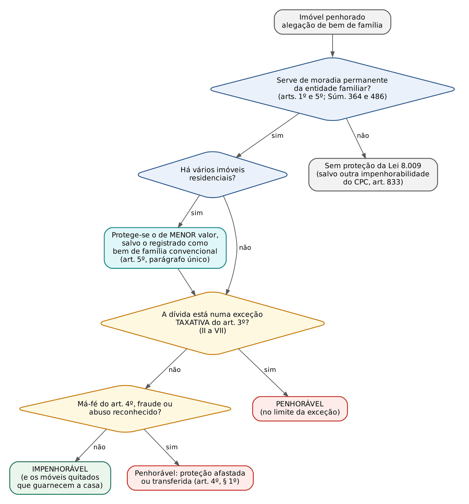
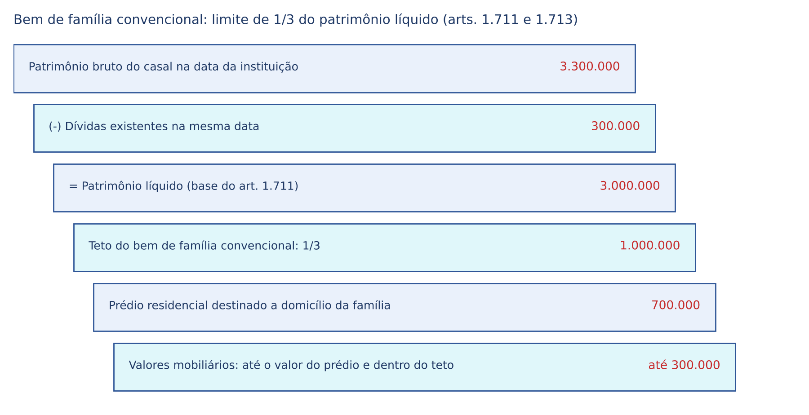
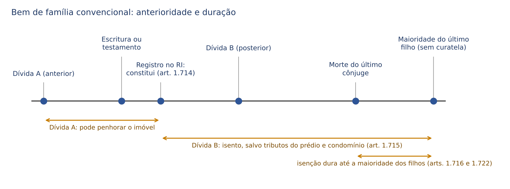

# CAPÍTULO 40 — BEM DE FAMÍLIA: LEGAL (LEI 8.009/1990) E CONVENCIONAL (CC), IMPENHORABILIDADE, EXCEÇÕES E JURISPRUDÊNCIA

:::INCIDENCIA
TRF5 p. 13; TJRS p. 19; TJSC p. 18 e 20. Nível A. Lote: 6 questões (FGV 3, FCC 3), mais 8 correlatas localizadas no banco por palavra-chave (FGV).
O que mais cai: exceções do art. 3º (fiador de locação residencial e comercial, alimentos com ressalva da meação, condomínio e IPTU, hipoteca em proveito da família), irrenunciabilidade, Súmulas 364, 449 e 486, imóvel de menor valor (art. 5º) e a letra dos arts. 1.711 a 1.722 do CC (1/3 do patrimônio líquido, registro constitutivo, dívidas posteriores, valores mobiliários).
:::

## 40.1 Fundamento, natureza e convivência dos dois regimes

O bem de família protege o direito social à moradia (art. 6º da CF, na redação da EC 26/2000) e concretiza a teoria do patrimônio mínimo (Luiz Edson Fachin; ver Cap. 7). Há dois regimes que convivem, sem que um exclua o outro: o legal (Lei 8.009/1990), que nasce da lei pelo simples fato de o imóvel servir de residência da entidade familiar, e o convencional ou voluntário (arts. 1.711 a 1.722 do CC), que nasce de ato do instituidor levado a registro. O art. 1.711, ao final, ressalva expressamente que ficam "mantidas as regras sobre a impenhorabilidade do imóvel residencial estabelecida em lei especial".

:::JURIS STJ, REsp 2.133.984-RJ, j. 22/10/2024 (Info 832)
O bem de família voluntário mantém com o legal relação de coexistência, e não de exclusão. A Jurisprudência em Teses (ed. 200, teses 1 a 3) sintetiza a diferença: no legal, o instituidor é o próprio Estado e o foco é a entidade familiar; no voluntário, o instituidor é o titular, que elege o patrimônio protegido. O legal dispensa qualquer ato formal; o voluntário depende de escritura pública ou testamento e de registro. O legal alcança todas as obrigações, ainda que o imóvel tenha sido adquirido no curso da execução; o voluntário só protege contra dívidas POSTERIORES à instituição (art. 1.715).
:::

Natureza: impenhorabilidade NÃO é inalienabilidade. O bem de família legal pode ser vendido, doado, hipotecado ou alienado fiduciariamente pelo titular (Jurisprudência em Teses, ed. 202, tese 3); o que a lei retira é a sujeição à expropriação forçada. Já o convencional tem inalienabilidade relativa: só pode ser alienado com o consentimento dos interessados e de seus representantes legais, ouvido o Ministério Público (art. 1.717). Essa é a diferença mais cobrada entre os dois regimes e a que mais confunde em alternativa de "impenhorável e inalienável".

| Aspecto | Legal (Lei 8.009/1990) | Convencional (arts. 1.711 a 1.722 do CC) |
|---|---|---|
| Origem | lei (norma de ordem pública) | ato de vontade: escritura pública ou testamento; terceiro por testamento ou doação |
| Formalidade | nenhuma; basta a destinação à moradia | registro do título no Registro de Imóveis, que é CONSTITUTIVO (art. 1.714) |
| Objeto | imóvel residencial + construções, plantações, benfeitorias, equipamentos e móveis quitados que guarnecem a casa (art. 1º, parágrafo único) | prédio residencial urbano ou rural, com pertenças e acessórios, e valores mobiliários cuja renda se aplica na conservação e no sustento (art. 1.712) |
| Limite de valor | nenhum (imóvel de luxo é protegido) | até 1/3 do patrimônio líquido ao tempo da instituição (art. 1.711); valores mobiliários até o valor do prédio (art. 1.713) |
| Dívidas alcançadas | todas, anteriores ou posteriores, salvo as exceções do art. 3º | só as POSTERIORES à instituição, salvo tributos relativos ao prédio e despesas de condomínio (art. 1.715) |
| Alienação | livre (impenhorável, mas alienável) | depende do consentimento dos interessados e de oitiva do MP (art. 1.717) |
| Vários imóveis | protege o de MENOR valor (art. 5º, parágrafo único) | protege o imóvel registrado, ainda que de maior valor |
| Duração | enquanto houver a destinação residencial | enquanto viver um dos cônjuges ou, na falta destes, até a maioridade dos filhos (arts. 1.716 e 1.722) |

:::QUESTAO FGV 2026 — ENAC — 3º Exame Nacional dos Cartórios (Q4130103)
O que o tabelião deve informar sobre o bem de família voluntário. Gabarito: D — pode envolver a formação de um fundo financeiro para o sustento da família (valores mobiliários do art. 1.712, cuja renda se aplica na conservação do imóvel e no sustento). Armadilhas: "registro em Títulos e Documentos" (é no Registro de Imóveis, art. 1.714; os títulos nominativos constam também dos livros de registro do emissor, art. 1.713, § 2º); "apenas na matrícula" (há o procedimento dos arts. 260 a 265 da Lei 6.015/1973 e o registro dos valores mobiliários); "tornou-se inútil com o bem de família legal" (convivem: o convencional permite proteger o imóvel de maior valor e o fundo); "instrumento particular se valer menos de 30 salários mínimos" (confusão com o art. 108: a forma é escritura pública ou testamento, sem exceção de valor).
:::

:::QUESTAO FGV 2025 — ENAC — 1º Exame Nacional dos Cartórios (Q3328201)
Gabarito: E. Para este capítulo: a impenhorabilidade do bem de família LEGAL independe de qualquer registro; a alternativa B ("o registro será constitutivo") só seria verdadeira para o bem de família CONVENCIONAL (art. 1.714) (questão comentada por inteiro no Cap. 33).
:::

## 40.2 Bem de família legal: quem é protegido e o que é protegido

:::LEI Lei 8.009/1990, arts. 1º, 2º e 5º
Art. 1º O imóvel residencial próprio do casal, ou da entidade familiar, é impenhorável e não responderá por qualquer tipo de dívida civil, comercial, fiscal, previdenciária ou de outra natureza, contraída pelos cônjuges ou pelos pais ou filhos que sejam seus proprietários e nele residam, salvo nas hipóteses previstas nesta lei.
Parágrafo único. A impenhorabilidade compreende o imóvel sobre o qual se assentam a construção, as plantações, as benfeitorias de qualquer natureza e todos os equipamentos, inclusive os de uso profissional, ou móveis que guarnecem a casa, desde que quitados.
Art. 2º Excluem-se da impenhorabilidade os veículos de transporte, obras de arte e adornos suntuosos.
Parágrafo único. No caso de imóvel locado, a impenhorabilidade aplica-se aos bens móveis quitados que guarneçam a residência e que sejam de propriedade do locatário, observado o disposto neste artigo.
Art. 5º Para os efeitos de impenhorabilidade, de que trata esta lei, considera-se residência um único imóvel utilizado pelo casal ou pela entidade familiar para moradia permanente.
Parágrafo único. Na hipótese de o casal, ou entidade familiar, ser possuidor de vários imóveis utilizados como residência, a impenhorabilidade recairá sobre o de menor valor, salvo se outro tiver sido registrado, para esse fim, no Registro de Imóveis e na forma do art. 70 do Código Civil.
:::

A remissão ao "art. 70 do Código Civil" é ao CC/1916; hoje se lê como art. 1.711 do CC/2002 (Jurisprudência em Teses, ed. 200, tese 4, e ed. 227, tese 9). A lei protege dívida "de qualquer natureza", inclusive fiscal e trabalhista (art. 3º, *caput*), e alcança também o bem adquirido no curso da execução.

### 40.2.1 Beneficiários: entidade familiar em sentido amplo

- Súmula 364 do STJ: o conceito de impenhorabilidade de bem de família abrange também o imóvel pertencente a pessoas solteiras, separadas e viúvas. A proteção é da pessoa e de sua moradia, não só do "casal": vale para quem mora sozinho (questão Q3044243, abaixo), para a família monoparental e para a anaparental (irmãos que vivem juntos).
- Imóvel que serve de residência aos familiares do devedor, ainda que ele próprio more em outro lugar, é impenhorável (Jurisprudência em Teses, ed. 203, tese 2).
- Dissolvida a união estável, a separação ou o divórcio, é possível reconhecer mais de um imóvel impenhorável do mesmo devedor, um para cada entidade familiar resultante (ed. 203, tese 3).
- Morte do devedor: a impenhorabilidade NÃO cessa automaticamente; estende-se à entidade familiar (ed. 203, tese 6), impede a penhora de direitos hereditários no rosto do inventário quando o único bem do acervo é o bem de família (ed. 203, tese 7), e a transmissão hereditária, por si, não desconfigura a natureza do bem se mantidas as características de residência da família (STJ, REsp 2.111.839-RS, j. 6/5/2025, Info 850). Na execução fiscal contra o espólio, o imóvel inventariado e ainda não partilhado que serve de moradia a herdeira que vivia com o falecido continua protegido (STJ, AgInt no REsp 2.168.820-RS, 1ª Turma, j. 18/8/2025, Info 861).
- Pessoa jurídica: a regra é que o imóvel da sociedade não é bem de família, mas o STJ já reconheceu impenhorável o imóvel de sociedade empresária de pequeno porte, dado em caução locatícia e usado como moradia do sócio e de sua família (ed. 201, tese 3).
- Legitimidade: os integrantes da entidade familiar que residem no imóvel podem se insurgir contra a penhora (ed. 44, tese 2), por embargos de terceiro ou simples petição (ver 40.5).

:::QUESTAO FGV 2024 — Prefeitura de Vitória-ES — Procurador (Q3044243)
Bento, divorciado, mora sozinho em imóvel próprio e deve pensão ao filho, mútuo ao banco e cotas do condomínio do mesmo imóvel. Gabarito: C — ele é protegido pela impenhorabilidade diante do banco (Súmula 364). Por que as demais caem: A, a impenhorabilidade NÃO é oponível ao credor de alimentos (art. 3º, III); B, os móveis usualmente mantidos num lar comum são impenhoráveis (art. 1º, parágrafo único; ed. 44, tese 3); D, o condomínio pode penhorar o próprio imóvel pelas cotas dele (ed. 44, tese 9; ver 40.3.4); E, havendo vários imóveis residenciais, a proteção recai sobre o de MENOR valor (art. 5º, parágrafo único).
:::

### 40.2.2 O imóvel: residência e moradia permanente

A lei exige "imóvel residencial próprio" usado para "moradia permanente" (art. 5º). Daí as soluções jurisprudenciais, quase todas cobráveis em alternativa curta:

| Situação | Solução | Fonte |
|---|---|---|
| Devedor não prova que o imóvel é o único de sua propriedade | irrelevante: NÃO se exige essa prova | ed. 203, tese 1; STJ, AREsp 3.052.982-MG, j. 23/3/2026 (Informativo de Jurisprudência n. 32, edição extraordinária) |
| Vários imóveis usados como residência | protege o de MENOR valor, salvo instituição voluntária registrada de outro, que pode ser o de maior valor | art. 5º, parágrafo único; ed. 200, tese 4 |
| Casa de veraneio ou de uso eventual | não protegida: não há moradia permanente; não cabe interpretação extensiva do art. 5º | ed. 200, tese 10 |
| Único imóvel residencial, locado a terceiro, com a renda revertida à subsistência ou à moradia da família | impenhorável | Súmula 486 do STJ |
| Terreno não edificado ou imóvel em construção | não perde, por si, a qualificação; a destinação é examinada caso a caso | ed. 44, tese 10 |
| Imóvel de alto padrão ou de luxo | continua impenhorável; não se admite "solução intermediária" de alienar e reservar parte do produto para nova moradia | ed. 203, tese 4; STJ, AREsp 2.791.033-PR, j. 22/6/2026 (Info 895) |
| Imóvel com frações de destinação distinta e separáveis | penhorável a fração comercial | ed. 200, tese 6 |
| Moradia e funcionamento de empresa no mesmo local | a confusão entre moradia e sede da empresa NÃO é requisito para a proteção; o uso misto não a afasta por si | STJ, AgInt no AREsp 2.360.631-RJ, j. 8/4/2024 (Info 811) |
| Imóvel contíguo com matrícula própria | penhorável | ed. 200, tese 7 |
| Fração ideal | penhorável se o desmembramento não descaracterizar o imóvel | ed. 200, tese 5 |
| Nua propriedade do imóvel que é bem de família | reconhecido o caráter de bem de família, é inválida até a indicação à penhora da nua propriedade | AREsp 3.052.982-MG (Inf. n. 32, edição extraordinária) |
| Vaga de garagem com matrícula própria | não constitui bem de família para efeito de penhora | Súmula 449 do STJ (Tema 1.330 pendente; ver abaixo) |

:::PEGADINHA Imóvel de luxo
O art. 4º pune quem, sabendo-se insolvente, adquire de má-fé imóvel MAIS VALIOSO para transferir a residência (ver 40.4). Fora dessa hipótese, o valor do imóvel é irrelevante. Alternativa que diga que a proteção "se limita a imóvel de valor compatível com a dignidade" ou que "o juiz pode autorizar a venda reservando parte do preço" está errada segundo o STJ (Info 895, 2026). O limite de valor (1/3 do patrimônio líquido) é do bem de família CONVENCIONAL.
:::

Copropriedade e meação. A proteção é do imóvel como um todo, e não apenas da quota do devedor: o reconhecimento do bem de família quanto à meação da esposa não devedora estende-se à totalidade do bem, porque o objetivo é evitar o desabrigo (STJ, EDcl no AgInt no AREsp 2.244.832-SP, j. 23/9/2024, Informativo de Jurisprudência n. 23, edição extraordinária); e o imóvel residencial indivisível é impenhorável em sua integralidade, ainda que só parte pertença ao executado e alguns coerdeiros não morem nele (STJ, REsp 1.861.107-RS, 1ª Turma, j. 10/12/2024, Informativo n. 22, edição extraordinária). A exceção dos alimentos tem regra própria sobre a quota do coproprietário (ver 40.3.3).

Garagem. A Súmula 449 adota critério formal: a vaga com matrícula própria é unidade autônoma e não integra o bem de família. Duas notas: (i) a alienação judicial de vaga autônoma a pessoa estranha ao condomínio depende, em regra, de autorização na convenção, por força do art. 1.331, § 1º, do CC (STJ, Info 820, 2024; ver Cap. 30); (ii) o STJ afetou como repetitivo o Tema 1.330 ("definir se a vaga de garagem com matrícula própria constitui bem de família para fins de penhora, à luz do art. 1.331, § 1º, do CC"), afetação em 8/4/2025 (Info 847), sem tese fixada até a última atualização consultada (5/2/2026). Até lá, em prova, prevalece a Súmula 449.

Alienação fiduciária. Quando o imóvel residencial está alienado fiduciariamente, a propriedade é do credor fiduciário, e o terceiro credor do fiduciante não pode penhorar o imóvel (ed. 202, tese 4). Penhoram-se, em regra, os DIREITOS do fiduciante, que têm expressão econômica (ed. 202, tese 5), sem necessidade de anuência do fiduciário (ed. 202, tese 7); mas esses direitos são impenhoráveis quando afetados à aquisição do único imóvel usado como moradia (ed. 202, tese 6; Enunciado 325 da IV Jornada: é impenhorável, nos termos da Lei 8.009/1990, o direito real de aquisição do devedor fiduciante). O regime da alienação fiduciária e da execução extrajudicial está no Cap. 22.

### 40.2.3 Imóvel rural e pequena propriedade rural

O art. 4º, § 2º, restringe a proteção, no imóvel rural, à sede de moradia, com os respectivos móveis, e, nos casos do art. 5º, XXVI, da CF, à área limitada como pequena propriedade rural. São duas proteções diferentes, que a banca mistura:

| Aspecto | Sede de moradia rural (Lei 8.009, art. 4º, § 2º, 1ª parte) | Pequena propriedade rural (CF, art. 5º, XXVI; CPC, art. 833, VIII) |
|---|---|---|
| O que protege | a casa e os móveis | a área produtiva trabalhada pela família |
| Dívidas | todas, salvo as exceções do art. 3º | "débitos decorrentes de sua atividade produtiva" (CF) e, pelo CPC, em geral |
| Garantia dada voluntariamente | hipoteca em proveito da família afasta a proteção (art. 3º, V) | impenhorável ainda que dada em hipoteca pelos proprietários (ed. 203, tese 5) e não se sujeita sequer à consolidação extrajudicial em alienação fiduciária (STJ, REsp 2.233.886-RS, 3ª Turma, j. 9/12/2025, Info 875) |
| Ônus da prova | do devedor, quanto à moradia | do executado, quanto à exploração familiar (Tema 1.234 do STJ) |

:::JURIS STF, Tema 961 (ARE 1.038.507-PR, Plenário, j. 18/12/2020, Info 1003)
"É impenhorável a pequena propriedade rural familiar constituída de mais de 01 (um) terreno, desde que contínuos e com área total inferior a 04 (quatro) módulos fiscais do município de localização." A referência dos quatro módulos vem do art. 4º, II, "a", da Lei 8.629/1993.
:::

:::JURIS STJ, Tema 1.234 (REsp 2.080.023-MG, Corte Especial, j. 6/11/2024, Info 833)
É ônus do executado provar que a pequena propriedade rural é explorada pela família, para fins de reconhecimento de sua impenhorabilidade. Atenção ao contraste com o bem de família urbano: lá, o devedor não precisa provar que o imóvel é o único (40.2.2), mas precisa demonstrar que nele reside a família.
:::

:::PEGADINHA Alienação fiduciária: bem de família comum x pequena propriedade rural
Bem de família urbano pode ser dado em alienação fiduciária: a proteção não implica inalienabilidade (ed. 202, tese 3), e o fiduciante que o deu em garantia não pode, depois, invocá-la contra a consolidação. Já a pequena propriedade rural explorada pela família é protegida também contra a consolidação extrajudicial, ainda que oferecida voluntariamente (Info 875, 2025), porque o STJ trata a garantia constitucional como indisponível e a alienação fiduciária como espécie mais gravosa do que a hipoteca, que já não a afastava.
:::

### 40.2.4 Bens móveis

Entram na proteção os equipamentos (inclusive de uso profissional) e os móveis que guarnecem a casa, DESDE QUE QUITADOS (art. 1º, parágrafo único). Ficam fora os veículos de transporte, as obras de arte e os adornos suntuosos (art. 2º). Na locação, protegem-se os móveis quitados do LOCATÁRIO (art. 2º, parágrafo único): ele não é dono do imóvel, mas a residência é dele.

- A proteção alcança os móveis indispensáveis à habitabilidade e os usualmente mantidos em um lar comum (ed. 44, tese 3): televisor, geladeira, máquina de lavar, computador e similares.
- Bens em duplicidade são penhoráveis, por não serem necessários à manutenção básica (ed. 203, tese 9): a segunda televisão, o segundo aparelho de som.
- Móveis ainda não quitados são penhoráveis (ed. 203, tese 10): a ressalva "desde que quitados" é letra de lei.
- O veículo é penhorável pela Lei 8.009 ainda que único; eventual proteção decorre de outra regra (o CPC protege os instrumentos necessários ao exercício da profissão, art. 833, V), e não da lei do bem de família.

## 40.3 Exceções à impenhorabilidade (art. 3º)

:::LEI Lei 8.009/1990, art. 3º (redação vigente)
Art. 3º A impenhorabilidade é oponível em qualquer processo de execução civil, fiscal, previdenciária, trabalhista ou de outra natureza, salvo se movido:
I - (Revogado pela Lei Complementar nº 150, de 2015)
II - pelo titular do crédito decorrente do financiamento destinado à construção ou à aquisição do imóvel, no limite dos créditos e acréscimos constituídos em função do respectivo contrato;
III – pelo credor da pensão alimentícia, resguardados os direitos, sobre o bem, do seu coproprietário que, com o devedor, integre união estável ou conjugal, observadas as hipóteses em que ambos responderão pela dívida; (Redação dada pela Lei nº 13.144 de 2015)
IV - para cobrança de impostos, predial ou territorial, taxas e contribuições devidas em função do imóvel familiar;
V - para execução de hipoteca sobre o imóvel oferecido como garantia real pelo casal ou pela entidade familiar;
VI - por ter sido adquirido com produto de crime ou para execução de sentença penal condenatória a ressarcimento, indenização ou perdimento de bens.
VII - por obrigação decorrente de fiança concedida em contrato de locação. (Incluído pela Lei nº 8.245, de 1991)
:::

Regra de leitura: as exceções são TAXATIVAS e não comportam interpretação extensiva (Jurisprudência em Teses, ed. 200, tese 9). Daí que não afastam a proteção, por exemplo, honorários advocatícios, dívida de material de construção, contribuição de associação de moradores, caução locatícia, fiança em contrato que não seja de locação e a mera desconsideração da personalidade jurídica (ed. 201, tese 6). Quando a exceção incide, o saldo da arrematação que sobrar após quitar a dívida continua sendo bem de família, para fins de outros credores (ed. 204, tese 9).

| Inciso | Credor que pode penhorar | Limites e distinções |
|---|---|---|
| I | (revogado: trabalhadores da própria residência e contribuições previdenciárias) | revogado pela LC 150/2015 (empregado doméstico); hoje o doméstico NÃO penhora o bem de família |
| II | financiador da construção ou da aquisição do imóvel | só no limite dos créditos do respectivo contrato; inclui o vendedor ou promitente vendedor, a empreitada global e a reforma; NÃO o fornecedor de material, por si |
| III | credor de pensão alimentícia | alimentos de família ou de ato ilícito; ressalva da meação ou quota do cônjuge ou companheiro coproprietário; NÃO honorários |
| IV | Fisco (IPTU, ITR, taxas e contribuições do imóvel) e, por construção, o condomínio | só tributos DO PRÓPRIO imóvel; cotas condominiais do próprio bem; NÃO associação de moradores |
| V | credor hipotecário | hipoteca dada pelo casal ou entidade familiar, em proveito dela; só o próprio credor hipotecário (Tema 1.261 do STJ) |
| VI | vítima ou Estado | produto de crime (sem exigir condenação) ou execução de sentença penal condenatória (exige trânsito em julgado) |
| VII | locador, contra o fiador | locação residencial ou comercial (Tema 1.127 do STF; Tema 1.091 do STJ); não a caução |

Observação legislativa: a MP 871/2019 incluiu um inciso VIII (crédito da Procuradoria-Geral Federal por benefício previdenciário ou assistencial recebido indevidamente por dolo, fraude ou coação). A lei de conversão (Lei 13.846/2019) não alterou a Lei 8.009, e a compilação do Planalto restabelece o inciso VII em sua redação original, sem o "e" final. Para a prova, o rol vigente vai do inciso II ao VII.

### 40.3.1 Inciso I revogado

A LC 150/2015 (lei do empregado doméstico) revogou expressamente o inciso I. A banca ainda apresenta como verdadeira a alternativa de que "o empregado doméstico pode penhorar o bem de família do empregador": está ERRADA desde 2015. O crédito trabalhista doméstico segue o regime geral (proteção oponível, art. 3º, *caput*: "execução ... trabalhista").

### 40.3.2 Inciso II: financiamento da construção ou da aquisição

A lógica é impedir que o devedor use a impenhorabilidade como escudo contra quem viabilizou o próprio imóvel. O STJ lê "financiamento" de modo funcional, mas sem ultrapassar o vínculo com o bem:

- Dívida decorrente de compra e venda ou promessa de compra e venda do próprio imóvel: penhorável (ed. 44, tese 8).
- Contrato de empreitada global que viabilizou a construção: penhorável (ed. 202, tese 8; STJ, REsp 1.976.743-SC).
- Dívida contraída para a REFORMA do imóvel (serviços de arquiteta que projetou e coordenou a obra): penhorável (STJ, REsp 2.082.860-RS, 3ª Turma, j. 6/2/2024, Info 800).
- Compra de material de construção, por si, NÃO afasta a proteção (ed. 202, tese 9): o fornecedor não financiou a aquisição nem a construção em sentido próprio.
- Sub-rogação: a exceção se estende ao novo imóvel adquirido com recursos da venda do primitivo, que era penhorável pelo financiador (ed. 202, tese 10).
- Limite: "no limite dos créditos e acréscimos constituídos em função do respectivo contrato". Outra dívida com o mesmo banco não entra.

:::PEGADINHA Reforma x material de construção
A reforma contratada (empreitada, serviço técnico de execução da obra) entra no inciso II; a mera compra de material, não. A distinção é recente e pode aparecer em alternativa "toda dívida relacionada a obras no imóvel afasta a proteção" (errada) ou "a dívida da reforma não se enquadra, por falta de previsão expressa" (errada, à luz do Info 800).
:::

### 40.3.3 Inciso III: pensão alimentícia

A exceção vale para alimentos decorrentes de vínculo familiar e também para os indenizatórios, oriundos de ato ilícito (ed. 44, tese 1). Não se estende a honorários advocatícios ou de profissionais liberais, ainda que tenham natureza alimentar para outros fins (ed. 201, tese 7). A Lei 13.144/2015 acrescentou a ressalva dos direitos do coproprietário que, com o devedor, integre união estável ou conjugal: a penhora é possível, mas a meação ou quota do cônjuge ou companheiro não devedor fica preservada, "observadas as hipóteses em que ambos responderão pela dívida". Sendo o bem indivisível, ele vai à alienação, e a quota do coproprietário recai sobre o produto (ed. 201, tese 8; CPC, art. 843).

:::QUESTAO FCC 2025 — DPE-SP — Analista de Defensoria (Q3304112)
João, casado com Jéssica na comunhão parcial, tem como único imóvel a residência do casal, adquirida na constância; deve alimentos a Jonas, filho de outro relacionamento, que promove cumprimento de sentença pelo rito da penhora. Gabarito: E — o bem é penhorável, resguardando-se o direito de MEAÇÃO da esposa. Passos: (1) a dívida é de alimentos, exceção do art. 3º, III; (2) a parte final do inciso, desde a Lei 13.144/2015, resguarda os direitos do coproprietário cônjuge ou companheiro; (3) na comunhão parcial, Jéssica é meeira do bem adquirido onerosamente na constância (ver Cap. 36). Armadilhas: "meação e herança" (João está vivo: não há herança); "sem reserva, porque dívida alimentar não admite oposição" (era a leitura anterior a 2015); "dívida contraída pela entidade familiar" (o filho é de outra união; a dívida é pessoal de João).
:::

Prisão civil, rito e demais aspectos da execução de alimentos: ver Cap. 39.

### 40.3.4 Inciso IV: tributos do imóvel e obrigações *propter rem*

A letra fala em "impostos, predial ou territorial, taxas e contribuições devidas em função do imóvel familiar". Requisitos: o tributo tem de ser do PRÓPRIO imóvel que se quer penhorar (ed. 204, tese 6); IPTU de outro imóvel do devedor, ICMS ou IR não autorizam a penhora. Pela mesma razão, a alienação do bem de família depois de constituído crédito tributário estranho ao imóvel não configura fraude à execução fiscal: o bem já era impenhorável e nada se subtraiu (ed. 204, tese 7). Ver também Apostila de Direito Tributário quanto ao art. 185 do CTN.

A jurisprudência estende o inciso às despesas de condomínio do próprio imóvel, por sua natureza *propter rem* (ed. 44, tese 9) — extensão que NÃO contraria a taxatividade, porque o STJ a vê compreendida na expressão "contribuições devidas em função do imóvel". Pela mesma lógica real, o coproprietário que usa com exclusividade o imóvel comum como moradia e deve aluguéis aos demais tem obrigação *propter rem*, e o bem pode ser penhorado (ed. 202, tese 2).

Em sentido contrário, a contribuição cobrada por associação de moradores, por ser obrigação pessoal, não equiparada a despesa condominial, não autoriza a penhora (ed. 202, tese 1). O tema está afetado como repetitivo (Tema 1.183 do STJ, para definir a natureza do crédito do rateio cobrado por associações), pendente na última atualização consultada (5/2/2026; ver Cap. 12). Também cabe a penhora do bem de família do condômino, na proporção da fração ideal, quando o condomínio não tiver patrimônio próprio para responder por dívida de danos a terceiros (ed. 204, tese 10).

:::QUESTAO FGV 2026 — ENAM 2026.1 (Q4102442)
Adquirente executada por cotas condominiais anteriores à compra alega, após a penhora, bem de família. Gabarito: C. Para este capítulo: a impenhorabilidade não prevalece (alternativa A), porque o crédito condominial do próprio imóvel é exceção reconhecida (ed. 44, tese 9). No mesmo sentido: Q3951726 (FGV 2026, TJ-PA, Juiz — promissária compradora imitida na posse, gabarito E: o próprio bem pode ser penhorado, independentemente de ser bem de família) e Q3505761 (FGV 2025, TJ-CE, Juiz — o arrematante só responde pelo saldo das cotas anteriores se o edital mencionar o ônus) (questão comentada por inteiro no Cap. 30).
:::

### 40.3.5 Inciso V: hipoteca dada pela entidade familiar

A exceção pressupõe hipoteca "sobre o imóvel oferecido como garantia real pelo casal ou pela entidade familiar". O STJ uniformizou o alcance em repetitivo.

:::JURIS STJ, Tema 1.261 (REsp 2.093.929-MG e REsp 2.105.326-SP, 2ª Seção, j. 5/6/2025, Info 855)
I) A exceção do art. 3º, V, restringe-se às hipóteses em que a dívida foi constituída em benefício da entidade familiar. II) Ônus da prova: a) se o bem foi dado em garantia real por um dos sócios da pessoa jurídica devedora, é, em regra, impenhorável, cabendo ao CREDOR provar que o débito da sociedade se reverteu em benefício da família; b) se os únicos sócios são os titulares do imóvel hipotecado, a regra é a penhorabilidade, cabendo aos PROPRIETÁRIOS provar que o débito não reverteu em proveito da família.
:::

Outras regras do inciso V:

- Só o próprio credor hipotecário pode penhorar com base na exceção: em execução movida por credor diverso, o imóvel continua impenhorável (ed. 204, tese 5; STJ, EDcl no AgInt nos EDcl no REsp 1.604.422-MG, j. 24/8/2021, cobrado pela FGV no TJ-ES em 2023, segundo a coletânea de Ana Paula Dias). Hipoteca em favor de um banco não "abre" o imóvel aos demais credores.
- A falta de registro (averbação) da hipoteca não afasta, por si, a exceção (ed. 204, tese 4): a renúncia à proteção decorre da oferta do bem em garantia, e o registro interessa à oponibilidade a terceiros.
- Hipoteca constituída quando o garantidor era solteiro e sem filhos: se ele depois forma união estável e tem filho que passam a residir no imóvel, o bem pode ser reconhecido como de família e impenhorável, se a dívida não beneficiou a entidade familiar (STJ, REsp 2.011.981-SP, 3ª Turma, j. 9/12/2025, Info 875). A proteção alcança situações supervenientes à garantia e até à penhora.
- Pequena propriedade rural: impenhorável ainda que hipotecada (40.2.3).

:::QUESTAO FGV 2024 — SES-MT — Advogado (Q2482653)
Gabarito: D (Súmula 308 do STJ). Para este capítulo: a alternativa A ("a ausência de registro da hipoteca afasta a exceção à impenhorabilidade") está errada — a falta de registro, por si, não afasta a exceção do art. 3º, V (ed. 204, tese 4) (questão comentada por inteiro no Cap. 32).
:::

### 40.3.6 Inciso VI: crime

O inciso tem duas partes, com requisitos diferentes:

| Parte | Hipótese | Exige condenação penal? | Fonte |
|---|---|---|---|
| 1ª | imóvel "adquirido com produto de crime" | NÃO: basta a prática de conduta definida como crime e a aquisição com o produto dela | ed. 201, tese 10 |
| 2ª | "execução de sentença penal condenatória a ressarcimento, indenização ou perdimento de bens" | SIM, transitada em julgado | ed. 201, tese 9 |

A execução de sentença CIVIL por ato ilícito também pode atingir o bem de família se o réu foi condenado na esfera penal pelo mesmo fato, dada a repercussão da condenação criminal no cível (ed. 44, tese 7; art. 935 do CC; arts. 63 e 65 do CPP). Sem condenação penal, a indenização civil por ato ilícito não está no rol (salvo se tiver natureza de pensão alimentícia, inciso III).

### 40.3.7 Inciso VII: fiança em contrato de locação

Este capítulo é o dono da matéria (ver também Cap. 18, locação, e Cap. 21, fiança). O inciso VII foi incluído pela Lei 8.245/1991 (art. 82) e gerou a evolução jurisprudencial mais cobrada do tema:

| Marco | Conteúdo |
|---|---|
| STF, Tema 295 (RE 612.360/SP) | "É constitucional a penhora de bem de família pertencente a fiador de contrato de locação, em virtude da compatibilidade da exceção prevista no art. 3°, VII, da Lei 8.009/1990 com o direito à moradia consagrado no art. 6° da Constituição Federal, com redação da EC 26/2000." |
| STJ, Tema 708 (REsp 1.363.368-MS, 2ª Seção, j. 12/11/2014, Info 552) | é legítima a penhora de bem de família do fiador de contrato de locação |
| Súmula 549 do STJ (2ª Seção, 14/10/2015) | "É válida a penhora de bem de família pertencente a fiador de contrato de locação." |
| Divergência no STF (2018 a 2021) | a 1ª Turma do STF chegou a afastar a penhora na locação COMERCIAL, por não estar em jogo o direito à moradia do locatário; isso gerou insegurança até o julgamento em repercussão geral |
| STF, Tema 1.127 (RE 1.307.334/SP, Plenário, Rel. Min. Alexandre de Moraes, j. 8/3/2022, Info 1046) | "É constitucional a penhora de bem de família pertencente a fiador de contrato de locação, seja residencial, seja comercial." |
| STJ, Tema 1.091 (REsp 1.822.033/PR e REsp 1.822.040/PR) | "É válida a penhora do bem de família de fiador apontado em contrato de locação de imóvel, seja residencial, seja comercial, nos termos do inciso VII do art. 3º da Lei n. 8.009/1990." |

Fundamentos do Tema 1.127 (por maioria): a lei não distingue a espécie de locação; a fiança é a garantia mais barata e acessível para o pequeno empreendedor (livre iniciativa, valorização do trabalho); e o fiador, no exercício de sua autonomia, dispõe livremente de seus bens, de modo que a restrição ao direito de moradia é proporcional e razoável.

Limites da exceção:

- Só FIANÇA, e só em contrato de LOCAÇÃO. O bem de família oferecido como CAUÇÃO em locação residencial ou comercial é impenhorável (ed. 201, tese 2): a caução é garantia real, não prevista no inciso VII, e as exceções não se ampliam. Fiança em mútuo bancário ou em outro contrato também não autoriza a penhora.
- Vale para fiança pactuada antes da Lei 8.245/1991 (ed. 44, tese 16).
- O devedor principal (locatário) continua protegido: só o fiador perde a proteção. A assimetria (o locatário inadimplente conserva seu bem de família, o fiador não) foi exatamente o argumento rejeitado pelo STF.
- Validade da fiança: a fiança prestada por pessoa casada sem outorga conjugal (art. 1.647, III, salvo separação absoluta) implica a ineficácia total da garantia (Súmula 332 do STJ — ver Cap. 21); caindo a fiança, cai a base da penhora do inciso VII. Na união estável, o STJ admite a fiança prestada sem autorização do companheiro (ver Cap. 21).

:::QUESTAO FCC 2025 — DPE-AM — Defensor Público (Q3531610)
Kátia quer ser fiadora de locação COMERCIAL e pergunta se seu único imóvel poderá ser penhorado, segundo tema repetitivo do STJ. Gabarito: C — é válida a penhora do bem de família de fiador em locação residencial ou comercial (Tema 1.091 do STJ, alinhado ao Tema 1.127 do STF). Armadilhas: B e D (penhorabilidade só em uma das espécies, com o argumento de que "prepondera a moradia" ou "a livre iniciativa": foi a tese vencida da 1ª Turma do STF); E (exceção por filhos de até 12 anos e hipossuficiência: inexistente).
:::

:::QUESTAO FGV 2025 — TJ-CE — Juiz Substituto (Q3505760)
Fiança locatícia prestada sem outorga conjugal por fiador cujo único imóvel é sua residência. Gabarito: C (fiança totalmente ineficaz, Súmula 332). Para este capítulo: erram A e E ao dizer nula a penhora por ser bem de família — a exceção do inciso VII vale contra o fiador locatício (Súmula 549 do STJ; Tema 1.127 do STF); o problema é a fiança, não o bem (questão comentada por inteiro no Cap. 21).
:::

:::QUESTAO FGV 2026 — TJ-MS — Outorga de Delegações (Provimento) (Q3914481)
Fiança locatícia sem outorga uxória; penhora do imóvel residencial exclusivo do fiador. Gabarito oficial: B (penhora inválida). Para este capítulo: a penhora não cai por ser bem de família (A), porque a fiança locatícia válida autorizaria a constrição (Súmula 549); cai porque a garantia não produz efeitos sem a outorga (Súmula 332) (questão comentada por inteiro no Cap. 21).
:::

:::PEGADINHA Fiança, caução e aval
A exceção do inciso VII não alcança: (i) a caução real ou o imóvel dado em caução na locação; (ii) o aval ou a fiança em contrato bancário; (iii) o próprio locatário. E a fiança só autoriza a penhora se for válida e eficaz: sem outorga conjugal (Súmula 332) ou em aditamento não anuído (Súmula 214), o fiador não responde, e a questão de bem de família nem chega a ser enfrentada.
:::

## 40.4 Má-fé, fraude, abuso e renúncia

### 40.4.1 Art. 4º: aquisição de imóvel mais valioso pelo insolvente

:::LEI Lei 8.009/1990, art. 4º
Art. 4º Não se beneficiará do disposto nesta lei aquele que, sabendo-se insolvente, adquire de má-fé imóvel mais valioso para transferir a residência familiar, desfazendo-se ou não da moradia antiga.
§ 1º Neste caso, poderá o juiz, na respectiva ação do credor, transferir a impenhorabilidade para a moradia familiar anterior, ou anular-lhe a venda, liberando a mais valiosa para execução ou concurso, conforme a hipótese.
§ 2º Quando a residência familiar constituir-se em imóvel rural, a impenhorabilidade restringir-se-á à sede de moradia, com os respectivos bens móveis, e, nos casos do art. 5º, inciso XXVI, da Constituição, à área limitada como pequena propriedade rural.
:::

Requisitos cumulativos: ciência da própria insolvência + má-fé + aquisição de imóvel MAIS valioso + transferência da residência para ele. Consequências alternativas, "conforme a hipótese": (a) se o devedor conservou a moradia antiga, o juiz transfere a impenhorabilidade para ela e libera a nova, mais valiosa; (b) se se desfez da antiga, o juiz pode anular-lhe a venda (a proteção volta para ela) e liberar a mais valiosa. O texto diz "poderá o juiz, na respectiva ação do credor": a medida é tomada no próprio processo do credor, sem necessidade de ação pauliana autônoma. A proteção não se perde por inteiro: a família conserva um teto, o de menor valor.

### 40.4.2 Abuso, boa-fé objetiva e fraude

O STJ afasta a proteção quando caracterizados abuso do direito de propriedade, violação da boa-fé objetiva e fraude à execução (Jurisprudência em Teses, ed. 44, tese 11). Exemplos: bem oferecido em garantia para ingresso no REFIS por devedor que atuou de modo fraudulento (ed. 203, tese 8); acordo judicial homologado em que o devedor oferece o bem de família em garantia, com posterior alegação de impenhorabilidade, contrária à boa-fé e à eticidade (ed. 200, tese 8; *venire contra factum proprium*, ver Cap. 15).

Mas a fraude não afasta automaticamente a proteção:

:::JURIS STJ, EAREsp 2.141.032-GO, 2ª Seção, Rel. Min. Nancy Andrighi, j. 6/2/2025 (Info 840)
É possível manter a proteção do bem de família que, embora doado em fraude à execução aos filhos, continua a ser a moradia da família. A fraude à execução torna a alienação ineficaz perante o exequente, mas não afasta por si a impenhorabilidade quando (i) o imóvel já era bem de família antes da doação, (ii) a dívida não se enquadra em exceção do art. 3º e (iii) o imóvel continuou a ser a residência. Nada se subtraiu da garantia do credor, porque o bem já era impenhorável.
:::

O mesmo raciocínio afasta a fraude contra credores na doação de bem de família aos filhos (falta *eventus damni*; ver Cap. 9) e a fraude à execução fiscal na alienação de bem de família (ed. 204, tese 7).

### 40.4.3 Irrenunciabilidade

A impenhorabilidade do bem de família legal é questão de ordem pública e NÃO admite renúncia pelo titular (ed. 44, tese 17). Também não vale cláusula contratual prévia de renúncia (Q4349475, abaixo). A conciliação com a jurisprudência sobre boa-fé está na distinção entre renúncia abstrata (inválida) e comportamento concreto que gera disposição do bem por mecanismo que a lei admite (hipoteca em proveito da família, inciso V; alienação fiduciária; fiança locatícia, inciso VII) ou que configura abuso (acordo homologado em que o bem é oferecido em garantia, ed. 200, tese 8).

:::QUESTAO FGV 2026 — TJ-PE — Juiz Substituto (Q4349475)
Casal com dois filhos firma mútuo com banco, sem garantia real, e insere cláusula de renúncia à proteção do único imóvel residencial, comprometendo-se a não alegar impenhorabilidade. Gabarito: E — a proteção ao bem de família legal tem natureza de ordem pública, e a renúncia prévia e genérica não impede sua posterior invocação. Armadilhas: A e B (autonomia privada: a norma é cogente); C (renúncia por escritura averbada na matrícula: forma não convalida o que é indisponível); D (mútuo bancário sem garantia real não é exceção do art. 3º; se houvesse hipoteca em favor da família, o inciso V incidiria).
:::

:::PEGADINHA Renúncia x oferta em garantia
"O devedor pode renunciar à impenhorabilidade" — FALSO. "O devedor que deu o imóvel em hipoteca para dívida em proveito da família não pode opor a impenhorabilidade ao credor hipotecário" — VERDADEIRO (art. 3º, V; Tema 1.261). "O devedor que celebrou acordo judicial homologado oferecendo o bem de família em garantia não pode depois alegar a impenhorabilidade" — VERDADEIRO segundo o STJ, por violação da boa-fé (ed. 200, tese 8), embora a renúncia em abstrato seja inválida. Leia o caso concreto da questão.
:::

## 40.5 Aspectos processuais e de registro

:::PROCESSO Alegação, preclusão e meios de defesa
- Momento: a impenhorabilidade pode ser alegada em qualquer momento processual até a arrematação, inclusive por simples petição nos autos (ed. 44, tese 18), e pelos familiares residentes (ed. 44, tese 2), também por embargos de terceiro.
- Preclusão: decidida a questão, opera-se a preclusão consumativa; não cabe novo pronunciamento sobre a mesma matéria (ed. 44, tese 14; ed. 204, tese 2). O filho da executada não pode rediscutir, em embargos de terceiro, a impenhorabilidade já analisada em exceção de pré-executividade da mãe (STJ, AgInt no REsp 2.104.283-SP, j. 4/3/2024, Info 810). Fato novo (por exemplo, a família passa a residir no imóvel) permite nova alegação.
- Limite final: não se argui a impenhorabilidade em ação anulatória da arrematação depois de encerrada a execução (ed. 204, tese 8).
- Ônus da prova: do devedor quanto à moradia (não quanto a ser o único imóvel, 40.2.2); do executado, na pequena propriedade rural, quanto à exploração familiar (Tema 1.234); na hipoteca, conforme o Tema 1.261 (40.3.5).
- Direito intertemporal: a Lei 8.009/1990 aplica-se à penhora realizada antes de sua vigência (Súmula 205 do STJ); o art. 6º da lei cancelou as execuções suspensas pela MP 143/1990.
- Fisco: a medida cautelar fiscal de indisponibilidade não pode recair sobre bem de família (ed. 204, tese 1); o arrolamento fiscal, que é mero inventário de bens, pode (ed. 44, tese 13).
- Protesto contra alienação de bem de família: não obsta nem anula a venda; apenas informa terceiros da pretensão do credor (ed. 204, tese 3; CPC, art. 301).
- Usucapião: a instituição do imóvel como bem de família não impede a usucapião por terceiro, em caso de mudança ou abandono (ed. 204, tese 11; ver Cap. 29).
:::

:::SENTENCA Decisão sobre impugnação à penhora de bem de família
Roteiro: (1) qualificar o imóvel (residência permanente da entidade familiar, art. 5º; prova documental: contas, matrícula, declarações, auto do oficial); (2) afastar argumentos irrelevantes (valor do imóvel; existência de outros bens; condição de solteiro, Súmula 364); (3) examinar a natureza do crédito à luz do rol taxativo do art. 3º; (4) verificar má-fé, fraude ou abuso (art. 4º); (5) dispor sobre os móveis (quitados, não suntuosos, não duplicados).
Redação-modelo: "O imóvel penhorado serve de residência permanente à executada e a seus filhos, conforme certidão do oficial de justiça e comprovantes juntados, o que basta à incidência do art. 1º da Lei 8.009/1990; é irrelevante a existência de outros imóveis em nome da devedora, cuja prova não se exige, assim como o elevado valor de mercado do bem. O crédito exequendo decorre de contrato de prestação de serviços educacionais e não se subsume a nenhuma das hipóteses taxativas do art. 3º. Acolho a impugnação e determino o levantamento da penhora sobre o imóvel da matrícula n. ..., mantida a constrição sobre o veículo (art. 2º)."
:::

## 40.6 Bem de família convencional (arts. 1.711 a 1.722 do CC)

### 40.6.1 Instituição: quem, como e quanto

:::LEI Código Civil, arts. 1.711 a 1.714
Art. 1.711. Podem os cônjuges, ou a entidade familiar, mediante escritura pública ou testamento, destinar parte de seu patrimônio para instituir bem de família, desde que não ultrapasse um terço do patrimônio líquido existente ao tempo da instituição, mantidas as regras sobre a impenhorabilidade do imóvel residencial estabelecida em lei especial.
Parágrafo único. O terceiro poderá igualmente instituir bem de família por testamento ou doação, dependendo a eficácia do ato da aceitação expressa de ambos os cônjuges beneficiados ou da entidade familiar beneficiada.
Art. 1.712. O bem de família consistirá em prédio residencial urbano ou rural, com suas pertenças e acessórios, destinando-se em ambos os casos a domicílio familiar, e poderá abranger valores mobiliários, cuja renda será aplicada na conservação do imóvel e no sustento da família.
Art. 1.713. Os valores mobiliários, destinados aos fins previstos no artigo antecedente, não poderão exceder o valor do prédio instituído em bem de família, à época de sua instituição.
§ 1º Deverão os valores mobiliários ser devidamente individualizados no instrumento de instituição do bem de família.
§ 2º Se se tratar de títulos nominativos, a sua instituição como bem de família deverá constar dos respectivos livros de registro.
§ 3º O instituidor poderá determinar que a administração dos valores mobiliários seja confiada a instituição financeira, bem como disciplinar a forma de pagamento da respectiva renda aos beneficiários, caso em que a responsabilidade dos administradores obedecerá às regras do contrato de depósito.
Art. 1.714. O bem de família, quer instituído pelos cônjuges ou por terceiro, constitui-se pelo registro de seu título no Registro de Imóveis.
:::

Pontos de letra que a banca troca:

| Elemento | Letra da lei | Troca típica da banca |
|---|---|---|
| Instituidores | cônjuges ou entidade familiar (art. 1.711); terceiro (parágrafo único) | "somente os cônjuges" |
| Forma (cônjuges e entidade familiar) | escritura pública ou testamento | "instrumento particular", "doação" |
| Forma (terceiro) | testamento ou DOAÇÃO | "escritura pública ou testamento" |
| Eficácia do ato do terceiro | aceitação EXPRESSA de AMBOS os cônjuges beneficiados ou da entidade familiar | "tácita ou expressa", "de qualquer dos cônjuges" |
| Limite | não ultrapassar 1/3 do patrimônio LÍQUIDO existente AO TEMPO DA INSTITUIÇÃO | "2/3", "patrimônio bruto", "ao tempo da execução" |
| Objeto | prédio residencial URBANO OU RURAL, com pertenças e acessórios, destinado a domicílio familiar | "apenas imóvel urbano"; "sem as pertenças" (é exceção legal ao art. 94, ver Cap. 7) |
| Valores mobiliários | até o valor do PRÉDIO, à época da instituição; individualizados; títulos nominativos nos livros de registro | "até 1/3 do patrimônio", "até o dobro do prédio" |
| Administração dos valores | pode ser confiada a instituição financeira; responsabilidade pelas regras do DEPÓSITO | "regras do mandato" |
| Constituição | pelo REGISTRO do título no Registro de Imóveis (constitutivo) | "pela escritura", "averbação", "Títulos e Documentos" |

O limite de 1/3 do patrimônio líquido existe para proteger os credores ANTERIORES (o instituidor não pode blindar todo o patrimônio); o legal não tem limite porque protege só a moradia e não depende de escolha do devedor.

:::EXEMPLO Cálculo do teto
Casal com patrimônio bruto de 3.300.000 (três milhões e trezentos mil) reais e dívidas de 300.000 (trezentos mil) reais na data da escritura: patrimônio líquido de 3.000.000 (três milhões) de reais; teto de 1.000.000 (um milhão) de reais. Se o prédio residencial vale 700.000 (setecentos mil) reais, os valores mobiliários podem chegar a 300.000 (trezentos mil) reais: o art. 1.713 (até o valor do prédio, ou seja, até 700.000) não é o limite que aperta aqui, e sim o 1/3 do art. 1.711, que é global. Se o prédio valesse 400.000 (quatrocentos mil) reais, os valores mobiliários ficariam limitados a 400.000 pelo art. 1.713, embora o 1/3 permitisse 600.000. Os dois tetos incidem cumulativamente, ambos aferidos ao tempo da instituição.
:::

Procedimento registral (Lei 6.015/1973). A instituição é ato de REGISTRO (art. 167, I, 1). O instituidor apresenta a escritura ao oficial, que, não havendo dúvida, publica edital na imprensa local (ou da Capital) com o resumo do ato e o aviso de que quem se julgar prejudicado deve reclamar por escrito, perante o oficial, em 30 (trinta) dias da publicação (arts. 261 e 262). Sem reclamação, o oficial faz o registro (art. 263). Havendo reclamação, o oficial suspende o registro e devolve a escritura; o instituidor pode requerer ao juiz que ordene o registro, ressalvando-se ao reclamante a ação para anular a instituição ou executar o prédio por dívida anterior cuja solução se tornou inexequível; o despacho do juiz é IRRECORRÍVEL (art. 264, §§ 1º a 3º). Instituído junto com a transmissão da propriedade, registra-se logo após a transmissão (art. 265). Registros públicos em geral: ver Cap. 33.

:::QUESTAO FCC 2026 — TJ-CE — Oficial de Justiça (Q4240012)
Sobre o bem de família voluntário segundo o CC. Gabarito: C — quer instituído pelos cônjuges, quer por terceiro, constitui-se pelo registro de seu título no Registro de Imóveis (art. 1.714, literal). Erros das demais: A (divergência na administração é resolvida pelo JUIZ, não pelo instituidor, art. 1.720); B (a isenção NÃO alcança tributos relativos ao prédio nem despesas de condomínio: a alternativa inverte a ressalva do art. 1.715); D ("dois terços": o limite é um terço, art. 1.711); E (aceitação "tácita ou expressa por qualquer dos cônjuges": a lei exige aceitação EXPRESSA de AMBOS, art. 1.711, parágrafo único).
:::

### 40.6.2 Efeitos: isenção de execução e inalienabilidade relativa

:::LEI Código Civil, arts. 1.715 a 1.718
Art. 1.715. O bem de família é isento de execução por dívidas posteriores à sua instituição, salvo as que provierem de tributos relativos ao prédio, ou de despesas de condomínio.
Parágrafo único. No caso de execução pelas dívidas referidas neste artigo, o saldo existente será aplicado em outro prédio, como bem de família, ou em títulos da dívida pública, para sustento familiar, salvo se motivos relevantes aconselharem outra solução, a critério do juiz.
Art. 1.716. A isenção de que trata o artigo antecedente durará enquanto viver um dos cônjuges, ou, na falta destes, até que os filhos completem a maioridade.
Art. 1.717. O prédio e os valores mobiliários, constituídos como bem da família, não podem ter destino diverso do previsto no art. 1.712 ou serem alienados sem o consentimento dos interessados e seus representantes legais, ouvido o Ministério Público.
Art. 1.718. Qualquer forma de liquidação da entidade administradora, a que se refere o § 3º do art. 1.713, não atingirá os valores a ela confiados, ordenando o juiz a sua transferência para outra instituição semelhante, obedecendo-se, no caso de falência, ao disposto sobre pedido de restituição.
:::

- Anterioridade: só dívidas POSTERIORES à instituição (rectius, ao registro, que é o ato constitutivo) ficam isentas. O credor anterior pode executar o imóvel convencional e, se o registro tiver sido feito apesar de sua reclamação, a lei registral ressalva-lhe a execução (art. 264, § 2º, da Lei 6.015). Contraste: o bem de família legal protege inclusive contra dívidas anteriores à aquisição do imóvel.
- Exceções do convencional: apenas DUAS, ambas *propter rem* — tributos relativos ao prédio e despesas de condomínio. Executado o bem por elas, o saldo é sub-rogado em outro prédio (como bem de família) ou em títulos da dívida pública, salvo solução diversa a critério do juiz (art. 1.715, parágrafo único).
- Inalienabilidade relativa: alienação ou desvio de destinação só com consentimento dos interessados e de seus representantes legais, ouvido o MP (art. 1.717).
- Liquidação ou falência da instituição financeira administradora não atinge os valores confiados: o juiz os transfere a outra instituição; na falência, segue-se o pedido de restituição (art. 1.718).

:::DICA Quando o convencional é útil
Diante da Lei 8.009/1990, o convencional serve para: (i) eleger como protegido o imóvel de MAIOR valor, quando a família tem várias residências (art. 5º, parágrafo único, da Lei 8.009; ed. 200, tese 4); (ii) constituir um fundo de valores mobiliários para conservação do imóvel e sustento da família (art. 1.712), que a lei especial não protege; (iii) proteção por ato de terceiro (avós, por testamento ou doação). Desvantagens: limite de 1/3, burocracia registral, inalienabilidade relativa e proteção só contra dívidas posteriores.
:::

### 40.6.3 Administração, sub-rogação e extinção

:::LEI Código Civil, arts. 1.719 a 1.722
Art. 1.719. Comprovada a impossibilidade da manutenção do bem de família nas condições em que foi instituído, poderá o juiz, a requerimento dos interessados, extingui-lo ou autorizar a sub-rogação dos bens que o constituem em outros, ouvidos o instituidor e o Ministério Público.
Art. 1.720. Salvo disposição em contrário do ato de instituição, a administração do bem de família compete a ambos os cônjuges, resolvendo o juiz em caso de divergência.
Parágrafo único. Com o falecimento de ambos os cônjuges, a administração passará ao filho mais velho, se for maior, e, do contrário, a seu tutor.
Art. 1.721. A dissolução da sociedade conjugal não extingue o bem de família.
Parágrafo único. Dissolvida a sociedade conjugal pela morte de um dos cônjuges, o sobrevivente poderá pedir a extinção do bem de família, se for o único bem do casal.
Art. 1.722. Extingue-se, igualmente, o bem de família com a morte de ambos os cônjuges e a maioridade dos filhos, desde que não sujeitos a curatela.
:::

| Situação | Consequência | Artigo |
|---|---|---|
| Divergência entre os cônjuges na administração | decide o JUIZ (salvo disposição em contrário no ato de instituição) | 1.720 |
| Morte de ambos os cônjuges | administração ao filho mais velho, se maior; se não, ao tutor | 1.720, parágrafo único |
| Impossibilidade de manter o bem nas condições da instituição | juiz, a requerimento dos interessados, extingue ou autoriza sub-rogação, ouvidos instituidor e MP | 1.719 |
| Divórcio ou separação | NÃO extingue | 1.721 |
| Morte de um cônjuge | sobrevivente PODE pedir a extinção, se for o único bem do casal | 1.721, parágrafo único |
| Morte de ambos os cônjuges + maioridade dos filhos | extingue-se, salvo filho sujeito a curatela | 1.722 |

:::PEGADINHA Extinção
Três armadilhas recorrentes: (i) "a dissolução da sociedade conjugal extingue o bem de família" (falso, art. 1.721); (ii) "com a morte de um dos cônjuges, extingue-se automaticamente" (falso: o sobrevivente pode PEDIR a extinção, e só se for o único bem do casal); (iii) "extingue-se com a maioridade dos filhos" (incompleto: exige também a morte de ambos os cônjuges, e não se extingue se houver filho sujeito a curatela).
:::

## 40.7 Resumo para revisão pré-prova

| Instituto | Regra | Exceções e detalhes | Fundamento |
|---|---|---|---|
| Convivência dos regimes | legal e convencional coexistem | legal: da lei, sem formalidade; convencional: escritura ou testamento + registro | Lei 8.009; CC, arts. 1.711 a 1.722; Info 832 |
| Impenhorabilidade x inalienabilidade | legal é impenhorável, mas alienável (inclusive em alienação fiduciária) | convencional: alienação só com consentimento dos interessados e oitiva do MP | JT ed. 202, t. 3; art. 1.717 |
| Beneficiários | casal, entidade familiar, solteiro, separado, viúvo | familiares residentes, ainda que o devedor more em outro lugar; mais de um imóvel após a dissolução da família | Súmula 364; JT ed. 203, t. 2 e 3 |
| Morte do devedor | proteção não cessa; impede penhora no rosto do inventário | herança não desconfigura o bem | JT ed. 203, t. 6 e 7; Infos 850 e 861 |
| Moradia permanente | um único imóvel usado como residência | vários: o de MENOR valor, salvo convencional registrado; veraneio não | art. 5º; JT ed. 200, t. 4 e 10 |
| Prova | não precisa provar que é o único imóvel | precisa provar a residência | JT ed. 203, t. 1; Inf. 32 (ed. extraord.) |
| Imóvel locado | impenhorável se a renda reverte para subsistência ou moradia | — | Súmula 486 |
| Luxo | protegido, sem limite de valor | não cabe vender e reservar parte | JT ed. 203, t. 4; Info 895 |
| Garagem | com matrícula própria não é bem de família | Tema 1.330 pendente | Súmula 449 |
| Copropriedade | proteção do imóvel inteiro (meação, coerdeiros) | fração ideal penhorável se divisível sem descaracterizar | Infos 22 e 23 (ed. extraord.); JT ed. 200, t. 5 |
| Rural | sede de moradia; pequena propriedade rural trabalhada pela família | pequena propriedade: impenhorável mesmo hipotecada ou alienada fiduciariamente; ônus da prova do executado | art. 4º, § 2º; Temas 961 STF e 1.234 STJ; Info 875 |
| Móveis | quitados que guarnecem a casa e equipamentos | fora: veículos, obras de arte, adornos suntuosos, duplicados, não quitados | arts. 1º, parágrafo único, e 2º |
| Taxatividade | exceções do art. 3º não se ampliam | não: honorários, material de construção, associação de moradores, caução, desconsideração | JT ed. 200, t. 9 |
| Inciso I | revogado | LC 150/2015 | — |
| Inciso II | financiador da construção ou aquisição, no limite do contrato | inclui vendedor, empreitada global, reforma; não material de construção | JT ed. 202, t. 8 a 10; Info 800 |
| Inciso III | credor de alimentos (família ou ato ilícito) | resguarda direitos do cônjuge ou companheiro coproprietário | Lei 13.144/2015; JT ed. 44, t. 1 |
| Inciso IV | tributos do próprio imóvel | condomínio do próprio bem e aluguel entre condôminos (*propter rem*); associação de moradores não (Tema 1.183 pendente) | JT ed. 204, t. 6; ed. 44, t. 9; ed. 202, t. 1 e 2 |
| Inciso V | hipoteca dada pelo casal ou entidade familiar | só se a dívida beneficiou a família; só o credor hipotecário; falta de registro não afasta | Tema 1.261; JT ed. 204, t. 4 e 5 |
| Inciso VI | produto de crime; execução de sentença penal condenatória | 1ª parte dispensa condenação; 2ª exige trânsito em julgado | JT ed. 201, t. 9 e 10 |
| Inciso VII | fiador de locação residencial ou comercial | não caução; fiança deve ser válida (Súmula 332) | Súmula 549; Temas 708 e 1.091 STJ; Temas 295 e 1.127 STF |
| Inciso VIII (MP 871/2019) | não vigora | não convertido pela Lei 13.846/2019 | — |
| Art. 4º | insolvente de má-fé que adquire imóvel mais valioso perde a proteção sobre ele | juiz transfere a proteção para a moradia anterior ou anula sua venda | art. 4º, § 1º |
| Fraude à execução | não afasta, por si, a proteção do imóvel que já era bem de família e segue como moradia | abuso e violação da boa-fé afastam | Info 840; JT ed. 44, t. 11 |
| Renúncia | inválida (ordem pública) | acordo homologado oferecendo o bem em garantia: boa-fé impede a alegação | JT ed. 44, t. 17; ed. 200, t. 8 |
| Alegação | até a arrematação, por simples petição | preclusão consumativa se já decidida; não em anulatória após o fim da execução | JT ed. 44, t. 14 e 18; ed. 204, t. 8; Info 810 |
| Direito intertemporal | Lei 8.009 aplica-se a penhora anterior | — | Súmula 205 |
| Convencional: instituição | cônjuges ou entidade familiar por escritura ou testamento; terceiro por testamento ou doação, com aceitação expressa de ambos | até 1/3 do patrimônio líquido ao tempo da instituição | art. 1.711 |
| Convencional: objeto | prédio urbano ou rural, pertenças e acessórios, domicílio familiar; valores mobiliários | valores até o valor do prédio; individualizados; administração por instituição financeira (regras do depósito) | arts. 1.712 e 1.713 |
| Convencional: constituição | registro no Registro de Imóveis | edital com prazo de 30 dias para reclamação; despacho judicial irrecorrível | art. 1.714; Lei 6.015, arts. 260 a 265 |
| Convencional: efeitos | isento de execução por dívidas posteriores | salvo tributos do prédio e condomínio; saldo sub-rogado | art. 1.715 |
| Convencional: duração e extinção | enquanto viver um dos cônjuges ou até a maioridade dos filhos | divórcio não extingue; viúvo pode pedir extinção se único bem; filho curatelado mantém | arts. 1.716, 1.719, 1.721 e 1.722 |

## 40.8 Artigos de lei incidentes

- Constituição Federal: arts. 5º, XXVI, e 6º.
- Lei 8.009/1990: arts. 1º a 6º (art. 3º, I, revogado pela LC 150/2015; art. 3º, III, com redação da Lei 13.144/2015; art. 3º, VII, incluído pela Lei 8.245/1991).
- Código Civil: arts. 1.711 a 1.722; correlatos 94, 1.331, § 1º, 1.345, 1.647, III, e 1.649.
- Lei 6.015/1973: arts. 167, I, 1, e 260 a 265.
- CPC: arts. 301, 833 (V e VIII) e 843.
- Lei 8.629/1993: art. 4º, II, "a" (módulo fiscal).
- Lei 8.245/1991: art. 82 (inclusão do inciso VII).
- Medida Provisória 871/2019 (inciso VIII, não convertido) e Lei 13.846/2019.

## 40.9 Julgados, temas e súmulas do capítulo

- Súmula 205 do STJ: Lei 8.009 aplica-se a penhora anterior à sua vigência.
- Súmula 364 do STJ: solteiros, separados e viúvos.
- Súmula 449 do STJ: vaga de garagem com matrícula própria não é bem de família.
- Súmula 486 do STJ: único imóvel locado, renda revertida à família.
- Súmula 549 do STJ: penhora do bem de família do fiador de locação.
- STF, Tema 295 (RE 612.360/SP): constitucionalidade da penhora do bem do fiador.
- STF, Tema 1.127 (RE 1.307.334/SP, j. 8/3/2022): fiador de locação residencial ou comercial.
- STF, Tema 961 (ARE 1.038.507-PR, j. 18/12/2020): pequena propriedade rural com terrenos contínuos inferiores a 4 módulos.
- STJ, Tema 708 (REsp 1.363.368-MS): penhora do bem do fiador.
- STJ, Tema 1.091 (REsp 1.822.033/PR e 1.822.040/PR): fiador de locação residencial ou comercial.
- STJ, Tema 1.234 (REsp 2.080.023-MG, j. 6/11/2024): ônus do executado provar exploração familiar da pequena propriedade rural.
- STJ, Tema 1.261 (REsp 2.093.929-MG e 2.105.326-SP, j. 5/6/2025): hipoteca só afasta a proteção se a dívida beneficiou a família; ônus da prova.
- STJ, Tema 1.330 (pendente): vaga de garagem com matrícula própria.
- STJ, Tema 1.183 (pendente): natureza do rateio de associação de moradores.
- STJ, REsp 2.133.984-RJ (Info 832): coexistência dos regimes legal e voluntário.
- STJ, AREsp 2.791.033-PR (Info 895, 2026): imóvel de alto valor continua impenhorável.
- STJ, AREsp 3.052.982-MG (Inf. 32, ed. extraord., 2026): dispensa de prova do único imóvel; inválida a penhora da nua propriedade.
- STJ, REsp 2.111.839-RS (Info 850) e AgInt no REsp 2.168.820-RS (Info 861): herança não desconfigura o bem de família.
- STJ, EDcl no AgInt no AREsp 2.244.832-SP (Inf. 23, ed. extraord.) e REsp 1.861.107-RS (Inf. 22, ed. extraord.): proteção do imóvel inteiro.
- STJ, AgInt no AREsp 2.360.631-RJ (Info 811): uso misto não exclui a proteção.
- STJ, REsp 2.233.886-RS (Info 875): pequena propriedade rural protegida contra consolidação fiduciária.
- STJ, REsp 2.011.981-SP (Info 875): família formada após a hipoteca.
- STJ, REsp 2.082.860-RS (Info 800): dívida da reforma do imóvel.
- STJ, EDcl no AgInt nos EDcl no REsp 1.604.422-MG: hipoteca em favor de credor diverso.
- STJ, EAREsp 2.141.032-GO (Info 840): doação em fraude à execução não afasta, por si, a proteção.
- STJ, AgInt no REsp 2.104.283-SP (Info 810): preclusão em embargos de terceiro do filho.
- Enunciado 325 da IV Jornada de Direito Civil: direito real de aquisição do fiduciante é impenhorável.
- Jurisprudência em Teses do STJ, edições 44 e 200 a 204 (Bem de Família I a VI).

Remissões a outros capítulos: patrimônio mínimo e art. 94 (Cap. 7); doação de bem de família e fraude contra credores (Cap. 9); prescrição das cotas condominiais (Cap. 11); obrigações *propter rem* e Tema 1.183 (Cap. 12); *venire contra factum proprium* (Cap. 15); Súmula 214 e locação (Cap. 18); Súmula 332, fiança e outorga conjugal (Cap. 21); alienação fiduciária (Cap. 22); usucapião (Cap. 29); Súmula 260 e condomínio edilício (Cap. 30); Súmula 308 e hipoteca (Cap. 32); registros públicos (Cap. 33); regimes de bens e meação (Cap. 36); alimentos (Cap. 39).

:::NOTA Notas de verificação
- Conferidos no Planalto (Chrome, 30/10/2026): Lei 8.009/1990 (texto integral compilado), arts. 1.711 a 1.722, 1.331 e 1.647 do CC e arts. 167, I, 1, e 260 a 265 da Lei 6.015/1973. Inciso VIII do art. 3º (MP 871/2019): a Lei 13.846/2019 não menciona a Lei 8.009, e a compilação do Planalto restabelece o inciso VII original; concluiu-se pela perda de eficácia do inciso VIII.
- Teses e números conferidos: Radar do capítulo (Jurisprudência em Teses, súmulas, Temas 708, 1.091, 1.183, 1.330 e 1.127, informativos de 2024 a 2026); notas do Caderno Dizer o Direito no Drive (civ-0681 a 0696: Infos 800, 840, 855/Tema 1.261, 861, 875, 895; relator do Tema 1.127); Tema 295 do STF (tesesesumulas.com.br); Tema 961 do STF (Trilhante); Tema 1.234 do STJ (Dizer o Direito); Súmula 449 e Info 820 (Damásio); status dos Temas 1.183 e 1.330 (Damásio, atualização de 5/2/2026; houve notícia de debate do Tema 1.183 em junho de 2026, não confirmada a conclusão).
- Não conferidos e por isso citados sem número: o precedente da 1ª Turma do STF (2018) que afastava a penhora na locação comercial; o processo do Info 820 do STJ (vaga de garagem e alienação a estranhos).
- Gabarito discutível: Q3914481 (FGV 2026, TJ-MS) fala em "nulidade" da fiança sem outorga; o CC a trata como anulável (art. 1.649) e o STJ como ineficaz por inteiro (Súmula 332). O resultado do gabarito (penhora inválida) está correto.
- Escopo: Súmula 332 (Cap. 21), Súmula 214 (Cap. 18), Súmula 308 (Cap. 32) e Súmula 260 (Cap. 30) só em remissão.
:::
