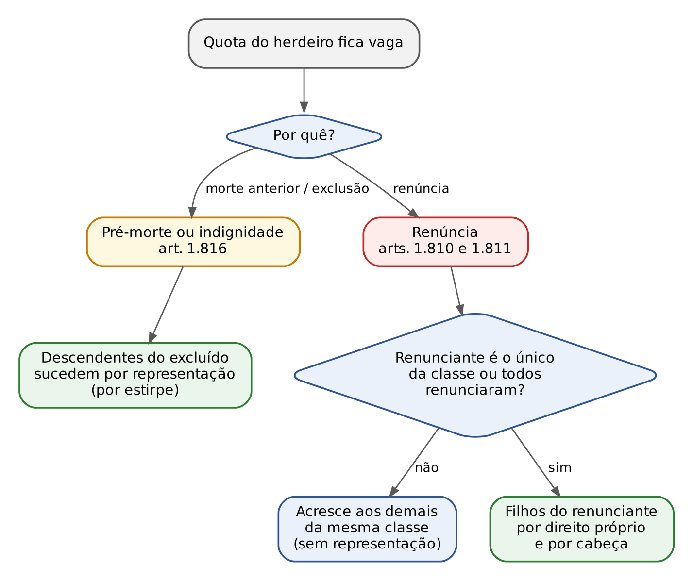
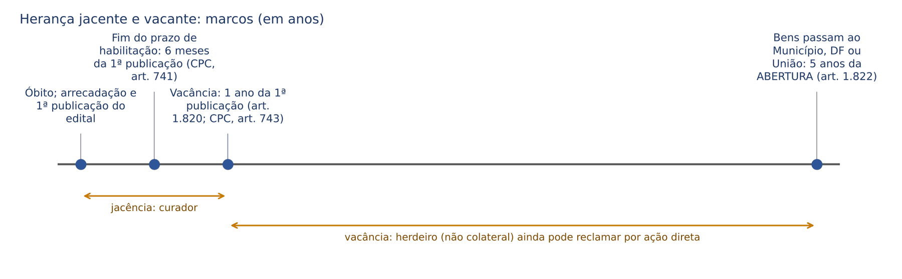
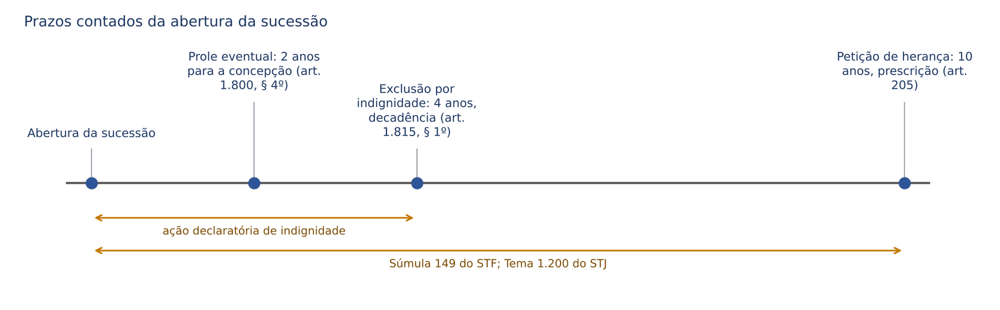
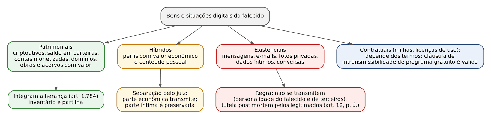

# CAPÍTULO 42 — SUCESSÕES I: SUCESSÃO EM GERAL, HERANÇA, ACEITAÇÃO E RENÚNCIA, INDIGNIDADE, HERANÇA JACENTE, PETIÇÃO DE HERANÇA E HERANÇA DIGITAL

:::INCIDENCIA
TRF5 p. 14; TJRS p. 20; TJSC p. 21; SEFAZ p. 10. Nível A; lote de 14 questões (FGV 11, FCC 3). Sucessões é o assunto mais cobrado pela FGV em Civil (26,3% das questões de 23 provas de 2022 a 2026).
O que mais cai: efeitos da renúncia e da exclusão sobre a quota vaga (arts. 1.810, 1.811 e 1.816), renúncia em prejuízo de credores (art. 1.813), forma da renúncia, cessão de direitos hereditários e preferência, indignidade (Lei 14.661/2023), prescrição e termo inicial da petição de herança (Tema 1.200 do STJ) e herdeiro aparente.
:::

| Subtema | FGV | FCC | Padrão de cobrança |
|---|---|---|---|
| Renúncia: forma, efeitos, credores, quota vaga | 4 | 1 | caso com renúncia + indignidade + netos; credores do renunciante; instrumento particular e condição |
| Petição de herança e herdeiro aparente | 4 | 0 | prazo de 10 anos da abertura; posse de boa-fé até a citação; alienação a terceiro de boa-fé |
| Exclusão por indignidade | 2 | 0 | hipóteses do art. 1.814 em caso concreto; necessidade de sentença |
| Cessão de direitos hereditários | 1 | 1 | escritura pública; preferência e divisão proporcional |
| Abertura, lugar, lei aplicável, espécies | 1 | 1 | último domicílio; lei do tempo da abertura; art. 1.788 |

## 42.1 Abertura da sucessão e *saisine*

### 42.1.1 Morte, abertura e transmissão imediata

A sucessão *causa mortis* abre-se com a morte real ou presumida (arts. 6º e 7º; ausência na fase definitiva — ver Cap. 3). Abertura, transmissão e delação são, no sistema brasileiro, simultâneas: no exato instante do óbito a herança passa aos herdeiros legítimos e testamentários, sem qualquer ato deles, por força do *droit de saisine* ("*le mort saisit le vif*").

:::LEI Código Civil, arts. 1.784, 1.785, 1.787 e 1.788
Art. 1.784. Aberta a sucessão, a herança transmite-se, desde logo, aos herdeiros legítimos e testamentários.
Art. 1.785. A sucessão abre-se no lugar do último domicílio do falecido.
Art. 1.787. Regula a sucessão e a legitimação para suceder a lei vigente ao tempo da abertura daquela.
Art. 1.788. Morrendo a pessoa sem testamento, transmite a herança aos herdeiros legítimos; o mesmo ocorrerá quanto aos bens que não forem compreendidos no testamento; e subsiste a sucessão legítima se o testamento caducar, ou for julgado nulo.
:::

- Transmitem-se a propriedade E a posse, esta com os mesmos caracteres (art. 1.206: a posse transmite-se aos herdeiros com os mesmos caracteres; art. 1.207, primeira parte: o sucessor universal continua de direito a posse do antecessor). Daí os interditos antes da posse material e a soma de posses para usucapião.
- A aceitação não transmite: apenas confirma, com eficácia retroativa à abertura (art. 1.804). A renúncia faz a transmissão ter-se "por não verificada" (art. 1.804, parágrafo único).
- Antes de aberto o inventário, os herdeiros têm legitimidade para atuar diretamente em juízo em ações de direito real, por aplicação da *saisine* (Jurisprudência em Teses do STJ, ed. 133, tese 3). Aberto o inventário e regularmente substituído o falecido pelo espólio, representado pelo inventariante, o herdeiro não pode atuar paralelamente como terceiro interessado (ed. 246, tese 7).
- O espólio (ente despersonalizado; CPC, art. 75, VII) responde pelas dívidas do falecido até a partilha (ed. 246, tese 5).
- Situações consolidadas contra o falecido se transmitem: a *supressio* formada contra o *de cujus* (ascendente que administrou e recebeu aluguéis dos imóveis dele por mais de 20 anos, com sua aquiescência) impede os herdeiros de exigir os frutos retroativos (REsp 2.214.957-PR, Quarta Turma, j. 7/10/2025, Inf. 867).

:::PEGADINHA Saisine não transmite tudo, nem para todos
O Município, o DF e a União NÃO são herdeiros e NÃO recebem pela *saisine*: os bens vacantes só lhes passam ao domínio depois de 5 anos da abertura (art. 1.822 — ver 42.7). O legatário também não tem *saisine* plena: adquire a propriedade da coisa certa desde a abertura, mas NÃO a posse, que deve pedir aos herdeiros (art. 1.923, § 1º — ver Cap. 44). Direitos personalíssimos (poder familiar, usufruto, uso e habitação, mandato, cargo) extinguem-se com a morte e não integram a herança.
:::

### 42.1.2 Momento: comoriência e prova da morte

O momento da morte define quem herda (art. 1.798: só os nascidos ou concebidos naquele instante) e a lei aplicável (art. 1.787). Se dois sucessíveis morrem na mesma ocasião sem prova de quem precedeu, presumem-se simultaneamente mortos (art. 8º): entre comorientes não há transmissão, e a herança de cada um segue como se o outro não existisse. A presunção da comoriência e seus reflexos na representação estão no Cap. 3 (lá resolvida a Q3966637, FGV 2026 — TJ-GO).

:::EXEMPLO Comoriência x direito de transmissão (FGV 2024 e 2025)
Caso 1 (Q3113957, FGV 2024 — Pref. Cuiabá, Auditor): Bernardo, solteiro e sem descendentes, morre no local de um acidente; sua irmã Ana morre horas depois no hospital, sem ter aceitado a herança do irmão. Não há comoriência, porque a ordem das mortes está provada. Ana herdou de Bernardo (com Glória) no instante do óbito dele (*saisine*); morta antes de aceitar, o poder de aceitar passa aos filhos dela, Pedro e Marcos, que, desde que aceitem a herança de Ana, podem aceitar ou renunciar a de Bernardo (art. 1.809 e parágrafo único). Gabarito E (afirmativas II e IV): eles vêm por direito de TRANSMISSÃO, não de representação (que, de fato, na colateral só beneficia filhos de irmão pré-morto — o que não é o caso, porque Ana sobreviveu).
Caso 2 (Q3345933, FGV 2025 — TJ-GO, Residente): tio e sobrinho legatário morrem no mesmo acidente sem prova de precedência. Comoriência: Carlos (legatário) não sobreviveu ao testador, o legado caduca (art. 1.939, V) e o bem volta ao monte, partilhado entre os herdeiros de Antônio. Gabarito B. Armadilhas: C e E aplicam o art. 1.809, que pressupõe herdeiro que SOBREVIVEU ao autor da herança.
:::

### 42.1.3 Lugar da abertura e competência

O lugar da abertura é o do ÚLTIMO DOMICÍLIO do falecido (art. 1.785), e não o do óbito, o da situação dos bens, o da lavratura do testamento ou o do nascimento. A regra processual correspondente é o art. 48 do CPC: o foro do domicílio do autor da herança, no Brasil, é competente para o inventário, a partilha, a arrecadação, o cumprimento de disposições de última vontade, a impugnação ou anulação de partilha extrajudicial e todas as ações em que o espólio for réu, "ainda que o óbito tenha ocorrido no estrangeiro"; sem domicílio certo, foro da situação dos imóveis (qualquer deles, se em foros diferentes) e, não havendo imóveis, o de qualquer dos bens (parágrafo único). A competência é territorial, portanto relativa.

:::QUESTAO FCC 2025 — TRT 15ª Região — Analista Judiciário (Q3295847)
Pessoa nascida em São Paulo, que testou em Campinas, teve último domicílio em Jundiaí, morreu em Limeira e deixou apenas um imóvel em Sorocaba: onde se abre a sucessão? Gabarito B (Jundiaí), pelo art. 1.785. Cada alternativa errada corresponde a um critério que a lei NÃO adotou (nascimento, testamento, óbito, situação do bem — este último é só critério subsidiário do CPC, art. 48, parágrafo único, para quem não tinha domicílio certo).
:::

Elemento estrangeiro (LINDB, art. 10 — Cap. 1): bens no exterior não se submetem à lei brasileira nem ao inventário aqui (CPC, art. 23, II), nem mesmo para compensar legítimas (STJ, Terceira Turma, j. 27/8/2024, Informativo de Jurisprudência n. 23, edição extraordinária); mas a autoridade brasileira pode julgar petição de herança de estrangeiro não domiciliado, com a paternidade apenas como causa de pedir (Terceira Turma, j. 20/8/2024, mesma edição).

### 42.1.4 Lei aplicável e espécies de sucessão

A lei do tempo da abertura regula a sucessão e a legitimação para suceder (art. 1.787) — não a lei do tempo do processo, do testamento ou da partilha. A regra interage com o direito intertemporal das disposições finais (art. 2.041; ver Cap. 45) e com a distinção do STJ entre sucessão e partilha: a sucessão é disciplinada pela lei em vigor na data do óbito; a partilha (meação) observa o regime de bens e a lei vigente ao tempo da aquisição de cada bem (Jurisprudência em Teses, ed. 50, tese 1).

| Critério | Espécies | Fundamento e observações |
|---|---|---|
| Fonte | legítima (lei) e testamentária (última vontade) | art. 1.786; a sucessão CONTRATUAL é vedada (art. 426, pacto sucessório ou *pacta corvina*), salvo a partilha em vida por ascendente (art. 2.018 — Cap. 45) e as doações (Cap. 17) |
| Objeto | a título universal (herdeiro: totalidade ou fração ideal) e a título singular (legatário: bem determinado) | o herdeiro responde pelas dívidas nas forças da herança; o legatário, em regra, não |
| Coexistência | legítima subsidiária e simultânea | art. 1.788: bens não compreendidos no testamento, testamento caduco, nulo (e, por extensão, revogado ou rompido) |
| Limite | havendo herdeiros necessários, o testador só dispõe da metade | art. 1.789 (legítima e herdeiros necessários — Cap. 43) |

A vedação do art. 426 alcança também a renúncia antecipada: o STJ declarou nula, por violar a proibição do pacto sucessório, cláusula de transação judicial em ação investigatória pela qual o filho reconhecido recebia indenização e renunciava a direitos hereditários futuros (REsp 2.112.700-SP, Quarta Turma, j. 23/4/2024, Informativo de Jurisprudência n. 20, edição extraordinária). Na mesma linha, não há renúncia à herança de pessoa viva, porque a renúncia pressupõe a abertura e a condição de herdeiro (Jurisprudência em Teses, ed. 243, teses 7 e 8).

:::QUESTAO FGV 2025 — AgSUS — Analista de Gestão, Advogado (Q3659054)
Três afirmativas sobre a sucessão de mãe de três filhos. Gabarito A (só I). I reproduz o art. 1.788. II troca "tempo da abertura daquela" (da sucessão) por "abertura do processo" — o art. 1.787 fala da abertura da sucessão (óbito). III diz que o testador com herdeiros necessários só dispõe de 25%: é METADE (art. 1.789).
:::

## 42.2 A herança e sua administração

### 42.2.1 Herança como universalidade indivisível: o condomínio hereditário

A herança é universalidade de direito (art. 91) e, para efeitos legais, bem IMÓVEL (art. 80, II, "o direito à sucessão aberta"), ainda que composta só de móveis ou de dinheiro. Daí a escritura pública na cessão (42.3) e na renúncia (42.5). Ela "defere-se como um todo unitário, ainda que vários sejam os herdeiros" e, até a partilha, o direito dos coerdeiros quanto à propriedade e à posse é indivisível e regido pelas normas do condomínio (art. 1.791 e parágrafo único). Cada herdeiro titulariza fração ideal do todo, e não bens determinados.

- Composse entre os herdeiros: nenhum deles pode excluir os demais do exercício possessório; se o faz, pratica esbulho contra o compossuidor (Q3592154, FGV 2025 — TCE-PE, resolvida no Cap. 27). A usucapião de bem da herança por coerdeiro com posse exclusiva e *animus domini* é tratada no Cap. 29.
- Qualquer coerdeiro pode defender sozinho a totalidade da herança contra terceiros (art. 1.314 c/c art. 1.791, parágrafo único) e reclamar todos os bens na petição de herança (art. 1.825 — ver 42.8).
- Uso exclusivo de imóvel comum por um herdeiro gera dever de indenizar os demais (aluguel proporcional), regra do condomínio. Fixada essa indenização, não cabe descontar adicionalmente o IPTU do quinhão do ocupante sem prévio acordo, sob pena de dupla compensação pelo mesmo fato (STJ, Quarta Turma, j. 20/3/2025, Inf. 847).

### 42.2.2 Responsabilidade *intra vires hereditatis*

O herdeiro não responde por encargos superiores às forças da herança (benefício de inventário automático), mas lhe incumbe a prova do excesso, salvo se houver inventário que a dispense, demonstrando o valor dos bens herdados (art. 1.792). Antes da partilha, a herança (espólio) responde pelas dívidas; depois, cada herdeiro, na proporção da parte que lhe coube (art. 1.997 — pagamento das dívidas no Cap. 45). A obrigação alimentar transmite-se aos herdeiros do devedor (art. 1.700), mas limitada às forças da herança (Enunciado 343 do CJF; alimentos no Cap. 39). Também se transmite o direito à indenização por dano moral sofrido pelo falecido: espólio e herdeiros têm legitimidade para pleitear a reparação (Jurisprudência em Teses, ed. 125, tese 5 — ver Cap. 25).

### 42.2.3 Administração da herança: administrador provisório e inventariante

O art. 1.796 do CC fala em 30 dias, mas o CPC, posterior, fixou 2 MESES para instaurar e 12 meses subsequentes para ultimar, prorrogáveis pelo juiz de ofício ou a requerimento (CPC, art. 611). O descumprimento não gera perda de direitos sucessórios; a sanção é tributária (multa estadual de ITCMD, cuja validade o STF reconhece em súmula — ver Apostila de Direito Tributário).

Até o compromisso do inventariante, a herança fica com o administrador provisório (CPC, art. 613), escolhido pela ordem SUCESSIVA do art. 1.797:

:::LEI Código Civil, art. 1.797
Art. 1.797. Até o compromisso do inventariante, a administração da herança caberá, sucessivamente:
I - ao cônjuge ou companheiro, se com o outro convivia ao tempo da abertura da sucessão;
II - ao herdeiro que estiver na posse e administração dos bens, e, se houver mais de um nessas condições, ao mais velho;
III - ao testamenteiro;
IV - a pessoa de confiança do juiz, na falta ou escusa das indicadas nos incisos antecedentes, ou quando tiverem de ser afastadas por motivo grave levado ao conhecimento do juiz.
:::

O administrador provisório representa ativa e passivamente o espólio, deve trazer ao acervo os frutos percebidos desde a abertura, tem direito ao reembolso das despesas necessárias e úteis e responde por dano causado por dolo ou culpa (CPC, art. 614). O STJ firmou que ele representa judicialmente o espólio quando o inventário não foi ajuizado ou, ainda que proposto, não há inventariante compromissado, e que a citação do administrador provisório não exige prévia diligência para comprovar a inexistência de inventário (Jurisprudência em Teses, ed. 247, teses 1 e 4). O inventariante, depois de compromissado, representa o espólio (CPC, art. 75, VII) e pode pleitear a anulação de doações feitas pelo falecido (ed. 247, tese 2); a contratação de advogado pelo inventariante, genitor do herdeiro exclusivo que é criança, é ato de simples administração e dispensa autorização judicial (ed. 246, tese 8). Ordem de nomeação do inventariante, remoção e primeiras declarações: Cap. 45.

## 42.3 Cessão de direitos hereditários (arts. 1.793 a 1.795)

### 42.3.1 Objeto, forma e eficácia

:::LEI Código Civil, arts. 1.793 a 1.795
Art. 1.793. O direito à sucessão aberta, bem como o quinhão de que disponha o co-herdeiro, pode ser objeto de cessão por escritura pública.
§ 1º Os direitos, conferidos ao herdeiro em conseqüência de substituição ou de direito de acrescer, presumem-se não abrangidos pela cessão feita anteriormente.
§ 2º É ineficaz a cessão, pelo co-herdeiro, de seu direito hereditário sobre qualquer bem da herança considerado singularmente.
§ 3º Ineficaz é a disposição, sem prévia autorização do juiz da sucessão, por qualquer herdeiro, de bem componente do acervo hereditário, pendente a indivisibilidade.
Art. 1.794. O co-herdeiro não poderá ceder a sua quota hereditária a pessoa estranha à sucessão, se outro co-herdeiro a quiser, tanto por tanto.
Art. 1.795. O co-herdeiro, a quem não se der conhecimento da cessão, poderá, depositado o preço, haver para si a quota cedida a estranho, se o requerer até cento e oitenta dias após a transmissão.
Parágrafo único. Sendo vários os co-herdeiros a exercer a preferência, entre eles se distribuirá o quinhão cedido, na proporção das respectivas quotas hereditárias.
:::

- Momento: só depois da abertura e até a partilha. Antes da morte é pacto sucessório nulo (art. 426); depois da partilha não há mais "direito à sucessão aberta", mas bens individualizados alienáveis pelas regras comuns.
- Forma: escritura pública, sempre (herança é imóvel por força de lei, art. 80, II), qualquer que seja a composição do acervo. Para parte da doutrina, o cedente casado precisa de outorga conjugal, salvo no regime da separação absoluta (art. 1.647, I).
- Objeto: o todo ou fração ideal do quinhão (cessão parcial é válida: "o quinhão de que disponha"). O que a lei torna INEFICAZ é a cessão de direito sobre bem singular (§ 2º) e a disposição de bem do acervo sem autorização do juiz (§ 3º). Ineficácia, não nulidade: o STJ entende que a cessão de direitos sobre bem singular, feita por escritura e sem envolver incapazes, não é nula; sua eficácia fica condicionada a que o bem venha a ser atribuído ao cedente na partilha.
- Natureza aleatória: o cedente garante, salvo pacto, apenas a qualidade de herdeiro, não o conteúdo do acervo.
- Direitos supervenientes por substituição ou direito de acrescer presumem-se NÃO abrangidos pela cessão anterior (§ 1º): ficam com o cedente, salvo cláusula expressa.
- Legitimidade processual: o cessionário pode requerer o inventário (CPC, art. 616, V) e sub-roga-se na posição do cedente na partilha.
- Cessão gratuita, pura e simples, aos demais coerdeiros NÃO importa aceitação (art. 1.805, § 2º): equivale à renúncia abdicativa. Cessão gratuita a coerdeiro determinado ou a terceiro, ou cessão onerosa, pressupõe aceitação (renúncia translativa — ver 42.5.4).

A cessão, ao contrário da renúncia, pode ser parcial e dirigida, o que viabiliza a partilha amigável com quinhões desiguais quando precedida de cessão entre a abertura e a partilha (REsp 2.225.451-SP; v. Cap. 45). ITCMD: Apostila de Direito Tributário. Em sentido próximo, a FGV considerou liberalidade a partilha desigual sem compensação em divórcio consensual, e NÃO a renúncia abdicativa "em favor do monte" (Q3914284, FGV 2026 — TJ-MS, Cartórios).

### 42.3.2 Direito de preferência dos coerdeiros

A preferência (art. 1.794) existe só na cessão a ESTRANHO à sucessão e "tanto por tanto", isto é, em igualdade de condições, o que pressupõe cessão onerosa (na doação não há preço a igualar). Entre coerdeiros não há preferência. O coerdeiro preterido, a quem não se deu conhecimento, deposita o preço e haver para si a quota se o requerer em até 180 dias "após a transmissão" (art. 1.795; prazo decadencial). Concorrendo vários, divide-se o quinhão na proporção das respectivas quotas hereditárias, e não por cabeça (parágrafo único).

| Preferência | Coerdeiro (art. 1.795) | Condômino de coisa indivisível (art. 504) |
|---|---|---|
| Objeto | quota hereditária (universalidade) | fração ideal de coisa indivisível |
| Prazo | 180 dias após a transmissão | 180 dias (decadencial) |
| Vários interessados | divide-se na proporção das quotas hereditárias | prefere o de benfeitorias de maior valor; depois, o de quinhão maior; se iguais, divide-se entre os que depositarem o preço |
| Pressuposto | cessão onerosa a estranho, sem ciência | venda a estranho, sem oferta aos condôminos |

:::QUESTAO FGV 2026 — MPE-MT — Promotor de Justiça Substituto (Q4116957)
Quatro filhos herdeiros; Bruno cede, por escritura, 50% do seu quinhão a Eduardo, estranho, por 200.000 (duzentos mil) reais, nada dispondo sobre acrescer; depois Daniela renuncia e sua parte acresce aos irmãos; Ana e Carlos, não cientificados, depositam o preço e divergem sobre a divisão. Gabarito E: dividem a quota cedida na proporção de seus quinhões hereditários (art. 1.795, parágrafo único). Erros: A e C — o acréscimo decorrente da renúncia de Daniela presume-se NÃO abrangido pela cessão anterior (art. 1.793, § 1º) e fica com Bruno; B — cessão parcial do quinhão é lícita (ineficaz é a de bem singular, § 2º); D — a preferência pode ser exercida depois do negócio, no prazo de 180 dias, justamente porque não houve ciência.
:::

:::QUESTAO FCC 2025 — PGE-MT — Procurador do Estado (Q3745802)
A cessão de direitos hereditários fora dos autos do inventário: gabarito E, exige escritura pública (art. 1.793). Erros: não é ilícita nem vedada antes da partilha (é justamente o seu momento próprio); não se admite instrumento particular mesmo se o acervo for só de quotas sociais (a herança é imóvel por ficção, art. 80, II); não pode anteceder a abertura (art. 426).
:::

## 42.4 Vocação hereditária: legitimação para suceder (arts. 1.798 a 1.803)

### 42.4.1 Regra geral e o concebido

Legitimam-se a suceder as pessoas nascidas ou já concebidas no momento da abertura (art. 1.798), em qualquer espécie de sucessão. O nascituro tem vocação condicionada ao nascimento com vida (art. 2º); nascendo morto, a quota volta como se ele nunca tivesse sido chamado. Para os embriões formados por reprodução assistida, o Enunciado 267 do CJF estende o art. 1.798 à "pessoa humana a nascer", submetendo os efeitos patrimoniais às regras da petição de herança. É controvertida a vocação do filho concebido DEPOIS da morte (art. 1.597, III a V, presume a filiação, mas o art. 1.798 exige concepção na abertura): parte da doutrina só a admite pela via testamentária (prole eventual); outra, pela igualdade dos filhos (CF, art. 227, § 6º), admite a legítima (Cap. 37).

### 42.4.2 Sucessão testamentária: prole eventual, pessoas jurídicas e fundações

Na sucessão TESTAMENTÁRIA podem ainda ser chamados (art. 1.799): (I) os filhos ainda não concebidos de pessoas indicadas pelo testador, desde que estas estejam vivas ao abrir-se a sucessão (prole eventual ou concepturo); (II) as pessoas jurídicas; (III) a pessoa jurídica cuja organização o testador determinar sob a forma de fundação (art. 62).

Regime da prole eventual (art. 1.800): os bens ficam com curador nomeado pelo juiz após a liquidação ou partilha; salvo disposição em contrário, a curatela cabe à pessoa cujo filho o testador esperava ter por herdeiro e, sucessivamente, às do art. 1.775; nascendo com vida o herdeiro esperado, recebe a deixa com os frutos e rendimentos desde a morte do testador; se em 2 ANOS da abertura não for CONCEBIDO, os bens, salvo disposição em contrário do testador, cabem aos herdeiros legítimos (§§ 1º a 4º).

:::PEGADINHA Prole eventual: quatro detalhes de letra
(1) Só na sucessão testamentária; a prole eventual NÃO herda por lei. (2) A pessoa indicada (pai ou mãe esperados) deve estar VIVA na abertura. (3) O prazo de 2 anos conta-se da ABERTURA e exige CONCEPÇÃO (não nascimento) nesse prazo. (4) Esgotado o prazo, os bens vão aos herdeiros LEGÍTIMOS, salvo disposição diversa do testador — e não ao substituto, ao Estado ou ao curador.
:::

### 42.4.3 Falta de legitimação testamentária (arts. 1.801 a 1.803)

Não podem ser nomeados herdeiros nem legatários: quem escreveu o testamento a rogo, seu cônjuge ou companheiro, ascendentes e irmãos; as testemunhas do testamento; o concubino do testador casado, salvo se este, sem culpa sua, estiver separado de fato do cônjuge há mais de 5 anos; o tabelião, civil ou militar, o comandante ou escrivão perante quem se fizer o testamento, e quem o fizer ou aprovar (art. 1.801). São NULAS as disposições em favor deles, ainda que simuladas sob a forma de contrato oneroso ou feitas por interposta pessoa, presumindo-se interpostos ascendentes, descendentes, irmãos e cônjuge ou companheiro do não legitimado (art. 1.802). É lícita a deixa ao filho do concubino, quando também filho do testador (art. 1.803). As formalidades do testamento e a disciplina das testemunhas estão no Cap. 44.

## 42.5 Aceitação e renúncia da herança (arts. 1.804 a 1.813)

### 42.5.1 Características comuns

Aceitação (adição) e renúncia (repúdio) são negócios jurídicos unilaterais, não receptícios, IRREVOGÁVEIS (art. 1.812) e PUROS e INDIVISÍVEIS: não se pode aceitar ou renunciar em parte, sob condição ou a termo (art. 1.808; Jurisprudência em Teses, ed. 243, tese 1). A irrevogabilidade não impede a invalidação por vício: o STJ anulou renúncia feita em erro substancial quanto ao objeto, quando se descobriu herdeiro de cuja existência não se tinha conhecimento inequívoco (ed. 243, tese 5; arts. 139 e 171, II).

:::LEI Código Civil, arts. 1.805 a 1.808
Art. 1.805. A aceitação da herança, quando expressa, faz-se por declaração escrita; quando tácita, há de resultar tão-somente de atos próprios da qualidade de herdeiro.
§ 1º Não exprimem aceitação de herança os atos oficiosos, como o funeral do finado, os meramente conservatórios, ou os de administração e guarda provisória.
§ 2º Não importa igualmente aceitação a cessão gratuita, pura e simples, da herança, aos demais co-herdeiros.
Art. 1.806. A renúncia da herança deve constar expressamente de instrumento público ou termo judicial.
Art. 1.807. O interessado em que o herdeiro declare se aceita, ou não, a herança, poderá, vinte dias após aberta a sucessão, requerer ao juiz prazo razoável, não maior de trinta dias, para, nele, se pronunciar o herdeiro, sob pena de se haver a herança por aceita.
Art. 1.808. Não se pode aceitar ou renunciar a herança em parte, sob condição ou a termo.
§ 1º O herdeiro, a quem se testarem legados, pode aceitá-los, renunciando a herança; ou, aceitando-a, repudiá-los.
§ 2º O herdeiro, chamado, na mesma sucessão, a mais de um quinhão hereditário, sob títulos sucessórios diversos, pode livremente deliberar quanto aos quinhões que aceita e aos que renuncia.
:::

As exceções à indivisibilidade estão nos §§ 1º e 2º do art. 1.808: o herdeiro que também é legatário pode separar herança e legado, e o chamado a quinhões por títulos diversos (por exemplo, herdeiro legítimo e testamentário na mesma sucessão) delibera separadamente sobre cada um. Fora daí, renúncia parcial é inválida; o meio lícito de atribuir parte do quinhão a outrem é a cessão (42.3).

A renúncia abrange a herança tal como existir, inclusive bens que venham a ser descobertos: a sobrepartilha NÃO reabre ao renunciante a opção de aceitar os novos bens (REsp 1.855.689-DF, Terceira Turma, j. 13/5/2025, Informativo de Jurisprudência n. 26, edição extraordinária). E quem renunciou não tem legitimidade para pedir a nulidade de negócio jurídico que envolva o patrimônio do falecido (Jurisprudência em Teses, ed. 243, tese 6).

### 42.5.2 Aceitação: expressa, tácita e presumida

| Espécie | Como se dá | Fundamento | Exemplos e limites |
|---|---|---|---|
| Expressa | declaração ESCRITA (instrumento particular basta) | art. 1.805, primeira parte | a lei não exige escritura para aceitar, só para renunciar |
| Tácita | atos próprios da qualidade de herdeiro | art. 1.805, segunda parte | requerer inventário e arrolar bens, com nomeação de advogado (ed. 243, tese 9); ceder onerosamente; ceder gratuitamente a pessoa determinada. NÃO são aceitação: funeral, atos conservatórios, administração e guarda provisória (§ 1º); cessão gratuita pura e simples aos coerdeiros (§ 2º) |
| Presumida | silêncio após interpelação judicial | art. 1.807 | o interessado (credor, coerdeiro) pede, passados 20 dias da abertura, que o juiz fixe prazo de até 30 dias; silêncio = aceitação |

A aceitação torna definitiva a transmissão desde a abertura (art. 1.804). Pedido de abertura de inventário com arrolamento de bens e regularização da representação por advogado implica aceitação tácita e IMPEDE a renúncia posterior (ed. 243, tese 9; arts. 1.804 e 1.812).

### 42.5.3 Direito de transmissão (art. 1.809)

Falecendo o herdeiro antes de declarar se aceita, o poder de aceitar passa aos seus herdeiros, salvo vocação adstrita a condição suspensiva ainda não verificada (art. 1.809). Os chamados à sucessão do herdeiro falecido, desde que concordem em receber a segunda herança, podem aceitar ou renunciar a primeira (parágrafo único). A lógica é cronológica: quem renuncia à segunda herança (a do herdeiro morto) não pode deliberar sobre a primeira, que dela faz parte; quem aceita a segunda pode aceitar ou renunciar a primeira. Distingue-se da representação (que pressupõe herdeiro pré-morto, ausente, indigno ou deserdado — Cap. 43) e da comoriência (art. 8º). Ver o EXEMPLO em 42.1.2.

### 42.5.4 Renúncia: forma e espécies

A renúncia é ato SOLENE: deve constar expressamente de instrumento público ou termo judicial (art. 1.806), sob pena de nulidade (arts. 166, IV, e 107; Jurisprudência em Teses, ed. 243, tese 2). Torna-se perfeita com a assinatura do termo ou da escritura, independentemente de homologação (tese 3), e o mandato para renunciar também exige instrumento público, pela atração de forma (art. 657; tese 4). Pelo incapaz, a renúncia exige autorização judicial, por ultrapassar a simples administração (art. 1.691: necessidade ou evidente interesse da prole; Caps. 38 e 41). Para parte da doutrina, o renunciante casado precisa de outorga conjugal, salvo separação absoluta, porque a herança é imóvel; a questão é controvertida.

| Espécie | O que é | Pressupõe aceitação? | Efeitos e tributação |
|---|---|---|---|
| Abdicativa (renúncia propriamente dita) | o herdeiro simplesmente não aceita, em benefício de todos os coerdeiros da mesma classe ou, faltando estes, da subsequente | NÃO | transmissão "tem-se por não verificada" (art. 1.804, parágrafo único); um só fato gerador de ITCMD |
| Translativa ("renúncia em favor de") | o herdeiro aceita e transfere a pessoa determinada | SIM (é aceitação + cessão) | duas transmissões (*causa mortis* e doação ou cessão); exige forma de cessão |

As definições acima são as da Jurisprudência em Teses, ed. 243, tese 10. A renúncia translativa que torna o devedor insolvente é ineficaz perante os credores (fraude à execução — tese 11); a abdicativa em prejuízo de credores tem regime próprio no art. 1.813 (42.5.6).

:::QUESTAO FCC 2024 — TRT 20ª Região — Analista Judiciário (Q3170839)
Quatro filhos; nenhum havia aceitado. Bernardo renuncia por instrumento particular com duas testemunhas; Carolina, por escritura pública, sob a condição de que Débora também renuncie; Débora, por termo judicial nos autos do inventário. Gabarito D (só a de Débora é válida). Bernardo: forma inadequada (art. 1.806). Carolina: forma correta, mas renúncia condicional é vedada (art. 1.808). Armadilha: achar que a escritura "salva" a renúncia condicional — forma e pureza são requisitos cumulativos.
:::

### 42.5.5 Destino da quota do renunciante

Na sucessão legítima, a parte do renunciante ACRESCE à dos outros herdeiros da mesma classe e, sendo ele o único desta, devolve-se aos da subsequente (art. 1.810). Ninguém sucede representando herdeiro renunciante, porque o renunciante é tratado como se nunca tivesse sido herdeiro; se, porém, ele for o único legítimo da sua classe, ou se todos os outros da mesma classe renunciarem, os filhos dele vêm à sucessão por DIREITO PRÓPRIO e POR CABEÇA (art. 1.811).

:::LEI Código Civil, arts. 1.810 e 1.811
Art. 1.810. Na sucessão legítima, a parte do renunciante acresce à dos outros herdeiros da mesma classe e, sendo ele o único desta, devolve-se aos da subseqüente.
Art. 1.811. Ninguém pode suceder, representando herdeiro renunciante. Se, porém, ele for o único legítimo da sua classe, ou se todos os outros da mesma classe renunciarem a herança, poderão os filhos vir à sucessão, por direito próprio, e por cabeça.
:::

Quando há concorrência de classes (descendentes com cônjuge, ascendentes com cônjuge), a renúncia de um herdeiro devolve sua parte aos que integram a mesma ORDEM dos chamados a suceder (Enunciado 575 do CJF): a quota do filho renunciante acresce aos demais descendentes e ao cônjuge concorrente segundo as regras do art. 1.829, I (cálculos no Cap. 43). Na sucessão testamentária, a renúncia do herdeiro ou legatário instituído leva ao substituto, ao direito de acrescer ou à caducidade em favor dos legítimos (Cap. 44). Se TODOS os chamados renunciarem, a herança é desde logo declarada vacante (art. 1.823 — ver 42.7).

| Situação do herdeiro | Descendentes dele herdam? | Como | Fundamento |
|---|---|---|---|
| Pré-morto | sim | representação, por estirpe | arts. 1.851 e 1.852 (Cap. 43) |
| Excluído por indignidade | sim | representação, "como se ele morto fosse" | art. 1.816 |
| Deserdado | sim (posição majoritária, por analogia) | representação | art. 1.816 por analogia (Cap. 44) |
| Renunciante, havendo outros da classe | NÃO | a quota acresce aos demais da classe | arts. 1.810 e 1.811, primeira parte |
| Renunciante único da classe, ou todos renunciaram | sim | direito PRÓPRIO, por CABEÇA | art. 1.811, segunda parte |
| Comoriente com o autor da herança | sim | representação (é tratado como pré-morto em relação ao outro) | arts. 8º e 1.851 (Cap. 3) |

:::QUESTAO FGV 2025 — ENAM — Exame Nacional da Magistratura 2025.1 (Q3362359)
Zelito deixa três filhos (Yone, Xisto, Valter) e dois netos (Umberto, filho de Yone; Tânia, filha de Xisto). Yone renuncia; Xisto é excluído por indignidade. Gabarito A (metade para Tânia, metade para Valter).
Passo 1: Xisto excluído é tratado como pré-morto; Tânia o representa (art. 1.816). Passo 2: Yone renunciante não é representada; Umberto nada recebe, porque Yone não era a única da classe (art. 1.811). Passo 3: a quota de Yone acresce aos demais da mesma classe (art. 1.810): a estirpe de Xisto (Tânia) e Valter. Resultado: 1/2 para cada. Armadilha C/D: tratar a renúncia como a exclusão, chamando Umberto por representação.
:::

:::QUESTAO FGV 2025 — TJ-MS — Juiz Substituto (Q3786344)
Adilson deixa dois filhos: Bruno, excluído por tentativa de homicídio do pai, e Caio, que renuncia; netos Danilo (filho de Bruno) e Eduardo (filho de Caio). Gabarito A (toda a herança para Danilo). Danilo representa Bruno (art. 1.816). Caio não é o "único legítimo da sua classe", porque a estirpe de Bruno permanece na classe dos descendentes por representação; logo Eduardo não vem por direito próprio (art. 1.811) e a quota de Caio acresce à estirpe de Bruno (art. 1.810). Armadilha E (metade para cada): aplicar a segunda parte do art. 1.811 como se a exclusão de Bruno o retirasse da classe.
:::

### 42.5.6 Renúncia em prejuízo de credores (art. 1.813)

Quando o herdeiro prejudica seus credores renunciando, estes podem, com autorização do juiz, ACEITAR a herança em nome do renunciante (art. 1.813). A habilitação faz-se em 30 dias seguintes ao conhecimento do fato (§ 1º). Pagas as dívidas, prevalece a renúncia quanto ao remanescente, que é devolvido aos demais herdeiros (§ 2º).

:::LEI Código Civil, art. 1.813
Art. 1.813. Quando o herdeiro prejudicar os seus credores, renunciando à herança, poderão eles, com autorização do juiz, aceitá-la em nome do renunciante.
§ 1º A habilitação dos credores se fará no prazo de trinta dias seguintes ao conhecimento do fato.
§ 2º Pagas as dívidas do renunciante, prevalece a renúncia quanto ao remanescente, que será devolvido aos demais herdeiros.
:::

Não é ação pauliana (dispensa *consilium fraudis* e o prazo do art. 178, II): a renúncia é só INEFICAZ perante os credores, até o montante dos créditos, que não se tornam herdeiros. O credor de prestação alimentícia pode valer-se do mecanismo e aceitar a herança à qual renunciou o devedor de alimentos (Jurisprudência em Teses, ed. 246, tese 1). Já o credor individual de herdeiro não tem legitimidade para habilitar crédito no inventário como se fosse credor do espólio (ed. 246, tese 3; CPC, art. 642), embora tenha legitimidade concorrente para requerer a abertura do inventário (CPC, art. 616, VI), sem por isso ser parte com atuação ampla (ed. 246, tese 4).

:::QUESTAO FGV 2026 — TJ-MS — Analista Judiciário, Área Fim (Q3856339)
João, viúvo, deixa filha pré-morta (Ana, com dois filhos) e filho vivo (Bruno, endividado, pai de um filho). Bruno renuncia para que o filho dele herde por representação; os credores pedem autorização para aceitar; os filhos de Ana pleiteiam tudo. Gabarito E: os credores aceitam, com autorização judicial, até o limite de seus créditos; o filho de Bruno NÃO representa o renunciante; o remanescente vai aos filhos de Ana.
Erros: A — a renúncia não impede os credores (art. 1.813). B — não há representação de renunciante (art. 1.811). C — a renúncia não é "desconsiderada" a ponto de chamar o filho de Bruno; ela é ineficaz só até o valor das dívidas. D — credores não se tornam herdeiros nem concorrem na partilha.
:::

## 42.6 Exclusão da sucessão por indignidade (arts. 1.814 a 1.818)

### 42.6.1 Natureza e hipóteses

A indignidade é pena civil que priva da herança quem praticou ato grave contra o autor da herança ou pessoas próximas a ele. Atinge herdeiros legítimos (necessários ou não), testamentários e legatários, e opera na sucessão legítima e na testamentária. As hipóteses são taxativas.

:::LEI Código Civil, art. 1.814
Art. 1.814. São excluídos da sucessão os herdeiros ou legatários:
I - que houverem sido autores, co-autores ou partícipes de homicídio doloso, ou tentativa deste, contra a pessoa de cuja sucessão se tratar, seu cônjuge, companheiro, ascendente ou descendente;
II - que houverem acusado caluniosamente em juízo o autor da herança ou incorrerem em crime contra a sua honra, ou de seu cônjuge ou companheiro;
III - que, por violência ou meios fraudulentos, inibirem ou obstarem o autor da herança de dispor livremente de seus bens por ato de última vontade.
:::

| Inciso | Conduta | Vítimas | Detalhes que decidem a questão |
|---|---|---|---|
| I | homicídio DOLOSO, consumado ou tentado; autoria, coautoria ou participação | autor da herança, seu cônjuge, companheiro, ascendente ou descendente | homicídio CULPOSO não gera indignidade; irmão do herdeiro é vítima qualificada porque é descendente do autor da herança; excludentes de ilicitude afastam a pena; ato infracional análogo também exclui (STJ, abaixo) |
| II | denunciação caluniosa "em juízo" ou crime contra a honra (calúnia, difamação, injúria) | denunciação: só o autor da herança; crimes contra a honra: autor da herança, seu cônjuge ou companheiro | ascendentes e descendentes do autor NÃO estão no inciso II; para parte da doutrina, "em juízo" significa juízo criminal, e há controvérsia sobre a exigência de condenação penal prévia na segunda parte |
| III | violência ou fraude que iniba ou impeça a livre disposição de última vontade | autor da herança | coação para testar, impedir a revogação, ocultar ou destruir testamento |

Rol taxativo não é rol de interpretação literal: o STJ excluiu o herdeiro que, com 17 anos, praticou ato infracional análogo ao homicídio doloso contra os pais, porque a distinção entre crime e ato infracional é penal, e não civil (REsp 1.943.848-PR, Terceira Turma, Rel. Min. Nancy Andrighi, j. 15/2/2022, Inf. 725). Continua vedado criar hipóteses por analogia (abandono afetivo, maus-tratos sem homicídio), que podem, conforme o caso, fundamentar deserdação (art. 1.962 — Cap. 44).

:::QUESTAO FGV 2025 — TJ-SE — Juiz Substituto (Q3301229)
Três filhas pretendem excluir-se reciprocamente da sucessão da mãe: Ana Alice foi condenada por difamação contra o companheiro da mãe; Bianca manteve relacionamento amoroso com esse companheiro; Cecília causou, por negligência, a morte do irmão mais novo. Gabarito A (só Ana Alice). Ana Alice: crime contra a honra do COMPANHEIRO do autor da herança (art. 1.814, II). Bianca: conduta moralmente reprovável, fora do rol taxativo. Cecília: o irmão é descendente da autora da herança, mas o homicídio foi CULPOSO, e o inciso I exige dolo. Armadilha: a banca combina vítima qualificada com elemento subjetivo inadequado.
:::

### 42.6.2 Como se opera a exclusão: ação declaratória e Lei 14.661/2023

:::LEI Código Civil, arts. 1.815 e 1.815-A
Art. 1.815. A exclusão do herdeiro ou legatário, em qualquer desses casos de indignidade, será declarada por sentença.
§ 1º O direito de demandar a exclusão do herdeiro ou legatário extingue-se em quatro anos, contados da abertura da sucessão. (Redação dada pela Lei nº 13.532, de 2017)
§ 2º Na hipótese do inciso I do art. 1.814, o Ministério Público tem legitimidade para demandar a exclusão do herdeiro ou legatário. (Incluído pela Lei nº 13.532, de 2017)
Art. 1.815-A. Em qualquer dos casos de indignidade previstos no art. 1.814, o trânsito em julgado da sentença penal condenatória acarretará a imediata exclusão do herdeiro ou legatário indigno, independentemente da sentença prevista no caput do art. 1.815 deste Código. (Incluído pela Lei nº 14.661, de 2023)
:::

São, portanto, duas vias:

- Ação cível de exclusão (art. 1.815): ação autônoma, pelo procedimento comum, porque a indignidade depende de prova e não se resolve no inventário (questão de alta indagação, CPC, art. 612). O juiz do inventário NÃO declara a indignidade de ofício. Legitimados: quem tem interesse na exclusão (coerdeiros, legatários, substitutos, quem receberia a quota) e, no inciso I, o Ministério Público (§ 2º, desde a Lei 13.532/2017). O Enunciado 116 do CJF, anterior à alteração, já reconhecia ao MP legitimidade quando presente o interesse público. Prazo: 4 anos da ABERTURA da sucessão, decadencial (ação constitutiva negativa da qualidade de herdeiro). A sentença cível não depende de condenação penal (independência das instâncias, art. 935), mas a absolvição criminal que nega o fato ou a autoria faz coisa julgada no cível.
- Exclusão automática (art. 1.815-A, Lei 14.661, de 23/8/2023, em vigor na publicação, 24/8/2023): o trânsito em julgado da sentença penal condenatória, em QUALQUER dos casos do art. 1.814, acarreta a "imediata exclusão", "independentemente" da ação cível. Basta comunicar a condenação no inventário.

:::ATENCAO Pontos abertos depois da Lei 14.661/2023
(1) Prazo: a lei não diz se o efeito automático da condenação penal transitada depois dos 4 anos do art. 1.815, § 1º, ainda opera; parte da doutrina entende que sim, por não se tratar de exercício do direito potestativo de demandar; outra parte invoca a segurança jurídica. (2) Contraditório: o reconhecimento no inventário limita-se à verificação da condenação e da correspondência com o art. 1.814. (3) Direito intertemporal: a sucessão rege-se pela lei da abertura (art. 1.787); a aplicação a sucessões abertas antes de 24/8/2023 é discutível. Não localizei jurisprudência do STJ sobre esses pontos (ver nota de verificação).
:::

:::QUESTAO FGV 2026 — TJ-MS — Outorga de Delegações de Notas e de Registro, Remoção (Q3914290)
Em quais situações é imprescindível sentença judicial para confirmar ou constituir: (I) indignidade de herdeiro definitivamente condenado pelo homicídio do autor da herança; (II) deserdação em testamento por ofensa grave; (III) pena de sonegados. Gabarito D (II e III). I: com a condenação penal transitada, a exclusão é imediata, sem ação cível (art. 1.815-A). II: a deserdação só produz efeito se o beneficiado provar a causa em ação (art. 1.965 — Cap. 44). III: sonegados exigem ação própria (art. 1.994 — Cap. 45). Armadilha C: ignorar a Lei 14.661/2023 e responder pela redação original do art. 1.815.
:::

No mesmo sentido do art. 1.965, e para contrastar com a indignidade: a cláusula de deserdação não produz efeito por si; cabe a quem dela se beneficia provar a causa em ação, e o juiz do inventário não exclui o herdeiro de ofício (Q4349474, FGV 2026 — TJ-PE, Juiz, gabarito D; Q4116965, FGV 2026 — MPE-MT, gabarito D; ambas desenvolvidas no Cap. 44).

### 42.6.3 Efeitos da exclusão

:::LEI Código Civil, arts. 1.816 a 1.818
Art. 1.816. São pessoais os efeitos da exclusão; os descendentes do herdeiro excluído sucedem, como se ele morto fosse antes da abertura da sucessão.
Parágrafo único. O excluído da sucessão não terá direito ao usufruto ou à administração dos bens que a seus sucessores couberem na herança, nem à sucessão eventual desses bens.
Art. 1.817. São válidas as alienações onerosas de bens hereditários a terceiros de boa-fé, e os atos de administração legalmente praticados pelo herdeiro, antes da sentença de exclusão; mas aos herdeiros subsiste, quando prejudicados, o direito de demandar-lhe perdas e danos.
Parágrafo único. O excluído da sucessão é obrigado a restituir os frutos e rendimentos que dos bens da herança houver percebido, mas tem direito a ser indenizado das despesas com a conservação deles.
Art. 1.818. Aquele que incorreu em atos que determinem a exclusão da herança será admitido a suceder, se o ofendido o tiver expressamente reabilitado em testamento, ou em outro ato autêntico.
Parágrafo único. Não havendo reabilitação expressa, o indigno, contemplado em testamento do ofendido, quando o testador, ao testar, já conhecia a causa da indignidade, pode suceder no limite da disposição testamentária.
:::

- Eficácia retroativa: o indigno é tratado como pré-morto; seus descendentes o representam (art. 1.816). Excluído herdeiro sem descendentes, sua quota segue as regras gerais (acrescer aos da classe ou passar à subsequente).
- Bloqueio do "retorno pela porta dos fundos": o excluído não tem usufruto legal nem administração dos bens que couberem aos filhos que são crianças ou adolescentes (exceção ao art. 1.689) nem a sucessão eventual desses bens, se os filhos morrerem antes dele (art. 1.816, parágrafo único). A alternativa que diz que o indigno "conserva a sucessão eventual" está errada (Q4116965, alternativa E).
- Proteção de terceiros: alienações ONEROSAS a terceiro de BOA-FÉ e atos de administração regulares, anteriores à sentença, são válidos; os prejudicados cobram perdas e danos do excluído (art. 1.817). Alienação gratuita não é protegida. Frutos: o excluído restitui todos os frutos e rendimentos percebidos (equiparado ao possuidor de má-fé), com direito a ser indenizado das despesas de CONSERVAÇÃO (parágrafo único).
- Perdão (reabilitação): expresso, em testamento ou outro ato autêntico (escritura pública, por exemplo), restitui integralmente a capacidade sucessória (art. 1.818). Tácito: se o ofendido, conhecendo a causa, contemplar o indigno em testamento, ele sucede apenas no LIMITE da deixa (parágrafo único). Contemplação feita sem conhecer a causa não reabilita.

| Ponto | Indignidade | Deserdação |
|---|---|---|
| Quem pode ser atingido | qualquer herdeiro (legítimo ou testamentário) e legatário | só herdeiros NECESSÁRIOS |
| Fonte | lei (art. 1.814) | testamento com declaração expressa da causa (arts. 1.961 e 1.964) |
| Causas | art. 1.814 | art. 1.814 + arts. 1.962 e 1.963 (ofensa física, injúria grave, relações ilícitas, desamparo) |
| Como se efetiva | sentença cível (art. 1.815) ou trânsito da condenação penal (art. 1.815-A) | ação em que o beneficiado prova a causa (art. 1.965) |
| Prazo | 4 anos da abertura da sucessão | 4 anos da abertura do TESTAMENTO (art. 1.965, parágrafo único) |
| Legitimidade do MP | sim, no inciso I (art. 1.815, § 2º) | não prevista |
| Descendentes do excluído | representam (art. 1.816) | representam (majoritário, por analogia) |
| Perdão | reabilitação expressa ou contemplação consciente (art. 1.818) | revogação do testamento ou da cláusula |

## 42.7 Herança jacente e vacante (arts. 1.819 a 1.823)

### 42.7.1 Conceitos e fases

Jacente é a herança cujos sucessores ainda não são conhecidos: alguém falece sem testamento e sem herdeiro legítimo notoriamente conhecido, e os bens, arrecadados, ficam sob guarda e administração de um curador até a entrega ao sucessor habilitado ou a declaração de vacância (art. 1.819). Vacante é a herança assim declarada por sentença, depois de esgotadas as diligências, ou de imediato quando todos os chamados renunciam (arts. 1.820 e 1.823). Ambas são entes despersonalizados com capacidade processual (CPC, art. 75, VI; sobre a teoria dos sujeitos despersonalizados, Q3966634 no Cap. 5). Também desemboca em herança jacente a ausência sem interessados na sucessão provisória (art. 28, § 2º — Cap. 3).

:::LEI Código Civil, arts. 1.820, 1.822 e 1.823
Art. 1.820. Praticadas as diligências de arrecadação e ultimado o inventário, serão expedidos editais na forma da lei processual, e, decorrido um ano de sua primeira publicação, sem que haja herdeiro habilitado, ou penda habilitação, será a herança declarada vacante.
Art. 1.822. A declaração de vacância da herança não prejudicará os herdeiros que legalmente se habilitarem; mas, decorridos cinco anos da abertura da sucessão, os bens arrecadados passarão ao domínio do Município ou do Distrito Federal, se localizados nas respectivas circunscrições, incorporando-se ao domínio da União quando situados em território federal.
Parágrafo único. Não se habilitando até a declaração de vacância, os colaterais ficarão excluídos da sucessão.
Art. 1.823. Quando todos os chamados a suceder renunciarem à herança, será esta desde logo declarada vacante.
:::

:::PROCESSO Arrecadação da herança jacente (CPC, arts. 738 a 743)
Competência: juiz da comarca do domicílio do falecido, que procede IMEDIATAMENTE à arrecadação (art. 738). Curador: guarda, conserva e administra; representa a herança em juízo ou fora dele com intervenção do MP; apresenta balancete MENSAL; presta contas ao final (art. 739). Arrecadação: oficial de justiça, escrivão ou chefe de secretaria e curador arrolam os bens em auto; não se arrecada (ou suspende-se) se aparecem cônjuge, companheiro, herdeiro ou testamenteiro notoriamente reconhecido, sem oposição motivada (art. 740, § 6º); papéis e cartas são examinados reservadamente pelo juiz (§ 4º).
Edital: rede mundial de computadores (sítio do tribunal e plataforma de editais do CNJ) por 3 meses, ou, sem sítio, órgão oficial e imprensa da comarca por 3 vezes com intervalo de 1 mês, para habilitação em 6 MESES da primeira publicação (art. 741). Julgada a habilitação, a arrecadação converte-se em inventário (§ 3º). Credores habilitam-se como no inventário ou ajuízam cobrança (§ 4º; CC, art. 1.821, nos limites das forças da herança).
Alienação antecipada autorizada: móveis de conservação difícil, semoventes, títulos com risco de depreciação, imóveis em ruína ou hipotecados com dívida vencida (art. 742); bens de valor de afeição só depois da vacância.
Vacância: 1 ANO da primeira publicação sem herdeiro habilitado nem habilitação pendente (art. 743); pendendo habilitação, declara-se na sentença que a julgar improcedente. Transitada em julgado, cônjuge, companheiro, herdeiros e credores só reclamam por AÇÃO DIRETA (art. 743, § 2º).
:::

### 42.7.2 Efeitos da vacância e posição do ente público

| Marco | Situação dos bens | Quem ainda pode reclamar |
|---|---|---|
| Até a vacância | jacentes, sob curador | qualquer sucessor, por habilitação nos autos |
| Da vacância até 5 anos da ABERTURA | domínio do Município, DF ou União em caráter resolúvel (posição corrente) | herdeiros, EXCETO colaterais (art. 1.822, parágrafo único), por ação direta (CPC, art. 743, § 2º) |
| Após 5 anos da abertura | domínio definitivo do ente público | ninguém |

O ente público NÃO é herdeiro e não recebe pela *saisine*; a aquisição se dá pela vacância e se consolida no quinquênio (o art. 1.844, que o põe ao final da ordem de vocação, é examinado no Cap. 43). Daí a orientação do STJ de que o bem da herança jacente não se torna público com a abertura da sucessão e, por isso, pode ser usucapido se a posse e o prazo se completarem antes da declaração de vacância (descrição sem número; usucapião de bens públicos e Súmula 340 do STF no Cap. 29). Uma vez incorporado, o bem é dominical enquanto não afetado (Q3744572, FGV 2025 — TJ-RS, resolvida no Cap. 7).

:::PEGADINHA Três contagens diferentes
O prazo de 1 ano para a vacância conta-se da PRIMEIRA PUBLICAÇÃO do edital (art. 1.820; CPC, art. 743); o prazo de 5 anos para a incorporação definitiva conta-se da ABERTURA da sucessão (art. 1.822); o prazo de habilitação no edital é de 6 meses da primeira publicação (CPC, art. 741). Os colaterais perdem tudo se não se habilitarem ATÉ A DECLARAÇÃO de vacância; descendentes, ascendentes, cônjuge e companheiro ainda podem reclamar até completar os 5 anos. Destinatário: Município ou DF da situação dos bens; União só em território federal (não há mais o Estado-membro como destinatário).
:::

## 42.8 Petição de herança (arts. 1.824 a 1.828)

### 42.8.1 Conceito, legitimidade e objeto

Pela petição de herança (*hereditatis petitio*), o herdeiro demanda o reconhecimento de seu direito sucessório para obter a restituição da herança, ou de parte dela, contra quem a possua "na qualidade de herdeiro, ou mesmo sem título" (art. 1.824). É ação de natureza universal: não reivindica coisa determinada, mas a qualidade de herdeiro e o acervo correspondente; a condenação à restituição é consequência do reconhecimento. Costuma vir cumulada com investigação de paternidade ou reconhecimento de união estável *post mortem*, quando a qualidade de herdeiro depende de declaração do estado.

- Legitimidade ativa: o herdeiro legítimo ou testamentário preterido, seus sucessores e o cessionário. Ainda que exercida por um só dos herdeiros, a ação pode compreender TODOS os bens hereditários (art. 1.825), na linha do art. 1.791, parágrafo único.
- Legitimidade passiva: o possuidor da herança a título de herdeiro (o herdeiro aparente, os herdeiros que partilharam sem o autor) ou sem título algum (art. 1.824); terceiros adquirentes podem ser demandados, observada a proteção do art. 1.827, parágrafo único.
- Relação com a partilha: o herdeiro que não participou do inventário não é atingido pela partilha, que lhe é ineficaz. O meio adequado é a petição de herança (prescrição de 10 anos), e não a anulação de partilha (prazo de 1 ano do art. 2.027, parágrafo único, e do CPC, art. 657, parágrafo único) — distinção desenvolvida no Cap. 45.

:::LEI Código Civil, arts. 1.826 e 1.827
Art. 1.826. O possuidor da herança está obrigado à restituição dos bens do acervo, fixando-se-lhe a responsabilidade segundo a sua posse, observado o disposto nos arts. 1.214 a 1.222.
Parágrafo único. A partir da citação, a responsabilidade do possuidor se há de aferir pelas regras concernentes à posse de má-fé e à mora.
Art. 1.827. O herdeiro pode demandar os bens da herança, mesmo em poder de terceiros, sem prejuízo da responsabilidade do possuidor originário pelo valor dos bens alienados.
Parágrafo único. São eficazes as alienações feitas, a título oneroso, pelo herdeiro aparente a terceiro de boa-fé.
:::

### 42.8.2 Responsabilidade do possuidor e herdeiro aparente

O possuidor restitui segundo as regras dos efeitos da posse (arts. 1.214 a 1.222 — Cap. 27). De boa-fé, faz seus os frutos percebidos e é indenizado das benfeitorias necessárias e úteis, com retenção, podendo levantar as voluptuárias; de má-fé, responde por todos os frutos e só é ressarcido das necessárias, sem retenção. A partir da CITAÇÃO, a responsabilidade passa a ser aferida pelas regras da posse de má-fé e da mora (art. 1.826, parágrafo único), ainda que o réu ignore a qualidade do autor.

Herdeiro aparente é quem, aos olhos de todos, se apresenta como sucessor, sem sê-lo (por exemplo, o filho único reconhecido, antes que outro obtenha o reconhecimento da filiação; o herdeiro testamentário de testamento depois anulado). A teoria da aparência protege o terceiro: são EFICAZES as alienações ONEROSAS feitas pelo herdeiro aparente a terceiro de BOA-FÉ (art. 1.827, parágrafo único), restando ao verdadeiro herdeiro cobrar do alienante o valor dos bens (*caput*, parte final). Alienações gratuitas, ou a terceiro de má-fé, são ineficazes perante o herdeiro real, que os reivindica. O herdeiro aparente que, de boa-fé, pagou um legado não precisa prestar o equivalente ao verdadeiro sucessor; este procede contra quem recebeu (art. 1.828).

:::QUESTAO FGV 2026 — AL-RO — Consultor Legislativo (Q3882042)
Herdeiro reconhecido judicialmente 4 anos depois do óbito ajuíza petição de herança; parte dos bens foi vendida onerosamente a terceiros de boa-fé, parte continua com os dois irmãos. Gabarito D: o possuidor responde pela posse de boa-fé até a citação e, a partir daí, pelas regras da má-fé e da mora (art. 1.826). Erros: A — cabe também contra quem possui SEM título (art. 1.824); B — um só herdeiro pode abranger todo o acervo (art. 1.825); C — as alienações onerosas a terceiro de boa-fé são EFICAZES (art. 1.827, parágrafo único), não "válidas porém ineficazes"; E — o herdeiro pode demandar bens em poder de terceiros (art. 1.827, *caput*), ressalvada a proteção do adquirente de boa-fé a título oneroso.
:::

:::QUESTAO FGV 2024 — Câmara Municipal de São Paulo — Procurador Legislativo (Q2351275)
Herdeiro único aparente, de boa-fé, recebe sítio, faz benfeitorias e o explora por 5 anos; outro filho, reconhecido por sentença transitada, ajuíza nulidade do inventário cumulada com petição de herança. Gabarito C: frutos percebidos ATÉ A CITAÇÃO, indenização das benfeitorias e retenção apenas pelas necessárias e úteis. Fundamentos: art. 1.826 e parágrafo único (marco da citação), arts. 1.214 e 1.219 (boa-fé: frutos percebidos; necessárias e úteis com retenção; voluptuárias, levantamento). Armadilhas: estender os frutos até a sentença (A, B, E) e a retenção às voluptuárias (B, D).
:::

### 42.8.3 Prescrição e termo inicial

A investigação de paternidade é imprescritível; a petição de herança, não (Súmula 149 do STF). Sem prazo especial, aplica-se o geral de 10 anos (art. 205). O termo inicial é a ABERTURA DA SUCESSÃO, e não o trânsito em julgado da investigatória nem a ciência da filiação: a Segunda Seção do STJ, em 26/10/2022 (Inf. 757), uniformizou a matéria, superando julgados da Terceira Turma que adotavam a *actio nata* subjetiva, e depois fixou tese vinculante.

:::JURIS STJ, Tema 1.200 (REsps 2.029.809-MG e 2.034.650-SP, Segunda Seção, Rel. Min. Marco Aurélio Bellizze, j. 22/5/2024, Inf. 813)
O prazo prescricional para propor ação de petição de herança conta-se da abertura da sucessão, cuja fluência não é impedida, suspensa ou interrompida pelo ajuizamento de ação de reconhecimento de filiação, independentemente do seu trânsito em julgado.
Situação registrada no Radar: acórdão publicado, recurso extraordinário pendente. No mesmo sentido para a companheira: o ajuizamento de ação de reconhecimento de união estável *post mortem* não posterga o início do prazo nem impede o ajuizamento da petição de herança (Jurisprudência em Teses, ed. 241, tese 9).
:::

A razão: desde o óbito é possível cumular investigação e petição de herança. O que NÃO muda: as causas gerais de impedimento e suspensão continuam aplicáveis, em especial a do art. 198, I (não corre contra o absolutamente incapaz) — o filho que tinha menos de 16 anos na abertura só começa a ver correr o prazo aos 16 (Cap. 11). E o prazo do CC/1916 (20 anos, art. 177) segue a regra de transição do art. 2.028 nas sucessões abertas antes de 11/1/2003 (Cap. 45).

:::PASSO Como decidir a prejudicial de prescrição na petição de herança
1. Data do óbito (abertura): fixa o termo inicial e a lei aplicável (art. 1.787).
2. Óbito antes de 11/1/2003? Aplique o art. 2.028: se em 11/1/2003 já havia transcorrido mais da metade dos 20 anos do CC/1916, segue o prazo antigo; senão, 10 anos contados de 11/1/2003.
3. Autor absolutamente incapaz (menos de 16 anos) na abertura? O prazo só corre a partir dos 16 anos (art. 198, I).
4. Ação de investigação ou de reconhecimento de união estável em curso? Irrelevante para o termo inicial e não suspende nem interrompe (Tema 1.200; ed. 241, tese 9). Interrupção só pelas causas do art. 202.
5. Ciência tardia da filiação ou da existência dos bens? Irrelevante (afastada a *actio nata* subjetiva).
6. Consumados os 10 anos: resolução de mérito quanto à petição (CPC, art. 487, II); a investigatória prossegue.
:::

:::QUESTAO FGV 2025 — TJ-CE — Juiz Substituto (Q3505758)
Filha, maior na época do óbito do pai (1998), descobre a possível filiação em 2022, propõe investigatória em 2023 (procedente em 2025) e, depois, petição de herança contra os herdeiros que partilharam em 2000. Gabarito D: 10 anos da abertura da sucessão, ainda que a paternidade seja reconhecida depois. Erros: A (imprescritível — Súmula 149 do STF); B (suspensão pela investigatória — Tema 1.200); C (efeito retroativo do reconhecimento não posterga o prazo); E (*actio nata* subjetiva — superada). Detalhe de juiz: como o óbito é de 1998, o caminho exato passa pelo art. 2.028 (em 11/1/2003 havia corrido menos da metade dos 20 anos; novo prazo de 10 anos a partir de 11/1/2003, esgotado em 2013). No mesmo sentido: FGV 2025 — DPE-PE — Defensor Público (Q3390841), gabarito A (óbito em 2004, ação em 2024: prescrita).
:::

A FGV também usou o caso clássico do filho que descobre a paternidade aos 18 anos para testar o princípio *contra non valentem agere non currit praescriptio*; a alternativa da petição de herança NÃO era a resposta, justamente por força do termo inicial objetivo (Q3532381, FGV 2025 — MPE-RJ, resolvida no Cap. 11).

:::SENTENCA Petição de herança cumulada com investigação de paternidade: dispositivo com prescrição parcial
"Ante o exposto: (a) julgo procedente o pedido de investigação de paternidade para declarar que o autor é filho de F., determinando a averbação no registro civil; (b) quanto à petição de herança, reconheço a prescrição da pretensão, porque aberta a sucessão em 10/3/2010 e ajuizada a ação em 15/4/2024, decorridos mais de dez anos (art. 205 do CC), termo inicial que não se desloca para o trânsito em julgado da investigatória nem é suspenso por ela (Tema 1.200 do STJ), sem que o autor fosse absolutamente incapaz na abertura (art. 198, I), e julgo extinto o processo, com resolução de mérito, nesse ponto (art. 487, II, do CPC). Sucumbência recíproca (art. 86 do CPC)."
Se não prescrita: declarar a qualidade de herdeiro e a ineficácia da partilha perante o autor e condenar à restituição do quinhão (ou do valor dos bens alienados a terceiros de boa-fé, art. 1.827), com frutos desde a citação (art. 1.826, parágrafo único).
:::

## 42.9 Herança digital

### 42.9.1 Estado normativo

Não há, até esta data, regra legal específica sobre a sucessão de bens digitais. O projeto de reforma do Código Civil (PL 4/2025) contém um capítulo sobre patrimônio digital, mas NÃO foi aprovado; só deve ser mencionado como tendência. A solução é construída com as regras gerais: integra a herança tudo o que for patrimonial e transmissível (arts. 1.784 e 1.791); NÃO se transmitem situações existenciais e personalíssimas (art. 11), cuja tutela *post mortem* cabe aos legitimados do art. 12, parágrafo único, e do art. 20, parágrafo único (Cap. 4); contratos com plataformas valem nos limites da boa-fé e, se de consumo, do controle de abusividade.

| Categoria | Exemplos | Regra sucessória | Atenção |
|---|---|---|---|
| Patrimonial | criptoativos, saldos em carteiras e contas de pagamento, domínios, canais e perfis monetizados (receitas), obras e acervos com valor econômico | integram a herança e são inventariados e partilhados | acesso às chaves e senhas; avaliação; dever de declarar no inventário (sonegação, Cap. 45) |
| Existencial | mensagens, e-mails, fotos privadas, conversas, dados de saúde | não se transmitem como patrimônio; acesso só excepcional, com proteção da intimidade do falecido e de TERCEIROS interlocutores | sigilo das comunicações (CF, art. 5º, XII); direitos da personalidade *post mortem* |
| Híbrido | perfil com valor econômico e conteúdo íntimo; nuvem com documentos patrimoniais e pessoais | separação pelo juiz: transmite-se o conteúdo econômico, preserva-se o íntimo | papel do incidente do STJ (abaixo) |
| Contratual (licença ou benefício) | milhas e pontos, bibliotecas de livros, música e jogos sob licença, contas de serviço | depende do contrato e da natureza (licença de uso pessoal, benefício gratuito) | cláusula de intransmissibilidade válida em programa gratuito (STJ, abaixo) |

### 42.9.2 Jurisprudência do STJ

:::JURIS STJ, REsp 2.124.424-SP, Terceira Turma, Rel. Min. Nancy Andrighi, j. 9/9/2025, Inf. 862 (por maioria)
Deixando o falecido bens digitais cuja senha os herdeiros desconhecem, instaura-se incidente processual de identificação, classificação e avaliação de bens digitais, paralelo ao inventário, para que o juízo analise e diligencie sobre o conteúdo e a possibilidade de partilha.
Pontos do acórdão: não é questão de alta indagação (sem remessa às vias ordinárias, CPC, art. 612); nem todo bem digital se transmite (intimidade do falecido e de terceiros); o juiz nomeia inventariante digital, que apresenta relatório sigiloso, e decide o que se transmite; provedoras não acessam diretamente o conteúdo; base nos arts. 139 e 140 do CPC; solução transitória até haver lei.
:::

:::JURIS STJ, REsp 1.878.651-SP, Rel. Min. Moura Ribeiro, j. 4/10/2022, Inf. 753
Não é abusiva a cláusula de programa de fidelidade que veda a transferência dos pontos acumulados, inclusive aos herdeiros, após a morte do titular. Fundamentos: os pontos são bonificação gratuita concedida pela fidelidade do cliente; a cláusula de pessoalidade e intransmissibilidade é clara; anulá-la desvirtuaria o programa, que passaria a beneficiar quem não é cliente fiel.
:::

Milhas, portanto, NÃO entram automaticamente na herança: decide o regulamento (pontos comprados ou regulamento omisso deixam a questão aberta). Opções de contato herdeiro ou memorial nos termos de uso valem como vontade do titular sobre o conteúdo existencial, sem afastar a partilha do patrimonial.

Criptoativos são bens móveis incorpóreos de valor econômico e integram a herança; a dificuldade é prática (custódia própria por chaves privadas, sem intermediário a oficiar). A Lei 14.478/2022 disciplina os prestadores de serviços de ativos virtuais e não traz regra sucessória. Disposição de última vontade sobre bens digitais é possível por testamento (Cap. 44); exploração da imagem de pessoa falecida por inteligência artificial e legitimidade dos parentes para fazê-la cessar e pedir indenização estão no Cap. 4 (Q3049342, FGV 2024 — TJ-SC, Juiz).

:::DICA Como a banca tende a perguntar herança digital
(1) "todos os bens digitais compõem a herança" — ERRADO (os existenciais não; e há bens contratualmente intransmissíveis); (2) "o acesso às contas do falecido exige ação autônoma nas vias ordinárias" — ERRADO segundo o REsp 2.124.424 (incidente no inventário); (3) "as plataformas devem entregar aos herdeiros todo o conteúdo das contas" — ERRADO (preservação da intimidade do falecido e de terceiros; triagem judicial sigilosa).
:::

## 42.10 Resumo para revisão pré-prova

| Instituto | Regra | Exceções e detalhes | Fundamento |
|---|---|---|---|
| *Saisine* | herança (propriedade e posse) transmite-se no óbito aos herdeiros legítimos e testamentários | legatário não recebe a posse de imediato; ente público não é herdeiro | arts. 1.784, 1.206, 1.923, § 1º |
| Lugar | último domicílio do falecido | sem domicílio certo: situação dos imóveis ou de qualquer bem | art. 1.785; CPC, art. 48 |
| Lei aplicável | lei do tempo da abertura | partilha de bens: regime e lei do tempo da aquisição | art. 1.787; JT ed. 50, tese 1 |
| Herança | universalidade indivisível até a partilha; condomínio e composse | bem imóvel por ficção (art. 80, II) | art. 1.791 |
| Responsabilidade | *intra vires* | herdeiro prova o excesso, salvo inventário | art. 1.792 |
| Administração | até o compromisso do inventariante: cônjuge ou companheiro que convivia; herdeiro possuidor (o mais velho); testamenteiro; pessoa de confiança do juiz | administrador provisório representa o espólio | art. 1.797; CPC, arts. 613 e 614 |
| Prazo do inventário | 2 meses para instaurar e 12 para ultimar | CC fala em 30 dias (superado pelo CPC) | CPC, art. 611; art. 1.796 |
| Cessão | escritura pública; entre a abertura e a partilha | bem singular e disposição sem alvará: ineficazes; acrescer e substituição presumem-se excluídos | art. 1.793 |
| Preferência | coerdeiro preterido, cessão onerosa a estranho, 180 dias da transmissão, depósito do preço | vários: proporcional às quotas | arts. 1.794 e 1.795 |
| Legitimação | nascidos ou concebidos na abertura | testamento: prole eventual (2 anos para a concepção), PJ, fundação | arts. 1.798 a 1.800 |
| Não legitimados por testamento | escritor a rogo e parentes, testemunhas, concubino, tabelião | nulidade, mesmo por interposta pessoa | arts. 1.801 a 1.803 |
| Aceitação | expressa (escrito), tácita, presumida (art. 1.807) | não aceitam: funeral, conservação, cessão gratuita pura aos coerdeiros | arts. 1.804 a 1.807 |
| Pureza e indivisibilidade | sem condição, termo ou parcialidade; irrevogável | herdeiro-legatário; títulos diversos; anulável por vício | arts. 1.808 e 1.812 |
| Transmissão | herdeiro que morre sem aceitar transmite o direito de deliberar | só se os sucessores aceitarem a segunda herança | art. 1.809 |
| Renúncia: forma | escritura pública ou termo judicial; procuração por instrumento público | instrumento particular: nula | art. 1.806 |
| Renúncia: efeitos | quota acresce à classe; sem representação | único da classe ou todos renunciam: filhos por direito próprio e por cabeça | arts. 1.810 e 1.811 |
| Credores do renunciante | aceitam com autorização judicial, 30 dias da ciência | só até o crédito; remanescente aos demais herdeiros | art. 1.813 |
| Indignidade: hipóteses | homicídio doloso ou tentativa; calúnia em juízo ou crime contra a honra; fraude ou violência contra testamento | rol taxativo com interpretação teleológica (ato infracional) | art. 1.814; REsp 1.943.848 |
| Indignidade: via | sentença cível (4 anos da abertura; MP no inciso I) ou trânsito da condenação penal | Lei 14.661/2023 | arts. 1.815 e 1.815-A |
| Indignidade: efeitos | pessoais; descendentes representam | sem usufruto, administração e sucessão eventual; terceiros de boa-fé protegidos; perdão expresso ou tácito limitado | arts. 1.816 a 1.818 |
| Jacente | sem testamento nem herdeiro notório: arrecadação e curador | edital; habilitação em 6 meses | art. 1.819; CPC, arts. 738 a 741 |
| Vacante | 1 ano da primeira publicação; de imediato se todos renunciam | colaterais excluídos se não habilitados até a vacância | arts. 1.820, 1.822, 1.823 |
| Incorporação | 5 anos da abertura: Município ou DF (União em território) | depois da vacância, herdeiros só por ação direta | art. 1.822; CPC, art. 743, § 2º |
| Petição de herança | universal; contra quem possua como herdeiro ou sem título; um herdeiro pede tudo | boa-fé até a citação | arts. 1.824 a 1.826 |
| Herdeiro aparente | alienação onerosa a terceiro de boa-fé é eficaz | responde pelo valor; legado pago de boa-fé | arts. 1.827 e 1.828 |
| Prescrição da petição | 10 anos da abertura; investigação imprescritível | não suspende pela investigatória ou união estável *post mortem*; art. 198, I; art. 2.028 | art. 205; Súmula 149 do STF; Tema 1.200 |
| Herança digital | patrimoniais transmitem; existenciais não | incidente no inventário com inventariante digital; milhas de programa gratuito intransmissíveis | REsp 2.124.424; REsp 1.878.651 |

## 42.11 Artigos de lei incidentes

- Código Civil: arts. 2º, 6º, 8º, 11, 12, parágrafo único, 20, parágrafo único, 80, II, 91, 198, I, 205, 426, 504, 1.206, 1.214 a 1.222, 1.314, 1.647, I, 1.689, 1.691, 1.700, 1.784 a 1.828, 1.923, § 1º, 1.939, V, 1.961 a 1.965, 2.028.
- CPC: arts. 23, II, 48, 75, VI e VII, e § 1º, 487, II, 611 a 616, 642, 738 a 743.
- LINDB: art. 10 (remissão ao Cap. 1).
- Lei 14.661/2023 (art. 1.815-A do CC); Lei 13.532/2017 (art. 1.815, §§ 1º e 2º); Lei 14.478/2022 (ativos virtuais, sem regra sucessória).

## 42.12 Julgados, temas e súmulas do capítulo

- Súmula 149 do STF: investigação imprescritível; petição de herança prescreve.
- Tema 1.200 do STJ (REsps 2.029.809-MG e 2.034.650-SP, 2024): prazo da petição de herança corre da abertura, sem interferência da investigatória.
- STJ, Segunda Seção, j. 26/10/2022 (Inf. 757): termo inicial da petição de herança na abertura (superação da *actio nata* subjetiva).
- Jurisprudência em Teses, ed. 241, tese 9: união estável *post mortem* não posterga o prazo da petição de herança.
- Jurisprudência em Teses do STJ: ed. 243, teses 1 a 11 (aceitação e renúncia); ed. 246, teses 1, 3 a 5, 7 e 8, e ed. 247, teses 1, 2 e 4 (credores, espólio, administrador provisório, inventariante); ed. 133, tese 3, e ed. 50, tese 1 (*saisine*; lei da sucessão x da partilha).
- REsp 1.855.689-DF (2025): renúncia abrange bens descobertos na sobrepartilha.
- REsp 2.112.700-SP (2024): nula renúncia antecipada em transação (pacto sucessório).
- REsp 2.214.957-PR (2025, Inf. 867): *supressio* consolidada contra o falecido transmite-se aos herdeiros.
- STJ, Quarta Turma, j. 20/3/2025 (Inf. 847): indenização por uso exclusivo de imóvel da herança sem desconto adicional de IPTU.
- REsp 1.943.848-PR (2022, Inf. 725): ato infracional análogo ao homicídio gera indignidade.
- STJ, Terceira Turma, j. 27/8/2024 e 20/8/2024 (Informativo n. 23, edição extraordinária): bens no exterior fora da lei brasileira; petição de herança de estrangeiro julgável no Brasil.
- REsp 2.124.424-SP (2025, Inf. 862): incidente de bens digitais e inventariante digital.
- REsp 1.878.651-SP (2022, Inf. 753): milhas de programa gratuito não se transmitem aos herdeiros.
- Enunciados 116, 267, 343 e 575 do CJF.

Remissões a outros capítulos: REsp 2.225.451-SP, partilha desigual precedida de cessão (Cap. 45); comoriência e ausência (Cap. 3); imagem de falecido e legitimados do art. 12 (Cap. 4); sujeitos despersonalizados (Cap. 5); bem dominical (Cap. 7); prescrição, art. 198 e *contra non valentem* (Cap. 11); dano moral transmissível, Jurisprudência em Teses ed. 125 (Cap. 25); efeitos da posse e composse entre herdeiros (Cap. 27); usucapião por coerdeiro e Súmula 340 do STF (Cap. 29); alimentos (Cap. 39); bem de família e REsp 2.111.839-RS (Cap. 40); Tema 809 do STF, ordem de vocação, representação e direito real de habitação (Cap. 43); deserdação, caducidade de legado, substituição e direito de acrescer (Cap. 44); inventário, sonegados, colação, dívidas, anulação de partilha e art. 2.028 (Cap. 45); ITCMD e multa pelo atraso do inventário (Apostila de Direito Tributário).

:::NOTA Notas de verificação
Conferido no Planalto (30/10/2026): CC, arts. 426 e 1.784 a 1.828 (art. 1.815, §§ 1º e 2º, Lei 13.532/2017; art. 1.815-A); Lei 14.661/2023 (DOU de 24/8/2023, vigência na publicação); CPC, arts. 48, 610 a 616 e 738 a 743. Artigos citados por número ou paráfrase (CC, arts. 80, 504, 657, 1.206, 1.207, 1.214, 1.219, 1.314, 1.647, 1.689, 1.691, 1.700, 1.923, 1.939, 1.961 a 1.965 e 2.028; CPC, arts. 23, 75, 616, 642 e 657; LINDB, art. 10; ementa da Lei 14.478/2022): conferido no Planalto em 30/10/2026; corrigida a atribuição ao art. 1.206 da "continuação" da posse, que é do art. 1.207.
Julgados conferidos no Radar e nas notas civ do Drive (civ-0526, 0529, 0541 a 0551, 1041, 1043, 1044, 1046, 1047, 1051); REsp 1.943.848-PR no site Dizer o Direito; REsp 1.878.651-SP em páginas que reproduzem o Inf. 753 (órgão julgador não confirmado); o julgado da Segunda Seção de 26/10/2022 (Inf. 757) consta da obra de Ana Paula Dias sem número (segredo de justiça). Descritos SEM número, por não localizados em fonte: eficácia condicionada da cessão sobre bem singular; usucapião de bem jacente antes da vacância; petição de herança (e não anulação de partilha) para o herdeiro preterido; súmula do STF sobre multa de ITCMD.
Controvérsias sem posição firme: outorga conjugal na cessão e na renúncia; embrião concebido após a morte; condenação penal na segunda parte do art. 1.814, II; alcance temporal e intertemporal do art. 1.815-A (sem jurisprudência localizada). Tema 1.200: RE pendente segundo o Radar. PL 4/2025 mencionado só como projeto.
Gabaritos consistentes; em Q3505758 o resultado exato passa pelo art. 2.028 (óbito em 1998). Drive: Mapeamento FGV, Julgados dos Tribunais Superiores (Sucessões) e notas civ; Tartuce 2026, Sinopse TJSC e Legislação 360 não abertos (posições atribuídas a "parte da doutrina"); apd.txt local não contém o Livro V; súmulas do TJRS sobre o tema não localizadas.
:::
