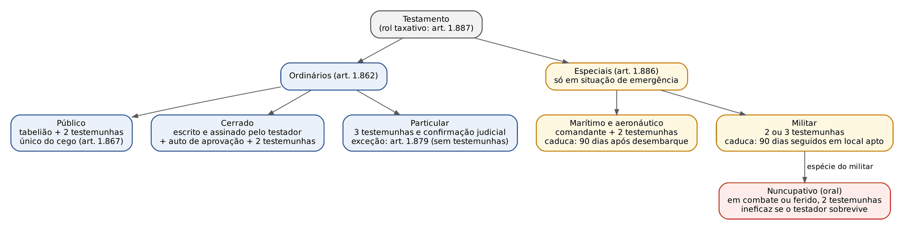
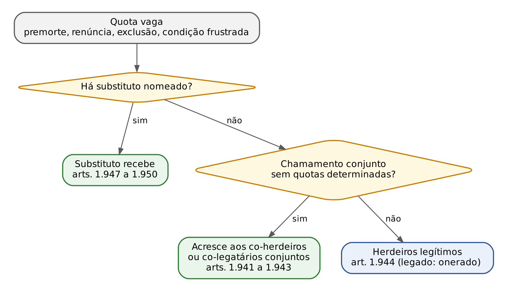
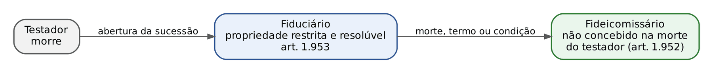
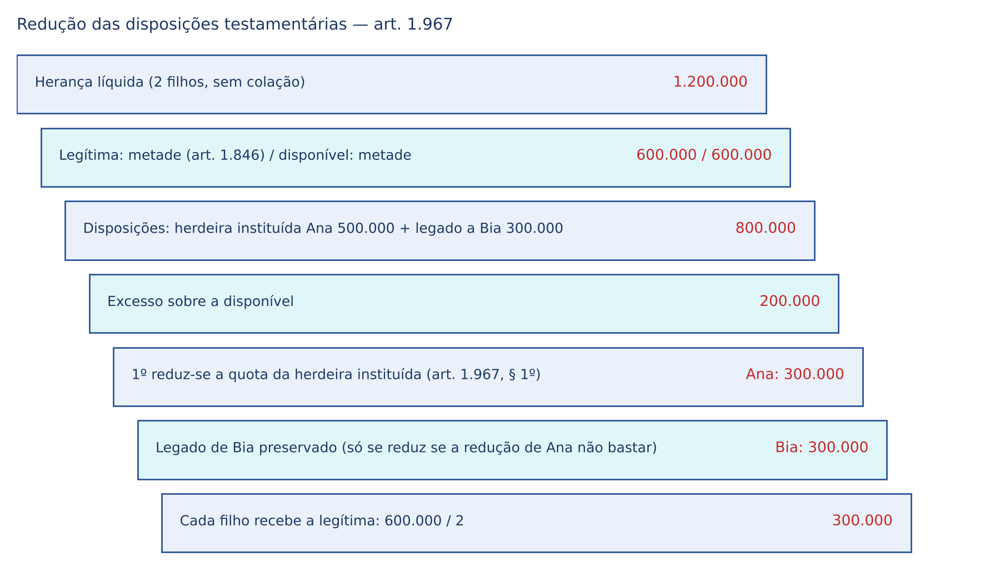

# CAPÍTULO 44 — SUCESSÕES III: SUCESSÃO TESTAMENTÁRIA

:::INCIDENCIA
TRF5 p. 14; TJRS p. 20; TJSC p. 21. Nível A; 19 questões do lote (FGV 15, FCC 4), mais correlatas dos Caps. 42, 43 e 45.
O que mais cai: capacidade de testar (16 anos, incapacidade superveniente), impedidos de receber e pessoas interpostas, formas e caducidade dos testamentos especiais, disposições nulas do art. 1.900, deserdação (ônus e prazo de 4 anos), rompimento, redução, fideicomisso e legado de renda vitalícia.
:::

| Subtema | FGV | FCC | Padrão |
|---|---|---|---|
| Conceito, características e capacidade ativa | 4 | 2 | 16 anos sem assistência; art. 1.861; revogabilidade; disposição não patrimonial; recusa do tabelião |
| Capacidade passiva e disposições nulas | 3 | 0 | testemunha e seus parentes como interpostas pessoas; prole eventual; art. 1.900 x art. 1.901 |
| Formas ordinárias e especiais | 1 | 1 | particular com 3 testemunhas; marítimo em porto (art. 1.892) |
| Legados, caducidade e substituições | 3 | 0 | renda vitalícia desde a morte; premoriência do legatário; fideicomisso com substituição vulgar |
| Deserdação | 2 | 0 | ação do beneficiado, ônus da prova, 4 anos da abertura do testamento |
| Redução, rompimento e liberdade de testar | 3 | 2 | excesso só se reduz; descendente superveniente rompe tudo; colaterais não são necessários |

## 44.1 Testamento: noção, características e conteúdo

### 44.1.1 Características

Testamento é negócio jurídico unilateral, personalíssimo, solene, gratuito, revogável e *mortis causa*, pelo qual a pessoa dispõe de bens, no todo ou em parte, ou faz disposições não patrimoniais para depois da morte (arts. 1.857 e 1.858). A sucessão testamentária convive com a legítima: havendo testamento, a legítima incide sobre o que não foi validamente disposto (art. 1.788 — ver Cap. 42) e o testador com herdeiros necessários só dispõe da metade (art. 1.789; legítima e seu cálculo no Cap. 43).

:::LEI CC, arts. 1.857 a 1.859
Art. 1.857. Toda pessoa capaz pode dispor, por testamento, da totalidade dos seus bens, ou de parte deles, para depois de sua morte.
§ 1º A legítima dos herdeiros necessários não poderá ser incluída no testamento.
§ 2º São válidas as disposições testamentárias de caráter não patrimonial, ainda que o testador somente a elas se tenha limitado.
Art. 1.858. O testamento é ato personalíssimo, podendo ser mudado a qualquer tempo.
Art. 1.859. Extingue-se em cinco anos o direito de impugnar a validade do testamento, contado o prazo da data do seu registro.
:::

| Característica | Consequência cobrada | Fundamento |
|---|---|---|
| Unilateral e não receptício | aperfeiçoa-se com a declaração do testador; a aceitação do herdeiro é posterior à morte e não integra o negócio | arts. 1.857, 1.804 |
| Personalíssimo | não admite representação nem mandato; o "testamento a rogo" é só a escrita por outrem (cerrado), nunca a vontade de outrem | arts. 1.858, 1.868 |
| Solene | forma *ad solemnitatem*; rol de formas taxativo (art. 1.887); a jurisprudência mitiga vícios formais (44.4.4) | arts. 1.862, 1.886, 1.887 |
| Revogável | qualquer cláusula de irrevogabilidade é ineficaz; exceção: o reconhecimento de filho feito em testamento é irrevogável | arts. 1.858, 1.969; art. 1.609, III |
| *Mortis causa* | antes da morte não gera direito, nem sequer expectativa tutelável; daí a impossibilidade de anular o testamento em vida (Q3914487) | arts. 1.784, 1.858 |
| Gratuito | a imposição de encargo não o converte em oneroso (legado com encargo segue a doação modal) | art. 1.938 |

:::PEGADINHA
"Ato personalíssimo e IRREVOGÁVEL" é a alternativa falsa clássica (FCC). O art. 1.858 diz "podendo ser mudado a qualquer tempo". A única disposição que sobrevive à revogação é o reconhecimento de filho (art. 1.609, III, e art. 1.610 — o reconhecimento "não pode ser revogado, nem mesmo quando feito em testamento").
:::

### 44.1.2 Conteúdo: patrimonial e existencial

O § 2º do art. 1.857 valida o testamento só com disposições não patrimoniais: reconhecimento de filho, nomeação de tutor (art. 1.729, parágrafo único), perdão do indigno (art. 1.818), instituição de fundação (art. 62), destinação do corpo e do funeral, disposições sobre bens digitais existenciais. O Enunciado 528 da V Jornada admite o chamado "testamento vital" (diretivas antecipadas sobre tratamento de saúde) como declaração em documento autêntico; não é testamento em sentido técnico, porque produz efeitos em vida. O Enunciado 687 da IX Jornada admite a disposição do patrimônio digital por testamento ou codicilo (herança digital, inclusive a tese das contas e perfis, no Cap. 42).

:::QUESTAO FCC 2025 — TRT-1 — Analista Judiciário (Q3445921)
Pediu-se a assertiva correta sobre sucessão testamentária. Gabarito C: são válidas as disposições não patrimoniais, ainda que o testador só a elas se tenha limitado (art. 1.857, § 2º). Erros: "irrevogável" (art. 1.858); legítima "pode ser incluída" (§ 1º); incapacidade superveniente invalida (art. 1.861); quem tem menos de 18 anos não testa (falso: podem testar os maiores de 16, art. 1.860, parágrafo único).
:::

### 44.1.3 Testamento conjuntivo

É proibido o testamento conjuntivo, "seja simultâneo, recíproco ou correspectivo" (art. 1.863). Simultâneo: duas pessoas testam no mesmo instrumento em favor de terceiro; recíproco: cada uma institui a outra; correspectivo: disposições feitas em retribuição de outras correspondentes. A proibição protege a revogabilidade e a pessoalidade. NÃO é vedado que cônjuges façam, no mesmo dia e no mesmo cartório, testamentos separados com conteúdo recíproco: cada instrumento é autônomo e revogável. A FGV também explora a figura do pacto sucessório (art. 426, *pacta corvina* — ver Cap. 42): o contrato sobre herança de pessoa viva é nulo; o testamento é o único negócio de disposição *mortis causa* admitido.

### 44.1.4 Prazos de impugnação: arts. 1.859 e 1.909

O art. 1.859 fixa 5 anos, contados do REGISTRO do testamento (ato judicial dos arts. 735 a 737 do CPC), para "impugnar a validade do testamento". O art. 1.909, parágrafo único, fixa 4 anos, contados de quando o interessado tiver CONHECIMENTO do vício, para anular disposição inquinada de erro, dolo ou coação. A conciliação dominante na doutrina: o art. 1.859 rege a invalidade do testamento como um todo (incapacidade do testador, vício de forma, nulidade), e o art. 1.909 rege a anulação de disposições por vício de consentimento. Parte da doutrina critica a sujeição da nulidade a prazo (contra o art. 169), mas a regra especial prevalece na prova.

| Pretensão | Prazo | Termo inicial | Fundamento |
|---|---|---|---|
| Impugnar a validade do testamento (forma, capacidade) | 5 anos | registro do testamento | art. 1.859 |
| Anular disposição por erro, dolo ou coação | 4 anos | ciência do vício pelo interessado | art. 1.909, parágrafo único |
| Provar a causa da deserdação | 4 anos | abertura do testamento | art. 1.965, parágrafo único |
| Concepção da prole eventual | 2 anos | abertura da sucessão | art. 1.800, § 4º |
| Cumprimento do testamento pelo testamenteiro | 180 dias, prorrogável | aceitação da testamentaria | art. 1.983 |
| Caducidade do marítimo e do aeronáutico | 90 dias | desembarque em terra onde possa testar | art. 1.891 |
| Caducidade do militar | 90 dias seguidos | permanência em lugar onde possa testar | art. 1.895 |
| Caducidade do hológrafo simplificado (art. 1.879) | 90 dias (tese doutrinária) | fim das circunstâncias excepcionais | Enunciado 611 |

:::QUESTAO FGV 2026 — TJ-MS — Outorga de Delegações (Provimento) (Q3914487)
Idoso de 78 anos, saudável, coagido a testar em favor do filho: pede-se o que ele pode fazer. Gabarito E: só pode alterar (revogar) o testamento, não anulá-lo. Passos: (1) o testamento não produz efeito algum em vida (ato *mortis causa*); (2) o meio próprio e suficiente do testador é revogá-lo pela mesma forma (art. 1.969), a qualquer tempo (art. 1.858); (3) a ação anulatória é dos interessados, após a morte, no prazo do art. 1.909. Armadilhas: os 4 anos "da data em que cessou a coação" (art. 178, I) são do regime dos negócios entre vivos; o Estatuto da Pessoa Idosa não cria prazo especial.
:::

## 44.2 Capacidade testamentária ativa

:::LEI CC, arts. 1.860 e 1.861
Art. 1.860. Além dos incapazes, não podem testar os que, no ato de fazê-lo, não tiverem pleno discernimento.
Parágrafo único. Podem testar os maiores de dezesseis anos.
Art. 1.861. A incapacidade superveniente do testador não invalida o testamento, nem o testamento do incapaz se valida com a superveniência da capacidade.
:::

- Idade: a partir dos 16 anos, SEM assistência (o ato é personalíssimo, incompatível com assistência ou representação). O relativamente incapaz pela idade testa sozinho; o absolutamente incapaz (menos de 16) não testa, nem por representante.
- Após o Estatuto da Pessoa com Deficiência, os "incapazes" do art. 1.860 são os do art. 4º (ébrios habituais, viciados em tóxico, quem não pode exprimir vontade, pródigos — ver Cap. 3). Para o pródigo, prevalece na doutrina que pode testar, porque a interdição o priva só dos atos de disposição entre vivos (art. 1.782) e o testamento não desfalca o patrimônio em vida. A deficiência, por si, não retira a capacidade de testar (Lei 13.146/2015, art. 6º); o que importa é o "pleno discernimento" no ato.
- Momento: a capacidade é aferida no momento da feitura (*tempus regit actum*). Incapacidade superveniente não invalida; capacidade superveniente não convalida (art. 1.861). Por isso o testamento feito aos 15 anos é nulo para sempre, ainda que o testador morra aos 80 sem refazê-lo.

:::QUESTAO FGV 2025 — ENAC — 2º Exame Nacional dos Cartórios (Q3673809)
Caio, 15 anos, fez testamento particular; Maria, capaz, testou e seis meses depois perdeu todo o discernimento. Gabarito C: o de Caio é inválido e a capacidade superveniente não o valida; o de Maria permanece válido. É a literalidade do art. 1.861 nos dois sentidos; as alternativas sedutoras convalidam o de Caio pela maioridade ou invalidam o de Maria pela doença posterior.
:::

:::JURIS STJ, REsp 2.142.132-GO, Quarta Turma, Rel. Min. Antonio Carlos Ferreira, j. 11/2/2025 (Informativo 841)
A capacidade para testar é presumida; a anulação exige prova robusta da incapacidade no momento da lavratura; na dúvida, *in dubio pro capacitate*. No mesmo julgado, a teoria da aparência validou testamento cerrado aprovado por servidora que se apresentava como tabeliã substituta sem investidura formal, diante da boa-fé e da confiança legítima.
:::

Testamento lavrado durante a curatela provisória: a decisão que a decretou basta para provar a restrição da capacidade do testador, sem dilação probatória nem ação anulatória autônoma (REsp 2.080.527-MG; v. Cap. 41).

:::QUESTAO FGV 2026 — ENAC — 3º Exame Nacional dos Cartórios (Q4130102)
O tabelião percebe que o testador tem fala desconexa, não sabe onde está nem em que dia; a família insiste, dizendo não haver interdição. Gabarito A: recusar motivadamente. O art. 1.860 exige "pleno discernimento" no ato, independentemente de interdição; o notário deve qualificar a vontade e a capacidade. Erros: lavrar com ressalva (o ato seria nulo); exigir atestado (não supre a percepção do notário nem é requisito legal); "testamento por intermédio do curador" (ato personalíssimo).
:::

Mesmo raciocínio na questão de perícia psiquiátrica (FGV 2026, PC-PI, Q3856239, gabarito B): o perito avalia a compreensão da natureza do ato e de suas consequências no momento da feitura; diagnóstico de demência, idade avançada ou tratamento psiquiátrico prévio não invalidam por si.

## 44.3 Capacidade testamentária passiva (legitimação para suceder por testamento)

### 44.3.1 Regra e ampliações do art. 1.799

Legitimam-se a suceder as pessoas nascidas ou já concebidas na abertura da sucessão (art. 1.798, regra geral do Cap. 42). Na sucessão TESTAMENTÁRIA, o art. 1.799 acrescenta: (I) os filhos ainda não concebidos de pessoas indicadas pelo testador, desde que vivas estas ao abrir-se a sucessão (prole eventual); (II) as pessoas jurídicas; (III) as pessoas jurídicas cuja organização o testador determinar sob a forma de fundação.

- Prole eventual: os bens ficam com curador nomeado pelo juiz, após a liquidação ou partilha; salvo disposição em contrário, a curatela cabe à pessoa cujo filho o testador esperava ter por herdeiro (art. 1.800, § 1º). Nascendo com vida, recebe a herança com frutos e rendimentos desde a morte do testador (§ 3º). Se em 2 anos da abertura da sucessão não houver CONCEPÇÃO, os bens vão aos herdeiros legítimos, salvo disposição em contrário (§ 4º).
- O Enunciado 268 da III Jornada: o testador pode beneficiar filhos de determinada origem (só biológicos, por exemplo), sem interpretação extensiva da cláusula. Discute-se se o filho adotivo da pessoa indicada se inclui: a doutrina majoritária admite, salvo cláusula restritiva, por força do art. 227, § 6º, da CF.
- A pessoa indicada precisa estar VIVA na abertura da sucessão; se premorreu, a disposição caduca.

:::PEGADINHA
Prole eventual x fideicomisso. Na prole eventual o beneficiário é o próprio não concebido, e o curador apenas guarda os bens por até 2 anos. No fideicomisso (44.10.3), o fiduciário é titular de propriedade resolúvel por prazo, condição ou até a morte, e o não concebido recebe depois, sem limite de 2 anos.
:::

### 44.3.2 Impedidos de receber (art. 1.801) e pessoas interpostas (art. 1.802)

:::LEI CC, arts. 1.801 e 1.802
Art. 1.801. Não podem ser nomeados herdeiros nem legatários:
I - a pessoa que, a rogo, escreveu o testamento, nem o seu cônjuge ou companheiro, ou os seus ascendentes e irmãos;
II - as testemunhas do testamento;
III - o concubino do testador casado, salvo se este, sem culpa sua, estiver separado de fato do cônjuge há mais de cinco anos;
IV - o tabelião, civil ou militar, ou o comandante ou escrivão, perante quem se fizer, assim como o que fizer ou aprovar o testamento.
Art. 1.802. São nulas as disposições testamentárias em favor de pessoas não legitimadas a suceder, ainda quando simuladas sob a forma de contrato oneroso, ou feitas mediante interposta pessoa.
Parágrafo único. Presumem-se pessoas interpostas os ascendentes, os descendentes, os irmãos e o cônjuge ou companheiro do não legitimado a suceder.
:::

- Atenção às listas: no inciso I (quem escreveu a rogo), a lei menciona cônjuge, companheiro, ascendentes e IRMÃOS (não descendentes); no parágrafo único do art. 1.802 (interpostas), entram também os DESCENDENTES. Assim, o filho da testemunha não é impedido pelo art. 1.801, mas a deixa a ele é nula por presunção de interposição (art. 1.802, parágrafo único) — e a presunção é absoluta para a doutrina majoritária.
- Concubino: o impedimento cai se o testador casado estiver separado de fato, sem culpa sua, há mais de 5 anos. A expressão "sem culpa sua" é criticada (discussão de culpa) e parte da doutrina, com apoio no art. 1.723, § 1º, sustenta bastar a separação de fato; para prova, a letra é a do art. 1.801, III. O filho do concubino que também é filho do testador pode receber (art. 1.803; na mesma linha, a antiga Súmula 447 do STF, sobre o filho "adulterino", hoje superada na terminologia pelo art. 227, § 6º, da CF).
- Consequência: NULIDADE da disposição (art. 1.900, V), não do testamento inteiro (art. 1.910 só estende a ineficácia às disposições que dela dependam).

:::QUESTAO FGV 2025 — TJ-TO — Juiz Substituto (Q3453223)
Testamento particular com testemunhas Xisto, Zuleide e Yvone; legados a: irmã de Xisto; sobrinha interditada por vício em tóxicos; filha extraconjugal do testador; fundação criada no próprio testamento; primeiro filho que vier a nascer de neto vivo. Pede-se quem está impedido. Gabarito A (a irmã da testemunha). Passos: (1) a testemunha é impedida (art. 1.801, II); (2) irmão do impedido presume-se interposta pessoa (art. 1.802, parágrafo único); (3) as demais são válidas: incapacidade de fato não impede receber; filha do testador recebe (art. 1.803); fundação (art. 1.799, III); prole eventual de pessoa viva (art. 1.799, I).
:::

:::QUESTAO FGV 2024 — MPE-GO — Promotor de Justiça Substituto (Q2367625)
Testadora relativamente incapaz pela idade, testamento particular de próprio punho lido a 3 testemunhas; deixas a amiga (com inalienabilidade e incomunicabilidade), a associação e fundação, ao filho que o primo vier a ter e ao filho de uma testemunha. Gabarito C: a incapacidade relativa pela idade não afeta a validade (art. 1.860, parágrafo único), é válida a deixa à prole eventual (art. 1.799, I) e é nula a deixa ao filho da testemunha (art. 1.802, parágrafo único). Armadilhas: a alternativa A chama o testamento de anulável pela idade; a B trata os gravames como abusivos (sem herdeiros necessários, os bens são disponíveis e o art. 1.848 não se aplica); a D exige coexistência do contemplado com o autor da herança, ignorando o art. 1.799, I.
:::

## 44.4 Formas ordinárias de testamento

### 44.4.1 Testamento público (arts. 1.864 a 1.867)

:::LEI CC, art. 1.864
Art. 1.864. São requisitos essenciais do testamento público:
I - ser escrito por tabelião ou por seu substituto legal em seu livro de notas, de acordo com as declarações do testador, podendo este servir-se de minuta, notas ou apontamentos;
II - lavrado o instrumento, ser lido em voz alta pelo tabelião ao testador e a duas testemunhas, a um só tempo; ou pelo testador, se o quiser, na presença destas e do oficial;
III - ser o instrumento, em seguida à leitura, assinado pelo testador, pelas testemunhas e pelo tabelião.
Parágrafo único. O testamento público pode ser escrito manualmente ou mecanicamente, bem como ser feito pela inserção da declaração de vontade em partes impressas de livro de notas, desde que rubricadas todas as páginas pelo testador, se mais de uma.
:::

- Testador que não sabe ou não pode assinar: o tabelião declara e assina por ele, a rogo, uma das testemunhas instrumentárias (art. 1.865).
- Surdo: se souber ler, lê o testamento; se não, designa quem o leia, presentes as testemunhas (art. 1.866).
- Cego: SÓ testamento público, lido em voz alta DUAS vezes (pelo tabelião e por uma testemunha designada pelo testador), com menção circunstanciada (art. 1.867). O analfabeto também só pode fazer o público, pois não pode o cerrado (art. 1.872) nem o particular (que exige leitura e assinatura).
- Público não é sinônimo de publicidade do conteúdo: a certidão do testamento só se fornece ao testador ou por ordem judicial; após a morte, a quem apresentar certidão de óbito (Provimento CNJ 149/2023, art. 110).
- Forma eletrônica: o Provimento CNJ 100/2020 (e-Notariado), depois incorporado ao Código Nacional de Normas (Provimento 149/2023), permitiu a lavratura de atos notariais eletrônicos por videoconferência, com assinatura digital, o que a prática notarial passou a aplicar ao testamento público. A Lei 14.010/2020 (RJET) NÃO tratou de testamento.

:::JURIS STJ, Jurisprudência em Teses, ed. 235, tese 3 (REsp 1.677.931-MG, Terceira Turma, Rel. Min. Nancy Andrighi, DJe 22/8/2017)
É válido o testamento público produzido em cartório e lido em voz alta pelo tabelião na presença do testador e de duas testemunhas, apesar da ausência de segunda leitura e da menção expressa da deficiência visual do testador. Vício formal que não compromete a vontade não anula (44.4.4).
:::

### 44.4.2 Testamento cerrado (arts. 1.868 a 1.875)

Escrito pelo testador ou por outrem a seu rogo e por aquele ASSINADO, torna-se válido com a aprovação do tabelião (art. 1.868): entrega ao tabelião perante 2 testemunhas; declaração de que é seu testamento e quer aprová-lo; lavratura imediata do auto de aprovação, lido ao testador e às testemunhas; assinatura do auto por tabelião, testemunhas e testador. Se escrito mecanicamente, o subscritor numera e autentica todas as páginas (parágrafo único). O tabelião começa o auto logo após a última palavra do testador, cerra e cose o instrumento (art. 1.869); pode aprovar o que ele próprio escreveu a rogo (art. 1.870).

- Língua nacional ou estrangeira (art. 1.871). Não pode fazê-lo quem não saiba ou não possa ler (art. 1.872). O surdo-mudo pode, se o escrever todo e assinar de sua mão e escrever na face externa que aquele é seu testamento (art. 1.873).
- Depois de aprovado, é entregue ao testador; o tabelião lança no livro nota do lugar e data da aprovação e entrega (art. 1.874). O conteúdo é sigiloso até a abertura.
- Morto o testador, é apresentado ao juiz, que o abre, manda registrar e cumprir, se não houver vício externo que o torne suspeito de nulidade ou falsidade (art. 1.875; CPC, art. 735).
- Revogação presumida: se o testador o abrir ou dilacerar, ou consentir que o façam, considera-se revogado (art. 1.972 — ver 44.13).

### 44.4.3 Testamento particular (arts. 1.876 a 1.880)

:::LEI CC, arts. 1.876 e 1.879
Art. 1.876. O testamento particular pode ser escrito de próprio punho ou mediante processo mecânico.
§ 1º Se escrito de próprio punho, são requisitos essenciais à sua validade seja lido e assinado por quem o escreveu, na presença de pelo menos três testemunhas, que o devem subscrever.
§ 2º Se elaborado por processo mecânico, não pode conter rasuras ou espaços em branco, devendo ser assinado pelo testador, depois de o ter lido na presença de pelo menos três testemunhas, que o subscreverão.
Art. 1.879. Em circunstâncias excepcionais declaradas na cédula, o testamento particular de próprio punho e assinado pelo testador, sem testemunhas, poderá ser confirmado, a critério do juiz.
:::

- Após a morte, publica-se em juízo com citação dos herdeiros legítimos (art. 1.877; CPC, art. 737). Confirma-se se as testemunhas forem contestes sobre o fato da disposição ou ao menos sobre a leitura perante elas e reconhecerem as assinaturas (art. 1.878). Se faltarem testemunhas por morte ou ausência, basta que UMA o reconheça, havendo, a critério do juiz, prova suficiente de veracidade (parágrafo único).
- Língua estrangeira: admitida se as testemunhas a compreenderem (art. 1.880).
- Art. 1.879 (testamento hológrafo simplificado ou de emergência): três exigências cumulativas — de próprio punho, assinado, com as circunstâncias excepcionais DECLARADAS NA CÉDULA. O mecânico não se beneficia. O Enunciado 611 da VII Jornada sustenta que ele perde eficácia se, nos 90 dias seguintes ao fim das circunstâncias, o testador, podendo, não testar por forma ordinária (analogia com os especiais; não está na lei).

:::QUESTAO FCC 2025 — TRT-1 — Oficial de Justiça Avaliador Federal (Q3469451)
Testamento escrito de próprio punho, lido e assinado por quem o escreveu, na presença de ao menos três testemunhas que o subscrevam: gabarito D, particular (art. 1.876, § 1º). Os números são o critério: 2 testemunhas no público e no cerrado; 3 no particular; 2 nos especiais (no militar, 3 se o testador não puder assinar).
:::

### 44.4.4 Formalismo mitigado na jurisprudência do STJ

O STJ consolidou que a forma serve à vontade, não o contrário (Jurisprudência em Teses, ed. 235):

| Tese | Conteúdo | Precedente indicado |
|---|---|---|
| 1 | é válido o testamento, público ou particular, que reflete a real vontade do testador, livre e consciente, aferível pelas circunstâncias, ainda que com vício formal | AR 6.052-SP, Segunda Seção, DJe 14/2/2023; REsp 2.005.052-SP |
| 2 | é válido o testamento particular em que o testador, em vez de assinar de próprio punho, apôs sua impressão digital | REsp 1.633.254-MG, Segunda Seção, DJe 18/3/2020 |
| 3 | testamento público lido uma só vez ao cego, sem menção da deficiência, é válido | REsp 1.677.931-MG |
| 4 | é INVÁLIDO o testamento particular de próprio punho sem testemunhas presenciais e sem circunstância excepcional, somado à falta de assinatura em todas as folhas | REsp 2.000.938-SP, Terceira Turma, DJe 25/8/2023 |

:::ATENCAO
O limite da flexibilização é a dúvida sobre a autenticidade ou a liberdade da vontade. Vício que apenas descumpre ritual (segunda leitura, menção formal) é relevado; ausência de requisito que garante a autoria e a vontade (testemunhas presenciais no particular, sem a situação do art. 1.879) invalida. Na prova objetiva da FGV, porém, a letra do código costuma prevalecer quando o enunciado não traz elementos sobre a vontade real.
:::

### 44.4.5 Testemunhas

O CC de 2002 não tem rol próprio de testemunhas testamentárias; aplica-se o art. 228 (ver Cap. 10). A consequência mais cobrada não é a invalidade da forma, e sim a nulidade da deixa à testemunha e aos seus parentes (arts. 1.801, II, e 1.802).

### 44.4.6 Ficha de consulta rápida: formas ordinárias

| Forma | Quem escreve | Testemunhas | Leitura e assinatura | Quem não pode usar | Pós-morte |
|---|---|---|---|---|---|
| Público | tabelião no livro de notas (manual, mecânico ou eletrônico) | 2 | leitura em voz alta a todos ao mesmo tempo; assinam testador, testemunhas e tabelião; a rogo, se necessário | — (é a única forma do cego e do analfabeto) | apresentação de traslado ou certidão e ordem de cumprimento (CPC, art. 736) |
| Cerrado | testador ou outrem a rogo; ASSINADO pelo testador | 2 (na entrega e no auto) | auto de aprovação lido e assinado; conteúdo secreto | quem não sabe ou não pode ler (art. 1.872) | abertura judicial (art. 1.875; CPC, art. 735) |
| Particular | testador, de próprio punho ou mecanicamente | 3, no mínimo | lido pelo testador e assinado perante as testemunhas, que subscrevem; mecânico sem rasuras nem espaços em branco | cego e analfabeto (na prática) | publicação e confirmação judicial (arts. 1.877 e 1.878; CPC, art. 737) |
| Particular excepcional | testador, de próprio punho | nenhuma | assinatura; circunstâncias declaradas na cédula | testamento mecânico | confirmação "a critério do juiz" (art. 1.879) |

:::PROCESSO Abertura, registro e cumprimento (CPC, arts. 735 a 737)
- Cerrado: o juiz o abre se não houver vício externo, manda o escrivão lê-lo na presença do apresentante, lavra-se termo; ouvido o MP, manda registrar, arquivar e cumprir (art. 735, §§ 1º e 2º).
- Público: qualquer interessado exibe traslado ou certidão e pede o cumprimento (art. 736).
- Particular: a publicação pode ser requerida pelo herdeiro, legatário, testamenteiro ou terceiro detentor; intimam-se os herdeiros que não a requereram; ouvido o MP, o juiz confirma (art. 737). O mesmo procedimento serve ao codicilo e aos testamentos marítimo, aeronáutico, militar e nuncupativo (§ 3º).
- Registrado, intima-se o testamenteiro para assinar o termo da testamentaria; sem testamenteiro, nomeia-se dativo (art. 735, §§ 3º e 4º).
- É procedimento de jurisdição voluntária, de cognição limitada a aspectos extrínsecos: a validade intrínseca e a capacidade discutem-se em ação própria (prazo do art. 1.859, contado do registro). A possibilidade de inventário extrajudicial com testamento registrado judicialmente é tratada no Cap. 45 (Jurisprudência em Teses, ed. 235, tese 6, e Enunciado 600).
:::

## 44.5 Testamentos especiais

São três e o rol é taxativo: marítimo, aeronáutico e militar (arts. 1.886 e 1.887); o nuncupativo é modalidade do militar (art. 1.896). Justificam-se pela impossibilidade de recorrer às formas ordinárias e, por isso, CADUCAM quando a situação de emergência passa e o testador sobrevive com tempo de testar normalmente.

:::LEI CC, arts. 1.891 e 1.892
Art. 1.891. Caducará o testamento marítimo, ou aeronáutico, se o testador não morrer na viagem, nem nos noventa dias subseqüentes ao seu desembarque em terra, onde possa fazer, na forma ordinária, outro testamento.
Art. 1.892. Não valerá o testamento marítimo, ainda que feito no curso de uma viagem, se, ao tempo em que se fez, o navio estava em porto onde o testador pudesse desembarcar e testar na forma ordinária.
:::

| Espécie | Situação | Perante quem | Testemunhas | Forma | Ineficácia |
|---|---|---|---|---|---|
| Marítimo | em viagem, a bordo de navio nacional, de guerra ou mercante | comandante | 2 | correspondente ao público ou ao cerrado; registro no diário de bordo | caduca se não morrer na viagem nem em 90 dias do desembarque em terra onde possa testar (art. 1.891); NÃO VALE se feito com o navio em porto onde pudesse desembarcar e testar (art. 1.892) |
| Aeronáutico | em viagem, a bordo de aeronave militar ou comercial | pessoa designada pelo comandante | 2 | idem (art. 1.889) | idem (art. 1.891) |
| Militar | militares e pessoas a serviço das Forças Armadas em campanha, praça sitiada ou de comunicações interrompidas, sem tabelião | comandante, oficial de saúde ou diretor do hospital, substituto do mais graduado (art. 1.893, §§ 1º a 3º) | 2, ou 3 se o testador não puder ou não souber assinar (uma assina por ele) | escrito pela autoridade; ou de próprio punho, datado e assinado, apresentado aberto ou cerrado ao auditor ou oficial (art. 1.894) | caduca após 90 dias SEGUIDOS em lugar onde possa testar na forma ordinária, SALVO se observou as solenidades do art. 1.894, parágrafo único (nota do auditor assinada com as testemunhas) (art. 1.895) |
| Nuncupativo | militar empenhado em combate ou ferido | duas testemunhas, a quem confia oralmente a última vontade | 2 | oral | não tem efeito se o testador não morrer na guerra ou convalescer do ferimento (art. 1.896, parágrafo único) |

- O marítimo ou aeronáutico fica sob guarda do comandante, entregue às autoridades administrativas do primeiro porto ou aeroporto nacional, contra recibo averbado no diário de bordo (art. 1.890).
- A distinção mais cobrada é de PLANO: o art. 1.891 trata de CADUCIDADE (testamento válido que perde a eficácia pelo decurso do prazo); o art. 1.892 trata de INVALIDADE (o testamento nasce sem valor, porque faltou o pressuposto da emergência).

:::QUESTAO FGV 2026 — ENAC — 3º Exame Nacional dos Cartórios (Q4130154)
Rapaz de 17 anos, em navio mercante brasileiro, testa perante o comandante e dois amigos durante parada em porto; sobrevive e morre 180 dias após o desembarque. Gabarito B: o testamento não tem validade, porque o navio estava em porto onde ele poderia desembarcar e testar pela forma ordinária (art. 1.892). Armadilhas: A fala em caducidade de 120 dias (o prazo é de 90 e, de todo modo, o vício aqui é de validade); C trata amigos como testemunhas inidôneas (não há impedimento); D invoca a incapacidade relativa (aos 16 anos já se testa sem assistência); E ignora o porto.
:::

## 44.6 Codicilo (arts. 1.881 a 1.885)

Codicilo é ato de última vontade de menor solenidade e de objeto restrito: escrito particular do próprio disponente, DATADO e ASSINADO, sem testemunhas, para (art. 1.881):
- disposições especiais sobre o próprio enterro;
- esmolas de pouca monta a pessoas certas e determinadas ou, indeterminadamente, aos pobres de certo lugar;
- legado de móveis, roupas ou joias de pouco valor, de uso pessoal;
- nomeação ou substituição de testamenteiros (art. 1.883).

| Ponto | Regra | Fundamento |
|---|---|---|
| Capacidade | a mesma de testar | art. 1.881 |
| Convivência com testamento | vale "deixe ou não testamento o autor", salvo direito de terceiro | art. 1.882 |
| Revogação | por ato igual (outro codicilo) ou por testamento posterior de qualquer natureza que não o confirme ou modifique | art. 1.884 |
| Codicilo fechado | abre-se como o testamento cerrado | art. 1.885 |
| Pós-morte | publicação e confirmação como o particular | CPC, art. 737, § 3º |
| "Pouco valor" | conceito indeterminado; parte da doutrina e julgados estaduais usam como parâmetro cerca de 10% do monte, aferido no caso concreto | doutrina |

:::PEGADINHA
O testamento posterior revoga o codicilo, se não o confirmar ou modificar (art. 1.884); o codicilo posterior NÃO revoga testamento (não tem forma para isso). Codicilo não serve para deserdar, instituir herdeiro, reconhecer filho com segurança formal ou legar imóvel. O Enunciado 687 da IX Jornada admite a disposição de patrimônio digital por codicilo, nos limites de seu objeto.
:::

## 44.7 Disposições testamentárias (arts. 1.897 a 1.911)

### 44.7.1 Modalidades e interpretação

A nomeação de herdeiro ou legatário pode ser pura e simples, sob condição, para certo fim ou modo (encargo) ou por certo motivo (art. 1.897). O TERMO, porém, ter-se-á por NÃO ESCRITO na instituição de herdeiro, salvo nas disposições fideicomissárias (art. 1.898): ninguém é herdeiro a partir de certa data ou até certa data, para não contrariar a *saisine*. O termo é admitido no legado (art. 1.924) e no fideicomisso (art. 1.951).

Na dúvida, prevalece a interpretação que melhor assegure a observância da vontade do testador (art. 1.899), reforçada pelo art. 112 (intenção mais que sentido literal). Erro na designação da pessoa ou da coisa anula a disposição, SALVO se o contexto, outros documentos ou fatos inequívocos permitirem identificar o que o testador quis (art. 1.903). A ineficácia de uma disposição só arrasta as que dela dependam (art. 1.910).

:::EXEMPLO
"Deixo meu apartamento ao meu sobrinho João a partir de 2030": o termo inicial é não escrito e João é herdeiro desde a morte (art. 1.898). "Deixo meu apartamento ao meu sobrinho João, se ele se formar em Medicina": condição suspensiva válida; até o implemento, ele não exige o bem (art. 1.924), e se a condição falhar há quota vaga (art. 1.943). "Deixo meu sítio a João, para que nele mantenha uma escola": encargo; não suspende a aquisição e o descumprimento pode levar à revogação, aplicando-se o regime da doação modal (art. 1.938).
:::

### 44.7.2 Disposições nulas x válidas (arts. 1.900 e 1.901)

:::LEI CC, arts. 1.900 e 1.901
Art. 1.900. É nula a disposição:
I - que institua herdeiro ou legatário sob a condição captatória de que este disponha, também por testamento, em benefício do testador, ou de terceiro;
II - que se refira a pessoa incerta, cuja identidade não se possa averiguar;
III - que favoreça a pessoa incerta, cometendo a determinação de sua identidade a terceiro;
IV - que deixe a arbítrio do herdeiro, ou de outrem, fixar o valor do legado;
V - que favoreça as pessoas a que se referem os arts. 1.801 e 1.802.
Art. 1.901. Valerá a disposição:
I - em favor de pessoa incerta que deva ser determinada por terceiro, dentre duas ou mais pessoas mencionadas pelo testador, ou pertencentes a uma família, ou a um corpo coletivo, ou a um estabelecimento por ele designado;
II - em remuneração de serviços prestados ao testador, por ocasião da moléstia de que faleceu, ainda que fique ao arbítrio do herdeiro ou de outrem determinar o valor do legado.
:::

| Nula (art. 1.900) | Válida (art. 1.901) — exceção correspondente |
|---|---|
| III — pessoa incerta cuja identidade terceiro escolhe livremente | I — terceiro escolhe DENTRE pessoas mencionadas, ou de uma família, corpo coletivo ou estabelecimento designado |
| IV — valor do legado ao arbítrio do herdeiro ou de outrem | II — remuneração de serviços prestados na moléstia de que o testador faleceu, ainda que o valor fique ao arbítrio de outrem |
| II — pessoa incerta impossível de identificar | art. 1.902 — disposição geral aos pobres ou a estabelecimentos de caridade: entende-se do lugar do domicílio do testador ao tempo da morte; particulares preferem às públicas |
| I — condição captatória (deixo a você se você me deixar algo no seu testamento) | — (ofende a liberdade de testar e a proibição do art. 1.863) |
| V — impedidos e interpostas pessoas (arts. 1.801 e 1.802) | art. 1.803 — filho do concubino que também é filho do testador |

:::QUESTAO FGV 2024 — TJ-SC — Juiz Substituto, Edital 44 (Q3049334)
Entre cinco legados, pede-se o único válido. Gabarito C: roupas de gala a um dos associados do clube de valsa, escolhido pela secretária (art. 1.901, I: pessoa incerta escolhida por terceiro dentro de corpo coletivo designado). Os demais: colega de infância não identificável (art. 1.900, II); quantia fixada livremente pelo filho (art. 1.900, IV — não é remuneração de serviços na moléstia final); legado ao assistente que figurou como testemunha (arts. 1.801, II, e 1.900, V); automóvel ao vizinho desde que ele o deixe por testamento a um filho do testador (condição captatória, art. 1.900, I).
:::

### 44.7.3 Distribuição de quotas (arts. 1.904 a 1.908)

- Dois ou mais herdeiros sem discriminação de partes: partilha igual da porção disponível (art. 1.904).
- Uns nomeados individualmente e outros coletivamente: tantas quotas quantos os indivíduos e os GRUPOS (art. 1.905). "Deixo a Pedro, a Paulo e aos filhos de Maria" = 3 quotas, a terceira dividida entre os filhos de Maria.
- Quotas determinadas que não absorvem toda a herança: o remanescente vai aos herdeiros legítimos (art. 1.906; também art. 1.966).
- Quinhões de uns determinados e de outros não: estes repartem igualmente o que restar (art. 1.907).
- Exclusão de certo objeto do herdeiro instituído: o objeto vai aos legítimos (art. 1.908).

### 44.7.4 Vícios de consentimento

São anuláveis as disposições inquinadas de erro, dolo ou coação, em 4 anos da ciência do vício pelo interessado (art. 1.909). A captação dolosa (manipulação do testador idoso ou enfermo para obter a deixa) é a hipótese prática mais comum. Não se aplicam ao testamento a lesão e o estado de perigo, próprios de negócios bilaterais onerosos; a simulação é causa de nulidade e o Enunciado 294 da IV Jornada admite sua alegação por uma das partes contra a outra (relevante para a deixa simulada sob contrato oneroso do art. 1.802).

### 44.7.5 Cláusulas restritivas: inalienabilidade, impenhorabilidade e incomunicabilidade

- Sobre a PARTE DISPONÍVEL: livres, sem necessidade de justificar.
- Sobre a LEGÍTIMA: só com JUSTA CAUSA declarada no testamento (art. 1.848, *caput*). O testador não pode converter os bens da legítima em outros de espécie diversa (§ 1º). Com autorização judicial e justa causa, os bens gravados podem ser alienados, sub-rogando-se os ônus no produto (§ 2º; também art. 1.911, parágrafo único, inclusive na desapropriação).
- A inalienabilidade imposta por liberalidade implica impenhorabilidade e incomunicabilidade (art. 1.911, *caput*; Súmula 49 do STF). O inverso não vale: a incomunicabilidade isolada não gera inalienabilidade.
- Duração: as cláusulas vitalícias duram a vida do BENEFICIÁRIO e não passam aos herdeiros dele; morto o beneficiário, os bens se transmitem livres (Jurisprudência em Teses, ed. 235, tese 7; REsp 1.641.549-RJ e REsp 1.552.553-RJ).
- Direito intertemporal: para testamentos feitos sob o Código de 1916, o art. 2.042 deu prazo de um ano após a vigência do CC de 2002 para o testador aditar o testamento e declarar a justa causa, sob pena de não subsistir a restrição (ver Cap. 45, disposições transitórias).

:::QUESTAO FGV 2026 — TJ-PR — Juiz Substituto (Q3898898)
Testamento que esgota o patrimônio, com imóvel deixado a filho sob as três cláusulas restritivas, sem prazo e sem justa causa. Gabarito: D. O ponto deste capítulo: cláusula sobre bem da legítima sem justa causa declarada não vale (art. 1.848); a falta de prazo NÃO a invalida (presume-se vitalícia, limitada à vida do beneficiário); e a cônjuge, herdeira necessária em concorrência sobre particulares, não pode ser preterida na legítima (ver Cap. 43) (questão comentada por inteiro no Cap. 45).
:::

:::JURIS STJ, Jurisprudência em Teses, ed. 235, tese 5 (REsp 2.069.181-SP, Quarta Turma, Rel. Min. Marco Buzzi, DJe 26/10/2023)
É válida a disposição testamentária que institui filho coerdeiro como curador especial dos bens da parte disponível deixados ao irmão incapaz, ainda que este esteja sob poder familiar ou tutela do genitor sobrevivente. O fundamento é a liberdade de dispor da metade disponível com as condições que o testador quiser, combinada com a exceção do art. 1.693, III, aos bens deixados com a condição de não serem administrados pelos pais.
:::

## 44.8 Legados (arts. 1.912 a 1.940)

### 44.8.1 Herdeiro x legatário

Herdeiro sucede a título universal (fração ou totalidade); legatário, a título singular (coisa ou direito determinado). A distinção comanda a responsabilidade pelas dívidas (o legatário só responde se a herança não bastar, por redução do legado), o direito de acrescer (arts. 1.941 e 1.942), a posse (art. 1.923, § 1º) e a substituição. O herdeiro necessário pode ser também legatário ou receber a disponível sem perder a legítima (art. 1.849): é o "prelegado" ou legado precípuo.

### 44.8.2 Espécies (arts. 1.912 a 1.922)

| Espécie | Regra | Fundamento |
|---|---|---|
| Coisa alheia | INEFICAZ o legado de coisa certa que não pertença ao testador na abertura da sucessão | art. 1.912 |
| Coisa do herdeiro ou legatário (sublegado) | se o testador ordena que o herdeiro ou legatário entregue coisa SUA a outrem e ele não cumpre, entende-se que renunciou à herança ou ao legado; só ele cumpre, com regresso contra os coerdeiros | arts. 1.913 e 1.935 |
| Coisa parcialmente do testador | vale só quanto à parte que lhe pertence | art. 1.914 |
| Coisa genérica | cumpre-se ainda que não exista no acervo | art. 1.915 |
| Coisa singularizada | só eficaz se estiver entre os bens na morte; se em quantidade menor, vale quanto à existente | art. 1.916 |
| Coisa em lugar determinado | só eficaz se lá for achada, salvo remoção transitória | art. 1.917 |
| Crédito ou quitação de dívida | eficaz até a importância ao tempo da morte; cumpre-se entregando o título; não abrange dívidas posteriores ao testamento | art. 1.918 |
| Legado ao credor | não se presume compensação da dívida, salvo declaração expressa; subsiste integralmente se a dívida foi posterior e o testador a pagou | art. 1.919 |
| Alimentos | sustento, cura, vestuário e casa, por toda a vida do legatário, mais educação se for pessoa com menos de 18 anos | art. 1.920 |
| Usufruto | sem tempo fixado, é vitalício | art. 1.921 |
| Imóvel | aquisições posteriores, ainda que contíguas, não se incluem, salvo declaração; benfeitorias sim | art. 1.922 |

:::PEGADINHA
Coisa ALHEIA (art. 1.912) x coisa GENÉRICA (art. 1.915). "Deixo a José o meu cavalo Trovão" — se Trovão não existir no acervo, o legado é ineficaz. "Deixo a José um cavalo" — o herdeiro terá de entregá-lo, ainda que não haja cavalo na herança, escolhendo pelo meio-termo (art. 1.929). Ineficácia (não nulidade) é a palavra da lei no art. 1.912.
:::

### 44.8.3 Efeitos e pagamento (arts. 1.923 a 1.938)

- Propriedade: desde a abertura da sucessão pertence ao legatário a coisa certa existente no acervo, salvo condição suspensiva (art. 1.923). POSSE: não se defere de imediato, nem pode o legatário entrar por autoridade própria (§ 1º); pede-a aos herdeiros (cumprimento do legado). A *saisine* plena é do herdeiro; o legatário de coisa certa tem a propriedade, mas não a posse.
- Frutos: os da coisa certa pertencem ao legatário desde a morte, salvo condição suspensiva ou termo inicial (§ 2º).
- Exigibilidade: não se pede o legado enquanto se litiga sobre a validade do testamento, nem, nos condicionais ou a prazo, antes do implemento (art. 1.924).
- Dinheiro: juros só desde a mora do obrigado (art. 1.925).
- Renda vitalícia ou pensão periódica: corre da MORTE do testador (art. 1.926); nas prestações periódicas, o primeiro período data da morte e o legatário adquire cada prestação ao iniciar-se o período, ainda que morra antes do termo (art. 1.927); só se exigem no termo de cada período, salvo se deixadas a título de alimentos, pagas no começo (art. 1.928).
- Escolha no legado genérico: cabe ao herdeiro, pelo meio-termo (art. 1.929); ao terceiro, pelo mesmo critério, e, se não puder ou não quiser, ao juiz (art. 1.930); ao legatário, a melhor coisa do gênero existente na herança (art. 1.931). No legado alternativo, presume-se a opção do herdeiro (art. 1.932); morto quem devia optar, o poder passa aos seus herdeiros (art. 1.933).
- Quem paga: no silêncio, os herdeiros, e, não os havendo, os legatários, na proporção do que herdaram (art. 1.934). Despesas e riscos da entrega correm por conta do legatário, salvo disposição diversa (art. 1.936). A coisa é entregue com acessórios, no lugar e estado em que se achava na morte, com os encargos que a oneram (art. 1.937).

:::JURIS STJ, REsp 2.163.919-PR, Terceira Turma, Rel. Min. Nancy Andrighi, j. 13/5/2025 (Informativo 856)
É possível exigir dos herdeiros instituídos o pagamento do legado de renda vitalícia desde a abertura da sucessão, independentemente da conclusão do inventário. A letra do art. 1.926 (corre da morte) e a natureza frequentemente alimentar da renda afastam a espera pela partilha; o art. 1.924 só suspende a exigibilidade se houver litígio sobre a validade do testamento ou condição ou termo pendente.
:::

:::QUESTAO FGV 2026 — MPE-RJ — Promotor de Justiça Substituto (Q4088270)
Testador com patrimônio de 1.000.000 (um milhão) de reais deixa 750.000 (setecentos e cinquenta mil) reais às duas filhas, em partes iguais, e 250.000 (duzentos e cinquenta mil) reais a uma sobrinha, como renda vitalícia sem termo inicial; nomeia a filha mais velha curadora especial dos bens da irmã, por desavença com a ex-esposa. Gabarito C: cumprimento do testamento nos estritos termos, com a renda exigível desde a abertura da sucessão. Passos: (1) a legítima (500.000) está preservada, pois as filhas recebem 750.000 — dispor da "totalidade" é lícito quando os necessários recebem ao menos a legítima (art. 1.857); (2) renda vitalícia corre da morte (art. 1.926; REsp 2.163.919-PR); (3) a curatela especial vale desde logo, mesmo com poder familiar da mãe (tese 5 da ed. 235). Armadilhas: B e D condicionam a renda ao trânsito da partilha; D e E adiam a eficácia da curatela.
:::

### 44.8.4 Caducidade dos legados

:::LEI CC, art. 1.939
Art. 1.939. Caducará o legado:
I - se, depois do testamento, o testador modificar a coisa legada, ao ponto de já não ter a forma nem lhe caber a denominação que possuía;
II - se o testador, por qualquer título, alienar no todo ou em parte a coisa legada; nesse caso, caducará até onde ela deixou de pertencer ao testador;
III - se a coisa perecer ou for evicta, vivo ou morto o testador, sem culpa do herdeiro ou legatário incumbido do seu cumprimento;
IV - se o legatário for excluído da sucessão, nos termos do art. 1.815;
V - se o legatário falecer antes do testador.
:::

- Caducidade é ineficácia superveniente de disposição VÁLIDA, por fato posterior ao testamento. Não se confunde com nulidade (vício originário) nem com revogação (ato de vontade).
- Inciso II: a alienação caduca o legado ainda que a coisa volte depois ao patrimônio do testador (prevalece na doutrina, porque a alienação revela mudança de vontade); a alienação nula, para parte da doutrina, também caduca o legado, pois o que importa é a intenção revelada.
- Inciso III: perecimento por culpa do herdeiro onerado não caduca; ele responde pelo equivalente.
- Inciso V: NÃO há direito de representação na sucessão testamentária. Morto o legatário antes do testador (ou em comoriência), o legado caduca e os filhos do legatário nada recebem, salvo substituição vulgar (art. 1.947) ou direito de acrescer (art. 1.942).
- Legado alternativo: perecendo algumas coisas, subsiste quanto às restantes (art. 1.940).

:::QUESTAO FGV 2025 — TJ-GO — Residente Jurídico (Q3345933)
Testador viúvo com dois filhos lega apartamento (40% do patrimônio) ao sobrinho, sem substituto; ambos morrem no mesmo acidente, sem prova de quem morreu primeiro; os filhos do sobrinho querem o imóvel. Gabarito B: o bem não se transmite a eles, porque o sobrinho nunca o adquiriu; volta ao acervo e é partilhado entre os filhos do testador. Passos: (1) comoriência — presumem-se mortos simultaneamente (art. 8º — ver Cap. 3), sem transmissão entre eles; (2) o legatário não sobreviveu ao testador, o legado caduca (art. 1.939, V); (3) sem substituto e sem colegatário conjunto, a coisa fica na herança (art. 1.944). Armadilhas: A e D presumem transmissão; C e E aplicam o direito de transmissão do art. 1.809, que pressupõe que o herdeiro tenha sobrevivido ao autor da herança.
:::

## 44.9 Direito de acrescer (arts. 1.941 a 1.946)

O direito de acrescer resolve a quota vaga (premorte, renúncia, exclusão ou falta da condição — art. 1.943) presumindo que o testador, ao chamar conjuntamente vários beneficiários para a mesma coisa sem fixar partes, quis que os remanescentes ficassem com o todo. Ordem de solução: substituto, depois acrescer, depois herdeiros legítimos.

- Entre co-herdeiros: chamados conjuntamente, pela MESMA disposição, em quinhões NÃO determinados (art. 1.941). "Deixo minha parte disponível a A, B e C" acresce; "deixo 1/3 a A, 1/3 a B e 1/3 a C" não acresce (a quota de quem falta vai aos legítimos, art. 1.944).
- Entre colegatários: nomeados conjuntamente a respeito de uma só coisa determinada e certa, ou quando o objeto não puder ser dividido sem desvalorização (art. 1.942).
- Sem acrescer: a quota vaga vai aos herdeiros legítimos (art. 1.944). Entre colegatários, a quota de quem falta fica com o herdeiro ou legatário incumbido de pagar o legado, ou com todos os herdeiros na proporção dos quinhões, se o legado saiu da herança (parágrafo único).
- Encargos: quem recebe o acréscimo assume as obrigações e encargos que oneravam a quota (art. 1.943, parágrafo único). Não se pode repudiar o acréscimo separadamente da própria quota, salvo se o acréscimo trouxer encargos especiais; repudiado, reverte a quem os encargos favoreciam (art. 1.945).
- Usufruto legado conjuntamente: a parte de quem falta acresce aos colegatários; sem conjunção, ou se legada só certa parte do usufruto, as quotas consolidam-se na nua-propriedade à medida que os usufrutuários faltam (art. 1.946).

## 44.10 Substituições testamentárias (arts. 1.947 a 1.960)

### 44.10.1 Vulgar e recíproca

Substituição vulgar (ou direta): o testador indica quem recebe se o nomeado "não quiser ou não puder" aceitar; presume-se feita para as duas alternativas, ainda que só uma seja mencionada (art. 1.947). Pode ser singular, coletiva (muitas pessoas por uma ou uma por muitas) e recíproca (os nomeados substituem-se uns aos outros) (art. 1.948). O substituto fica sujeito à condição ou encargo do substituído, salvo intenção diversa ou natureza pessoal da condição (art. 1.949). Na recíproca entre quinhões desiguais, mantém-se a proporção da primeira disposição; incluída pessoa nova, o quinhão vago se divide igualmente entre os substitutos (art. 1.950).

A substituição vulgar só opera se o substituído NÃO chegou a adquirir. Se sobreviveu ao testador e aceitou, a herança ou o legado entrou em seu patrimônio (*saisine*) e, com a morte posterior dele, vai aos seus próprios herdeiros, não ao substituto.

:::JURIS STJ, REsp 2.018.054-RS, Quarta Turma, Rel. Min. Raul Araújo, j. 17/9/2024 (Informativo 826)
Na substituição vulgar, falecendo o legatário ou herdeiro DEPOIS de aceitar o legado ou a herança, o substituto não tem direito a ele, que cabe aos sucessores do legatário ou herdeiro. A legatária sobreviveu à testadora e participou do inventário; sua morte antes da partilha não ativa a substituição.
:::

### 44.10.2 Fideicomissária

O testador institui um primeiro beneficiário (fiduciário), que recebe na abertura da sucessão propriedade restrita e resolúvel, e um segundo (fideicomissário), que a recebe por morte do fiduciário, a certo tempo ou sob certa condição (arts. 1.951 e 1.953). É a única hipótese de termo admitida na instituição de herdeiro (art. 1.898).

:::LEI CC, art. 1.952
Art. 1.952. A substituição fideicomissária somente se permite em favor dos não concebidos ao tempo da morte do testador.
Parágrafo único. Se, ao tempo da morte do testador, já houver nascido o fideicomissário, adquirirá este a propriedade dos bens fideicometidos, convertendo-se em usufruto o direito do fiduciário.
:::

| Ponto | Regra | Fundamento |
|---|---|---|
| Instrumento | só por testamento (não por doação) | art. 1.951; Enunciado 529 |
| Fideicomissário | somente não concebido na morte do testador; se já nascido, recebe a nua-propriedade e o fiduciário vira usufrutuário | art. 1.952 |
| Fiduciário | propriedade restrita e resolúvel; deve inventariar os bens e prestar caução de restituí-los, se o fideicomissário exigir | art. 1.953 |
| Renúncia do fiduciário | defere-se ao fideicomissário o poder de aceitar, salvo disposição contrária | art. 1.954 |
| Renúncia do fideicomissário | o fideicomisso caduca; a propriedade do fiduciário deixa de ser resolúvel | art. 1.955 |
| Acréscimos | o fideicomissário que aceita tem direito ao que acrescer ao fiduciário | art. 1.956 |
| Encargos | o fideicomissário responde pelos encargos da herança que restarem | art. 1.957 |
| Caducidade | morte do fideicomissário antes do fiduciário ou antes da condição: consolida-se a propriedade no fiduciário | art. 1.958 |
| Graus | nulos os fideicomissos além do segundo grau; a nulidade da substituição ilegal não prejudica a instituição, que vale sem o encargo resolutório | arts. 1.959 e 1.960 |

:::PEGADINHA
"Fideicomisso de terceiro grau" é proibido (art. 1.959): o fideicomissário não pode ser, por sua vez, obrigado a transmitir a um terceiro. Mas nada impede que o testador dê ao fideicomissário um SUBSTITUTO VULGAR (para o caso de ele não poder ou não querer receber), nem ao fiduciário: é a substituição compendiosa, que combina as duas e não cria terceiro grau, porque haverá sempre só dois titulares sucessivos.
:::

| Fideicomisso | Usufruto testamentário |
|---|---|
| dois titulares SUCESSIVOS da propriedade | dois titulares SIMULTÂNEOS (usufrutuário e nu-proprietário) |
| fiduciário é proprietário resolúvel; pode alienar, com resolução futura | usufrutuário tem direito real sobre coisa alheia; inalienável o usufruto (art. 1.393) |
| fideicomissário: só não concebido | nu-proprietário: qualquer pessoa existente |
| caduca se o fideicomissário morre antes do fiduciário: consolida no fiduciário | morto o nu-proprietário, a nua-propriedade vai aos herdeiros dele |

:::QUESTAO FGV 2024 — TJ-SC — Juiz Substituto (Q2386958)
Testamento de 2004: apartamento ao sobrinho Dutinho; quando ele fizer 40 anos, passa à irmã dele, Eudóxia; se Dutinho ou Eudóxia não quiserem ou não puderem receber, Dolly os substitui nas mesmas condições. Eudóxia morre em 2005; o testador, em 2006. Gabarito D: não caducou o fideicomisso e, sendo lícita a substituição vulgar, aos 40 anos de Dutinho o bem passa a Dolly. Passos: (1) a cláusula combina fideicomisso (termo: 40 anos) e substituição vulgar dos dois beneficiários (compendiosa); (2) Eudóxia não pôde receber (premorreu ao testador) — chama-se o substituto, por isso o art. 1.958 não incide; (3) Dolly ocupa a posição de fideicomissária, sem terceiro grau. Armadilhas: A e B dão por caduco o fideicomisso, esquecendo o substituto; C e E chamam de terceiro grau o que é substituição vulgar. Ressalva: se Dolly já tivesse nascido ao tempo da morte do testador, o art. 1.952, parágrafo único, converteria o direito de Dutinho em usufruto e Dolly teria desde logo a nua-propriedade, consolidada aos 40 anos de Dutinho — resultado prático equivalente ao do gabarito, que o enunciado não explora.
:::

## 44.11 Deserdação (arts. 1.961 a 1.965)

### 44.11.1 Requisitos

Deserdação é a privação da LEGÍTIMA de herdeiro NECESSÁRIO, por ato do autor da herança em testamento, com expressa declaração de causa legal, confirmada judicialmente após a morte. Herdeiro não necessário (colateral) não precisa ser deserdado: basta o testador dispor sem contemplá-lo (art. 1.850).

- Causas: todas as de indignidade do art. 1.814 (art. 1.961) — ver Cap. 42 — mais as dos arts. 1.962 (descendentes por ascendentes) e 1.963 (ascendentes por descendentes): ofensa física; injúria grave; relações ilícitas com madrasta ou padrasto (ou com cônjuge ou companheiro de filho, neta, neto...); desamparo do ascendente em alienação mental ou grave enfermidade (ou do filho ou neto com deficiência mental ou grave enfermidade). O rol é taxativo e de interpretação estrita.
- O cônjuge não aparece nos arts. 1.962 e 1.963: só pode ser deserdado pelas causas do art. 1.814 (via art. 1.961).
- Forma: SOMENTE testamento válido, com expressa declaração de causa (art. 1.964). Codicilo, escritura ou declaração genérica ("deserdo por ingratidão") não bastam.
- Eficácia: não é automática. Cabe ao herdeiro instituído, ou a quem aproveite a deserdação, PROVAR a veracidade da causa, em ação própria, no prazo de 4 anos contados da ABERTURA DO TESTAMENTO (art. 1.965).

:::LEI CC, art. 1.965
Art. 1.965. Ao herdeiro instituído, ou àquele a quem aproveite a deserdação, incumbe provar a veracidade da causa alegada pelo testador.
Parágrafo único. O direito de provar a causa da deserdação extingue-se no prazo de quatro anos, a contar da data da abertura do testamento.
:::

- Não se exige condenação criminal: a ofensa física é provada no juízo cível. A condenação penal só é relevante na hipótese de indignidade por crime contra a honra (art. 1.814, II, segunda parte — ver Cap. 42).
- Efeitos pessoais: o deserdado é tratado como se morto fosse antes da abertura da sucessão, e seus descendentes herdam por representação. A lei o diz expressamente para a indignidade (art. 1.816); para a deserdação, a doutrina majoritária aplica a mesma regra por analogia, dada a remissão do art. 1.961.

### 44.11.2 Indignidade x deserdação

| Critério | Indignidade (Cap. 42) | Deserdação |
|---|---|---|
| Quem atinge | qualquer sucessor: herdeiro legítimo ou testamentário e legatário | só herdeiro NECESSÁRIO |
| Causas | art. 1.814 | art. 1.814 + arts. 1.962 e 1.963 |
| Fonte | a lei; a sentença declara | a vontade do testador, em testamento com causa expressa |
| Iniciativa | interessados; o MP nos casos do inciso I do art. 1.814 (art. 1.815, § 2º) | herdeiro instituído ou beneficiado pela deserdação; o MP não tem legitimidade |
| Prazo | 4 anos da abertura da sucessão (art. 1.815, § 1º) | 4 anos da abertura do TESTAMENTO (art. 1.965, parágrafo único) |
| Perdão | reabilitação expressa em testamento ou ato autêntico, ou tácita pela contemplação ciente (art. 1.818) | revogação do testamento |
| Sentença | indispensável | indispensável |

:::QUESTAO FGV 2026 — TJ-PE — Juiz Substituto (Q4349474)
Testamento público deserda filho que agrediu o pai; o irmão beneficiado pede, no próprio inventário, a exclusão imediata; o deserdado alega falta de condenação penal e pede inclusão como herdeiro necessário. Gabarito D: a eficácia da deserdação depende de ação promovida por quem dela se beneficia, a quem incumbe provar a causa (art. 1.965). Armadilhas: A (reconhecimento de ofício no inventário — a exclusão exige ação e sentença); B (condenação criminal não é requisito); C e E (efeito imediato da cláusula e inversão do ônus para o deserdado).
:::

:::QUESTAO FGV 2026 — MPE-MT — Promotor de Justiça Substituto (Q4116965)
Assertivas comparando indignidade e deserdação. Gabarito D: só com expressa declaração de causa o testador deserda o herdeiro necessário; ao instituído ou beneficiado cabe provar a causa, em 4 anos da abertura do testamento (arts. 1.964 e 1.965). Erros: A (deserdação atinge legatário e indignidade exige testamento); B (MP legitimado para a deserdação); C (a regra da contemplação ciente do art. 1.818, parágrafo único, foi invertida); E (o excluído NÃO conserva a sucessão eventual dos bens que couberam a seus sucessores — art. 1.816, parágrafo único).
:::

No mesmo eixo, a FGV (TJ-MS 2026, remoção, Q3914290, Cap. 42) perguntou quais situações exigem sentença: a deserdação e a pena de sonegados (gabarito D, "II e III"); a banca considerou que a indignidade do herdeiro definitivamente condenado por homicídio dispensa sentença cível, por força do art. 1.815-A (exclusão imediata após o trânsito da condenação penal — ver Cap. 42).

:::SENTENCA Ação de deserdação (dispositivo)
"Ante o exposto, JULGO PROCEDENTE o pedido para declarar provada a causa de deserdação invocada no testamento público lavrado em 3/5/2021 (ofensa física — art. 1.962, I, do Código Civil) e, em consequência, excluir R. S. (filho) da sucessão de H. S., privando-o da legítima; sua quota será devolvida aos seus descendentes, que herdam por representação, ou, na falta destes, acrescerá aos coerdeiros (art. 1.816, aplicado por analogia). Condeno o réu ao pagamento das custas e dos honorários advocatícios, que fixo em 10% sobre o valor atualizado da causa." Na fundamentação, enfrente a tempestividade (4 anos da abertura do testamento) e a distribuição do ônus da prova (art. 1.965).
:::

## 44.12 Redução das disposições testamentárias (arts. 1.966 a 1.968)

Se o testador dispôs de MENOS que a disponível, o remanescente vai aos legítimos (art. 1.966). Se dispôs de MAIS, as disposições não são nulas: reduzem-se aos limites da disponível (art. 1.967). A legítima calcula-se sobre os bens existentes na abertura, abatidas dívidas e despesas de funeral, somando-se os bens sujeitos a colação (art. 1.847 — ver Cap. 43 e Cap. 45).

- Ordem da redução (art. 1.967, § 1º): primeiro, proporcionalmente, as quotas dos HERDEIROS instituídos, até onde baste; não bastando, os LEGADOS, na proporção de seu valor. O testador pode inverter, determinando que certos herdeiros ou legatários sejam inteirados com preferência (§ 2º).
- Imóvel legado: se divisível, reduz-se dividindo-o proporcionalmente (art. 1.968). Se indivisível: excesso de MAIS de um quarto do valor do prédio — o legatário deixa o imóvel na herança e pede aos herdeiros o valor que lhe couber na disponível; excesso de até um quarto — fica com o prédio e repõe em dinheiro aos herdeiros (§ 1º). Se o legatário for também herdeiro necessário, pode inteirar a legítima no mesmo imóvel, com preferência (§ 2º).
- Doações inoficiosas (art. 549) seguem regime próprio de nulidade do excesso, apurado no momento da liberalidade — ver Cap. 17 e Cap. 45. No testamento, o excesso apura-se na abertura da sucessão.
- O Enunciado 118 da I Jornada: o testamento anterior ao CC de 2002 submete-se à redução naquilo que atingir a porção reservada ao cônjuge, elevado a herdeiro necessário.

:::JURIS STJ, REsp 2.012.027-SP, Quarta Turma, Rel. Min. João Otávio de Noronha, j. 31/8/2026 (Informativo 902)
É inadequado fixar a data da lavratura do testamento como termo inicial da prescrição da pretensão de redução das disposições testamentárias: antes do óbito não há lesão atual à legítima e o testamento pode ser livremente revogado. O aspecto da doação inoficiosa (prazo contado do registro) está no Cap. 17.
:::

:::QUESTAO FCC 2024 — Prefeitura de Jaboatão dos Guararapes — Procurador (Q3542131)
Mulher com três filhas lega dois terços de todos os bens à cuidadora. Gabarito A: a disposição é ineficaz somente no que exceder a metade, reduzindo-se o legado a esse limite (arts. 1.846 e 1.967). Armadilhas: nulidade integral (B e E) e eficácia plena (C e D). Mesmo raciocínio na liberdade de testar sem necessários: FGV 2025, TJ-ES, Provimento (Q3520602, gabarito C) — viúvo sem descendentes e ascendentes dispôs de tudo a empregada e sobrinha; irmãos não são herdeiros necessários (arts. 1.845 e 1.850), a empregada tem plena capacidade para receber e a deixa à sobrinha não depende de dependência econômica.
:::

## 44.13 Revogação, rompimento e caducidade do testamento

### 44.13.1 Revogação (arts. 1.969 a 1.972)

- Forma: pelo mesmo modo e forma como pode ser feito o testamento (art. 1.969), isto é, por OUTRO TESTAMENTO, de qualquer espécie válida: um particular pode revogar um público. Escritura pública comum não revoga testamento.
- Extensão: total ou parcial; se parcial, ou se o posterior não tiver cláusula revogatória expressa, o anterior subsiste no que não for contrário (art. 1.970). Revogação expressa, tácita (incompatibilidade) ou real (dilaceração do cerrado).
- Autonomia da cláusula revogatória: a revogação produz efeitos ainda que o testamento revogador CADUQUE por exclusão, incapacidade ou renúncia do herdeiro nele nomeado; NÃO vale se o testamento revogador for ANULADO por omissão de solenidades essenciais ou vícios intrínsecos (art. 1.971).
- Cerrado aberto ou dilacerado pelo testador, ou com seu consentimento, considera-se revogado (art. 1.972). Aberto por terceiro sem consentimento, não.
- Repristinação: revogado o testamento revogador, não renasce automaticamente o primeiro; é preciso declaração expressa (aplicação da lógica do art. 2º, § 3º, da LINDB, que prevalece na doutrina).

### 44.13.2 Rompimento (arts. 1.973 a 1.975)

:::LEI CC, arts. 1.973 a 1.975
Art. 1.973. Sobrevindo descendente sucessível ao testador, que não o tinha ou não o conhecia quando testou, rompe-se o testamento em todas as suas disposições, se esse descendente sobreviver ao testador.
Art. 1.974. Rompe-se também o testamento feito na ignorância de existirem outros herdeiros necessários.
Art. 1.975. Não se rompe o testamento, se o testador dispuser da sua metade, não contemplando os herdeiros necessários de cuja existência saiba, ou quando os exclua dessa parte.
:::

- O rompimento é revogação PRESUMIDA pela lei: o testador, se soubesse do descendente, teria testado de outro modo. Atinge TODAS as disposições (não só o excesso) — por isso não se confunde com a redução.
- Requisitos do art. 1.973: (i) descendente sucessível que sobrevém (nascimento, adoção, reconhecimento) ou cuja existência o testador ignorava; (ii) que sobreviva ao testador. Se o testador já tinha descendentes e sobrevém outro, prevalece na doutrina, com acolhida em julgados do STJ, que o testamento NÃO se rompe (o testador já sabia ter herdeiros necessários e a legítima do novo está protegida), resolvendo-se por redução; também não se rompe se o testador, sabendo do novo filho, mantém o testamento (vontade confirmatória).
- O art. 1.975 é a contrapartida: testamento que respeita a metade, feito com CIÊNCIA dos herdeiros necessários, não se rompe.
- Rompe apenas as disposições PATRIMONIAIS; as extrapatrimoniais (reconhecimento de filho, perdão ao indigno) permanecem (Enunciado 643 da VIII Jornada).

:::QUESTAO FGV 2026 — TJ-MS — Outorga de Delegações (Remoção) (Q3914296)
Em 2015, solteiro sem filhos conhecidos deixa tudo ao irmão por testamento público; em 2018 reconhece filho cuja existência ignorava ao testar; em 2021 casa-se; morre em 2024 sem alterar o testamento. Gabarito C: rompe-se integralmente, porque sobreveio descendente sucessível que o testador não conhecia ao testar e que lhe sobreviveu (art. 1.973). Armadilhas: B e D tratam o caso como redução à metade; E exige que o descendente surja após o óbito. O casamento posterior também seria discutível à luz do art. 1.974, mas a banca resolveu pelo descendente; a manutenção do testamento por 6 anos após o reconhecimento não afastou o rompimento, pois a lei não exige nova manifestação.
:::

:::QUESTAO FCC 2026 — TJ-CE — Analista Judiciário (Q4231770)
Gabarito B, letra do art. 1.857 (toda pessoa capaz pode dispor da totalidade dos bens ou de parte deles). Erros: o testamento se rompe se feito na ignorância de outros herdeiros necessários (art. 1.974, invertido em A); NÃO se rompe se o testador dispuser da metade sem contemplar os necessários de cuja existência saiba (art. 1.975, invertido em C); a revogação pode ser parcial (art. 1.970); o cerrado aberto com consentimento do testador é revogado (art. 1.972).
:::

### 44.13.3 Quadro: figuras de ineficácia e invalidade

| Figura | Natureza | Causa | Alcance | Fundamento |
|---|---|---|---|---|
| Nulidade | invalidade originária | incapacidade do testador, vício de forma, deixa a impedido, art. 1.900 | o testamento ou a disposição | arts. 166, 1.802, 1.900; prazo do art. 1.859 |
| Anulabilidade | invalidade originária | erro, dolo, coação | a disposição | art. 1.909 |
| Revogação | ato de vontade | novo testamento; dilaceração do cerrado | total ou parcial | arts. 1.969 a 1.972 |
| Rompimento | revogação presumida pela lei | descendente superveniente ou ignorado; necessário ignorado | todas as disposições patrimoniais | arts. 1.973 a 1.975 |
| Caducidade | ineficácia superveniente de ato válido | premorte, renúncia, exclusão, perecimento, alienação; decurso do prazo dos especiais | a disposição ou o testamento especial | arts. 1.891, 1.895, 1.939, 1.958 |
| Redução | ineficácia parcial | excesso sobre a disponível | só o excesso | arts. 1.966 a 1.968 |

## 44.14 Testamenteiro (arts. 1.976 a 1.990)

O testamenteiro executa as disposições de última vontade. Pode haver um ou mais, conjuntos ou separados (art. 1.976). Nomeia-se por testamento ou codicilo (art. 1.883). Na falta, a execução cabe a um dos cônjuges e, na falta destes, ao herdeiro nomeado pelo juiz (art. 1.984); o CPC fala em testamenteiro dativo (art. 735, § 4º).

- Posse e administração: o testador pode concedê-las ao testamenteiro, NÃO havendo cônjuge ou herdeiros necessários (art. 1.977); qualquer herdeiro pode pedir partilha imediata ou devolução da herança, dando os meios ou caução para o cumprimento dos legados (parágrafo único). Com posse e administração, cabe-lhe requerer inventário e cumprir o testamento (art. 1.978). Se toda a herança foi distribuída em legados, exerce as funções de inventariante (art. 1.990).
- Deveres: cumprir no prazo do testador e prestar contas (art. 1.980); sem prazo maior, em 180 dias da aceitação, prorrogáveis por motivo suficiente (art. 1.983); defender a validade do testamento, com ou sem o inventariante e os herdeiros (art. 1.981); requerer o registro (art. 1.979 — o juiz pode ordená-lo de ofício).
- Pessoalidade: o encargo não se transmite aos herdeiros do testamenteiro nem é delegável, mas ele pode constituir mandatário com poderes especiais (art. 1.985). Vários testamenteiros que aceitaram: cada um pode agir na falta dos outros, e todos respondem SOLIDARIAMENTE pelas contas, salvo funções distintas fixadas no testamento (art. 1.986).
- Vintena (prêmio): o testamenteiro que não seja herdeiro ou legatário tem direito a prêmio; se o testador não o fixou, de 1% a 5% sobre a herança LÍQUIDA, arbitrado pelo juiz conforme a importância da herança e a dificuldade da execução (art. 1.987). Havendo herdeiro necessário, paga-se pela PARTE DISPONÍVEL (parágrafo único). O herdeiro ou legatário nomeado testamenteiro pode preferir o prêmio à deixa (art. 1.988). Perde-o o removido ou o que não cumpriu o testamento, revertendo à herança (art. 1.989).

## 44.15 Resumo para revisão pré-prova

| Instituto | Regra | Exceções e detalhes | Fundamento |
|---|---|---|---|
| Testamento | unilateral, personalíssimo, solene, revogável, *mortis causa*; pode ser só não patrimonial | reconhecimento de filho é irrevogável; conjuntivo proibido | arts. 1.857, 1.858, 1.863, 1.610 |
| Impugnação | 5 anos do registro (validade); 4 anos da ciência (erro, dolo, coação) | em vida, o testador só revoga | arts. 1.859, 1.909 |
| Capacidade ativa | maiores de 16 anos, sem assistência, com pleno discernimento no ato | superveniência não invalida nem convalida; presunção de capacidade; curatela provisória prova a restrição | arts. 1.860, 1.861 |
| Capacidade passiva | nascidos ou concebidos; prole eventual de pessoa viva (2 anos para conceber); PJ; fundação | impedidos: escritor a rogo e parentes, testemunhas, concubino, tabelião; interpostas: ascendentes, descendentes, irmãos, cônjuge ou companheiro | arts. 1.798 a 1.803 |
| Público | tabelião, 2 testemunhas, leitura simultânea | único do cego (2 leituras) e do analfabeto | arts. 1.864 a 1.867 |
| Cerrado | assinado pelo testador, aprovação com 2 testemunhas | não pode quem não sabe ler; abertura pelo testador revoga | arts. 1.868 a 1.875, 1.972 |
| Particular | 3 testemunhas; confirmação judicial (basta 1 testemunha se as demais faltarem) | sem testemunhas em circunstâncias excepcionais declaradas na cédula | arts. 1.876 a 1.880 |
| Formalismo | vício formal não anula se a vontade é certa | inválido o particular sem testemunhas e sem assinatura em todas as folhas | JT 235, teses 1 a 4 |
| Especiais | marítimo, aeronáutico, militar (nuncupativo); rol taxativo | caducam em 90 dias; marítimo feito em porto: não vale | arts. 1.886 a 1.896 |
| Codicilo | escrito particular datado e assinado; enterro, esmolas e móveis de pouco valor; testamenteiro | revogado por testamento posterior que não o confirme | arts. 1.881 a 1.885 |
| Termo | não escrito na instituição de herdeiro | admitido no fideicomisso e no legado | art. 1.898 |
| Disposições nulas | captatória; pessoa incerta; terceiro escolhe livremente; valor ao arbítrio; impedidos | válidas: escolha dentre grupo designado; remuneração por serviços na moléstia final | arts. 1.900, 1.901 |
| Cláusulas restritivas | sobre a legítima só com justa causa declarada | inalienabilidade implica as demais; duram a vida do beneficiário | arts. 1.848, 1.911; Súmula 49 do STF |
| Legado | propriedade da coisa certa desde a morte; posse pedida aos herdeiros | coisa alheia: ineficaz; genérica: cumpre-se; renda vitalícia corre da morte, sem esperar a partilha | arts. 1.912 a 1.938 |
| Caducidade do legado | modificação, alienação, perecimento ou evicção, exclusão, premorte do legatário | sem representação na testamentária | art. 1.939 |
| Direito de acrescer | conjunção na mesma disposição sem quotas determinadas | substituto prevalece; sem acrescer, vai aos legítimos | arts. 1.941 a 1.946 |
| Substituição vulgar | para quem não quiser ou não puder; presume as duas hipóteses | não opera se o substituído aceitou e morreu depois | arts. 1.947 a 1.950 |
| Fideicomisso | só por testamento; fideicomissário não concebido | já nascido: nua-propriedade e usufruto; caduca com premorte do fideicomissário; nulo além do 2º grau | arts. 1.951 a 1.960 |
| Deserdação | só herdeiro necessário, testamento com causa expressa | prova pelo beneficiado em 4 anos da abertura do testamento; MP sem legitimidade; sem exigência de condenação penal | arts. 1.961 a 1.965 |
| Redução | excesso sobre a disponível reduz-se; primeiro herdeiros instituídos, depois legados | imóvel indivisível: regra do quarto; prescrição não corre da lavratura | arts. 1.966 a 1.968 |
| Revogação | por outro testamento, total ou parcial | vale mesmo se o revogador caducar; não vale se for anulado | arts. 1.969 a 1.972 |
| Rompimento | descendente sobrevindo ou ignorado que sobrevive; necessário ignorado | não rompe se respeitada a metade com ciência dos necessários; extrapatrimoniais subsistem | arts. 1.973 a 1.975; Enunciado 643 |
| Testamenteiro | cumpre em 180 dias e presta contas; solidariedade entre vários | prêmio de 1% a 5% da herança líquida, pago pela disponível; herdeiro escolhe prêmio ou deixa | arts. 1.976 a 1.990 |

## 44.16 Artigos de lei incidentes

- Código Civil: arts. 8º, 228, 1.609, 1.610, 1.693, III, 1.729, 1.782, 1.798 a 1.803, 1.809, 1.815, 1.815-A, 1.816, 1.818, 1.845 a 1.850, 1.857 a 1.990, 2.042.
- Código de Processo Civil: arts. 610, 626, 735 a 737.
- Lei 13.146/2015 (Estatuto da Pessoa com Deficiência): art. 6º.
- Provimento CNJ 149/2023 (Código Nacional de Normas — Foro Extrajudicial): art. 110; atos notariais eletrônicos (origem no Provimento CNJ 100/2020).

## 44.17 Julgados, temas e súmulas do capítulo

- Súmula 49 do STF: inalienabilidade inclui incomunicabilidade.
- Súmula 447 do STF: validade da deixa ao filho do testador com a concubina (art. 1.803).
- STJ, Jurisprudência em Teses, ed. 235, teses 1 a 5 e 7: formalismo mitigado; impressão digital; leitura ao cego; particular sem testemunhas inválido; curador especial na disponível; cláusulas vitalícias limitadas à vida do beneficiário.
- STJ, REsp 2.142.132-GO (Info 841): capacidade de testar presumida; teoria da aparência no ato notarial.
- STJ, REsp 2.163.919-PR (Info 856): renda vitalícia exigível desde a abertura da sucessão.
- STJ, REsp 2.018.054-RS (Info 826): substituição vulgar não opera após aceitação pelo substituído.
- STJ, REsp 2.012.027-SP (Info 902): prescrição da redução não corre da lavratura do testamento.
- Enunciados CJF 118, 268, 294, 528, 529, 611, 643 e 687.

Remissões a outros capítulos: REsp 2.080.527-MG, curatela provisória e testamento (Cap. 41); indignidade, art. 1.815-A, herança digital e Súmula 149 do STF (Cap. 42); legítima, cônjuge herdeiro necessário (Jurisprudência em Teses, ed. 241, tese 8) e Tema 809 do STF (Cap. 43); inventário extrajudicial com testamento (Jurisprudência em Teses, ed. 235, tese 6, e Enunciado 600), colação e arts. 2.028 a 2.046 (Cap. 45); doação inoficiosa (Cap. 17); comoriência (Cap. 3); reprodução assistida *post mortem* (Jurisprudência em Teses, ed. 235, tese 9 — Cap. 37).

:::NOTA Notas de verificação
Conferido no Planalto (30/10/2026): CC, arts. 228, 1.609, 1.610, 1.693, 1.729, 1.782, 1.798 a 1.803, 1.809, 1.810, 1.815, 1.815-A (Lei 14.661/2023), 1.816, 1.818, 1.845 a 1.850, 1.857 a 1.990 (sem alteração legislativa posterior a 2002 no intervalo dos arts. 1.857 a 1.990) e 2.042; CPC, arts. 610, 626 e 735 a 737; Lei 14.010/2020 (sem nenhuma regra sobre testamento). Arts. 8º e 112 do CC, art. 6º da Lei 13.146/2015 e art. 2º, § 3º, da LINDB (citados pelo número): conferido no Planalto em 30/10/2026. O Provimento CNJ 100/2020 e sua incorporação ao Provimento 149/2023 foram confirmados apenas por notícias e artigos (CNB-SP, Migalhas); o artigo exato do Código Nacional de Normas sobre o ato notarial eletrônico não foi localizado na cópia local; o art. 110 foi conferido nela.
Julgados conferidos no Radar do briefing e nas notas do Caderno Dizer o Direito no Drive (civ-1049, civ-1055 e índice das notas civ-0511 a civ-0520 e civ-1059). Descritos sem número por não terem sido vistos em fonte: a orientação de que o testamento não se rompe quando o testador já tinha descendentes; o parâmetro de cerca de 10% para o "pouco valor" do codicilo; a tese de que alienação seguida de readquisição mantém a caducidade do legado (doutrina). O Enunciado 611 (prazo de 90 dias do art. 1.879) é doutrinário, sem base legal expressa.
Gabaritos discutíveis: Q2386958 (TJ-SC 2024) não considera o art. 1.952, parágrafo único, caso a substituta já fosse nascida; o resultado prático coincide. Q3914296 (TJ-MS 2026): a banca rompe o testamento apesar de o testador ter sabido do filho 6 anos antes de morrer sem alterar o testamento; a letra do art. 1.973 sustenta o gabarito, mas parte da doutrina veria aí confirmação tácita. Q3914290 (Cap. 42): a dispensa de sentença para a indignidade decorre do art. 1.815-A.
Drive: Mapeamento FGV e notas civ-1049, civ-1055 (lidas na íntegra) e o índice das notas de sucessão testamentária; obras doutrinárias, Sinopse TJSC e Julgados dos Tribunais Superiores — Sucessões não abertos (posições atribuídas só a "doutrina majoritária" ou "parte da doutrina"). O texto local da obra de Ana Paula Dias está truncado antes do Livro de Sucessões. Súmulas do TJRS sobre o tema não localizadas.
:::
