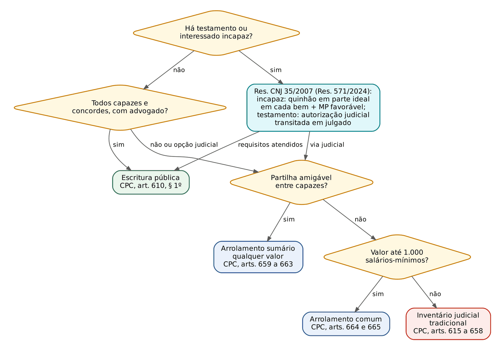
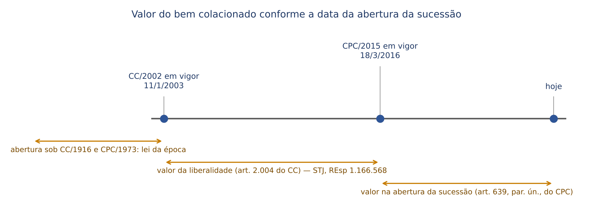
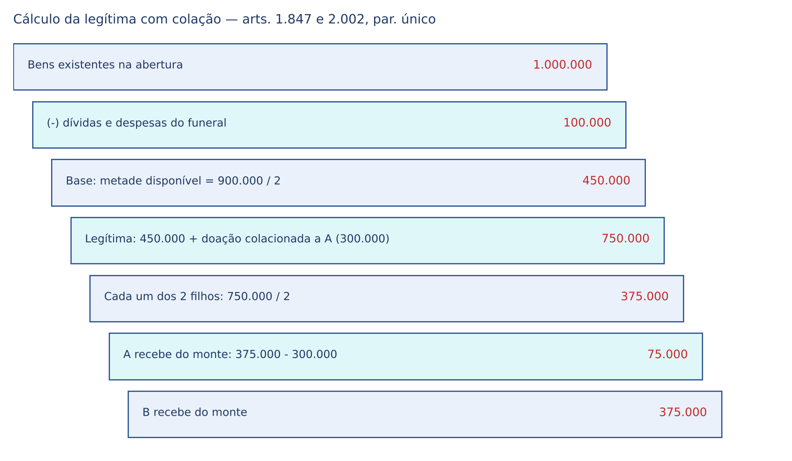

# CAPÍTULO 45 — SUCESSÕES IV: INVENTÁRIO E PARTILHA, SONEGADOS, PAGAMENTO DAS DÍVIDAS, COLAÇÃO, GARANTIA DOS QUINHÕES, ANULAÇÃO E RESCISÃO DA PARTILHA; DISPOSIÇÕES FINAIS E TRANSITÓRIAS DO CC

:::INCIDENCIA
TRF5 p. 14; TJRS p. 20; TJSC p. 21. Nível A. Lote: FGV 5, FCC 0 (todas de 2025 e 2026, quatro de magistratura).
Cai: colação (dispensa EXPRESSA, valor do bem colacionado, cômputo na legítima), sonegados (exigência de sentença), vias do inventário (extrajudicial com incapaz e com testamento após a Res. CNJ 571/2024), prazos de anulação da partilha e as regras de transição dos arts. 2.028 a 2.046.
:::

O capítulo cobre o Título IV do Livro V (arts. 1.991 a 2.027) e o Livro Complementar (arts. 2.028 a 2.046), com o CPC no que decide a aplicação do direito material (arts. 610 a 673). A abertura da sucessão, a *saisine*, a cessão de direitos hereditários, a aceitação e a renúncia, a petição de herança (Súmula 149 do STF e Tema 1.200 do STJ) e a herança digital estão no Cap. 42; a ordem de vocação e o cálculo dos quinhões, no Cap. 43; a redução das disposições testamentárias e a cláusula restritiva sobre a legítima, no Cap. 44; o ITCMD, na Apostila de Direito Tributário, Cap. 30.

## 45.1 Inventário: espólio, administração e inventariante

### 45.1.1 Função do inventário e o espólio

A herança transmite-se no instante da morte (art. 1.784, ver Cap. 42), mas como TODO unitário e indivisível até a partilha (art. 1.791). O inventário é o procedimento que descreve o acervo (ativo e passivo), apura e paga as dívidas, confere as doações sujeitas à colação, recolhe o tributo e, por fim, converte as quotas ideais em bens determinados. O espólio é essa universalidade de direito, ente despersonalizado com capacidade de ser parte (CPC, art. 75, VII), representado pelo inventariante.

Consequências que as provas exploram:

- Universalidade: não pode haver dois inventários do mesmo acervo; processos idênticos, com os mesmos herdeiros e bens do mesmo autor da herança, geram litispendência (Jurisprudência em Teses do STJ, ed. 246, tese 6).
- Até a partilha, quem responde pelas dívidas do falecido é o espólio, que tem legitimidade passiva (ed. 246, tese 5; CC, art. 1.997). Depois, os herdeiros, na proporção do quinhão (45.4).
- Regularizada a substituição processual do falecido pelo espólio, representado pelo inventariante, o herdeiro NÃO pode atuar paralelamente como terceiro interessado (ed. 246, tese 7). Em contrapartida, enquanto não aberto o inventário, os herdeiros têm legitimidade para agir diretamente em ações de direito real, por força da *saisine* (ed. 133, tese 3).
- Participações societárias integram o espólio desde o óbito; o inventariante as representa até a partilha, quando a titularidade passa a cada sucessor (ed. 247, tese 5).
- Após a partilha, se os coerdeiros mantêm voluntariamente o condomínio sobre imóvel, respondem SOLIDARIAMENTE pelas despesas condominiais, independentemente da expedição do formal, com regresso pelo art. 283 (ed. 241, tese 3).

### 45.1.2 Administração da herança: administrador provisório e inventariante

O CC divide a administração em duas fases. Da abertura até o compromisso do inventariante, administra o administrador provisório, na ordem do art. 1.797 (cônjuge ou companheiro que convivia com o falecido; herdeiro na posse e administração, preferindo o mais velho; testamenteiro; pessoa de confiança do juiz — detalhado no Cap. 42). Do compromisso até a homologação da partilha, administra o inventariante (art. 1.991).

O administrador provisório representa ativa e passivamente o espólio, traz ao acervo os frutos percebidos desde a abertura, tem direito ao reembolso das despesas necessárias e úteis e responde por dano a que der causa por dolo ou culpa (CPC, art. 614, que repete a estrutura do art. 2.020 do CC). O STJ afirma que ele representa judicialmente o espólio quando o inventário não foi ajuizado ou, ajuizado, não há inventariante compromissado (ed. 247, tese 1), e que o pedido de citação do administrador provisório não exige prévia diligência para provar a inexistência de inventário em curso (ed. 247, tese 4).

### 45.1.3 Prazo de abertura, multa estadual e legitimidade

:::LEI CPC, art. 611
Art. 611. O processo de inventário e de partilha deve ser instaurado dentro de 2 (dois) meses, a contar da abertura da sucessão, ultimando-se nos 12 (doze) meses subsequentes, podendo o juiz prorrogar esses prazos, de ofício ou a requerimento de parte.
:::

- O art. 1.796 do CC ainda fala em 30 dias "a contar da abertura da sucessão" e foi superado pelo CPC, norma posterior que regula integralmente o tema (prazo de 2 meses, já fixado pela Lei 11.441/2007 no CPC/1973). Questão que cite "30 dias" pede a letra do CC; em regra, a banca cobra os 2 meses do CPC. Pegadinha clássica: os 12 meses são contados dos 2 meses ("subsequentes"), não da morte.
- O prazo NÃO é peremptório nem gera extinção: o juiz prorroga de ofício. A sanção pelo atraso é tributária, prevista em lei estadual: "Não é inconstitucional a multa instituída pelo Estado-membro, como sanção pelo retardamento do início ou da ultimação do inventário" (Súmula 542 do STF). No inventário extrajudicial, a escritura pode ser lavrada a qualquer tempo, cabendo ao tabelião fiscalizar o recolhimento da multa prevista na lei estadual (Res. CNJ 35/2007, art. 31).
- Legitimidade: o requerimento incumbe a quem estiver na posse e administração do espólio (CPC, art. 615), com legitimidade CONCORRENTE do cônjuge ou companheiro, herdeiro, legatário, testamenteiro, cessionário, credor do herdeiro, do legatário ou do autor da herança, MP havendo herdeiros incapazes, Fazenda Pública quando tiver interesse e administrador judicial da falência (art. 616). O CPC/2015 suprimiu a abertura de ofício pelo juiz prevista no art. 989 do CPC/1973: alternativa que a admite está desatualizada.
- A legitimidade do credor do herdeiro para REQUERER o inventário não o converte em parte com atuação ampla (prestação de contas, regularização processual) (ed. 246, tese 4); e o credor individual do herdeiro, diferentemente do credor do espólio, não tem legitimidade para pedir habilitação de crédito no inventário (ed. 246, tese 3; CPC, art. 642).

### 45.1.4 Inventariante: nomeação, deveres e remoção

| Ordem | Inventariante (CPC, art. 617) | Ponto de prova |
|---|---|---|
| I | Cônjuge ou companheiro sobrevivente, desde que convivesse com o outro ao tempo da morte | separado de fato perde a preferência |
| II | Herdeiro na posse e administração do espólio, se não houver cônjuge ou companheiro ou se não puderem ser nomeados | |
| III | Qualquer herdeiro, se nenhum estiver na posse | |
| IV | Herdeiro com menos de 18 anos ("herdeiro menor", na letra da lei), por seu representante legal | inovação do CPC/2015 |
| V | Testamenteiro, se lhe foi confiada a administração ou se toda a herança estiver distribuída em legados | |
| VI | Cessionário do herdeiro ou do legatário | inovação do CPC/2015 |
| VII | Inventariante judicial, se houver | |
| VIII | Pessoa estranha idônea, se não houver inventariante judicial | dativo: não representa o espólio sozinho em juízo (art. 75, § 1º: herdeiros e sucessores intimados) |

A ordem é preferencial, não absoluta: o juiz pode afastá-la diante de litigiosidade ou inaptidão, em decisão fundamentada (orientação reiterada do STJ). O nomeado presta compromisso em 5 dias (parágrafo único) e as primeiras declarações em 20 dias do compromisso (art. 620).

Deveres. O art. 618 lista atos que o inventariante pratica sozinho (representar o espólio, administrar com a diligência que teria se os bens fossem seus, prestar declarações, exibir documentos, trazer à colação os bens do herdeiro ausente, renunciante ou excluído, prestar contas, requerer a insolvência). O art. 619 lista atos que dependem de oitiva dos interessados e AUTORIZAÇÃO JUDICIAL: alienar bens, transigir, pagar dívidas e fazer despesas de conservação e melhoramento. Distinções de prova:

- Contratar advogado para o inventário é ato de simples administração e independe de autorização judicial, ainda que o inventariante seja genitor da criança que herdará com exclusividade (ed. 246, tese 8).
- Honorários do advogado contratado pelo espólio são, em regra, despesa do espólio; havendo interesses antagônicos entre herdeiros, incidem só sobre o quinhão de quem contratou (ed. 246, tese 9).
- O inventariante tem capacidade de representação para pleitear a anulação de doações feitas pelo falecido (ed. 247, tese 2).
- Não cabe prisão civil do inventariante pelo descumprimento, pelo espólio, do dever de prestar alimentos (Jurisprudência em Teses, ed. 77, tese 6; alimentos e transmissibilidade no Cap. 39).
- No extrajudicial, a escritura nomeia obrigatoriamente interessado com poderes de inventariante, sem necessidade de seguir a ordem do art. 617; a nomeação pode constar de escritura anterior à partilha e marca o termo inicial do inventário extrajudicial (Res. CNJ 35/2007, art. 11, §§ 1º e 3º). Desde a Res. CNJ 571/2024, o inventariante pode ser autorizado por escritura a ALIENAR bens do espólio, sem autorização judicial, para custear as despesas do inventário, com vinculação do preço, garantia real ou fidejussória e prazo máximo de 1 ano para o pagamento (art. 11-A).

Remoção (CPC, art. 622): de ofício ou a requerimento, se não prestar as declarações no prazo, não der andamento regular ou praticar atos protelatórios, deixar deteriorar bens por culpa, não defender o espólio ou não cobrar dívidas ativas, não prestar contas ou tê-las rejeitadas, ou sonegar, ocultar ou desviar bens. O incidente corre em apenso, com 15 dias de defesa (art. 623); o removido entrega os bens sob pena de busca e apreensão ou imissão na posse e multa não superior a 3% do valor dos bens inventariados (art. 625). O inventariante sonegador sofre DUPLA sanção: perda do direito sobre os bens (se herdeiro) e remoção (CC, art. 1.993).

:::PEGADINHA Rol do art. 622 é de remoção, não de destituição automática
A remoção exige contraditório (art. 623), mas pode ser decretada DE OFÍCIO. Alternativa que exija requerimento de herdeiro está errada; também está errada a que afirme que o removido perde automaticamente a qualidade de herdeiro: a perda do direito sobre bens é pena de sonegados e depende de ação própria (45.3).
:::

### 45.1.5 Juízo do inventário e questões de alta indagação

O juiz do inventário decide todas as questões de direito e as de fato provadas por documento; remete às vias ordinárias só as que dependerem de OUTRAS provas (CPC, art. 612). A regra se desdobra:

- Disputa sobre a qualidade de herdeiro que exija prova não documental: remessa às vias ordinárias e sobrestamento da entrega do quinhão (art. 627, § 3º).
- Herdeiro preterido: pede admissão ANTES da partilha (art. 628); se a questão exigir outras provas, o juiz reserva o quinhão em poder do inventariante até a decisão (§ 2º).
- Negativa de colação com necessidade de dilação probatória: o herdeiro não recebe o quinhão sem caução (art. 641, § 2º).
- Tutela provisória dessas seções cessa se a ação não for proposta em 30 dias da intimação do impugnante, do herdeiro excluído ou do credor não admitido (art. 668, I).

União estável do falecido demonstrável por documentos pode ser reconhecida no próprio inventário; havendo controvérsia que exija prova oral, remete-se às vias ordinárias (aplicação do art. 612; requisitos no Cap. 35).

## 45.2 Vias e ritos do inventário

### 45.2.1 Inventário extrajudicial

:::LEI CPC, art. 610
Art. 610. Havendo testamento ou interessado incapaz, proceder-se-á ao inventário judicial.
§ 1º Se todos forem capazes e concordes, o inventário e a partilha poderão ser feitos por escritura pública, a qual constituirá documento hábil para qualquer ato de registro, bem como para levantamento de importância depositada em instituições financeiras.
§ 2º O tabelião somente lavrará a escritura pública se todas as partes interessadas estiverem assistidas por advogado ou por defensor público, cuja qualificação e assinatura constarão do ato notarial.
:::

A via extrajudicial é FACULTATIVA ("poderão"): os interessados podem optar pela judicial e, a qualquer momento, pedir a suspensão por 30 dias ou desistir da judicial para promover a extrajudicial (Res. CNJ 35/2007, art. 2º). Não há homologação judicial: a escritura é título hábil para registro civil e imobiliário, DETRAN, Junta Comercial e levantamento de valores (art. 3º). A escolha do tabelião é livre, sem regras de competência do CPC (art. 1º). Advogado ou defensor é indispensável, dispensada a procuração (art. 8º).

A Res. CNJ 571, de 26/8/2024, flexibilizou o art. 610, *caput*, em dois pontos que já caem em prova:

| Situação | Requisitos para a escritura (Res. CNJ 35/2007, redação de 2024) |
|---|---|
| Interessado criança, adolescente ou incapaz (art. 12-A) | pagamento do quinhão ou da meação em PARTE IDEAL em cada um dos bens inventariados; manifestação FAVORÁVEL do MP, da qual depende a eficácia da escritura (§ 3º); vedados atos de disposição sobre os bens do incapaz (§ 1º); nascituro do autor da herança: aguarda-se o registro do nascimento ou a prova de que não nasceu com vida (§ 2º); impugnação do MP ou de terceiro leva ao juiz (§ 4º) |
| Testamento (art. 12-B) | todos representados por advogado; autorização EXPRESSA do juízo sucessório em ação de abertura e cumprimento de testamento, por sentença transitada em julgado; todos capazes e concordes (ou observado o art. 12-A); testamento invalidado, revogado, rompido ou caduco reconhecido por sentença transitada; se o testamento reconhecer filho ou contiver outra declaração irrevogável, a via judicial é OBRIGATÓRIA (§ 1º) |

Outras regras da Resolução, cobradas como letra: admite-se inventário negativo por escritura (art. 28); a existência de credores do espólio não impede a escritura (art. 27); herdeiro único gera escritura de inventário e ADJUDICAÇÃO (art. 26); cessionário de direitos hereditários pode promover o inventário extrajudicial, mesmo com cessão de parte do acervo, se todos os herdeiros estiverem presentes e concordes (art. 16); os cônjuges dos herdeiros comparecem quando houver renúncia ou partilha que importe transmissão, salvo separação absoluta (art. 17); o convivente é herdeiro na escritura se a união for reconhecida pelos demais sucessores ou, sendo ele o único sucessor, se estiver previamente reconhecida e registrada (art. 18); admite-se sobrepartilha por escritura ainda que o inventário tenha sido judicial e que o herdeiro, hoje capaz, fosse incapaz ao tempo do processo (art. 25); é VEDADA escritura de inventário de bens situados no exterior (art. 29); e o tabelião pode recusar a escritura, por escrito, diante de fundados indícios de fraude ou simulação (art. 32, § 2º). Pela redação dada pela Res. CNJ 695, de 26/8/2026, a lavratura NÃO se condiciona ao prévio recolhimento do ITCMD: o tabelião consigna a ciência das partes sobre a obrigação tributária e, sem recolhimento prévio, comunica a escritura ao fisco em 5 dias (art. 15).

:::ATENCAO Resolução x CPC
O art. 610, *caput*, do CPC continua a dizer que, havendo testamento ou incapaz, o inventário será judicial. A ampliação veio por ato normativo do CNJ. Em prova objetiva, siga o comando: "segundo o CPC" (judicial obrigatório) ou "segundo as normas do CNJ" (extrajudicial possível nas condições dos arts. 12-A e 12-B). Parte da doutrina questiona a legalidade da ampliação por resolução; o tema não foi decidido em precedente qualificado até a data desta apostila (ver nota de verificação).
:::

### 45.2.2 Ritos judiciais

| Rito | Cabimento | Traços que caem |
|---|---|---|
| Inventário tradicional (arts. 615 a 658) | regra residual; litígio, incapaz sem acordo, valor acima de 1.000 salários-mínimos sem partilha amigável | primeiras declarações em 20 dias; citações e 15 dias para impugnar; avaliação; últimas declarações; cálculo do imposto; partilha por sentença |
| Arrolamento sumário (arts. 659 a 663) | partilha amigável entre partes CAPAZES, QUALQUER valor; também adjudicação a herdeiro único | homologação de plano; sem termos; sem avaliação (salvo reserva para credor que impugne a estimativa); o juízo não conhece questões de tributos de transmissão (art. 662) |
| Arrolamento comum (arts. 664 e 665) | bens de valor igual ou inferior a 1.000 salários-mínimos; vale mesmo com interessado incapaz se todas as partes e o MP concordarem (art. 665) | inventariante apresenta valor e plano de partilha sem termo de compromisso; impugnada a estimativa, avaliador em 10 dias; audiência; tributos provados antes do julgamento |
| Alvará (art. 666; Lei 6.858/1980) | valores do FGTS, PIS-PASEP, restituições de tributos, saldos bancários de pequeno valor, conforme a lei | independe de inventário ou arrolamento; admite também escritura (Res. CNJ 35/2007, art. 14) |

No arrolamento sumário, a homologação da partilha ou da adjudicação e a expedição do formal NÃO se condicionam ao prévio recolhimento do ITCMD, mas exige-se a prova de quitação dos tributos relativos aos bens do espólio e às suas rendas (art. 659, § 2º; ed. 241, tese 1); e o juízo não tem competência para reconhecer isenção de ITCMD (ed. 241, tese 2). Desenvolvimento tributário: Apostila de Direito Tributário, Cap. 30.

Cumulação de inventários (art. 672): permitida com identidade de pessoas entre as quais se repartem os bens, heranças de ambos os cônjuges ou companheiros, ou dependência de uma partilha em relação à outra. Curador especial: ao ausente sem representante e ao incapaz que concorra na partilha com seu representante havendo colisão de interesses (art. 671).

:::PROCESSO Prazos do inventário tradicional (CPC)
| Ato | Prazo | Artigo |
|---|---|---|
| Instauração | 2 meses da abertura da sucessão | 611 |
| Conclusão | 12 meses subsequentes (prorrogáveis de ofício) | 611 |
| Compromisso do inventariante | 5 dias da intimação | 617, parágrafo único |
| Primeiras declarações | 20 dias do compromisso | 620 |
| Impugnação às primeiras declarações (erros, omissões, sonegação; nomeação do inventariante; qualidade de herdeiro) | 15 dias comuns após as citações | 627 |
| Conferência dos bens pelo herdeiro obrigado à colação | no prazo do art. 627 | 639 |
| Defesa na remoção | 15 dias | 623 |
| Manifestação sobre o cálculo do imposto | 5 dias comuns | 638 |
| Pedido de quinhão | 15 dias comuns | 647 |
| Propositura da ação após remessa às vias ordinárias | 30 dias, sob pena de cessar a tutela | 668, I |
| Ação de cobrança do credor com bens reservados | 30 dias (CC, art. 1.997, § 2º) | |
:::

Bens no exterior: a sucessão de bens situados no exterior não se submete à lei brasileira, inclusive para compensação de legítimas (STJ, Informativo de Jurisprudência n. 23, Edição Extraordinária, Terceira Turma, j. 27/8/2024); a competência exclusiva da autoridade brasileira para inventário e partilha de bens situados no Brasil (CPC, art. 23, II) e a eficácia da lei estrangeira estão no Cap. 1.

## 45.3 Sonegados

### 45.3.1 Conceito, sujeitos e momento

:::LEI Código Civil, arts. 1.992 e 1.994
Art. 1.992. O herdeiro que sonegar bens da herança, não os descrevendo no inventário quando estejam em seu poder, ou, com o seu conhecimento, no de outrem, ou que os omitir na colação, a que os deva levar, ou que deixar de restituí-los, perderá o direito que sobre eles lhe cabia.
Art. 1.994. A pena de sonegados só se pode requerer e impor em ação movida pelos herdeiros ou pelos credores da herança.
Parágrafo único. A sentença que se proferir na ação de sonegados, movida por qualquer dos herdeiros ou credores, aproveita aos demais interessados.
:::

Sonegação é a ocultação dolosa de bens que deveriam ser inventariados ou colacionados. Três condutas típicas: não descrever bens em seu poder (ou, com seu conhecimento, em poder de outrem), omiti-los na colação e deixar de restituí-los. O elemento subjetivo é decisivo: a doutrina majoritária e a jurisprudência exigem DOLO (intenção de subtrair o bem da partilha); sem prova do dolo, não se aplica a pena, mas o bem omitido vai à sobrepartilha (orientação do STJ desde o REsp 163.195/SP, Quarta Turma, citado em doutrina). Omissão culposa ou por divergência razoável sobre a natureza do bem resolve-se pela sobrepartilha, sem pena.

Momento para arguir (art. 1.996; CPC, art. 621): contra o INVENTARIANTE, só depois de encerrada a descrição dos bens, com a declaração, por ele feita, de não existirem outros por inventariar (em regra, as últimas declarações); contra o HERDEIRO, depois de declarar no inventário que não possui os bens. Antes disso, a omissão ainda pode ser corrigida, e não há sonegação consumada.

| Sujeito ativo da sonegação | Sanção | Fundamento |
|---|---|---|
| Herdeiro | perde o direito que lhe cabia sobre o bem sonegado | art. 1.992 |
| Herdeiro que também é inventariante | perda do direito + REMOÇÃO | arts. 1.992 e 1.993; CPC, art. 622, VI |
| Inventariante não herdeiro (dativo, testamenteiro) | só remoção (não tem direito a perder) | art. 1.993 |
| Cônjuge meeiro não herdeiro | não perde a meação (que não é herança); responde pela restituição e por perdas e danos; se for herdeiro em concorrência, perde o direito HEREDITÁRIO sobre o bem | interpretação dos arts. 1.992 e 1.995 (posição dominante na doutrina) |
| Sonegador que já não tem o bem | paga o valor ocultado + perdas e danos | art. 1.995 |

### 45.3.2 Ação de sonegados

- Legitimidade ATIVA: herdeiros e credores da herança (art. 1.994). O MP e a Fazenda não figuram no rol. A sentença aproveita aos demais interessados (parágrafo único), efeito expansivo que a FGV cobra literalmente.
- Natureza: ação de conhecimento, pelo procedimento comum, distinta do inventário; a pena NÃO se aplica por simples decisão no inventário.
- Efeito: os bens restituídos vão à sobrepartilha (art. 2.022; CPC, art. 669, I), partilhando-se entre os demais o quinhão que caberia ao sonegador sobre eles.
- Prescrição: não há prazo específico; aplica-se o prazo geral de 10 anos (art. 205), com termo inicial na ciência inequívoca da ocultação. Regra prática: o prazo corre das últimas declarações em que o inventariante afirma não haver outros bens; mas o STJ, aplicando a *actio nata* subjetiva, decidiu que, se a titularidade do bem dependia de ação de bens reservados, a prescrição só corre do trânsito em julgado da sentença que declarou que o bem não pertencia exclusivamente a quem o registrou, e não da citação nem de indícios surgidos em audiência (REsp 1.698.732, Terceira Turma, Rel. Min. Nancy Andrighi, notícia do STJ de 3/8/2020).

:::QUESTAO FGV 2026 — TJ-MS — Outorga de Delegações de Notas e de Registro (Q3914290)
Gabarito: D (II e III). Para este capítulo, o item III: a pena de sonegados "só se pode requerer e impor em ação" (art. 1.994) (questão comentada por inteiro no Cap. 42).
:::

:::DICA Sonegados x sobrepartilha x remoção
Sonegados é PENA (exige dolo e ação própria); sobrepartilha é PROCEDIMENTO para bens descobertos depois (com ou sem dolo); remoção é medida ADMINISTRATIVA do processo de inventário (incidente em apenso, de ofício). Um mesmo fato pode desencadear os três.
:::

## 45.4 Pagamento das dívidas

### 45.4.1 Responsabilidade do espólio e dos herdeiros

:::LEI Código Civil, art. 1.997
Art. 1.997. A herança responde pelo pagamento das dívidas do falecido; mas, feita a partilha, só respondem os herdeiros, cada qual em proporção da parte que na herança lhe coube.
§ 1º Quando, antes da partilha, for requerido no inventário o pagamento de dívidas constantes de documentos, revestidos de formalidades legais, constituindo prova bastante da obrigação, e houver impugnação, que não se funde na alegação de pagamento, acompanhada de prova valiosa, o juiz mandará reservar, em poder do inventariante, bens suficientes para solução do débito, sobre os quais venha a recair oportunamente a execução.
§ 2º No caso previsto no parágrafo antecedente, o credor será obrigado a iniciar a ação de cobrança no prazo de trinta dias, sob pena de se tornar de nenhum efeito a providência indicada.
:::

A responsabilidade é *intra vires hereditatis*: o herdeiro não responde por encargos superiores às forças da herança; incumbe-lhe, porém, a prova do excesso, salvo se houver inventário que a escuse, demonstrando o valor dos bens herdados (art. 1.792). Duas fases:

- Antes da partilha: responde o PATRIMÔNIO do espólio, como um todo.
- Depois da partilha: responde cada herdeiro, PROPORCIONALMENTE ao quinhão recebido, e não solidariamente. O art. 1.999 completa: na ação regressiva entre coerdeiros, a parte do insolvente divide-se proporcionalmente entre os demais.

Regras complementares:

- Despesas funerárias saem do monte, haja ou não herdeiros legítimos; as de sufrágios por alma do falecido só obrigam a herança se ordenadas em testamento ou codicilo (art. 1.998). Pegadinha: "missas" e sufrágios NÃO são despesas funerárias.
- Separação de patrimônios: legatários e credores da herança podem exigir que se discrimine o patrimônio do falecido do patrimônio do herdeiro e, em concurso com os credores deste, têm preferência (art. 2.000). Os credores do herdeiro, por sua vez, só alcançam o quinhão do devedor; podem aceitar a herança renunciada em fraude (art. 1.813; Cap. 42).
- Herdeiro devedor do espólio: a dívida é partilhada IGUALMENTE entre todos, salvo se a MAIORIA consentir que o débito seja imputado inteiramente no quinhão do devedor (art. 2.001). Pegadinha: a regra supletiva é a partilha do crédito, não a compensação automática.
- Legítima: calcula-se sobre os bens existentes na abertura, ABATIDAS as dívidas e as despesas do funeral, adicionando-se em seguida o valor dos bens sujeitos à colação (art. 1.847; ver 45.5.6).
- Ordem do esboço de partilha: dívidas atendidas; meação do cônjuge; meação disponível; quinhões hereditários, a começar pelo coerdeiro mais velho (CPC, art. 651).

### 45.4.2 Habilitação de créditos no inventário (CPC, arts. 642 a 646)

| Hipótese | Consequência |
|---|---|
| Credor do espólio com dívida vencida e exigível, prova literal, todas as partes concordam | habilitação; separação de dinheiro ou bens; alienação, ou adjudicação ao credor se todos concordarem (art. 642, §§ 2º a 4º) |
| Não há concordância de todas as partes | remessa às vias ordinárias (art. 643) |
| ... mas a dívida consta de documento que comprova suficientemente a obrigação e a impugnação não se funda em quitação | o juiz RESERVA bens em poder do inventariante (art. 643, parágrafo único; CC, art. 1.997, § 1º); o credor propõe a ação em 30 dias (CC, art. 1.997, § 2º; CPC, art. 668, I) |
| Dívida líquida e certa ainda NÃO vencida | também admite habilitação; com concordância, separação de bens para o futuro pagamento (art. 644) |
| Dívida que pode reduzir liberalidades | donatários são chamados a se pronunciar (art. 642, § 5º) |
| Legatário | é parte para se manifestar sobre as dívidas quando toda a herança for dividida em legados ou quando o reconhecimento importar redução dos legados (art. 645) |

A habilitação é FACULTATIVA: o credor pode preferir executar ou cobrar diretamente o espólio. A existência de credores não impede a homologação da partilha no arrolamento, se reservados bens suficientes (art. 663), nem a escritura (Res. CNJ 35/2007, art. 27).

:::PEGADINHA Duas diferenças de letra entre CC e CPC
O CC (art. 1.997, § 1º) manda reservar bens quando a impugnação "não se funde na alegação de pagamento, acompanhada de prova valiosa"; o CPC (art. 643, parágrafo único) fala em impugnação que "não se fundar em quitação". O prazo para o credor ajuizar a ação é de 30 dias nos dois diplomas. E é o credor DO ESPÓLIO quem se habilita; o credor do herdeiro, não (ed. 246, tese 3).
:::

Correlata: FGV 2025 — TJ-GO — Residente Jurídico (Q3345932, Cap. 43), gabarito C: herança de 900.000 (novecentos mil) reais, com credores habilitados por 200.000 (duzentos mil) reais; a herança divide-se por estirpe (dois filhos e, por representação, os netos filhos do pré-morto), mas as dívidas do falecido são pagas ANTES da partilha. As dívidas do pai pré-morto dos netos não afetam a representação (os netos herdam do avô, não do pai).

## 45.5 Colação

### 45.5.1 Conceito e finalidade

:::LEI Código Civil, arts. 2.002 e 2.003
Art. 2.002. Os descendentes que concorrerem à sucessão do ascendente comum são obrigados, para igualar as legítimas, a conferir o valor das doações que dele em vida receberam, sob pena de sonegação.
Parágrafo único. Para cálculo da legítima, o valor dos bens conferidos será computado na parte indisponível, sem aumentar a disponível.
Art. 2.003. A colação tem por fim igualar, na proporção estabelecida neste Código, as legítimas dos descendentes e do cônjuge sobrevivente, obrigando também os donatários que, ao tempo do falecimento do doador, já não possuírem os bens doados.
Parágrafo único. Se, computados os valores das doações feitas em adiantamento de legítima, não houver no acervo bens suficientes para igualar as legítimas dos descendentes e do cônjuge, os bens assim doados serão conferidos em espécie, ou, quando deles já não disponha o donatário, pelo seu valor ao tempo da liberalidade.
:::

A doação de ascendente a descendente, ou de um cônjuge a outro, importa adiantamento do que lhes cabe por herança (art. 544; Cap. 17). Por isso é VÁLIDA sem consentimento dos demais herdeiros (diferente da venda do art. 496), e o equilíbrio se restabelece no inventário pela colação: o donatário "confere" o valor recebido, que se soma à legítima e é imputado no seu quinhão. A colação não é ação de invalidade: pressupõe doação válida.

:::QUESTAO FGV 2026 — ENAM 2026.1 (Q4102446)
Mãe com outros imóveis de valor superior doou o sítio ao filho que a visitava, sem dispensa de colação, e morreu; o outro filho quer impugnar a validade da doação. Gabarito: E — sem dispensa expressa, a doação importa adiantamento do que cabe ao donatário por herança e deve ser colacionada.
Passos: (1) doação a descendente não exige consentimento dos demais (A e B, que falam em anulabilidade ou nulidade por falta de anuência, transportam para a doação a regra da VENDA do art. 496); (2) não há fraude à lei nem violação da legítima, porque a doação, além de não ser inoficiosa (outros bens de valor superior), será compensada na partilha (C); (3) a dispensa de colação NÃO se presume (D inverte o art. 2.005; ver 45.5.4).
:::

### 45.5.2 Quem colaciona e em favor de quem

| Pessoa | Deve colacionar? | Fundamento |
|---|---|---|
| Descendente donatário que concorre à sucessão do ascendente comum | sim | art. 2.002 |
| Neto que herda por representação | sim, o que o pai premorto teria de conferir, ainda que não o tenha herdado | art. 2.009 |
| Neto donatário que, ao tempo da doação, não seria chamado como herdeiro necessário (o pai estava vivo) | não: presume-se imputada na disponível | art. 2.005, parágrafo único |
| Herdeiro renunciante ou excluído | não colaciona para igualar, mas confere para REPOR o que exceder o disponível | art. 2.008; CPC, art. 640 |
| Cônjuge sobrevivente donatário | controvertido: o art. 2.002 fala só em descendentes, mas o art. 544 trata a doação entre cônjuges como adiantamento e o art. 2.003 inclui o cônjuge entre os beneficiários da igualação; parte da doutrina sustenta o dever quando o cônjuge concorre com descendentes | arts. 544, 2.002 e 2.003 |
| Doação feita por AMBOS os cônjuges | confere-se por metade no inventário de cada um | art. 2.012 |

Beneficiários da igualação: descendentes e cônjuge sobrevivente que concorra com eles (art. 2.003). Credores e legatários não podem exigir colação (ela serve só para igualar legítimas), mas podem ser afetados pela redução das inoficiosas.

Filho nascido depois da doação também pode exigir a colação do irmão donatário: a igualdade das legítimas é aferida na abertura da sucessão (notícia do STJ de 26/8/2015, Terceira Turma, "Terceira Turma admite colação de bens exigida por filho nascido após doação do patrimônio").

### 45.5.3 O que não se colaciona

- Gastos ordinários do ascendente com o descendente "enquanto menor" (educação, estudos, sustento, vestuário, tratamento nas enfermidades, enxoval), despesas de casamento e as feitas para sua defesa em processo-crime (art. 2.010). Pegadinha: a letra fala em "enquanto menor"; gastos extraordinários com filho maior podem ser colacionáveis.
- Doações remuneratórias de serviços feitos ao ascendente (art. 2.011), no que correspondam ao valor do serviço; o excedente é liberalidade e respeita a legítima (ed. 247, tese 9: não se admite doação universal sob rótulo de remuneratória).
- Benfeitorias acrescidas pelo donatário, rendimentos e lucros (que lhe pertencem), bem como danos e perdas sofridos pelo bem (correm por sua conta) (art. 2.004, § 2º).
- Bens transferidos ao filho em pagamento de obrigação alimentar: são dação em pagamento, não adiantamento de herança, e não se colacionam (STJ, AgInt no REsp 2.049.637-RJ, Quarta Turma, Rel. Min. Maria Isabel Gallotti, j. 18/8/2026, Informativo 900).
- Ocupação gratuita de imóvel do falecido pelo herdeiro necessário: o STJ entendeu prescindível a colação do valor do uso (julgado de 2019 noticiado em repositório de informativos; número não conferido — ver nota).

:::QUESTAO FGV 2026 — TRF2 — Juiz Federal Substituto (Q3996851)
Pai de 82 anos assinou confissão de dívida de 800.000 (oitocentos mil) reais em favor de um dos filhos e lhe transferiu imóvel em dação em pagamento; reconhecida a simulação e convertido o negócio em doação (art. 167), pergunta-se sobre a colação. Gabarito: E — presume-se adiantamento de legítima, pois a dispensa exige declaração formal e expressa de que a liberalidade sai da disponível.
É o caso do REsp 2.171.573-MS (Quarta Turma, Rel. Min. Antonio Carlos Ferreira, j. 11/2/2025, Informativo 841): o tribunal local, depois de reconhecer a simulação, havia computado a doação na disponível; o STJ reformou, porque a dispensa não se extrai da conduta do doador. As alternativas A a D inventam presunção de disponibilidade com teto de 50% do patrimônio em datas diversas: não há presunção nenhuma, e a aferição do excesso é sempre pelo valor ao tempo da liberalidade (arts. 2.005 e 2.007). A simulação e o aproveitamento do dissimulado estão no Cap. 9.
:::

### 45.5.4 Dispensa da colação

:::LEI Código Civil, arts. 2.005 e 2.006
Art. 2.005. São dispensadas da colação as doações que o doador determinar saiam da parte disponível, contanto que não a excedam, computado o seu valor ao tempo da doação.
Parágrafo único. Presume-se imputada na parte disponível a liberalidade feita a descendente que, ao tempo do ato, não seria chamado à sucessão na qualidade de herdeiro necessário.
Art. 2.006. A dispensa da colação pode ser outorgada pelo doador em testamento, ou no próprio título de liberalidade.
:::

Três requisitos: (i) manifestação EXPRESSA do doador; (ii) FORMA: no próprio título da liberalidade OU em testamento (posterior, inclusive); (iii) LIMITE: a doação dispensada deve caber na disponível, computado o valor ao tempo da doação. O excesso sujeita-se à redução (art. 2.007). A única presunção legal de imputação na disponível é a do parágrafo único do art. 2.005 (descendente que, ao tempo do ato, não seria herdeiro necessário, como o neto com o pai vivo).

:::QUESTAO FGV 2026 — TJ-MS — Outorga de Delegações de Notas e de Registro (Q3914292)
Doações a dois filhos (imóvel de 800.000 (oitocentos mil) reais em 2010; dinheiro, 500.000 (quinhentos mil) reais em 2015); testamento de 2018 dispensou expressamente da colação a doação ao primeiro. Gabarito: C — a dispensa é válida, mas o valor da doação deve ser computado para verificar se não excedeu a parte disponível ao tempo da liberalidade.
Erros: A (dispensa "somente" no mesmo instrumento: o art. 2.006 admite testamento); B (dinheiro também se colaciona: o que se confere é o valor de qualquer doação); D (a vontade do testador não afasta o limite da disponível, art. 2.005); E (não há regra que restrinja a dispensa à ausência de cônjuge concorrente).
:::

:::PEGADINHA Dispensa x doação "da disponível" presumida
"Doação feita a filho por pai com muitos outros bens presume-se da disponível" está ERRADO: a riqueza do doador não gera presunção (Q4102446). "A dispensa pode ser tácita" está ERRADO (Informativo 841). "A dispensa só vale se constar da escritura de doação" está ERRADO (art. 2.006: também por testamento).
:::

### 45.5.5 Valor do bem colacionado: a antinomia CC x CPC

É o ponto mais controvertido do capítulo, e a FGV já o cobrou de magistratura.

| Diploma | Regra |
|---|---|
| CC/2002, art. 2.004, *caput* e § 1º | valor "certo ou estimativo" atribuído no ato de liberalidade; sem valor no ato, o que se calcular valessem ao tempo da liberalidade |
| CC/2002, art. 2.003, parágrafo único | sem bens suficientes no acervo, colação em ESPÉCIE; se o donatário já não tiver o bem, pelo valor ao tempo da liberalidade |
| CPC/1973, art. 1.014, parágrafo único, e CPC/2015, art. 639, parágrafo único | os bens a conferir, "assim como as acessões e as benfeitorias que o donatário fez, calcular-se-ão pelo valor que tiverem ao tempo da abertura da sucessão" |

:::LEI CPC, art. 639, parágrafo único
Os bens a serem conferidos na partilha, assim como as acessões e as benfeitorias que o donatário fez, calcular-se-ão pelo valor que tiverem ao tempo da abertura da sucessão.
:::

Leituras:

- Critério intertemporal (aplica-se a lei vigente ao tempo da abertura da sucessão; entre leis vigentes, prevalece a posterior). O STJ, para sucessão aberta em 2004, resolveu a antinomia entre o art. 1.014 do CPC/1973 e o art. 2.004 do CC/2002 pela lei mais nova então vigente, o CC: "O valor de colação dos bens doados deverá ser aquele atribuído ao tempo da liberalidade", corrigido monetariamente até a abertura da sucessão (REsp 1.166.568-SP, Quarta Turma, Rel. Des. conv. Lázaro Guimarães, j. 12/12/2017, Informativo 617). Pela mesma lógica, para sucessões abertas a partir de 18/3/2016, prevalece o art. 639, parágrafo único, do CPC/2015, lei posterior ao CC: valor na abertura da sucessão.
- Leitura conciliatória (Enunciado 119 da I Jornada, antes do CPC/2015, e Enunciado 644 da VIII Jornada, depois dele): se o donatário ainda tem o bem, colaciona-se pelo valor atual na abertura da sucessão; se já não o tem, pelo valor do tempo da alienação (Enunciado 644) ou da doação (Enunciado 119), corrigido. A ideia é evitar enriquecimento sem causa e preservar a legítima tal como existe na morte (art. 1.847).
- Pela prevalência do CC, como norma de direito material especial, há também quem sustente o art. 2.004 mesmo após 2016. Até a conclusão desta apostila, não se localizou precedente da Segunda Seção que pacifique a questão para sucessões abertas sob o CPC/2015; o PL 4/2025 (reforma do CC, não aprovado) propõe resolver a divergência.

:::QUESTAO FGV 2025 — TJ-SE — Juiz Substituto (Q3301223)
Doações a três filhos em 1997 (apartamento), 2007 (haras) e 2017 (carro); morte do doador em 2019. Gabarito: B — em todos os casos, o valor dos bens ao tempo da abertura da sucessão.
Passos: (1) o que define a lei aplicável à colação é a data da ABERTURA da sucessão, não a data de cada doação (por isso as alternativas C, D e E, que fatiam o critério por data de doação, estão erradas); (2) aberta a sucessão em 2019, já vigorava o CPC/2015, cujo art. 639, parágrafo único, posterior ao CC, manda calcular pelo valor na abertura; (3) a alternativa A reproduz o critério do REsp 1.166.568 (valor da liberalidade corrigido), que se aplicou a sucessão aberta em 2004, antes do CPC/2015. Gabarito coerente com a leitura intertemporal; discutível para quem defende a prevalência do art. 2.004 ou a solução do Enunciado 644 (ver nota).
:::

Benfeitorias e acessões: pelo CC (art. 2.004, § 2º), só o valor do bem doado entra em colação, não as benfeitorias acrescidas pelo donatário; o CPC menciona as acessões e benfeitorias apenas para dizer que também se calculam pelo valor da abertura. A conciliação dominante: avalia-se o bem na abertura da sucessão DESCONTADO o valor agregado pelo donatário, que lhe pertence.

### 45.5.6 Efeito da colação no cálculo da legítima

O valor conferido é computado na parte INDISPONÍVEL, "sem aumentar a disponível" (art. 2.002, parágrafo único). Roteiro: (1) bens existentes na abertura; (2) menos dívidas e despesas do funeral; (3) metade é a disponível, calculada SEM as doações colacionadas; (4) a legítima é a outra metade MAIS o valor colacionado (art. 1.847); (5) divide-se a legítima entre os herdeiros necessários; (6) o donatário recebe do monte a diferença entre seu quinhão e o que já recebeu.

No exemplo da escada, o autor da herança deixa 1.000.000 (um milhão de) reais em bens e 100.000 (cem mil) reais em dívidas, e havia doado 300.000 (trezentos mil) reais ao filho A, sem dispensa. A disponível é 450.000 (quatrocentos e cinquenta mil) reais e não muda com a colação; a legítima é 750.000 (setecentos e cinquenta mil) reais; cada filho tem 375.000 (trezentos e setenta e cinco mil) reais; A recebe só 75.000 (setenta e cinco mil) reais do monte e B, 375.000. A disponível (450.000) segue o testamento ou, sem ele, é partilhada entre os herdeiros legítimos. Se a doação a A fosse de 1.000.000 com dispensa, haveria excesso sobre a disponível, aferido ao tempo da liberalidade, sujeito à redução (45.5.7).

Se o acervo não bastar para igualar, a conferência faz-se em ESPÉCIE (o bem volta ao monte) ou, se o donatário não o tiver mais, pelo valor (art. 2.003, parágrafo único). O donatário que deve repor parte inoficiosa pode escolher, dentre os bens doados, os que bastem para perfazer a legítima e a metade disponível; recaindo o excesso sobre imóvel indivisível, faz-se licitação entre os herdeiros, com preferência do donatário em igualdade de condições (CPC, art. 640, §§ 1º a 3º).

### 45.5.7 Colação x redução

| Aspecto | Colação | Redução da doação inoficiosa |
|---|---|---|
| Finalidade | igualar as legítimas entre descendentes (e cônjuge) | proteger a legítima contra liberalidade excessiva |
| Quem é atingido | só herdeiros necessários donatários (adiantamento) | qualquer donatário, herdeiro ou estranho |
| Pressuposto | doação sem dispensa (ou com dispensa só no excesso) | excesso sobre o que o doador podia dispor no momento da liberalidade (arts. 549 e 2.007, § 1º) |
| Sede | no inventário, por termo ou petição (CPC, art. 639) | ação de redução (cabível em vida do doador; prazo decenal do registro — Cap. 17) e, no inventário, reposição do excesso (art. 2.007, § 2º) |
| Ordem | não há | várias doações a herdeiros necessários: reduzem-se a partir da ÚLTIMA (art. 2.007, § 4º) |
| Renunciante ou excluído | não colaciona para igualar | confere para repor o excesso (art. 2.008) |

Reposição do excesso: em espécie ou, se o bem já não existir em poder do donatário, em dinheiro pelo valor ao tempo da abertura da sucessão (art. 2.007, § 2º). Note a assimetria literal: a apuração do excesso usa o valor da liberalidade (§ 1º); a restituição em dinheiro usa o valor da abertura (§ 2º).

:::QUESTAO FGV 2026 — TJ-PR — Juiz Substituto (Q3898898)
Patrimônio de 2.000.000 (dois milhões de) reais em bens particulares; viúva em comunhão parcial e dois filhos; testamento distribuiu todo o patrimônio (imóvel ao filho com inalienabilidade, incomunicabilidade e impenhorabilidade sem justa causa expressa; aplicações à filha; 600.000 (seiscentos mil) reais a associação), sem contemplar a viúva; doação anterior de 300.000 (trezentos mil) reais ao filho sem dispensa. Gabarito: D — a doação deve ser colacionada, as disposições testamentárias devem ser reduzidas para preservar a legítima e as cláusulas restritivas só valem sobre a disponível e se justificadas.
Passos: (1) a viúva concorre com os descendentes sobre os bens particulares (art. 1.829, I; Cap. 43), é herdeira necessária e foi preterida; (2) a legítima é 1.000.000 mais 300.000 colacionados = 1.300.000 (um milhão e trezentos mil) reais, dividida entre viúva e dois filhos; (3) o testamento que esgota o patrimônio sofre redução (arts. 1.966 e 1.967; Cap. 44), não anulação integral (B); (4) sobre a legítima, cláusulas restritivas exigem justa causa declarada (art. 1.848; Cap. 44), o que derruba A e C; (5) a destinação a associação não afasta a legítima (E).
:::

## 45.6 Partilha

### 45.6.1 Direito à partilha e espécies

O herdeiro pode SEMPRE requerer a partilha, ainda que o testador a proíba, e a mesma faculdade cabe aos cessionários e credores (art. 2.013): a indivisão hereditária é transitória. O testador pode, porém, indicar os bens que comporão cada quinhão, deliberando ele próprio a partilha, que prevalece salvo se o valor dos bens não corresponder às quotas estabelecidas (art. 2.014).

:::LEI Código Civil, arts. 2.015 a 2.018
Art. 2.015. Se os herdeiros forem capazes, poderão fazer partilha amigável, por escritura pública, termo nos autos do inventário, ou escrito particular, homologado pelo juiz.
Art. 2.016. Será sempre judicial a partilha, se os herdeiros divergirem, assim como se algum deles for incapaz.
Art. 2.017. No partilhar os bens, observar-se-á, quanto ao seu valor, natureza e qualidade, a maior igualdade possível.
Art. 2.018. É válida a partilha feita por ascendente, por ato entre vivos ou de última vontade, contanto que não prejudique a legítima dos herdeiros necessários.
:::

| Espécie | Requisitos | Invalidação |
|---|---|---|
| Amigável (art. 2.015; CPC, art. 659) | herdeiros CAPAZES e concordes; escritura pública, termo nos autos ou escrito particular HOMOLOGADO | anulação em 1 ano (art. 2.027; CPC, art. 657) |
| Judicial (art. 2.016; CPC, arts. 647 a 658) | divergência ou incapaz (ressalvados o arrolamento do art. 665 e a escritura da Res. CNJ 35/2007, art. 12-A) | rescisória (CPC, art. 658) |
| Em vida, pelo ascendente (art. 2.018) | ato entre vivos (partilha-doação) ou de última vontade (partilha-testamento); respeito à legítima | nulidade no excesso; redução |
| Testamentária (art. 2.014) | testador indica bens dos quinhões | prevalece salvo desproporção com as quotas |

Partilha em vida: não é pacto sucessório vedado (art. 426), porque o ascendente dispõe do próprio patrimônio atual (Cap. 15). Feita por doação, observa a forma da doação e, se atribui a todos os herdeiros necessários quinhões que respeitam a legítima, cumpre a função da colação, que perde objeto quanto aos bens partilhados. Se prejudicar a legítima, é nula no excesso, e a concordância dos herdeiros na escritura não convalida a doação inoficiosa, segundo julgado do STJ de 2025 noticiado por entidades notariais (número não conferido; ver nota). Bens adquiridos depois da partilha em vida seguem a sucessão comum.

Quinhões desiguais: o juiz que homologa partilha amigável verifica a validade da manifestação de vontade, não a equivalência matemática dos quinhões; entre herdeiros maiores e capazes, admite-se partilha com quinhões desiguais se precedida de cessão de direitos hereditários, feita após a abertura e antes da partilha; eventual ITCMD sobre a cessão gratuita é questão do fisco e não impede a homologação (REsp 2.225.451-SP, Terceira Turma, Rel. Min. Nancy Andrighi, j. 12/5/2026, Informativo 891). O fundamento distingue a renúncia, que é total e abdicativa (art. 1.808), da cessão, que pode ser parcial e dirigida (art. 1.793; Cap. 42).

:::ATENCAO Escrito particular: herança x divórcio
Na sucessão, o art. 2.015 admite escrito particular HOMOLOGADO pelo juiz. Na partilha de bens do casamento, o STJ não admitiu instrumento particular: a partilha faz-se por ação judicial ou escritura pública (Informativo 881, Terceira Turma, j. 3/3/2026, processo em segredo de justiça; desenvolvimento no Cap. 34). Não transporte uma regra para a outra.
:::

### 45.6.2 Regras de composição dos quinhões

- Máxima igualdade quanto a valor, natureza e qualidade (art. 2.017), a que o CPC acrescenta a prevenção de litígios futuros e a máxima comodidade dos coerdeiros, do cônjuge ou do companheiro (art. 648).
- Bens insuscetíveis de divisão cômoda que não couberem na meação do cônjuge ou no quinhão de um só herdeiro: venda judicial e partilha do preço, salvo acordo para adjudicação a todos (condomínio) (art. 2.019). Não haverá venda se o cônjuge ou um ou mais herdeiros requererem a adjudicação, repondo em dinheiro a diferença após avaliação atualizada; havendo mais de um interessado, licitação (§§ 1º e 2º). O CPC fala em licitação entre os interessados ou venda judicial (art. 649).
- Frutos: herdeiros na posse, cônjuge sobrevivente e inventariante trazem ao acervo os frutos percebidos desde a abertura, com reembolso das despesas necessárias e úteis e responsabilidade por dano doloso ou culposo (art. 2.020). Quando há indenização fixada pelo uso exclusivo de imóvel por um herdeiro, não cabe descontar adicionalmente o IPTU do quinhão do ocupante sem acordo, sob pena de dupla compensação (Informativo 847, Quarta Turma, j. 20/3/2025).
- Antecipação de uso e fruição: o juiz pode deferir a herdeiro, em decisão fundamentada, o uso e a fruição de bem determinado, desde que o bem integre sua cota ao final, com todos os ônus e bônus desde o deferimento (CPC, art. 647, parágrafo único).
- Nascituro: o quinhão fica reservado em poder do inventariante até o nascimento (CPC, art. 650).
- Bens digitais sem senha conhecida: incidente processual de identificação, classificação e avaliação, paralelo ao inventário (Informativo 862; desenvolvido no Cap. 42).

Julgamento e títulos: paga o imposto de transmissão e juntada certidão ou informação negativa de dívida com a Fazenda (ou garantido o pagamento), o juiz julga a partilha por sentença (CPC, art. 654). Transitada em julgado, expede-se o formal de partilha, substituível por certidão de pagamento quando o quinhão não exceder 5 salários-mínimos (art. 655). Erro de fato na descrição dos bens: emenda nos mesmos autos, mesmo após o trânsito, com concordância de todas as partes; inexatidões materiais, a qualquer tempo, de ofício (art. 656).

:::SENTENCA Homologação de partilha amigável em arrolamento sumário
"Trata-se de arrolamento sumário dos bens deixados por A. B. C., falecido em 3/2/2026, em que os herdeiros, todos maiores e capazes e representados por advogado, apresentaram plano de partilha amigável (CPC, art. 659). Verifico a regularidade da representação, a prova da qualidade de herdeiros e a quitação dos tributos relativos aos bens do espólio e às suas rendas. A desigualdade entre os quinhões decorre de cessão de direitos hereditários formalizada por escritura pública antes da partilha, o que é lícito entre capazes (CC, arts. 1.793 e 2.015). Questões relativas ao ITCMD não são conhecidas neste rito (CPC, art. 662), cabendo ao fisco o lançamento administrativo (art. 659, § 2º). Ante o exposto, HOMOLOGO a partilha, para que produza seus efeitos jurídicos, ressalvados direitos de terceiros. Transitada em julgado, expeçam-se formais de partilha e alvarás, intimando-se a Fazenda Estadual."
:::

### 45.6.3 Sobrepartilha

Ficam sujeitos à sobrepartilha os bens sonegados e quaisquer outros de que se tiver ciência após a partilha (art. 2.022); o CPC acrescenta os litigiosos, os de liquidação difícil ou morosa e os situados em lugar remoto da sede do juízo, que são reservados, sob a guarda do mesmo ou de outro inventariante, com consentimento da MAIORIA dos herdeiros (art. 2.021; CPC, art. 669). Observa-se o processo de inventário e partilha, nos autos do inventário do autor da herança (art. 670), ou escritura pública (Res. CNJ 35/2007, art. 25).

- A sobrepartilha serve a bens sonegados ou desconhecidos, não a corrigir arrependimento quanto à divisão feita (REsp 1.959.926-PR; v. Cap. 36).
- A sobrepartilha não reabre ao renunciante a opção de aceitar os bens descobertos (REsp 1.855.689-DF; v. Cap. 42).

## 45.7 Garantia dos quinhões hereditários

Julgada a partilha, o direito de cada herdeiro circunscreve-se aos bens do seu quinhão (art. 2.023): a partilha tem efeito DECLARATÓRIO e retroage à abertura (a propriedade veio do falecido, pela *saisine*, não dos coerdeiros). Por isso a garantia contra a evicção entre coerdeiros é recíproca e legal:

- Os coerdeiros são reciprocamente obrigados a indenizar-se no caso de evicção dos bens aquinhoados (art. 2.024).
- Cessa a obrigação se houver convenção em contrário, se a evicção se der por culpa do evicto ou por fato posterior à partilha (art. 2.025).
- O evicto é indenizado pelos coerdeiros na proporção de suas quotas; se algum for insolvente, os demais respondem na mesma proporção pela parte dele, "menos a quota que corresponderia ao indenizado" (art. 2.026): o próprio evicto suporta a sua fração do prejuízo.

:::EXEMPLO Rateio da evicção entre três coerdeiros iguais
A, B e C recebem quinhões de 300.000 (trezentos mil) reais. A perde por evicção um bem de 90.000 (noventa mil) reais. O prejuízo é repartido por três: cada um suporta 30.000 (trinta mil) reais; B e C pagam 30.000 cada a A, e A arca com a sua parte. Se C estiver insolvente, a parte dele (30.000) é dividida entre B e A na proporção das quotas: B paga mais 15.000 (quinze mil) reais e A absorve 15.000. Resultado: B paga 45.000 (quarenta e cinco mil) reais a A, e A suporta 45.000 do prejuízo.
:::

Comparação com a evicção contratual (arts. 447 a 457, Cap. 16): lá a garantia nasce do contrato oneroso e o alienante responde perante o adquirente; aqui, não há alienante, e todos os coerdeiros dividem o risco. Em ambas se admite exclusão convencional.

## 45.8 Invalidação da partilha

### 45.8.1 Partilha amigável: anulação em 1 ano

:::LEI Código Civil, art. 2.027, e CPC, art. 657, parágrafo único
Art. 2.027. A partilha é anulável pelos vícios e defeitos que invalidam, em geral, os negócios jurídicos.
Parágrafo único. Extingue-se em um ano o direito de anular a partilha.
CPC, art. 657, parágrafo único. O direito à anulação de partilha amigável extingue-se em 1 (um) ano, contado esse prazo: I - no caso de coação, do dia em que ela cessou; II - no caso de erro ou dolo, do dia em que se realizou o ato; III - quanto ao incapaz, do dia em que cessar a incapacidade.
:::

O *caput* do art. 2.027 recebeu redação do CPC/2015. A partilha amigável (escritura, termo nos autos ou escrito particular homologado) é negócio jurídico: anula-se por dolo, coação, erro essencial ou intervenção de incapaz (CPC, art. 657, *caput*), pela ação anulatória do art. 966, § 4º, e não por rescisória. O prazo é DECADENCIAL de 1 ano, bem menor que os 4 anos do art. 178 do CC (regra especial que prevalece). Atenção aos termos iniciais: na coação, da cessação; no erro ou dolo, da realização do ato (e não da descoberta); para o incapaz, da cessação da incapacidade. Para a partilha amigável homologada em dissolução de sociedade conjugal ou união estável, o Enunciado 612 da VII Jornada aplica o mesmo prazo de 1 ano, contado do trânsito em julgado da sentença homologatória.

### 45.8.2 Partilha judicial: rescisória

:::LEI CPC, art. 658
Art. 658. É rescindível a partilha julgada por sentença: I - nos casos mencionados no art. 657; II - se feita com preterição de formalidades legais; III - se preteriu herdeiro ou incluiu quem não o seja.
:::

A partilha julgada por sentença em processo litigioso desafia ação rescisória, no prazo de 2 anos do trânsito em julgado (CPC, art. 975), pelos vícios do art. 657, preterição de formalidades legais, preterição de herdeiro ou inclusão de quem não o seja, além das hipóteses gerais do art. 966.

### 45.8.3 Herdeiro que não participou do inventário

O herdeiro preterido que NÃO foi parte no inventário não está vinculado à coisa julgada nem sujeito ao prazo da rescisória ou ao ânuo do art. 2.027: sua via é a petição de herança, cumulada ou não com investigação de paternidade e com o pedido de nulidade ou ineficácia da partilha em relação a ele, prescritível em 10 anos contados da abertura da sucessão (Súmula 149 do STF e Tema 1.200 do STJ — ver Cap. 42). O art. 658, III, serve ao herdeiro que participou do processo e foi preterido no julgamento.

:::PASSO Qual ação cabe contra a partilha
1. A partilha foi homologada (amigável) ou julgada por sentença em processo litigioso? Amigável: anulatória (CPC, arts. 657 e 966, § 4º), 1 ano, termos do art. 657, parágrafo único. Judicial: rescisória (art. 658), 2 anos do trânsito (art. 975).
2. O autor foi parte no inventário? Não: petição de herança (10 anos da abertura; Cap. 42), sem necessidade de rescisória.
3. Mero erro de fato na descrição ou inexatidão material? Emenda nos próprios autos (art. 656), sem ação.
4. Bem esquecido ou descoberto depois? Sobrepartilha (art. 669), não anulação.
5. Bem ocultado dolosamente? Sonegados (art. 1.994) e sobrepartilha.
:::

| Defeito | Partilha amigável | Partilha judicial |
|---|---|---|
| Natureza do ato | negócio jurídico homologado | sentença de mérito |
| Meio | ação anulatória | ação rescisória |
| Prazo | 1 ano (decadência), termos variáveis | 2 anos do trânsito em julgado |
| Fundamentos | dolo, coação, erro essencial, intervenção de incapaz | os mesmos + preterição de formalidades + preterição ou inclusão indevida de herdeiro + art. 966 |
| Base legal | CC, art. 2.027; CPC, art. 657 | CPC, arts. 658 e 975 |

## 45.9 Disposições finais e transitórias (arts. 2.028 a 2.046)

O Livro Complementar regula a passagem do CC/1916 para o CC/2002, em vigor em 11/1/2003 (art. 2.044: um ano após a publicação, de 11/1/2002; contagem no Cap. 1). As regras com desenvolvimento em outros capítulos ficam em remissão; aqui, o mapa e os pontos que só este capítulo trata.

| Artigo | Regra | Onde aprofundar |
|---|---|---|
| 2.028 | prazos REDUZIDOS pelo CC/2002: vale o da lei anterior se, em 11/1/2003, já transcorrida MAIS da metade; senão, o novo, contado de 11/1/2003 | Cap. 1 (01.8.4) e Cap. 11 (11.6.7, escada) |
| 2.029 e 2.030 | usucapião com posse-trabalho (arts. 1.238 e 1.242, parágrafos únicos) e desapropriação judicial (art. 1.228, § 4º): prazos acrescidos de 2 anos até dois anos após a vigência | Cap. 29 |
| 2.031 a 2.034 | adaptação de associações, sociedades, fundações e empresários até 11/1/2007 (não se aplica a organizações religiosas e partidos); funcionamento das fundações antigas pelo CC; modificações e reorganizações pelo CC, salvo lei especial; dissolução e liquidação iniciadas antes, pela lei anterior | Cap. 5 |
| 2.035 | validade dos negócios anteriores pela lei antiga; efeitos posteriores pelo CC/2002, salvo forma de execução prevista pelas partes; nenhuma convenção prevalece contra a ordem pública (função social da propriedade e dos contratos) | Caps. 1 e 2 |
| 2.036 | locação de prédio urbano sujeita à lei especial continua por ela regida | Cap. 18 |
| 2.037 | leis não revogadas sobre comerciantes e sociedades comerciais aplicam-se aos empresários | Direito Empresarial |
| 2.038 | proibição de novas enfiteuses e subenfiteuses | abaixo |
| 2.039 | regime de bens dos casamentos anteriores é o do CC/1916; admite-se alteração pelo art. 1.639, § 2º (Enunciado 260) | Cap. 36 |
| 2.040 | hipoteca legal dos bens do tutor ou curador inscrita sob o CC/1916 pode ser cancelada, observado o art. 1.745, parágrafo único | Cap. 41 |
| 2.041 | ordem de vocação do CC/2002 (arts. 1.829 a 1.844) NÃO se aplica à sucessão aberta antes de sua vigência | Caps. 1 e 43 |
| 2.042 | cláusula restritiva sobre a legítima em testamento anterior: aberta a sucessão em até 1 ano da vigência, o testador devia aditar o testamento para declarar a justa causa, sob pena de não subsistir a restrição | Cap. 44 |
| 2.043 | continuam em vigor disposições processuais, administrativas ou penais de leis cujos preceitos civis foram incorporados ao CC | Cap. 1 |
| 2.045 e 2.046 | revogação do CC/1916 e da Parte Primeira do Código Comercial; remissões aos códigos revogados entendem-se feitas aos dispositivos correspondentes do CC/2002 | Cap. 1 |

:::LEI Código Civil, art. 2.038
Art. 2.038. Fica proibida a constituição de enfiteuses e subenfiteuses, subordinando-se as existentes, até sua extinção, às disposições do Código Civil anterior, Lei nº 3.071, de 1º de janeiro de 1916, e leis posteriores.
§ 1º Nos aforamentos a que se refere este artigo é defeso: I - cobrar laudêmio ou prestação análoga nas transmissões de bem aforado, sobre o valor das construções ou plantações; II - constituir subenfiteuse.
§ 2º A enfiteuse dos terrenos de marinha e acrescidos regula-se por lei especial.
:::

Enfiteuse: as existentes subsistem, regidas pelo CC/1916 (foro anual, laudêmio na alienação onerosa, resgate após o prazo do art. 693 do código antigo), mas com duas vedações imediatas: proibido cobrar laudêmio sobre o valor das construções ou plantações (só sobre o terreno) e proibido constituir subenfiteuse. A enfiteuse NÃO consta do rol de direitos reais do art. 1.225; a superfície ocupou seu espaço funcional (Cap. 31). Os aforamentos de terrenos de marinha seguem a legislação federal específica (Decreto-Lei 9.760/1946), matéria de interesse do TRF5.

:::PEGADINHA Três leituras erradas das disposições transitórias
(1) "O art. 2.028 manda contar o prazo novo desde o fato": errado, conta-se de 11/1/2003 (Cap. 11). (2) "Casamento celebrado sob o CC/1916 tem regime imutável": errado, o art. 2.039 fixa o regime aplicável, mas não impede a alteração motivada (Enunciado 260). (3) "As enfiteuses existentes foram extintas pelo CC/2002": errado, só se proibiu constituir novas.
:::

Direito intertemporal aplicado ao inventário: a sucessão (quem herda e quanto) rege-se pela lei vigente na data do óbito (arts. 1.787 e 2.041); a partilha dos bens do casal observa o regime e o ordenamento vigentes ao tempo da aquisição de cada bem (Jurisprudência em Teses, ed. 50, tese 1); e a colação, como visto, segue a lei vigente na abertura da sucessão (45.5.5).

## 45.10 Resumo para revisão pré-prova

| Instituto | Regra | Exceções e detalhes | Fundamento |
|---|---|---|---|
| Prazo do inventário | instaurar em 2 meses; concluir nos 12 meses subsequentes | prorrogável de ofício; multa estadual válida (Súmula 542 do STF); art. 1.796 do CC (30 dias) superado | CPC, art. 611 |
| Administração | administrador provisório até o compromisso; inventariante até a homologação | administrador provisório representa o espólio sem inventariante compromissado | CC, arts. 1.797 e 1.991; CPC, arts. 613 e 614 |
| Inventariante | ordem preferencial do art. 617 (cônjuge que convivia; herdeiro na posse; qualquer herdeiro; herdeiro com menos de 18 anos; testamenteiro; cessionário; judicial; estranho) | dativo: herdeiros intimados nas ações; alienar, transigir, pagar dívidas dependem de autorização | CPC, arts. 617 a 619 |
| Remoção | de ofício ou a requerimento; 15 dias de defesa; apenso | multa até 3% do valor dos bens se não entregar | CPC, arts. 622 a 625 |
| Extrajudicial | capazes, concordes, advogado; escritura sem homologação | incapaz: parte ideal em cada bem + MP; testamento: autorização judicial transitada; vedado para bens no exterior; sem prévio ITCMD (Res. 695/2026) | CPC, art. 610; Res. CNJ 35/2007 |
| Arrolamento sumário | partilha amigável entre capazes, qualquer valor | sem avaliação; sem discussão de ITCMD | CPC, arts. 659 a 663 |
| Arrolamento comum | até 1.000 salários-mínimos | admite incapaz com concordância de todos e do MP | CPC, arts. 664 e 665 |
| Sonegados | herdeiro perde direito sobre o bem; inventariante é removido | exige dolo e AÇÃO de herdeiro ou credor; sentença aproveita a todos; arguição após declaração de inexistência de outros bens | CC, arts. 1.992 a 1.996 |
| Dívidas | espólio responde até a partilha; depois, herdeiros na proporção do quinhão | *intra vires*; reserva de bens e ação em 30 dias; sufrágios só se ordenados | CC, arts. 1.792 e 1.997 a 2.001; CPC, arts. 642 a 646 |
| Colação | descendentes conferem doações; valor vai à legítima sem aumentar a disponível | netos por representação colacionam; renunciante repõe excesso; gastos ordinários, remuneratórias e dação alimentar não se colacionam | CC, arts. 2.002 a 2.012 |
| Dispensa | expressa, no título ou em testamento, dentro da disponível | não se presume (Info 841); presunção só para quem não era herdeiro necessário ao tempo do ato | CC, arts. 2.005 e 2.006 |
| Valor colacionado | CC: tempo da liberalidade; CPC: abertura da sucessão | STJ (sucessão de 2004): CC; sucessão sob CPC/2015: art. 639 (FGV TJ-SE 2025); Enunciado 644 | CC, art. 2.004; CPC, art. 639 |
| Redução | excesso apurado pelo valor da liberalidade; restituição em dinheiro pelo valor da abertura | várias doações: a partir da última | CC, art. 2.007 |
| Partilha | amigável se capazes; judicial se divergência ou incapaz; em vida, se respeitada a legítima | quinhões desiguais com cessão prévia (Info 891) | CC, arts. 2.013 a 2.018 |
| Indivisíveis | venda judicial ou adjudicação com reposição | licitação se mais de um interessado | CC, art. 2.019; CPC, art. 649 |
| Sobrepartilha | sonegados e descobertos depois; litigiosos, de liquidação morosa e remotos | não corrige arrependimento; não reabre renúncia | CC, arts. 2.021 e 2.022; CPC, arts. 669 e 670 |
| Garantia dos quinhões | evicção indenizada por todos, na proporção das quotas | cessa por convenção, culpa do evicto ou fato posterior; insolvente rateado | CC, arts. 2.023 a 2.026 |
| Anulação | amigável: 1 ano (coação: da cessação; erro e dolo: do ato; incapaz: da cessação da incapacidade) | Enunciado 612 (divórcio: do trânsito da homologação) | CC, art. 2.027; CPC, art. 657 |
| Rescisão | partilha julgada: rescisória em 2 anos | herdeiro que não foi parte: petição de herança (Cap. 42) | CPC, arts. 658 e 975 |
| Transição | art. 2.028 (metade do prazo); 2.035 (validade antiga, efeitos novos); 2.038 (enfiteuse); 2.039 (regime antigo, alterável); 2.041 (vocação pela data do óbito) | ver Caps. 1, 11, 29, 31, 36 e 43 | CC, arts. 2.028 a 2.046 |

## 45.11 Artigos de lei incidentes

- Código Civil: arts. 167, 426, 544, 549, 1.784, 1.791, 1.792, 1.793, 1.796, 1.797, 1.808, 1.813, 1.815-A, 1.829, I, 1.847, 1.848, 1.965, 1.966, 1.967, 1.991 a 2.027 e 2.028 a 2.046.
- Código de Processo Civil: arts. 23, II, 75, VII e § 1º, 610 a 673, 966, § 4º, e 975.
- Resolução CNJ 35/2007, com as redações das Resoluções CNJ 326/2020, 452/2022, 571/2024 e 695/2026: arts. 1º a 3º, 8º, 11, 11-A, 12, 12-A, 12-B, 14 a 18, 25 a 32.
- Lei 6.858/1980 (valores pagos independentemente de inventário).
- Súmula 542 do STF.

## 45.12 Julgados, temas e súmulas do capítulo

- Súmula 542 do STF: multa estadual pelo atraso do inventário é constitucional.
- REsp 1.166.568-SP (Quarta Turma, j. 12/12/2017, Info 617): sucessão de 2004, colação pelo valor da liberalidade, corrigido até a abertura.
- REsp 2.171.573-MS (Quarta Turma, j. 11/2/2025, Info 841): dispensa de colação exige declaração formal e expressa.
- AgInt no REsp 2.049.637-RJ (Quarta Turma, j. 18/8/2026, Info 900): bem dado em pagamento de alimentos não se colaciona.
- REsp 1.698.732 (Terceira Turma, notícia de 3/8/2020): prescrição dos sonegados corre da ciência inequívoca (trânsito da ação de bens reservados).
- REsp 2.225.451-SP (Terceira Turma, j. 12/5/2026, Info 891): partilha amigável desigual com cessão prévia.
- Informativo 847 (Quarta Turma, j. 20/3/2025): indenização pelo uso exclusivo sem desconto adicional de IPTU.
- Jurisprudência em Teses do STJ, ed. 241, teses 1 a 3; ed. 246, teses 3 a 9; ed. 247, teses 1, 2, 4 e 5; ed. 77, tese 6: espólio, inventariante, arrolamento, habilitação.
- Enunciados 119 (I Jornada) e 644 (VIII Jornada): valor da colação; Enunciado 612 (VII Jornada): prazo de anulação da partilha amigável no divórcio.

Remissões a outros capítulos: REsp 1.959.926-PR (Cap. 36); REsp 1.855.689-DF (Cap. 42); Súmula 149 do STF, Tema 1.200 do STJ, art. 1.815-A, cessão de direitos hereditários, herança digital e Informativo 862 (Cap. 42); concorrência do cônjuge e representação (Cap. 43); cláusulas restritivas, redução das disposições e deserdação (Cap. 44); doação inoficiosa e Jurisprudência em Teses, ed. 247, teses 6 a 9 (Cap. 17); simulação (Cap. 9); arts. 2.028, 2.035 e 2.041 (Caps. 1 e 11); Enunciado 260 e art. 2.039 (Cap. 36); partilha no divórcio, Informativo 881 (Cap. 34); ITCMD (Apostila de Direito Tributário, Cap. 30).

:::NOTA Notas de verificação
- Conferidos no Planalto em 30/10/2026: CC, arts. 1.792, 1.814, 1.815-A, 1.846, 1.847 e 1.991 a 2.046 (nenhuma alteração posterior a 2015 no Título IV, salvo a redação do *caput* do art. 2.027 pelo CPC); CPC, arts. 610 a 673 (sem alterações). Conferida no portal do CNJ a Res. 35/2007 consolidada (Resoluções 326/2020, 452/2022, 571/2024 e 695/2026); a Res. CNJ 695, de 26/8/2026, existe e deu nova redação ao art. 15 (escritura sem prévio recolhimento do ITCMD, comunicação ao fisco em 5 dias), conferido no portal do CNJ em 30/10/2026. Arts. 1.796, 1.797, 1.808, 1.848, 1.965 a 1.967 do CC e arts. 75, VII e § 1º, 966, § 4º, e 975 do CPC: conferido no Planalto em 30/10/2026 (paráfrases compatíveis com a letra).
- Súmula 542 do STF conferida em repositório (Damásio). REsp 1.166.568 conferido em resumo do Informativo 617 (26notas) e notícia do Conjur; REsp 2.171.573, REsp 2.225.451, REsp 1.959.926 conferidos nas notas do Dizer o Direito no Drive; demais itens conferidos no Radar do briefing. Enunciado 644 conferido em Migalhas (texto parafraseado); Enunciado 119 e 612, no Radar.
- Sonegados: o prazo decenal (art. 205) e a exigência de dolo são apresentados como orientação doutrinária e jurisprudencial sem número de precedente conferido; o REsp 163.195/SP foi visto apenas citado em artigo do Migalhas. Confirmar precedente sobre o termo inicial geral (últimas declarações).
- Valor da colação: não foi localizado precedente do STJ que aplique expressamente o art. 639 do CPC/2015 a sucessão aberta após 18/3/2016; a leitura intertemporal do texto é a que explica o gabarito B da Q3301223, mas o gabarito é discutível diante do art. 2.004 e do Enunciado 644.
- Não conferidos e por isso citados sem número: julgado do STJ (2019) sobre a desnecessidade de colacionar o uso gratuito de imóvel; julgado do STJ de 2025 sobre nulidade de doação inoficiosa em escritura de partilha em vida (visto só pelo título de notícias de entidades notariais); orientação sobre a ordem do art. 617 como preferencial.
- Res. CNJ 571/2024 x art. 610 do CPC: não se localizou decisão do STF ou do STJ sobre a validade da ampliação; tratar como regra do CNJ em vigor.
- Colação pelo cônjuge: apresentada como controvérsia doutrinária, sem atribuição a autor.
:::
